# L040 文章

快速机器解析：语音为单模型转写，未进行独立交叉校对或人工复核；画面每秒采样并按变化选帧，短时文字和标记可能遗漏。截图时间约有 1 秒误差。图片有损压缩；遇到疑点请按时间查看 Google Drive 原视频。

## 00:00:00–00:00:30

Hello everyone, welcome to Capsule Academy. This is Leo. Today we're going to learn New Concept English Book Two Lesson Forty Story. Hope you gonna enjoy it.好，那咱们直接看文章啊。来说 last week at a dinner party.好，首先时间给你确定了，接下来的各种动作可能都跟过去相关了，时态脑海当中大概就应该有个印象了，对吧？说在一个 dinner

### 画面 00:00:00

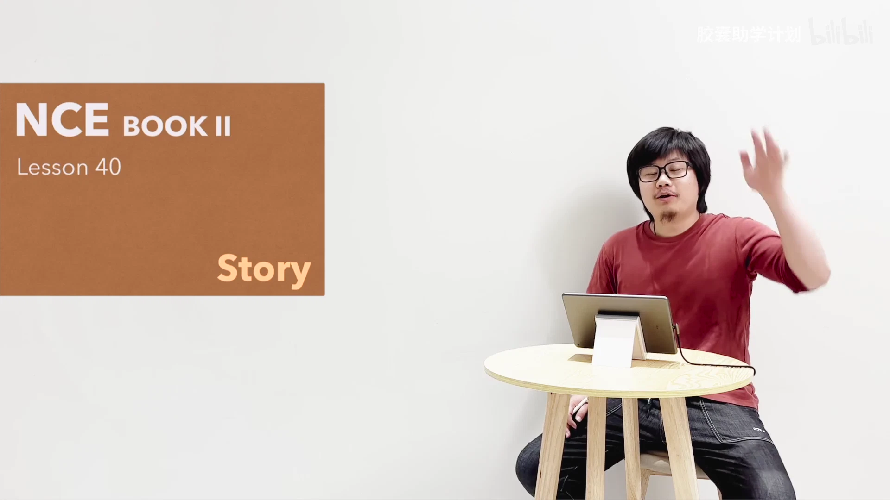

文字识别：NCE / BOOKI"I / Lesson 40 / Story

### 画面 00:00:02

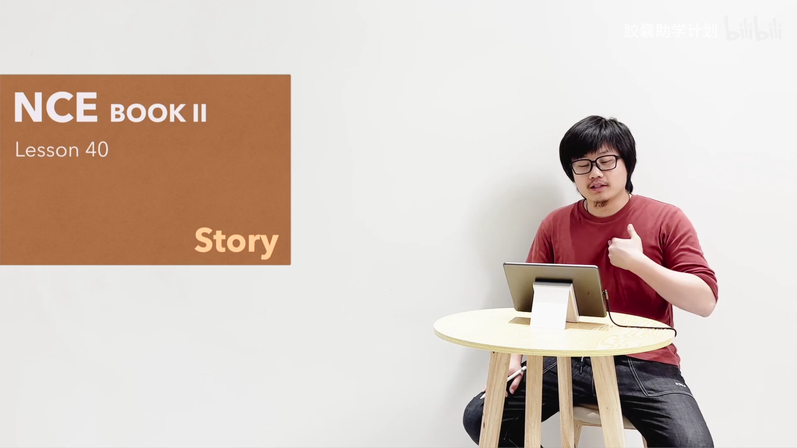

文字识别：NCE / BOOK" / Lesson 40 / Story

### 画面 00:00:09

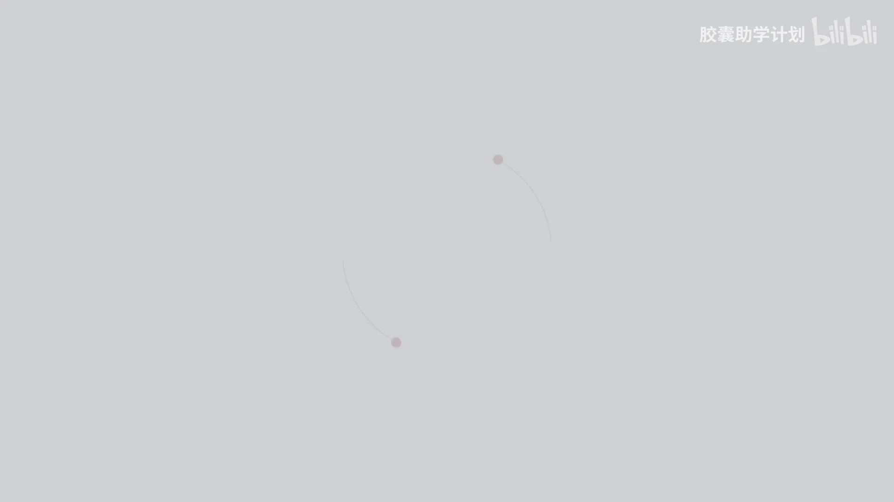

文字识别：胶囊助学计划bilb出

### 画面 00:00:13

### 画面 00:00:15

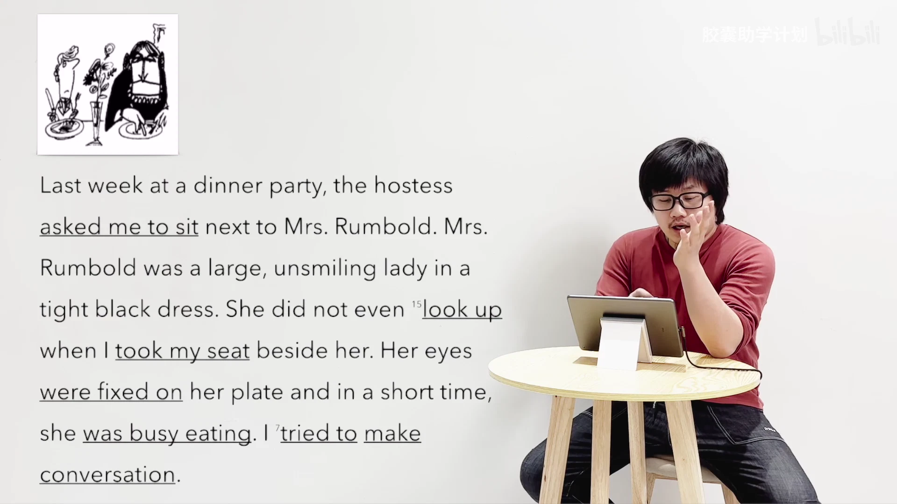

文字识别：Last week at a dinner party, the hostess / asked me to sit next to Mrs. Rumbold. Mrs. / Rumbold was a large, unsmiling lady in a / tight black dress. She did not even 'look up / when I took my seat beside her. Her eyes / were fixed on her plate and in a short time, / she was busy eating.I 'tried to make / conversation.

## 00:00:30–00:01:00

party 上，在一个晚晚餐的聚会上，对吧？The hostess，主人出现了，对吧？女主人 ask me to sit， ask somebody to do something，这咱们新一就学过了啊，不多说了。说邀请我去坐 next to Mrs. Rumble，坐在 Rumble 夫人的旁边。Mrs. Rumble was 是一个什么样的人呢？Large，第一个单词就不简单。我们很少会形容女

### 画面 00:00:45

文字识别：Last week at a dinner party, the hostess / asked me to sit next to Mrs. Rurbold. Mrs. / Rumbold was a large, unsmiling lady in a / tight black dress. She did not even 'look up / when I took my seat beside her. Her eyes / were fixed on her plate and in a short time, / she was busy eating.I 'tried to make / conversation.

## 00:01:00–00:01:30

士用 large 这个单词。 large 如果我们把它意译成汉语的话，好像就是你在夸一个女士壮，不是说胖啊。你注意，胖跟壮是俩概念。就骨架子特别大啊，浑身肌肉特别多，特别的壮啊，就是 large，很大一只，很大只啊。 Unsmiling lady, 不苟言笑的一名女士啊，这已经很有意思了。然后呢，

### 画面 00:01:15

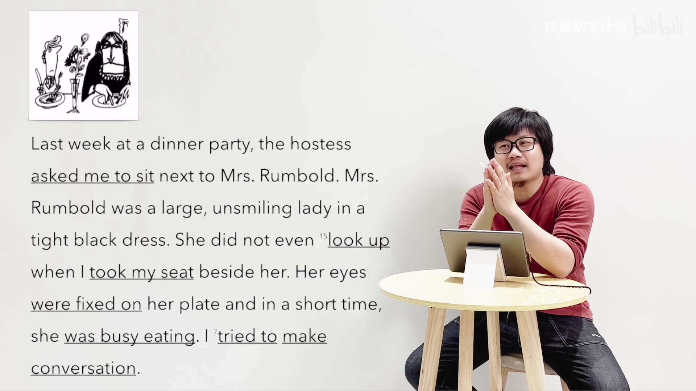

文字识别：Last week at a dinner party, the hostess / asked me to sit next to Mrs. Rumbold. Mrs. / Rumbold was a large, unsmiling lady in a / tight black dress. She did not even 'look up / when I took my seat beside her. Her eyes / were fixed on her plate and in a short time, / she was busy eating.I 'tried to make / conversation.

### 画面 00:01:20

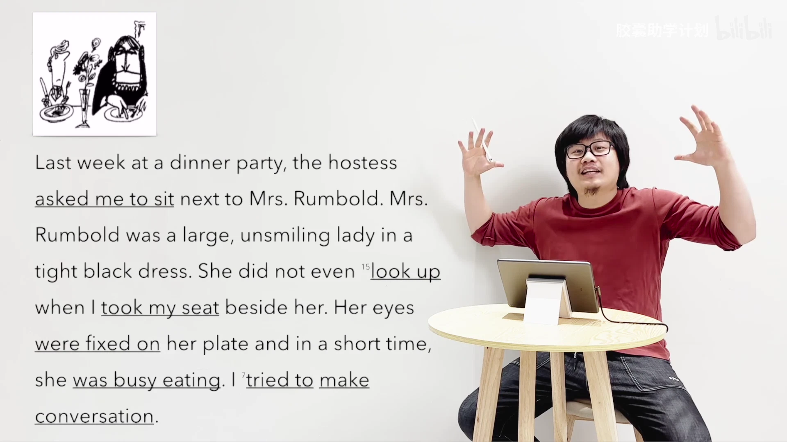

文字识别：Last week at a dinner party, the hostess / asked me to sit next to Mrs. Rumbold. Mrs. / Rumbold was a large, unsmiling lady in a / tight black dress. She did not even 'look up / when I took my seat beside her. Her eyes / were fixed on her plate and in a short time, / she was busy eating.I 'tried to make / conversation.

### 画面 00:01:22

文字识别：Last week at a dinner party, the hostess / asked me to sit next to Mrs. Rumbold. Mrs. / Rumbold was a large, unsmiling lady in a / tight black dress. She did not even 'look up / when I took my seat beside her. Her eyes / were fixed on her plate and in a short time, / she was busy eating.I 'tried to make / conversation.

## 00:01:30–00:02:00

In a tight black dress，在一个紧的黑的裙子里面啊，tight black dress很有意思，对吧？哎，紧紧的黑色的裙子里面，she did not even look up。她甚至都没有look up啊。这我们实际上早在十五课加薪那一刻啊，跟老板谈加薪那一刻就已经学过了，对吧？就是我的老板甚至都没有从桌子上抬起头来。She

### 画面 00:01:52

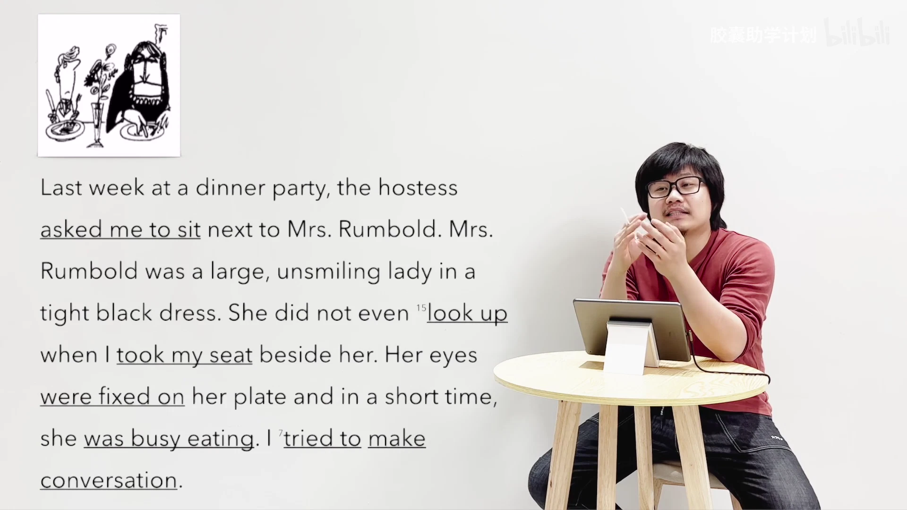

文字识别：Last week at a dinner party, the hostess / asked me to sit next to Mrs. Rumbold. Mrs. / Rumbold was a large, unsmiling lady in a / tight black dress. She did not even 'look up / when I took my seat beside her. Her eyes / were fixed on her plate and in a short time, / she was busy eating.I 'tried to make / conversation.

## 00:02:00–00:02:30

didn't not even look up when I took my seat beside her. Okay,当我took my seat beside her，其实took my seat基本就等于叫做sat啊，就等同于坐啊，s a t啊坐。那took my seat也是坐的意思，对吧？Beside her，叫在她旁边的时候，Her eyes were fixed on her plate.好，讲单词的时候我们提到这个短语了，对吧？说被固定在，凝

### 画面 00:02:15

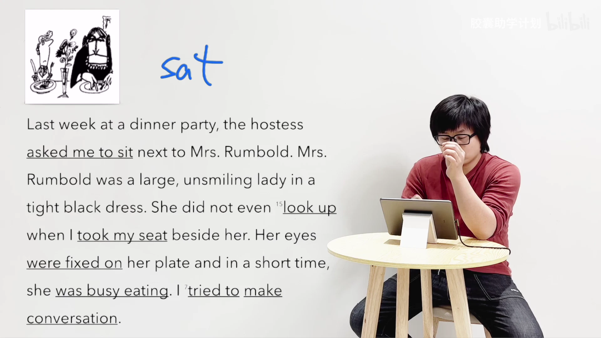

文字识别：sat / Last week at a dinner party, the hostess / asked me to sit next to Mrs. Rumbold. Mrs. / Rumbold was a large, unsmiling lady in a / tight black dress. She did not even '"look up / when I took my seat beside her. Her eyes / were fixed on her plate and in a short time, / she was busy eating.I 'tried to make / conversation.

## 00:02:30–00:03:00

视着他的盘子，and in a short time，然后很短的时间之内，she was busy eating。这是一个非常棒的习惯用法，叫做be busy doing something。一会儿我们拿它去造句啊。她就开始忙着吃了。I tried to make conversation, tried to do something. 第七课咱们学的对吧？哎，之前应该也见了很多次了。尝试着去怎么样呢？Make conversation，尝试去做

### 画面 00:02:45

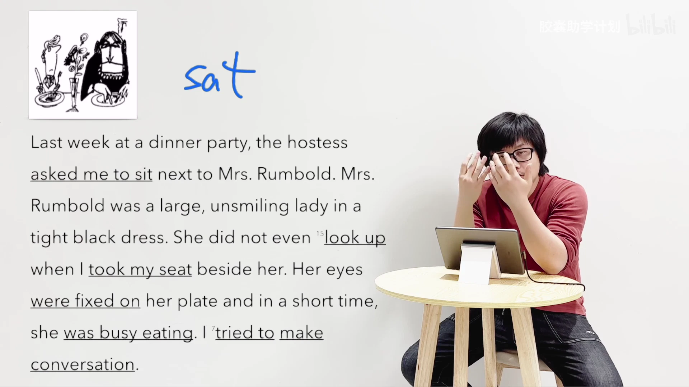

文字识别：sat / Last week at a dinner party, the hostess / asked me to sit next to Mrs. Rumbold. Mrs. / Rumbold was a large, unsmiling lady in a / tight black dress. She did not even '"look up / when I took my seat beside her. Her eyes / were fixed on her plate and in a short time, / she was busy eating.I 'tried to make / conversation.

## 00:03:00–00:03:30

一些小的对话。Okay,开始了。他们两个人的对话非常有意思。A new play is coming to the Globe soon.说一个新的话剧啊，马上就要来到环球了。Soon很快。I said我说到啊，就找点闲聊的话题嘛。Will you be seeing it?这个对于各位来说，可能就相对来说陌生一点。这也是今天我们要学的第二个很简

### 画面 00:03:03

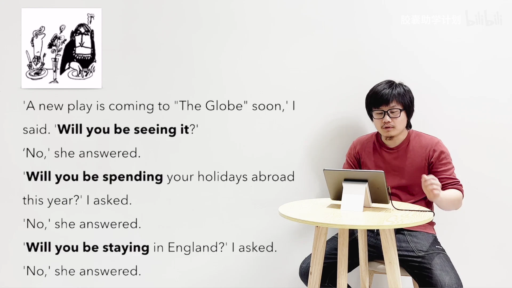

文字识别：'A new play is coming to "The Globe" soon,'I / said. 'Will you be seeing it?' / 'No,'she answered. / 'Will you be spending your holidays abroad / this year?'I asked. / 'No,'she answered. / 'Will you be staying in England?' I asked. / 'No,' she answered.

## 00:03:30–00:04:00

单也很小的语法。首先，这个时态你认的叫十三课咱们学的将来进行时，will be doing。其次，如果让各位去用的话，你可能会说的叫做 will you see it？一般将来时，对吧？首先完全没有问题，你用用用 will you see it？一般将来时，对吧？没有任何问题。它表示的意思都是一样的，叫做你会看吗？但是对于外国人来说，他当他听到 will

### 画面 00:03:33

文字识别：'A new play is coming to "The Globe" soon,'I / said. 'Will you be seeing it?' / 'No,'she answered. / 'Will you be spending your holidays abroad / this year?'I asked. / 'No,'she answered. / 'Will you be staying in England?' I asked. / 'No,' she answered.

## 00:04:00–00:04:30

Will you be seeing it 的时候，他会觉得你更有礼貌一点点。但我还是那句话，各位，你不用担心说，当你用 Will you see it 的时候，会显得很粗鲁，并不会，只是说 Will you be seeing it 显得更委婉一点。那我举个例子，如果你说你忘了怎么办呢？没事儿，我们说话的时候除了语言，还有肢体语言，还有面部表情，对不对？当你的肢体语言、面部表情、微笑，对

### 画面 00:04:03

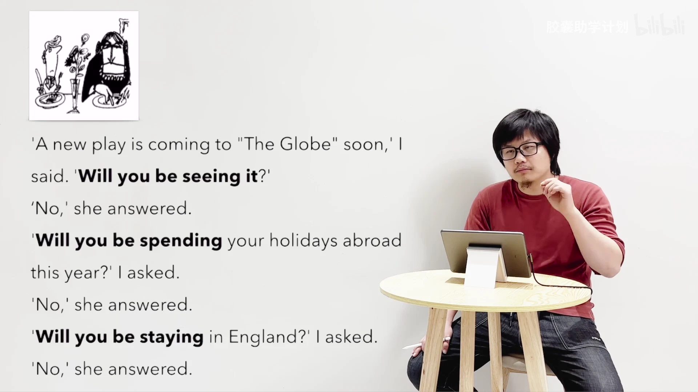

文字识别：'A new play is coming to "The Globe" soon,'I / said. 'Will you be seeing it?' / 'No,'she answered. / 'Will you be spending your holidays abroad / this year?'I asked. / 'No,'she answered. / 'Will you be staying in England?' I asked. / 'No,'she answered.

## 00:04:30–00:05:00

吧？哎，然后呢？你又不是攻击性很强，去说的时候，别人不会觉得你很粗鲁的。各位记住啊，OK。No，是 answer，不，他回答道。Will you be spending your holiday abroad this year？好，他问说，那你今年会在国外度过你的假期吗？你看，还用的是 will you be doing，对吧？I ask，我问道。No，是 answer，不，他还是回答道。注意第三个问

### 画面 00:04:33

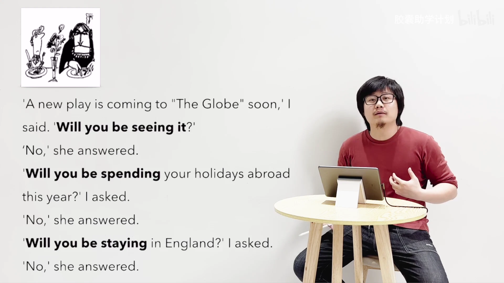

文字识别：'A new play is coming to "The Globe" soon,'I / said. 'Will you be seeing it?' / 'No,'she answered. / 'Will you be spending your holidays abroad / this year?'I asked. / 'No,'she answered. / 'Will you be staying in England?' I asked. / 'No,'she answered.

## 00:05:00–00:05:30

题已经非常有意思了。就是我非常想找你聊天。我说你今年出国吗？你说不出国。我说 Will you be staying in England? 那你说，那我问的是，那你今年就留在英格兰吗？啊，英国吗？我问到。No, she answered. 你看，三个 no 告诉你一件事儿，叫这个女的根本就没听她说话。为什么？第一个问 no 还好理解。第二个和第三个连到一起，难道你还能上上月球不

### 画面 00:05:03

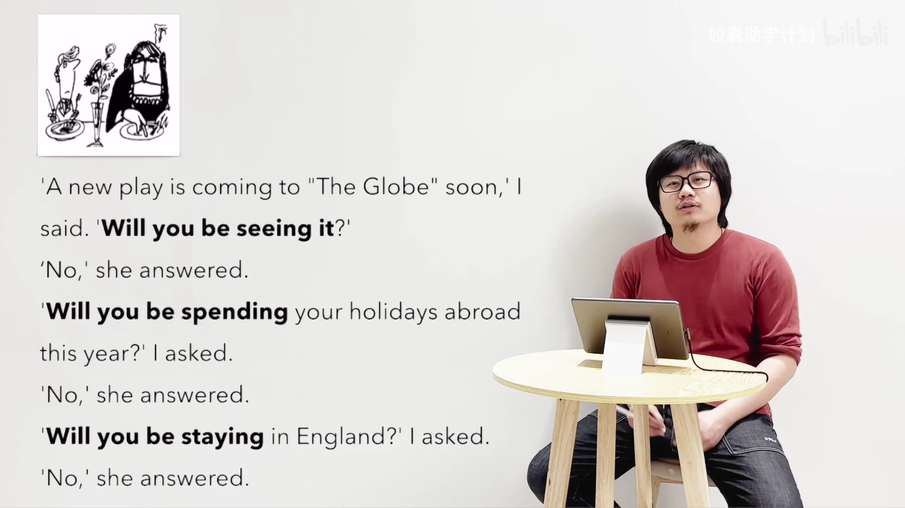

文字识别：'A new play is coming to "The Globe" soon,'I / said. 'Will you be seeing it?' / 'No,'she answered. / 'Will you be spending your holidays abroad / this year?'I asked. / 'No,'she answered. / 'Will you be staying in England?' I asked. / 'No,'she answered.

## 00:05:30–00:06:00

成？说你今年出国吗？不出。你今年留在国内吗？不留，对吧？你就完全不想和他聊天儿。但是这里面的小的文章的故事的设置很有趣，通过很简单的三个对话，你能看到，第一，这名男士非常有礼貌，希望通过很有礼貌去跟他沟通，找一些话题，对吧？第二，这个女士非常的不耐烦，三个no，问完就完，你爱问啥问啥，对吧？我就是no啊，

### 画面 00:05:33

文字识别：'A new play is coming to"The Globe" soon,'I / said. 'Will you be seeing it?' / 'No,'she answered. / 'Will you be spending your holidays abroad / this year?'I asked. / 'No,'she answered. / 'Will you be staying in England?' I asked. / 'No,' she answered.

### 画面 00:05:59

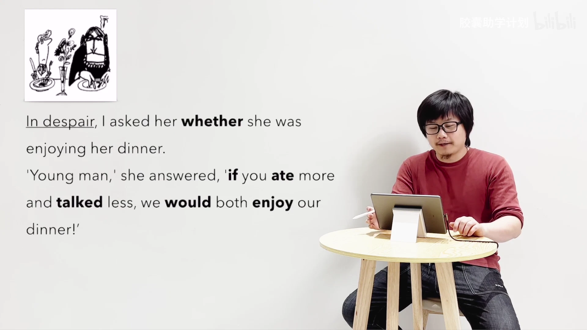

文字识别：In despair, I asked her whether she was / enjoying her dinner. / 'Young man,' she answered,'if you ate more / and talked less, we would both enjoy our / dinner!'

## 00:06:00–00:06:30

然后这名男士还很有意思，叫 in despair，绝望了，然后绝望了。I asked her whether，就是 if，对吧？之前我们讲过了三十九课啊，if。我问他说是否 she was enjoying her dinner。我问他是否他正在享受他的晚餐。总给回一句话吧。Young man，好，你看说到吃，他终于说了一句话，不是 no 了，说年轻人。

### 画面 00:06:24

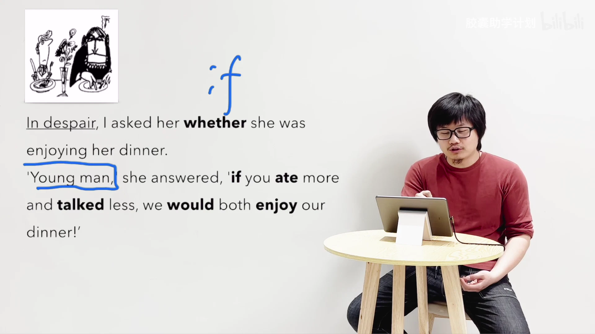

文字识别：In despair, l asked her whether she was / enjoying her dinner. / 'Young man, / she answered,'if you ate more / and talked less, we would both enjoy our / dinner!'

## 00:06:30–00:07:00

She answered.她回答道，If you ate more and talked less, we would both enjoy our dinner.如果您看到这句话，首先第一步，你能把它翻译成叫如果你多吃少说，我们都会很享受我们的晚餐。你能翻译到这句话，首先我就会认为很不错了，至至少字面意思您都懂了，但还不够。今天学了

### 画面 00:06:34

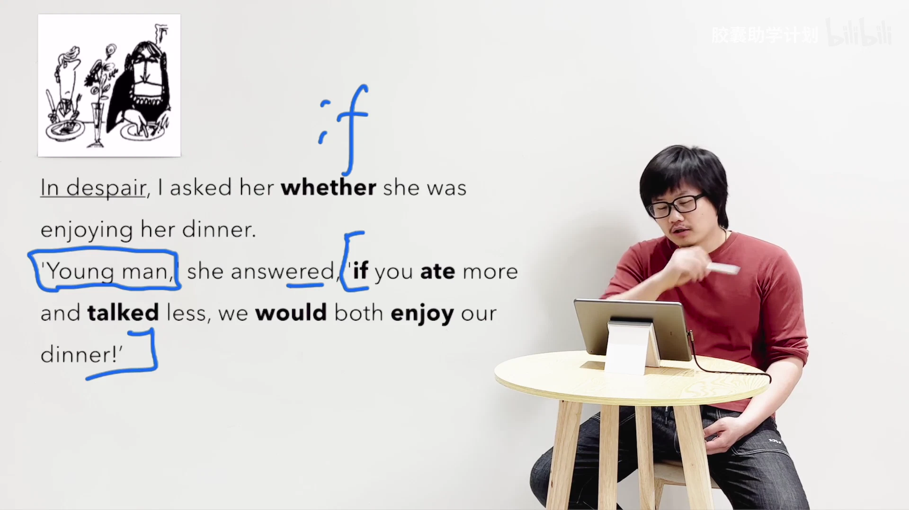

文字识别：In despair, I asked her whether she was / enjoying her dinner. / Young man, / she answered, / 'if you ate more / and talked less, we would both enjoy our / dinner!'

## 00:07:00–00:07:30

这个新的语法了之后，虚拟语气，你看到了 if，看到了 at，看到了 talk，看到了 would 和 enjoy，你要知道它表示现在的虚拟语气。你要明白他想表达的叫与现在事实相反，或者是怎么样，或者是怎么样，认为发生这个情况的几率极低，对吧？所以其实这句话真正想表达的不是它的字面意思，他问的叫做呃晚饭吃的开不开心，对吧？他其实

### 画面 00:07:04

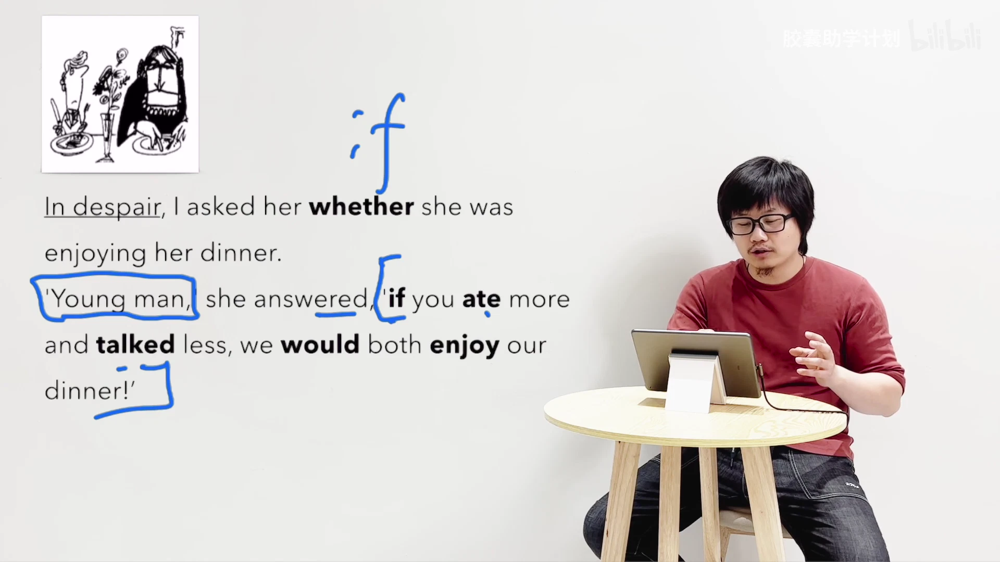

文字识别：In despair, I asked her whether she was / enjoying her dinner. / Young man, / she answered, / if you ate more / and talked less, we would both enjoy our / dinner!'

### 画面 00:07:24

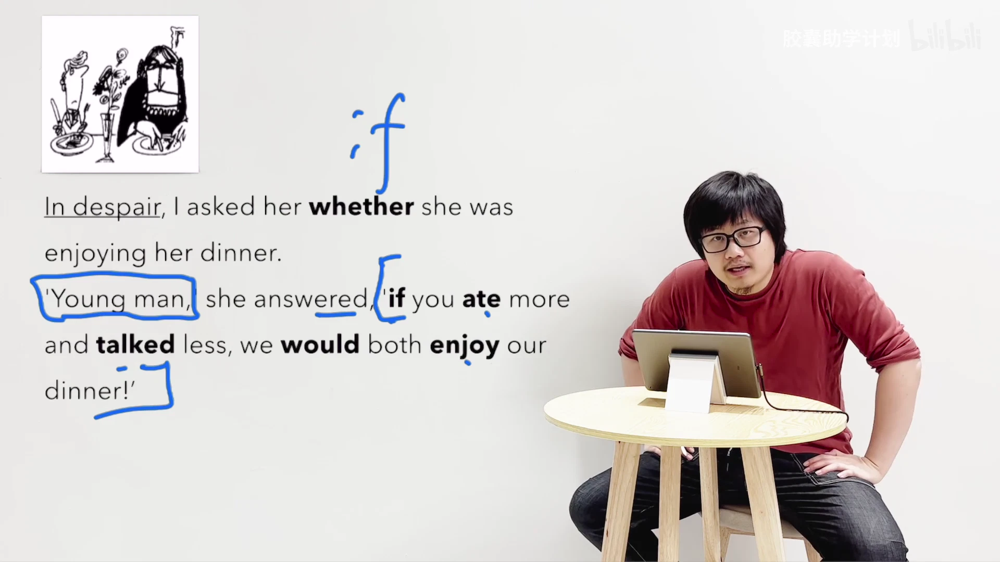

文字识别：In despair, I asked her whether she was / enjoying her dinner. / Young man, / she answered, / if you ate more / and talked less, we would both enjoy our / dinner!'

## 00:07:30–00:08:00

这一句话就等于一个单词叫 no。为什么呢？我们看他的翻译。如果你多吃点，与现在事实相反，你没有多吃。And talked less，少说点，与现在事实相反，你一直在说。We would both enjoy our dinner，我们就都能很好的享受我们的晚餐了。与现在事实相反，我没有办法好好享受我的晚餐，因为你不停的说而不怎么吃东西。

### 画面 00:07:30

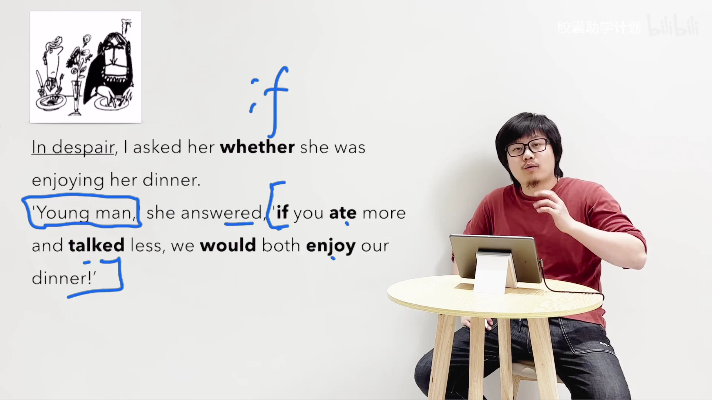

文字识别：In despair, I asked her whether she was / enjoying her dinner. / 'Young man, / she answered, / 'if / f you ate more / and talked less, we would both enjoy our / dinner!'

## 00:08:00–00:08:30

看见了吧？所以这句话其实等于还是一个单词叫做 no，只不过用了一个非常长的虚拟语气去告诉他这样的一个情绪，对吧？与现在事实相反，你没有多吃，你也没有少说，所以我没有办法好好享受我的晚餐。你不是问我吗？对吧？Okay，那故事很有意思，咱们就结束了。接下来呢，看三个小的习惯用法：take my say, be busy doing something, and will you be doing something？好吧，好，

### 画面 00:08:00

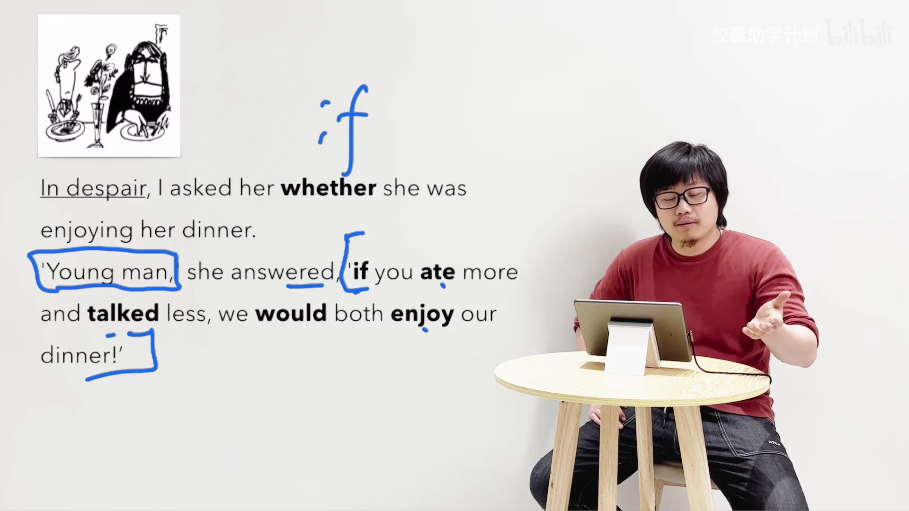

文字识别：In despair, I asked her whether she was / enjoying her dinner. / Young man, / she answered, / 'if / f you ate more / and talked less, we would both enjoy our / dinner!'

### 画面 00:08:02

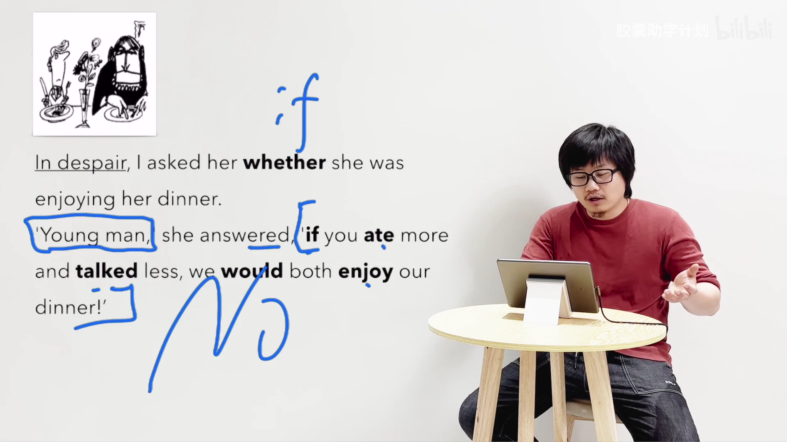

文字识别：In despair, I asked her whether she was / enjoying her dinner. / 'Young man, / she answered, / 'if / f you ate more / and talked less, we woyld both enjoy our / dinner!'

### 画面 00:08:20

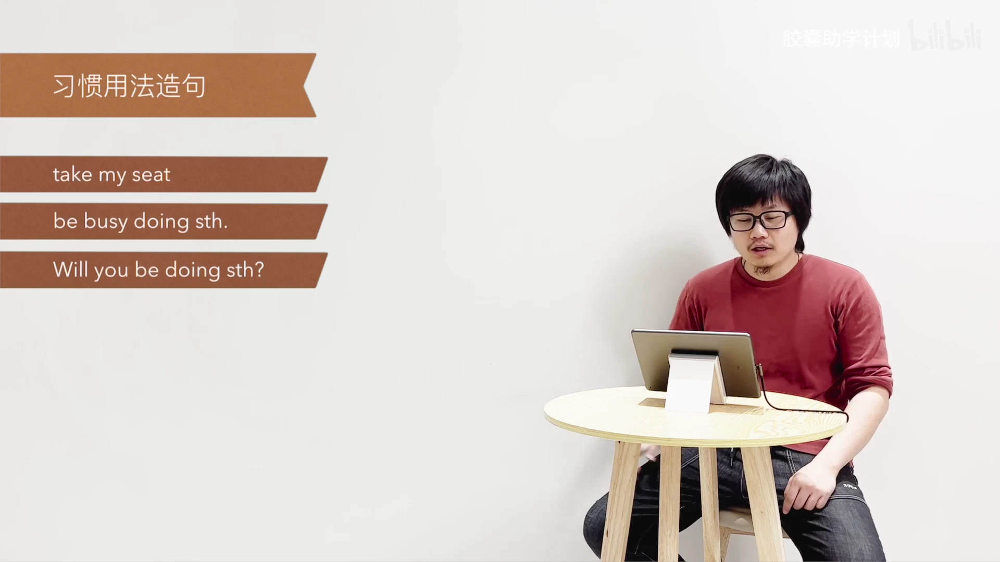

文字识别：习惯用法造句 / take my seat / be busy doing / sth. / Will you be doing sth?

### 画面 00:08:22

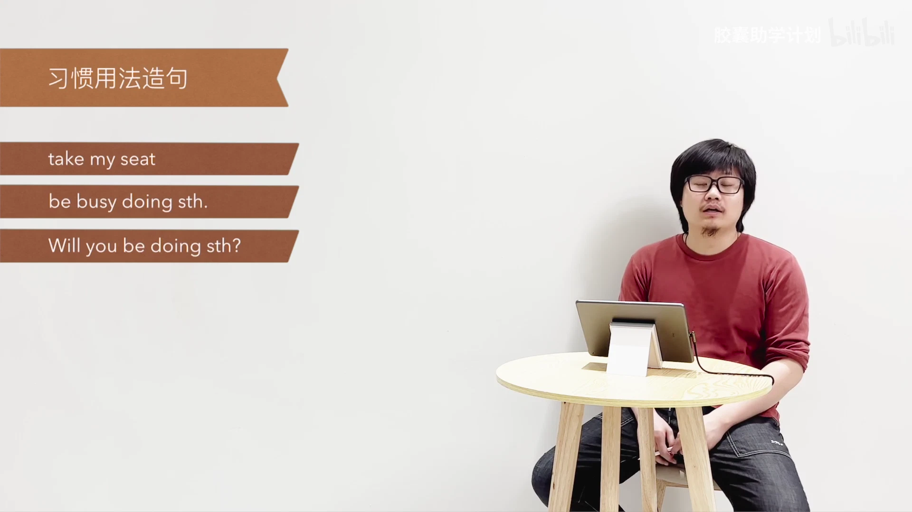

文字识别：习惯用法造句 / take my seat / be busy doing  / sth. / Will you be doing sth?

### 画面 00:08:25

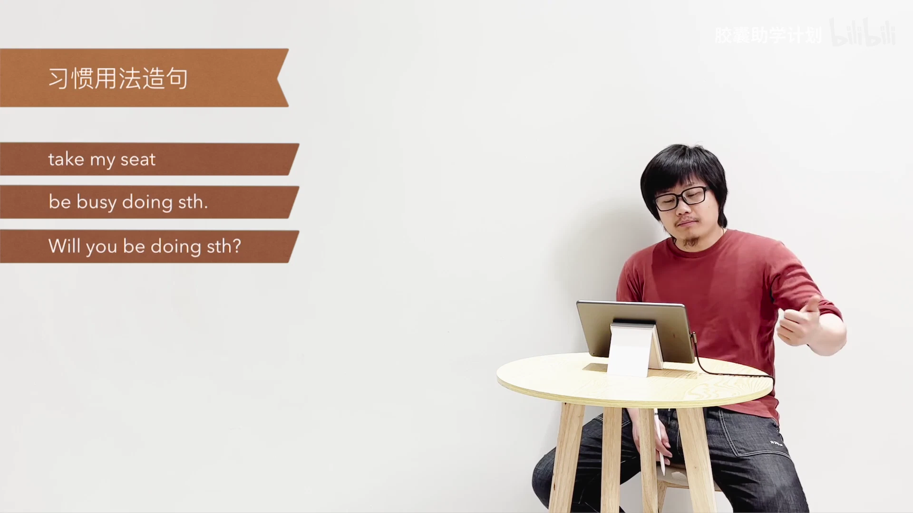

文字识别：习惯用法造句 / take my seat / be busy doing / sth. / Will you be doing / sth?

## 00:08:30–00:09:00

Good. First, take my seat. Very simple. I just talked about it. Take my seat is the same as sit, right? Ah, when I sit next to him, so it's very simple. For example, you can take my seat. This is a very common sentence in our spoken English. You can take my seat. Okay. Next, we will watch a short movie clip. In this movie clip, there is a sentence that says, "Take my seat. Sit here."

### 画面 00:08:30

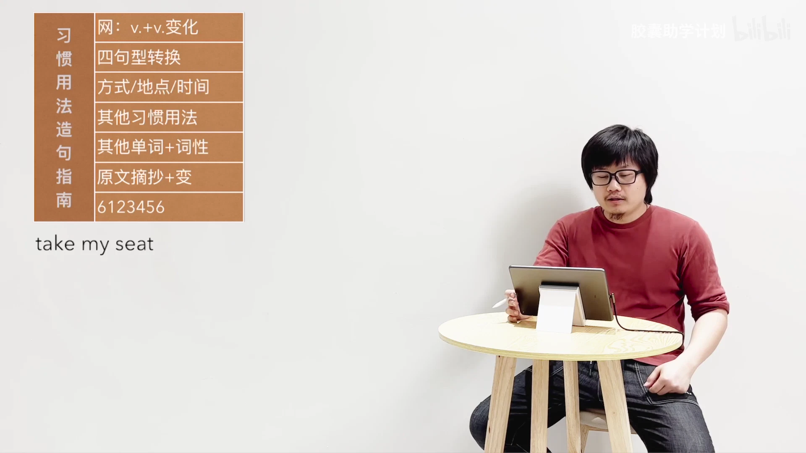

文字识别：网：v.+v.变化 / 习惯用法造句指南 / 四句型转换 / 方式/地点/时间 / 其他习惯用法 / 其他单词+词性 / 原文摘抄+变 / 6123456 / take my seat

### 画面 00:08:33

文字识别：网：v.+v.变化 / 习惯用法造句指南 / 四句型转换 / 方式/地点/时间 / 其他习惯用法 / 其他单词+词性 / 原文摘抄+变 / 6123456 / take my seat / When I took my seat beside her = When I sat / beside her

### 画面 00:08:35

文字识别：网：v.+v.变化 / 习惯用法造句指南 / 四句型转换 / 方式/地点/时间 / 其他习惯用法 / 其他单词+词性 / 原文摘抄+变 / 6123456 / take my seat / When I took my seat beside her = When I sat / beside her

### 画面 00:08:40

文字识别：网：v.+v.变化 / 习惯用法造句指南 / 四句型转换 / 方式/地点/时间 / 其他习惯用法 / 其他单词+词性 / 原文摘抄+变 / 6123456 / take my seat / When I took my seat beside her = When I sat / beside her / You can take my seat.

### 画面 00:08:45

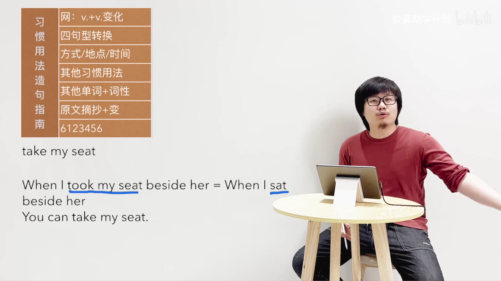

文字识别：网：v.+v.变化 / 习惯用法造句指南 / 四句型转换 / 方式/地点/时间 / 其他习惯用法 / 其他单词+词性 / 原文摘抄+变 / 6123456 / take my seat / When I took my seat beside her = When I sat / beside her / You can take my seat.

### 画面 00:08:50

文字识别：网：v.+v.变化 / 习惯用法造句指南 / 四句型转换 / 方式/地点/时间 / 其他习惯用法 / 其他单词+词性 / 原文摘抄+变 / 6123456 / take my seat / When I took my seat beside her = When I sat / beside her / You can take my seat.

### 画面 00:08:55

文字识别：网：v.+v.变化 / 习惯用法造句指南 / 四句型转换 / 方式/地点/时间 / 其他习惯用法 / 其他单词+词性 / 原文摘抄+变 / 6123456 / take my seat / When I took my seat beside her = When I sat / beside her / You can take my seat.

### 画面 00:08:57

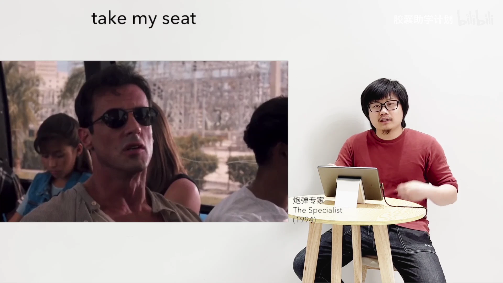

文字识别：take my seat / 炮弹专家 / The Specialist / (1994)

## 00:09:00–00:09:30

Take my seat，坐我这儿吧。 Okay, here. Why don't you take my seat? Why don't you take my seat? Okay, 很好。下一个 Be busy doing something 是一个很重要的语法了。那这习惯用法了，这这个非常的好啊，很常见。比如说 She is busy having an operation.

### 画面 00:09:03

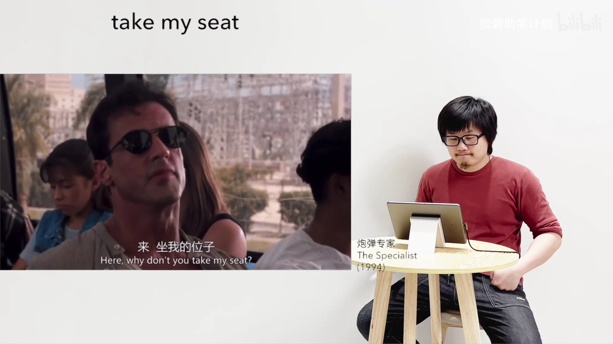

文字识别：take my seat / 来坐我的位子 / 炮弹专家 / The Specialist / Here, why don't you take my seat? / (1994)

### 画面 00:09:05

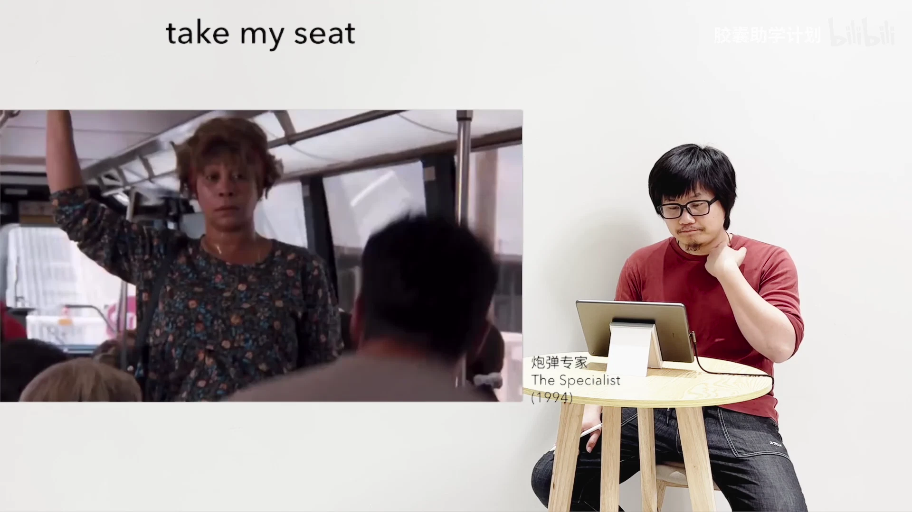

文字识别：take my seat / 炮弹专家 / The Specialist / (1994)

### 画面 00:09:07

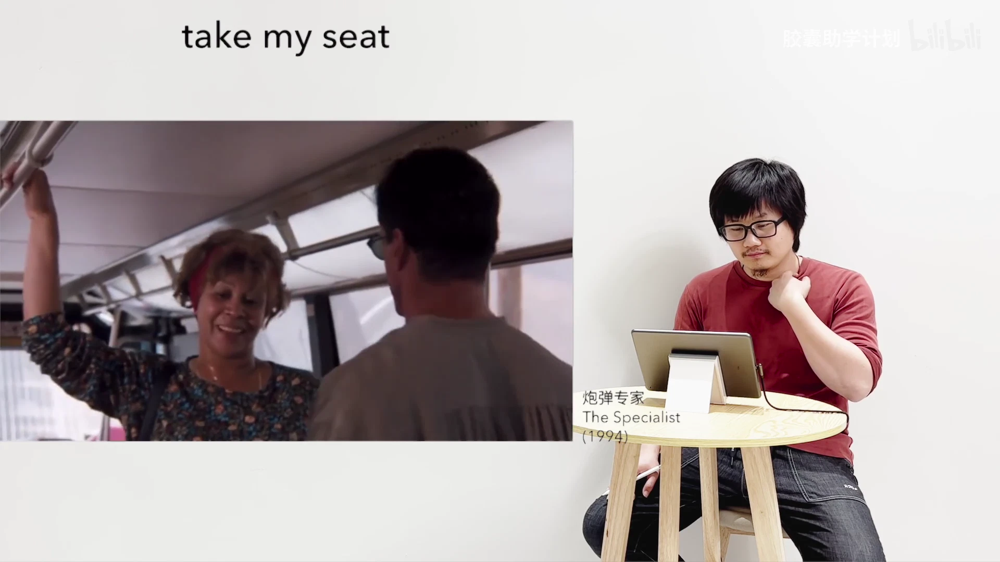

文字识别：take my seat / 炮弹专家 / The Specialist / (1994)

### 画面 00:09:09

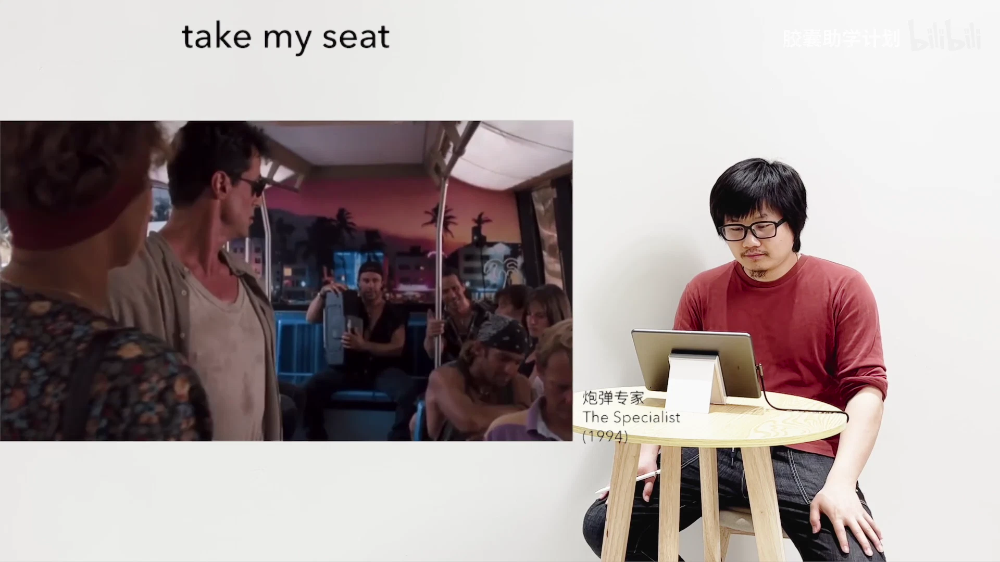

文字识别：take my seat / 炮弹专家 / The Specialist / (1994)

### 画面 00:09:11

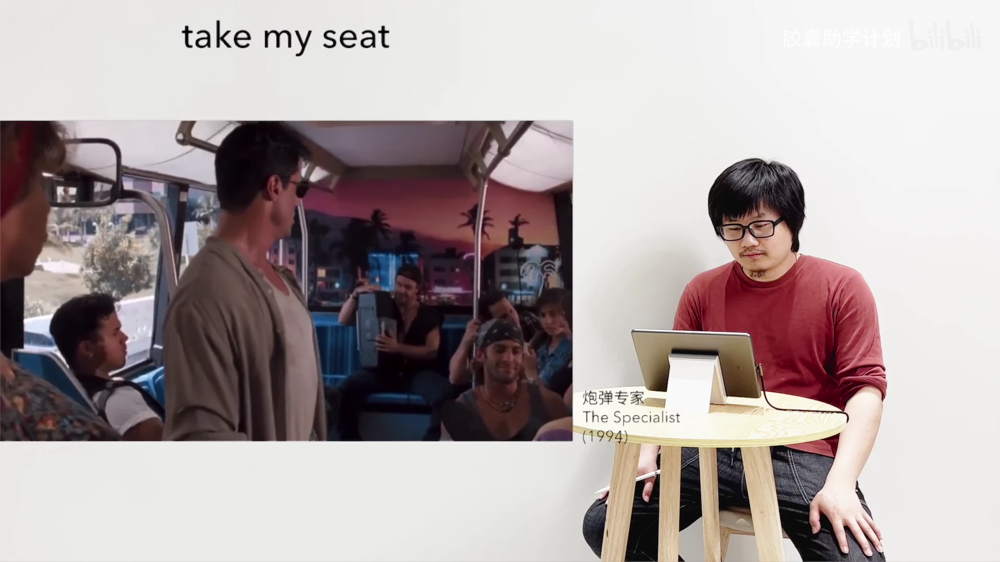

文字识别：take my seat / 炮弹专家 / The Specialist / (1994)

### 画面 00:09:13

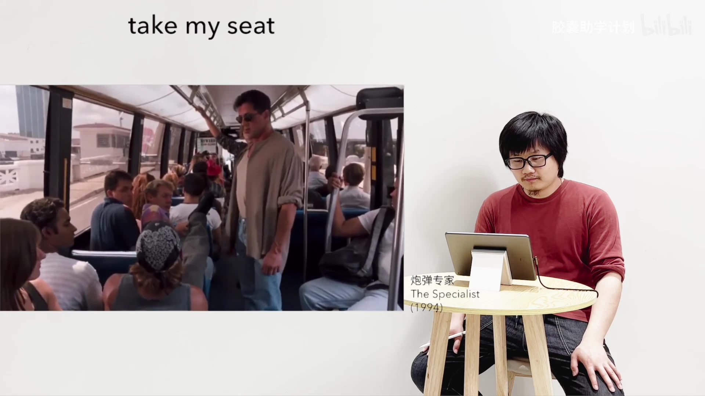

文字识别：take my seat / 炮弹专家 / The Specialist / (1994)

### 画面 00:09:15

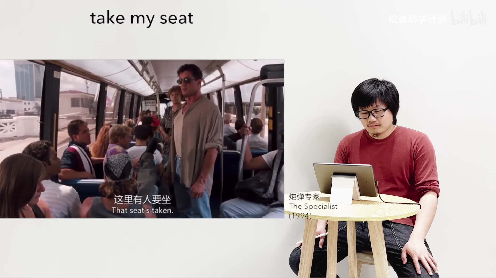

文字识别：take my seat / 这里有人要坐 / 炮弹专家 / The Specialist / That seat's taken. / (1994)

### 画面 00:09:17

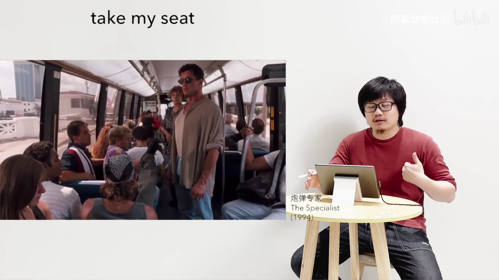

文字识别：take my seat / 炮弹专家 / The Specialist / (1994)

### 画面 00:09:19

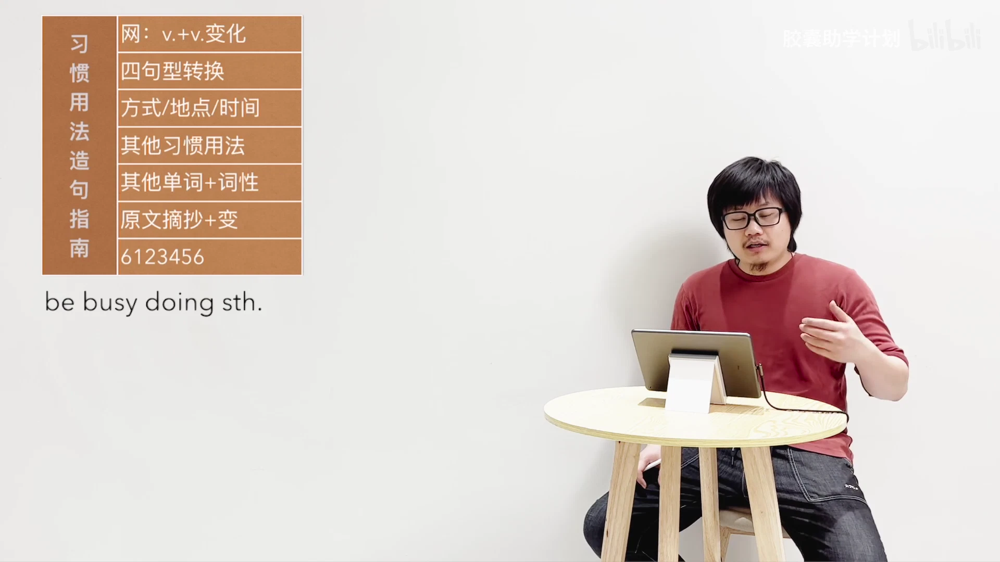

文字识别：网：v.+v.变化 / 习惯用法造句指南 / 四句型转换 / 方式/地点/时间 / 其他习惯用法 / 其他单词+词性 / 原文摘抄+变 / 6123456 / be busy doing sth.

### 画面 00:09:21

文字识别：网：v.+v.变化 / 习惯用法造句指南 / 四句型转换 / 方式/地点/时间 / 其他习惯用法 / 其他单词+词性 / 原文摘抄+变 / 6123456 / be busy doing sth.

### 画面 00:09:25

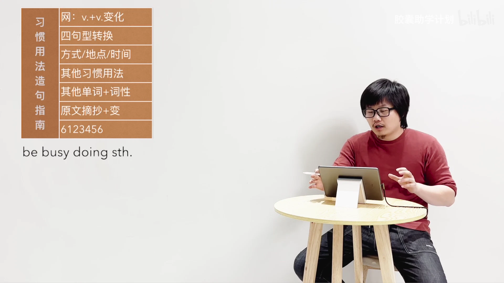

文字识别：网：v.+v.变化 / 习惯用法造句指南 / 四句型转换 / 方式/地点/时间 / 其他习惯用法 / 其他单词+词性 / 原文摘抄+变 / 6123456 / be busy doing sth.

## 00:09:30–00:10:00

她正在忙着做手术，动手术。下一个，I was busy finishing my homework. 我当时正在忙着完成我的呃作业，对吧？你看，be busy doing something, be busy doing something的be我们可以是现在，也可以是将来，对吧？你也可以是啊，可以是现在，也可以是过去，也可以是将来。比如说，will be busy doing something. 哦，我会将忙于做什么事情？OK, very good. 那这句话你可以把它变成一般疑问句和特殊疑问句，就是您的家庭

### 画面 00:09:30

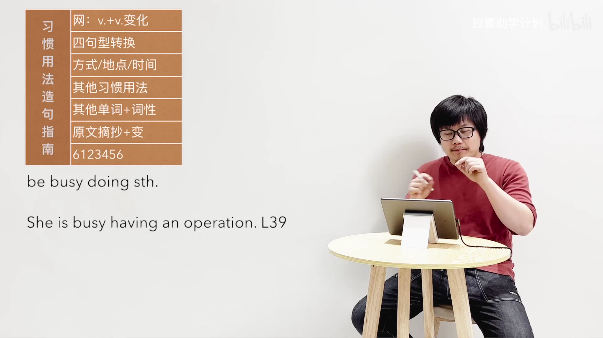

文字识别：网：v.+v.变化 / 习惯用法造句指南 / 四句型转换 / 方式/地点/时间 / 其他习惯用法 / 其他单词+词性 / 原文摘抄+变 / 6123456 / be busy doing sth. / She is busy having an operation. L39

### 画面 00:09:35

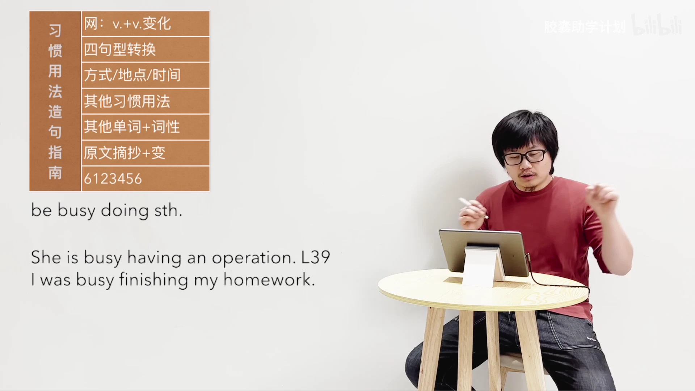

文字识别：网：v.+v.变化 / 习惯用法造句指南 / 四句型转换 / 方式/地点/时间 / 其他习惯用法 / 其他单词+词性 / 原文摘抄+变 / 6123456 / be busy doing sth. / She is busy having an operation. L39 / I was busy finishing my homework.

### 画面 00:09:40

文字识别：网：v.+v.变化 / 习惯用法造句指南 / 四句型转换 / 方式/地点/时间 / 其他习惯用法 / 其他单词+词性 / 原文摘抄+变 / 6123456 / be busy doing sth. / She is busy having an operation. L39 / I was busy finishing my homework.

### 画面 00:09:43

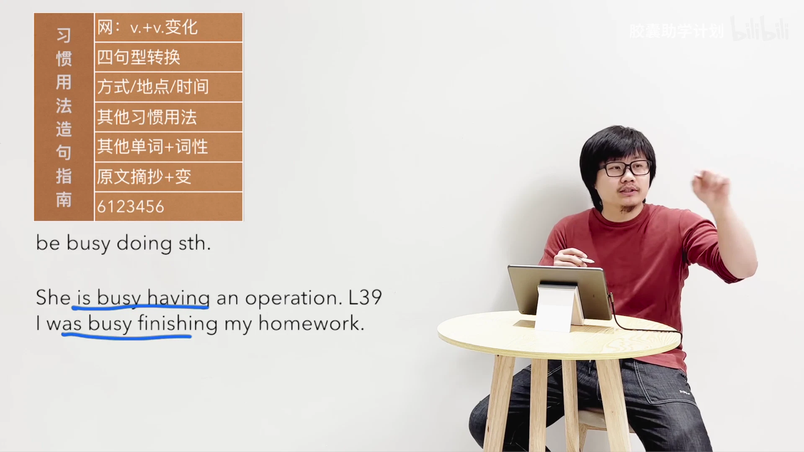

文字识别：网：v.+v.变化 / 习惯用法造句指南 / 四句型转换 / 方式/地点/时间 / 其他习惯用法 / 其他单词+词性 / 原文摘抄+变 / 6123456 / be busy doing sth. / She is busy having an operation. L39 / I was busy finishing / g my homework.

### 画面 00:09:45

文字识别：网：v.+v.变化 / 习惯用法造句指南 / 四句型转换 / 方式/地点/时间 / 其他习惯用法 / 其他单词+词性 / 原文摘抄+变 / 6123456 / be busy doing sth. / She is busy having an operation. L39 / I was busy finishing my homework.

### 画面 00:09:50

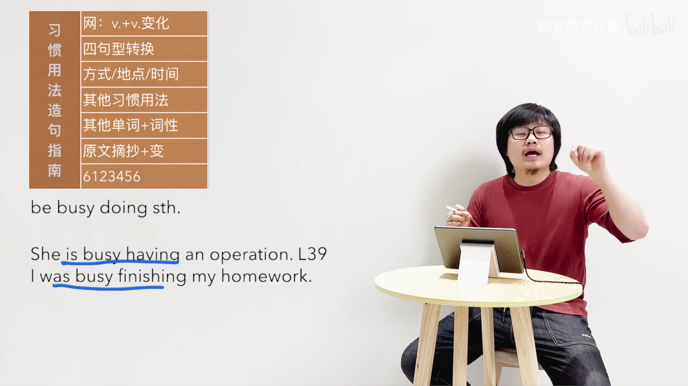

文字识别：网：v.+v.变化 / 习惯用法造句指南 / 四句型转换 / 方式/地点/时间 / 其他习惯用法 / 其他单词+词性 / 原文摘抄+变 / 6123456 / be busy doing sth. / She is busy having an operation. L39 / I was busy finishing my homework.

### 画面 00:09:55

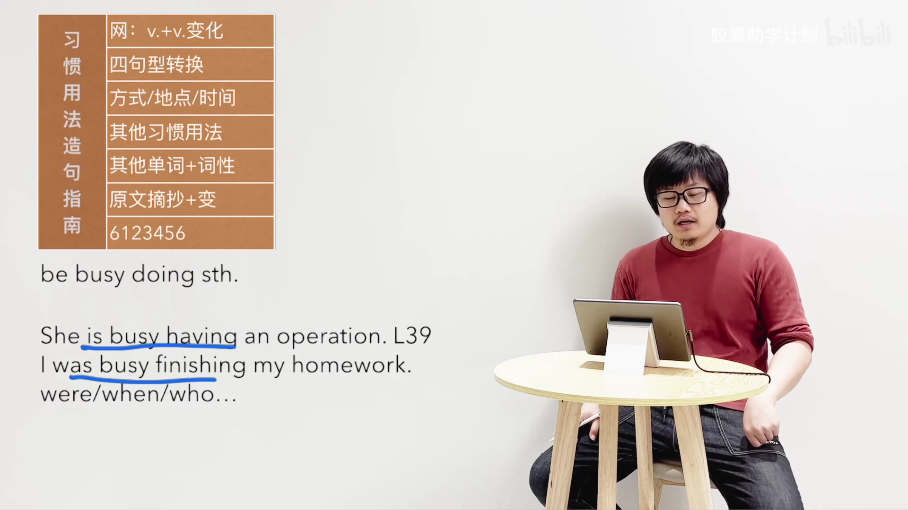

文字识别：网：v.+v.变化 / 习惯用法造句指南 / 四句型转换 / 方式/地点/时间 / 其他习惯用法 / 其他单词+词性 / 原文摘抄+变 / 6123456 / be busy doing sth. / She is busy having an operation. L39 / I was busy finishing / my I / homework. / were/when/who...

## 00:10:00–00:10:30

庭作业啊。我们再最后来一个叫做 They were busy wrapping it up. 啊，他们正在忙着把它打包起来。Very good. 最后一个 Will you be doing something? 这我们讲了，就表示很委婉，对吧？比如说 Will you be having dinner with me tonight? 很委婉的说，你愿意和我今天晚上一起吃饭吗？还是那句话啊，除了语气上、语感上有

### 画面 00:10:00

文字识别：网：v.+v.变化 / 习惯用法造句指南 / 四句型转换 / 方式/地点/时间 / 其他习惯用法 / 其他单词+词性 / 原文摘抄+变 / 6123456 / be busy doing sth. / She is busy having an operation. L39 / I was busy finishing my homework. / were/when/who... / They were busy wrapping it up. L32

### 画面 00:10:05

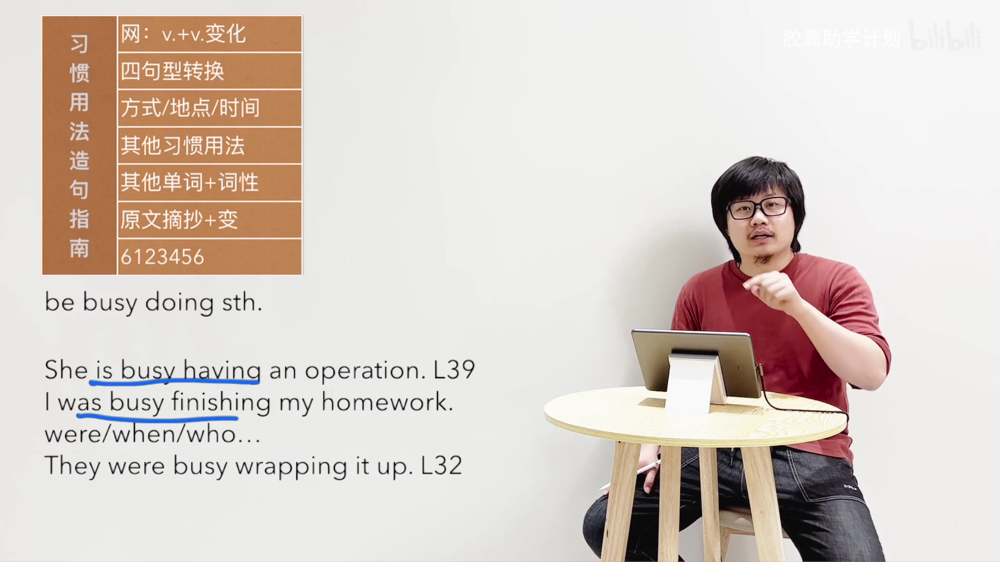

文字识别：网：v.+v.变化 / 习惯用法造句指南 / 四句型转换 / 方式/地点/时间 / 其他习惯用法 / 其他单词+词性 / 原文摘抄+变 / 6123456 / be busy doing sth. / She is busy having an operation. L39 / I was busy finishing / y my h / homework. / were/when/who... / They were k / : busy wrapping it up. L32

### 画面 00:10:10

文字识别：网：v.+v.变化 / 习惯用法造句指南 / 四句型转换 / 方式/地点/时间 / 其他习惯用法 / 其他单词+词性 / 原文摘抄+变 / 6123456 / Will you be doing sth?

### 画面 00:10:15

文字识别：网：v.+v.变化 / 习惯用法造句指南 / 四句型转换 / 方式/地点/时间 / 其他习惯用法 / 其他单词+词性 / 原文摘抄+变 / 6123456 / Will you be doing sth?

### 画面 00:10:20

文字识别：网：v.+v.变化 / 习惯用法造句指南 / 四句型转换 / 方式/地点/时间 / 其他习惯用法 / 其他单词+词性 / 原文摘抄+变 / 6123456 / Will you be doing sth? / Will you be having dinner with me tonight?

### 画面 00:10:25

文字识别：网：v.+v.变化 / 习惯用法造句指南 / 四句型转换 / 方式/地点/时间 / 其他习惯用法 / 其他单词+词性 / 原文摘抄+变 / 6123456 / Will you be doing sth? / Will you be having dinner with me tonight?

## 00:10:30–00:11:00

变化以外，它是没有变化的。它和 Will you have dinner with me tonight 是没有区别的。在语义上，就是含义上啊，只是语感上，别人听起来会觉得你更有礼貌一点点。 Okay, very good. 再来，比如说 Will you be giving him a call? 你愿意给他打个电话吗？ Very good. 接下来呢，我们把 pattern drill 的其中一个练习拉到这里来了。为什么呢？巧了，它正好是虚拟语

### 画面 00:10:30

文字识别：网：v.+v.变化 / 习惯用法造句指南 / 四句型转换 / 方式/地点/时间 / 其他习惯用法 / 其他单词+词性 / 原文摘抄+变 / 6123456 / Will you be doing sth? / Will you be having dinner with me tonight?

### 画面 00:10:35

文字识别：网：v.+v.变化 / 习惯用法造句指南 / 四句型转换 / 方式/地点/时间 / 其他习惯用法 / 其他单词+词性 / 原文摘抄+变 / 6123456 / Will you be doing sth? / Will you be having dinner with me tonight?

### 画面 00:10:40

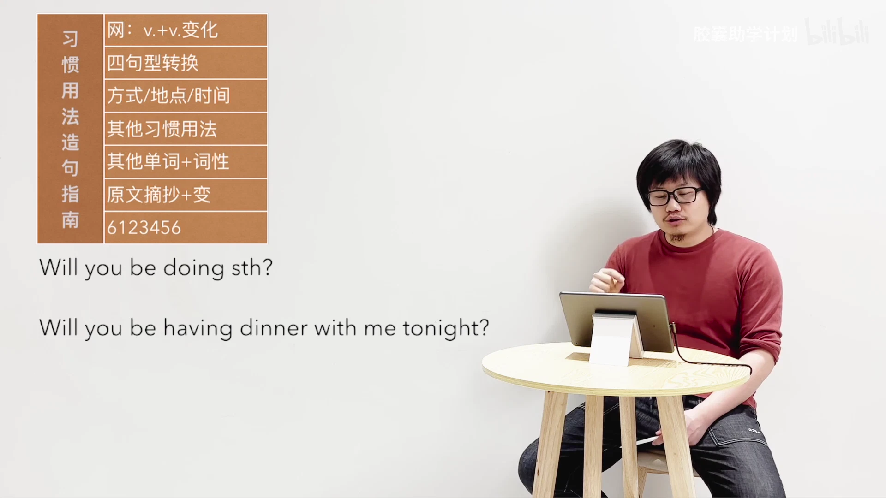

文字识别：网：v.+v.变化 / 习惯用法造句指南 / 四句型转换 / 方式/地点/时间 / 其他习惯用法 / 其他单词+词性 / 原文摘抄+变 / 6123456 / Will you be doing sth? / Will you be having dinner with me tonight?

### 画面 00:10:45

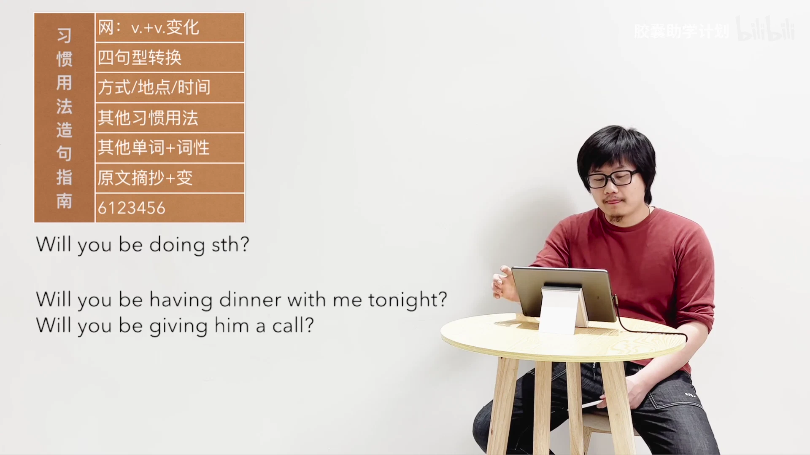

文字识别：网：v.+v.变化 / 习惯用法造句指南 / 四句型转换 / 方式/地点/时间 / 其他习惯用法 / 其他单词+词性 / 原文摘抄+变 / 6123456 / Will you be doing sth? / Will you be having / dinner with me tonight? / Will you be giving / him a call?

### 画面 00:10:50

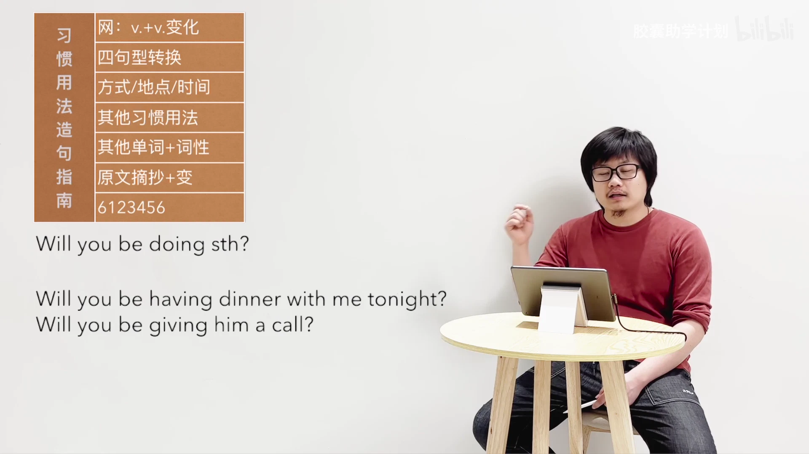

文字识别：网：v.+v.变化 / 习惯用法造句指南 / 四句型转换 / 方式/地点/时间 / 其他习惯用法 / 其他单词+词性 / 原文摘抄+变 / 6123456 / Will you be doing sth? / Will you be having / dinner with me tonight? / Willyou be giving / him a call?

### 画面 00:10:52

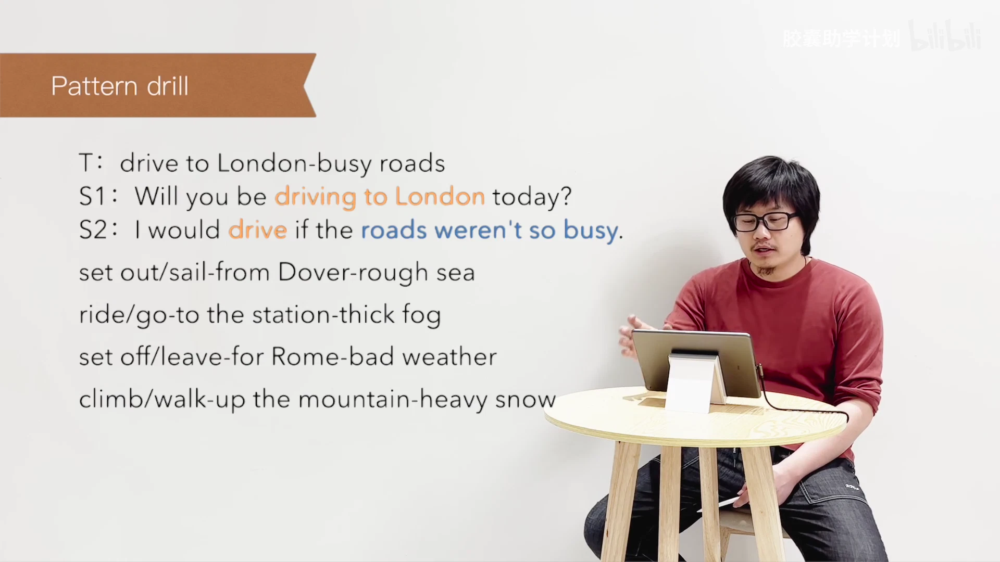

文字识别：Pattern drill / T:drive to London-busy roads / S1: Will you be driving to London today? / S2: I would drive if the roads weren't so busy. / set out/sail-from Dover-rough sea / ride/go-to the station-thick fog / set off/leave-for Rome-bad weather / climb/walk-up the mountain-heavy snow

## 00:11:00–00:11:30

气和 will you be doing something 的一个混合。我们看一下啊，Will you be driving to London today? 你今天愿意开车去伦敦吗？你看，哎，对吧？ I would drive if the roads weren't so busy. 你看，我就问一个很简单的问题。这句话，如果你读懂了，你就能回答我这个问题，叫他会不会开车去呢？他会不会开车去呢？答案是不会。为什么答案是

### 画面 00:11:22

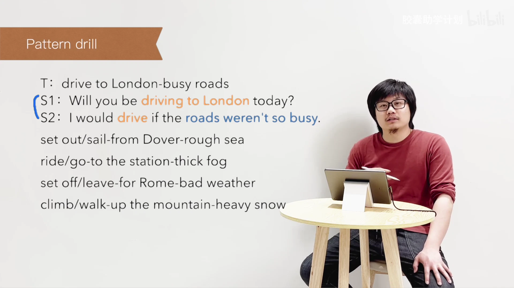

文字识别：Pattern drill / T: drive to London-busy roads / [S1: Will you be driving to London today? / S2: I would drive if the roads weren't so busy. / set out/sail-from Dover-rough sea / ride/go-to the station-thick fog / set off/leave-for Rome-bad weather / climb/walk-up the mountain-heavy snow

## 00:11:30–00:12:00

不会？很简单，首先结构 won't would do 没问题，结构满足虚拟语气。其次，含义叫与现在事实相反。如果现在道路不是这么的拥堵，与这个事实是相反的，所以现在的道路就非常的拥堵。我不会开车去，就这么简单。听清楚了吧？这叫虚拟语气啊！各位还是老习惯，您回去写一下四乘四啊。其实跟语法那个是一样的，我只不过把它拉到了这里，好吧？呃，那本

### 画面 00:11:52

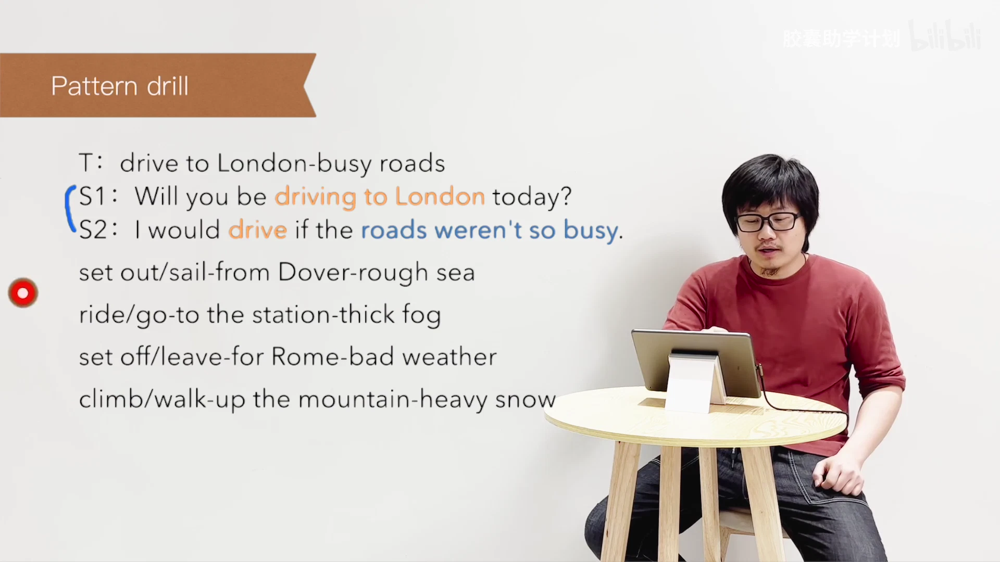

文字识别：Pattern drill / T: drive to London-busy roads / [S1: Will you be driving to London today? / S2: I would drive if the roads weren't so busy. / set out/sail-from Dover-rough sea / ride/go-to the station-thick fog / set off/leave-for Rome-bad weather / climb/walk-up the mountain-heavy snow

### 画面 00:11:58

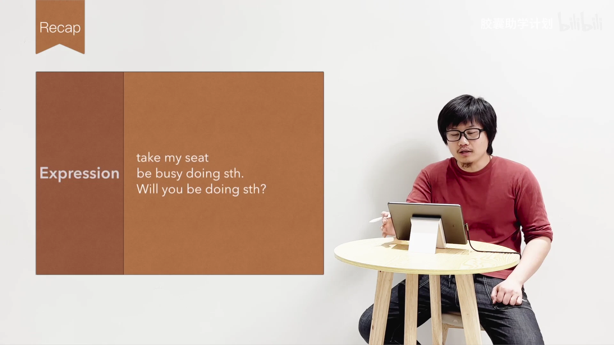

文字识别：Recap / take my seat / Expression / bek / busy / doing sth. / Will youk / be doing / sth?

## 00:12:00–00:12:30

课除了文章重要以外，还有这些小的、小很小的语法或者说短语吧，习惯用法啊，expression，呃，老习惯加作业造句，呃，文章跟读至熟读成诵，我们好做下一个视频的练习，好吧？那以上就是本期视频的全部内容了。如果各位喜欢我们的课程呢，欢迎各位关注、订阅、一键三连，分享给那些需要的朋友，来帮助我们快速成长。See you next time.

### 画面 00:12:00

文字识别：Recap / take my seat / Expression / bek / busy / doing sth. / Willyou b / be doing / sth?

### 画面 00:12:05

文字识别：Recap / take my seat / Expression / be / busy / doing sth. / Will youb / be doing / sth?

### 画面 00:12:08

### 画面 00:12:10

文字识别：1. / 习惯用法造句/对话 / 【习惯用法造句指南】 / 每个5句 / 文章跟读至熟读成诵 / 内化单词+语法+习惯用法 / 听力+口语+写作练习

### 画面 00:12:15

### 画面 00:12:27

### 画面 00:12:29

文字识别：CAPSULEACADEMY / 胶囊助学计划 / 小红书 / Lecturer / Leo / OE

## 00:12:30–00:12:39

### 画面 00:12:32

文字识别：CAPSULEACADEMY / 胶囊助学计划 / 『 / 小红书 / Editor / OE

### 画面 00:12:35

文字识别：CAPSULEACADEMY / 胶囊助学计划 / 『 / 小红书 / Creator / Leo & Berlin / OE

### 画面 00:12:37

文字识别：Bilibili / 胶囊助学计划

### 画面 00:12:39

文字识别：bilibili / 胶囊助学计划

