# L040 听说读写复述练习

快速机器解析：语音为单模型转写，未进行独立交叉校对或人工复核；画面每秒采样并按变化选帧，短时文字和标记可能遗漏。截图时间约有 1 秒误差。图片有损压缩；遇到疑点请按时间查看 Google Drive 原视频。

## 00:00:00–00:00:30

Hello everyone, welcome to Capsule Academy. This is Leo. Today we're going to learn New Concept English Book Two, Lesson Forty Practices. That注意进行如下练习，唯一的前提就是您文章一定要熟读成诵，否则请勿开始。Hope you gonna enjoy it. Good.

### 画面 00:00:00

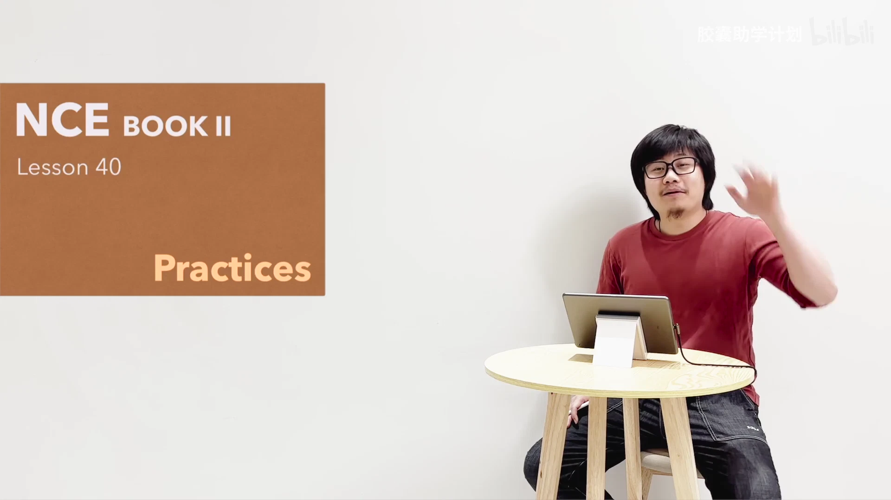

文字识别：NCE / BOOKI"I / Lesson 40 / Practices

### 画面 00:00:02

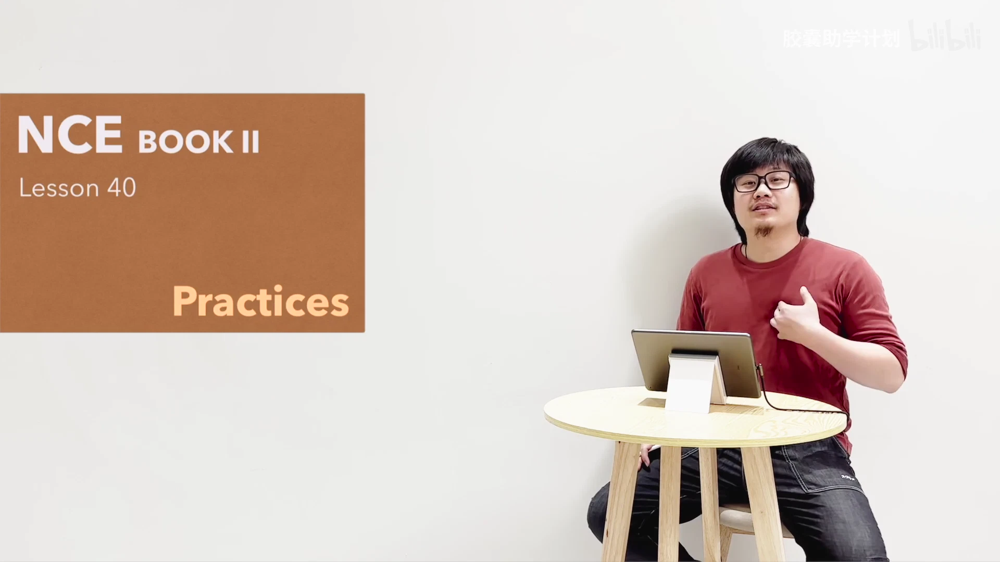

文字识别：NCE / BOOKI"I / Lesson 40 / Practices

### 画面 00:00:04

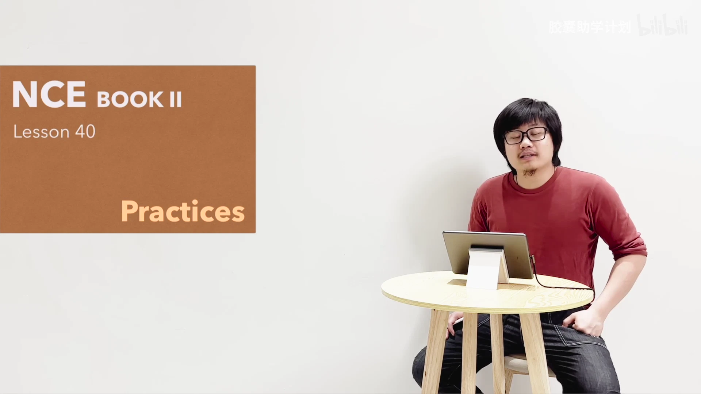

文字识别：NCE / BOOKI"I / Lesson 40 / Practices

### 画面 00:00:07

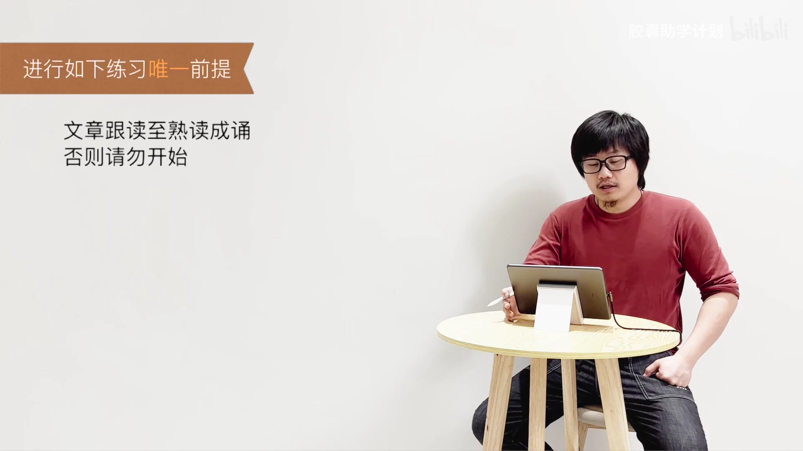

文字识别：进行如下练习唯一前提 / 文章跟读至熟读成诵 / 否则请勿开始

### 画面 00:00:09

文字识别：进行如下练习唯一前提 / 文章跟读至熟读成诵 / 否则请勿开始

### 画面 00:00:12

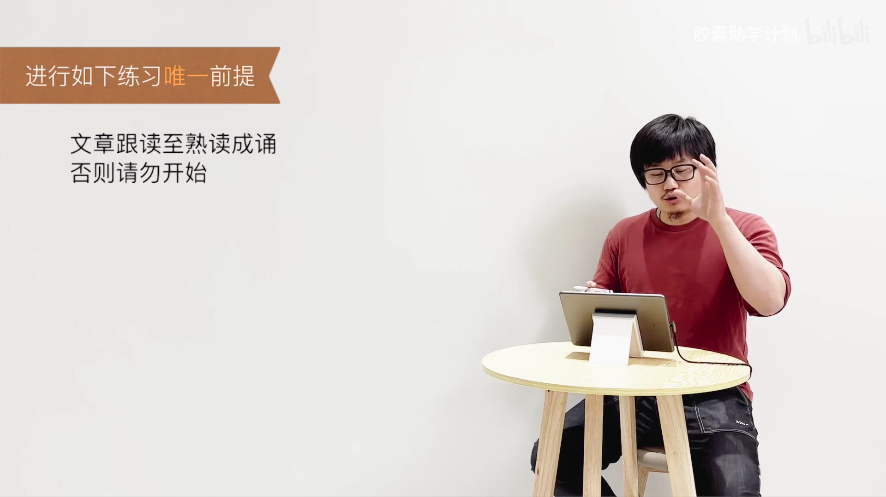

文字识别：进行如下练习唯一前提 / 文章跟读至熟读成诵 / 否则请勿开始

### 画面 00:00:15

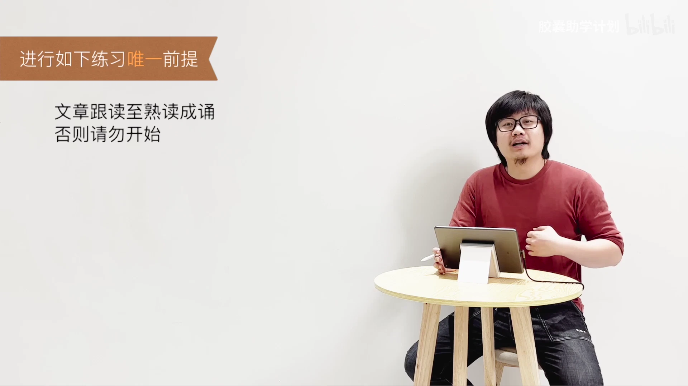

文字识别：进行如下练习唯一前提 / 文章跟读至熟读成诵 / 否则请勿开始

### 画面 00:00:17

文字识别：胶囊助学计划 bilbl

### 画面 00:00:20

文字识别：胶囊助学计划

### 画面 00:00:22

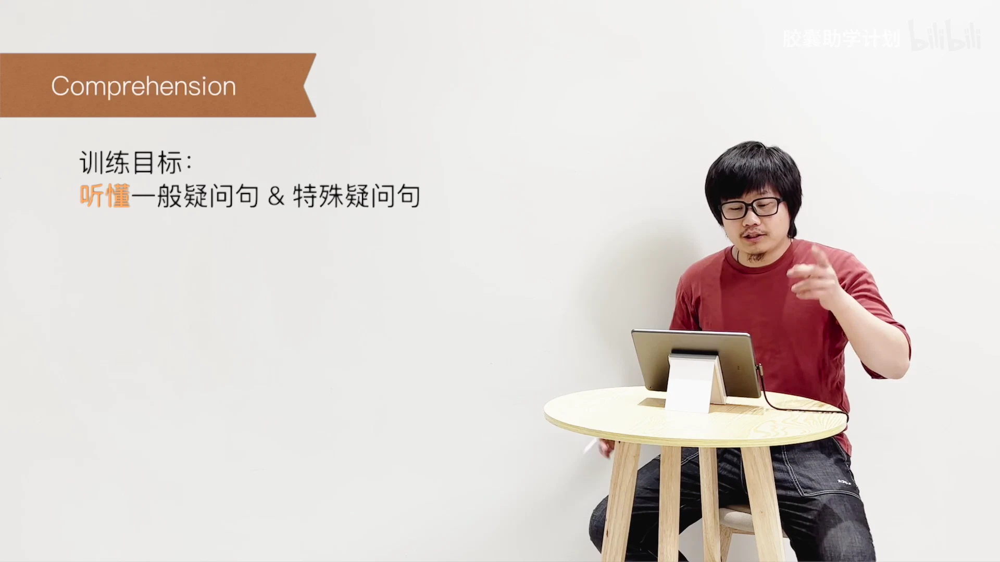

文字识别：Comprehension / 训练目标： / 听懂一般疑问句＆特殊疑问句 / -

### 画面 00:00:27

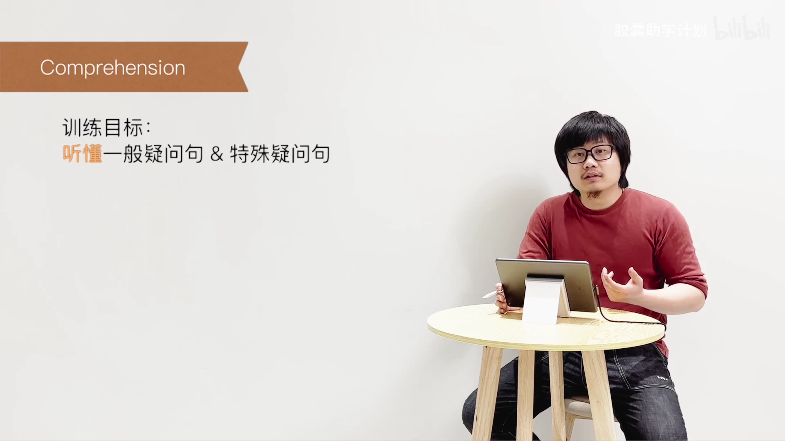

文字识别：Comprehension / 训练目标： / 听懂一般疑问句＆特殊疑问句

### 画面 00:00:29

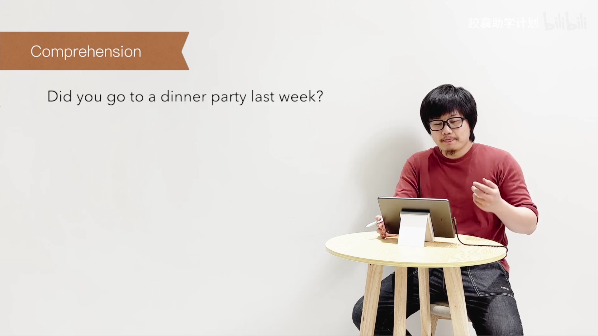

文字识别：Comprehension / Did you go to a dinner party last week?

## 00:00:30–00:01:00

Did you go to a dinner party last week? Yes, I did. Next one. Who did your hostess ask you to sit next to? Mrs. Rumble. Next one. Was she large or smile? Large. Next one. She didn't smile, did she? No, she didn't. Next one.

### 画面 00:00:31

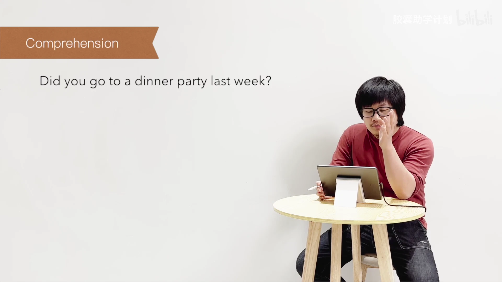

文字识别：Comprehension / Did you go to a dinner party last week?

### 画面 00:00:41

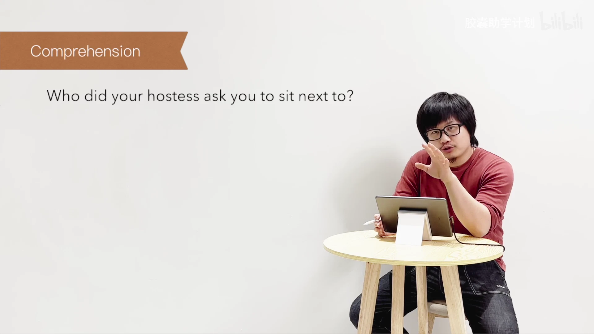

文字识别：Comprehension / Who did your hostess ask you to sit next to?

### 画面 00:00:48

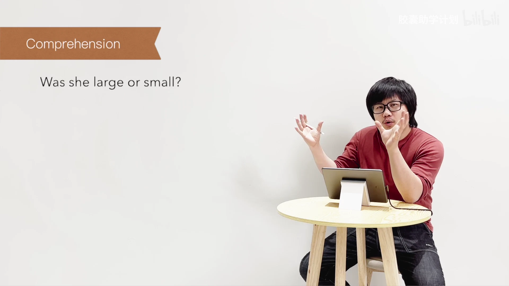

文字识别：Comprehension / Was she large or small?

### 画面 00:00:56

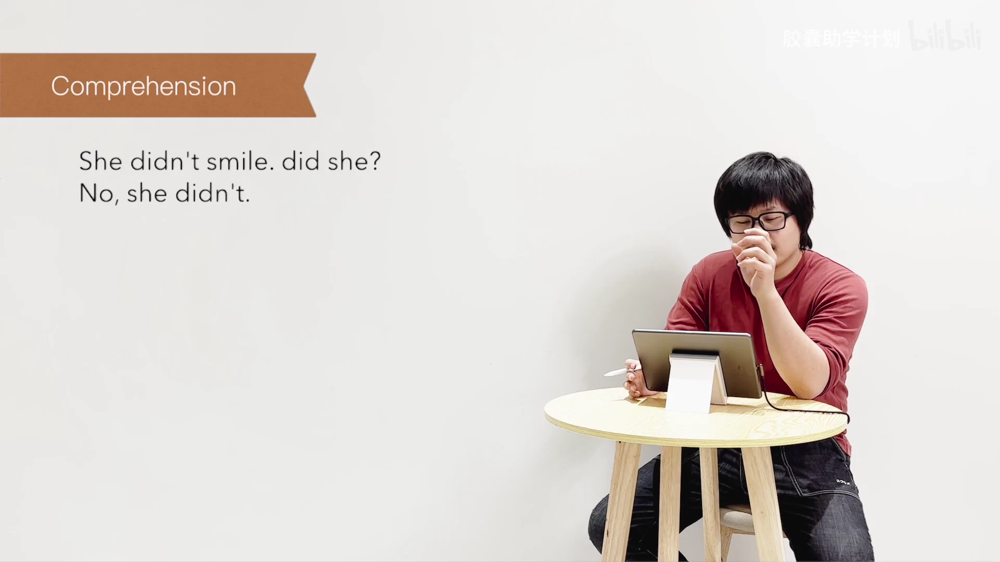

文字识别：Comprehension / She didn't smile. did she? / No, she didn't.

## 00:01:00–00:01:30

what was she wearing? A tight black dress. Next one, what was she looking at? Her plate. Next one, what was she soon busy doing? Eating. Next one, what did you try to do? To make conversation.

### 画面 00:01:26

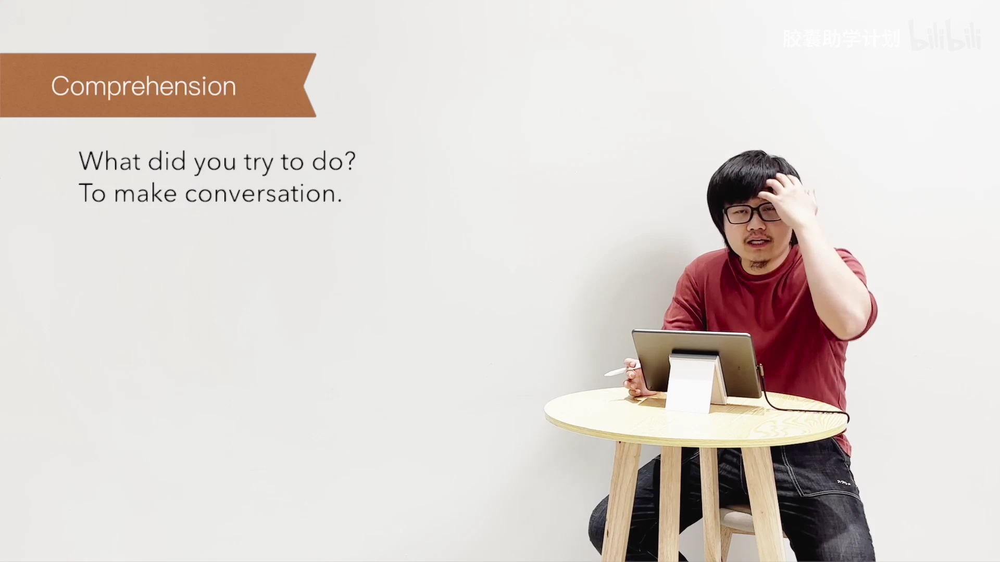

文字识别：Comprehension / What did you try to do? / To make conversation.

### 画面 00:01:28

文字识别：Comprehension / What did you try to do? / To make conversation.

## 00:01:30–00:02:00

You told her a new play was coming to the Globe soon, didn't you? Yes, I did. Next one, did you ask her if she would be seeing it? Yes, I did. Next one, what did she reply? Reply就回复啊，一个单词儿。No. Next one, what did you ask her next? Whether she would

### 画面 00:01:30

文字识别：Comprehension / You told her a new play was coming to 'the / Globe' soon, didn't you?

### 画面 00:01:38

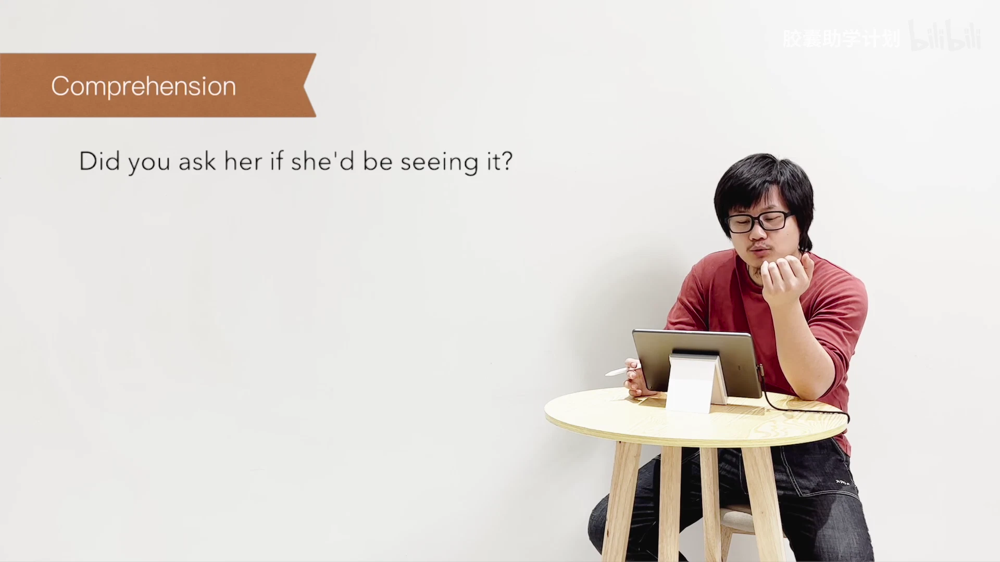

文字识别：Comprehension / Did you ask her if she'd be seeing it?

### 画面 00:01:49

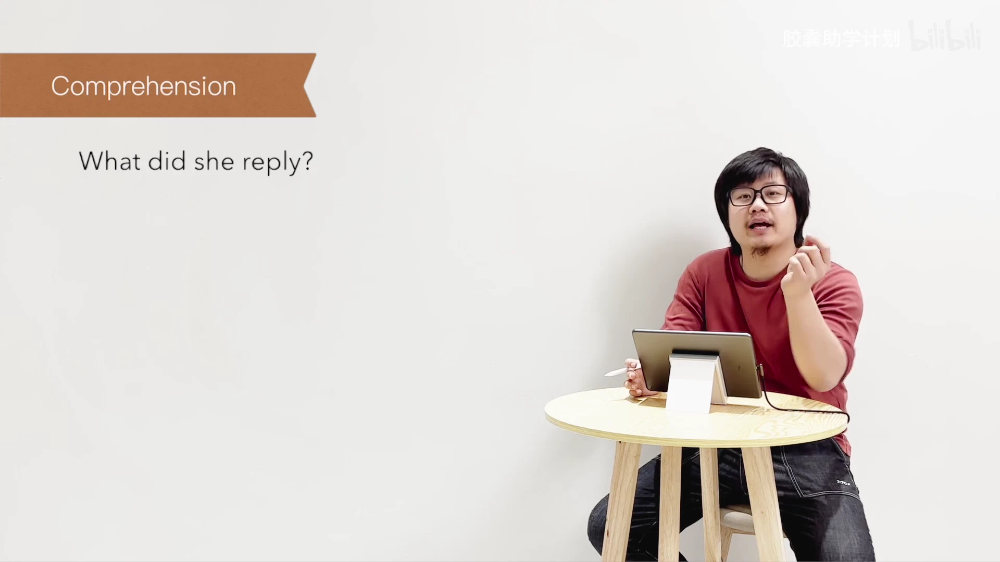

文字识别：Comprehension / What did she reply?

### 画面 00:01:58

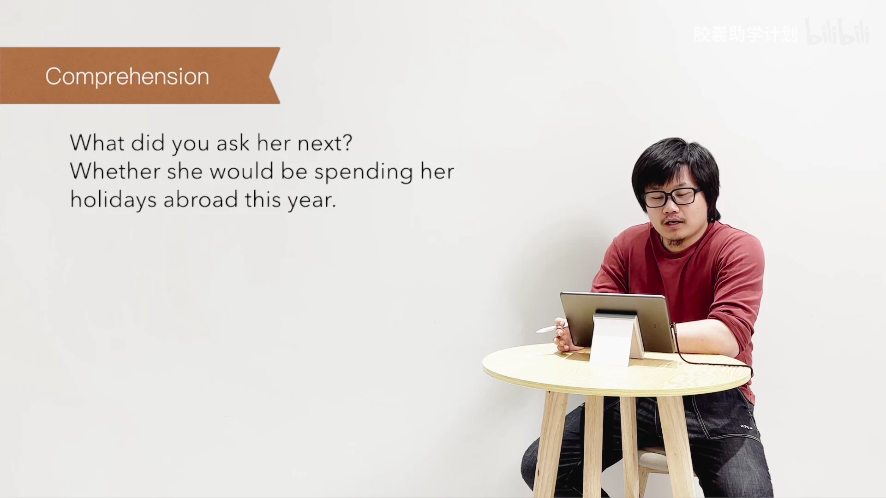

文字识别：Comprehension / What did you ask her next? / Whether she would be spending her / holidays abroad this year.

## 00:02:00–00:02:30

be spending her holiday abroad this year?好，asking questions啊，我们练习的是会说一般疑问句和特殊疑问句的能力啊。OK，好，呃，先来一个例子，比如说Ask me if I went to a dinner party last week. Did提前动词换原形，问对last week提问，直接替代就行了，对吧？OK，呃，还是啊老习惯，到这里我只提思路，您自己回

### 画面 00:02:04

文字识别：Asking questions / 训练目标： / 会说一般疑问句＆特殊疑问句 / Accuracy / Fluency

### 画面 00:02:09

文字识别：Asking questions / 训练目标： / 会说一般疑问句＆特殊疑问句 / Accuracy / Fluency

### 画面 00:02:13

文字识别：Asking questions

### 画面 00:02:16

文字识别：Asking questions / T: Ask me if I went to a dinner party last week.

### 画面 00:02:21

文字识别：Asking questions / T: Ask me if I went to a dinner party last week. / S: Did you go to a dinner party last week? / T: When...?

### 画面 00:02:25

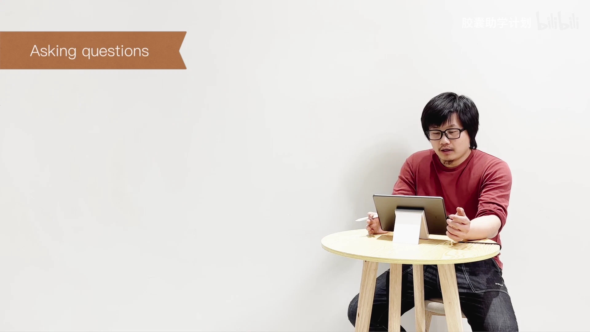

文字识别：Asking questions

## 00:02:30–00:03:00

去要写下来，然后大声朗读。Where肯定是对dinner party，Who直接对主语提问，直接提代啊。The hostess asked me to sit next to a large and smiling lady.好，Did提前对吧？然后Where对，呃，next to a large smiling lady对吧？Her name was Mrs. Rumble. Was提前，What对Mrs. Rumble对吧？What was her name啊？很简单，说She was

### 画面 00:02:36

文字识别：Asking questions / 1.I went to a dinner party last week. (When) / (Where)(Who) / 2. The hostess asked me to sit next to a large, / unsmiling lady. (Where)

### 画面 00:02:57

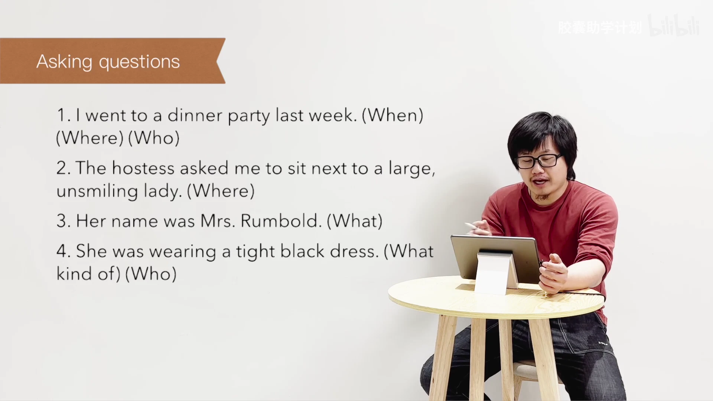

文字识别：Asking questions / 1.I went to a dinner party last week. (When) / (Where)(Who) / 2. The hostess asked me to sit next to a large, / unsmiling lady. (Where) / 3. Her name was Mrs. Rumbold. (What) / 4. She was wearing a tight black dress. (What / kind of) (Who)

## 00:03:00–00:03:30

wearing. 好，注意过去进行时 was 提前，对吧？ What kind of？ 注意对的是 a black a tied black 提问，所以它的答案一定要带着 dress 一起提到前面去。也就是说，它的答案是 What kind of dress was she wearing？ Okay？ 那 who 是对 she 提问，对吧？不多说啊。第五个被动 were 往前一提， What 对 her plate 提问就行了，对吧？第六题

### 画面 00:03:27

文字识别：Asking questions / 1.I went to a dinner party last week. (When) / (Where)(Who) / 2.The hostess asked me to sit next to a large, / unsmiling lady. (Where) / 3. Her name was Mrs. Rumbold. (What) / 4. She was wearing a tight black dress. (What / kind of) (Who) / 5. Her eyes were fixed on her plate. (What)

### 画面 00:03:29

文字识别：Asking questions / 6. She was busy eating in a short time.(How / soon)(Who)

## 00:03:30–00:04:00

She was busy eating in a short time. Was往前一提，How soon对in a short time，Who对she提问。I tried to make conversation. Did提前，What就What呃，基本上可以这样理解，叫What did you try to do？啊，我建议是这个答案，好吧？啊，I told her about a new play. Did提前，那What对这里是对a new play提问，所以叫做What did you tell her

### 画面 00:03:50

文字识别：Asking questions / 6. She was busy eating in a short time.(How / soon)(Who) / 7.I tried to make conversation.(What) / 8.I told her about a new play. (What)

## 00:04:00–00:04:30

about? Okay,下一个, it was coming to the globe. Was往前一提, where其实是对the globe提问,对吧? Okay, it would start soon. Would往前一提, when对soon提问啊? When would it start? Another one.呃, tell the story.老习惯,这我们要练习的是我们的口语复述能力啊。呃,可以有一点点不准确,但不能太慢,太慢就

### 画面 00:04:09

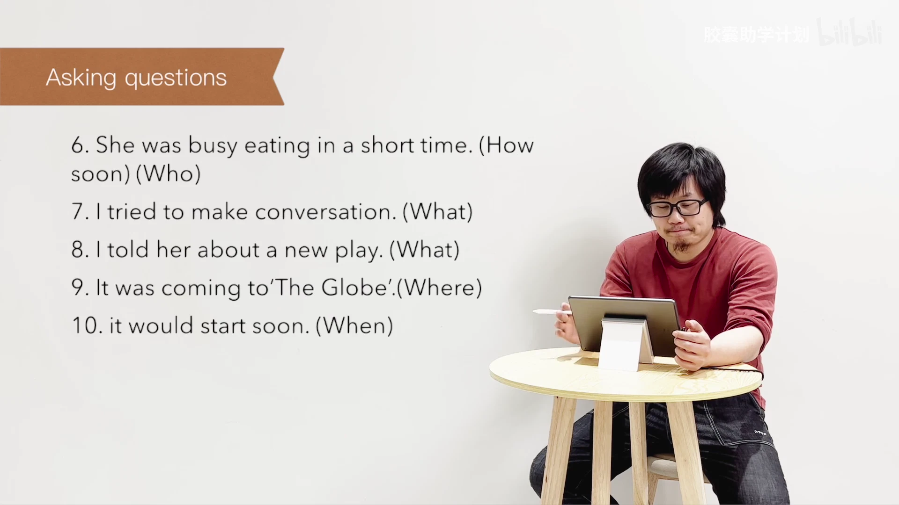

文字识别：Asking questions / 6. She was busy eating in a short time.(How / soon)(Who) / 7.I tried to make conversation.(What) / 8.I told her about a new play. (What) / 9. It was coming to'The Globe'(Where) / 10. it would start soon. (When)

### 画面 00:04:17

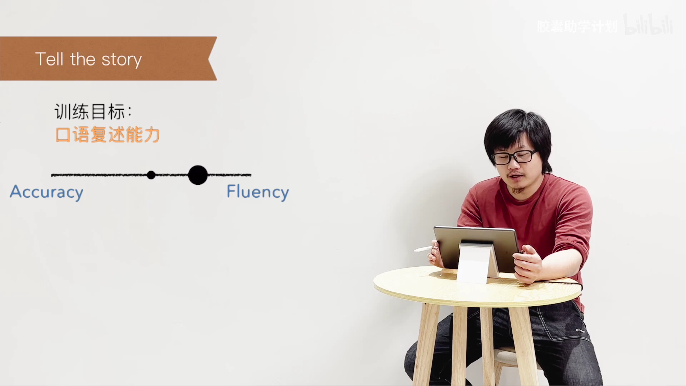

文字识别：Tell the story / 训练目标： / 口语复述能力 / Accuracy / Fluency

## 00:04:30–00:05:00

不叫复述了，对吧？OK，呃，这里是关键词啊啊，last week什么，I went to dinner party啊，等等等等，您自己用看着这些关键词把文章复述出来。好，呃，summary writing这道写作在文章的下面有这样一道题，各位写完了之后来这里对答案就好了，好吧？呃，topic for discussion，这是我们最终所有练习的目的。那很抱歉，我们现在还没有这个实力去做，但我们可以提前

### 画面 00:04:31

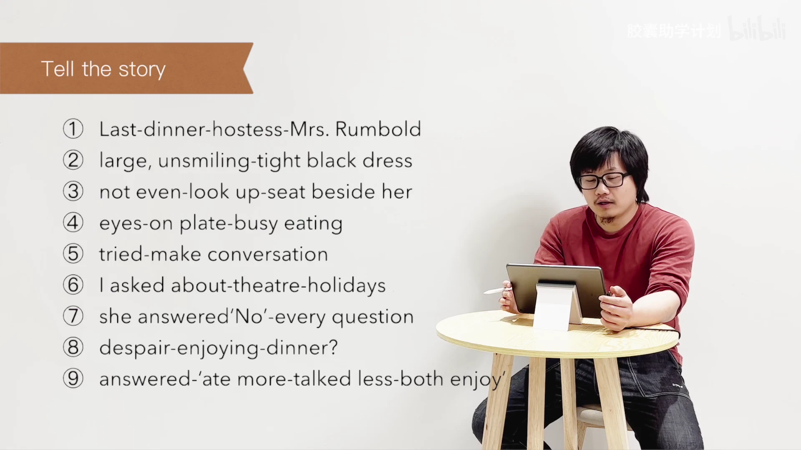

文字识别：Tell the story / 1 / ) Last-dinner-hostess-Mrs. Rumbold / large, unsmiling-tight black dress / not even-look up-seat beside her / eyes-on plate-busy eating / tried-make conversation / I asked about-theatre-holidays / she answered'No'-every question / despair-enjoying-dinner? / answered-'ate more-talked less-both enjoy' / 9

### 画面 00:04:35

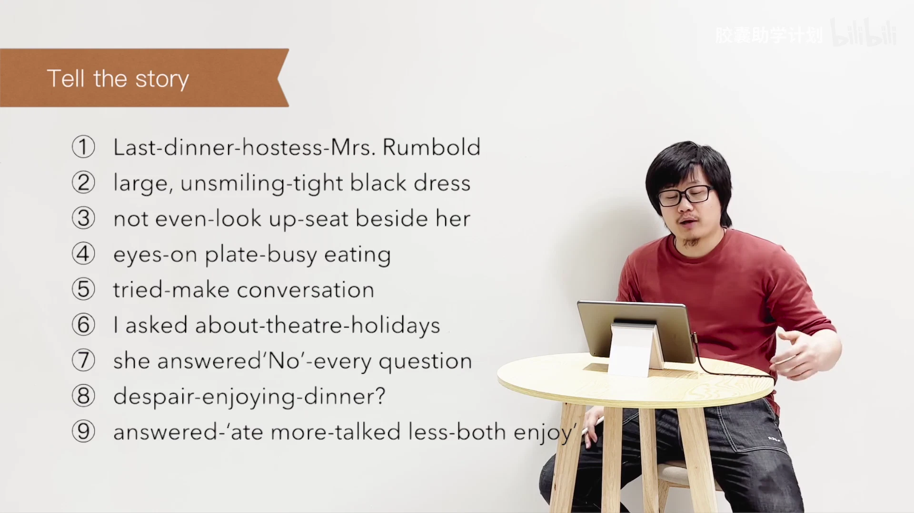

文字识别：Tell the story / ① / ) Last-dinner-hostess-Mrs. Rumbold / large, unsmiling-tight black dress / 2 / not even-look up-seat beside her / eyes-on plate-busy eating / tried-make conversation / I asked about-theatre-holidays / she answered'No'-every question / despair-enjoying-dinner? / answered-'ate more-talked less-both enjoy' / 9

### 画面 00:04:42

文字识别：Summary writing: Key / 训练目标： / 写作复述能力

### 画面 00:04:45

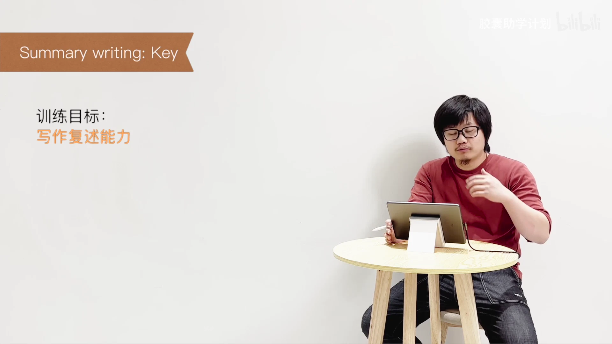

文字识别：Summary writing: Key / 训练目标： / 写作复述能力

### 画面 00:04:48

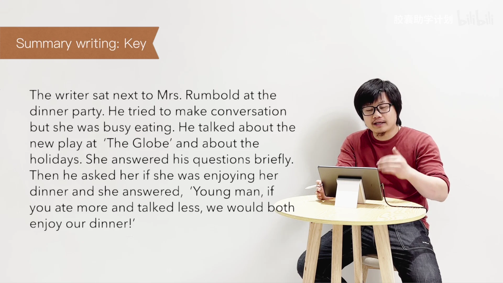

文字识别：Summary writing: Key / The writer sat next to Mrs. Rumbold at the / dinner party. He tried to make conversation / but she was busy eating. He talked about the / new play at 'The Globe' and about the / holidays. She answered his questions briefly. / Then he asked her if she was enjoying her / dinner and she answered, 'Young man, if / you ate more and talked less, we would both / enjoy our dinner!'

### 画面 00:04:51

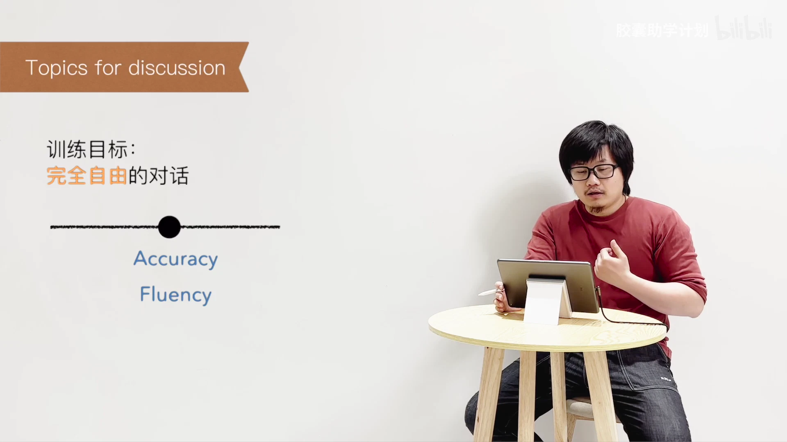

文字识别：Topics for discussion / 训练目标： / 完全自由的对话 / Accuracy / Fluency

### 画面 00:04:54

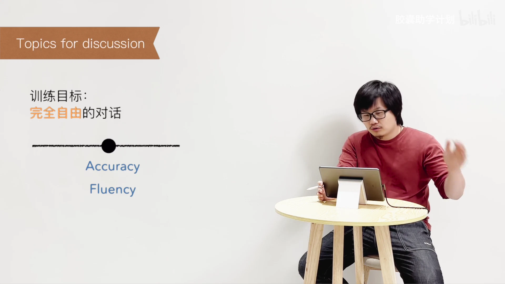

文字识别：Topics for discussion / 训练目标： / 完全自由的对话 / Accuracy / Fluency

### 画面 00:04:56

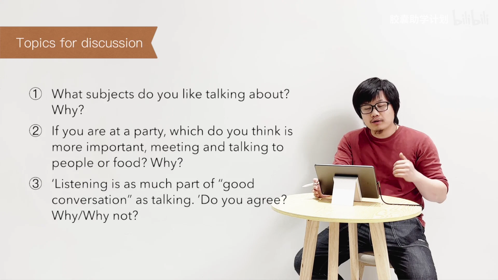

文字识别：Topics for discussion / What subjects do you like talking about? / Why? / If you are at a party, which do you think is / more important, meeting and talking to / people or food? Why? / 'Listening is as much part of 'good / conversation" as talking.'Do you agree? / Why/Why not?

### 画面 00:04:58

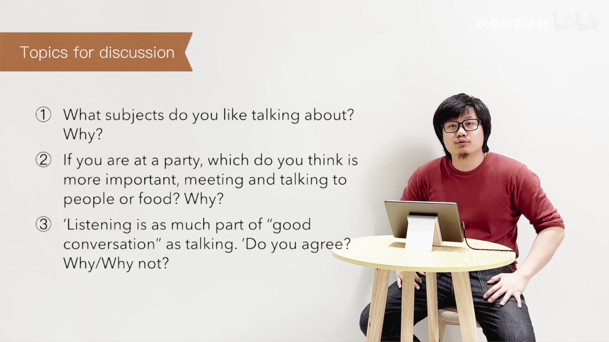

文字识别：Topics for discussion / What subjects do you like talking about? / Why? / If you are at a party, which do you think is / more important, meeting and talking to / people or food? Why? / 'Listening is as much part of 'good / conversation"as talking.'Do you agree? / Why/Why not?

## 00:05:00–00:05:30

了解这些话题。比如说，第一个，What subjects do you like talking about? Why?你喜欢谈论什么样的话题？为什么？第二，If you are at a party, which do you think is more important, meeting and talking to people or food? Why?说如果你在一个聚会上，你觉得什么更重要？是说和人聊聊天、见见面更重要，还是食物更重要？为什么？啊，这肯定是因人而异了。Listening

### 画面 00:05:00

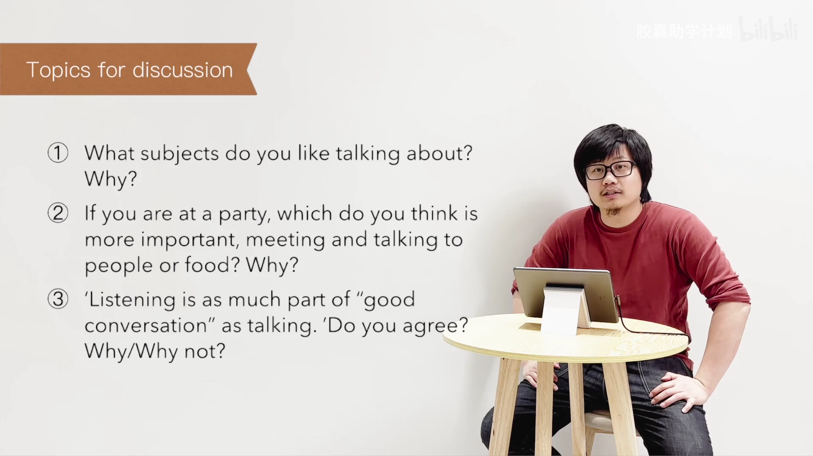

文字识别：Topics for discussion / What subjects do you like talking about? / Why? / If you are at a party, which do you think is / more important, meeting and talking to / people or food? Why? / 'Listening is as much part of 'good / conversation"as talking.'Do you agree? / Why/Why not?

### 画面 00:05:17

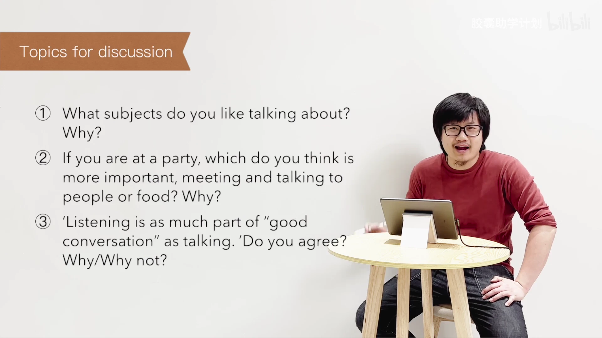

文字识别：Topics for discussion / What subjects do you like talking about? / Why? / If you are at a party, which do you think is / more important, meeting and talking to / people or food? Why? / 'Listening is as much part of 'good / conversation"as talking.'Do you agree? / Why/Why not?

### 画面 00:05:19

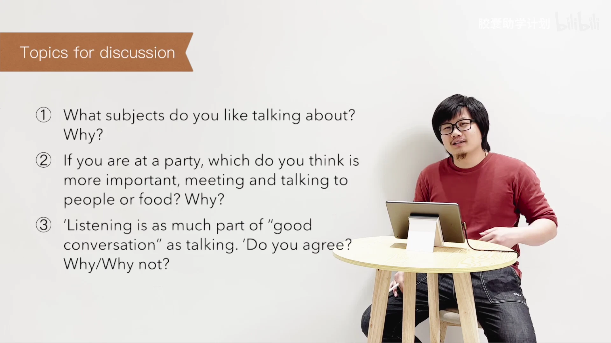

文字识别：Topics for discussion / What subjects do you like talking about? / Why? / If you are at a party, which do you think is / more important, meeting and talking to / people or food? Why? / 'Listening is as much part of 'good / conversation”as talking.'Do you agree? / Why/Why not?

### 画面 00:05:23

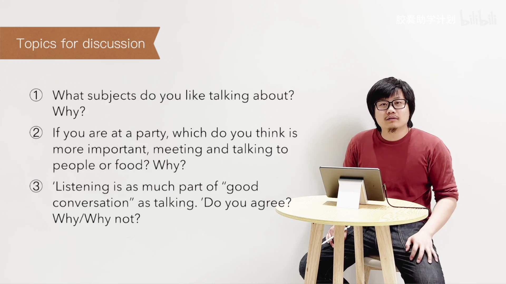

文字识别：Topics for discussion / What subjects do you like talking about? / Why? / If you are at a party, which do you think is / more important, meeting and talking to / people or food? Why? / 'Listening is as much part of 'good / conversation”as talking.'Do you agree? / Why/Why not?

### 画面 00:05:25

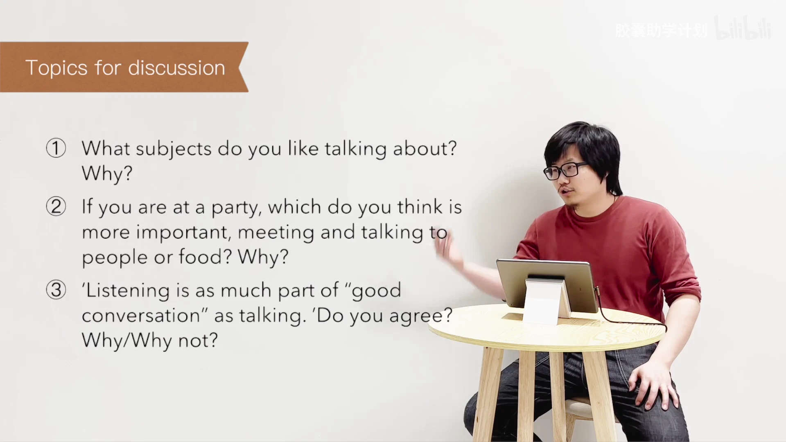

文字识别：Topics for discussion / What subjects do you like talking about? / Why? / If you are at a party, which do you think is / more important, meeting and talking to / people or food? Why? / 'Listening is as much part of 'good / conversation" as talking.'Do you agree? / Why/Why not?

### 画面 00:05:29

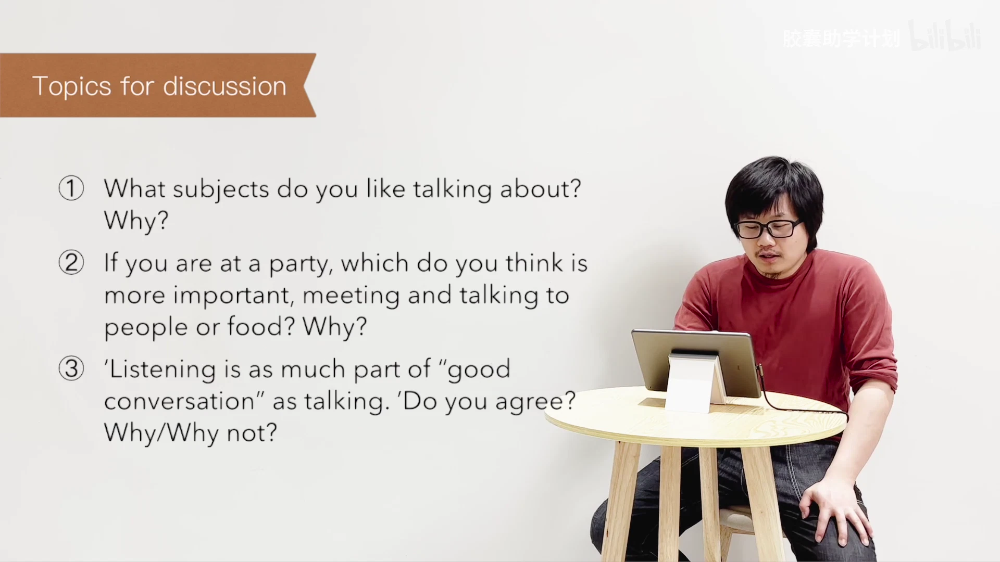

文字识别：Topics for discussion / What subjects do you like talking about? / Why? / If you are at a party, which do you think is / more important, meeting and talking to / people or food? Why? / 'Listening is as much part of 'good / conversation"as talking.'Do you agree? / Why/Why not?

## 00:05:30–00:06:00

is as much part of good conversation as talking. 他说听啊，在对话当中和说同样的重要。Do you agree? 你同意吗？Why? Why not? 同意吗？同意为什么同意？不同意为什么不同意？OK，好。那家庭作业我们看一下。Ask me if老习惯先写大声朗读。摘要写作先写来这里对答案。Tell the story口语复述专栏当中找得到。那以上呢就是

### 画面 00:05:35

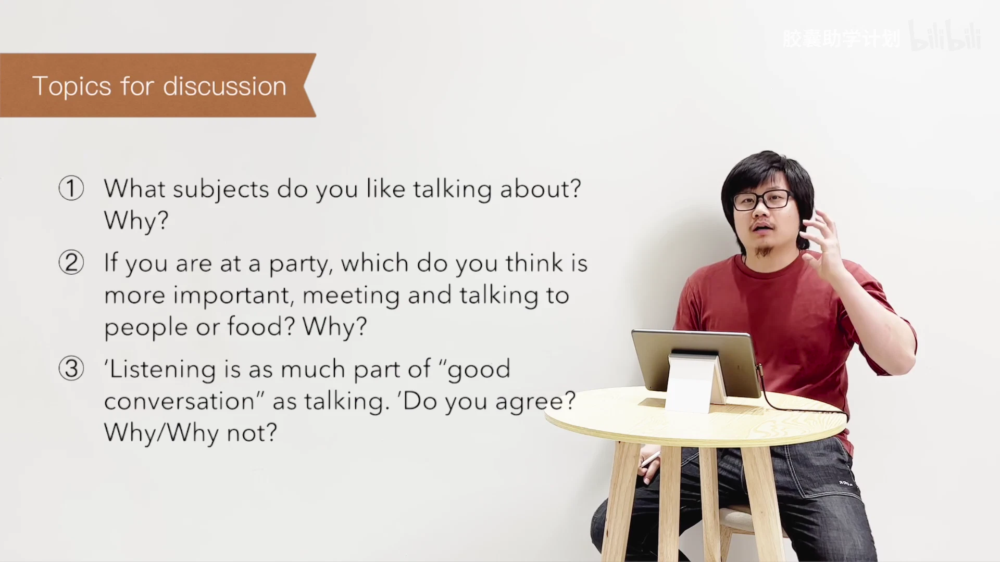

文字识别：Topics for discussion / What subjects do you like talking about? / Why? / If you are at a party, which do you think is / more important, meeting and talking to / people or food? Why? / 'Listening is as much part of 'good / conversation" as talking.'Do you agree? / Why/Why not?

### 画面 00:05:38

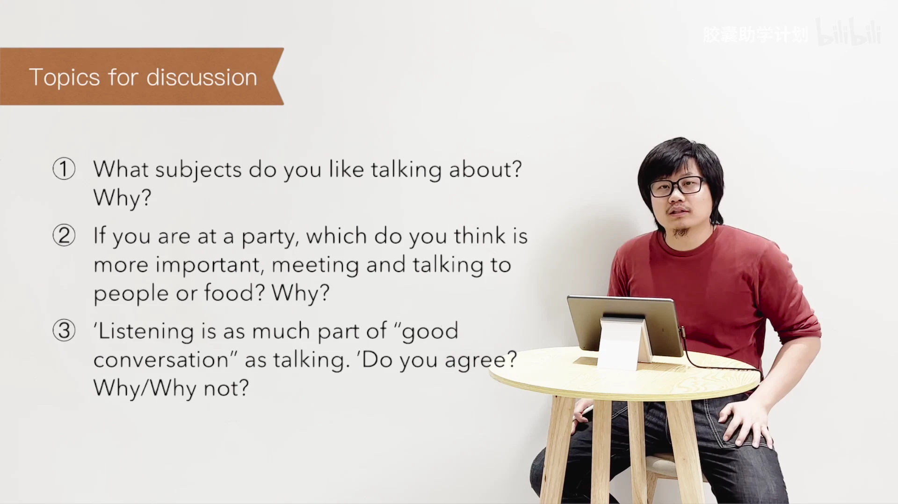

文字识别：Topics for discussion / What subjects do you like talking about? / Why? / If you are at a party, which do you think is / more important, meeting and talking to / people or food? Why? / 'Listening is as much part of 'good / conversation"as talking.'Do you agree? / Why/Why not?

### 画面 00:05:40

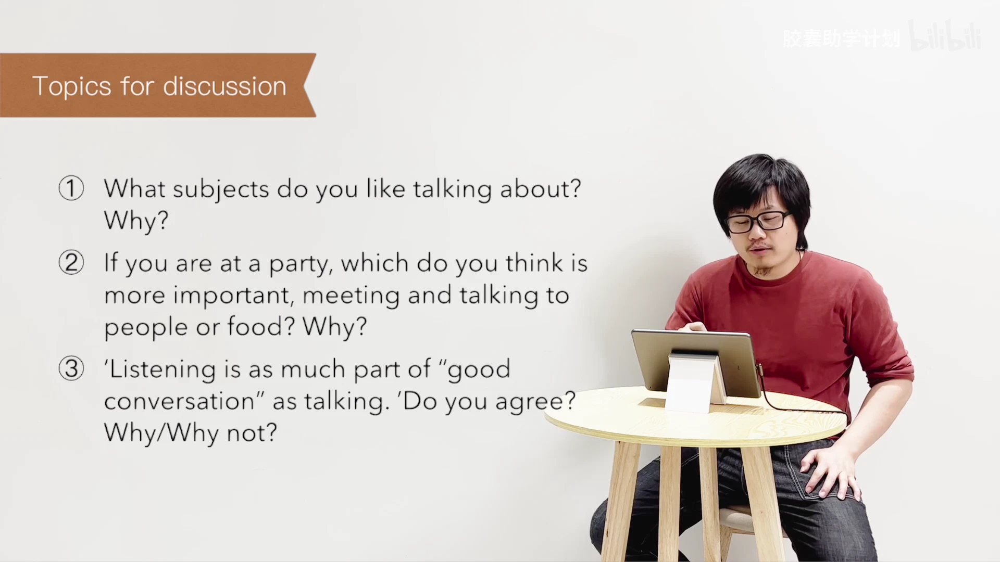

文字识别：Topics for discussion / What subjects do you like talking about? / Why? / If you are at a party, which do you think is / more important, meeting and talking to / people or food? Why? / 'Listening is as much part of 'good / conversation"as talking.'Do you agree? / Why/Why not?

### 画面 00:05:47

文字识别：UN

### 画面 00:05:49

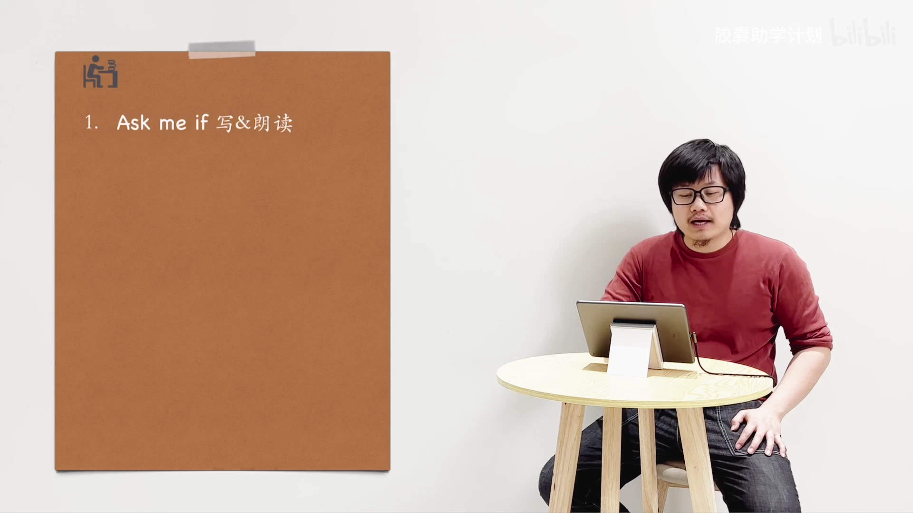

文字识别：1.Ask me if写&朗读

### 画面 00:05:51

文字识别：1.Ask me if写&朗读 / UN

### 画面 00:05:53

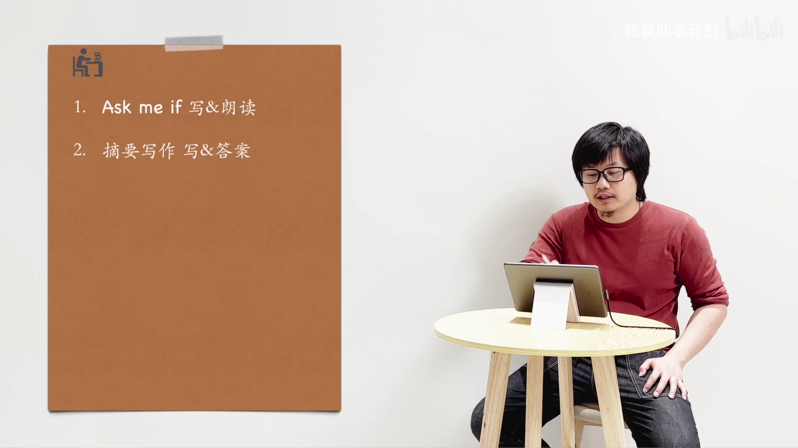

文字识别：1.Ask me if写&朗读 / 2. / 摘要写作写&答案

### 画面 00:05:55

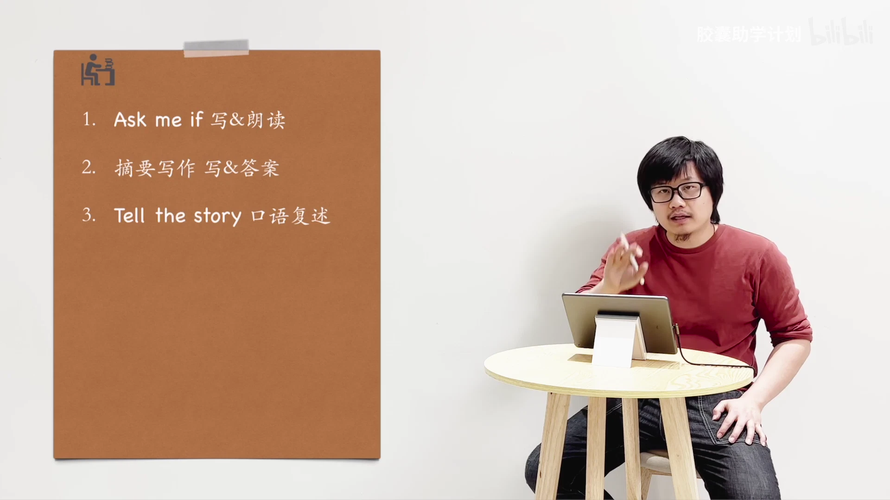

文字识别：1.Askme if写&朗读 / 摘要写作写&答案 / 3.Tell the story 口语复述

### 画面 00:05:57

文字识别：1.Ask me if写&朗读 / 摘要写作写&答案 / 3.Tell the story 口语复述 / 专栏 / 4.

### 画面 00:05:59

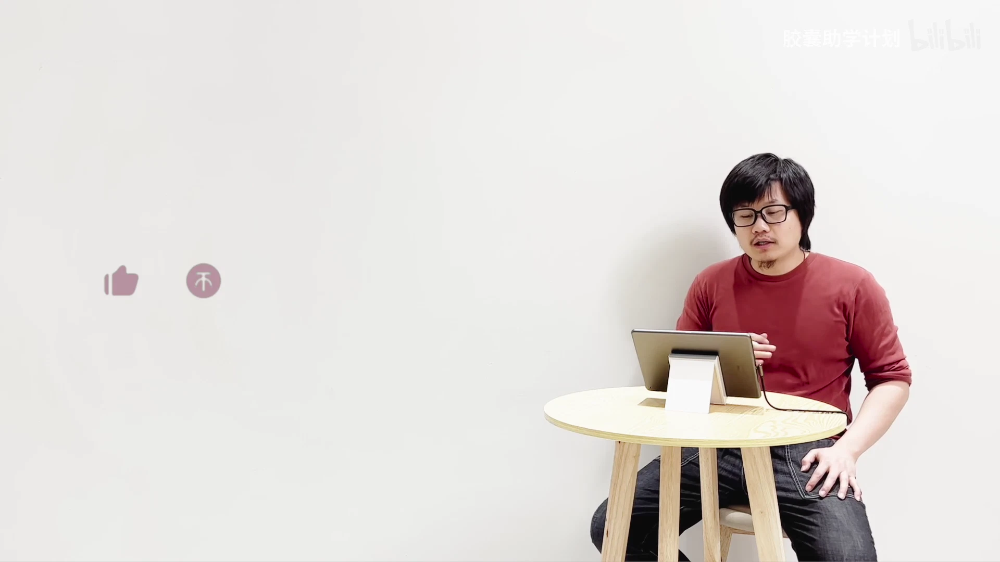

## 00:06:00–00:06:23

本期视频的全部内容了。如果各位喜欢我们的课程呢，欢迎各位关注、订阅、一键三连，分享给那些需要的朋友，来帮助我们快速成长。See you next time.

### 画面 00:06:01

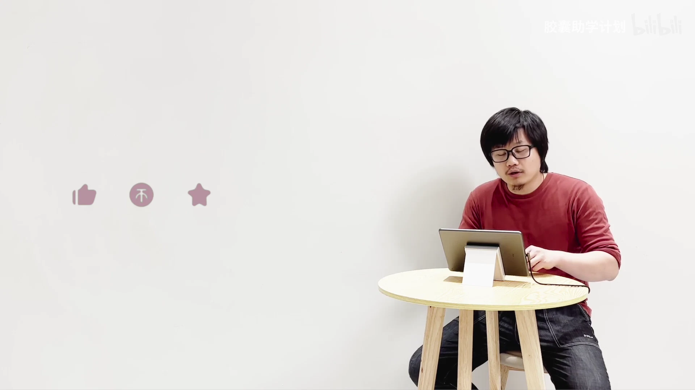

文字识别：餐

### 画面 00:06:04

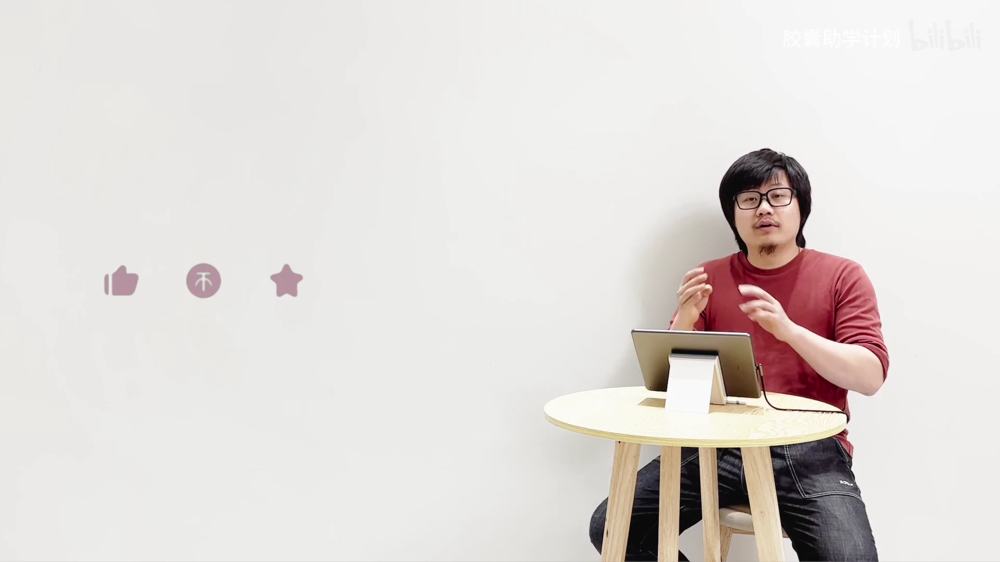

文字识别：￥

### 画面 00:06:11

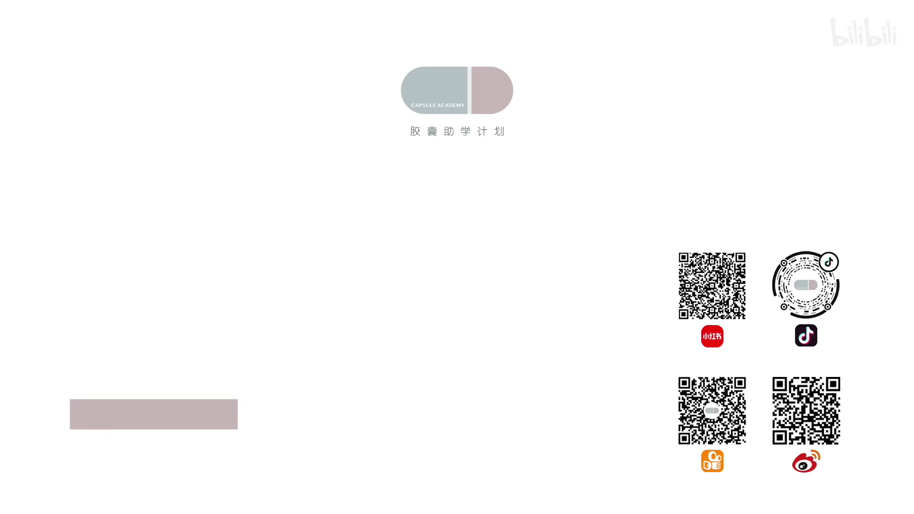

文字识别：CAPSULEACADEMY / 胶囊助学计划 / 小红书

### 画面 00:06:13

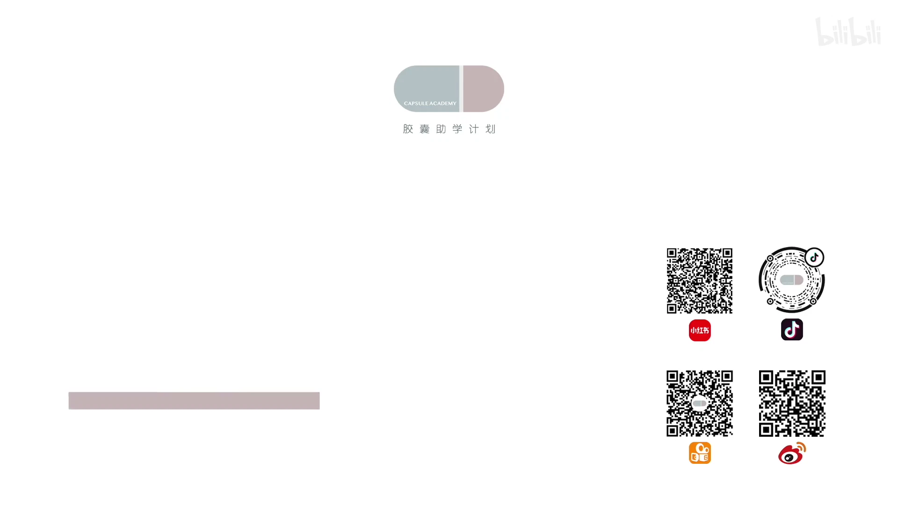

文字识别：CAPSULEACADEMY / 胶囊助学计划 / 小红书 / OE

### 画面 00:06:19

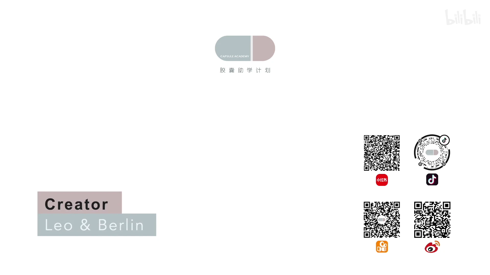

文字识别：CAPSULEACADEMY / 胶囊助学计划 / 小红书 / Creator / Leo & Berlin / OE

### 画面 00:06:21

文字识别：bilibili / 胶囊助学计划

### 画面 00:06:22

文字识别：bilibili / 胶囊助学计划

