# L041 单词

快速机器解析：语音为单模型转写，未进行独立交叉校对或人工复核；画面每秒采样并按变化选帧，短时文字和标记可能遗漏。截图时间约有 1 秒误差。图片有损压缩；遇到疑点请按时间查看 Google Drive 原视频。

## 00:00:00–00:00:30

Hello, everyone. Welcome to Capsule Academy. This is Leo. Today we're going to learn New Concept English Book Two, Lesson Forty One, Words. Okay, hope you guys enjoy it.那我们先看第一个单词啊，跟我一起读一下，看着音标，合起来读起来叫做 rude, rude. Okay, very good.那这个单词其实我们在第一课咱们就见过了，只不过第一课我们见的它是副词，叫 rudely，对吧？

### 画面 00:00:00

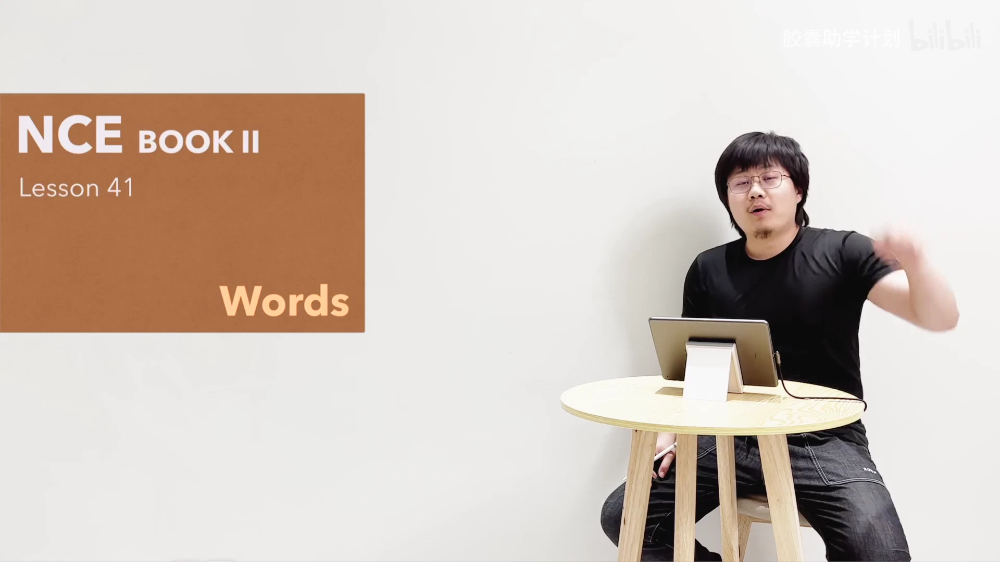

文字识别：NCE / BOOKⅡI / Lesson 41 / Words

### 画面 00:00:02

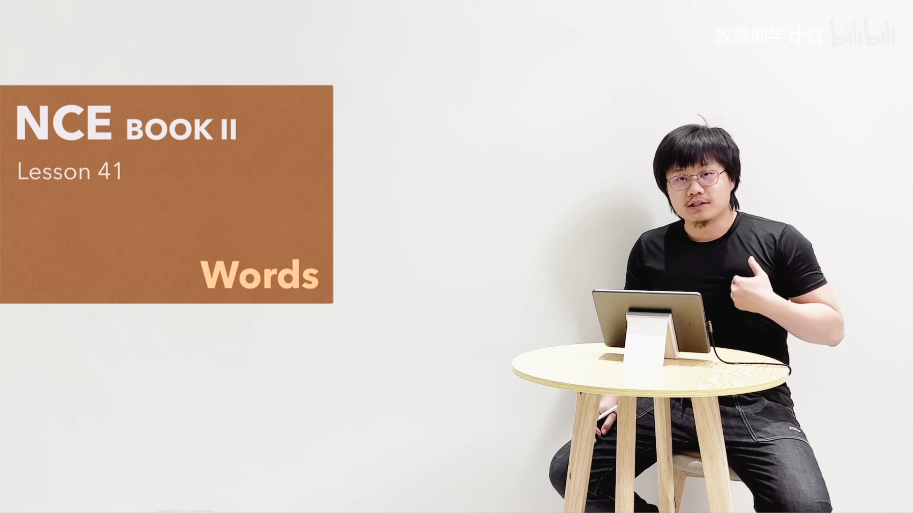

文字识别：NCE / BOOK"I / Lesson 41 / Words

### 画面 00:00:10

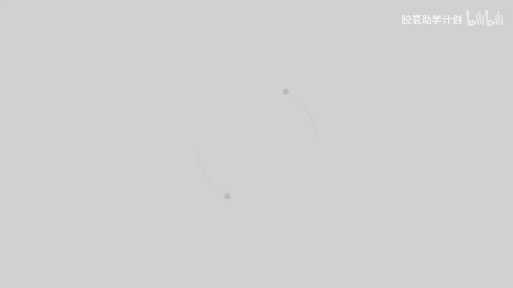

文字识别：胶囊助学计划bill

### 画面 00:00:14

### 画面 00:00:16

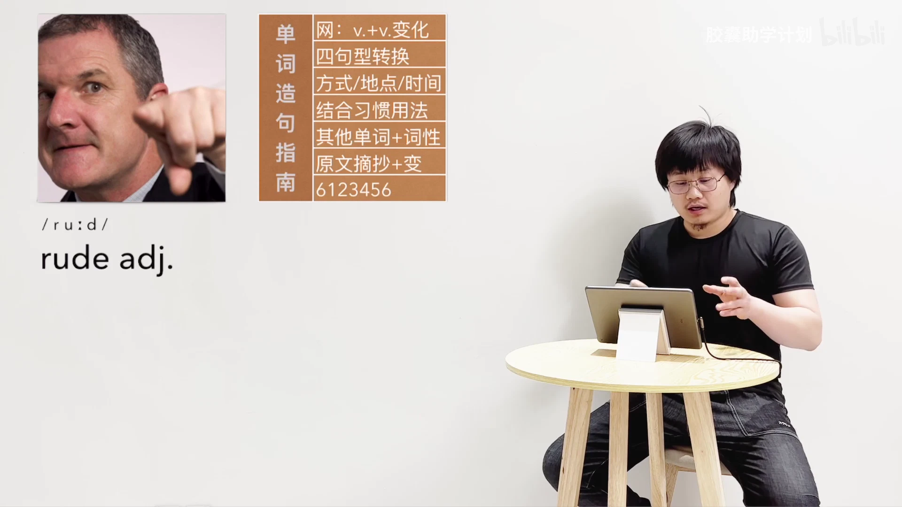

文字识别：单词造句指南 / 网：v.+v.变化 / 四句型转换 / 方式/地点/时间 / 结合习惯用法 / 其他单词+词性 / 原文摘抄+变 / 6123456 / /ru:d/ / rude adj.

### 画面 00:00:20

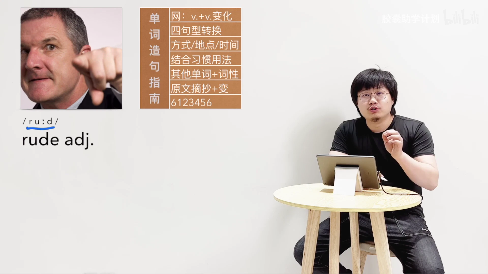

文字识别：单词造句指南 / 网：v.+v.变化 / 四句型转换 / 方式/地点/时间 / 结合习惯用法 / 其他单词+词性 / 原文摘抄+变 / 6123456 / /ru:d/ / rude adj.

## 00:00:30–00:01:00

非常粗鲁的。然后呢，现在见的是形容词，叫做 rude，啊，粗鲁的，对吧？OK，呃，它是一个形容词。那你想，我们形容词去单词造句的时候，我们由词性就可以给它加个名词，然后再想个动词，对吧？就是形容词往往是附着于名词的上面的。OK，比如说 the hostess who we met last night was very rude。你看啊，the hostess was very rude。

### 画面 00:00:30

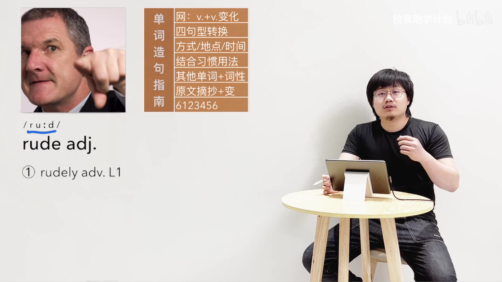

文字识别：单词造句指南 / 网：v.+v.变化 / 四句型转换 / 方式/地点/时间 / 结合习惯用法 / 其他单词+词性 / 原文摘抄+变 / 6123456 / /ru:d/ / rude adj. / D rudely adv. L1

### 画面 00:00:42

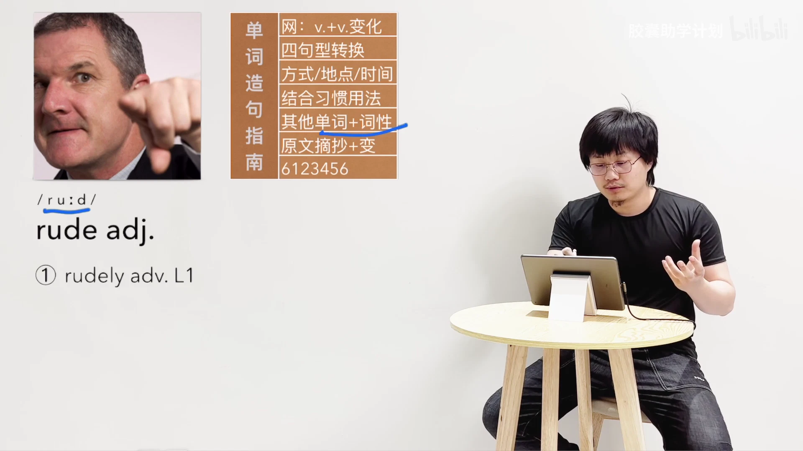

文字识别：单词造句指南 / 网：v.+v.变化 / 四句型转换 / 方式/地点/时间 / 结合习惯用法 / 其他单词+词性 / 原文摘抄+变 / 6123456 / /ru:d/ / rude adj. / ①rudely adv. L1

### 画面 00:00:44

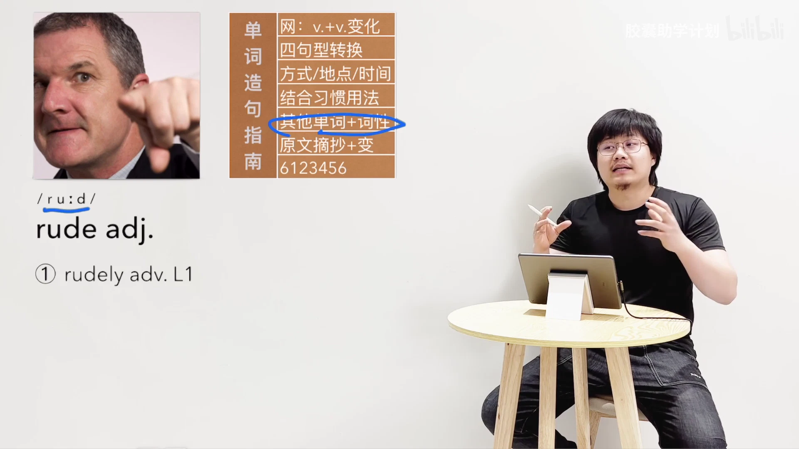

文字识别：单词造句指南 / 网：v.+v.变化 / 四句型转换 / 方式/地点/时间 / 结合习惯用法 / 其他单词+词性 / 原文摘抄+变 / 6123456 / /ru:d/ / rude adj. / ① rudely adv. L1

### 画面 00:00:50

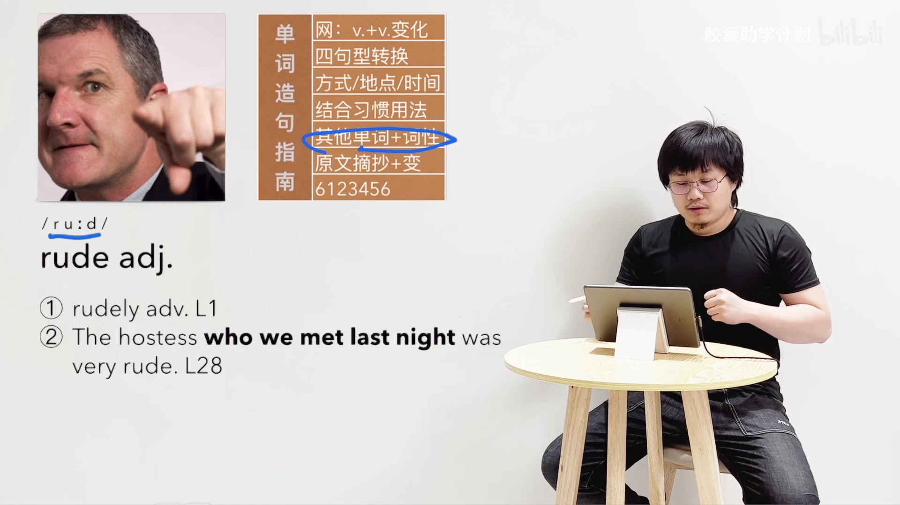

文字识别：单词造句指南 / 网：v.+v.变化 / 四句型转换 / 方式/地点/时间 / 结合习惯用法 / 其他单词+词性 / 原文摘抄+变 / 6123456 / /ru:d/ / rude adj. / rudely adv. L1 / The hostess who we met last night was / very rude. L28

## 00:01:00–00:01:30

其实这句话对于各位来说，它的语法难度就是新概念一册前二十课的语法，只不过我们把 is 换成了 was，对吧？然后中间为了修饰这个 hostess，又加了一个小的二十八课咱们学过的定语从句，叫做昨晚我们见到的那个女主人当时特别的粗鲁，对不对啊？但本质上就是 the hostess is very rude，是吧？前二十课咱们就学过了，新概

### 画面 00:01:03

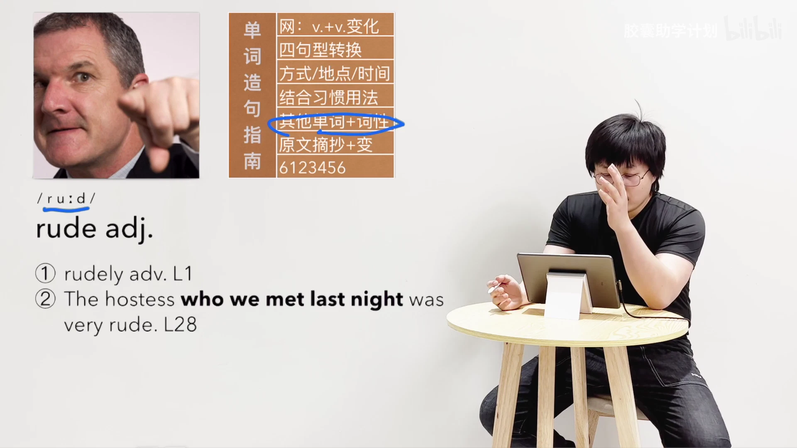

文字识别：单词造句指南 / 网：v.+v.变化 / 四句型转换 / 方式/地点/时间 / 结合习惯用法 / 其他单词+词性 / 原文摘抄+变 / 6123456 / /ru:d/ / rude adj. / rudely adv. L1 / The hostess who we met last night was / very rude. L28

### 画面 00:01:13

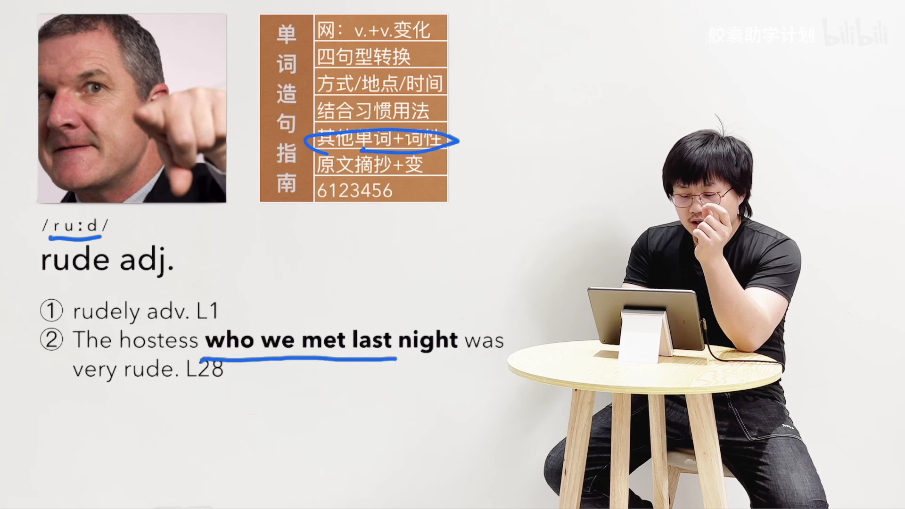

文字识别：单词造句指南 / 网：v.+v.变化 / 四句型转换 / 方式/地点/时间 / 结合习惯用法 / 其他单词+词性 / 原文摘抄+变 / 6123456 / /ru:d/ / rude adj. / rudely adv. L1 / The hostess who we met last night was / very rude. L28

### 画面 00:01:15

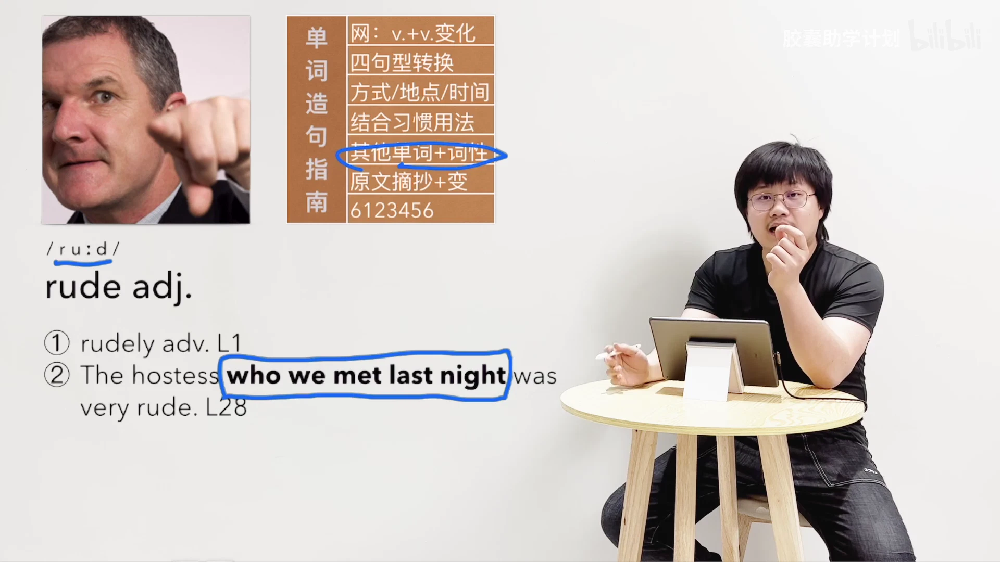

文字识别：单词造句指南 / 网：v.+v.变化 / 四句型转换 / 方式/地点/时间 / 结合习惯用法 / 其他单词+词性 / 原文摘抄+变 / 6123456 / /ru:d/ / rude adj. / rudely adv. L1 / The hostess / who we met last night / was / very rude. L28

### 画面 00:01:23

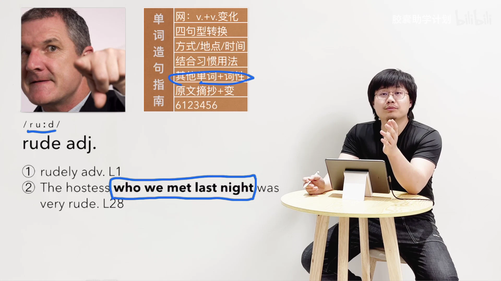

文字识别：单词造句指南 / 网：v.+v.变化 / 四句型转换 / 方式/地点/时间 / 结合习惯用法 / 其他单词+词性 / 原文摘抄+变 / 6123456 / /ru:d/ / rude adj. / rudely adv. L1 / The hostess / who we met last night / was / very rude. L28

## 00:01:30–00:02:00

念还是一册啊。OK，接下来呢，比如说我们四十课刚刚学过的虚拟语气，不知道各位还记不记得？我们如何判断呢？第一，对吧？啊，第一啊，were，然后if引导，然后were，哎，一个圈两个这个下划线，就告诉各位它是定语从句了，对吧？这是基本啊，这它是这个虚拟语气了啊，这是它基本的结构。然后呢，它的含义叫与现在事实相反或发生情况几率极低，

### 画面 00:01:33

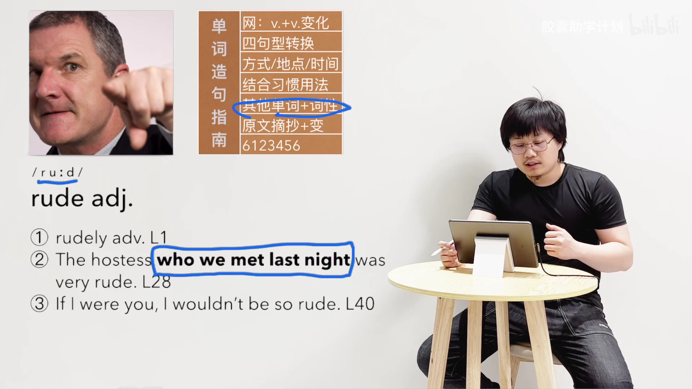

文字识别：单词造句指南 / 网：v.+v.变化 / 四句型转换 / 方式/地点/时间 / 结合习惯用法 / 其他单词+词性】 / 原文摘抄+变 / 6123456 / /ru:d/ / rude adj. / rudely adv. L1 / The hostess / who we met last night / was / very rude. L28 /  If I were you, I wouldn't be so rude. L40

### 画面 00:01:35

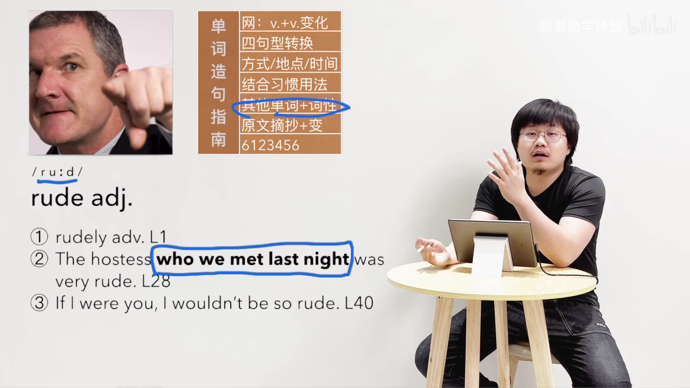

文字识别：单词造句指南 / 网：v.+v.变化 / 四句型转换 / 方式/地点/时间 / 结合习惯用法 / 其他单词+词性 / 原文摘抄+变 / 6123456 / /ru:d/ / rude adj. / rudely adv. L1 / The hostess / who we met last night / was / very rude. L28 / If I were you, I wouldn't be so rude. L40

### 画面 00:01:40

文字识别：单词造句指南 / 网：v.+v.变化 / 四句型转换 / 方式/地点/时间 / 结合习惯用法 / 其他单词+词性 / 原文摘抄+变 / 6123456 / /ru:d/ / rude adj. / rudely adv. L1 / The hostess / who we met last night / was / very rude. L28 / If I were you, I wouldn't be so rude. L40

### 画面 00:01:43

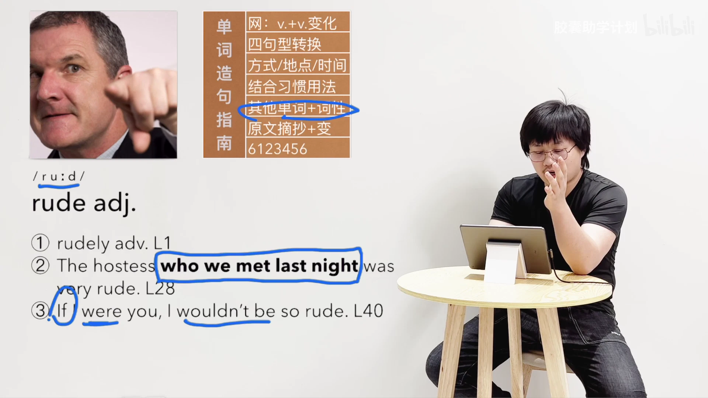

文字识别：单词造句指南 / 网：v.+v.变化 / 四句型转换 / 方式/地点/时间 / 结合习惯用法 / 其他单词+词性 / 原文摘抄+变 / 6123456 / /ru:d/ / rude adj. / rudely adv. L1 / The hostess / who we met last night / was / ry rude. L28 / were you, I wouldn't be so rude. L40

### 画面 00:01:45

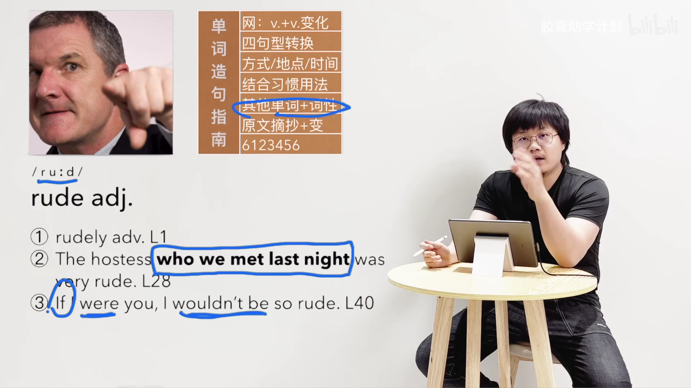

文字识别：单词造句指南 / 网：v.+v.变化 / 四句型转换 / 方式/地点/时间 / 结合习惯用法 / 其他单词+词性 / 原文摘抄+变 / 6123456 / /ru:d/ / rude adj. / rudely adv. L1 / The hostess / who we met last night / was / ry rude. L28 / were you, I wouldn't be so rude. L40

### 画面 00:01:52

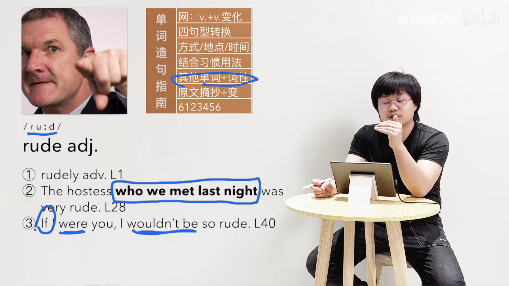

文字识别：单词造句指南 / 网：v.+v.变化 / 四句型转换 / 方式/地点/时间 / 结合习惯用法 / 其他单词+词性 / 原文摘抄+变 / 6123456 / /ru:d/ / rude adj. / rudely adv. L1 / The hostess / who we met last night / was / ry rude. L28 / were you, I wouldn't be so rude. L40

## 00:02:00–00:02:30

所以 if I were you，叫如果我是你，与现在事实情况相反。 I wouldn't be so rude，我就不会这样的粗鲁，对吧？ I wouldn't be so rude。 OK，再来一个，比如说三十五课我们学过叫 so 点点点 that so 后边加形容词，比如说 he is so rude that they 点点点，对吧？哎，他是如此的粗鲁，以至于他们不管是怎么样了，对吧？这是您自己尝试去补充一下，这是咱们的家

### 画面 00:02:00

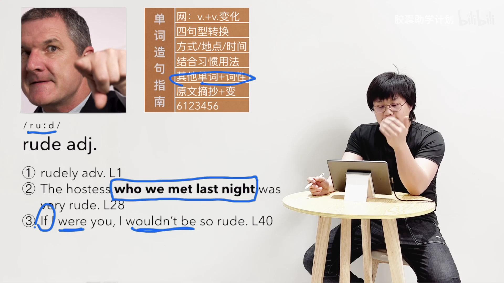

文字识别：单词造句指南 / 网：v.+v.变化 / 四句型转换 / 方式/地点/时间 / 结合习惯用法 / 真他单词+词性 / 原文摘抄+变 / 6123456 / /ru:d/ / rude adj. / rudely adv. L1 / The hostess / who we met last night / was / ry rude. L28 / were you, I wouldn't be so rude. L40

### 画面 00:02:08

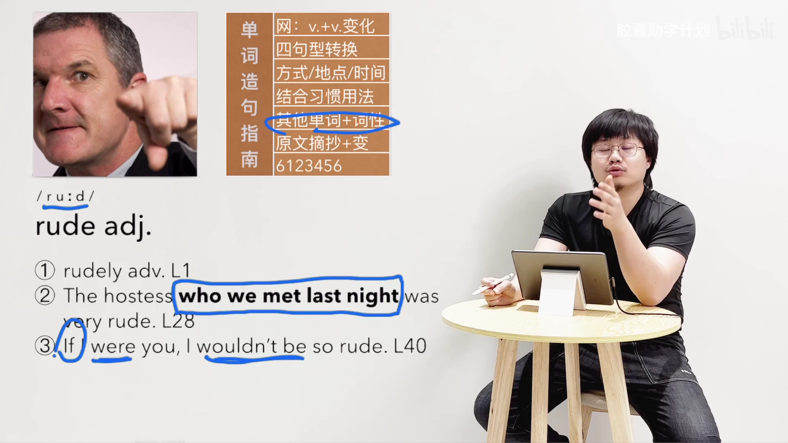

文字识别：单词造句指南 / 网：v.+v.变化 / 四句型转换 / 方式/地点/时间 / 结合习惯用法 / 其他单词+词性 / 原文摘抄+变 / 6123456 / /ru:d/ / rude adj. / rudely adv. L1 / The hostess / who we met last night / was / ry rude. L28 / were you, I wouldn't be so rude. L40

### 画面 00:02:15

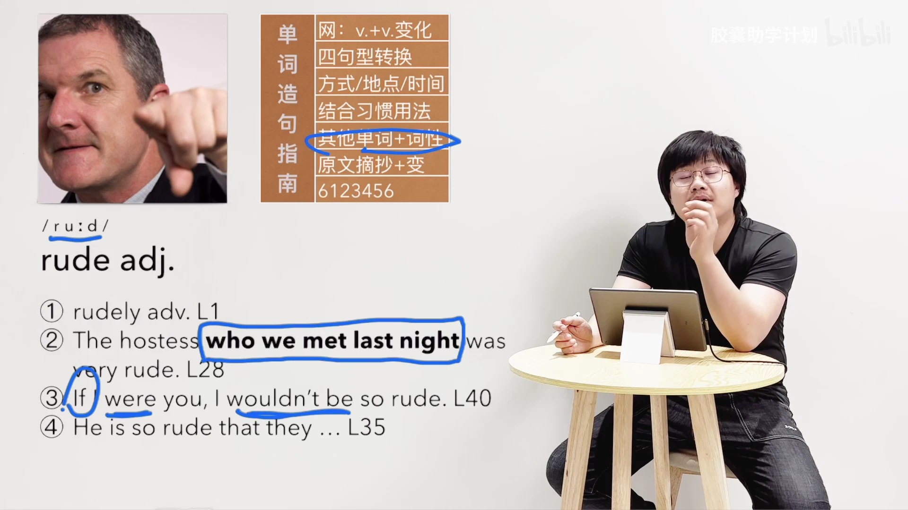

文字识别：单词造句指南 / 网：v.+v.变化 / 四句型转换 / 方式/地点/时间 / 结合习惯用法 / 其他单词+词性 / 原文摘抄+变 / 6123456 / /ru:d/ / rude adj. / rudely adv. L1 / The hostess / who we met last night / was / ry rude. L28 / were you, I wouldn't be so rude. L40 / 3 / He is so rude that they ... L35

### 画面 00:02:26

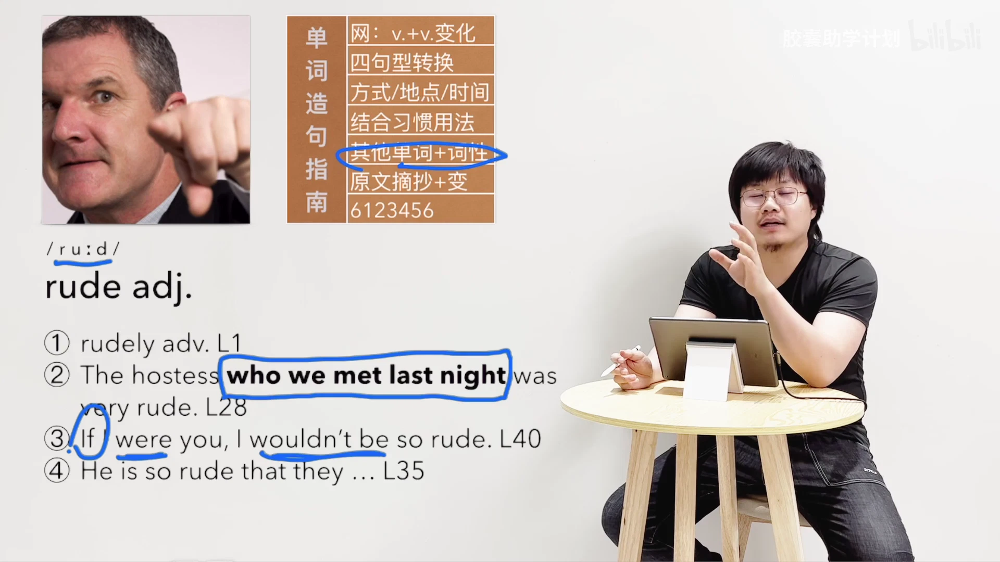

文字识别：单词造句指南 / 网：v.+v.变化 / 四句型转换 / 方式/地点/时间 / 结合习惯用法 / 其他单词+词性 / 原文摘抄+变 / 6123456 / /ru:d/ / rude adj. / rudely adv. L1 / The hostess / who we met last night / was / ry rude. L28 / were you, I wouldn't be so rude. L40 / He is so rude that they ... L35

## 00:02:30–00:03:00

庭作业啊。但是呢，我们利用这句话尝试去复习的是 so 形容词 that OK，玩一个。好，那下一个单词跟我们一起读一下，叫做 mirror mirror。 OK，玩一个。那这个单词呢，就是镜子的意思，对吧？呃，那它本质上是个名词。其实名词想去造句，你就想一下六一二三四五六最常见的，像这种名词镜子最常见的，要么主语，要么宾语，要么一，要么三，对吧？

### 画面 00:02:31

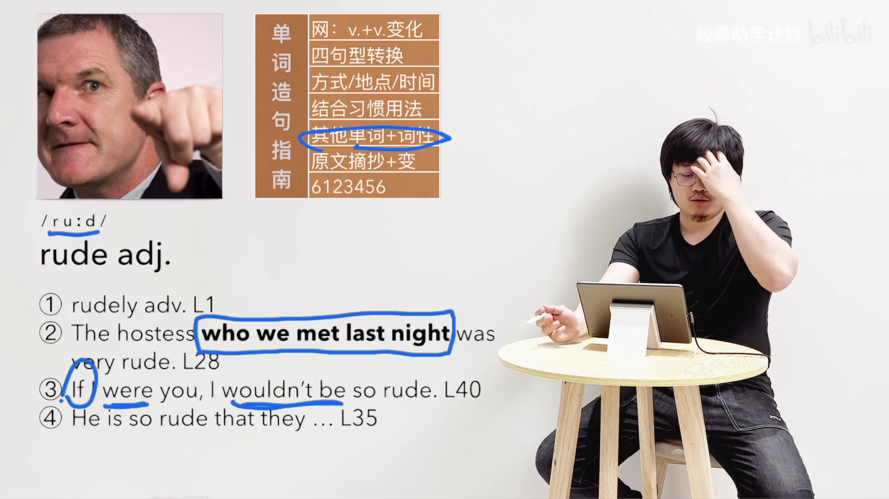

文字识别：单词造句指南 / 网：v.+v.变化 / 四句型转换 / 方式/地点/时间 / 结合习惯用法 / 其他单词+词性 / 原文摘抄+变 / 6123456 / /ru:d/ / rude adj. / rudely adv. L1 / The hostess / who we met last night / was / ry rude. L28 / were you, I wouldn't be so rude. L40 / He is so rude that they ... L35

### 画面 00:02:38

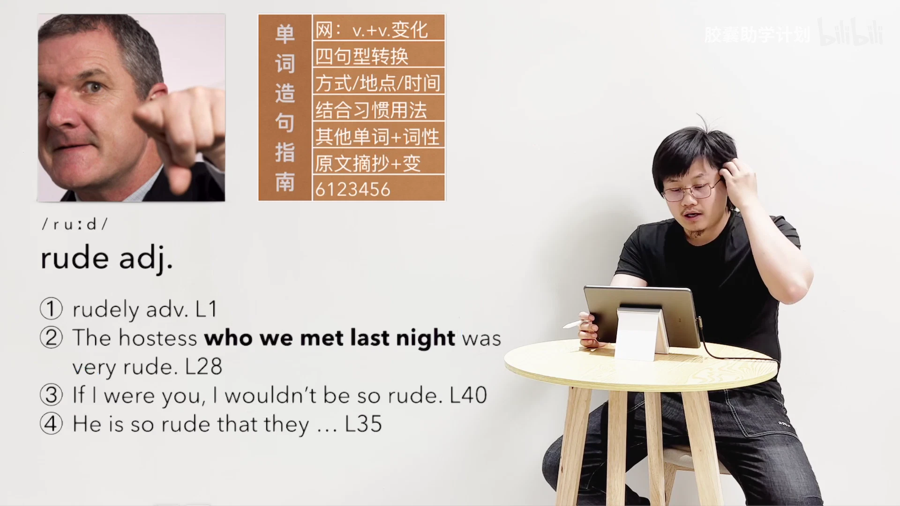

文字识别：单词造句指南 / 网：v.+v.变化 / 四句型转换 / 方式/地点/时间 / 结合习惯用法 / 其他单词+词性 / 原文摘抄+变 / 6123456 / /ru:d/ / rude adj. / ① rudely adv. L1 / The hostess who we met last night was / very rude. L28 / ) If I were you, I wouldn't be so rude. L40 / 人 / D He is so rude that they ... L35

### 画面 00:02:40

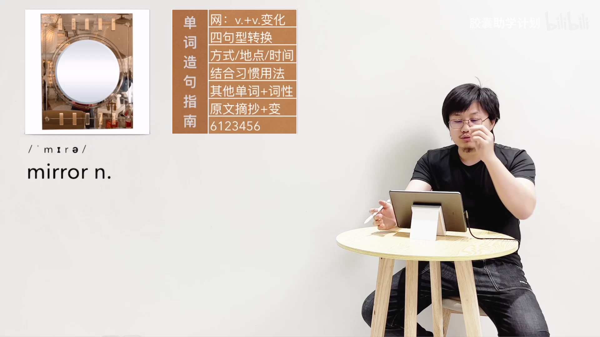

文字识别：单词造句指南 / 网：v.+v.变化 / 四句型转换 / 方式/地点/时间 / 结合习惯用法 / 其他单词+词性 / 原文摘抄+变 / 6123456 / /'mira/ / mirror n.

### 画面 00:02:45

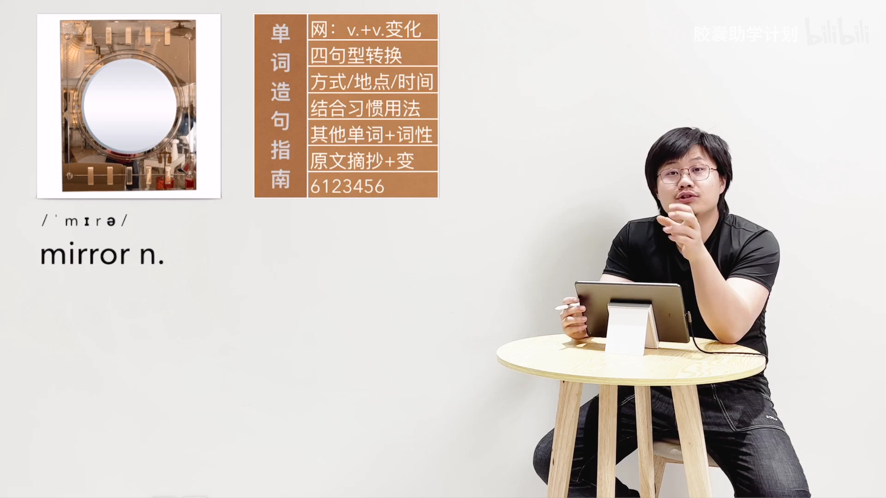

文字识别：单词造句指南 / 网：v.+v.变化 / 四句型转换 / 方式/地点/时间 / 结合习惯用法 / 其他单词+词性 / 原文摘抄+变 / HH / 6123456 / /'miral / mirror n.

### 画面 00:02:50

文字识别：单词造句指南 / 网：v.+v.变化 / 四句型转换 / 方式/地点/时间 / 结合习惯用法 / 其他单词+词性 / 原文摘抄+变 / 6123456 / /'mira/ / mirror n. / ) The mirror was broken by the hostess. L10

### 画面 00:02:55

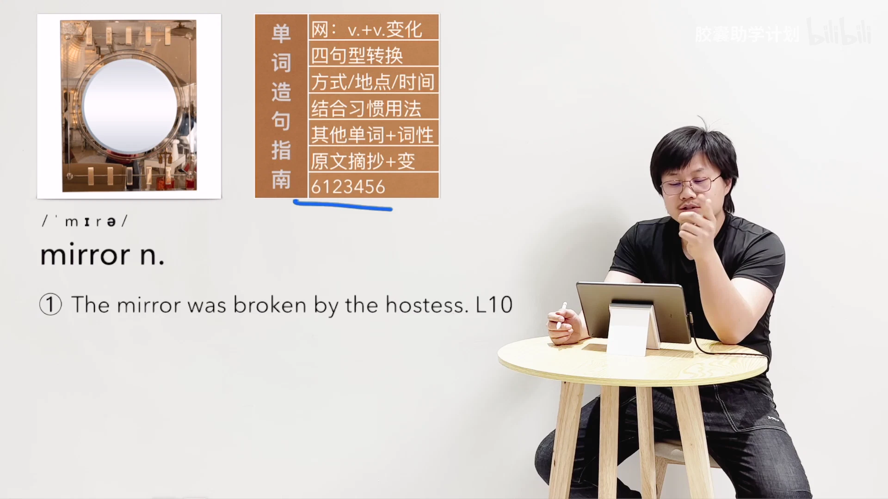

文字识别：单词造句指南 / 网：v.+v.变化 / 四句型转换 / 方式/地点/时间 / 结合习惯用法 / 其他单词+词性 / 原文摘抄+变 / 6123456 / /'mira/ / mirror n. / ) The mirror was broken by the hostess. L10

## 00:03:00–00:03:30

所以这句话就变成了叫做 the mirror was broken by the hostess. Okay, 说这个镜子被打碎了，被谁打碎的呢？被这个 hostess，被这个女主人打碎了。这是我们第十课学的。Okay, continue. 说 they must have bought the mirror last year. 他们之前啊，哎，这十七课学的叫 must have done，对吧？他们当时一定是去年买的这个镜子。Must have done, must have bought. Okay, very good. 这是复

### 画面 00:03:10

文字识别：单词造句指南 / 网：v.+v.变化 / ILT / 四句型转换 / 方式/地点/时间 / 结合习惯用法 / 其他单词+词性 / 原文摘抄+变 / 6123456 / /'mira/ / mirror n. / ) The mirror was broken by the hostess. L10

### 画面 00:03:15

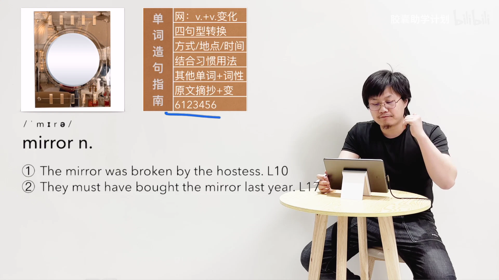

文字识别：单词造句指南 / 网：v.+v.变化 / 四句型转换 / 方式/地点/时间 / 结合习惯用法 / 其他单词+词性 / 原文摘抄+变 / H / 6123456 / / mⅠra / / mirror n. /  The mirror was broken by the hostess. L10 / They must have bought the mirror last year. L19

### 画面 00:03:20

文字识别：单词造句指南 / 网：v.+v.变化 / 四句型转换 / 方式/地点/时间 / 结合习惯用法 / 其他单词+词性 / 原文摘抄+变 / 6123456 / / _mⅠra / / mirror n. / ) The mirror was broken by the hostess. L10 / They must have bouaht the mirror last year. L1Z

## 00:03:30–00:04:00

习了一下之前我们学过的这个动词加动词的变化，对吧？ Next one, 我们还可以说三十八课的这句话叫做 She had no sooner taken out the mirror than it fell on the floor. 说她几乎是刚刚拿出这个镜子，这个镜子就掉在地面上，摔碎了，对吧？ Okay, 这是三十八课啊。 No sooner than这样的一个句式，那儿一个。那 mirror 这个单词，各位能造非常非常多的句子，

### 画面 00:03:30

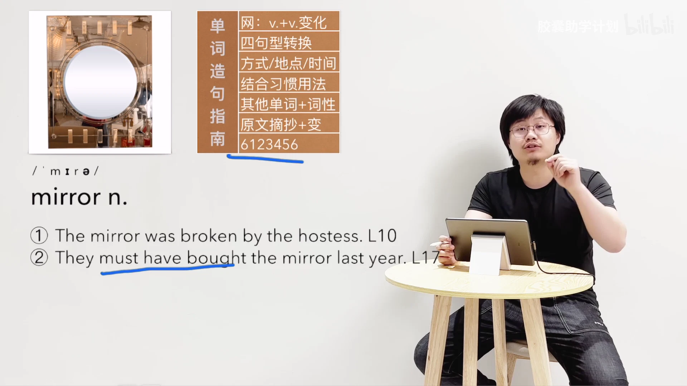

文字识别：单词造句指南 / 网：v.+v.变化 / 四句型转换 / 方式/地点/时间 / 结合习惯用法 / 其他单词+词性 / 原文摘抄+变 / 6123456 / / 'mIra / / mirror n. / ① The mirror was broken by the hostess. L10 / They must have bouaht the mirror last year. L17

### 画面 00:03:35

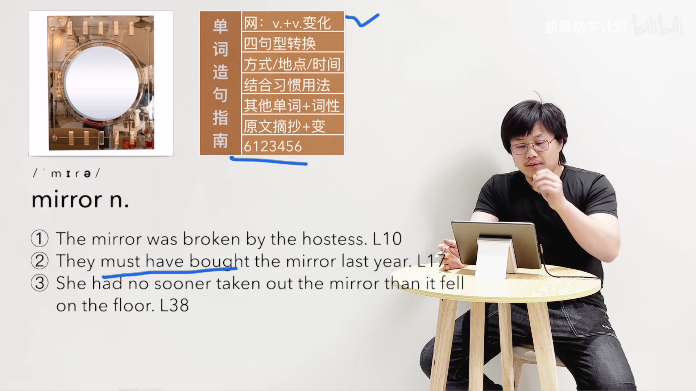

文字识别：单词造句指南 / 网：v.+v.变化 / 四句型转换 / 方式/地点/时间 / 结合习惯用法 / 其他单词+词性 / 原文摘抄+变 / 6123456 / /'mira/ / mirror n. / ① The mirror was broken by the hostess. L10 / They must have bouaht the mirror last year.L13 / She had no sooner taken out the mirror than it fell / on the floor. L38

### 画面 00:03:40

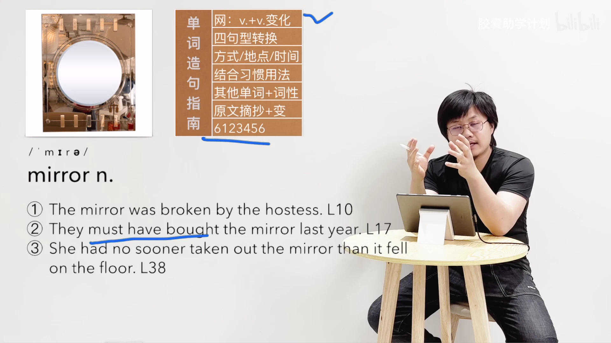

文字识别：单词造句指南 / 网：v.+v.变化 / 四句型转换 / 方式/地点/时间 / 结合习惯用法 / 其他单词+词性 / 原文摘抄+变 / 6123456 / /'mira/ / mirror n. / ① The mirror was broken by the hostess. L10 / They must have bouaht the mirror last year.L17 / She had no sooner taken out the mirror than it fell / on the floor. L38

### 画面 00:03:50

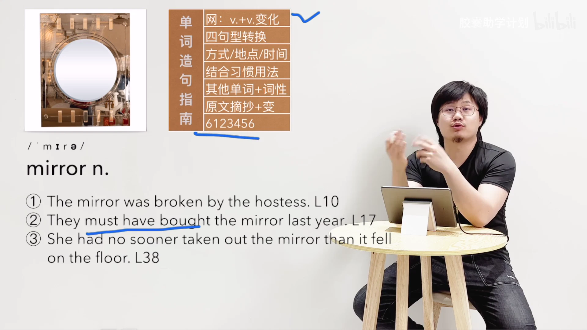

文字识别：单词造句指南 / 网：v.+v.变化 / 四句型转换 / 方式/地点/时间 / 结合习惯用法 / 其他单词+词性 / 原文摘抄+变 / 6123456 / /'mira/ / mirror n. / ① The mirror was broken by the hostess. L10 / They must have bouaht the mirror last year. L17 / She had no sooner taken out the mirror than it fell / on the floor. L38

## 00:04:00–00:04:30

子，对吧？啊，OK，呃，那不多说了。下一个单词跟我读一下，叫做 hole。 hole，它是洞的意思，对吧？比如说我们墙上现在这个地方，你看到有一个洞，那我们管它叫做 a hole in the wall。所以我们可以造一个句子叫做 Look, there is a hole in the wall。说，瞧这个图片当中，说在墙里面有一个洞，对吧？OK，啊，很简单。原文呢给了我们这样的一个小的短语

### 画面 00:04:02

文字识别：单词造句指南 / 网：v.+v.变化 / 四句型转换 / 方式/地点/时间 / 结合习惯用法 / 其他单词+词性 / 原文摘抄+变 / 6123456 / /haul/ / hole n.

### 画面 00:04:05

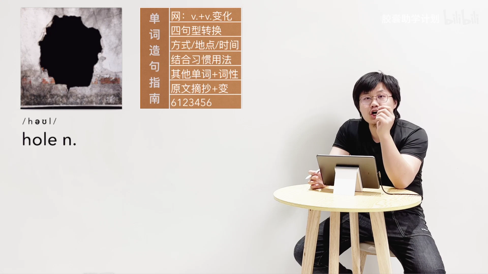

文字识别：单词造句指南 / 网：v.+v.变化 / 四句型转换 / 方式/地点/时间 / 结合习惯用法 / 其他单词+词性 / 原文摘抄+变 / 6123456 / /haul/ / hole n.

### 画面 00:04:16

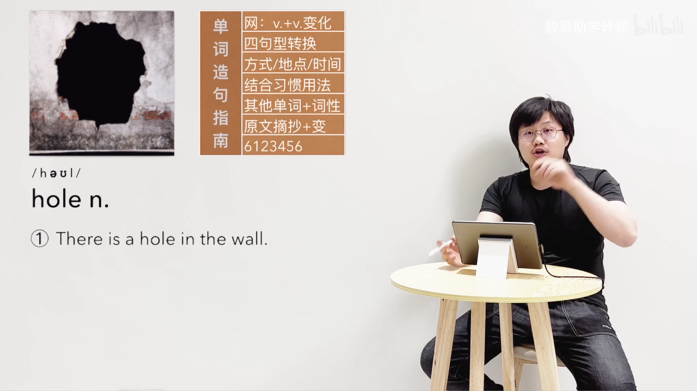

文字识别：单词造句指南 / 网：v.+v.变化 / 四句型转换 / 方式/地点/时间 / 结合习惯用法 / 其他单词+词性 / 原文摘抄+变 / 6123456 / /haul/ / hole n. /  There is a hole in the wall.

### 画面 00:04:19

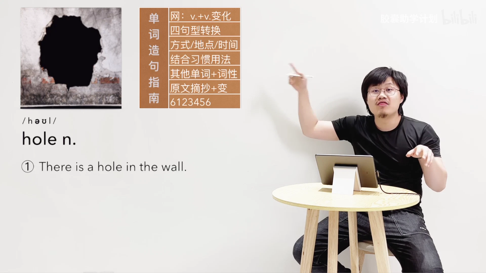

文字识别：单词造句指南 / 网：v.+v.变化 / 四句型转换 / 方式/地点/时间 / 结合习惯用法 / 其他单词+词性 / 原文摘抄+变 / 6123456 / /haul/ / hole n. / ) There is a hole in the wall.

### 画面 00:04:24

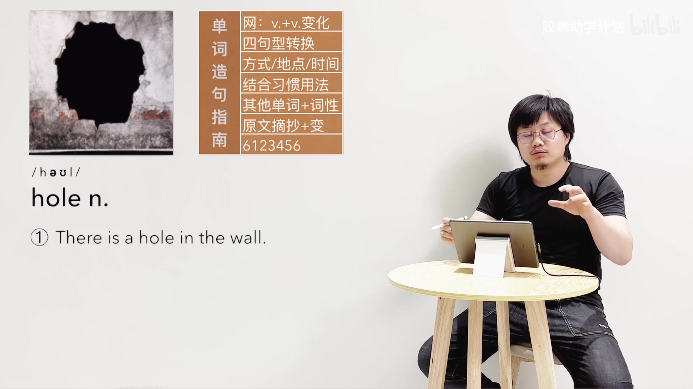

文字识别：单词造句指南 / 网：v.+v.变化 / 四句型转换 / 方式/地点/时间 / 结合习惯用法 / 其他单词+词性 / 原文摘抄+变 / 6123456 / /haul/ / hole n. /  There is a hole in the wall.

### 画面 00:04:27

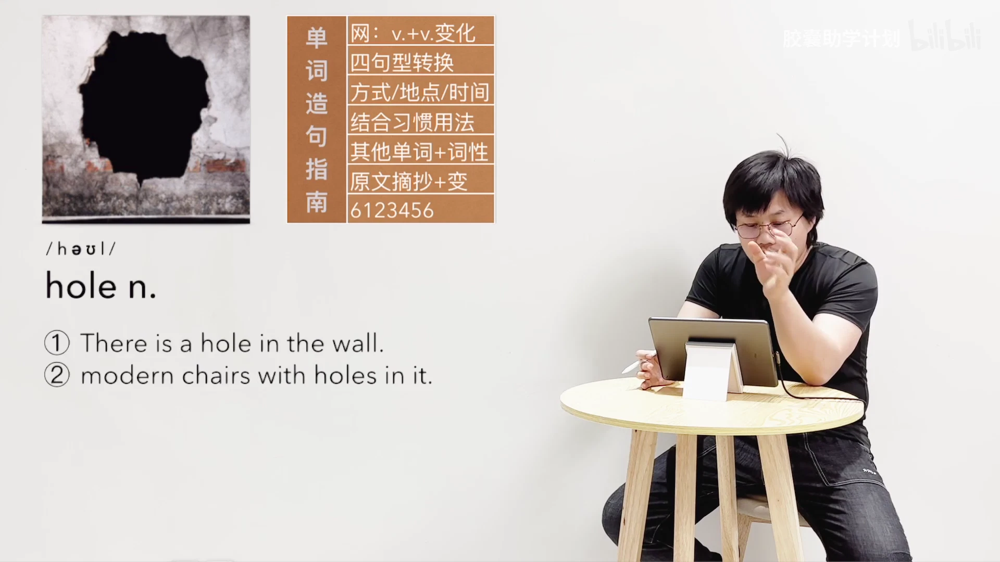

文字识别：单词造句指南 / 网：v.+v.变化 / 四句型转换 / 方式/地点/时间 / 结合习惯用法 / 其他单词+词性 / 原文摘抄+变 / 6123456 / /haul/ / hole n. / ① There is a hole in the wall. / ② modern chairs with holes in it.

## 00:04:30–00:05:00

啊，在文章当中出现的叫做 modern chairs with holes in it. Very good. 好，那这地方呢， modern chairs 叫做现代的这种椅子 with holes in it. OK，首先 with 其实就是和，在这个地方你可以这样去理解啊，它是比这个要复杂一点的一个语法，或者说你把它当做一个小的介词引导的定语，对吧？呃，有洞的，在上面有洞的那个现代的椅子，你可以理解为，比

### 画面 00:04:32

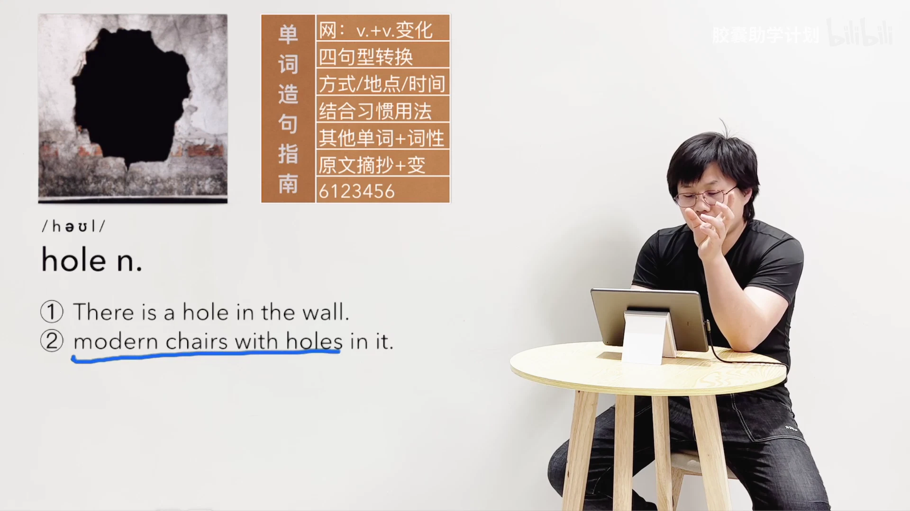

文字识别：单词造句指南 / 网：v.+v.变化 / 四句型转换 / 方式/地点/时间 / 结合习惯用法 / 其他单词+词性 / 原文摘抄+变 / 6123456 / /haul/ / hole n. / ① There is a hole in the wall. / modern chairs with holes in it.

### 画面 00:04:38

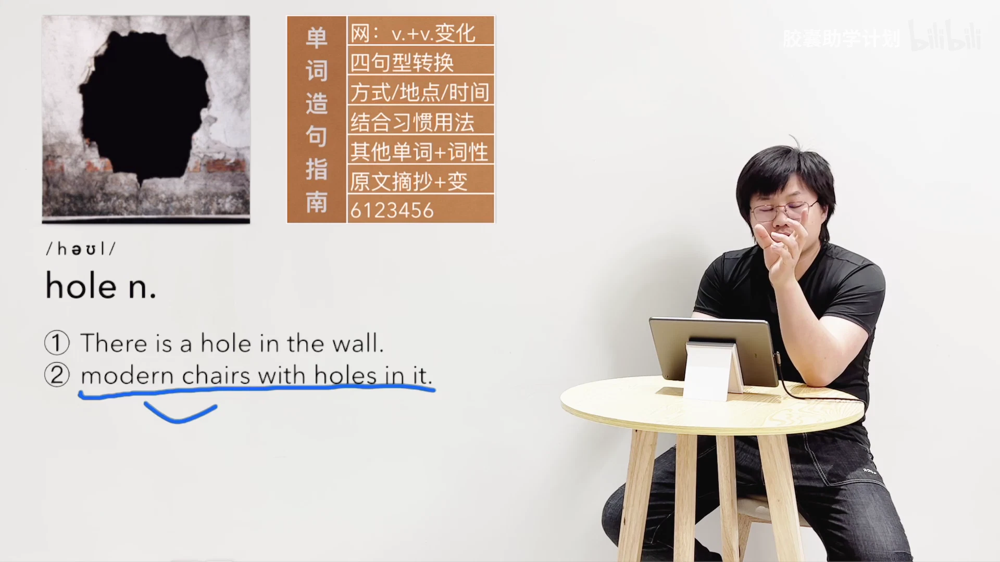

文字识别：单词造句指南 / 网：v.+v.变化 / 四句型转换 / 方式/地点/时间 / 结合习惯用法 / 其他单词+词性 / 原文摘抄+变 / 6123456 / /haul/ / hole n. / ① There is a hole in the wall. / modern chairs with holes in it.

### 画面 00:04:41

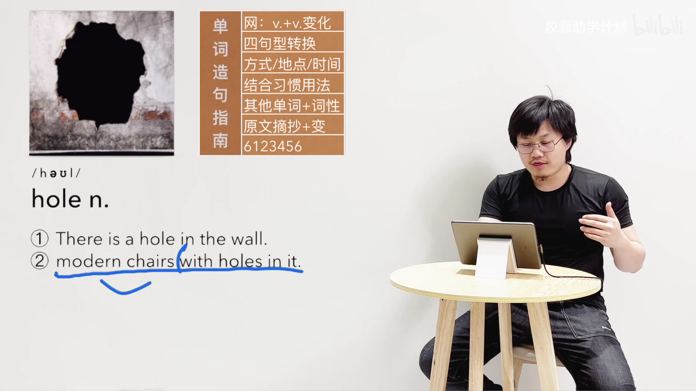

文字识别：单词造句指南 / 网：v.+v.变化 / 四句型转换 / 方式/地点/时间 / 结合习惯用法 / 其他单词+词性 / 原文摘抄+变 / 6123456 / /haul/ / hole n. /  There is a hole in the wall. / modern chairsWith holes in it.

### 画面 00:04:45

文字识别：单词造句指南 / 网：v.+v.变化 / 四句型转换 / 方式/地点/时间 / 结合习惯用法 / 其他单词+词性 / 原文摘抄+变 / 6123456 / /haul/ / hole n. / ) There is a hole in the wall. / modern chairsWith holes in it.

### 画面 00:04:51

文字识别：单词造句指南 / 网：v.+v.变化 / 四句型转换 / 方式/地点/时间 / 结合习惯用法 / 其他单词+词性 / 原文摘抄+变 / 6123456 / /haul/ / hole n. / ) There is a hole in the wall. / modern chairsWith holes in it.

## 00:05:00–00:05:30

如说是编织的，或者说反正编完了之后，这个椅子后边背靠着都是洞，对吧？OK，呃，那这个 modern chairs with holes in it，其实这里边的核心词是 chairs。OK， modern 是说 chairs 的，with holes in it 放在后面还是说 chairs 的。所以其实你看，我们现在本来我是要用 hole 去造句，但 hole 这个单词其实不是那么好造句。但是呢，我拿来了一个短语叫

### 画面 00:05:04

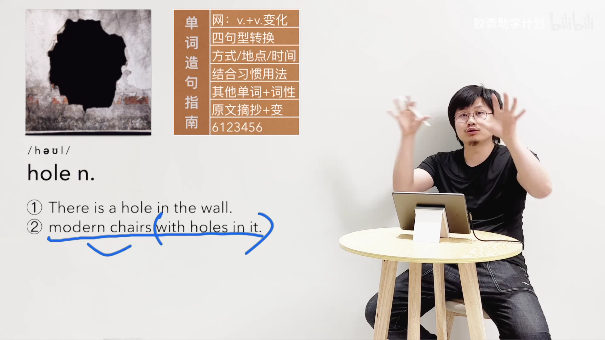

文字识别：单词造句指南 / 网：v.+v.变化 / 四句型转换 / 方式/地点/时间 / 结合习惯用法 / 其他单词+词性 / 原文摘抄+变 / 6123456 / /haul/ / hole n. / ) There is a hole in the wall. / modern chairsWith holes in it.

### 画面 00:05:07

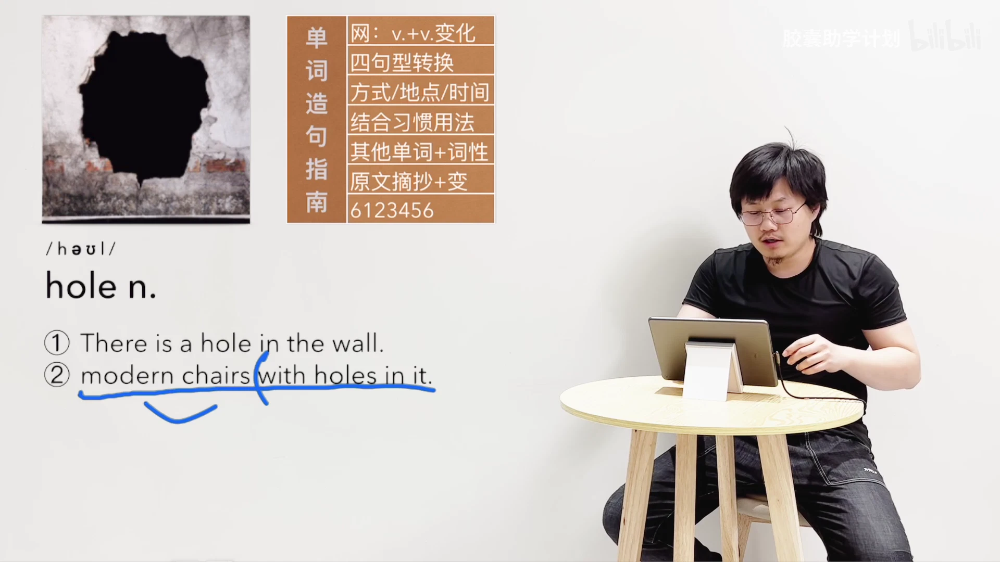

文字识别：单词造句指南 / 网：v.+v.变化 / 四句型转换 / 方式/地点/时间 / 结合习惯用法 / 其他单词+词性 / 原文摘抄+变 / 6123456 / /haul/ / hole n. / ) There is a hole in the wall. / modern chairsWith holes in it.

### 画面 00:05:09

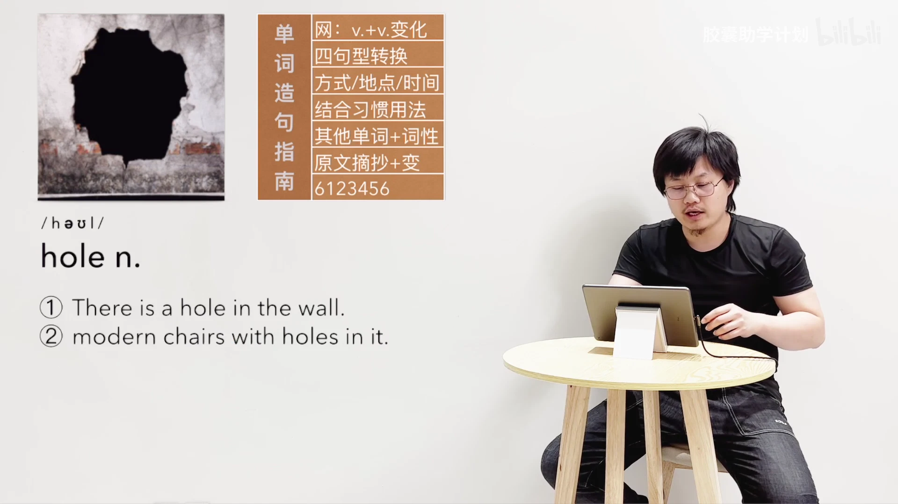

文字识别：单词造句指南 / 网：v.+v.变化 / 四句型转换 / 方式/地点/时间 / 结合习惯用法 / 其他单词+词性 / 原文摘抄+变 / 6123456 / /haul/ / hole n. / ① There is a hole in the wall. / ② modern chairs with holes in it.

### 画面 00:05:11

文字识别：单词造句指南 / 网：v.+v.变化 / 四句型转换 / 方式/地点/时间 / 结合习惯用法 / 其他单词+词性 / 原文摘抄+变 / 6123456 / /haul/ / hole n. / ① There is a hole in the wall. / ② modern chairs with holes in it.

### 画面 00:05:15

文字识别：单词造句指南 / 网：v.+v.变化 / 四句型转换 / 方式/地点/时间 / 结合习惯用法 / 其他单词+词性 / 原文摘抄+变 / 6123456 / /haul/ / hole n. /  Thereis abole inthe wall. / modern chairs With holes in it.

### 画面 00:05:20

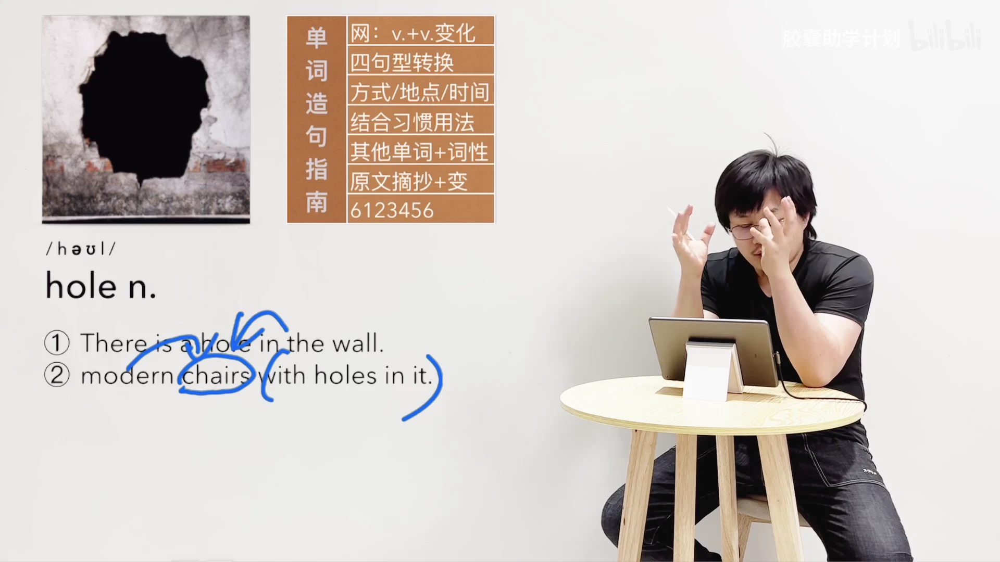

文字识别：单词造句指南 / 网：v.+v.变化 / 四句型转换 / 方式/地点/时间 / 结合习惯用法 / 其他单词+词性 / 原文摘抄+变 / 6123456 / /haul/ / hole n. /  Thereisabolin the wall / modern Chairsith holes in it.

## 00:05:30–00:06:00

modern chairs with holes in it，所以现在我们又判断了这一堆单词的核心单词其实是 chair，但我只要把这个带着 modern 带着 with holes in it 的这个 chair 的这个小的短语啊，造出句子来之后，holes 已经在里边了，对吧？OK，啊，刚才这句话说的稍微有一点点复杂，那我们直接看就行了，对吧？这样说容易大家懵。比如说 she dreamed of

### 画面 00:05:50

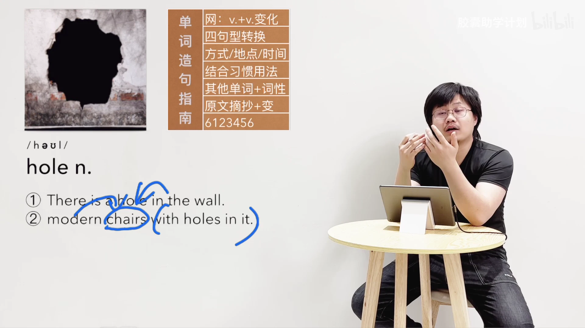

文字识别：单词造句指南 / 网：v.+v.变化 / 四句型转换 / 方式/地点/时间 / 结合习惯用法 / 其他单词+词性 / 原文摘抄+变 / 6123456 / /haul/ / hole n. / ) Thereisabolin the wall. / modern chairs With holes in it.

### 画面 00:05:54

文字识别：单词造句指南 / 网：v.+v.变化 / 四句型转换 / 方式/地点/时间 / 结合习惯用法 / 其他单词+词性 / 原文摘抄+变 / 6123456 / /haul/ / hole n. / ) Thereisabolin the wall. / modern chairs With holes in it. / She dreamed of buying a modern chair / with holes in it for a long time. L38

### 画面 00:05:56

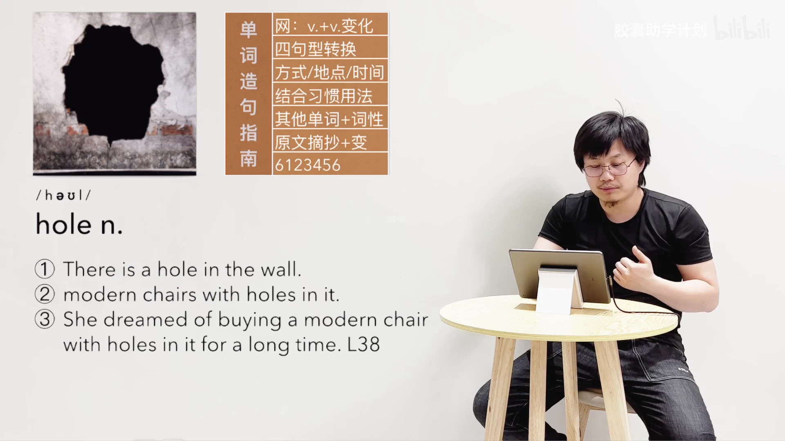

文字识别：单词造句指南 / 网：v.+v.变化 / 四句型转换 / 方式/地点/时间 / 结合习惯用法 / 其他单词+词性 / 原文摘抄+变 / 6123456 / /haul/ / hole n. / ① There is a hole in the wall. / ② modern chairs with holes in it. / She dreamed of buying a modern chair / with holes in it for a long time. L38

## 00:06:00–00:06:30

buying a modern chair with holes in it for a long time.你看啊，这里面我们再去造句子的时候，其实 hole 不是重点，重点是 chair。看见了吧？她 dreamed of buying 的是 chair，而不是 holes。但是因为 with holes in it 是连着这个 chair 的，或者说后置去修饰这个 chair 的，所以造这句话的时候必然就带着 hole 这个单词了。我不知道各位能不能理解我们这个地方的思路

### 画面 00:06:00

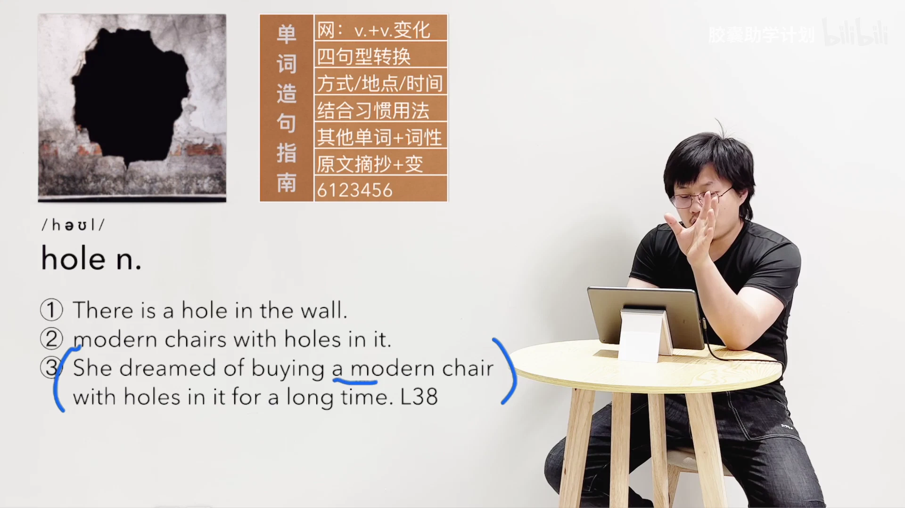

文字识别：单词造句指南 / 网：v.+v.变化 / 四句型转换 / 方式/地点/时间 / 结合习惯用法 / 其他单词+词性 / 原文摘抄+变 / 6123456 / /haul/ / hole n. / ① There is a hole in the wall. / ② modern chairs with holes in it. / She dreamed of buying a modern chair / with holes in it for a long time. L38

### 画面 00:06:02

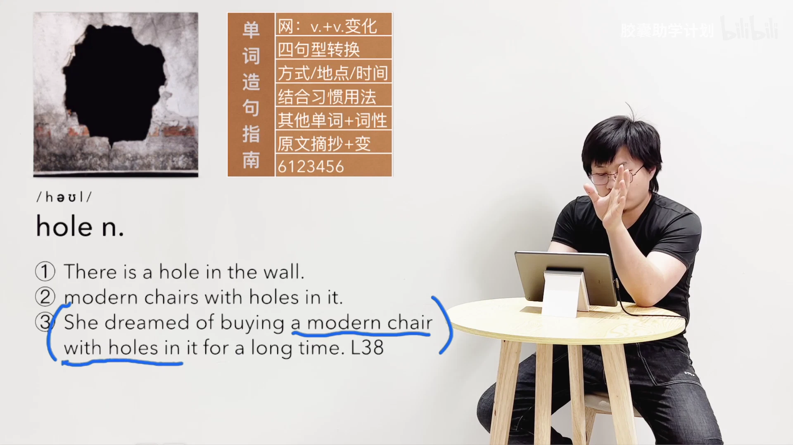

文字识别：单词造句指南 / 网：v.+v.变化 / 四句型转换 / 方式/地点/时间 / 结合习惯用法 / 其他单词+词性 / 原文摘抄+变 / 6123456 / /haul/ / hole n. / ① There is a hole in the wall. / ② modern chairs with holes in it. / She dreamed of buying a modern chair / with holes in it for a long time. L38

## 00:06:30–00:07:00

啊？就是说，我想用后句造句，但是不是那么容易。但是呢，modern chairs with holes in it，这里边的核心单词是 chair。chair 很容易造句，对吧？修啊，买啊，卖啊，都很容易造句。我只要带着后边的 with holes in it 就可以了，对吧？OK，比如说，你看，我们再来一个说，his eyes were fixed on that hole in the wall。那这是我直接用后句造了一个句子啊，就不是 chair

### 画面 00:06:32

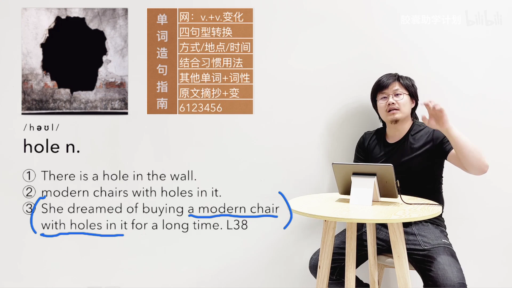

文字识别：单词造句指南 / 网：v.+v.变化 / 四句型转换 / 方式/地点/时间 / 结合习惯用法 / 其他单词+词性 / 原文摘抄+变 / 6123456 / /haul/ / hole n. / ① There is a hole in the wall. / ② modern chairs with holes in it. / She dreamed of buying a modern chair / with holes in it for a long time. L38

### 画面 00:06:49

文字识别：单词造句指南 / 网：v.+v.变化 / 四句型转换 / 方式/地点/时间 / 结合习惯用法 / 其他单词+词性 / 原文摘抄+变 / 6123456 / /haul/ / hole n. / ① There is a hole in the wall. / ② modern chairs with holes in it. / She dreamed of buying a modern chair / with holes in it for a long time. L38 / His eyes were fixed on that hole in the wall. / L40

### 画面 00:06:51

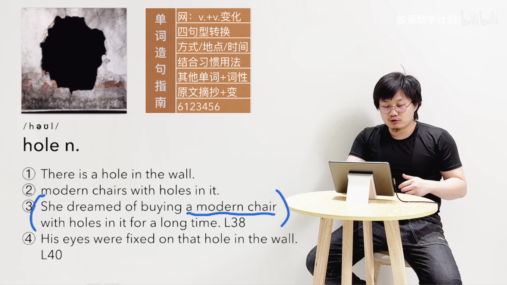

文字识别：单词造句指南 / 网：v.+v.变化 / 四句型转换 / 方式/地点/时间 / 结合习惯用法 / 其他单词+词性 / 原文摘抄+变 / 6123456 / /haul/ / hole n. / ① There is a hole in the wall. / ② modern chairs with holes in it. / She dreamed of buying a modern chair / with holes in it for a long time. L38 / His eyes were fixed on that hole in the wall. / L40

### 画面 00:06:55

文字识别：单词造句指南 / 网：v.+v.变化 / 四句型转换 / 方式/地点/时间 / 结合习惯用法 / 其他单词+词性 / 原文摘抄+变 / 6123456 / /haul/ / hole n. / ① There is a hole in the wall. / ② modern chairs with holes in it. / She dreamed of buying a modern chair / with holes in it for a long time. L38 /  His eyes were fixed on that hole in the wall / L40

## 00:07:00–00:07:30

了。不过他用的是第四十课的那个叫 eyes be fixed on，对吧？他的眼睛被固定在了，或者叫做凝视着墙上的那个洞。OK，玩一个，我们可以说是一个猫嘛，对不对啊？Next one，下一个单词我们一起读，叫做 remark。remark，好，remark 这个单词呢，我们真拿它去造句不是特别容易，就立刻能造出来，对吧？你比如说像我，乍一想我就没有想到说我用 remark

### 画面 00:07:04

文字识别：单词造句指南 / 网：v.+v.变化 / 四句型转换 / 方式/地点/时间 / 结合习惯用法 / 其他单词+词性 / 原文摘抄+变 / 6123456 / /haul/ / hole n. / ① There is a hole in the wall. / ② modern chairs with holes in it. / She dreamed of buying a modern chair / with holes in it for a long time. L38 /  His eyes were fixed on that hole in the wall / L40

### 画面 00:07:11

文字识别：单词造句指南 / 网：v.+v.变化 / 四句型转换 / 方式/地点/时间 / 结合习惯用法 / 其他单词+词性 / 原文摘抄+变 / 6123456 / /haul/ / hole n. / ① There is a hole in the wall. / ② modern chairs with holes in it. / She dreamed of buying a modern chair / with holes in it for a long time. L38 / His eyes were fixed on that hole in the wall. / L40

### 画面 00:07:14

文字识别：单词造句指南 / 网：v.+v.变化 / 四句型转换 / 方式/地点/时间 / 结合习惯用法 / 其他单词+词性 / 原文摘抄+变 / 6123456 / /ri'ma:k/ / remark v.

### 画面 00:07:16

文字识别：单词造句指南 / 网：v.+v.变化 / 四句型转换 / 方式/地点/时间 / 结合习惯用法 / 其他单词+词性 / 原文摘抄+变 / 6123456 / /rl'ma:k/ / remark v.

### 画面 00:07:25

文字识别：单词造句指南 / 网：v.+v.变化 / 四句型转换 / 方式/地点/时间 / 结合习惯用法 / 其他单词+词性 / 原文摘抄+变 / 6123456 / /ri'ma:k/ / remark v.

## 00:07:30–00:08:00

应该如何去造句，确保对于各位来说，各位这个水平之下能完全理解，对吧？所以啊，我们就用了一个小的方法，叫做原文摘抄再加上变。那我们在这儿就处理一下这个思路啊。比如说原文其实给了一句话叫 I remarked suddenly，我突然间评论到。好，然后呢，我在后边加了个斜线，告诉你 rudely，也就是说，你看啊，你分析一下 I remarked suddenly，它其实如

### 画面 00:07:39

文字识别：单词造句指南 / 网：v.+v.变化 / 四句型转换 / 方式/地点/时间 / 结合习惯用法 / 其他单词+词性 / 原文摘抄+变 / 6123456 / /ri'ma:k/ / remark v. / ① [Story]: I remarked suddenly/rudely.

### 画面 00:07:41

文字识别：单词造句指南 / 网：v.+v.变化 / 四句型转换 / 方式/地点/时间 / 结合习惯用法 / 其他单词+词性 / 原文摘抄+变 / 6123456 / /ri'ma:k/ / remark v. / ① [Story]: I remarked suddenly/rudely.

### 画面 00:07:44

文字识别：单词造句指南 / 网：v.+v.变化 / 四句型转换 / 方式/地点/时间 / 结合习惯用法 / 其他单词+词性 / 原文摘抄+变 / 6123456 / /ri'ma:k/ / remark v. / ① [Story]: I remarked suddenly/rudely.

### 画面 00:07:52

文字识别：单词造句指南 / 网：v.+v.变化 / 四句型转换 / 方式/地点/时间 / 结合习惯用法 / 其他单词+词性 / 原文摘抄+变 / 6123456 / /ri'ma:k/ / remark v. / ① [Story]: I remarked suddenly/rudely.

### 画面 00:07:55

文字识别：单词造句指南 / 网：v.+v.变化 / 四句型转换 / 方式/地点/时间 / 结合习惯用法 / 其他单词+词性 / 原文摘抄+变 / 6123456 / /ri'ma:k/ / remark v. / ① [Story]: I remarked suddenly/rudely.

## 00:08:00–00:08:30

果我们用六一二三四五六的思路去理解它，I 是一，remark 是二，suddenly 就是四，对吧？那我一旦知道了 suddenly 是四，我可以突然间评论，我是不是也可以 rudely 去评论？我可以很粗鲁的去评论，对吧？也可以 angrily 去评论。于是，在四这个地方，你去换各种各样的单词的时候，换各种副词的时候，我可能就造了一个新的句子。比如

### 画面 00:08:05

文字识别：单词造句指南 / 网：v.+v.变化 / 四句型转换 / 方式/地点/时间 / 结合习惯用法 / 其他单词+词性 / 原文摘抄+变 / 6123456 / /ri'ma:k/ / remark y / ① [Story]: I remarked suddenly/rudely.

### 画面 00:08:08

文字识别：单词造句指南 / 网：v.+v.变化 / 四句型转换 / 方式/地点/时间 / 结合习惯用法 / 其他单词+词性 / 原文摘抄+变 / 6123456 / /rI'ma:k/ / remarky / 4 / 2 / ① [Story]: I remarked suddenly/rudely.

### 画面 00:08:24

文字识别：单词造句指南 / 网：v.+v.变化 / 四句型转换 / 方式/地点/时间 / 结合习惯用法 / 其他单词+词性 / 原文摘抄+变 / 6123456 / /rl'ma:k/ / 4 / remarky / 2 / ① [Story]: I remarked suddenly/rudely.

## 00:08:30–00:09:00

说，对于各位来说最简单的原文给的是 I remarked sadly。对于各位来说，你如果能造出来 I remarked rudely，我就觉得这是你的新的句子了。其次，各位想这个思路啊，主语现在是 I，我很简单，最简单粗暴一个思路，我能不能把 I 换成 Leo？能不能换成 He、 She、 They？ Very good，都是可以的，对不对？我主语又能换，但你二是不能换的，二要放在那个地方不能动啊。其次，我现在

### 画面 00:08:42

文字识别：单词造句指南 / 网：v.+v.变化 / 四句型转换 / 方式/地点/时间 / 结合习惯用法 / 其他单词+词性 / 原文摘抄+变 / 6123456 / /ri'ma:k/ / 4 / remark y / 2 / ① [Story] / emarked suddenly/rudely.

### 画面 00:08:51

文字识别：单词造句指南 / 网：v.+v.变化 / 四句型转换 / 方式/地点/时间 / 结合习惯用法 / 其他单词+词性 / 原文摘抄+变 / 6123456 / /ri'ma:k/ / 4 / remark y / 2 / ① [Story] / emarked suddenly/rudely.

## 00:09:00–00:09:30

判断了他的六一二三四五六，他没有地点，没有时间，我再加上地点时间不就行了嘛？比如说，She remarked rudely at the dinner party last night. 那我们再看一下底下这句话是怎么来的。底下这句话其实是你现在看的是不是比我们原文长了很多？原文就三个单词，对吧？现在变得很长很长了。但是各位要注意这个思路是怎么走过去的。首先，我把 I 换成了 She，这很容易。 Remark 不要变。

### 画面 00:09:00

文字识别：单词造句指南 / 网：v.+v.变化 / 四句型转换 / 方式/地点/时间 / 结合习惯用法 / 其他单词+词性 / 原文摘抄+变 / 6123456 / /ri'ma:k/ / 4 / remark y / 2 / ① [Story] / emarked suddenly/rudely.

### 画面 00:09:06

文字识别：单词造句指南 / 网：v.+v.变化 / 四句型转换 / 方式/地点/时间 / 结合习惯用法 / 其他单词+词性 / 原文摘抄+变 / 6123456 / /ri'ma:k/ / 4 / remark y / 2 / [Story] / emarked suddenly/rudely. / 1 / She remarked rudely at the / dinner party last night.

### 画面 00:09:10

文字识别：单词造句指南 / 网：v.+v.变化 / 四句型转换 / 方式/地点/时间 / 结合习惯用法 / 其他单词+词性 / 原文摘抄+变 / 6123456 / /ri'ma:k/ / 4 / remark y / 2 / [Story] / yemarked suddenly/rudely. / She remarked rudely at the / dinner party last night.

### 画面 00:09:13

文字识别：单词造句指南 / 网：v.+v.变化 / 四句型转换 / 方式/地点/时间 / 结合习惯用法 / 其他单词+词性 / 原文摘抄+变 / 6123456 / /ri'ma:k/ / 4 / remarky / 2 / [Story]: I remarked suddenly/rudely. / She remarked rudely at the dinner party last night.

### 画面 00:09:15

文字识别：单词造句指南 / 网：v.+v.变化 / 四句型转换 / 方式/地点/时间 / 结合习惯用法 / 其他单词+词性 / 原文摘抄+变 / 6123456 / / ri'm a:k / / remark v. / ① [Story]: I remarked suddenly/rudely. /  She remarked rudely at the dinner party last night.

### 画面 00:09:20

文字识别：单词造句指南 / 网：v.+v.变化 / 四句型转换 / 方式/地点/时间 / 结合习惯用法 / 其他单词+词性 / 原文摘抄+变 / 6123456 / / ri'm a:k / / remark v. / ① [Story]: I remarked suddenly/rudely. / She remarked rudely at the dinner party last night.

### 画面 00:09:28

文字识别：单词造句指南 / 网：v.+v.变化 / 四句型转换 / 方式/地点/时间 / 结合习惯用法 / 其他单词+词性 / 原文摘抄+变 / 6123456 / /rI'm a:k/ / remark v. / ) [Story}:」 remarked suddenly/rudely. / She remarked rudely at the dinner party last night.

## 00:09:30–00:10:00

Suddenly，我换成了rudely，然后我自己随便加了一个地点，随便加了一个时间。您自己也能做到。你可不可以说She remarked rudely at the theater this morning？完全可以，对吧？这您就随便换了地点、时间，您随便换了，对不对？只要保证它是过去而不是将来就可以了。OK，玩一个。好，再接下来，我现在已经把原文很简单的一句话叫I remarked suddenly变成了这

### 画面 00:09:30

文字识别：单词造句指南 / 网：v.+v.变化 / 四句型转换 / 方式/地点/时间 / 结合习惯用法 / 其他单词+词性 / 原文摘抄+变 / 6123456 / / ri'm a:k/ / remark v. / [Story}:」 remarked sμddenly/rudely. / She remarked rudely at the dinner party last night.

### 画面 00:09:34

文字识别：单词造句指南 / 网：v.+v.变化 / 四句型转换 / 方式/地点/时间 / 结合习惯用法 / 其他单词+词性 / 原文摘抄+变 / 6123456 / /ri'ma:k/ / remark v. / [Story}:| remarked suddenly/rudely. / She remarked rudelyat the ( / dinner party / last night.

### 画面 00:09:36

文字识别：单词造句指南 / 网：v.+v.变化 / 四句型转换 / 方式/地点/时间 / 结合习惯用法 / 其他单词+词性 / 原文摘抄+变 / 6123456 / /ri'ma:k/ / remark v. / [Story}:」 remarked suddenly/rudely. / She remarked rudelyat the dinner party / ast night.

### 画面 00:09:40

文字识别：单词造句指南 / 网：v.+v.变化 / 四句型转换 / 方式/地点/时间 / 结合习惯用法 / 其他单词+词性 / 原文摘抄+变 / 6123456 / /ri'ma:k/ / remark v. / [Story}:| remarked suddenly/rudely. / She remarked rudely at the dinner party / ast night.

### 画面 00:09:53

文字识别：单词造句指南 / 网：v.+v.变化 / 四句型转换 / 方式/地点/时间 / 结合习惯用法 / 其他单词+词性 / 原文摘抄+变 / 6123456 / /ri'ma:k/ / remark v. / [Story}:| remarked suddenly/rudely. / She remarked rudelyat the ( / : dinner party / last night.

### 画面 00:09:55

文字识别：单词造句指南 / 网：v.+v.变化 / 四句型转换 / 方式/地点/时间 / 结合习惯用法 / 其他单词+词性 / 原文摘抄+变 / 6123456 / /rI'm a:k/ / remark v. / ① [Story]:_ remarked suddenly/rudely. / She remarked rudely at the dinner party last night.

## 00:10:00–00:10:30

么长的一句话了之后，这个事儿还没有结束。我们还可以继续啊，我们现在已经用到这三个了，对吧？我们还可以继续去进行四句型的转换，比如说d的提前变一般疑问句，对吧？比如说各种特殊疑问词。各位，我希望通过这个点告诉各位，还是叫做如何用单词去造句，对吧？当我不会的前提之下，你看我如果现在想用remark去造句，我至少造出来了一个句子、两个句子、三个句子、

### 画面 00:10:00

文字识别：单词造句指南 / 网：v.+v.变化 / 四句型转换 / 方式/地点/时间 / 结合习惯用法 / 其他单词+词性 / 原文摘抄+变 / 6123456 / / rI'm a:k / / remark v. / ① [Story]: I remarked suddenly/rudely. / She remarked rudely at the dinner party last night.

### 画面 00:10:05

文字识别：单词造句指南 / 网：v.+v.变化 / 四句型转换 / 方式/地点/时间 / 结合习惯用法 / 其他单词+词性 / 原文摘抄+变 / 6123456 / / ri'm a:k / / remark v. / ① [Story]: I remarked suddenly/rudely. / She remarked rudely at the dinner party last night.

### 画面 00:10:28

文字识别：单词造句指南 / 网：v.+v.变化 / 四句型转换 / 方式/地点/时间 / 结合习惯用法 / 其他单词+词性 / 原文摘抄+变 / 6123456 / /ri'ma:k/ / remark v. / ① [Story]: I remarked suddenly/rudely. / ② She remarked rudely at the dinner party last night. / ③.did/who/where/when

## 00:10:30–00:11:00

四个句子和五个句子。家庭作业，一个单词造五个句子。您完成了是不是？OK，不多说了啊。下一个单词，跟我一起读一下，叫做 remind。Remind。好，这个单词我想提一个小点。十六课咱们见过这个单词的名词叫 reminder。啊，说 this note is only a reminder。我不知道各位记不记得，这是我们十六课对吧？把车停错位置，交警给贴了一张，还不是罚单，贴

### 画面 00:10:30

文字识别：单词造句指南 / 网：v.+v.变化 / 四句型转换 / 方式/地点/时间 / 结合习惯用法 / 其他单词+词性 / 原文摘抄+变 / 6123456 / /ri'ma:k/ / remark v. / ① [Story]: I remarked suddenly/rudely. / Sheremayked rudely at the dinner party last night. / ③.did/whg/where/wheh

### 画面 00:10:35

文字识别：单词造句指南 / 网：v.+v.变化 / 四句型转换 / 方式/地点/时间 / 结合习惯用法 / 其他单词+词性 / 原文摘抄+变 / 6123456 / /ri'ma:k/ / remark v. / ① [Story]: I remarked sudgenly/rudely. / Sherema/ked rudely at the dinner party last night. / 2) / ③.did/whd/where/wheh

### 画面 00:10:37

文字识别：单词造句指南 / 网：v.+v.变化 / 8 / 四句型转换 / 方式/地点/时间 / 结合习惯用法 / 其他单词+词性 / forget / 原文摘抄+变 / 6123456 / /rI'maInd/ / remind v.

### 画面 00:10:40

文字识别：单词造句指南 / 网：v.+v.变化 / B / 四句型转换 / 方式/地点/时间 / 结合习惯用法 / don` / 其他单词+词性 / forget / 原文摘抄+变 / 6123456 / /rI'maInd/ / remind v.

### 画面 00:10:45

文字识别：单词造句指南 / 网：v.+v.变化 / B / 四句型转换 / 方式/地点/时间 / 结合习惯用法 / 其他单词+词性 / forget / 原文摘抄+变 / 6123456 / /rI'maInd/ / remind v. / reminder n. L16

### 画面 00:10:50

文字识别：单词造句指南 / 网：v.+v.变化 / 四句型转换 / 方式/地点/时间 / don' / 结合习惯用法 / 其他单词+词性 / forget / 原文摘抄+变 / 6123456 / /rI'maind/ / remind v. / reminder n. L16

## 00:11:00–00:11:30

了一张便签儿在车上，对吧？说 this note is only a reminder，叫提醒。那动词呢？其实之前我们也见过，今天我们再复习一下，叫 remind somebody of something或者somebody，叫做使某人想起了某事或某人。比如说， she reminds me。好，你看 me 就是 somebody，对吧？后面是 somebody 或 something。哎， of the

### 画面 00:11:00

文字识别：单词造句指南 / 网：v.+v.变化 / 8 / 四句型转换 / 方式/地点/时间 / don` / 结合习惯用法 / 其他单词+词性 / forget / 原文摘抄+变 / 6123456 / /rI'maInd/ / remind v. / reminder n. L16

### 画面 00:11:11

文字识别：单词造句指南 / 网：v.+v.变化 / B / 四句型转换 / 方式/地点/时间 / 结合习惯用法 / don' / 其他单词+词性 / forget / 原文摘抄+变 / 6123456 / /ri'maind/ / remind v. / reminder n. L16 / remind sb. of sth./sb. L16

### 画面 00:11:15

文字识别：单词造句指南 / 网：v.+v.变化 / 四句型转换 / 方式/地点/时间 / 结合习惯用法 / don' / 其他单词+词性 / forget / 原文摘抄+变 / 6123456 / /rI'maind/ / remind v. / reminder n. L16 / remind sb. of sth./sb. L16

### 画面 00:11:20

文字识别：单词造句指南 / 网：v.+v.变化 / B / 四句型转换 / 方式/地点/时间 / 结合习惯用法 / don' / 其他单词+词性 / forget / 原文摘抄+变 / 6123456 / /rI'maInd/ / remind v. / reminder n. L16 / remind sb. of sth./sb. L16 / She reminds me of the hostess we met last / night. L28

### 画面 00:11:25

文字识别：单词造句指南 / 网：v.+v.变化 / 四句型转换 / 方式/地点/时间 / 结合习惯用法 / don' / 其他单词+词性 / forget / 原文摘抄+变 / 6123456 / /rI'maInd/ / remind v. / reminder n. L16 / remind sb. of sth./sb. L16 / She reminds,me of the hostess we met last / night. L28

### 画面 00:11:28

文字识别：- / 单词造句指南 / 网：v.+v.变化 / 四句型转换 / 方式/地点/时间 / 结合习惯用法 / don' / 其他单词+词性 / forget / 原文摘抄+变 / 6123456 / /rI'maInd/ / remind v. / reminder n. L16 / remind sb. of sth./sb. L16 / She reminds me of the hostess we met last / night. L28

## 00:11:30–00:12:00

hostess,对吧？他使我想起了那个女主人，哪个女主人呢？We met last night.我们昨天晚上遇到的那个女主人。您想一下，这句话当中我们用到了多少的语法学过的语法、单词和习惯用法？第一，Remind somebody of something or somebody是我们之前学过的。第二，这地方有一个一般现在时，对吧？第三，后边有一个定语从

### 画面 00:11:30

文字识别：- / 单词造句指南 / 网：v.+v.变化 / B / 四句型转换 / 方式/地点/时间 / 结合习惯用法 / don' / 其他单词+词性 / forget / 原文摘抄+变 / 6123456 / /rI'maind/ / remind v. / reminder n. L16 / remind sb. of sth./sb. L16 / She reminds me of the hostess we met last / night. L28

### 画面 00:11:36

文字识别：单词造句指南 / 网：v.+v.变化 / B / 四句型转换 / 方式/地点/时间 / 结合习惯用法 / don' / 其他单词+词性 / forget / 原文摘抄+变 / 6123456 / /rI'maInd/ / remind v. / reminder n. L16 / remind sb. of sth./sb. L16 / She reminds me of the hostess we met last / night. L28

### 画面 00:11:40

文字识别：单词造句指南 / 网：v.+v.变化 / B / 四句型转换 / 方式/地点/时间 / 结合习惯用法 / don' / 其他单词+词性 / forget / 原文摘抄+变 / 6123456 / /rI'maInd/ / remind v. / reminder n. L16 / remind sb. of sth./sb. L16 / She reminds.me of the hostess we met last / right. L28

### 画面 00:11:50

文字识别：单词造句指南 / 网：v.+v.变化 / 四句型转换 / 方式/地点/时间 / 结合习惯用法 / don' / 其他单词+词性 / forget / 原文摘抄+变 / 6123456 / /rI'maInd/ / remind v. / reminder n. L16 / remind sb. of sth./sb. L16 / She reminds me of the hostess we met last / right. L28

### 画面 00:11:52

文字识别：单词造句指南 / 网：v.+v.变化 / 四句型转换 / 方式/地点/时间 / don' / 结合习惯用法 / 其他单词+词性 / forget / 原文摘抄+变 / 6123456 / /rI'maind/ / remind v. / reminder n L16 / remind / sb of sth./sb. / L16 / She reminds me of the hostess we met last / right. L28

### 画面 00:11:55

文字识别：单词造句指南 / 网：v.+v.变化 / 四句型转换 / 方式/地点/时间 / don' / 结合习惯用法 / 其他单词+词性 / forget / 原文摘抄+变 / 6123456 / /rI'maind/ / remind v. / reminder n L16 / emind / sb of sth./sb. / L16 / She reminds me of the hostess we met last / right. L28

### 画面 00:11:59

文字识别：单词造句指南 / 网：v.+v.变化 / B / 四句型转换 / 方式/地点/时间 / don` / 结合习惯用法 / 其他单词+词性 / forget / 原文摘抄+变 / 6123456 / /rI'maind/ / remind v. / reminder n L16 / emind / sb. of sth./sb. / L16 / She remind / S / me of the hostess / we met last / right. L28

## 00:12:00–00:12:30

句，who还被省略掉了，对不对？Hostess是我们上一课刚刚学过新的单词，这就叫做用单词造句的一个奥秘，就是把之前的各种东西拉过来和今天的东西连到一起，好吧？Next one，我们还可以说叫做He reminds me of my father，他使我想起了我的父亲。Okay，very good。好，然后你再变四个句型，这是一个最基础、最经典的

### 画面 00:12:03

文字识别：单词造句指南 / 网：v.+v.变化 / B / 四句型转换 / 方式/地点/时间 / don' / 结合习惯用法 / 其他单词+词性 / forget / 原文摘抄+变 / 6123456 / /rI'maind/ / remind / V. / reminder n L16 / emind / sb. of sth./sb. / L16 / She remind / S / me of the hostess / We met last / right. / L28

### 画面 00:12:05

文字识别：单词造句指南 / 网：v.+v.变化 / B / 四句型转换 / 方式/地点/时间 / 结合习惯用法 / don' / 其他单词+词性 / forget / 原文摘抄+变 / 6123456 / /rI'maind/ / remind / V. / reminder n L16 / emind / sb. of sth./sb. / L16 / She remind / S / me of the Mostesswe met last / right. / L28

### 画面 00:12:10

文字识别：单词造句指南 / 网：v.+v.变化 / B / 四句型转换 / 方式/地点/时间 / don` / 结合习惯用法 / 其他单词+词性 / forget / 原文摘抄+变 / 6123456 / /ri'maind/ / remind / V. / reminder n L16 / emind / sb. of sth./sb. / L16 / She remind / S / me of the lostessOwe met last / right. / L28

### 画面 00:12:15

文字识别：单词造句指南 / 网：v.+v.变化 / 四句型转换 / 方式/地点/时间 / don' / 结合习惯用法 / 其他单词+词性 / forget / 原文摘抄+变 / 6123456 / /ri'maind/ / remind / V. / reminder n L16 / emind / sb. of sth./sb. / L16 / She remind / S / me of the lostessOwe met last / right. / L28 / He reminds me of my father.

### 画面 00:12:20

文字识别：单词造句指南 / 网：v.+v.变化 / B / 四句型转换 / 方式/地点/时间 / don' / 结合习惯用法 / 其他单词+词性 / forget / 原文摘抄+变 / 6123456 / /rI'maind/ / remind / v. / reminder n L16 / emind / sb. of sth./sb. / L16 / She remind / S / me of the ostesswe met last / right. / L28 / He reminds me of my father.

### 画面 00:12:26

文字识别：单词造句指南 / 网：v.+v.变化 / B / 四句型转换 / 方式/地点/时间 / don' / 结合习惯用法 / 其他单词+词性 / forget / 原文摘抄+变 / 6123456 / /rI'maInd/ / remind v. / reminder n L16 / emind / sb. of sth./sb. / L16 / She remind / me of the ostesswe met last / S / right. / L28 / He reminds me of my father. / does/who/why...

### 画面 00:12:29

文字识别：单词造句指南 / 网：v.+v.变化 / B / 四句型转换 / 方式/地点/时间 / don' / 结合习惯用法 / 其他单词+词性 / forget / 原文摘抄+变 / 6123456 / /rI'maInd/ / remind v. / reminder n L16 / emind / sb of sth./sb. / L16 / She remind / me of the lostesswe met last / right. / L28 / He reminds me of my father. / does/who/why...

## 00:12:30–00:13:00

单词造句的手段，对吧？啊，不要放弃它啊！OK。接下来呢，我们看一个经典的电影。这个电影当中就有这样一句话，叫“It reminds me of Beethoven.” OK，他说他使我想起了贝多芬啊。OK，Very good。那注意力集中啊。I like these calm little moments before the storm. It reminds me of Beethoven.

### 画面 00:12:32

文字识别：单词造句指南 / 网：v.+v.变化 / 四句型转换 / 方式/地点/时间 / 结合习惯用法 / don' / 其他单词+词性 / forget / 原文摘抄+变 / 6123456 / /rI'maInd/ / remind v. / reminder n L16 / emind / sb of sth./sb. / L16 / She remind / me of the IostessOwe met last / right. / L28 / He reminds me of my father. / does/who/why...

### 画面 00:12:34

文字识别：It reminds me of Beethoven. / STANEPURE / 这个杀手不太冷 / Léon / (1994)

### 画面 00:12:51

文字识别：It reminds me of Beethoven. / STAEPIRE / 这个杀手不太冷 / 我喜欢这种暴风雨前短暂的平静 / Léon / I like these calm little moments before the storm. / (1994)

### 画面 00:12:53

文字识别：It reminds me of Beethoven. / STAEPIRE / 这个杀手不太冷 / 我喜欢这种暴风雨前短暂的平静 / Léon / I like these calm little moments before the storm. / (1994)

### 画面 00:12:55

文字识别：It reminds me of Beethoven. / STANPURE / 这个杀手不太冷 / Léon / (1994)

### 画面 00:12:57

文字识别：It reminds me of Beethoven. / STAEPIRC / 这个杀手不太冷 / 这让我想到了贝多芬(暴风雨奏鸣曲) / Léon / It reminds me of Beethoven. / (1994)

### 画面 00:12:59

文字识别：It reminds me of Beethoven. / 这个杀手不太冷 / Léon / (1994)

## 00:13:00–00:13:30

you hear it? It's like when you put your head to the grass, you can hear it crawling. You can hear the insects. Okay, another one. It reminds me,是吧？它使我想起了贝多芬。Another one.下一个单词，我们看这个单词其实是两个单词组成的，一个叫做 light，

### 画面 00:13:01

文字识别：It reminds me of Beethoven. / 这个杀手不太冷 / Léon / (1994)

### 画面 00:13:03

文字识别：It reminds me of Beethoven. / 这个杀手不太冷 / Léon / (1994)

### 画面 00:13:05

文字识别：It reminds me of Beethoven. / 这个杀手不太冷 / Léon / (1994)

### 画面 00:13:07

文字识别：It reminds me of Beethoven. / 这个杀手不太冷 / 这就像是你把头贴在草地上 / Léon / It's like when you put your head to the grass.. / (1994)

### 画面 00:13:09

文字识别：It reminds me of Beethoven. / 这个杀手不太冷 / 这就像是你把头贴在草地上 / Léon / It's like when you put your head to the grass.. / (1994)

### 画面 00:13:11

文字识别：It reminds me of Beethoven. / 这个杀手不太冷 / Léon / (1994)

### 画面 00:13:13

文字识别：It reminds me of Beethoven. / 这个杀手不太冷 / 你可以听到它们在长你可以听到昆的声 / Léon / you can hear it growin'.You can hear the insects. / (1994)

### 画面 00:13:15

文字识别：It reminds me of Beethoven. / 这个杀手不太冷 / 你可以听到它们在长你可以听到昆的声音 / Léon / you can hear it growin'.You can hear the insects. / (1994)

### 画面 00:13:17

文字识别：It reminds me of Beethoven. / 这个杀手不太冷 / Léon / (1994)

### 画面 00:13:19

文字识别：It reminds me of Beethoven. / 这个杀手不太冷 / Léon / (1994)

### 画面 00:13:23

文字识别：单词造句指南 / 网：v.+v.变化 / 四句型转换 / 方式/地点/时间 / 结合习惯用法 / 其他单词+词性 / 原文摘抄+变 / 6123456 / /'laithaus / / lighthouse n.

### 画面 00:13:25

文字识别：单词造句指南 / 网：v.+v.变化 / 四句型转换 / 方式/地点/时间 / 结合习惯用法 / 其他单词+词性 / 原文摘抄+变 / 6123456 / /·laithaus / / lighthouse n.

### 画面 00:13:27

文字识别：单词造句指南 / 网：v.+v.变化 / 四句型转换 / 方式/地点/时间 / 结合习惯用法 / 其他单词+词性 / 原文摘抄+变 / 6123456 / /·laithaus / / lighthouse n.

## 00:13:30–00:14:00

light，灯光；一个叫做 house，房子；lighthouse，灯塔。啊，它本质上是个名词。你想，我单词现在想去造句，我要首先第一，我肯定要找一堆动词，对吧？其次，它在六一二三四五六当中，一三五肯定是它经常出现的位置，对吧？它经常可能，比如说作为主语，这个灯塔怎么怎么样了？经常处于的是谓语啊，呃，宾语，对吧？也可以当做一个地点，对吧？比如说，那我们拿它去造句，叫做

### 画面 00:13:30

文字识别：单词造句指南 / 网：v.+v.变化 / * / 四句型转换 / 方式/地点/时间 / 结合习惯用法 / 其他单词+词性 / 原文摘抄+变 / 6123456 / /' laithaus / / lighthouse n.

### 画面 00:13:40

文字识别：单词造句指南 / 网：v.+v.变化 / * / 四句型转换 / 方式/地点/时间 / 结合习惯用法 / 其他单词+词性 / 原文摘抄+变 / 6123456 / /' lait haus / / lighthouse / n.

### 画面 00:13:45

文字识别：单词造句指南 / 网：v.+v.变化 / 四句型转换 / 方式/地点/时间 / 结合习惯用法 / 其他单词+词性 / 原文摘抄+变 / 6123456 / /·laithaus / / lighthouse / n.

### 画面 00:13:51

文字识别：单词造句指南 / 网：v.+v.变化 / * / 四句型转换 / 方式/地点/时间 / 结合习惯用法 / 其他单词+词性 / 原文摘抄+变 / 135 / 6123456 / /' laithaus / / lighthouse / n.

## 00:14:00–00:14:30

the lighthouse. 六一二三四五六当中，我选择把它放在一的位置上了。后面呢叫 must have been built，叫当时一定被建造。二十一课咱们学的语法 must have been done。哎，我们几乎是经常是能复习，我就把它拿出来复习一下。这个是各位最容易忘的，叫当时一定是被，对吧？好， years ago，许多年一定是被许多一定是许多年前被哎这个建造的。 OK，这个灯塔。 Next one，四十课咱们刚学的虚拟语气。

### 画面 00:14:00

文字识别：单词造句指南 / 网：v.+v.变化 / 四句型转换 / 方式/地点/时间 / 结合习惯用法 / 其他单词+词性 / 原文摘抄+变 / 13 / 6123456 / /' laithaus / / lighthouse n. / ① The lighthouse must have been built years / ago.L21

### 画面 00:14:04

文字识别：单词造句指南 / 网：v.+v.变化 / 四句型转换 / 方式/地点/时间 / 结合习惯用法 / 其他单词+词性 / 原文摘抄+变 / 13 / 6123456 / / · laithaus / / lighthouse / n. / The lighthouse / nust have been built years / ago.L21

### 画面 00:14:06

文字识别：单词造句指南 / 网：v.+v.变化 / 四句型转换 / 方式/地点/时间 / 结合习惯用法 / 其他单词+词性 / 原文摘抄+变 / 6123456 / 13 / /' laithaus / / lighthouse / n. / The lighthouse / nust have been built / years / ago.L21

### 画面 00:14:10

文字识别：单词造句指南 / 网：v.+v.变化 / 四句型转换 / 方式/地点/时间 / 结合习惯用法 / 其他单词+词性 / 原文摘抄+变 / 6123456 / 13 / /'laithaus / / lighthouse / n. / The lighthouse / nust have been built / years / ago.L21

### 画面 00:14:25

文字识别：单词造句指南 / 网：v.+v.变化 / 四句型转换 / 方式/地点/时间 / 结合习惯用法 / 其他单词+词性 / 原文摘抄+变 / 6123456 / / ' la ī t h a u s / / lighthouse n. / The lighthouse / nust have been built / years / ago.L21 / If we were on holiday, we would go to that / lighthouse. L40

## 00:14:30–00:15:00

If we were on holiday, we would go to that lighthouse.说如果我们是在度假，那我们会去那个灯塔的。但很可惜，We were not on holiday at that.啊，We are not on holiday，对吧？与现在事实相反。OK， next one，说She dreamed of climbing up the lighthouse when she was young.说她当她还是小孩的时候，她一直很渴望爬上这个灯塔，对吧？OK，不多说

### 画面 00:14:30

文字识别：单词造句指南 / 网：v.+v.变化 / 四句型转换 / 方式/地点/时间 / 结合习惯用法 / 其他单词+词性 / 原文摘抄+变 / 6123456 / / ' lai t h au s / / lighthouse / e n. / The lighthouse / nust have been built / years / ago.L21 / If we were on holiday, we would go to that / lighthouse. L40

### 画面 00:14:45

文字识别：单词造句指南 / 网：v.+v.变化 / 四句型转换 / 方式/地点/时间 / 结合习惯用法 / 其他单词+词性 / 原文摘抄+变 / 6123456 / 3 / / ' la I t h a u s / / lighthouse n. /  The lighthouse / nust have been built / years / ago. L21 / If we were on holiday, we would go to that / lighthouse. L40 / She dreamed of climbing up the lighthouse / when she was young. L38

### 画面 00:14:55

文字识别：单词造句指南 / 网：v.+v.变化 / 四句型转换 / 方式/地点/时间 / 结合习惯用法 / 其他单词+词性 / 原文摘抄+变 / 6123456 / 3 / /·laithaus/ / lighthouse n. / The lighthouse / nust have been built / years / ago.L21 / If we were on holiday, we would go to that / lighthouse. L40 / She dreamed of climbing up the lighthouse / when she was young. L38

### 画面 00:14:59

文字识别：Recap / Words / Expression / remind sb. of sth./sb.

## 00:15:00–00:15:30

了。那 recap expression 本课最重要的是这些呃，这个小的除了单词以外是这个小的习惯用法。之前我们还学过对吧？所以我们不多说了。家庭作业单词造句或者是对话，对话就是你可以很简单，你不用造很多是吧？就一问一答这事儿就结了，可以啊。然后呢，反复听这个电影片段。OK，那以上就是本期视频的全部内容了。如果各位喜欢我们的课程呢，欢迎各位关注、订阅、一键三连，

### 画面 00:15:01

文字识别：Recap / Words / Expression / remind sb. of sth./sb.

### 画面 00:15:03

文字识别：Recap / Words / Expression / remind sb. of sth./sb.

### 画面 00:15:05

文字识别：Recap / Words / Expression / emind sb. of sth./sb.

### 画面 00:15:07

文字识别：Recap / Words / Expression / remind sb. of sth./sb.

### 画面 00:15:09

文字识别：Recap / Words / Expression / remind sb. of sth./sb.

### 画面 00:15:11

文字识别：1. / 单词造句/对话 / 【单词造句指南】 / 每个5句

### 画面 00:15:14

文字识别：1. / 单词造句/对话 / 【单词造句指南】 / 每个5句

### 画面 00:15:16

文字识别：1. / 单词造句/对话 / 【单词造句指南】 / 每个5句

### 画面 00:15:20

文字识别：单词造句/对话 / 【单词造句指南】 / 每个5句 / 2.反复听电影片段，直到能 / 听出关键短语/句子

### 画面 00:15:22

## 00:15:30–00:15:47

分享给那些需要的朋友，来帮助我们快速成长。See you next time.

### 画面 00:15:31

### 画面 00:15:34

文字识别：👍

### 画面 00:15:36

文字识别：CAPSULEACADEMY / 胶囊助学计划 / 小红书 / Lecturer / □ / Leo / OE

### 画面 00:15:39

文字识别：CAPSULEACADEMY / 胶囊助学计划 / 小红书

### 画面 00:15:42

文字识别：CAPSULEACADEMY / 胶囊助学计划 / 小红书 / Creator / Leo & Berlin / OE

### 画面 00:15:44

文字识别：bilbili / 胶囊助学计划 / CAPSULEACADEMY / 胶囊助学计划 / 小红书 / OE

### 画面 00:15:46

文字识别：bilibili / 胶囊助学计划

