# L041 文章

快速机器解析：语音为单模型转写，未进行独立交叉校对或人工复核；画面每秒采样并按变化选帧，短时文字和标记可能遗漏。截图时间约有 1 秒误差。图片有损压缩；遇到疑点请按时间查看 Google Drive 原视频。

## 00:00:00–00:00:30

Hello everyone, welcome to Capsule Academy. This is Leo. Today we are going to learn New Concept English Book Two, Lesson Forty One, Story. Hope you gonna enjoy it. Okay,那上来我们直接看文章。说Do you call that a hat? I said to my wife.我们加一点语气啊。Do you call that a hat? I said to my wife.啊，有点这种感觉，叫你管那玩意儿叫帽子吗？哎，带着一种

### 画面 00:00:00

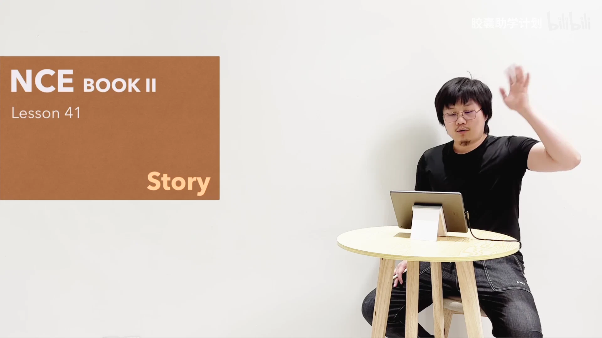

文字识别：NCE / BOOKⅡ / Lesson 41 / Story

### 画面 00:00:02

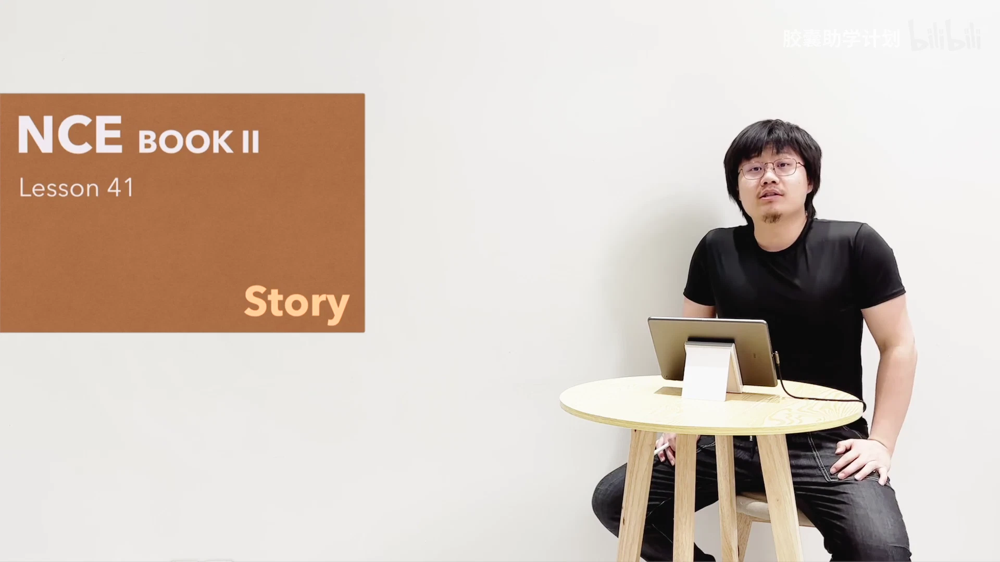

文字识别：NCE / BOOKII / Lesson 41 / Story

### 画面 00:00:09

文字识别：胶囊助学计划bilb出 / •

### 画面 00:00:13

### 画面 00:00:15

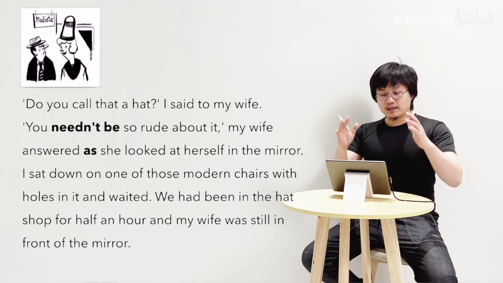

文字识别：madiste / 'Do you call that a hat?' I said to my wife. / 'You needn't be so rude about it,' my wife / answered as she looked at herself in the mirror. / I sat down on one of those modern chairs with / holes in it and waited. We had been in the hat / shop for half an hour and my wife was still in / front of the mirror.

## 00:00:30–00:01:00

讽刺啊，这样的一种语调啊，就不满啊，这样的一个语调在里面。I said to my wife，叫我对我老婆说道，这上来就是打架啊。然后呢，他妻子说了一句话，叫You needn't be so rude about it。你看这里的needn't be so rude，你看needn't be就是咱们在上一个视频语法当中刚刚学过的，叫做need表情态动词，对吧？说你不

### 画面 00:00:45

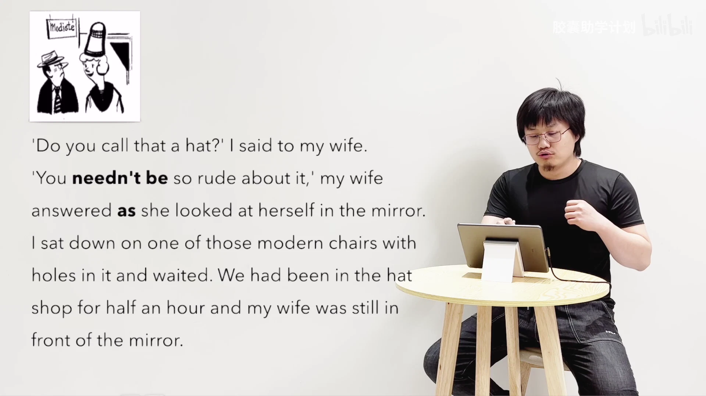

文字识别：modiste / 'Do you callthat a hat?' I said to my wife. / 'You needn't be so rude about it,' my wife / answered as she looked at herself in the mirror. / I sat down on one of those modern chairs with / holes in it and waited. We had been in the hat / shop for half an hour and my wife was still in / front of the mirror.

## 00:01:00–00:01:30

必如此的粗鲁 about it。这地方有一个小的连读叫 about it。 Okay，关于这件事情你不必这么的粗鲁。 Okay，那什么意思呢？什么叫关于这件事情你不必这么的粗鲁呢？哎，就是关于哪一个东西呢？指的是帽子，对吧？你别对于我帽子这件事情不要太粗鲁。 My wife answered。我老婆回答道。 As she looked herself in the mirror。 As我讲过了，as有

### 画面 00:01:15

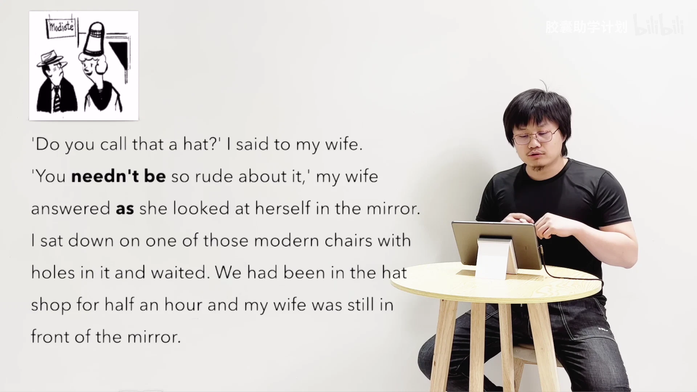

文字识别：modiste / 'Do you call that a hat?' I said to my wife. / 'You needn't be so rude about it,' my wife / answered as she looked at herself in the mirror. / I sat down on one of those modern chairs with / holes in it and waited. We had been in the hat / shop for half an hour and my wife was still in / front of the mirror.

## 00:01:30–00:02:00

very, very many uses. In the beginning, the most common two uses are because and when. Ah, either equal to because or equal to when. And this as in such sentences, you basically only have to read the first and last sentences to understand whether this as is because or when, right? When you have guessed it, it's obvious it's when, right? When she looks at herself in the mirror,

### 画面 00:01:45

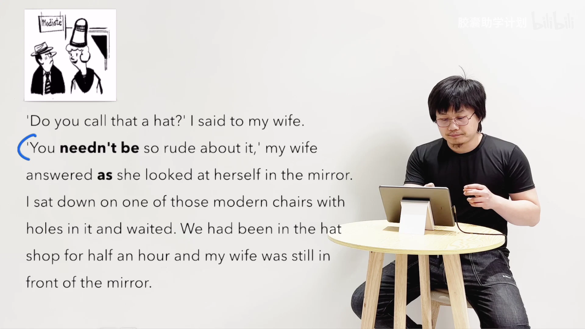

文字识别：modiste / 'Do you call that a hat?' I said to my wife. / You needn't be so rude about it,' my wife / answered as she looked at herself in the mirror. / I sat down on one of those modern chairs with / holes in it and waited. We had been in the hat / shop for half an hour and my wife was still in / front of the mirror.

### 画面 00:01:50

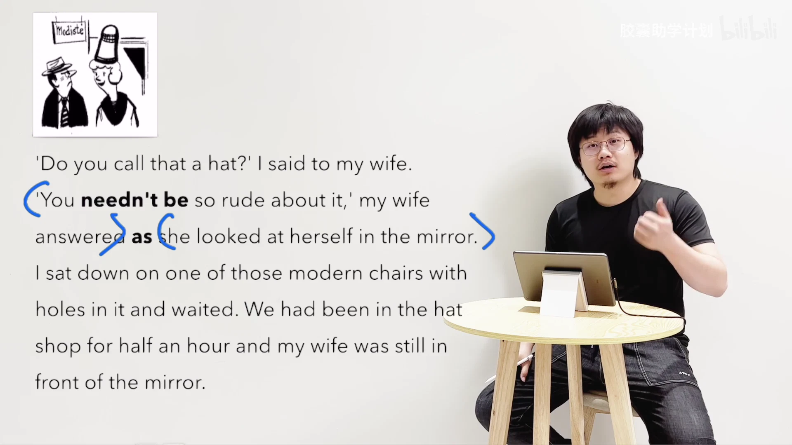

文字识别：madiste / 'Do you call that a hat?' I said to my wife. / You needn't be so rude about it,' my wife / s She looked at herself in the mirror. / answereaas / I sat down on one of those modern chairs with / holes in it and waited. We had been in the hat / shop for half an hour and my wife was still in / front of the mirror.

## 00:02:00–00:02:30

他自己的时候，他这样说道。I sat down. 我坐下了 on one of those modern chairs. 我坐下了在 one of 其中之一一个 those modern chairs 那些现代的特别潮流的这样的一些椅子上. With holes in it, 上面还有洞洞，对吧？OK，各位脑补一下，上面有洞洞，那个呃，这个背，这个靠背上面有很多的洞洞，对吧？

### 画面 00:02:20

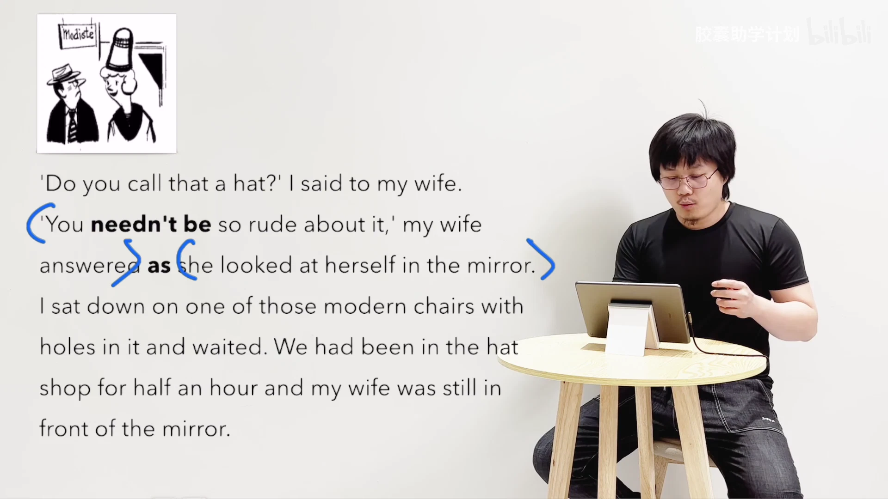

文字识别：madiste / 'Do you call that a hat?' I said to my wife. / You needn't be so rude about it,' my wife / s She looked at herselfin the mirror. / answeredas / I sat down on one of those modern chairs with / holes in it and waited. We had been in the hat / shop for half an hour and my wife was still in / front of the mirror.

## 00:02:30–00:03:00

And waited,然后等啊。 We had been in the hat shop for half an hour.这地方有一个很好玩的语法，过去完成时，从过去持续到过去，对吧？比如说，我举个例子，这里是now，这里是说这句话的past b这个点，这里是a这个点，从a这个点到b这个点，首先a和b都发

### 画面 00:02:39

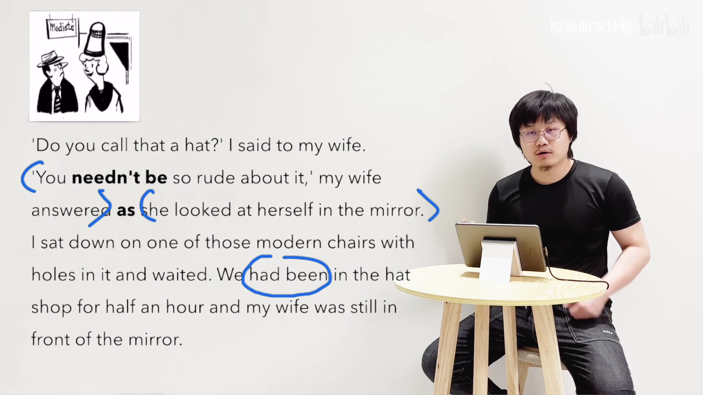

文字识别：modiste / 'Do you call that a hat?' I said to my wife. / You needn't be so rude about it,'my wife / She looked at herself in the mirror. / answereaas / I sat down on one of those modern chairs with / holes in it and waited. Wehad beenin the hat / shop for half an hour and my wife was still in / front of the mirror.

### 画面 00:02:44

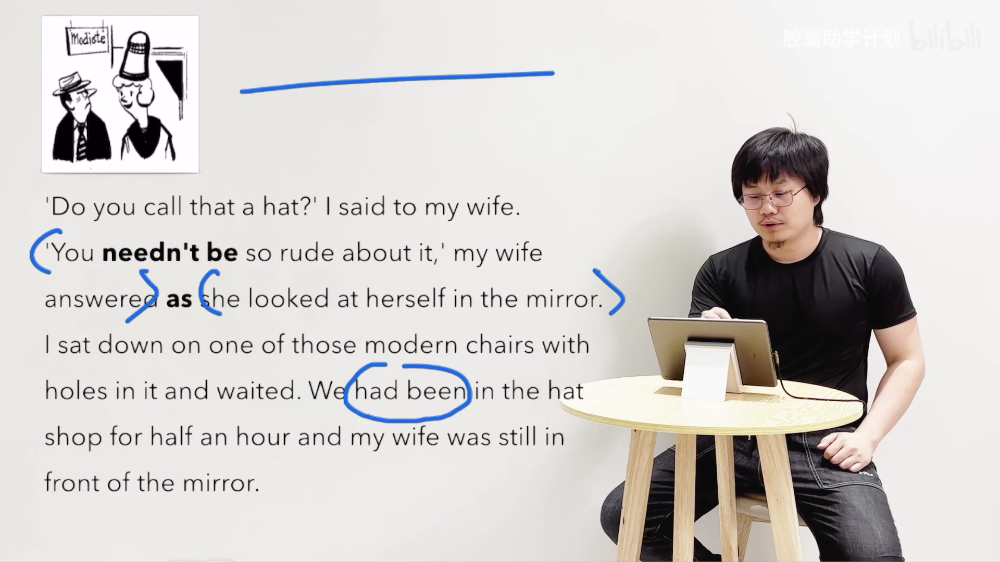

文字识别：madistel / 'Do you call that a hat?' I said to my wife. / You needn't be so rude about it,' my wife / s She looked at herself in the mirror. / answereaas / I sat down on one of those modern chairs with / holes in it and waited. Wehad beenin the hat / shop for half an hour and my wife was still in / front of the mirror.

### 画面 00:02:46

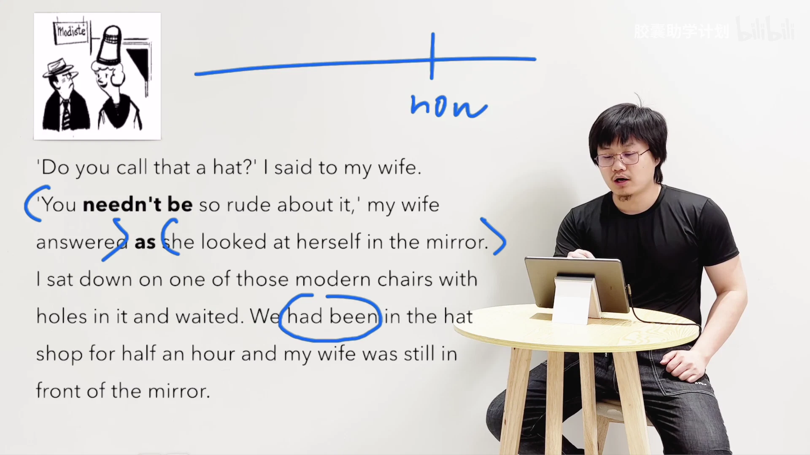

文字识别：madiste / h0w / 'Do you call that a hat?' I said to my wife. / You needn't be so rude about it,' my wife / She looked at herself in the mirror. / answereaas / I sat down on one of those modern chairs with / holes in it and waited. Wehad beenin the hat / shop for half an hour and my wife was still in / front of the mirror.

### 画面 00:02:50

文字识别：madiste / h0w / 'Do you call that a hat?' I said to my wife. / You needn't be so rude about it,' my wife / s he looked at herself in the mirror. / answereg as / I sat down on one of those modern chairs with / holes in it and waited. Wehad beenin the hat / shop for half an hour and my wife was still in / front of the mirror.

### 画面 00:02:57

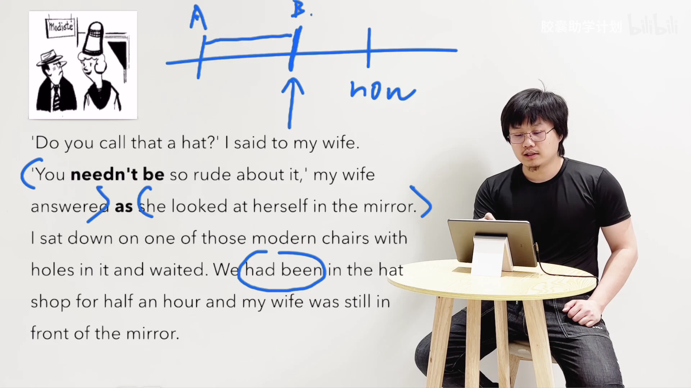

文字识别：maistel / h0w / 'Do you call that a hat?' I said to my wife. / You needn't be so rude about it,' my wife / She looked at herself in the mirror. / answeredas / I sat down on one of those modern chairs with / holes in it and waited. Wehad beenin the hat / shop for half an hour and my wife was still in / front of the mirror.

## 00:03:00–00:03:30

生在过去。其次，A和B中间持续了多长时间呢？三十分钟。所以他用的是We had been in the hat shop for half an hour.我们在帽子商店当中已经持续停留了半个小时了，对吧？Okay. And my wife.然后我老婆呢？Was still in front of the mirror.她依旧在镜子的前面。Still in front

### 画面 00:03:05

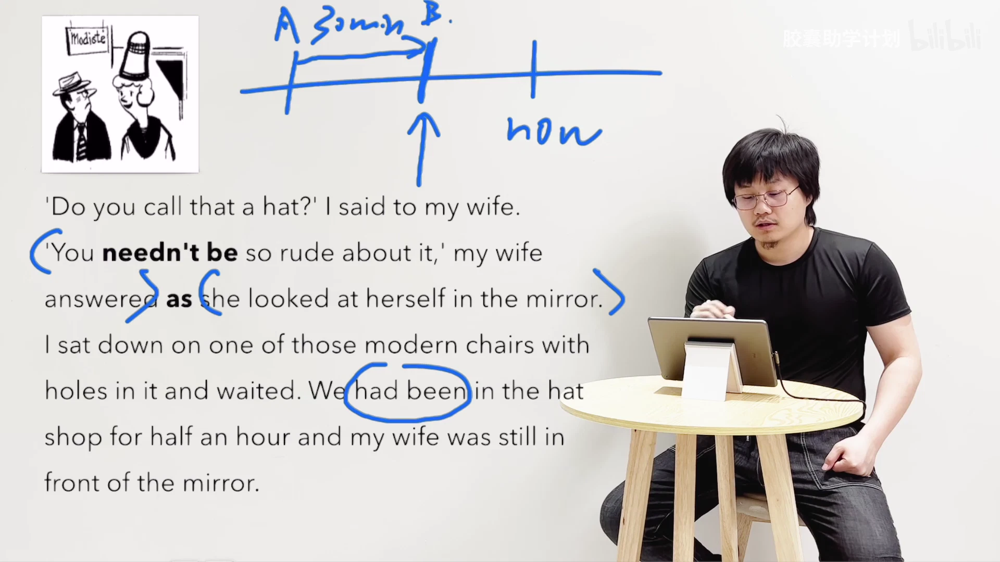

文字识别：A3mn / moaitel / h0w / 'Do you call that a hat?' I said to my wife. / You needn't be so rude about it,' my wife / She looked at herself in the mirror. / answereg as / I sat down on one of those modern chairs with / holes in it and waited. Wehad beenin the hat / shop for half an hour and my wife was still in / front of the mirror.

### 画面 00:03:08

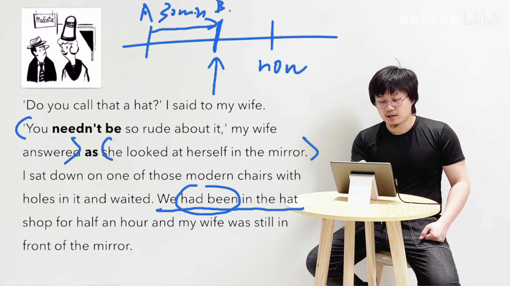

文字识别：A3mn / moaistel / h0w / 'Do you call that a hat?' I said to my wife. / You needn't be so rude about it,' my wife / She looked at herself in the mirror. / answeredas / I sat down on one of those modern chairs with / holes in it and waited. Wehad beenin the hat / shop for half an hour and my wife was still in / front of the mirror.

### 画面 00:03:10

文字识别：A3mn / madiste / h0w / 'Do you call that a hat?' I said to my wife. / You needn't be so rude about it,' my wife / She looked at herselfin the mirror. / answeredas / I sat down on one of those modern chairs with / holes in it and waited. Wehad beenin the hat / shop for half an hour and my wife was still in / front of the mirror.

### 画面 00:03:22

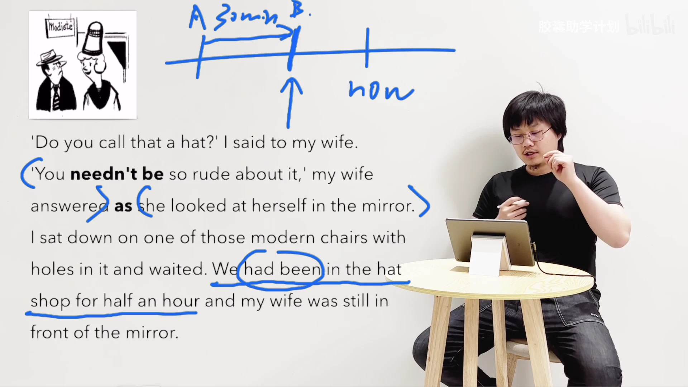

文字识别：A3omn / moaistel / h0w / 'Do you call that a hat?'I said to my wife. / You needn't be so rude about it,' my wife / She looked at herself in the mirror. / answeredas / I sat down on one of those modern chairs with / holes in it and waited. Wehad beenin the hat / shop for half an hour and my wife was still in / front of the mirror.

## 00:03:30–00:04:00

of the mirror, 依旧在镜子的前方，对吧？ Continue. We mustn't buy things we don't need. I remarked remarked suddenly. 我突然间的评论到，评论的是什么呢？ We mustn't buy things. 我们禁止买东西，什么样的东西呢？ We don't need. 我们不需要的东西。我们不应该，我们禁止去买那些我

### 画面 00:03:31

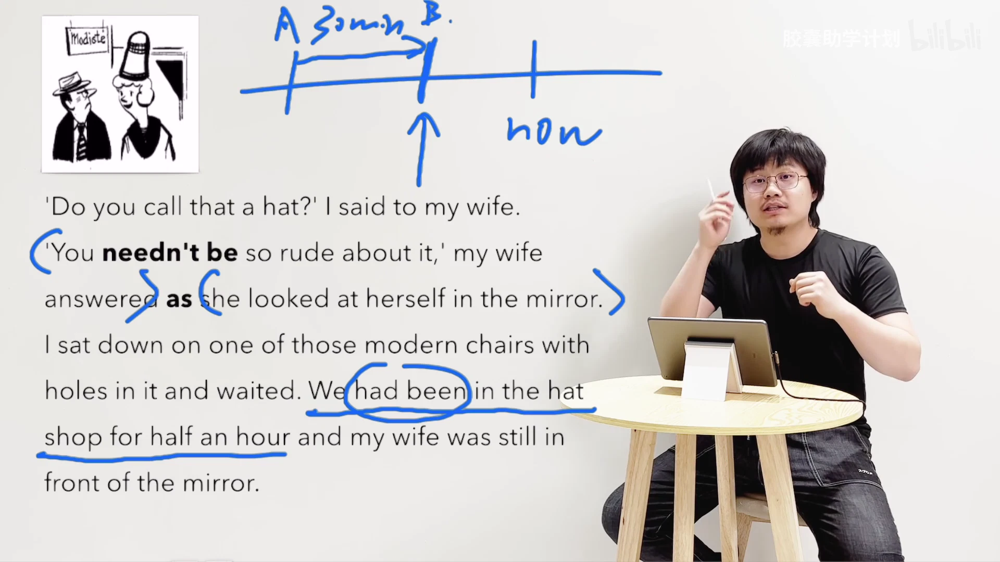

文字识别：A3omn / modiste / h0w / 'Do you call that a hat?' I said to my wife. / You needn't be so rude about it,' my wife / She looked at herself in the mirror. / answered as / I sat down on one of those modern chairs with / holes in it and waited. We had beenin the hat / shop for half an hour and my wife was still in / front of the mirror.

### 画面 00:03:34

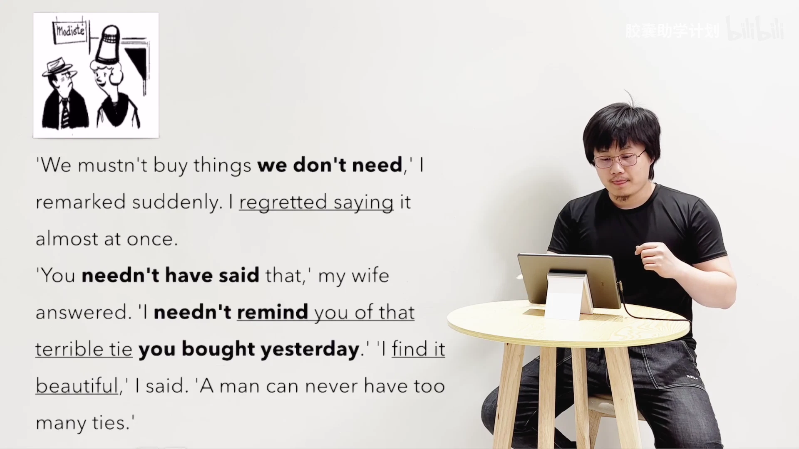

文字识别：madiste / 'We mustn't buy things we don't need,'I / remarked suddenly. I regretted saying it / almost at once. / 'You needn't have said that,' my wife / answered.'I needn't remind you of that / terrible tie you bought yesterday.''I find it / beautiful,' I said.'A man can never have too / many ties.'

## 00:04:00–00:04:30

们不需要的东西。从新一到新二，我跟各位提过很多遍了。Must这个单词一旦变一旦变成否定，呃，它的语气非常的强烈。那它实际上不是不应该，它更多指的甚至是禁止了。我们大多数情况之间，大多数情况之下，是吧？这个夫妻之间不能这么说话啊。所以他在这儿就情

### 画面 00:04:02

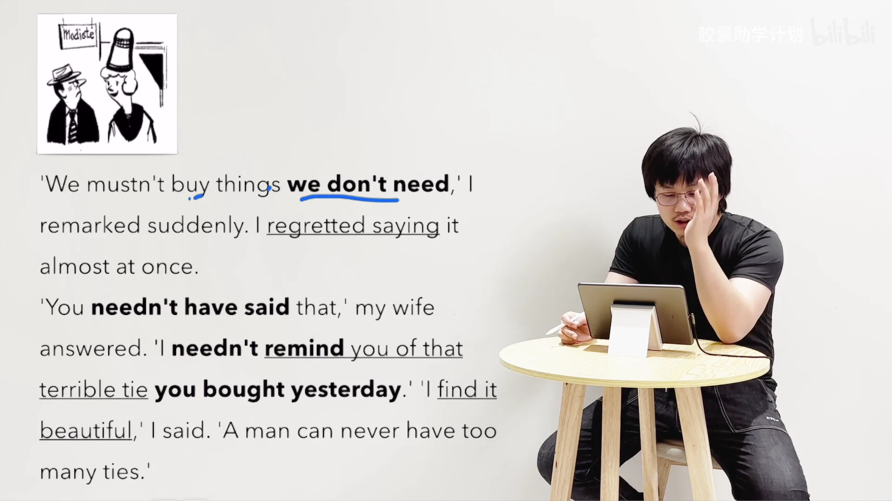

文字识别：madiste / 'We mustn't buy things we don't need,'I / remarked suddenly. I regretted saying it / almost at once. / 'You needn't have said that,' my wife / answered.'I needn't remind you of that / terrible tie you bought yesterday.''I find it / beautiful,' I said.'A man can never have too / many ties.'

### 画面 00:04:05

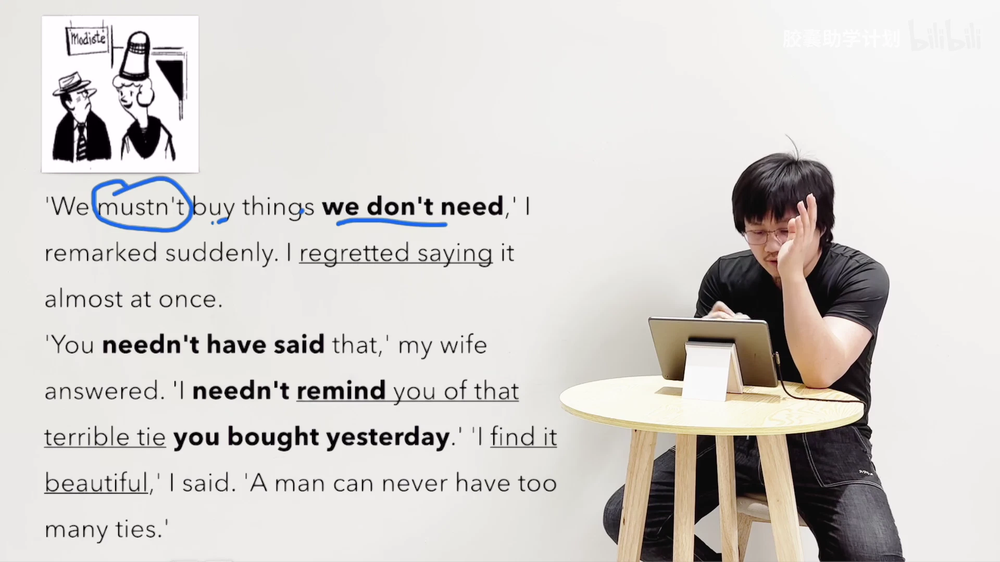

文字识别：modiste / 'We / mustn't)buy things we don't need,'I / remarked suddenly. I regretted saying it / almost at once. / 'You needn't have said that,' my wife / answered.'I needn't remind you of that / terrible tie you bought yesterday.''I find it / beautiful,' I said.'A man can never have too / many ties.'

## 00:04:30–00:05:00

绪很烦，对吧？你想他可能不愿意陪他老婆来，然后就说了这么一句话。所以后边紧跟了一句话叫 I regretted saying it almost at once. I regretted saying it almost at once. Regretted doing something叫做后悔做了某事儿。他说了这句话，他立刻就后悔了。Almost几乎是at once，立刻马上，

### 画面 00:04:30

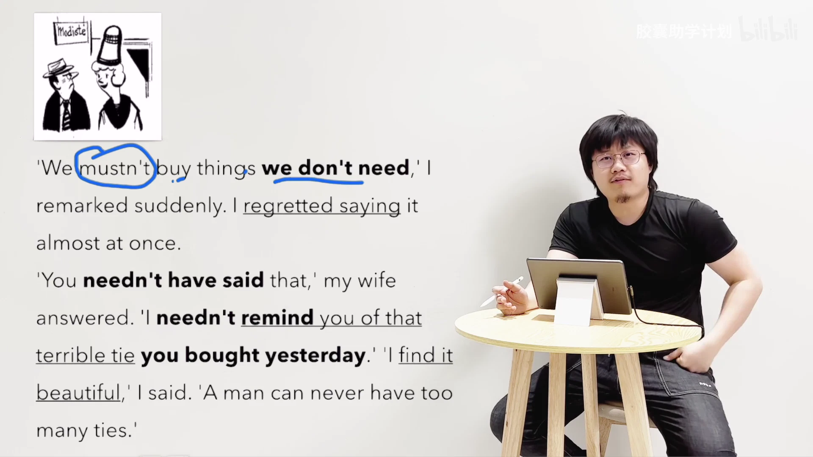

文字识别：modiste / 'Wemustn'tbuy things we don't need,'I / remarked suddenly. I regretted saying it / almost at once. / 'You needn't have said that,' my wife / answered.'I needn't remind you of that / terrible tie you bought yesterday.''I find it / beautiful,' I said.'A man can never have too / many ties.'

### 画面 00:04:38

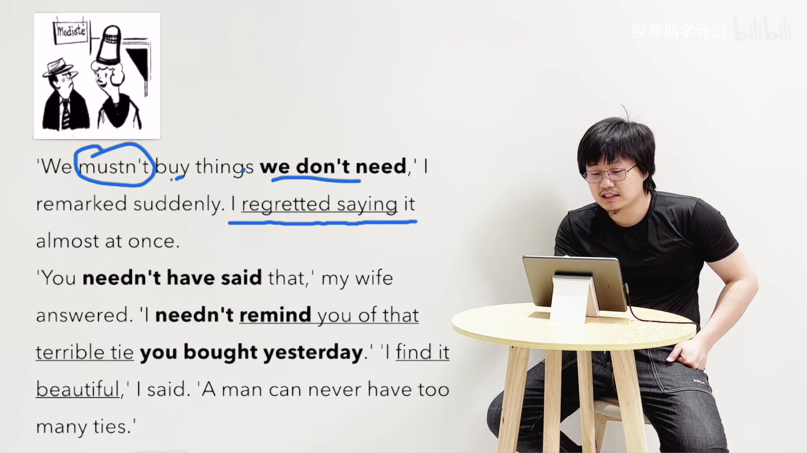

文字识别：modiste / 'We / mustn't)buy things we don't need,'I / remarked suddenly. I regretted saying it / almost at once. / 'You needn't have said that,' my wife / answered.'I needn't remind you of that / terrible tie you bought yesterday.''I find it / beautiful,' I said.'A man can never have too / many ties.'

### 画面 00:04:43

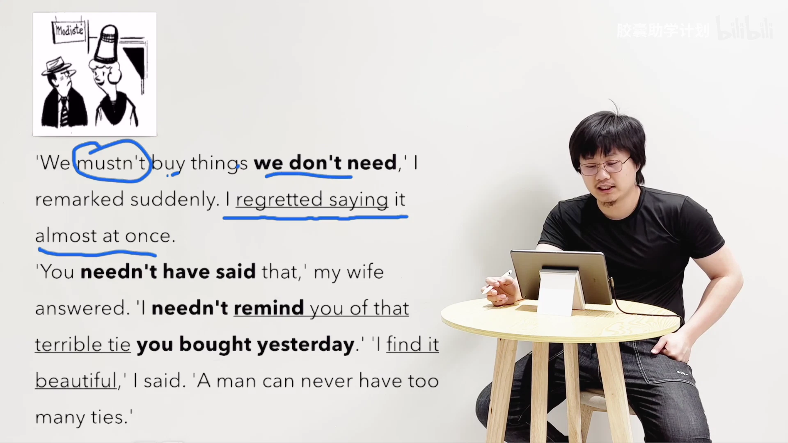

文字识别：modiste / 'We / mustn't)buy things we don't need,' I / remarked suddenly. I regretted saying it / almost at once. / 'You needn't have said that,' my wife / answered.'I needn't remind you of that / terrible tie you bought yesterday.''I find it / beautiful,' I said.'A man can never have too / many ties.'

## 00:05:00–00:05:30

对吧？叫做我几乎是立刻马上就后悔我说了这句话。哪句话呢？We mustn't buy things we don't need.那we don't need实际上是一个什么定从修饰的是things. OK，翻译成我们不需要的那些东西啊。接下来，You needn't have said that.啊，我觉得这句话就特别的有意思，有一种感觉啊。你看，My wife answered.我老婆回答道，

### 画面 00:05:08

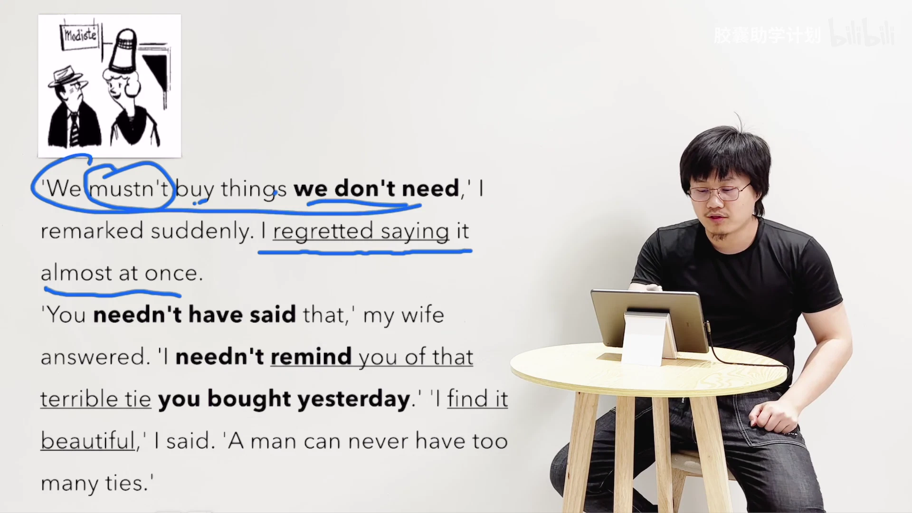

文字识别：modiste / We / mustn't)buy things we don't need,'I / remarked suddenly. I regretted saying it / almost at once. / 'You needn't have said that,' my wife / answered.'I needn't remind you of that / terrible tie you bought yesterday.''I find it / beautiful,' I said.'A man can never have too / many ties.'

### 画面 00:05:10

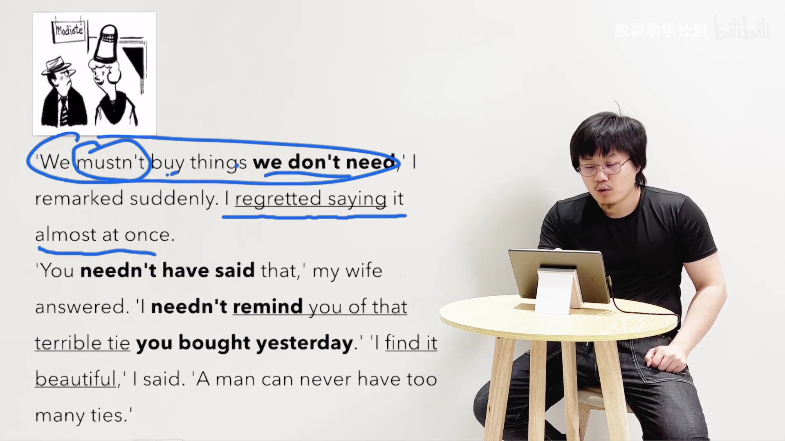

文字识别：modiste / We / mustn't buy things we don't neeo / remarked suddenly. I regretted saying it / almost at once. / 'You needn't have said that,' my wife / answered.'I needn't remind you of that / terrible tie you bought yesterday.''I find it / beautiful,' I said.'A man can never have too / many ties.'

### 画面 00:05:12

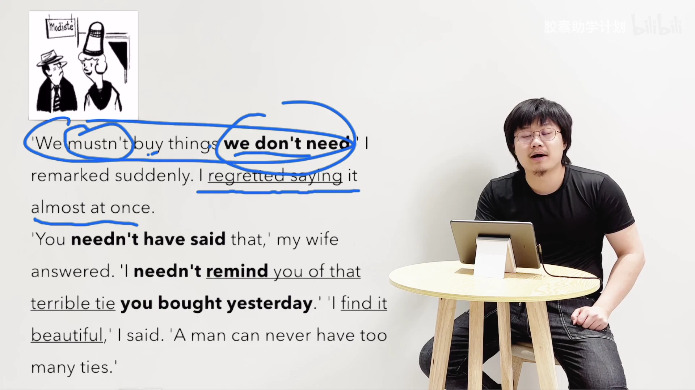

文字识别：modiste / We / mustn't buy things we don't neeo / remarked suddenly.I regretted saying it / almost at once. / 'You needn't have said that,' my wife / answered.'I needn't remind you of that / terrible tie you bought yesterday.''I find it / beautiful,' I said.'A man can never have too / many ties.'

### 画面 00:05:16

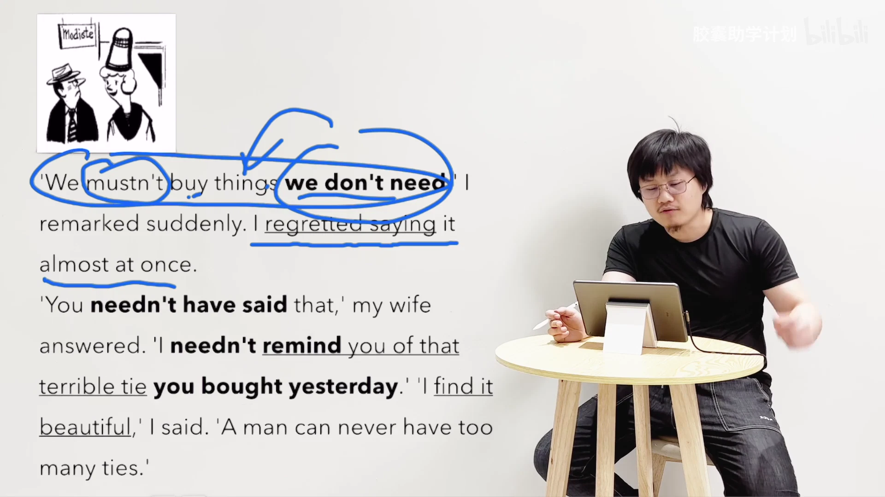

文字识别：modiste / We / mustn't buy thingewe don't neeo / remarked suddenly.I regretted saying it / almost at once. / 'You needn't have said that,' my wife / answered.'I needn't remind you of that / terrible tie you bought yesterday.''I find it / beautiful,'I said.'A man can never have too / many ties.'

### 画面 00:05:24

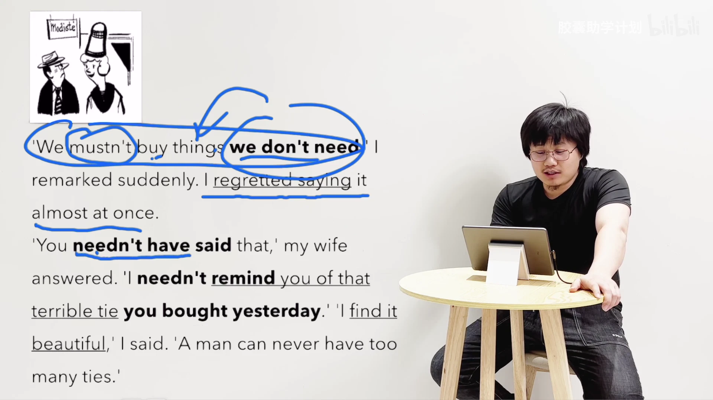

文字识别：modiste / We / mustn't buy thingswe don't neeo / remarked suddenly. I regretted saying it / almost at once. / 'You needn't have said that,' my wife / answered.'I needn't remind you of that / terrible tie you bought yesterday.'I find it / beautiful,'I said.'A man can never have too / many ties.'

### 画面 00:05:26

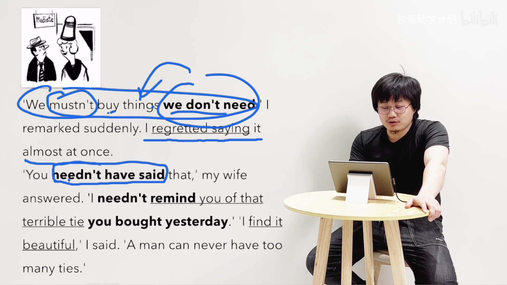

文字识别：modiste / We / mustn't buy thingswe don't neeo / remarked suddenly. I regretted saying it / almost at once. / 'You / heedn't have saidthat,' my wife / answered.'I needn't remind you of that / terrible tie you bought yesterday.'I find it / beautiful,' I said.'A man can never have too / many ties.'

## 00:05:30–00:06:00

哎，你本不应该呀这样去说啊。我有一种感觉是什么呢？就是我接下来要复仇了，是吧？你看，你给了我一个话茬，你说你说的是我们不需要的东西，我们就不应该买，禁止买。然后呢，我现在抓到你的把柄了，你本不应该这样说呀，对吧？哎，但是怎么样？很抱歉，你说了。那接下来我一定要说点东西了。看他说的是什么。他媳妇儿说，I needn't remind

### 画面 00:05:31

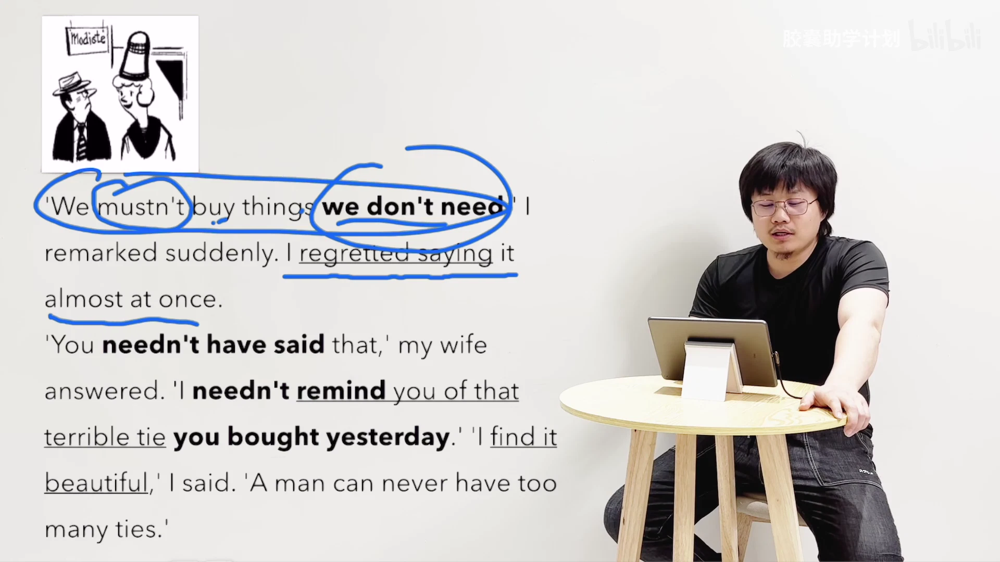

文字识别：modiste / We / mustn't buy things we don't neeo / remarked suddenly. I regretted saying it / almost at once. / 'You needn't have said that,' my wife / answered.'I needn't remind you of that / terrible tie you bought yesterday.''I find it / beautiful,'I said.'A man can never have too / many ties.'

### 画面 00:05:33

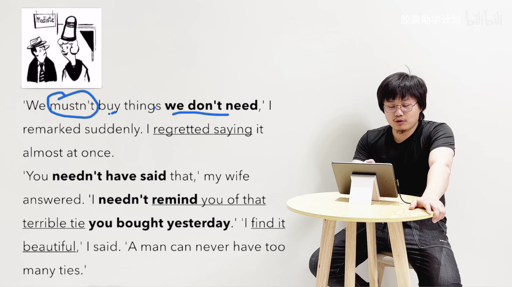

文字识别：modiste / 'Web / mustn't)buy things we don't need,' I / remarked suddenly. I regretted saying it / almost at once. / 'You needn't have said that,' my wife / answered.'I needn't remind you of that / terrible tie you bought yesterday.''I find it / beautiful,' I said.'A man can never have too / many ties.'

### 画面 00:05:35

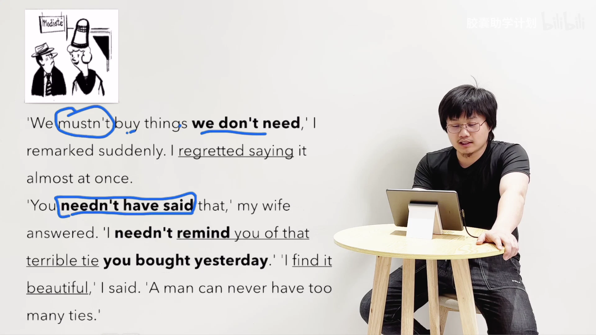

文字识别：modiste / 'Web / mustn't)buy things we don't need,'I / remarked suddenly. I regretted saying it / almost at once. / 'You / needn't have said / )that,' my wife / answered.'I needn't remind you of that / terrible tie you bought yesterday.''I find it / beautiful,' I said.'A man can never have too / many ties.'

## 00:06:00–00:06:30

you of that terrible tie you bought yesterday.这句话太经典了。I needn't remind.首先，这里是一个小的语法，needn't加do need表情态动词，对吧？叫做我不必提醒。Remind you of that terrible tie is remind somebody of something.叫提醒你那个特别糟糕的领带。后边跟了三个单词，

### 画面 00:06:00

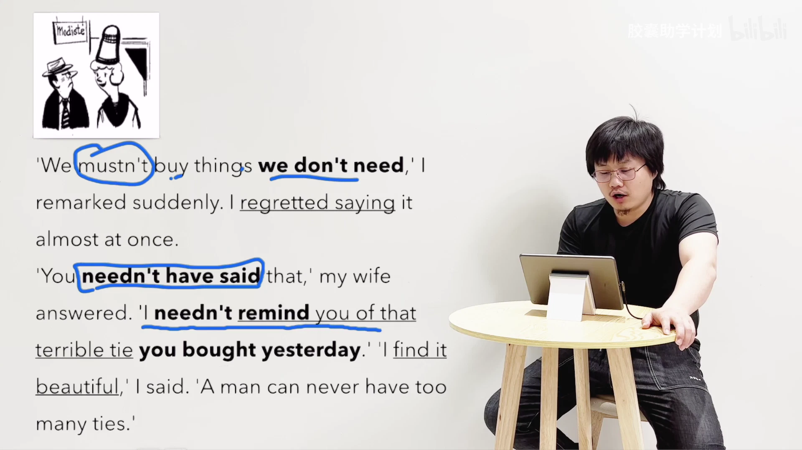

文字识别：modiste / 'We / mustn't buy things we don't need,'I / remarked suddenly. I regretted saying it / almost at once. / 'You / needn't have said / that,' my wife / answered.'I needn't remind you of that / terrible tie you bought yesterday.''I find it / beautiful,' I said.'A man can never have too / many ties.'

### 画面 00:06:03

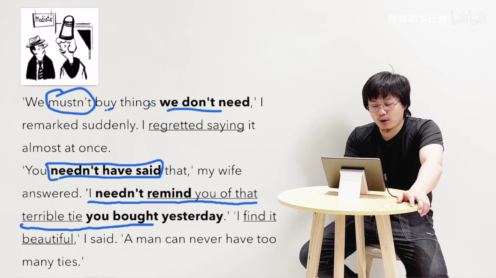

文字识别：modiste / 'We / mustn't buy things we don't need,'I / remarked suddenly. I regretted saying it / almost at once. / 'You / needn't have said / )that,'my wife / answered.'I needn't remind you of that / terrible tie you bought yesterday.'I find it / beautiful,'I said.'A man can never have too / many ties.'

## 00:06:30–00:07:00

叫 you bought yesterday，其实是省略了 which 的一个定语从句，修饰的是 tie，对吧？所以 terrible 是形容 tie 的。 you bought yesterday 这句话也是形容 tie 的定语从句嘛？所以这句话就变成了叫做我我不必提醒你那个特别糟糕的你昨天买的那个领带吧。好，你注意，其

### 画面 00:06:33

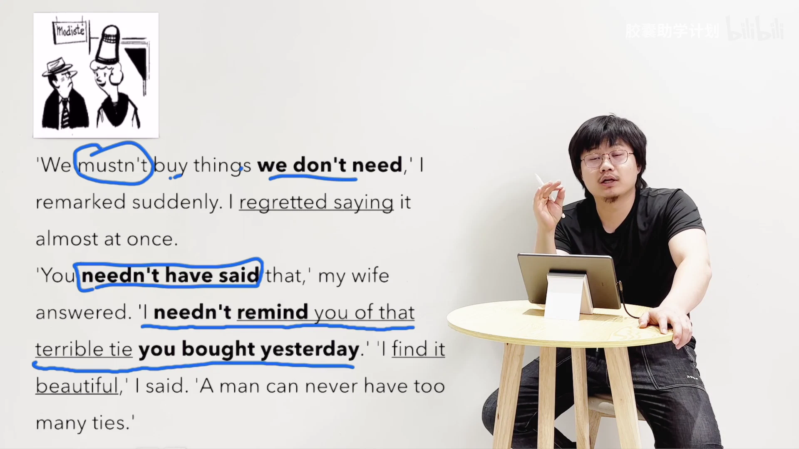

文字识别：modiste / 'We / mustn'tbuy things we don't need,'I / remarked suddenly. I regretted saying it / almost at once. / 'You / needn't have said / that,'my wife / answered.'I needn't remind you of that / terrible tie you bought yesterday.'I find it / beautiful,'I said.'A man can never have too / many ties.'

### 画面 00:06:41

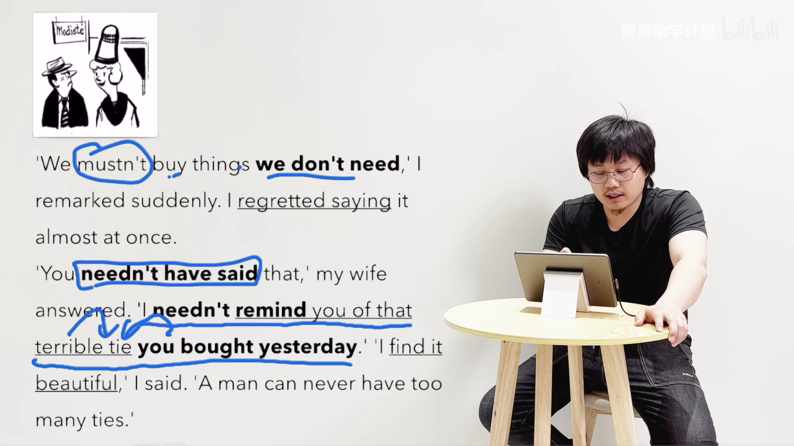

文字识别：modiste / 'We / mustn'tbuy things we don't need,'I / remarked suddenly. I regretted saying it / almost at once. / 'You / needn't have said / )that,'my wife / answared."needn'tremind you of that / terrible tie you bought yesterday'I find it / beautiful,' I said.'A man can never have too / many ties.'

## 00:07:00–00:07:30

实就是提醒了嘛，对吧？用一个否定去提醒了，是吧？我没有必要提醒你啊。他老公嘴硬说了一句话，I find it beautiful，啊，我觉得她很漂亮。你觉得 terrible？我觉得很漂亮，是吧？我认为啊，她漂亮。I said，我说的，我在这里就是那个男主人公。接下来这句话很经典，他说，A man can never have too many ties。

### 画面 00:07:00

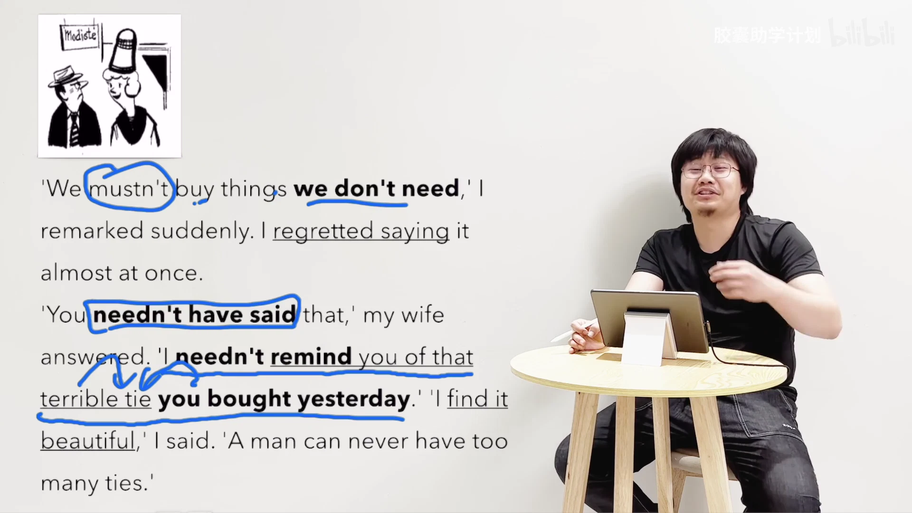

文字识别：modiste / 'We / mustn'tbuy things we don't need,'I / remarked suddenly. I regretted saying it / almost at once. / 'You / needn't have said / )that,'my wife / answered:' needn't remind you of that / terrible tie you bought yesterday.' 'I find it / beautiful,'I said.'A man can never have too / many ties.'

### 画面 00:07:14

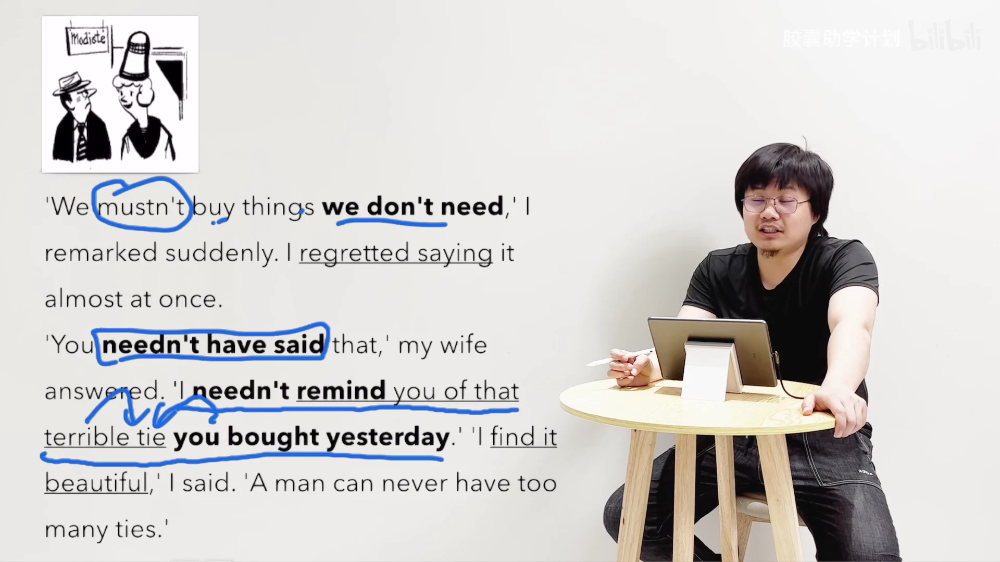

文字识别：modiste / 'We / mustn't)buy things we don't need,'I / remarked suddenly. I regretted saying it / almost at once. / 'You / needn't have said / that,'my wife / terrible tie you bought yesterday.' 'I find it / beautiful,'I said.'A man can never have too / many ties.'

## 00:07:30–00:08:00

He says a man, ah, can never, can never,永远都不能，永远都不能怎么样呢? Have,拥有too many ties,永远都不会拥有过多的领带。如果你汉语感好，你现在已经明白我想说什么了。如果你汉语感不是特别的好，我提醒你一下，这里有一个never，有一个to，这变变成了数学题了。如果我说a man can

### 画面 00:07:44

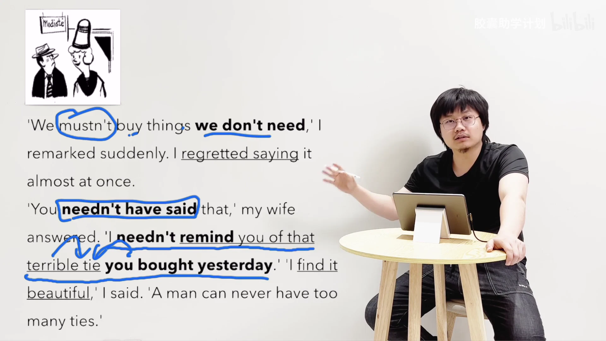

文字识别：modiste / 'We / mustn't)buy things we don't need,'I / remarked suddenly.I regretted saying it / almost at once. / 'You / needn't have said / that,'my wife / answered:.'needn't remind you of that / terrible tie you bought yesterday.' 'I find it / beautiful,'I said.'A man can never have too / many ties.'

### 画面 00:07:54

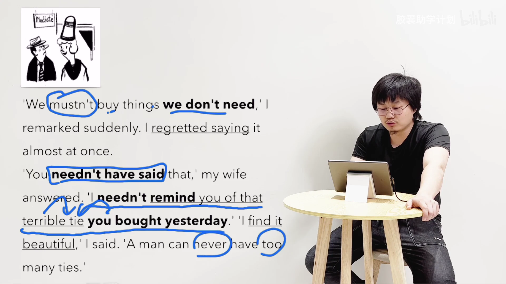

文字识别：modiste / 'We / mustn'tbuy things we don't need,'I / remarked suddenly. I regretted saying it / almost at once. / 'You / needn't have said / that,'my wife / answened:'lneedn't remind you of that / terrible tie you bought yesterday.' 'I find it / beautiful,' I said.'A man can hever have too / many ties.'

## 00:08:00–00:08:30

have many ties的意思叫做一个男人可以有很多领带。我把never和too都省略掉了，对吧？一个男人可以有很多领带。那a man can never have too many ties. Never首先是个否定，too又是个否定。新概念一册里百一百零三课咱学的，对吧？又是个否定。这就回到我们很小很小的时候语文学过的一个东西，叫双重否定等于的是肯定，对吧？哎，呃，你不得不

### 画面 00:08:24

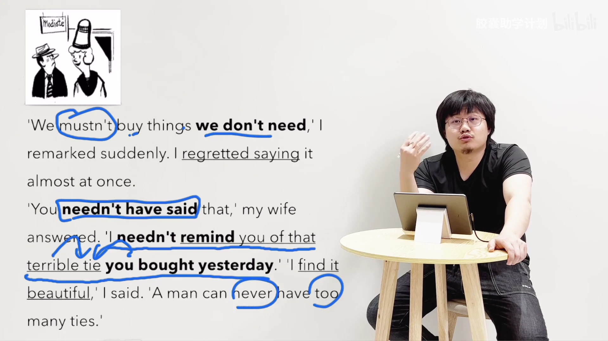

文字识别：modiste / 'We / mustn'tbuy things we don't need,'I / remarked suddenly. I regretted saying it / almost at once. / 'You / needn't have said / that,' my wife / terrible tie you k / bought yesterday.''I find it / beautiful,'I said.'A man can hever nave too / many ties.'

## 00:08:30–00:09:00

说他，呃，你怎么能说他不是一个好人呢？对吧？啊，很难说他不是一个好人呢。双重否定啊，等于肯定。所以这句话其实的意思就是，a man can have many ties，一个男人可以有很多领带，对吧？那为什么用双重否定呢？双重否定既然约，它叫约等于肯定啊，它比肯定的语气要更强一点，叫做一个男人永远都不会有过多的太多的领带

### 画面 00:08:54

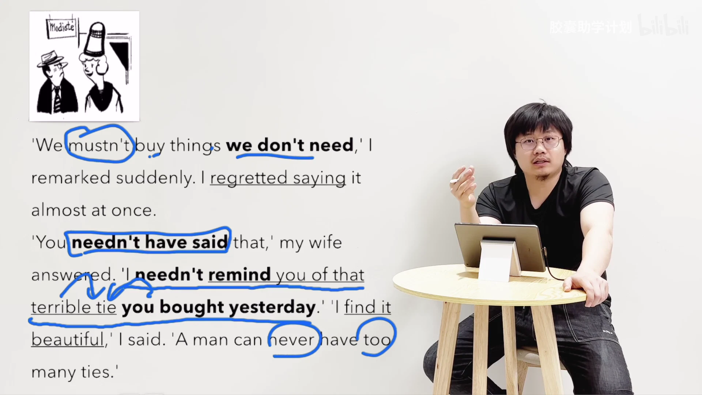

文字识别：modiste / 'We / mustn'tbuy things we don't need,'I / remarked suddenly. I regretted saying it / almost at once. / 'You / needn't have said / that,'my wife / terrible tie you bought yesterday.''I find it / beautiful,' I said.'A man can heverhave too / many ties.'

## 00:09:00–00:09:30

呀啊，再多领带都不会嫌多的啊，就是这样一句话。你看，接下来他老婆说了一句特别有意思的话：，And a woman can't have too many hats。他说，那女人啊，一个女人啊，不会有过多的帽子啊。你不嫌我帽子烦吗？我还嫌你领带烦呢。你跟我说一个男人有再多领带都不嫌多，那我立刻回敬你一个，叫做女人有再多的帽子也不嫌多。还

### 画面 00:09:05

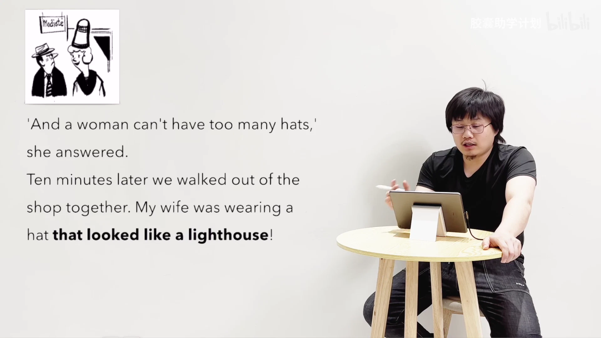

文字识别：modiste / 'And a woman can't have too many hats,' / she answered. / Ten minutes later we walked out of the / shop together. My wife was wearing a / hat that looked like a lighthouse!

### 画面 00:09:10

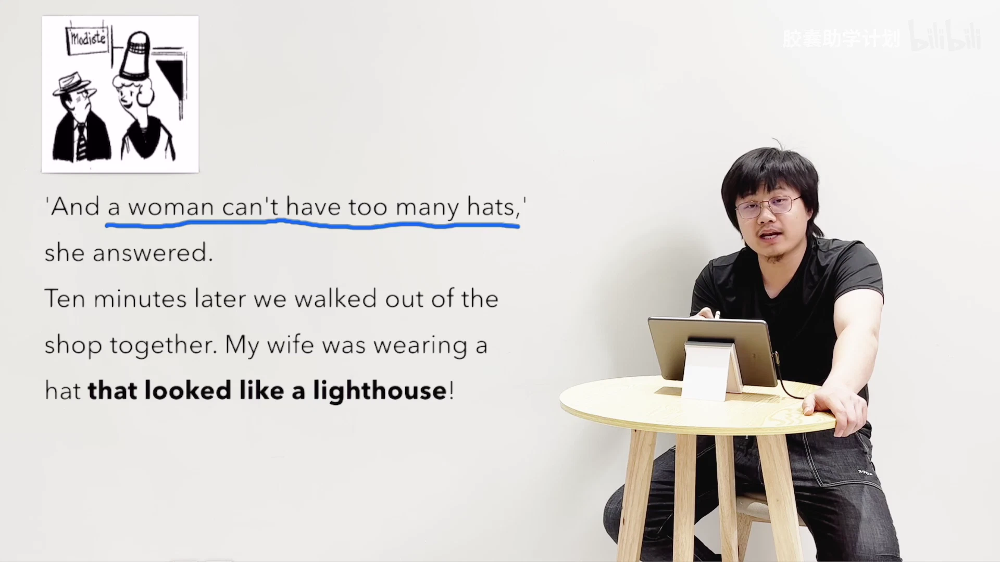

文字识别：modiste / 'And a woman can't have too many hats,' / she answered. / Ten minutes later we walked out of the / shop together. My wife was wearing a / hat that looked like a lighthouse!

### 画面 00:09:15

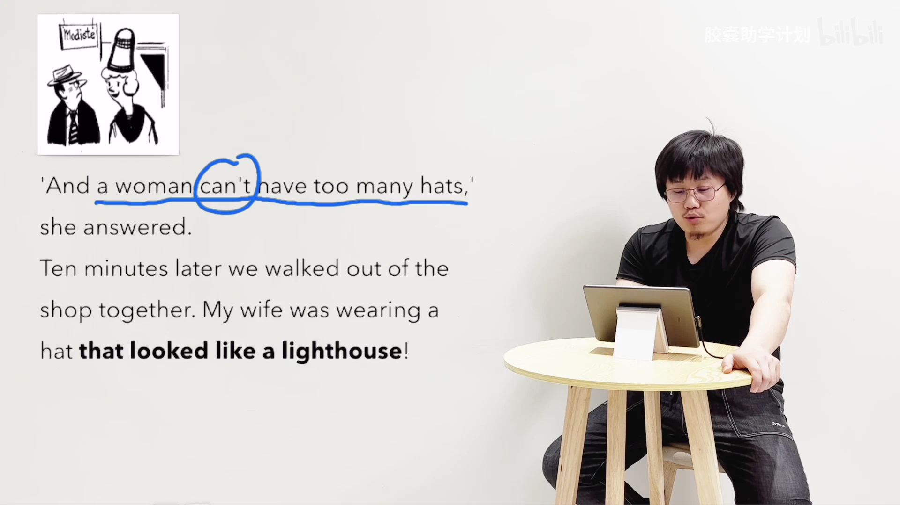

文字识别：modiste / 'And a womancan't have too many hats,' / she answered. / Ten minutes later we walked out of the / shop together. My wife was wearing a / hat that looked like a lighthouse!

### 画面 00:09:19

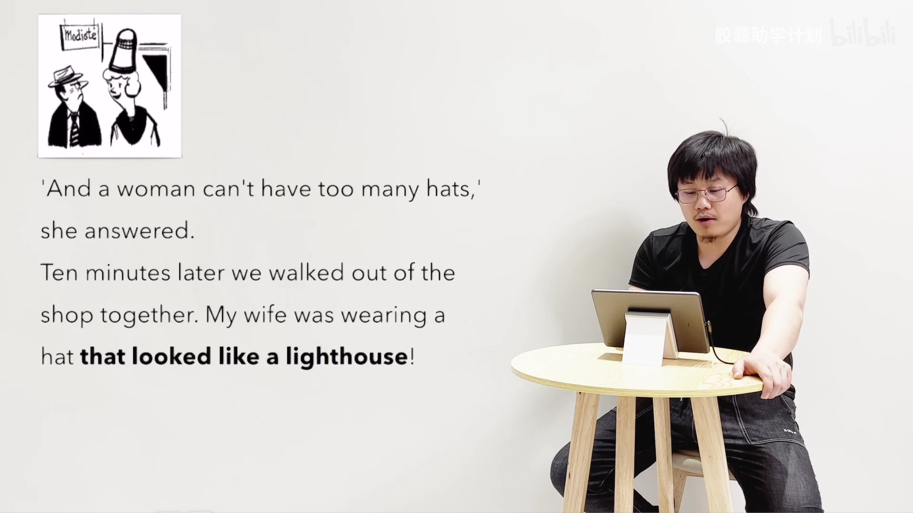

文字识别：modiste / 'And a woman can't have too many hats,' / she answered. / Ten minutes later we walked out of the / shop together. My wife was wearing a / hat that looked like a lighthouse!

## 00:09:30–00:10:00

是那句话，如果看到这里你翻译不过来，你先把 not 和 to 给它取消掉，这句话就变成了 a man, a woman can have many hats，对吧？跟刚才那句话一样，只不过它变成了个双否，not 是否定，to 是否定，对吧？所以如果我现在讲说 to 是否定，你不明白什么意思的，赶紧去翻新概念一册一百零三课，我们之前录制的那个课程去看一遍，写一下练习，您就

### 画面 00:09:34

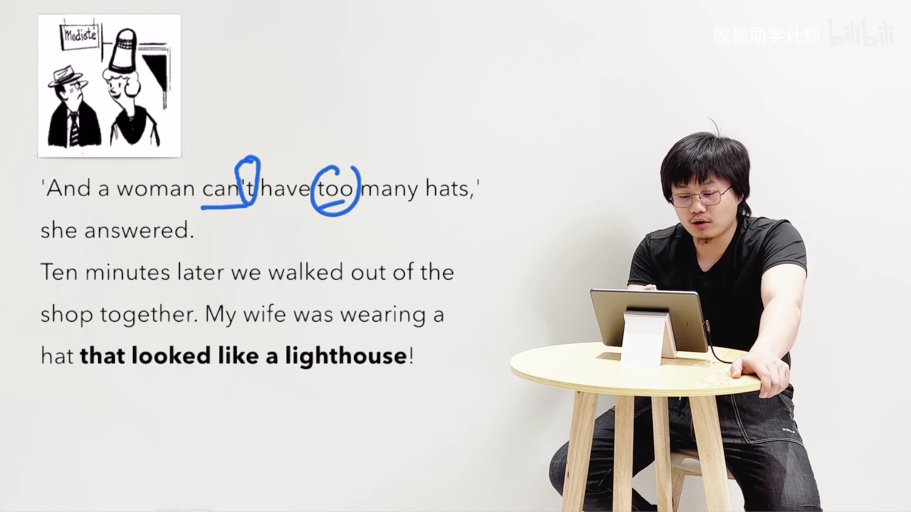

文字识别：modiste / 'And a woman cant havetoomany hats,' / she answered. / Ten minutes later we walked out of the / shop together. My wife was wearing a / hat that looked like a lighthouse!

## 00:10:00–00:10:30

会了，对吧？She answered. He answered. Ten minutes later,十分钟之后，we walked out of the shop together. 十分钟之后，我们一起走出了商店. My wife was wearing a hat. 说我媳妇儿啊，正戴着一个帽子。什么样的帽子呢？That looked like a lighthouse. 说，那定语从句啊，说像看起来像一个灯塔一样的帽

### 画面 00:10:04

文字识别：modiste / 'And a woman can't / havetoo / )many hats,' / she answered. / Ten minutes later we walked out of the / shop together. My wife was wearing a / hat that looked like a lighthouse!

### 画面 00:10:21

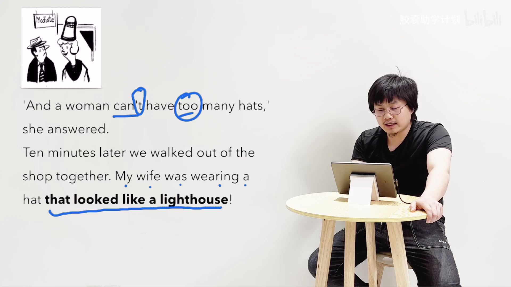

文字识别：modiste / 'And a woman can't / havetoo / many hats,' / she answered. / Ten minutes later we walked out of the / shop together. My wife was wearing a / hat that looked like a lighthouse!

## 00:10:30–00:11:00

子啊，我觉得这个太损了。这句话说的是吧？这个 look 看起来 like 这里不是喜欢，是像，是吧？看起来像灯塔一样。 Okay, very good. 文章当中有两个习惯用法，一个是我们今天刚见的，一个是我们之前学过的，是吧？啊，但我们都一起用一下啊。我们先说 regret doing something. Regret doing something. 注意一个小点，它指的是我后悔我做过了某件事情。这件事情做没做呢？我做了，我后

### 画面 00:10:34

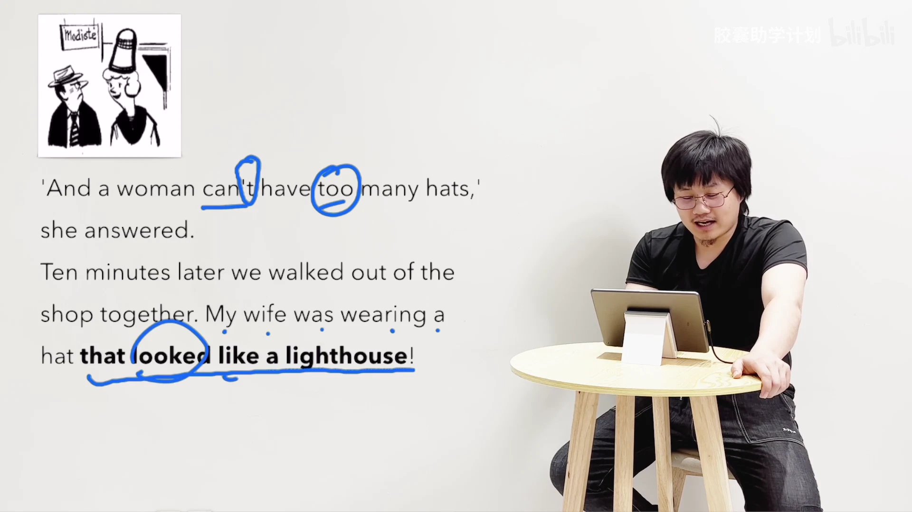

文字识别：modiste / 'And a woman can't / have / too / many hats,' / she answered. / Ten minutes later we walked out of the / shop together. My wife was wearing a / • / hat that looked like a lighthouse!

### 画面 00:10:39

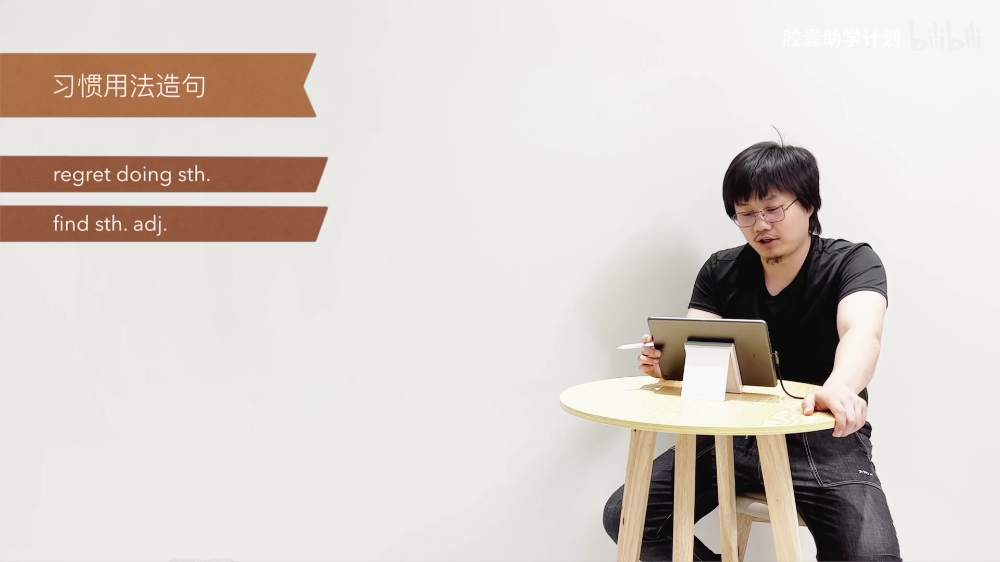

文字识别：习惯用法造句 / regret doing sth. / find sth. adj.

### 画面 00:10:41

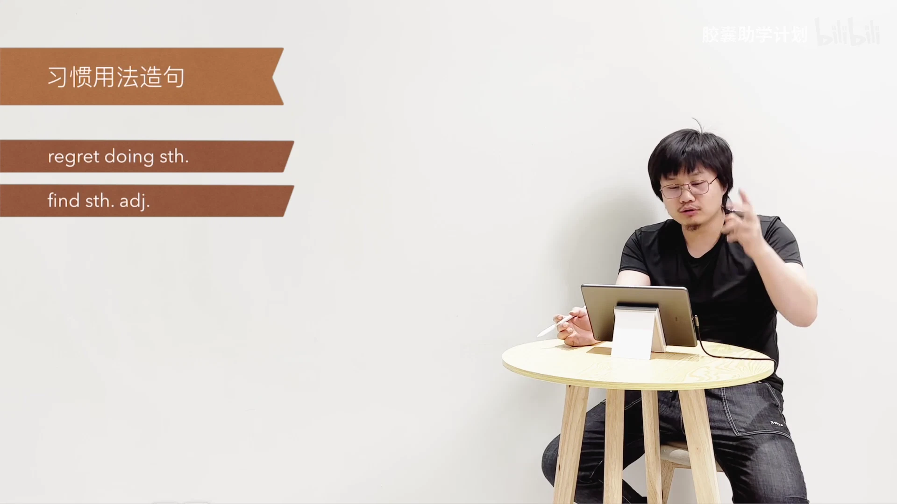

文字识别：习惯用法造句 / regret doing sth. / find sth. adj.

### 画面 00:10:44

文字识别：习惯用法造句 / regret doing sth. / find sth. adj.

### 画面 00:10:46

文字识别：习惯用法造句 / regret doing sth. / find sth. adj.

### 画面 00:10:49

文字识别：网：v.+v.变化 / 习惯用法造句指南 / 四句型转换 / 方式/地点/时间 / 其他习惯用法 / 其他单词+词性 / 原文摘抄+变 / 6123456 / regret doing sth.

### 画面 00:10:51

文字识别：网：v.+v.变化 / 习惯用法造句指南 / 四句型转换 / 方式/地点/时间 / 其他习惯用法 / 其他单词+词性 / 原文摘抄+变 / 6123456 / regret doing sth.

### 画面 00:10:54

文字识别：网：v.+v.变化 / 习惯用法造句指南 / 四句型转换 / 方式/地点/时间 / 其他习惯用法 / 其他单词+词性 / 原文摘抄+变 / 6123456 / regret doing sth.

### 画面 00:10:56

文字识别：网：v.+v.变化 / 习惯用法造句指南 / 四句型转换 / 方式/地点/时间 / 其他习惯用法 / 其他单词+词性 / 原文摘抄+变 / 6123456 / regret doing sth.

## 00:11:00–00:11:30

悔我做了这件事情。好吧，注意啊，比如说，I regretted helping him on the street yesterday morning. 我后悔昨天在马，昨天早晨在马路上我帮助了他。你帮没帮？你帮了。你后悔的是你帮了这件事儿，听见了吧？你后悔的是你做过的这件事儿啊。 Next one, 然后呢？Did when who what a各种一般疑问句、特殊疑问句、四句型转化，对吧？我们习

### 画面 00:11:01

文字识别：网：v.+v.变化 / 习惯用法造句指南 / 四句型转换 / 方式/地点/时间 / 其他习惯用法 / 其他单词+词性 / 原文摘抄+变 / 6123456 / regret doing sth.

### 画面 00:11:03

文字识别：网：v.+v.变化 / 习惯用法造句指南 / 四句型转换 / 方式/地点/时间 / 其他习惯用法 / 其他单词+词性 / 原文摘抄+变 / 6123456 / regret doing sth. / I regretted helping him on the street / yesterday morning.

### 画面 00:11:05

文字识别：网：v.+v.变化 / 习惯用法造句指南 / 四句型转换 / 方式/地点/时间 / 其他习惯用法 / 其他单词+词性 / 原文摘抄+变 / 6123456 / regret doing sth. / I regretted helping him on the street / yesterday morning.

### 画面 00:11:10

文字识别：网：v.+v.变化 / 习惯用法造句指南 / 四句型转换 / 方式/地点/时间 / 其他习惯用法 / 其他单词+词性 / 原文摘抄+变 / 6123456 / regret doing sth. / I regretted helping him on the street / yesterday morning.

### 画面 00:11:20

文字识别：网：v.+v.变化 / 习惯用法造句指南 / 四句型转换 / 方式/地点/时间 / 其他习惯用法 / 其他单词+词性 / 原文摘抄+变 / 6123456 / regret doing sth. / I regretted helping him on the street / yesterday morning.

### 画面 00:11:24

文字识别：网：v.+v.变化 / 习惯用法造句指南 / 四句型转换 / 方式/地点/时间 / 其他习惯用法 / 其他单词+词性 / 原文摘抄+变 / 6123456 / regret doing sth. / I regretted helping him on the street / yesterday morning. / did/when/who/why...

### 画面 00:11:26

文字识别：网：v.+v.变化 / 习惯用法造句指南 / 四句型转换 / 方式/地点/时间 / 其他习惯用法 / 其他单词+词性 / 原文摘抄+变 / 6123456 / regret doing sth. / I regretted helping him on the street / yesterday morning. / did/when/who/why...

## 00:11:30–00:12:00

惯用法也是这个套路啊。我们还可以说，He regretted drinking the milk in the fridge。他后悔在冰箱里面喝了牛奶，对不对？Continuing，说，I think he regrets telling that story。一个小的宾语从句，I think后面直接加上了一个宾语从句，对吧？我认为啊，他后悔讲了那个故事。那tell a story，tell stories，二十

### 画面 00:11:30

文字识别：网：v.+v.变化 / 习惯用法造句指南 / 四句型转换 / 方式/地点/时间 / 其他习惯用法 / 其他单词+词性 / 原文摘抄+变 / 6123456 / regret doing sth. / I regretted helping him on the street / yesterday morning. / did/when/who/why...

### 画面 00:11:35

文字识别：网：v.+v.变化 / 习惯用法造句指南 / 四句型转换 / 方式/地点/时间 / 其他习惯用法 / 其他单词+词性 / 原文摘抄+变 / 6123456 / regret doing sth. / I regretted helping him on the street / yesterday morning. / did/when/who/why... / He regretted drinking the milk in the fridge.

### 画面 00:11:43

文字识别：网：v.+v.变化 / 习惯用法造句指南 / 四句型转换 / 方式/地点/时间 / 其他习惯用法 / 其他单词+词性 / 原文摘抄+变 / 6123456 / regret doing sth. / I regretted helping him on the street / yesterday morning. / did/when/who/why... / He regretted drinking the milk in the fridge. / I think he regrets telling that story. L27

### 画面 00:11:45

文字识别：网：v.+v.变化 / 习惯用法造句指南 / 四句型转换 / 方式/地点/时间 / 其他习惯用法 / 其他单词+词性 / 原文摘抄+变 / 6123456 / regret doing sth. / I regretted helping him on the street / yesterday morning. / did/when/who/why... / He regretted drinking the milk in the fridge. / I think he regrets telling that story. L27

### 画面 00:11:48

文字识别：网：v.+v.变化 / 习惯用法造句指南 / 四句型转换 / 方式/地点/时间 / 其他习惯用法 / 其他单词+词性 / 原文摘抄+变 / 6123456 / regret doing sth. / I regretted helping him on the street / yesterday morning. / did/when/who/why... / He regretted drinking the milk in the fridge. / I thinkhe regrets telling that story. / L27

### 画面 00:11:50

文字识别：网：v.+v.变化 / 习惯用法造句指南 / 四句型转换 / 方式/地点/时间 / 其他习惯用法 / 其他单词+词性 / 原文摘抄+变 / 6123456 / regret doing sth. / I regretted helping him on the street / yesterday morning. / did/when/who/why... / He regretted drinking the milk in the fridge. / I thinkhe regrets telling that story. / L27

### 画面 00:11:55

文字识别：网：v.+v.变化 / 习惯用法造句指南 / 四句型转换 / 方式/地点/时间 / 其他习惯用法 / 其他单词+词性 / 原文摘抄+变 / 6123456 / regret doing sth. / I regretted helping him on the street / yesterday morning. / did/when/who/why... / He regretted drinking the milk in the fridge. / I thinkhe regrets telling that story / L27

## 00:12:00–00:12:30

七课啊，camping啊，这个露营那一课咱们学的一个小的习惯用法，拿过来用一下，好吧？接下来呢，我们看一个电影片段。这个电影片段当中就出现了这句话，叫做 You think I regret saving you？你看，其实这句话，我们一看到这句话，已经传递了一个信息，这个信息叫什么呢？叫做我救过你啊。那这件事儿后没后悔呢？再说，对吧？但是呢，肯定是救

### 画面 00:12:00

文字识别：网：v.+v.变化 / 习惯用法造句指南 / 四句型转换 / 方式/地点/时间 / 其他习惯用法 / 其他单词+词性 / 原文摘抄+变 / 6123456 / regret doing sth. / I regretted helping him on the street / yesterday morning. / did/when/who/why... / He regretted drinking the milk in the fridge. / I thinkhe regrets telling that story. / L27

### 画面 00:12:05

文字识别：网：v.+v.变化 / 习惯用法造句指南 / 四句型转换 / 方式/地点/时间 / 其他习惯用法 / 其他单词+词性 / 原文摘抄+变 / 6123456 / regret doing sth. / I regretted helping him on the street / yesterday morning. / did/when/who/why... / He regretted drinking the milk in the fridge. / I thinkhe regrets telling that story. / L27

### 画面 00:12:07

文字识别：You think I regret saving you? / 暮光之城 / Twilight / (2008)

### 画面 00:12:19

文字识别：You think I regret saving you? / 暮光之城 / Twilight / (2008)

### 画面 00:12:23

文字识别：You think I regret saving you? / 暮光之城 / Twilight / (2008)

## 00:12:30–00:13:00

过啊。如果从字面意思来说，那就是后悔救你了。OK，我们注意力集中看一下。I mean, why didn't you just let the van crush me and save yourself all this regret? Do you think I regret saving you? I can see that you do. Just, oh my. You don't know anything.呃，接下来是我们很早之前，应该是第四课就学过的一个，对吧？啊，find it exciting，对吧？那我们现在find something形容词很简单，比如说

### 画面 00:12:36

文字识别：You think I regret saving you? / 暮光之城 / 我是说你干嘛不直接让车撞死我 / Twilight / I mean, why didn't you just let the van crush me / (2008)

### 画面 00:12:38

文字识别：You think I regret saving you? / 201817 / 暮光之城 / 省得你在这里后悔了 / Twilight / and save yourself all this regret? / (2008)

### 画面 00:12:40

文字识别：You think I regret saving you? / 29 / 暮光之城 / Twilight / (2008)

### 画面 00:12:42

文字识别：You think I regret saving you? / 2D / 暮光之城 / 你以为我后悔救了你吗 / Twilight / What,you think I regret saving you? / (2008)

### 画面 00:12:44

文字识别：You think I regret saving you? / 暮光之城 / 我看得出来我只是不知道为什么 / Twilight / I can see that you do.Ijust..I don't know why. / (2008)

### 画面 00:12:46

文字识别：You think I regret saving you? / 暮光之城 / 我看得出来 我只是不知道为什么 / Twilight / I can see that you do.I just.. I don't know why. / (2008)

### 画面 00:12:48

文字识别：You think I regret saving you? / 201 / 暮光之城 / Twilight / (2008)

### 画面 00:12:50

文字识别：You think I regret saving you? / 20 / 暮光之城 / Twilight / (2008)

### 画面 00:12:52

文字识别：网：v.+v.变化 / 习惯用法造句指南 / 四句型转换 / 方式/地点/时间 / 其他习惯用法 / 其他单词+词性 / 原文摘抄+变 / 6123456 / find sth. adj.

### 画面 00:12:55

文字识别：网：v.+v.变化 / 习惯用法造句指南 / 四句型转换 / 方式/地点/时间 / 其他习惯用法 / 其他单词+词性 / 原文摘抄+变 / 6123456 / find sth. adj.

### 画面 00:12:59

文字识别：网：v.+v.变化 / 习惯用法造句指南 / 四句型转换 / 方式/地点/时间 / 其他习惯用法 / 其他单词+词性 / 原文摘抄+变 / 6123456 / find sth. adj. / He finds this book very interesting.

## 00:13:00–00:13:30

he finds this book very interesting. 他觉得这本书很有趣. Find something形容词，对吧？或者说 he finds this mirror very rude. 那你就可能好奇了，说，哎，怎么会他觉得这个镜子特别的粗鲁呢？呃，白雪公主嘛， mirror mirror tell me，是吧？镜子镜子告诉我谁是全世界最美的女人，对吧？啊，公主不是啊，这个是公主，是吧？是白雪公主，不是您，对吧？所以 he she finds this mirror very

### 画面 00:13:01

文字识别：网：v.+v.变化 / 习惯用法造句指南 / 四句型转换 / 方式/地点/时间 / 其他习惯用法 / 其他单词+词性 / 原文摘抄+变 / 6123456 / find sth. adj. / He finds this book very interesting.

### 画面 00:13:04

文字识别：网：v.+v.变化 / 习惯用法造句指南 / 四句型转换 / 方式/地点/时间 / 其他习惯用法 / 其他单词+词性 / 原文摘抄+变 / 6123456 / find sth. adj. / He finds this book very interesting.

### 画面 00:13:06

文字识别：网：v.+v.变化 / 习惯用法造句指南 / 四句型转换 / 方式/地点/时间 / 其他习惯用法 / 其他单词+词性 / 原文摘抄+变 / 6123456 / find sth. adj. / He finds this book very interesting. / She finds this mirror very rude.

### 画面 00:13:08

文字识别：网：v.+v.变化 / 习惯用法造句指南 / 四句型转换 / 方式/地点/时间 / 其他习惯用法 / 其他单词+词性 / 原文摘抄+变 / 6123456 / find sth. adj. / He finds this book very interesting. / She finds this mirror very rude.

### 画面 00:13:10

文字识别：网：v.+v.变化 / 习惯用法造句指南 / 四句型转换 / 方式/地点/时间 / 其他习惯用法 / 其他单词+词性 / 原文摘抄+变 / 6123456 / find sth. adj. / He finds this book very interesting. / She finds this mirror very rude.

### 画面 00:13:12

文字识别：网：v.+v.变化 / 习惯用法造句指南 / 四句型转换 / 方式/地点/时间 / 其他习惯用法 / 其他单词+词性 / 原文摘抄+变 / 6123456 / find sth. adj. / He finds this book very interesting. / She finds this mirror very rude.

### 画面 00:13:15

文字识别：网：v.+v.变化 / 习惯用法造句指南 / 四句型转换 / 方式/地点/时间 / 其他习惯用法 / 其他单词+词性 / 原文摘抄+变 / 6123456 / find sth. adj. / He finds this book very interesting. / She finds this mirror very rude.

### 画面 00:13:20

文字识别：网：v.+v.变化 / 习惯用法造句指南 / 四句型转换 / 方式/地点/时间 / 其他习惯用法 / 其他单词+词性 / 原文摘抄+变 / 6123456 / find sth. adj. / He finds this book very interesting. / She finds this mirror very rude.

### 画面 00:13:25

文字识别：网：v.+v.变化 / 习惯用法造句指南 / 四句型转换 / 方式/地点/时间 / 其他习惯用法 / 其他单词+词性 / 原文摘抄+变 / 6123456 / find sth. adj. / He finds this book very interesting. / She finds this mirror very rude.

## 00:13:30–00:14:00

old. Okay, very good.好，那一般疑问句、特殊疑问句是咱们老生常谈的四句型转换啊，我们就不再多说了。加上作业啊，recap除了文章以外，刚刚讲过的两个习惯用法，各位一定要牢牢掌握，回家造句子，对吧？所以我们加上作业呢，习惯用法造句或对话，呃，别忘了造五个啊。然后文章跟读至熟读成诵。OK，那以上就是本期视频的全部内容了。如果您喜欢我

### 画面 00:13:30

文字识别：网：v.+v.变化 / 习惯用法造句指南 / 四句型转换 / 方式/地点/时间 / 其他习惯用法 / 其他单词+词性 / 原文摘抄+变 / 6123456 / find sth. adj. / He finds this book very interesting. / She finds this mirror very rude.

### 画面 00:13:34

文字识别：网：v.+v.变化 / 习惯用法造句指南 / 四句型转换 / 方式/地点/时间 / 其他习惯用法 / 其他单词+词性 / 原文摘抄+变 / 6123456 / find sth. adj. / He finds this book very interesting. / She finds this mirror very rude. / does/why/who...

### 画面 00:13:36

文字识别：网：v.+v.变化 / 习惯用法造句指南 / 四句型转换 / 方式/地点/时间 / 其他习惯用法 / 其他单词+词性 / 原文摘抄+变 / 6123456 / find sth. adj. / He finds this book very interesting. / She finds this mirror very rude. / does/why/who...

### 画面 00:13:38

文字识别：Recap / regret doing sth. / Expression / find sth. adj.

### 画面 00:13:40

文字识别：Recap / regret doing sth. / Expression / find sth. adj.

### 画面 00:13:45

文字识别：Recap / regret doing sth. / Expression / find sth. adj.

### 画面 00:13:47

文字识别：1. / 习惯用法造句/对话 / 【习惯用法造句指南】 / 每个5句

### 画面 00:13:50

文字识别：习惯用法造句/对话 / 1. / 【习惯用法造句指南】 / 每个5句 / 文章跟读至熟读成诵 / 内化单词+语法+习惯用法 / 听力+口语+写作练习

### 画面 00:13:52

文字识别：习惯用法造句/对话 / 1. / 【习惯用法造句指南】 / 每个5句 / 文章跟读至熟读成诵 / 内化单词+语法+习惯用法 / 听力+口语+写作练习

### 画面 00:13:55

### 画面 00:13:58

文字识别：←

## 00:14:00–00:14:20

们的课程呢，欢迎各位关注、订阅、一键三连，分享给那些需要的朋友，来帮助我们快速成长。See you next time.

### 画面 00:14:08

文字识别：CAPSULEACADEMY / 胶囊助学计划 / 小红书

### 画面 00:14:10

文字识别：CAPSULEACADEMY / 胶囊助学计划 / 『 / 小红书 / Leo

### 画面 00:14:16

文字识别：CAPSULEACADEMY / 胶囊助学计划 / 小红书 / Creator / Leo & Berlin / OE

### 画面 00:14:18

文字识别：bilibili / 胶囊助学计划

### 画面 00:14:19

文字识别：bilibili / 胶囊助学计划

