# L041 听说读写复述练习

快速机器解析：语音为单模型转写，未进行独立交叉校对或人工复核；画面每秒采样并按变化选帧，短时文字和标记可能遗漏。截图时间约有 1 秒误差。图片有损压缩；遇到疑点请按时间查看 Google Drive 原视频。

## 00:00:00–00:00:30

Hello everyone, welcome to Capsule Academy. This is Leo. Today we are going to learn new concept English Book Two Lesson Forty One Practices. 那老习惯，各位一定要知道，进行如下练习的唯一前提就是文章跟读至熟读成诵，否则请勿开始。 Hope you can enjoy. Okay, 那我们先看第一道题，Comprehension，听懂一般疑问句和特殊疑问句啊。 Okay, 呃，我问

### 画面 00:00:00

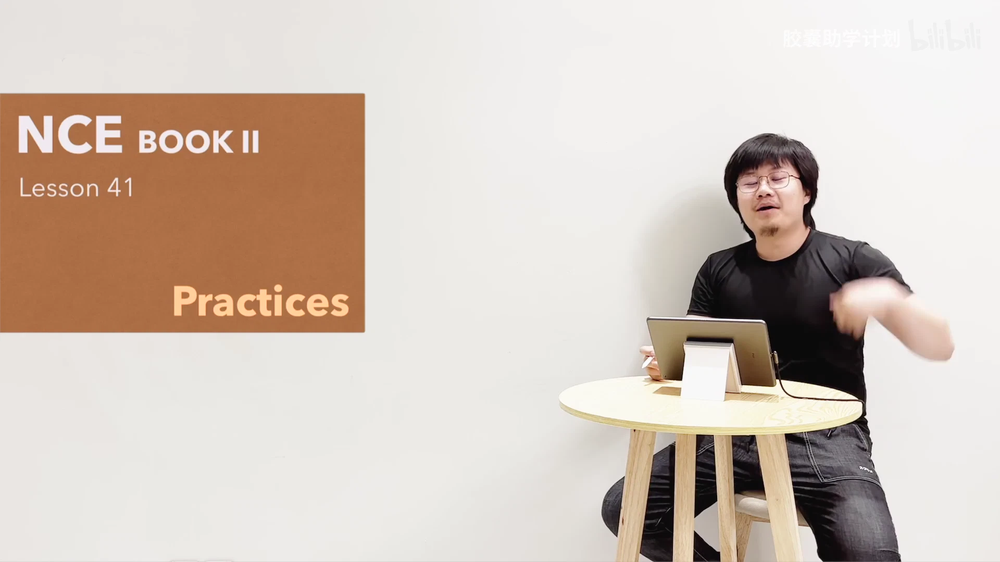

文字识别：NCE / BOOK"I / Lesson 41 / Practices

### 画面 00:00:02

文字识别：NCE / BOOKII / Lesson 41 / Practices

### 画面 00:00:04

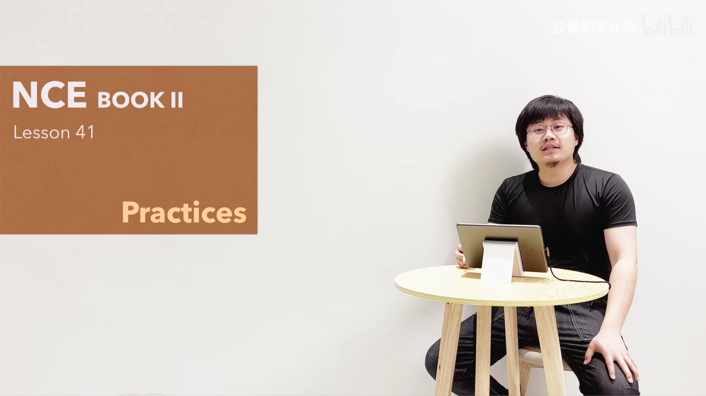

文字识别：NCE / BOOKⅡI / Lesson 41 / Practices

### 画面 00:00:07

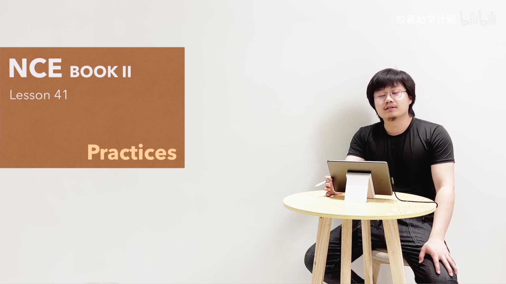

文字识别：NCE / BOOK"I / Lesson 41 / Practices

### 画面 00:00:09

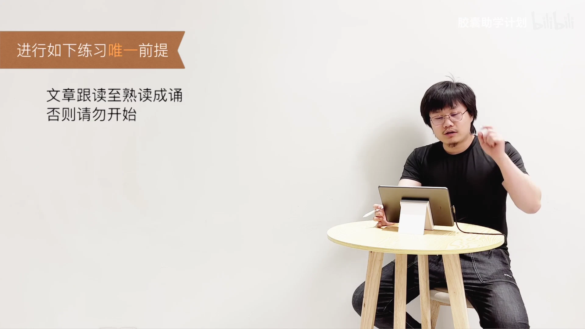

文字识别：进行如下练习唯一前提 / 文章跟读至熟读成诵 / 否则请勿开始

### 画面 00:00:18

文字识别：胶囊助学计划bll / •

### 画面 00:00:22

### 画面 00:00:24

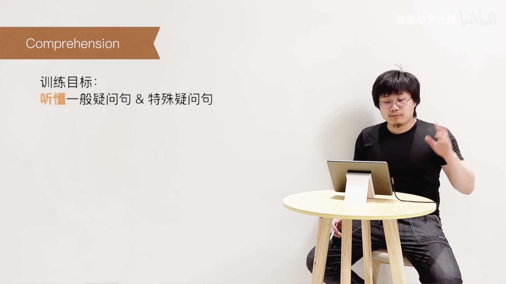

文字识别：Comprehension / 训练目标： / 听懂一般疑问句＆特殊疑问句

### 画面 00:00:28

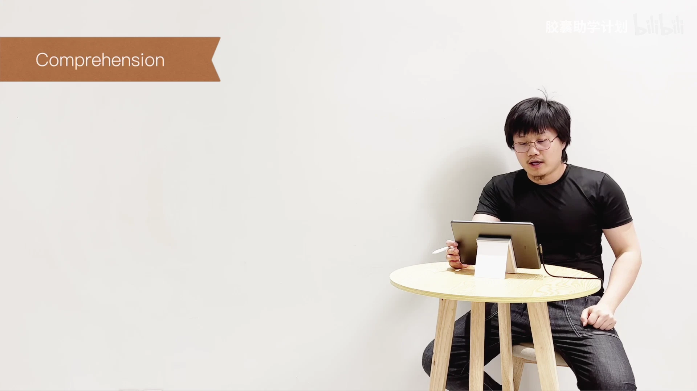

文字识别：Comprehension

## 00:00:30–00:01:00

you to answer. First question: Were you in a shop or a theater? A shop, right? Okay, next one. Say who were you with? Who were you with? My wife. Are you? You pay attention. You are now the main character. Uh, she was trying a hat on, wasn't she? Uh, yes, she was, right? Continue. Say what did you say to your wife? Do you call that a hat? Okay,

### 画面 00:00:31

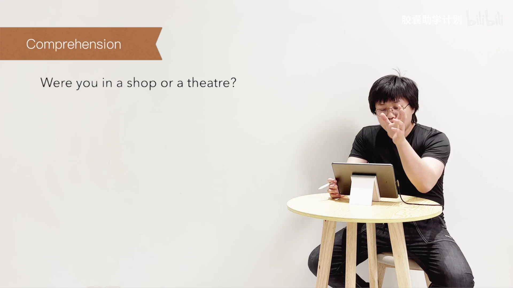

文字识别：Comprehension / Were you in a shop or a theatre?

### 画面 00:00:37

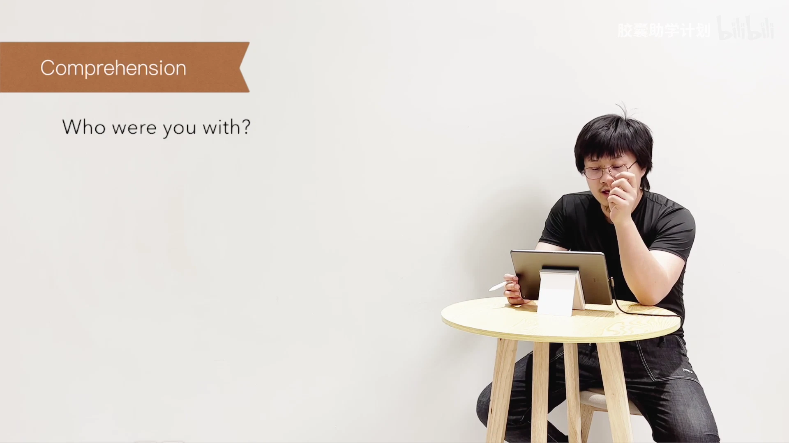

文字识别：Comprehension / Who were you with?

## 00:01:00–00:01:30

next one. Did she think you were being rude,或者说you were rude? Yes, she did. Next one. How long had you been in the hat shop? Ah, for half an hour,对吧? Next one. What was the remark you suddenly made? We mustn't buy things we don't need. Very good. Next one. How soon did you regret saying it?

### 画面 00:01:07

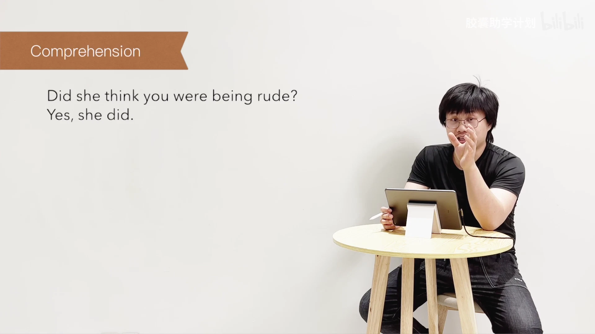

文字识别：Comprehension / Did she think you were being rude? / Yes, she did.

### 画面 00:01:17

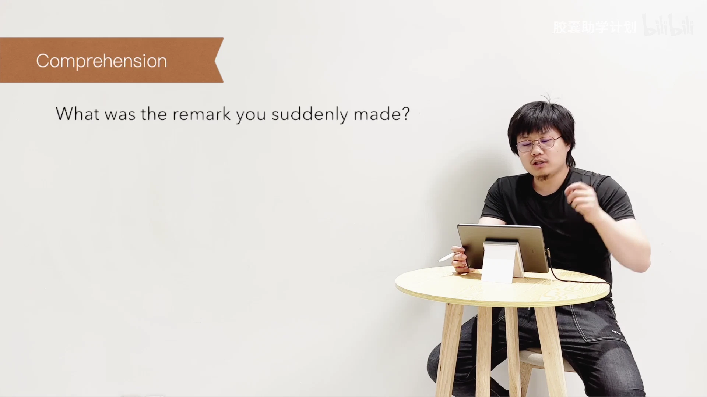

文字识别：Comprehension / What was the remark you suddenly made?

### 画面 00:01:29

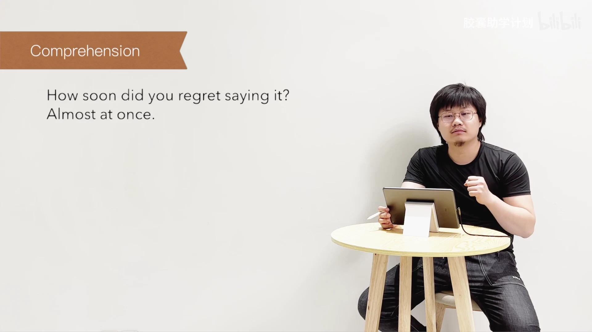

文字识别：Comprehension / How soon did you regret saying it? / Almost at once.

## 00:01:30–00:02:00

almost at once,啊就几乎是马上啊almost几乎嘛. Next one, what did your wife remind you of? The terrible tie you bought yesterday. Very good. Next one, you think it's terrible or beautiful? Of course, beautiful, right? Next one, can a man have too many ties? No, he can't. Next one,

### 画面 00:01:36

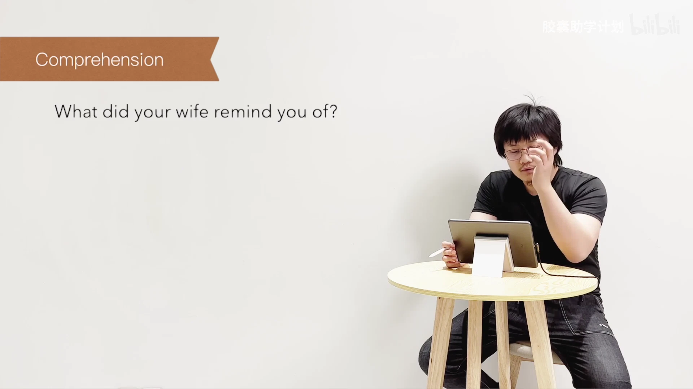

文字识别：Comprehension / What did your wife remind you of?

## 00:02:00–00:02:30

Now, what about a woman and her hats, right? That叫做a woman can't have too many hats either. Very good.好，下一题asking questions.练习我们会说一般疑问句和特殊疑问句的能力啊。呃，还是我们先给一个例子，比如说Ask me if I was in a hat shop.一般疑问句Were you in a hat shop? Where对In a hat shop提问，对吧？所以变成了Where were you? Okay. Very good.

### 画面 00:02:03

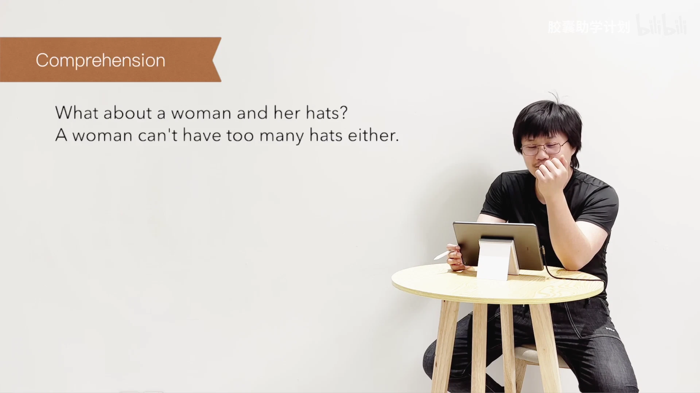

文字识别：Comprehension / What about a woman and her hats? / A woman can't have too many hats either.

### 画面 00:02:08

文字识别：Asking questions / 训练目标： / 会说一般疑问句＆特殊疑问句 / Accuracy / Fluency

### 画面 00:02:16

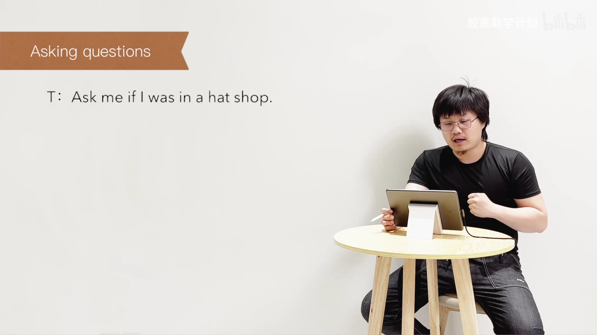

文字识别：Asking questions / T: Ask me if I was in a hat shop.

## 00:02:30–00:03:00

Next one. Uh, I was with my wife. Who? Uh, 第二题跟第一题本质上没有任何区别，就 were you，对吧？那 who 呢？你可以对 my wife 或者 I 提问，都可以，没有问题啊。 She was trying on a hat. 她正在试戴一个帽子。那 was 提前就行了嘛，对吧？然后 what 对 a hat 提问。 It looked terrible. Did 提前。 How 对 terrible 提问。 How did it look?

### 画面 00:02:31

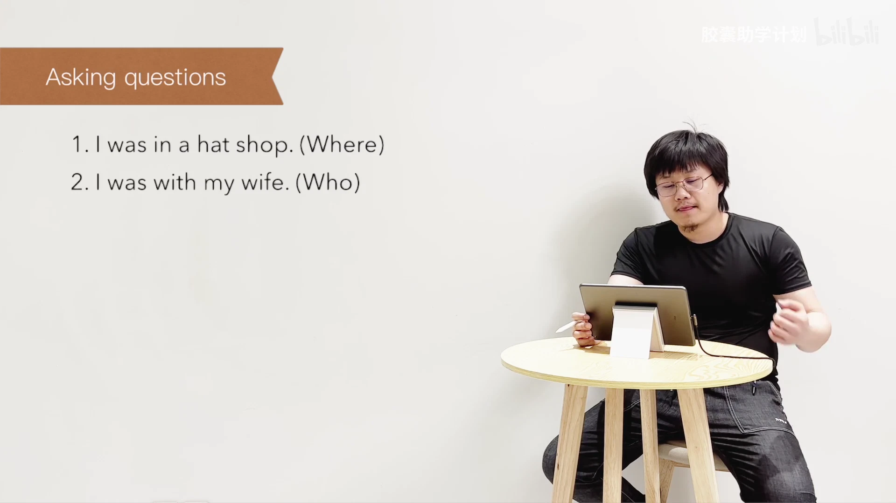

文字识别：Asking questions / 1.I was in a hat shop. (Where) / 2.I was with my wife. (Who)

### 画面 00:02:44

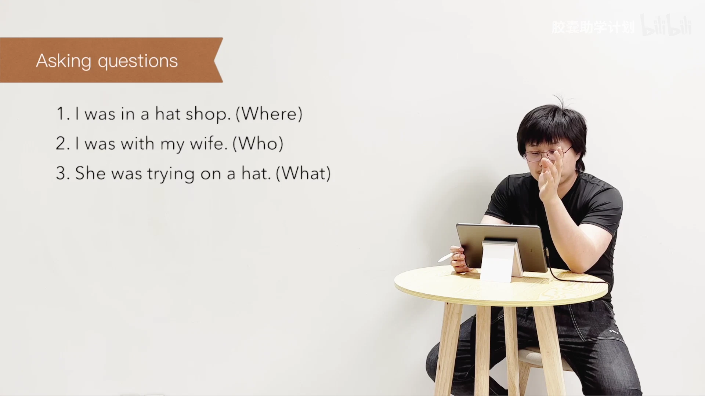

文字识别：Asking questions / 1.I was in a hat shop. (Where) / 2.I was with my wife. (Who) / 3. She was trying on a hat. (What)

## 00:03:00–00:03:30

Okay, uh, we'd been in the shop for half an hour. That had提前就可以了。那 How long是对 for half an hour提问啊？呃，第六题 I sat down on a modern chair. Did提前 Where的话对 on a modern chair提问对吧？所以答案叫 Where did you sit down? Okay,嗯, it had holes in it. Did提前就可以了。那 What是对

### 画面 00:03:00

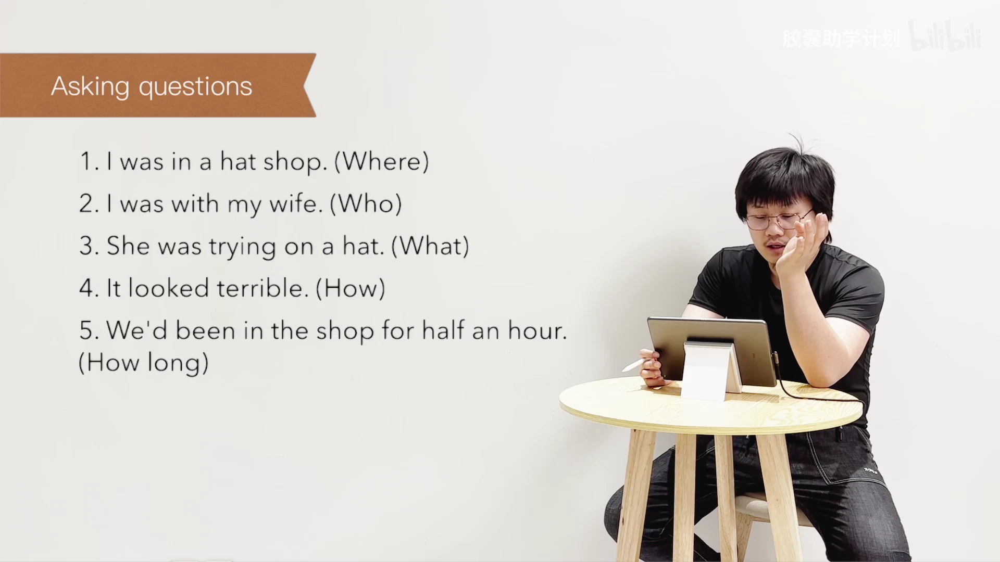

文字识别：Asking questions / 1.I was in a hat shop. (Where) / 2.I was with my wife.(Who) / 3. She was trying on a hat. (What) / 4.It looked terrible.(How) / 5. We'd been in the shop for half an hour. / (How long)

### 画面 00:03:10

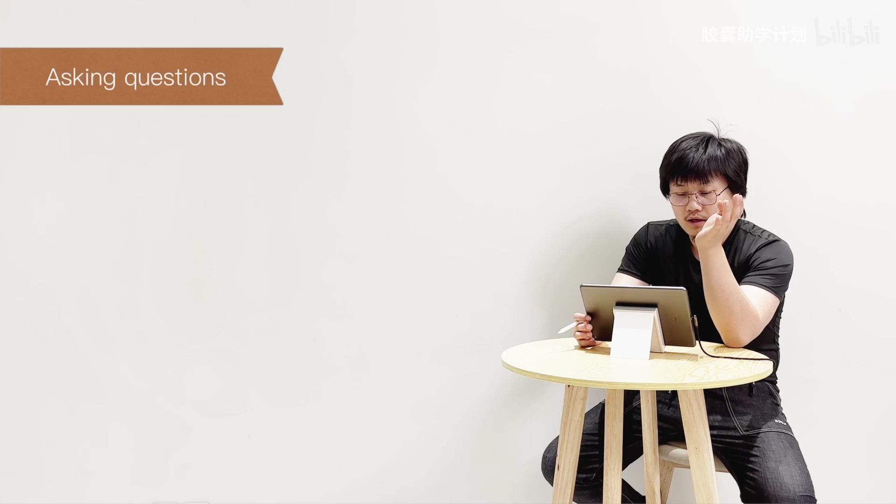

文字识别：Asking questions

### 画面 00:03:19

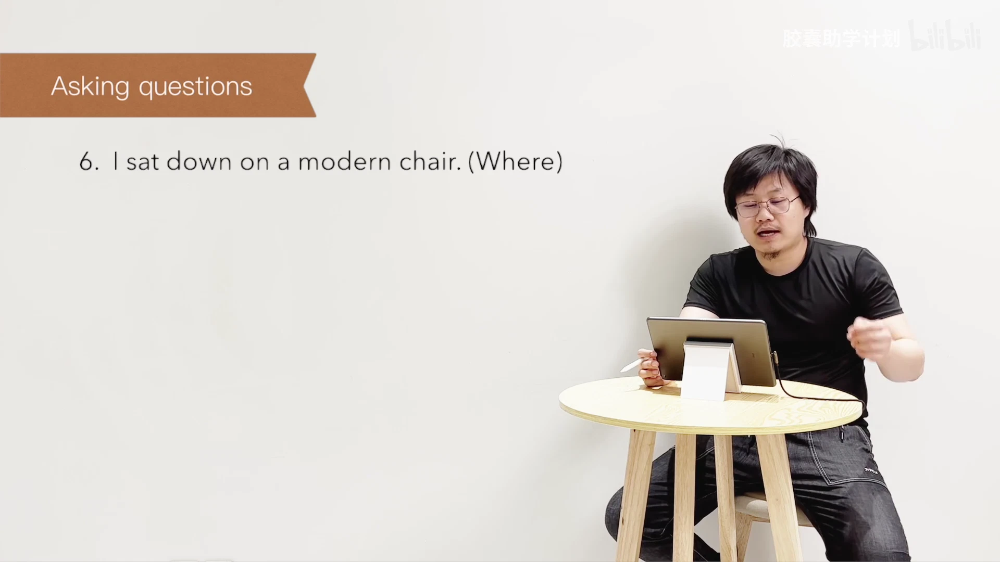

文字识别：Asking questions / 6. I sat down on a modern chair. (Where)

## 00:03:30–00:04:00

呃，我们可以直接对主语提问，对吧？叫 What had holes in it？是吧？什么有洞啊？什么有洞在它里面？OK，那这个椅子嘛，对不对？My wife was looking at herself in the mirror. 你看，was looking过去进行时，was往前一提就行了。那 What? 点点点 doing？你注意，答案是标准统一的，就是 What was your wife doing？好吧？OK， I made a sudden

### 画面 00:03:39

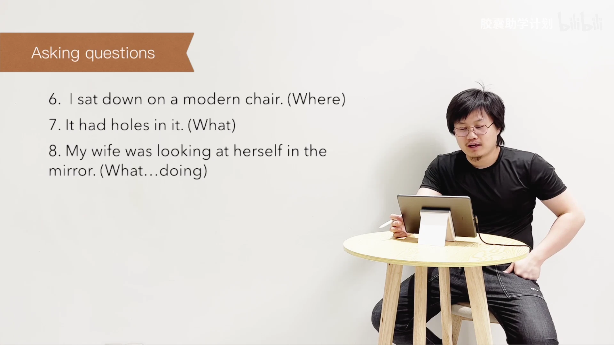

文字识别：Asking questions / 6. I sat down on a modern chair. (Where) / 7. It had holes in it. (What) / 8. My wife was looking at herself in the / mirror. (What...doing)

### 画面 00:03:46

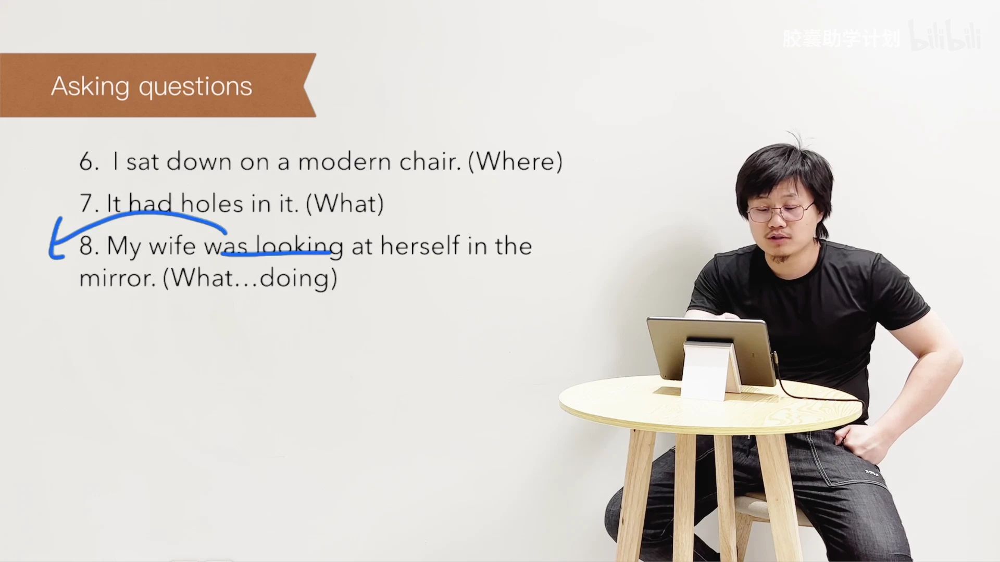

文字识别：Asking / questions / 6. I sat down on a modern chair. (Where) / 7. It had holes in it. (What) / 8. My wife / was looking at herself in the / mirror. (What...doing)

## 00:04:00–00:04:30

remark. Did往前一提就行了，叫 Did you make a sudden remark? 那 What 对 a sudden remark 提问就行了，对吧？ What did you What did you呃 make? 但是这样不太好，我建议各位直接把它变成 What did you do? 就行了，你当时做了什么？做的叫做 make made a sudden remark，对吧？ Okay, I regretted saying it almost at once. Did 提前，那 How soon? 肯定是 almost

### 画面 00:04:01

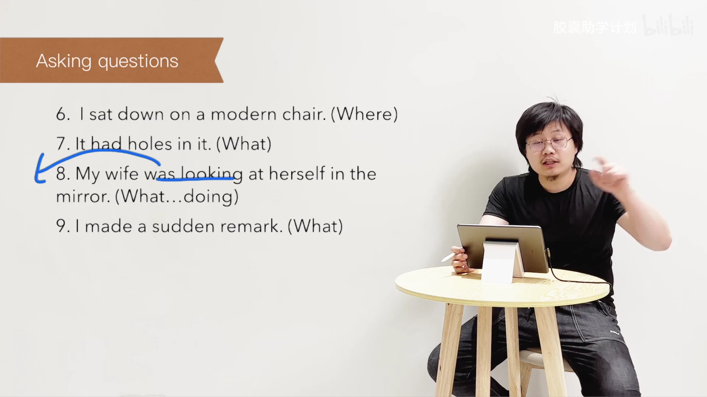

文字识别：Asking questions / 6. I sat down on a modern chair. (Where) / 7.It had holes in it. (What) / 8. My wife was looking at herself in the / mirror. (What...doing) / 9.I made a sudden remark. (What)

### 画面 00:04:16

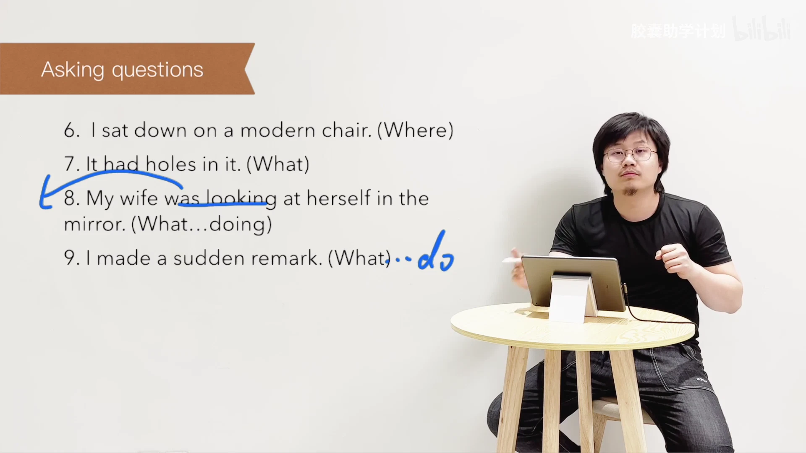

文字识别：Asking questions / 6. I sat down on a modern chair. (Where) / 7. It had holes in it. (What) / 8. My wife was looking at herself in the / mirror. (What...doing)

## 00:04:30–00:05:00

at once.提问啊，OK. 下一个，I said we mustn't buy things we don't need. 那你注意在这里，我们实际上把 we mustn't buy things we don't need，我们要知道它是宾语从句，所以你肯定是把 did 提前，叫 did you say？然后后边叫巴拉巴拉巴拉巴拉巴拉啊。那 what 就是对这句话提问，所以答案很简单，叫 what did you say？你说了什么？OK。那 asking question 就结束了。 Tell the story.

### 画面 00:04:31

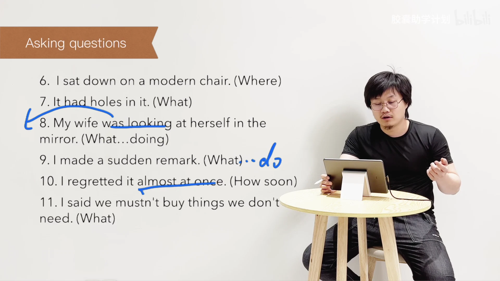

文字识别：Asking questions / 6. I sat down on a modern chair. (Where) / 7.It had holes in it. (What) / 8. My wife was looking at herself in the / mirror. (What...doing) / 10.I regretted it almost at once. (How soon) / 11.I said we mustn't buy things we don't / need.(What)

### 画面 00:04:38

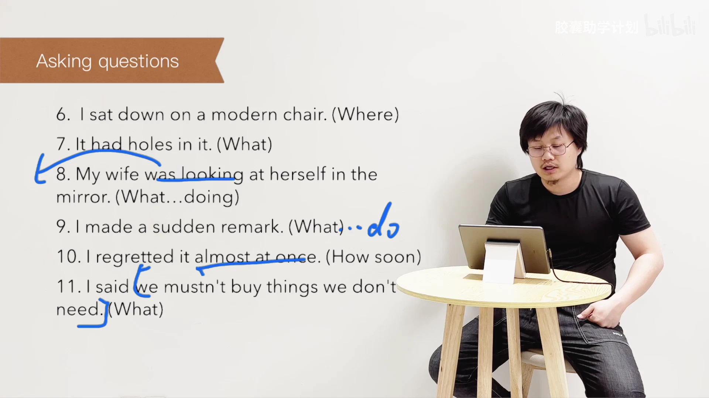

文字识别：Asking questions / 6. I sat down on a modern chair. (Where) / 7.It had holes in it. (What) / 8. My wife was looking at herself in the / mirror. (What...doing) / 10.I regretted it almost at once. (How soon) / 11.I said / We mustn't buy things we don't / need.7(What)

### 画面 00:04:45

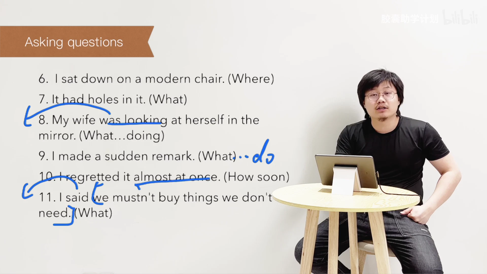

文字识别：Asking questions / 6. I sat down on a modern chair. (Where) / 7.It had holes in it. (What) / 8. My wife was looking at herself in the / mirror. (What...doing) / 10.tregretted it almost at once.(How soon) / 11.l said / we mustn't buy things we don't / need.7(What)

### 画面 00:04:57

文字识别：Tell the story / 训练目标： / 口语复述能力 / Accuracy / Fluency

## 00:05:00–00:05:30

练习的是流利性，而不是准确性，对吧？不能太差啊，流利性一定要好。看着这些，您自己说一遍就可以了。第一个单元我都有重复过啊，有都有示范过。拿不准的，您回第一个单元再看一下。Summary writing, journal写作，您写完了之后来这里对一下答案就好了啊，不多说。然后topic for discussion呢，是完全自由的对话。这是我们所有练习、单词、造句、文章跟

### 画面 00:05:06

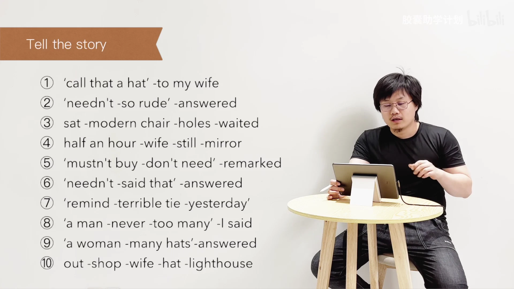

文字识别：Tell the story / ① 'call that a hat' -to my wife / 'needn't -so rude'-answered / sat -modern chair -holes -waited / ④ half an hour -wife -still -mirror / 'mustn't buy -don't need'-remarked / 5 / 'needn't -said that'-answered / 'remind -terrible tie -yesterday' / ⑧ 'a man -never -too many'-I said / ⑨ 'a woman -many hats'-answered / ⑩ out -shop -wife -hat -lighthouse

### 画面 00:05:15

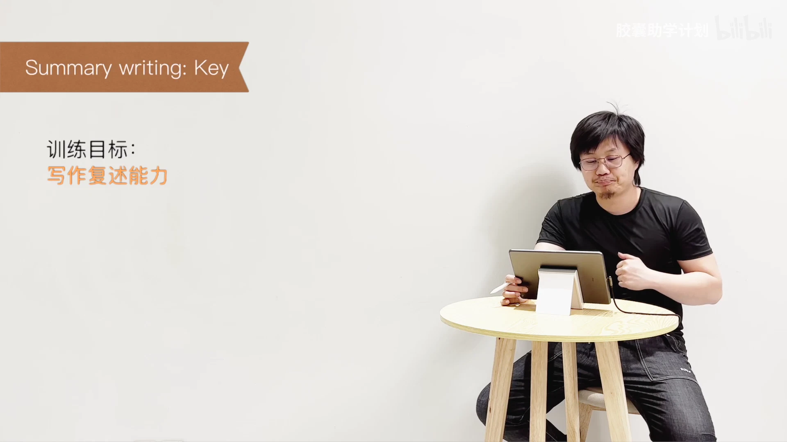

文字识别：Summary writing: Key / 训练目标： / 写作复述能力

### 画面 00:05:19

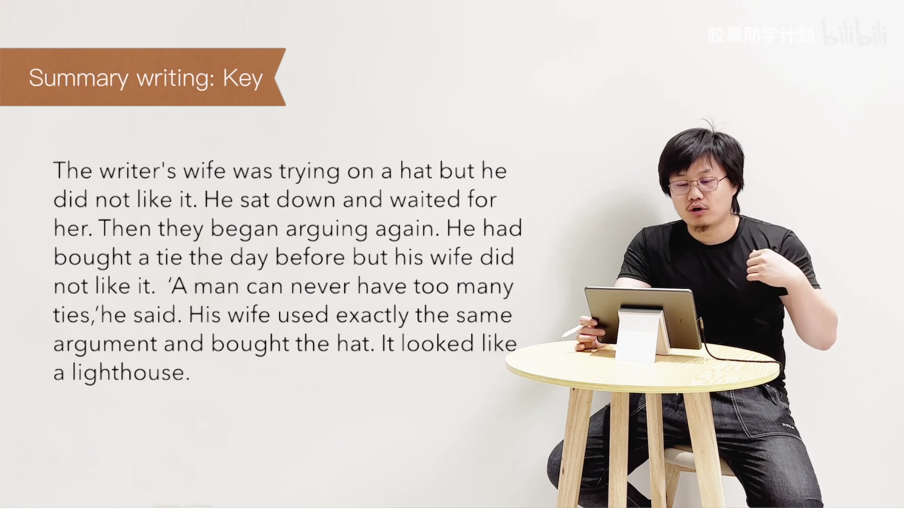

文字识别：Summary writing: Key / The writer's wife was trying on a hat but he / did not like it. He sat down and waited for / her. Then they began arguing again. He had / bought a tie the day before but his wife did / not like it. 'A man can never have too many / ties,'he said. His wife used exactly the same / argument and bought the hat. It looked like / a lighthouse.

### 画面 00:05:22

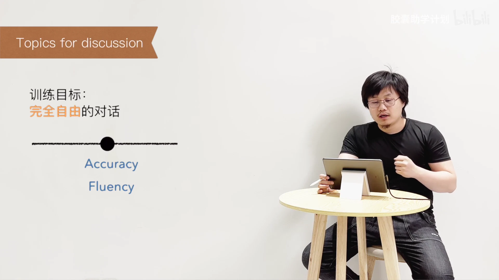

文字识别：Topics for discussion / 训练目标： / 完全自由的对话 / Accuracy / Fluency

## 00:05:30–00:06:00

对吧？然后之前 asking question, asking if，所有这些练习，最终唯一的目的就是将来我们有一个能力和别人进行完全自由的一个针对于某个话题的对话。看这里，What kinds of things would you like that you don't really need？你喜欢什么样的东西啊？你但是你并不特别需要，就你你特别喜欢某一个你并不需要的东西是什么？说一说。Who do you think

### 画面 00:05:37

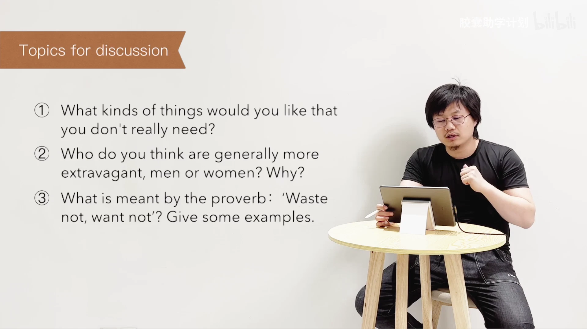

文字识别：Topics for discussion / What kinds of things would you like that / you don't really need? / Who do you think are generally more / extravagant, men or women? Why? / What is meant by the proverb: 'Waste / not, want not'? Give some examples.

## 00:06:00–00:06:30

are generally more extravagant? Extravagant,对吧? Extravagant, men or women? Why?啊，你认为通常状态下谁更奢侈一点，男人还是女人？为什么？啊，What is meant by the pro proverb, waste not, want not? Give some examples.这个有什么？呃，有有有这么一个谚语叫 waste not, want not.能给一些例子吗？那什么叫 waste not,

### 画面 00:06:07

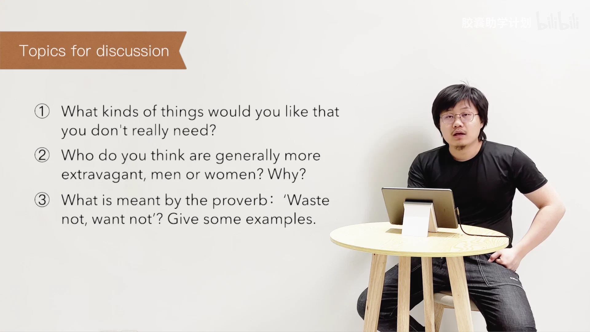

文字识别：Topics for discussion / What kinds of things would you like that / you don't really need? / Who do you think are generally more / extravagant, men or women? Why? / What is meant by the proverb: 'Waste / not, want not'? Give some examples.

## 00:06:30–00:07:00

want not 呢？首先，各位可以自己查一下。其次啊，我目前的理解就是说，勤俭节约，吃穿不愁，大概就是这样一种感觉啊。你什么都不要浪费，你基本上大多数东西你也不会需求啊。勤俭节约，吃穿不愁。OK，呃，家庭作业 ask me if 先写再朗读摘要写作，写完了对答案 tell the story 进行一下口语复述，专栏当中可以找得到。那以上呢就是本期视频的全部

### 画面 00:06:37

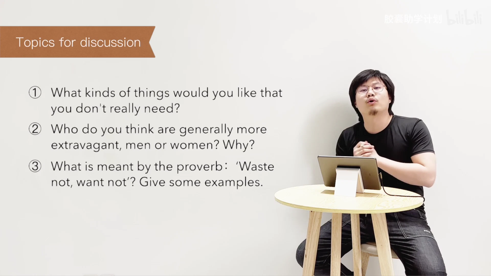

文字识别：Topics for discussion / What kinds of things would you like that / you don't really need? / Who do you think are generally more / extravagant, men or women? Why? / What is meant by the proverb: 'Waste / not, want not'? Give some examples.

### 画面 00:06:46

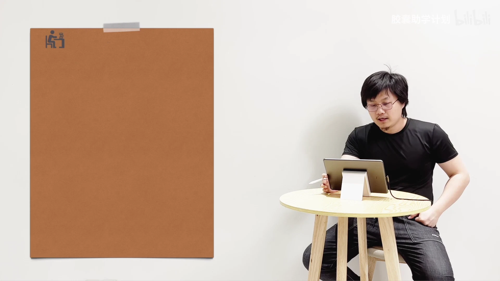

### 画面 00:06:48

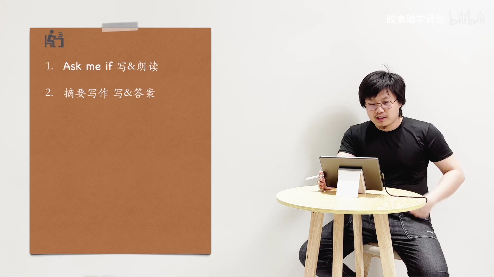

文字识别：1.Ask me if写&朗读 / 2.摘要写作写&答案

### 画面 00:06:50

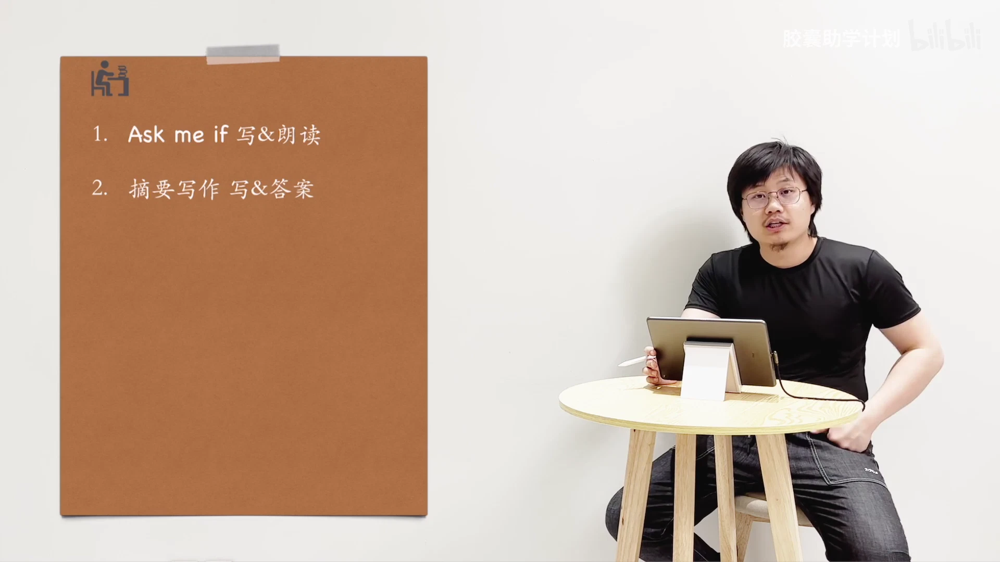

文字识别：1.Ask me if写&朗读 / 2.摘要写作写&答案

### 画面 00:06:52

文字识别：1.Ask me if写&朗读 / 摘要写作写&答案 / 3.Tell the story 口语复述

### 画面 00:06:54

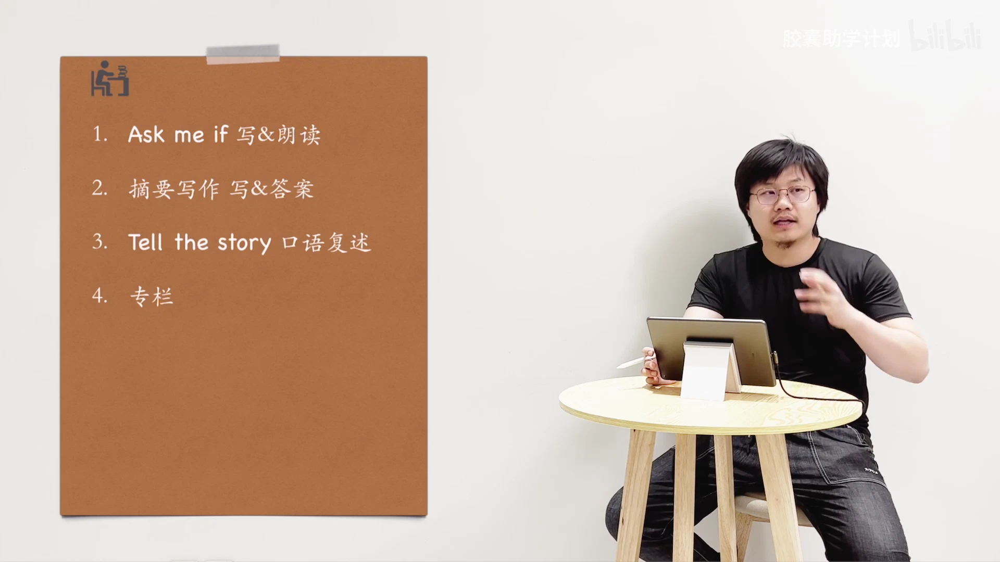

文字识别：1.Ask me if写&朗读 / 摘要写作写&答案 / 3.Tell the story 口语复述 / 专栏 / 4.

### 画面 00:06:56

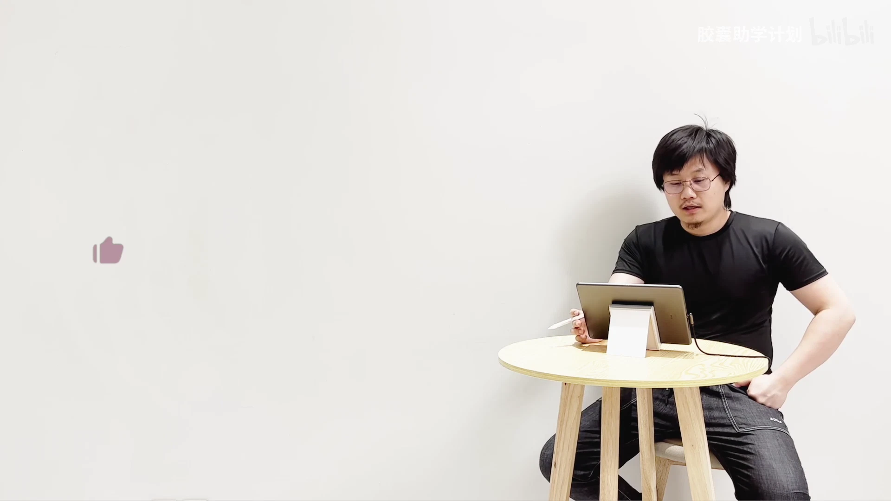

## 00:07:00–00:07:22

内容了。如果各位喜欢我们的课程呢，欢迎各位关注、订阅、一键三连，分享给那些需要的朋友，来帮助我们快速成长。See you next time.

### 画面 00:07:10

### 画面 00:07:12

文字识别：CAPSULEACADEMY / 胶囊助学计划 / 小红书 / Lecturer / □ / Leo / OE

### 画面 00:07:14

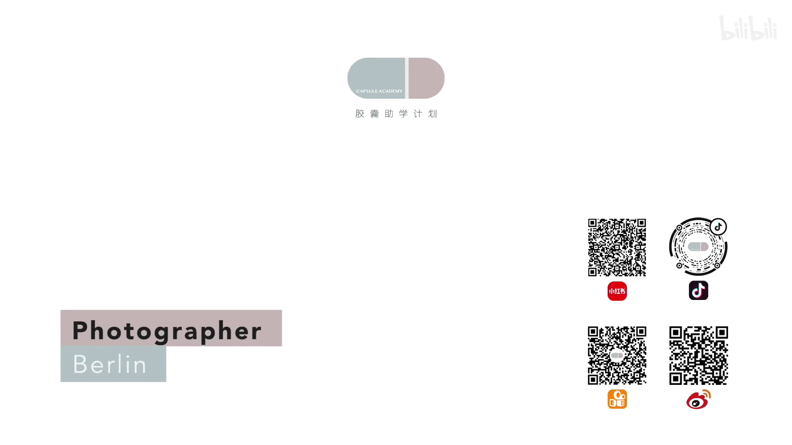

文字识别：CAPSULEACADEMY / 胶囊助学计划 / 小红书 / Photographer / Berlin / OE

### 画面 00:07:16

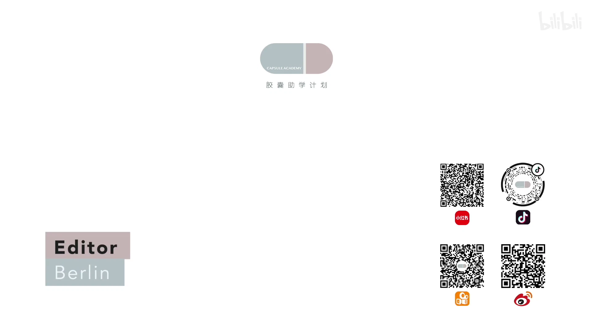

文字识别：CAPSULEACADEMY / 胶囊助学计划 / 小红书 / Editor / □ / Berlin

### 画面 00:07:19

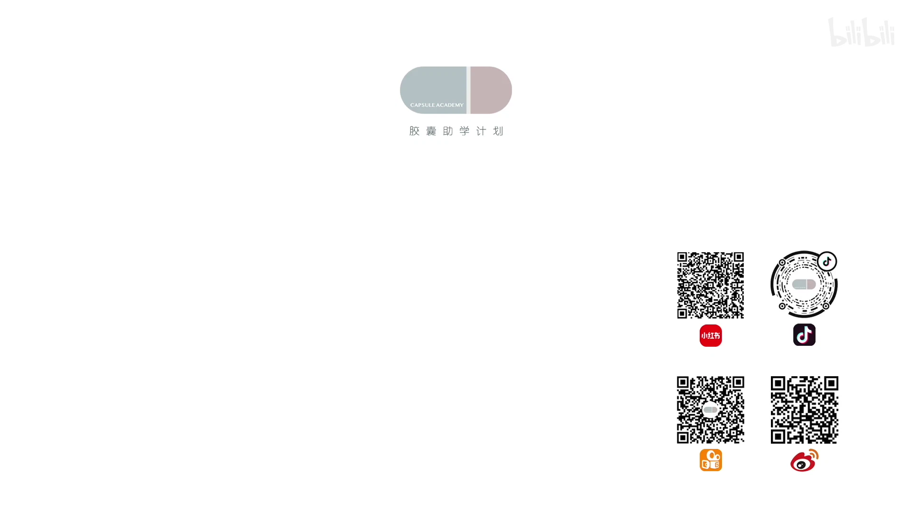

文字识别：CAPSULEACADEMY / 胶囊助学计划 / 小红书

### 画面 00:07:21

文字识别：bilibili / 胶囊助学计划

