# L042 单词

快速机器解析：语音为单模型转写，未进行独立交叉校对或人工复核；画面每秒采样并按变化选帧，短时文字和标记可能遗漏。截图时间约有 1 秒误差。图片有损压缩；遇到疑点请按时间查看 Google Drive 原视频。

## 00:00:00–00:00:30

Hello everyone, welcome to Capsule Academy. This is Leo. Today we're going to learn New Concept English Book Two Lesson Forty Two Words. 那到习惯进入正式课程之前呢，我们先看几个小的问题。那首先如何表达观看音乐剧？其次呢如何表达演奏一曲？最后一个如何表达瞥见，对吧？ Okay, 那带着这三个问题， hope you gonna enjoy it. 那

### 画面 00:00:00

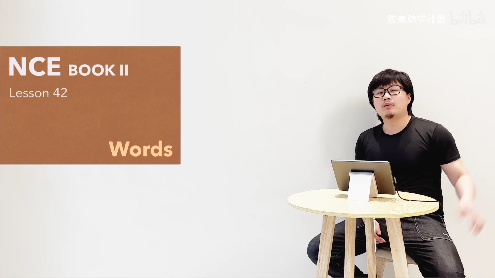

文字识别：NCE / BOOK"I / Lesson 42 / Words

### 画面 00:00:02

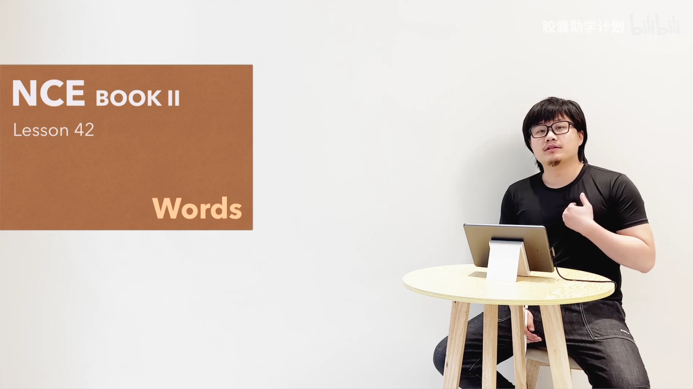

文字识别：NCE / BOOK"I / Lesson 42 / Words

### 画面 00:00:04

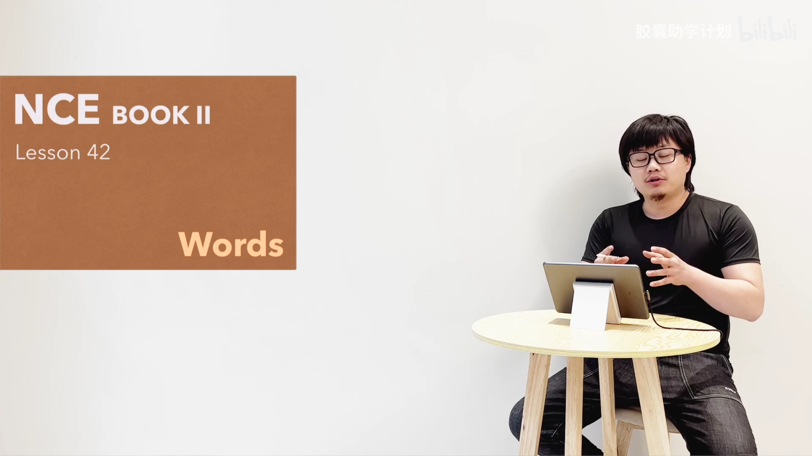

文字识别：NCE / BOOKI"I / Lesson 42 / Words

### 画面 00:00:06

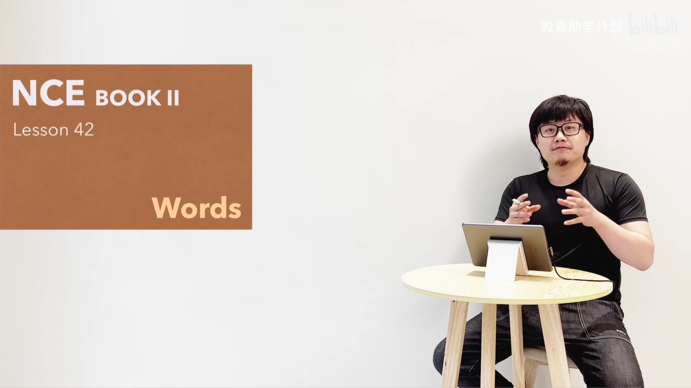

文字识别：NCE / BOOKII / Lesson 42 / Words

### 画面 00:00:08

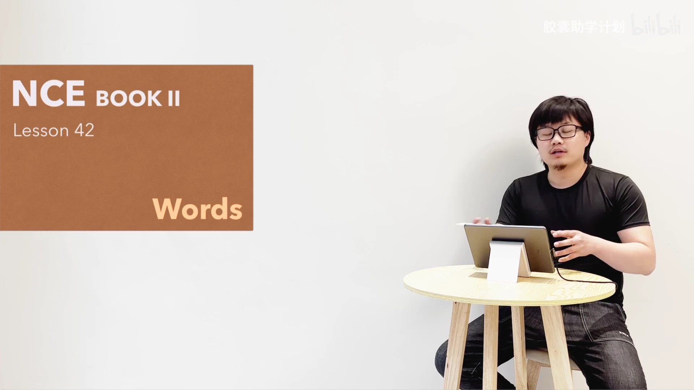

文字识别：NCE / BOOKII / Lesson 42 / Words

### 画面 00:00:10

### 画面 00:00:12

文字识别：①如何表达“观看音乐剧”？

### 画面 00:00:14

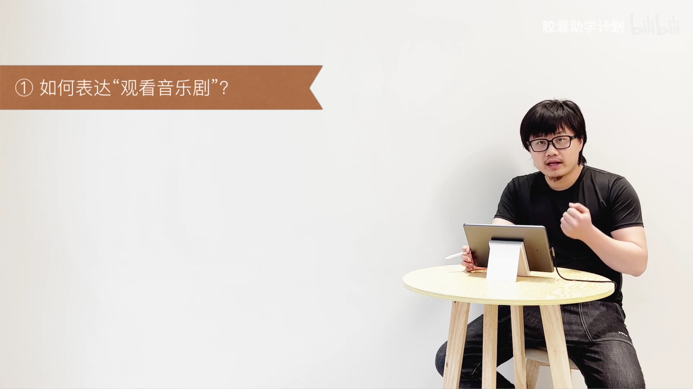

文字识别：①如何表达“观看音乐剧”？

### 画面 00:00:16

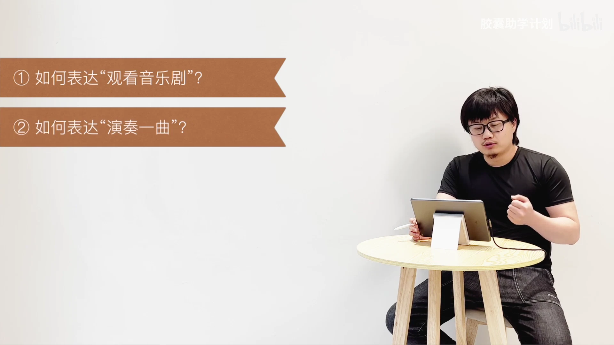

文字识别：①如何表达“观看音乐剧”？ / 如何表达“演奏一曲”?

### 画面 00:00:18

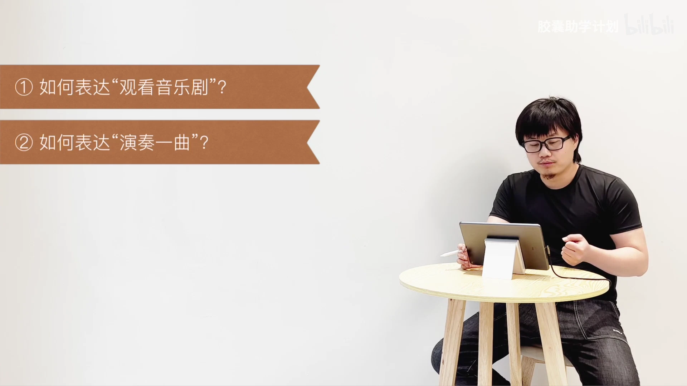

文字识别：①如何表达“观看音乐剧”？ / 如何表达“演奏一曲”?

### 画面 00:00:20

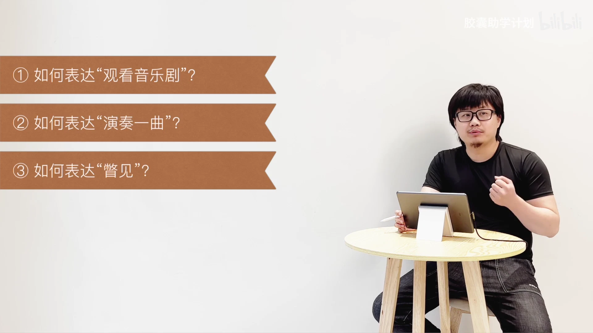

文字识别：①如何表达“观看音乐剧”？ / 如何表达“演奏一曲”? / 如何表达“瞥见”？

### 画面 00:00:24

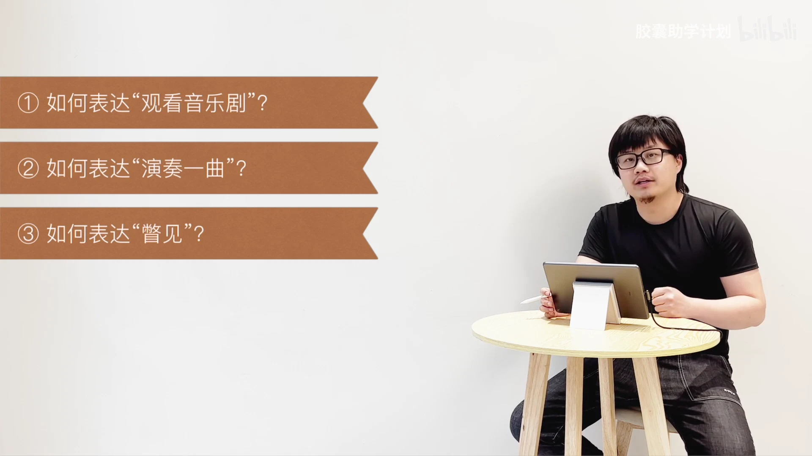

文字识别：①如何表达“观看音乐剧”？ / 如何表达“演奏一曲”? / 如何表达“瞥见”？

### 画面 00:00:26

文字识别：胶囊助学计划bll

### 画面 00:00:29

## 00:00:30–00:01:00

我们先看第一个小单词，这个单词我们在第十课的时候就见过，对吧？那直接跟我读一下，叫做 musical，musical 叫做音乐的，对吧？那这一课呢，我印象当中它是出现在了题目当中，叫 not very musical 啊。musical 在本课当中形容词的一个意思叫精通音乐的，对吧？呃，第十课咱们学的叫做音乐的，比如说 musical instrument，对吧？啊，乐器。OK。那

### 画面 00:00:31

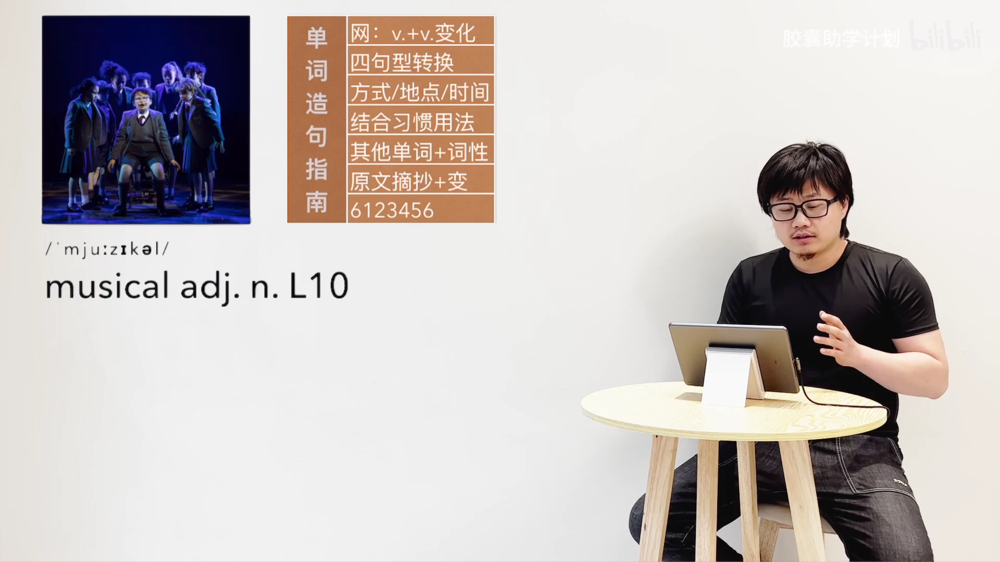

文字识别：单词造句指南 / 网：v.+v.变化 / 四句型转换 / 方式/地点/时间 / 结合习惯用法 / 其他单词+词性 / 原文摘抄+变 / 6123456 / /'mju:zikal/ / musical adj. n. L10

### 画面 00:00:35

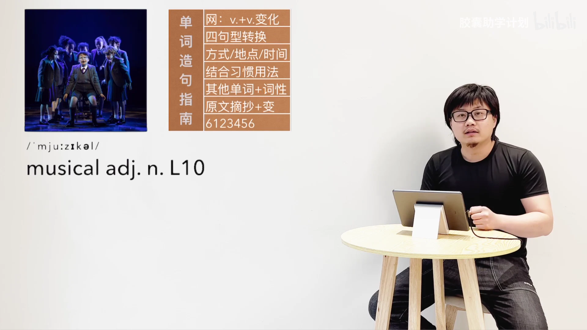

文字识别：单词造句指南 / 网：v.+v.变化 / 四句型转换 / 方式/地点/时间 / 结合习惯用法 / 其他单词+词性 / 原文摘抄+变 / 6123456 / /'mju:zikal/ / musical adj. n. L10

### 画面 00:00:40

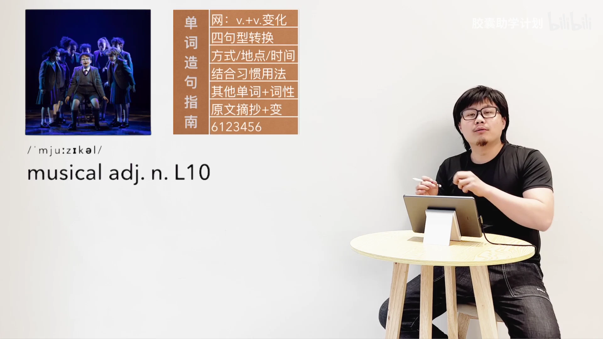

文字识别：单词造句指南 / 网：v.+v.变化 / 四句型转换 / 方式/地点/时间 / 结合习惯用法 / 其他单词+词性 / 原文摘抄+变 / 6123456 / /'mju:zikal/ / musical adj. n. L10

### 画面 00:00:45

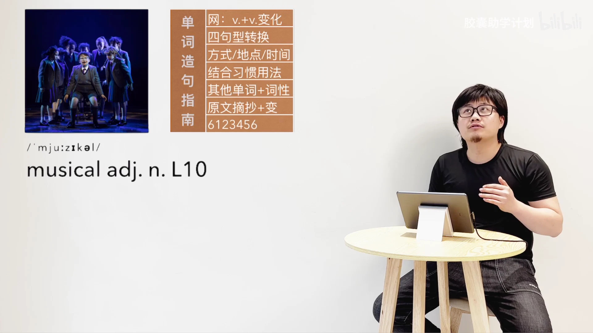

文字识别：单词造句指南 / 网：v.+v.变化 / 四句型转换 / 方式/地点/时间 / 结合习惯用法 / 其他单词+词性 / 原文摘抄+变 / 6123456 / /'mju:zikal/ / musical adj. n. L10

### 画面 00:00:55

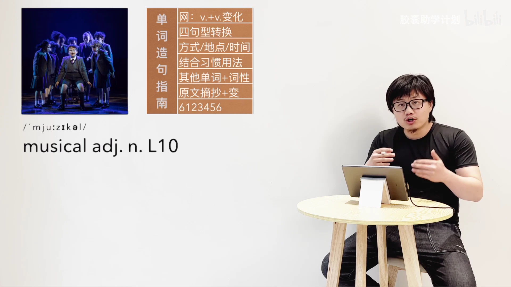

文字识别：单词造句指南 / 网：v.+v.变化 / 四句型转换 / 方式/地点/时间 / 结合习惯用法 / 其他单词+词性 / 原文摘抄+变 / 6123456 / /'mju:zikal/ / musical adj. n.L10

## 00:01:00–00:01:30

首先这个单词我们肯定是不陌生了，对吧？其次呢，那我们既然其实已经见过这个单词了，也大概能猜出来，比如说由音乐的，呃，学会说精通音乐的，好像也不是很困难，对吧？那我们今天补一个它的新的词性，也非常常用，它叫名词，比如说叫做音乐剧啊，比如说非常有名的那个猫啊，呃，我们就管它叫做musical，对吧？所以那我们说看一个音乐剧叫做watch a

### 画面 00:01:01

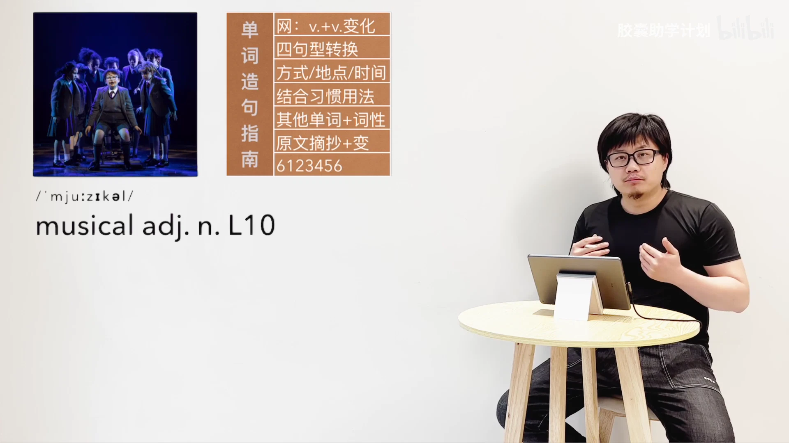

文字识别：单词造句指南 / 网：v.+v.变化 / 四句型转换 / 方式/地点/时间 / 结合习惯用法 / 其他单词+词性 / 原文摘抄+变 / 6123456 / /'mju:zikal/ / musical adj. n. L10

### 画面 00:01:05

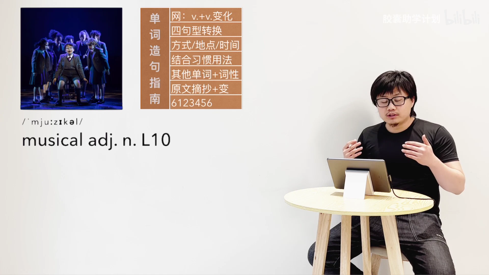

文字识别：单词造句指南 / 网：v.+v.变化 / 四句型转换 / 方式/地点/时间 / 结合习惯用法 / 其他单词+词性 / 原文摘抄+变 / 6123456 / /'mju:zikal/ / musical adj. n.L10

### 画面 00:01:10

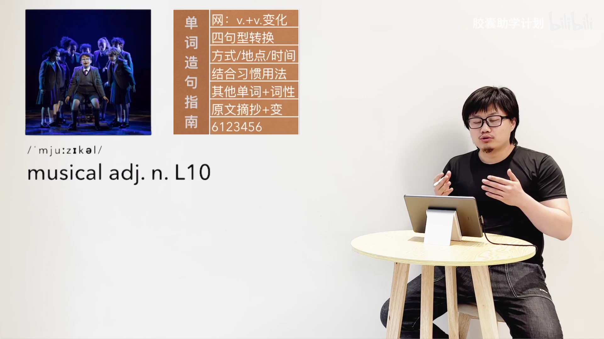

文字识别：单词造句指南 / 网：v.+v.变化 / 四句型转换 / 方式/地点/时间 / 结合习惯用法 / 其他单词+词性 / 原文摘抄+变 / 6123456 / /'mju:zikal/ / musical adj. n. L10

### 画面 00:01:16

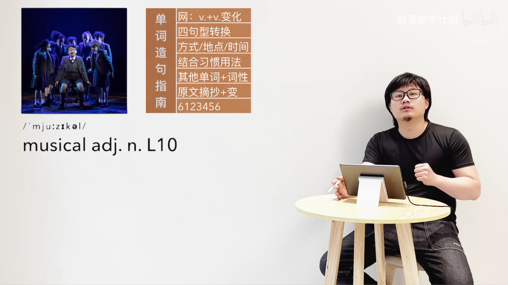

文字识别：单词造句指南 / 网：v.+v.变化 / 四句型转换 / 方式/地点/时间 / 结合习惯用法 / 其他单词+词性 / 原文摘抄+变 / 6123456 / /'mju:zikal/ / musical adj. n. L10

### 画面 00:01:25

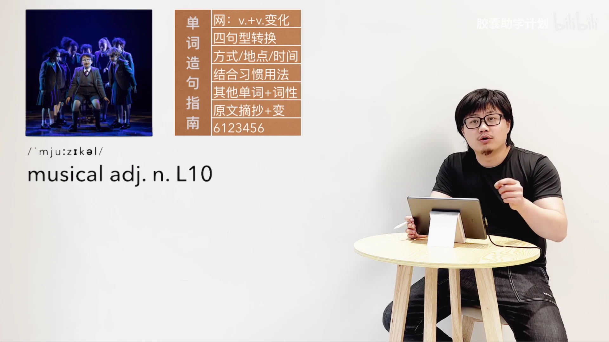

文字识别：单词造句指南 / 网：v.+v.变化 / 四句型转换 / 方式/地点/时间 / 结合习惯用法 / 其他单词+词性 / 原文摘抄+变 / 6123456 / /'mju:zikal/ / musical adj. n. L10

## 00:01:30–00:02:00

Okay, in this place, I want to mention a very small point, which is that when Chinese people learn English, they will have some doubts. For example, some students are confused about whether I should use watch a musical or see a musical. Then, you will find that if you ask your foreign friend, of course, he is from a different region, right? In this world, in different places, some people may tell you that in our place, I have never heard of watching a musical, right? Some people will tell you that I have never heard of seeing

### 画面 00:01:31

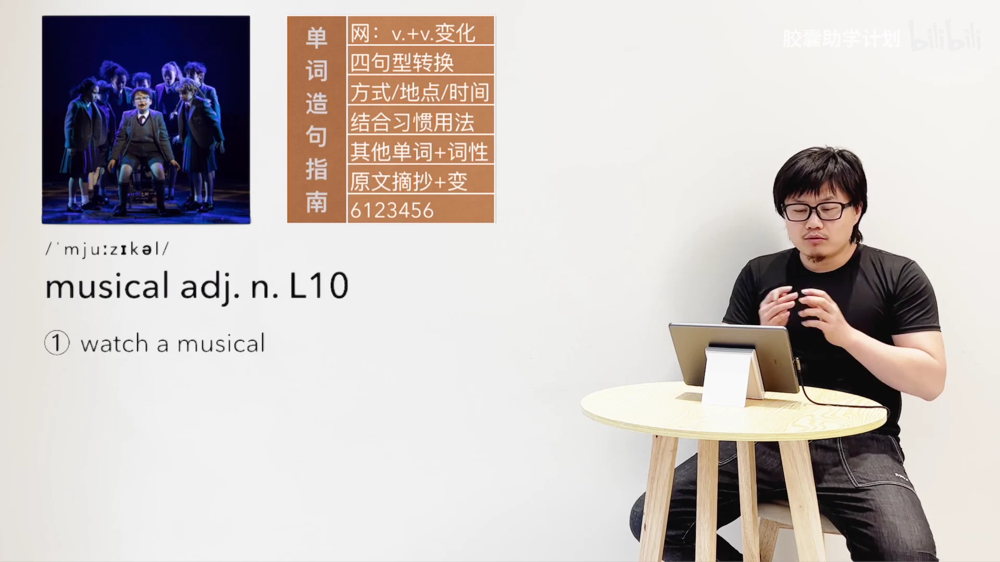

文字识别：单词造句指南 / 网：v.+v.变化 / 四句型转换 / 方式/地点/时间 / 结合习惯用法 / 其他单词+词性 / 原文摘抄+变 / 6123456 / /'mju:zikal/ / musical adj. n. L10 / watch a musical

### 画面 00:01:35

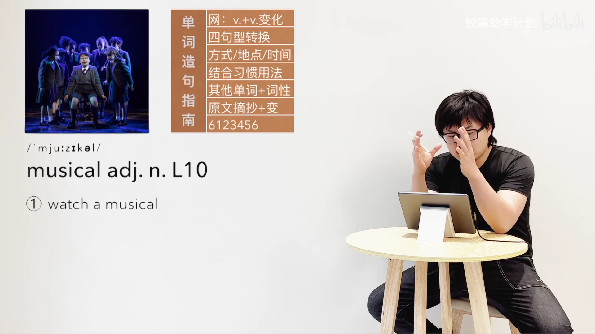

文字识别：单词造句指南 / 网：v.+v.变化 / 四句型转换 / 方式/地点/时间 / 结合习惯用法 / 其他单词+词性 / 原文摘抄+变 / 6123456 / /'mju:zikal/ / musical adj. n. L10 / watch a musical

### 画面 00:01:43

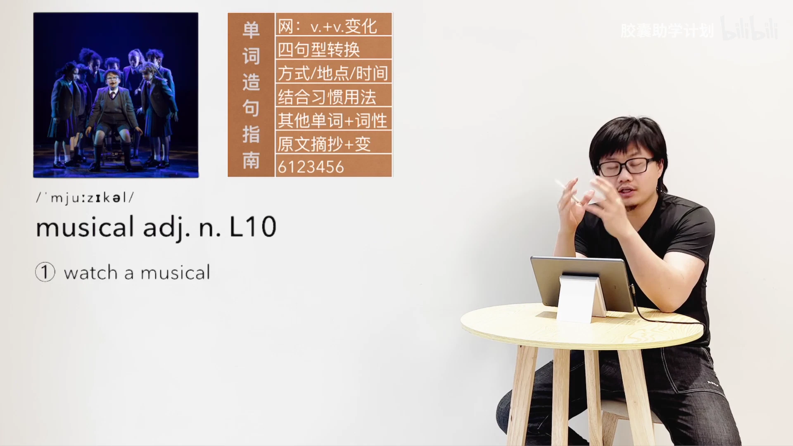

文字识别：单词造句指南 / 网：v.+v.变化 / 四句型转换 / 方式/地点/时间 / 结合习惯用法 / 其他单词+词性 / 原文摘抄+变 / 6123456 / /'mju:zikal/ / musical adj. n. L10 / watch a musical

### 画面 00:01:45

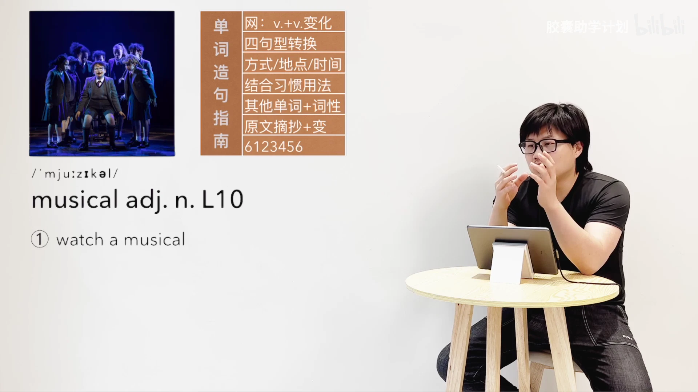

文字识别：单词造句指南 / 网：v.+v.变化 / 四句型转换 / 方式/地点/时间 / 结合习惯用法 / 其他单词+词性 / 原文摘抄+变 / 6123456 / /'mju:zikal/ / musical adj. n. L10 / watch a musical

### 画面 00:01:50

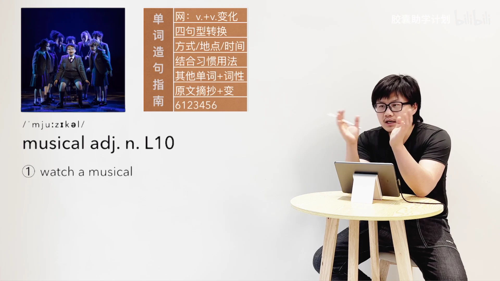

文字识别：单词造句指南 / 网：v.+v.变化 / 四句型转换 / 方式/地点/时间 / 结合习惯用法 / 其他单词+词性 / 原文摘抄+变 / 6123456 / /'mju:zikal/ / musical adj. n. L10 / watch a musical

### 画面 00:01:55

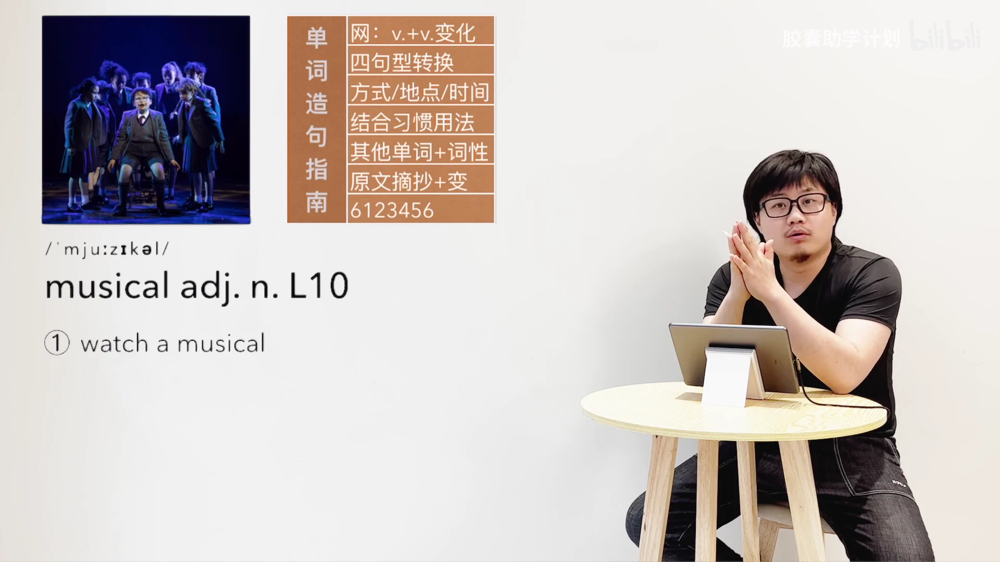

文字识别：单词造句指南 / 网：v.+v.变化 / 四句型转换 / 方式/地点/时间 / 结合习惯用法 / 其他单词+词性 / 原文摘抄+变 / 6123456 / /'mju:zikal/ / musical adj. n. L10 / watch a musical

## 00:02:00–00:02:30

从来没听过叫 see a musical。那对于各位来说，其实特别简单的一个方式，怎么去判断呢？就是你直接输入叫 watch a musical 这个短语，然后你看一下在英文世界之下，当然我说的输入是在网上啊。然后你看一下在英文世界之下有没有人，或者有没有任何电影以前用过这个短语。如果有用过，那它就是对的。你不用管说一个英语是母语的外国人告诉你，他

### 画面 00:02:02

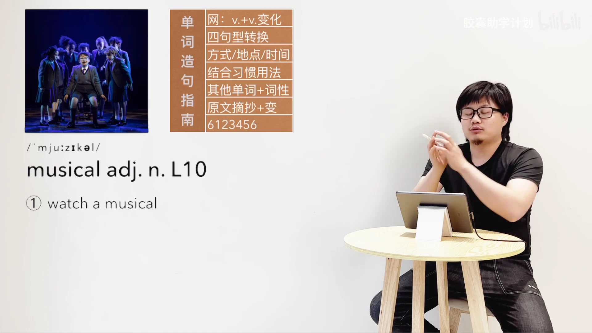

文字识别：单词造句指南 / 网：v.+v.变化 / 四句型转换 / 方式/地点/时间 / 结合习惯用法 / 其他单词+词性 / 原文摘抄+变 / 6123456 / /'mju:zikal/ / musical adj. n. L10 / watch a musical

### 画面 00:02:10

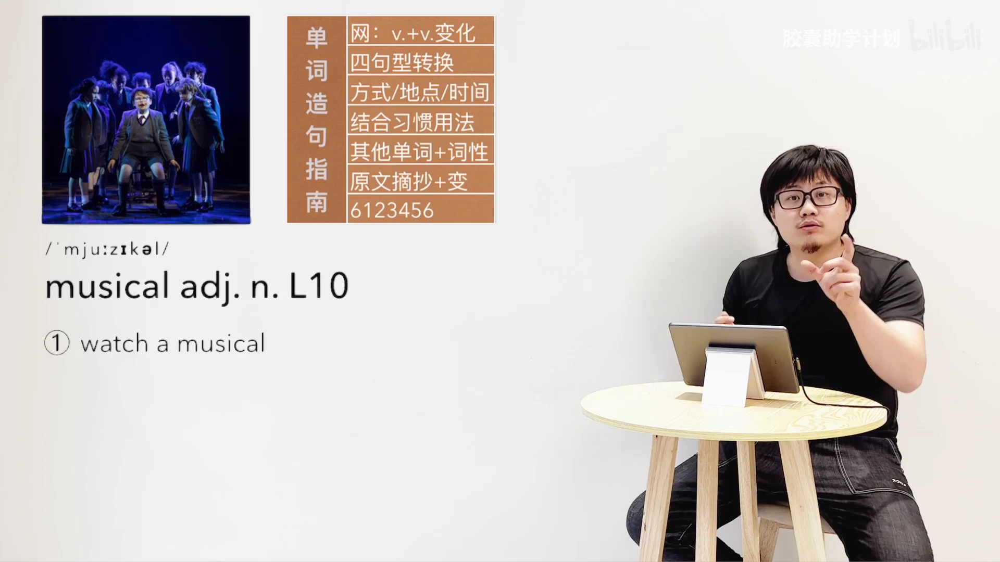

文字识别：单词造句指南 / 网：v.+v.变化 / 四句型转换 / 方式/地点/时间 / 结合习惯用法 / 其他单词+词性 / 原文摘抄+变 / 6123456 / /'mju:zikal/ / musical adj. n. L10 / watch a musical

### 画面 00:02:16

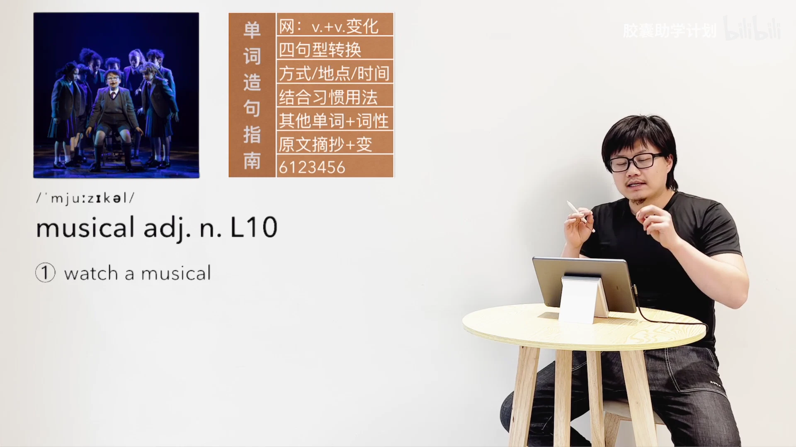

文字识别：单词造句指南 / 网：v.+v.变化 / 四句型转换 / 方式/地点/时间 / 结合习惯用法 / 其他单词+词性 / 原文摘抄+变 / 6123456 / /'mju:zikal/ / musical adj. n. L10 / watch a musical

### 画面 00:02:25

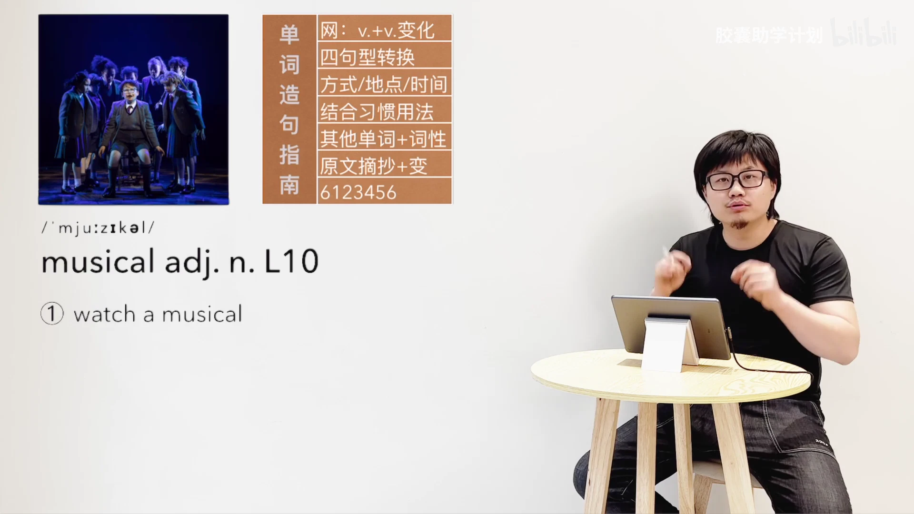

文字识别：单词造句指南 / 网：v.+v.变化 / 四句型转换 / 方式/地点/时间 / 结合习惯用法 / 其他单词+词性 / 原文摘抄+变 / 6123456 / /'mju:zikal/ / musical adj. n. L10 / watch a musical

## 00:02:30–00:03:00

从来没见过 watch a musical，所以他认为 watch a musical 是不对的，对吧？这个是不符合逻辑的，对吧？所以各位一定要看，只要人类以前用过，而且用过不止一次，对吧？近一二十年、二三十年，那它就是对的啊！我往往是这样去做一个判定啊。其实它要比你直接去问一个外国人说这个东西对还是错要更有用一些。OK，其实汉语是同理的，你各位自己去想，我就不多说了。那 watch a

### 画面 00:02:32

文字识别：单词造句指南 / 网：v.+v.变化 / 四句型转换 / 方式/地点/时间 / 结合习惯用法 / 其他单词+词性 / 原文摘抄+变 / 6123456 / /'mju:zikal/ / musical adj. n. L10 / watch a musical

### 画面 00:02:35

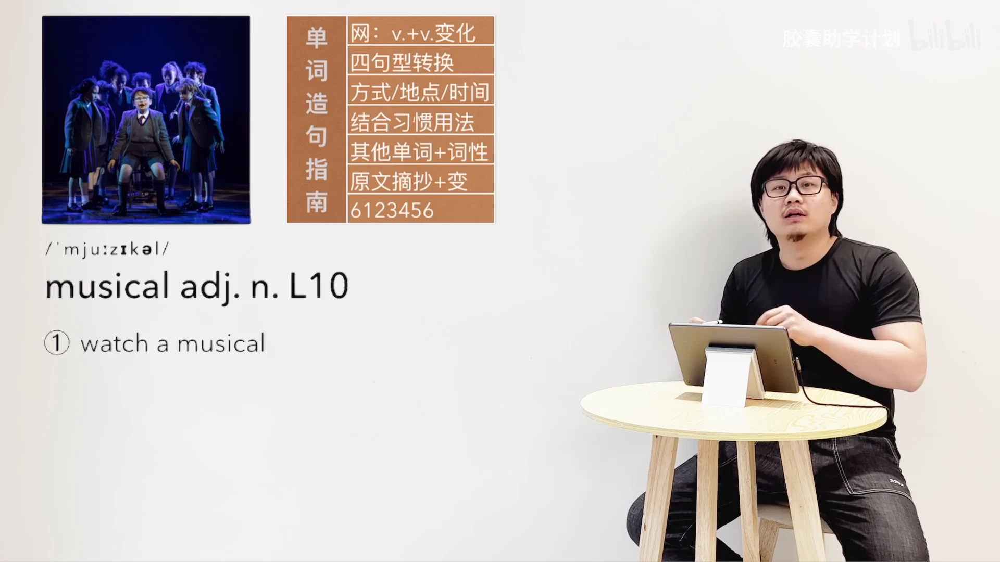

文字识别：单词造句指南 / 网：v.+v.变化 / 四句型转换 / 方式/地点/时间 / 结合习惯用法 / 其他单词+词性 / 原文摘抄+变 / 6123456 / /'mju:zikal/ / musical adj. n. L10 / watch a musical

### 画面 00:02:40

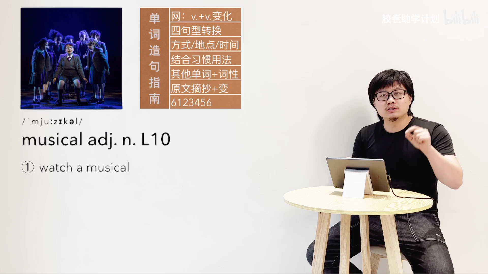

文字识别：单词造句指南 / 网：v.+v.变化 / 四句型转换 / 方式/地点/时间 / 结合习惯用法 / 其他单词+词性 / 原文摘抄+变 / 6123456 / /'mju:zikal/ / musical adj. n. L10 / watch a musical

### 画面 00:02:45

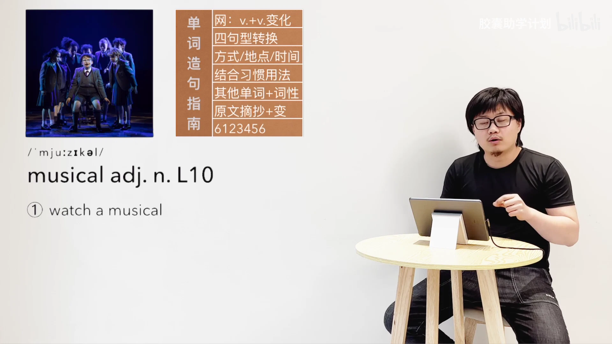

文字识别：单词造句指南 / 网：v.+v.变化 / 四句型转换 / 方式/地点/时间 / 结合习惯用法 / 其他单词+词性 / 原文摘抄+变 / 6123456 / /'mju:zikal/ / musical adj. n. L10 / watch a musical

### 画面 00:02:55

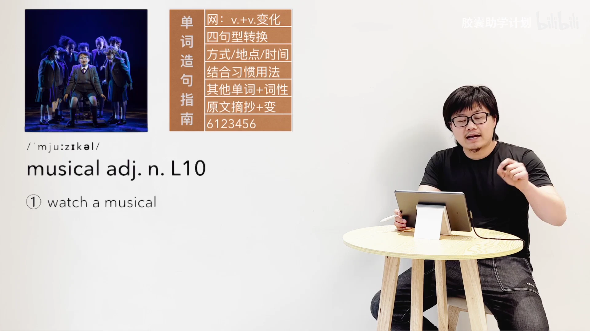

文字识别：单词造句指南 / 网：v.+v.变化 / 四句型转换 / 方式/地点/时间 / 结合习惯用法 / 其他单词+词性 / 原文摘抄+变 / 6123456 / /'mju:zikal/ / musical adj. n.L10 / watch a musical

## 00:03:00–00:03:30

musical 在这个地方实际上是由动词引导的，对吧？那由动词引导的呢？啊，动词引导的一个短语。那我们去造句的时候，它肯定就是二和三已经判断了，然后你自己去加一些一啊，加一些之前学的习惯用法就好了。比如说在这儿我就用了一个四十一课我们刚刚学过的习惯用法，叫 I regretted watching that musical last night. OK，玩一个。那后悔做了这件事情，做了吗？做了，已经，对吧？Next one，说 I really like the musical we

### 画面 00:03:01

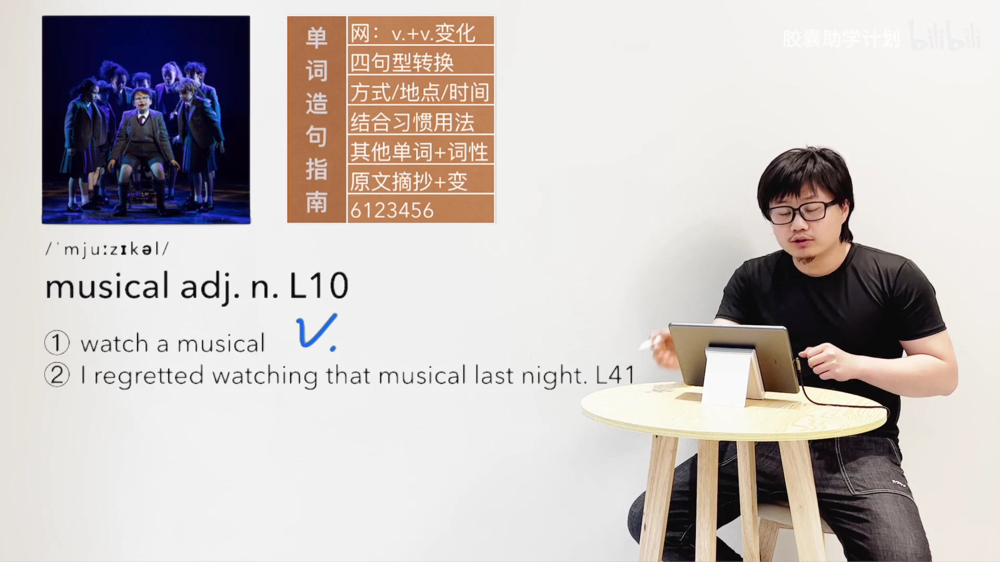

文字识别：单词造句指南 / 网：v.+v.变化 / 四句型转换 / 方式/地点/时间 / 结合习惯用法 / 其他单词+词性 / 原文摘抄+变 / 6123456 / /'mju:zikal/ / musical adj. n.L10 / V / watch a musical / ) I regretted watching that musical last night. L41

### 画面 00:03:06

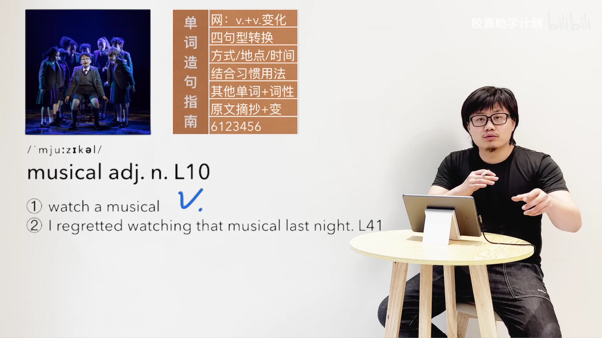

文字识别：单词造句指南 / 网：v.+v.变化 / 四句型转换 / 方式/地点/时间 / 结合习惯用法 / 其他单词+词性 / 原文摘抄+变 / 6123456 / /'mju:zikal/ / musical adj. n.L10 / V / watch a musical / ) I regretted watching that musical last night. L41

### 画面 00:03:15

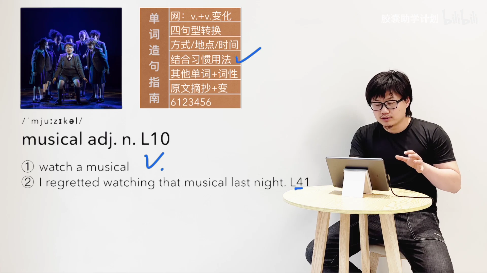

文字识别：单词造句指南 / 网：v.+v.变化 / 四句型转换 / 方式/地点/时间 / 结合习惯用法 / 其他单词+词性 / 原文摘抄+变 / 6123456 / /'mju:zikal/ / musical adj. n.L10 / V / watch a musical /  I regretted watching that musical last night. L41

### 画面 00:03:21

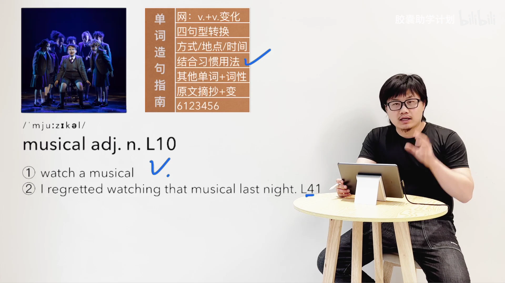

文字识别：单词造句指南 / 网：v.+v.变化 / 四句型转换 / 方式/地点/时间 / 结合习惯用法 / 其他单词+词性 / 原文摘抄+变 / 6123456 / /'mju:zikal/ / musical adj. n.L10 / V / watch a musical / ) I regretted watching that musical last night. L41

### 画面 00:03:24

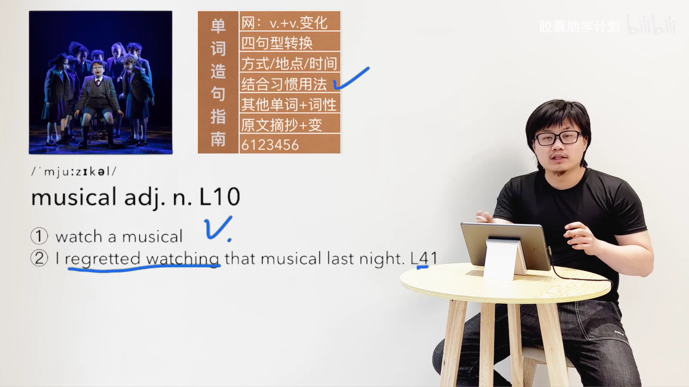

文字识别：单词造句指南 / 网：v.+v.变化 / 四句型转换 / 方式/地点/时间 / 结合习惯用法 / 其他单词+词性 / 原文摘抄+变 / 6123456 / /'mju:zikal/ / musical adj. n. L10 / V / watch a musical / I regretted watching that musical last night. L41

### 画面 00:03:26

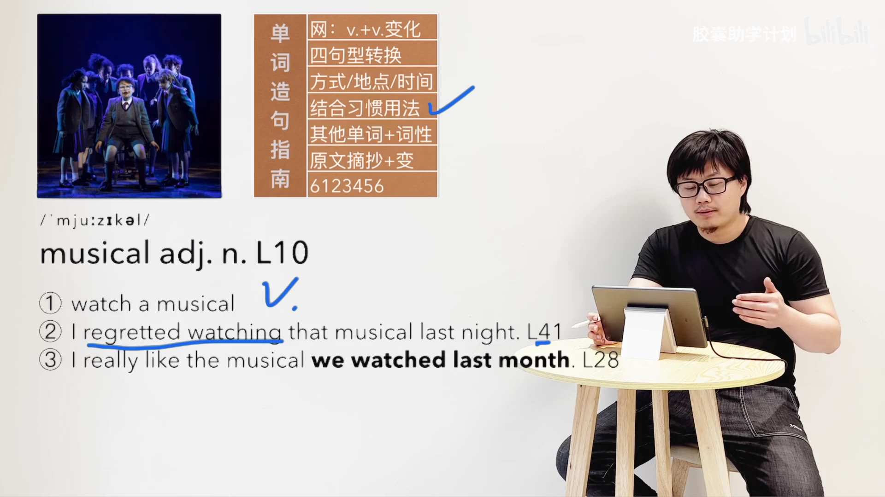

文字识别：单词造句指南 / 网：v.+v.变化 / 四句型转换 / 方式/地点/时间 / 结合习惯用法 / 其他单词+词性 / 原文摘抄+变 / 6123456 / /'mju:zikal/ / musical adj. n.L10 / V / watch a musical / I regretted watching that musical last night. L41 / )I really like the musical we watched last month. L28

## 00:03:30–00:04:00

watched last month. Okay,一个定语从句，二十八课，对吧？然后which被省略的原因是，它实际上替代的是宾语，所以可以被省略。再再然后说，She asks if you like to watch a musical.那三十九课咱们学的宾语从句。那三十九课那课我又提了，对吧？说如果你想把宾语从句搞明白，你一定要去看一下新一我之前录的某一系列的课啊，大概有五个课吧，对吧？你都要去看一下。OK，

### 画面 00:03:30

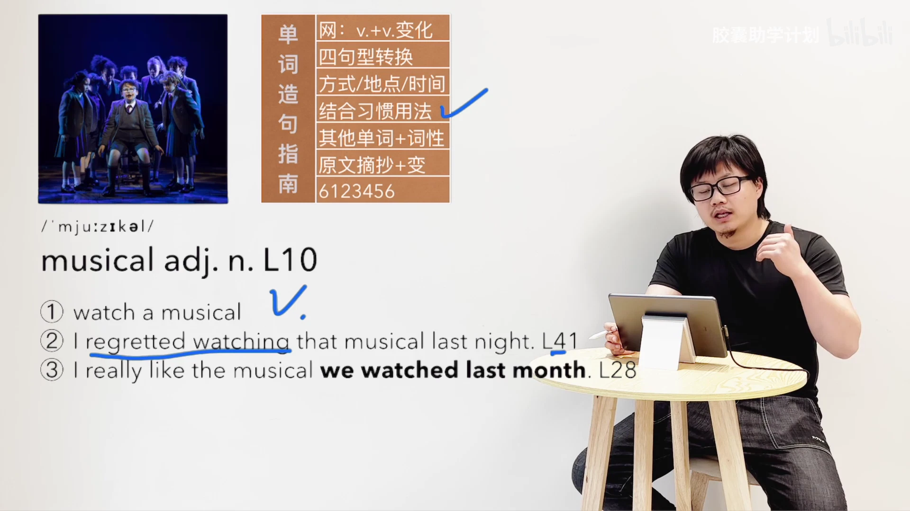

文字识别：单词造句指南 / 网：v.+v.变化 / 四句型转换 / 方式/地点/时间 / 结合习惯用法 / 其他单词+词性 / 原文摘抄+变 / 6123456 / /'mju:zikal/ / musical adj. n. L10 / V / watch a musical / I regretted watching that musical last night. L41 / ) I really like the musical we watched last month. L28 / 3

### 画面 00:03:40

文字识别：单词造句指南 / 网：v.+v.变化 / 四句型转换 / 方式/地点/时间 / 结合习惯用法 / 其他单词+词性 / 原文摘抄+变 / 6123456 / /'mju:zikal/ / musical adj. n. L10 / V / watch a musical / I regretted watching that musical last night. L41 / 2) / ③ I really like the musical we watched last month. L28 / ④ She asks if you like to watch a musical. L39

### 画面 00:03:45

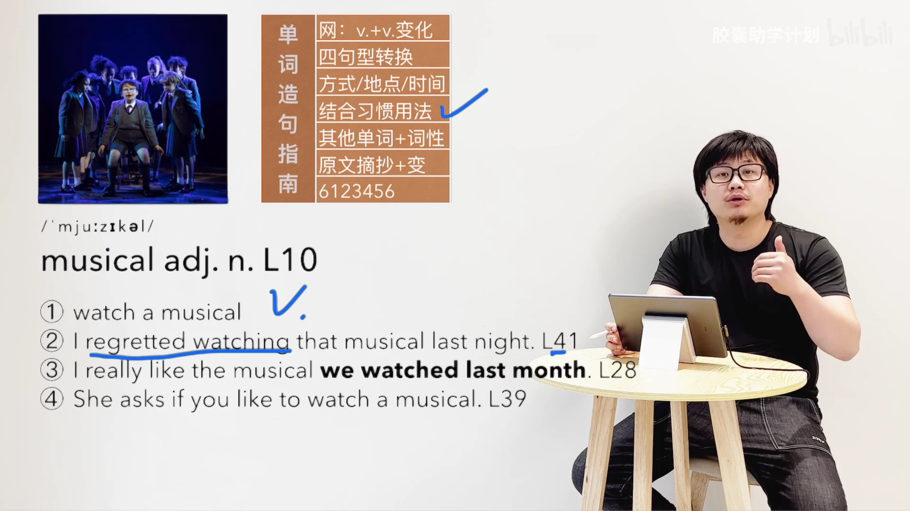

文字识别：单词造句指南 / 网：v.+v.变化 / 四句型转换 / 方式/地点/时间 / 结合习惯用法 / 其他单词+词性 / 原文摘抄+变 / 6123456 / /'mju:zikal/ / musical adj. n. L10 / V / watch a musical / I regretted watching that musical last night. L41 / 2 / 3 / ③ I really like the musical we watched last month. L28 / ④ She asks if you like to watch a musical. L39

## 00:04:00–00:04:30

不多说了。再读一遍这个单词，musical。OK，好，next one，下一个单词叫做 market。market 这个单词对于很多中国同学来说，它可能并不是一个生词。比如说，我们非常熟悉的那个单词叫做 supermarket， right？ OK，叫做超级市场。那 market 有一个意思就是市场的意思。OK，那注意它是一个名词。那它其实在一、三、五这三个位置上是很容易出现的，对不对？那我们造一个句子，比如说，if you went to the market，

### 画面 00:04:00

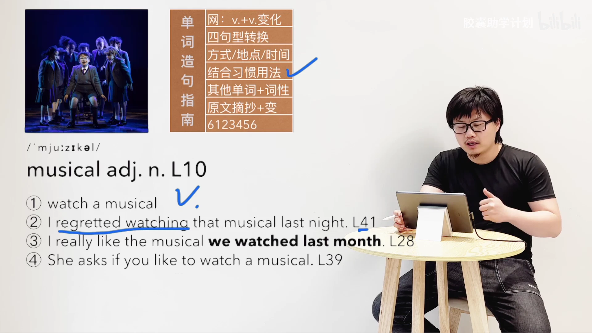

文字识别：单词造句指南 / 网：v.+v.变化 / 四句型转换 / 方式/地点/时间 / 结合习惯用法 / 其他单词+词性 / 原文摘抄+变 / 6123456 / /'mju:zikal/ / musical adj. n. L10 / V / watch a musical / I regretted watching that musical last night. L41 / 2 / 3 / ③ I really like the musical we watched last month. L28 / ④ She asks if you like to watch a musical. L39

### 画面 00:04:04

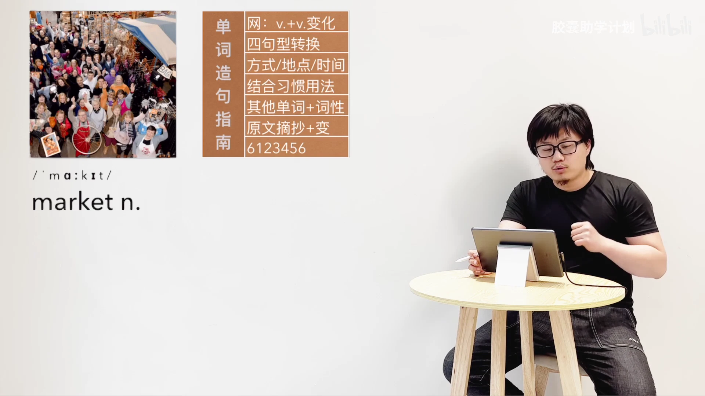

文字识别：单词造句指南 / 网：v.+v.变化 / 四句型转换 / 方式/地点/时间 / 结合习惯用法 / 其他单词+词性 / 原文摘抄+变 / 6123456 / /'ma:kit/ / market n.

### 画面 00:04:06

文字识别：单词造句指南 / 网：v.+v.变化 / 四句型转换 / 方式/地点/时间 / 结合习惯用法 / 其他单词+词性 / 原文摘抄+变 / 6123456 / /'ma:kit/ / market n.

### 画面 00:04:10

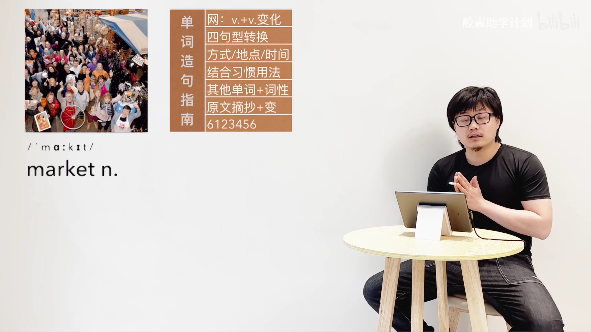

文字识别：单词造句指南 / 网：v.+v.变化 / 四句型转换 / 方式/地点/时间 / 结合习惯用法 / 其他单词+词性 / 原文摘抄+变 / 6123456 / /'ma:kit/ / market n.

### 画面 00:04:15

文字识别：单词造句指南 / 网：v.+v.变化 / 四句型转换 / 方式/地点/时间 / 结合习惯用法 / 其他单词+词性 / 原文摘抄+变 / 6123456 / /'ma:kit/ / market n.

### 画面 00:04:20

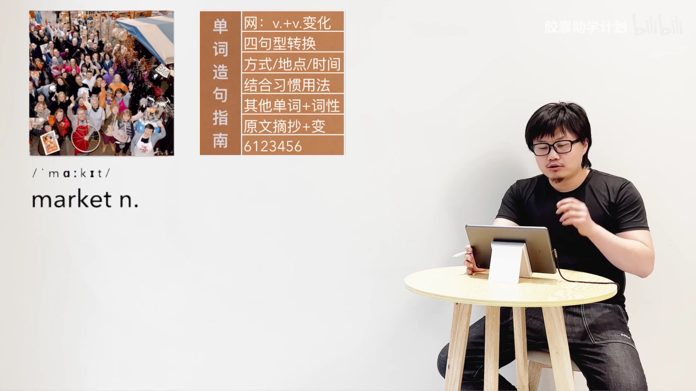

文字识别：单词造句指南 / 网：v.+v.变化 / 四句型转换 / 方式/地点/时间 / 结合习惯用法 / 其他单词+词性 / 原文摘抄+变 / 6123456 / /'ma:kit/ / market n.

### 画面 00:04:25

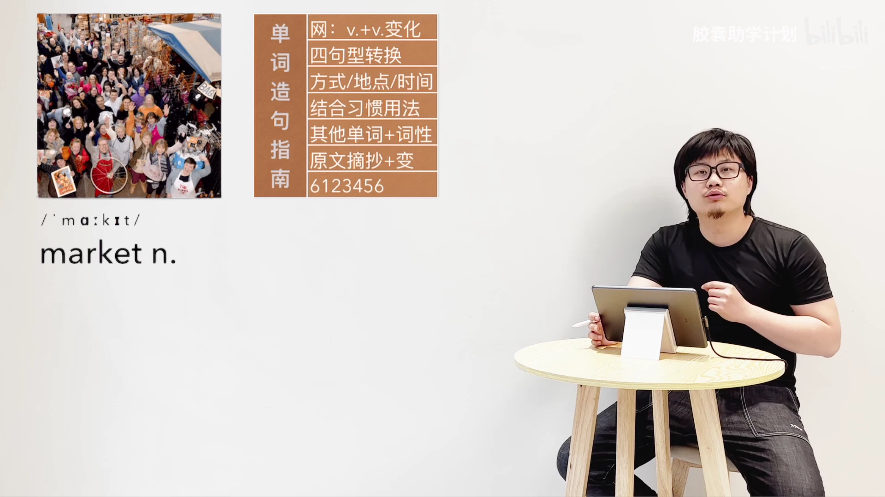

文字识别：单词造句指南 / 网：v.+v.变化 / 四句型转换 / 方式/地点/时间 / 结合习惯用法 / 其他单词+词性 / 原文摘抄+变 / 6123456 / /'maikit/ / market n.

## 00:04:30–00:05:00

you would see a lot of friends. Okay,注意你注意这是第四十课咱们学的语法。我已经把最核心的语法给各位标出来了。Went和would加see。第一，我通过这样的结构判断了它是虚拟语气，并且是与现在事实相反的虚拟语气。第二，我要回想一下它的含义，对吧？呃，叫做要么与现在事实相反，要么发生情况几率极低。所以说这句话的人认为你if you嘛，对吧？所以叫做认为

### 画面 00:04:30

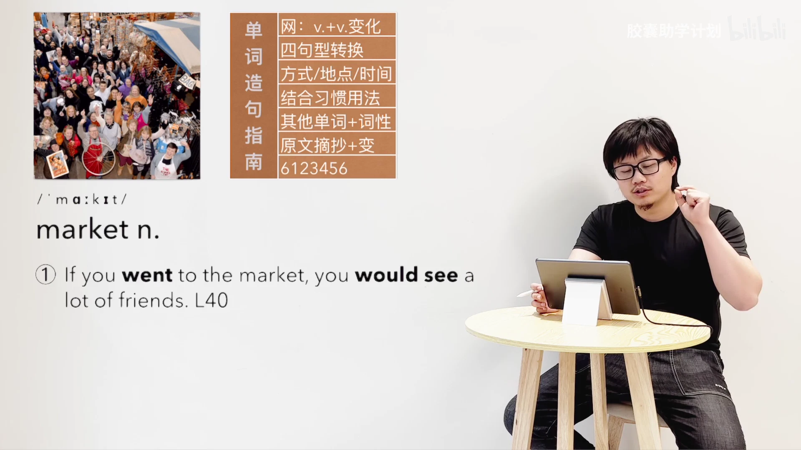

文字识别：单词造句指南 / 网：v.+v.变化 / 四句型转换 / 方式/地点/时间 / 结合习惯用法 / 其他单词+词性 / 原文摘抄+变 / 6123456 / / 'm a:kIt/ / market n. / ① If you went to the market, you would see a / lot of friends. L40

### 画面 00:04:35

文字识别：单词造句指南 / 网：v.+v.变化 / 四句型转换 / 方式/地点/时间 / 结合习惯用法 / 其他单词+词性 / 原文摘抄+变 / 6123456 / / ' m a:kIt/ / market n. / ① If you went to the market, you would see a / Iot of friends. L40

## 00:05:00–00:05:30

你啊不呃几乎不可能去这个 market，对吧？啊，不会去这个市集，然后你很可能也见不到朋友。OK，那你看我们中国其实西方也有啊。你看我在新西兰就赶过很多次集，就去这个 market。它其实某种程度上非常像我们中国，至少北方农村啊，然后什么初一十五有小集有大集，对吧？在农村里面会有。那我们其实那个也管它叫

### 画面 00:05:04

文字识别：单词造句指南 / 网：v.+v.变化 / 四句型转换 / 方式/地点/时间 / 结合习惯用法 / 其他单词+词性 / 原文摘抄+变 / 6123456 / / 'm a:kIt/ / market n. / ① If you went to the market, you would see a / Iot of friends. L40

### 画面 00:05:06

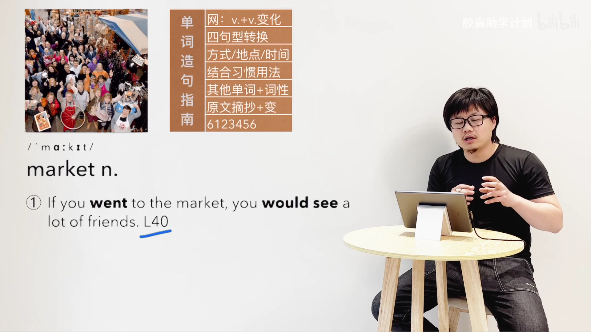

文字识别：单词造句指南 / 网：v.+v.变化 / 四句型转换 / 方式/地点/时间 / 结合习惯用法 / 其他单词+词性 / 原文摘抄+变 / 6123456 / /'m a:kIt/ / market n. / ① If you went to the market, you would see a / Iot of friends. L40

### 画面 00:05:10

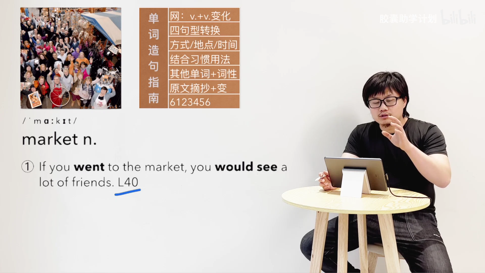

文字识别：单词造句指南 / 网：v.+v.变化 / 四句型转换 / 方式/地点/时间 / 结合习惯用法 / 其他单词+词性 / 原文摘抄+变 / 6123456 / / 'm a:kIt/ / market n. / ① If you went to the market, you would see a / Iot of friends. L40

## 00:05:30–00:06:00

market, okay, very good. Next one, say we needn't have gone to the market. Ah, we have everything we want. Ah, in in our house, in our house. Okay, very good. So this lesson forty one, ah,这是我们四十一个学的叫 needn't have done.说你本不必怎么怎么样。说我们本不必去这个超市的，因为我们拥有了一切，家里面有一切我们需要的东西，对吧？我们去那还干嘛呢？Okay, very good. Next one, say I look forward to going to the supermarket.三十

### 画面 00:05:35

文字识别：单词造句指南 / 网：v.+v.变化 / 四句型转换 / 方式/地点/时间 / 结合习惯用法 / 其他单词+词性 / 原文摘抄+变 / 6123456 / /'ma:kIt/ / market n. / ① If you went to the market, you would see a / lot of friends. L40 / We needn't have gone to the market. L41

### 画面 00:05:40

文字识别：单词造句指南 / 网：v.+v.变化 / 四句型转换 / 方式/地点/时间 / 结合习惯用法 / 其他单词+词性 / 原文摘抄+变 / 6123456 / /'m a:kIt/ / market n. / ① If you went to the market, you would see a / lot of friends. L40 / We needn't have gone to the market. L41

### 画面 00:05:45

文字识别：单词造句指南 / 网：v.+v.变化 / 四句型转换 / 方式/地点/时间 / 结合习惯用法 / 其他单词+词性 / 原文摘抄+变 / 6123456 / /'ma:kit/ / market n. / ① If you went to the market, you would see a / lot of friends. L40 / We needn't have gone to the market.L41

### 画面 00:05:51

文字识别：单词造句指南 / 网：v.+v.变化 / 四句型转换 / 方式/地点/时间 / 结合习惯用法 / 其他单词+词性 / 原文摘抄+变 / 6123456 / /'ma:kIt/ / market n. / ① If you went to the market, you would see a / lot of friends. L40 / We needn't have gone to the market. L41

### 画面 00:05:55

文字识别：单词造句指南 / 网：v.+v.变化 / 四句型转换 / 方式/地点/时间 / 结合习惯用法 / 其他单词+词性 / 原文摘抄+变 / 6123456 / /'ma:kIt/ / market n. / ① If you went to the market, you would see a / lot of friends. L40 / We needn't have gone to the market.L41

## 00:06:00–00:06:30

课学. Look forward to doing something. 这个点各位非常容易遗忘，把它一定要记住. OK, continue. Next one叫做snake charmer. Snake charmer. OK, snake叫做蛇。那charmer这个单词如果单独说，那是有另一个意思了啊。我们现在这儿我先不学了。如果你感兴趣，你可以自己去查。在这一课当中，我需要各位掌握两个东西。第一个叫snake是蛇的意思。第二个叫snake charmer就是如图的这个东西，

### 画面 00:06:00

文字识别：单词造句指南 / 网：v.+v.变化 / 四句型转换 / 方式/地点/时间 / 结合习惯用法 / 其他单词+词性 / 原文摘抄+变 / 6123456 / /'ma:kit/ / market n. / ① If you went to the market, you would see a / lot of friends. L40 / We needn't have gone to the market.L41 / ③ Ilook forward to going to the market. L37

### 画面 00:06:05

文字识别：单词造句指南 / 网：v.+v.变化 / 四句型转换 / 方式/地点/时间 / 结合习惯用法 / 其他单词+词性 / 原文摘抄+变 / 6123456 / /'ma:kit/ / market n. / ① If you went to the market, you would see a / lot of friends. L40 / We needn't have gone to the market.L41 / ③ Ilook forward to going to the market. L37

### 画面 00:06:07

文字识别：单词造句指南 / 网：v.+v.变化 / 四句型转换 / 方式/地点/时间 / 结合习惯用法 / 其他单词+词性 / 原文摘抄+变 / 6123456 / /sneik/ /'t∫aima/ / snake charmer n.

### 画面 00:06:10

文字识别：单词造句指南 / 网：v.+v.变化 / 四句型转换 / 方式/地点/时间 / 结合习惯用法 / 其他单词+词性 / 原文摘抄+变 / 6123456 / /sneik/ /'t∫aima/ / snake charmer n.

### 画面 00:06:16

文字识别：单词造句指南 / 网：v.+v.变化 / 四句型转换 / 方式/地点/时间 / 结合习惯用法 / 其他单词+词性 / 原文摘抄+变 / 6123456 / /sneik/ /'t∫aima/ / snake charmer n.

### 画面 00:06:20

文字识别：单词造句指南 / 网：v.+v.变化 / 四句型转换 / 方式/地点/时间 / 结合习惯用法 / 其他单词+词性 / 原文摘抄+变 / 6123456 / /sneik/ /'t∫aima/ / snake charmer n.

### 画面 00:06:25

文字识别：单词造句指南 / 网：v.+v.变化 / 四句型转换 / 方式/地点/时间 / 结合习惯用法 / 其他单词+词性 / 原文摘抄+变 / 6123456 / /sneik/ /'t∫aima/ / snake charmer n.

### 画面 00:06:27

文字识别：单词造句指南 / 网：v.+v.变化 / 四句型转换 / 方式/地点/时间 / 结合习惯用法 / 其他单词+词性 / 原文摘抄+变 / 6123456 / /sneik//'t∫aima/ / snake charmer n.

## 00:06:30–00:07:00

对吧？就是呃，我印象当中就是我们说印度的人，好像还是印度北部穆斯林，就是头上缠着这个东西的。我拿不太准了，我印象当中是这样的啊，叫锡克族，好像叫他们呢吹着这个笛子，然后训练那个眼镜蛇，对吧？它叫 Snake Charmer。 OK， very good。 这是一个非常 stereotype 的印象啊，呃，非常刻板印象的一个印象。而我们拿它去造句，其实它就是一个很简单

### 画面 00:06:30

文字识别：单词造句指南 / 网：v.+v.变化 / 四句型转换 / 方式/地点/时间 / 结合习惯用法 / 其他单词+词性 / 原文摘抄+变 / 6123456 / /sneik//'t∫aima/ / snake charmer n.

### 画面 00:06:36

文字识别：单词造句指南 / 网：v.+v.变化 / 四句型转换 / 方式/地点/时间 / 结合习惯用法 / 其他单词+词性 / 原文摘抄+变 / 6123456 / /sneik/ /'t∫aima/ / snake charmer n.

### 画面 00:06:40

文字识别：单词造句指南 / 网：v.+v.变化 / 四句型转换 / 方式/地点/时间 / 结合习惯用法 / 其他单词+词性 / 原文摘抄+变 / 6123456 / /snelk/ /'t∫aima/ / snake charmer n.

### 画面 00:06:45

文字识别：单词造句指南 / 网：v.+v.变化 / 四句型转换 / 方式/地点/时间 / 结合习惯用法 / 其他单词+词性 / 原文摘抄+变 / 6123456 / /sneik/ /'t∫aima/ / snake charmer n.

### 画面 00:06:50

文字识别：单词造句指南 / 网：v.+v.变化 / 四句型转换 / 方式/地点/时间 / 结合习惯用法 / 其他单词+词性 / 原文摘抄+变 / 6123456 / /sneik//'t∫aima/ / snake charmer n.

### 画面 00:06:55

文字识别：单词造句指南 / 网：v.+v.变化 / 四句型转换 / 方式/地点/时间 / 结合习惯用法 / 其他单词+词性 / 原文摘抄+变 / 6123456 / /snei k/ /'t ∫aima / / snake charmer n. / ① The snake charmer is busy eating his lunch. L40

## 00:07:00–00:07:30

的名词。它本质上和我们刚刚四十课学过的 hostess，我认为其实本质上没有什么太大区别。再去造句的时候，对吧？女主人啊，都是人。比如说，我造一句话叫 The snake charmer is busy eating his lunch. 四十课咱们学的 be busy doing something，对吧？那你想，snake charmer 可以 be busy eating。任何一个职业，任何一个人，他都可以 be busy eating his lunch，对吧？Okay, next one. Say it is

### 画面 00:07:00

文字识别：单词造句指南 / 网：v.+v.变化 / 四句型转换 / 方式/地点/时间 / 结合习惯用法 / 其他单词+词性 / 原文摘抄+变 / 6123456 / /snei k/ /'t ∫aima / / snake charmer n. / ① The snake charmer is busy eating his lunch. L40

### 画面 00:07:03

文字识别：单词造句指南 / 网：v.+v.变化 / 四句型转换 / 方式/地点/时间 / 结合习惯用法 / 其他单词+词性 / 原文摘抄+变 / 6123456 / /snei k/ /'t ∫aima / / snake charmer n. / ① The snake charmer is busy eating his lunch. L40

### 画面 00:07:05

文字识别：单词造句指南 / 网：v.+v.变化 / 四句型转换 / 方式/地点/时间 / 结合习惯用法 / 其他单词+词性 / 原文摘抄+变 / 6123456 / / snei k / /'t ∫aima/ / snake charmer n. / ① The snake charmer is busy eating his lunch. L40

### 画面 00:07:10

文字识别：单词造句指南 / 网：v.+v.变化 / 四句型转换 / 方式/地点/时间 / 结合习惯用法 / 其他单词+词性 / 原文摘抄+变 / 6123456 / /snei k/ /'t ∫aima / / snake charmer n. / ① The snake charmer is busy eating his lunch. L40

### 画面 00:07:17

文字识别：单词造句指南 / 网：v.+v.变化 / 四句型转换 / 方式/地点/时间 / 结合习惯用法 / 其他单词+词性 / 原文摘抄+变 / 6123456 / /snei k/ /'t ∫aima / / snake charmer n. / ① The snake charmer is busy eating his lunch. L40

### 画面 00:07:20

文字识别：单词造句指南 / 网：v.+v.变化 / 四句型转换 / 方式/地点/时间 / 结合习惯用法 / 其他单词+词性 / 原文摘抄+变 / 6123456 / /snei k/ /'t ∫aima / / snake charmer n. / ① The snake charmer is busy eating his lunch. L40

### 画面 00:07:25

文字识别：单词造句指南 / 网：v.+v.变化 / 四句型转换 / 方式/地点/时间 / 结合习惯用法 / 其他单词+词性 / 原文摘抄+变 / 6123456 / /snei k/ /'t ∫aima / / snake charmer n. / ① The snake charmer is busy eating his lunch. L40

### 画面 00:07:28

文字识别：单词造句指南 / 网：v.+v.变化 / 四句型转换 / 方式/地点/时间 / 结合习惯用法 / 其他单词+词性 / 原文摘抄+变 / 6123456 / / snei k/ / 't ∫aima / / snake charmer n. / ① The snake charmer is busy eating his lunch. L40 / ② It is easy for a snake charmer to play with a / snake. L32

## 00:07:30–00:08:00

easy for a snake charmer to play with a snake. 当然了，对吧？你作为一个 snake charmer 玩蛇的这个人，对吧？然后呢，那你去和蛇一起玩，应该是很容易的事情，对吧？ It is easy for somebody to do something. 三十二课习惯用法。再然后我们加一个连词，叫 Both his father and his grandfather are snake charmers. Both A and B. 二十五课的连词。 Very good. 那再读一遍 snake charmer. Very good. Continue. 下一个

### 画面 00:07:30

文字识别：单词造句指南 / 网：v.+v.变化 / 四句型转换 / 方式/地点/时间 / 结合习惯用法 / 其他单词+词性 / 原文摘抄+变 / 6123456 / /snei k/ /'t ∫aima / / snake charmer n. / ① The snake charmer is busy eating his lunch. L40 / ② It is easy for a snake charmer to play with a / snake. L32

### 画面 00:07:36

文字识别：单词造句指南 / 网：v.+v.变化 / 四句型转换 / 方式/地点/时间 / 结合习惯用法 / 其他单词+词性 / 原文摘抄+变 / 6123456 / /snei k/ /'t ∫aima/ / snake charmer n. / ① The snake charmer is busy eating his lunch. L40 / ② It is easy for a snake charmer to play with a / snake. L32

### 画面 00:07:41

文字识别：单词造句指南 / 网：v.+v.变化 / 四句型转换 / 方式/地点/时间 / 结合习惯用法 / 其他单词+词性 / 原文摘抄+变 / 6123456 / /snei k/ /'t ∫aima / / snake charmer n. / ① The snake charmer is busy eating his lunch. L40 / ② It is easy for a snake charmer to play with a / snake. L32

### 画面 00:07:45

文字识别：单词造句指南 / 网：v.+v.变化 / 四句型转换 / 方式/地点/时间 / 结合习惯用法 / 其他单词+词性 / 原文摘抄+变 / 6123456 / /sneik/ /'t ∫aima/ / snake charmer n. / ① The snake charmer is busy eating his lunch. L40 / ② It is easy for a snake charmer to play with a / snake. L32 / Both his father and his grandfather are snake / charmers. L25

### 画面 00:07:50

文字识别：单词造句指南 / 网：v.+v.变化 / 四句型转换 / 方式/地点/时间 / 结合习惯用法 / 其他单词+词性 / 原文摘抄+变 / 6123456 / /sneik/ /'t ∫aima/ / snake charmer n. / ① The snake charmer is busy eating his lunch. L40 / ② It is easy for a snake charmer to play with a / snake. L32 / Both his father and his grandfather are snake / charmers. L25

### 画面 00:07:55

文字识别：单词造句指南 / 网：v.+v.变化 / 四句型转换 / 方式/地点/时间 / 结合习惯用法 / 其他单词+词性 / 原文摘抄+变 / 6123456 / /sneik/ /'t ∫aima/ / snake charmer n. / ① The snake charmer is busy eating his lunch. L40 / ② It is easy for a snake charmer to play with a / snake. L32 / Both his father and his grandfather are snake / charmers. L25

### 画面 00:07:58

文字识别：单词造句指南 / 网：v.+v.变化 / 四句型转换 / 方式/地点/时间 / 结合习惯用法 / 其他单词+词性 / 原文摘抄+变 / 6123456 / /paip/ / pipe n.

## 00:08:00–00:08:30

单词跟我读一下，叫做 pipe. Pipe.好，那 pipe 意思 pipe 意思其实有非常非常的多，比如说我们常用的叫管道啊，可以叫 pipe，对吧？那比如说烟斗，这个可能就不太常用了，它也叫 pipe. OK.那在本课比较特殊，它实际上是指这种管弦啊管乐器，对吧？啊，箫子呀笛啊箫啊笛呀，OK.所以它叫做 pipe. Very good.

### 画面 00:08:00

文字识别：单词造句指南 / 网：v.+v.变化 / 四句型转换 / 方式/地点/时间 / 结合习惯用法 / 其他单词+词性 / 原文摘抄+变 / 6123456 / /paip/ / pipe n.

### 画面 00:08:05

文字识别：单词造句指南 / 网：v.+v.变化 / 四句型转换 / 方式/地点/时间 / 结合习惯用法 / 其他单词+词性 / 原文摘抄+变 / 6123456 / /paip/ / pipe n.

### 画面 00:08:11

文字识别：单词造句指南 / 网：v.+v.变化 / 四句型转换 / 方式/地点/时间 / 结合习惯用法 / 其他单词+词性 / 原文摘抄+变 / 6123456 / /paip/ / pipe n.

### 画面 00:08:16

文字识别：单词造句指南 / 网：v.+v.变化 / 四句型转换 / 方式/地点/时间 / 结合习惯用法 / 其他单词+词性 / 原文摘抄+变 / 6123456 / /paip/ / pipe n.

## 00:08:30–00:09:00

That本质也是个名词嘛，很容易。比如说，我们跟第十课联合一下，第十课咱们学的不叫 musical instrument嘛，啊啊啊，old clavichord，对吧？古钢琴那一课。那我们就造一个句子叫做 The pipe was bought by my grandfather many years ago. Ah,被买的，许多年前被买的，very good. Continue. Say this is such a nice pipe that he refused to sell it. 说这是如此棒的一个

### 画面 00:08:31

文字识别：单词造句指南 / 网：v.+v.变化 / 四句型转换 / 方式/地点/时间 / 结合习惯用法 / 其他单词+词性 / 原文摘抄+变 / 6123456 / /paip/ / pipe n. / ① The pipe was bought by my grandfather / many years ago. L10

### 画面 00:08:36

文字识别：单词造句指南 / 网：v.+v.变化 / 四句型转换 / 方式/地点/时间 / 结合习惯用法 / 其他单词+词性 / 原文摘抄+变 / 6123456 / /paip/ / pipe n. / ① The pipe was bought by my grandfather / many years ago. L10

### 画面 00:08:46

文字识别：单词造句指南 / 网：v.+v.变化 / 四句型转换 / 方式/地点/时间 / 结合习惯用法 / 其他单词+词性 / 原文摘抄+变 / 6123456 / /paip/ / pipe n. / ① The pipe was bought by my grandfather / many years ago. L10

### 画面 00:08:55

文字识别：单词造句指南 / 网：v.+v.变化 / 四句型转换 / 方式/地点/时间 / 结合习惯用法 / 其他单词+词性 / 原文摘抄+变 / 6123456 / /paip/ / pipe n. / ① The pipe was bought by my grandfather / many years ago. L10 / This is such a nice pipe that he refused to / sell it. L35

## 00:09:00–00:09:30

哎管乐器，以至于他拒绝去卖掉它。Such点儿点儿点儿that三十五课咱们学的语法对吧？OK还是那句话啊，各位，我们之前学的语法怎么才能不忘记呢？啊，挺简单。第一个是你当天听懂了，然后呢当天把练习做到位。第二个就是接下来的呃单词造句或者说各种作业，你就不停的用就好了，对吧？OK next one说My father trained me to play

### 画面 00:09:00

文字识别：单词造句指南 / 网：v.+v.变化 / 四句型转换 / 方式/地点/时间 / 结合习惯用法 / 其他单词+词性 / 原文摘抄+变 / 6123456 / /paip/ / pipe n. / ① The pipe was bought by my grandfather / many years ago. L10 / This is(sucba nice pipe that he refused to / sell it. L35

### 画面 00:09:02

文字识别：单词造句指南 / 网：v.+v.变化 / 四句型转换 / 方式/地点/时间 / 结合习惯用法 / 其他单词+词性 / 原文摘抄+变 / 6123456 / /paip/ / pipe n. / ① The pipe was bought by my grandfather / many years ago. L10 / This is(sucba nice pipe thal he refused to / sell it. L35

### 画面 00:09:05

文字识别：单词造句指南 / 网：v.+v.变化 / 四句型转换 / 方式/地点/时间 / 结合习惯用法 / 其他单词+词性 / 原文摘抄+变 / 6123456 / /paip/ / pipe n. / ① The pipe was bought by my grandfather / many years ago. L10 / This is(sucb a nice pipe thal he refused to / sell it. L35

### 画面 00:09:16

文字识别：单词造句指南 / 网：v.+v.变化 / 四句型转换 / 方式/地点/时间 / 结合习惯用法 / 其他单词+词性 / 原文摘抄+变 / 6123456 / /paip/ / pipe n. / ① The pipe was bought by my grandfather / many years ago. L10 / This is(sucb a nice pipe'thal he refused to / sell it. L35

### 画面 00:09:21

文字识别：单词造句指南 / 网：v.+v.变化 / 四句型转换 / 方式/地点/时间 / 结合习惯用法 / 其他单词+词性 / 原文摘抄+变 / 6123456 / /paip/ / pipe n. / ① The pipe was bought by my grandfather / many years ago. L10 / This is(sucb a nice pipe thal he refused to / sell it. L35

### 画面 00:09:26

文字识别：单词造句指南 / 网：v.+v.变化 / 四句型转换 / 方式/地点/时间 / 结合习惯用法 / 其他单词+词性 / 原文摘抄+变 / 6123456 / /paip/ / pipe n. / ① The pipe was bought by my grandfather / many years ago. L10 / This is(sucb a nice pipethal he refused to / sell it. L35 / My father trained me to play pipe for a long / time. L36

## 00:09:30–00:10:00

pipe for a long time. 那我父亲 train somebody to do something, 训练某人做某事儿，训练我去哎做呃弹这个呃呃吹这个呃笛子，对吧？很长一段时间了，三十六课咱们学的还是那句话。我现在去造这些句子的目的，其实本质上是想给各位一个示范。你把这些句子记下来、抄下来、背下来，是在我看来用处不是特别大的一个呃事情，对吧？但是你明

### 画面 00:09:30

文字识别：单词造句指南 / 网：v.+v.变化 / 四句型转换 / 方式/地点/时间 / 结合习惯用法 / 其他单词+词性 / 原文摘抄+变 / 6123456 / /paip/ / pipe n. / ① The pipe was bought by my grandfather / many years ago. L10 / This is(sucba nice pipethal he refused to / sell it. L35 / My father trained me to play pipe for a long / time. L36

### 画面 00:09:36

文字识别：单词造句指南 / 网：v.+v.变化 / 四句型转换 / 方式/地点/时间 / 结合习惯用法 / 其他单词+词性 / 原文摘抄+变 / 6123456 / /paip/ / pipe n. / ① The pipe was bought by my grandfather / many years ago. L10 / This is(sucba nice pipethal he refused to / sell it. L35 / My father trained me to play pipe for a long / time.L36

### 画面 00:09:40

文字识别：单词造句指南 / 网：v.+v.变化 / 四句型转换 / 方式/地点/时间 / 结合习惯用法 / 其他单词+词性 / 原文摘抄+变 / 6123456 / /paip/ / pipe n. / ① The pipe was bought by my grandfather / many years ago. L10 / This is(sucb a nice pipethal he refused to / sell it. L35 / My father trained me to play pipe for a long / time.L36

### 画面 00:09:45

文字识别：单词造句指南 / 网：v.+v.变化 / 四句型转换 / 方式/地点/时间 / 结合习惯用法 / 其他单词+词性 / 原文摘抄+变 / 6123456 / /paip/ / pipe n. / The pipe was bought by my grandfather / many years ago. L10 / This is(sucb a nice pipethal he refused to / sell it. L35 / My father trained me to play pipe for a long / time.L36

## 00:10:00–00:10:30

白这些句子我怎么造出来？因为大多数老师是给你一个例句让你回去去背，对吧？这这个我们在开篇部分讲过了，你实际上是并没有一个自己造句子的能力的。我们在这个地方虽然也是把结果的句子放在这儿，但我给你讲了我是怎么把它造出来，怎么去想的，对吧？也就是这些造句指南我是如何去用的。于是将来有一个新的单词，你自己拿过来就可以去造一些句子去用了。慢慢慢慢的，你越造越顺，越造越舒服，你张开嘴就说了，

### 画面 00:10:11

文字识别：单词造句指南 / 网：v.+v.变化 / 四句型转换 / 方式/地点/时间 / 结合习惯用法 / 其他单词+词性 / 原文摘抄+变 / 6123456 / /paip/ / pipe n. / The pipe was bought by my grandfather / many years ago. L10 / This is(sucba nice pipe'thal he refused to / sell it. L35 / My father trained me to play pipe for a long / time.L36

### 画面 00:10:15

文字识别：单词造句指南 / 网：v.+v.变化 / 四句型转换 / 方式/地点/时间 / 结合习惯用法 / 其他单词+词性 / 原文摘抄+变 / 6123456 / /paip/ / pipe n. / The pipe was bought by my grandfather / many years ago. L10 / This is(sucb a nice pipethal he refused to / sell it. L35 / My father trained me to play pipe for a long / time.L36

### 画面 00:10:19

文字识别：单词造句指南 / 网： / +v.变化 / 四句型转换 / 方式/地点/时间 / 结合习惯用法 / 其他单词+词性 / 原文摘抄+变 / 6123456 / /paip/ / pipe n. / The pipe was bought by my grandfather / many years ago. L10 / This is(sucb a nice pipethal he refused to / sell it. L35 / My father trained me to play pipe for a long / time.L36

### 画面 00:10:23

文字识别：单词造句指南 / 网： / +v.变化 / 四句型转换 / 方式/地点/时间 / 结合习惯用法 / 其他单词+词性 / 原文摘抄+变 / 6123456 / /paip/ / pipe n. / The pipe was bought by my grandfather / many years ago. L10 / This issucb a nice pipe'thal he refused to / sell it. L35 / My father trained me to play pipe for a long / time. L36

## 00:10:30–00:11:00

对吧？OK，我们希望的是这样一件事情。下一个单词叫做 tune，叫叫曲调，对吧？比如说 play a tune，啊，弹一段，弹个小调啊什么的都可以，对吧？演奏一下啊，叫做 play a tune。OK，再一个，比如说呃，这句话实际上就是我我不想造句了，对吧？我当时实际上想了一下 play a tune，我怎么造？我没想到，然后我就直接去查了一下 Times，啊，这个时报，然后它上面就有这样一句话，叫 By the age of seven,

### 画面 00:10:31

文字识别：单词造句指南 / 网：v.+v.变化 / 四句型转换 / 方式/地点/时间 / 结合习惯用法 / 其他单词+词性 / 原文摘抄+变 / 6123456 / /tjuin/ / tune n.

### 画面 00:10:35

文字识别：单词造句指南 / 网：v.+v.变化 / 四句型转换 / 方式/地点/时间 / 结合习惯用法 / 其他单词+词性 / 原文摘抄+变 / 6123456 / /tjuin/ / tune n. / ① play a tune

### 画面 00:10:39

文字识别：单词造句指南 / 网：v.+v.变化 / 四句型转换 / 方式/地点/时间 / 结合习惯用法 / 其他单词+词性 / 原文摘抄+变 / 6123456 / /tju:n/ / tune n. / ① play a tune / ② By the age of seven he could play any tune he / heard on the piano in the dark, though he / never learnt to read or write music.[Times]

### 画面 00:10:41

文字识别：单词造句指南 / 网：v.+v.变化 / 四句型转换 / 方式/地点/时间 / 结合习惯用法 / 其他单词+词性 / 原文摘抄+变 / 6123456 / /tju:n/ / tune n. / ① play a tune / ② By the age of seven he could play any tune he / heard on the piano in the dark, though he / never learnt to read or write music.[Times]

### 画面 00:10:45

文字识别：单词造句指南 / 网：v.+v.变化 / 四句型转换 / 方式/地点/时间 / 结合习惯用法 / 其他单词+词性 / 原文摘抄+变 / 6123456 / /tju:n/ / tune n. / ① play a tune / ② By the age of seven he could play any tune he / heard on the piano in the dark, though he / never learnt to read or write music.[Times]

### 画面 00:10:50

文字识别：单词造句指南 / 网：v.+v.变化 / 四句型转换 / 方式/地点/时间 / 结合习惯用法 / 其他单词+词性 / 原文摘抄+变 / 6123456 / /tju:n/ / tune n. / ① play a tune / ② By the age of seven he could play any tune he / heard on the piano in the dark, though he / never learnt to read or write music. [Times]

### 画面 00:10:58

文字识别：单词造句指南 / 网：v.+v.变化 / 四句型转换 / 方式/地点/时间 / 结合习惯用法 / 其他单词+词性 / 原文摘抄+变 / 6123456 / /tju:n/ / tune n. / ① play a tune / ② By the age of seven he could play any tune he / heard on the piano in the dark, though he / never learnt to read or write music.[Times]

## 00:11:00–00:11:30

he could play any tune. He heard on the piano in the dark, though he never learned to read or write music. 我觉得这句话当中大多数单词我们一查就能查出来，但很多的句子都是我们之前学过的语法，所以我故意把它拿下来了啊。你你可以不背，能读懂我觉得就行了。 By the age of seven, 就是当他截止到七岁的时候，你看 by 截止这个用法是我们在 will have done Olympic运动会那一刻学过的，对吧？截止

### 画面 00:11:11

文字识别：单词造句指南 / 网：v.+v.变化 / 四句型转换 / 方式/地点/时间 / 结合习惯用法 / 其他单词+词性 / 原文摘抄+变 / 6123456 / /tju:n/ / tune n. / ① play a tune / ② By the age of seven he could play any tune he / heard on the piano in the dark, though he / never learnt to read or write music.[Times]

### 画面 00:11:15

文字识别：单词造句指南 / 网：v.+v.变化 / 四句型转换 / 方式/地点/时间 / 结合习惯用法 / 其他单词+词性 / 原文摘抄+变 / 6123456 / /tju:n/ / tune n. / ①play a tune / By the age of seven he could play any tune he / heard on the piano in the dark, though he / never learnt to read or write music.[Times]

### 画面 00:11:20

文字识别：单词造句指南 / 网：v.+v.变化 / 四句型转换 / 方式/地点/时间 / 结合习惯用法 / 其他单词+词性 / 原文摘抄+变 / 6123456 / /tju:n/ / tune n. / ①play a tune / By the age of sever he could play any tune he / heard on the piano in the dark, though he / never learnt to read or write music.[Times]

## 00:11:30–00:12:00

He could play any tune.他只不过把我的a换成了any嘛，任何对吧？他可以弹奏任何曲调。什么样的曲调呢？后面跟了一个定语从句，叫He heard on the piano in the dark.他在黑暗当中听到的，在钢琴上弹奏的那些曲调，对吧？好，Though though我们确实没见过，但是我教过各位单词，实际上不会，我们要自己去查字典。所以你现在查完字典，你就知道though的意思叫尽管即使，对吧？所以尽

### 画面 00:11:36

文字识别：单词造句指南 / 网：v.+v.变化 / 四句型转换 / 方式/地点/时间 / 结合习惯用法 / 其他单词+词性 / 原文摘抄+变 / 6123456 / /tju:n/ / tune n. / ①play a tune / By the age of seve he could play any tune he / heard on the piano in the dark, though he / never learnt to read or write music. [Times]

### 画面 00:11:39

文字识别：单词造句指南 / 网：v.+v.变化 / 四句型转换 / 方式/地点/时间 / 结合习惯用法 / 其他单词+词性 / 原文摘抄+变 / 6123456 / /tju:n/ / tune n. / ①play a tune / By the age of seven he could play any tune he / heard on the piano in the darkthough he / never learnt to read or write music. [Times]

## 00:12:00–00:12:30

管即使 he never learned to read or write music. 尽管即使他从来都没有学会去阅读或者说写一个曲子音乐的曲子。 Okay, very good. 所以这句话我觉得更多上来说是想告诉各位，我们学好语法了之后，会拿单词查句子了之后，一个其实很长很长的句子我们也能读得懂，对吧？而且这是报纸上的句子。那我们自己造个句子呢？就原文给了一句话叫 he began to play a tune. 很简单。

### 画面 00:12:09

文字识别：单词造句指南 / 网：v.+v.变化 / 四句型转换 / 方式/地点/时间 / 结合习惯用法 / 其他单词+词性 / 原文摘抄+变 / 6123456 / /tju:n/ / tune n. / ①play a tune / By the age of sever he could play any tune he / heard on the piano in the dark though he / never learnt to read or write music.[Times]

### 画面 00:12:29

文字识别：单词造句指南 / 网：v.+v.变化 / 四句型转换 / 方式/地点/时间 / 结合习惯用法 / 其他单词+词性 / 原文摘抄+变 / 6123456 / /tju:n/ / tune n. / ①play a tune / By the age of sever he could play any tune he / heard on the piano in the darkthough he / never learnt to read or write music.[Times] / [Story]: He began to play a tune.

## 00:12:30–00:13:00

那你想把这句话再去，对吧？这是我们原文摘抄，你别忘了，原文摘抄不是您造的句子。你要再来个变，变很简单。你变变主语，加加时间，加加方式，加加地点，然后再来一些四句型的转换，或者说把动词加动词变化再改一改，对吧？比如说，He began to play a tune.刚才我说到六一二三四五六。比如说，我很简单，我把he换成she。从理论上来讲，我就已经造了一个新

### 画面 00:12:31

文字识别：单词造句指南 / 网：v.+v.变化 / 四句型转换 / 方式/地点/时间 / 结合习惯用法 / 其他单词+词性 / 原文摘抄+变 / 6123456 / /tju:n/ / tune n. / ①play a tune / By the age of sever he could play any tune he / heard on the piano in the darkthough he / never learnt to read or write music.[Times] / [Story]: He began to play a tune.

### 画面 00:12:35

文字识别：单词造句指南 / 网：v.+v.变化 / 四句型转换 / 方式/地点/时间 / 结合习惯用法 / 其他单词+词性 / 原文摘抄+变 / 6123456 / /tju:n/ / tune n. / ①play a tune / B the age of seve he could play any tunehe / heard on the piano in the darkthough he / never learnt to read or write music.[Times] / [Story]: He began to play a tune.

### 画面 00:12:41

文字识别：单词造句指南 / 网：v.+v.变化 / 四句型转换 / 方式/地点/时间 / 结合习惯用法 / 其他单词+词性 / 原文摘抄+变 / 6123456 / /tju:n/ / tune n. / ①play a tune / By the age of seven he could play any tune he / heard on the piano in the dark though he / never learnt to read or write music.[Times] / [Story]: He began to play a tune.

### 画面 00:12:45

文字识别：单词造句指南 / 网：v.+v.变化 / 四句型转换 / 方式/地点/时间 / 结合习惯用法 / 其他单词+词性 / 原文摘抄+变 / 6123456 / /tju:n/ / tune n. / ①play a tune / Bythe age of sever he could play any tunehe / heard on the piano in the dark though he / never learnt to read or write music.[Times] / [Story]: He began to play a tune.

### 画面 00:12:52

文字识别：单词造句指南 / 网：v.+v.变化 / 四句型转换 / 方式/地点/时间 / 结合习惯用法 / 其他单词+词性 / 原文摘抄+变 / 6123456 / /tju:n/ / tune n. / ①play a tune / B the age of seve he could play any tunehe / heard on the piano in the dark though he / never learnt to read or write music.[Times] / [Story]: He began to play a tune. / 6123456

## 00:13:00–00:13:30

的句子，只不过这个句子你太偷懒了，只不过是换了个人称，对吧？或者你换成 I began to play a tune，这都是新的句子，对不对？如果你说我想把这句子再做一下四句型的转换，我是不是对吧？原文不动，我我就是用原文的 He began to play a tune，然后我开始造句叫 Did he begin to play a tune？ Why did he begin to play a tune？这都是原文没有的。 When did he begin to play a tune？ Ah， where did he begin to play a tune？ Who began to play a tune？对

### 画面 00:13:22

文字识别：单词造句指南 / 网：v.+v.变化 / 四句型转换 / 方式/地点/时间 / 结合习惯用法 / 其他单词+词性 / 原文摘抄+变 / 6123456 / /tju:n/ / tune n. / ①play a tune / By the age of seven he could play any tune he / heard on the piano in the darkthough he / never learnt to read or write music.[Times] / [Story]: He began to play a tune. / 6123456

## 00:13:30–00:14:00

OK，玩一个，这就我们说单词造句的思路啊，不多说了。Continue，下一个单词跟我读一下，叫做 glimpse，glimpse，glimpse，glimpse，连起来 glimpse，啊，就是瞥见啊，就是比如说我现在在这上课呢，然后呢，突然间那边比如说呃一只猫过来了，然后我的余光瞥见了一下，对吧？余光瞥见了一下，叫做 glimpse。那你注意，瞥见貌似好像像一个动词，对吧？那很不

### 画面 00:13:33

文字识别：单词造句指南 / 网：v.+v.变化 / 四句型转换 / 方式/地点/时间 / 结合习惯用法 / 其他单词+词性 / 原文摘抄+变 / 6123456 / /g lImｐs / / glimpse n.

### 画面 00:13:35

文字识别：单词造句指南 / 网：v.+v.变化 / 四句型转换 / 方式/地点/时间 / 结合习惯用法 / 其他单词+词性 / 原文摘抄+变 / 6123456 / /g lImp s / / glimpse n.

### 画面 00:13:40

文字识别：单词造句指南 / 网：v.+v.变化 / 四句型转换 / 方式/地点/时间 / 结合习惯用法 / 其他单词+词性 / 原文摘抄+变 / 6123456 / /g lImps / / glimpse n.

### 画面 00:13:45

文字识别：单词造句指南 / 网：v.+v.变化 / 四句型转换 / 方式/地点/时间 / 结合习惯用法 / 其他单词+词性 / 原文摘抄+变 / 6123456 / /ｇ lιmｐs / / glimpse n.

## 00:14:00–00:14:30

幸是吧？这个 glimpse 是个名词，怎么办呢？就要结合本课我们学到的这个语法了，要复习的语法了，对吧？它是第二单元的第十八课了，二十四对吧？加十八啊，应该是到第二单元第十八课了，是吧？那我们要学习 have 了，呃呃，那 have a glimpse of something or somebody，其实就是瞥见了某物或瞥见了某人。那其实很简单， have 是一个 have 是一个动词，对

### 画面 00:14:00

文字识别：单词造句指南 / 网：v.+v.变化 / 四句型转换 / 方式/地点/时间 / 结合习惯用法 / 其他单词+词性 / 原文摘抄+变 / 6123456 / /ｇ lιmｐs / / glimpse n.

### 画面 00:14:05

文字识别：单词造句指南 / 网：v.+v.变化 / 四句型转换 / 方式/地点/时间 / 结合习惯用法 / 其他单词+词性 / 原文摘抄+变 / 6123456 / /g lⅠmps / / glimpse n. / ① have a glimpse of sth./sb.

### 画面 00:14:10

文字识别：单词造句指南 / 网：v.+v.变化 / 四句型转换 / 方式/地点/时间 / 结合习惯用法 / 其他单词+词性 / 原文摘抄+变 / 6123456 / / g lⅠmps / / glimpse n. / ① have a glimpse of sth./sb.

### 画面 00:14:29

文字识别：单词造句指南 / 网：v.+v.变化 / 四句型转换 / 方式/地点/时间 / 结合习惯用法 / 其他单词+词性 / 原文摘抄+变 / 6123456 / /g lI mｐ s / / glimpse / n. / ① have a glimpse of sth./sb.

## 00:14:30–00:15:00

吧？我现在想拿它去造句。我比如说，我现在造一句话，说 If you had a glimpse of her, you would know how beautiful she is. 你看，我用的实际上就是四十课的语法。首先，我这个东西有了。其次，我现在造这个句子的时候，我就往前翻。我们学了什么？我一看四十课，我们学了虚拟语气。那我就想呗，说，假如你当时看到了她，那后边就炫编呗，对吧？你会你会怎么样？那你会知道她有多漂

### 画面 00:14:31

文字识别：单词造句指南 / 网：v.+v.变化 / 四句型转换 / 方式/地点/时间 / 结合习惯用法 / 其他单词+词性 / 原文摘抄+变 / 6123456 / / g lⅠmps / / glimpse n: / ① have a glimpse of sth./sb. / Tf you had a glimpse of her, you would / know how beautiful she is. L40

### 画面 00:14:35

文字识别：单词造句指南 / 网：v.+v.变化 / 四句型转换 / 方式/地点/时间 / 结合习惯用法 / 其他单词+词性 / 原文摘抄+变 / 6123456 / / g limps / / glimpse n. / ① have a glimpse of sth./sb. / ② If you had a glimpse of her, you would / know how beautiful she is. L40

### 画面 00:14:44

文字识别：单词造句指南 / 网：v.+v.变化 / 四句型转换 / 方式/地点/时间 / 结合习惯用法 / 其他单词+词性 / 原文摘抄+变 / 6123456 / / g lⅠmps / / glimpse n. / Have a glimpse of sth./sb. / If you had a glimpse of her, you would / know how beautiful she is. L40

### 画面 00:14:52

文字识别：单词造句指南 / 网：v.+v.变化 / 四句型转换 / 方式/地点/时间 / 结合习惯用法 / 其他单词+词性 / 原文摘抄+变 / 6123456 / / g lⅠmp s / / glimpse n. / Have a glimpse of sth./sb. / If you had a glimpse of her, you would / know how beautiful she is. L40

## 00:15:00–00:15:30

亮吗？对吧？但你现在知不知道她有多漂亮呢？No, you don't know,对吧？Why? Because you never had a glimpse of her.刚才我这几句话不知道你听没听懂啊？说，那你看到她有多漂亮吗？不，你并不知道。为什么？因为你从来就没有看到她，瞥到她。为什么？因为这里是虚拟语气，对吧？Okay,我们又复习了一次，玩一个。She never dreamed of having a glimpse of the world.

### 画面 00:15:00

文字识别：单词造句指南 / 网：v.+v.变化 / 四句型转换 / 方式/地点/时间 / 结合习惯用法 / 其他单词+词性 / 原文摘抄+变 / 6123456 / / g lⅠmps / / glimpse n. / Have a glimpse of sth./sb. / If you had a glimpse of her, you would / know how beautiful she is. L40

### 画面 00:15:07

文字识别：单词造句指南 / 网：v.+v.变化 / 四句型转换 / 方式/地点/时间 / 结合习惯用法 / 其他单词+词性 / 原文摘抄+变 / 6123456 / / g lⅠmps / / glimpse n. / Kave a glimpse of sth./sb / If you had a glimpse of her, you would / know how beautiful she is. L40

### 画面 00:15:20

文字识别：单词造句指南 / 网：v.+v.变化 / 四句型转换 / 方式/地点/时间 / 结合习惯用法 / 其他单词+词性 / 原文摘抄+变 / 6123456 / / g limps / / glimpse n. / Have a glimpse of sth./sb. / If you had a glimpse of her, you would / know how beautiful she is. L40

### 画面 00:15:24

文字识别：单词造句指南 / 网：v.+v.变化 / 四句型转换 / 方式/地点/时间 / 结合习惯用法 / 其他单词+词性 / 原文摘抄+变 / 6123456 / / g li mps / / glimpse n. / Kave a glimpse of sth./sh. / If you had a glimpse of her, you would / know how beautiful she is. L40 / She never dreamed of having a glimpse of / the world. L38

### 画面 00:15:29

文字识别：单词造句指南 / 网：v.+v.变化 / 四句型转换 / 方式/地点/时间 / 结合习惯用法 / 其他单词+词性 / 原文摘抄+变 / 6123456 / / g limps / / glimpse n. / Kave a glimpse of sth./sh. / If you had a glimpse of her, you would / know how beautiful she is. L40 / She never dreamed of having a glimpse of / the world. L38

## 00:15:30–00:16:00

说他从来就没有梦想着having a glimpse of the world，对吧？说梦想着瞥看世界一眼。这里边我觉得其实有呃多个含义啊。我在写这句话的时候是比呃一定要结合上下文的。但是我想了几个场景可以用这句话。比如说第一个场景，呃，这个小姑娘从小就是一个盲人，所以呢，比如说她从来就没有梦想着有一天能

### 画面 00:15:59

文字识别：单词造句指南 / 网：v.+v.变化 / 四句型转换 / 方式/地点/时间 / 结合习惯用法 / 其他单词+词性 / 原文摘抄+变 / 6123456 / / g limps / / glimpse n. / Kave a glimpse of sth./sh. / If you had a glimpse of her, you would / know how beautiful she is. L40 / She never dreamed of having a glimpse of / the world. L38

## 00:16:00–00:16:30

看到这个世界，对吧？但是后来随着，比如说各种什么科技的发达发展，哎，他看到了，可以，对吧？然后或者说呢，比如说他在一个小镇上或者山区里面长大，不，等他到十五六岁的时候，他还从来没有想过有一天能走出这里，看看这个世界长成什么样子，去别的地方走一走，对吧？哎，She never dreamed of having a glimpse of the world. Very

### 画面 00:16:01

文字识别：单词造句指南 / 网：v.+v.变化 / 四句型转换 / 方式/地点/时间 / 结合习惯用法 / 其他单词+词性 / 原文摘抄+变 / 6123456 / / g limps / / glimpse n. / Kave a glimpse of sth./sh / If you had a glimpse of her, you would / know how beautiful she is. L40 / She never dreamed of having a glimpse of / the world. L38

### 画面 00:16:05

文字识别：单词造句指南 / 网：v.+v.变化 / 四句型转换 / 方式/地点/时间 / 结合习惯用法 / 其他单词+词性 / 原文摘抄+变 / 6123456 / /g lιmｐs / / glimpse n. / Kave a glimpse of sth./sb. / 1 / If you had a glimpse of her, you would / know how beautiful she is. L40 / She never dreamed of having a glimpse of / the world. L38

## 00:16:30–00:17:00

Another one. Good. Not much to say. The last one. He failed to resist temptation. Thirty-second, we learned, right? He failed to resist temptation. He failed to resist temptation. He failed to resist temptation. He failed to resist temptation. He failed to resist temptation. He failed to resist temptation. He failed to resist temptation. He failed to resist temptation. He failed to resist temptation. He failed to resist temptation. He failed to resist temptation. He failed to resist temptation. He failed to resist temptation. He failed to resist temptation. He failed to resist temptation. He failed to resist temptation. He failed to resist temptation. He failed to resist temptation. He failed to resist temptation.

### 画面 00:16:32

文字识别：单词造句指南 / 网：v.+v.变化 / 四句型转换 / 方式/地点/时间 / 结合习惯用法 / 其他单词+词性 / 原文摘抄+变 / 6123456 / /glιmps / / glimpse n. / 1 / Have a glimpse of sth./sb. / If you had a glimpse of her, you would / know how beautiful she is. L40 / She never dreamed of having a glimpse of / the world. L38 / He failed to resist the temptation and had a / glimpse of that. L32

### 画面 00:16:43

文字识别：单词造句指南 / 网：v.+v.变化 / 四句型转换 / 方式/地点/时间 / 结合习惯用法 / 其他单词+词性 / 原文摘抄+变 / 6123456 / /g lιmｐs / / glimpse n. / 1 / Have a glimpse of sth./sb. / If you had a glimpse of her, you would / know how beautiful she is. L40 / She never dreamed of having a glimpse of / the world. L38 / He failed to resist the temptation and had a / glimpse of that. L32

### 画面 00:16:45

文字识别：单词造句指南 / 网：v.+v.变化 / 四句型转换 / 方式/地点/时间 / 结合习惯用法 / 其他单词+词性 / 原文摘抄+变 / 6123456 / /g lιmｐs / / glimpse n. / Have a glimpse of sth./sb. / 1 / If you had a glimpse of her, you would / know how beautiful she is. L40 / She never dreamed of having a glimpse of / the world. L38 / He failed to resist the temptation and had a / glimpse of that. L32

### 画面 00:16:56

文字识别：单词造句指南 / 网：v.+v.变化 / 四句型转换 / 方式/地点/时间 / 结合习惯用法 / 其他单词+词性 / 原文摘抄+变 / 6123456 / /glιmｐs / / glimpse n. / Have a glimpse of sth./sb. / 1 / If you had a glimpse of her, you would / know how beautiful she is. L40 / She never dreamed of having a glimpse of / the world. L38 / He failed to resist the temptation and had a / glimpse of that. L32

## 00:17:00–00:17:30

不都说了。接下来我们看一个小电影片段。电影片段当中出现了一句话，叫 I traveled here simply to have one glimpse of your face。说，我 traveled here，我来到这里啊， simply仅仅是为了 have one glimpse of your face，仅仅是为了看一眼你的脸。这一听就是情人之间说的话了。来了，注意力集中。 I traveled here simply to have one glimpse of your face.

### 画面 00:17:00

文字识别：单词造句指南 / 网：v.+v.变化 / 四句型转换 / 方式/地点/时间 / 结合习惯用法 / 其他单词+词性 / 原文摘抄+变 / 6123456 / /glⅠmｐs / / glimpse n. / ① have a glimpse of sth./sb. / ② If you had a glimpse of her, you would / know how beautiful she is. L40 / ) She never dreamed of having a glimpse of / the world. L38 / 9 He failed to resist the temptation and had a / glimpse of that. L32

### 画面 00:17:02

文字识别：I traveled here simply to have / one glimpse of your face. / 呼啸山庄 / Wuthering / Heights / (1992)

### 画面 00:17:26

文字识别：I traveled here simply to have / one glimpse of your face. / 呼啸山庄 / Wuthering / Heights / (1992)

### 画面 00:17:28

文字识别：I traveled here simply to have / one / glimpse of your face. / 呼啸山庄 / Wuthering / 我特地来见你一面 / Heights / I traveled here simply to have one glimpse of your face. / (1992)

## 00:17:30–00:18:00

I've fought through a bitter life since I last heard your voice, and you must forgive my silence, for I struggled only for you. Okay, very good. I traveled here simply to have one glimpse of your face. Very good. Next one, continue. 下一个单词，跟我们一起读一下，叫做 movement. Movement. Movement. 这个单词其实我们它就是 move,

### 画面 00:17:30

文字识别：I traveled here simply to have / one / glimpse of your face. / 呼啸山庄 / Wuthering / 我特地来见你一面 / Heights / I traveled here simply to have one glimpse of your face. / (1992)

### 画面 00:17:32

文字识别：I traveled here simply to have / one / glimpse of your face. / 呼啸山庄 / Wuthering / 离开你后，我过着痛苦的日子 / Heights / I fought through a bitter life since I last heard your voice. / (1992)

### 画面 00:17:34

文字识别：I traveled here simply to have / one / glimpse of your face. / 呼啸山庄 / Wuthering / 离开你后，我过着痛苦的日子 / Heights / I fought through a bitter life since I last heard your voice. / (1992)

### 画面 00:17:36

文字识别：I traveled here simply to have / one glimpse of your face. / 呼啸山庄 / Wuthering / Heights / (1992)

### 画面 00:17:38

文字识别：I traveled here simply to have / one / glimpse of your face. / 呼啸山庄 / Wuthering / 你一定要原谅我 我做的一切都是为了你 / Heights / And you must forgive my silence, for I struggled only for you. / (1992)

### 画面 00:17:40

文字识别：I traveled here simply to have / one / glimpse of your face. / 呼啸山庄 / Wuthering / 你一定要原谅我 我做的一切都是为了你 / Heights / And you must forgive my silence, for I struggled only for you. / (1992)

### 画面 00:17:42

文字识别：I traveled here simply to have / e glimpse of your face. / one / 呼啸山庄 / Wuthering / Heights / (1992)

### 画面 00:17:44

文字识别：I traveled here simply to have / one / glimpse of your face. / 呼啸山庄 / Wuthering / Heights / (1992)

### 画面 00:17:46

文字识别：I traveled here simply to have / e glimpse of your face. / one / 呼啸山庄 / Wuthering / Heights / (1992)

### 画面 00:17:50

文字识别：单词造句指南 / 网：v.+v.变化 / 四句型转换 / 方式/地点/时间 / 结合习惯用法 / 其他单词+词性 / 原文摘抄+变 / 6123456 / /'muivmant/ / /muiv1 / movement n. move v.

### 画面 00:17:53

文字识别：单词造句指南 / 网：v.+v.变化 / 四句型转换 / 方式/地点/时间 / 结合习惯用法 / 其他单词+词性 / 原文摘抄+变 / 6123456 / /'muivmant / / /muiv1 / movement n. move v.

### 画面 00:17:55

文字识别：单词造句指南 / 网：v.+v.变化 / 四句型转换 / 方式/地点/时间 / 结合习惯用法 / 其他单词+词性 / 原文摘抄+变 / 6123456 / /'muivmant / / /muiv1 / movement n. move v.

## 00:18:00–00:18:30

移动，在后边加 ment 变成名词了。 move 这个单词新一就学过，是吧？新一应该是九八九八九九一就学过，对吧？那两课卖房子那两课啊，那个故事我们就学过。那 move 叫做搬家搬走移动，对吧？比如说 move to Beijing，搬到北京住。那 movement 就是这个动作啊。比如说 the snake follow the movement of the pipe。那这个地方你可能要注意一下 movement of the pipe。说这个

### 画面 00:18:00

文字识别：单词造句指南 / 网：v.+v.变化 / 四句型转换 / 方式/地点/时间 / 结合习惯用法 / 其他单词+词性 / 原文摘抄+变 / 6123456 / /'muivmant/ / /muiv/ / movement n. move v.

### 画面 00:18:05

文字识别：单词造句指南 / 网：v.+v.变化 / 四句型转换 / 方式/地点/时间 / 结合习惯用法 / 其他单词+词性 / 原文摘抄+变 / 6123456 / /'muivmant/ / /muiv1 / movement n. move v.

### 画面 00:18:11

文字识别：单词造句指南 / 网：v.+v.变化 / 四句型转换 / 方式/地点/时间 / 结合习惯用法 / 其他单词+词性 / 原文摘抄+变 / 6123456 / /'muivmant/ / /muiv/ / movement n. move v.

### 画面 00:18:22

文字识别：单词造句指南 / 网：v.+v.变化 / 四句型转换 / 方式/地点/时间 / 结合习惯用法 / 其他单词+词性 / 原文摘抄+变 / 6123456 / / 'muivmant/ / 1muiv1 / movement n. move v. / ① The snake followed the movement of the pipe.

### 画面 00:18:25

文字识别：单词造句指南 / 网：v.+v.变化 / 四句型转换 / 方式/地点/时间 / 结合习惯用法 / 其他单词+词性 / 原文摘抄+变 / 6123456 / / 'muivmant/ / 1muiv1 / movement n. move v. / ① The snake followed the movement of the pipe.

### 画面 00:18:27

文字识别：单词造句指南 / 网：v.+v.变化 / 四句型转换 / 方式/地点/时间 / 结合习惯用法 / 其他单词+词性 / 原文摘抄+变 / 6123456 / / 'muivmant/ / 1muiv1 / movement n. move v. / ① The snake followed the movement of the pipe.

## 00:18:30–00:19:00

蛇跟着the movement of the pipe.那pipe不就是那个管乐器嘛？管乐器不就是这样吹嘛？对吧？哎，一边吹，我也不会啊。但我就举个例子。然后这个假设它是蛇，那叫做follow，跟随着movement of the pipe，对吧？跟随着什么？这是蛇，这是那个乐器，跟随着这个乐器，对吧？它的运动轨迹，这儿一个肯定句给你了，各种句型你自己试一试，对吧？这个是我们最常

### 画面 00:18:30

文字识别：单词造句指南 / 网：v.+v.变化 / 四句型转换 / 方式/地点/时间 / 结合习惯用法 / 其他单词+词性 / 原文摘抄+变 / 6123456 / / 'muivmant / / 1mu:v1 / movement n. move v. / ① The snake followed the movement of the pipe.

### 画面 00:18:40

文字识别：单词造句指南 / 网：v.+v.变化 / 四句型转换 / 方式/地点/时间 / 结合习惯用法 / 其他单词+词性 / 原文摘抄+变 / 6123456 / / 'muivmant/ / 1muiv/ / movement n. move v. / ① The snake followed the movement of the pipe.

### 画面 00:18:45

文字识别：单词造句指南 / 网：v.+v.变化 / 四句型转换 / 方式/地点/时间 / 结合习惯用法 / 其他单词+词性 / 原文摘抄+变 / 6123456 / / 'muivmant/ / 1muiv1 / movement n. move v. / ① The snake followed the movement of the pipe.

### 画面 00:18:56

文字识别：单词造句指南 / 网：v.+v.变化 / 四句型转换 / 方式/地点/时间 / 结合习惯用法 / 其他单词+词性 / 原文摘抄+变 / 6123456 / / 'muivmant/ / 1muiv1 / movement n. move v. / ① The snake follwed the movement of the pipe.

### 画面 00:18:58

文字识别：单词造句指南 / 网：v.+v.变化 / 四句型转换 / 方式/地点/时间 / 结合习惯用法 / 其他单词+词性 / 原文摘抄+变 / 6123456 / /'muivmant/ / 1muiv/ / movement n. move v. / ① The snake followed the movement of the pipe. / ② did/why/what/how...

## 00:19:00–00:19:30

用的。就各位要练到什么状态？各位要练到 the snake follow the movement of the pipe。放到这个地方了之后，我想问你哪句话，你张嘴就来。比如说， Why did the snake follow the movement of the pipe？ How did the uh snake follow the movement of the pipe？ What follow the movement of the pipe？和 Did the snake follow the movement of the pipe？各位练，也许不是说我这么熟练，但是你基本不能卡太多，你才有机会说将来张开嘴跟外国人聊天的时候张嘴就用。

### 画面 00:19:22

文字识别：单词造句指南 / 网：v.+v.变化 / 四句型转换 / 方式/地点/时间 / 结合习惯用法 / 其他单词+词性 / 原文摘抄+变 / 6123456 / /muivmant/ / 1muiv1 / movement n. move v. / ① The snake followed the movement of the pipe. / ② did/why/what/how...

## 00:19:30–00:20:00

### 画面 00:19:31

文字识别：单词造句指南 / 网：v.+v.变化 / 四句型转换 / 方式/地点/时间 / 结合习惯用法 / 其他单词+词性 / 原文摘抄+变 / 6123456 / /'muivmant/ / 1mu:v1 / movement n. move v. / ① The snake followed the movement of the pipe. / ② did/why/what/how... / 3 / 3 If you followed the movement of tree, you would / dance. L40

### 画面 00:19:45

文字识别：单词造句指南 / 网：v.+v.变化 / 四句型转换 / 方式/地点/时间 / 结合习惯用法 / 其他单词+词性 / 原文摘抄+变 / 6123456 / /'mu:vmant/ / 1mu:v/ / movement n. move v. / ① The snake followed the movement of the pipe. / ② did/why/what/how... / 3 / ) If you followed the movement of tree, you would / dance. L40

### 画面 00:19:48

文字识别：单词造句指南 / 网：v.+v.变化 / 四句型转换 / 方式/地点/时间 / 结合习惯用法 / 其他单词+词性 / 原文摘抄+变 / 6123456 / /'muivmant/ / 1muiv1 / movement n. move v. / ① The snake followed the movement of the pipe. / ② did/wly/what/low... / ③ If yo( followed lhe movement of tree, you would / 3 / dance. L40

### 画面 00:19:50

文字识别：单词造句指南 / 网：v.+v.变化 / 四句型转换 / 方式/地点/时间 / 结合习惯用法 / 其他单词+词性 / 原文摘抄+变 / 6123456 / / 'muivmant / / /muiv/ / movement n. move v. / ① The snake followed the movement of the pipe. / ② did/wly/what/ow.. / ③ If yo( followed lhe movement of tree, you would / 3 / dance. L40

## 00:20:00–00:20:30

uh uh you won't. Actually, I think this is more proper.就是你没有跟随着这个树的动作一起去动，对吧？所以那你就可能不会了，对吧？Marie, good.那虚拟语气嘛啊，就是认为说话情况几率极低。再然后四十一个，咱们刚刚学的叫 you didn't have follow the movement of him. 那你根本不必要跟着他的行动轨迹移动，他的动作方式去动。OK，不都说了，下一个单词叫 continue. Continue 是我经常上课用的一

### 画面 00:20:01

文字识别：单词造句指南 / 网：v.+v.变化 / 四句型转换 / 方式/地点/时间 / 结合习惯用法 / 其他单词+词性 / 原文摘抄+变 / 6123456 / /'muivmant/ / 1mu:v/ / movement n. move v. / ① The snake followed the movement of the pipe. / ② did/wly/what/ow... / ③ If yo( followed lhe movement of tree, you would / dance. L40

### 画面 00:20:08

文字识别：单词造句指南 / 网：v.+v.变化 / 四句型转换 / 方式/地点/时间 / 结合习惯用法 / 其他单词+词性 / 原文摘抄+变 / 6123456 / /'muivmant/ / 1muiv/ / movement n. move v. / ① The snake followed the movement of the pipe. / ② did/wly/what/ow... / ③ If yo( followed lhe movement of tree, you would / dance. L40

### 画面 00:20:10

文字识别：单词造句指南 / 网：v.+v.变化 / 四句型转换 / 方式/地点/时间 / 结合习惯用法 / 其他单词+词性 / 原文摘抄+变 / 6123456 / /'muivmant/ / 1muiv1 / movement n. move v. / ① The snake followed the movement of the pipe. / ② did/why/whatNow... / ③ If yo( followed lhe movement of tree, you would / 3 / dance. L40

### 画面 00:20:15

文字识别：单词造句指南 / 网：v.+v.变化 / 四句型转换 / 方式/地点/时间 / 结合习惯用法 / 其他单词+词性 / 原文摘抄+变 / 6123456 / / 'm uivm ant / / /mu:v/ / movement n. move v. / ① The snake followed the movement of the pipe. / ② did/wly/what/how.. / ③ If yo( followed lhe movement of tree, you would / dance.L40 / ④ You needn't have followed the movement of him. / L41

### 画面 00:20:26

文字识别：单词造句指南 / 网：v.+v.变化 / 四句型转换 / 方式/地点/时间 / 结合习惯用法 / 其他单词+词性 / 原文摘抄+变 / 6123456 / /kan'tinju:/ / continue v.

### 画面 00:20:29

文字识别：单词造句指南 / 网：v.+v.变化 / 四句型转换 / 方式/地点/时间 / 结合习惯用法 / 其他单词+词性 / 原文摘抄+变 / 6123456 / /kan'tinjui/ / continue v.

## 00:20:30–00:21:00

个单词，叫继续，对吧？比如说 continue to do something，这个习惯用法叫继续做某件事情。那我们造句，原文给了一句话叫 The snake continued to dance slowly。这个蛇继续慢慢的跳舞。Very good。那各种什么 did why what how，咱们都可以上来了，对不对？然后再来说 they continue to put up the tent。他们继续支起这个帐篷。Continue to do something。那 put up the tent 是二十

### 画面 00:20:31

文字识别：单词造句指南 / 网：v.+v.变化 / 四句型转换 / 方式/地点/时间 / 结合习惯用法 / 其他单词+词性 / 原文摘抄+变 / 6123456 / /kan'tinju:/ / continue v. / ① continue to do sth.

### 画面 00:20:38

文字识别：单词造句指南 / 网：v.+v.变化 / 四句型转换 / 方式/地点/时间 / 结合习惯用法 / 其他单词+词性 / 原文摘抄+变 / 6123456 / /kan'tinju:/ / continue v. / ① continue to do sth. / ② [Story]: The snake continued to dance slowly.

### 画面 00:20:41

文字识别：单词造句指南 / 网：v.+v.变化 / 四句型转换 / 方式/地点/时间 / 结合习惯用法 / 其他单词+词性 / 原文摘抄+变 / 6123456 / /kan'tinjui/ / continue v. / ① continue to do sth. / ② [Story]: The snake continued to dance slowly.

### 画面 00:20:51

文字识别：单词造句指南 / 网：v.+v.变化 / 四句型转换 / 方式/地点/时间 / 结合习惯用法 / 其他单词+词性 / 原文摘抄+变 / 6123456 / /kan'tinju:/ / continue v. / ① continue to do sth. / ② [Story]: The snake continued to dance slowly. / did/why/what/how... / 3） / ④ They continued to put up the tent. L27

### 画面 00:20:55

文字识别：单词造句指南 / 网：v.+v.变化 / 四句型转换 / 方式/地点/时间 / 结合习惯用法 / 其他单词+词性 / 原文摘抄+变 / 6123456 / /kan'tinju:/ / continue v. / ① continue to do sth. / ② [Story]: The snake continued to dance slowly. / ③ did/why/what/how... / 3) / ④ They continued to put up the tent. L27

## 00:21:00–00:21:30

Class, we learned. That又是，比如说，they continue to wrap it up, 对吧？就都很简单了。你结合之前的习惯用法，我们在这个地方复习一下。那wrap it up就是把它包裹起来。像这种，如果您忘了，就说明前面学的不够扎实，对吧？OK。下一个单词，跟我一起读，叫obviously啊，obviously. OK，那你听这个就非常像中国人在读英文，obviously，

### 画面 00:21:05

文字识别：单词造句指南 / 网：v.+v.变化 / 四句型转换 / 方式/地点/时间 / 结合习惯用法 / 其他单词+词性 / 原文摘抄+变 / 6123456 / /kan'tinju:/ / continue v. / ① continue to do sth. / ② [Story]: The snake continued to dance slowly. / did/why/what/how... / 3 / 4) / 9 They continued to put up the tent. L27 / ) They continued to wrap it up. L32 / 5

### 画面 00:21:07

文字识别：单词造句指南 / 网：v.+v.变化 / 四句型转换 / 方式/地点/时间 / 结合习惯用法 / 其他单词+词性 / 原文摘抄+变 / 6123456 / /kan'tinju:/ / continue v. / ① continue to do sth. / ② [Story]: The snake continued to dance slowly. / did/why/what/how... / 3 / They continued to put up the tent. L27 / 4 / ) They continued to wrap it up. L32 / 5

### 画面 00:21:15

文字识别：单词造句指南 / 网：v.+v.变化 / 四句型转换 / 方式/地点/时间 / 结合习惯用法 / 其他单词+词性 / 原文摘抄+变 / 6123456 / /kan'tinju:/ / continue v. / ① continue to do sth. / ② [Story]: The snake continued to dance slowly. / did/why/what/how... / 3 / 4) / They continued to put up the tent. L27 / ) They continued to wrap it up. L32

### 画面 00:21:18

文字识别：单词造句指南 / 网：v.+v.变化 / 四句型转换 / 方式/地点/时间 / 结合习惯用法 / 其他单词+词性 / 原文摘抄+变 / 6123456 / /'pbviasli / / obviously adv.

### 画面 00:21:20

文字识别：单词造句指南 / 网：v.+v.变化 / 四句型转换 / 方式/地点/时间 / 结合习惯用法 / 其他单词+词性 / 原文摘抄+变 / 6123456 / /'ｐbviasli / / obviously adv.

### 画面 00:21:25

文字识别：单词造句指南 / 网：v.+v.变化 / 四句型转换 / 方式/地点/时间 / 结合习惯用法 / 其他单词+词性 / 原文摘抄+变 / 6123456 / /'nbviasli/ / obviously adv.

## 00:21:30–00:22:00

对吧？你要连起来 obviously， obviously， obviously，啊， obviously 连起来 obviously， very good。比如说 obviously you needed have told me that，啊，很明显你就没有必要告诉我这件事情 needed have that，啊，提一个小点，像 obviously 这个单词啊，它其实，呃，英文并没有给它一个说必须放在什么位置的的这样的一个

### 画面 00:21:30

文字识别：单词造句指南 / 网：v.+v.变化 / 四句型转换 / 方式/地点/时间 / 结合习惯用法 / 其他单词+词性 / 原文摘抄+变 / 6123456 / /  nbvias li l / obviously adv.

### 画面 00:21:35

文字识别：单词造句指南 / 网：v.+v.变化 / 四句型转换 / 方式/地点/时间 / 结合习惯用法 / 其他单词+词性 / 原文摘抄+变 / 6123456 / / nbvias lil / obviously adv.

### 画面 00:21:40

文字识别：单词造句指南 / 网：v.+v.变化 / 四句型转换 / 方式/地点/时间 / 结合习惯用法 / 其他单词+词性 / 原文摘抄+变 / 6123456 / / 'nbviasliL / obviously adv. / ① Obviously, you needn't have told me that. L41

### 画面 00:21:50

文字识别：单词造句指南 / 网：v.+v.变化 / 四句型转换 / 方式/地点/时间 / 结合习惯用法 / 其他单词+词性 / 原文摘抄+变 / 6123456 / /  nb v i a s l i L / obviously adv. / ① Obviously, you needn't have told me that. L41

## 00:22:00–00:22:30

规则啊，英文语法，你放到最后也行。比如说，you didn't have told me that obviously啊，或者说 you obviously didn't have told me that，或者说 you needed have told me啊，还是可能也就这三个位置会舒服一点，语感上对吧？OK，再来，那我就统一把它都放到前面了啊。就是对于各位来说，你初期拿不准，你放到前面一定不错。说 obviously she is inquiring about you, not your brother. 那很明显的是，他正在询问的是

### 画面 00:22:00

文字识别：单词造句指南 / 网：v.+v.变化 / 四句型转换 / 方式/地点/时间 / 结合习惯用法 / 其他单词+词性 / 原文摘抄+变 / 6123456 / / nb v i a s l i L / obviously adv. / ① Obviously, you needn't have told me that. L41

### 画面 00:22:05

文字识别：单词造句指南 / 网：v.+v.变化 / 四句型转换 / 方式/地点/时间 / 结合习惯用法 / 其他单词+词性 / 原文摘抄+变 / 6123456 / /  nb v i a s l i L / obviously adv. / ① Obviously, you needn't have told me that. L41

### 画面 00:22:14

文字识别：单词造句指南 / 网：v.+v.变化 / 四句型转换 / 方式/地点/时间 / 结合习惯用法 / 其他单词+词性 / 原文摘抄+变 / 6123456 / / nb v ias l i l / obviously adv. / ① Obviously, you needn't have told me that. L41

### 画面 00:22:16

文字识别：单词造句指南 / 网：v.+v.变化 / 四句型转换 / 方式/地点/时间 / 结合习惯用法 / 其他单词+词性 / 原文摘抄+变 / 6123456 / / 'nb v i a s l i L / obviously adv. / ① Obviously, you needn't have told me that. L41

### 画面 00:22:20

文字识别：单词造句指南 / 网：v.+v.变化 / 四句型转换 / 方式/地点/时间 / 结合习惯用法 / 其他单词+词性 / 原文摘抄+变 / 6123456 / / 'nb vi a s lil / obviously adv. / ① Obviously, you needn't have told me that. L41 / ② Obviously, she is inquiring about you not your / brother. L39

### 画面 00:22:25

文字识别：单词造句指南 / 网：v.+v.变化 / 四句型转换 / 方式/地点/时间 / 结合习惯用法 / 其他单词+词性 / 原文摘抄+变 / 6123456 / / nb vi a s lil / obviously adv. / ① Obviously, you needn't have told me that. L41 / ② Obviously, she is inquiring about you not your / brother. L39

## 00:22:30–00:23:00

你，而不是你兄弟，对吧？Next one, that inquire about something, is吧？三十九课是 obviously you don't love him.啊，就我就想起来泰坦尼克号的一个小的电影片段了。他说，那很明显你就不爱他，对吧？You don't love him.那儿一个下一个单词也很重要，但是这个单词我们之前学过。我们之前学的是 different,啊 same different.新概念一册前二十课就学过，不一样。那 difference 实际上就是它的名词，

### 画面 00:22:35

文字识别：单词造句指南 / 网：v.+v.变化 / 四句型转换 / 方式/地点/时间 / 结合习惯用法 / 其他单词+词性 / 原文摘抄+变 / 6123456 / / 'nb vi a s lil / obviously adv. / ① Obviously, you needn't have told me that. L41 / ② Obviously, she is inquiring about you not your / brother. L39 / ③ Obviously, you don't love him.

### 画面 00:22:43

文字识别：单词造句指南 / 网：v.+v.变化 / 四句型转换 / 方式/地点/时间 / 结合习惯用法 / 其他单词+词性 / 原文摘抄+变 / 6123456 / / 'nb vi a s li l / obviously adv. / ① Obviously, you needn't have told me that. L41 / ② Obviously, she is inquiring about you not your / brother. L39 / ③ Obviously, you don't love him.

### 画面 00:22:46

文字识别：单词造句指南 / 网：v.+v.变化 / 四句型转换 / 方式/地点/时间 / 结合习惯用法 / 其他单词+词性 / 原文摘抄+变 / 6123456 / / 'dīfaran s / / /'difarant/ / difference n. different adj.

### 画面 00:22:49

文字识别：单词造句指南 / 网：v.+v.变化 / 四句型转换 / 方式/地点/时间 / 结合习惯用法 / 其他单词+词性 / 原文摘抄+变 / 6123456 / / ' dīf aran s / / /'difarant/ / difference n. different adj.

### 画面 00:22:51

文字识别：单词造句指南 / 网：v.+v.变化 / 四句型转换 / 方式/地点/时间 / 结合习惯用法 / 其他单词+词性 / 原文摘抄+变 / 6123456 / / ' d ī f ar an s / / / 'difarant/ / difference n. different adj.

### 画面 00:22:56

文字识别：单词造句指南 / 网：v.+v.变化 / 四句型转换 / 方式/地点/时间 / 结合习惯用法 / 其他单词+词性 / 原文摘抄+变 / 6123456 / / ' d ī f ar an s / / / difarant/ / difference n. different adj.

## 00:23:00–00:23:30

对吧？Difference怎么用呢？我们直接给大家一个短语叫 tell the difference between A and B。注意这里的 tell 并不是告诉、讲述，而是分辨啊，说能分辨 A 和 B 之间的不同啊。比如说我们造个句子说 I couldn't tell the difference between these two singers，对吧？说我没有办法讲清楚这两个歌手之间的区别。Okay， continue，再来说 If you help me

### 画面 00:23:03

文字识别：单词造句指南 / 网：v.+v.变化 / 四句型转换 / 方式/地点/时间 / 结合习惯用法 / 其他单词+词性 / 原文摘抄+变 / 6123456 / /  d ī f ar an s / / / difarant/ / difference n. different adj. / ① tell the difference between A and B

### 画面 00:23:07

文字识别：单词造句指南 / 网：v.+v.变化 / 四句型转换 / 方式/地点/时间 / 结合习惯用法 / 其他单词+词性 / 原文摘抄+变 / 6123456 / / ' d i f ar an s / / / 'difarant/ / difference n. different adj. / ① tell Che difference between A and B

### 画面 00:23:09

文字识别：单词造句指南 / 网：v.+v.变化 / 四句型转换 / 方式/地点/时间 / 结合习惯用法 / 其他单词+词性 / 原文摘抄+变 / 6123456 / / ' d i f ar an s / / / difarant/ / difference n. different adj. / tell the difference between A and B

### 画面 00:23:12

文字识别：单词造句指南 / 网：v.+v.变化 / 四句型转换 / 方式/地点/时间 / 结合习惯用法 / 其他单词+词性 / 原文摘抄+变 / 6123456 / / ' d ī f ar an s / / / 'difarant/ / difference n. different adj. / tell Che difference between A and B

### 画面 00:23:15

文字识别：单词造句指南 / 网：v.+v.变化 / 四句型转换 / 方式/地点/时间 / 结合习惯用法 / 其他单词+词性 / 原文摘抄+变 / 6123456 / /  d i f ar an s / / /'difarant/ / difference n. different adj. / tell Che difference between A and B / ) I couldn't tell the difference between these / two singers.

### 画面 00:23:20

文字识别：单词造句指南 / 网：v.+v.变化 / 四句型转换 / 方式/地点/时间 / 结合习惯用法 / 其他单词+词性 / 原文摘抄+变 / 6123456 / / ' d i f ar an s / / / 'difarant/ / difference n. different adj. / tell Che difference between A and B /  I couldn't tell the difference between these / two singers.

### 画面 00:23:29

文字识别：单词造句指南 / 网：v.+v.变化 / 四句型转换 / 方式/地点/时间 / 结合习惯用法 / 其他单词+词性 / 原文摘抄+变 / 6123456 / / difaran s / / / 'difarant/ / difference n. different adj. / tellChe difference between A and B / ② I couldn't tell the difference between these / two singers. / If you helped me now, I could tell the / difference. L40

## 00:23:30–00:24:00

now，说如果你现在帮助我，I could tell the difference，啊，我实际上是能讲出来他们不同的，但是你现在并没有帮助我，对吧？我也没有办法说出来他们有什么不同啊，还是就呃，OK，这是这个虚拟语气，对吧？所以，我他指的是你现在并没有帮助我啊。最后说，it is easy for my wife to tell the difference between our twin sons，对吧？这个很简单了，对于我老婆来说，

### 画面 00:23:35

文字识别：单词造句指南 / 网：v.+v.变化 / 四句型转换 / 方式/地点/时间 / 结合习惯用法 / 其他单词+词性 / 原文摘抄+变 / 6123456 / /  d i f aran s / / /'difarant/ / difference n. different adj. / tell Che difference between A and B / ② I couldn't tell the difference between these / two singers. / If you helped me now, I could tell the / difference. L40

### 画面 00:23:39

文字识别：单词造句指南 / 网：v.+v.变化 / 四句型转换 / 方式/地点/时间 / 结合习惯用法 / 其他单词+词性 / 原文摘抄+变 / 6123456 / /   dī f aran s / / / 'drfarant/ / difference n. different adj. / tell Che difference between A and B / ② I couldn't tell the difference between these / two singers. / If you helped me now, I could tell the / difference. L40

### 画面 00:23:45

文字识别：单词造句指南 / 网：v.+v.变化 / 四句型转换 / 方式/地点/时间 / 结合习惯用法 / 其他单词+词性 / 原文摘抄+变 / 6123456 / /  di f ar an s / / / 'difarant/ / difference n. different adj. / tellChe difference between A and B / ② I couldn't tell the difference between these / two singers. /  If you helped me now, I could tell the / 人 / difference. L40

### 画面 00:23:51

文字识别：单词造句指南 / 网：v.+v.变化 / 四句型转换 / 方式/地点/时间 / 结合习惯用法 / 其他单词+词性 / 原文摘抄+变 / 6123456 / /  dif aran s / / /'difarant/ / difference n. different adj. / tellChe difference between A and B / ② I couldn't tell the difference between these / two singers. /  If you helped me now, I could tell the / difference. L40 / ④ It is easy for my wife to tell the difference / between our twin sons. L32

## 00:24:00–00:24:30

去分辨清楚我们的这个双胞胎儿子啊，看出他们有什么不同是很容易的。OK。呃，接下来呢，我们看一个电影片段，里面出现了这样一句话，叫 Who can tell the difference between you and me？注意这个 who 是定语从句的那个 who 啊，而不是特殊疑问词的那个 who 啊，不是谁啊？说他啊，他们啊，能 tell the difference between you and me？来

### 画面 00:24:08

文字识别：who can tell the difference / between you and me. / 心灵捕手 / 你说得对 / Good Will Hunting / You're right, Will. / (1997)

### 画面 00:24:17

文字识别：Whd can tell the difference / between you and me. / 心灵捕手 / 你说得对 / Good Will Hunting / You're right, Will. / (1997)

### 画面 00:24:28

文字识别：Whd can tell the difference / between you and me. / 心灵捕手 / Good Will Hunting / (1997)

## 00:24:30–00:25:00

can't do this. But you can. And when it comes to that, it's only but. This is a handful of people in the world who can tell the difference between you and me. But I'm one of them. Sorry. 接下来这些单词我就不讲了，新一讲过太多遍了，我就带着各位读一下就行了。你回去造一个句子就完了啊。比如说 Indian 啊，这新一见过太多遍了，啊，印度的对吧？啊， Indian，印度啊。 Next

### 画面 00:24:30

文字识别：Whd can tell the difference / between you and me. / 心灵捕手 / 我解不出来但你会做到 / Good Will Hunting / l-can't do this proof, but you can. / (1997)

### 画面 00:24:32

文字识别：Whd can tell the difference / between you and me. / 心灵捕手 / 我解不出来但你会做到 / Good Will Hunting / I can't do this proof, but you can. / (1997)

### 画面 00:24:34

文字识别：Whd can tell the difference / between you and me. / 心灵捕手 / 我解不出来但你会做到 / Good Will Hunting / lean't do this proof, but you can. / (1997)

### 画面 00:24:36

文字识别：Whd can tell the difference / between you and me. / 心灵捕手 / 这个世界只有少数人. / Good Will Hunting / it'sonly about just a handful of people in the world. / (1997)

### 画面 00:24:38

文字识别：Whd can tell the difference / between you and me. / 心灵捕手 / 这个世界只有少数人. / Good Will Hunting / it's only about just a handful of people in the world. / (1997)

### 画面 00:24:40

文字识别：Whd can tell the difference / between you and me. / 心灵捕手 / 才能看出你我的差别 / Good Will Hunting / who can tell the difference between you and me. / (1997)

### 画面 00:24:42

文字识别：Whd can tell the difference / between you and me. / 心灵捕手 / 我是其中之一 / 我很遗憾 / Good Will Hunting / -But I'm one of them. / -Sorry. / (1997)

### 画面 00:24:44

文字识别：单词造句指南 / 网：v.+v.变化 / 四句型转换 / 方式/地点/时间 / 结合习惯用法 / 其他单词+词性 / 原文摘抄+变 / 6123456 / /'indian/ / Indian adj. India n.

### 画面 00:24:46

文字识别：单词造句指南 / 网：v.+v.变化 / 四句型转换 / 方式/地点/时间 / 结合习惯用法 / 其他单词+词性 / 原文摘抄+变 / 6123456 / /'indian/ / Indian adj. India n.

### 画面 00:24:50

文字识别：单词造句指南 / 网：v.+v.变化 / 四句型转换 / 方式/地点/时间 / 结合习惯用法 / 其他单词+词性 / 原文摘抄+变 / 6123456 / /'indian/ / Indian adj. India n.

### 画面 00:24:55

文字识别：单词造句指南 / 网：v.+v.变化 / 四句型转换 / 方式/地点/时间 / 结合习惯用法 / 其他单词+词性 / 原文摘抄+变 / 6123456 / /'Indian/ / Indian adj. India n.

### 画面 00:24:58

文字识别：单词造句指南 / 网：v.+v.变化 / 四句型转换 / 方式/地点/时间 / 结合习惯用法 / 其他单词+词性 / 原文摘抄+变 / 6123456 / /'Indian/ / Indian adj. India n.

## 00:25:00–00:25:30

one 下一个叫 dance 啊，新一学过太多遍了，本课就只是又出现了一次动词啊，回去各位自己造句啊，应该是会的，不造我觉得也没问题。呃，recap 那 expression 本课除了单词以外，还有这么多 expression，这都是今天看完本视频了之后，您下课单词造句一个非常重要的作业啊。好，看一下，首先单词造句或者对话，其次反复你要听电影片段，对吧？那我们家作业就这些

### 画面 00:25:00

文字识别：单词造句指南 / 网：v.+v.变化 / 四句型转换 / 方式/地点/时间 / 结合习惯用法 / 其他单词+词性 / 原文摘抄+变 / 6123456 / /dains/ / dance v.

### 画面 00:25:05

文字识别：单词造句指南 / 网：v.+v.变化 / 四句型转换 / 方式/地点/时间 / 结合习惯用法 / 其他单词+词性 / 原文摘抄+变 / 6123456 / /dains/ / dance v.

### 画面 00:25:09

文字识别：Recap / Words / watch / a musical / playa / a tune / Expression / have a glimpse of sth./sb. / continue to do sth. / tell the / difference between A and B

### 画面 00:25:11

文字识别：Recap / Words / watch / a musical / play a tune / Expression / have a glimpse of sth./sb. / continue to do sth. / tell the / difference between A and B

### 画面 00:25:13

文字识别：Recap / Words / Vatch / a musical / play / a / tune / Expression / haveag / glimpse of sth./sb. / continue to do sth. / tell the / difference between A and B

### 画面 00:25:15

文字识别：Recap / Words / Vatch / a musical / play / a / tune / Expression / have a glimpse of sth./sb. / continue to do sth. / tellthe / difference between A and B

### 画面 00:25:17

文字识别：Recap / Words / Vatch / amusical / play / a / tune / Expression / have a glimpse of sth./sb. / continue to do sth. / tellthe / difference between A and B

### 画面 00:25:20

文字识别：Recap / Words / Vatch / a musical / play / a / tune / Expression / have a glimpse of sth./sb. / continue to do sth. / tellthe / difference between A and B

### 画面 00:25:22

### 画面 00:25:24

文字识别：1. / 单词造句/对话 / 【单词造句指南】 / 每个5句

### 画面 00:25:26

文字识别：单词造句/对话 / 1. / 【单词造句指南】 / 每个5句 / 反复听电影片段，直到能 / 听出关键短语/句子

### 画面 00:25:28

文字识别：单词造句/对话 / 【单词造句指南】 / 每个5句 / 2.反复听电影片段，直到能 / 听出关键短语/句子

## 00:25:30–00:25:54

啊。那以上就是本视频的全部内容了。如果各位喜欢我们的课程呢，欢迎各位关注、订阅、一键三连，分享给那些需要的朋友，来帮助我们快速成长。See you next time.

### 画面 00:25:30

文字识别：🌟

### 画面 00:25:42

### 画面 00:25:44

文字识别：CAPSULEACADEMY / 胶囊助学计划 / 小红书 / Lecturer / Leo / OE

### 画面 00:25:47

文字识别：CAPSULEACADEMY / 胶囊助学计划 / 小红书 / Fdi-

### 画面 00:25:50

文字识别：CAPSULEACADEMY / 胶囊助学计划 / 小红书 / Creator / □ / Leo & Berlin / OE

### 画面 00:25:52

文字识别：bilibili / 胶囊助学计划 / CAPSULEACADEMY / 胶囊助学计划 / 小红书 / OE

### 画面 00:25:54

文字识别：bilibili / 胶囊助学计划

