# L042 语法

快速机器解析：语音为单模型转写，未进行独立交叉校对或人工复核；画面每秒采样并按变化选帧，短时文字和标记可能遗漏。截图时间约有 1 秒误差。图片有损压缩；遇到疑点请按时间查看 Google Drive 原视频。

## 00:00:00–00:00:30

Hello everyone, welcome to Capsule Academy. This is Leo. Today we're going to learn New Concept English Book Two, Lesson Forty Two, Grammar. Hope you can enjoy it. Okay,好，呃，那我们本课实际上就是复习一下 have 的一些万能动词的用法，对吧？呃，那我们直接拿 repetition drill 做一些听力口语练习，一边练，我一边顺便给各位说一些短语，好吧？呃，来了啊，张

### 画面 00:00:00

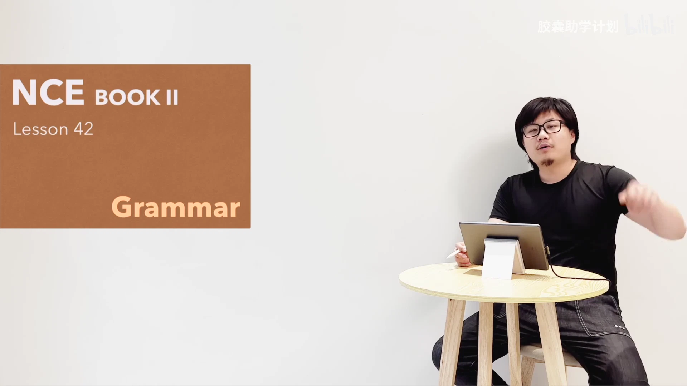

文字识别：NCE / BOOK"I / Lesson 42 / Grammar

### 画面 00:00:02

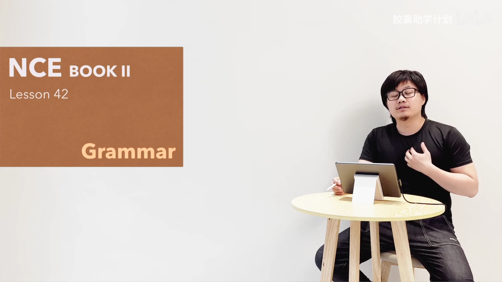

文字识别：NCE / BOOKII / Lesson 42 / Grammar

### 画面 00:00:05

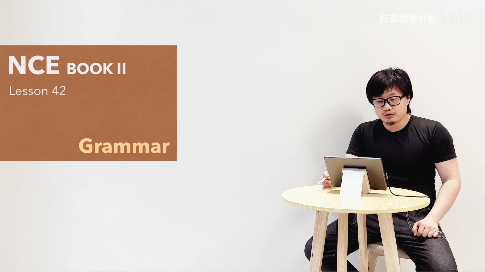

文字识别：NCE / BOOK"I / Lesson 42 / Grammar

### 画面 00:00:08

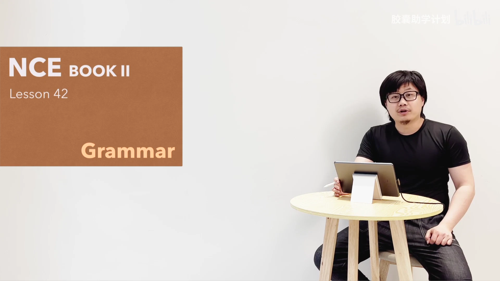

文字识别：NCE / BOOKII / Lesson 42 / Grammar

### 画面 00:00:10

文字识别：胶囊助学计划 bilbl

### 画面 00:00:13

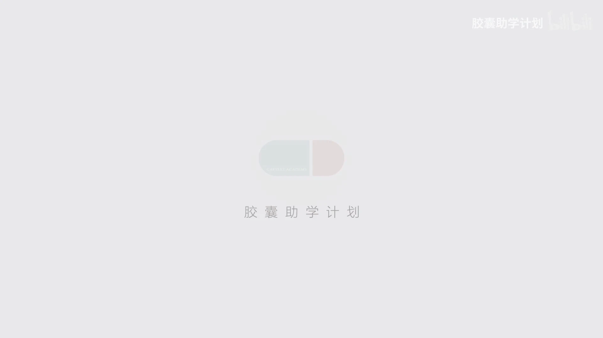

文字识别：胶囊助学计划

### 画面 00:00:15

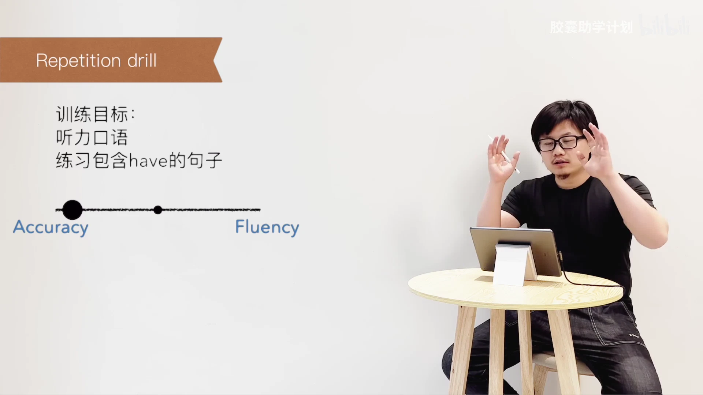

文字识别：Repetition drill / 训练目标： / 听力口语 / 练习包含have的句子 / Accuracy / Fluency

### 画面 00:00:28

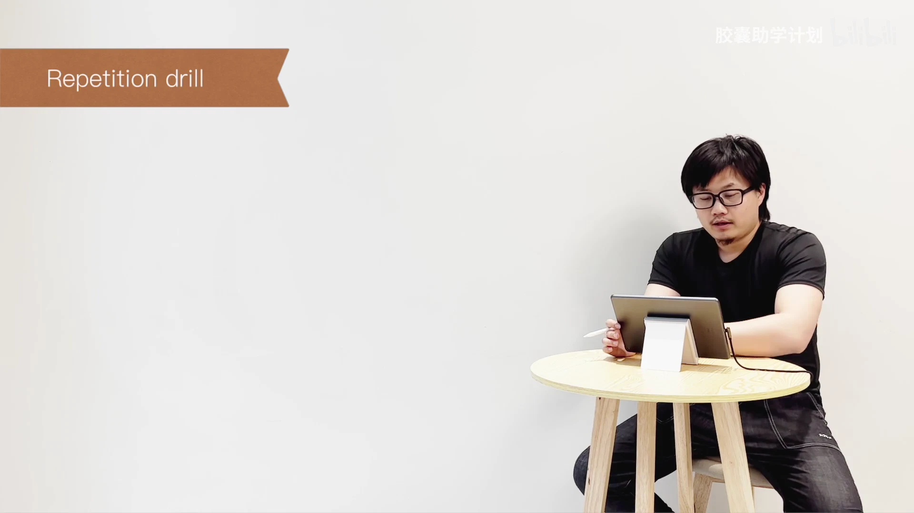

文字识别：Repetition drill

## 00:00:30–00:01:00

嘴跟我读。来，I walked in the garden this morning.啊，我认为各位含义可能没有问题，我就不翻译了，因为这些太简单了。这对对于各位来说，你新学到二三十课、三四十课就应该会的句子，我就不再翻译了啊。I had a walk too.注意这个地方，我们想告诉各位的叫做这地方walked in the garden和had a walk是一个意思。你只要知道这个就行了，

### 画面 00:00:32

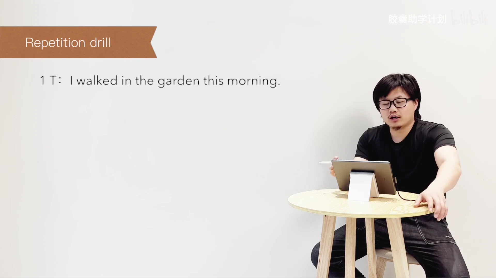

文字识别：Repetition drill / 1 T: I walked in the garden this morning.

### 画面 00:00:52

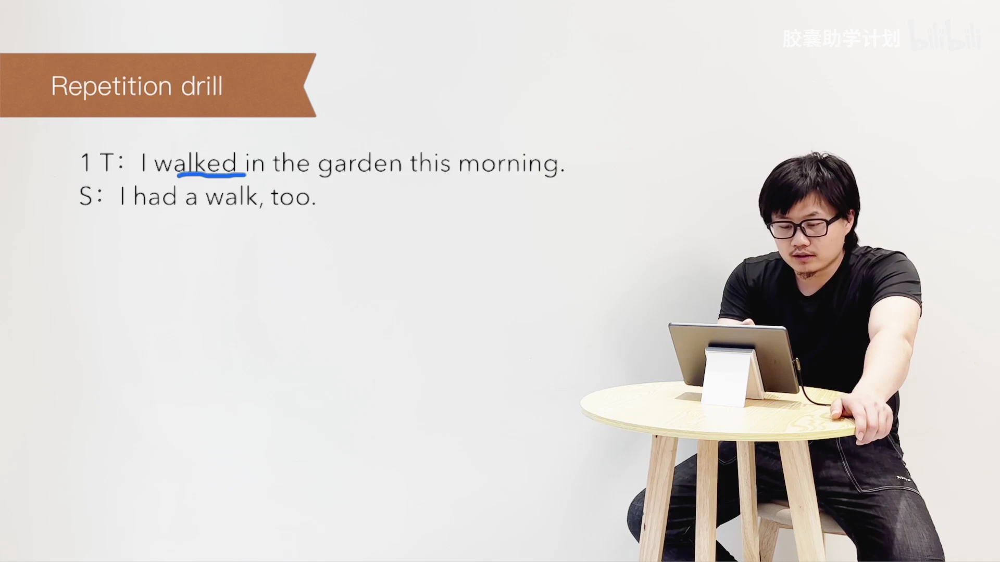

文字识别：Repetition drill / 1 T: I walked in the garden this morning. / S: I had a walk, too.

### 画面 00:00:55

文字识别：Repetition drill / 1 T: I walked in the garden this morning. / S: I had a walk, too.

## 00:01:00–00:01:30

对吧？这我们新一的时候，实际上我印象当中在八十一课我们也学过啊。Continue, say I'm drinking a glass of beer. It equals I'm having a drink now, right? Now have a drink. You have to add the tense, right? So it becomes having a drink. Next one, open your mouth and read it to me. I shall rest this afternoon. I shall have a rest too. In the article, we'll see it later. Have a rest.

### 画面 00:01:06

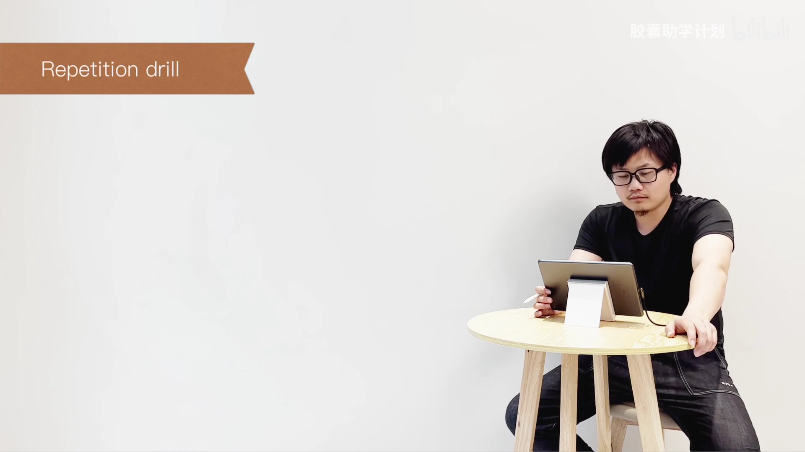

文字识别：Repetition drill

### 画面 00:01:12

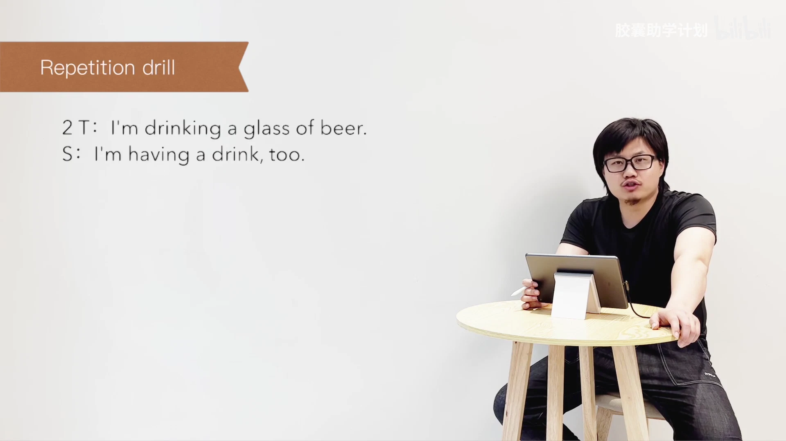

文字识别：Repetition drill / 2 T: I'm drinking a glass of beer. / S: I'm having a drink, too.

### 画面 00:01:15

文字识别：Repetition drill / 2 T: I'm drinking a glass of beer. / S: I'm having a drink, too.

### 画面 00:01:18

文字识别：Repetition drill

### 画面 00:01:27

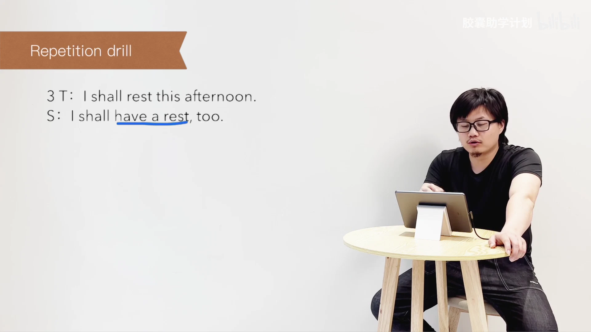

文字识别：Repetition drill / 3 T: I shall rest this afternoon. / S: I shall have a rest, too.

## 00:01:30–00:02:00

Continuing, I swam in the sea this morning. 啊，就是我们新一也学过叫 I had a swim too. 注意就是时态的问题，对吧？注意时态的问题，它本质上就是 have 加一个名词啊，或者一个呃对，加一个名词，对吧？ Next one, I shall wash before going out. 出门之前我要洗. I shall have a wash too. 啊, wash 和 have a wash 含义一样. Next one, 张嘴, I'm smoking.

### 画面 00:01:31

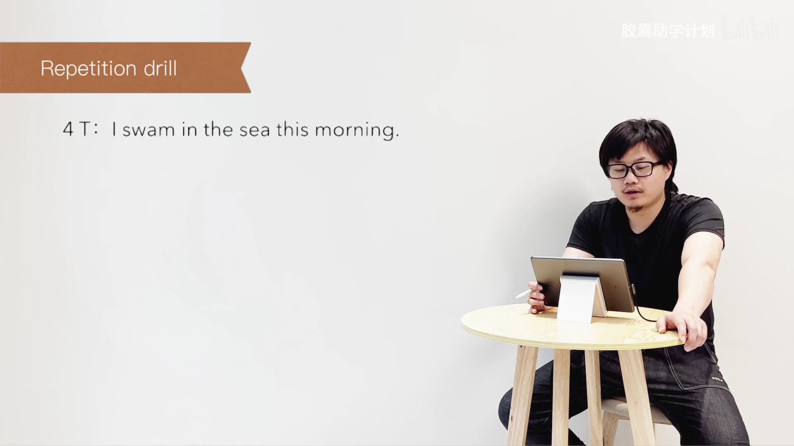

文字识别：Repetition drill / 4T: I swam in the sea this morning.

### 画面 00:01:36

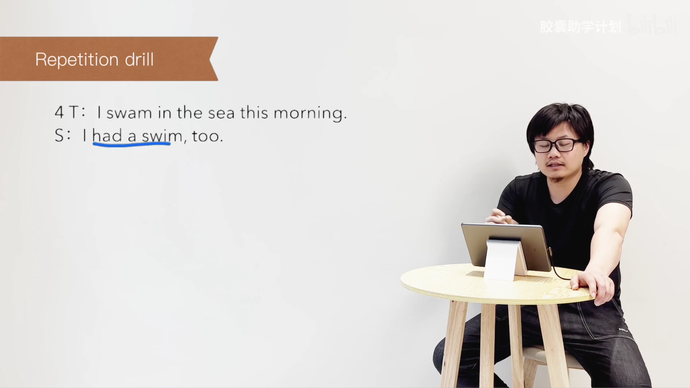

文字识别：Repetition drill / 4 T: I swam in the sea this morning. / S: I had a swim, too.

### 画面 00:01:40

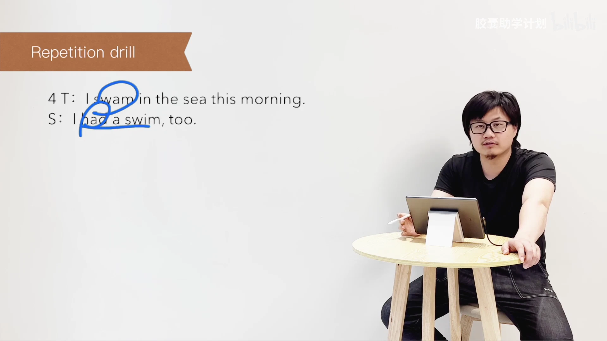

文字识别：Repetition drill / 4T: I wamlin the sea this morning. / S：I / hada swim, too.

### 画面 00:01:46

文字识别：Repetition drill / 5 T: I shall wash before going out.

### 画面 00:01:55

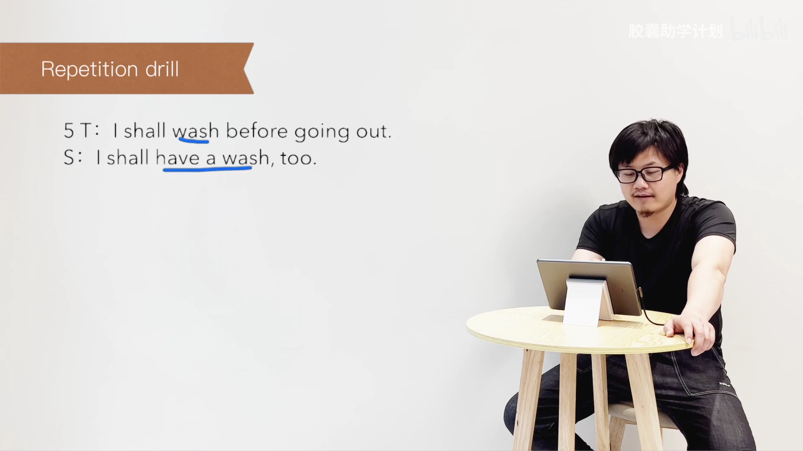

文字识别：Repetition drill / 5 T: I shall wash before going out. / S: I shall have a wash, too.

### 画面 00:01:58

文字识别：Repetition drill / 6 T: I'm smoking.

## 00:02:00–00:02:30

跟读. I'm having a smoke too.啊，一个意思. Smoke, have a smoke,一个意思. Next one. I slept this afternoon.那I had a sleep too,对吧? Next one. I shall ride my bicycle tomorrow.等于I shall have a ride too.啊，明天我也骑. Next one.说I'm trying to get that job.啊，我要试着去得到这个工

### 画面 00:02:25

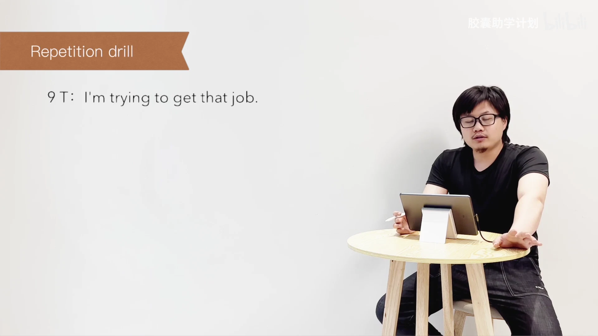

文字识别：Repetition drill / 9 T: I'm trying to get that job.

## 00:02:30–00:03:00

作。那比如说，I'm having a try to.那have a try，对吧？Have a go啊，都是试一试，对吧？I give it a go啊。I look at that picture she's painting.啊，I have a look too.是吧？我也看了一眼。Okay, very good.所以这里我们实际上刚才复习到了两个点。如果刚才您还是没拿到，不妨回去再翻看一下啊。第一个点就是各种have加一个单词，表示其实跟那单词意

### 画面 00:02:30

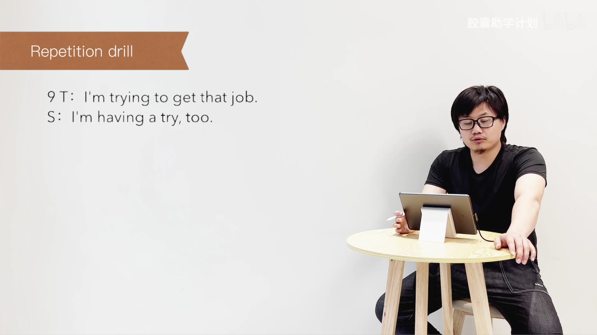

文字识别：Repetition drill / 9 T: I'm trying to get that job. / S: I'm having a try, too.

### 画面 00:02:33

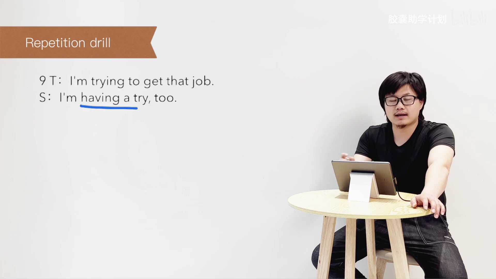

文字识别：Repetition drill / 9 T: I'm trying to get that job. / S: I'm having a try, too.

### 画面 00:02:37

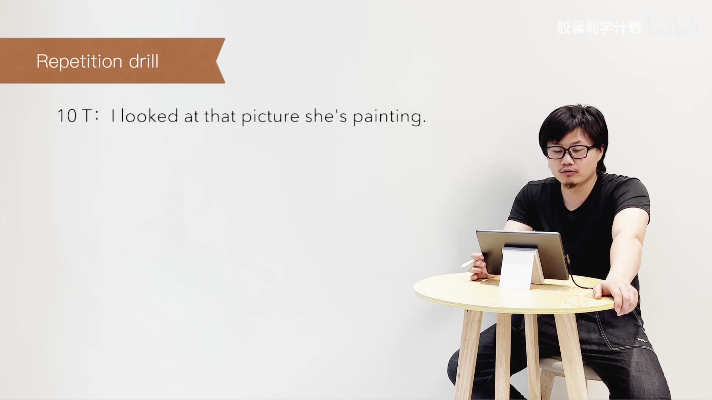

文字识别：Repetition drill / 10 T: Ilooked at that picture she's painting.

### 画面 00:02:47

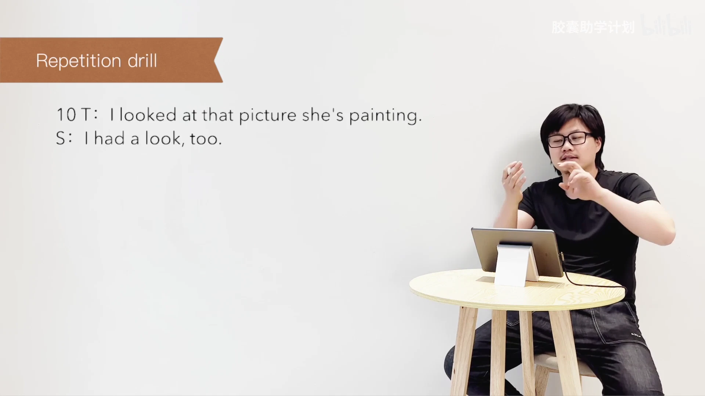

文字识别：Repetition drill / 10 T: Ilooked at that picture she's painting. / S: I had a look, too.

## 00:03:00–00:03:30

思一样，对吧？Look等于have a look，对吧？Swim等于have a swim。OK，这是第一个点，希望各位拿到的。第二个点呢，就是have a swim那个变时态呢，你也要变，只不过是由have去变了，不由swim去变了，对吧？这十道题就是练一下这里啊，复习一下。OK，那不多说了。接下来呢，pattern drill呢，还是我们把pattern drill哎拉过来啊。这个我呢先把上面给各位讲完，各位下课自己往里面去带一带，对吧？我告诉各位，这里在尝试练我们什么样的语

### 画面 00:03:16

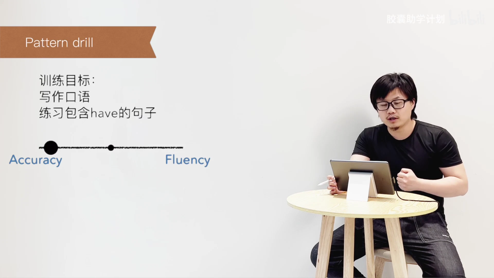

文字识别：Pattern drill / 训练目标： / 写作口语 / 练习包含have的句子 / Accuracy / Fluency

### 画面 00:03:21

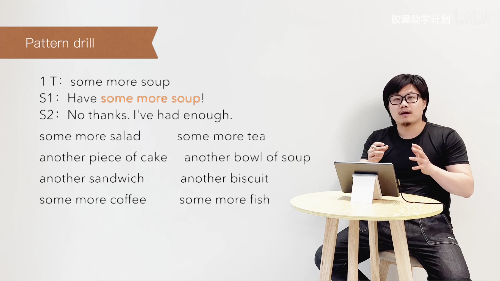

文字识别：Pattern drill / 1 T: some more soup / S1: Have some more soup! / S2: No thanks. I've had enough. / some more salad / some more tea / another piece of cake / another bowl of soup / another sandwich / another biscuit / some more coffee / some more fish

## 00:03:30–00:04:00

法？你比如像第一题就很简单，叫 Have some more soup，是吧？多喝点汤啊！就这里的 have 就是万能动词表喝嘛，对吧？No，thanks，不用了。I've had enough。啊，I've had 就是 have had 现在完成时，我已经喝的足够足够，够够的了，是吧？足够多了。二一个，这是第一题，底下往里带就行了，不多说了。第二题说，I thought he took sugar in his tea。说我以为啊，他在他茶里面放

### 画面 00:03:51

文字识别：Pattern drill / 1 T: some more soup / S1: Have some more soup! / S2: No thanks. I've had enough. / some more salad / some more tea / another piece of cake / another bowl of soup / another sandwich / another biscuit / some more coffee / some more fish

### 画面 00:03:53

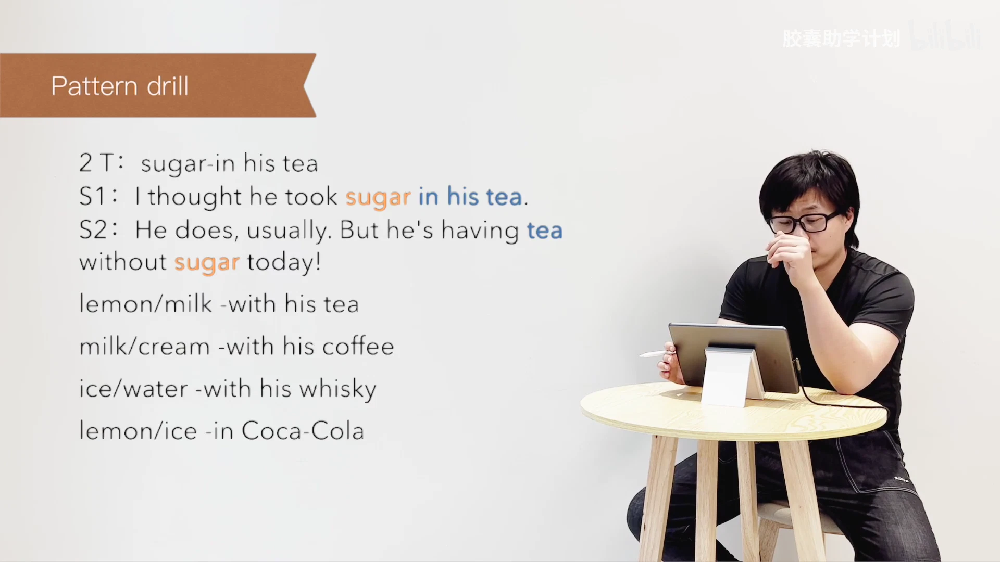

文字识别：Pattern drill / 2 T: sugar-in his tea / S1: I thought he took sugar in his tea. / S2: He does, usually. But he's having tea / without sugar today! / lemon/milk -with his tea / milk/cream -with his coffee / ice/water -with his whisky / lemon/ice -in Coca-Cola

## 00:04:00–00:04:30

放啊放糖了。He does usually.他正常状态啊，他是会往茶里放糖的是吧？He does usually.大多数情况下，大多数情况下他是这样的。But he's having tea without sugar today.但是呢，他正在喝茶，have tea啊，现在进行时啊结构，并且是have加tea对吧？Without sugar，而没有加茶today今天对吧？往里面带，这是第二题。第

### 画面 00:04:23

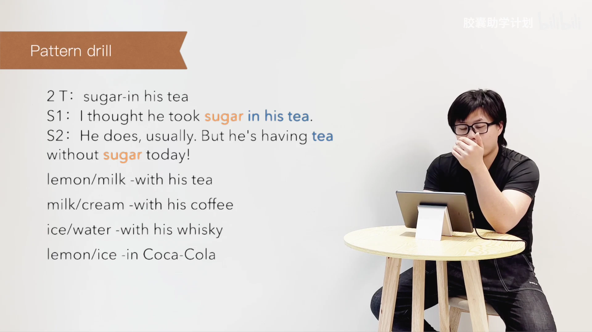

文字识别：Pattern drill / 2 T: sugar-in his tea / S1: I thought he took sugar in his tea. / S2: He does, usually. But he's having tea / without sugar today! / lemon/milk -with his tea / milk/cream -with his coffee / ice/water -with his whisky / lemon/ice -in Coca-Cola

### 画面 00:04:28

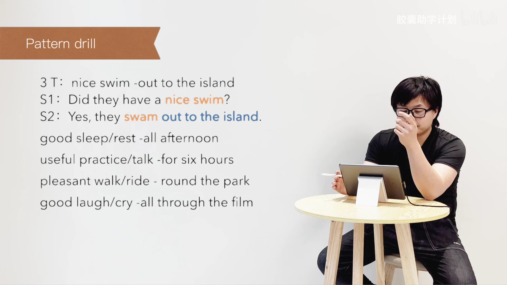

文字识别：Pattern drill / 3 T: nice swim -out to the island / S1: Did they have a nice swim? / S2: Yes, they swam out to the island. / good sleep/rest -all afternoon / useful practice/talk -for six hours / pleasant walk/ride - round the park / good laugh/cry -all through the film

## 00:04:30–00:05:00

三题说 Did they have a nice swim? 说他们游的开不开心，游的好不好？说 Yes, they swam out to the island. 说是啊，他们游到都游到哪儿了？ Island 对，他们都游到这个小岛上去了，对吧？ Okay, swam out, 游出去了，去到哪儿了？去到小岛上了。这里练的还是 have a nice swim 这个地方啊，比如说睡得香不香？那 have a good sleep，对吧？啊，像这种短语，

### 画面 00:04:48

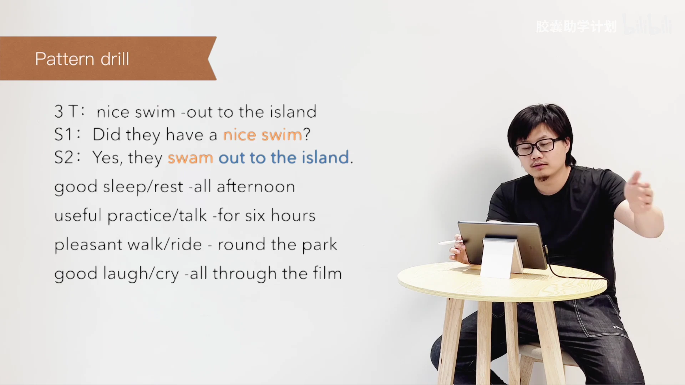

文字识别：Pattern drill / 3 T: nice swim -out to the island / S1: Did they have a nice swim? / S2: Yes, they swam out to the island. / good sleep/rest -all afternoon / useful practice/talk -for six hours / pleasant walk/ride - round the park / good laugh/cry -all through the film

## 00:05:00–00:05:30

各位都可以把它记下来啊。第四题说，Have you felt that material is very soft?说你感受到那个材料嘛，特别的柔软啊？Is it是吗？Let me have a feel.说让我来感受一下。那让我尝一下怎么说？Let me have a taste.注意要换回原形了，它在这儿不是动词，是名词，对吧？Okay，呃，往里带就可以了，不多说啊。所以呢，本课实际上我们就是拿这些练习

### 画面 00:05:01

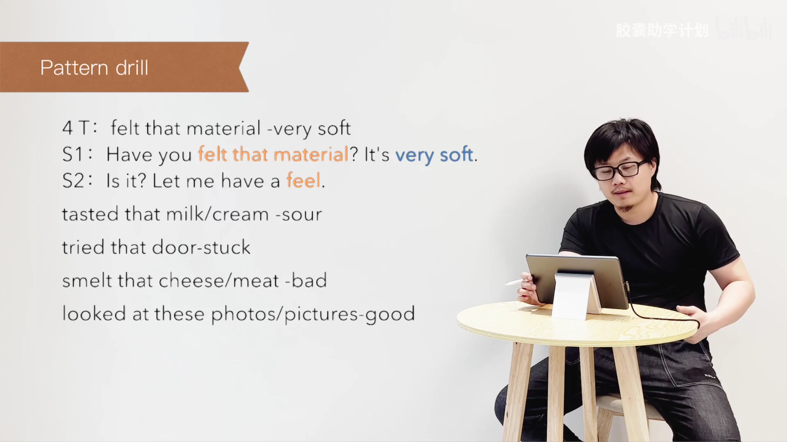

文字识别：Pattern drill / 4 T: felt that material -very soft / S1: Have you felt that material? It's very soft. / S2: Is it? Let me have a feel. / tasted that milk/cream -sour / tried that door-stuck / smelt that cheese/meat -bad / looked at these photos/pictures-good

### 画面 00:05:26

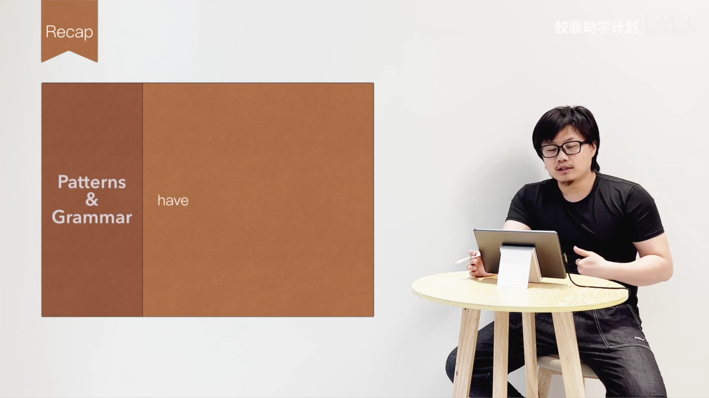

文字识别：Recap / Patterns / have / Grammar

### 画面 00:05:28

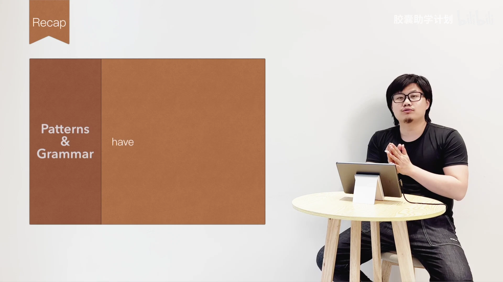

文字识别：Recap / Patterns / have / Grammar

## 00:05:30–00:06:00

带着各位回顾一下，have是有万能动词的用法的，它的语法我们在新一和新二的第十八课全讲过了，所以在这里不能不不不再花时间去赘述了，对吧？各位把这些练习做一做就可以了啊。好，家庭作业，pattern drill老习惯，然后四乘四四道题，每道题写四个，回顾今天这些知识点。我建议各位，你实际上不妨今天呢拿一张纸A四纸，把have你能想到它的不同的结构、不同的时

### 画面 00:05:30

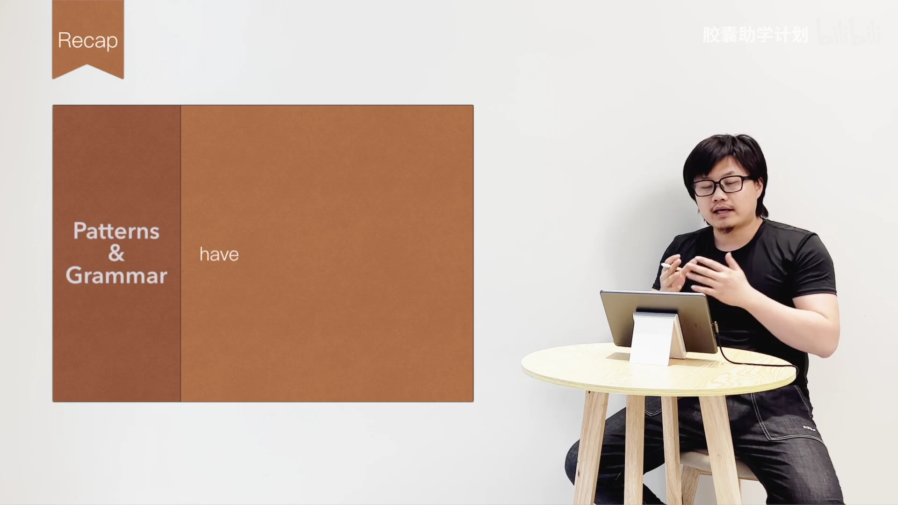

文字识别：Recap / Patterns / have / Grammar

### 画面 00:05:35

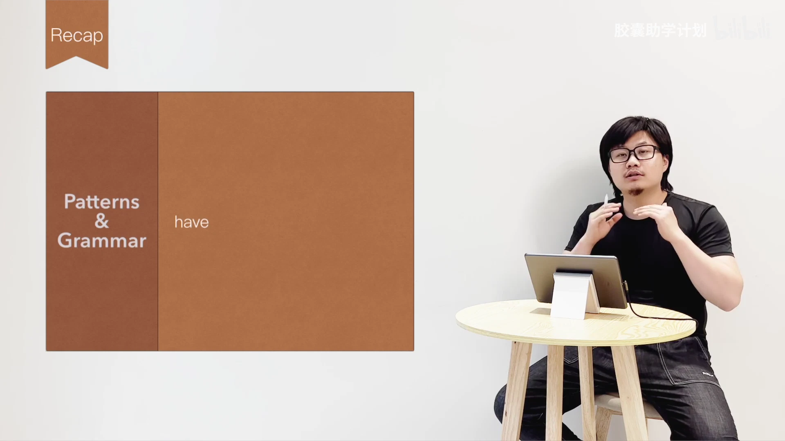

文字识别：Recap / Patterns / ＆ / have / Grammar

### 画面 00:05:37

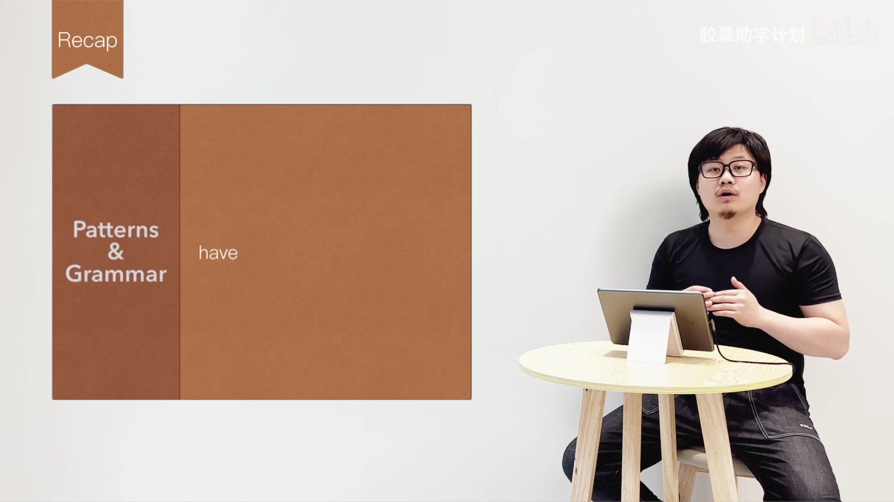

文字识别：Recap / Patterns / ＆ / have / Grammar

### 画面 00:05:40

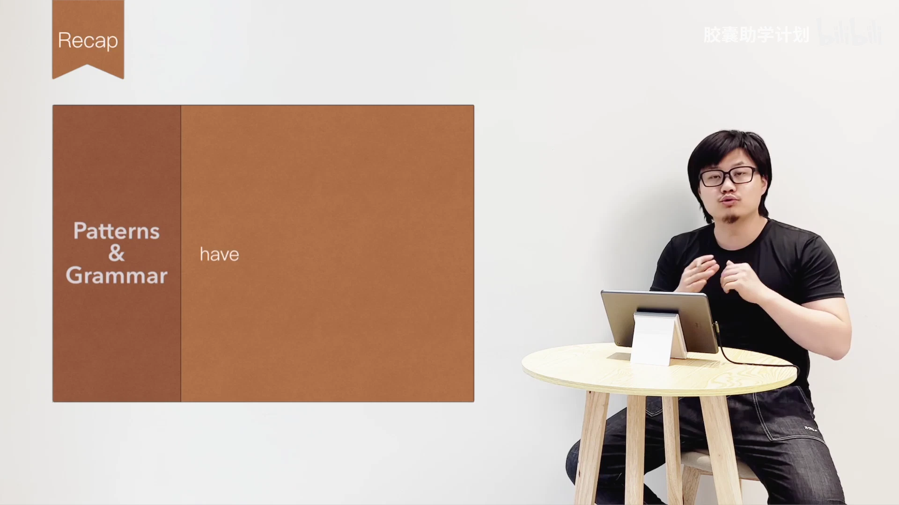

文字识别：Recap / Patterns / ＆ / have / Grammar

### 画面 00:05:42

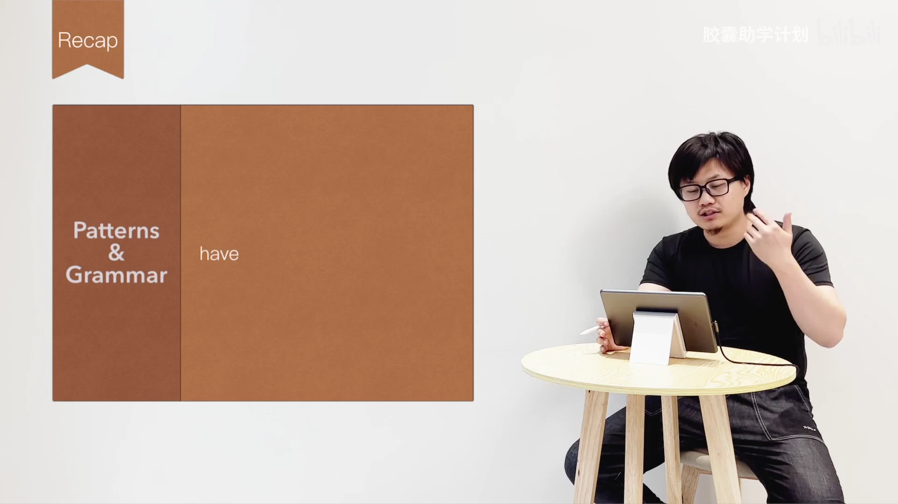

文字识别：Recap / Patterns / ＆ / have / Grammar

### 画面 00:05:44

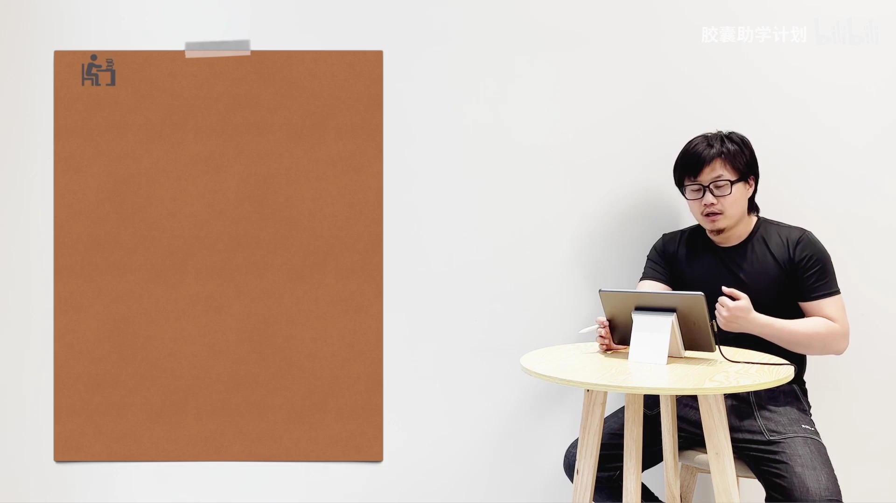

文字识别：$

### 画面 00:05:46

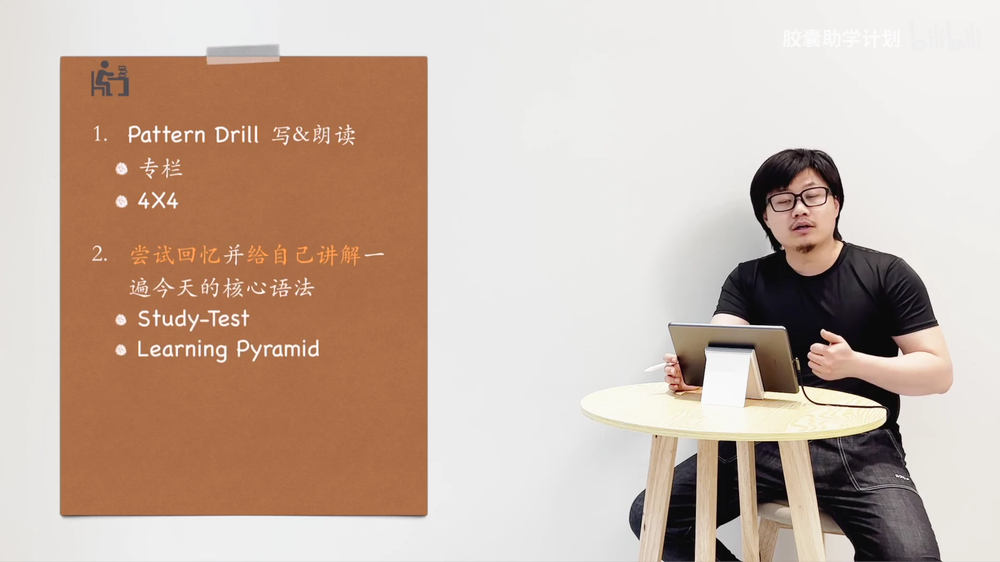

文字识别：Pattern Drill写&朗读 / 1. / 专栏 / 4×4 / 尝试回忆并给自己讲解一 / 遍今天的核心语法 / Study-Test / Learning Pyramid

### 画面 00:05:48

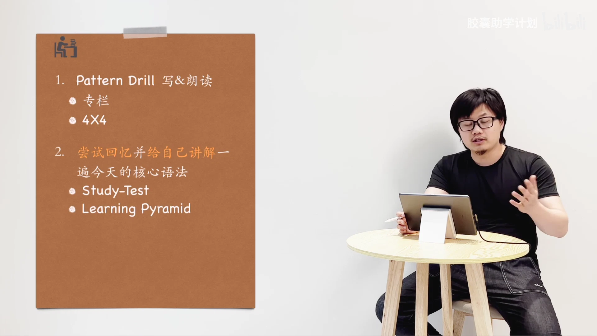

文字识别：Pattern Drill 写&朗读 / 1. / 专栏 / 4×4 / 尝试回忆并给自己讲解一 / 遍今天的核心语法 / Study-Test / Learning Pyramid

### 画面 00:05:50

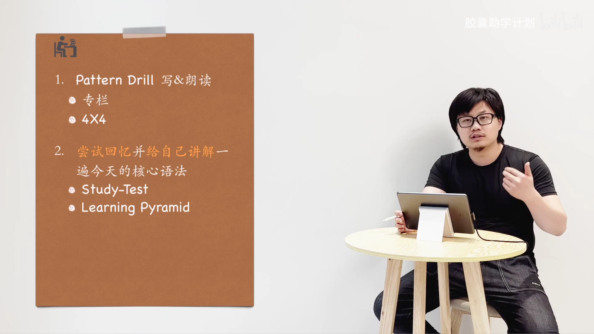

文字识别：Pattern Drill写&朗读 / 专栏 / 4×4 / 尝试回忆并给自己讲解一 / 遍今天的核心语法 / Study-Test / Learning Pyramid

### 画面 00:05:53

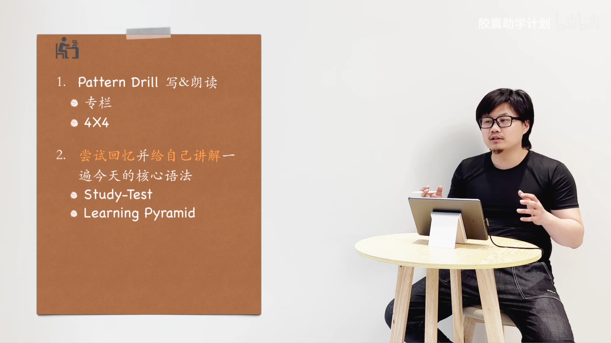

文字识别：Pattern Drill写&朗读 / 专栏 / 4×4 / 尝试回忆并给自己讲解一 / 遍今天的核心语法 / Study-Test / Learning Pyramid

### 画面 00:05:55

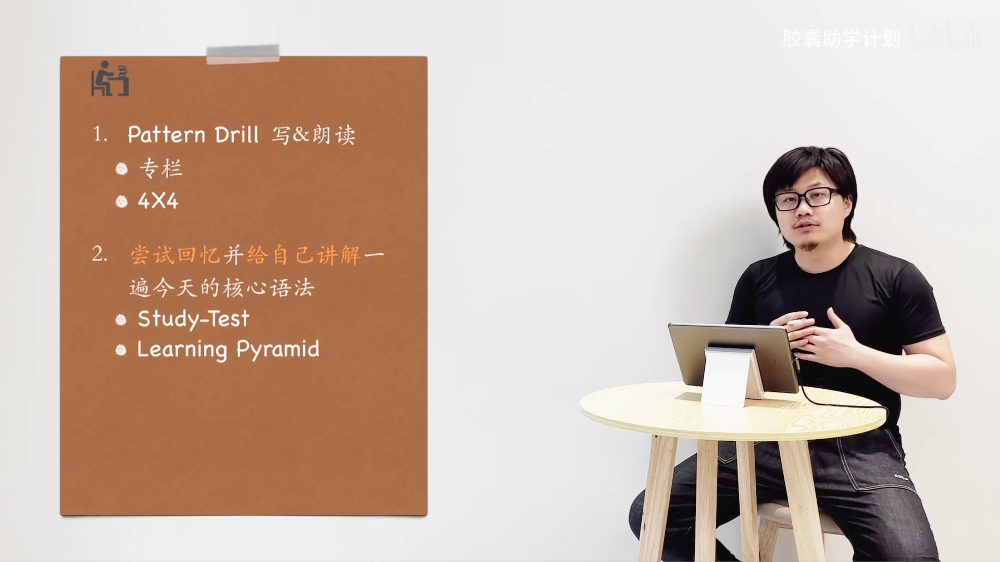

文字识别：Pattern Drill 写&朗读 / 专栏 / 4×4 / 尝试回忆并给自己讲解一 / 遍今天的核心语法 / Study-Test / Learning Pyramid

### 画面 00:05:57

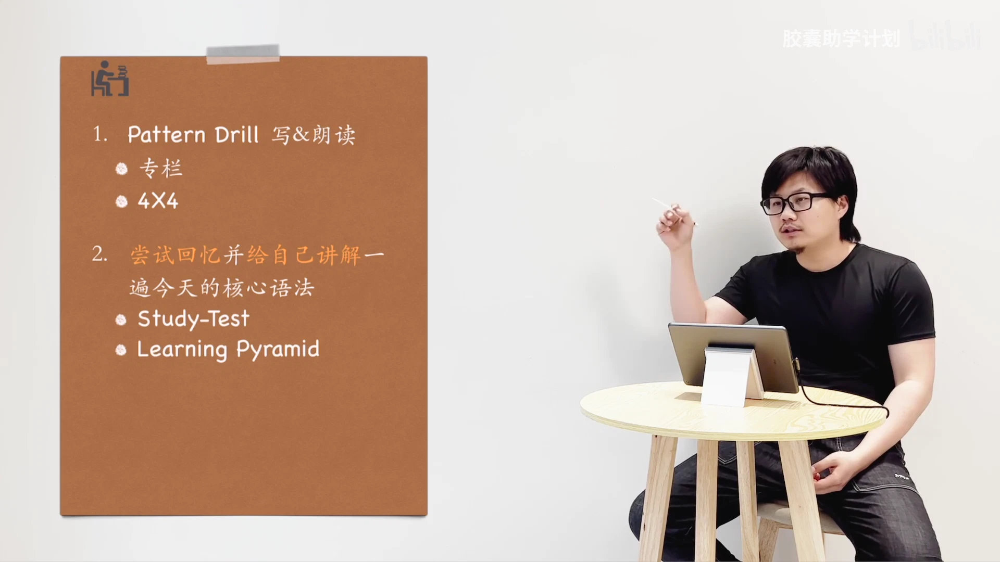

文字识别：Pattern Drill写&朗读 / 专栏 / 4×4 / 尝试回忆并给自己讲解一 / 遍今天的核心语法 / Study-Test / Learning Pyramid

## 00:06:00–00:06:30

态，它在不同的地方的运用，都给它整个整理一下，看你能整理出来多少，对吧？OK，呃，红皮书那老习惯了是吧？不多说了，嗯，以上呢就是本期视频的全部内容了。如果各位喜欢我们的课程呢，欢迎各位关注、订阅、一键三连，分享给那些需要的朋友，来帮助我们快速成长。See you next time.

### 画面 00:06:00

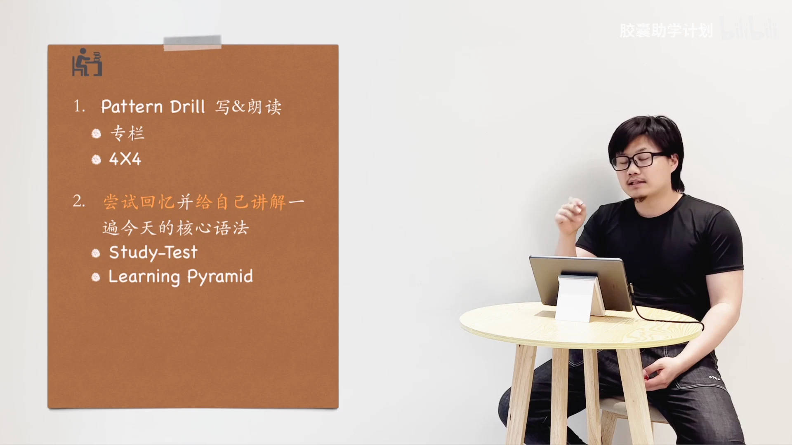

文字识别：Pattern Drill写&朗读 / 专栏 / 4×4 / 尝试回忆并给自己讲解一 / 遍今天的核心语法 / Study-Test / Learning Pyramid

### 画面 00:06:05

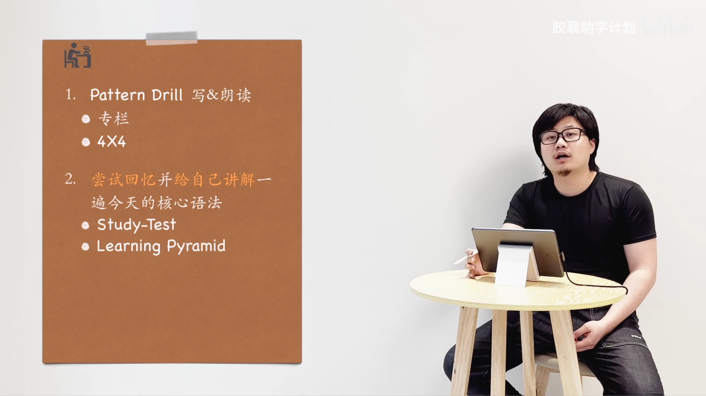

文字识别：1. / Pattern Drill写&朗读 / 专栏 / 4×4 / 尝试回忆并给自己讲解一 / 遍今天的核心语法 / Study-Test / Learning Pyramid

### 画面 00:06:07

文字识别：1. ↑ / Pattern Drill写&朗读 / 专栏 / 4X4 / 尝试回忆并给自己讲解一 / 遍今天的核心语法 / Study-Test / Learning Pyramid / 尝试翻阅红皮书（中级） / 通过目录或索引(Index) / 查找到本课语法

### 画面 00:06:09

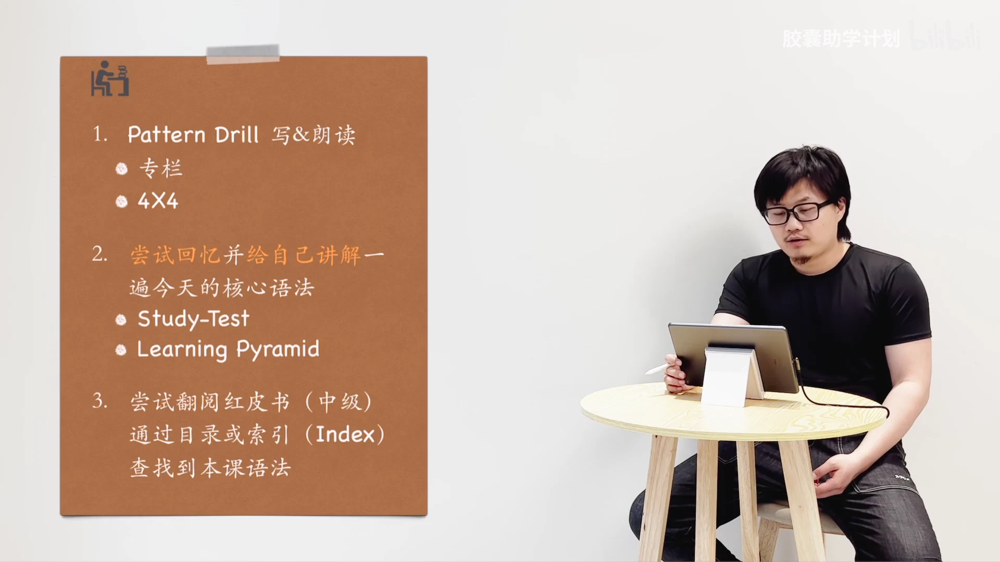

文字识别：Pattern Drill 写&朗读 / 1.↑ / 专栏 / 4×4 / 尝试回忆并给自己讲解一 / 遍今天的核心语法 / Study-Test / Learning Pyramid / 尝试翻阅红皮书（中级） / 通过目录或索引(Index) / 查找到本课语法

### 画面 00:06:11

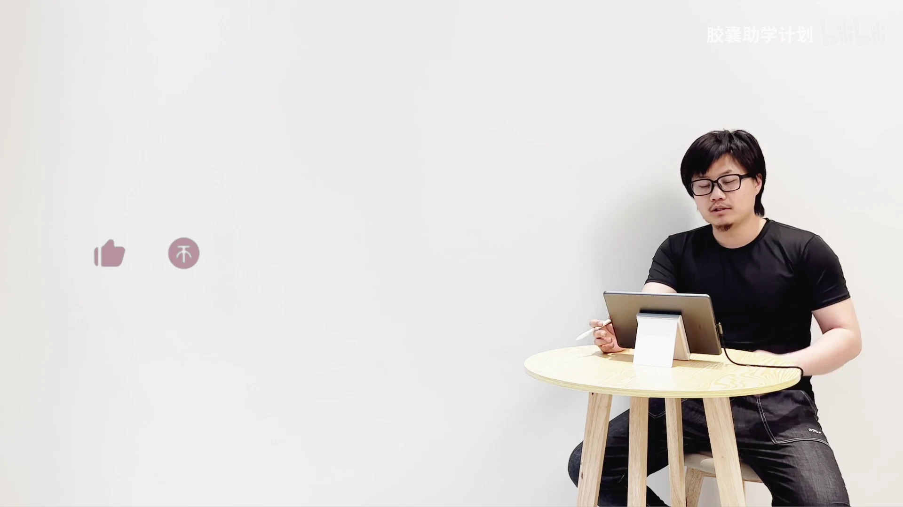

### 画面 00:06:23

### 画面 00:06:25

文字识别：CAPSULEACADEMY / 胶囊助学计划 / 小红书 / Lecturer / □ / 口 / Leo / OE

### 画面 00:06:28

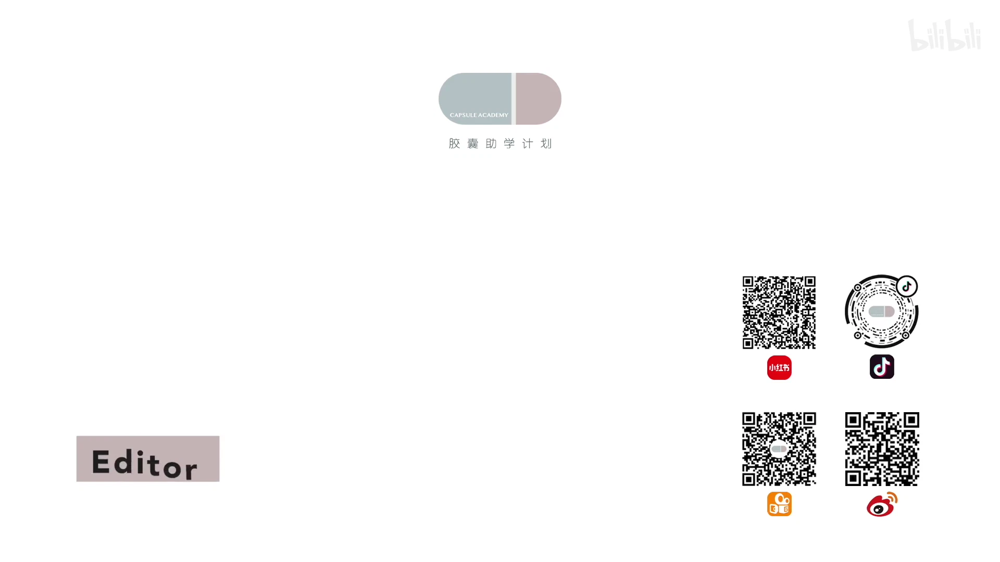

文字识别：CAPSULEACADEMY / 胶囊助学计划 / 小红书 / □ / Editor / OE

## 00:06:30–00:06:35

### 画面 00:06:31

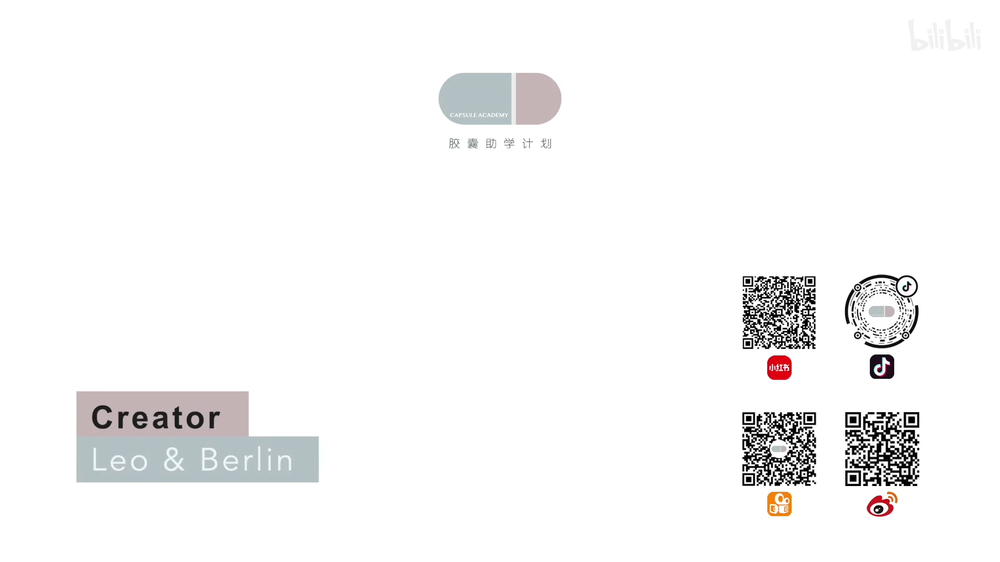

文字识别：CAPSULEACADEMY / 胶囊助学计划 / 小红书 / Creator / Leo & Berlin / OE

### 画面 00:06:33

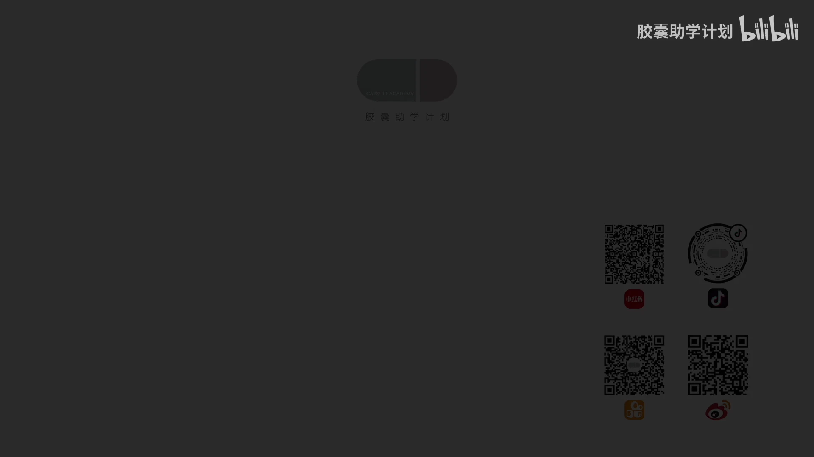

文字识别：Bilibili / 胶囊助学计划 / 胶囊助学计划 / 小红书 / 只识

### 画面 00:06:35

文字识别：bilibili / 胶囊助学计划

