# L042 文章

快速机器解析：语音为单模型转写，未进行独立交叉校对或人工复核；画面每秒采样并按变化选帧，短时文字和标记可能遗漏。截图时间约有 1 秒误差。图片有损压缩；遇到疑点请按时间查看 Google Drive 原视频。

## 00:00:00–00:00:30

Hello everyone, welcome to Capsule Academy. This is Leo. Today we are going to learn new concept English Book Two Lesson Forty Two Story. Hope you gonna enjoy it.好，那我们上来直接看文章啊。说 as we as as 又出现了 as as as 啊，我们常见的 when because 对吧？说 we had had a long walk through one of the markets of Old Delhi. 好长啊，再回来

### 画面 00:00:00

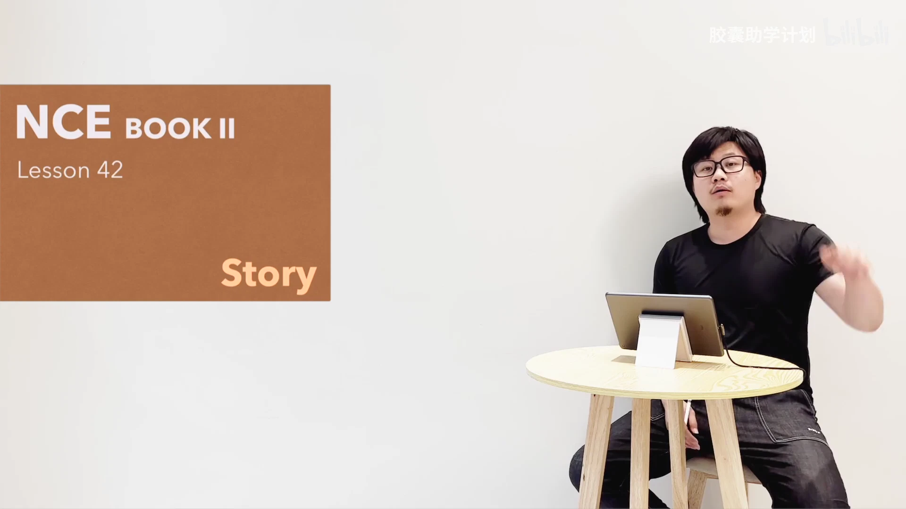

文字识别：NCE / BOOKI"I / Lesson 42 / Story

### 画面 00:00:02

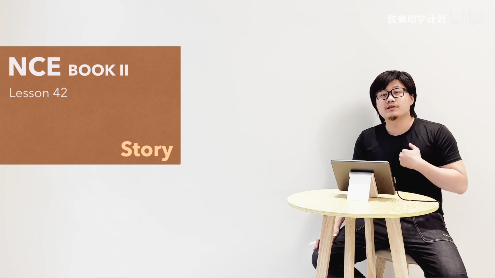

文字识别：NCE / BOOK"I / Lesson 42 / Story

### 画面 00:00:04

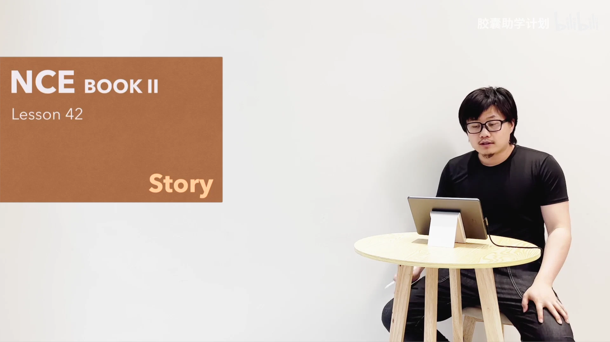

文字识别：NCE / BOOK"I / Lesson 42 / Story

### 画面 00:00:06

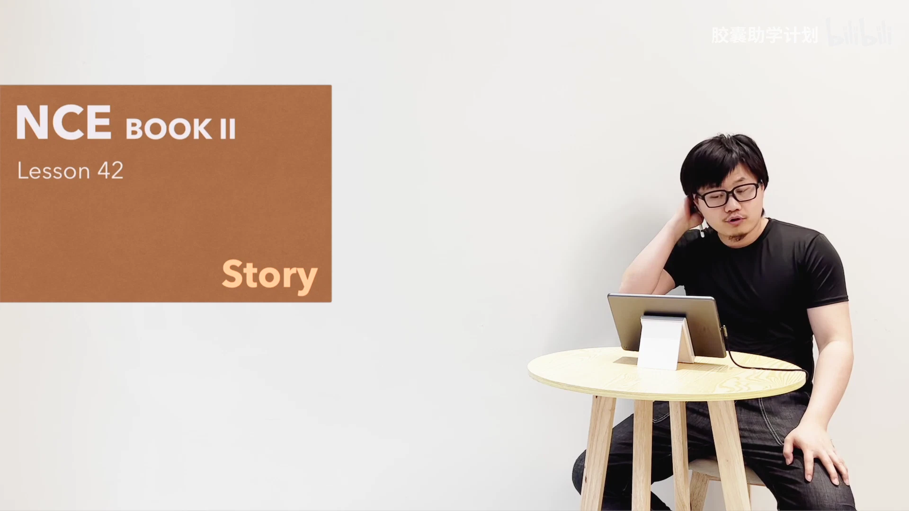

文字识别：NCE / BOOKⅡI / Lesson 42 / Story

### 画面 00:00:09

文字识别：胶囊助学计划bill / •

### 画面 00:00:13

文字识别：胶囊助学计划

### 画面 00:00:15

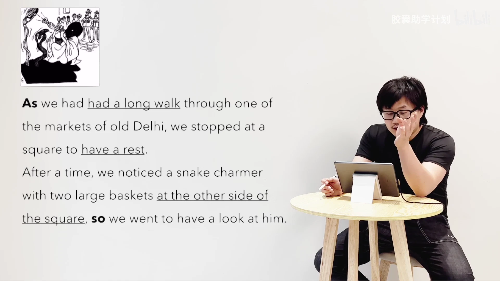

文字识别：As we had had a long walk through one of / the markets of old Delhi, we stopped at a / square to have a rest. / After a time, we noticed a snake charmer / with two large baskets at the other side of / the square, so we went to have a look at him.

## 00:00:30–00:01:00

慢点。We had had a long walk through, 先不管它了。那 have a long walk, 圆形 have a long walk, 那 have a walk 叫走一走, long walk 就是走了很远，是吧？其实就是我们走了很远。那这里的 had had 是什么呢？过去完成时，你要这个点是要记住的，对吧？啊，比如说我们早在呃新概念二册第一单元的时候就学过，比如说 after a , before b , before b , after a , 啊，不知道各位记不

### 画面 00:00:42

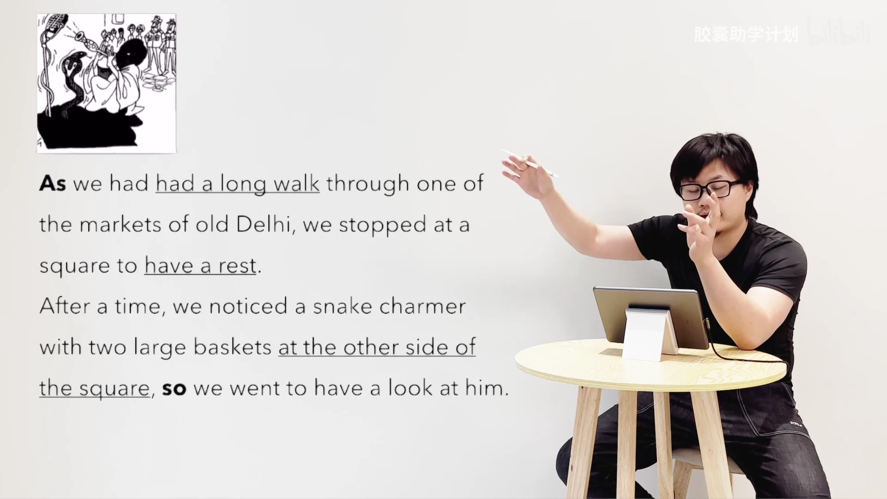

文字识别：As we had had a long walk through one of / the markets of old Delhi, we stopped at a / square to have a rest. / After a time, we noticed a snake charmer / with two large baskets at the other side of / the square, so we went to have a look at him.

## 00:01:00–00:01:30

记得这两个公式，对吧？这就是我们在讲过去完成时这个时态的时候，重点要学会的两个结构，对吧？说在我们走了很长的路之后，你注意还没有之后啊，through穿过穿过什么呢？One of the markets of Old Delhi, one of the markets就是一堆集市当中其中一个，我们穿过了其中一个集市，哪地方呢？Of

### 画面 00:01:12

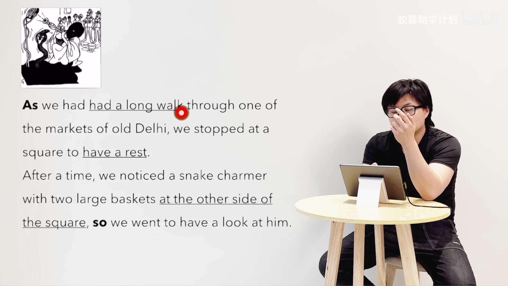

文字识别：As we had had a long walk through one of / the markets of old Delhi, we stopped at a / square to have a rest. / After a time, we noticed a snake charmer / with two large baskets at the other side of / the square, so we went to have a look at him.

## 00:01:30–00:02:00

Old Delhi,旧达旧旧达里啊，这样一个地方，我印象当中是印度，是吧？印度不有新德里嘛，是吧？啊，这里应该是旧德里，是吧？呃，旧德里的呃一个集市，对吧？哎，as当啊，当我们穿很走了很长时间的路，穿过旧德里这个地方的一个集市之后，怎么样呢？We stopped.我们停

### 画面 00:01:42

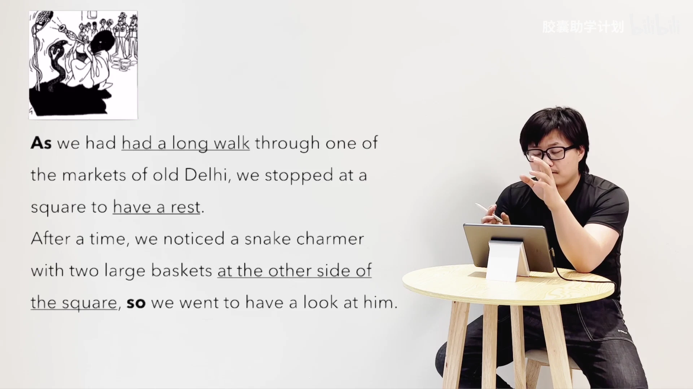

文字识别：As we had had a long walk through one of / the markets of old Delhi, we stopped at a / square to have a rest. / After a time, we noticed a snake charmer / with two large baskets at the other side of / the square, so we went to have a look at him.

## 00:02:00–00:02:30

下来了，在一个地方叫 at a square，在一个小的广场的地方停下来了，to have a rest，去休息一下，对吧？好，这个地方我想叫一个小的针儿叫做 at a square，是吧？啊，你看，就我们原来总说说在天安门广场你要用什么？我们原来讲介词 on in at，对吧？在这提一个小点啊，on in at，呃，我们会偏向于去讲，比如说 at 一般是在小地方，on 是在什么什么上面，in 是大地方，或

### 画面 00:02:12

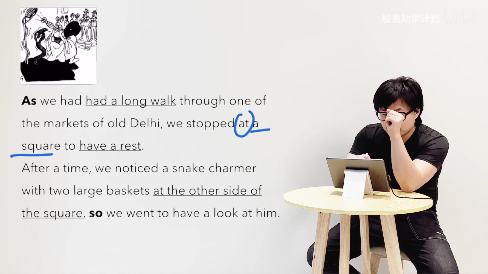

文字识别：As we had had a long walk through one of / the markets of old Delhi, we stopped / at / square to have a rest. / After a time, we noticed a snake charmer / with two large baskets at the other side of / the square, so we went to have a look at him.

### 画面 00:02:20

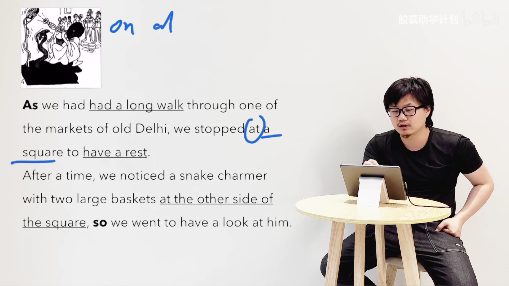

文字识别：on / As we had had a long walk through one of / the markets of old Delhi, we stopped / at / square to have a rest. / After a time, we noticed a snake charmer / with two large baskets at the other side of / the square, so we went to have a look at him.

## 00:02:30–00:03:00

或者说 in 一般指的是在什么什么里面，对吧？很多人都是接受这个逻辑的。然后在天安门广场，你要用 in，别用 at，对吧？然后呢，在在外国的广场呢，我们会讲什么一堆乱七八糟的，说什么？比如说外国的广场比较小，呃，首先有也有大的啊。我自己去过一些西方的国家，比如像意大利，确实有小很小的广场，但也有很大的广场啊。然后他说，所以应该用 at，这样去解释英文的时候，实际上你第一你根本

### 画面 00:02:50

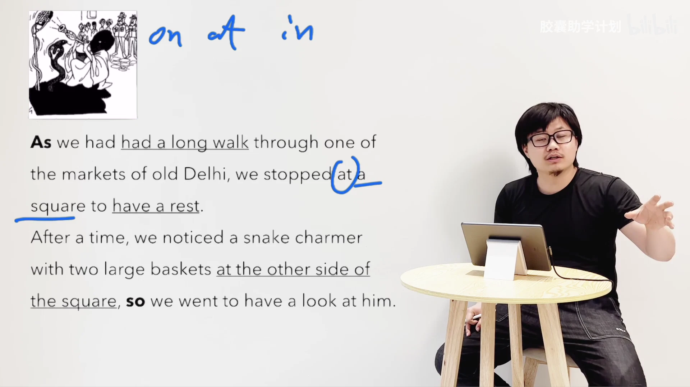

文字识别：onA / 'n / As we had had a long walk through one of / the markets of old Delhi, we stopped / at / square to have a rest. / After a time, we noticed a snake charmer / with two large baskets at the other side of / the square, so we went to have a look at him.

## 00:03:00–00:03:30

记不住，那你怎么知道它总有例外，对吧？你根本记不住，所以，我个个个人的建议就是，对于介词呢，我们英语的初级学习者，就是对于各位来说，现在还处于在新概念啊，还处于说我要考个雅思七分，不是奔着雅思满分去的，或者说八点五分去的这些学员，你基本上大多数的介词可能不用特别的纠结。但是如果你是要考试啊，尤其是小学、初中、高中那些考试，

### 画面 00:03:20

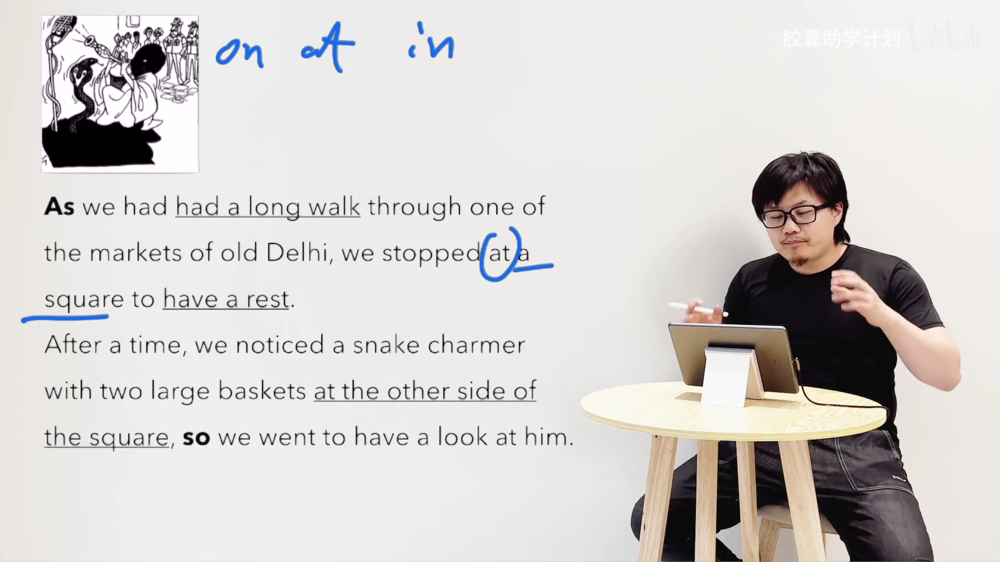

文字识别：onA / '`n / As we had had a long walk through one of / the markets of old Delhi, we stopped / at / square to have a rest. / After a time, we noticed a snake charmer / with two large baskets at the other side of / the square, so we went to have a look at him.

## 00:03:30–00:04:00

国内的那些考试，它对于介词的要求，还说实话还挺高的，对吧？好，所以这样的小的东西，你要背不住怎么办呢？你也不用专门背，你就一遍遍读文章，慢慢慢慢，你可能语感起来了，你再背，效果会更好啊！我就提供一个思路，好吧？那 we stopped at a square 啊，我们停在了一个广场，目的是 to have a rest，目的是去休息一下，对不对？After a time，在一段时间之后呢，we noticed a a

### 画面 00:03:50

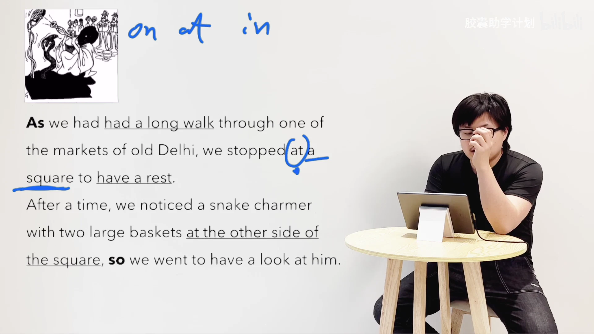

文字识别：onA / 'n / As we had had a long walk through one of / the markets of old Delhi, we stoppedat / square to have a rest. / After a time, we noticed a snake charmer / with two large baskets at the other side of / the square, so we went to have a look at him.

### 画面 00:03:52

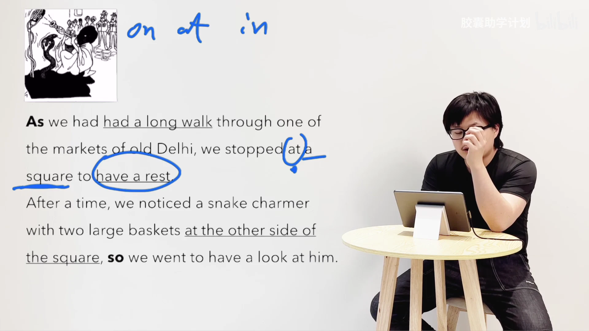

文字识别：onA / As we had had a long walk through one of / the markets of old Delhi, we stoppedat / square tohave a rest / After a time, we noticed a snake charmer / with two large baskets at the other side of / the square, so we went to have a look at him.

## 00:04:00–00:04:30

snake charmer. 我们注意到了一个这个玩蛇的人。有带着什么呢？ Two large baskets. Two large baskets. 啊，两个大篮子啊。那篮子里是蛇嘛？ At the other side of the square. 啊，在你看 at a square 是一个短语，对吧？那前面加了叫 the other side of the square，叫做在这个广场的另一侧，对不对？好，我们在这边，他在那边，对不对？那这地方就是一个小的习惯

### 画面 00:04:06

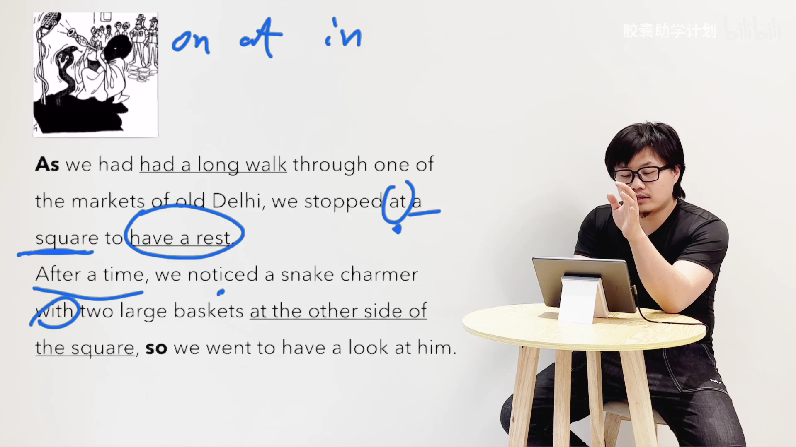

文字识别：onA / '`n / As we had had a long walk through one of / the markets of old Delhi, we stoppedat / square tohave a rest / After a time, we noticed a snake charmer / With two large baskets at the other side of / the square, so we went to have a look at him.

### 画面 00:04:16

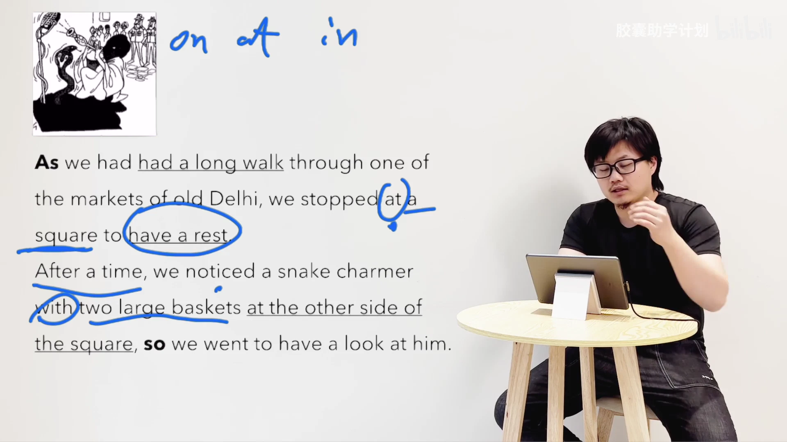

文字识别：on / As we had had a long walk through one of / the markets of old Delhi, we stoppedat / square tohave a rest / After a time, we noticed a snake charmer / With two larae baskets at the other side of / the square, so we went to have a look at him.

## 00:04:30–00:05:00

用法，叫在另一侧。比如说我在马路另一侧，我可不可以说 at the other side of the uh of the street，对吧？或者说我在说在嗯广啊在在这个比如说剧院的另一侧，啊叫 at the other side of the theater or cinema，是不是都可以？对吧？So所以 we went to have a look at him，所以我们就去 have a look at him，去去看他一眼。Okay， continue. As soon as哎，非常好，一怎么怎么样就怎么讲。He saw

### 画面 00:04:46

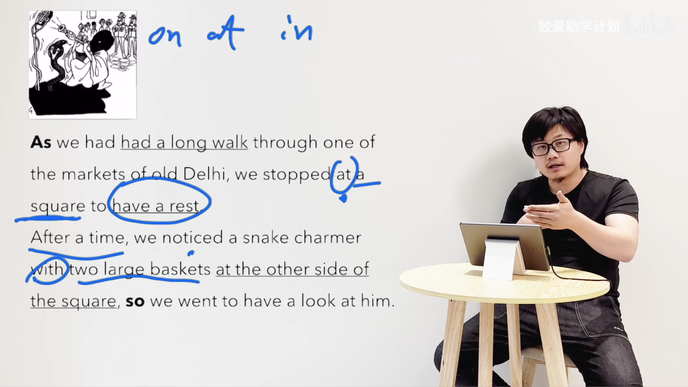

文字识别：A / on / `n / As we had had a long walk through one of / the markets of old Delhi, we stoppedat / square tohave a rest / After a time, we noticed a snake charmer / With two larae baskets at the other side of / the square, so we went to have a look at him.

### 画面 00:04:55

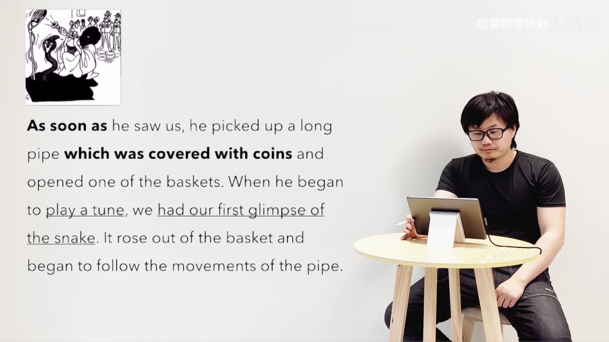

文字识别：As soon as he saw us, he picked up a long / pipe which was covered with coins and / opened one of the baskets. When he began / to play a tune, we had our first glimpse of / the snake. It rose out of the basket and / began to follow the movements of the pipe.

## 00:05:00–00:05:30

他一看见我们，he pick up a long pipe，他立刻pick up捡起拿起，他立刻就捡起拿起了一个long pipe，一个很长的管乐器，对吧？很长的管乐器，后边典型定语从句which都给你放这儿了，对吧？说这个管乐器was covered with，这咱们之前学过吧？这个这个习惯用法，对吧？新一百四十三课我印象当中是学过的啊，新二可能应该也见过，我印象当中，反

### 画面 00:05:25

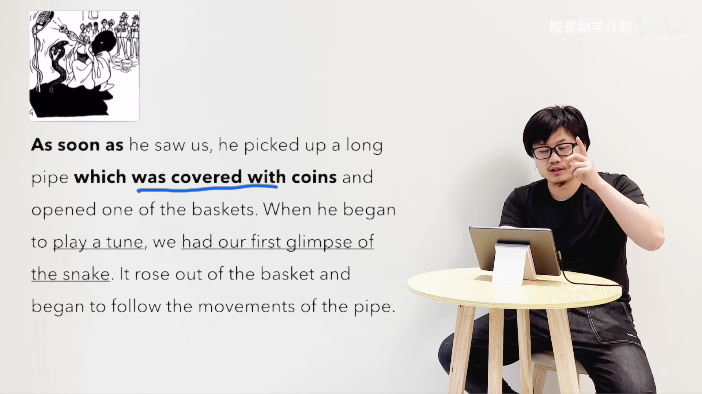

文字识别：As soon as he saw us, he picked up a long / pipe which was covered with coins and / opened one of the baskets. When he began / to play a tune, we had our first glimpse of / the snake. It rose out of the basket and / began to follow the movements of the pipe.

## 00:05:30–00:06:00

正新一肯定学过，叫被什么什么覆盖着，对吧？说这个 pipe 这个长的这个乐器被 coins 覆盖着，被硬币覆盖着。 And opened one of the baskets，然后呢，打开了其中一个篮子。啊，你看，注意啊，那 as soon as 提醒的你是什么？生意人、手艺人，对吧？为了赚钱，他一看见你，他就知道主顾来了，对吧？花钱的人来了，他立刻就拿起了这个

### 画面 00:05:31

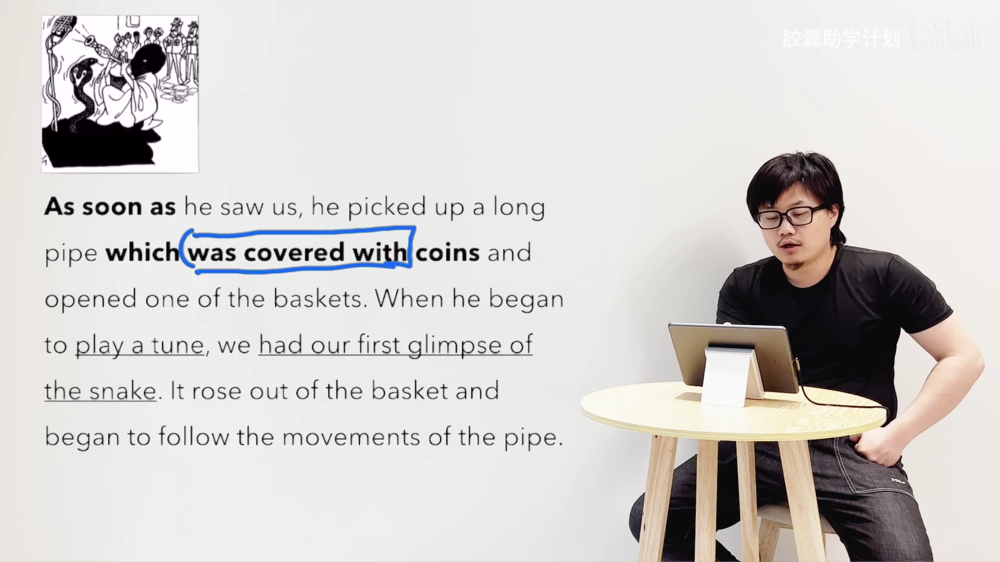

文字识别：As soon as he saw us, he picked up a long / pipe whichwas covered withcoins and / opened one of the baskets. When he began / to play a tune, we had our first glimpse of / the snake. It rose out of the basket and / began to follow the movements of the pipe.

### 画面 00:05:49

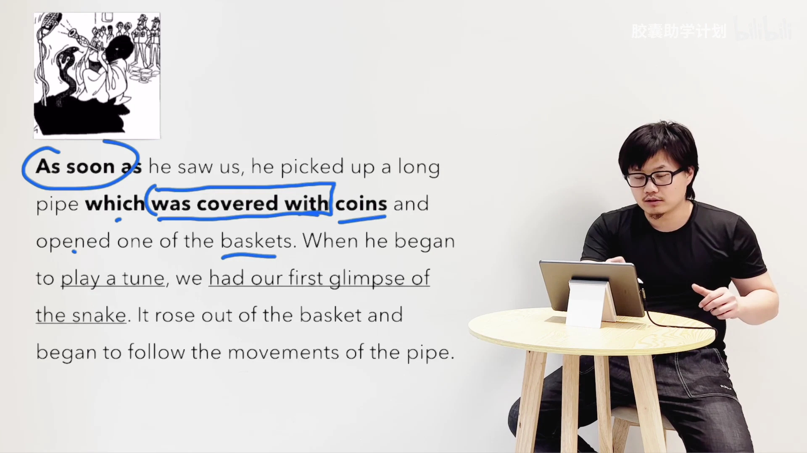

文字识别：As soon as he saw us, he picked up a long / pipe whichwas covered withcoins and / opened one of the baskets. When he began / to play a tune, we had our first glimpse of / the snake. lt rose out of the basket and / began to follow the movements of the pipe.

### 画面 00:05:52

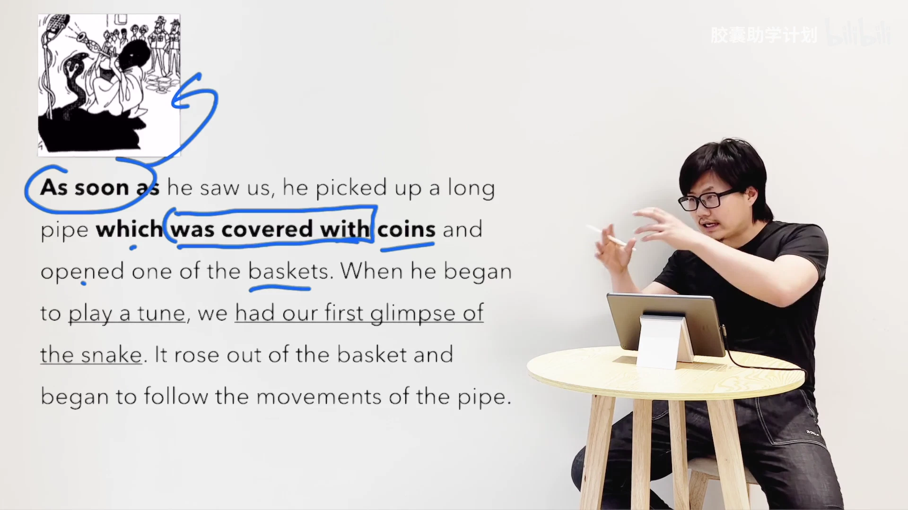

文字识别：As soon as he saw us, he picked up a long / pipe whichwas covered withcoins and / opened one of the baskets. When he began / to play a tune, we had our first glimpse of / the snake. Ilt rose out of the basket and / began to follow the movements of the pipe.

## 00:06:00–00:06:30

呃乐器，然后把这个篮子有蛇的这个篮子打开了，合理对吧？When he began to play a tune，当他开始 play a tune，play a tune 就是什么呀？就是曲调，弹一个曲调的时候。We had our first glimpse of the snake。这个咱们实际上这个呃 had uh glimpse of something，单词部分已经讲过了，只不过这里面加点小的新的单词嘛。我们看到了第

### 画面 00:06:10

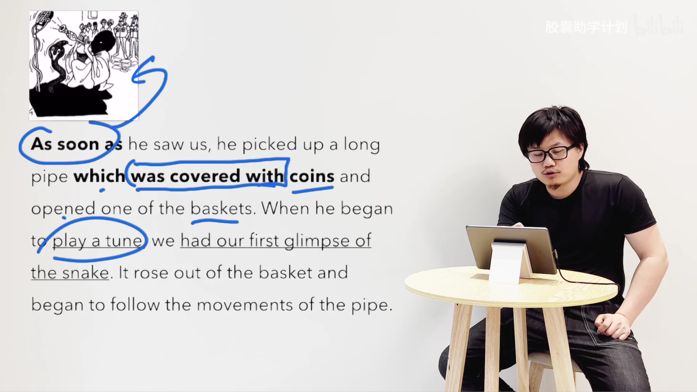

文字识别：As soon as he saw us, he picked up a long / pipe whichwas covered withcoins and / opened one of the baskets. When he began / ty play a tunewe had our first glimpse of / the snake. Ilt rose out of the basket and / began to follow the movements of the pipe.

### 画面 00:06:29

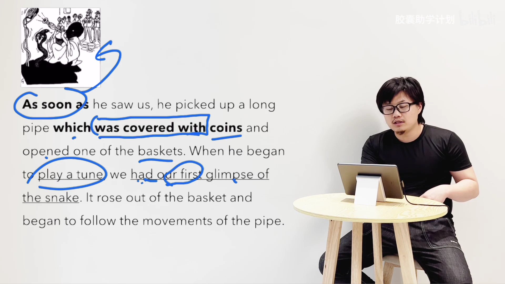

文字识别：As soon as he saw us, he picked up a long / pipe whichwas covered withc / coins and / opened one of the baskets. When he began / ty play a tune we had odr firs glimpse of / the snake. Ilt rose out of the basket and / began to follow the movements of the pipe.

## 00:06:30–00:07:00

第一次瞥到了这个蛇，对吧？我们第一眼瞥到了这个蛇啊。It rose out of the baskets. 哎，它从 rose rose 太阳升起来 rose 是吧？哎，这个蛇 out of the baskets 从篮子里面生出来了是吧？哎，就是你看看它从里面钻出来了，抬起头来了啊，这个样子。And began to follow the movement of the pipe. 然后开始跟着 follow the movement of

### 画面 00:06:49

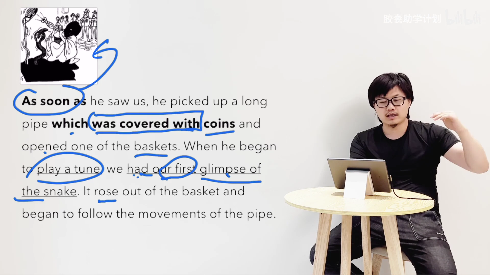

文字识别：As soon as he saw us, he picked up a long / pipe whichwas covered with / coins and / opened one of the baskets. When he began / ty play a tune we had odr firs glimpse of / the snake. It rose out of the basket and / began to follow the movements of the pipe.

### 画面 00:06:54

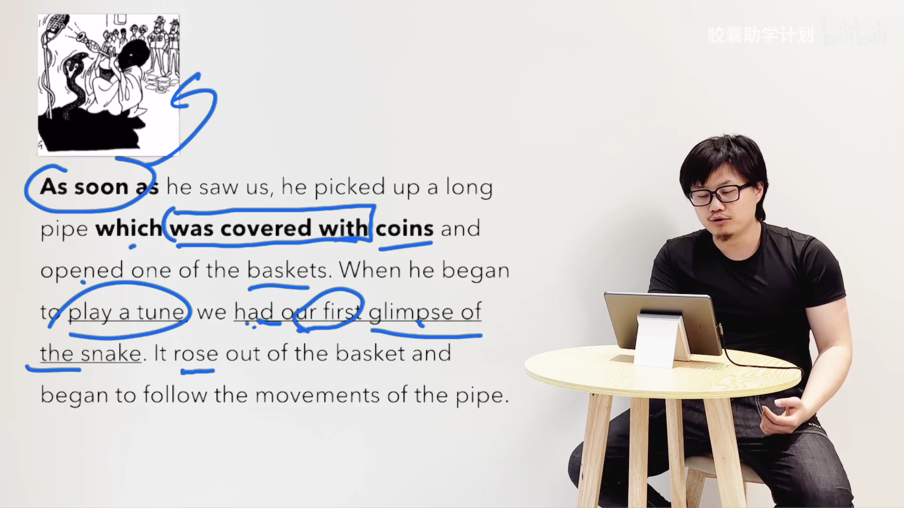

文字识别：As soon as he saw us, he picked up a long / pipe whichwas covered with / coins and / opened one of the baskets. When he began / ty play a tune we had odr firs glimpse of / the snake. It rose out of the basket and / began to follow the movements of the pipe.

## 00:07:00–00:07:30

pipe. 咱们在讲 movement 这个单词的时候，借用到了这半句话，对吧？那我们就不多说了，叫做跟随着这个管乐器啊，它的运动和它一起动，对吧？ Okay, continue. We were much surprised. 我们特别的惊讶。 When 当 the snake charmer suddenly began to play jazz. 突然间开始去弹爵士乐的时候，啊，他弹的不是民族乐

### 画面 00:07:00

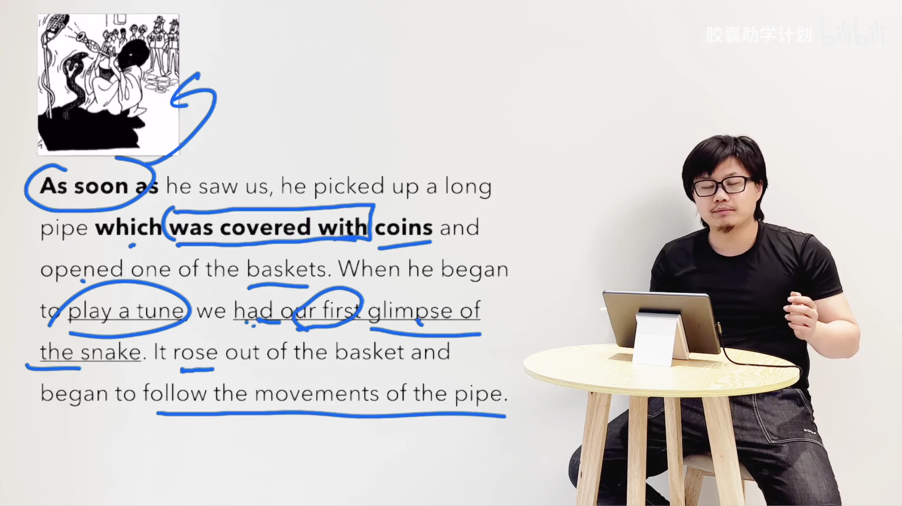

文字识别：As soon as he saw us, he picked up a long / pipe which / was covered with / coins and / opened one of the baskets. When he began / typlay a tunev /  we had oar firs glimpse of / the snake. It rose out of the basket and / began to follow the movements of the pipe.

### 画面 00:07:02

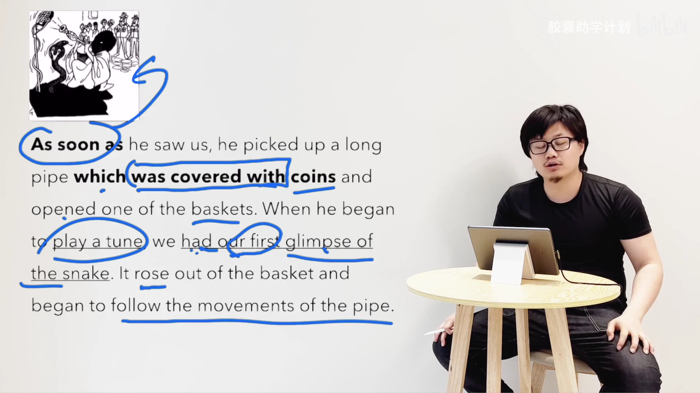

文字识别：As soon as he saw us, he picked up a long / pipe whichwas covered with / coins and / opened one of the baskets. When he began / typlay a tunev /  we had oar first glimpse of / the snake. It rose out of the basket and / began to follw the movements of the pipe.

### 画面 00:07:05

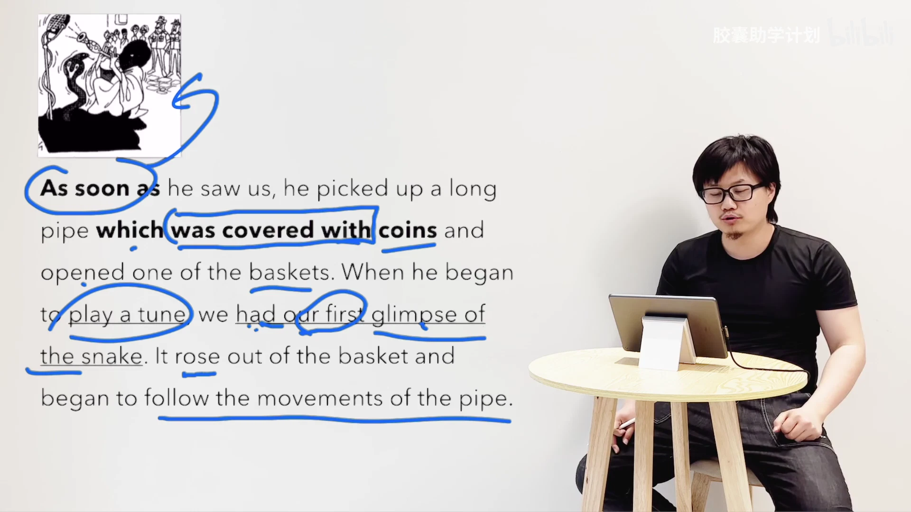

文字识别：As soon as he saw us, he picked up a long / pipe whichwas covered with / coins and / opened one of the baskets. When he began / typlay a tune v /  we had oar first glimpse of / the snake. It rose out of the basket and / began to follow the movements of the pipe.

### 画面 00:07:14

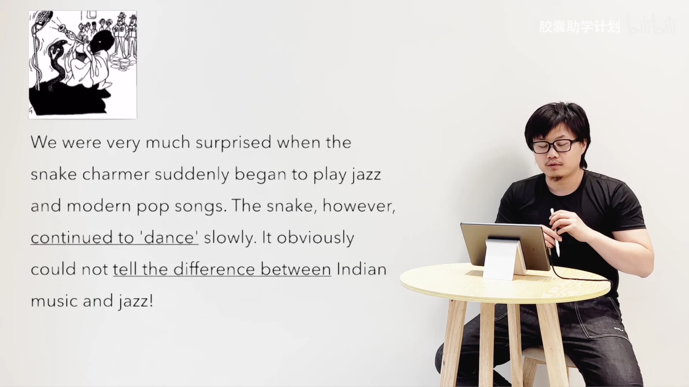

文字识别：We were very much surprised when the / snake charmer suddenly began to play jazz / and modern pop songs. The snake, however, / continued to'dance'slowly.It obviously / could not tell the difference between Indian / music and jazz!

### 画面 00:07:20

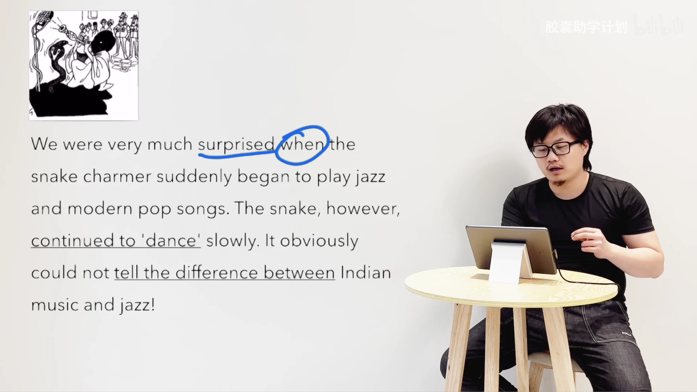

文字识别：We were very much surprised Whenthe / snake charmer suddenly began to play jazz / and modern pop songs. The snake, however, / continued to'dance'slowly.It obviously / could not tell the difference between Indian / music and jazz!

### 画面 00:07:23

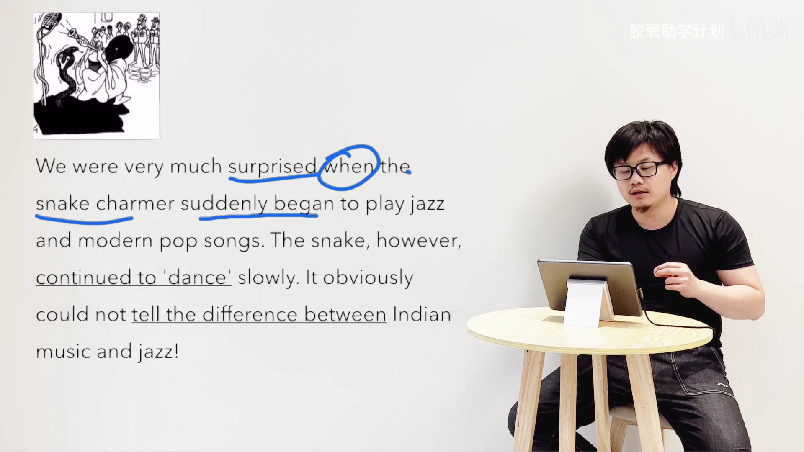

文字识别：We were very much surprised Whenthe / snake charmer suddenly began to play jazz / and modern pop songs. The snake, however, / continued to'dance'slowly. It obviously / could not tell the difference between Indian / music and jazz!

## 00:07:30–00:08:00

了，弹的不是那个印度本土的音乐了，开始弹爵士乐。爵士乐是西方乐，对吧？And modern pop songs以及现代的流行歌曲啊。The snake, however,说这个蛇啊，然而continue to dance slowly，说依旧继续去dance slowly，依旧去很慢慢的，好像在跳舞。也就是说，你的曲调变了，节奏变了。人，比如说听很呃这个慢的曲调，可能就是慢慢跟着晃；很快的曲调，很就可

### 画面 00:07:33

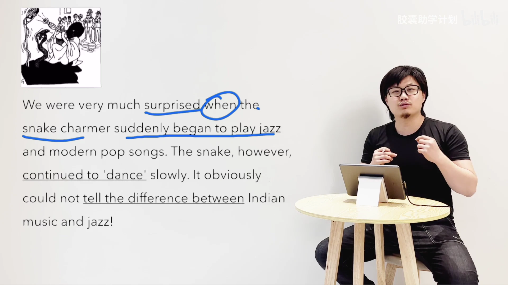

文字识别：We were very much surprised Whenthe / snake charmer suddenly began to play iazz / and modern pop songs. The snake, however, / continued to'dance' slowly.Ilt obviously / could not tell the difference between Indian / music and jazz!

### 画面 00:07:38

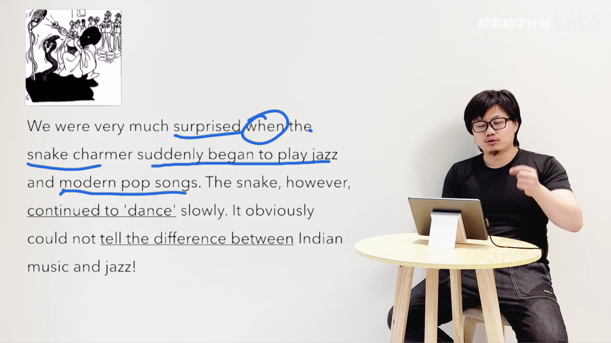

文字识别：We were very much surprised Whenthe / snake charmer suddenly began to play iazz / and modern pop songs. The snake, however, / continued to'dance' slowly.Ilt obviously / could not tell the difference between Indian / music and jazz!

## 00:08:00–00:08:30

很快的晃，对吧？但是这个蛇呢，不管你换什么样的音乐，continue to dance slowly，继续是慢慢的在那儿晃悠，对吧？于是作者就说了一句话，叫做It obviously could not tell the difference between Indian music and jazz。说这个蛇呀，很明显是没有办法分辨什么区别呢？印度音乐和爵士乐的

### 画面 00:08:08

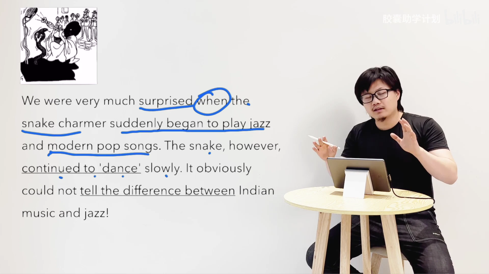

文字识别：We were very much surprised whenthe / snake charmer suddenly began to play iazz / and modern pop songs. The snake, however, / continued to'dance' slowly. It obviously / could not tell the difference between Indian / music and jazz!

## 00:08:30–00:09:00

区别的那 tell the difference between A and B，我们在单词部分也讲过了，在这就不多说了，好吧？接下来呢，我们在文章当中大多数要么是我们以前学过的习惯用法，要么是在单词部分我就已经讲过了，所以在这儿呢，我们摘出来两个之前没讲过的习惯用法，叫 have a long walk 以及 at the other side of somewhere，对吧？那我们造句子吧先，比如说 we will be having a long walk tonight。好，你看这

### 画面 00:08:37

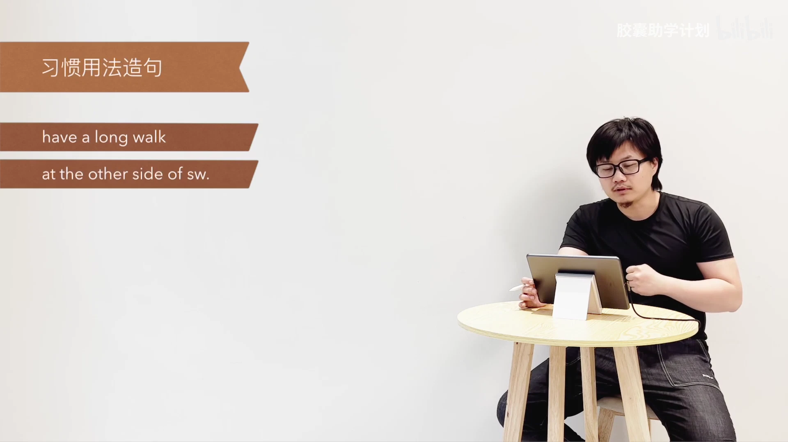

文字识别：习惯用法造句 / have a long walk / at the other side of sw.

### 画面 00:08:39

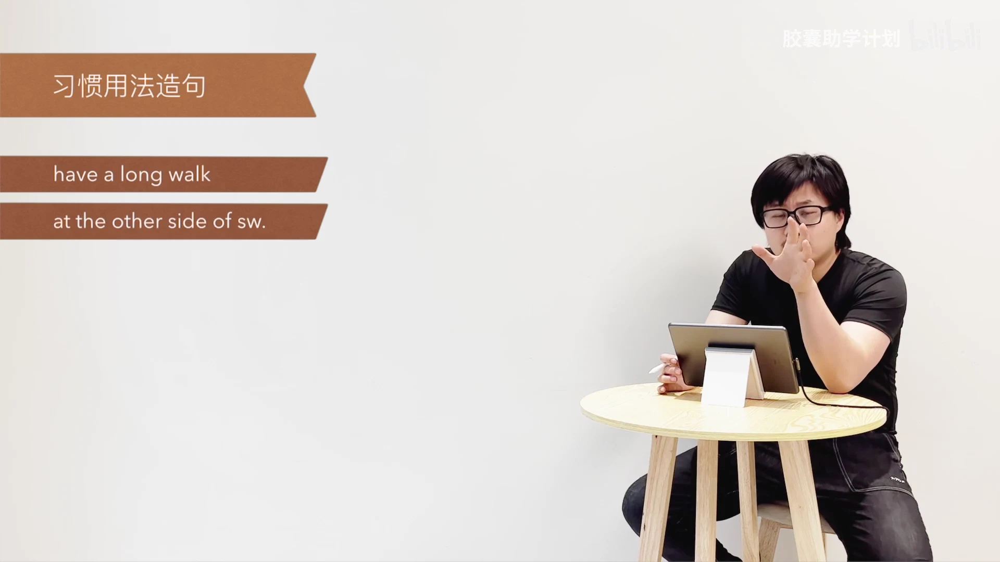

文字识别：习惯用法造句 / have a long walk / at the other side of sw.

### 画面 00:08:44

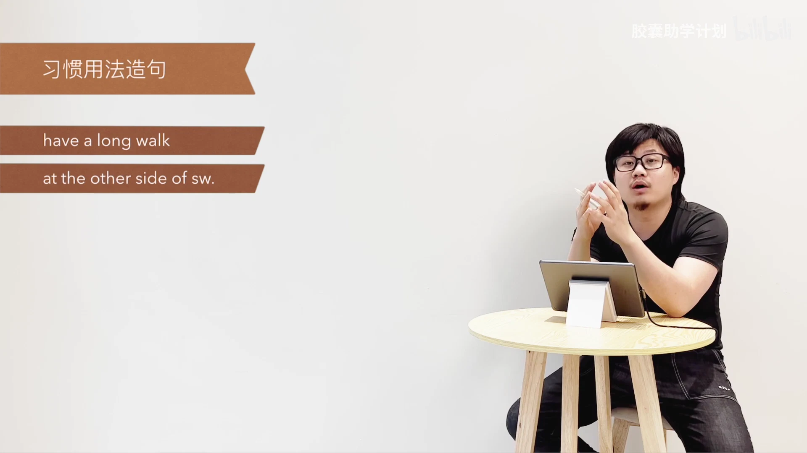

文字识别：习惯用法造句 / have a long walk / at the other side of sw.

### 画面 00:08:49

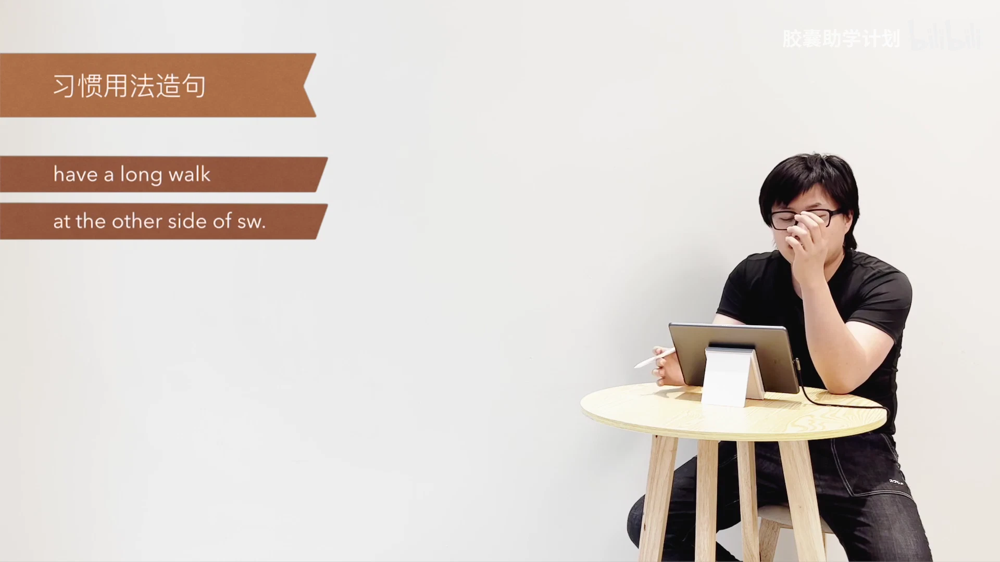

文字识别：习惯用法造句 / have a long walk / at the other side of sw.

### 画面 00:08:54

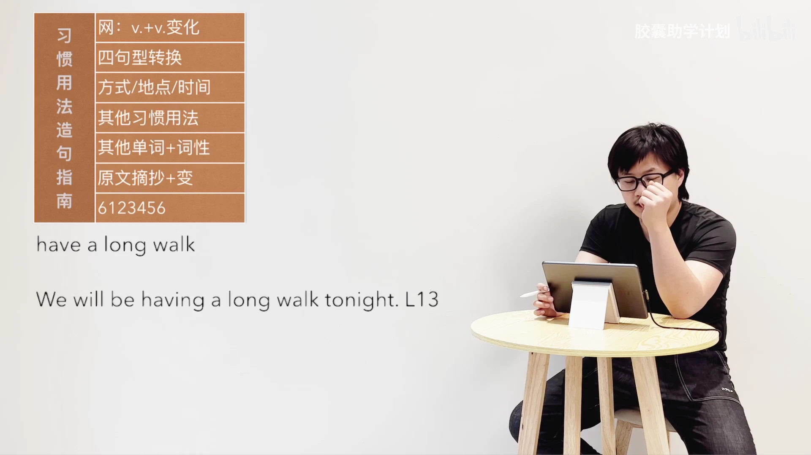

文字识别：网：v.+v.变化 / 习惯用法造句指南 / 四句型转换 / 方式/地点/时间 / 其他习惯用法 / 其他单词+词性 / 原文摘抄+变 / 6123456 / have a long walk / We will be having a long walk tonight. 13

### 画面 00:08:58

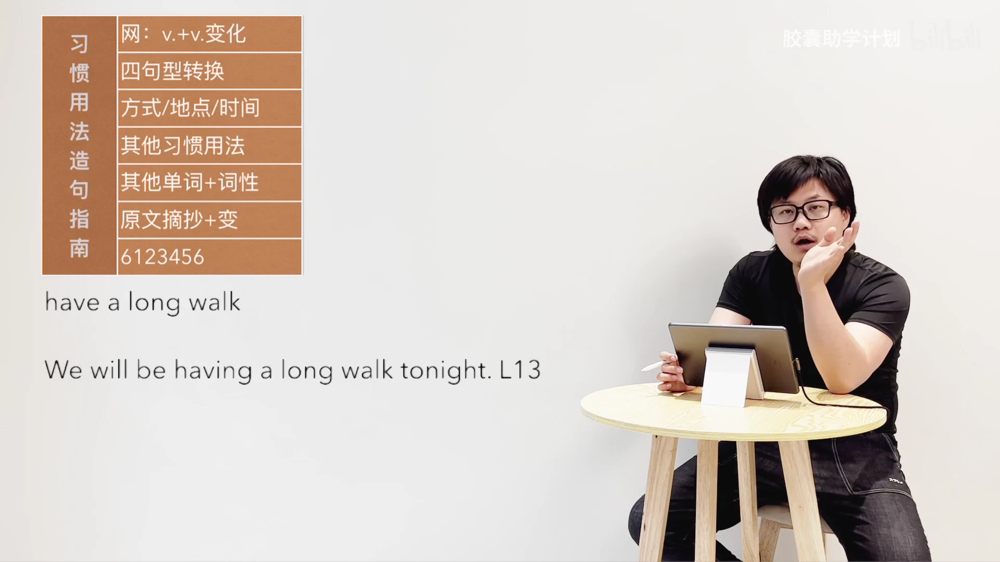

文字识别：网：v.+v.变化 / 习惯用法造句指南 / 四句型转换 / 方式/地点/时间 / 其他习惯用法 / 其他单词+词性 / 原文摘抄+变 / 6123456 / have a long walk / We will be having a long walk tonight. 13

## 00:09:00–00:09:30

句话我怎么造出来的啊？思路，思路是各位要重点学的。授人以鱼不如授人以渔嘛，对吧？我教你怎么钓这条鱼。Have a long walk.你看到它的时候，你要明白我要拿它去造句。这是一个动词嘛，对不对？那我想拿动词去造句的时候，英语有一个特点，不是说你也把动词放在那，这句子就出来了。六一二三四五六当中的二，我们第一节课就讲过，它有各种各样的动词及动词的变化。这些动词的变化才是

### 画面 00:09:00

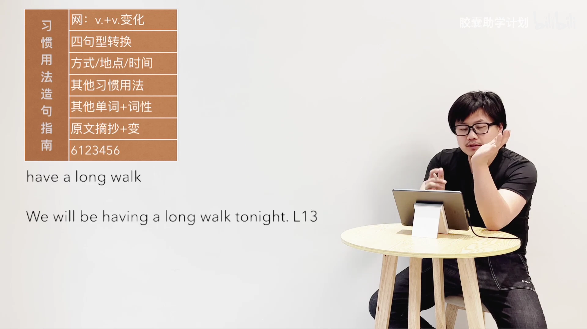

文字识别：网：v.+v.变化 / 习惯用法造句指南 / 四句型转换 / 方式/地点/时间 / 其他习惯用法 / 其他单词+词性 / 原文摘抄+变 / 6123456 / have a long walk / We wil be having a long walk tonight. L13

### 画面 00:09:06

文字识别：网：v.+v.变化 / 习惯用法造句指南 / 四句型转换 / 方式/地点/时间 / 其他习惯用法 / 其他单词+词性 / 原文摘抄+变 / 6123456 / have a long walk / We wil be having a long walk tonight. L13

### 画面 00:09:09

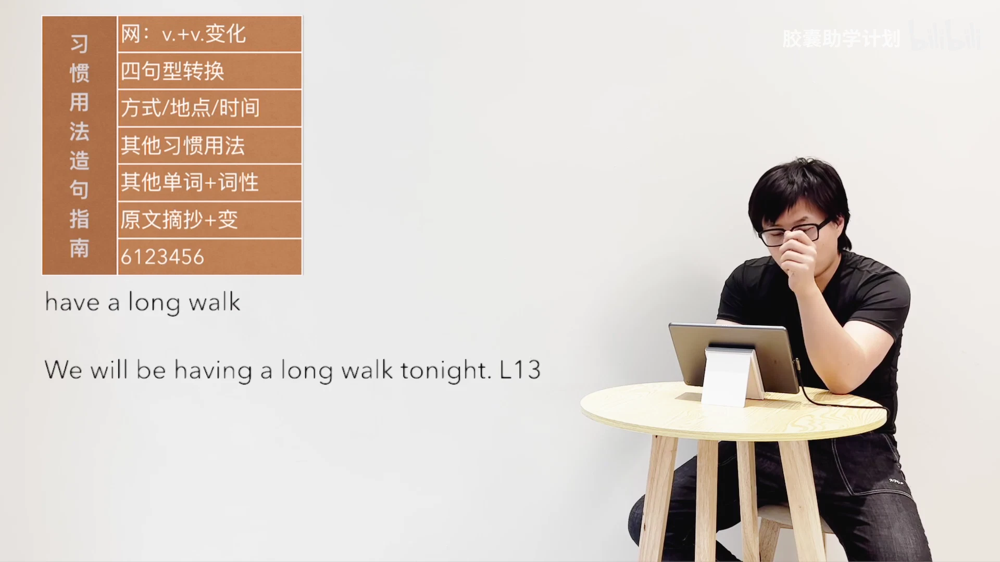

文字识别：网：v.+v.变化 / 习惯用法造句指南 / 四句型转换 / 方式/地点/时间 / 其他习惯用法 / 其他单词+词性 / 原文摘抄+变 / 6123456 / have a long walk / We wil be having a long walk tonight. L13

### 画面 00:09:12

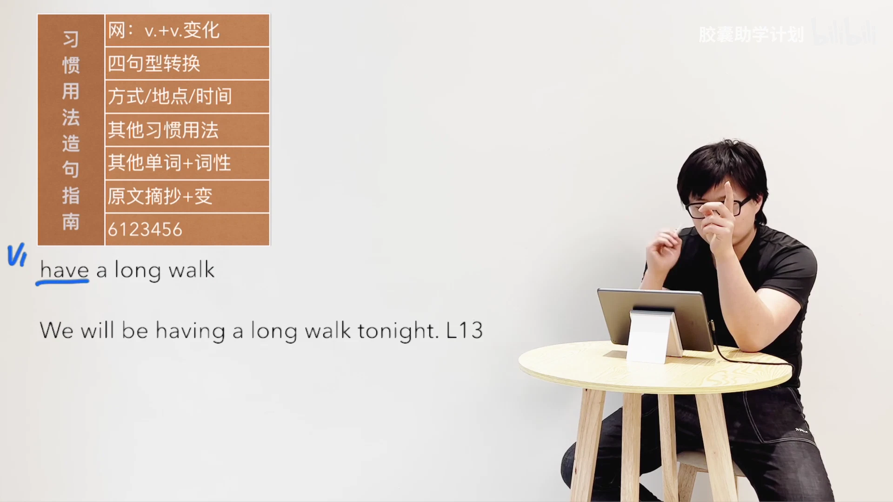

文字识别：网：v.+v.变化 / 习惯用法造句指南 / 四句型转换 / 方式/地点/时间 / 其他习惯用法 / 其他单词+词性 / 原文摘抄+变 / 6123456 / V / have a long walk / We will be having a long walk tonight. 13

### 画面 00:09:14

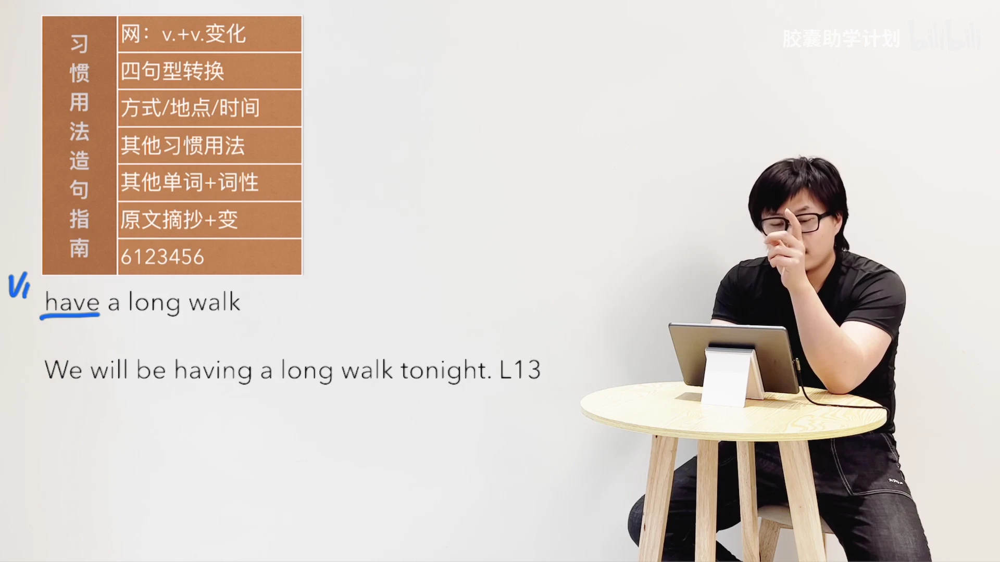

文字识别：网：v.+v.变化 / 习惯用法造句指南 / 四句型转换 / 方式/地点/时间 / 其他习惯用法 / 其他单词+词性 / 原文摘抄+变 / 6123456 / Vl / have a long walk / We will be having a long walk tonight. 13

### 画面 00:09:19

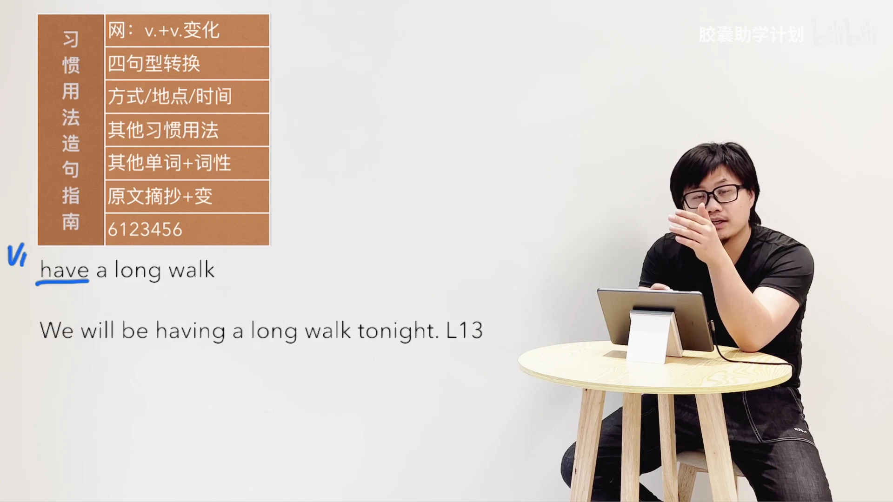

文字识别：网：v.+v.变化 / 习惯用法造句指南 / 四句型转换 / 方式/地点/时间 / 其他习惯用法 / 其他单词+词性 / 原文摘抄+变 / 6123456 / Vl / have a long walk / We will be having a long walk tonight. 13

### 画面 00:09:24

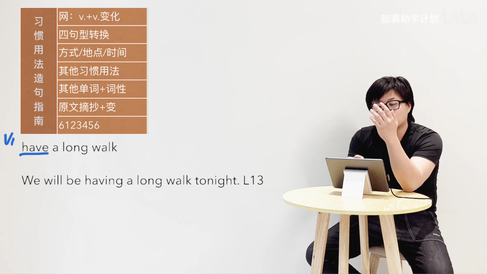

文字识别：网：v.+v.变化 / 习惯用法造句指南 / 四句型转换 / 方式/地点/时间 / 其他习惯用法 / 其他单词+词性 / 原文摘抄+变 / 6123456 / Vl / have a long walk / We wil be having a long walk tonight. L13

### 画面 00:09:29

文字识别：网：v.+v.变化 / 习惯用法造句指南 / 四句型转换 / 方式/地点/时间 / 其他习惯用法 / 其他单词+词性 / 原文摘抄+变 / 6123456 / V / have a long walk / We will be having a long walk tonight. L13

## 00:09:30–00:10:00

们学习英语的精髓呀，对不对？比如说 will be having 表示的是将怎么怎么样，对不对？那就是我们十三课学过的，叫做将来进行时。这句话叫做我们今天晚上将走很长一段的路，这就是我们单词造句的一个精髓。如果它是动词，那你就要去想动词加动词的变化。肯定句给你了，你再往下多走一步四句型，那就是您自己的事儿了。我在这儿上课不管啊。

### 画面 00:09:34

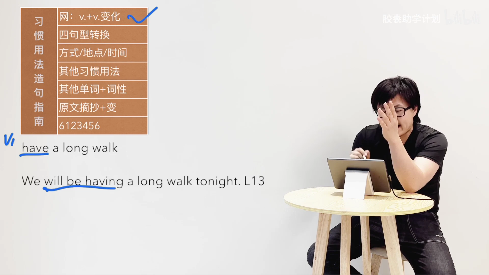

文字识别：网：v.+v.变化 / 习惯用法造句指南 / 四句型转换 / 方式/地点/时间 / 其他习惯用法 / 其他单词+词性 / 原文摘抄+变 / 6123456 / Vl / have a long walk / We wil be having a long walk tonight. L13

### 画面 00:09:39

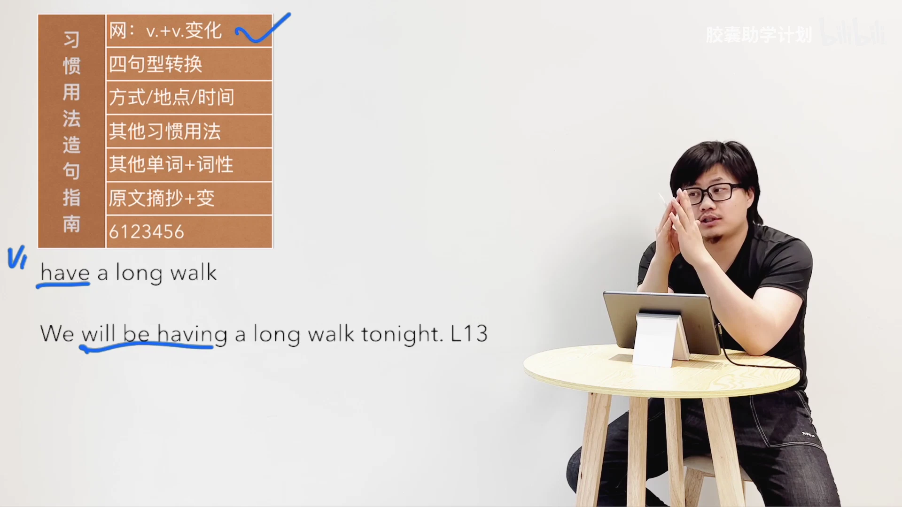

文字识别：网：v.+v.变化 / 习惯用法造句指南 / 四句型转换 / 方式/地点/时间 / 其他习惯用法 / 其他单词+词性 / 原文摘抄+变 / 6123456 / Vl / have a long walk / We will be having a long walk tonight. L13

### 画面 00:09:44

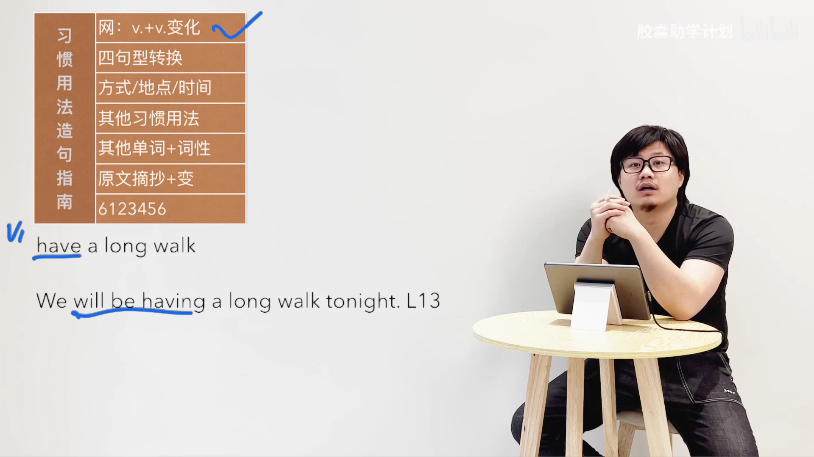

文字识别：网：v.+v.变化 / 习惯用法造句指南 / 四句型转换 / 方式/地点/时间 / 其他习惯用法 / 其他单词+词性 / 原文摘抄+变 / 6123456 / Vl / have a long walk / We wil be having a long walk tonight. L13

### 画面 00:09:49

文字识别：网：v.+v.变化 / 习惯用法造句指南 / 四句型转换 / 方式/地点/时间 / 其他习惯用法 / 其他单词+词性 / 原文摘抄+变 / 6123456 / Vl / have a long walk / We wil be having a long walk tonight. L13

### 画面 00:09:51

文字识别：网：V.+v.变化 / 习惯用法造句指南 / 四句型转换 / 方式/地点/时间 / 其他习惯用法 / 其他单词+词性 / 原文摘抄+变 / 6123456 / Vl / have a long walk / We wil be having a long walk tonight. L13

### 画面 00:09:53

文字识别：网：v.+v.变化 / 习惯用法造句指南 / 四句型转换 / 方式/地点/时间 / 其他习惯用法 / 其他单词+词性 / 原文摘抄+变 / 6123456 / Vl / have a long walk / We will be having a long walk tonight. L13

### 画面 00:09:55

文字识别：网：v.+v.变化 / 习惯用法造句指南 / 四句型转换 / 方式/地点/时间 / 其他习惯用法 / 其他单词+词性 / 原文摘抄+变 / 6123456 / V / have a long walk / We will be having a long Walk tonight. L13

### 画面 00:09:57

文字识别：网：V.+v.变化 / 习惯用法造句指南 / 四句型转换 / 方式/地点/时间 / 其他习惯用法 / 其他单词+词性 / 原文摘抄+变 / 6123456 / Vl / have a long walk / We will be having a long Walk tonight. L13

### 画面 00:09:59

文字识别：网：v.+v.变化 / 习惯用法造句指南 / 四句型转换 / 方式/地点/时间 / 其他习惯用法 / 其他单词+词性 / 原文摘抄+变 / 6123456 / V / have a long walk / We will be having a long walk tonight. L13 / We needn't have had this long walk. L41

## 00:10:00–00:10:30

再来说 we needn't have done this a long呃呃 we needn't have had this long walk啊说我们本不必走这么远。OK needn't have done 四十一课刚学的语法我就不多说了啊。说 if I weren't tired，如果我不累，we could have we would have a long walk。当然 could have a long walk 也没有问题。那我想的问题是 did they have a long walk啊 do they have a long walk或者说

### 画面 00:10:07

文字识别：网：v.+v.变化 / 习惯用法造句指南 / 四句型转换 / 方式/地点/时间 / 其他习惯用法 / 其他单词+词性 / 原文摘抄+变 / 6123456 / Vl / have a long walk / We will be having a long walk tonight. L13 / We needn't have had this long walk. L41

### 画面 00:10:09

文字识别：网：v.+v.变化 / 习惯用法造句指南 / 四句型转换 / 方式/地点/时间 / 其他习惯用法 / 其他单词+词性 / 原文摘抄+变 / 6123456 / V / have a long walk / We will be having a long walk tonight. L13 / We needn't have had this long walk. L41

### 画面 00:10:14

文字识别：网：v.+v.变化 / 习惯用法造句指南 / 四句型转换 / 方式/地点/时间 / 其他习惯用法 / 其他单词+词性 / 原文摘抄+变 / 6123456 / Vl / have a long walk / We will be having a long walk tonight. L13 / We needn't have had this long walk. L41 / If I weren't tired, we would have a long walk. / L40

### 画面 00:10:19

文字识别：网：v.+v.变化 / 习惯用法造句指南 / 四句型转换 / 方式/地点/时间 / 其他习惯用法 / 其他单词+词性 / 原文摘抄+变 / 6123456 / V / have a long walk / We will be having a long walk tonight. L13 / We needn't have had this long walk. L41 / If I weren't tired, we would have a long walk. / L40

### 画面 00:10:24

文字识别：网：v.+v.变化 / 习惯用法造句指南 / 四句型转换 / 方式/地点/时间 / 其他习惯用法 / 其他单词+词性 / 原文摘抄+变 / 6123456 / Vl / have a long walk / We will be having a long walk tonight. L13 / We needn't have had this long walk. L41 / If I weren't tired, we would have a long walk. / L40

### 画面 00:10:29

文字识别：网：v.+v.变化 / 习惯用法造句指南 / 四句型转换 / 方式/地点/时间 / 其他习惯用法 / 其他单词+词性 / 原文摘抄+变 / 6123456 / V / have a long walk / We will be having a long walk tonight. L13 / We needn't have had this long walk. L41 / If I weren't tired, we would have a long walk. / L40

## 00:10:30–00:11:00

呃，Are you tired?对吧？你如果这些问题你能答出来，这个语法你就会了。Are you tired? No. Ah, yes, I am tired.为什么？这里面是虚拟语气，说假如我不不不累，对吧？但实际上累不累？实际上与事实相反，我很累，对吧？这就叫虚拟语气，现啊与现在相反的虚拟语气，好吧？接下来呢，我们看一个小电影片段。电影片段当中啊，出现了两个我们学过的语法，

### 画面 00:10:34

文字识别：网：v.+v.变化 / 习惯用法造句指南 / 四句型转换 / 方式/地点/时间 / 其他习惯用法 / 其他单词+词性 / 原文摘抄+变 / 6123456 / V / have a long walk / We will be having a long walk tonight. L13 / We needn't have had this long walk. L41 / If I weren't tired, we would have a long walk. / L40

### 画面 00:10:39

文字识别：网：v.+v.变化 / 习惯用法造句指南 / 四句型转换 / 方式/地点/时间 / 其他习惯用法 / 其他单词+词性 / 原文摘抄+变 / 6123456 / V / have a long walk / We will be having a long walk tonight. L13 / We needn't have had this long walk. L41 / If I weren't tired, we would have a long walk. / L40

### 画面 00:10:44

文字识别：网：v.+v.变化 / 习惯用法造句指南 / 四句型转换 / 方式/地点/时间 / 其他习惯用法 / 其他单词+词性 / 原文摘抄+变 / 6123456 / V / have a long walk / We will be having a long walk tonight. L13 / We needn't have had this long walk. L41 / If I weren't tired, we would have a long walk. / L40

### 画面 00:10:49

文字识别：网：v.+v.变化 / 习惯用法造句指南 / 四句型转换 / 方式/地点/时间 / 其他习惯用法 / 其他单词+词性 / 原文摘抄+变 / 6123456 / Vl / have a long walk / We will be having a long walk tonight. L13 / We needn't have had this long walk. L41 / If I weren't tired, we would have a long walk. / L40

### 画面 00:10:51

文字识别：网：v.+v.变化 / 习惯用法造句指南 / 四句型转换 / 方式/地点/时间 / 其他习惯用法 / 其他单词+词性 / 原文摘抄+变 / 6123456 / Vl / have a long walk / We will be having a long walk tonight. L13 / We needn't have had this long walk. L41 / If I veren'ttired, we would have a long walk. / L40

### 画面 00:10:53

文字识别：网：v.+v.变化 / 习惯用法造句指南 / 四句型转换 / 方式/地点/时间 / 其他习惯用法 / 其他单词+词性 / 原文摘抄+变 / 6123456 / have a long walk / We will be having a long walk tonight. L13 / We needn't have had this long walk. L41 / If I weren't tired, we would have a long walk. / L40

### 画面 00:10:55

文字识别：You will have a long walk. / If I get lost, we'll call a cop. / 雪印チズ / 雪印牛丸 / 黑雨 / Black Rain / (1989)

### 画面 00:10:59

文字识别：QYou will have a long walk. / f I get lost, we'll call a cop. / 雪印チズ / 雪印牛乳 / 黑雨 / Black Rain / (1989)

## 00:11:00–00:11:30

一个是今天刚见的习惯用法啊，也算是语法吧，will加have嘛。另一个叫if a，啊这个a will对吧？主将从现是咱们第十六课学过的语法啊。注意力集中，我们一起看一下。Let's go, Charlie, come on. You would have a long walk home. Fine, if I get lost, we'll call a cop. What? Okay，

### 画面 00:11:01

文字识别：QYou wil have a long walk. / of l get lost, we'll call a cop. / 雪印チーズ / 雪印牛乳 / 黑雨 / Black Rain / (1989)

### 画面 00:11:04

文字识别：QYou wilhave a long walk. / of I get lost, we'll call a cop. / 雪印チズ / 雪印牛丸 / 黑雨 / Black Rain / (1989)

### 画面 00:11:11

文字识别：DYou / I wihave a long walk. / , e'll illa op. 6 / of get lost, / 雪印チズ / 雪印牛丸 / 黑雨 / Black Rain / (1989)

### 画面 00:11:17

文字识别：1 wiDhave a long walk. / You / , e'll cal a op 6 / of I get lost, / 雪印チズ / 雪印牛乳 / 黑雨 / Black Rain / 五条街？-查理我们走来吧 / -Five blocks?-Let's go, Charlie. Come on. / (1989)

### 画面 00:11:19

文字识别： wilhave a long walk. / You / , e'll ill a op. L 6 / of get lost, / 黑雨 / Black Rain / 走回饭店的路很远 / You'll have a long walk home. / (1989)

### 画面 00:11:21

文字识别：I Wilhave along walk. / You / of I get lost, / , e'll illa op. L 6 / 黑雨 / Black Raim / 好如果我们迷路会报警 / (1989) / Fine. If I get lost, we"ll calla cop.

### 画面 00:11:23

文字识别：You /  wilhave a long walk. / , we'l lla op. 6 / of get lost, / 黑雨 / Black Rain / 好如果我们迷路会报警 / Fine. If I get lost, we"ll calla cop. / (1989)

### 画面 00:11:25

文字识别：QYou / wilHave a long walk. / , e'l lla op. 6 / of get lost, / 黑雨 / Black Rain / (1989)

### 画面 00:11:27

文字识别：QYou / wilhave a long walk. / of get lost, / , we'l ll a op. 6 / 黑雨 / Black Rain / 什么？ / What? / (1989)

### 画面 00:11:29

文字识别：QYou / wiDhave a long walk. / , e'l lla op. 6 / ofI get lost, / 黑雨 / Black Rain / 什么？ / What? / (1989)

## 00:11:30–00:12:00

one more.接下来叫 at the other side of somewhere，在某一方向的另一侧，对吧？比如说，Look, she is standing at the other side of the market.瞧，她在集市的另一面站着呢。这很容易，你把它变一般疑问句、特殊疑问句，老生常谈了。接下来说，She saw him running. See somebody doing something是印象当中之前是我们三十五课那课学的是吧？好，At the other side of the street last night.然后你再把它变成各种一般

### 画面 00:11:31

文字识别：网：v.+v.变化 / 习惯用法造句指南 / 四句型转换 / 方式/地点/时间 / 其他习惯用法 / 其他单词+词性 / 原文摘抄+变 / 6123456 / at the other side of sw.

### 画面 00:11:34

文字识别：网：v.+v.变化 / 习惯用法造句指南 / 四句型转换 / 方式/地点/时间 / 其他习惯用法 / 其他单词+词性 / 原文摘抄+变 / 6123456 / at the other side of sw.

### 画面 00:11:39

文字识别：网：v.+v.变化 / 习惯用法造句指南 / 四句型转换 / 方式/地点/时间 / 其他习惯用法 / 其他单词+词性 / 原文摘抄+变 / 6123456 / at the other side of sw. / Look, she is standing at the other side of the market.

### 画面 00:11:44

文字识别：网：v.+v.变化 / 习惯用法造句指南 / 四句型转换 / 方式/地点/时间 / 其他习惯用法 / 其他单词+词性 / 原文摘抄+变 / 6123456 / at the other side of sw. / Look, she is standing at the other side of the market. / is/where/who...

### 画面 00:11:47

文字识别：网：v.+v.变化 / 习惯用法造句指南 / 四句型转换 / 方式/地点/时间 / 其他习惯用法 / 其他单词+词性 / 原文摘抄+变 / 6123456 / at the other side of sw. / Look, she is standing at the other side of the market. / is/where/who... / She saw him running at the other side of the street last / night.

### 画面 00:11:49

文字识别：网：v.+v.变化 / 习惯用法造句指南 / 四句型转换 / 方式/地点/时间 / 其他习惯用法 / 其他单词+词性 / 原文摘抄+变 / 6123456 / at the other side of sw. / Look, she is standing at the other side of the market / is/where/who... / She saw him running at the other side of the street last / night.

### 画面 00:11:54

文字识别：网：v.+v.变化 / 习惯用法造句指南 / 四句型转换 / 方式/地点/时间 / 其他习惯用法 / 其他单词+词性 / 原文摘抄+变 / 6123456 / at the other side of sw. / Look, she is standing at the other side of the market. / is/where/who... / She saw him running at the other side of the street last / night.

### 画面 00:11:57

文字识别：网：v.+v.变化 / 习惯用法造句指南 / 四句型转换 / 方式/地点/时间 / 其他习惯用法 / 其他单词+词性 / 原文摘抄+变 / 6123456 / at the other side of sw. / Look, she is standing at the other side of the market. / is/where/who... / She saw him running at the other side of the street last / night.

### 画面 00:11:59

文字识别：网：v.+v.变化 / 习惯用法造句指南 / 四句型转换 / 方式/地点/时间 / 其他习惯用法 / 其他单词+词性 / 原文摘抄+变 / 6123456 / at the other side of sw. / Look, she is standing at the other side of the market. / is/where/who... / She saw him running at the other side of the street last / night. / did/who/when/where...

## 00:12:00–00:12:30

疑问句和特殊疑问句，课下作业，这叫四型转换，对吧？好，recap除了文章重要以外，两个习惯用法各位要牢牢拿住啊。呃，然后呢，习惯用法造句是家庭作业，文章跟读啊。那以上就是本期视频的全部内容了。如果各位喜欢我们的课程呢，欢迎各位关注、订阅、一键三连，分享给那些需要的朋友，来帮助我们快速成长。See you next time.

### 画面 00:12:01

文字识别：网：v.+v.变化 / 习惯用法造句指南 / 四句型转换 / 方式/地点/时间 / 其他习惯用法 / 其他单词+词性 / 原文摘抄+变 / 6123456 / at the other side of sw. / Look, she is standing at the other side of the market. / is/where/who... / She saw him running at the other side of the street last / night. / did/who/when/where...

### 画面 00:12:04

文字识别：网：v.+v.变化 / 习惯用法造句指南 / 四句型转换 / 方式/地点/时间 / 其他习惯用法 / 其他单词+词性 / 原文摘抄+变 / 6123456 / at the other side of sw. / Look, she is standing at the other side of the market. / is/where/who... / She saw him running at the other side of the street last / night. / did/who/when/where...

### 画面 00:12:06

文字识别：Recap / have a long walk / Expression / at the other side of sw.

### 画面 00:12:08

文字识别：Recap / have a long walk / Expression / at the other side of sw.

### 画面 00:12:10

### 画面 00:12:12

文字识别：1. / 习惯用法造句/对话 / 【习惯用法造句指南】 / 每个5句

### 画面 00:12:14

文字识别：👍

### 画面 00:12:27

### 画面 00:12:29

文字识别：CAPSULEACADEMY / 胶囊助学计划 / 小红书 / Lecturer / Leo / OE

## 00:12:30–00:12:39

### 画面 00:12:32

文字识别：CAPSULEACADEMY / 胶囊助学计划 / 小红书 / 口 / Editor / OE

### 画面 00:12:35

文字识别：CAPSULEACADEMY / 胶囊助学计划 / 小红书 / Creator / Leo & Berlin / OE

### 画面 00:12:37

文字识别：Bilibili / 胶囊助学计划 / 胶囊助学计划 / 小红书

### 画面 00:12:39

文字识别：bilibili / 胶囊助学计划

