# L042 听说读写复述练习

快速机器解析：语音为单模型转写，未进行独立交叉校对或人工复核；画面每秒采样并按变化选帧，短时文字和标记可能遗漏。截图时间约有 1 秒误差。图片有损压缩；遇到疑点请按时间查看 Google Drive 原视频。

## 00:00:00–00:00:30

Hello everyone, welcome to Capsule Academy. This is Leo. Today we're going to learn new concept English book two lesson forty two practices. 那注意，进行如下练习的唯一前提叫做文章跟读至熟读成诵，否则请勿开始。 Hope you gonna enjoy it. 好，那我们先看第一道题，comprehension练习的我们是能听懂别人问的问题，对吧？啊，那我现在问各位，各位在文

### 画面 00:00:00

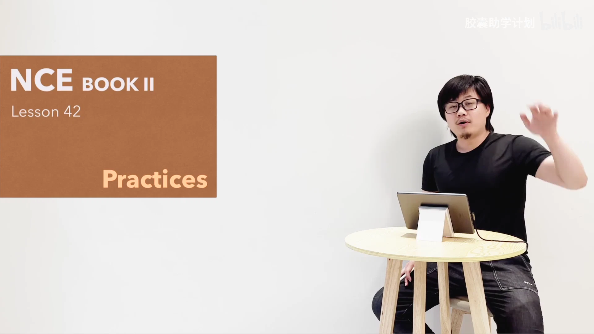

文字识别：NCE / BOOKII / Lesson 42 / Practices

### 画面 00:00:02

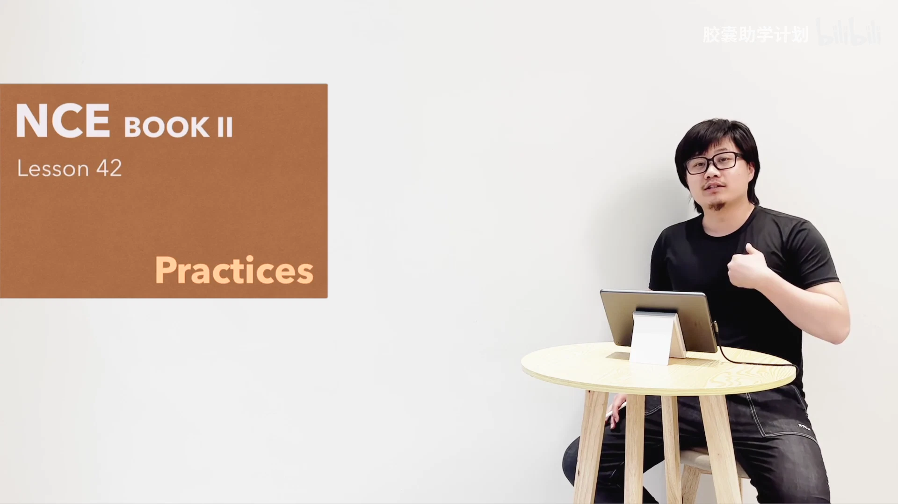

文字识别：NCE / BOOKII / Lesson 42 / Practices

### 画面 00:00:05

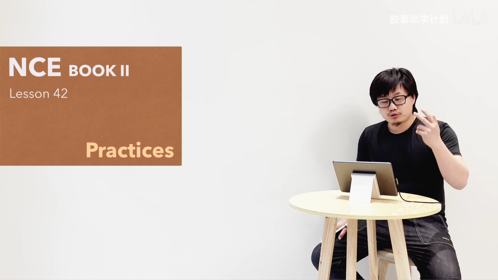

文字识别：NCE / BOOKII / Lesson 42 / Practices

### 画面 00:00:08

文字识别：进行如下练习唯一前提 / 文章跟读至熟读成诵 / 否则请勿开始

### 画面 00:00:10

文字识别：进行如下练习唯一前提 / 文章跟读至熟读成诵 / 否则请勿开始

### 画面 00:00:17

文字识别：胶囊助学计划blb出 / •

### 画面 00:00:21

### 画面 00:00:23

文字识别：Comprehension / 训练目标： / 听懂一般疑问句＆特殊疑问句

## 00:00:30–00:01:00

章当中找答案。第一题，Where had you had a long walk? Answer: Through one of the markets of Old Delhi. Next one, Why did you stop at a square to have a rest? Continue. Who did you notice after a time? A snake charmer. Next one, How many baskets did he have? Two. Continue.

### 画面 00:00:31

文字识别：Comprehension

### 画面 00:00:35

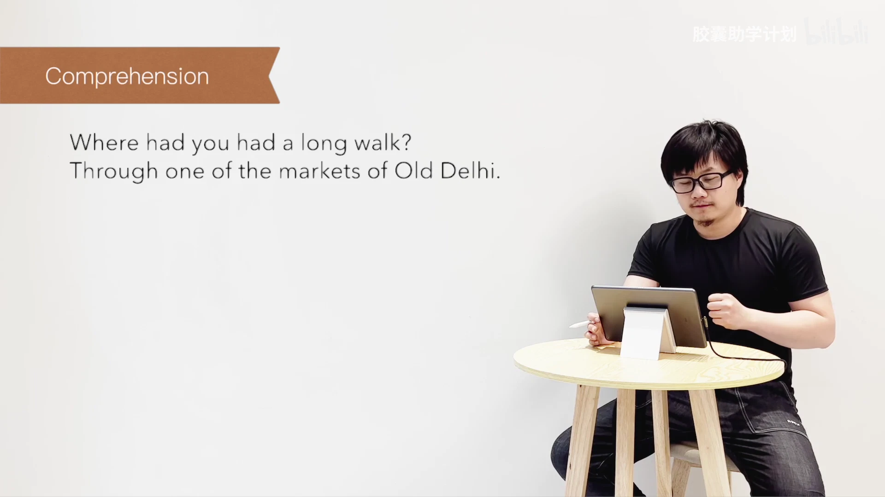

文字识别：Comprehension / Where had you had a long walk? / Through one of the markets of Old Delhi.

### 画面 00:00:42

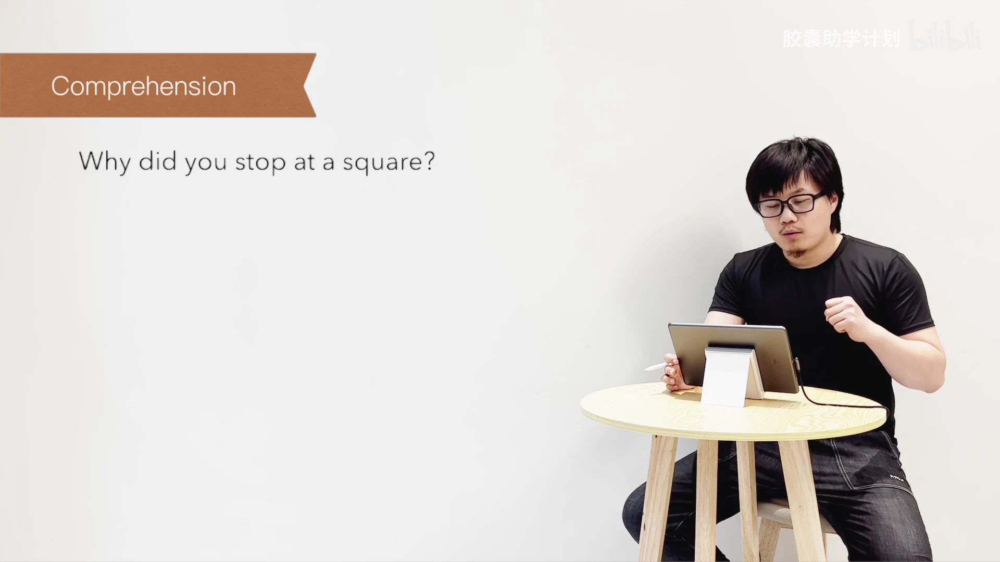

文字识别：Comprehension / Why did you stop at a square?

## 00:01:00–00:01:30

What was his pipe covered with? Ah, coins, right? Next one. When did he pick it up? As soon as he saw us. Next one. What did he open then? One of the baskets. Continue. When did you have the first glimpse of the snake? When he began to play a tune. Next one. So did

### 画面 00:01:12

文字识别：Comprehension / When did he pick it up? / As soon as he saw us.

### 画面 00:01:25

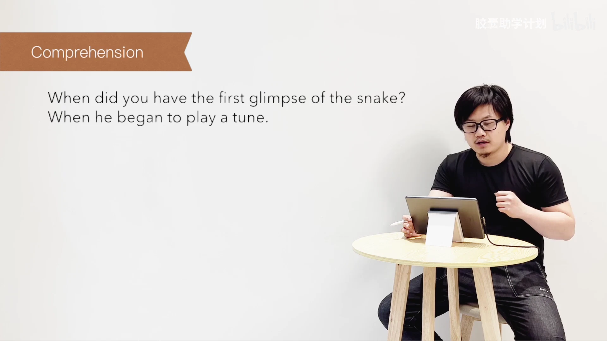

文字识别：Comprehension / When did you have the first glimpse of the snake? / When he began to play a tune.

### 画面 00:01:29

文字识别：Comprehension / Did it rise out of the basket?

## 00:01:30–00:02:00

it rise out of the basket? Yes, it did. Next one. What movements did it begin to follow? The movements of the pipe. Next one. What kind of music was the snake charmer playing to begin with? An Indian tune. Next one. Did he change to jazz tunes? Yes, he did. What else did he

### 画面 00:01:39

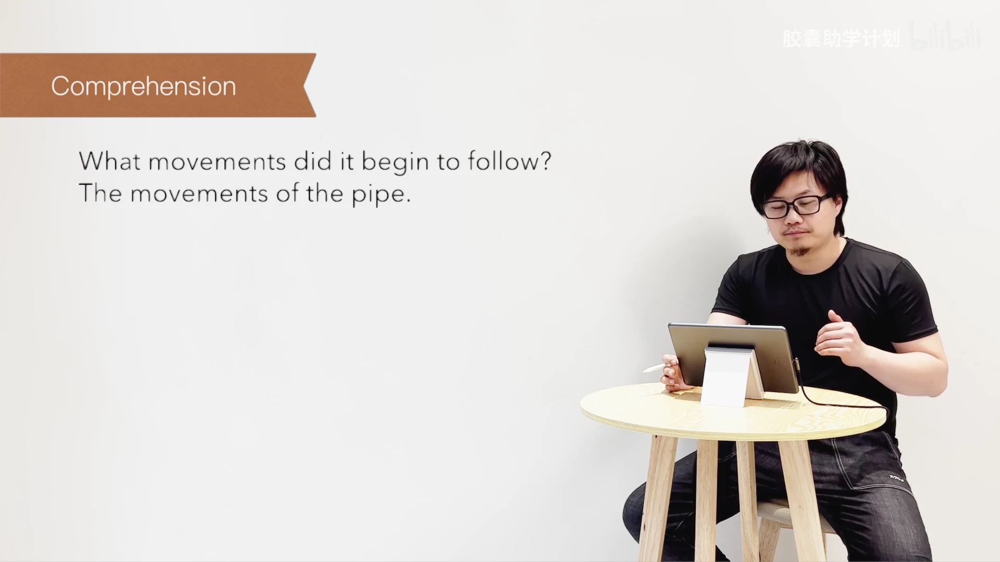

文字识别：Comprehension / What movements did it begin to follow? / The movements of the pipe.

### 画面 00:01:45

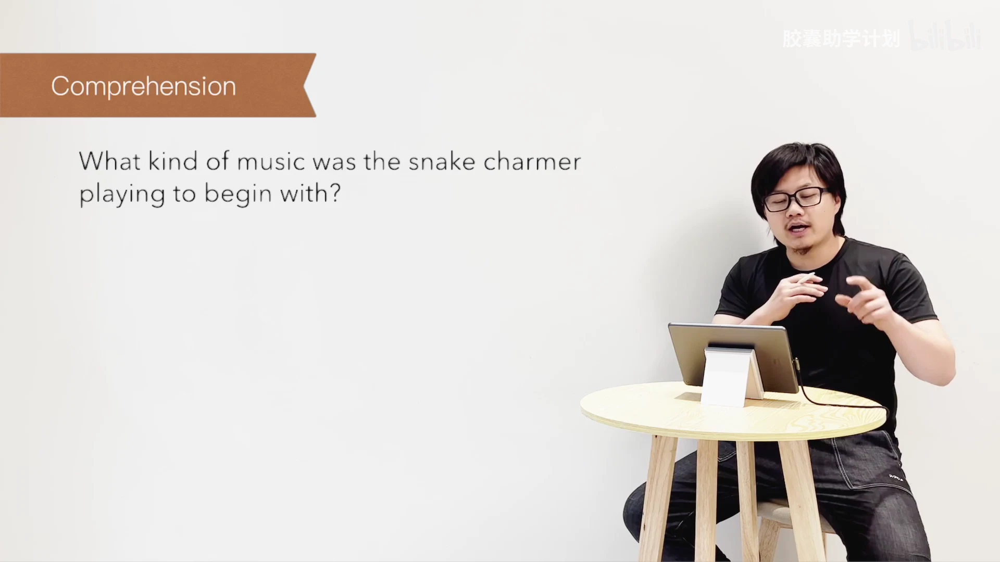

文字识别：Comprehension / What kind of music was the snake charmer / playing to begin with?

### 画面 00:01:53

文字识别：Comprehension / Did he change to jazz tunes?

## 00:02:00–00:02:30

play? Ah, modern pop music songs. Okay, very good. Uh, next one. Were you surprised? Yes, we were. 好，asking questions练习我们会说一般疑问句和特殊疑问句的能力，对吧？好，来了啊。说 ask me if we were in one of the were提前就行了，对吧？很简单。然后 where 对啊， one of the markets of Old Delhi，对吧？所以叫 where were you 就可以了啊。

### 画面 00:02:02

文字识别：Comprehension / What else did he play? / Modern pop songs.

### 画面 00:02:08

文字识别：Asking questions / 训练目标： / 会说一般疑问句＆特殊疑问句 / Accuracy / Fluency

### 画面 00:02:14

文字识别：Asking questions / T: Ask me if we were in one of the markets of old Delhi.

### 画面 00:02:18

文字识别：Asking questions / T: Ask me if we were in one of the markets of old Delhi.

### 画面 00:02:20

文字识别：Asking questions / T: Ask me if we werei / in one of the markets of old Delhi. / S: Were you in one of the markets of old Delhi?

### 画面 00:02:24

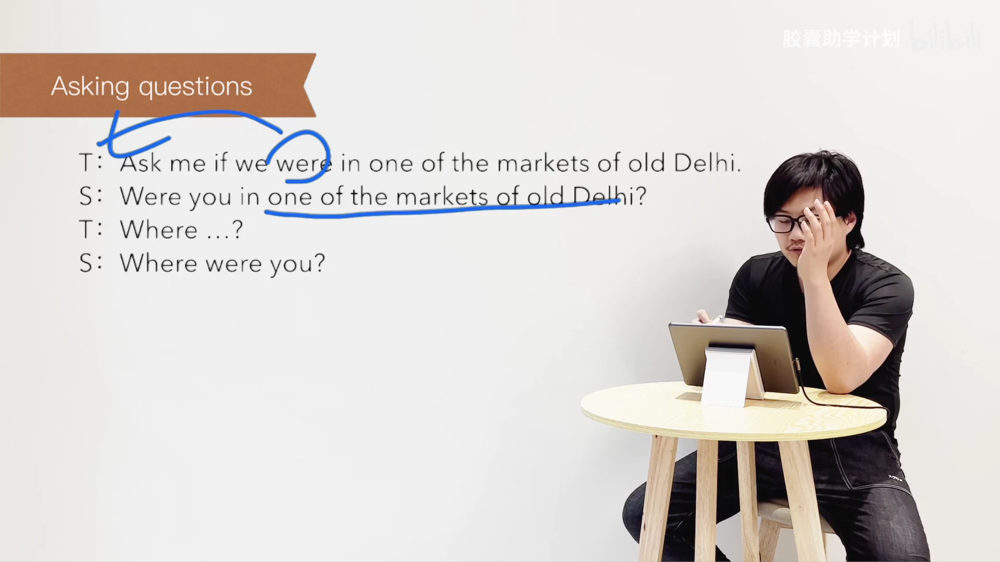

文字识别：Asking questions / T: Ask me if we were / in one of the markets of old Delhi. / S: Were you in one of the markets of old Dellhi? / T: Where ...? / S: Where were you?

### 画面 00:02:29

文字识别：Asking questions / T: Ask me if we were in one of the markets of old Delhi. / S: Were you in one of the markets of old Delhi? / T: Where ...? / S: Where were you?

## 00:02:30–00:03:00

了啊，呃，我们看题啊。We had had a long walk. Had提前，What对a long walk提问，对吧？呃，当然，我觉得啊，我个人觉得这个地方，如果你呃这个说出来的是What had you had，可能不太好。如果但你如果说What had you done，可能非常的好啊。我个人是这个建议。第三题，Did的提前吧，对吧？Where

### 画面 00:02:31

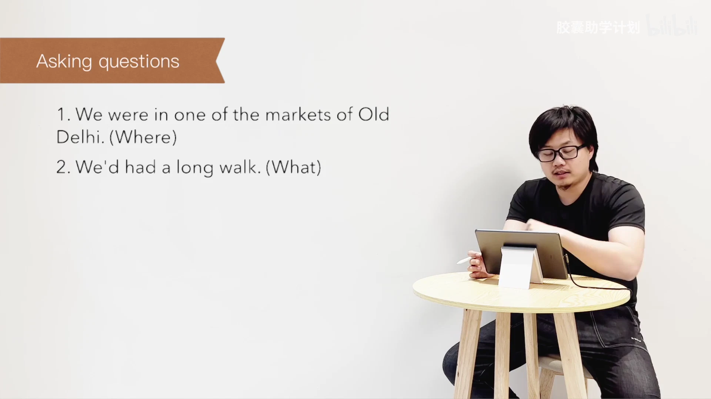

文字识别：Asking questions / 1. We were in one of the markets of Old / Delhi.(Where) / 2. We'd had a long walk. (What)

### 画面 00:02:39

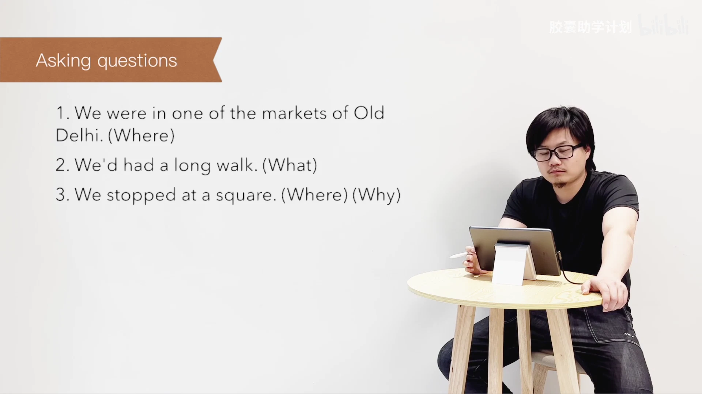

文字识别：Asking questions / 1. We were in one of the markets of Old / Delhi.(Where) / 2. We'd had a long walk. (What) / 3. We stopped at a square. (Where) (Why)

### 画面 00:02:59

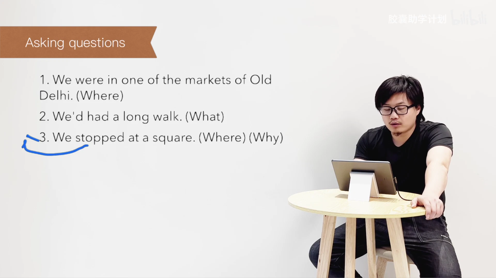

文字识别：Asking questions / 1. We were in one of the markets of Old / Delhi.(Where) / 2. We'd had a long walk. (What) / 3. We stopped at a square. (Where) (Why)

## 00:03:00–00:03:30

对at the square， Why对整句。We needed a rest. Did的提前，What对a rest提问，Why加整句。We noticed. Did的提前，对吧？What对a snake charmer提问，Where对整句提问，叫Where did you notice a snake charmer？呃，Had two large baskets. Did的提前，一般过去时。How many对two提问，所以答案叫How many一定要带着large baskets啊。How many

### 画面 00:03:06

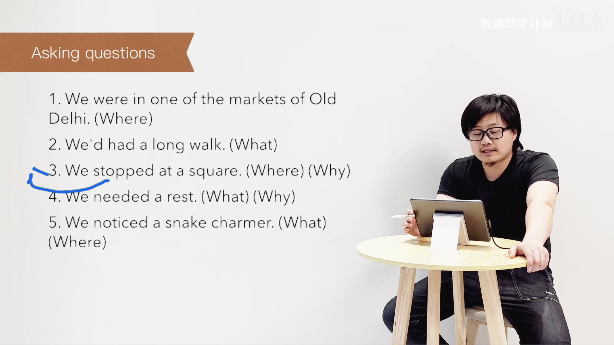

文字识别：Asking questions / 1. We were in one of the markets of Old / Delhi.(Where) / 2. We'd had a long walk. (What) / 3. We stopped at a square. (Where) (Why) / 4. We needed a rest. (What) (Why) / 5. We noticed a snake charmer. (What) / (Where)

### 画面 00:03:10

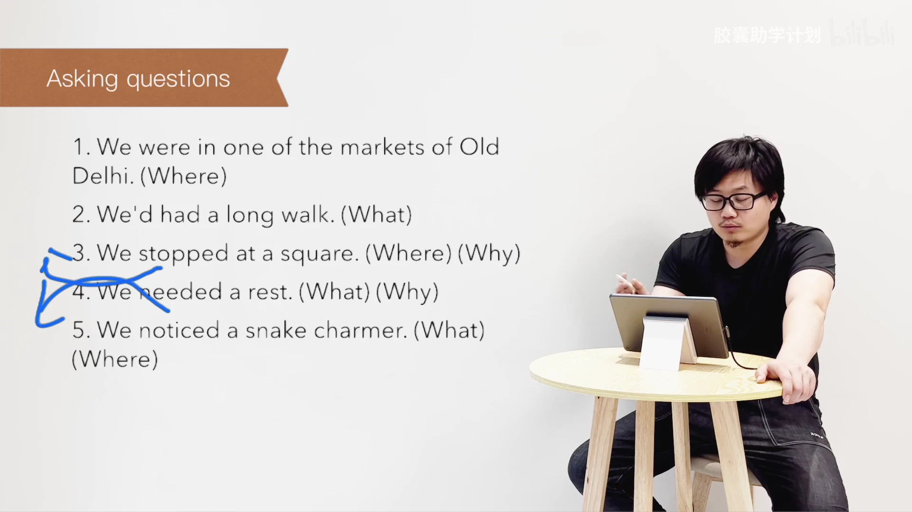

文字识别：Asking questions / 1. We were in one of the markets of Old / Delhi.(Where) / 2. We'd had a long walk. (What) / 3. We stopped at a square. (Where) (Why) / 4.Weeeded a rest. (What) (Why) / 5. We noticed a snake charmer. (What) / (Where)

## 00:03:30–00:04:00

large baskets did you have? Did he have? Ah,第七个. He was sitting at the other side of the square. Was提前. Where肯定是对. At the other side of the square提问，对吧？Who对主语提问。We went to have a look at him.那Did提前吧？啊，对吧？然后What点点do是标准答案，叫What did you do？对吧？呃，当然，我觉得这里还可以来一个Who，比如说Who对呃We提问，对吧？Who went to have a look at

### 画面 00:03:33

文字识别：Asking questions

### 画面 00:03:40

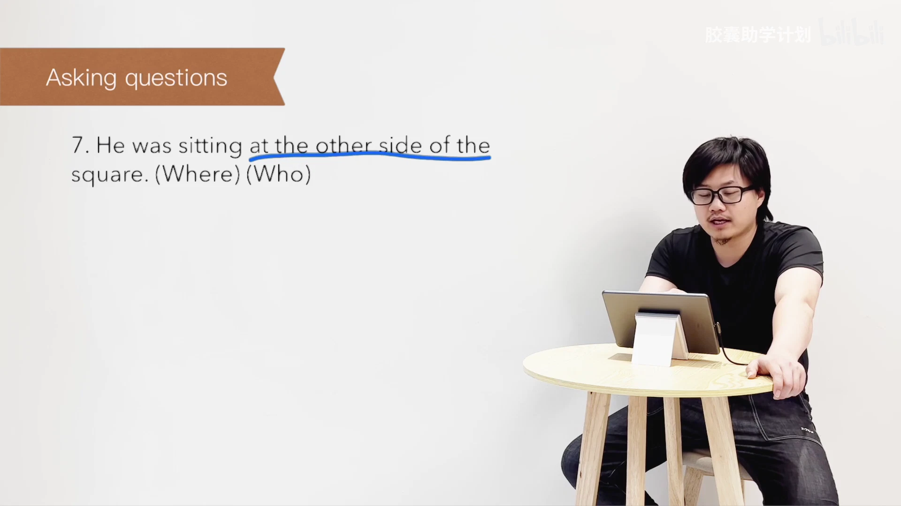

文字识别：Asking / questions / 7. He was sitting at the other side of the / square. (Where) (Who)

### 画面 00:03:43

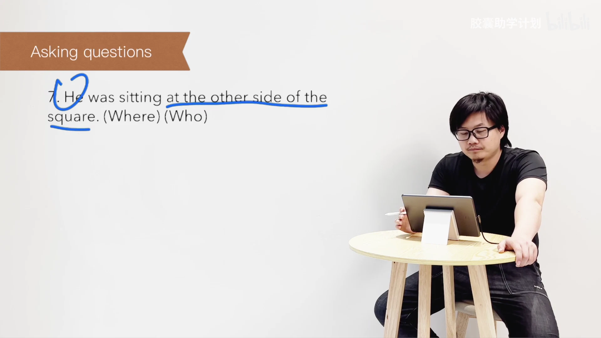

文字识别：Asking / questions / He / was / sitting a / at the other side of the / square.(Where) (Who)

### 画面 00:03:55

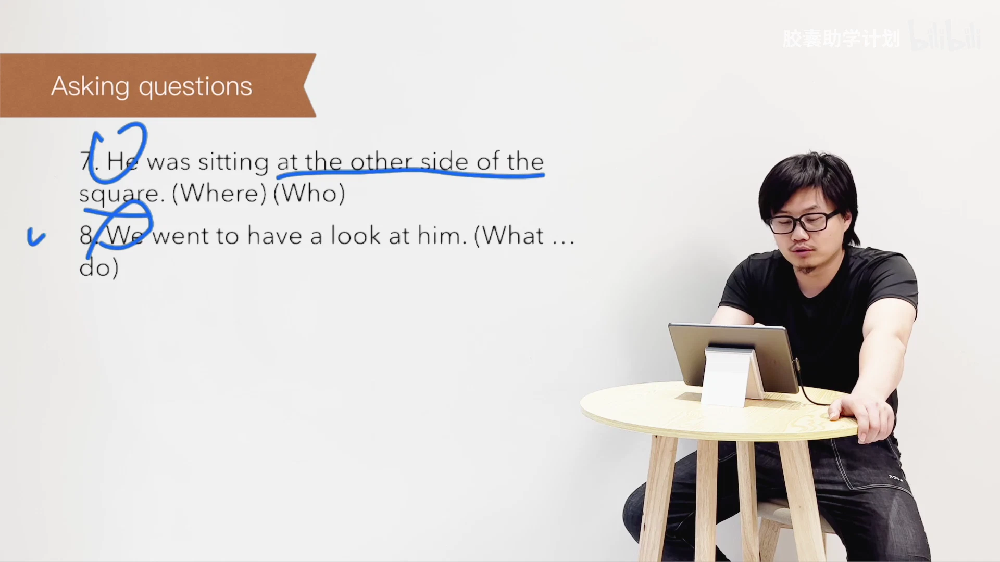

文字识别：Asking / questions / He / was sitting at the other side of the / square.(Where) (Who) / 8W went to have a look at him. (What  / do)

## 00:04:00–00:04:30

him? Ah, uh, 对主语提问不用变一般疑问句了. Ah, he picked up a long pipe. Did提前吧，对吧？ What对，肯定是对a long pipe提问。问对整句提问。 It was covered with coins. 被动was提前。 What对coins提问，对吧？ What was it covered with? 当然，我认为也可以把它说成叫What was covered with coins? 啊，都可以，我觉得. He opened one of the baskets.

### 画面 00:04:01

文字识别：Asking / questions / He / was / ; sitting at the other side of the / square. (Where) (Who) / do)

### 画面 00:04:12

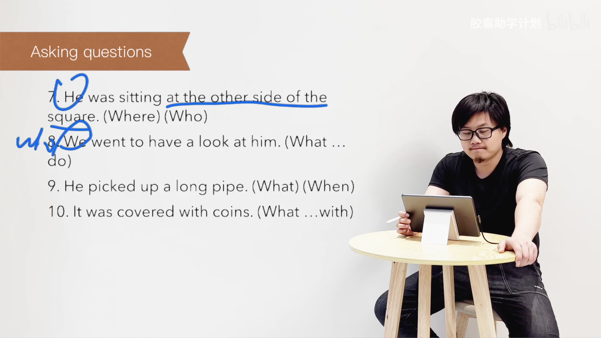

文字识别：Asking questions / square.(Where)(Who) / WgWwent to have aloo at him. (What … / do) / 9. He picked up a long pipe. (What) (When) / 10. It was covered with coins.(What ...with)

### 画面 00:04:15

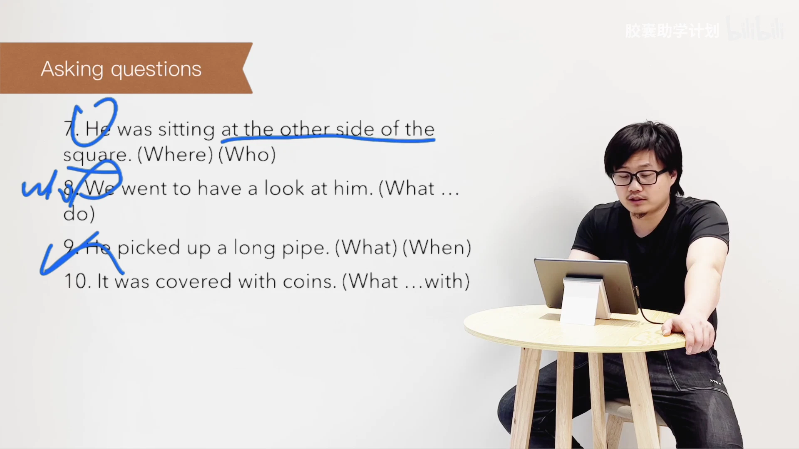

文字识别：Asking questions / square.(Where)(Who) / do) / VA picked up a long pipe (What) (Wwhen) / 10. It Was covered with coins.(What ...with)

### 画面 00:04:17

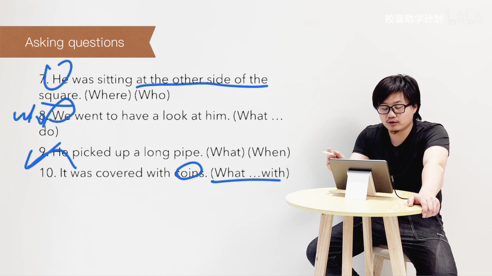

文字识别：Asking /  questions / square. (Where)(Who) / do) / L9A picked up along pipe.(What) (When) / 10. It Was covered with / (What ...with) / oin

## 00:04:30–00:05:00

Did提前, what对one of the baskets提问,对吧? What did he open? He began to play a tune. Did提前,啊what对a tune提问就行了。好, tell the story啊,文章你要读的很熟,要流利,不能不能太慢,对吧?然后呢,准确度可以下降一点点,没问题啊。注意啊,这个不是我们在国内考试的思路,这个是我们应用的思路。我们在去应用的时候可以错一点点,没

### 画面 00:04:31

文字识别：Asking questions / square. (Where) (Who) / do) / LA picked up along pipe.(What) (when) / 10.It Was covered with / (What ..with) / 11. He opened one of the baskets. (What)

### 画面 00:04:35

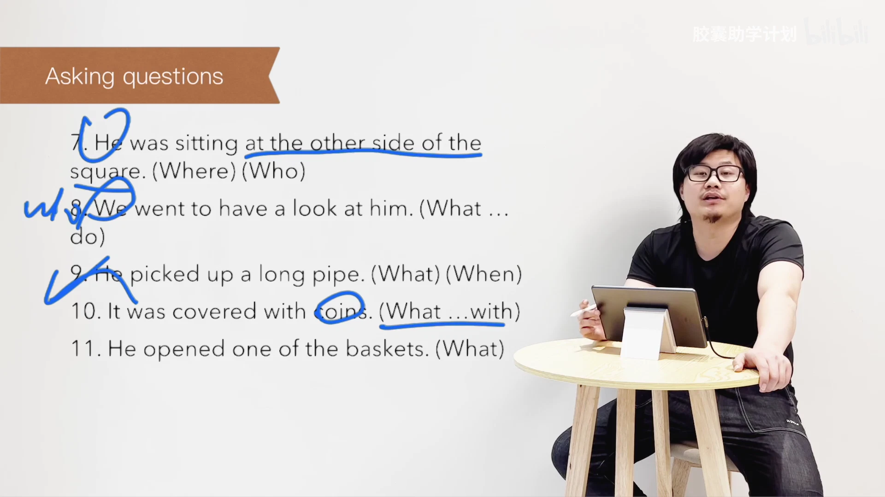

文字识别：Asking questions / square. (Where) (Who) / do) / L9A picked up along pipe.(What) (when) / 10. It Was covered with / (What ..with) / 11. He opened one of the baskets.(What)

### 画面 00:04:43

文字识别：Tell the story / 训练目标： / 口语复述能力 / Accuracy / Fluency

### 画面 00:04:46

文字识别：Tell the story / 训练目标： / 口语复述能力 / Accuracy / Fluency

### 画面 00:04:50

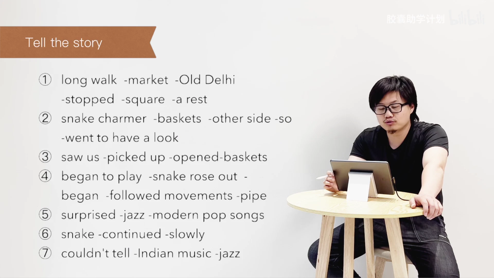

文字识别：Tell the story / ① long walk -market -Old Delhi / -stopped -square -a rest / snake charmer -baskets -other side -so / -went to have a look / saw us -picked up -opened-baskets / began to play -snake rose out - / began -followed movements -pipe / surprised -jazz -modern pop songs / ) snake -continued -slowly / 6 / ) couldn't tell -Indian music -jazz / 7

### 画面 00:04:54

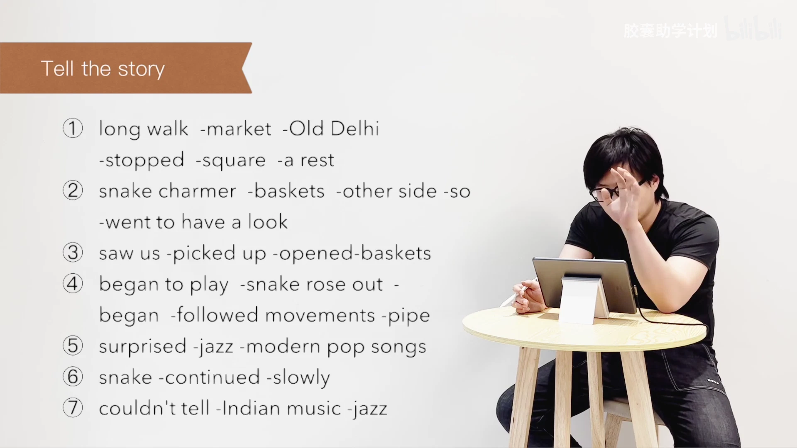

文字识别：Tell the story / ① long walk -market -Old Delhi / -stopped -square -a rest / snake charmer -baskets -other side -so / -went to have a look / saw us -picked up -opened-baskets / began to play -snake rose out - / began -followed movements -pipe / surprised -jazz -modern pop songs / 5 / ) snake -continued -slowly / 6 /  couldn't tell -Indian music -jazz / 7

## 00:05:00–00:05:30

有人会给你扣分，别人能懂就行，对吧？那你考试的时候错一点点就真的错了，对吧？呃，摘要写作，各位写完来这儿对答案，是吧？写作尽量是还是准确性要求高一点啊。然后完全自由的对话，我们看三道题就结束了。第一个叫 Many people are afraid of snakes. Why do you think this is so? What about you? 很多人恐惧蛇，你为你认为为什么是这样的？你呢？OK。

### 画面 00:05:05

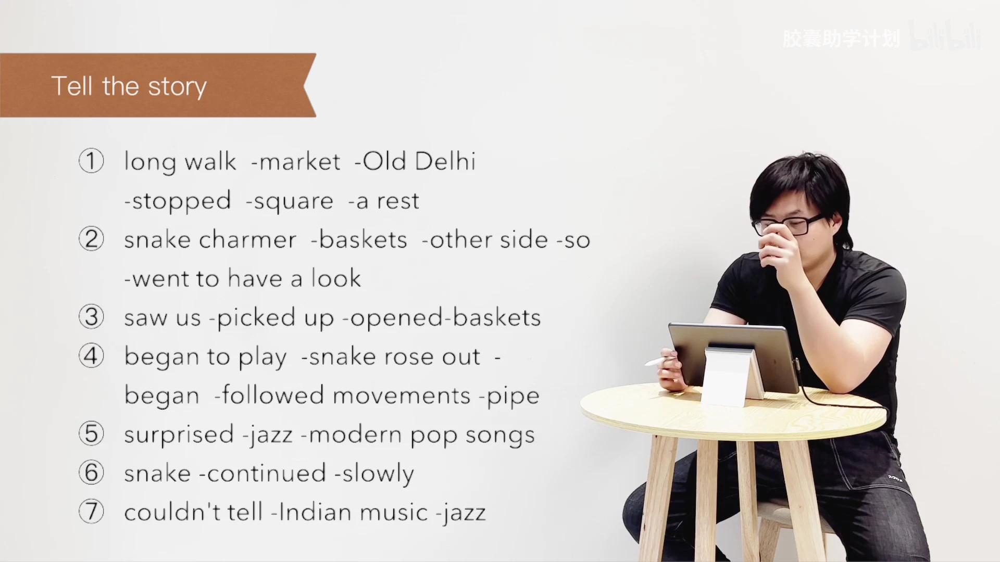

文字识别：Tell the story / ① long walk -market -Old Delhi / -stopped -square -a rest / snake charmer -baskets -other side -so / -went to have a look / saw us -picked up -opened-baskets / began to play -snake rose out - / began -followed movements -pipe / surprised -jazz -modern pop songs / 5 /  snake -continued -slowly / 6 / ) couldn't tell-Indian music -jazz / 7

### 画面 00:05:07

文字识别：Summary writing: Key / 训练目标： / 写作复述能力

### 画面 00:05:09

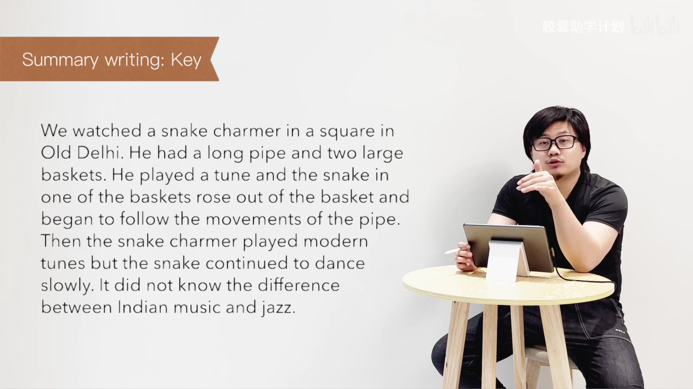

文字识别：Summary writing: Key / We watched a snake charmer in a square in / Old Delhi. He had a long pipe and two large / baskets. He played a tune and the snake in / one of the baskets rose out of the basket and / began to follow the movements of the pipe. / Then the snake charmer played modern / tunes but the snake continued to dance / slowly. It did not know the difference / between Indian music and jazz.

### 画面 00:05:14

文字识别：Topics for discussion / 训练目标： / 完全自由的对话 / Accuracy / Fluency

### 画面 00:05:16

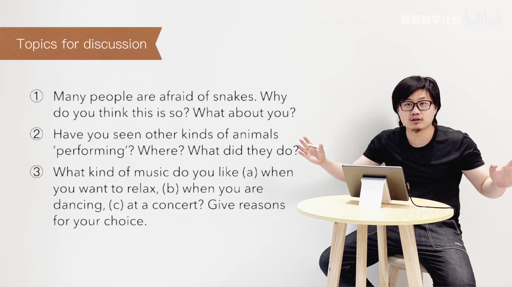

文字识别：Topics for discussion / Many people are afraid of snakes. Why / do you think this is so? What about you? / Have you seen other kinds of animals / 'performing'? Where? What did they do? / What kind of music do you like (a) when / 3 / you want to relax, (b) when you are / dancing, (c) at a concert? Give reasons / for your choice.

## 00:05:30–00:06:00

第二题说，Have you seen other kinds of animals performing? Where, what, what did they do? 你看过其他的动物 performing 是吧？就是啊，这个咱们十三课学过嘛， give a performance 对吧？就是演出吗？在哪里啊？比如什么泰国的大象，哪里的猴子等等，是他们做了什么事情？ What kind of music do you like? 你喜欢什么样的音乐？第一种情况，When you want to relax，当你想休息的时候啊，呃，比如说 reggae 是吧？他说，

### 画面 00:05:46

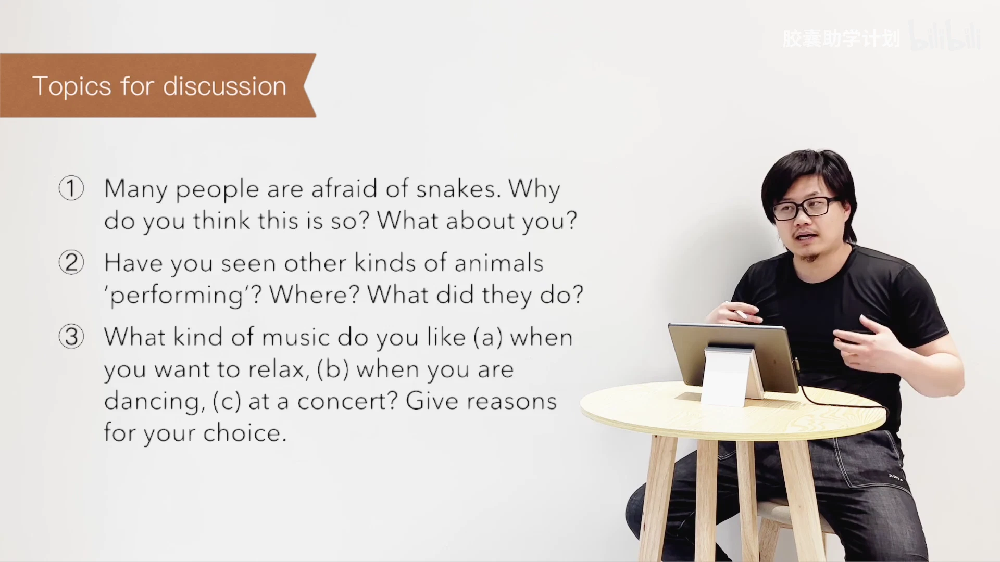

文字识别：Topics for discussion / Many people are afraid of snakes. Why / do you think this is so? What about you? / Have you seen other kinds of animals / 'performing'? Where? What did they do? / What kind of music do you like (a) when / 3 / you want to relax, (b) when you are / dancing, (c) at a concert? Give reasons / for your choice.

## 00:06:00–00:06:30

说 When you are dancing，当你想跳舞的时候，电音是吧？Or at a concert，莫扎特是吧？或者说在音乐会上，你想你喜欢听什么样的音乐？Give reasons for your choice，把你的选择给一些原因，好不好？Okay，呃，那我们看一下家庭作业。Ask Smith，先写再朗读。摘要写作，先写再给答案。Tell the story，口语复述专栏当中都可以找得到，好吧？那以上就是本期视频的全部内容了。如果

### 画面 00:06:16

### 画面 00:06:18

文字识别：1.Ask me if写&朗读

### 画面 00:06:20

文字识别：1.Ask me if写&朗读 / 2. / 摘要写作写&答案

### 画面 00:06:22

文字识别：1.Ask me if写&朗读 / 摘要写作写&答案 / 3.Tell the story 口语复述

### 画面 00:06:24

文字识别：1.Ask me if写&朗读 / 摘要写作写&答案 / 3.Tell the story 口语复述 / 专栏 / 4.

### 画面 00:06:26

## 00:06:30–00:06:49

喜欢我们的课程呢，欢迎各位关注、订阅、一键三连，分享给那些需要的朋友。See you next time.

### 画面 00:06:36

文字识别：🙌

### 画面 00:06:38

文字识别：CAPSULEACADEMY / 胶囊助学计划 / 小红书 / Lecturer / Leo / OE

### 画面 00:06:41

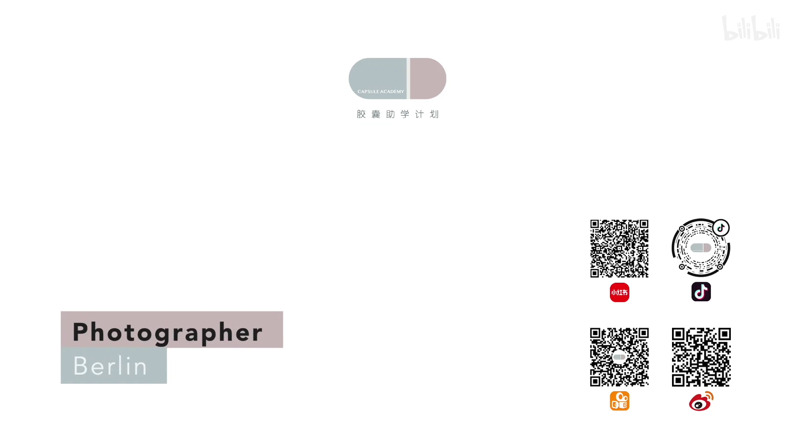

文字识别：CAPSULEACADEMY / 胶囊助学计划 / 『 / 小红书 / Photographer / □ / Berlin / OE

### 画面 00:06:43

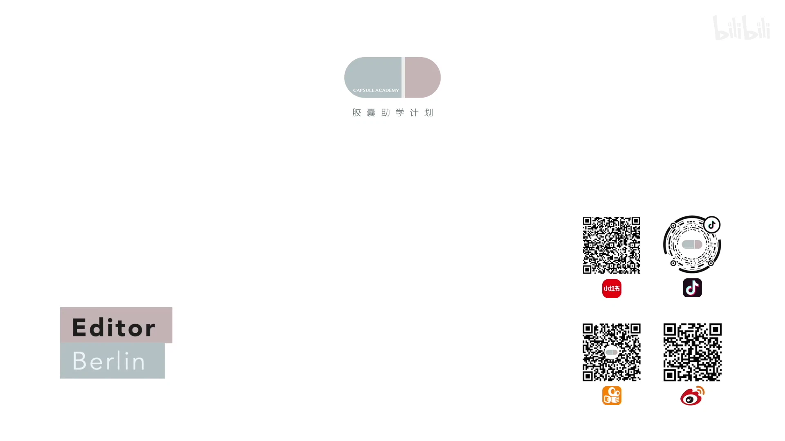

文字识别：CAPSULEACADEMY / 胶囊助学计划 / 『 / 小红书 / Editor / Berlin

### 画面 00:06:46

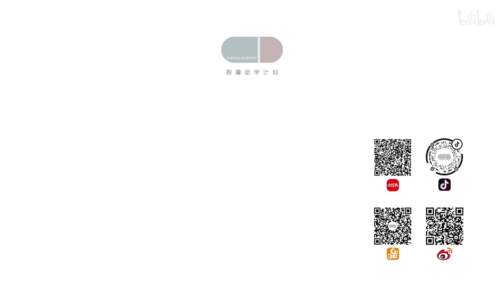

文字识别：CAPSULEACADEMY / 胶囊助学计划 / 小红书

### 画面 00:06:48

文字识别：bilibili / 胶囊助学计划

