# L043 单词

快速机器解析：语音为单模型转写，未进行独立交叉校对或人工复核；画面每秒采样并按变化选帧，短时文字和标记可能遗漏。截图时间约有 1 秒误差。图片有损压缩；遇到疑点请按时间查看 Google Drive 原视频。

## 00:00:00–00:00:30

Hello, everyone. Welcome to Capsule Academy. This is Leo. Today, we're going to learn New Concept English Book Two, Lesson Forty Three Words. Now, old习惯进入正式课程之前，我们先看几个问题。好，首先，如何去表达赶飞机啊？接下来呢，如何表达遇到严重的问题？最后一个问题叫做如何表达在某一个时间？OK。那带着这三个问题，Hope you gonna enjoy.

### 画面 00:00:00

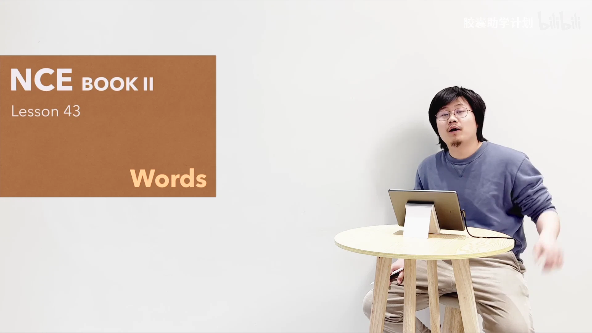

文字识别：NCE / BOOK"I / Lesson 43 / Words

### 画面 00:00:05

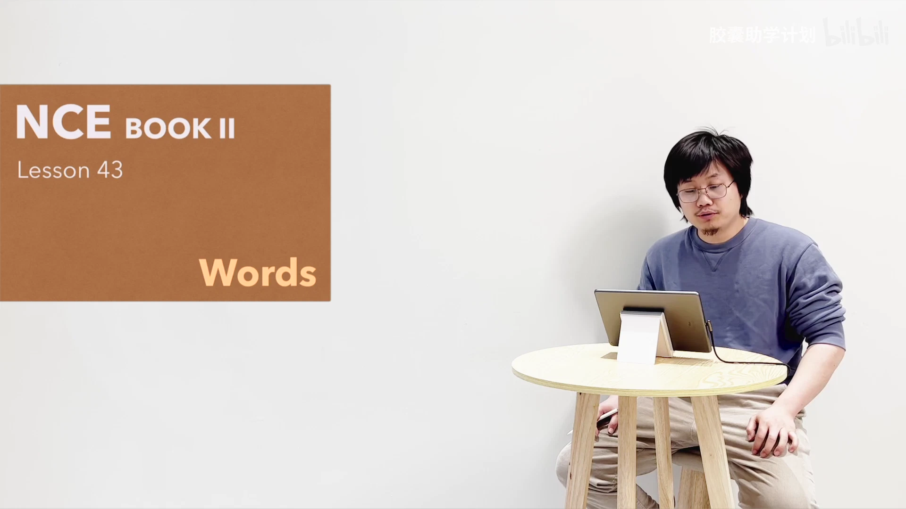

文字识别：NCE / BOOK"I / Lesson 43 / Words

### 画面 00:00:11

### 画面 00:00:13

文字识别：①如何表达“赶飞机”？

### 画面 00:00:16

文字识别：①如何表达“赶飞机”？ / 如何表达“遇到严重问题”？

### 画面 00:00:18

文字识别：①如何表达“赶飞机”？ / 如何表达“遇到严重问题”?

### 画面 00:00:20

文字识别：①如何表达“赶飞机”？ / 如何表达“遇到严重问题” / 在某一时间”?

### 画面 00:00:22

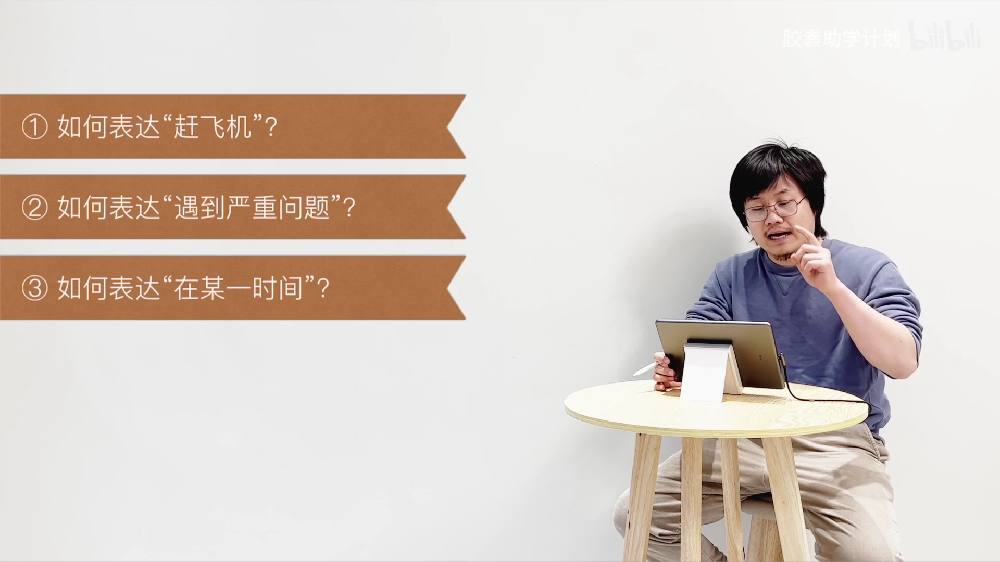

文字识别：①如何表达“赶飞机”？ / 如何表达“遇到严重问题” / 如何表达“在某一时间”

### 画面 00:00:25

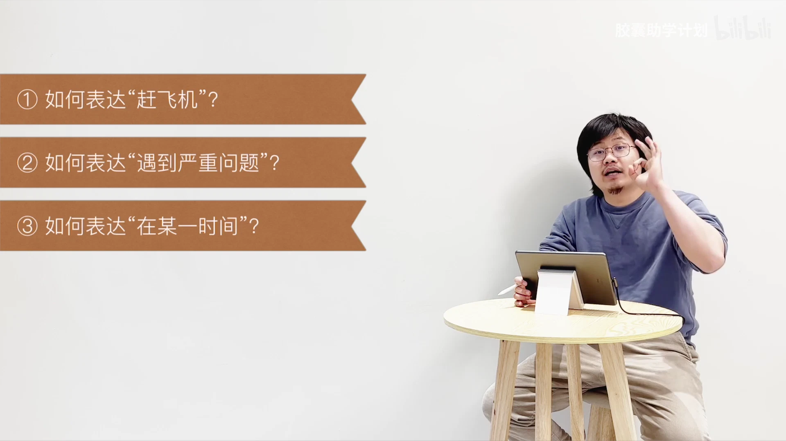

文字识别：①如何表达“赶飞机”？ / 如何表达“遇到严重问题” / 如何表达“在某一时间”

### 画面 00:00:28

文字识别：胶囊助学计划bll / •

## 00:00:30–00:01:00

那我们先看第一个单词啊，pole，对吧？一起发一下音，叫做 pole，pole。OK，那各位不知道还记不记得我们曾经从一册当中就学过的自然拼读法则，对吧？你实际上如果会读了 pole，它的发音，那实际上它的拼写当中的 p 跟 l 这两个字母就出来了。OK，如果刚才我说的这些您没有什么明显的概念，那我的个人建议是第

### 画面 00:00:31

文字识别：胶囊助学计划 / 胶囊助学计划

### 画面 00:00:33

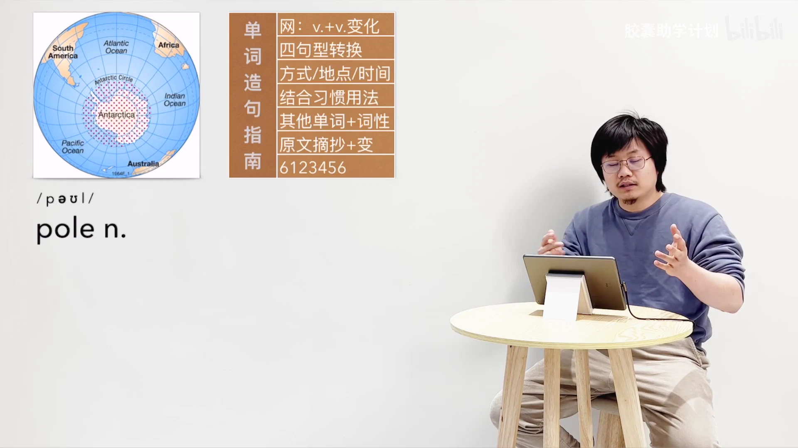

文字识别：单词造句指南 / 网：v.+v.变化 / South / Atlantic / Ocean / Africa / 四句型转换 / America / 方式/地点/时间 / Indian / 结合习惯用法 / Ocean / Antarctica / 其他单词+词性 / Pacific / 原文摘抄+变 / Ocean / Australia / 6123456 / 1964E / /paul/ / pole n.

### 画面 00:00:35

文字识别：单词造句指南 / 网：v.+v.变化 / South / Atlantic / Ocean / Africa / 四句型转换 / America / 方式/地点/时间 / Circle / Antarctic / 结合习惯用法 / Indian / Ocean / Antarctica / 其他单词+词性 / Pacific / 原文摘抄+变 / Ocean / Australia / 6123456 / 1964E / /paul/ / pole n.

### 画面 00:00:40

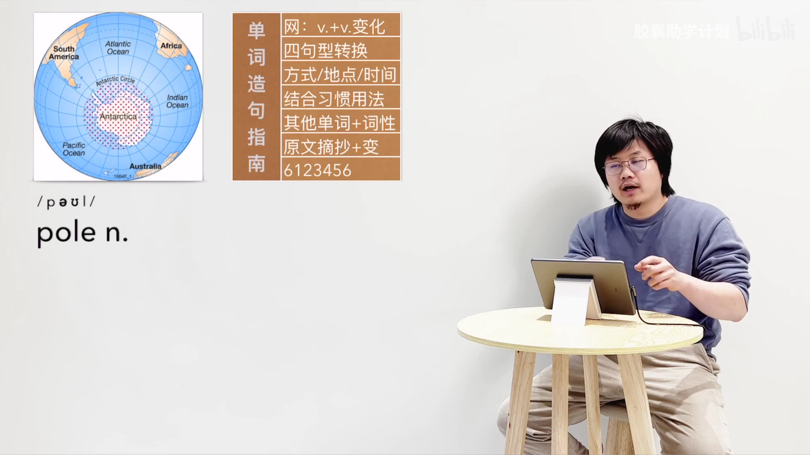

文字识别：单词造句指南 / 网：v.+v.变化 / South / Atlantic / Ocean / Africa / 四句型转换 / America / 方式/地点/时间 / Circle / Antarctic / 结合习惯用法 / Indian / Ocean / Antarctica / 其他单词+词性 / Pacific / 原文摘抄+变 / Ocean / Australia / 6123456 / 1964E / /paul/ / pole n.

### 画面 00:00:53

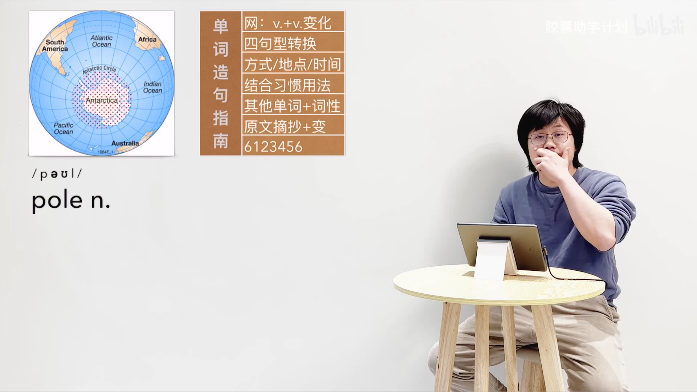

文字识别：单词造句指南 / 网：v.+v.变化 / South / Atlantic / Ocean / Africa / 四句型转换 / America / 方式/地点/时间 / Indian / 结合习惯用法 / Ocean / Antarctica / 其他单词+词性 / Pacific / 原文摘抄+变 / Ocean / Australia / 6123456 / 1964E / /paul/ / pole n.

### 画面 00:00:55

文字识别：单词造句指南 / 网：v.+v.变化 / South / Atlantic / Ocean / Africa / 四句型转换 / America / 方式/地点/时间 / Circle / Antarctic / 结合习惯用法 / Indian / Ocean / Antarctica / 其他单词+词性 / Pacific / 原文摘抄+变 / Ocean / Australia / 6123456 / 1964E / /paul/ / pole n.

## 00:01:00–00:01:30

一去看一下我们录制的自然拼读法则的视频和音标的视频，当然花一点时间把这两个知识点给它补上，对吧？这是我们学单词的时候非常重要的一个点。那pole这个单词，其实我们不单独啊，也可以单独用它，对吧？但是在本课当中，我们出现的实际上叫做the South Pole and North Pole。OK，那South Pole pole其实就是极啊，极点。那呃，不是那个时间的点啊，是那个极啊，

### 画面 00:01:03

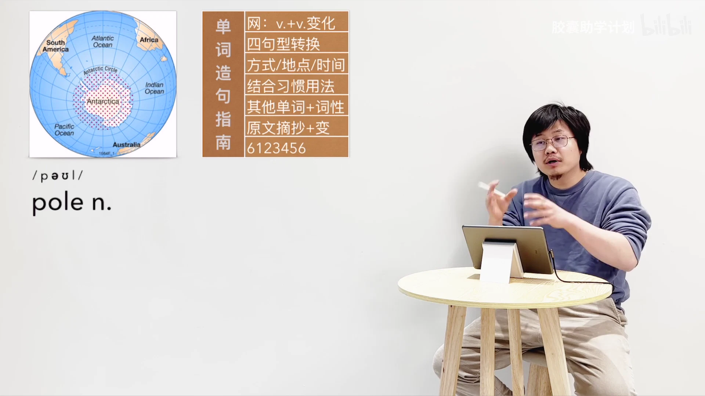

文字识别：单词造句指南 / 网：v.+v.变化 / South / Atlantic / Ocean / Africa / 四句型转换 / America / 方式/地点/时间 / Circle / Antarctic / 结合习惯用法 / Indian / Ocean / Antarctica / 其他单词+词性 / Pacific / 原文摘抄+变 / Ocean / Australia / 6123456 / 1964E / /paul/ / pole n.

### 画面 00:01:05

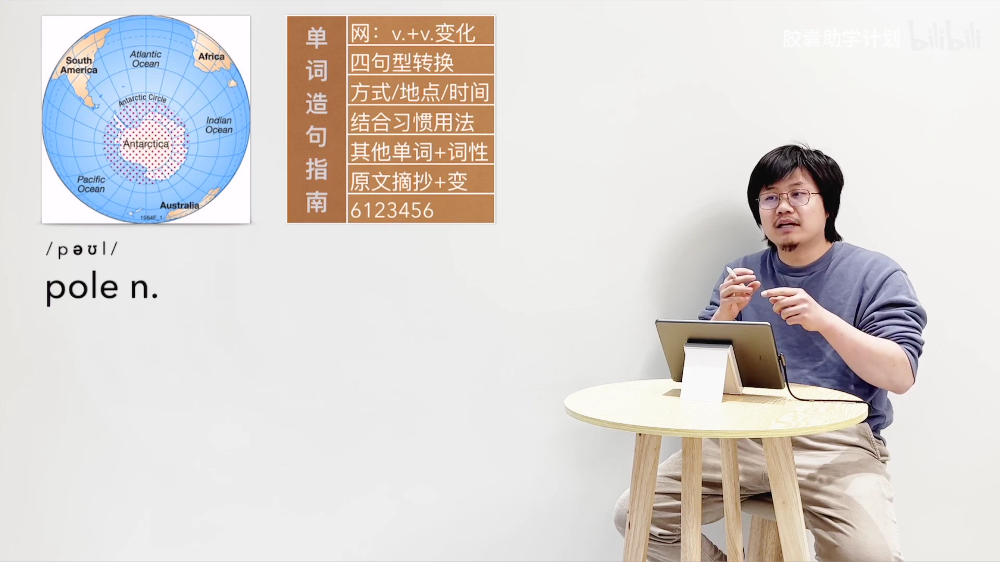

文字识别：单词造句指南 / 网：v.+v.变化 / South / Atlantic / Ocean / Africa / 四句型转换 / America / 方式/地点/时间 / Circle / Antarctic / 结合习惯用法 / Indian / Ocean / Antarctica / 其他单词+词性 / Pacific / 原文摘抄+变 / Ocean / Australia / 6123456 / 1964E / /paul/ / pole n.

### 画面 00:01:10

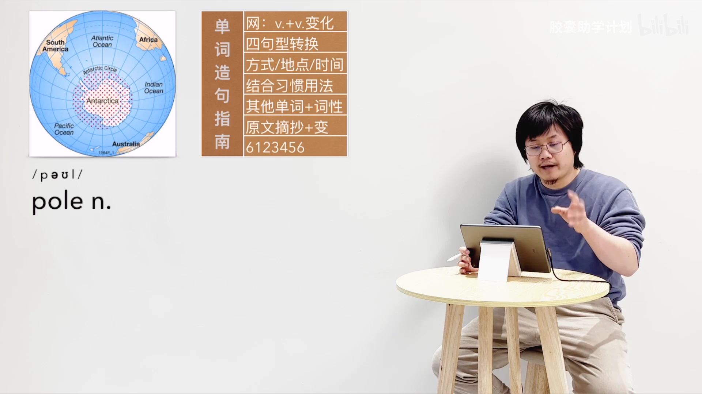

文字识别：单词造句指南 / 网：v.+v.变化 / South / Atlantic / Ocean / Africa / 四句型转换 / America / 方式/地点/时间 / Circle / Antarctic / 结合习惯用法 / Indian / Ocean / Antarctica / 其他单词+词性 / Pacific / 原文摘抄+变 / Ocean / Australia / 6123456 / 1964F / /paul/ / pole n.

### 画面 00:01:15

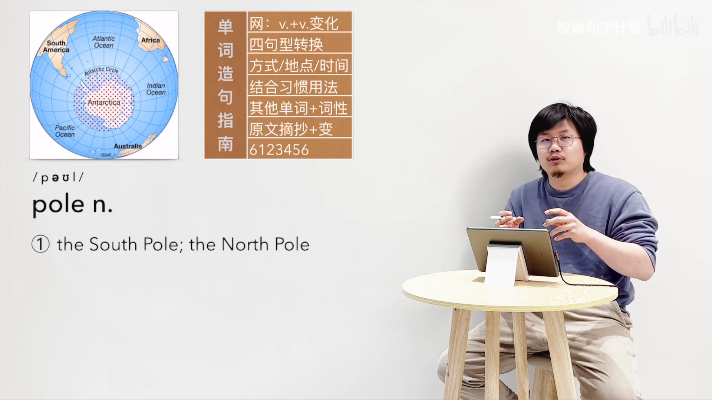

文字识别：单词造句指南 / 网：v.+v.变化 / South / Atlantic / Ocean / Africa / 四句型转换 / America / 方式/地点/时间 / Circle / Antarctic / Indian / 结合习惯用法 / Ocean / Antarctica / 其他单词+词性 / Pacific / 原文摘抄+变 / Ocean / Australia / 6123456 / 1964E / /paul/ / pole n. / ① the South Pole; the North Pole

### 画面 00:01:25

文字识别：单词造句指南 / 网：v.+v.变化 / South / Atlantic / Ocean / Africa / 四句型转换 / America / 方式/地点/时间 / Indian / 结合习惯用法 / Ocean / Antarctica / 其他单词+词性 / Pacific / 原文摘抄+变 / Ocean / Australia / 6123456 / 1964F / /paul/ / pole n. / ① the South Pole; the North Pole

## 00:01:30–00:02:00

南极、北极的极。那 South Pole 南极，North Pole 北极，对吧？OK，玩一个。那我们拿它去造句。我直接带着各位回顾两个，实际上非常常用，但是各位非常容易弄混。这是我们新概念实际上一册八十五课学过，当然新概念二册第一个单元我们也见过，叫 They have been to the South Pole 和 They have gone to the South Pole。不知道各位还记不记得啊？能不能分清 Have been to 以

### 画面 00:01:30

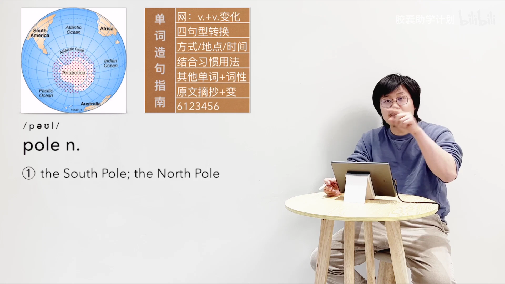

文字识别：单词造句指南 / 网：v.+v.变化 / South / Atlantic / Ocean / Africa / 四句型转换 / America / 方式/地点/时间 / Indian / 结合习惯用法 / Ocean / Antarctica / 其他单词+词性 / Pacific / 原文摘抄+变 / Ocean / Australia / 6123456 / 1964F / /paul/ / pole n. / ① the South Pole; the North Pole

### 画面 00:01:35

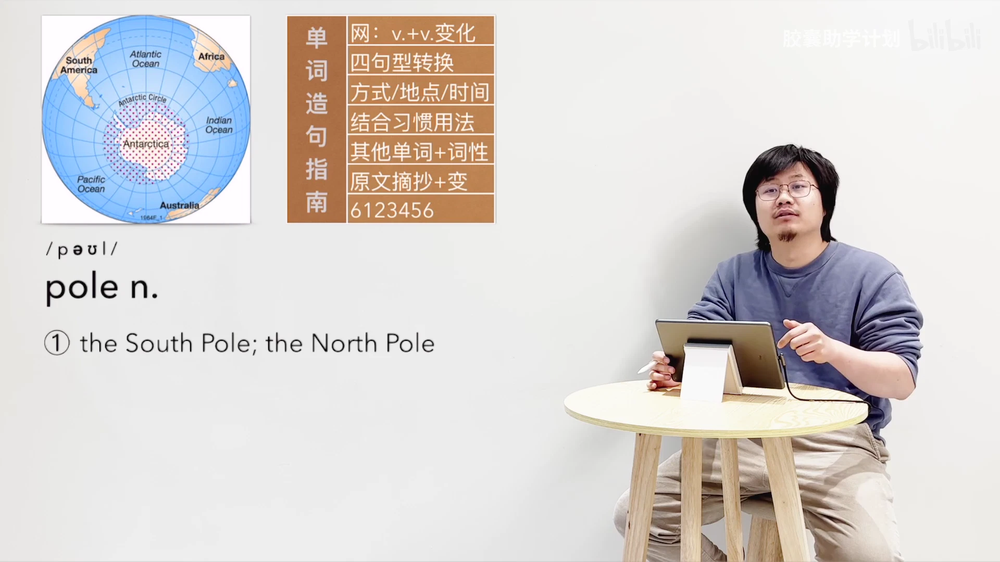

文字识别：单词造句指南 / 网：v.+v.变化 / South / Atlantic / Ocean / Africa / 四句型转换 / America / 方式/地点/时间 / Indian / 结合习惯用法 / Ocean / Antarctica / 其他单词+词性 / Pacific / 原文摘抄+变 / Ocean / Australia / 6123456 / 1964F / /paul/ / pole n. / ① the South Pole; the North Pole

### 画面 00:01:39

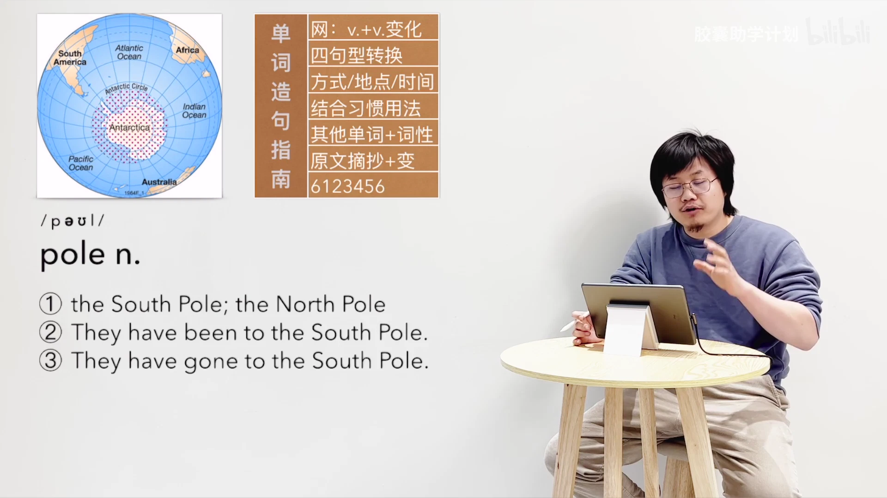

文字识别：单词造句指南 / 网：v.+v.变化 / South / Atlantic / Ocean / Africa / 四句型转换 / America / 方式/地点/时间 / Indian / 结合习惯用法 / Ocean / Antarctica / 其他单词+词性 / Pacific / 原文摘抄+变 / Ocean / Australia / 6123456 / 1964E1 / /paul/ / pole n. / ① the South Pole; the North Pole / They have been to the South Pole. / 2 / They have gone to the South Pole. / 3

### 画面 00:01:41

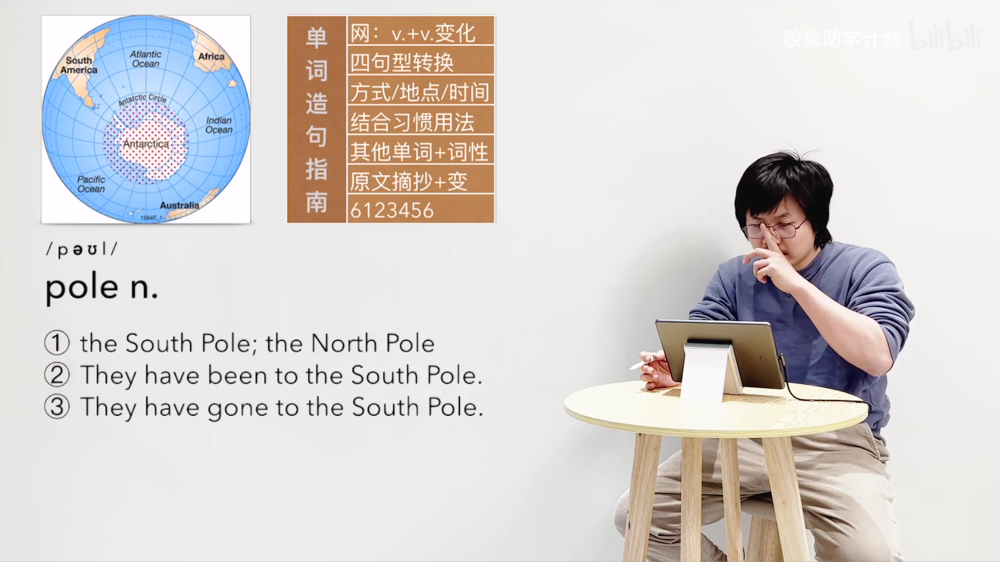

文字识别：单词造句指南 / 网：v.+v.变化 / South / Atlantic / Ocean / Africa / 四句型转换 / America / 方式/地点/时间 / Indian / 结合习惯用法 / Ocean / Antarctica / 其他单词+词性 / Pacific / 原文摘抄+变 / Ocean / Australia / 6123456 / 1964E / /paul/ / pole n. / ① the South Pole; the North Pole / They have been to the South Pole. / 2 / They have gone to the South Pole.

### 画面 00:01:45

文字识别：单词造句指南 / 网：v.+v.变化 / South / Atlantic / Ocean / Africa / 四句型转换 / America / 方式/地点/时间 / Indian / 结合习惯用法 / Ocean / Antarctica / 其他单词+词性 / Pacific / 原文摘抄+变 / Ocean / Australia / 6123456 / 1964E1 / /paul/ / pole n. / ① the South Pole; the North Pole / They have been to the South Pole. / 2 / They have gone to the South Pole.

### 画面 00:01:50

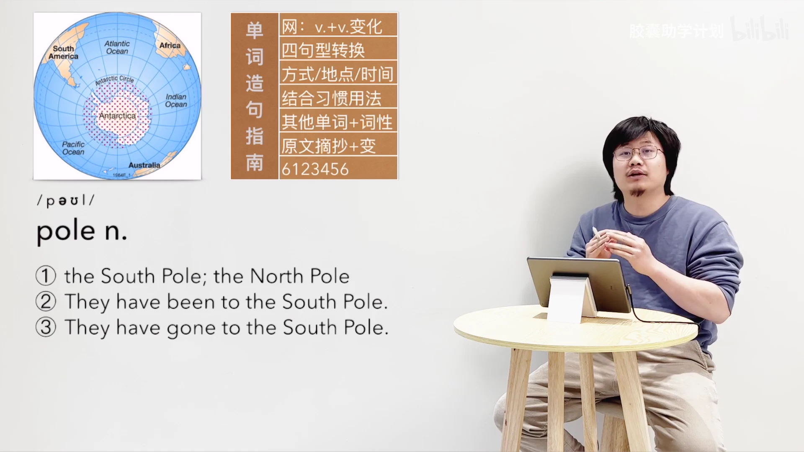

文字识别：单词造句指南 / 网：v.+v.变化 / South / Atlantic / Ocean / Africa / 四句型转换 / America / 方式/地点/时间 / Indian / 结合习惯用法 / Ocean / Antarctica / 其他单词+词性 / Pacific / 原文摘抄+变 / Ocean / Australia / 6123456 / 1964E / /paul/ / pole n. / ① the South Pole; the North Pole / They have been to the South Pole. / They have gone to the South Pole.

## 00:02:00–00:02:30

及 have gone to 的区别。 Okay, continue. Say if I moved to the South Pole, I could see the penguins every day. Okay, 那注意这是我们第四十课学的虚拟语气，对吧？那我们把一些关键的单词给它标出来，比如说 if 和后边的 moved，对吧？动词过去式和 could 加 do 这些结构出现的时候，就提醒了我们，它叫做一般啊，它叫做呃与现

### 画面 00:02:00

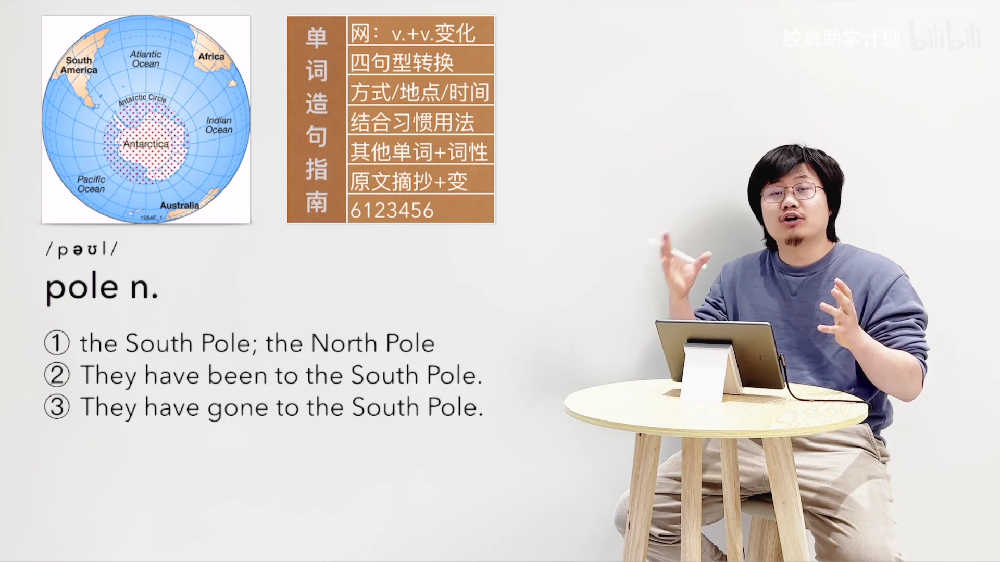

文字识别：单词造句指南 / 网：v.+v.变化 / South / Atlantic / Ocean / Africa / 四句型转换 / America / 方式/地点/时间 / Indian / 结合习惯用法 / Ocean / Antarctica / 其他单词+词性 / Pacific / 原文摘抄+变 / Ocean / Australia / 6123456 / 1964F / /paul/ / pole n. / ① the South Pole; the North Pole / They have been to the South Pole. / They have gone to the South Pole.

### 画面 00:02:03

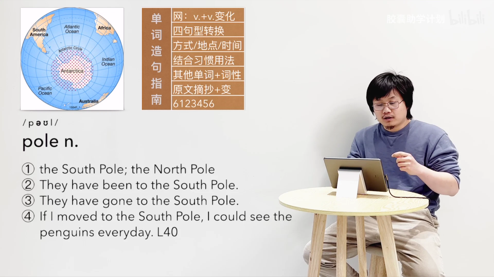

文字识别：单词造句指南 / 网：v.+v.变化 / South / Atlantic / Ocean / Africa / 四句型转换 / America / 方式/地点/时间 / Indian / 结合习惯用法 / Ocean / Antarctica / 其他单词+词性 / Pacific / 原文摘抄+变 / Ocean / Australia / 6123456 / 1964E / /paul/ / pole n. / ① the South Pole; the North Pole / They have been to the South Pole. / They have gone to the South Pole. / 3 / If I moved to the South Pole, I could see the / penguins everyday. L40

### 画面 00:02:05

文字识别：单词造句指南 / 网：v.+v.变化 / South / Atlantic / Ocean / Africa / 四句型转换 / America / 方式/地点/时间 / Indian / 结合习惯用法 / Ocean / Antarctica / 其他单词+词性 / Pacific / 原文摘抄+变 / Ocean / Australia / 6123456 / 1964E_1 / /paul/ / pole n. / ① the South Pole; the North Pole / They have been to the South Pole. / They have gone to the South Pole. / 3 / If I moved to the South Pole, I could see the / penguins everyday. L40

### 画面 00:02:10

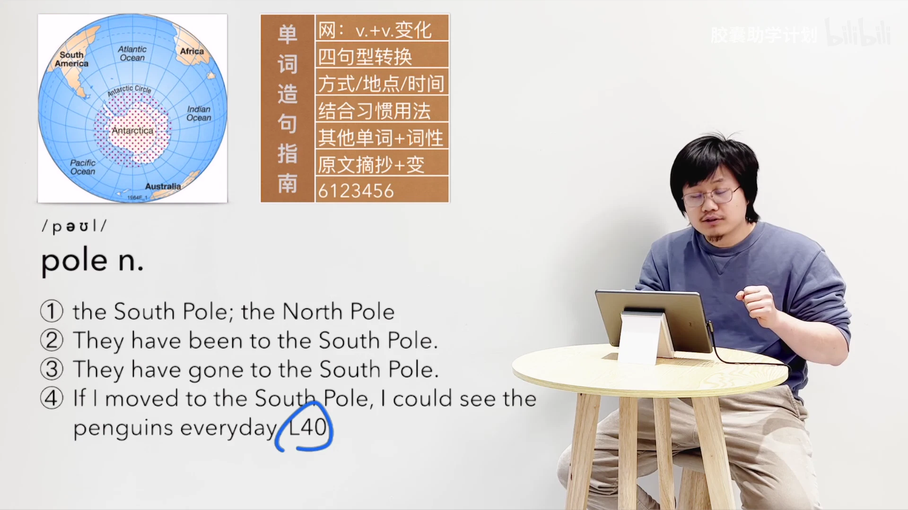

文字识别：单词造句指南 / 网：v.+v.变化 / South / Atlantic / Ocean / Africa / 四句型转换 / America / 方式/地点/时间 / Indian / 结合习惯用法 / Ocean / Antarctica / 其他单词+词性 / Pacific / 原文摘抄+变 / Ocean / Australia / 6123456 / 1964E_1 / /paul/ / pole n. / ① the South Pole; the North Pole / They have been to the South Pole. / They have gone to the South Pole. / 3 / If I moved to the South Pole, I could see the / penguins everyday L40

### 画面 00:02:14

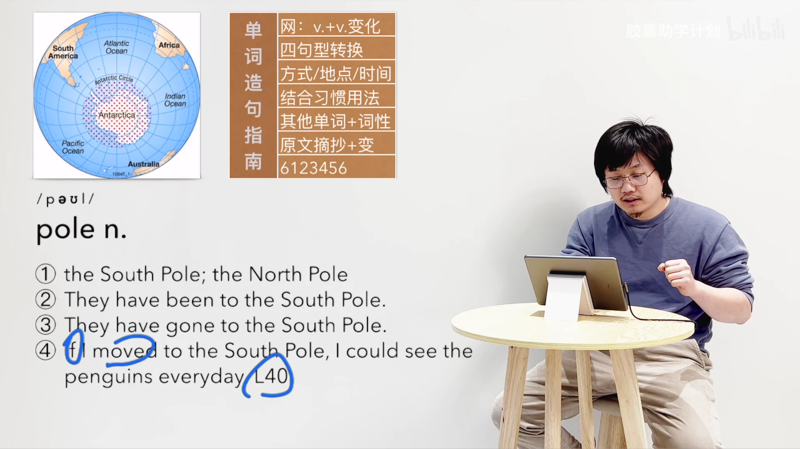

文字识别：单词造句指南 / 网：v.+v.变化 / South / Atlantic / Ocean / Africa / 四句型转换 / America / 方式/地点/时间 / Indian / 结合习惯用法 / Ocean / Antarctica / 其他单词+词性 / Pacific / 原文摘抄+变 / Ocean / Australia / 6123456 / 1964E1 / /paul/ / pole n. / ①t / the South Pole; the North Pole / They have been to the South Pole. / They have gone to the South Pole. / moved to the South Pole, I could see the / penguins everyday L40

### 画面 00:02:16

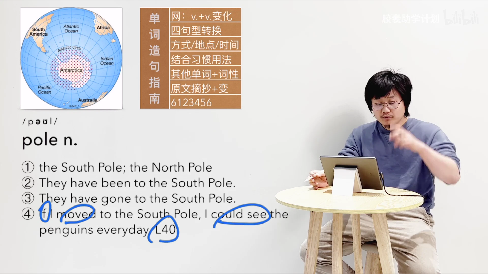

文字识别：单词造句指南 / 网：v.+v.变化 / South / Atlantic / Ocean / Africa / 四句型转换 / America / 方式/地点/时间 / Indian / 结合习惯用法 / Ocean / Antarctica / 其他单词+词性 / Pacific / 原文摘抄+变 / Ocean / Australia / 6123456 / 1964E1 / /paul/ / pole n. / ① / the South Pole; the North Pole / They have been to the South Pole. / They have gone to the South Pole. / novedto the South Pole, I could see the / penguins everyday L40

### 画面 00:02:20

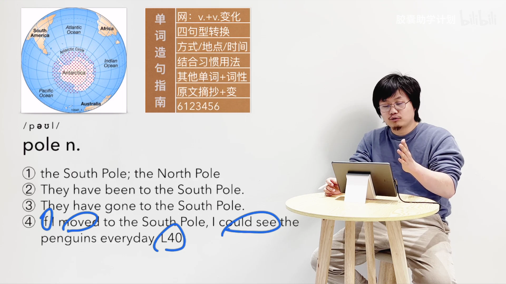

文字识别：单词造句指南 / 网：v.+v.变化 / South / Atlantic / Ocean / Africa / 四句型转换 / America / 方式/地点/时间 / Indian / 结合习惯用法 / Ocean / Antarctica / 其他单词+词性 / Pacific / 原文摘抄+变 / Ocean / Australia / 6123456 / 1964E1 / /paul/ / pole n. / ① t / the South Pole; the North Pole / They have been to the South Pole. / They have gone to the South Pole. / noved to the South Pole, I could see the / penguins everyday L40

## 00:02:30–00:03:00

在事实相反的，叫做情这个虚拟语气，对吧？那它的两个用法叫做，要么呃与现在事实相反，要么说话说话人啊主观人认为叫做这件事情发生情况几率极低。那我们先翻一下这句话的字面意思，叫如果我搬去了南极，那我就能每天看企鹅了。那你想一下，当我说这句话的时候，大部分人可能会认为这句话实际上是虚拟语气，对吧？就是我能我认为我能搬去南

### 画面 00:02:45

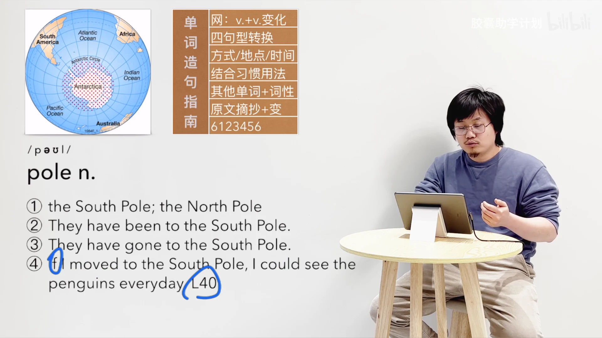

文字识别：单词造句指南 / 网：v.+v.变化 / South / Atlantic / Ocean / Africa / 四句型转换 / America / 方式/地点/时间 / Indian / 结合习惯用法 / Ocean / Antarctica / 其他单词+词性 / Pacific / 原文摘抄+变 / Ocean / Australia / 6123456 / 1964E / /paul/ / pole n. / ① the South Pole; the North Pole / They have been to the South Pole. / They have gone to the South Pole. / moved to the South Pole, I could see the / penguins everydayL40

### 画面 00:02:47

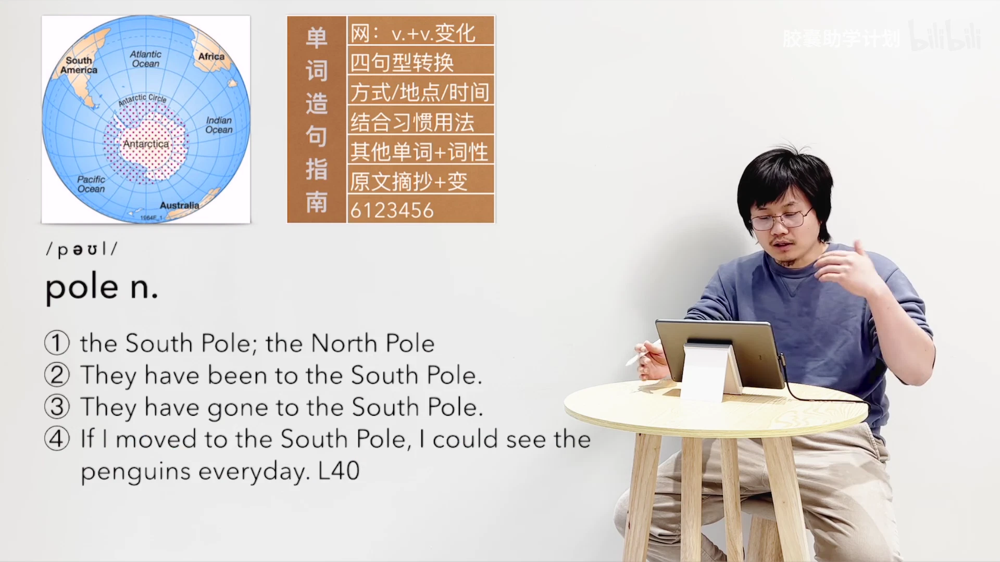

文字识别：单词造句指南 / 网：v.+v.变化 / South / Atlantic / Ocean / Africa / 四句型转换 / America / 方式/地点/时间 / Indian / 结合习惯用法 / Ocean / Antarctica / 其他单词+词性 / Pacific / 原文摘抄+变 / Ocean / Australia / 6123456 / 1964E1 / /paul/ / pole n. / ① the South Pole; the North Pole / They have been to the South Pole. / They have gone to the South Pole. / 3 / If I moved to the South Pole, I could see the / penguins everyday. L40

### 画面 00:02:51

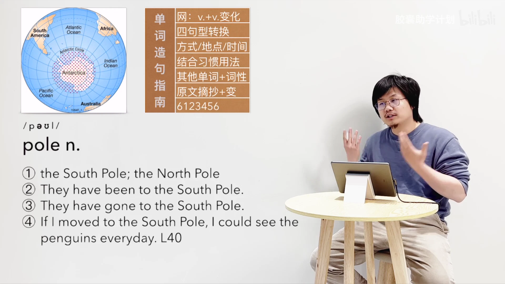

文字识别：单词造句指南 / 网：v.+v.变化 / South / Atlantic / Ocean / Africa / 四句型转换 / America / 方式/地点/时间 / Indian / 结合习惯用法 / Ocean / Antarctica / 其他单词+词性 / Pacific / 原文摘抄+变 / Ocean / Australia / 6123456 / 1964E1 / /paul/ / pole n. / ① the South Pole; the North Pole / They have been to the South Pole. / They have gone to the South Pole. / 3 / If I moved to the South Pole, I could see the / penguins everyday. L40

### 画面 00:02:56

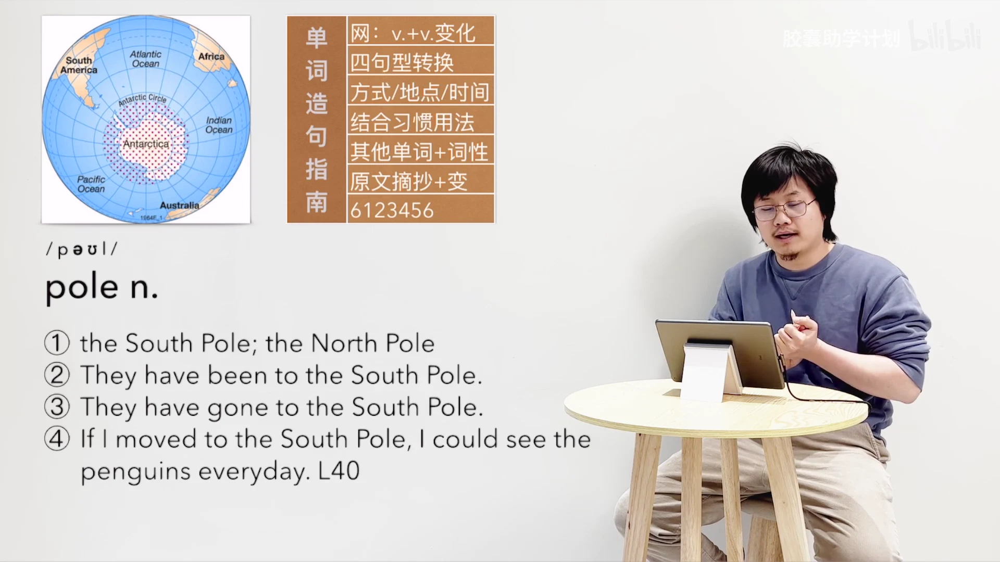

文字识别：单词造句指南 / 网：v.+v.变化 / South / Atlantic / Ocean / Africa / 四句型转换 / America / 方式/地点/时间 / Indian / 结合习惯用法 / Ocean / Antarctica / 其他单词+词性 / Pacific / 原文摘抄+变 / Ocean / Australia / 6123456 / 1864E.1 / /paul/ / pole n. / ① the South Pole; the North Pole / They have been to the South Pole. / They have gone to the South Pole. / 3 / If I moved to the South Pole, I could see the / penguins everyday. L40

## 00:03:00–00:03:30

极的可能性是非常低的啊！我们顺便又复习了一下之前的语法，对吧？Okay, very good.所以这个点呢，我们要注意一下啊！再重申一下，就是我们学习单词的时候，永远要尽可能的带着之前我们学过的单词、语法和习惯用法放到一起去复习。比如说，其实这个地方还有一个小的习惯用法，只是我没有重点强调它，叫 move to somewhere，叫搬到某地，对吧？Okay，下一个单词，跟我一

### 画面 00:03:00

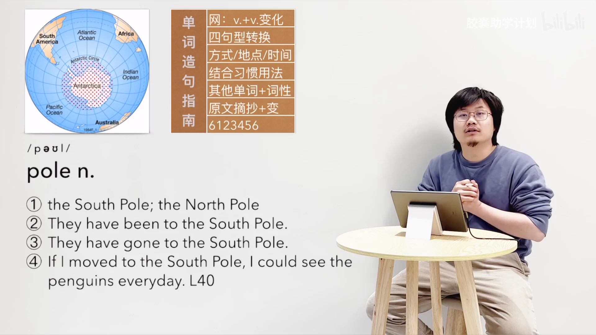

文字识别：单词造句指南 / 网：v.+v.变化 / South / Atlantic / Ocean / Africa / 四句型转换 / America / 方式/地点/时间 / Indian / 结合习惯用法 / Ocean / Antarctica / 其他单词+词性 / Pacific / 原文摘抄+变 / Ocean / Australia / 6123456 / 1864E1 / /paul/ / pole n. / ① the South Pole; the North Pole / They have been to the South Pole. / They have gone to the South Pole. / 3 / If I moved to the South Pole, I could see the / penguins everyday. L40

### 画面 00:03:05

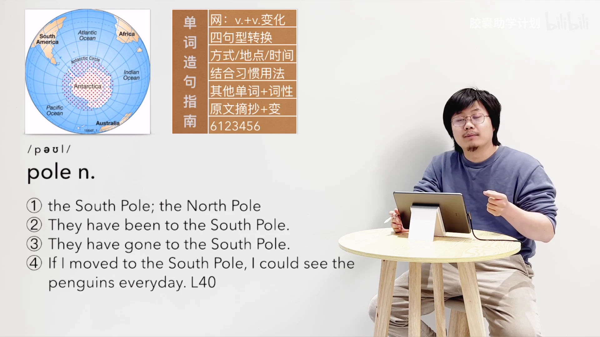

文字识别：单词造句指南 / 网：v.+v.变化 / South / Atlantic / Ocean / Africa / 四句型转换 / America / 方式/地点/时间 / Indian / 结合习惯用法 / Ocean / Antarctica / 其他单词+词性 / Pacific / 原文摘抄+变 / Ocean / Australia / 6123456 / 1964E / /paul/ / pole n. / ① the South Pole; the North Pole / They have been to the South Pole. / They have gone to the South Pole. / 3 / If I moved to the South Pole, I could see the / penguins everyday. L40

### 画面 00:03:10

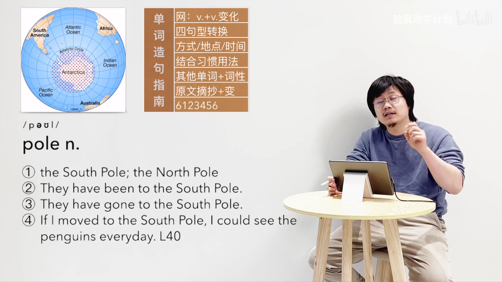

文字识别：单词造句指南 / 网：v.+v.变化 / South / Atlantic / Ocean / Africa / 四句型转换 / America / 方式/地点/时间 / Indian / 结合习惯用法 / Ocean / Antarctica / 其他单词+词性 / Pacific / 原文摘抄+变 / Ocean / Australia / 6123456 / 1964E1 / /paul/ / pole n. / ① the South Pole; the North Pole / They have been to the South Pole. / 2 / They have gone to the South Pole. / 3 / If I moved to the South Pole, I could see the / penguins everyday. L40

### 画面 00:03:20

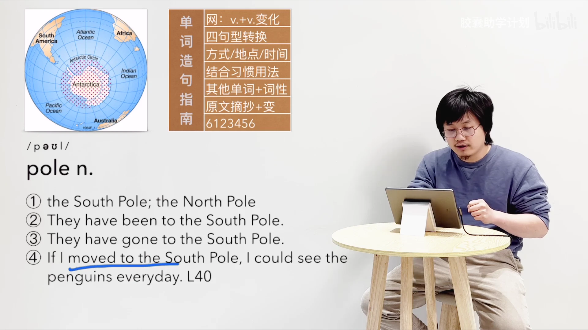

文字识别：单词造句指南 / 网：v.+v.变化 / South / Atlantic / Ocean / Africa / 四句型转换 / America / 方式/地点/时间 / Indian / 结合习惯用法 / Ocean / Antarctica / 其他单词+词性 / Pacific / 原文摘抄+变 / Ocean / Australia / 6123456 / 1964F1 / /paul/ / pole n. / ① the South Pole; the North Pole / They have been to the South Pole. / They have gone to the South Pole. / 3 / If I moved to the South Pole, I could see the / penguins everyday. L40

### 画面 00:03:25

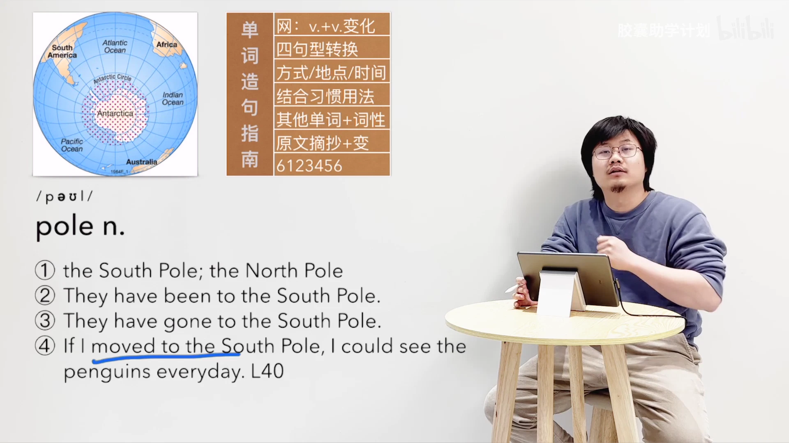

文字识别：单词造句指南 / 网：v.+v.变化 / South / Atlantic / Ocean / Africa / 四句型转换 / America / 方式/地点/时间 / Indian / 结合习惯用法 / Ocean / Antarctica / 其他单词+词性 / Pacific / 原文摘抄+变 / Ocean / Australia / 6123456 / 1964E1 / /paul/ / pole n. / ① the South Pole; the North Pole / They have been to the South Pole. / They have gone to the South Pole. / If I moved to the South Pole, I could see the / penguins everyday. L40

### 画面 00:03:27

文字识别：单词造句指南 / 网：v.+v.变化 / 四句型转换 / 方式/地点/时间 / 结合习惯用法 / 其他单词+词性 / 原文摘抄+变 / 6123456 / / fl a i t / / flight n.

### 画面 00:03:29

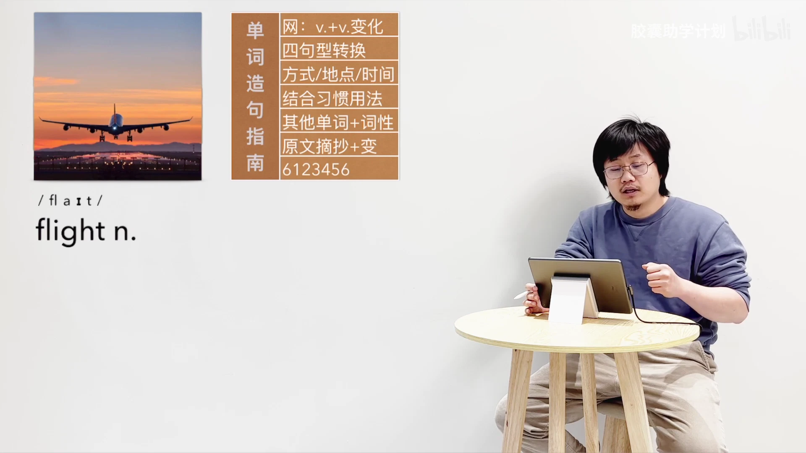

文字识别：单词造句指南 / 网：v.+v.变化 / 四句型转换 / 方式/地点/时间 / 结合习惯用法 / 其他单词+词性 / 原文摘抄+变 / 6123456 / / fl a i t / / flight n.

## 00:03:30–00:04:00

起读一下，叫做 flight flight。那它实际上是航班啊，航班飞机的意思，对吧？哎，那注意它这是个名词。那我们在这补一个小的短语叫 catch a flight。 catch 这个单词各位非常熟悉，叫抓的意思。那 catch a flight 什么意思呢？就是赶飞机啊。比如说我们造句啊，另外一个口语当中非常常用的叫 How was your flight？比如说你去机场接机，那你就可以问一下别人，

### 画面 00:03:31

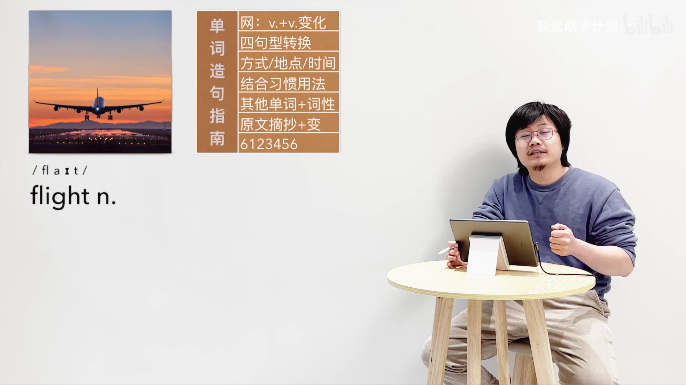

文字识别：单词造句指南 / 网：v.+v.变化 / 四句型转换 / 方式/地点/时间 / 结合习惯用法 / 其他单词+词性 / 原文摘抄+变 / 6123456 / / fl ai t / / flight n.

### 画面 00:03:35

文字识别：单词造句指南 / 网：v.+v.变化 / 四句型转换 / 方式/地点/时间 / 结合习惯用法 / 其他单词+词性 / 原文摘抄+变 / 6123456 / / fl ai t / / flight n.

### 画面 00:03:40

文字识别：单词造句指南 / 网：v.+v.变化 / 四句型转换 / 方式/地点/时间 / 结合习惯用法 / 其他单词+词性 / 原文摘抄+变 / 6123456 / / fl ai t / / flight n. / ① catch a flight

### 画面 00:03:45

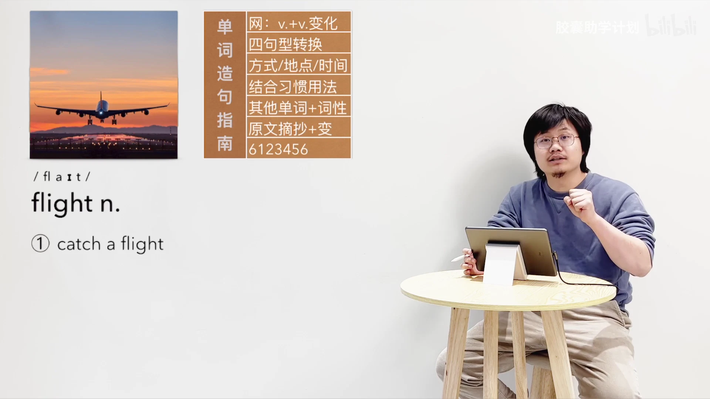

文字识别：单词造句指南 / 网：v.+v.变化 / 四句型转换 / 方式/地点/时间 / 结合习惯用法 / 其他单词+词性 / 原文摘抄+变 / 6123456 / / fl ait/ / flight n. / ① catch a flight

### 画面 00:03:50

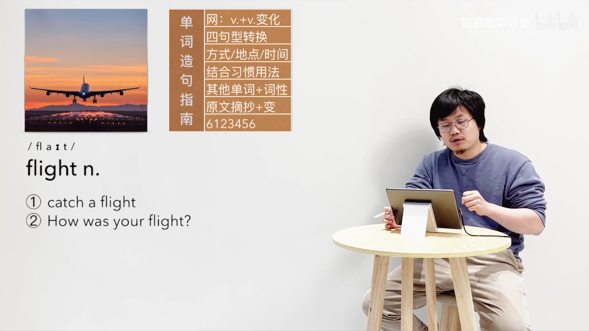

文字识别：单词造句指南 / 网：v.+v.变化 / 四句型转换 / 方式/地点/时间 / 结合习惯用法 / 其他单词+词性 / 原文摘抄+变 / 6123456 / / fl ait/ / flight n. / catch a flight / How was your flight?

### 画面 00:03:55

文字识别：单词造句指南 / 网：v.+v.变化 / 四句型转换 / 方式/地点/时间 / 结合习惯用法 / 其他单词+词性 / 原文摘抄+变 / 6123456 / / fl ait/ / flight n. / ① / catch a flight / How was your flight?

## 00:04:00–00:04:30

就是我们所谓的嘘寒问暖，问别人家 How was your flight? 注意这有一个小点，用的是 was 为什么？因为你已经下飞机了，对吧？所以我问的是，哎，你刚才这个飞行还行吧？没有太大的颠簸吧？对不对？啊，吃的还开心吧？睡得还可以吗？How was your flight? Okay. Next one. 那我们实际上可以结合十八课 have to do something，对吧？我们来一句话叫 I have to catch a flight. 说 Harry, Harry,

### 画面 00:04:00

文字识别：单词造句指南 / 网：v.+v.变化 / 四句型转换 / 方式/地点/时间 / 结合习惯用法 / 其他单词+词性 / 原文摘抄+变 / 6123456 / / fl ait / / flight n. / ① / catch a flight / How was your flight?

### 画面 00:04:05

文字识别：单词造句指南 / 网：v.+v.变化 / 四句型转换 / 方式/地点/时间 / 结合习惯用法 / 其他单词+词性 / 原文摘抄+变 / 6123456 / / flait/ / flight n. / catch a flight / ① / How was your flight?

### 画面 00:04:10

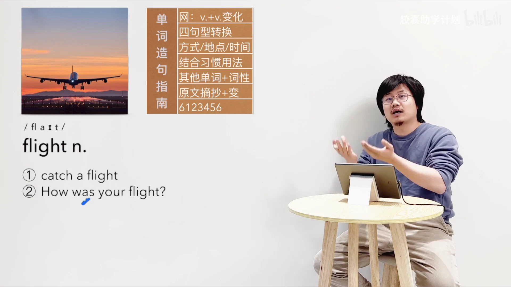

文字识别：单词造句指南 / 网：v.+v.变化 / 四句型转换 / 方式/地点/时间 / 结合习惯用法 / 其他单词+词性 / 原文摘抄+变 / 6123456 / / fl ai t/ / flight n. / ① / catch a flight / How was your flight?

### 画面 00:04:15

文字识别：单词造句指南 / 网：v.+v.变化 / 四句型转换 / 方式/地点/时间 / 结合习惯用法 / 其他单词+词性 / 原文摘抄+变 / 6123456 / / fl ait/ / flight n. / ① / catch a flight / How was your flight?

### 画面 00:04:20

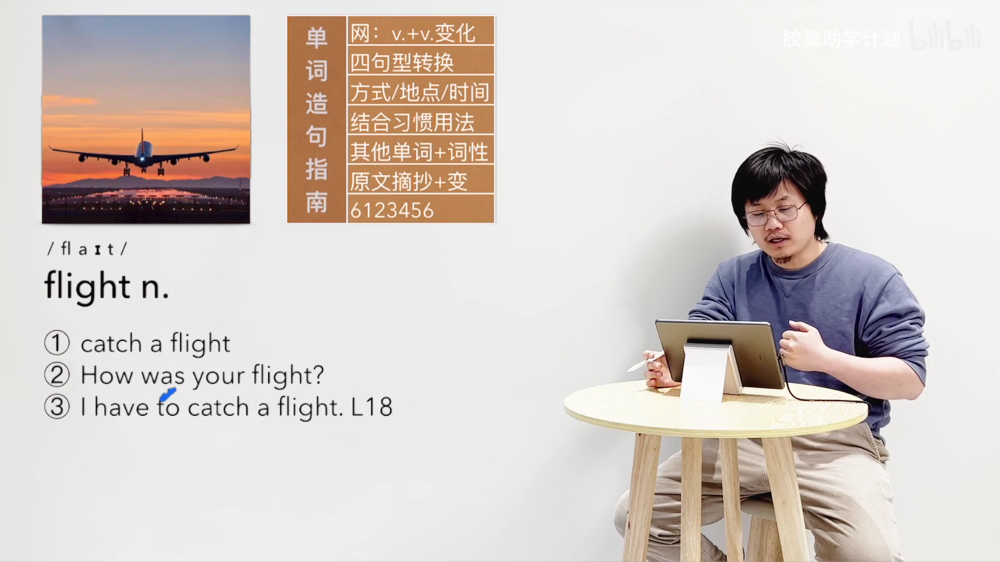

文字识别：单词造句指南 / 网：v.+v.变化 / 四句型转换 / 方式/地点/时间 / 结合习惯用法 / 其他单词+词性 / 原文摘抄+变 / 6123456 / / fl a it / / flight n. / ① / catch a flight / How was your flight? / I have to catch a flight. L18

### 画面 00:04:25

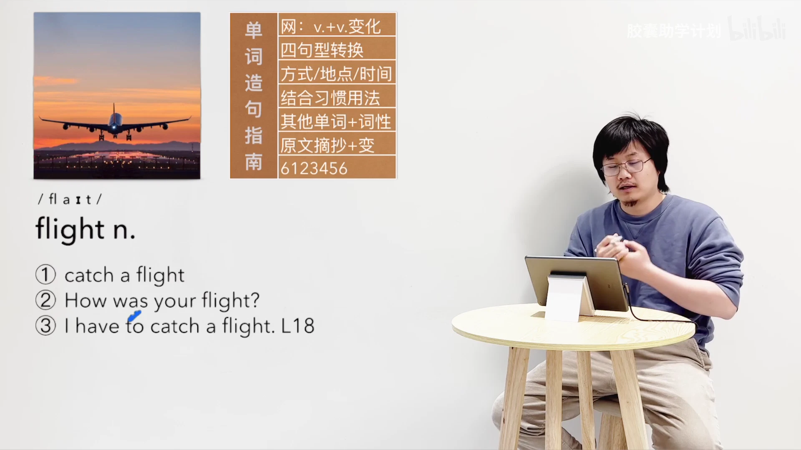

文字识别：单词造句指南 / 网：v.+v.变化 / 四句型转换 / 方式/地点/时间 / 结合习惯用法 / 其他单词+词性 / 原文摘抄+变 / 6123456 / / fl a i t / / flight n. / catch a flight / 1 / How was your flight? / I have to catch a flight. L18

## 00:04:30–00:05:00

对吧？快一点啊！我必须要去赶这个飞机。I have to catch a flight. Very good.再然后呢？我们比如说还可以结合四十一课我们学的叫做needn't have done。你看我造的句子叫Your flight is eight啊，at eight具体一点啊，更好一点叫at eight啊，在八点钟。So you needn't have come here so early.所以你本不必到这里如此的早。四十一课，对吧？Very good.

### 画面 00:04:30

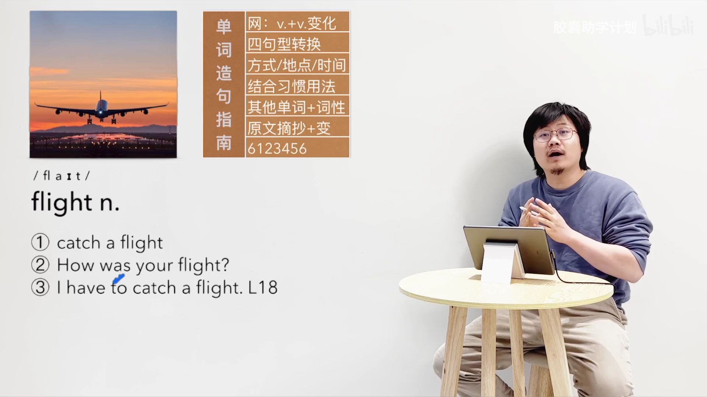

文字识别：单词造句指南 / 网：v.+v.变化 / 四句型转换 / 方式/地点/时间 / 结合习惯用法 / 其他单词+词性 / 原文摘抄+变 / 6123456 / / fl a i t / / flight n. / catch a flight / ① / How was your flight? / I have to catch a flight. L18

### 画面 00:04:35

文字识别：单词造句指南 / 网：v.+v.变化 / 四句型转换 / 方式/地点/时间 / 结合习惯用法 / 其他单词+词性 / 原文摘抄+变 / 6123456 / / fl a i t / / flight n. / ① catch a flight / How was your flight? / I have to catch a flight. L18

### 画面 00:04:37

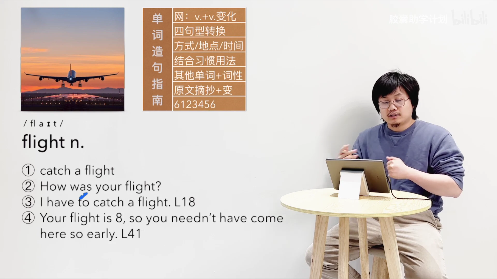

文字识别：单词造句指南 / 网：v.+v.变化 / 四句型转换 / 方式/地点/时间 / 结合习惯用法 / 其他单词+词性 / 原文摘抄+变 / 6123456 / / fl ait / / flight n. / ① catch a flight / How was your flight? / I have to catch a flight. L18 /  Your flight is 8, so you needn't have come / here so early. L41

### 画面 00:04:40

文字识别：单词造句指南 / 网：v.+v.变化 / 四句型转换 / 方式/地点/时间 / 结合习惯用法 / 其他单词+词性 / 原文摘抄+变 / 6123456 / / fl ait/ / flight n. / ① catch a flight / How was your flight? / I have to catch a flight. L18 / Your flight is 8, so you needn't have come / here so early. L41

### 画面 00:04:45

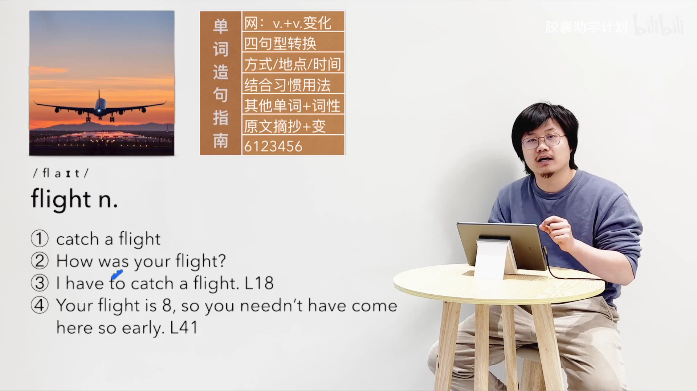

文字识别：单词造句指南 / 网：v.+v.变化 / 四句型转换 / 方式/地点/时间 / 结合习惯用法 / 其他单词+词性 / 原文摘抄+变 / 6123456 / / fl ait/ / flight n. / ① catch a flight / How was your flight? / I have to catch a flight. L18 / 3 / Your flight is 8, so you needn't have come / 4 / here so early. L41

### 画面 00:04:49

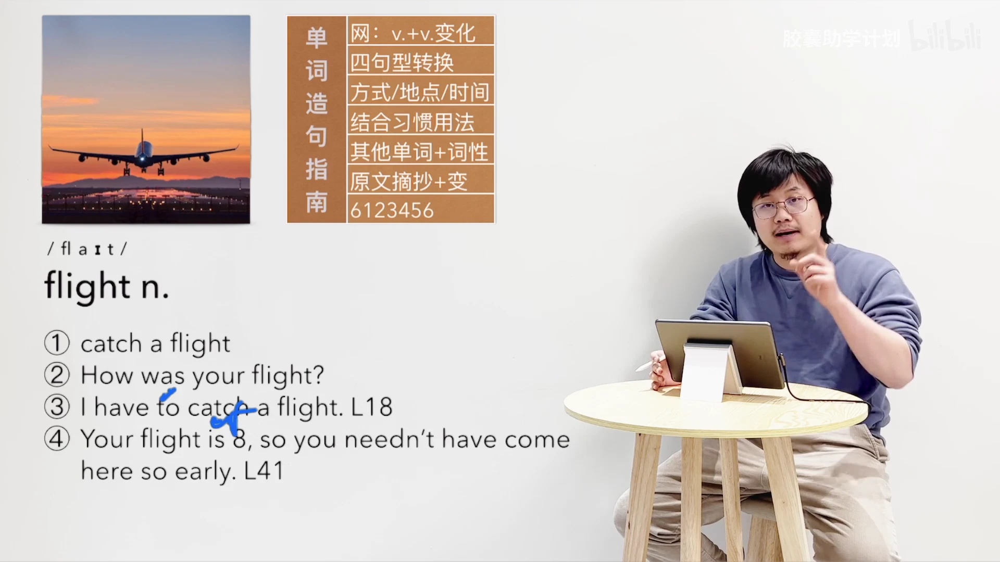

文字识别：单词造句指南 / 网：v.+v.变化 / 四句型转换 / 方式/地点/时间 / 结合习惯用法 / 其他单词+词性 / 原文摘抄+变 / 6123456 / / fl ait/ / flight n. / ① / catch a flight / How was your flight? / I have to catca-a flight. L18 / Your flight is 8, so you needn't have come / here so early. L41

### 画面 00:04:51

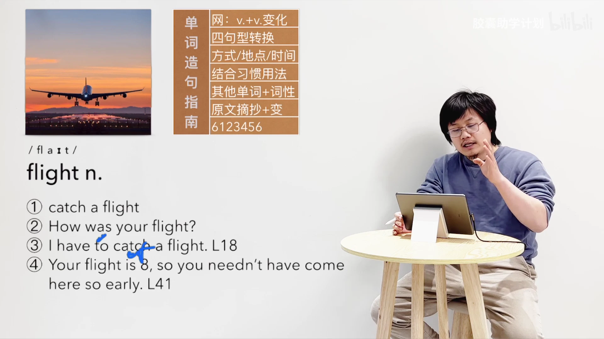

文字识别：单词造句指南 / 网：v.+v.变化 / 四句型转换 / 方式/地点/时间 / 结合习惯用法 / 其他单词+词性 / 原文摘抄+变 / 6123456 / / fl ait/ / flight n. / ① / catch a flight / How was your flight? / I have to catcaa flight. L18 / Your flight is 8, so you needn't have come / here so early. L41

### 画面 00:04:55

文字识别：单词造句指南 / 网：v.+v.变化 / 四句型转换 / 方式/地点/时间 / 结合习惯用法 / 其他单词+词性 / 原文摘抄+变 / 6123456 / / fl ait/ / flight n. / ① catch a flight / How was your flight? / I have to catgaa flight. L18 / Your flight is 8, so you needn't have come / here so early. L41

## 00:05:00–00:05:30

好，但是呢，你到了，OK。接下来呢，那我们看一个小的电影片段。这个电影片段当中就出现了叫 Excuse me, folks, I'm gonna have to catch a flight. Central Martin, Justice Department people at the FBI, the folks at the Baltimore State Hospital, and now for the hard part, apprehending the suspect. Excuse me, folks, I'm gonna have to catch a flight. OK, 啊，这个抱歉啊，我要去赶飞机了。

### 画面 00:05:00

文字识别：单词造句指南 / 网：v.+v.变化 / 四句型转换 / 方式/地点/时间 / 结合习惯用法 / 其他单词+词性 / 原文摘抄+变 / 6123456 / / fl ait/ / flight n. / ① catch a flight / How was your flight? / I have to catgaa flight. L18 / Your flight is 8, so you needn't have come / here so early. L41

### 画面 00:05:03

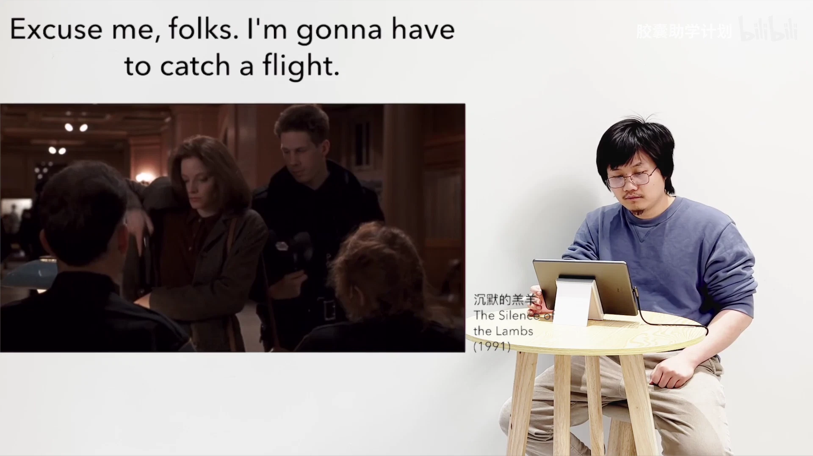

文字识别：Excuse me, folks. I'm gonna have / to catch a flight. / 沉默的羔美 / The Silenee / the Lambs / (1991)

### 画面 00:05:15

文字识别：Excuse me, folks. I'm gonna have / to catch a flight. / 沉默的羔美 / The Silenee / 马丁参议员司法部联邦调查局 / the Lambs / Senator Martin, Justice Department, FBL. / （1991)

### 画面 00:05:17

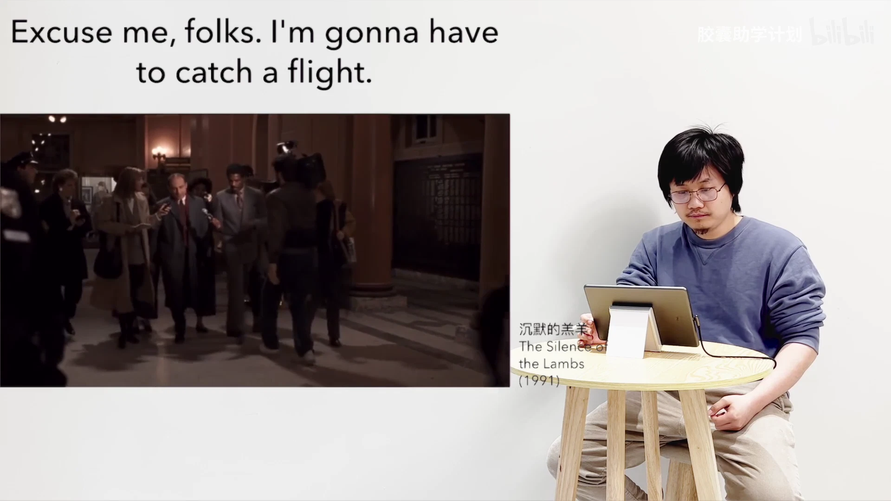

文字识别：Excuse me, folks. I'm gonna have / to catch a flight. / 沉默的羔美 / The Sileneeo / the Lambs / (1991)

### 画面 00:05:19

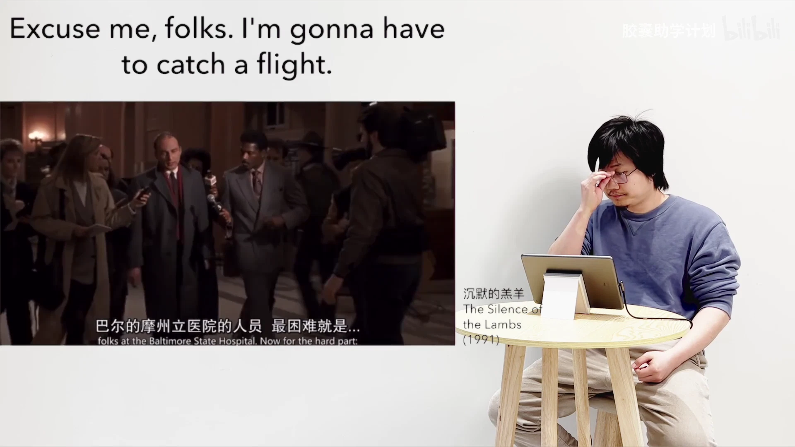

文字识别：Excuse me, folks. I'm gonna have / to catch a flight. / 沉默的羔羊 / The Silence / 巴尔的摩州医院的人员最困难就是... / the Lambs / folks at the Baltimore State Hospital. Now for the hard part: / （1991）

### 画面 00:05:21

文字识别：Excuse me, folks. I'm gonna have / to catch a flight. / 沉默的羔羊 / The Silence / 逮捕那个疑匪 / the Lambs / (1991) / Apprehending the suspect.

### 画面 00:05:23

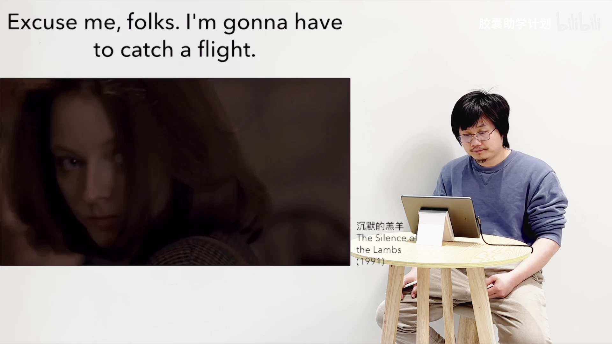

文字识别：Excuse me, folks. I'm gonna have / to catch a flight. / 沉默的羔羊 / The Silence / the Lambs / (1991）

### 画面 00:05:25

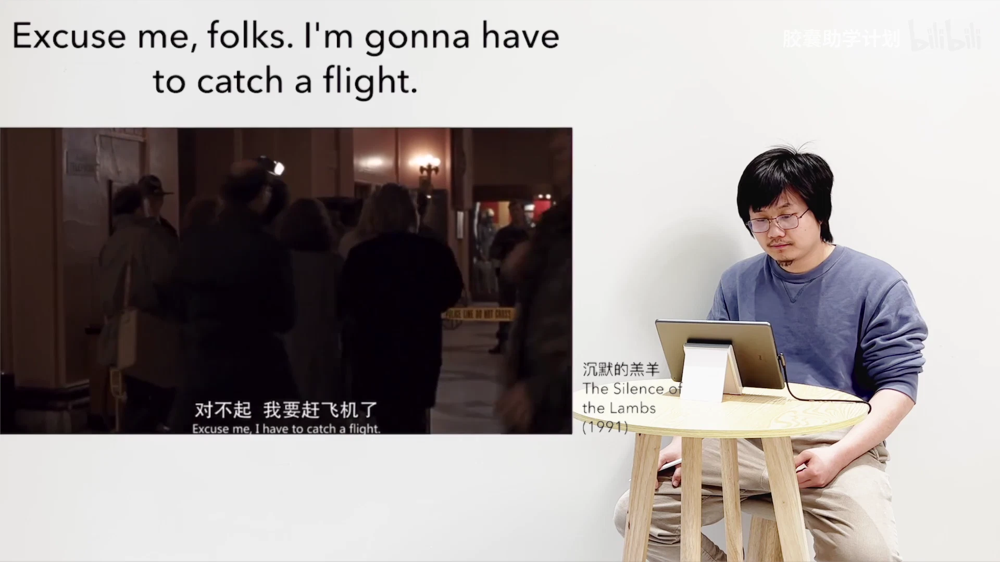

文字识别：Excuse me, folks. I'm gonna have / to catch a flight. / 沉默的羔羊 / The Silenceo / 对不起 我要赶飞机了 / the Lambs / Excuse me, I have to catch a flight. / （1991)

### 画面 00:05:27

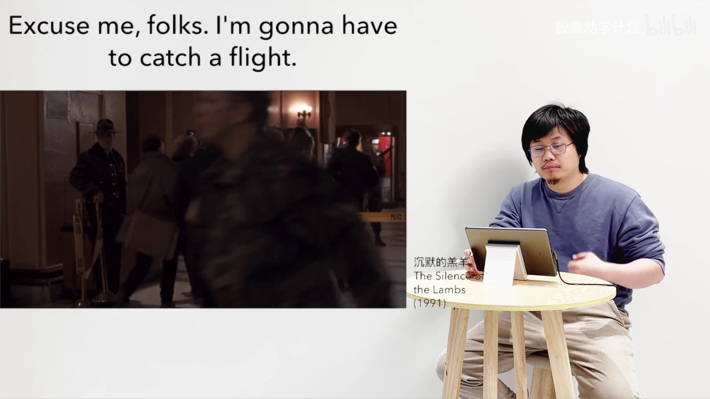

文字识别：Excuse me, folks. I'm gonna have / to catch a flight. / 沉默的羔羊 / The Silence / the Lambs / (1991)

## 00:05:30–00:06:00

玩一个。下一个单词看一下，叫做看一下音标，叫做 explorer 啊，explorer 玩一个 explorer 就是探险者啊，探索者玩一个探险家。注意它是一个人，对吧？ explore 后边加了一个 e r， explore 探险动词加个 e r，然后变成了探险的人啊，探险者。那是它本质上是个名词，和我们之前学的什么 hostess detective 对吧？我们之前学的所有这种

### 画面 00:05:30

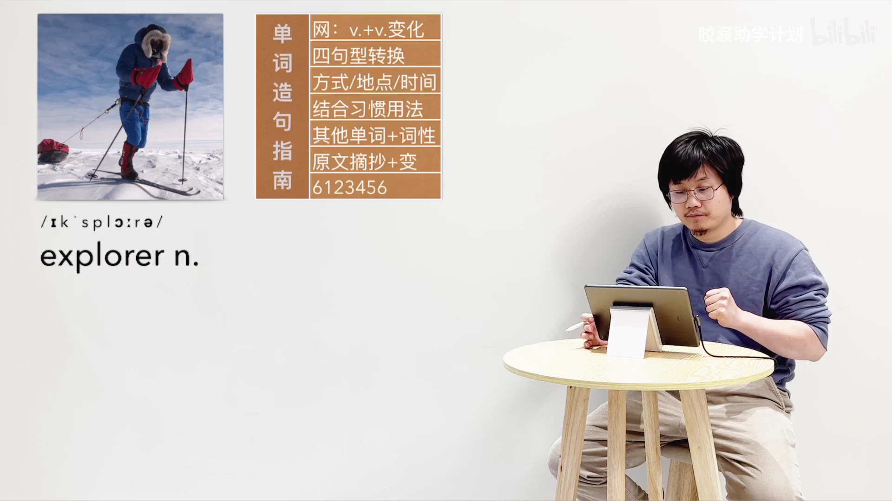

文字识别：单词造句指南 / 网：v.+v.变化 / 四句型转换 / 方式/地点/时间 / 结合习惯用法 / 其他单词+词性 / 原文摘抄+变 / 6123456 / /ik'sploira/ / explorer n.

### 画面 00:05:32

文字识别：单词造句指南 / 网：v.+v.变化 / 四句型转换 / 方式/地点/时间 / 结合习惯用法 / 其他单词+词性 / 原文摘抄+变 / 6123456 / /ik'splo:ra/ / explorer n.

### 画面 00:05:35

文字识别：单词造句指南 / 网：v.+v.变化 / 四句型转换 / 方式/地点/时间 / 结合习惯用法 / 其他单词+词性 / 原文摘抄+变 / 6123456 / /Ik'sploira/ / explorer n.

### 画面 00:05:40

文字识别：单词造句指南 / 网：v.+v.变化 / 四句型转换 / 方式/地点/时间 / 结合习惯用法 / 其他单词+词性 / 原文摘抄+变 / 6123456 / /ik'splo:ra/ / explorer n.

### 画面 00:05:45

文字识别：单词造句指南 / 网：v.+v.变化 / 四句型转换 / 方式/地点/时间 / 结合习惯用法 / 其他单词+词性 / 原文摘抄+变 / 6123456 / /ik'splo:ra/ / explorer n.

### 画面 00:05:50

文字识别：单词造句指南 / 网：v.+v.变化 / 四句型转换 / 方式/地点/时间 / 结合习惯用法 / 其他单词+词性 / 原文摘抄+变 / 6123456 / /ik'splo:ra/ / explorer n.

### 画面 00:05:54

文字识别：单词造句指南 / 网：v.+v.变化 / 四句型转换 / 方式/地点/时间 / 结合习惯用法 / 其他单词+词性 / 原文摘抄+变 / 6123456 / /ik'spla:ra/ / explorer n. / ① If I knew that explorer, I would have a drink / with him. L40

### 画面 00:05:56

文字识别：单词造句指南 / 网：v.+v.变化 / 四句型转换 / 方式/地点/时间 / 结合习惯用法 / 其他单词+词性 / 原文摘抄+变 / 6123456 / /Ik'splo:ra/ / explorer n. / ① If I knew that explorer, I would have a drink / with him. L40

## 00:06:00–00:06:30

captain 表示身份的单词，本质上没什么区别。比如说，我造一句话叫 If I knew that explorer, I would have a drink with him。那你注意这个里边的 explorer，你说我换成 detective, hostess, captain，可不可以呢？完全可以，对吧？所以各位呢，只要之前您学的好，这里就 OK 了。好，那我们看一下用的是虚拟语气啊。首先结构判断了，其次呢，然后我们想一下它的用法，叫做如果我认识，字面

### 画面 00:06:00

文字识别：单词造句指南 / 网：v.+v.变化 / 四句型转换 / 方式/地点/时间 / 结合习惯用法 / 其他单词+词性 / 原文摘抄+变 / 6123456 / /Ik'splo:ra/ / explorer n. / ① If I knew that explorer, I would have a drink / with him. L40

### 画面 00:06:09

文字识别：单词造句指南 / 网：v.+v.变化 / 四句型转换 / 方式/地点/时间 / 结合习惯用法 / 其他单词+词性 / 原文摘抄+变 / 6123456 / /Ik'splo:ra/ / explorer n. / ① If I knew that explorer, I would have a drink / with him. L40

### 画面 00:06:11

文字识别：单词造句指南 / 网：v.+v.变化 / 四句型转换 / 方式/地点/时间 / 结合习惯用法 / 其他单词+词性 / 原文摘抄+变 / 6123456 / /ik'spla:ra/ / explorer n. / ① If I knew that explorer, I would have a drink / with him. L40

### 画面 00:06:15

文字识别：单词造句指南 / 网：v.+v.变化 / 四句型转换 / 方式/地点/时间 / 结合习惯用法 / 其他单词+词性 / 原文摘抄+变 / 6123456 / /Ik'splo:ra/ / explorer n. / ① If I knew that explorer, I would have a drink / with him. L40

### 画面 00:06:20

文字识别：单词造句指南 / 网：v.+v.变化 / 四句型转换 / 方式/地点/时间 / 结合习惯用法 / 其他单词+词性 / 原文摘抄+变 / 6123456 / /Ik'splo:ra/ / explorer n. / ① If I knew that explorer, I would have a drink / with him. L40

### 画面 00:06:23

文字识别：单词造句指南 / 网：v.+v.变化 / 四句型转换 / 方式/地点/时间 / 结合习惯用法 / 其他单词+词性 / 原文摘抄+变 / 6123456 / /ik'splo:ra/ / explorer n. / ① If I knew / that explorer, I would have a drink / with him. L40

### 画面 00:06:25

文字识别：单词造句指南 / 网：v.+v.变化 / 四句型转换 / 方式/地点/时间 / 结合习惯用法 / 其他单词+词性 / 原文摘抄+变 / 6123456 / /ik'splo:ra/ / explorer n. / ① If I knel / that explorer I wpuld have / a drink / with him. L40

## 00:06:30–00:07:00

思认识他这个探险家，那我就会和他喝一杯。但很遗憾的是，因为是虚拟语气，所以表示的是我并不太认识他，所以也不可能和他喝一杯了，对吧？玩一个。接下来呢，我们用三十八克的 had no sooner done，然后再加一个 than，对吧？造句子叫做 the explorer had no sooner entered the room than everybody began to sing，对吧？说他几乎是刚刚进入房间，然后每个人就开始，大家就开

### 画面 00:06:30

文字识别：单词造句指南 / 网：v.+v.变化 / 四句型转换 / 方式/地点/时间 / 结合习惯用法 / 其他单词+词性 / 原文摘抄+变 / 6123456 / /ik'spla:ra/ / explorer n. / ① If I knev / that explorer, I wpuld havea drink / with him. L40

### 画面 00:06:35

文字识别：单词造句指南 / 网：v.+v.变化 / 四句型转换 / 方式/地点/时间 / 结合习惯用法 / 其他单词+词性 / 原文摘抄+变 / 6123456 / /ik'splo:ra/ / explorer n. / ① If I knev / that explorer, I would havea drink / with him. L40

### 画面 00:06:40

文字识别：单词造句指南 / 网：v.+v.变化 / 四句型转换 / 方式/地点/时间 / 结合习惯用法 / 其他单词+词性 / 原文摘抄+变 / 6123456 / /ik'splo:ra/ / explorer n. / ① If I kney / that explorer, I would havea drink / with him. L40

### 画面 00:06:42

文字识别：单词造句指南 / 网：v.+v.变化 / 四句型转换 / 方式/地点/时间 / 结合习惯用法 / 其他单词+词性 / 原文摘抄+变 / 6123456 / /ik'splo:ra/ / explorer n. / ① If I kneV t /  that explorer I wpuld havea drink / with him. L40 / The explorer had no sooner entered the / room than everybody began to sing. L38

### 画面 00:06:45

文字识别：单词造句指南 / 网：v.+v.变化 / 四句型转换 / 方式/地点/时间 / 结合习惯用法 / 其他单词+词性 / 原文摘抄+变 / 6123456 / /ik'splo:ra/ / explorer n. / ① If I KneVt / 1 that explorer I wpuld havea drink / with him. L40 / The explorer had no sooner entered the / room than everybody began to sing. L38

### 画面 00:06:48

文字识别：单词造句指南 / 网：v.+v.变化 / 四句型转换 / 方式/地点/时间 / 结合习惯用法 / 其他单词+词性 / 原文摘抄+变 / 6123456 / /ik'splo:ra/ / explorer n. / ① If I KneVt /  that explorer, I would havea drink / with him. L40 / The explorer had no sooner entered the / room / than / everybody began to sing. L38

### 画面 00:06:51

文字识别：单词造句指南 / 网：v.+v.变化 / 四句型转换 / 方式/地点/时间 / 结合习惯用法 / 其他单词+词性 / 原文摘抄+变 / 6123456 / /ik'splo:ra/ / explorer n. / ① If I KneVt /  that explorer, I would havea drink / with him. L40 / The explorer had no sooner entered the / room / than / everybody began to sing. L38

### 画面 00:06:55

文字识别：单词造句指南 / 网：v.+v.变化 / 四句型转换 / 方式/地点/时间 / 结合习惯用法 / 其他单词+词性 / 原文摘抄+变 / 6123456 / /Ik'splo:ra/ / explorer n. / ① If I KneVt / 1 that explorer I wpuld havea drink / with him. L40 / The explorer had no sooner entered the / room / than / everybody began to sing. L38

## 00:07:00–00:07:30

始唱歌了。Okay, one again.好，接下来三十三课说，You needn't explain this to that explorer.当然，它也用到了四十二课我们学的needn't do，对吧？这个实际上是告诉各位，need这个单词比较特殊，放在呃否定句当中的时候，它可以做情态动词去讲，对吧？Okay，所以用的needn't do。那explain something to somebody，解释某事给某人听，叫做你本你啊不是

### 画面 00:07:00

文字识别：单词造句指南 / 网：v.+v.变化 / 四句型转换 / 方式/地点/时间 / 结合习惯用法 / 其他单词+词性 / 原文摘抄+变 / 6123456 / /Ik'splo:ra/ / explorer n. / ① If I KneVt /  that explorer, I would havea drink / with him. L40 / The explorer had no sooner entered the / room / than / everybody began to sing. L38

### 画面 00:07:05

文字识别：单词造句指南 / 网：v.+v.变化 / 四句型转换 / 方式/地点/时间 / 结合习惯用法 / 其他单词+词性 / 原文摘抄+变 / 6123456 / /ik'splo:ra/ / explorer n. / ① If I kneV t /  that explorer I would havea drink / with him. L40 / The explorer had no sooner entered the / room / than / everybody began to sing. L38 /  You needn't explain this to that explorer. L33

### 画面 00:07:10

文字识别：单词造句指南 / 网：v.+v.变化 / 四句型转换 / 方式/地点/时间 / 结合习惯用法 / 其他单词+词性 / 原文摘抄+变 / 6123456 / /Ik'splo:ra/ / explorer n. / ① If I knev t /  that explorer, I would havea drink / with him. L40 / The explorer had no sooner entered the / room / than / everybody began to sing. L38 /  You needn't explain this to that explorer. L33

### 画面 00:07:16

文字识别：单词造句指南 / 网：v.+v.变化 / 四句型转换 / 方式/地点/时间 / 结合习惯用法 / 其他单词+词性 / 原文摘抄+变 / 6123456 / /ik'splo:ra/ / explorer n. / ① If I KneVt /  that explorer, I would havea drink / with him. L40 / The explorer had no sooner entered the / room / than / everybody began to sing. L38 / You needn't explain this to that explorer. L33

### 画面 00:07:21

文字识别：单词造句指南 / 网：v.+v.变化 / 四句型转换 / 方式/地点/时间 / 结合习惯用法 / 其他单词+词性 / 原文摘抄+变 / 6123456 / /ik'splo:ra/ / explorer n. / ① If I kneV t /  that explorer, I would havea drink / with him. L40 / The explorer had no sooner entered the / room / than / everybody began to sing. L38 / You needn't explain this to that explorer. L33

## 00:07:30–00:08:00

本啊，叫你不必解释这件事情给那个探险家庭啊。再读一遍这个单词 explorer very good. Next one，接下来呢，我们先看这个单词，跟我一起读一下，叫做 lie 啊，它实际上有很多意思，我们就学本文的意思就行了，叫做位于或者说处于啊，位于什么地方？比如说我现在位于这个桌子的旁边，对吧？lie 啊，好，那它的过去式啊 lay，过去分词 laying

### 画面 00:07:30

文字识别：单词造句指南 / 网：v.+v.变化 / 四句型转换 / 方式/地点/时间 / 结合习惯用法 / 其他单词+词性 / 原文摘抄+变 / 6123456 / /ik'splo:ra/ / explorer n. / ① If I KneVt /  that explorer, I would havea drink / with him. L40 / The explorer had no sooner entered the / room / than / everybody began to sing. L38 / You needn't explain this to that explorer. L33

### 画面 00:07:35

文字识别：单词造句指南 / 网：v.+v.变化 / 四句型转换 / 方式/地点/时间 / 结合习惯用法 / 其他单词+词性 / 原文摘抄+变 / 6123456 / /ik'splo:ra/ / explorer n. / ① If I KneVt / 1 that explorer, I would havea drink / with him. L40 / The explorer had no sooner entered the / room / than / everybody began to sing. L38 / You needn't explain this to that explorer. L33

### 画面 00:07:38

文字识别：单词造句指南 / 网：v.+v.变化 / 四句型转换 / 方式/地点/时间 / 结合习惯用法 / 其他单词+词性 / 原文摘抄+变 / 6123456 / /lar/ / /ler/ / /lein/ / lie - lay - lain v.

### 画面 00:07:40

文字识别：单词造句指南 / 网：v.+v.变化 / 四句型转换 / 方式/地点/时间 / 结合习惯用法 / 其他单词+词性 / 原文摘抄+变 / 6123456 / /lar/ / /ler/ / /lein/ / lie - lay - lain v.

### 画面 00:07:45

文字识别：单词造句指南 / 网：v.+v.变化 / 四句型转换 / 方式/地点/时间 / 结合习惯用法 / 其他单词+词性 / 原文摘抄+变 / 6123456 / /lar/ / /ler/ / /lein/ / lie - lay - lain v.

### 画面 00:07:50

文字识别：单词造句指南 / 网：v.+v.变化 / 四句型转换 / 方式/地点/时间 / 结合习惯用法 / 其他单词+词性 / 原文摘抄+变 / 6123456 / /lar/ / /ler/ / /lein/ / lie - lay - lain v.

### 画面 00:07:55

文字识别：单词造句指南 / 网：v.+v.变化 / 四句型转换 / 方式/地点/时间 / 结合习惯用法 / 其他单词+词性 / 原文摘抄+变 / 6123456 / /lar/ / /le1/ / /lein/ / lie - lay - lain v.

### 画面 00:07:59

文字识别：单词造句指南 / 网：v.+v.变化 / 四句型转换 / 方式/地点/时间 / 结合习惯用法 / 其他单词+词性 / 原文摘抄+变 / 6123456 / /lar/ / /ler/ / /lein/ / lie - lay - lain v.

## 00:08:00–00:08:30

very good. 那我们造句子，原文给了一句类似的话，我觉得不错，它用到了定语从句，叫做 the mountain. 我们把原文做了一点点修整啊，叫做 the mountain that lay below is very well known. 啊，比如说你现在坐着一辆直升飞机啊，然后呢跨过了一座山，在山的上方，然后比如说导游就说说现在处于下方的这个山，定语从句处于下方的山非常的有名 well known，

### 画面 00:08:02

文字识别：单词造句指南 / 网：v.+v.变化 / 四句型转换 / 方式/地点/时间 / 结合习惯用法 / 其他单词+词性 / 原文摘抄+变 / 6123456 / /laı/ / /ler/ / /lein/ / lie - lay - lain v. /  The mountain that lie below is very well- / known. L28

### 画面 00:08:04

文字识别：单词造句指南 / 网：v.+v.变化 / 四句型转换 / 方式/地点/时间 / 结合习惯用法 / 其他单词+词性 / 原文摘抄+变 / 6123456 / /lar/ / /ler/ / /lein/ / lie - lay - lain v. / The mountain that lie below is very well- / known. L28

### 画面 00:08:14

文字识别：单词造句指南 / 网：v.+v.变化 / 四句型转换 / 方式/地点/时间 / 结合习惯用法 / 其他单词+词性 / 原文摘抄+变 / 6123456 / /laı/ / /ler/ / /lein/ / lie - lay - lain v. /  The mountain that lie below is very well- / known. L28

### 画面 00:08:19

文字识别：单词造句指南 / 网：v.+v.变化 / 四句型转换 / 方式/地点/时间 / 结合习惯用法 / 其他单词+词性 / 原文摘抄+变 / 6123456 / /lar/ / /ler/ / /lein/ / lie - lay - lain v. / ) The mountain that lie below is very well- / known. L28

### 画面 00:08:24

文字识别：单词造句指南 / 网：v.+v.变化 / 四句型转换 / 方式/地点/时间 / 结合习惯用法 / 其他单词+词性 / 原文摘抄+变 / 6123456 / /lar/ / /ler/ / /lein/ / lie - lay - lain v. /  The mountain that lie below is very well- / known. L28

### 画面 00:08:27

文字识别：单词造句指南 / 网：v.+v.变化 / 四句型转换 / 方式/地点/时间 / 结合习惯用法 / 其他单词+词性 / 原文摘抄+变 / 6123456 / /lar/ / /ler/ / /lein/ / lie - lay - lain v. / The mountain that lie below is very well- / known. L28

### 画面 00:08:29

文字识别：单词造句指南 / 网：v.+v.变化 / 四句型转换 / 方式/地点/时间 / 结合习惯用法 / 其他单词+词性 / 原文摘抄+变 / 6123456 / /lar/ / /ler/ / /lein/ / lie - lay - lain v. / The mountain that lie below is very well- / known. L28

## 00:08:30–00:09:00

known, 对吧？二十八克的, very good. Continue. 下一个句子叫做 She is lying on the sofa. 啊，注意这里实际上我们就讲了一个新的意思，指的是 lie 这个单词，它往往还可以有第二个含义，非常常用啊。我们就在这儿简单说一下了，叫做躺，说她正躺在沙发上。然后呢，你也可以说 Last night she lay on the bed. 那这个地方其实无非我就是换了一下时态，于是呢，你就可以理解为叫做

### 画面 00:08:34

文字识别：单词造句指南 / 网：v.+v.变化 / 四句型转换 / 方式/地点/时间 / 结合习惯用法 / 其他单词+词性 / 原文摘抄+变 / 6123456 / /lar/ / /ler/ / /lein/ / lie - lay - lain v. / ) The mountain that lie below is very well- / known. L28 / She is lying on the sofa.

### 画面 00:08:44

文字识别：单词造句指南 / 网：v.+v.变化 / 四句型转换 / 方式/地点/时间 / 结合习惯用法 / 其他单词+词性 / 原文摘抄+变 / 6123456 / /lar/ / /ler/ / /lein/ / lie - lay - lain v. / ) The mountain that lie below is very well- / known. L28 / She is lying on the sofa.

### 画面 00:08:49

文字识别：单词造句指南 / 网：v.+v.变化 / 四句型转换 / 方式/地点/时间 / 结合习惯用法 / 其他单词+词性 / 原文摘抄+变 / 6123456 / /laı/ / /ler/ / /lein/ / lie - lay - lain v. /  The mountain that lie below is very well- / known. L28 / She is lying on the sofa.

### 画面 00:08:54

文字识别：单词造句指南 / 网：v.+v.变化 / 四句型转换 / 方式/地点/时间 / 结合习惯用法 / 其他单词+词性 / 原文摘抄+变 / 6123456 / /laı/ / /ler/ / /lein/ / lie - lay - lain v. /  The mountain that lie below is very well- / known. L28 / She is lying on the sofa. /  Last night, she lay on the bed.

### 画面 00:08:57

文字识别：单词造句指南 / 网：v.+v.变化 / 四句型转换 / 方式/地点/时间 / 结合习惯用法 / 其他单词+词性 / 原文摘抄+变 / 6123456 / /lar/ / /ler/ / /lein/ / lie - lay - lain v. / 1 / ) The mountain that lie below is very well- / known. L28 / Sheis lving on the sofa. / Last night, shelay_on the bed.

### 画面 00:08:59

文字识别：单词造句指南 / 网：v.+v.变化 / 四句型转换 / 方式/地点/时间 / 结合习惯用法 / 其他单词+词性 / 原文摘抄+变 / 6123456 / /laı/ / /ler/ / /lein/ / lie - lay - lain v. / 1 / ) The mountain that lie below is very well- / known. L28 / Sheis lving on the sofa. / Last night, she lay_on the bed.

## 00:09:00–00:09:30

四形形转换。当然我在这没换啊，您可以下课去换。我做了一些动词加动词变化的改变。OK，very good。那不多说，下一个单词，看音标，serious。好，呃，先读一遍，叫serious。serious指的其实有很多的意思。本文的一个常见也是比较常见的意思叫严重的，对吧？serious。原文呢给了一个习惯用法，我们直接把它摘过来用，叫run into serious

### 画面 00:09:04

文字识别：单词造句指南 / 网：v.+v.变化 / 四句型转换 / 方式/地点/时间 / 结合习惯用法 / 其他单词+词性 / 原文摘抄+变 / 6123456 / /lar/ / /ler/ / /lein/ / lie - lay - lain v. /  The mountain that lie below is very well- / D / known. L28 / Sheis lving on the sofa. / Last night, she|ayon the bed.

### 画面 00:09:08

文字识别：单词造句指南 / 网：v.+v.变化 / 四句型转换 / 方式/地点/时间 / 结合习惯用法 / 其他单词+词性 / 原文摘抄+变 / 6123456 / /'siarias/ / serious adj.

### 画面 00:09:10

文字识别：单词造句指南 / 网：v.+v.变化 / 四句型转换 / 方式/地点/时间 / 结合习惯用法 / 其他单词+词性 / 原文摘抄+变 / 6123456 / / 'siarias/ / serious adj.

### 画面 00:09:14

文字识别：单词造句指南 / 网：v.+v.变化 / 四句型转换 / 方式/地点/时间 / 结合习惯用法 / 其他单词+词性 / 原文摘抄+变 / 6123456 / siarias/ / serious adj.

### 画面 00:09:19

文字识别：单词造句指南 / 网：v.+v.变化 / 四句型转换 / 方式/地点/时间 / 结合习惯用法 / 其他单词+词性 / 原文摘抄+变 / 6123456 / siarias/ / serious adj.

### 画面 00:09:25

文字识别：单词造句指南 / 网：v.+v.变化 / 四句型转换 / 方式/地点/时间 / 结合习惯用法 / 其他单词+词性 / 原文摘抄+变 / 6123456 / /'siarias/ / serious adj. / run into serious trouble

### 画面 00:09:29

文字识别：单词造句指南 / 网：v.+v.变化 / 四句型转换 / 方式/地点/时间 / 结合习惯用法 / 其他单词+词性 / 原文摘抄+变 / 6123456 / /'siarias/ / serious adj. / run into serious trouble

## 00:09:30–00:10:00

trouble. 好，你看，我们如果从字面意思去看， run 叫跑， into 叫跑进， serious 叫严重的 trouble 叫问题，叫跑进了严重的问题。如果再结合上下文，可能您就能猜出来。那我们因为没有上下文，直接告诉各位叫做遇到啊。你看这里就是我们英文的习惯，遇到它没有在这儿用到的叫做各位说的那个会的遇到， nice to meet you的那个meet。 OK，注意这是英文的表达习惯。那 run into

### 画面 00:09:33

文字识别：单词造句指南 / 网：v.+v.变化 / 四句型转换 / 方式/地点/时间 / 结合习惯用法 / 其他单词+词性 / 原文摘抄+变 / 6123456 / /'siarias/ / serious adj. / run into serious trouble

### 画面 00:09:35

文字识别：单词造句指南 / 网：v.+v.变化 / 四句型转换 / 方式/地点/时间 / 结合习惯用法 / 其他单词+词性 / 原文摘抄+变 / 6123456 / siarias/ / serious adj. / run into serious trouble

### 画面 00:09:40

文字识别：单词造句指南 / 网：v.+v.变化 / 四句型转换 / 方式/地点/时间 / 结合习惯用法 / 其他单词+词性 / 原文摘抄+变 / 6123456 / /'siarias/ / serious adj. / run into serious trouble

### 画面 00:09:44

文字识别：单词造句指南 / 网：v.+v.变化 / 四句型转换 / 方式/地点/时间 / 结合习惯用法 / 其他单词+词性 / 原文摘抄+变 / 6123456 / /'siarias/ / serious adj. / run into serious trouble

### 画面 00:09:52

文字识别：单词造句指南 / 网：v.+v.变化 / 四句型转换 / 方式/地点/时间 / 结合习惯用法 / 其他单词+词性 / 原文摘抄+变 / 6123456 / /'siarias/ / serious adj. / ① run into serious trouble

### 画面 00:09:55

文字识别：单词造句指南 / 网：v.+v.变化 / 四句型转换 / 方式/地点/时间 / 结合习惯用法 / 其他单词+词性 / 原文摘抄+变 / 6123456 / /'siarias/ / serious adj. / run into serious trouble

## 00:10:00–00:10:30

serious trouble 实际上合起来就是一个短语了。我们看到，其实这里的核心单词是一个动词，想拿它去造句，这地方你就要想这几个部分了，对吧？结合一些其他的习惯用法，找点动词啊，换一些时态。比如说，那我加了个语法叫 if I run into serious trouble, I would call the police. Okay, 那所以在这里我们就可以问一个问题，叫做 Do you think you will run into serious trouble?

### 画面 00:10:00

文字识别：单词造句指南 / 网：v.+v.变化 / 四句型转换 / 方式/地点/时间 / 结合习惯用法 / 其他单词+词性 / 原文摘抄+变 / 6123456 / /'siarias/ / serious adj. / run into serious trouble

### 画面 00:10:04

文字识别：单词造句指南 / 网：v.+v.变化 / 四句型转换 / 方式/地点/时间 / 结合习惯用法 / 其他单词+词性 / 原文摘抄+变 / 6123456 / siarias/ / serious adj. / run into serious trouble

### 画面 00:10:09

文字识别：单词造句指南 / 网：v.+v.变化 / 四句型转换 / 方式/地点/时间 / 结合习惯用法 / 其他单词+词性 / 原文摘抄+变 / 6123456 / siarias/ / serious a / adj. / V / run into serious trouble

### 画面 00:10:11

文字识别：单词造句指南 / 网：v.+v.变化 / 四句型转换 / 方式/地点/时间 / 结合习惯用法 / 其他单词+词性 / 原文摘抄+变 / 6123456 / siarias/ / serious a / adj. / V / run into serious trouble

### 画面 00:10:13

文字识别：单词造句指南 / 网：v.+v.变化 / 四句型转换 / 方式/地点/时间 / 结合习惯用法 / 其他单词+词性 / 原文摘抄+变 / 6123456 / sIarias/ / serious a / adj. / V / run into serious trouble

### 画面 00:10:19

文字识别：单词造句指南 / 网：v.+v.变化 / 四句型转换 / 方式/地点/时间 / 结合习惯用法 / 其他单词+词性 / 原文摘抄+变 / 6123456 / sIarias/ / serious adj. / V / run into serious trouble / If I ran into serious trouble, I would call the / police. L40

### 画面 00:10:24

文字识别：单词造句指南 / 网：v.+v.变化 / 四句型转换 / 方式/地点/时间 / 结合习惯用法 / 其他单词+词性 / 原文摘抄+变 / 6123456 / sIarias/ / serious / adj. / V / ruD /  into serious trouble / If I ran into serious trouble, I would call the / police. L40

## 00:10:30–00:11:00

对吧？你认为你会遇到严重的麻烦或者问题吗？说说这句话的你啊，No, I don't. 不，我并不是这样认为。No, I won't, 对吧？我并不认为我会遇到严重的问题，因为这里是虚拟语气。四十课咱们学的。Very good. Continue. So you must give up that. 你必须要把这个东西放弃掉。Or或者呢，You will run into serious trouble. 那叫做你会遇到非常严重的

### 画面 00:10:32

文字识别：单词造句指南 / 网：v.+v.变化 / 四句型转换 / 方式/地点/时间 / 结合习惯用法 / 其他单词+词性 / 原文摘抄+变 / 6123456 / siarias/ / serious / adj. / V / run into serious trouble / If I ran into serious trouble, I would call the / police. L40

### 画面 00:10:39

文字识别：单词造句指南 / 网：v.+v.变化 / 四句型转换 / 方式/地点/时间 / 结合习惯用法 / 其他单词+词性 / 原文摘抄+变 / 6123456 / siarias/ / serious a / adj. / V / run into serious trouble / If I ran into serious trouble, I would call the / police. L40

### 画面 00:10:44

文字识别：单词造句指南 / 网：v.+v.变化 / 四句型转换 / 方式/地点/时间 / 结合习惯用法 / 其他单词+词性 / 原文摘抄+变 / 6123456 / siarias/ / adj. / serious / V / run into / serious trouble / If l / Car / into serious trouble, I Would callthe / police. L40

### 画面 00:10:47

文字识别：单词造句指南 / 网：v.+v.变化 / 四句型转换 / 方式/地点/时间 / 结合习惯用法 / 其他单词+词性 / 原文摘抄+变 / 6123456 / /'siarias/ / serious adj. / V / run into serious trouble / If l / car / into serious trouble, I Would callthe / police. L40 / You must give up that, or you will run into / serious trouble. L20 L25

### 画面 00:10:49

文字识别：单词造句指南 / 网：v.+v.变化 / 四句型转换 / 方式/地点/时间 / 结合习惯用法 / 其他单词+词性 / 原文摘抄+变 / 6123456 / /'siarias/ / serious adj. / V / run into serious trouble / Ifl / car / into serious trouble, I Would callthe / police. L40 / You must give up that, or you will run into / serious trouble. L20 L25

## 00:11:00–00:11:30

问题的啊！那你注意，or是我们二十五课学的，然后 give up something 是咱们二十二十课学的一个习惯用法，对吧？其实就是各位把这些东西呃总结了之后呢，拿过来去用就可以了，非常的简单。Continue，再来说，Are you serious？和 Are you joking？我们补了一个 serious 特别常见的另一个意思，叫做认真的、严肃的啊！我们在本课学的是非常也很常见的一个意思，叫做严重的，对吧？

### 画面 00:11:02

文字识别：单词造句指南 / 网：v.+v.变化 / 四句型转换 / 方式/地点/时间 / 结合习惯用法 / 其他单词+词性 / 原文摘抄+变 / 6123456 / /'siarias/ / serious / adj. / V. / rn into  / serious trouble / If l / Car / into serious trouble, I Would call the / police. L40 / You must give up that/OPyou will run into / serious trouble. L20 L25

### 画面 00:11:04

文字识别：单词造句指南 / 网：v.+v.变化 / 四句型转换 / 方式/地点/时间 / 结合习惯用法 / 其他单词+词性 / 原文摘抄+变 / 6123456 / /'siarias/ / serious / adj. / V / run into / serious trouble / If l / car / into serious trouble, I Would call the / police. L40 / You must / give up thatOryou will run into / serious / trouble.L20L25

### 画面 00:11:15

文字识别：单词造句指南 / 网：v.+v.变化 / 四句型转换 / 方式/地点/时间 / 结合习惯用法 / 其他单词+词性 / 原文摘抄+变 / 6123456 / /'siarias/ / serious adj. / V / run into serious trouble / If l / car / into serious trouble, l Would callthe / police. L40 / You must give up thatOryou will run into / serious trouble. L20 L25 / Are you serious? / Are you kidding?

### 画面 00:11:19

文字识别：单词造句指南 / 网：v.+v.变化 / 四句型转换 / 方式/地点/时间 / 结合习惯用法 / 其他单词+词性 / 原文摘抄+变 / 6123456 / /'siarias/ / serious adj. / V / run into serious trouble / Ifl / car / into serious trouble, I Would callthe / police. L40 / You must9 / give up that,Oryou will run into / serious t / trouble. L20L25 / Are you serious? / Are you kidding?

### 画面 00:11:24

文字识别：单词造句指南 / 网：v.+v.变化 / 四句型转换 / 方式/地点/时间 / 结合习惯用法 / 其他单词+词性 / 原文摘抄+变 / 6123456 / /'siarias/ / serious adj. / V / run into serious trouble / If l / Car / into serious trouble, l Would cal the / police. L40 / You must 9 /  give up that,Oryou will run into / serious t / trouble. L20L25 / Are you serious? / Are you kidding?

## 00:11:30–00:12:00

Serious trouble, OK。那这两个单词可以经常一起出现啊。那 serious 作为我刚才说认真严肃的呢，它在口语当中非常出现，叫 Are you serious？啊，所以你认真的吗？以及 Are you kidding？啊，你开玩笑呢吧？OK，这是一个。下一个单词跟我们一起读，这个单词叫做 point point。哎，同理啊，你如果会读自然拼读法则，基本上瞬间能帮你把三个字母搞定 p n t，对

### 画面 00:11:30

文字识别：单词造句指南 / 网：v.+v.变化 / 四句型转换 / 方式/地点/时间 / 结合习惯用法 / 其他单词+词性 / 原文摘抄+变 / 6123456 / /'siarias/ / serious adj. / V / run into  / serious trouble / If l / car / into serious trouble, I Would callthe / police. L40 / You must / give up thatOryou will run into / serious / trouble.L20L25 / Are you serious? / Are you kidding?

### 画面 00:11:34

文字识别：单词造句指南 / 网：v.+v.变化 / 四句型转换 / 方式/地点/时间 / 结合习惯用法 / 其他单词+词性 / 原文摘抄+变 / 6123456 / /'siarias/ / serious adj. / V / run into s / serious trouble / Ifl / car / into serious trouble, I Would callthe / police. L40 / You must / give up thatOryou will run into / serious / trouble. L20L25 / Are you serious? / Are you kidding?

### 画面 00:11:39

文字识别：单词造句指南 / 网：v.+v.变化 / 四句型转换 / 方式/地点/时间 / 结合习惯用法 / 其他单词+词性 / 原文摘抄+变 / 6123456 / /'siarias/ / serious adj. / V. / run into serious trouble / If l / car / into serious trouble, I Would callthe / police. L40 / You must / give up thatOryou will run into / serious / trouble. L20L25 / Are you serious? / Are you kidding?

### 画面 00:11:48

文字识别：单词造句指南 / 网：v.+v.变化 / 四句型转换 / 方式/地点/时间 / 结合习惯用法 / 其他单词+词性 / 原文摘抄+变 / 6123456 / /point/ / point n.

### 画面 00:11:50

文字识别：单词造句指南 / 网：v.+v.变化 / 四句型转换 / 方式/地点/时间 / 结合习惯用法 / 其他单词+词性 / 原文摘抄+变 / 6123456 / /point/ / point n.

### 画面 00:11:54

文字识别：单词造句指南 / 网：v.+v.变化 / 四句型转换 / 方式/地点/时间 / 结合习惯用法 / 其他单词+词性 / 原文摘抄+变 / 6123456 / /point/ / point n.

### 画面 00:11:59

文字识别：单词造句指南 / 网：v.+v.变化 / 四句型转换 / 方式/地点/时间 / 结合习惯用法 / 其他单词+词性 / 原文摘抄+变 / 6123456 / /point/ / point n.

## 00:12:00–00:12:30

哎，发音都是有的。那 point 它最常见的意思叫做点，我们直接把它放到一个短语当中，叫做 at one point，在某一个点上。注意，它实际上既可以指时间，又可以指地点。原文呢，类似于给的是一个时间吧。那我们时间地点都给大家造一些句子，比如说 at one point in my life，在我生命当中的某一个点，I realized

### 画面 00:12:04

文字识别：单词造句指南 / 网：v.+v.变化 / 四句型转换 / 方式/地点/时间 / 结合习惯用法 / 其他单词+词性 / 原文摘抄+变 / 6123456 / /point/ / point n.

### 画面 00:12:09

文字识别：单词造句指南 / 网：v.+v.变化 / 四句型转换 / 方式/地点/时间 / 结合习惯用法 / 其他单词+词性 / 原文摘抄+变 / 6123456 / /point/ / point n. / at one point (time & place)

### 画面 00:12:14

文字识别：单词造句指南 / 网：v.+v.变化 / 四句型转换 / 方式/地点/时间 / 结合习惯用法 / 其他单词+词性 / 原文摘抄+变 / 6123456 / /point/ / point n. / at one point (time & place)

### 画面 00:12:17

文字识别：单词造句指南 / 网：v.+v.变化 / 四句型转换 / 方式/地点/时间 / 结合习惯用法 / 其他单词+词性 / 原文摘抄+变 / 6123456 / /point/ / point n. / at one point (time & place) / At one point in my life, I realized that I had / never watched a musical. L20 L42

### 画面 00:12:19

文字识别：单词造句指南 / 网：v.+v.变化 / 四句型转换 / 方式/地点/时间 / 结合习惯用法 / 其他单词+词性 / 原文摘抄+变 / 6123456 / /point/ / point n. / at one point (time & place) / At one point in my life, I realized that I had / never watched a musical. L20 L42

### 画面 00:12:24

文字识别：单词造句指南 / 网：v.+v.变化 / 四句型转换 / 方式/地点/时间 / 结合习惯用法 / 其他单词+词性 / 原文摘抄+变 / 6123456 / /point/ / point n. / at one point (time & place) / At one point in my life, I realized that I had / never watched a musical. L20 L42

### 画面 00:12:29

文字识别：单词造句指南 / 网：v.+v.变化 / 四句型转换 / 方式/地点/时间 / 结合习惯用法 / 其他单词+词性 / 原文摘抄+变 / 6123456 / /point/ / point n. / at one point (time & place) / At one point in my life, I realized that I had / never watched a musical. L20 L42

## 00:12:30–00:13:00

that我突然间意识到了后边一个宾语从句，I had never watched a musical。我从来都没有看过音乐剧，是吧？Watch a musical，我硬拉过来，我们造了一个句子叫做观看音乐剧。Very good. Next one，说At one point on my way to the airport， my wallet was stolen。好，这里注意At one point on my way to the airport，那这里就是很明显指的是地点了，对不对？它就不是时间了，叫

### 画面 00:12:34

文字识别：单词造句指南 / 网：v.+v.变化 / 四句型转换 / 方式/地点/时间 / 结合习惯用法 / 其他单词+词性 / 原文摘抄+变 / 6123456 / /point/ / point n. / at one point (time & place) / At one point in my life, T realized that I had / never watched a musica) L20 L42

### 画面 00:12:39

文字识别：单词造句指南 / 网：v.+v.变化 / 四句型转换 / 方式/地点/时间 / 结合习惯用法 / 其他单词+词性 / 原文摘抄+变 / 6123456 / /point/ / point n. / at one point (time & place) / At one point in my life, Trealized that I had / never watched a musica) L20 L42

### 画面 00:12:42

文字识别：单词造句指南 / 网：v.+v.变化 / 四句型转换 / 方式/地点/时间 / 结合习惯用法 / 其他单词+词性 / 原文摘抄+变 / 6123456 / /point/ / point n. / at one point (time & place) / At one point in my life, Trealized that I had / never watched a musical L20 L42

### 画面 00:12:44

文字识别：单词造句指南 / 网：v.+v.变化 / 四句型转换 / 方式/地点/时间 / 结合习惯用法 / 其他单词+词性 / 原文摘抄+变 / 6123456 / /point/ / point n. / 1 / at one point (time & place) / At one point in my life, Trealized that I had / 2 / never watched a musicalL20 L42 / At one point on my way to the airport, my / wallet was stolen. L10

### 画面 00:12:49

文字识别：单词造句指南 / 网：v.+v.变化 / 四句型转换 / 方式/地点/时间 / 结合习惯用法 / 其他单词+词性 / 原文摘抄+变 / 6123456 / /point/ / point n. / ① / at one point (time & place) / At one point in my life, Trealized that I had / 2 / never watched a musicalL20 L42 / At one point on my way to the airport, my / wallet was stolen. L10

### 画面 00:12:54

文字识别：单词造句指南 / 网：v.+v.变化 / 四句型转换 / 方式/地点/时间 / 结合习惯用法 / 其他单词+词性 / 原文摘抄+变 / 6123456 / /point/ / point n. / 1 / at one point (time & place) / At one point in my life, Trealized that I had / 2 / never watched a musical L20 L42 / At one point on my way to the airport, my / wallet was stolen. L10

### 画面 00:12:59

文字识别：单词造句指南 / 网：v.+v.变化 / 四句型转换 / 方式/地点/时间 / 结合习惯用法 / 其他单词+词性 / 原文摘抄+变 / 6123456 / /point/ / point n. / at one point (time & place) / 1 / At one point in my life, Trealized that I had / 2 / never watched a musical L20 L42 / At one point on my way to the airport, my / wallet was stolen. L10

## 00:13:00–00:13:30

做在我去机场的某一个点上，这个路上的某一个点上，我的这个 wallet 啊，我的钱包被偷了。一般过去时的被动，不多说。 Next one，下一个单词，跟我们一起读一下，叫做 seem， seem 啊，叫做似乎啊，似乎，比如说 it seems that，这是我们原文出现，并且在实际应用当中也是 seem 这个单词经常去使用的一个句子

### 画面 00:13:04

文字识别：单词造句指南 / 网：v.+v.变化 / 四句型转换 / 方式/地点/时间 / 结合习惯用法 / 其他单词+词性 / 原文摘抄+变 / 6123456 / /point/ / point n. / 1 / at one point (time & place) / At one point in my life, Trealized that I had / 2 / never watched a musical L20 L42 / At one point on my way to the airport, my / wallet was stolen. L10

### 画面 00:13:09

文字识别：单词造句指南 / 网：v.+v.变化 / 四句型转换 / 方式/地点/时间 / 结合习惯用法 / 其他单词+词性 / 原文摘抄+变 / 6123456 / /point/ / point n. / 1 / at one point (time & place) / At one point in my life,Trealized that I had / 2 / never watched a musical L20 L42 / At one point on my way to the airport, my / wallet was stolen. L10

### 画面 00:13:11

文字识别：单词造句指南 / 网：v.+v.变化 / 四句型转换 / 方式/地点/时间 / 结合习惯用法 / 其他单词+词性 / 原文摘抄+变 / 6123456 / / s i:m / / seem v.

### 画面 00:13:14

文字识别：单词造句指南 / 网：v.+v.变化 / 四句型转换 / 方式/地点/时间 / 结合习惯用法 / 其他单词+词性 / 原文摘抄+变 / 6123456 / / s i:m / / seem v.

### 画面 00:13:19

文字识别：单词造句指南 / 网：v.+v.变化 / 四句型转换 / 方式/地点/时间 / 结合习惯用法 / 其他单词+词性 / 原文摘抄+变 / 6123456 / / s i :m / / seem v. /  It seems that

### 画面 00:13:24

文字识别：单词造句指南 / 网：v.+v.变化 / 四句型转换 / 方式/地点/时间 / 结合习惯用法 / 其他单词+词性 / 原文摘抄+变 / 6123456 / / si:m / / seem v. / ① It seems that ...

## 00:13:30–00:14:00

构叫做似乎是这样的，看起来是这样的，后边加一句话啊，加一个句子。好，那这里我们提一个小点，对于各位来说，学完我的课程，你结束了之后希望做的事情啊，大多数人的目的，或者说，我教学的方式，并不是希望你有一天说能成为一个语法大师。比如说，很多同学就会纠结于 that 加的这个句子到底是个什么从句啊，这是一种教学方式了。

### 画面 00:13:34

文字识别：单词造句指南 / 网：v.+v.变化 / 四句型转换 / 方式/地点/时间 / 结合习惯用法 / 其他单词+词性 / 原文摘抄+变 / 6123456 / / si:m / / seem v. / ① It seems that

### 画面 00:13:36

文字识别：单词造句指南 / 网：v.+v.变化 / 四句型转换 / 方式/地点/时间 / 结合习惯用法 / 其他单词+词性 / 原文摘抄+变 / 6123456 / / s i:m / / seem v. /  It seems that

### 画面 00:13:39

文字识别：单词造句指南 / 网：v.+v.变化 / 四句型转换 / 方式/地点/时间 / 结合习惯用法 / 其他单词+词性 / 原文摘抄+变 / 6123456 / / si :m / / seem v. / +勺子 /  It seems that

### 画面 00:13:44

文字识别：单词造句指南 / 网：v.+v.变化 / 四句型转换 / 方式/地点/时间 / 结合习惯用法 / 其他单词+词性 / 原文摘抄+变 / 6123456 / / s i:m / / seem v. / +句子 /  It seems that

### 画面 00:13:52

文字识别：单词造句指南 / 网：v.+v.变化 / 四句型转换 / 方式/地点/时间 / 结合习惯用法 / 其他单词+词性 / 原文摘抄+变 / 6123456 / /si:m / / seem v. / +句子 /  It seems that

### 画面 00:13:54

文字识别：单词造句指南 / 网：v.+v.变化 / 四句型转换 / 方式/地点/时间 / 结合习惯用法 / 其他单词+词性 / 原文摘抄+变 / 6123456 / / s i :m / / seem v. / +句子 / It seemsthat

### 画面 00:13:59

文字识别：单词造句指南 / 网：v.+v.变化 / 四句型转换 / 方式/地点/时间 / 结合习惯用法 / 其他单词+词性 / 原文摘抄+变 / 6123456 / / s i :m / / seem v. / +句子 /  It seems that

## 00:14:00–00:14:30

但是呢，实际上有很多的大师就提过这件事情，我把它总结一下，叫做高难语法习惯用法化。我们不用去分析它的语法，你只要知道 it seems that 第一后边加一个句子，第二 it seems that 的意思叫做似乎是，比如说似乎是 she is having an operation。首先后边确实是一个句子，其次这句话叫做似乎是她正在做手术，对吧？我们再来一个句子叫 it seems

### 画面 00:14:01

文字识别：单词造句指南 / 网：v.+v.变化 / 四句型转换 / 方式/地点/时间 / 结合习惯用法 / 其他单词+词性 / 原文摘抄+变 / 6123456 / / s i :m / / seem v. / +句子 / ① It seems that

### 画面 00:14:05

文字识别：单词造句指南 / 网：v.+v.变化 / 四句型转换 / 方式/地点/时间 / 结合习惯用法 / 其他单词+词性 / 原文摘抄+变 / 6123456 / / s i :m / / seem v. / +句子 /  It seems that

### 画面 00:14:10

文字识别：单词造句指南 / 网：v.+v.变化 / 四句型转换 / 方式/地点/时间 / 结合习惯用法 / 其他单词+词性 / 原文摘抄+变 / 6123456 / / s i :m / / seem v. / +句子 /  It seems that

### 画面 00:14:16

文字识别：单词造句指南 / 网：v.+v.变化 / 四句型转换 / 方式/地点/时间 / 结合习惯用法 / 其他单词+词性 / 原文摘抄+变 / 6123456 / / s i:m / / seem v. / +勺子 / ① It seems that / It seems that she is having an operation. L39

### 画面 00:14:21

文字识别：单词造句指南 / 网：v.+v.变化 / 四句型转换 / 方式/地点/时间 / 结合习惯用法 / 其他单词+词性 / 原文摘抄+变 / 6123456 / / si:m / / seem v. / +句子 / It seems that / It seems that she is having an operation. L39

### 画面 00:14:25

文字识别：单词造句指南 / 网：v.+v.变化 / 四句型转换 / 方式/地点/时间 / 结合习惯用法 / 其他单词+词性 / 原文摘抄+变 / 6123456 / / si:m / / seem v. / +勺子 /  It seems that / 1 / It seems that she is having an operation. L39

### 画面 00:14:28

文字识别：单词造句指南 / 网：v.+v.变化 / 四句型转换 / 方式/地点/时间 / 结合习惯用法 / 其他单词+词性 / 原文摘抄+变 / 6123456 / / s i :m / / seem v. / +句子 / ① It seems that / It seems that she is having an operation. L39 / It seems that he couldn't tell the difference / between my money and his money. L42

## 00:14:30–00:15:00

that he couldn't tell the difference between my money and his money. 我们用了一个四十二课学过的习惯用法，叫 tell the difference between A and B. 啊，叫做似乎是他没有办法说清楚我的钱和他的钱之间的区别，对吧？好，所以对于各位来说，各位课下不用花太多的时间去研究，甚至我的个人建议是，你可以不花时间去研究 It seems that 加句子，这到底是个什么语法，对吧？它的名

### 画面 00:14:30

文字识别：单词造句指南 / 网：v.+v.变化 / 四句型转换 / 方式/地点/时间 / 结合习惯用法 / 其他单词+词性 / 原文摘抄+变 / 6123456 / / s i :m / / seem v. / +勺子 / ① It seems that / It seems that she is having an operation. L39 / 2 / It seems that he couldn't tell the difference / between my money and his money. L42

### 画面 00:14:32

文字识别：单词造句指南 / 网：v.+v.变化 / 四句型转换 / 方式/地点/时间 / 结合习惯用法 / 其他单词+词性 / 原文摘抄+变 / 6123456 / / s i:m / / seem v. / +句子 /  It seems that / 1 / It seems that she is having an operation. L39 / It seems that he couldn't tell the drfference / between my money and his money. L42

### 画面 00:14:36

文字识别：单词造句指南 / 网：v.+v.变化 / 四句型转换 / 方式/地点/时间 / 结合习惯用法 / 其他单词+词性 / 原文摘抄+变 / 6123456 / / si :m / / seem v. / +句子 / ) It seems that / 1 / It seems that she is having an operation. L39 / It seems that he couldn't tell the crfference / between my money and his money. L42

### 画面 00:14:40

文字识别：单词造句指南 / 网：v.+v.变化 / 四句型转换 / 方式/地点/时间 / 结合习惯用法 / 其他单词+词性 / 原文摘抄+变 / 6123456 / / s i:m / / seem v. / +句子 / It seems that / 1 / It seems that she is having an operation. L39 / It seems that he couldn't tell the drfference / between my money and his money. L42

### 画面 00:14:46

文字识别：单词造句指南 / 网：v.+v.变化 / 四句型转换 / 方式/地点/时间 / 结合习惯用法 / 其他单词+词性 / 原文摘抄+变 / 6123456 / / si :m / / seem v. / +句子 / It seems that / 1 / It seems that she is having an operation. L39 / It seems that he couldn't tell the drfference / between my money and his money. L42

### 画面 00:14:49

文字识别：单词造句指南 / 网：v.+v.变化 / 四句型转换 / 方式/地点/时间 / 结合习惯用法 / 其他单词+词性 / 原文摘抄+变 / 6123456 / / s i:m / / seem v. / +勺子 / It seems that / 1 / It seems that she is having an operation. L39 / It seems that he couldn't tell the drfference / between my money and his money. L42

### 画面 00:14:56

文字识别：单词造句指南 / 网：v.+v.变化 / 四句型转换 / 方式/地点/时间 / 结合习惯用法 / 其他单词+词性 / 原文摘抄+变 / 6123456 / / s i :m / / seem v. / +句子 / ) It seems that / 1 / It seems that she is having an operation. L39 / It seems that he couldn't tell the drfference / between my money and his money. L42

## 00:15:00–00:15:30

字到底是什么？你可以不研究，你要做的事情是，it seems that后边不是加句子吗？你就开始造句子，叫做似乎是怎么怎么样，似乎是怎么怎么样。最终练习的结果，我们期冀于的是，你当你想表达似乎是怎么怎么样的时候，你能张开嘴去说，叫做it seems that啊，比如说似乎你是对的，叫it seems that you're right。OK，你能张开嘴做出这样的一个表达，就是各位学习英语的最终目

### 画面 00:15:05

文字识别：单词造句指南 / 网：v.+v.变化 / 四句型转换 / 方式/地点/时间 / 结合习惯用法 / 其他单词+词性 / 原文摘抄+变 / 6123456 / / si :m / / seem v. / +勺子 / ) It seems that / 1 / It seems that she is having an operation. L39 / It seems that he couldn't tell the drfference / between my money and his money. L42

### 画面 00:15:11

文字识别：单词造句指南 / 网：v.+v.变化 / 四句型转换 / 方式/地点/时间 / 结合习惯用法 / 其他单词+词性 / 原文摘抄+变 / 6123456 / / si :m / / seem v. / +句子 / It seems that / 1 / It seems that she is having an operation. L39 / It seems that he couldn't tell the drfference / between my money and his money. L42

### 画面 00:15:15

文字识别：单词造句指南 / 网：v.+v.变化 / 四句型转换 / 方式/地点/时间 / 结合习惯用法 / 其他单词+词性 / 原文摘抄+变 / 6123456 / / si:m / / seem v. / +勺子 / It seems that / 1 / It seems that she is having an operation. L39 / It seems that he couldn't tell the difference / between my money and his money. L42

### 画面 00:15:23

文字识别：单词造句指南 / 网：v.+v.变化 / 四句型转换 / 方式/地点/时间 / 结合习惯用法 / 其他单词+词性 / 原文摘抄+变 / 6123456 / / s i:m / / seem v. / +句子 / It seems that / 1 / It seems that she is having an operation. L39 / It seems that he couldn't tell the drfference / between my money and his money. L42

## 00:15:30–00:16:00

的了啊，也甚至是你考试的最终目的。考试没有人问你，It seems that that加句子，这到底是个什么从句的，对不对？OK，接下来下一个单词跟我一起读啊，叫做crash，crash啊，那crash的意思就是，其实我们经常说的是，比如说撞车了啊，这个坠毁了，那飞机就是坠毁了，汽车就是撞车了啊。比如说我们造句子叫做Her brother borrowed her car and crashed

### 画面 00:15:31

文字识别：单词造句指南 / 网：v.+v.变化 / 四句型转换 / 方式/地点/时间 / 结合习惯用法 / 其他单词+词性 / 原文摘抄+变 / 6123456 / / si:m / / seem v. / +句子 /  It seems that / 1 / It seems that she is having an operation. L39 / It seems that he couldn't tell the drfference / between my money and his money. L42

### 画面 00:15:38

文字识别：单词造句指南 / 网：v.+v.变化 / 四句型转换 / 方式/地点/时间 / 结合习惯用法 / 其他单词+词性 / 原文摘抄+变 / 6123456 / / kræ∫ 1 / Crash v.

### 画面 00:15:40

文字识别：单词造句指南 / 网：v.+v.变化 / 四句型转换 / 方式/地点/时间 / EURO / 结合习惯用法 / 其他单词+词性 / 原文摘抄+变 / 6123456 / / kr æ∫ 1 / crash v.

### 画面 00:15:49

文字识别：单词造句指南 / 网：v.+v.变化 / 四句型转换 / 方式/地点/时间 / EURO / 结合习惯用法 / 其他单词+词性 / 原文摘抄+变 / 6123456 / / kræ∫ 1 / crash v.

### 画面 00:15:51

文字识别：单词造句指南 / 网：v.+v.变化 / 四句型转换 / 方式/地点/时间 / EURO / 结合习惯用法 / 其他单词+词性 / 原文摘抄+变 / 6123456 / / kræ∫ 1 / crash v.

### 画面 00:15:55

文字识别：单词造句指南 / 网：v.+v.变化 / 四句型转换 / 方式/地点/时间 / 结合习惯用法 / 其他单词+词性 / 原文摘抄+变 / 6123456 / / k r æ ∫ 1 / crash v. / ① Her brother borrowed her car and crashed it.

## 00:16:00–00:16:30

it. 那非常简单，就是 crash 后边加上这个车就可以了，crash the car，对吧？借了车，然后给弄毁了。你看肯定句我给各位了，我并且没有告诉各位这句话怎么来，因为我觉得这句话太简单了，实在是不好再说了，对吧？这新一我们就会的，你自己下课想去造句子怎么办？你可以做一些四句型转换的练习嘛，对不对？OK，那 have a crash 也是我们新一，其实我印象当中就学过的啊，就是还是撞车，这是

### 画面 00:16:00

文字识别：单词造句指南 / 网：v.+v.变化 / 四句型转换 / 方式/地点/时间 / EURO / 结合习惯用法 / 其他单词+词性 / 原文摘抄+变 / 6123456 / / k r æ  1 / crash v. / ① Her brother borrowed her car and crashed it.

### 画面 00:16:05

文字识别：单词造句指南 / 网：v.+v.变化 / 四句型转换 / 方式/地点/时间 / 结合习惯用法 / 其他单词+词性 / 原文摘抄+变 / 6123456 / / k r æ ∫ 1 / crash v. / ① Her brother borrowed her car and crashed it.

### 画面 00:16:10

文字识别：单词造句指南 / 网：v.+v.变化 / 四句型转换 / 方式/地点/时间 / 结合习惯用法 / 其他单词+词性 / 原文摘抄+变 / 6123456 / / kræ∫ 1 / crash v. / Her brother borrowed her car and crashed it.

### 画面 00:16:15

文字识别：单词造句指南 / 网：v.+v.变化 / 四句型转换 / 方式/地点/时间 / EURO / 结合习惯用法 / 其他单词+词性 / 原文摘抄+变 / 6123456 / / kr æ ∫ 1 / crash v. / Her brother borrowed her car and crashed it.

### 画面 00:16:20

文字识别：单词造句指南 / 网：v.+v.变化 / 四句型转换 / 方式/地点/时间 / 结合习惯用法 / 其他单词+词性 / 原文摘抄+变 / 6123456 / / kræ∫ 1 / crash v. / Her brother borrowed her car and crashed it.

### 画面 00:16:25

文字识别：单词造句指南 / 网：v.+v.变化 / 四句型转换 / 方式/地点/时间 / 结合习惯用法 / 其他单词+词性 / 原文摘抄+变 / 6123456 / / kr æ ∫ 1 / crash v. / Her brother borrowed her car and crashed it. / have a crash

## 00:16:30–00:17:00

一个小的短语，各位记住就行了啊。比如说，我们再造一个句子，叫 She saw his car crash into a tree。说他 She saw his car。他看见了一个男士的车撞进了这个树里面。三十五课 See somebody do something，对吧？那在这个地方我就要让各位回顾一下 See somebody do something 和 See somebody doing something 有什么区别吗？三十五课，如果您忘了，一定要回

### 画面 00:16:30

文字识别：单词造句指南 / 网：v.+v.变化 / 四句型转换 / 方式/地点/时间 / 结合习惯用法 / 其他单词+词性 / 原文摘抄+变 / 6123456 / / kr æ ∫ 1 / crash v. / Her brother borrowed her car and crashed it. / have a crash

### 画面 00:16:35

文字识别：单词造句指南 / 网：v.+v.变化 / 四句型转换 / 方式/地点/时间 / 结合习惯用法 / 其他单词+词性 / 原文摘抄+变 / 6123456 / / kr æ ∫ 1 / crash v. / Her brother borrowed her car and crashed it. / have a crash / She saw his car crash into a tree. L35

### 画面 00:16:40

文字识别：单词造句指南 / 网：v.+v.变化 / 四句型转换 / 方式/地点/时间 / 结合习惯用法 / 其他单词+词性 / 原文摘抄+变 / 6123456 / / k r æ ∫ 1 / crash v. / Her brother borrowed her car and crashed it. / hawe a crash / She saw his car crash into a tree. L35

### 画面 00:16:45

文字识别：单词造句指南 / 网：v.+v.变化 / 四句型转换 / 方式/地点/时间 / 结合习惯用法 / 其他单词+词性 / 原文摘抄+变 / 6123456 / / kr æ ∫ 1 / crash v. / Her brother borrowed her car and crashed it. / have a crash / She saw his car crash into a trea. L35

### 画面 00:16:48

文字识别：单词造句指南 / 网：v.+v.变化 / 四句型转换 / 方式/地点/时间 / 结合习惯用法 / 其他单词+词性 / 原文摘抄+变 / 6123456 / / kr æ ∫ 1 / crash v. / Her brother borrowed her car and crashed it. / hawe a crash / She saw his car crash into a tree. L35

### 画面 00:16:50

文字识别：单词造句指南 / 网：v.+v.变化 / 四句型转换 / 方式/地点/时间 / 结合习惯用法 / 其他单词+词性 / 原文摘抄+变 / 6123456 / / kr æ ∫ 1 / crash v. / Her brother borrowed her car and crashed it. / hawe a crash / She saw his car crash into a tree. L35

### 画面 00:16:55

文字识别：单词造句指南 / 网：v.+v.变化 / 四句型转换 / 方式/地点/时间 / 结合习惯用法 / 其他单词+词性 / 原文摘抄+变 / 6123456 / / kr æ ∫ 1 / crash V. / Her brother borrowed her car and crashed it. / have a crash / She saw his car crash into a tree. L35

## 00:17:00–00:17:30

去再看一遍，叫我们学英语叫不停的复习，对吧？Okay, next one，造句子说，If he intends to crash his car, you can't stop that. 如果他有意图去把他的车给撞掉，对吧？我们所谓的有一个陋习叫骗保啊，我不知道各位知不知道，是吧？如果他有这样的意图去撞他的车，you can't stop that。那你是没有办法去阻止他的。Okay，那这是我们十

### 画面 00:17:00

文字识别：单词造句指南 / 网：v.+v.变化 / 四句型转换 / 方式/地点/时间 / 结合习惯用法 / 其他单词+词性 / 原文摘抄+变 / 6123456 / / kr æ ∫ 1 / crash v. / Her brother borrowed her car and crashed it. / hawe a crash / She saw his car crash into a tree. L35

### 画面 00:17:04

文字识别：单词造句指南 / 网：v.+v.变化 / 四句型转换 / 方式/地点/时间 / 结合习惯用法 / 其他单词+词性 / 原文摘抄+变 / 6123456 / / kræ∫1 / crash v. / Her brother borrowed her car and crashed it. / have a crash / She saw his car crash into a tree. L35 / If he intends to crash his car, you can't stop / that. L16

### 画面 00:17:06

文字识别：单词造句指南 / 网：v.+v.变化 / 四句型转换 / 方式/地点/时间 / 结合习惯用法 / 其他单词+词性 / 原文摘抄+变 / 6123456 / / kræ∫ 1 / crash v. / Her brother borrowed her car and crashed it. / have a crash / She saw his car crash into a tree. L35 / If he intends to crash his car, you can't stop / that. L16

### 画面 00:17:10

文字识别：单词造句指南 / 网：v.+v.变化 / 四句型转换 / 方式/地点/时间 / 结合习惯用法 / 其他单词+词性 / 原文摘抄+变 / 6123456 / / kræ∫ 1 / crash v. / Her brother borrowed her car and crashed it. / have a crash / She saw his car crash into a tree. L35 / If he intends to crash his car, you can't stop / that. L16

### 画面 00:17:25

文字识别：单词造句指南 / 网：v.+v.变化 / 四句型转换 / 方式/地点/时间 / 结合习惯用法 / 其他单词+词性 / 原文摘抄+变 / 6123456 / / kræ∫ 1 / crash v. / Her brother borrowed her car and crashed it. / have a crash / She saw his car crash into a tree. L35 / If he intends to crash his car, you can't stop / that. L16

## 00:17:30–00:18:00

六课学的那个条件，如果A发生，B就会发生，对吧？OK，下一个单词跟我一起读一下，叫做sack，sack啊袋子，对吧？比如说，叫经常出现叫food sacks啊装食物的袋子，那你肯定接下来food sacks合起来还是一个名词，对吧？你接下来肯定是要去找其他的词性，找动词。那能跟食物袋子连起来的就太多了，清洗、打扫、

### 画面 00:17:30

文字识别：单词造句指南 / 网：v.+v.变化 / 四句型转换 / 方式/地点/时间 / 结合习惯用法 / 其他单词+词性 / 原文摘抄+变 / 6123456 / / kræ∫1 / crash v. / Her brother borrowed her car and crashed it. / have a crash / She saw his car crash into a tree. L35 / If he intends to crash his car, you can't stop / that.L16

### 画面 00:17:35

文字识别：- / 单词造句指南 / 网：v.+v.变化 / 四句型转换 / 方式/地点/时间 / 结合习惯用法 / ATO / 其他单词+词性 / 原文摘抄+变 / 6123456 / I s æe k / / sack n.

### 画面 00:17:38

文字识别：单词造句指南 / 网：v.+v.变化 / 四句型转换 / 方式/地点/时间 / 结合习惯用法 / 其他单词+词性 / 原文摘抄+变 / 6123456 / I s æ k 1 / sack n.

### 画面 00:17:40

文字识别：单词造句指南 / 网：v.+v.变化 / 四句型转换 / 方式/地点/时间 / 结合习惯用法 / 其他单词+词性 / 原文摘抄+变 / 6123456 / / s aæe k / / sack n. / ① food sacks + V.

### 画面 00:17:45

文字识别：单词造句指南 / 网：v.+v.变化 / 四句型转换 / 方式/地点/时间 / 结合习惯用法 / 其他单词+词性 / 原文摘抄+变 / 6123456 / / s aæe k 1 / sack n. / ① food sacks + v.

### 画面 00:17:48

文字识别：单词造句指南 / 网：v.+v.变化 / 四句型转换 / 方式/地点/时间 / 结合习惯用法 / 其他单词+词性 / 原文摘抄+变 / 6123456 / / s aæe k 1 / sack n. / ① food sacks + v.

### 画面 00:17:50

文字识别：单词造句指南 / 网：v.+v.变化 / 四句型转换 / 方式/地点/时间 / 结合习惯用法 / 其他单词+词性 / 原文摘抄+变 / 6123456 / / s æe k 1 / sack n. / ① food sacks

### 画面 00:17:52

文字识别：单词造句指南 / 网：v.+v.变化 / 四句型转换 / 方式/地点/时间 / 结合习惯用法 / 其他单词+词性 / 原文摘抄+变 / 6123456 / I s æe k / / sack n. / ① food sacks / √

### 画面 00:17:55

文字识别：单词造句指南 / 网：v.+v.变化 / ` / 四句型转换 / 方式/地点/时间 / 结合习惯用法 / 其他单词+词性 / 原文摘抄+变 / 6123456 / / s aæe k / / sack n. / n / ① food sacks

## 00:18:00–00:18:30

买，这由你汉语决定，对吧？你汉语去想一下。当然，你也可以翻翻书。比如说，我造了一个句子，叫做 He used to carry almost a hundred food sacks every day，说他过去常常几乎每一天都要背一百个。你看，used to do，对吧？三十一课咱们学的。那现在不这样了。下一个，说 Instead of cleaning all the food sacks, he just threw them

### 画面 00:18:00

文字识别：单词造句指南 / 网：v.+v.变化 / 四句型转换 / 方式/地点/时间 / 结合习惯用法 / 其他单词+词性 / 原文摘抄+变 / 6123456 / I s æe k / / sack n. / ① food sacks / V.

### 画面 00:18:05

文字识别：单词造句指南 / 网：v.+v.变化 / 四句型转换 / 方式/地点/时间 / 结合习惯用法 / 其他单词+词性 / 原文摘抄+变 / 6123456 / / s æ k / / sack n. / ① food sacks / He used to Carry almost a hundred food / sacks everyday. L31

### 画面 00:18:07

文字识别：单词造句指南 / 网：v.+v.变化 / 四句型转换 / 方式/地点/时间 / 结合习惯用法 / 其他单词+词性 / 原文摘抄+变 / 6123456 / / s aæe k / / sack n. / ① food sacks + V. / He used to carry almost a hundred food / sacks everyday. L31

### 画面 00:18:10

文字识别：单词造句指南 / 网：v.+v.变化 / 四句型转换 / 方式/地点/时间 / 结合习惯用法 / 其他单词+词性 / 原文摘抄+变 / 6123456 / / s æ k / / sack n. / ① food sacks + v. / ) He used to carry almost a hundred food / sacks everyday. L31

### 画面 00:18:15

文字识别：单词造句指南 / 网：v.+v.变化 / ` / 四句型转换 / 方式/地点/时间 / 结合习惯用法 / 其他单词+词性 / 原文摘抄+变 / 6123456 / / s æe k / / sack n. / ① food sacks + v. / ) He used to carry almost a hundred food / sacks everyday. L31

### 画面 00:18:18

文字识别：单词造句指南 / 网：v.+v.变化 / 四句型转换 / 方式/地点/时间 / 结合习惯用法 / 其他单词+词性 / 原文摘抄+变 / 6123456 / / s æe k / / sack n. / ① food sacks + v. /  He used to carry almost a hundred food / sacks everyday. L31

### 画面 00:18:21

文字识别：单词造句指南 / 网：v.+v.变化 / 四句型转换 / 方式/地点/时间 / 结合习惯用法 / 其他单词+词性 / 原文摘抄+变 / 6123456 / / s æ k / / sack n. / ① food sacks + V. /  He ysed to carry almost a hundred food / sacks everyday. L31

### 画面 00:18:23

文字识别：单词造句指南 / 网：v.+v.变化 / 四句型转换 / 方式/地点/时间 / 结合习惯用法 / 其他单词+词性 / 原文摘抄+变 / 6123456 / / s æ k 1 / sack n. / ① food sacks + v. /  He ysed to carry almost a hundred food / sacks everyday. L31 / Instead of cleaning all the food sacks, he / just threw them away. L20

### 画面 00:18:25

文字识别：单词造句指南 / 网：v.+v.变化 / 四句型转换 / 方式/地点/时间 / 结合习惯用法 / 其他单词+词性 / 原文摘抄+变 / 6123456 / / s æe k 1 / sack n. / ① food sacks + V. /  He ysed to carry almost a hundred food / sacks everyday. L31 / Instead of cleaning all the food sacks, he / just threw them away. L20

## 00:18:30–00:19:00

away.说替代清扫所有的打扫所有的食品袋，他本应该这样做，对吧？他没有这样去做，他怎么样呢？Threw them away.他就是把他们给扔掉了，对吧？那你看这儿的动词其实就是 clean，并且结合了二十课的一个习惯用法。Okay, instead of doing something, very good.那下一个单词呢？跟我一起读一下，叫做 clear, clear. Okay, clear 这个单词它有非常

### 画面 00:18:30

文字识别：单词造句指南 / 网：v.+v.变化 / 四句型转换 / 方式/地点/时间 / 结合习惯用法 / 其他单词+词性 / 原文摘抄+变 / 6123456 / / s æ k 1 / sack n. / ① food sacks + V. /  He ysed to carry almost a hundred food / sacks everyday. L31 / Instead of cleaning all the food sacks, he / just threw them away. L20

### 画面 00:18:33

文字识别：单词造句指南 / 网：v.+v.变化 / 四句型转换 / 方式/地点/时间 / 结合习惯用法 / 其他单词+词性 / 原文摘抄+变 / 6123456 / / s æ k 1 / sack n. / ① food sacks + v. / ) He ysed to carry almost a hundred food / sacks everyday. L31 / Instead of cleaning all the food sacks, he / just threw them away. L20

### 画面 00:18:35

文字识别：单词造句指南 / 网：v.+v.变化 / 四句型转换 / 方式/地点/时间 / 结合习惯用法 / 其他单词+词性 / 原文摘抄+变 / 6123456 / / s æe k / / sack n. / ① food sacks + v. / ) He ysed to carry almost a hundred food / sacks everyday. L31 / Instead of cleaning all the food sacks, he / just threw them away. L20

### 画面 00:18:40

文字识别：单词造句指南 / 网：v.+v.变化 / 四句型转换 / 方式/地点/时间 / 结合习惯用法 / 其他单词+词性 / 原文摘抄+变 / 6123456 / / s æe k / / sack n. / ① food sacks + V. / ) He used to carry almost a hundred food / sacks everyday. L31 / Instead of cleaning all the food sacks, he / just threw them away. L20

### 画面 00:18:44

文字识别：单词造句指南 / 网：v.+v.变化 / 四句型转换 / 方式/地点/时间 / 结合习惯用法 / 其他单词+词性 / 原文摘抄+变 / 6123456 / / s aæe k / / sack n. / ① food sacks + v. / ) He ysed to carry almost a hundred food / sacks everyday 131 / Instead ofcleaningall the food sacks, he / just threw them away. L20

### 画面 00:18:46

文字识别：单词造句指南 / 网：v.+v.变化 / 四句型转换 / 方式/地点/时间 / 结合习惯用法 / 其他单词+词性 / 原文摘抄+变 / 6123456 / / s æe k / / sack n. / ① food sacks + V. / ) He ysed to carry almost a hundred food / sacks everyday L31 / Instead ofcleaningall the food sacks, he / just threw them away. L20

### 画面 00:18:50

文字识别：单词造句指南 / 网：v.+v.变化 / 四句型转换 / 方式/地点/时间 / 结合习惯用法 / 其他单词+词性 / 原文摘抄+变 / 6123456 / / s æe k / / sack n. / ① food sacks + v. / ) He ysed to carry almost a hundred food / sacks everyday 131 / Instead ofcleaningall the food sacks, he / just threw them away. L20

### 画面 00:18:52

文字识别：单词造句指南 / 网：v.+v.变化 / 四句型转换 / 方式/地点/时间 / 结合习惯用法 / 其他单词+词性 / 原文摘抄+变 / 6123456 / /klia/ / clear v.

### 画面 00:18:55

文字识别：单词造句指南 / 网：v.+v.变化 / 四句型转换 / 方式/地点/时间 / 结合习惯用法 / 其他单词+词性 / 原文摘抄+变 / 6123456 / /klia/ / clear v.

## 00:19:00–00:19:30

多的意思。本课其实出现了一个它并不常用的意思，叫做越过或者跨过啊。那我们看，比如原文给了一句话，叫做The plane cleared the mountains by four hundred feet。我们一个单词一个单词看，叫做飞机越过跨过了这个山，超过多少呢？超过了四百英尺。英尺是一个英国的度量单位，就类似于我们常用的

### 画面 00:19:00

文字识别：单词造句指南 / 网：v.+v.变化 / 四句型转换 / 方式/地点/时间 / 结合习惯用法 / 其他单词+词性 / 原文摘抄+变 / 6123456 / /klia/ / clear v.

### 画面 00:19:06

文字识别：单词造句指南 / 网：v.+v.变化 / 四句型转换 / 方式/地点/时间 / 结合习惯用法 / 其他单词+词性 / 原文摘抄+变 / 6123456 / /klia/ / clear V.

### 画面 00:19:08

文字识别：单词造句指南 / 网：v.+v.变化 / 四句型转换 / 方式/地点/时间 / 结合习惯用法 / 其他单词+词性 / 原文摘抄+变 / 6123456 / /klial / clear v. / ① [Story]: The plane cleared the mountains by / 400 feet.

### 画面 00:19:10

文字识别：单词造句指南 / 网：v.+v.变化 / 四句型转换 / 方式/地点/时间 / 结合习惯用法 / 其他单词+词性 / 原文摘抄+变 / 6123456 / /klial / clear v. / ① [Story]: The plane cleared the mountains by / 400 feet.

### 画面 00:19:15

文字识别：单词造句指南 / 网：v.+v.变化 / 四句型转换 / 方式/地点/时间 / 结合习惯用法 / 其他单词+词性 / 原文摘抄+变 / 6123456 / /klia/ / clear v. / ① [Story]: The plane cleared the mountains by / 400 feet.

### 画面 00:19:18

文字识别：单词造句指南 / 网：v.+v.变化 / 四句型转换 / 方式/地点/时间 / 结合习惯用法 / 其他单词+词性 / 原文摘抄+变 / 6123456 / /klial / clear v. / ① [Story]: The planeClearedthe mountains by / 400 feet.

### 画面 00:19:20

文字识别：单词造句指南 / 网：v.+v.变化 / 四句型转换 / 方式/地点/时间 / 结合习惯用法 / 其他单词+词性 / 原文摘抄+变 / 6123456 / /klia/ / clear V. / ① [Story]: The planeCleared the mountains by / 400 feet.

### 画面 00:19:25

文字识别：单词造句指南 / 网：v.+v.变化 / 四句型转换 / 方式/地点/时间 / 结合习惯用法 / 其他单词+词性 / 原文摘抄+变 / 6123456 / /klia/ / clear V. /  [Story]: The planeCleared the mountains / by / 400 feet.

## 00:19:30–00:20:00

厘米什么的，对吧？但是他们换算单位不太一样啊。飞机跨过了这个山，跨超过了四百英尺。OK，那肯定句给你了，原我们原文摘抄一定要加变。那变的方式其实就是您再去做一些四句型转换或者动词加动词的变化，对吧？都可以啊。啊，这个这句话啊，我们就只说上面这句话。The plane climbed the mountains by four hundred feet。最简单其实就是变一般疑问句和各种特殊疑问句

### 画面 00:19:30

文字识别：单词造句指南 / 网：v.+v.变化 / 四句型转换 / 方式/地点/时间 / 结合习惯用法 / 其他单词+词性 / 原文摘抄+变 / 6123456 / /klial / clear V. /  [Story]: The planeClearedthe mountains / by / 400 feet.

### 画面 00:19:35

文字识别：单词造句指南 / 网：v.+v.变化 / 四句型转换 / 方式/地点/时间 / 结合习惯用法 / 其他单词+词性 / 原文摘抄+变 / 6123456 / /klia/ / clear v. / ① [Story]: The planeCleared the mountains / by / 400 feet.

### 画面 00:19:40

文字识别：单词造句指南 / 网：v.+v.变化 / 四句型转换 / 方式/地点/时间 / 结合习惯用法 / 其他单词+词性 / 原文摘抄+变 / 6123456 / /klial / clear V. / )[Story]: The planeCleared the mountains / by / 400 feet.

### 画面 00:19:44

文字识别：单词造句指南 / 网：v.+v.变化 / 四句型转换 / 方式/地点/时间 / 结合习惯用法 / 其他单词+词性 / 原文摘抄+变 / 6123456 / /klial / clear v. / ①[Story]: The planeCleared the mountains / by / 400 feet.J / The cat cleared the chair.

### 画面 00:19:46

文字识别：单词造句指南 / 网：v.+v.变化 / 四句型转换 / 方式/地点/时间 / 结合习惯用法 / 其他单词+词性 / 原文摘抄+变 / 6123456 / /klial / clear v. /  [Story]: The planeClearedthe mountains / by / 400 feet. / The cat cleared the chair.

### 画面 00:19:48

文字识别：单词造句指南 / 网：v.+v.变化 / 四句型转换 / 方式/地点/时间 / 结合习惯用法 / 其他单词+词性 / 原文摘抄+变 / 6123456 / /klial / clear V. /  [Story]: The planeClearedthe mountains / by / 400 feet.J / The cat cleared the chair.

### 画面 00:19:50

文字识别：单词造句指南 / 网：v.+v.变化 / 四句型转换 / 方式/地点/时间 / 结合习惯用法 / 其他单词+词性 / 原文摘抄+变 / 6123456 / /klia/ / clear v. / )[Story]: The planeCleared the mountains / by / 400 feet.J / The cat cleared the chair.

### 画面 00:19:55

文字识别：单词造句指南 / 网：v.+v.变化 / 四句型转换 / 方式/地点/时间 / 结合习惯用法 / 其他单词+词性 / 原文摘抄+变 / 6123456 / /klia/ / clear V. / ①[Story]: The planeCleared the mountains / by / 400 feet.J / The cat cleared the chair.

## 00:20:00–00:20:30

啊，好，那我们比如说模仿的这句话，我们原文摘抄加变嘛，变的另一个方式叫模仿一下。比如说我把 the plane 换成了 the cat，我把 the mountains 换成了 the chair，cleared 不变，对吧？于是这句话变成了叫做 the cat cleared the chair，是吧？说这个猫越过了这个椅子。玩一个，好，接下来你再变一般疑问句就行了，我们不多说了啊。特殊疑问句，

### 画面 00:20:00

文字识别：单词造句指南 / 网：v.+v.变化 / 四句型转换 / 方式/地点/时间 / 结合习惯用法 / 其他单词+词性 / 原文摘抄+变 / 6123456 / /klia/ / clear v. /  [Story]: The planeCleared the mountains / by / 400 feet.J / The cat cleared the chair.

### 画面 00:20:05

文字识别：单词造句指南 / 网：v.+v.变化 / 四句型转换 / 方式/地点/时间 / 结合习惯用法 / 其他单词+词性 / 原文摘抄+变 / 6123456 / /klia/ / clear v. / )[Story]: The planeCleared the mountains / by / 400 feet.J / The cat cleared the chair.

### 画面 00:20:09

文字识别：单词造句指南 / 网：v.+v.变化 / 四句型转换 / 方式/地点/时间 / 结合习惯用法 / 其他单词+词性 / 原文摘抄+变 / 6123456 / /klia/ / clear v. / )[Story]: he planecleared the mountains / by / 400feet. / The cat cleared the chair.

### 画面 00:20:11

文字识别：单词造句指南 / 网：v.+v.变化 / 四句型转换 / 方式/地点/时间 / 结合习惯用法 / 其他单词+词性 / 原文摘抄+变 / 6123456 / /klia/ / clear v. / [Storyl: he planecleared he mountains / by / 400fet. / cleared the chair. / ñe / ca

### 画面 00:20:13

文字识别：单词造句指南 / 网：v.+v.变化 / 四句型转换 / 方式/地点/时间 / 结合习惯用法 / 其他单词+词性 / 原文摘抄+变 / 6123456 / /klia/ / clear v. / )[Storyl:he planeCleared he mountain / by / 1 / 400fet. / cleared the chair. / he / ca

### 画面 00:20:15

文字识别：单词造句指南 / 网：v.+v.变化 / 四句型转换 / 方式/地点/时间 / 结合习惯用法 / 其他单词+词性 / 原文摘抄+变 / 6123456 / / klia/ / clear V. / [Storyl:he planecleared he mountain / by / 400fet. / clearedthe chair. / he / ca

### 画面 00:20:20

文字识别：单词造句指南 / 网：v.+v.变化 / 四句型转换 / 方式/地点/时间 / 结合习惯用法 / 其他单词+词性 / 原文摘抄+变 / 6123456 / /klia/ / clear v. / [Story]:he planecleared he mountain / by / 400fet. / clearedthe chair. / he / ca

### 画面 00:20:26

文字识别：单词造句指南 / 网：v.+v.变化 / 四句型转换 / 方式/地点/时间 / 结合习惯用法 / 其他单词+词性 / 原文摘抄+变 / 6123456 / /klia/ / clear v. / 1 / ) [Story]:he planecleared he mountain / by / 400fet. / Ke cat / cleared the chair. / did7how/what..

## 00:20:30–00:21:00

好，下一个单词，呃，下一个单词其实有点像两个单词放到一起的。你看 air 这个单词你认的叫空气对吧？那 aircraft 就是飞行器啊，呃，又是一个，你可以把它当做飞机没有问题啊。 aircraft，那我们造句子，它是个名词，那造造它的句子很容易了，找动词对吧？你比如 drive an aircraft，那我造的句子叫 he dreamed of driving a aircraft when he was very young， dreamed of

### 画面 00:20:30

文字识别：单词造句指南 / 网：v.+v.变化 / 四句型转换 / 方式/地点/时间 / 结合习惯用法 / 其他单词+词性 / 原文摘抄+变 / 6123456 / /'eakra:ft/ / aircraft n.

### 画面 00:20:34

文字识别：单词造句指南 / 网：v.+v.变化 / 四句型转换 / 方式/地点/时间 / 结合习惯用法 / 其他单词+词性 / 原文摘抄+变 / 6123456 / /'eakra:ft/ / aircraft n.

### 画面 00:20:36

文字识别：单词造句指南 / 网：v.+v.变化 / 四句型转换 / 方式/地点/时间 / 结合习惯用法 / 其他单词+词性 / 原文摘抄+变 / 6123456 / /'eakra:ft/ / aircraft n.

### 画面 00:20:40

文字识别：单词造句指南 / 网：v.+v.变化 / 四句型转换 / 方式/地点/时间 / 结合习惯用法 / 其他单词+词性 / 原文摘抄+变 / 6123456 / /'eakra:ft/ / aircraft n.

### 画面 00:20:45

文字识别：单词造句指南 / 网：v.+v.变化 / 四句型转换 / 方式/地点/时间 / 结合习惯用法 / 其他单词+词性 / 原文摘抄+变 / 6123456 / /'eakra:ft/ / aircraft n. / ) He dreamed of driving a aircraft when he / was very young. L38

### 画面 00:20:50

文字识别：单词造句指南 / 网：v.+v.变化 / 四句型转换 / 方式/地点/时间 / 结合习惯用法 / 其他单词+词性 / 原文摘抄+变 / 6123456 / /eakra:ft/ / aircraft n. / D He dreamed of driving a aircraft when he / was very young. L38

### 画面 00:20:55

文字识别：单词造句指南 / 网：v.+v.变化 / 四句型转换 / 方式/地点/时间 / 结合习惯用法 / 其他单词+词性 / 原文摘抄+变 / 6123456 / /'eakra:ft/ / aircraft n. /  He dreamed of driving a aircraft when he / was very young. L38

## 00:21:00–00:21:30

是吧？他梦想着开dreamed of doing something.这是咱们三十八课学的啊。说开什么呢？开这个飞行器。当他很小的时候。Okay, continue. So if you saw that aircraft, you would like it.这是各位最常忘的一个语法。于是，在接下来各位发现了单词的时候，我不停的去讲与现在事实相反的虚拟语气。Saw would like,对吧？Okay,那这句话就变成了叫If you saw that aircraft, you would like

### 画面 00:21:00

文字识别：单词造句指南 / 网：v.+v.变化 / 四句型转换 / 方式/地点/时间 / 结合习惯用法 / 其他单词+词性 / 原文摘抄+变 / 6123456 / /'eakra:ft/ / aircraft n. /  He dreamed of driving a aircraft when he / was very young. L38

### 画面 00:21:02

文字识别：单词造句指南 / 网：v.+v.变化 / 四句型转换 / 方式/地点/时间 / 结合习惯用法 / 其他单词+词性 / 原文摘抄+变 / 6123456 / /eakra:ft/ / aircraft n. / He dreamed of / driving a aircraft when he / was very young. L38

### 画面 00:21:05

文字识别：单词造句指南 / 网：v.+v.变化 / 四句型转换 / 方式/地点/时间 / 结合习惯用法 / 其他单词+词性 / 原文摘抄+变 / 6123456 / /'eakra:ft/ / aircraft n. / He dreamed of / driving a aircraft / when he / was very young. L38

### 画面 00:21:10

文字识别：单词造句指南 / 网：v.+v.变化 / 四句型转换 / 方式/地点/时间 / 结合习惯用法 / 其他单词+词性 / 原文摘抄+变 / 6123456 / /'eakra:ft/ / aircraft n. / ) He dreamed of / driving a aircraft / when he / was very young. L38 / If you saw that aircraft, you would like it. L40

### 画面 00:21:15

文字识别：单词造句指南 / 网：v.+v.变化 / 四句型转换 / 方式/地点/时间 / 结合习惯用法 / 其他单词+词性 / 原文摘抄+变 / 6123456 / /'eakra:ft/ / aircraft n. / D He dreamed ofdriving a aircraft / when he / was very young. L38 / If you saw that aircraft, you would like it. L40

### 画面 00:21:23

文字识别：单词造句指南 / 网：v.+v.变化 / 四句型转换 / 方式/地点/时间 / 结合习惯用法 / 其他单词+词性 / 原文摘抄+变 / 6123456 / /'eakra:ft/ / aircraft n. /  He dreamed of / driving a aircraft / when he / was very young. L38 / If yousaythat aircraft, you would like it. L40

### 画面 00:21:25

文字识别：单词造句指南 / 网：v.+v.变化 / 四句型转换 / 方式/地点/时间 / 结合习惯用法 / 其他单词+词性 / 原文摘抄+变 / 6123456 / /'eakra:ft/ / aircraft n. / He dreamed of / driving a aircraft / when he / was very young. L38 / If you sawthat aircraft, youwould lik it. L40

## 00:21:30–00:22:00

it. 你看没看见？ No, you you you didn't see that, 对吧？啊，你你并没有看到它，或者说你认为，我认为你看到它的可能性很低了，对不对？ Okay, 但是你没看到啊。接下来呢，两个单词我们放到一起去讲，对吧？这个单词对于我们目前是稍微有一点点不是那么好造句，叫做 endless 或者 endless，它有两个发音 endless endless 都是可以的。

### 画面 00:21:30

文字识别：单词造句指南 / 网：v.+v.变化 / 四句型转换 / 方式/地点/时间 / 结合习惯用法 / 其他单词+词性 / 原文摘抄+变 / 6123456 / /'eakra:ft/ / aircraft n. / He dreamed of / driving a aircraft / when he / was very young. L38 / If yousaw / that aircraft, youWould lik it. L40

### 画面 00:21:35

文字识别：单词造句指南 / 网：v.+v.变化 / 四句型转换 / 方式/地点/时间 / 结合习惯用法 / 其他单词+词性 / 原文摘抄+变 / 6123456 / /'eakra:ft/ / aircraft n. / He dreamed of / driving a aircraft / when he / was very young. L38 / If you sawthat aircraft, youwould lik it. L40

### 画面 00:21:40

文字识别：单词造句指南 / 网：v.+v.变化 / 四句型转换 / 方式/地点/时间 / 结合习惯用法 / 其他单词+词性 / 原文摘抄+变 / 6123456 / /'eakra:ft/ / aircraft n. / He dreamed of / driving a aircraft / when he / was very young. L38 / If you sawthat aircraft, youWould lik it. L40

### 画面 00:21:44

文字识别：单词造句指南 / 网：v.+v.变化 / 四句型转换 / 方式/地点/时间 / 结合习惯用法 / 其他单词+词性 / 原文摘抄+变 / 6123456 / /'end las/ / /plein/ / endless adj. plain n.

### 画面 00:21:46

文字识别：单词造句指南 / 网：v.+v.变化 / 四句型转换 / 方式/地点/时间 / 结合习惯用法 / 其他单词+词性 / 原文摘抄+变 / 6123456 / /'end las/ / /plein/ / endless adj. plain n.

### 画面 00:21:50

文字识别：单词造句指南 / 网：v.+v.变化 / 四句型转换 / 方式/地点/时间 / 结合习惯用法 / 其他单词+词性 / 原文摘抄+变 / 6123456 / /'end las / / /plein/ / endless adj. plain n.

### 画面 00:21:55

文字识别：单词造句指南 / 网：v.+v.变化 / 四句型转换 / 方式/地点/时间 / 结合习惯用法 / 其他单词+词性 / 原文摘抄+变 / 6123456 / /'end las/ / /plein/ / endless adj. plain n.

## 00:22:00–00:22:30

各位不用过分去区分啊。呃，你会发现这个世界上很多的人，有的人就读 endless，有的人就读 endless，全是对的啊。呀，当然还有其他别的发音叫做无尽的啊。那 plain 就是平原啊，平原 plain mountains 是山嘛，plain 平原。我们拿它去造句 endless plain 放到一起就可以了。原文有一句话，the aircraft flew over the endless wide

### 画面 00:22:00

文字识别：单词造句指南 / 网：v.+v.变化 / 四句型转换 / 方式/地点/时间 / 结合习惯用法 / 其他单词+词性 / 原文摘抄+变 / 6123456 / /'end las/ / /plein/ / endless adj. plain n.

### 画面 00:22:09

文字识别：单词造句指南 / 网：v.+v.变化 / 四句型转换 / 方式/地点/时间 / 结合习惯用法 / 其他单词+词性 / 原文摘抄+变 / 6123456 / /'end las/ / /plein/ / endless adj. plain n.

### 画面 00:22:12

文字识别：单词造句指南 / 网：v.+v.变化 / 四句型转换 / 方式/地点/时间 / 结合习惯用法 / 其他单词+词性 / 原文摘抄+变 / 6123456 / /'end las/ / /plein/ / endless adj. plain n.

### 画面 00:22:15

文字识别：单词造句指南 / 网：v.+v.变化 / 四句型转换 / 方式/地点/时间 / 结合习惯用法 / 其他单词+词性 / 原文摘抄+变 / 6123456 / /'end las/ / /plein/ / endless adj. plain n.

### 画面 00:22:21

文字识别：单词造句指南 / 网：v.+v.变化 / 四句型转换 / 方式/地点/时间 / 结合习惯用法 / 其他单词+词性 / 原文摘抄+变 / 6123456 / /'end las/ / /plein/ / endless adj. plain n. / ① [Story]: The aircraft flew over the endless / white plains.

### 画面 00:22:25

文字识别：单词造句指南 / 网：v.+v.变化 / 四句型转换 / 方式/地点/时间 / 结合习惯用法 / 其他单词+词性 / 原文摘抄+变 / 6123456 / /'end las/ / /plein/ / endless adj. plain n. / ① [Story]: The aircraft flew over the endless / white plains.

## 00:22:30–00:23:00

plains,说这个飞行器飞过了这个一个地方，飞跃的地方是什么呢？叫做无尽的白色的平原啊。OK，玩一个，肯定句给你了。你要做的事情无非其实很简单，就是做这样一些如下的练习。Endless white plan，我就认为您已经造句了。当然，如果你还能想到别的动词跟 endless plan 能连起来，那我觉得更好。

### 画面 00:22:30

文字识别：单词造句指南 / 网：v.+v.变化 / 四句型转换 / 方式/地点/时间 / 结合习惯用法 / 其他单词+词性 / 原文摘抄+变 / 6123456 / /'end las/ / /plein/ / endless adj. plain n. / ① [Story]: The aircraft flew over the endless / white plains.

### 画面 00:22:34

文字识别：单词造句指南 / 网：v.+v.变化 / 四句型转换 / 方式/地点/时间 / 结合习惯用法 / 其他单词+词性 / 原文摘抄+变 / 6123456 / /'end las/ / /plein/ / endless adj. plain n. / 厂 / ① [Story]: The aircraft flew over the endless / white plains.

### 画面 00:22:36

文字识别：单词造句指南 / 网：v.+v.变化 / 四句型转换 / 方式/地点/时间 / 结合习惯用法 / 其他单词+词性 / 原文摘抄+变 / 6123456 / /'end las/ / /plein/ / endless adj. plain n. / ① [Story]: The aircraft flew over / the endless / white plains.

### 画面 00:22:40

文字识别：单词造句指南 / 网：v.+v.变化 / 四句型转换 / 方式/地点/时间 / 结合习惯用法 / 其他单词+词性 / 原文摘抄+变 / 6123456 / / 'en d las/ / /plein/ / endless adj. plain n. / ① [Story]: The aircraft flew over / the endless / white plains.

### 画面 00:22:45

文字识别：单词造句指南 / 网：v.+v.变化 / 四句型转换 / 方式/地点/时间 / 结合习惯用法 / 其他单词+词性 / 原文摘抄+变 / 6123456 / / 'end las/ / /plein/ / endless adj. plain n. / ① [Story]: The aircraft flew overt / the endless / white plains. / did/how/why/when/what...

### 画面 00:22:50

文字识别：单词造句指南 / 网：v.+v.变化 / 四句型转换 / 方式/地点/时间 / 结合习惯用法 / 其他单词+词性 / 原文摘抄+变 / 6123456 / / 'end las/ / /plein/ / endless adj. plain n. / ① [Story]: The aircraft flew over / the endless / white plains. / did/how/why/when/what...

### 画面 00:22:55

文字识别：单词造句指南 / 网：v.+v.变化 / 四句型转换 / 方式/地点/时间 / 结合习惯用法 / 其他单词+词性 / 原文摘抄+变 / 6123456 / /'end las/ / /plein/ / endless adj. plain n. / ① [Story]: The aircraft flew over / the endless / white plains. / did/how/why/when/what...

## 00:23:00–00:23:30

好吧？OK，呃，然后呢，我在这儿硬给了大家一个句子，但这个句子对于各位来说，可能就是我能想到，但是我目前没有办法告诉各位这句话怎么来的，可以用啊，叫做“There is endless work to do in my office”，啊，这是其实挺常用的一句话，抱怨的一句话，说有无穷无尽的工作在我的办公室当中要去做。OK，好，呃，Recap，本课

### 画面 00:23:02

文字识别：单词造句指南 / 网：v.+v.变化 / 四句型转换 / 方式/地点/时间 / 结合习惯用法 / 其他单词+词性 / 原文摘抄+变 / 6123456 / /'end las/ / /plein/ / endless adj. plain n. / ① [Story]: The aircraft flew over the endless / white plains. / did/how/why/when/what... / There is endless work to do in my office.

### 画面 00:23:05

文字识别：单词造句指南 / 网：v.+v.变化 / 四句型转换 / 方式/地点/时间 / 结合习惯用法 / 其他单词+词性 / 原文摘抄+变 / 6123456 / /'end las/ / /plein/ / endless adj. plain n. / ① [Story]: The aircraft flew overthe endless / white plains. / did/how/why/when/what... / There is endless work to do in my office.

### 画面 00:23:15

文字识别：单词造句指南 / 网：v.+v.变化 / 四句型转换 / 方式/地点/时间 / 结合习惯用法 / 其他单词+词性 / 原文摘抄+变 / 6123456 / /'end las/ / /plein/ / endless adj. plain n. / ① [Story]: The aircraft flew over the endless / white plains. / did/how/why/when/what... / There is endless work to do in my office.

### 画面 00:23:20

文字识别：单词造句指南 / 网：v.+v.变化 / 四句型转换 / 方式/地点/时间 / 结合习惯用法 / 其他单词+词性 / 原文摘抄+变 / 6123456 / /'end las/ / /plein/ / endless adj. plain n. / ① [Story]: The aircraft flew over the endless / white plains. / did/how/why/when/what... / There is endless work to do in my office.

### 画面 00:23:25

文字识别：单词造句指南 / 网：v.+v.变化 / 四句型转换 / 方式/地点/时间 / 结合习惯用法 / 其他单词+词性 / 原文摘抄+变 / 6123456 / /'end las/ / /plein/ / endless adj. plain n. / ① [Story]: The aircraft flew over the endless / white plains. / did/how/why/when/what... / There is endless work to do in my office.

### 画面 00:23:27

文字识别：Recap / Words / catch a flight / run into serious troubleat / Expression / one point / It seems that

### 画面 00:23:29

文字识别：Recap / Words / catch a flight / run into serious troubleat / Expression / one point / It seems that

## 00:23:30–00:24:00

单词啊，除了单词重要以外，这几个小的习惯用法您也不要忘记。第一，原文文章当中可能会出现；第二，单词造句，你要用它造句，好吧？嗯，家庭作业，单词造句五个，然后呢，反复听电影片段，好吧？然后呢，以上就是本期视频的全部内容。如果各位喜欢我们的课程呢，欢迎各位关注、订阅，一键三连，分享给那些需要的朋友。See you next time.

### 画面 00:23:31

文字识别：Recap / Words / catch a flight / run into serious troubleat / Expression / one point / It seems that

### 画面 00:23:33

文字识别：Recap / Words / catch a flight / run into serious troubleat / Expression / one point / It seems that

### 画面 00:23:35

文字识别：Recap / Words / catch a flight / run into serious troubleat / Expression / one point / It seems that

### 画面 00:23:40

文字识别：Recap / Words / catch a flight / run into serious troubleat / Expression / one point / It seems that

### 画面 00:23:42

文字识别：单词造句/对话 / 1. / 【单词造句指南】 / 每个5句

### 画面 00:23:45

文字识别：单词造句/对话 / 【单词造句指南】 / 每个5句 / 2.反复听电影片段，直到能 / 听出关键短语/句子

### 画面 00:23:48

### 画面 00:23:59

文字识别：CAPSULEACADEMY / 胶囊助学计划 / 小红书

## 00:24:00–00:24:11

### 画面 00:24:01

文字识别：CAPSULEACADEMY / 胶囊助学计划 / 小红书 / Leo

### 画面 00:24:07

文字识别：CAPSULEACADEMY / 胶囊助学计划 / 小红书 / Creator / Leo & Berlin / 💯 / OE

### 画面 00:24:09

文字识别：bilibili / 胶囊助学计划

### 画面 00:24:10

文字识别：bilibili / 胶囊助学计划

