# L043 语法

快速机器解析：语音为单模型转写，未进行独立交叉校对或人工复核；画面每秒采样并按变化选帧，短时文字和标记可能遗漏。截图时间约有 1 秒误差。图片有损压缩；遇到疑点请按时间查看 Google Drive 原视频。

## 00:00:00–00:00:30

Hello everyone, welcome to Capsule Academy. This is Leo. Today we're going to learn New Concept English Book Two Lesson Forty Three Grammar. 那老习惯进入正式课程之前，我们先看几个小的问题。本课我们要学习探讨的叫做如何使用 be able to do something. 啊，如果各位之前文章学的特别好，那你应该有印象，其实我们在呃本课之前其实已经见过了，对吧？OK，那接下来呢，如何去区分 could

### 画面 00:00:00

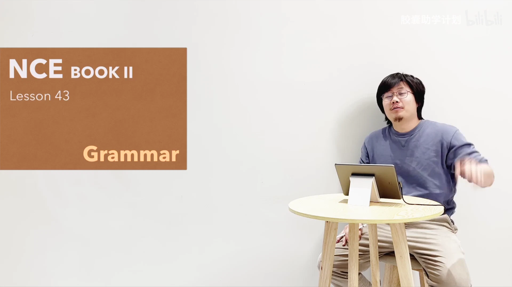

文字识别：NCE / BOOKII / Lesson 43 / Grammar

### 画面 00:00:02

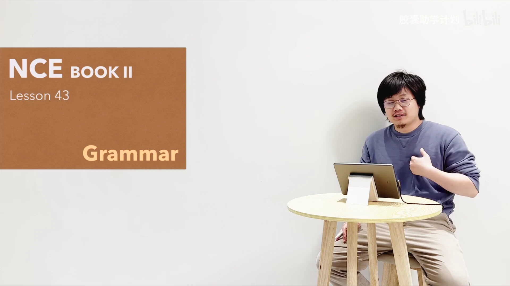

文字识别：NCE / BOOK"I / Lesson 43 / Grammar

### 画面 00:00:08

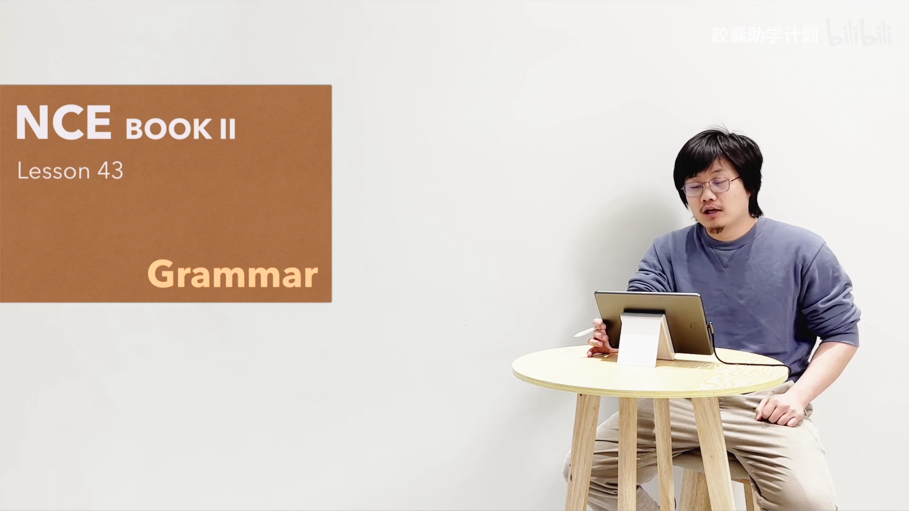

文字识别：NCE / BOOKII / Lesson 43 / Grammar

### 画面 00:00:10

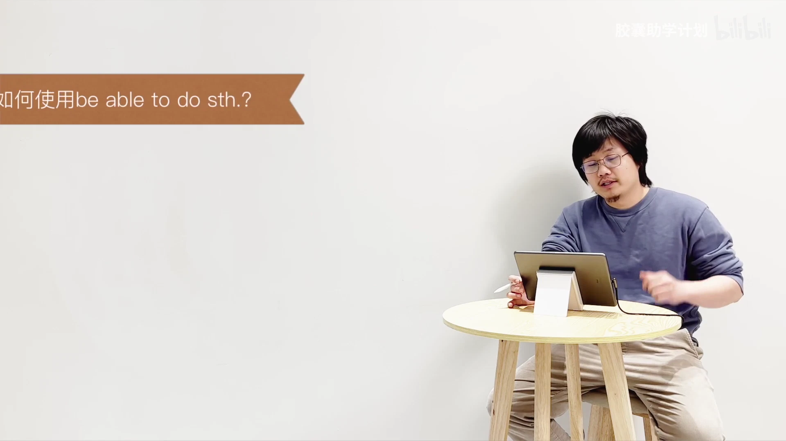

文字识别：如何使用be able to do sth.?

### 画面 00:00:12

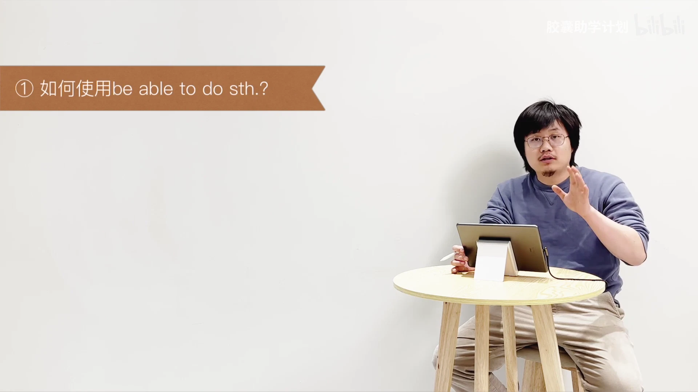

文字识别：①如何使用be able to do sth.?

### 画面 00:00:26

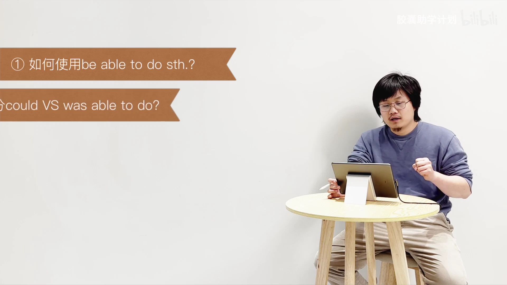

文字识别：①如何使用be able to do sth.? / 分could VS was able to do?

### 画面 00:00:28

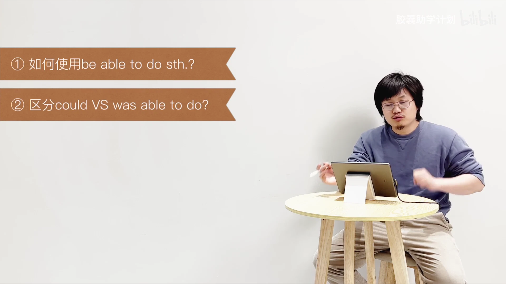

文字识别：①如何使用be able to do sth.? / 区分could VS was / able to do?

## 00:00:30–00:01:00

与 was able to do？它也就是 be able to do 的一个特殊形式啊。如何去区分这二者？那带着这两个问题， hope you can enjoy it. 好，那我们上来，首先肯定先说第一个事儿，最简单叫 be able to do，它到底什么个意思，对吧？其实对于各位来说呀， be，首先各位要知道 be 是什么，就是 am is are was were being being 那些单词，对

### 画面 00:00:31

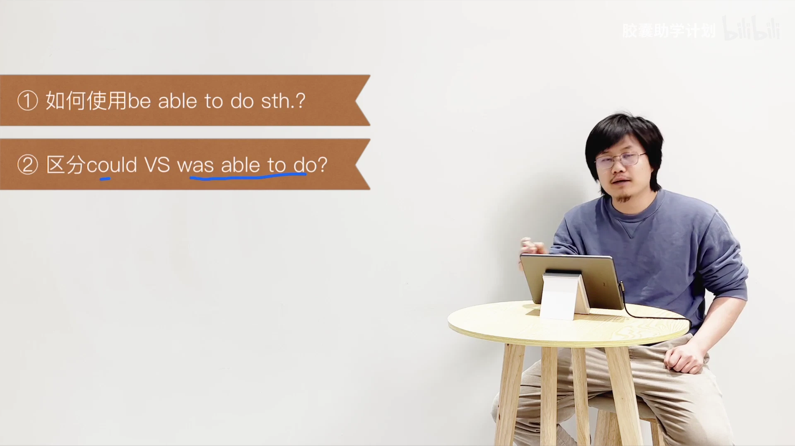

文字识别：①如何使用be able to do sth.? / 区分could VS / was / able to do?

### 画面 00:00:40

文字识别：胶囊助学计划b出出 / •

### 画面 00:00:44

### 画面 00:00:46

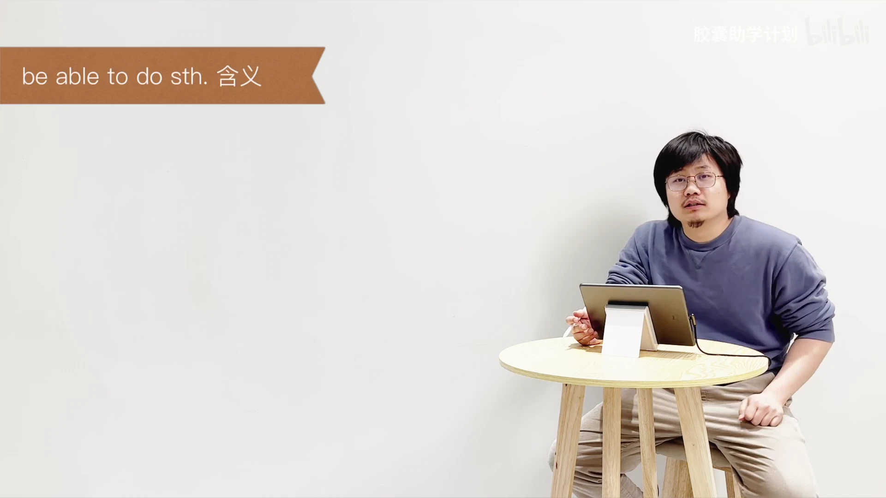

文字识别：be able to do sth. 含义

### 画面 00:00:54

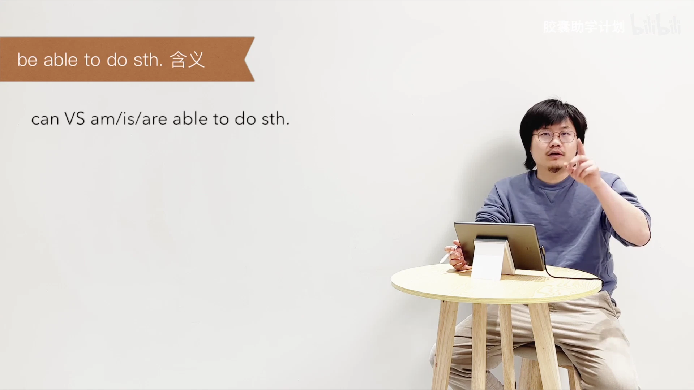

文字识别：be able to do sth. 含义 / can VS am/is/are able to do sth.

## 00:01:00–00:01:30

吧？OK，当然也包括be本身。那我们就拿它的一个最常见的形式叫am is are able to do something啊，来举一个例子。它其实含义基本上跟can是类似的。我们给大家两个句子，比如说We can see the lake from our hotel.我们能从我们的这个呃，我们能啊，can能对吧？新概念一册就学过了，四十三课、四十五课

### 画面 00:01:07

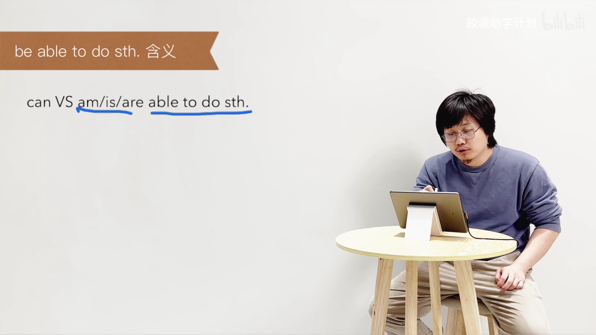

文字识别：be able to do sth. 含义 / can VS am/is/are able to do sth.

### 画面 00:01:16

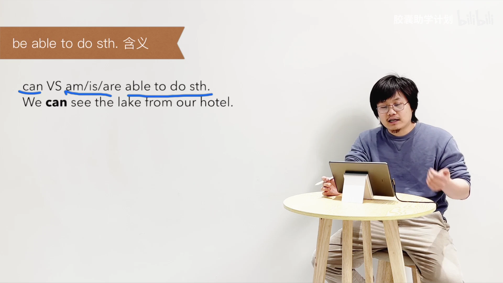

文字识别：be able to do sth. 含义 / Can VS am/is/are able to do sth. / We can see the lake trom our hotel.

### 画面 00:01:18

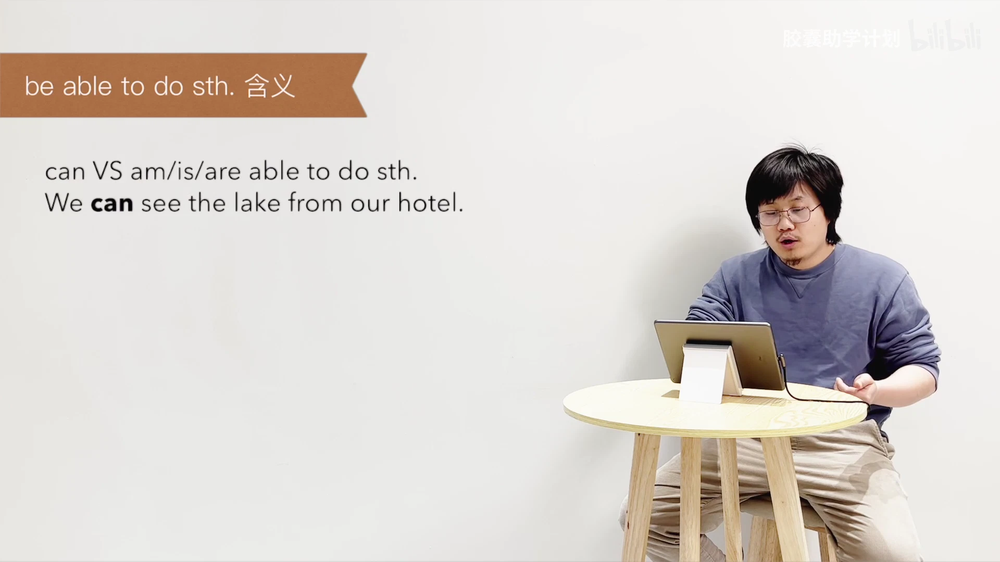

文字识别：be able to do sth. 含义 / can VS am/is/are able to do sth. / We can see the lake from our hotel.

## 00:01:30–00:02:00

都学的是 can。我们能看到这个湖，从我们的酒店里面能看到。注意，如果说它含义相同，你直接给它带进去就行了。于是你把 can 去掉，把 am, is, are able to do something 带进来，这句话就变成了叫 we are able to see the lake from our hotel。各位看啊，什么叫 be able to do 啊？ be 现在被换成了 are，

### 画面 00:01:42

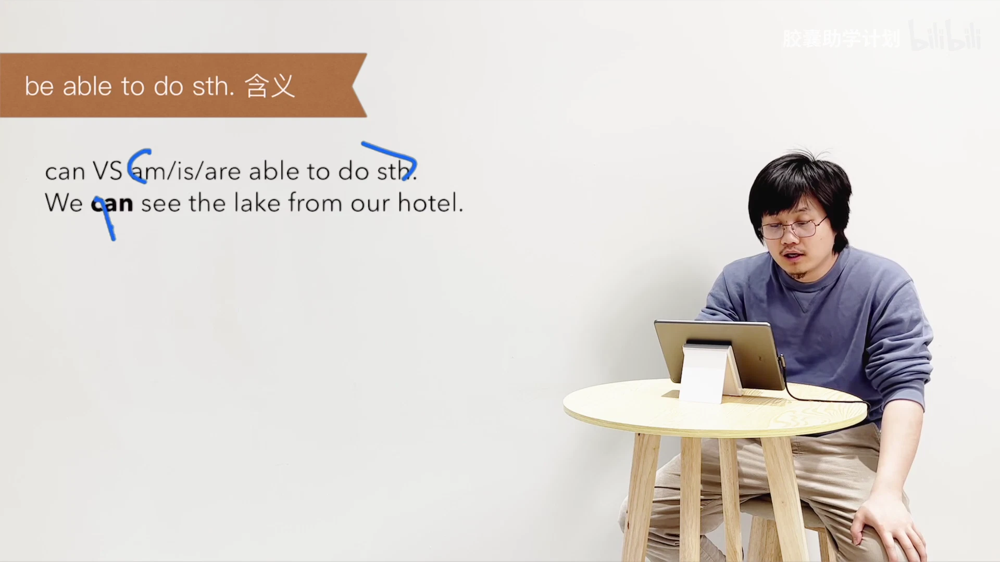

文字识别：be able to do sth.含义 / can Vs Am/is/are able to do sth. / We can see the lake from our hotel.

### 画面 00:01:47

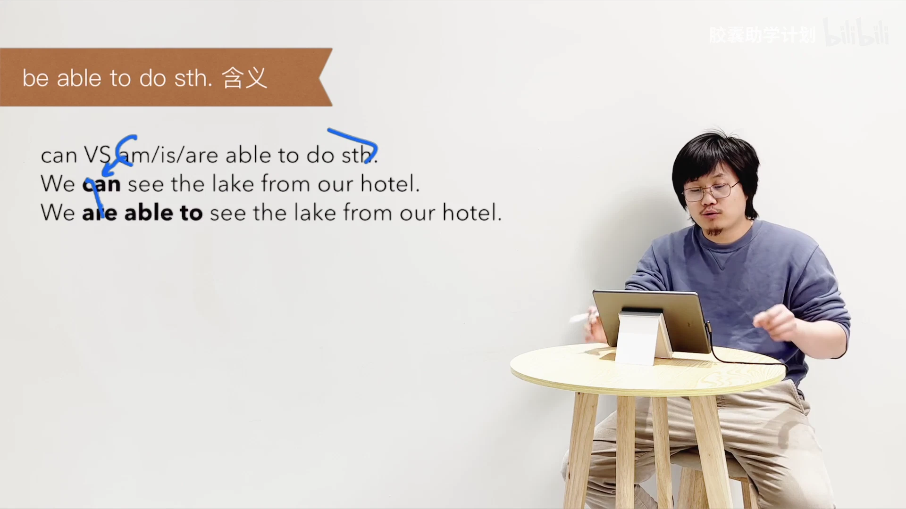

文字识别：be able to do sth. 含义 / can VsAm/is/are able to do sth. / We can see the lake from our hotel. / We ale able to see the lake from our hotel.

### 画面 00:01:50

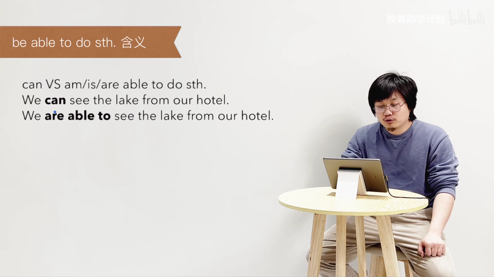

文字识别：be able to do sth.含义 / can VS am/is/are able to do sth. / We can see the lake from our hotel. / We are able to see the lake from our hotel.

### 画面 00:01:57

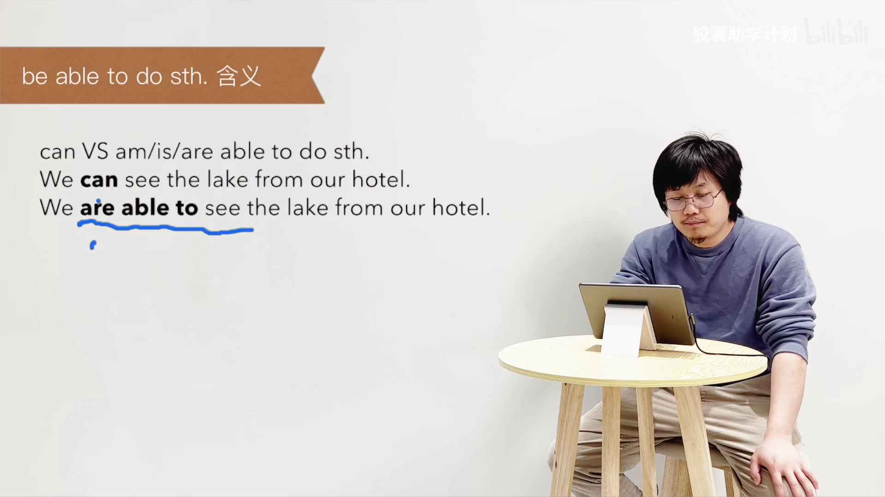

文字识别：be able to do sth. 含义 / can VS am/is/are able to do sth. / We can see the lake from our hotel. / We are able to see the lake from our hotel.

## 00:02:00–00:02:30

原因是 we 后边要用二，对吧？这个是很容易的。 able to 不变，动词还是用原形，can 后边也用动词原形，在这里也用动词原形，所以这两句话的翻译是一模一样的，叫做我们能看到湖从我们的 hotel 当中啊，从我们的这个旅店当中，我们能看到这个湖。其次啊，各位要注意一个小点，如果各位自己

### 画面 00:02:07

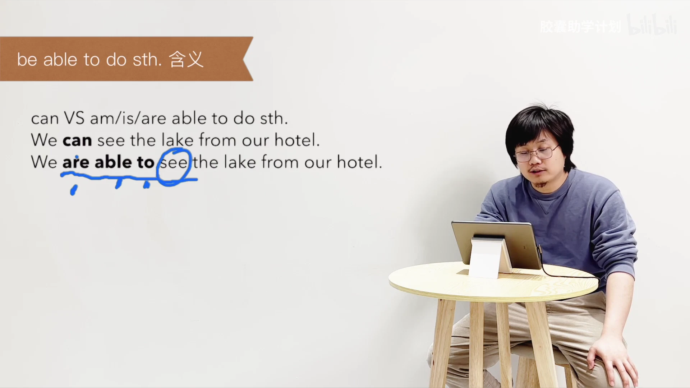

文字识别：be able to do sth. 含义 / can VS am/is/are able to do sth. / We can see the lake from our hotel. / We are able toseethe lake from our hotel.

### 画面 00:02:12

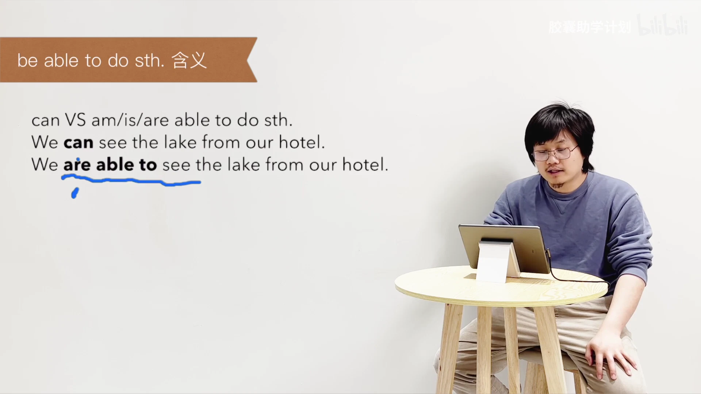

文字识别：be able to do sth. 含义 / can VS am/is/are able to do sth. / We can see the lake from our hotel. / We are able to see the lake from our hotel.

### 画面 00:02:14

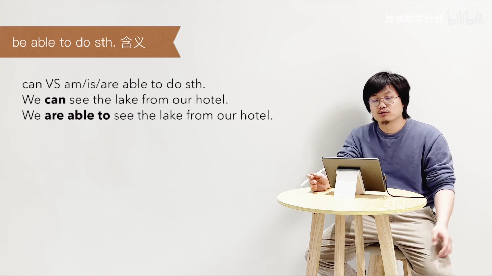

文字识别：be able to do sth. 含义 / can VS am/is/are able to do sth. / We can see the lake from our hotel. / We are able to see the lake from our hotel.

## 00:02:30–00:03:00

去用，多用这个，少用底下的这个，底下的这个并不是不对，它是对的，但是它的出现频率相对而言比 can 要少很多。即使英语是啊，即使母语是英语的这帮人也是这样说的，对吧？所以你对于各位来说，你只要知道它什么意思初期就可以了啊，你不用主动去造这样的句子，你不用说 we are able to see the light，你可以直接说 we can see the light，啊，省事儿又好用，

### 画面 00:02:32

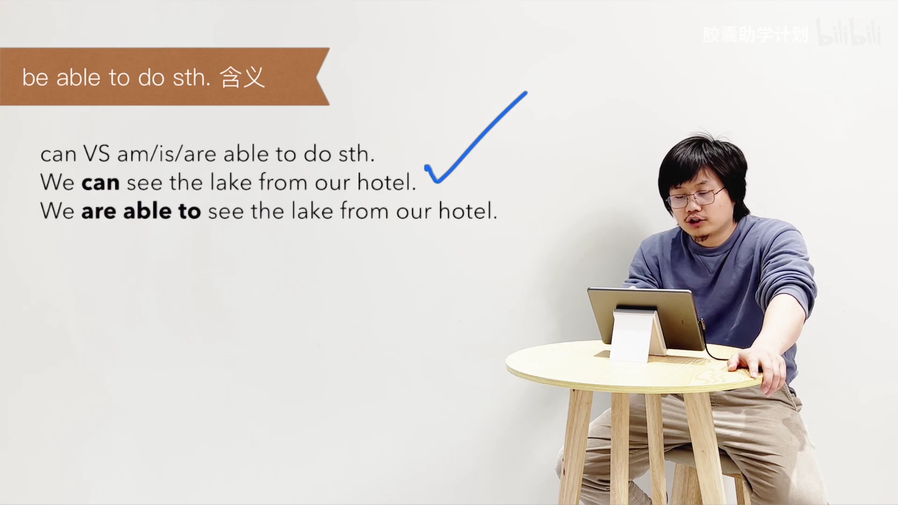

文字识别：be able to do sth.含义 / can VS am/is/are able to do sth. / We can see the lake from our hotel. / We are able to see the lake from our hotel.

### 画面 00:02:35

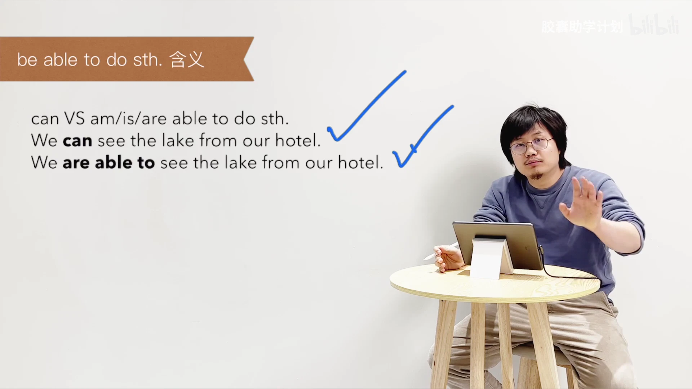

文字识别：be able to do sth. 含义 / can VS am/is/are able to do sth. / We can see the lake from our hotel. / We are able to see the lake from our hotel.

## 00:03:00–00:03:30

对吧？其次，它如何变一般疑问句？这个我们马上放到一起去说。为什么呢？因为比 able to do 啊，还有各种形态，它它还有它的时态更复杂，它还能跟别的结构连起来。那跟别的结构连起来，我们以后见一个说一个。我们今天先给大家说一下时态的事儿。比如说刚才的 I'm is able to do，这就是一般现在时嘛，对不对？比如说 We are able to see the lake

### 画面 00:03:05

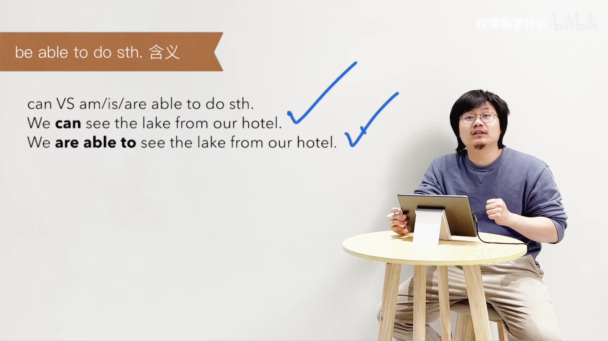

文字识别：be able to do sth. 含义 / can VS am/is/are able to do sth. / We can see the lake from our hotel. / We are able to see the lake from our hotel.

### 画面 00:03:07

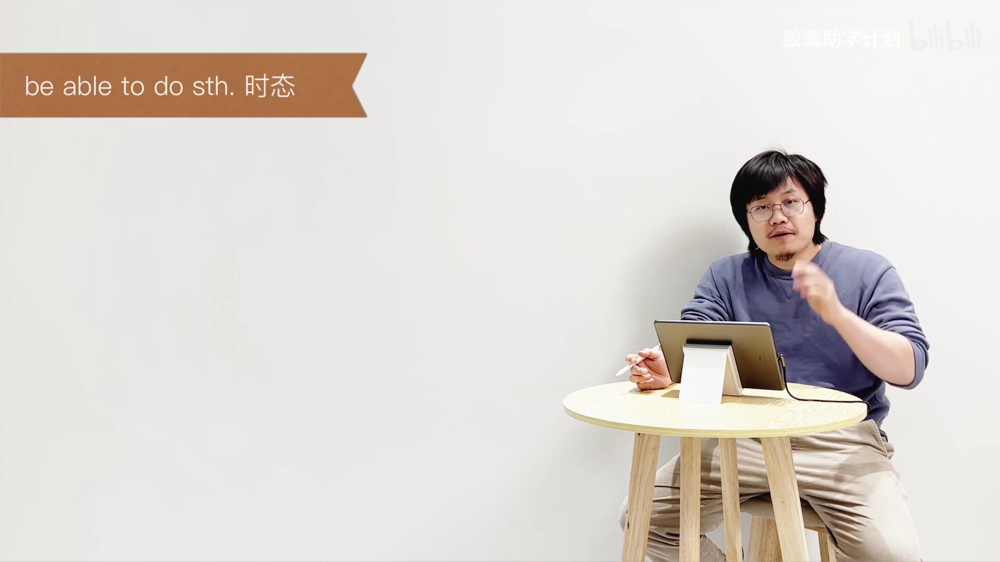

文字识别：be able to do sth.时态

### 画面 00:03:27

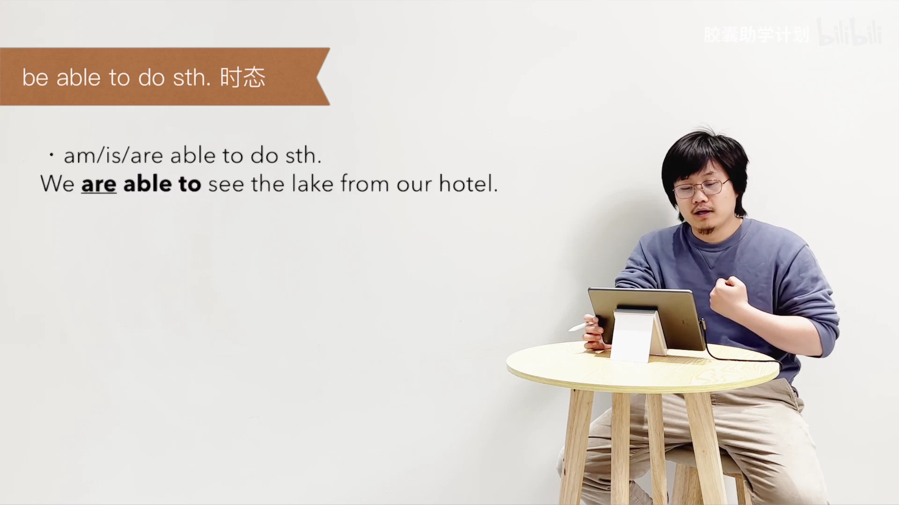

文字识别：be able to do sth. 时态 / · am/is/are able to do sth. / We are able to see the lake from our hotel.

## 00:03:30–00:04:00

from our hotel. 这就是个一般现在时。在一般现在时当中，你想去啊？在这个时，在这个句话当中，首先是一般现在时啊。其次，在这句话当中，我们想把它变一般疑问句，我们要把 are 提到句首去。记住这个，好吧？接下来，我现在不想说 I'm is are able to do 了。这说的是我现在能做什么，对不对？如果我想说我过去能做什么，那 be 这个单词就可以被变成 was 和 were。

### 画面 00:03:44

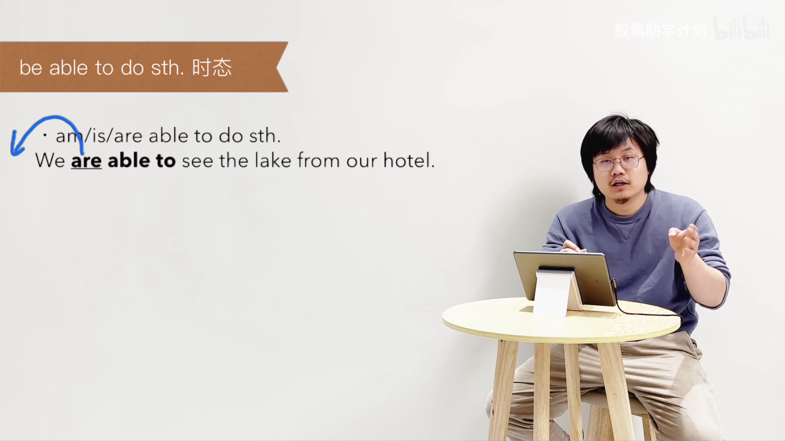

文字识别：be able to do sth.时态 / · an/is/are able to do sth. / We are able to see the lake from our hotel.

### 画面 00:03:56

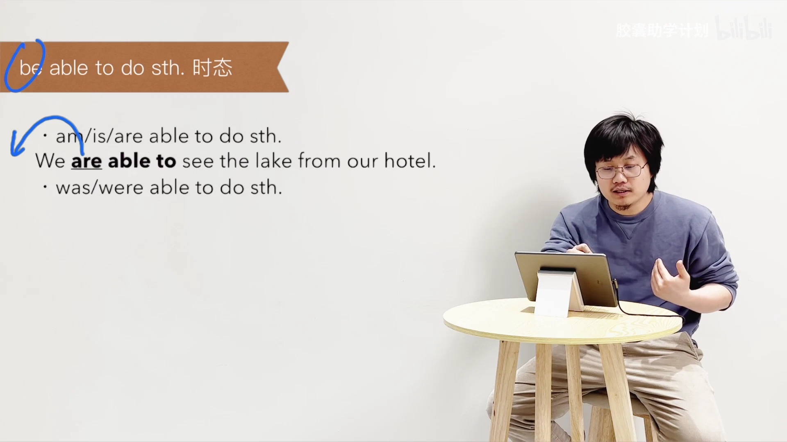

文字识别：beable to do sth.时态 / · an/is/are able to do sth. / We are able to see the lake from our hotel. / • was/were able to do sth.

### 画面 00:03:59

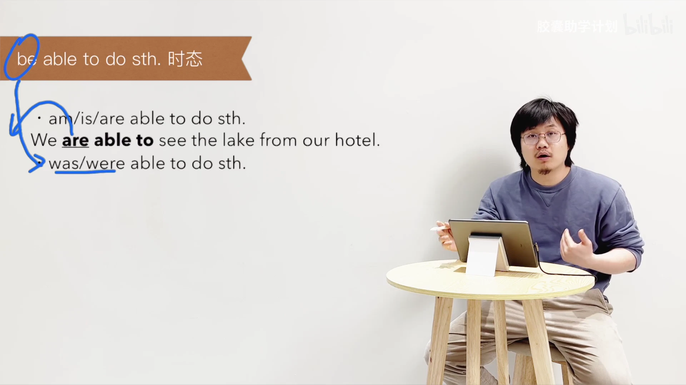

文字识别：be / able to do sth.时态 / · an/is/are able to do sth. / We are able to see the lake from our hotel. / was/were able to do sth.

## 00:04:00–00:04:30

于是这句话就变成了叫 was were able to do，叫做过去能怎么怎么样啊？好，比如说 we were able to see the lake from our hotel，叫做我们能看到这个湖从我们的酒店当中。你注意这两者的区别是什么呢？首先一个是 are，一个是 were，这是我们明眼看到的。那它的内涵区别是什么呢？上面是一般现在时，底下是一般过

### 画面 00:04:09

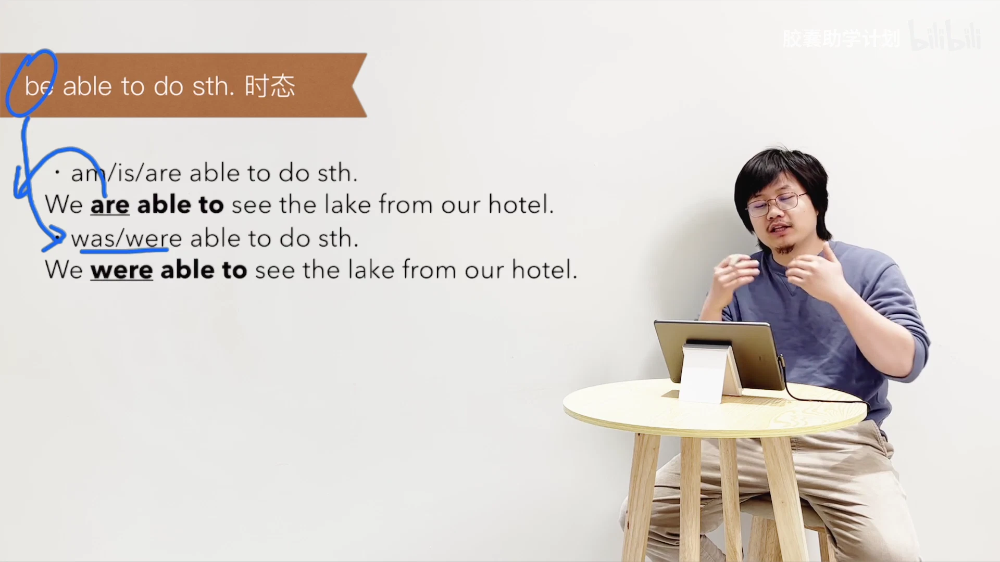

文字识别：be able to do sth.时态 / · an/is/are able to do sth. / We are able to see the lake from our hotel. / was/were able to do sth. / We were able to see the lake from our hotel.

### 画面 00:04:20

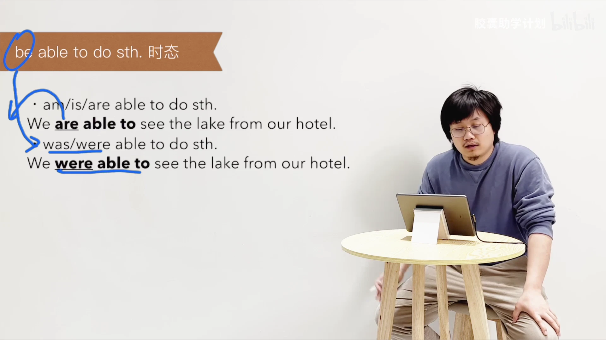

文字识别：beable to do sth.时态 / · an/is/are able to do sth. / We are able to see the lake from our hotel. / was/were able to do sth. / We were able to see the lake from our hotel.

### 画面 00:04:23

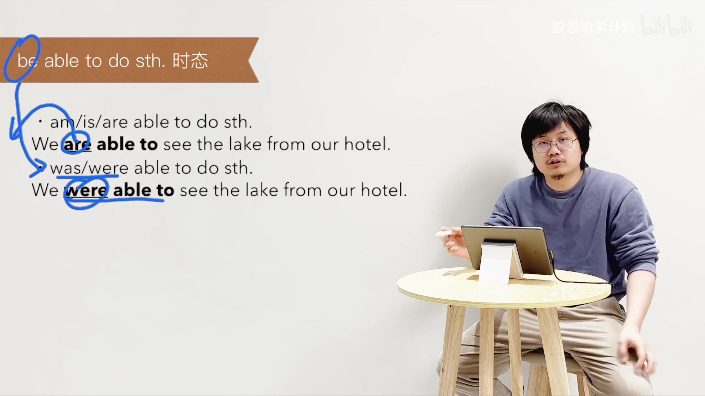

文字识别：beable to do sth.时态 / • an/is/are able to do sth. /  able to see the lake from our hotel. / We / was/were able to do sth. / We / Were able to see the lake from our hotel.

## 00:04:30–00:05:00

去时。使用场景有什么区别呢？比如说，我们现在就在酒店里，然后哎，我站在窗户旁边说了一句话，说哎，Look, we are able to see the lake from our hotel. 这是我现在在说一般现在时，对吧？如果我们这个事儿发生在昨天，然后呢，我们现在在回想这件事情，我说，Trust me，你相信我是吧？We were able to see the lake from our hotel. 我昨天看的真真切切的，我们昨天呢能看到这个

### 画面 00:04:40

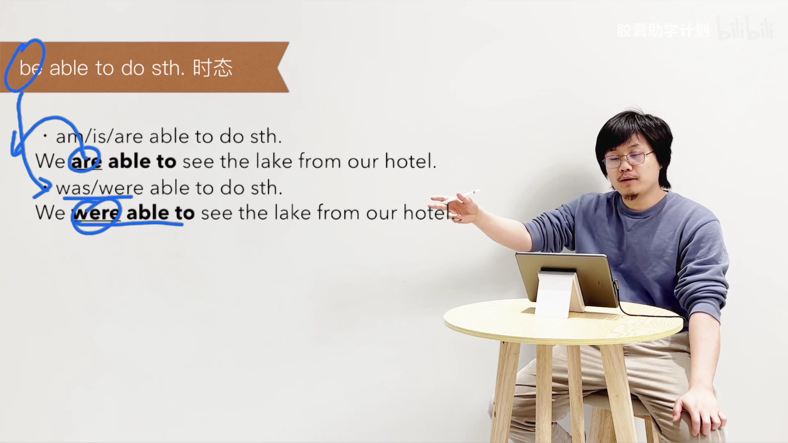

文字识别：beable to do sth.时态 / · an/is/are able to do sth. / We able to see the lake from our hotel. / was/were able to do sth. / We / Were able to see the lake from our hotel

### 画面 00:04:45

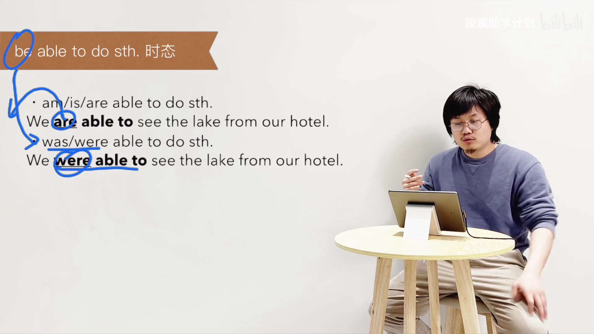

文字识别：be able to do sth.时态 / • an/is/are able to do sth. / We able to see the lake from our hotel. / was/were able to do sth. / We / Were able to see the lake from our hotel.

## 00:05:00–00:05:30

湖，从我们的这个呃酒店当中，对吧？OK，玩一个，continue下一个时态啊。那同理啊，这个地方你要是想变一般疑问句怎么办呢？是把were提到句首去啊。同理，它还有一个时态叫have has加been加able to do。所以这个地方就要考验的是各位之前的语法基础好不好了。如果你语法基础非常好，看到这里的时候，我总觉得你已经会

### 画面 00:05:09

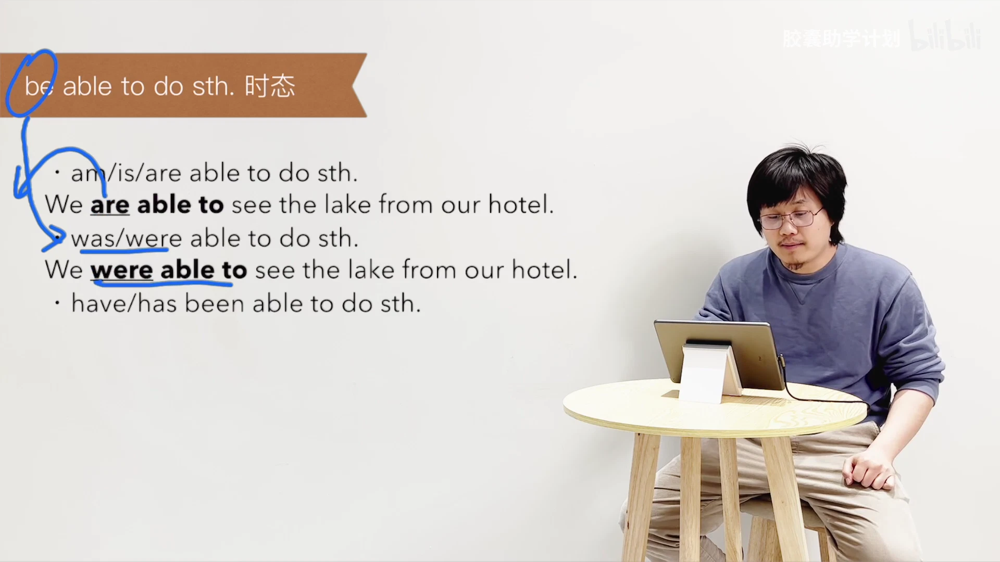

文字识别：be able to do sth.时态 / · an/is/are able to do sth. / We are able to see the lake from our hotel. / was/were able to do sth. / We were able to see the lake from our hotel. / · have/has been able to do sth.

### 画面 00:05:11

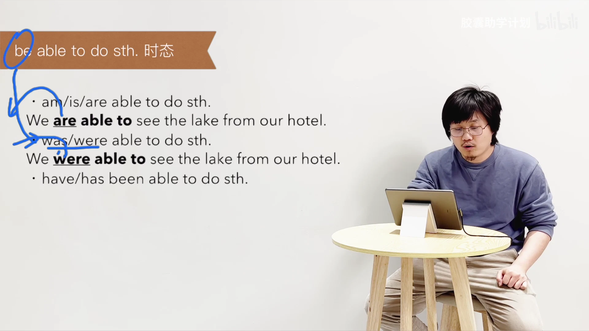

文字识别：be able to do sth.时态 / ·an/is/are able to do sth. / We are able to see the lake from our hotel. / was/were able to do sth. / We Were able to see the lake from our hotel. / · have/has been able to do sth.

### 画面 00:05:16

文字识别：be able to do sth.时态 / · an/is/are able to do sth. / We are able to see the lake from our hotel. / was/were able to do sth. / We Were able to see the lake from our hotel. / · have/has been able to do sth.

### 画面 00:05:21

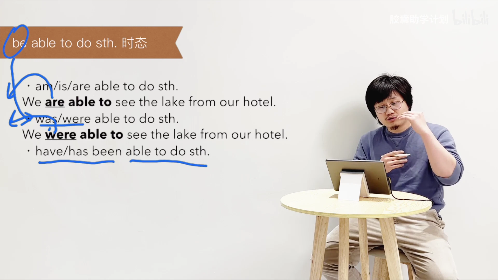

文字识别：beable to do sth.时态 / · an/is/are able to do sth. / We are able to see the lake from our hotel. / was/were able to do sth. / We Were able to see the lake from our hotel. / · have/has been able to do sth.

## 00:05:30–00:06:00

了，原因是 have has 加 been 这两个单词放到一起的时候，它的含义是什么？是现在完成时，对吧？哎，那 have has been able to do 就是一直能怎么怎么样。那我给大家造了一句否定句，比如说啊，这个当然呃，这个给给大家一个否定句，叫 I haven't been able to sleep recently。说我最近都一直不能睡觉啊，都睡不太好，

### 画面 00:05:45

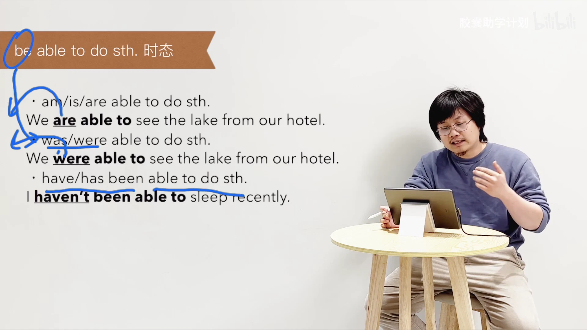

文字识别：beable to do sth.时态 / · an/is/are able to do sth. / We are able to see the lake from our hotel. / was/were able to do sth. / We Were able to see the lake from our hotel. / · have/has been able to do sth. / I haven't been able to sleep recently.

### 画面 00:05:47

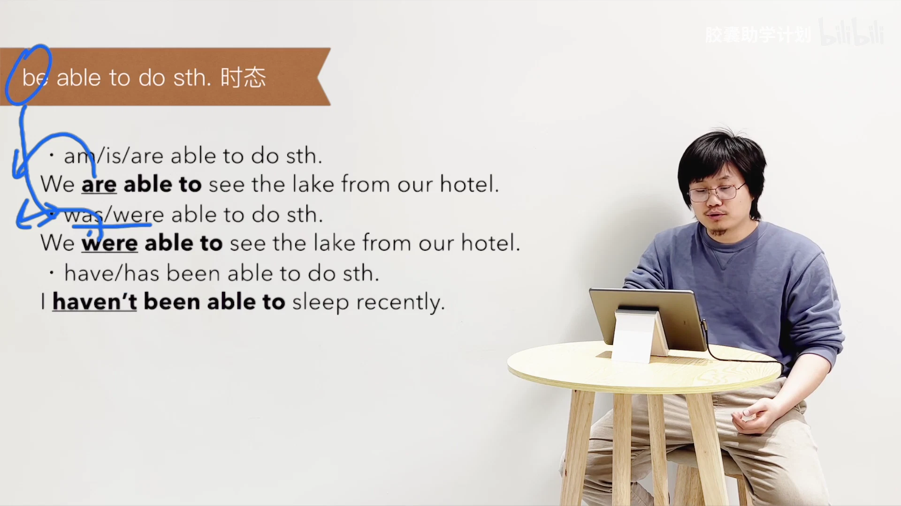

文字识别：beable to do sth.时态 / · an/is/are able to do sth. / We are able to see the lake from our hotel. / was/were able to do sth. / We Were able to see the lake from our hotel. / · have/has been able to do sth. / I haven't been able to sleep recently.

### 画面 00:05:56

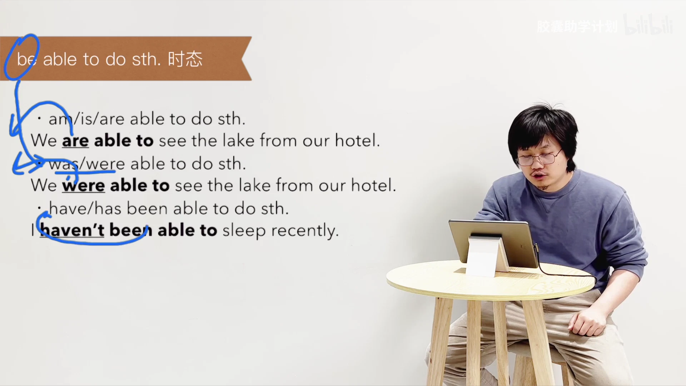

文字识别：be able to do sth.时态 / · an/is/are able to do sth. / We are able to see the lake from our hotel. / was/were able to do sth. / We Were able to see the lake from our hotel. / ^have/has been able to do sth. / haven't been able to sleep recently.

### 画面 00:05:58

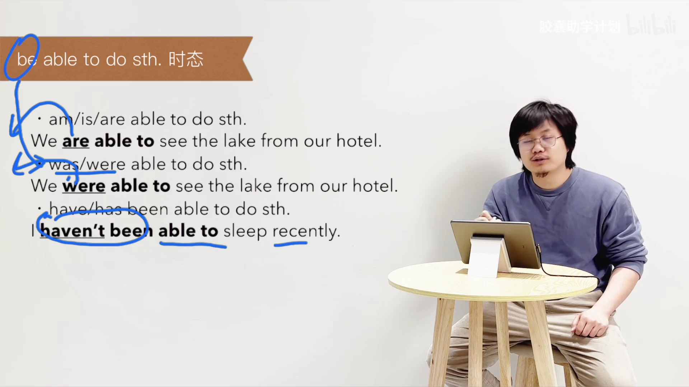

文字识别：be / able to do sth.时态 / ·an/is/are / able to do sth. / We / are / able /  to see the| / lake / from our hotel. / was / /were / able to do sth. / We / Were able to see the lake / from our hotel. / :have/has been able to do sth. / haven't bee able to sleep r /  recently.

## 00:06:00–00:06:30

都睡不着啊，一直都失眠。OK，Very good。那这个地方你各位看到了，其实它的用法就还是 be able to do，只不过这个 be 呢变成了 have 加 been，对不对？OK，还是同理啊。如果你现在把它不是否定句，你把它想成肯定句，叫 I have been able to sleep recently。我们不管这句话含义啊，你就想这个肯定句，想变一般疑问句，其实无非也就是把 have 提到句首去，对吧？

### 画面 00:06:06

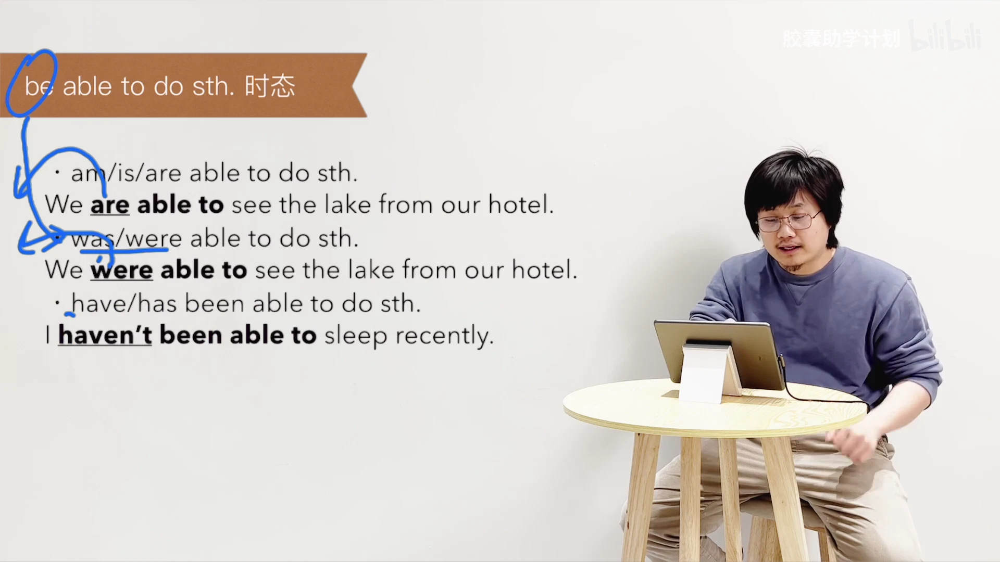

文字识别：be able to do sth.时态 / · an/is/are able to do sth. / We are able to see the lake from our hotel. / was/were able to do sth. / We Were able to see the lake from our hotel. / • have/has been able to do sth. / I haven't been able to sleep recently.

### 画面 00:06:10

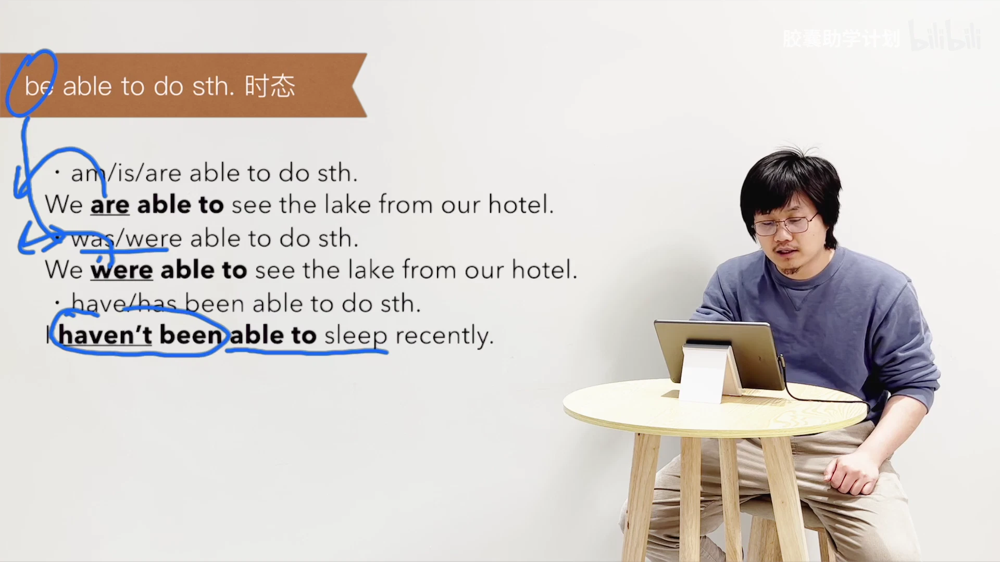

文字识别：bea / able to do sth. 时态 / · an/is/are able to do sth. / We are able to see the lake from our hotel. / was/were able to do sth. / We Were able to see the lake from our hotel. / : have/has been able to do sth. / haven't been able to sleep recently.

## 00:06:30–00:07:00

也就是跟随着现在完成时的那个变法去变啊。 Continue，最后一个叫做 will be able to do，叫做将能去做什么什么事情啊？将能怎么怎么样？你看 able to do something 不变，把 be 换成了 will 加 be，所以这里其实本质上就是 am/is/are 变成 was/were 变成 have been 变成 will be，后边的 able to do something 不变，对吧？时态就出来了

### 画面 00:06:36

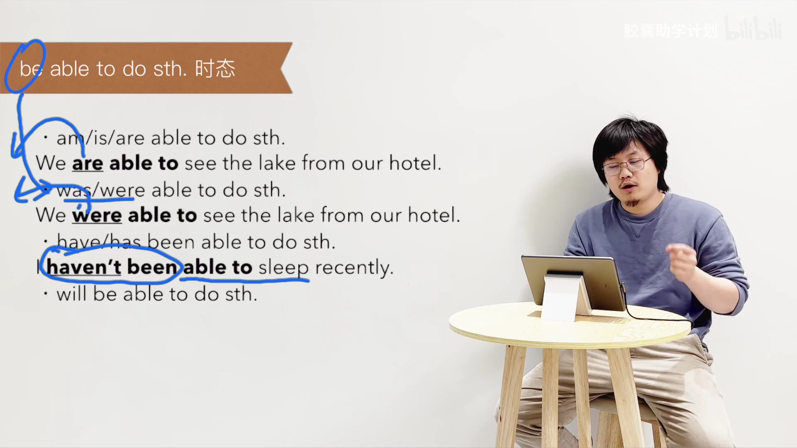

文字识别：be / able to do sth.时态 / · an/is/are able to do sth. / We are able to see the lake from our hotel. / was/were able to do sth. / We Were able to see the lake from our hotel. / :have/has been able to do sth. / haven't beenable to sleep recently. / • will be able to do sth.

### 画面 00:06:43

文字识别：beable to do sth.时态 / · an/is/are able to do sth. / We are able to see the lake from our hotel. / was/were able to do sth. / We Were able to see the lake from our hotel. / : have/has been able to do sth. / haven't beenable to sleep recently. / • will be able to do sth.

### 画面 00:06:45

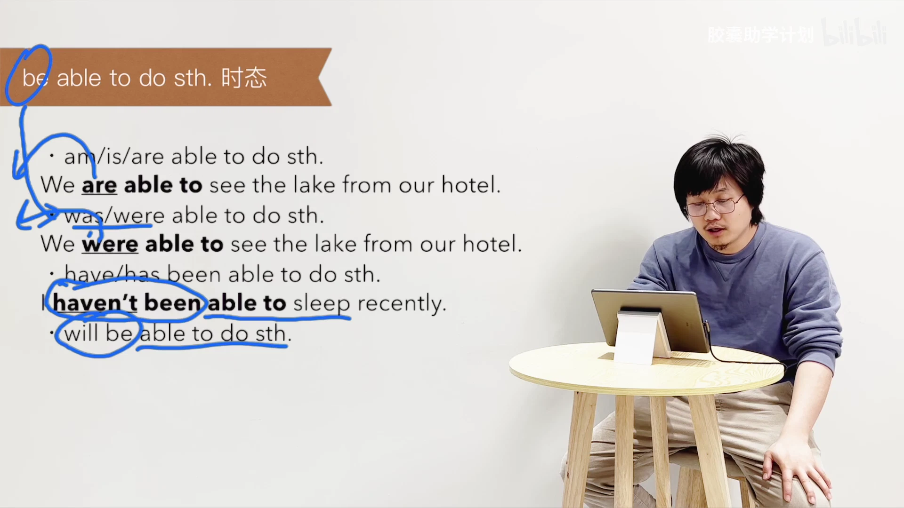

文字识别：be / able to do sth. 时态 / · an/is/are able to do sth. / We are able to see the lake from our hotel. / was/were able to do sth. / We Were able to see the lake from our hotel. / : have/has been able to do sth. / haven't been able to sleep recently. / will be able to do sth.

### 画面 00:06:57

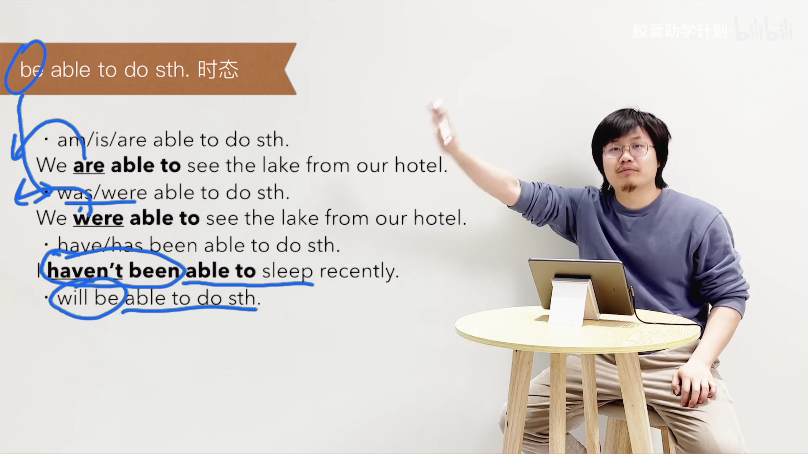

文字识别：be able to do sth.时态 / · an/is/are able to do sth. / We are a / able to see the lake from our hotel. / was/were a / able to do sth. / We Were able to see the lake from our hotel. / :have/has been able to do sth. / haven't beenable to sleep recently. / will be able to do sth.

## 00:07:00–00:07:30

啊！造一句话吧，比如说 He will be able to help you tonight. 叫他将能帮助你今天晚上，对吧？Okay, very good. 这个东西啊，就我们现在说的这些 be able to do 的时态，对于各位来说，我现在的要求并不是你立刻就能主动去用它，是说你看到它，你能反应过来，它实际上是时态加了 be able to do，我觉得就够了，好吧？Okay，

### 画面 00:07:00

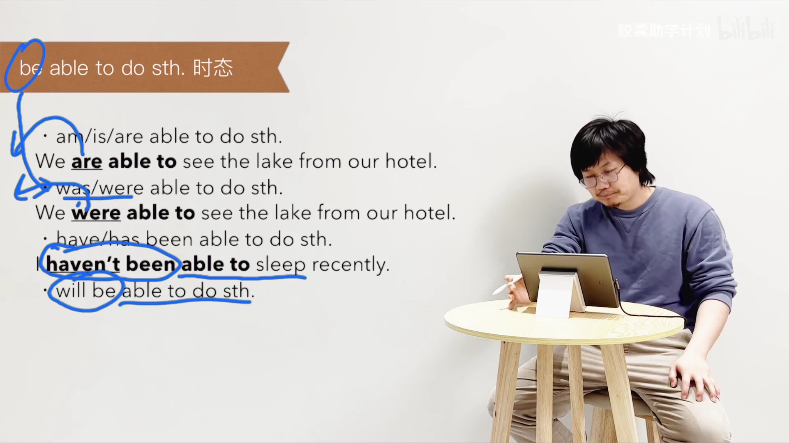

文字识别：bea / able to do sth.时态 / · an/is/are able to do sth. / We are able to see the lake from our hotel. / was/were able to do sth. / We Were able to see the lake from our hotel. / : have/has been able to do sth. / haven't beenable to sleep recently. / will be able to do sth.

### 画面 00:07:04

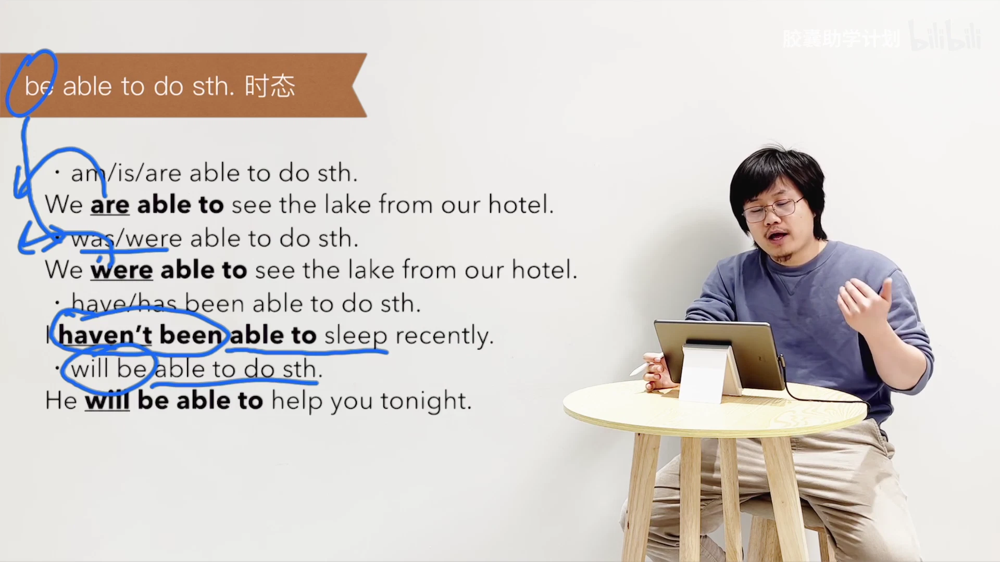

文字识别：beable to do sth.时态 / · an/is/are able to do sth. / We are able to see the lake from our hotel. / was/were able to do sth. / We Were able to see the lake from our hotel. / : have/has been able to do sth. / haven't beenable to sleep recently. / will be able to do sth. / He wml be able to help you tonight.

### 画面 00:07:07

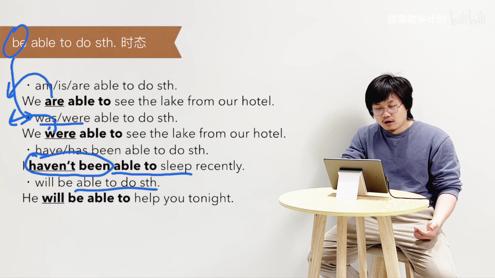

文字识别：be able to do sth.时态 / · an/is/are able to do sth. / We are able to see the lake from our hotel. / was/were a / able to do sth. / We Were able to see the lake from our hotel. / :have/has been able to do sth. / haven't been able to sleep recently. / • will be able to do sth. / He will be able to help you tonight.

## 00:07:30–00:08:00

那这是我们讲的第二个，第一个叫做它表示能，第二个呢，be able to do，对吧？最常见的意思表能，第二个呢是告诉各位，be able to do还有不同的时态，对吧？好，第三个是接下来我们要说的，叫做could和was able to do，这是什么呢？好，could是不是表示能啊？首先对于各位来说很熟悉，这我们新一学过，新一百零三课咱们学过，对吧？然后呢，它是can的

### 画面 00:07:37

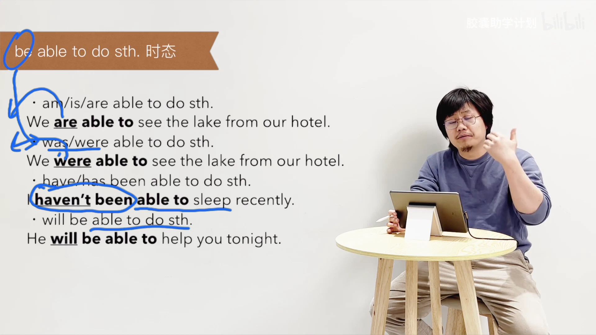

文字识别：beable to do sth.时态 / · an/is/are able to do sth. / We are able to see the lake from our hotel. / was/were able to do sth. / We Were able to see the lake from our hotel. / : have/has been able to do sth. / haven't beenable to sleep recently. / • will be able to do sth. / He will be able to help you tonight.

### 画面 00:07:40

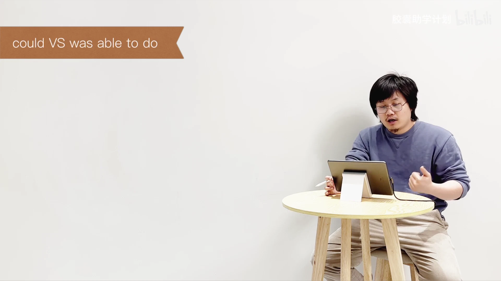

文字识别：could VS was able to do

### 画面 00:07:45

文字识别：could VS was able to do

### 画面 00:07:47

文字识别：could VS was able to do

### 画面 00:07:52

文字识别：could VS was able to do

## 00:08:00–00:08:30

过去式。如果表示过去能怎么怎么样，就用 could。而刚才我们说了，be able to do，第一个问题就是它表示能。那它还有时态叫做 was able to do，那就表示过去能，对吧？那这两者好像应该是一样的，对不对？哎，在这儿又有一个例外出来了。各位看一下啊，如果你仅仅表示过去的一个能力啊，五岁能游泳，八岁能骑马，十一岁能作诗，这叫过去的一

### 画面 00:08:05

文字识别：could Vs / swas able to do

### 画面 00:08:07

文字识别：could Vs / swas able to do

### 画面 00:08:20

文字识别：could Vswas able to do / ·过去能力:could & was able to

## 00:08:30–00:09:00

个能力。Could和was able to都可以，没有任何问题。比如说，说My grandfather could speak five languages。说，我印象当中啊，我的祖父能说五门不同的语言，这是过去对吧？我对他过去的一个印象。比如说，他人已经没了啊，那我们还可以把这个could直接就给他换成叫was able to啊，或者不一定人没了，比如说他得老年痴呆了，对吧？他把

### 画面 00:08:48

文字识别：could Vswas able to do / ·过去能力: could ＆ was able to / 1. My grandfather could speak five languages.

### 画面 00:08:52

文字识别：could Vswas able to do / ·过去能力: could ＆ was able to / 1. My grandfather could / speak five languages. / 2. My grandfather was able to speak five languages.

## 00:09:00–00:09:30

呃很多事情都忘了啊。说 My grandfather was able to speak five languages。这两者都表示过去的一种普通的、普遍的能力，都可以用。听见了啊？接下来重点来了。如果是表示过去成功事件，换一句话来说，叫做告诉各位，was able to有一个特殊的用法，表示的是过去的成功事件，

### 画面 00:09:09

文字识别：could Vswas able to do / ·过去能力: could ＆ was able to / 1. My grandfather could / speak five languages. / 2. My grandfather was able tospeak five languages.

### 画面 00:09:11

文字识别：could Vs / was able to do / ·过去能力：could ＆ was a / able to / 1. My grandfather could / speak five / languages. / 2.My 9 / 1 grandfather was able to speak fivel / languages.

### 画面 00:09:15

文字识别：could VS was able to do

### 画面 00:09:27

文字识别：could VS was able to do / ·过去成功事件(succeeded in doing sth.): was able to

## 00:09:30–00:10:00

叫 succeeded in doing something. 这个习惯用法咱们恰好还学过，对吧？成功的做成了某件事情的时候，我们一般不用 could，我们一般用 was able to。比如说，我们看这句话，the fire spread quickly，火势扩张的非常的快。But everybody was able to escape。每一个人都成功的。

### 画面 00:09:31

文字识别：could VS was able to do / ·过去成功事件(succeeded in doing sth.): was able to

### 画面 00:09:42

文字识别：could VS was able to do / ·过去成功事件(succeeded in doing sth.): / was able to / 1.The / fire / spread / quickly, bute / everybody / was abie / to / escape.

### 画面 00:09:44

文字识别：could VS was able to do / ·过去成功事件(succeeded in doing sth.): was able to / 1. The fire spread quickly, but everybody was able to / escape.

### 画面 00:09:46

文字识别：could VS was able to do / ·过去成功事件(succeeded in doing sth.): was able to / 1. The fire spread quickly, but everybody was able to / escape.

### 画面 00:09:51

文字识别：could VS was able to do / ·过去成功事件(succeeded in doing sth.): was able to / 1. The fire spread quickly, but everybody was able to / escape.

### 画面 00:09:55

文字识别：could VS was able to do / ·过去成功事件(succeeded in doing sth.): was able to / 1. The fire spread quickly, but everybody was able to / escape.

## 00:10:00–00:10:30

注意 was able to在这儿不单纯翻译成能，它表示了叫做成功的逃了出来，escape是逃。你看这就不是一种能力，不是一种什么普遍能力，对吧？会说会唱会跳会跑会飞，不是这样一种能力，表示的是过去一个成功事件。我们再给大家一个例子啊，注意在这里只能用 was able to，不能用 could，好吧？啊，我们只能用 was able to啊，在这种状态之下，我们再来一个例句。Jack

### 画面 00:10:10

文字识别：could VS was able to do / ·过去成功事件(succeeded in doing sth.): was able to / 1. The fire spread quickly, but everybody was able to / escape.

### 画面 00:10:24

文字识别：could VS was able to do / ·过去成功事件(succeeded in doing sth.): was able to / 1. The fire spread quickly, but everybody was able to / escape. / 2. Jack and Andy played a match yesterday. Andy / played well, but Jack was able to beat him.

## 00:10:30–00:11:00

and Andy played a match yesterday.昨天他们打了场比赛. Andy played well. Andy打的还不错.但是Jack was able to beat him.叫做成功的击败了他.看见了吧?这里它其实某种程度上更像呃一个副词的感觉,叫successfully,对吧?比如说这句话,你可好像更像能把它变成叫做Jack beat him successfully.啊,更像是这样一种句子. OK,所以

### 画面 00:10:39

文字识别：could VS was able to do / ·过去成功事件(succeeded in doing sth.): was able to / 1. The fire spread quickly, but everybody was able to / escape. / 2. Jack and Andy played a match yesterday. Andy / played well, but Jack was able to beat him.

## 00:11:00–00:11:30

它起到的更像不是一个结构了，表示能，并不是啊，它表示成功完成了某件事情。好，在这里只能用 was able to，不能用 could。第三个，比如说我们再来一句话，叫 Did you finish your work this afternoon？说，哎，你今天 finish your work，叫完成你的工作，this afternoon，叫今天下午啊，今天下午你完成你的工作了吗？Yes， there was nobody to disturb

### 画面 00:11:01

文字识别：could VS was able to do / ·过去成功事件(succeeded in doing sth.): was able to / 1. The fire spread quickly, but everybody was able to / escape. / 2. Jack and Andy played a match yesterday. Andy / played well but Jack was able to beat him.

### 画面 00:11:10

文字识别：could VS was able to do / ·过去成功事件(succeeded in doing sth.): was able to / 1. The fire spread quickly, but everybody was able to / escape. / 2. Jack and Andy played a match yesterday. Andy / played well, but Jack was able to beat him. / 3. a: Did you finish your work this afternoon?

### 画面 00:11:17

文字识别：could VS was able to do / ·过去成功事件(succeeded in doing sth.): was able to / 1. The fire spread quickly, but everybody was able to / escape. / 2. Jack and Andy played a match yesterday. Andy / played well, but Jack was able to beat him. / 3. a: Did you finish your work this afternoon?

### 画面 00:11:24

文字识别：could VS was able to do / ·过去成功事件(succeeded in doing sth.): was able to / 1. The fire spread quickly, but everybody was able to / escape. / 2. Jack and Andy played a match yesterday. Andy / played well, but Jack was able to beat him. / 3. a: Did you finish your work this afternoon?

## 00:11:30–00:12:00

me.说没有人打扰我，so所以，我怎么样？叫我成功的完成了我的作业。那我们想一下怎么带？叫做I, I was able to finish my work，对吧？所以这里他其实想表达的不是说能不能，不是一种能力，而是说成功的完成了某件事情。所以这

### 画面 00:11:34

文字识别：could VS was able to do / ·过去成功事件(succeeded in doing sth.): was able to / 1. The fire spread quickly, but everybody was able to / escape. / 2. Jack and Andy played a match yesterday. Andy / played well, but Jack was able to beat him. / 3. a: Did you finish your work this afternoon? / b: Yes, there was nobody to disturb meso

### 画面 00:11:42

文字识别：could VS was able to do / ·过去成功事件(succeeded in doing sth.): was able to / 1. The fire spread quickly, but everybody was able to / escape. / 2. Jack and Andy played a match yesterday. Andy / played well, but Jack was able to beat him. / 3. a: Did you finish your work this afternoon? / b: Yes, there was nobody to disturb meso / wOS

### 画面 00:11:44

文字识别：could VS was able to do / ·过去成功事件(succeeded in doing sth.): was able to / 1. The fire spread quickly, but everybody was able to / escape. / 2. Jack and Andy played a match yesterday. Andy / played well, but Jack was able to beat him. / 3. a: Did you finish your work this afternoon? / b: Yes, there was nobody to disturb meso / wos abe -f

### 画面 00:11:46

文字识别：could VS was able to do / ·过去成功事件(succeeded in doing sth.): was able to / 1. The fire spread quickly, but everybody was able to / escape. / 2. Jack and Andy played a match yesterday. Andy / played well, but Jack was able to beat him. / 3. a: Did you finish your work this afternoon? / b: Yes, there was nobody to disturb meso / wos ae fo fin

### 画面 00:11:49

文字识别：could VS was able to do / ·过去成功事件(succeeded in doing sth.): was able to / 1. The fire spread quickly, but everybody was able to / escape. / 2. Jack and Andy played a match yesterday. Andy / played well, but Jack was able to beat him. / 3. a: Did you finish your work this afternoon? / b: Yes, there was nobody to disturb mesoI / was abe to finish

### 画面 00:11:52

文字识别：could VS was able to do / ·过去成功事件(succeeded in doing sth.): was able to / 1. The fire spread quickly, but everybody was able to / escape. / 2. Jack and Andy played a match yesterday. Andy / played well, but Jack was able to beat him. / 3. a: Did you finish your work this afternoon? / b: Yes, there was nobody to disturb meso1 / was abe to fnish / myw水

## 00:12:00–00:12:30

句话的意思叫做我成功的写完了我的作业或者完成了我的工作，说清楚了啊。所以这里是一个非常重要的点，叫 was able to 好的一个特殊用法，各位记住就好了，好吧？那我们刚才讲完那三点了之后，一定要回顾一个点，叫 be able to do something，到底是个什么玩意儿？它就是我们在六一二三四五六当中的这个二啊，谓语对吧？动词加动词的变化啊，要重点学习一下啊。OK，接下来呢，呃，repetition

### 画面 00:12:00

文字识别：could VS was able to do / ·过去成功事件(succeeded in doing sth.): was able to / 1. The fire spread quickly, but everybody was able to / escape. / 2. Jack and Andy played a match yesterday. Andy / played well, but Jack was able to beat him. / 3. a: Did you finish your work this afternoon? / b: Yes, there was nobody to disturb meso1 / was abeto finish / my w水

### 画面 00:12:14

文字识别：be able to do sth. / 6时间 / 1主 / 2谓 / 3宾 / 4方式 / 5地点 / 6时间 / When? / Who? / action / Who? / How? / Where? / When? / Which? / (v.+v.变化) / Which? / What? / What?

### 画面 00:12:19

文字识别：be able to do sth. / 6时间 / 1主 / 2谓 / 3宾 / 4方式 / 5地点 / 6时间 / When? / Who? / action / Who? / How? / Where? / When? / Which? / (v.+v.变化) / Which? / What? / What?

### 画面 00:12:27

文字识别：Repetition drill / 训练目标： / 听力口语 / 练习包含be able to do sth.的句子 / Accuracy / Fluency

## 00:12:30–00:13:00

drill，我们做一些口语听力训练。当然练的都是 be able to do 的句子了啊。当然还配合着不同的时态。我们正好一起看一下，张开嘴跟我读。 Can he drive a car yet? No, I'm afraid he's still isn't able to. 说他依旧还不能。这 to 后边其实省略了嘛，叫 drive a car，对吧？啊， be able to do something 了。但你上面问了，上面说难道他还不会开车吗？底下就说嗯，

### 画面 00:12:33

文字识别：Repetition drill / 训练目标： / 听力口语 / 练习包含be able to do sth.的句子 / Accuracy / Fluency

### 画面 00:12:38

文字识别：Repetition drill / 1 T: Can't he drive a car yet?

### 画面 00:12:40

文字识别：Repetition drill / 1 T: Can't he drive a car yet?

### 画面 00:12:43

文字识别：Repetition drill / 1 T: Can't he drive a car yet? / S: No, I'm afraid he still isn't able to.

## 00:13:00–00:13:30

他还是不能，对吧？就行了。然后你看一下他的时态啊。接下来说，Can't you come to the theater with us tomorrow? No, I'm afraid I won't be able to.你看，注意，will be able to变成否定，won't be able to。我恐怕我将不能去，对吧？啊，那你看这里to后边省略的是什么？叫come to the theater with you tomorrow. Okay, there you go. Next one，张嘴跟我读。Couldn't she get

### 画面 00:13:04

文字识别：Repetition drill / 2 T: Can't you come to the theatre with us tomorrow?

### 画面 00:13:13

文字识别：Repetition drill / 2 T: Can't you come to the theatre with us tomorrow? / S: No, I'm afraid I won't be able to.

### 画面 00:13:15

文字识别：Repetition drill / 2 T: Can't you come to the theatre with us tomorrow? / S: No, I'm afraid I won't be able to.

### 画面 00:13:23

文字识别：Repetition drill / 2 T: Can't you come to the theatre with us tomorrow? / S: No, I'm afraid I won't be able toC

### 画面 00:13:26

文字识别：Repetition drill / 3 T: Couldn't she get any theatre tickets yesterday?

### 画面 00:13:28

文字识别：Repetition drill / 3 T: Couldn't she get any theatre tickets yesterday?

## 00:13:30–00:14:00

any theater tickets yesterday? 昨天，那肯定是跟过去相关。No, I'm afraid she wasn't able to. 啊，她没有能完成这件事情。There you go. Continue. Can't she make bread yet? 难道她还不能做面包吗？No, I'm afraid she still isn't able to. 她依旧还不能。Next one. Couldn't you persuade him to come with us yesterday? 说你难道昨天不能劝说他

### 画面 00:13:33

文字识别：Repetition drill / 3 T: Couldn't she get any theatre tickets yesterday? / S: No, I'm afraid she wasn't able to.

### 画面 00:13:39

文字识别：Repetition drill / 3 T: Couldn't she get any theatre tickets yesterday? / S: No, I'm afraid she wasn't able to.

### 画面 00:13:41

文字识别：Repetition drill / 4T: Can't she make bread yet?

## 00:14:00–00:14:30

和我们一起来吗？No, I'm afraid I wasn't able to.不，我恐怕我没有办法，我不能啊。Okay, next one. Can they have dinner with us tomorrow? No, I'm afraid they won't be able to.不，我恐怕他们不能啊。Next one.说Couldn't they understand him at all?说难道他不能懂他们一点也不懂吗？No, I'm afraid they won't able to.我恐怕

### 画面 00:14:01

文字识别：Repetition drill / 5 T: Couldn't you persuade him to come / with us yesterday? / S: No, I'm afraid I wasn't able to.

### 画面 00:14:08

文字识别：Repetition drill / 6 T: Can't they have dinner with us tomorrow?

### 画面 00:14:25

文字识别：Repetition drill / 7 T: Couldn't they understand him at all? / S: No, I'm afraid they weren't able to.

## 00:14:30–00:15:00

can't. Ah, the eighth one says, "Can't you speak English yet?" Say, "Do you still not speak English?" No, I'm afraid I'm not still. I I'm still not able to. I'm still not able to. I'm afraid I'm not still. I'm still not able to. I'm afraid I'm not still. I'm still not able to. I'm afraid I'm not still. I'm still not able to.

### 画面 00:14:32

文字识别：Repetition drill / 8 T: Can't you speak English yet?

### 画面 00:14:44

文字识别：Repetition drill / 8 T: Can't you speak English yet? / S: No, I'm afraid I'm still not able to.

### 画面 00:14:47

文字识别：Repetition drill / 8 T: Can't you speak English yet? / S: No, I'm afraidT'm still not able to.

### 画面 00:14:50

文字识别：Repetition drill

### 画面 00:14:57

文字识别：Repetition drill / 9 T: Can't you write to him tomorrow? / S: No, I'm afraid I won't be able to.

## 00:15:00–00:15:30

to. I'm afraid I couldn't. I'm afraid I couldn't. I'm afraid I couldn't. I'm afraid I couldn't. I'm afraid I couldn't. I'm afraid I couldn't. I'm afraid I couldn't. I'm afraid I couldn't. I'm afraid I couldn't. I'm afraid I couldn't. I'm afraid I couldn't. I'm afraid I couldn't. I'm afraid I couldn't. I'm afraid I couldn't. I'm afraid I couldn't. I'm afraid I couldn't. I'm afraid I couldn't. I'm afraid I couldn't. I'm afraid I couldn't. I'm afraid I couldn't. I'm afraid I couldn't. I'm afraid I couldn't. I'm afraid I couldn't. I'm afraid I couldn't. I'm

### 画面 00:15:00

文字识别：Repetition drill

### 画面 00:15:07

文字识别：Repetition drill / 10 T: Couldn't you find out his address? / S: No, I'm afraid I wasn't able to.

### 画面 00:15:11

文字识别：Pattern drill / 训练目标： / 写作口语 / 练习包含be able to ＆ can ＆ could的句子 / Accuracy / Fluency

### 画面 00:15:14

文字识别：Pattern drill / 训练目标： / 写作口语 / 练习包含be able to ＆ can ＆ could的句子 / Accuracy / Fluency

### 画面 00:15:19

文字识别：Pattern drill / 训练目标： / 写作口语 / 练习包含be able to ＆ can ＆ could的句子 / Accuracy / Fluency

### 画面 00:15:21

文字识别：Pattern drill / 1T: see / S1: When can you see me? / S2: I can see you tomorrow if you like. / come shopping with / choose a car for / have a walk with / go to the zoo with / have lunch with / visit the church with

## 00:15:30–00:16:00

法？When can you see me?你什么时候能见我？Can能？I can see you tomorrow if you like.我能明天看你。If you like叫如果你觉得OK的话，对吧？如果你觉得OK的话啊，哎，我可以明天看你啊。OK，这其实两句话练的就是can，不是很难啊。接下来说Can the baby walk yet？说这个宝宝能走路了吗？No, but he will be able to walk in a few months' time.

### 画面 00:15:50

文字识别：Pattern drill / 2T: The baby-walk / S1: Can the baby walk yet? / S2: No, but he'll be able to walk in a few / months'time. / Jane / --swim/drive/use a computer / John / --speak German/read French / your sister --cook/make her own clothes

## 00:16:00–00:16:30

说不，但是他将能will be able to，对吧？他将能walk走路in a few months time，几个月之后的时间，这是我们之前学过的一个习惯用法。第九课我印象当中我们学过啊，把底下带上去。好，第三题说When did you learn to swim？你什么时候学会的游泳？I could swim。我能游泳，表示的一种能力，可以用could，可以用was able to，对吧？When I was three，当我三

### 画面 00:16:15

文字识别：Pattern drill / 3 T: swim -3 / S1: When did you learn to swim? / S2: I could swim when I was three. / ride a bicycle -8 / use a keyboard -17 / speak English -15 / read -7 / make a dress -12 / drive a car -16 / read music -10 / sail a boat -14

## 00:16:30–00:17:00

岁的时候，往上去带啊。最后一个说，It's a pity he couldn't see the play.很遗憾，他没有办法看这个话剧。说Oh, didn't you know?说哦，难道你不知道吗？He was able to see it after all.最后啊，他还是能啊，他还是成功的看了这个话剧啊。这个it实际上应该是这个play，对吧？Okay,那你看这里的was able to就

### 画面 00:16:32

文字识别：Pattern drill / 4T: see the play / S1: It's a pity he couldn't see the play. / S2: Oh, didn't you know? He was able to / see it after all. / visit Mary / go to the party / take the exams / take you out / attend the lecture / borrow a car / watch the film

## 00:17:00–00:17:30

更像是一种成功完成了某件事情。 Okay, 好。呃, recap, 本视频我们重点讲了三个内容。第一个 be able to do something, 对吧？那它表示什么含义？能。第二个它的时态是什么意思啊？它有不同的时态。第三个 could 和 was able to do 的一个对比，对吧？告诉各位 was able to 呢，它既可以表示一种

### 画面 00:17:02

文字识别：Pattern drill / 4T: see the play / S1: It's a pity he couldn't see the play. / S2: Oh, didn't you know? He was able to / see it after all. / visit Mary / go to the party / take the exams / take you out / attend the lecture / borrow a car / watch the film

### 画面 00:17:04

文字识别：Recap / Patterns / be able to do sth. / & / 时态 / Grammar / could VS was able to do sth.

### 画面 00:17:06

文字识别：Recap / Patterns / be able to do sth. / & / 时态 / Grammar / could VS was able to do sth.

### 画面 00:17:08

文字识别：Recap / Patterns / be able to do sth. / ＆ / 时态 / Grammar / could VS was able to do sth.

### 画面 00:17:10

文字识别：Recap / Patterns / be able to do sth. / ＆ / 时态 / Grammar / could VS was able to do sth.

### 画面 00:17:15

文字识别：Recap / Patterns / be able to do sth. / ＆ / 时态 / Grammar / could VS was able to do sth.

### 画面 00:17:20

文字识别：Recap / Patterns / be able to do sth. / ＆ / 时态 / Grammar / could VS was able to do sth.

### 画面 00:17:25

文字识别：Recap / Patterns / be able to do sth. / ＆ / 时态 / Grammar / could VS was able to do sth.

## 00:17:30–00:18:00

普遍能力，也可以表示具体的成功事件，而 could 呢，大多数状态下只能表示一种普遍的能力。 OK，家庭作业，拍成 drill 四乘四，尝试回忆，给自己讲解一遍今天的语法啊。你最好是先讲，对吧？讲完了哪儿想不起来了，回来再看，这样的吸收效率是更高的啊。然后呢，尝试翻阅红皮书，通过目录或者索引呢，你找到本课的语法，好吧？好，那以上就是本

### 画面 00:17:30

文字识别：Recap / Patterns / be able to do sth. / ＆ / 时态 / Grammar / could VS was able to do sth.

### 画面 00:17:35

文字识别：Recap / Patterns / be able to do sth. / ＆ / 时态 / Grammar / could VS was able to do sth.

### 画面 00:17:38

文字识别：1.f / Pattern Drill写&朗读 / 专栏 / 4×4

### 画面 00:17:40

文字识别：Pattern Drill写&朗读 / 1. / 专栏 / 4×4 / 尝试回忆并给自己讲解一 / 遍今天的核心语法 / Study-Test / Learning Pyramid

### 画面 00:17:45

文字识别：1. f / Pattern Drill 写&朗读 / 专栏 / 4×4 / 尝试回忆并给自己讲解一 / 遍今天的核心语法 / Study-Test / Learning Pyramid

### 画面 00:17:50

文字识别：Pattern Drill 写&朗读 / 1. / 专栏 / 4×4 / 尝试回忆并给自己讲解一 / 遍今天的核心语法 / Study-Test / Learning Pyramid

### 画面 00:17:52

文字识别：1. f / Pattern Drill写&朗读 / 专栏 / 4×4 / 尝试回忆并给自己讲解一 / 遍今天的核心语法 / Study-Test / Learning Pyramid / 尝试翻阅红皮书（中级） / 通过目录或索引(Index) / 查找到本课语法

### 画面 00:17:55

文字识别：Pattern Drill写&朗读 / 专栏 / 4X4 / 尝试回忆并给自己讲解一 / 遍今天的核心语法 / Study-Test / Learning Pyramid / 尝试翻阅红皮书（中级） / 通过目录或索引(Index) / 查找到本课语法

### 画面 00:17:57

文字识别：👍

## 00:18:00–00:18:23

视频的全部内容了。如果各位喜欢我们的课程呢，欢迎各位关注、订阅、一键三连，分享给那些需要的朋友，来帮助我们快速成长。See you next time.

### 画面 00:18:11

文字识别：CAPSULEACADEMY / 胶囊助学计划 / 小红书

### 画面 00:18:13

文字识别：CAPSULEACADEMY / 胶囊助学计划 / 小红书

### 画面 00:18:19

文字识别：CAPSULEACADEMY / 胶囊助学计划 / 小红书 / Creator / Leo & Berlin / OE

### 画面 00:18:21

文字识别：bilibili / 胶囊助学计划

### 画面 00:18:22

文字识别：bilibili / 胶囊助学计划

