# L043 文章

快速机器解析：语音为单模型转写，未进行独立交叉校对或人工复核；画面每秒采样并按变化选帧，短时文字和标记可能遗漏。截图时间约有 1 秒误差。图片有损压缩；遇到疑点请按时间查看 Google Drive 原视频。

## 00:00:00–00:00:30

Hello everyone, welcome to Capsule Academy. This is Leo. Today we are going to learn New Concept English Book Two Lesson Forty Three Story. Hope you gonna enjoy.那我们一起来看文章啊。来，In 1929，在一九二九年。注意，接下来的这个地方，实际上跟一九二九年是一个什么呢？叫同位语。各位还记得吧？表达相同

### 画面 00:00:00

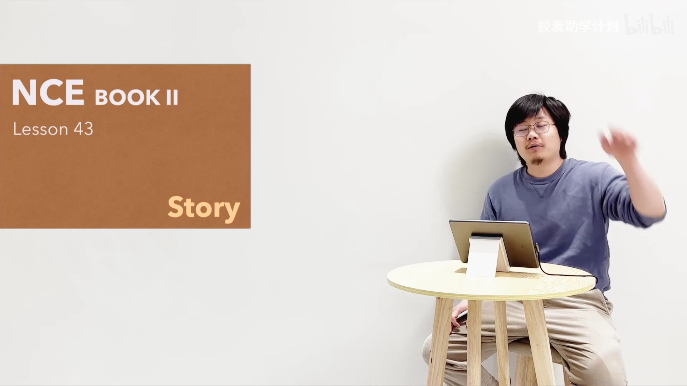

文字识别：NCE / BOOKII / Lesson 43 / Story

### 画面 00:00:04

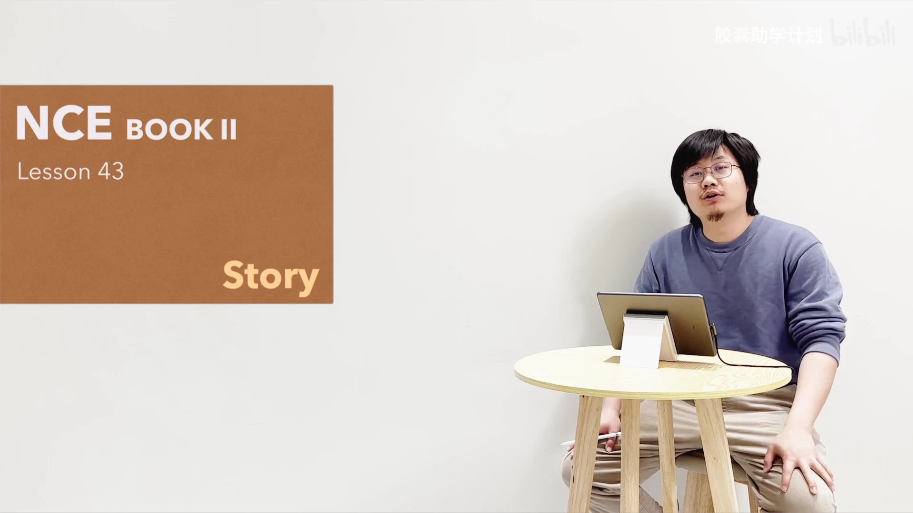

文字识别：NCE / BOOK"I / Lesson 43 / Story

### 画面 00:00:06

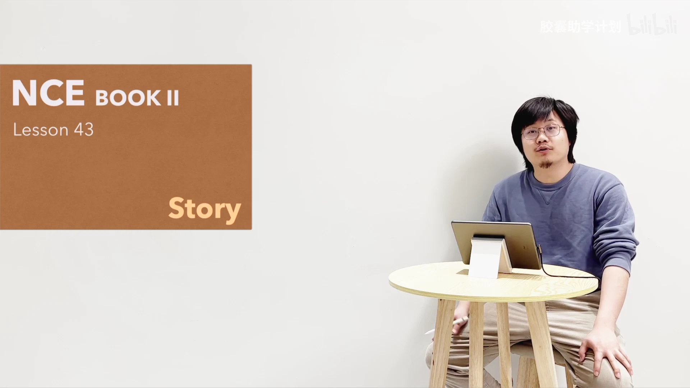

文字识别：NCE / BOOKⅡI / Lesson 43 / Story

### 画面 00:00:09

文字识别：胶囊助学计划 bilbl / •

### 画面 00:00:13

文字识别：胶囊助学计划

### 画面 00:00:15

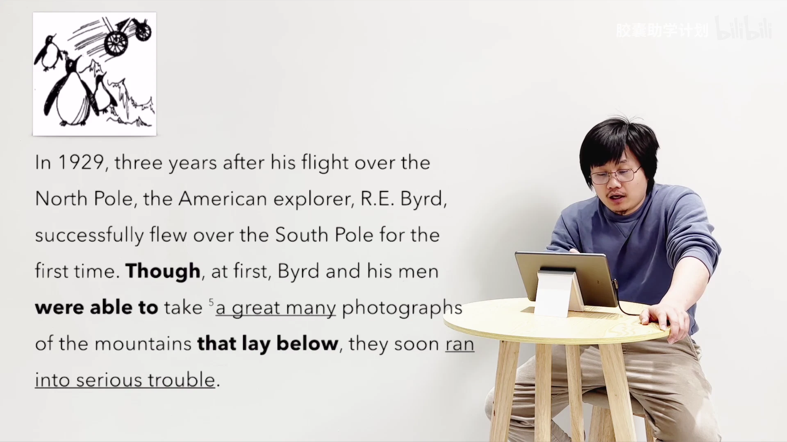

文字识别：In 1929, three years after his flight over the / North Pole, the American explorer, R.E. Byrd, / successfully flew over the South Pole for the / first time. Though, at first, Byrd and his men / were able to take 5a great many photographs / of the mountains that lay below, they soon ran / into serious trouble.

### 画面 00:00:26

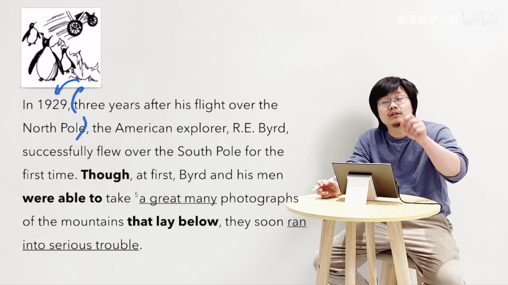

文字识别：In 1929,three years after his flight over the / North Polg, the American explorer, R.E. Byrd, / successfully flew over the South Pole for the / first time. Though, at first, Byrd and his men / were able to take 5a great many photographs / of the mountains that lay below, they soon ran / into serious trouble.

## 00:00:30–00:01:00

含义的，就处于相同位置，并且表达相同含义。比如说，Leo， an English teacher，对吧？叫同位语，他们是同位语。我们看一下它的含义，叫做 three years after his flight， three years 叫三年，after his flight 叫在他航行 over the North Pole，在他飞越北极之后的第三年，也就是一九二九年。听清楚了啊！After

### 画面 00:00:56

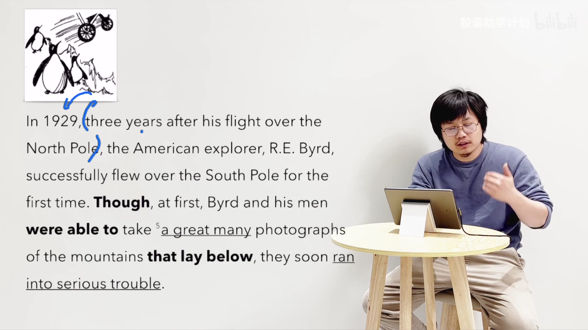

文字识别：In 1929,three years after his flight over the / North Polg, the American explorer, R.E. Byrd, / successfully flew over the South Pole for the / first time. Though, at first, Byrd and his men / were able to take 5a great many photographs / of the mountains that lay below, they soon ran / into serious trouble.

## 00:01:00–00:01:30

his flight over the North Pole,你看his flight over the North Pole的意思叫他飞越呃这个北极。After叫在什么什么之后，那three years after叫做三年之后，在他飞越北极三年之后，也就是一九二九年。我说清楚了啊。OK, the American explorer R.E. Bird，这两个又是同位语，叫做美国的探险家R.E. Bird这个人啊。OK,

### 画面 00:01:26

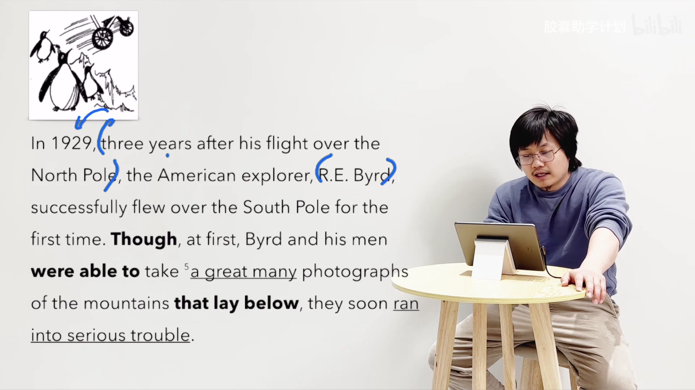

文字识别：In 1929, three years after his flight oyer the / North Polg, the American explorer, R.E. Byr), / successfully flew over the South Pole for the / first time. Though, at first, Byrd and his men / were able to take 5a great many photographs / of the mountains that lay below, they soon ran / into serious trouble.

## 00:01:30–00:02:00

successfully flew over the South Pole for the first time. Successfully叫做成功的，flew over叫做飞越了啊，the South Pole南极for the first time叫做第一次啊，第一次成功的飞越了南极。Though, though这个单词各位可以写在这一课的标题上。Though这个单词呢，我们可能一时半会儿不用直接着急去讲它。你现在

### 画面 00:01:56

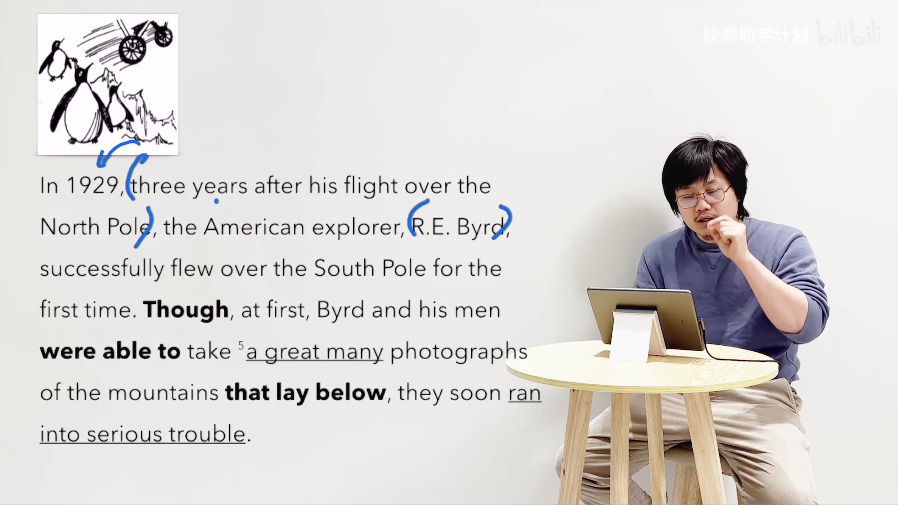

文字识别：In 1929,three years after his flight over the / North Polg,the American explorer, R.E. Byr), / successfully flew over the South Pole for the / first time. Though, at first, Byrd and his men / were able to take 5a great many photographs / of the mountains that lay below, they soon ran / into serious trouble.

## 00:02:00–00:02:30

只要知道它的含义是什么了。我们之前学过一个跟它很像的，叫做 even though，啊，叫做尽管即使，though 单独出现的时候也是这个意思，叫尽管即使。at first 叫做最开始。bird and his man 说 bird 和他的兄弟啊，就不是他的兄弟了。这地方怎么翻译比较好呢？因为接下来有一个东西，我现在先提前告诉各位，his man 从字面意思来说是他的男人们，

### 画面 00:02:26

文字识别：In 1929,three years after his flight over the / North Pole, the American explorer, R.E. Byr), / successfully flew over the South Pole for the / first time. Though, at first, Byrd and his men / were able to take 5a great many photographs / of the mountains that lay below, they soon ran / into serious trouble.

## 00:02:30–00:03:00

是吧？他的人们，OK？那这个翻译的并不是特别好。我直接告诉各位，这里我们把它翻译成叫他的队员们。为什么我这样去翻译呢？一会儿我们再看啊。说 Bird and his men, Bird 和他的队员们呢 were able to.哎，这里是能还是成功地？我们现在拿不准。但是你先隐约的给他翻译成一个能，对吧？我们先往下看。Take a great many photographs.好，take photographs叫拍照片，我们之前学

### 画面 00:02:56

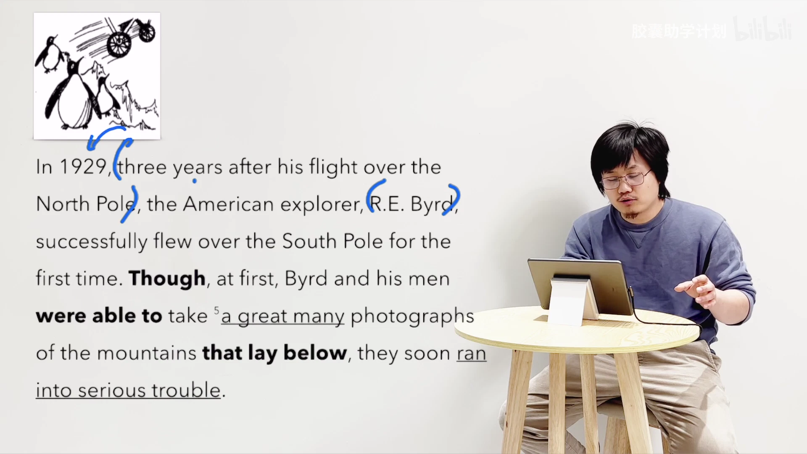

文字识别：In 1929,three years after his flight over the / North Pole, the American explorer, R.E. ByrI), / successfully flew over the South Pole for the / first time. Though, at first, Byrd and his men / were able to take 5a great many photographs / of the mountains that lay below, they soon ran / into serious trouble.

## 00:03:00–00:03:30

过。那a great many叫许多，这是我们二册第五课学的啊。许多的照片of the mountains，什么的照片呢？山的照片。山后边还有一个定语从句，什么样的山呢？叫做that lay below啊，叫做位于下方的山的照片。哎，你看这里，它更多的是表示一个成功的事件，具体的某一个事儿，而不是一种普遍的能力，对吧？你说我能拍照片儿，那叫做

### 画面 00:03:19

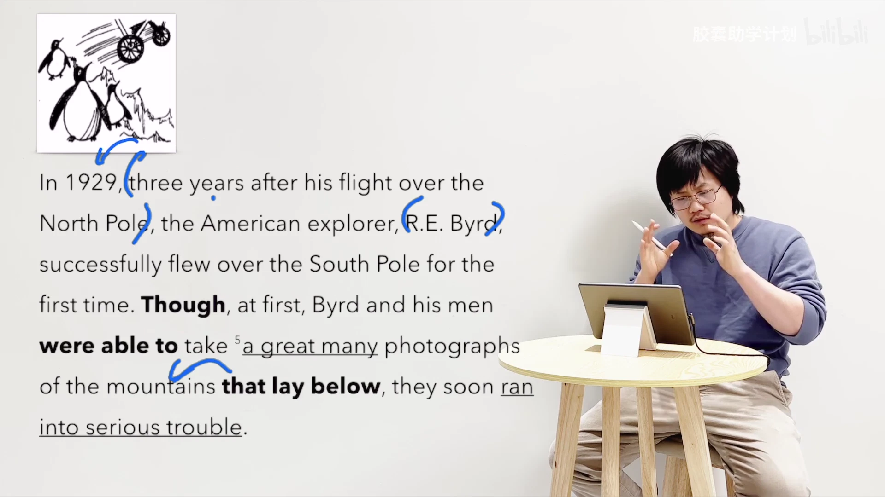

文字识别：In 1929,three years after his flight over the / North Polg,the American explorer, R.E. Byr), / successfully flew over the South Pole for the / first time. Though, at first, Byrd and his men / were able to take 5a great many photographs / of the mountains that lay below, they soon ran / into serious trouble.

## 00:03:30–00:04:00

一个普遍的能力。你说那个我成功的把什么东西给拍下来了？具体的某一个事儿啊，比如说你拍到了这个什么呃，比如说鲸鱼啊，鲸鱼我不知道能不能能不能啊跃出水面。假设啊啊，这这样就这个后尾巴跃出水面的这个事情，你成功的把它拍下来了，那也是能，是不是？但是它更像是 was able to，而不能用 could 了啊。各位想一下，They soon他们很快 run into serious

### 画面 00:03:49

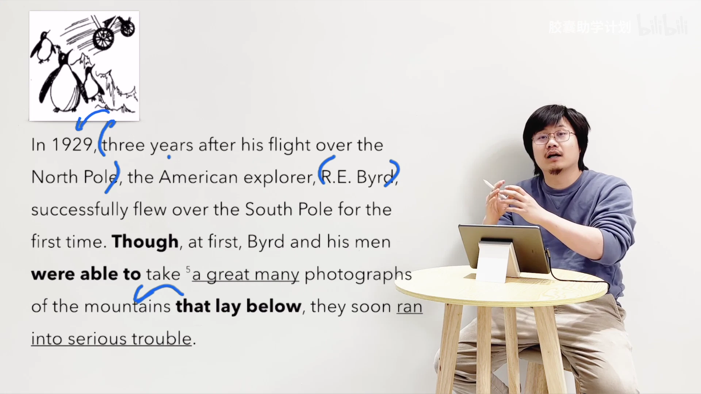

文字识别：In 1929,three years after his flight over the / North Polg, the American explorer, R.E. ByrI), / successfully flew over the South Pole for the / first time. Though, at first, Byrd and his men / were able to take 5a great many photographs / of the mountains that lay below, they soon ran / into serious trouble.

## 00:04:00–00:04:30

serious trouble, 就遇到了特别严重的问题。这个我们之前讲单词的时候说过了，叫 ran into serious trouble, 对吧？Okay, continue. At one point, 在某一个点上，时间地点都行，但你要看这个地方，就是呃，可以说时间吧。在某一个点上, it seemed certain that, 似乎是很确定的，怎么样呢？Their plane would crash, 叫做他们的飞机会坠毁

### 画面 00:04:08

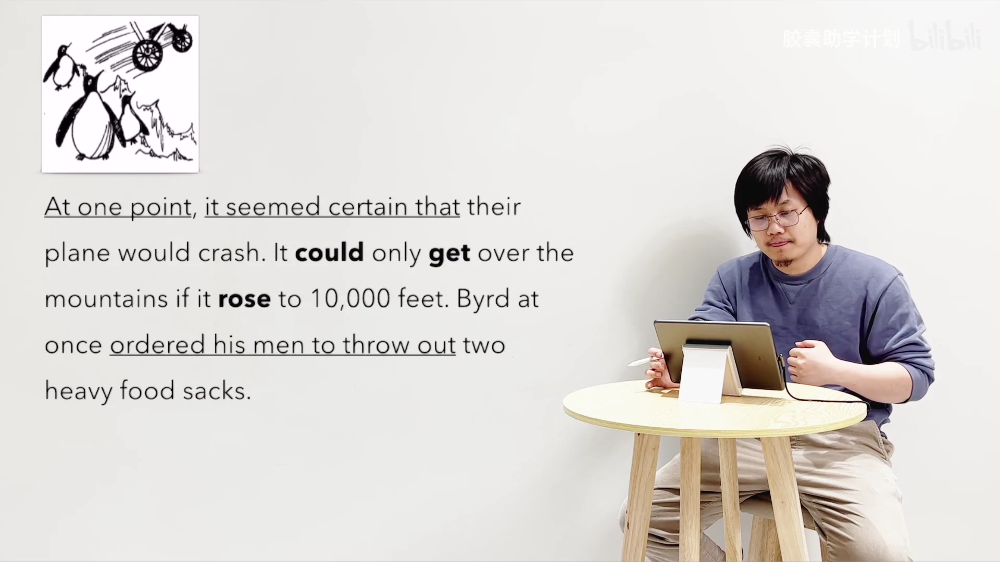

文字识别：At one point, it seemed certain that their / plane would crash. It could only get over the / mountains if it rose to 10,000 feet. Byrd at / once ordered his men to throw out two / heavy food sacks.

## 00:04:30–00:05:00

啊！It seems certain that这是我们讲单词的时候学过的，对吧？飞似乎是很确定的，怎么怎么样？比我们讲单词的时候多了一个certain，确定意思，对吧？It could only get over the mountains if it rose to ten thousand feet.这里我把核心单词已经给各位标出来了哦，还缺一个if。你看到了if，看到了rose，看到了could加get，你就应该能反应过来，它是

### 画面 00:04:38

文字识别：At one point, it seemed certain that their / plane would crash. It could only get over the / mountains if it rose to 10,000 feet. Byrd at / once ordered his men to throw out two / heavy food sacks.

### 画面 00:04:51

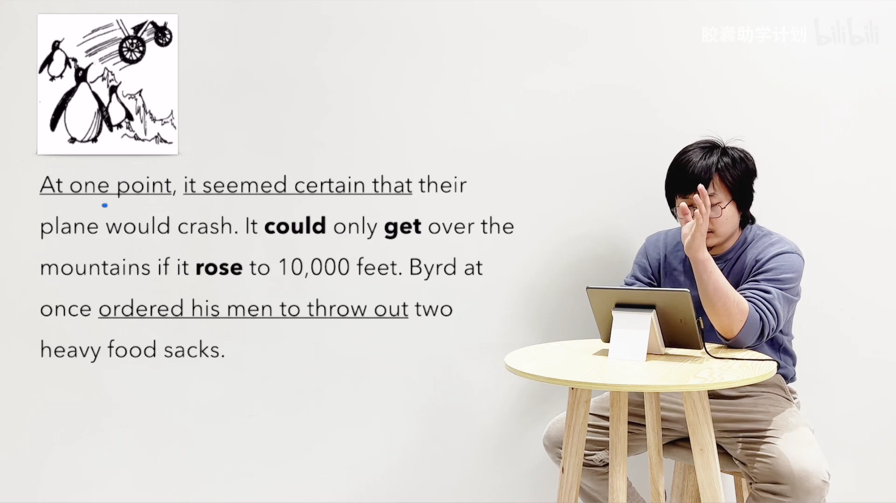

文字识别：At one point, it seemed certain that their / plane would crash. lt could only get over the / mountains if it rose to 10,000 feet. Byrd at / once ordered his men to throw out two / heavy food sacks.

### 画面 00:04:55

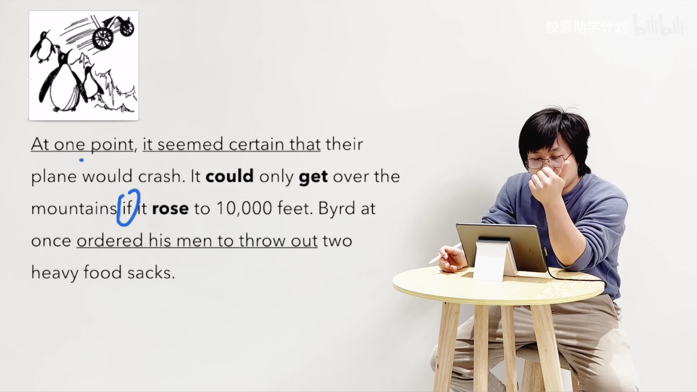

文字识别：At one point, it seemed certain that their / plane would crash. It could only get over the / sift rose to 10,000 feet. Byrd at / mountainsf / once ordered his men to throw out two / heavy food sacks.

## 00:05:00–00:05:30

们四十课学的什么呢？虚拟语气。好，那接下来我们看一下它的字面意思是什么，叫做如果我们从后往前看啊，如果它能升到一万英尺的高空，那它就它才能 get over the mountains。 get 我们说了万能动词对吧？结合上下文怎么翻译怎么来。那 get over 就是其实就是 flew a fly over 是吧？它才能飞

### 画面 00:05:00

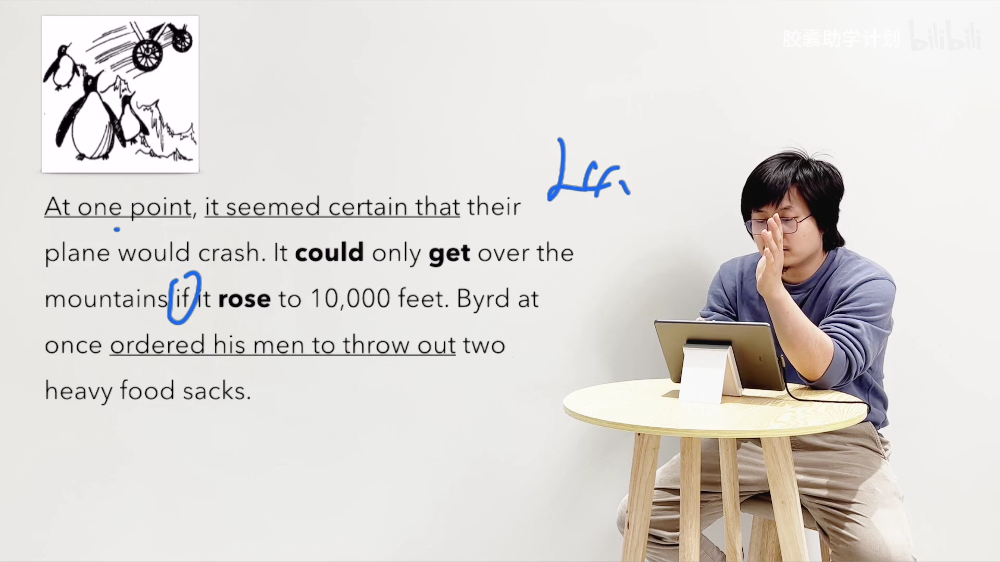

文字识别：At one point, it seemed certain that their / plane would crash. It could only get over the / sift rose to 10,00 fet. Byrd at / mountainsfi / once ordered his men to throw out two / heavy food sacks.

## 00:05:30–00:06:00

过这座山啊，越过这座山。OK，very good。那用虚拟语语气是什么意思呢？就是跟你跟前面其实连起来就行了。说只有当它升到一万英尺的时候，它才能飞过这个山。但它是虚拟语气，所以说话人认为这件事儿几乎怎么样就不可能啊，就它不太可能能升到十一万英尺的这个高空。于是呢，它也不太可能能

### 画面 00:05:30

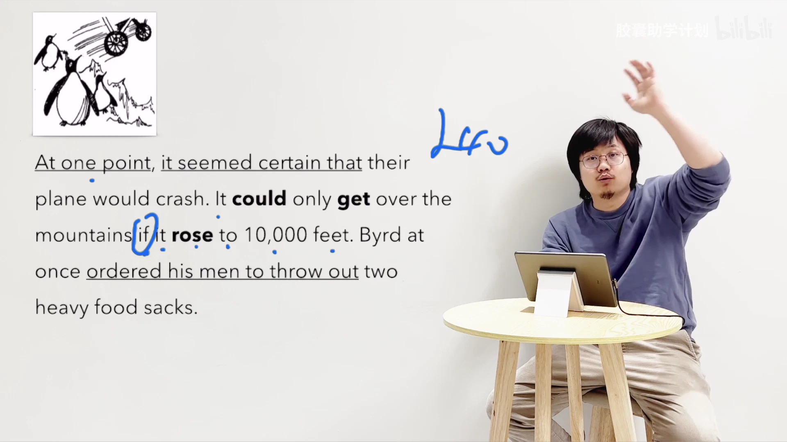

文字识别：At one point, it seemed certain that their / plane would crash. It could only get over the / sift rose to 10,000 fet. Byrd atat / mountains / once ordered his men to throw out two / heavy food sacks.

### 画面 00:05:35

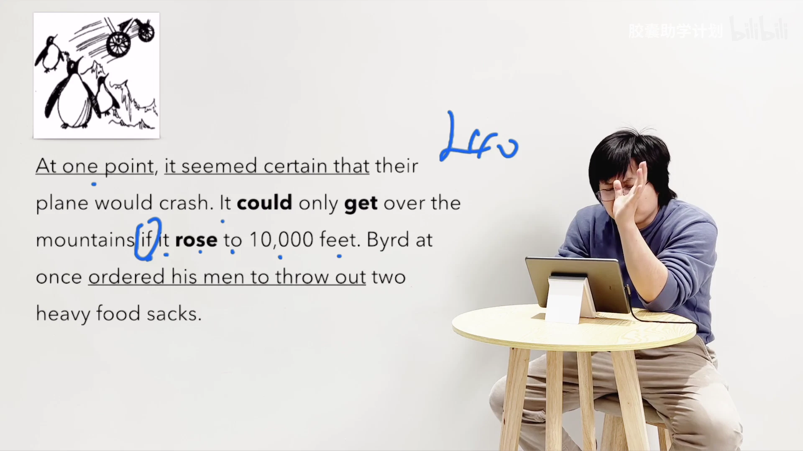

文字识别：At one point, it seemed certain that their / plane would crash. It could only get over the / mountainsiIt ros to 0,00 fet yrd ata / once ordered his men to throw out two / heavy food sacks.

### 画面 00:05:41

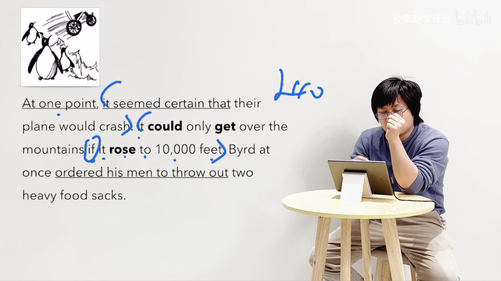

文字识别：At one point,St seemed certain that their / plane would crasb) f could only get over the / mountainsfift rose to 10,00 fee Byrd at / once ordered his men to throw out two / heavy food sacks.

## 00:06:00–00:06:30

越过这个山。于是呢，和前面这句话就呼应了，叫做似乎很确定他们的飞机会坠毁。看见了吧？这是他用虚拟语气的原因，上下就呼应了。你第一个叫做我不认为你能飞到一万英尺，所以你可能就飞不过这个山。第二个叫做似乎很确定他们的飞机会坠毁，连起来了，对吧？再来，bird at once立刻ordered

### 画面 00:06:05

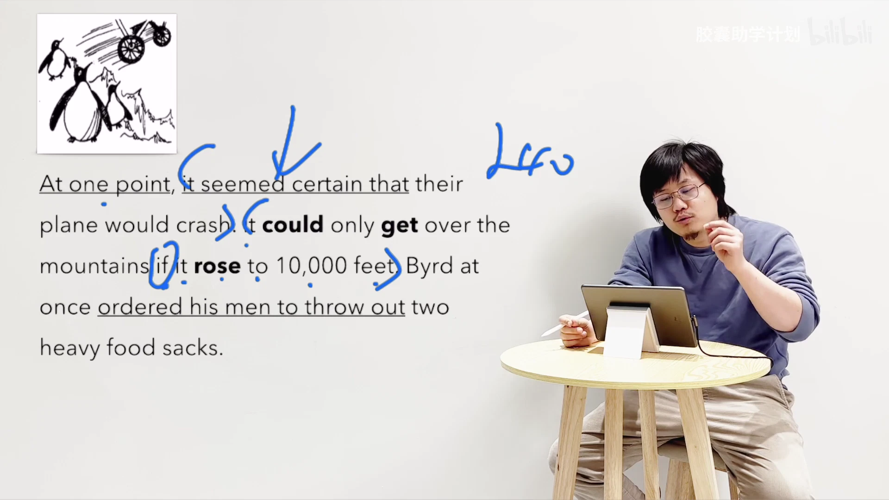

文字识别：At one point,'t seemed certain that their / plane would crasb. f could only get over the / mountainsi trose to 0.00 fet Byrd atat / once ordered his men to throw out two / heavy food sacks.

### 画面 00:06:11

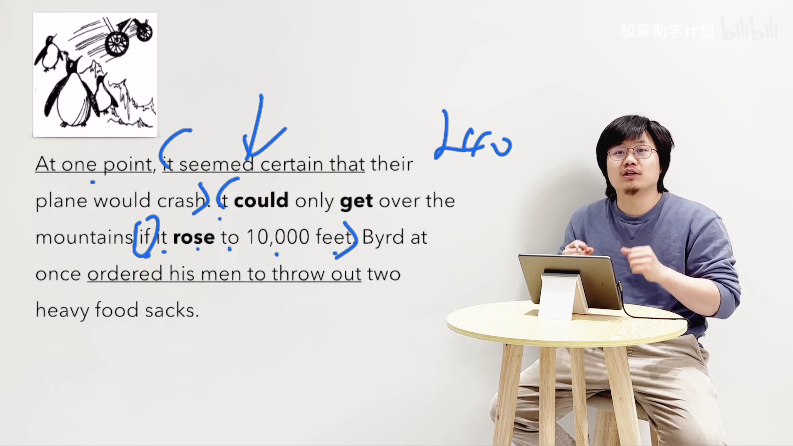

文字识别：At one point,'t seemed certain that their / plane would crasb) f could only get over the / mountainsi it rose to 10,000 fet Byrd aat / once ordered his men to throw out two / heavy food sacks.

### 画面 00:06:25

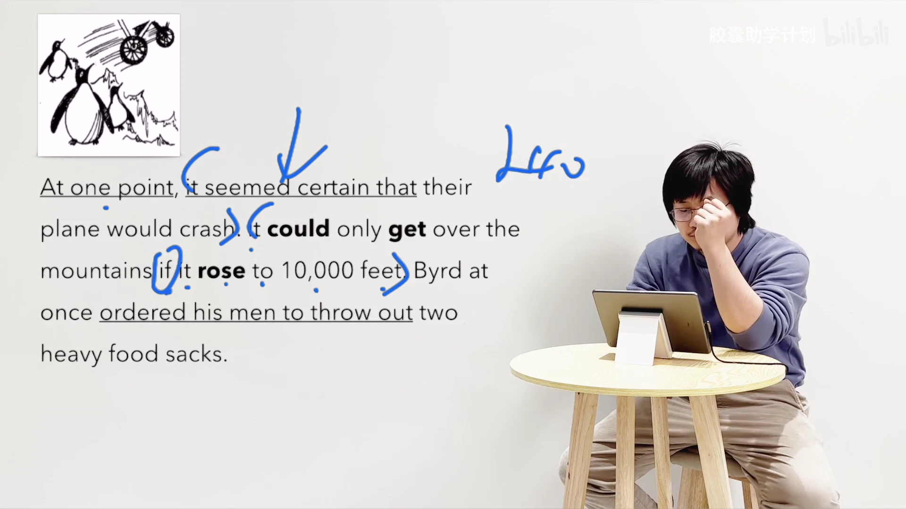

文字识别：At one point, t seemed certain that their / plane would crasb) f could only get over the / mountainsi t roseto 10,000 fe yrd a at / once ordered his men to throw out two / heavy food sacks.

## 00:06:30–00:07:00

his men to throw out two heavy foot sacks. Ordered somebody to do something. 这是我们本课的一个重点习惯用法，叫做命令某人去做某件事情。命令他的队员们去把这些东西扔出来。所以这里的 men，我愿意给他翻译成队员。各位能理解为什么了吧？对吧？Okay. Throw out,扔出，扔出什么呢？那后面就很简单了。Two heavy foot

### 画面 00:06:38

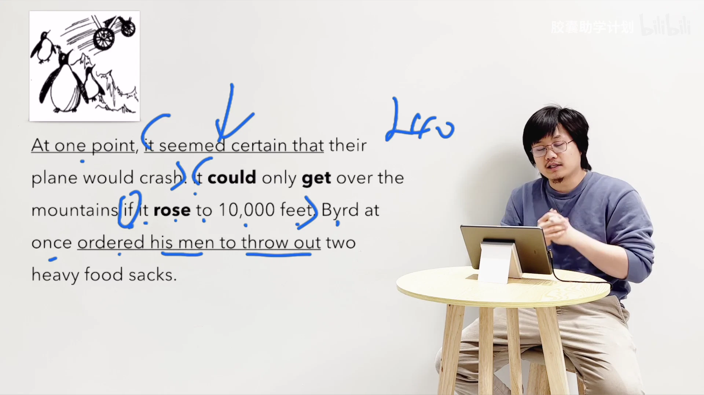

文字识别：At one point,'t seemed certain that their / plane would cras) f could only get over the / mountainsi t rose to 0,000 fet Byrd aat / once ordered his men to throw out two / heavy food sacks.

### 画面 00:06:56

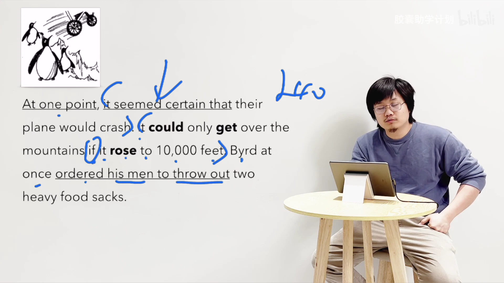

文字识别：At one point,'t seemed certain that their / plane would cras) f could only get over the / mountainsi t roseto 10,000fee yrd at / once ordered his men to throw out two / heavy food sacks.

## 00:07:00–00:07:30

sacks，两个很沉的食物的袋子，对吧？两个很沉的食物袋子。继续，the plane这个飞机was then然后呢able to rise，然后它就能升起来了，对吧？Okay，and it cleared the mountains by four hundred feet，然后它越过了这座山，超过多少呢？Four hundred feet，叫做四百

### 画面 00:07:06

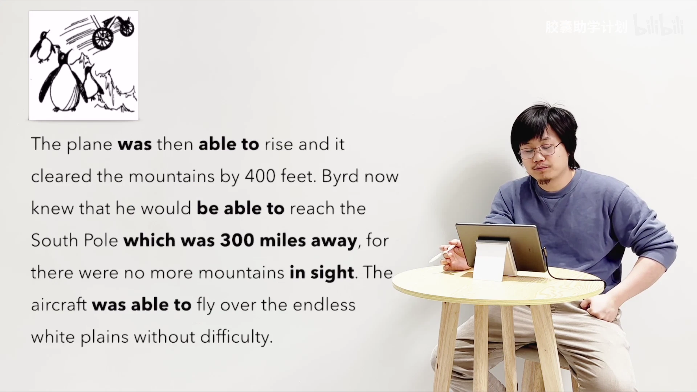

文字识别：The plane was then able to rise and it / cleared the mountains by 400 feet. Byrd now / knew that he would be able to reach the / South Pole which was 300 miles away, for / there were no more mountains in sight. The / aircraft was able to fly over the endless / white plains without difficulty.

### 画面 00:07:08

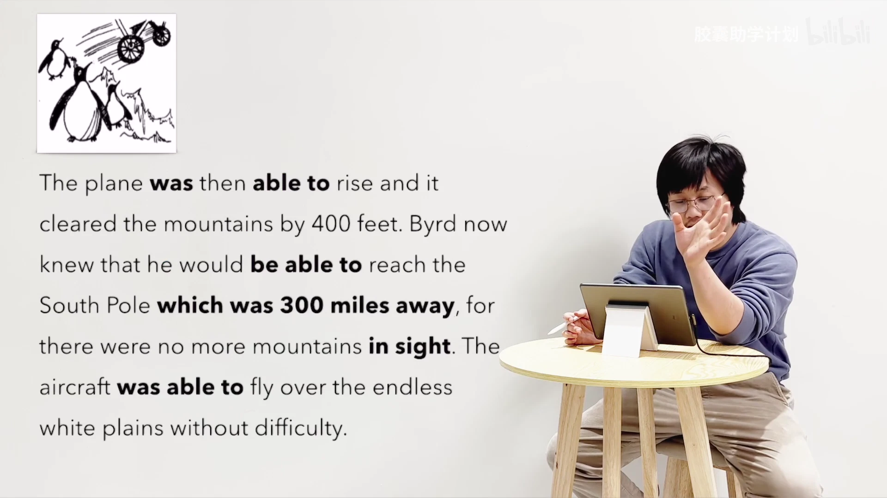

文字识别：The plane was then able to rise and it / cleared the mountains by 400 feet. Byrd now / knew that he would be able to reach the / South Pole which was 300 miles away, for / there were no more mountains in sight. The / aircraft was able to fly over the endless / white plains without difficulty.

### 画面 00:07:15

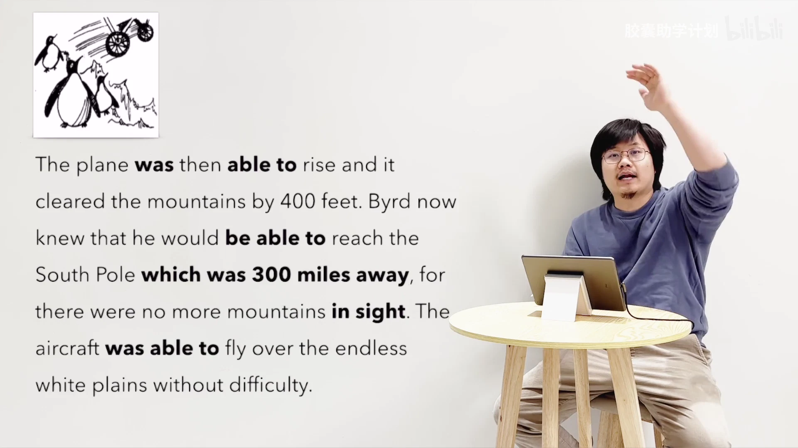

文字识别：The plane was then able to rise and it / cleared the mountains by 400 feet. Byrd now / knew that he would be able to reach the / South Pole which was 300 miles away, for / there were no more mountains in sight. The / aircraft was able to fly over the endless / white plains without difficulty.

### 画面 00:07:18

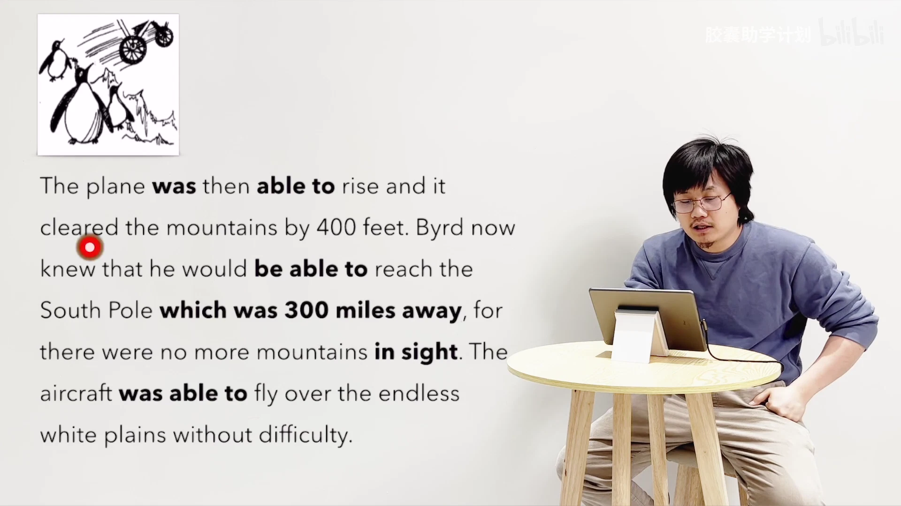

文字识别：The plane was then able to rise and it / cleared the mountains by 400 feet. Byrd now / knew that he would be able to reach the / South Pole which was 300 miles away, for / there were no more mountains in sight. The / aircraft was able to fly over the endless / white plains without difficulty.

## 00:07:30–00:08:00

百英尺啊。Okay, but a bird now knew that他现在知道了。He would be able to reach the South Pole，说他将能到达South Pole，到达南极点。什么样的南极点呢？南啊，南极呢？叫做定语从句，which was three hundred miles away。说这个南极，实是实际上是在三百英里以外的这样的一个

### 画面 00:07:48

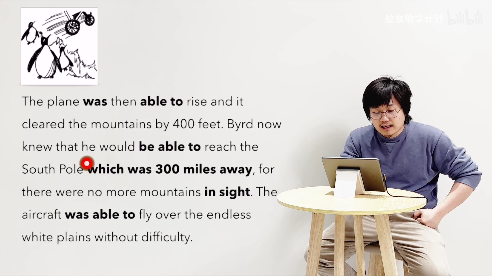

文字识别：The plane was then able to rise and it / cleared the mountains by 400 feet. Byrd now / knew that he would be able to reach the / South Polewhich was 300 miles away, for / there were no more mountains in sight. The / aircraft was able to fly over the endless / white plains without difficulty.

## 00:08:00–00:08:30

距离，OK. Four, because there were no more mountains. Because啊，没有更多的山了。In sight，在视野范围之内就没有更多的山了。The aircraft was able to fly over.说这个飞机呀能飞越the endless white plains啊，无尽的都是字面意思白色的平原without difficulty，

### 画面 00:08:18

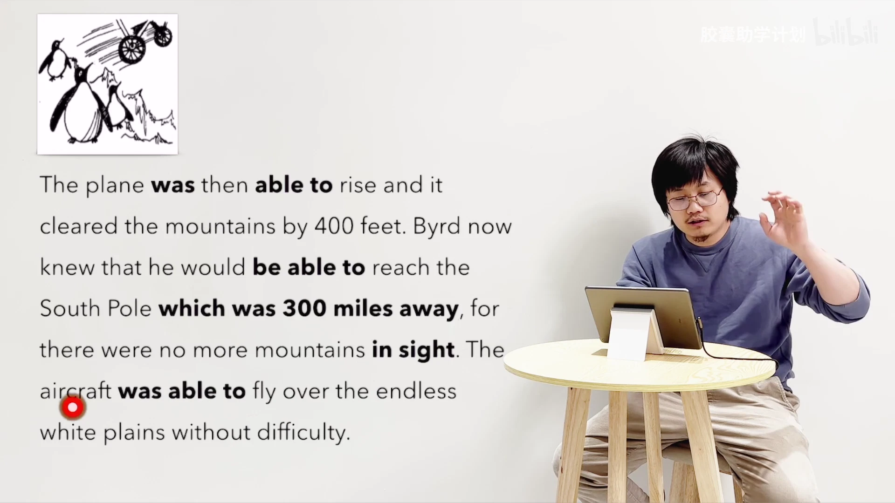

文字识别：The plane was then able to rise and it / cleared the mountains by 400 feet. Byrd now / knew that he would be able to reach the / South Pole which was 300 miles away, for / there were no more mountains in sight. The / aircraft was able to fly over the endless / white plains without difficulty.

## 00:08:30–00:09:00

而不是特别的困难，without没有，对吧？没有很困难。Okay，very good。那文章到这儿就结束了。有一个习惯用法，我们直接把它拿过来，叫 order somebody to do something，叫做命令某人去做某件事情。我们尝试造一点句子，这个挺简单。比如说，if you order me to do this，I would do it，是吧？你注意，四十课虚拟语气，对吧？这个是各位容易忘的，我就多拿它造句。首先，这些这三个圈告诉

### 画面 00:08:31

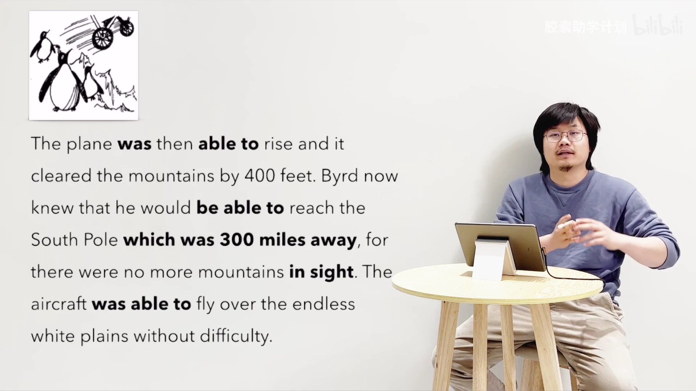

文字识别：The plane was then able to rise and it / cleared the mountains by 400 feet. Byrd now / knew that he would be able to reach the / South Pole which was 300 miles away, for / there were no more mountains in sight. The / aircraft was able to fly over the endless / white plains without difficulty.

### 画面 00:08:36

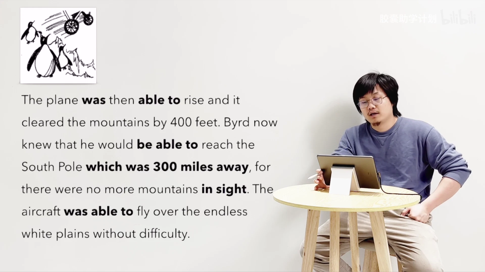

文字识别：The plane was then able to rise and it / cleared the mountains by 400 feet. Byrd now / knew that he would be able to reach the / South Pole which was 300 miles away, for / there were no more mountains in sight. The / aircraft was able to fly over the endless / white plains without difficulty.

### 画面 00:08:38

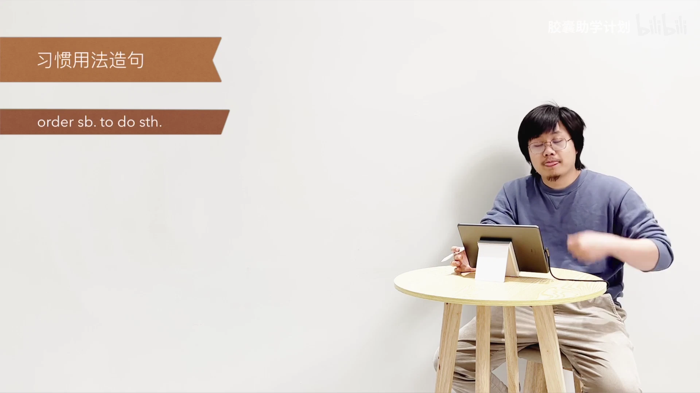

文字识别：习惯用法造句 / order sb. to do sth.

### 画面 00:08:43

文字识别：习惯用法造句 / order sb. to do sth.

### 画面 00:08:46

文字识别：网：v.+v.变化 / 习惯用法造句指南 / 四句型转换 / 方式/地点/时间 / 其他习惯用法 / 其他单词+词性 / 原文摘抄+变 / 6123456 / order sb.to do sth.

### 画面 00:08:48

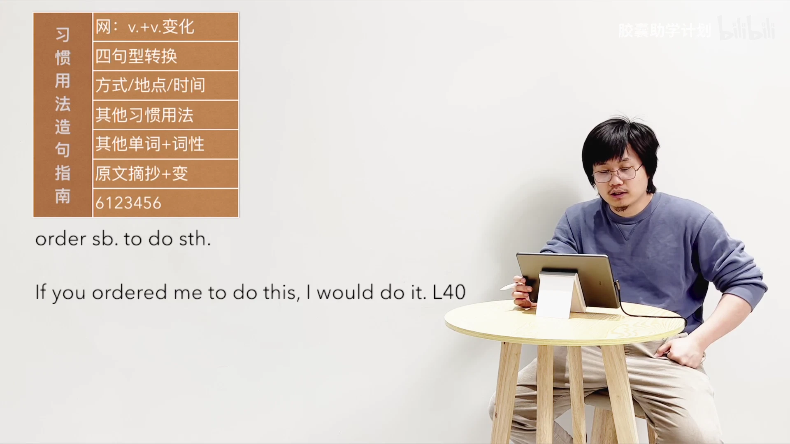

文字识别：网：v.+v.变化 / 习惯用法造句指南 / 四句型转换 / 方式/地点/时间 / 其他习惯用法 / 其他单词+词性 / 原文摘抄+变 / 6123456 / order sb.to do sth. / If you ordered me to do this, I would do it. L40

### 画面 00:08:50

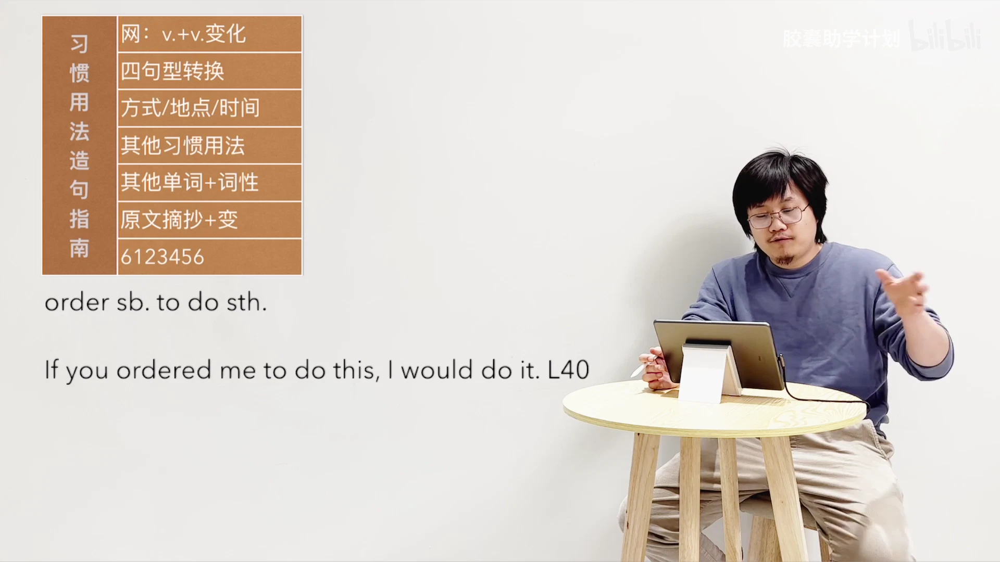

文字识别：网：v.+v.变化 / 习惯用法造句指南 / 四句型转换 / 方式/地点/时间 / 其他习惯用法 / 其他单词+词性 / 原文摘抄+变 / 6123456 / order sb.to do sth. / If you ordered me to do this, I would do it. L40

### 画面 00:08:54

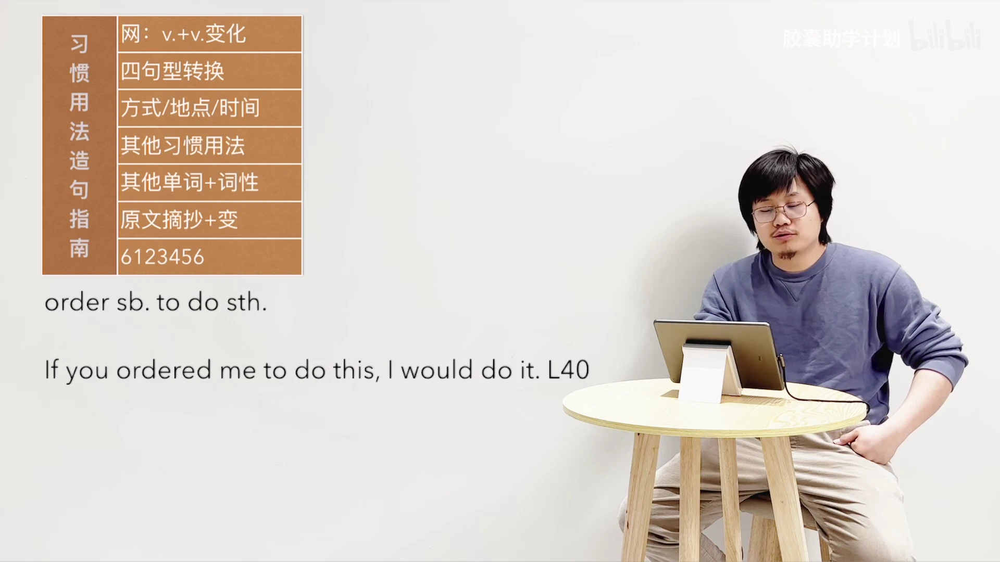

文字识别：网：v.+v.变化 / 习惯用法造句指南 / 四句型转换 / 方式/地点/时间 / 其他习惯用法 / 其他单词+词性 / 原文摘抄+变 / 6123456 / order sb.to do sth. / If you ordered me to do this, I would do it. L40

### 画面 00:08:56

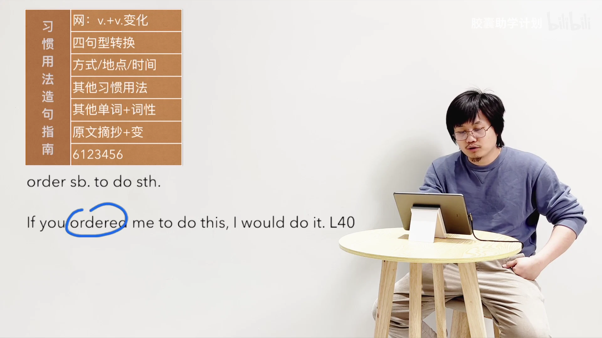

文字识别：网：v.+v.变化 / 习惯用法造句指南 / 四句型转换 / 方式/地点/时间 / 其他习惯用法 / 其他单词+词性 / 原文摘抄+变 / 6123456 / order sb.to do sth. / If youordered / me to do this, I would do it. L40

### 画面 00:08:58

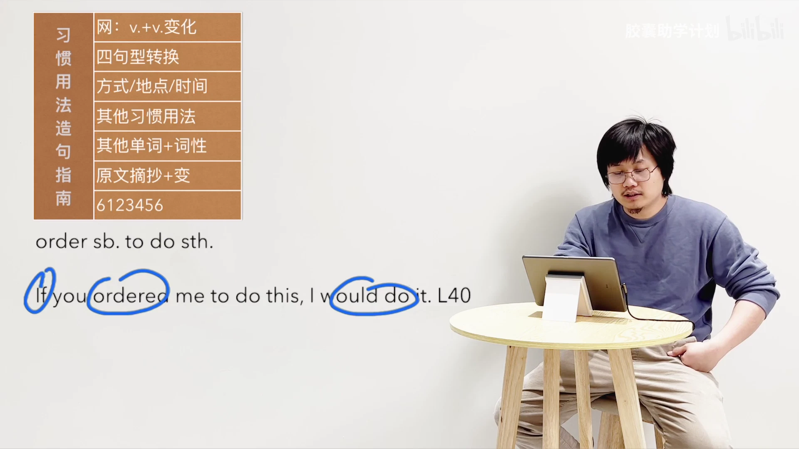

文字识别：网：v.+v.变化 / 习惯用法造句指南 / 四句型转换 / 方式/地点/时间 / 其他习惯用法 / 其他单词+词性 / 原文摘抄+变 / 6123456 / order sb.to do sth. / youordered / me to do this, I vould doit. L40

## 00:09:00–00:09:30

你了，它一定是虚拟语气。字面意思叫：如果你命令我那么去做，我就会那么去做的。好，但他真正想表达的是什么呢？叫做你，我不认为你会命令我这么去做，于是我就不做了，对不对？Okay, next one.说I order you to take my seat.说，我命令你坐在我的位置上啊。这实际上往往是一种用特别命令的口吻，然后表达一个很温暖的事情，对吧？我命令你现在

### 画面 00:09:00

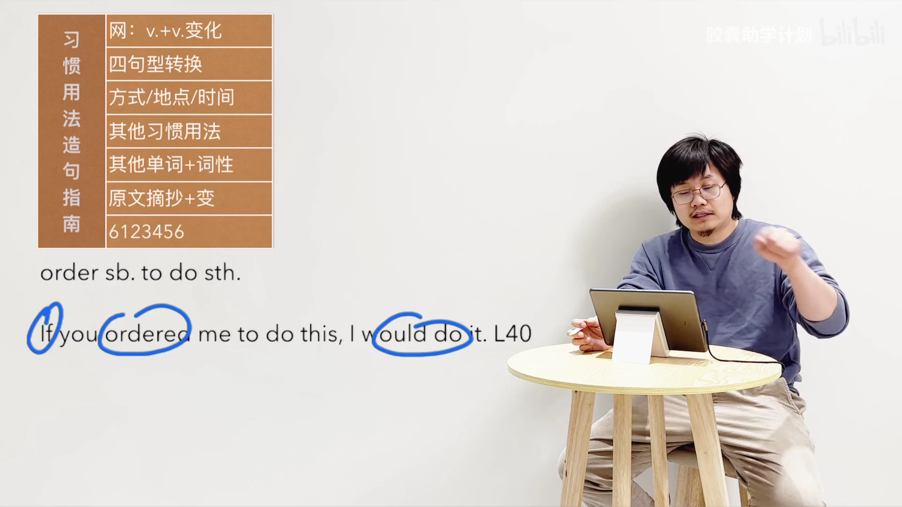

文字识别：网：v.+v.变化 / 习惯用法造句指南 / 四句型转换 / 方式/地点/时间 / 其他习惯用法 / 其他单词+词性 / 原文摘抄+变 / 6123456 / order sb.to do sth. / youorderedr / me to do this, I vould do jt. L40

### 画面 00:09:04

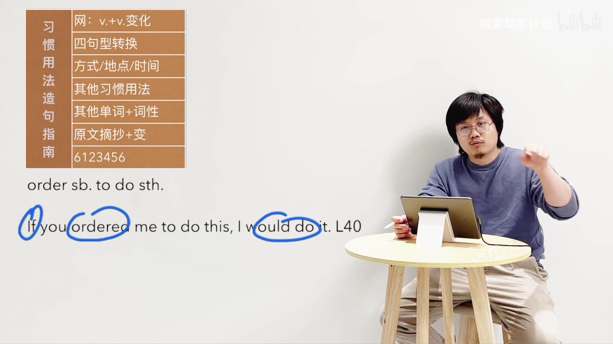

文字识别：网：v.+v.变化 / 习惯用法造句指南 / 四句型转换 / 方式/地点/时间 / 其他习惯用法 / 其他单词+词性 / 原文摘抄+变 / 6123456 / order sb.to do sth. / youordered / me to do this, I vould doit. L40

### 画面 00:09:09

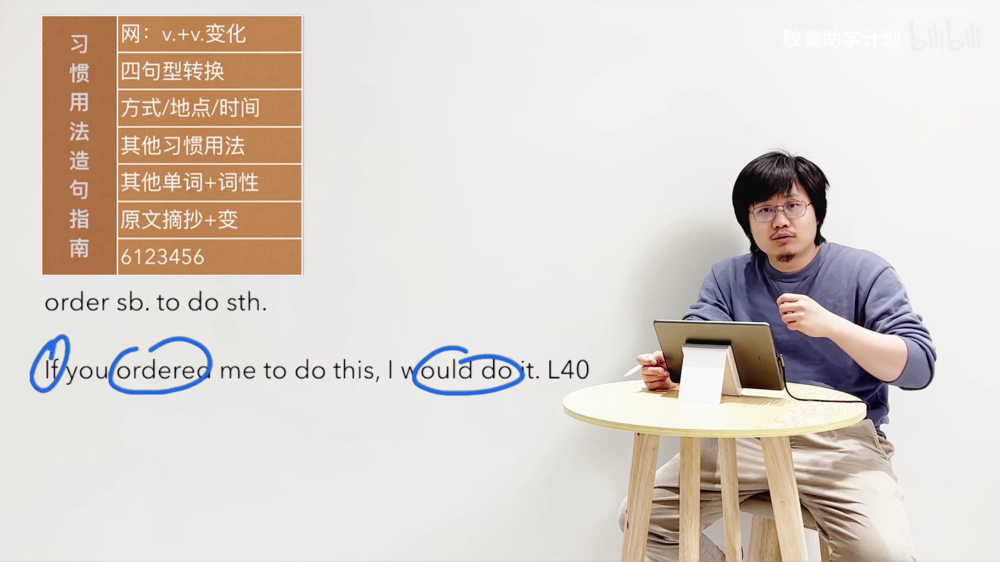

文字识别：网：v.+v.变化 / 习惯用法造句指南 / 四句型转换 / 方式/地点/时间 / 其他习惯用法 / 其他单词+词性 / 原文摘抄+变 / 6123456 / order sb.to do sth. / youordered / me to do this, I vould doit. L40

### 画面 00:09:13

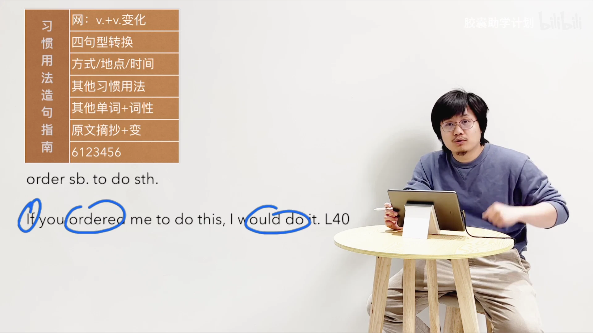

文字识别：网：v.+v.变化 / 习惯用法造句指南 / 四句型转换 / 方式/地点/时间 / 其他习惯用法 / 其他单词+词性 / 原文摘抄+变 / 6123456 / order sb.to do sth. / youordered / me to do this, I wOuld doit. L40

### 画面 00:09:15

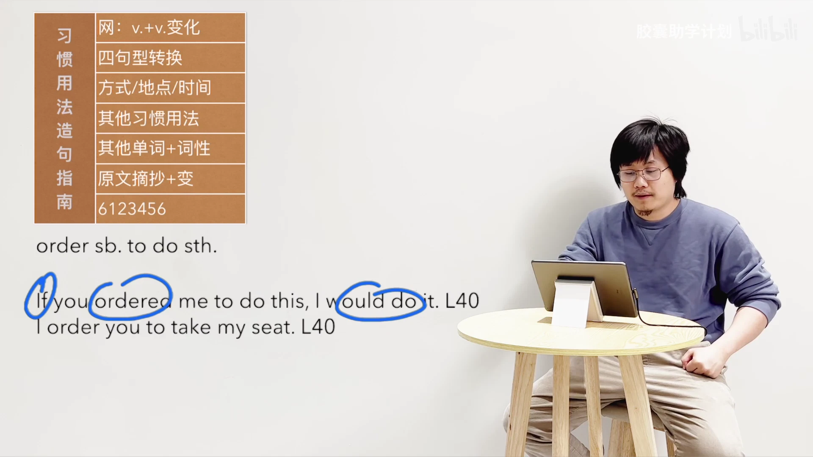

文字识别：网：v.+v.变化 / 习惯用法造句指南 / 四句型转换 / 方式/地点/时间 / 其他习惯用法 / 其他单词+词性 / 原文摘抄+变 / 6123456 / order sb.to do sth. / youordered / me to do this, I would doit. L40 / Torder you to take my seat. L40

### 画面 00:09:17

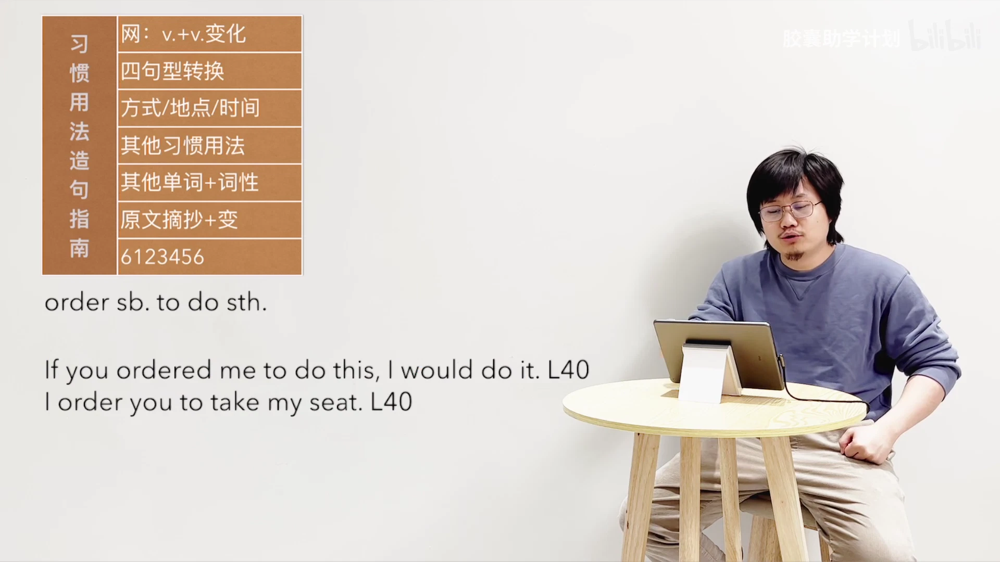

文字识别：网：v.+v.变化 / 习惯用法造句指南 / 四句型转换 / 方式/地点/时间 / 其他习惯用法 / 其他单词+词性 / 原文摘抄+变 / 6123456 / order sb.to do sth. / If you ordered me to do this, I would do it. L40 / I order you to take my seat. L40

### 画面 00:09:19

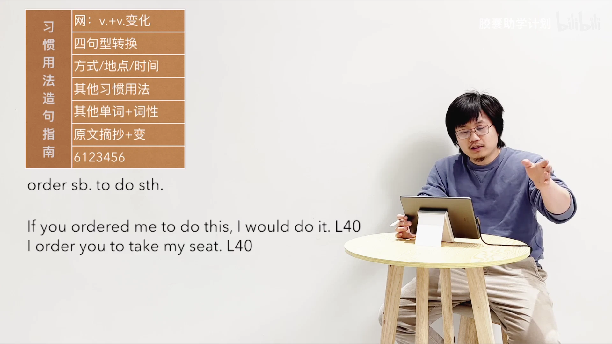

文字识别：网：v.+v.变化 / 习惯用法造句指南 / 四句型转换 / 方式/地点/时间 / 其他习惯用法 / 其他单词+词性 / 原文摘抄+变 / 6123456 / order sb.to do sth. / If you ordered me to do this, I would do it. L40 / I order you to take my seat. L40

### 画面 00:09:23

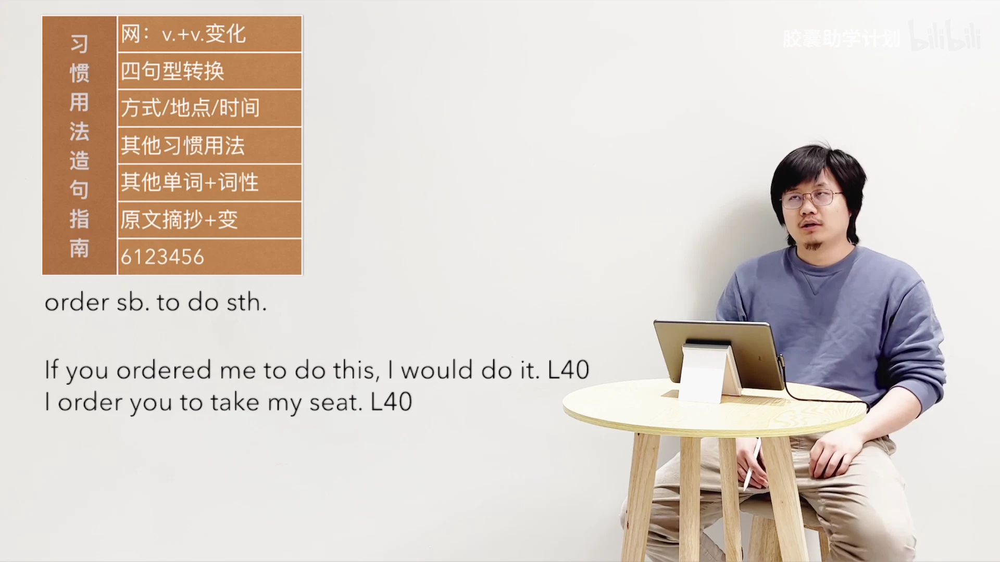

文字识别：网：v.+v.变化 / 习惯用法造句指南 / 四句型转换 / 方式/地点/时间 / 其他习惯用法 / 其他单词+词性 / 原文摘抄+变 / 6123456 / order sb.to do sth. / If you ordered me to do this, I would do it. L40 / I order you to take my seat. L40

### 画面 00:09:25

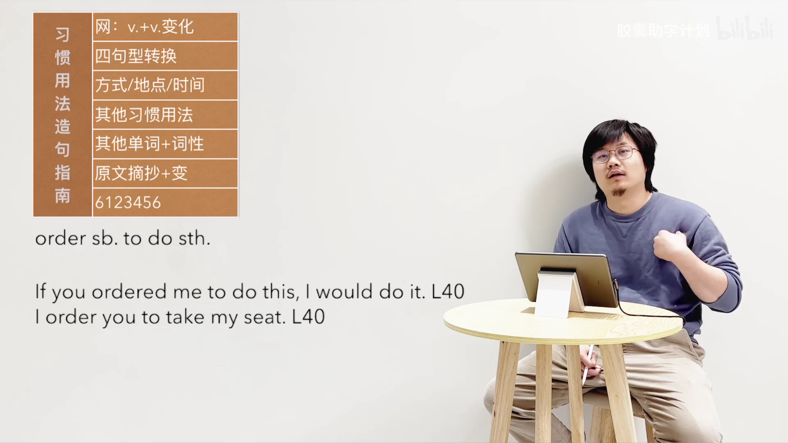

文字识别：网：v.+v.变化 / 习惯用法造句指南 / 四句型转换 / 方式/地点/时间 / 其他习惯用法 / 其他单词+词性 / 原文摘抄+变 / 6123456 / order sb.to do sth. / If you ordered me to do this, I would do it. L40 / I order you to take my seat. L40

### 画面 00:09:29

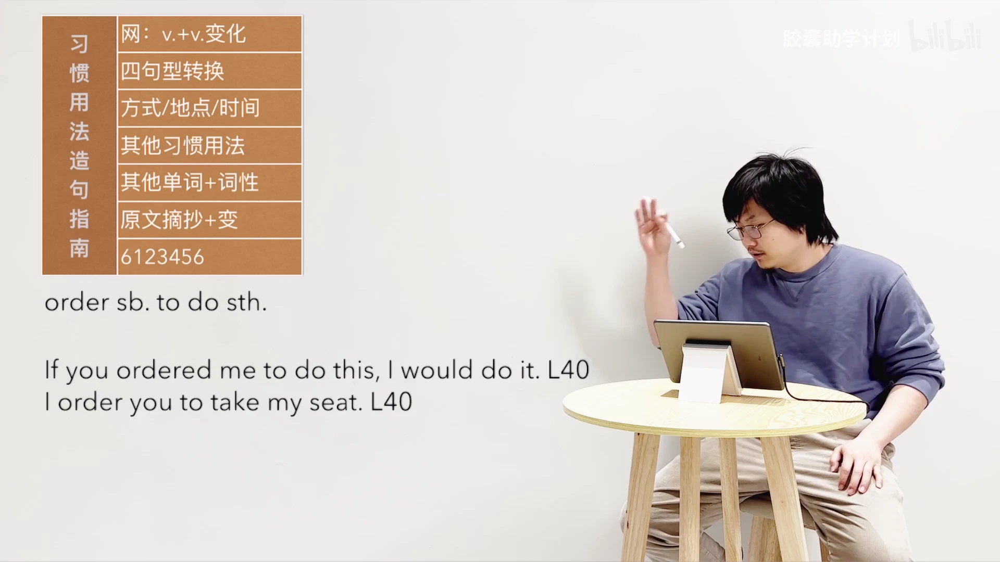

文字识别：网：v.+v.变化 / 习惯用法造句指南 / 四句型转换 / 方式/地点/时间 / 其他习惯用法 / 其他单词+词性 / 原文摘抄+变 / 6123456 / order sb.to do sth. / If you ordered me to do this, I would do it. L40 / I order you to take my seat. L40

## 00:09:30–00:10:00

坐在这里，对吧？Okay, very good.啊，坐在我的位置上，take my seat.四十课咱们学的习惯用法。再来说，she ordered me to continue to do that.说她命令我继续这么去做，对吧？这是我们四十二课学的啊。Okay, very good. Continue to do some some.啊，continue to do something，对吧？继续做某件事情。接下来呢，我们看一个电影片段。这个电影片段当中就出现了叫I order you to help me.我命令你帮助我啊。来

### 画面 00:09:34

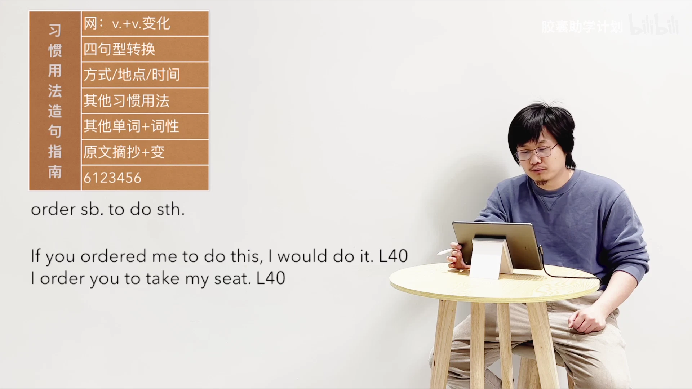

文字识别：网：v.+v.变化 / 习惯用法造句指南 / 四句型转换 / 方式/地点/时间 / 其他习惯用法 / 其他单词+词性 / 原文摘抄+变 / 6123456 / order sb.to do sth. / If you ordered me to do this, I would do it. L40 / I order you to take my seat. L40

### 画面 00:09:37

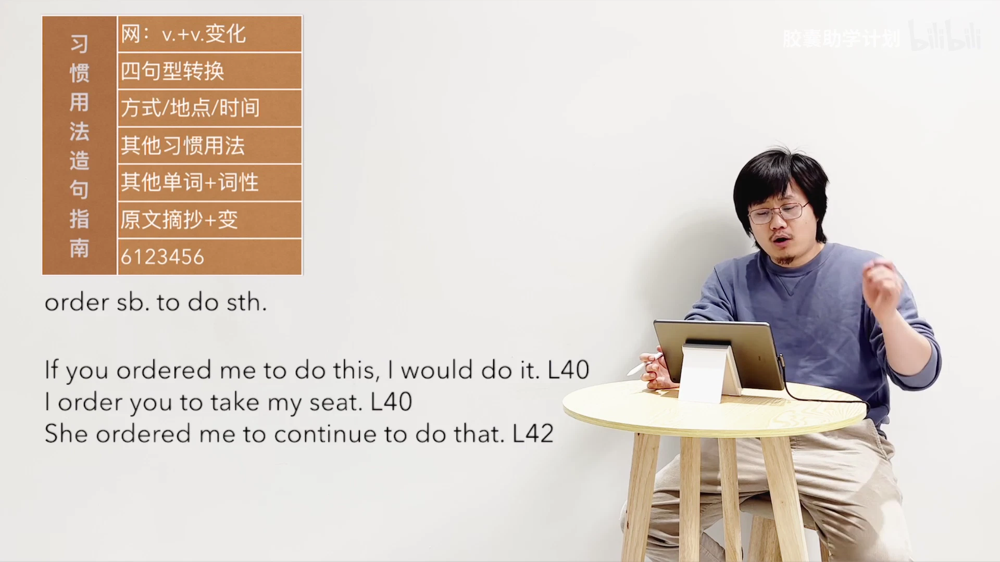

文字识别：网：v.+v.变化 / 习惯用法造句指南 / 四句型转换 / 方式/地点/时间 / 其他习惯用法 / 其他单词+词性 / 原文摘抄+变 / 6123456 / order sb.to do sth. / If you ordered me to do this, I would do it. L40 / I order you to take my seat. L40 / She ordered me to continue to do that. L42

### 画面 00:09:39

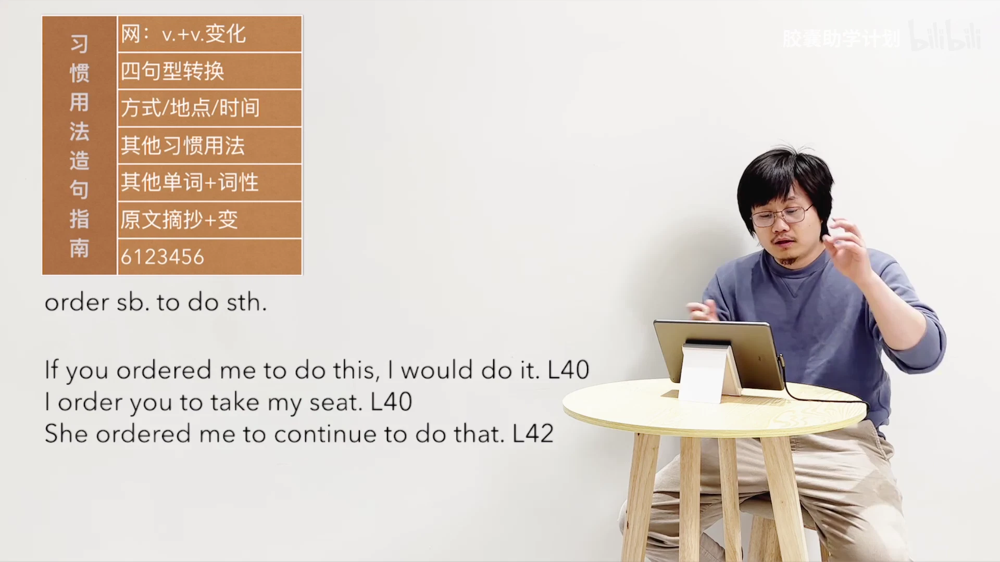

文字识别：网：v.+v.变化 / 习惯用法造句指南 / 四句型转换 / 方式/地点/时间 / 其他习惯用法 / 其他单词+词性 / 原文摘抄+变 / 6123456 / order sb.to do sth. / If you ordered me to do this, I would do it. L40 / I order you to take my seat. L40 / She ordered me to continue to do that. L42

### 画面 00:09:42

文字识别：网：v.+v.变化 / 习惯用法造句指南 / 四句型转换 / 方式/地点/时间 / 其他习惯用法 / 其他单词+词性 / 原文摘抄+变 / 6123456 / order sb.to do sth. / If you ordered me to do this, I would do it. L40 / I order you to take my seat. L40 / She ordered me to continue to do that. L42

### 画面 00:09:44

文字识别：网：v.+v.变化 / 习惯用法造句指南 / 四句型转换 / 方式/地点/时间 / 其他习惯用法 / 其他单词+词性 / 原文摘抄+变 / 6123456 / order sb.to do sth. / If you ordered me to do this, I would do it. L40 / I order you to take my seat. L40 / She ordered me to continue to do that. L42

### 画面 00:09:47

文字识别：网：v.+v.变化 / 习惯用法造句指南 / 四句型转换 / 方式/地点/时间 / 其他习惯用法 / 其他单词+词性 / 原文摘抄+变 / 6123456 / order sb.to do sth. / If you ordered me to do this, I would do it. L40 / I order you to take my seat. L40 / She ordered me to continue to do that. L42

### 画面 00:09:49

文字识别：网：v.+v.变化 / 习惯用法造句指南 / 四句型转换 / 方式/地点/时间 / 其他习惯用法 / 其他单词+词性 / 原文摘抄+变 / 6123456 / order sb.to do sth. / If you ordered me to do this, I would do it. L40 / I order you to take my seat. L40 / She ordered me to continue to do that. L42

### 画面 00:09:51

文字识别：And I order you to help me. / 终结者2：审划 / 日 / TerminatoF2. / Judgment Day / (1991)

### 画面 00:09:53

文字识别：And I order you to help me. / 终结者2：审判 / 日 / Terminator2: / Judgment Day / (1991)

### 画面 00:09:55

文字识别：And I order you to help me. / 终结者2：审判 / 日 / TerminatoF2 / Judgment Day / (1991）

### 画面 00:09:59

文字识别：And I order you to help me. / 终结者2：审 / Terminator 2. / Judgment Day / (1991)

## 00:10:00–00:10:30

了。 Look, I'm gonna go get my mom, and I order you to help me. Okay, very good. Ah, I order you to help me. Very good. I recap. 本课除了文章重要 expression, order somebody to do something, 命令某人做某件事情. Very good. 接下来呢，我们看一下这个呃，本课的家庭作业对吧？习惯用法造句啊，五个。

### 画面 00:10:01

文字识别：And I order you to help me. / 终结者2：审判日 / Terminator 2. / Judgment Day / (1991)

### 画面 00:10:03

文字识别：And I order you to help me. / 终结者2：审判日 / Terminator 2. / 听好我得去救我妈 / Judgment Day / Look. I'm gonna go cet my mom. / (1991)

### 画面 00:10:05

文字识别：And I order you to help me. / 终结者2：审判日 / Terminator 2. / Judgment Day / 我命令你帮助我 / (1991） / I order vou to help me.

### 画面 00:10:07

文字识别：And I order you to help me. / 终结者2：审判日 / Terminator 2 / 我命令你帮助我 / Judgment Day / (1991） / I order vou to help me.

### 画面 00:10:09

文字识别：And I order you to help me. / 终结者2：审判日 / Terminator 2. / Judgment Day / (199

### 画面 00:10:11

文字识别：And I order you to help me. / 终结者2：审 / 日 / Terminator2. / Judgment Day / (1991)

### 画面 00:10:13

文字识别：Recap / Expression / order sb. to do sth.

### 画面 00:10:15

文字识别：Recap / Expression / order sb. to do sth.

### 画面 00:10:17

文字识别：Recap / Expression / order sb. to do sth.

### 画面 00:10:19

文字识别：Recap / Expression / order sb. to do sth.

### 画面 00:10:22

### 画面 00:10:24

### 画面 00:10:27

文字识别：1. / 习惯用法造句/对话 / 【习惯用法造句指南】 / 每个5句

### 画面 00:10:29

文字识别：1. / 习惯用法造句/对话 / 【习惯用法造句指南】 / 每个5句

## 00:10:30–00:11:00

然后文章跟读至熟读成诵，这是我们必须要做的。原因是它能帮助我们去内化单词、语法和习惯用法，对吧？哎，让我们把它们放到一起去学习。Very good。好，那以上呢就是本期视频的全部内容了。如果各位喜欢我们的课程呢，欢迎各位关注、订阅、一键三连，分享给那些需要的朋友，来帮助我们快速成长。See you next time.

### 画面 00:10:31

文字识别：1. / 习惯用法造句/对话 / 【习惯用法造句指南】 / 每个5句 / 文章跟读至熟读成诵 / 内化单词+语法+习惯用法 / 听力+口语+写作练习

### 画面 00:10:34

文字识别：习惯用法造句/对话 / 【习惯用法造句指南】 / 每个5句 / 文章跟读至熟读成诵 / 内化单词+语法+习惯用法 / 听力+口语+写作练习

### 画面 00:10:36

文字识别：习惯用法造句/对话 / 【习惯用法造句指南】 / 每个5句 / 文章跟读至熟读成诵 / 内化单词+语法+习惯用法 / 听力+口语+写作练习

### 画面 00:10:39

文字识别：1. / 习惯用法造句/对话 / 【习惯用法造句指南】 / 每个5句 / 文章跟读至熟读成诵 / 内化单词+语法+习惯用法 / 听力+口语+写作练习

### 画面 00:10:41

### 画面 00:10:51

文字识别：￥

### 画面 00:10:55

文字识别：CAPSULEACADEMY / 胶囊助学计划 / 小红书 / 品

### 画面 00:10:57

文字识别：CAPSULEACADEMY / 胶囊助学计划 / 小红书 / Leo

## 00:11:00–00:11:07

### 画面 00:11:03

文字识别：CAPSULEACADEMY / 胶囊助学计划 / 小红书 / Creator / Leo & Berlin / OE

### 画面 00:11:05

文字识别：bilibili / 胶囊助学计划

### 画面 00:11:06

文字识别：bilibili / 胶囊助学计划

