# L043 听说读写复述练习

快速机器解析：语音为单模型转写，未进行独立交叉校对或人工复核；画面每秒采样并按变化选帧，短时文字和标记可能遗漏。截图时间约有 1 秒误差。图片有损压缩；遇到疑点请按时间查看 Google Drive 原视频。

## 00:00:00–00:00:30

Hello everyone, welcome to Capsule Academy. This is Leo. Today we're going to learn New Concept English Book Two, Lesson Forty Three Practices. 那注意，进行如下练习的唯一前提就是文章一定要跟读至熟读成诵啊，否则请勿开始。 Hope you can enjoy. 好，Comprehension，对吧？呃，注意我们在这里要练的叫听懂一般疑问句和特殊疑问句的能力啊。我问您答。来了第一题，

### 画面 00:00:00

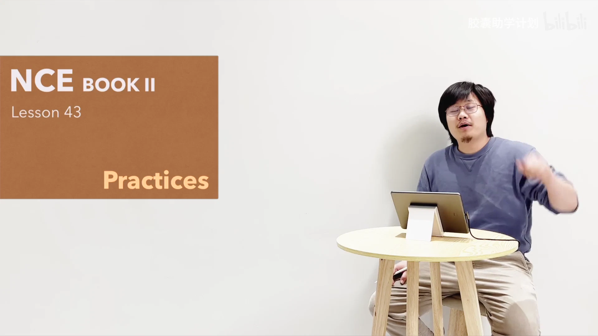

文字识别：NCE / BOOK"I / Lesson 43 / Practices

### 画面 00:00:02

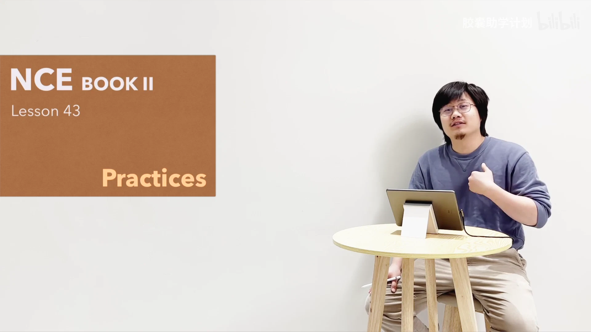

文字识别：NCE / BOOKII / Lesson 43 / Practices

### 画面 00:00:08

文字识别：进行如下练习唯一前提 / 文章跟读至熟读成诵 / 否则请勿开始

### 画面 00:00:17

文字识别：胶囊助学计划bll

### 画面 00:00:20

文字识别：胶囊助学计划 / 胶囊助学计划

### 画面 00:00:22

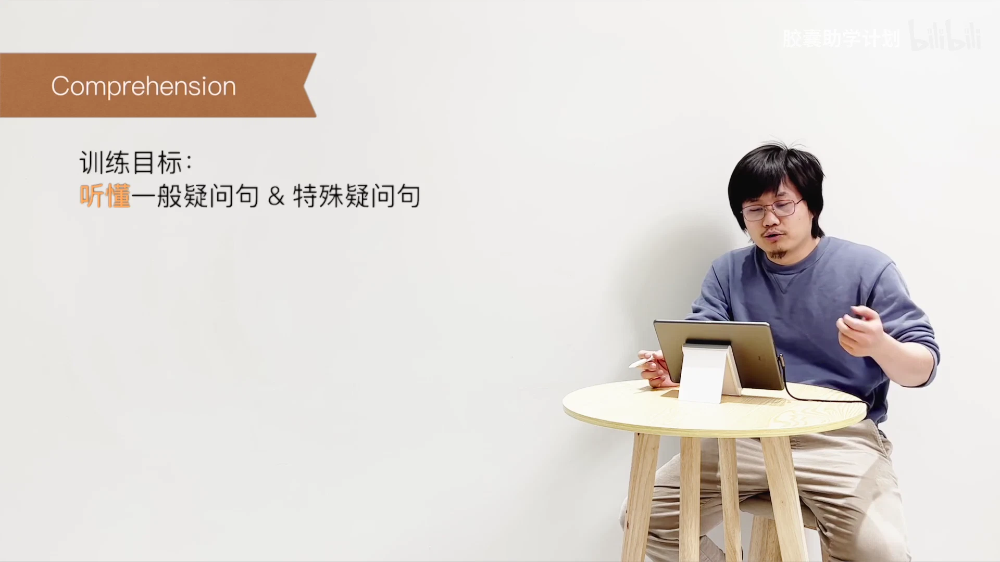

文字识别：Comprehension / 训练目标： / 听懂一般疑问句＆特殊疑问句

### 画面 00:00:28

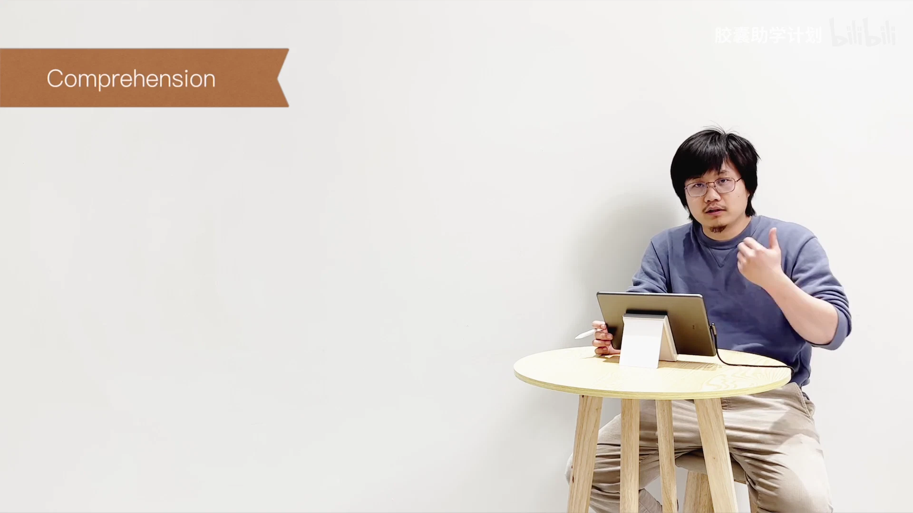

文字识别：Comprehension

## 00:00:30–00:01:00

Was R E Bird American or English? American, right? Next one,说When did he fly over the North Pole? In 1926,啊，three years after什么什么嘛，对吧？这个各位一个数学题啊，一九二九年是他飞跃之后的第三年，那一九二六年就是他飞跃北极的那一天。OK, next one, When did he fly over the South Pole?啊，那开头的答案in 1929. Next one,

### 画面 00:00:31

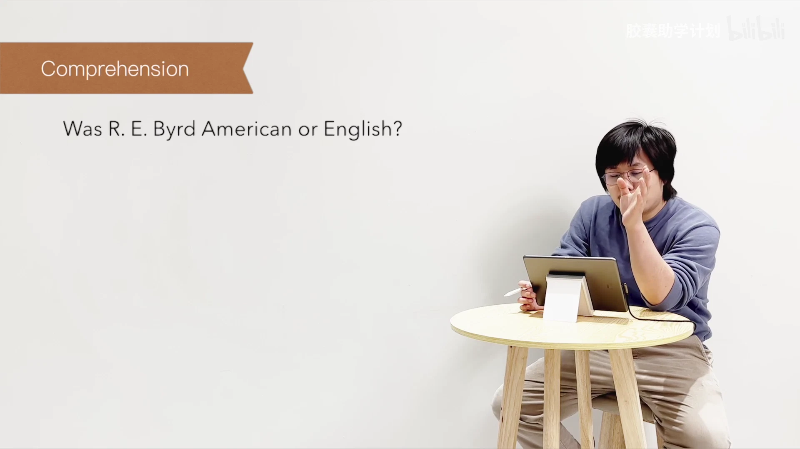

文字识别：Comprehension / Was R. E. Byrd American or English?

### 画面 00:00:36

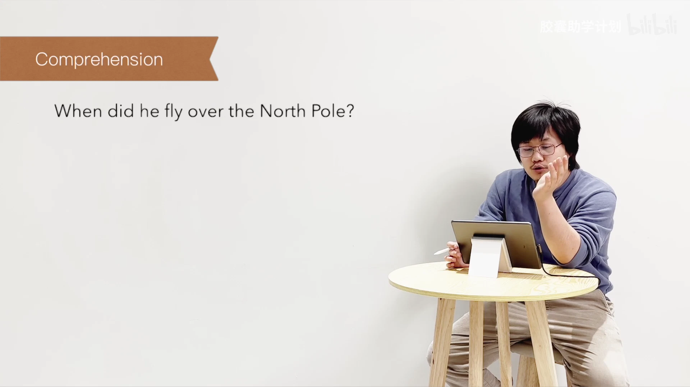

文字识别：Comprehension / When did he fly over the North Pole?

### 画面 00:00:59

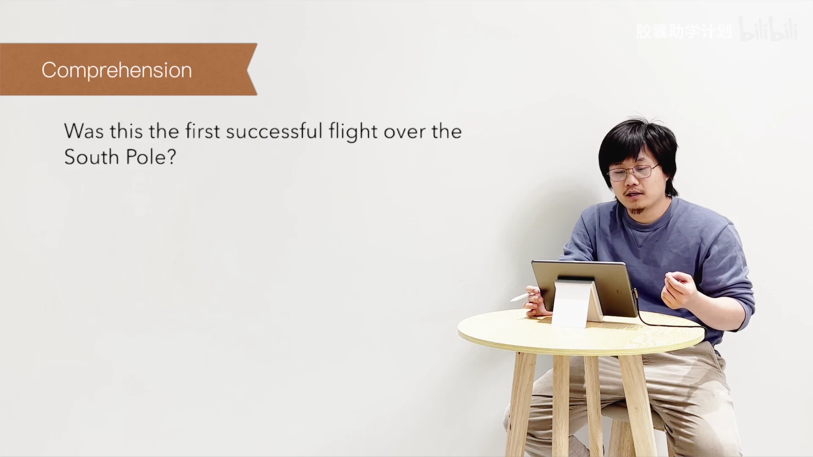

文字识别：Comprehension / Was this the first successful flight over the / South Pole?

## 00:01:00–00:01:30

was this the first successful flight over the South Pole? Yes, it was. For the first time,嘛对吧? Next one, what were Bird and his men able to do at first? Take a great many photographs of the mountains that lay below,对吧? 原文啊. Did they soon run into trouble? Yes, they did. Next one, what

### 画面 00:01:10

文字识别：Comprehension / What were Byrd and his men able to do at first?

### 画面 00:01:22

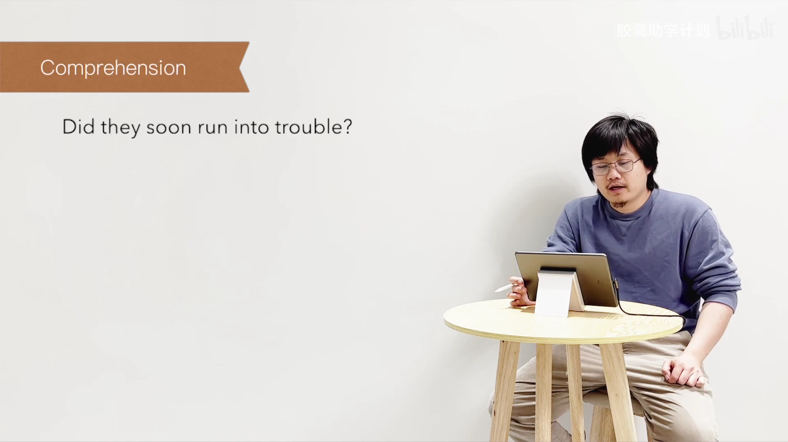

文字识别：Comprehension / Did they soon run into trouble?

## 00:01:30–00:02:00

seemed certain at one point that their plane would crash. Next one, why did it have to rise to ten thousand feet to get over the mountains? Next one, what did Bird order his man to do to throw out two heavy food sacks? Next one, did this make the

### 画面 00:01:32

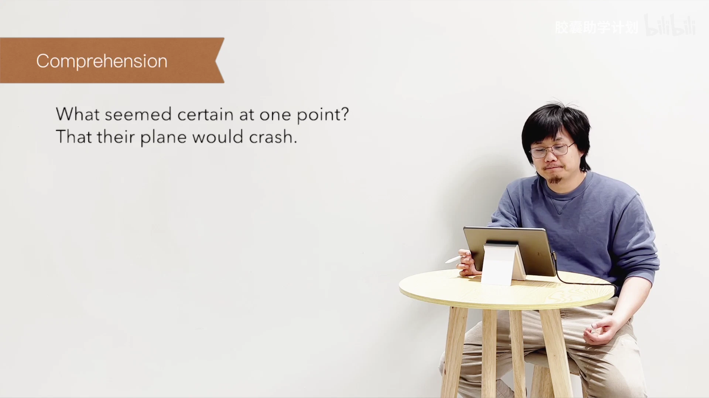

文字识别：Comprehension / What seemed certain at one point? / That their plane would crash.

### 画面 00:01:38

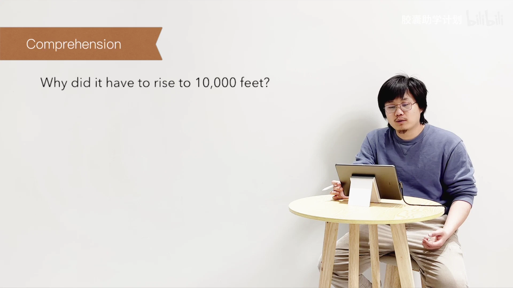

文字识别：Comprehension / Why did it have to rise to 10,000 feet?

### 画面 00:01:53

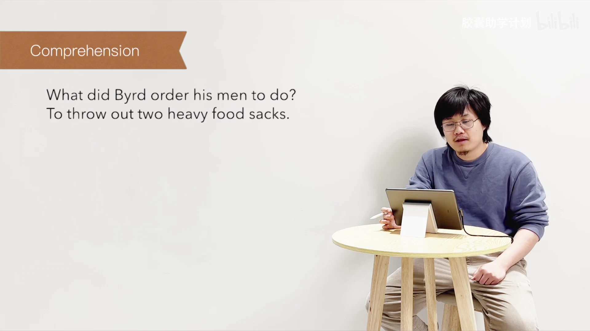

文字识别：Comprehension / What did Byrd order his men to do? / To throw out two heavy food sacks.

### 画面 00:01:58

文字识别：Comprehension / Did this make the plane lighter?

## 00:02:00–00:02:30

plane lighter? Yes, it did. Next one, what was it then able to do? To reach the South Pole. Next one, by how much did it clear the mountains? Four hundred feet. Next one, how far away was the South Pole at this point? Three hundred miles.

### 画面 00:02:09

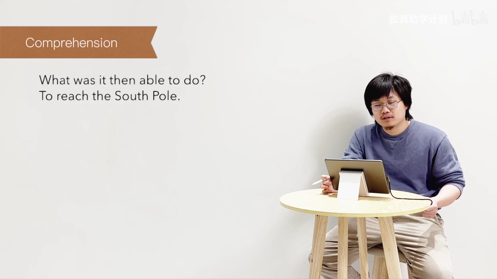

文字识别：Comprehension / What was it then able to do? / To reach the South Pole.

### 画面 00:02:12

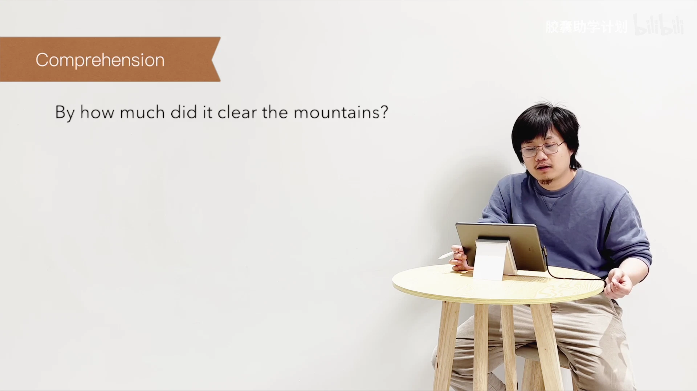

文字识别：Comprehension / By how much did it clear the mountains?

### 画面 00:02:22

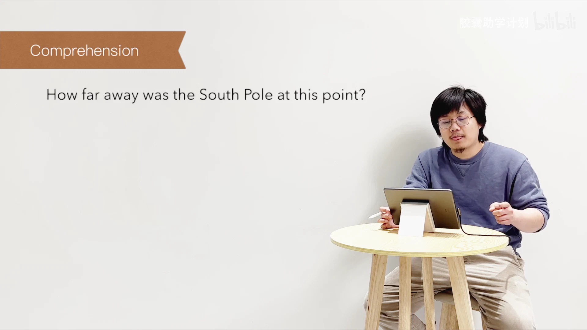

文字识别：Comprehension / How far away was the South Pole at this point?

## 00:02:30–00:03:00

Good. Asking questions. Ah, here we practice the ability to ask questions, right? Okay. The first example says, "R. E. Bird was an explorer." Was? Who?

### 画面 00:02:30

文字识别：Asking questions / 训练目标： / 会说一般疑问句＆特殊疑问句 / Accuracy / Fluency

### 画面 00:02:37

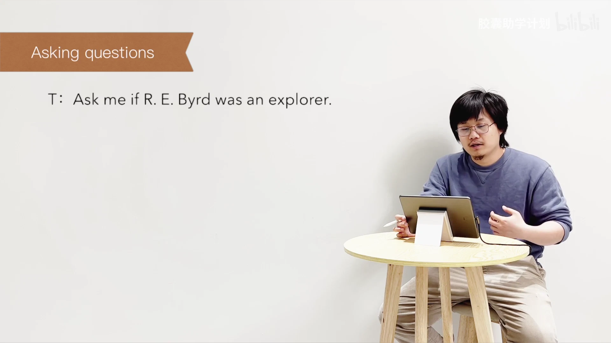

文字识别：Asking questions / T: Ask me if R. E. Byrd was an explorer.

### 画面 00:02:41

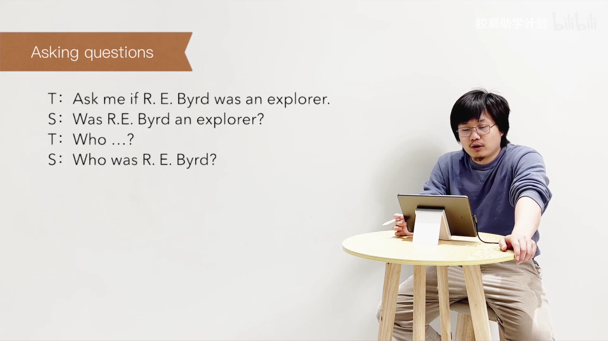

文字识别：Asking questions / T: Ask me if R. E. Byrd was an explorer. / S: Was R.E. Byrd an explorer? / T: Who ...? / S: Who was R.E. Byrd?

### 画面 00:02:48

文字识别：Asking questions

### 画面 00:02:50

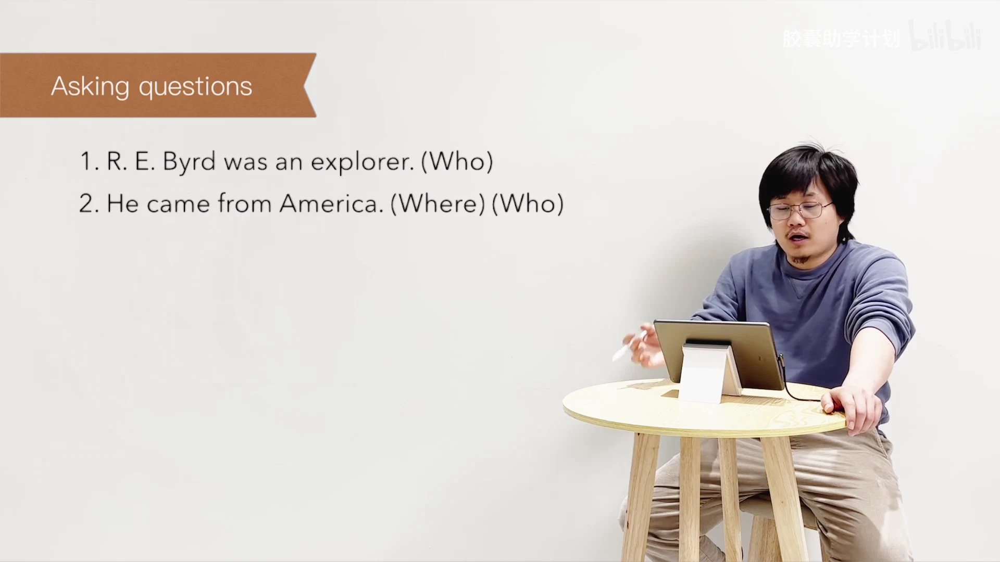

文字识别：Asking questions / 1.R. E. Byrd was an explorer. (Who) / 2. He came from America.(Where) (Who)

## 00:03:00–00:03:30

first man to fly over the South Pole. Was提前, who对he提问,对吧?第三、第四个啊,说he flew over it in 1929.哎, did提前,对吧?动词换原形, when肯定是对时间提问, who对主语提问啊?说he had flown over the North Pole three years earlier.注意had flown过去完成时, had提前,那when肯定就是对three years earlier提问, who对主语提问,对吧?好,

### 画面 00:03:04

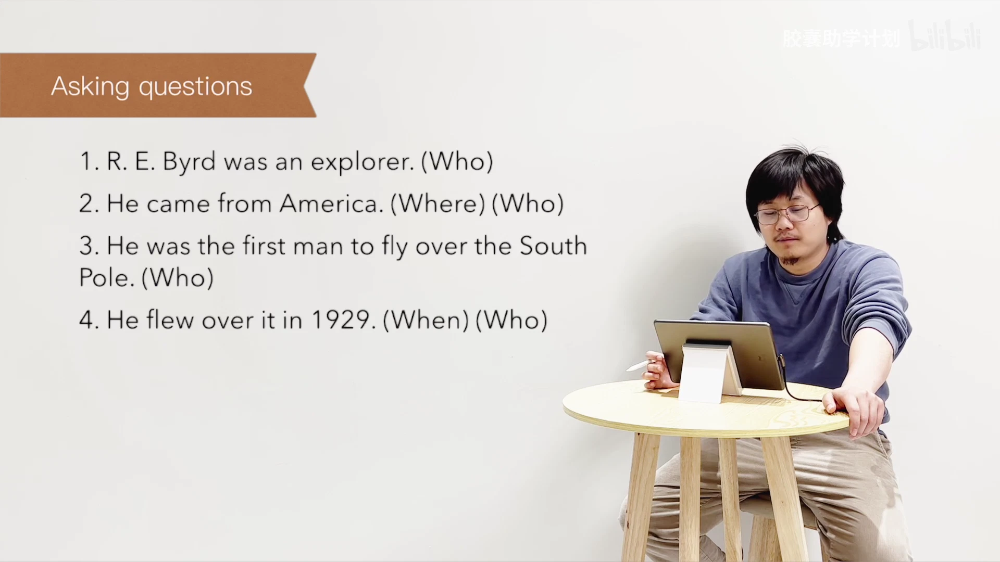

文字识别：Asking questions / 1. R. E. Byrd was an explorer. (Who) / 2. He came from America. (Where) (Who) / 3. He was the first man to fly over the South / Pole.(Who) / 4. He flew over it in 1929.(When) (Who)

### 画面 00:03:16

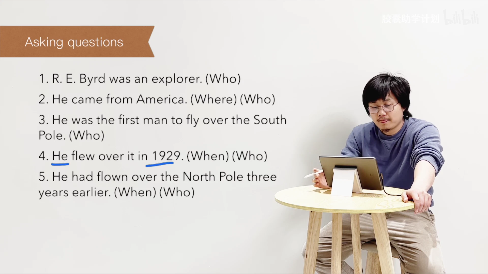

文字识别：Asking questions / 1. R. E. Byrd was an explorer. (Who) / 2. He came from America. (Where) (Who) / 3. He was the first man to fly over the South / Pole.(Who) / 4. He flew over it in 1929.(When) (Who) / 5. He had flown over the North Pole three / years earlier. (When)(Who)

### 画面 00:03:26

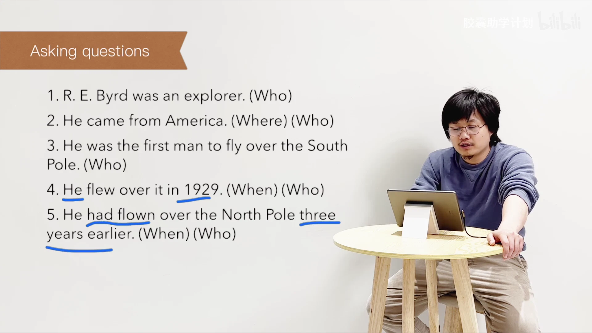

文字识别：Asking questions / 1. R. E. Byrd was an explorer. (Who) / 2. He came from America. (Where) (Who) / 3. He was the first man to fly over the South / Pole.(Who) / 4. He flew over it in 1929.(When) (Who) / 5. He had flown over the North Pole three / years earlier. (When) (Who)

### 画面 00:03:29

文字识别：Asking questions

## 00:03:30–00:04:00

第六题，They were able to take a great many photographs. 讲语法的时候我提到了对吧？变一般疑问句，把 were 提前就可以了。那 how many 其实就是对 a great many 提问。那 how many 要注意往前提的时候带着 photographs，所以它的答案叫 how many photographs were they able to take？对吧？Okay，They took photographs of the mountains below. 呃，did 提前就可以了，动词换原形。那 what 点点 of？你 what 可以对 the mountains

### 画面 00:03:35

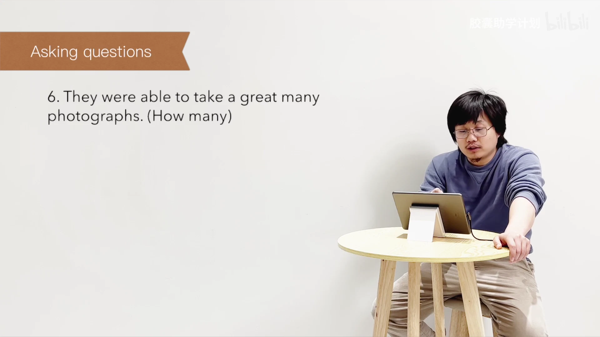

文字识别：Asking questions / 6. They were able to take a great many / photographs. (How many)

### 画面 00:03:37

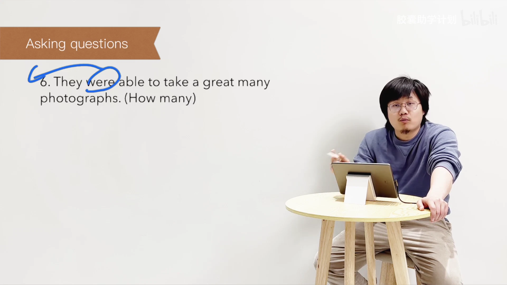

文字识别：Asking / questions / photographs. (How many)

### 画面 00:03:41

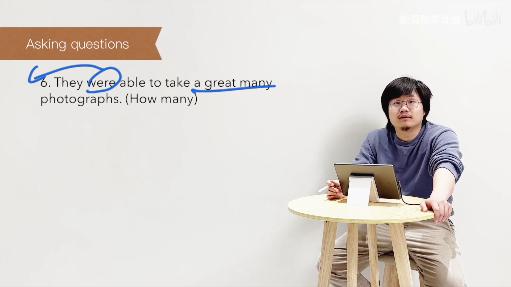

文字识别：Asking / questions / C6.They /  Were able to take a great many / photographs.(How many)

### 画面 00:03:49

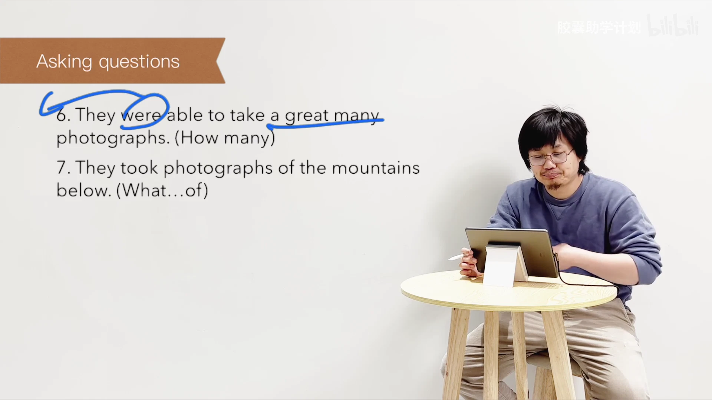

文字识别：Asking questions / photographs. (How many) / 7. They took photographs of the mountains / below.(What...of)

## 00:04:00–00:04:30

提问就行了，对吧？答案叫 what did they take photographs of？他们拍了什么的照片吗？OK。第八题， they soon ran into difficulties. Did 提前， when 对 soon 提问就可以啊。好， they thought， 注意后边宾从，我们不管，我们就管 thought，对吧？Did 提前， did they think that their plane would crash？OK。那 what 那肯定就是 what did they think嘛？他们对

### 画面 00:04:09

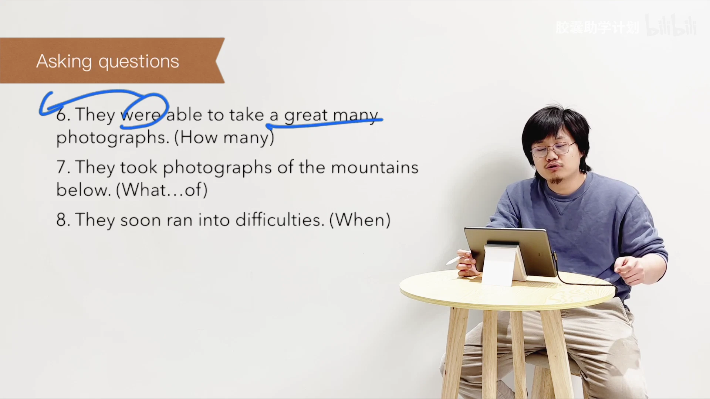

文字识别：Asking questions / photographs. (How many) / 7. They took photographs of the mountains / below.(What...of) / 8. They soon ran into difficulties. (When)

### 画面 00:04:15

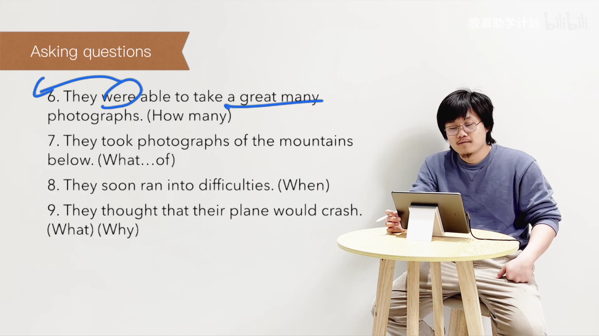

文字识别：Asking questions / photographs.(How many) / 7. They took photographs of the mountains / below. (What...of) / 8. They soon ran into difficulties. (When) / 9. They thought that their plane would crash. / (What) (Why)

### 画面 00:04:20

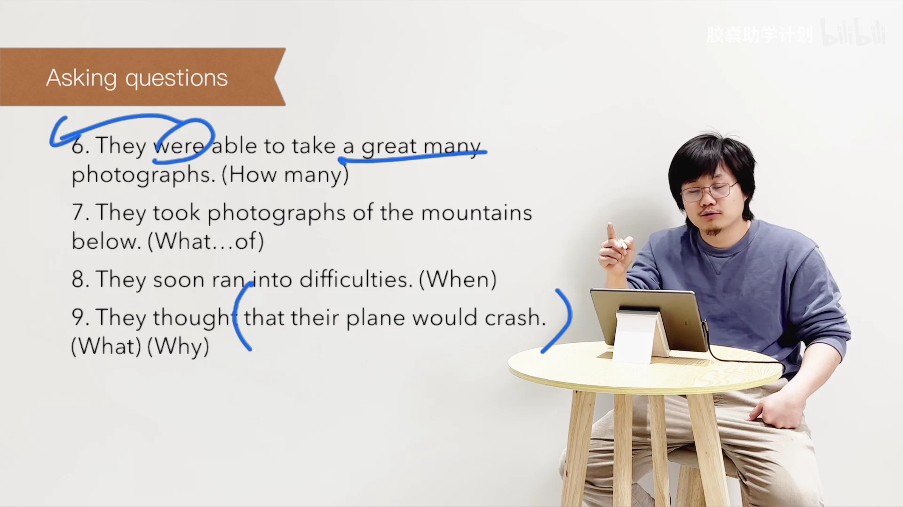

文字识别：Asking questions / photographs.(How many) / 7. They took photographs of the mountains / below. (What...of) / 8. They soon ranyinto difficulties. (When) / 9. They though that their plane would crash. / (What) (Why)

## 00:04:30–00:05:00

这个整这个宾语从句提问，why整句话提问就可以了。OK，呃，tell the story，老习惯，各位，呃，越熟练越好，可以有一点点小的瑕疵。这练习的是我们口语表达的一个能力，这可能在我们应试考试当中用处也许没有那么大，但是等各位工作了之后，对吧？或者说各位去考雅思、托福的时候的口语的时候，这个帮助就非常非常的大了。玩一个，

### 画面 00:04:34

文字识别：Tell the story / 训练目标： / 口语复述能力 / Accuracy / Fluency

### 画面 00:04:39

文字识别：Tell the story / 训练目标： / 口语复述能力 / Accuracy / Fluency

### 画面 00:04:41

文字识别：Tell the story / 训练目标： / □语复述能力 / Fluency / Accuracy

### 画面 00:04:59

文字识别：Tell the story / 训练目标： / □语复述能力 / Accuracy / Fluency

## 00:05:00–00:05:30

那就是这样，对吧？你文章一定要读熟才行啊。好，summary writing，摘要写作，写完来这儿对答案，不懂的在视频下方留言就可以了。然后 topic for discussion，这是我们所有一切一切的练习，学习单词，学习语法，学习新概念，最终唯一的啊，就是说口语上、听力上很重要的一个目的，就是能自由的去对话。那我们看一下他们是什么题啊？说 What other famous

### 画面 00:05:01

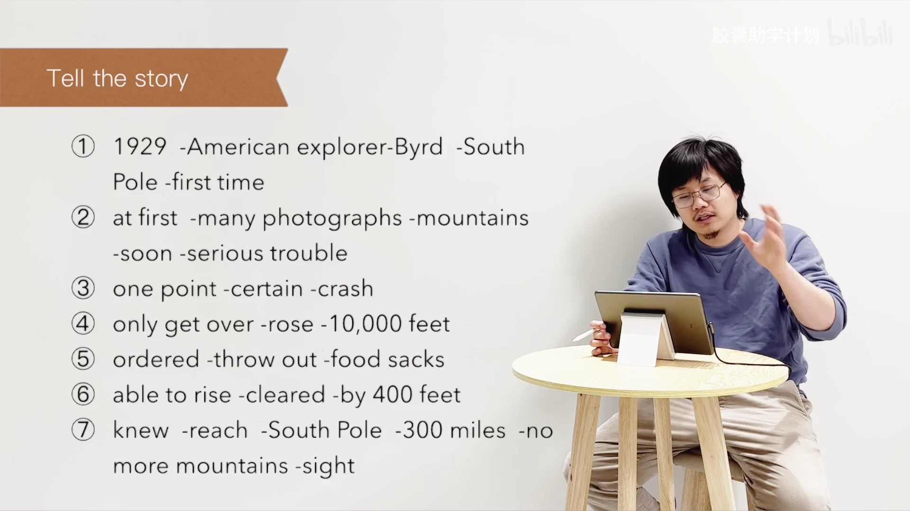

文字识别：Tell the story /  1929 -American explorer-Byrd -South / Pole -first time / at first -many photographs -mountains / -soon -serious trouble / 3 / one point -certain -crash / ④ only get over -rose -10,000 feet / ⑤ ordered -throw out -food sacks / 6 / ) able to rise -cleared -by 400 feet / knew -reach -South Pole -300 miles -no / more mountains -sight

### 画面 00:05:03

文字识别：Summary writing: Key / 训练目标： / 写作复述能力

### 画面 00:05:05

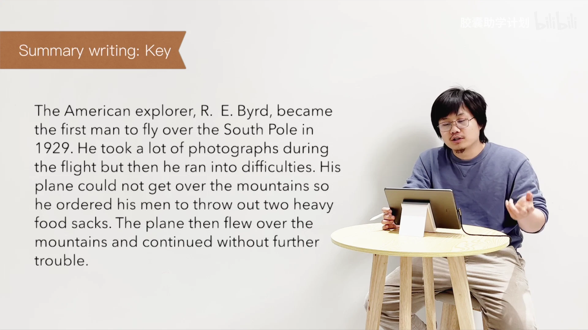

文字识别：Summary writing: Key / The American explorer, R. E. Byrd, became / the first man to fly over the South Pole in / 1929. He took a lot of photographs during / the flight but then he ran into difficulties. His / plane could not get over the mountains so / he ordered his men to throw out two heavy / food sacks. The plane then flew over the / mountains and continued without further / trouble.

### 画面 00:05:10

文字识别：Topics for discussion / 训练目标： / 完全自由的对话 / Accuracy / Fluency

### 画面 00:05:13

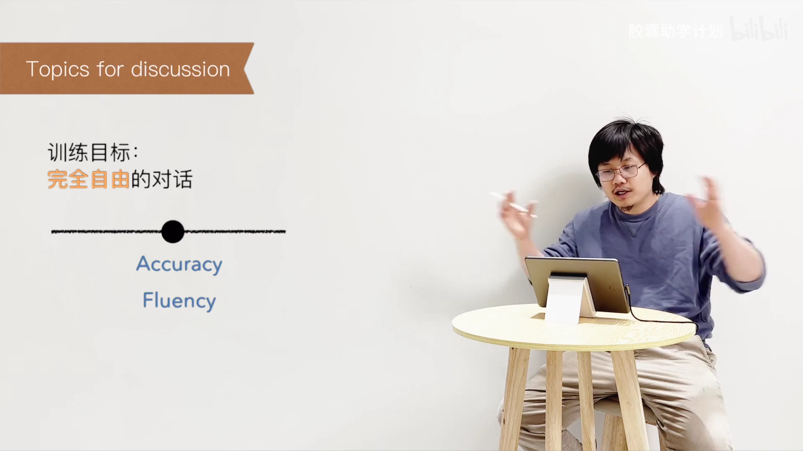

文字识别：Topics for discussion / 训练目标： / 完全自由的对话 / Accuracy / Fluency

### 画面 00:05:18

文字识别：Topics for discussion / 训练目标： / 完全自由的对话 / Accuracy / Fluency

### 画面 00:05:21

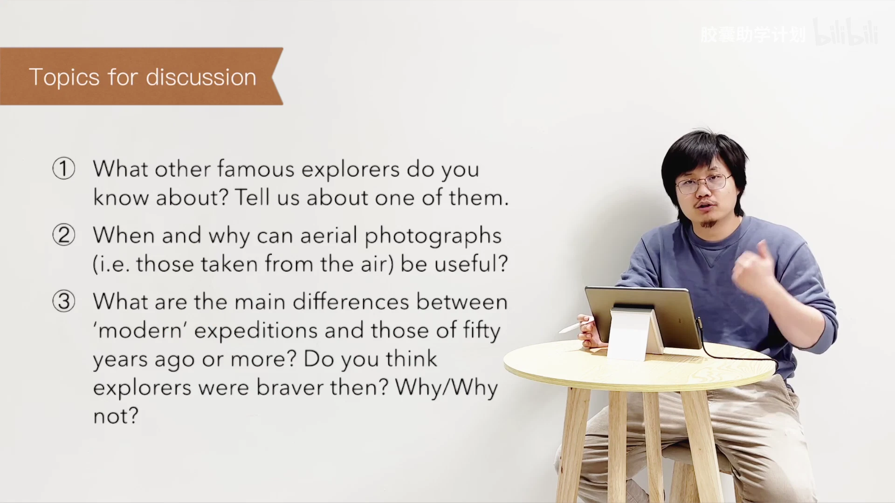

文字识别：Topics for discussion / What other famous explorers do you / know about? Tell us about one of them. / When and why can aerial photographs / (i.e. those taken from the air) be useful? / What are the main differences between / 3 / 'modern' expeditions and those of fifty / years ago or more? Do you think / explorers were braver then? Why/Why / not?

## 00:05:30–00:06:00

explorers do you know about?你还知道什么其他非常著有名的这个 explorers 啊？我们所谓探险家吗？Tell us about one of them.给我们讲讲吧。When and why can aerial photographs be useful?说什么时候以及为什么说航空的这些拍摄的照片是非常有用的啊？第三个说What are the main difference between modern expedition

### 画面 00:05:51

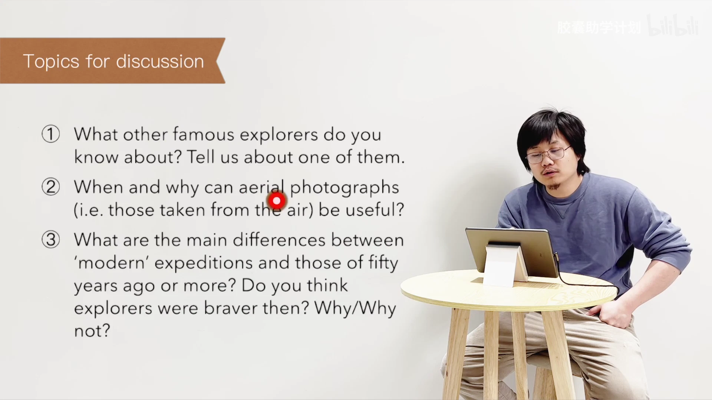

文字识别：Topics for discussion / What other famous explorers do you / know about? Tell us about one of them. / When and why can aerial photographs / (i.e. those taken from the air) be useful? / What are the main differences between / 3 / 'modern' expeditions and those of fifty / years ago or more? Do you think / explorers were braver then? Why/Why / not?

## 00:06:00–00:06:30

and those of fifty years ago or more, is吧？说现在现在我们的这种探险和五十年前甚至更长时间之前的探险有什么区别？Do you think explorers were braver than？说你认为那个时候的探险家更勇敢吗？Why or why not？如果是为什么是？如果不是为什么不是？好吧，好，那家庭作业呢？Ask me if这位是各位必须要写的，只要写作是你一定要写的。这个在应试考试

### 画面 00:06:21

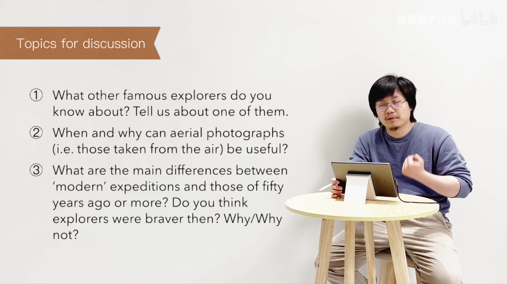

文字识别：Topics for discussion / What other famous explorers do you / know about? Tell us about one of them. / When and why can aerial photographs / (i.e. those taken from the air) be useful? / What are the main differences between / 3 / 'modern' expeditions and those of fifty / years ago or more? Do you think / explorers were braver then? Why/Why / not?

### 画面 00:06:23

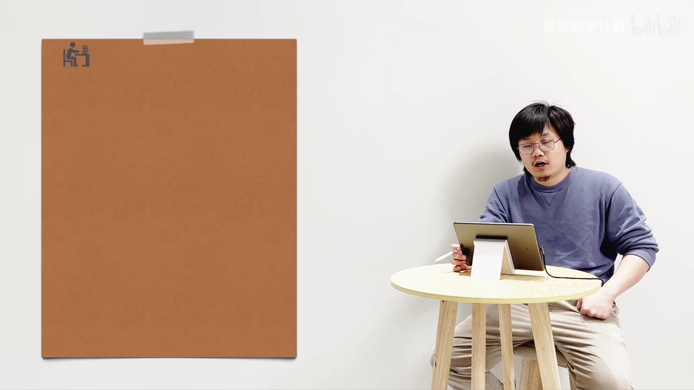

### 画面 00:06:26

文字识别：1.Ask me if写&朗读 / 2. / 摘要写作写&答案

## 00:06:30–00:07:00

当中，这个能力也很重要啊。然后呢， tell the story 口语复述，对吧？好，然后专栏当中都可以找得到。那以上呢就是本期视频的全部内容了。如果各位呃喜欢我们的视频，欢迎各位关注啊，订阅，一键三连，分享给那些需要的朋友来帮助我们快速成长。 See you next time.

### 画面 00:06:32

文字识别：1.Ask me if写&朗读 / 摘要写作写&答案 / 3.Tell the story 口语复述

### 画面 00:06:35

文字识别：1.Ask me if写&朗读 / 摘要写作写&答案 / 3.Tell the story 口语复述 / 专栏 / 4

### 画面 00:06:37

文字识别：👍

### 画面 00:06:50

文字识别：￥

### 画面 00:06:52

文字识别：CAPSULEACADEMY / 胶囊助学计划 / 小红书 / Lecturer / □ / 口 / Leo / OE

### 画面 00:06:55

文字识别：CAPSULEACADEMY / 胶囊助学计划 / 小红书 / OE

### 画面 00:06:58

文字识别：CAPSULEACADEMY / 胶囊助学计划 / 小红书 / Creator / Leo & Berlin / OE

## 00:07:00–00:07:03

### 画面 00:07:00

文字识别：胶囊助学计划 blbl / CAPSULEACADEMY / 胶囊助学计划 / 小红书 / OE

### 画面 00:07:02

文字识别：bilibili / 胶囊助学计划

