# L044 单词

快速机器解析：语音为单模型转写，未进行独立交叉校对或人工复核；画面每秒采样并按变化选帧，短时文字和标记可能遗漏。截图时间约有 1 秒误差。图片有损压缩；遇到疑点请按时间查看 Google Drive 原视频。

## 00:00:00–00:00:30

Hello everyone, welcome to Capsule Academy. This is Leo. Today we're going to learn New Concept English Book Two Lesson Forty Four Words. 那老习惯进入正式课程之前呢，我们先看几个小的问题。首先如何表达冒险，其次如何表达野餐，最后如何表达上气不接下气。 Okay, 那带着这三个问题，Hope you gonna enjoy it. 好，那我们先看第一个小的单词啊，看着音标跟我一起读一下，叫

### 画面 00:00:00

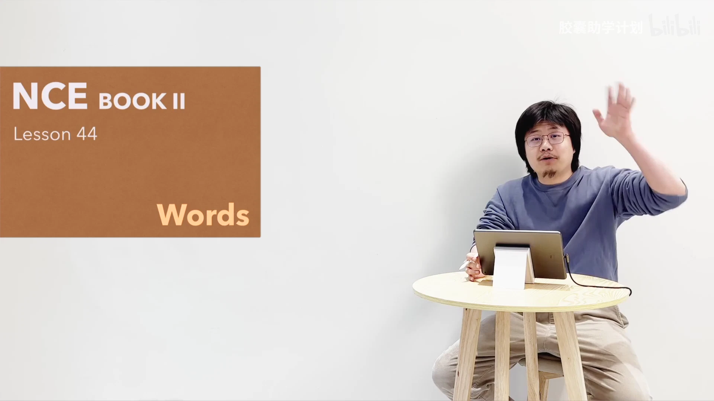

文字识别：NCE / BOOKII / Lesson 44 / Words

### 画面 00:00:02

文字识别：NCE / BOOKⅡI / Lesson 44 / Words

### 画面 00:00:05

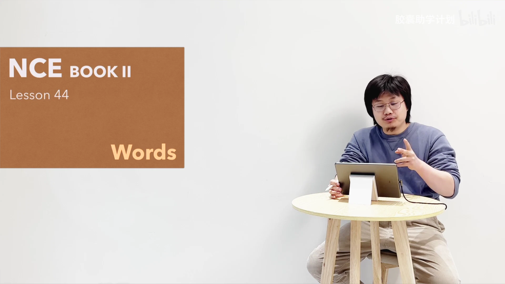

文字识别：NCE / BOOKⅡI / Lesson 44 / Words

### 画面 00:00:08

### 画面 00:00:11

文字识别：①如何表达“冒险”？

### 画面 00:00:13

文字识别：①如何表达“冒险”? / 表达“野餐”?

### 画面 00:00:15

文字识别：①如何表达“冒险”? / 如何表达“野餐”? / 何表达“上气不接下气”?

### 画面 00:00:17

文字识别：①如何表达“冒险”？ / 如何表达“野餐”? / 如何表达“上气不接下气”?

### 画面 00:00:21

文字识别：胶囊助学计划bill

### 画面 00:00:25

文字识别：胶囊助学计划

### 画面 00:00:27

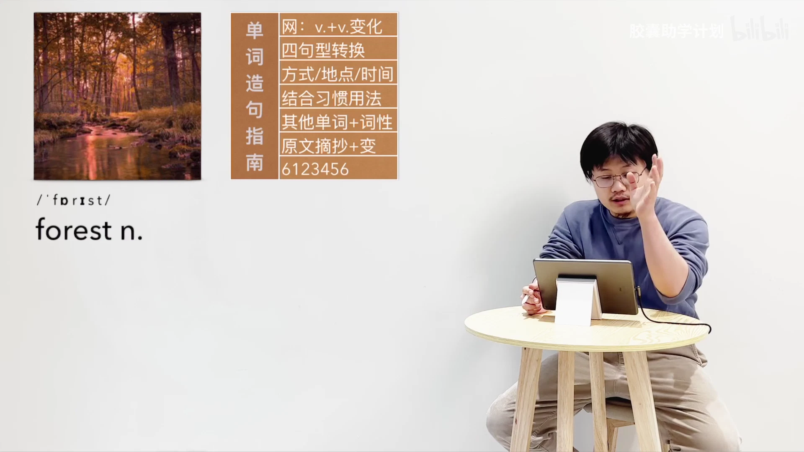

文字识别：单词造句指南 / 网：v.+v.变化 / 四句型转换 / 方式/地点/时间 / 结合习惯用法 / 其他单词+词性 / 原文摘抄+变 / 6123456 / /'fprIst/ / forest n.

### 画面 00:00:29

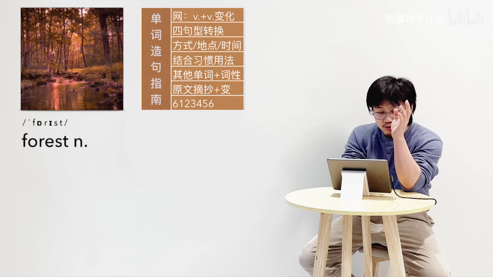

文字识别：单词造句指南 / 网：v.+v.变化 / 四句型转换 / 方式/地点/时间 / 结合习惯用法 / 其他单词+词性 / 原文摘抄+变 / 6123456 / / 'fprIst/ / forest n.

## 00:00:30–00:01:00

做 forest, forest, forest啊，森林的意思。那它是一个名词，呃，这个时候其实我们造句，因为我们造的是句子，对吧？新概念二册第一课咱们学的就是六一二三四五六，这就是如何去造一个句子啊，以及如何去造一个好的句子。那我们要用到的，可能就要想一下，forest在六一二三四五六当中可能出现的位置，它做主语行不行？可以。那它的二，也就是它的动词加动词变化，

### 画面 00:00:31

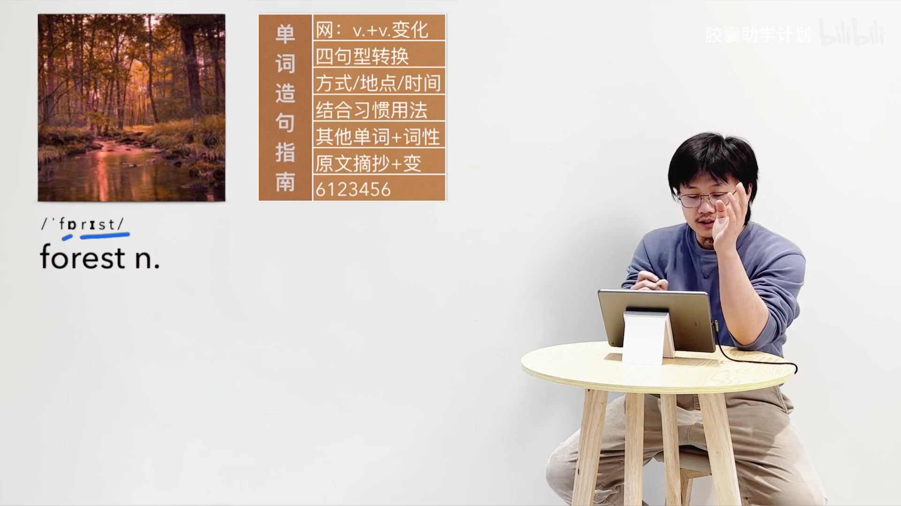

文字识别：单词造句指南 / 网：v.+v.变化 / 四句型转换 / 方式/地点/时间 / 结合习惯用法 / 其他单词+词性 / 原文摘抄+变 / 6123456 / / 'fprIst/ / forest n.

### 画面 00:00:33

文字识别：单词造句指南 / 网：v.+v.变化 / 四句型转换 / 方式/地点/时间 / 结合习惯用法 / 其他单词+词性 / 原文摘抄+变 / 6123456 / / 'fprIst/ / forest n.

### 画面 00:00:35

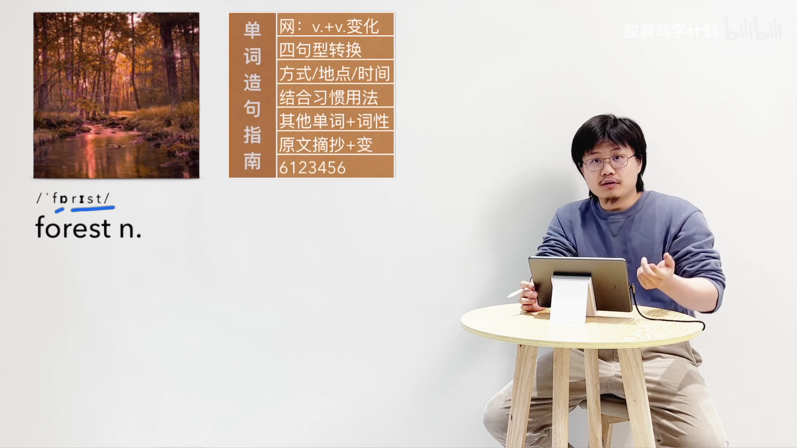

文字识别：单词造句指南 / 网：v.+v.变化 / 四句型转换 / 方式/地点/时间 / 结合习惯用法 / 其他单词+词性 / 原文摘抄+变 / 6123456 / /'fprIst/ / forest n.

### 画面 00:00:40

文字识别：单词造句指南 / 网：v.+v.变化 / 四句型转换 / 方式/地点/时间 / 结合习惯用法 / 其他单词+词性 / 原文摘抄+变 / 6123456 / / 'fprIst/ / forest n.

### 画面 00:00:45

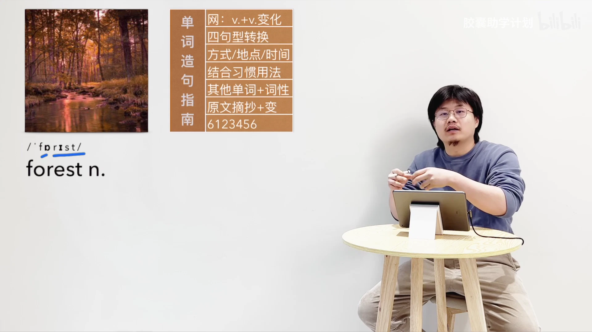

文字识别：单词造句指南 / 网：v.+v.变化 / 四句型转换 / 方式/地点/时间 / 结合习惯用法 / 其他单词+词性 / 原文摘抄+变 / 6123456 / / 'fprist/ / forest n.

### 画面 00:00:50

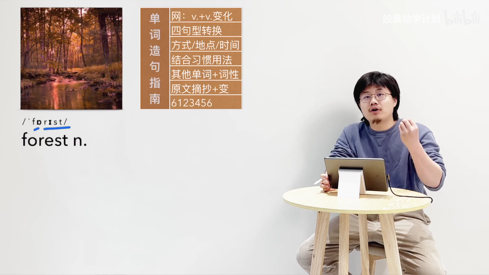

文字识别：单词造句指南 / 网：v.+v.变化 / 四句型转换 / 方式/地点/时间 / 结合习惯用法 / 其他单词+词性 / 原文摘抄+变 / 6123456 / / 'fprIst/ / forest n.

### 画面 00:00:55

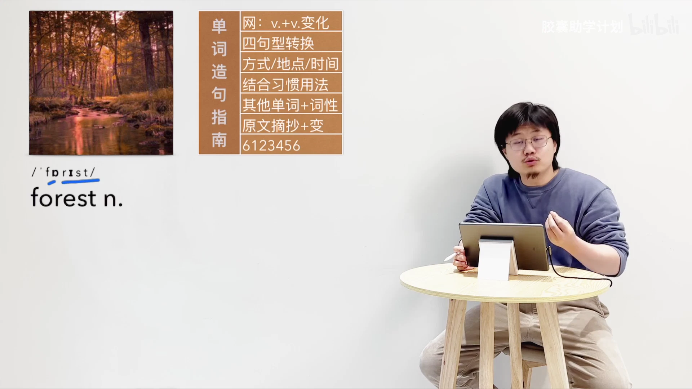

文字识别：单词造句指南 / 网：v.+v.变化 / 四句型转换 / 方式/地点/时间 / 结合习惯用法 / 其他单词+词性 / 原文摘抄+变 / 6123456 / /'fprist/ / forest n.

## 00:01:00–00:01:30

一般可能就是被动了。它做三行不行啊？它砍树对吧？这个明显做三行，做五是不是也是行？对吧？做一个地点，那没有问题啊。我们随便造一些句子，比如说 There was a big forest fire. 你看在这里就很有意思。我实际上把这个 forest 和 fire 放到一起去用了，它表示的是森林大火，用的个 there be 句型，对吧？有一个很大的森林大火。And luckily everybody was able to get out. 这里边

### 画面 00:01:00

文字识别：单词造句指南 / 网：v.+v.变化 / 四句型转换 / 方式/地点/时间 / 结合习惯用法 / 其他单词+词性 / 原文摘抄+变 / 6123456 / / 'fprIst/ / forest n.

### 画面 00:01:05

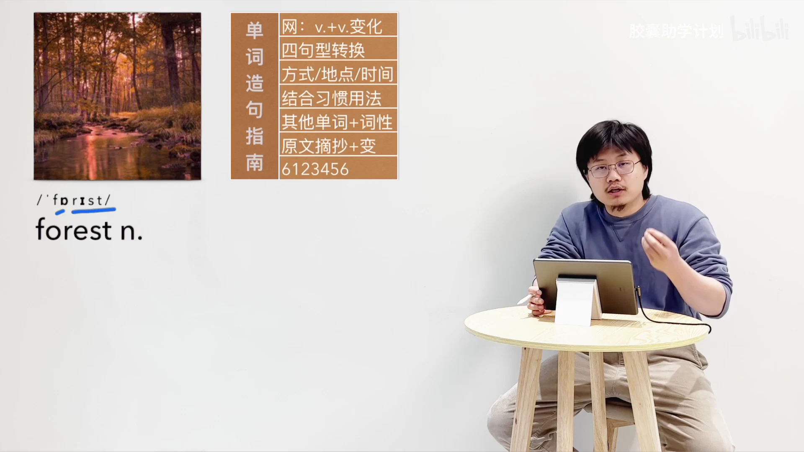

文字识别：单词造句指南 / 网：v.+v.变化 / 四句型转换 / 方式/地点/时间 / 结合习惯用法 / 其他单词+词性 / 原文摘抄+变 / 6123456 / / 'fprIst/ / forest n.

### 画面 00:01:09

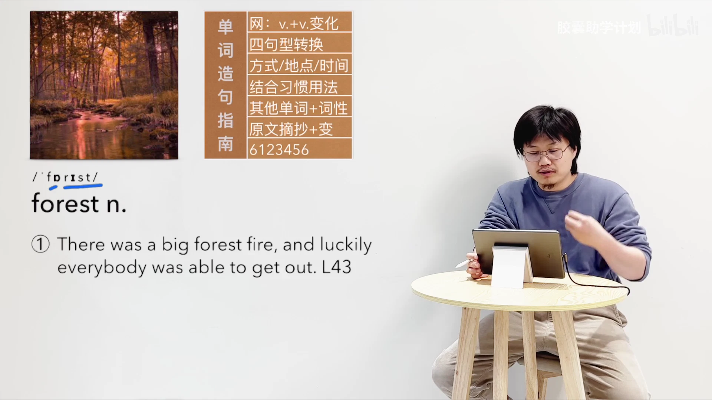

文字识别：单词造句指南 / 网：v.+v.变化 / 四句型转换 / 方式/地点/时间 / 结合习惯用法 / 其他单词+词性 / 原文摘抄+变 / 6123456 / / 'fprist/ / forest n. / ) There was a big forest fire, and luckily / everybody was able to get out. L43

### 画面 00:01:11

文字识别：单词造句指南 / 网：v.+v.变化 / 四句型转换 / 方式/地点/时间 / 结合习惯用法 / 其他单词+词性 / 原文摘抄+变 / 6123456 / / 'fprist/ / forest n. / ) There was a big forest fire, and luckily / everybody was able to get out. L43

### 画面 00:01:15

文字识别：单词造句指南 / 网：v.+v.变化 / 四句型转换 / 方式/地点/时间 / 结合习惯用法 / 其他单词+词性 / 原文摘抄+变 / 6123456 / /'fprist/ / forest n. / ) There was a big forest fire, and luckily / everybody was able to get out. L43

### 画面 00:01:18

文字识别：单词造句指南 / 网：v.+v.变化 / 四句型转换 / 方式/地点/时间 / 结合习惯用法 / 其他单词+词性 / 原文摘抄+变 / 6123456 / /'fprist/ / forest n. /  There was a big forest fire and luckily / everybody was able to get out. L43

### 画面 00:01:20

文字识别：单词造句指南 / 网：v.+v.变化 / 四句型转换 / 方式/地点/时间 / 结合习惯用法 / 其他单词+词性 / 原文摘抄+变 / 6123456 / / 'fprIst/ / forest n. / ) There was a big forest fire and luckily / everybody was able to get out. L43

### 画面 00:01:25

文字识别：单词造句指南 / 网：v.+v.变化 / 四句型转换 / 方式/地点/时间 / 结合习惯用法 / 其他单词+词性 / 原文摘抄+变 / 6123456 / /'fprist/ / forest n. / ) There was a big forest fire and luckily / everybody was able to get out. L43

## 00:01:30–00:02:00

有两个小点，我带着各位复习一下。第一个叫 everybody 做主语的时候，后边别忘了用单数，对吧？其次，这地方用的是 was able to get out，啊，实际上叫做成功的做了某事儿。这是咱们四十三课去学的，刚学了，对不对？Next one，造一个句子叫 They needn't have cut down the forest.他们本不必去把这片儿森林给砍掉，但是发没发生呢？注意 needn't have done 指的

### 画面 00:01:30

文字识别：单词造句指南 / 网：v.+v.变化 / 四句型转换 / 方式/地点/时间 / 结合习惯用法 / 其他单词+词性 / 原文摘抄+变 / 6123456 / / 'fprist/ / forest n. /  There was a big forest fire and luckily / everybody was able to get out. L43

### 画面 00:01:35

文字识别：单词造句指南 / 网：v.+v.变化 / 四句型转换 / 方式/地点/时间 / 结合习惯用法 / 其他单词+词性 / 原文摘抄+变 / 6123456 / / 'fprist/ / forest n. / There was a big forest fire and luckily / everybody was able to get out. L43

### 画面 00:01:40

文字识别：单词造句指南 / 网：v.+v.变化 / 四句型转换 / 方式/地点/时间 / 结合习惯用法 / 其他单词+词性 / 原文摘抄+变 / 6123456 / / 'fprist/ / forest n. /  There was a big forest fire and luckily / everybody was able to get out. L43

### 画面 00:01:45

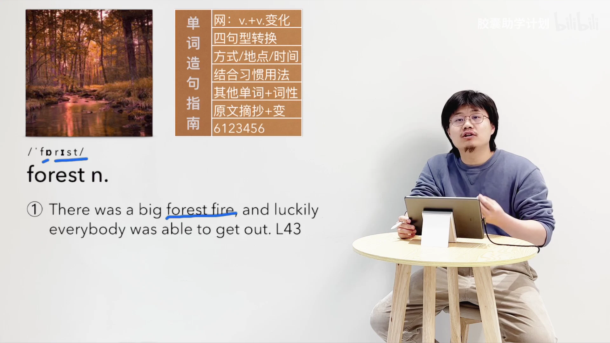

文字识别：单词造句指南 / 网：v.+v.变化 / 四句型转换 / 方式/地点/时间 / 结合习惯用法 / 其他单词+词性 / 原文摘抄+变 / 6123456 / / 'fprIst/ / forest n. /  There was a big forest fire, and luckily / everybody was able to get out. L43

### 画面 00:01:48

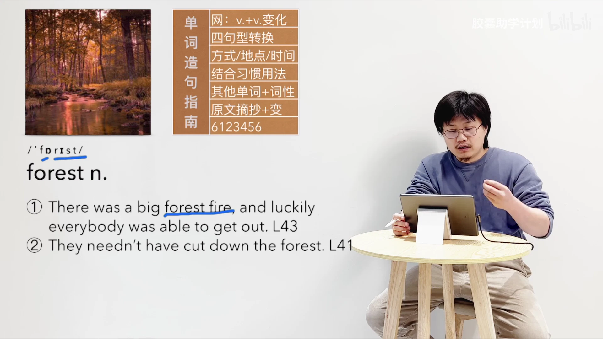

文字识别：单词造句指南 / 网：v.+v.变化 / 四句型转换 / 方式/地点/时间 / 结合习惯用法 / 其他单词+词性 / 原文摘抄+变 / 6123456 / / 'fprist/ / forest n. / ) There was a big forest fire and luckily / everybody was able to get out. L43 / They needn't have cut down the forest. L41

### 画面 00:01:50

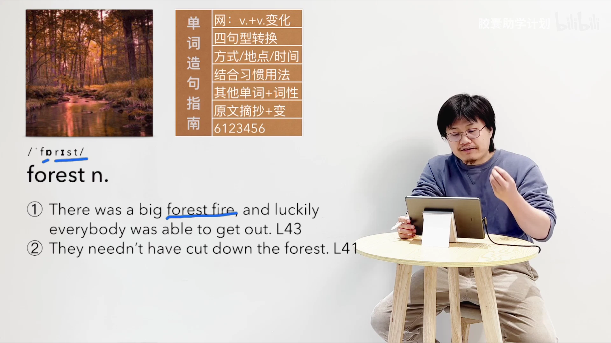

文字识别：单词造句指南 / 网：v.+v.变化 / 四句型转换 / 方式/地点/时间 / 结合习惯用法 / 其他单词+词性 / 原文摘抄+变 / 6123456 / /'fprIst/ / forest n. /  There was a big forest fire and luckily / everybody was able to get out. L43 / They needn't have cut down the forest. L41

### 画面 00:01:55

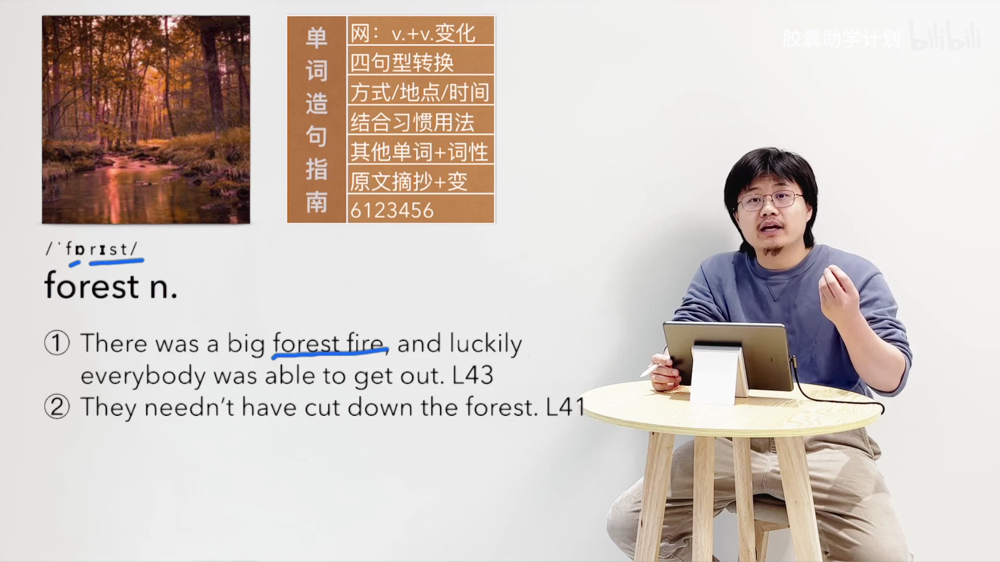

文字识别：单词造句指南 / 网：v.+v.变化 / 四句型转换 / 方式/地点/时间 / 结合习惯用法 / 其他单词+词性 / 原文摘抄+变 / 6123456 / /'fprIst/ / forest n. /  There was a big forest fire and luckily / everybody was able to get out. L43 / They needn't have cut down the forest. L41

## 00:02:00–00:02:30

是发生了，这是咱们四十一课学的语法，对吧？再然后说，she ran into the forest as quickly as possible。这地方我实际上借助了三十二课咱们学过的一个其他的习惯用法，对吧？这是我们单词造句一个非常重要的思路，结合其他的习惯用法，往往都是之前学过的，最好就是之前学过的，不要各位自己上网去查，对吧？那些我们先把之前学过的夯实就不错了啊。OK，那这个就是

### 画面 00:02:00

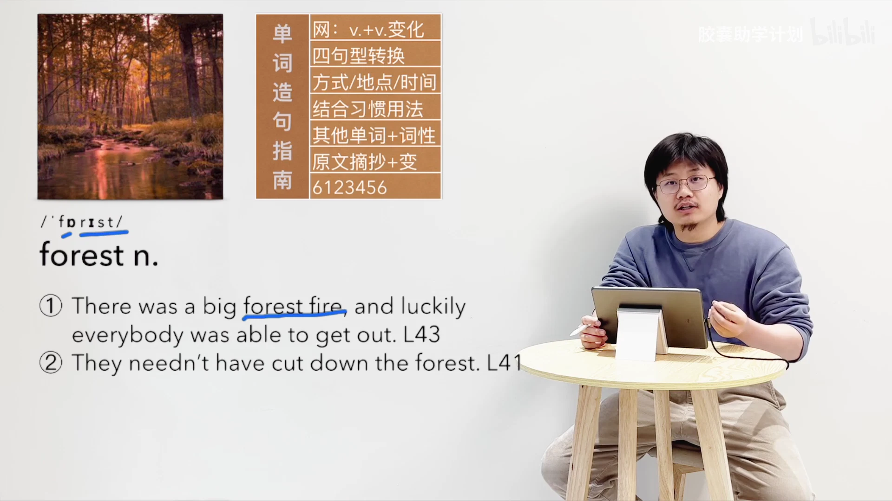

文字识别：单词造句指南 / 网：v.+v.变化 / 四句型转换 / 方式/地点/时间 / 结合习惯用法 / 其他单词+词性 / 原文摘抄+变 / 6123456 / / 'fprist/ / forest n. / ) There was a big forest fire and luckily / everybody was able to get out. L43 / They needn't have cut down the forest. L41

### 画面 00:02:03

文字识别：单词造句指南 / 网：v.+v.变化 / 四句型转换 / 方式/地点/时间 / 结合习惯用法 / 其他单词+词性 / 原文摘抄+变 / 6123456 / /'fprIst/ / forest n. / ① There was a big forest fire and luckily / everybody was able to get out. L43 / They needn't have cut down the forest. L41 / She ran into the forest as quickly as / possible. L32

### 画面 00:02:05

文字识别：单词造句指南 / 网：v.+v.变化 / 四句型转换 / 方式/地点/时间 / 结合习惯用法 / 其他单词+词性 / 原文摘抄+变 / 6123456 / /'fprIst/ / forest n. / ① There was a big forest fire and luckily / everybody was able to get out. L43 / They needn't have cut down the forest. L41 / She ran into the forest as quickly as / possible. L32

### 画面 00:02:10

文字识别：单词造句指南 / 网：v.+v.变化 / 四句型转换 / 方式/地点/时间 / 结合习惯用法 / 其他单词+词性 / 原文摘抄+变 / 6123456 / /'fprIst/ / forest n. / ① There was a big forest fire and luckily / everybody was able to get out. L43 / They needn't have cut down the forest. L41 / She ran into the forest as quickly as / possible. L32

### 画面 00:02:15

文字识别：单词造句指南 / 网：v.+v.变化 / 四句型转换 / 方式/地点/时间 / 结合习惯用法 / 其他单词+词性 / 原文摘抄+变 / 6123456 / /'fprIst/ / forest n. / ① There was a big forest fire and luckily / everybody was able to get out. L43 / They needn't have cut down the forest. L41 / She ran into the forest as quickly as / possible. L32

### 画面 00:02:20

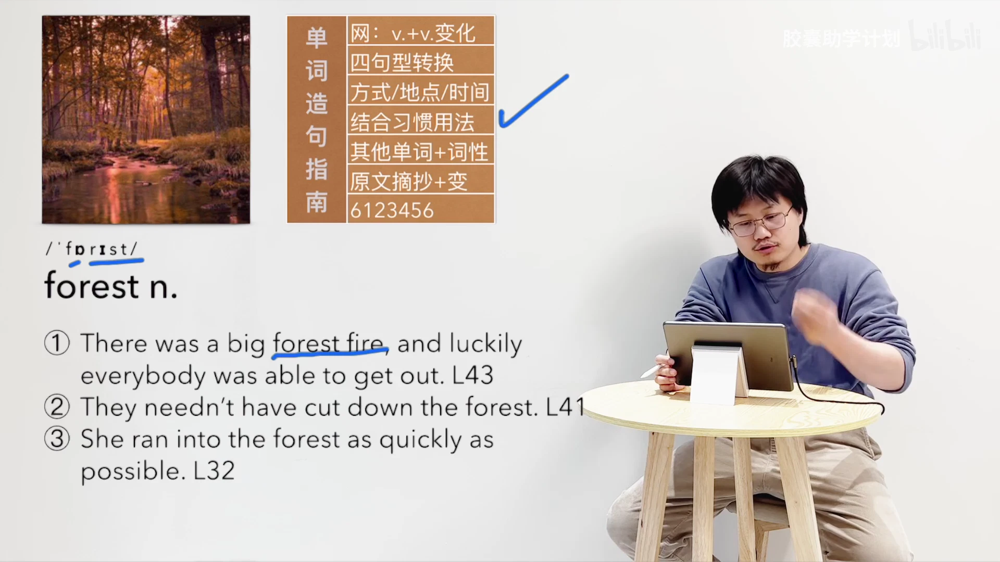

文字识别：单词造句指南 / 网：v.+v.变化 / 四句型转换 / 方式/地点/时间 / 结合习惯用法 / 其他单词+词性 / 原文摘抄+变 / 6123456 / /'fprist/ / forest n. / ① There was a big forest fire and luckily / everybody was able to get out. L43 / They needn't have cut down the forest. L41 / She ran into the forest as quickly as / possible. L32

### 画面 00:02:25

文字识别：单词造句指南 / 网：v.+v.变化 / 四句型转换 / 方式/地点/时间 / 结合习惯用法 / 其他单词+词性 / 原文摘抄+变 / 6123456 / /'fprIst/ / forest n. / ① There was a big forest fire and luckily / everybody was able to get out. L43 / They needn't have cut down the forest. L41 / She ran into the forest as quickly as / possible. L32

## 00:02:30–00:03:00

forest. Next one,下一个单词叫 risk. Risk, risk,其实有危险、冒险的意思。那你注意它的词性是个名词。那我们想说冒险，把它变成动词，造句子得有动词嘛？怎么办呢？有一个小的短语，文章当中出现了，我们给它直接摘过来，叫 take a risk.当然，这个a你其实可以变，可以换成that, these啊，这些指代词也可以是the，对吧？特指某一个，没有问题啊。

### 画面 00:02:30

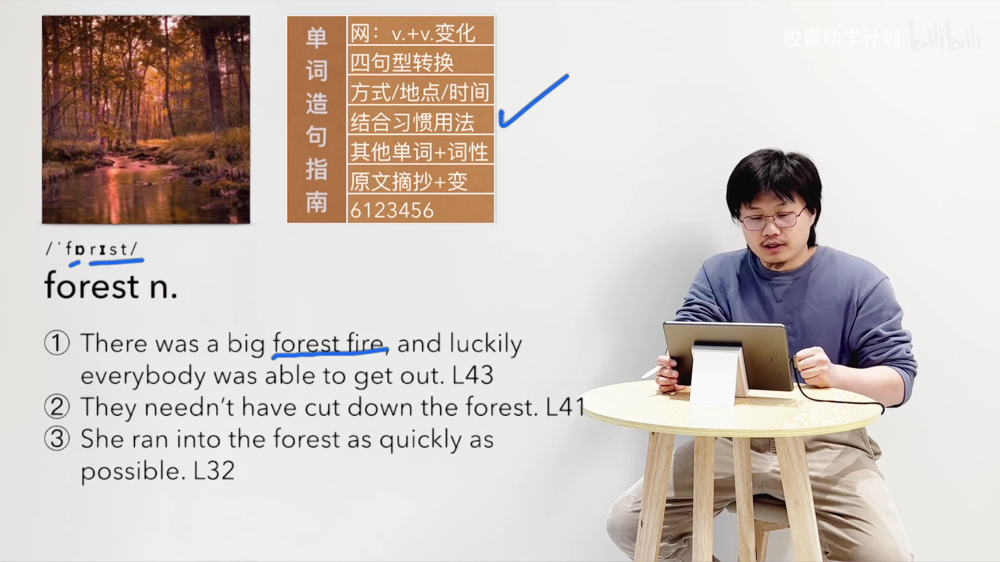

文字识别：单词造句指南 / 网：v.+v.变化 / 四句型转换 / 方式/地点/时间 / 结合习惯用法 / 其他单词+词性 / 原文摘抄+变 / 6123456 / /'fprIst/ / forest n. / ① There was a big forest fire and luckily / everybody was able to get out. L43 / They needn't have cut down the forest. L41 / She ran into the forest as quickly as / possible. L32

### 画面 00:02:32

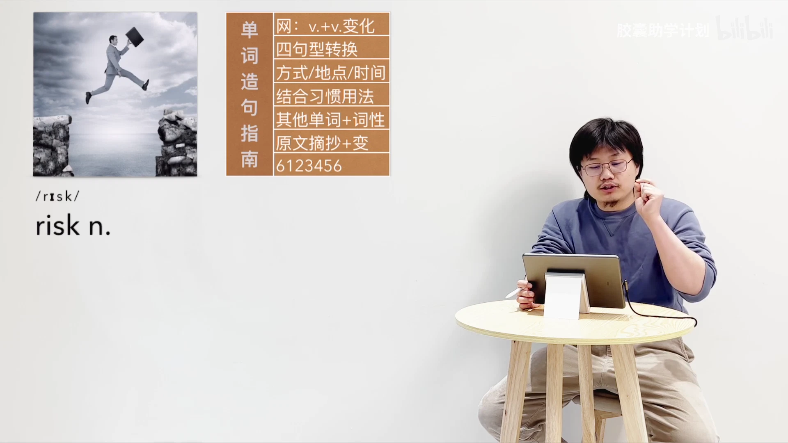

文字识别：单词造句指南 / 网：v.+v.变化 / 四句型转换 / 方式/地点/时间 / 结合习惯用法 / 其他单词+词性 / 原文摘抄+变 / 6123456 / /risk/ / risk n.

### 画面 00:02:35

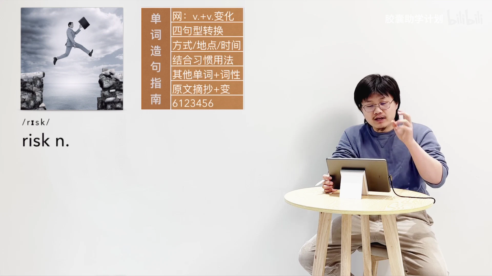

文字识别：单词造句指南 / 网：v.+v.变化 / 四句型转换 / 方式/地点/时间 / 结合习惯用法 / 其他单词+词性 / 原文摘抄+变 / 6123456 / /risk/ / risk n.

### 画面 00:02:40

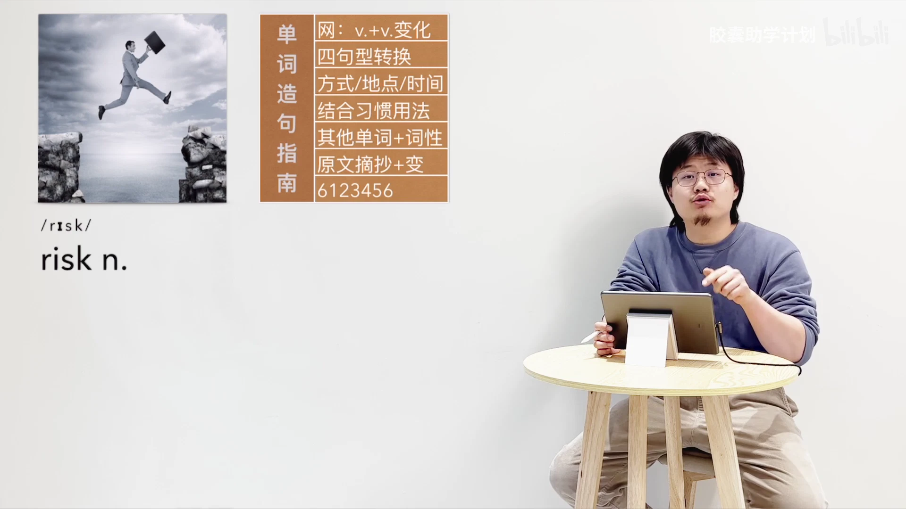

文字识别：单词造句指南 / 网：v.+v.变化 / 四句型转换 / 方式/地点/时间 / 结合习惯用法 / 其他单词+词性 / 原文摘抄+变 / 6123456 / /risk/ / risk n.

### 画面 00:02:45

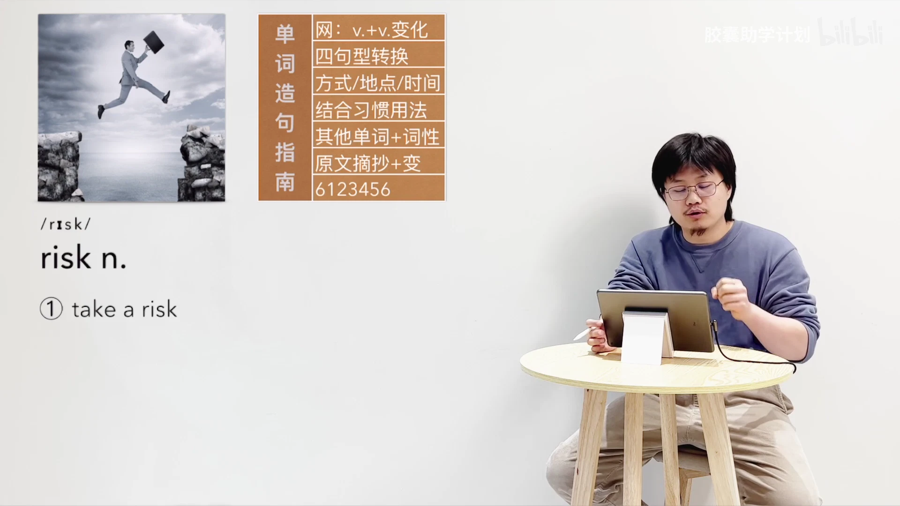

文字识别：单词造句指南 / 网：v.+v.变化 / 四句型转换 / 方式/地点/时间 / 结合习惯用法 / 其他单词+词性 / 原文摘抄+变 / 6123456 / /risk/ / risk n. / ① take a risk

### 画面 00:02:50

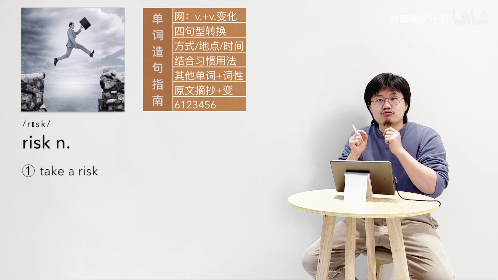

文字识别：单词造句指南 / 网：v.+v.变化 / 四句型转换 / 方式/地点/时间 / 结合习惯用法 / 其他单词+词性 / 原文摘抄+变 / 6123456 / /risk/ / risk n. / ① take a risk

## 00:03:00–00:03:30

我们造一个句子，比如说 She needn't have taken that risk. 四十一课学的叫他本不必哎冒那个险。 Okay, next one. Say she is keen on taking a risk. 他对于冒险这件事情特别的热衷。二十课 Begin on doing something. 我们复习了之前学的习惯用法，对吧？再然后肯定句给你了，四句型的转换，这是您自己下课要完成的家当作业了。我把关键词已经放到这里了。当然，您

### 画面 00:03:00

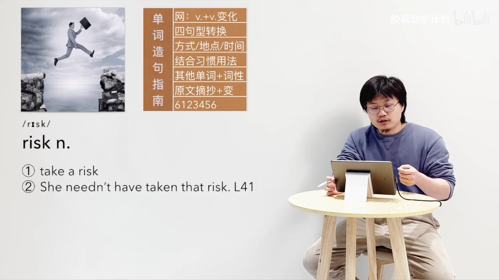

文字识别：单词造句指南 / 网：v.+v.变化 / 四句型转换 / 方式/地点/时间 / 结合习惯用法 / 其他单词+词性 / 原文摘抄+变 / 6123456 / /risk/ / risk n. / ① take a risk / ② She needn't have taken that risk. L41

### 画面 00:03:06

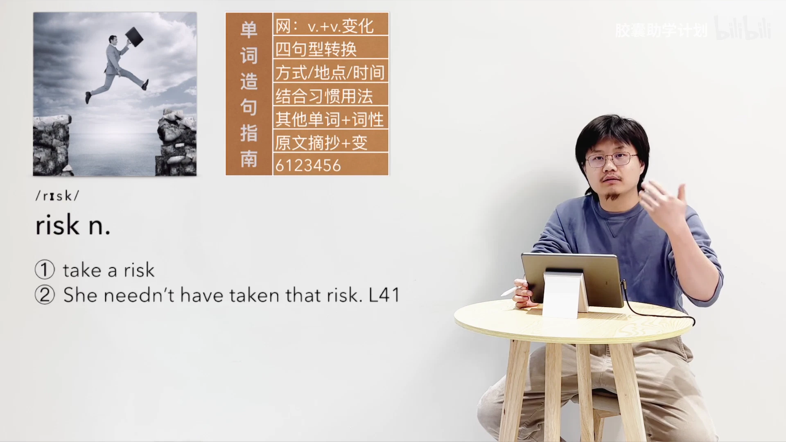

文字识别：单词造句指南 / 网：v.+v.变化 / 四句型转换 / 方式/地点/时间 / 结合习惯用法 / 其他单词+词性 / 原文摘抄+变 / 6123456 / /risk/ / risk n. / ① take a risk / ② She needn't have taken that risk. L41

### 画面 00:03:10

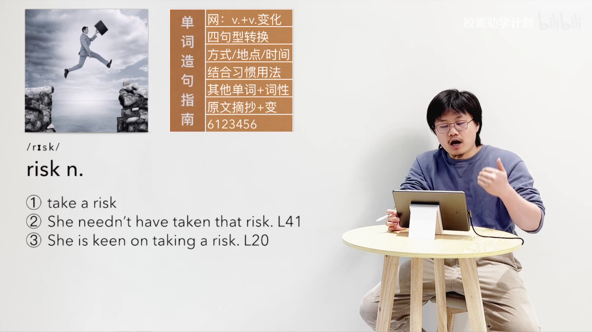

文字识别：单词造句指南 / 网：v.+v.变化 / 四句型转换 / 方式/地点/时间 / 结合习惯用法 / 其他单词+词性 / 原文摘抄+变 / 6123456 / /risk/ / risk n. / ① take a risk / ② She needn't have taken that risk. L41 / ) She is keen on taking a risk. L20

### 画面 00:03:15

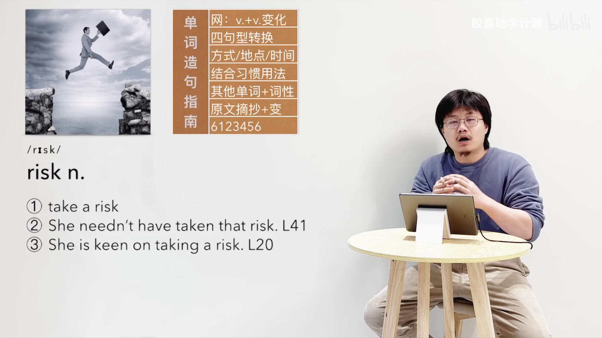

文字识别：单词造句指南 / 网：v.+v.变化 / 四句型转换 / 方式/地点/时间 / 结合习惯用法 / 其他单词+词性 / 原文摘抄+变 / 6123456 / /risk/ / risk n. / ① take a risk / ② She needn't have taken that risk. L41 / ) She is keen on taking a risk. L20

### 画面 00:03:20

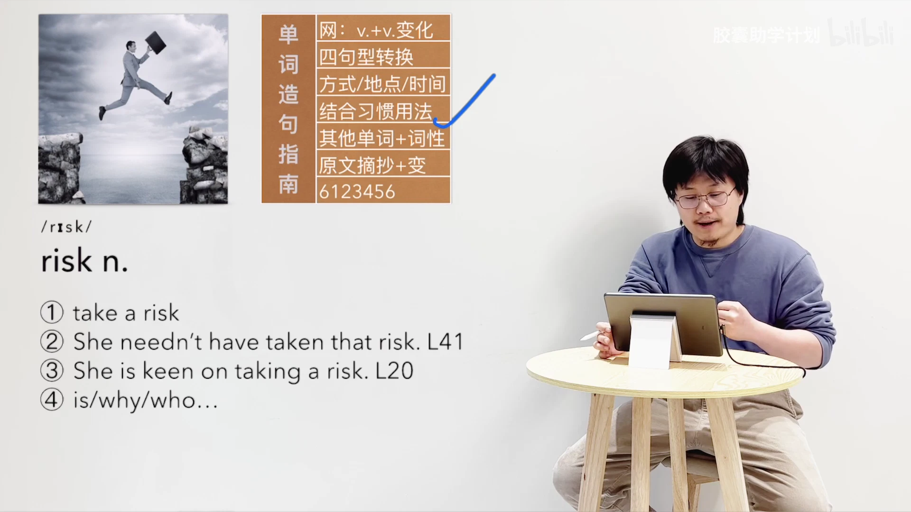

文字识别：单词造句指南 / 网：v.+v.变化 / 四句型转换 / 方式/地点/时间 / 结合习惯用法 / 其他单词+词性 / 原文摘抄+变 / 6123456 / /risk/ / risk n. / ① take a risk / 2 /  She needn't have taken that risk. L41 / ) She is keen on taking a risk. L20 / ④ is/why/who...

### 画面 00:03:25

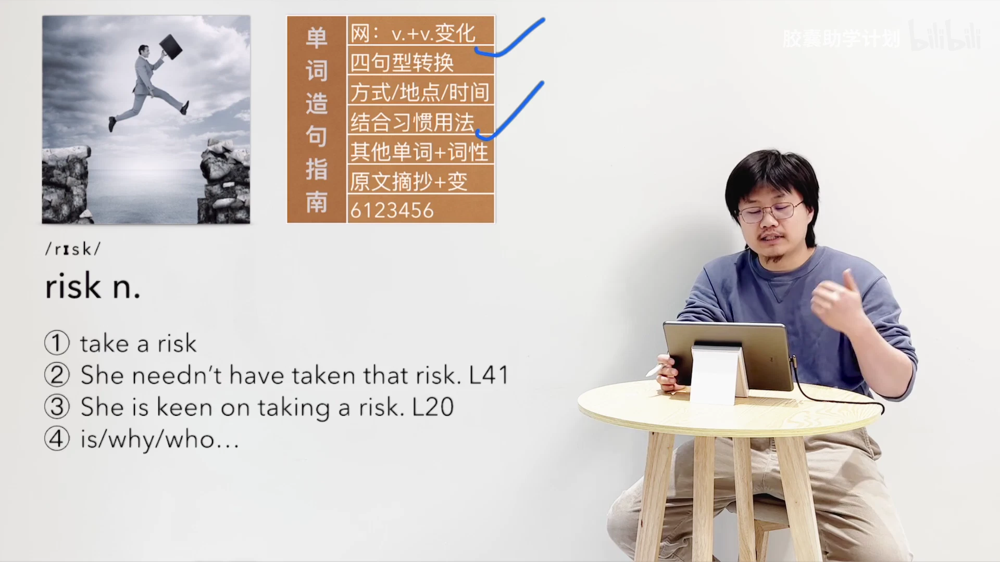

文字识别：单词造句指南 / 网：v.+v.变化 / 四句型转换 / 方式/地点/时间 / 结合习惯用法 / 其他单词+词性 / 原文摘抄+变 / 6123456 / /risk/ / risk n. / ① take a risk / 2 /  She needn't have taken that risk. L41 / ) She is keen on taking a risk. L20 / ④ is/why/who...

## 00:03:30–00:04:00

可以也现在暂停视频，直接来，对吧？当一个口语练习，说 Is she keen on taking a risk? Why is she keen on taking a risk? Or who is keen on taking a risk? 对吧？ Okay. Next one. 接下来我们看一个小的电影片段。这个电影片段当中就出现了叫 Take that risk. 啊，我们做一个听力练习。 Okay. I won't tell anyone, I swear. You know you can trust me. I'm sorry, but I can't take that risk.

### 画面 00:03:30

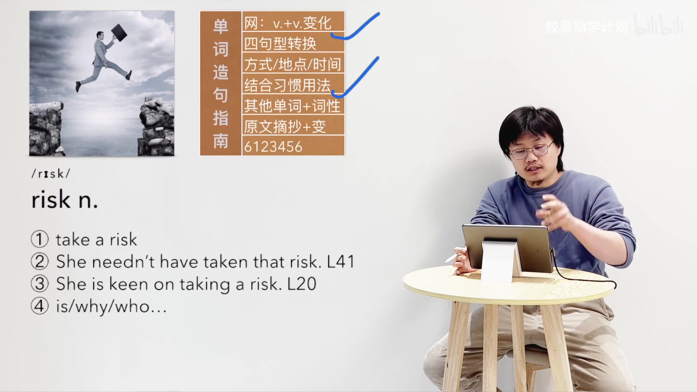

文字识别：单词造句指南 / 网：v.+v.变化 / 四句型转换 / 方式/地点/时间 / 结合习惯用法 / 其他单词+词性 / 原文摘抄+变 / 6123456 / /risk/ / risk n. / ① take a risk / 2 /  She needn't have taken that risk. L41 / ) She is keen on taking a risk. L20 / ④ is/why/who...

### 画面 00:03:36

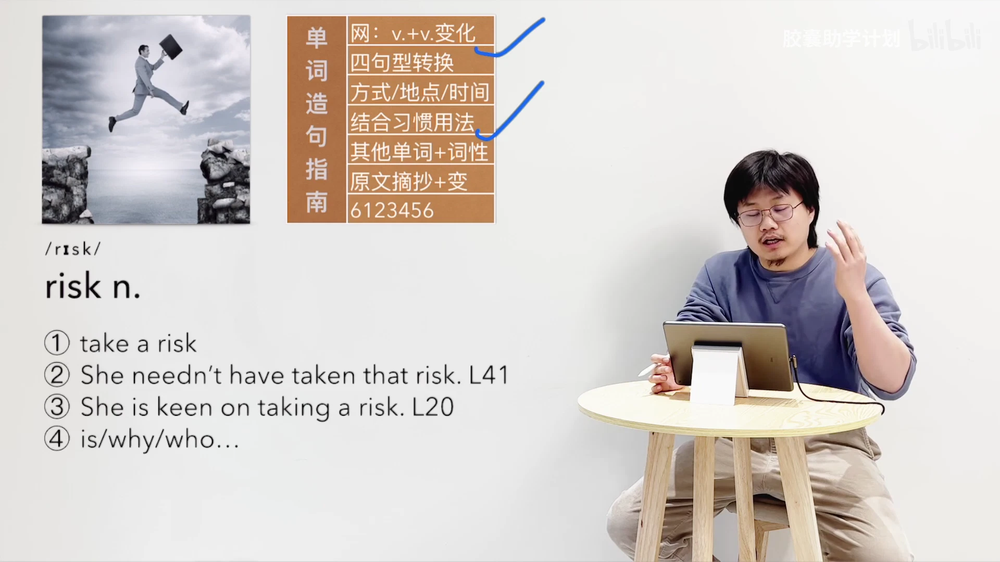

文字识别：单词造句指南 / 网：v.+v.变化 / 四句型转换 / 方式/地点/时间 / 结合习惯用法 / 其他单词+词性 / 原文摘抄+变 / 6123456 / /risk/ / risk n. / ① take a risk / 2 /  She needn't have taken that risk. L41 / ) She is keen on taking a risk. L20 / 3 / ④ is/why/who...

### 画面 00:03:43

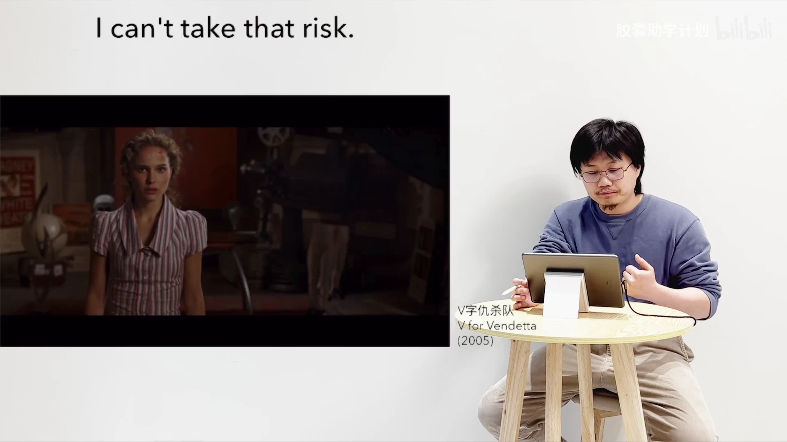

文字识别：I can't take that risk. / V字仇杀队 / Vfor Vendetta / (2005)

### 画面 00:03:54

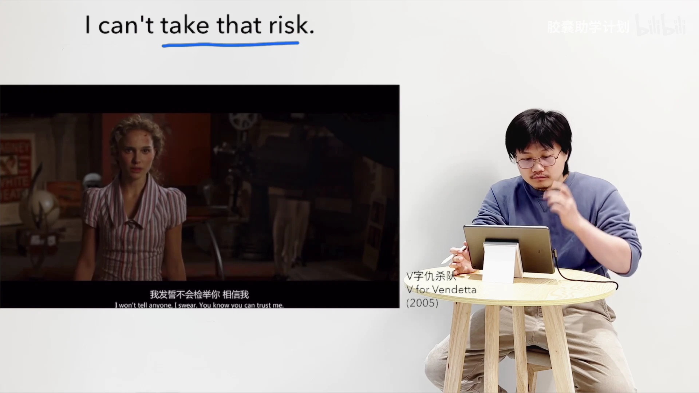

文字识别：I can't take that risk. / V字仇杀队 / Vfor Vendetta / 我发誓不会检举你相信我 / (2005) / I won't tell anyone, I swear.You know you can trust me.

### 画面 00:03:57

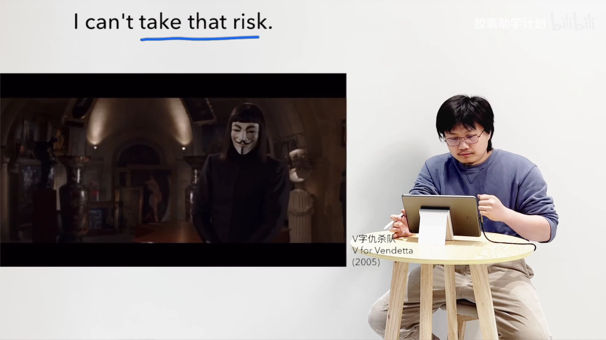

文字识别：I can't take that risk. / V字仇杀队 / Vfor Vendetta / (2005)

### 画面 00:03:59

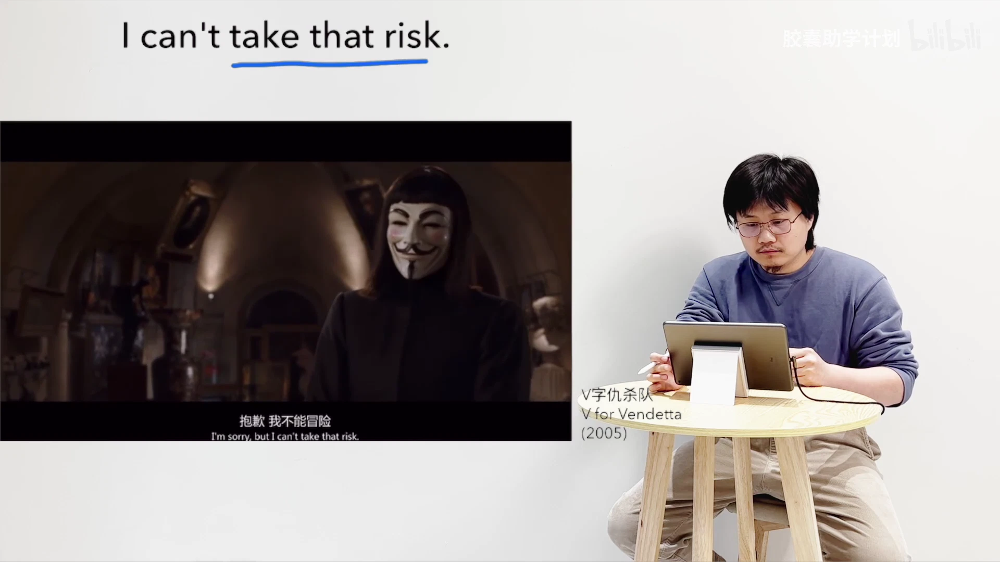

文字识别：I can't take that risk. / V字仇杀队 / Vfor Vendetta / 抱歉我不能冒险 / (2005) / I'm sorry, but I can't take that risk.

## 00:04:00–00:04:30

But I don't even know where this is. We could be anywhere. You know it's underground. You know the color of the stone. Okay, again, I can't take that risk. 我不能冒那个险. Again, next one, 下一个单词叫 picnic 啊，看一下音标啊， picnic 啊，音节给各位划分了。呃，提一小句，如果到新二学到这一课，您还不会音标或划分音节这样的最基础的知识，您一定要去看一下我们之前录的音标的视频合集当中可

### 画面 00:04:01

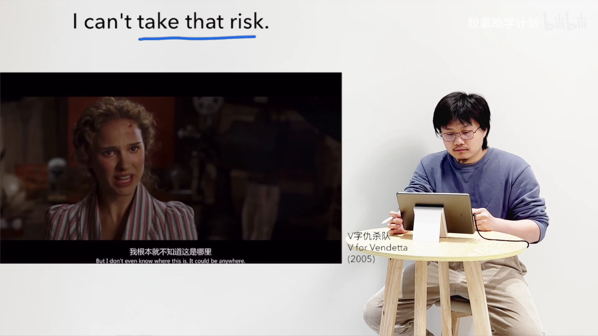

文字识别：I can't take that risk. / V字仇杀队 / Vfor Vendetta / 我根本就不知道这是哪里 / (2005) / ButI don't even know where this is. It could be anywhere.

### 画面 00:04:03

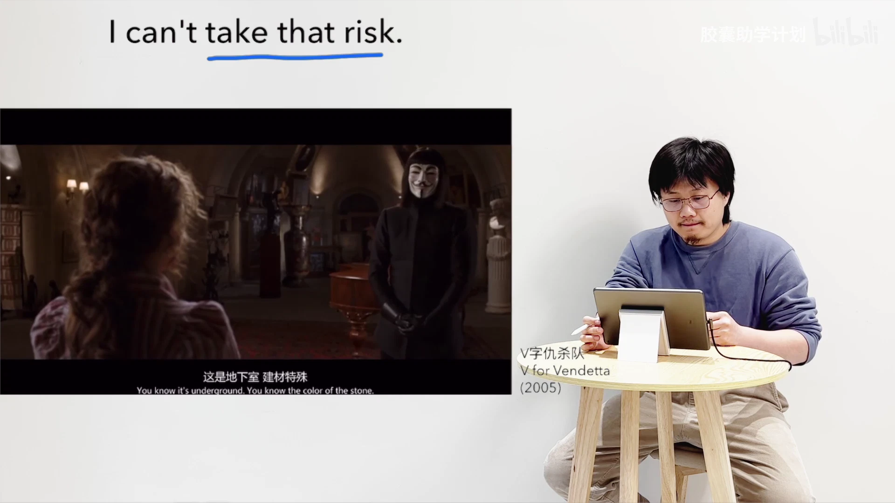

文字识别：I can't take that risk. / V字仇杀队 / VforVendetta / 这是地下室建材特殊 / (2005) / You know it's underground. You know the color of the stone.

### 画面 00:04:05

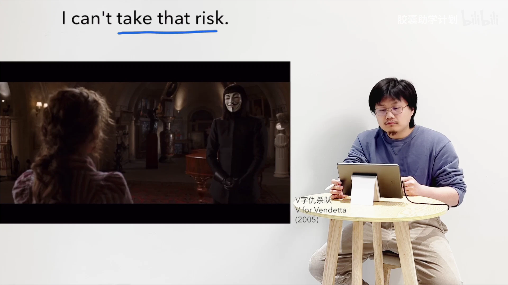

文字识别：I can't take that risk. / V字仇杀队 / Vfor Vendetta / (2005)

### 画面 00:04:10

文字识别：单词造句指南 / 网：v.+v.变化 / 四句型转换 / 方式/地点/时间 / 结合习惯用法 / 其他单词+词性 / 原文摘抄+变 / 6123456 / /'piknik/ / picnic n.

### 画面 00:04:12

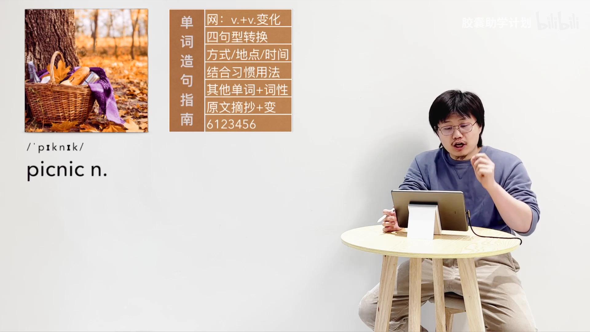

文字识别：单词造句指南 / 网：v.+v.变化 / 四句型转换 / 方式/地点/时间 / 结合习惯用法 / 其他单词+词性 / 原文摘抄+变 / 6123456 / /'piknik/ / picnic n.

### 画面 00:04:15

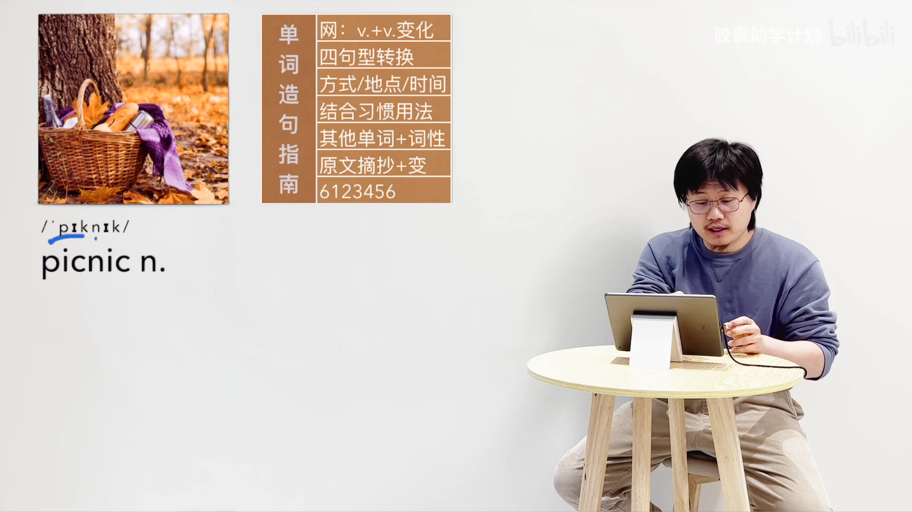

文字识别：单词造句指南 / 网：v.+v.变化 / 四句型转换 / 方式/地点/时间 / 结合习惯用法 / 其他单词+词性 / 原文摘抄+变 / 6123456 / /'piknik/ / picnic n.

### 画面 00:04:20

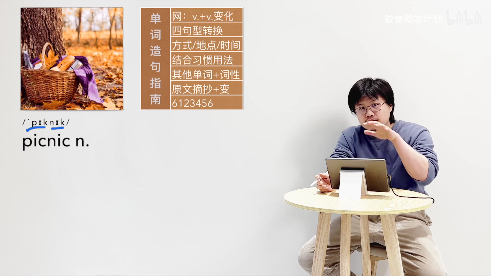

文字识别：单词造句指南 / 网：v.+v.变化 / 四句型转换 / 方式/地点/时间 / 结合习惯用法 / 其他单词+词性 / 原文摘抄+变 / 6123456 / /'piknik/ / picnic n.

### 画面 00:04:25

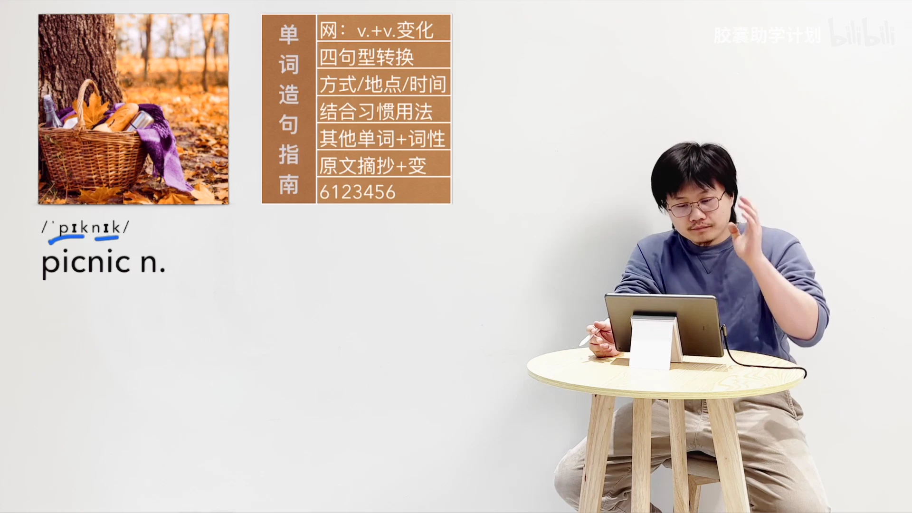

文字识别：单词造句指南 / 网：v.+v.变化 / 四句型转换 / 方式/地点/时间 / 结合习惯用法 / 其他单词+词性 / 原文摘抄+变 / 6123456 / /'piknik/ / picnic n.

## 00:04:30–00:05:00

以找得到啊。OK，呃，来跟我再读一遍，叫picnic，它叫野餐。你看它是个名词，还是很麻烦。我们怎么把它变成动词呢？很简单，叫have a picnic，用万能动词have这个单词。OK，好，那我们造句子，叫I saw Leo having a picnic near the forest，叫做我看到Leo哎正在野餐near the forest。你看这里的forest，我们实际上就把它放到了什么地方？

### 画面 00:04:30

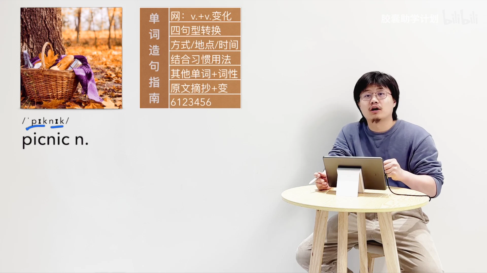

文字识别：单词造句指南 / 网：v.+v.变化 / 四句型转换 / 方式/地点/时间 / 结合习惯用法 / 其他单词+词性 / 原文摘抄+变 / 6123456 / /'piknik/ / picnic n.

### 画面 00:04:35

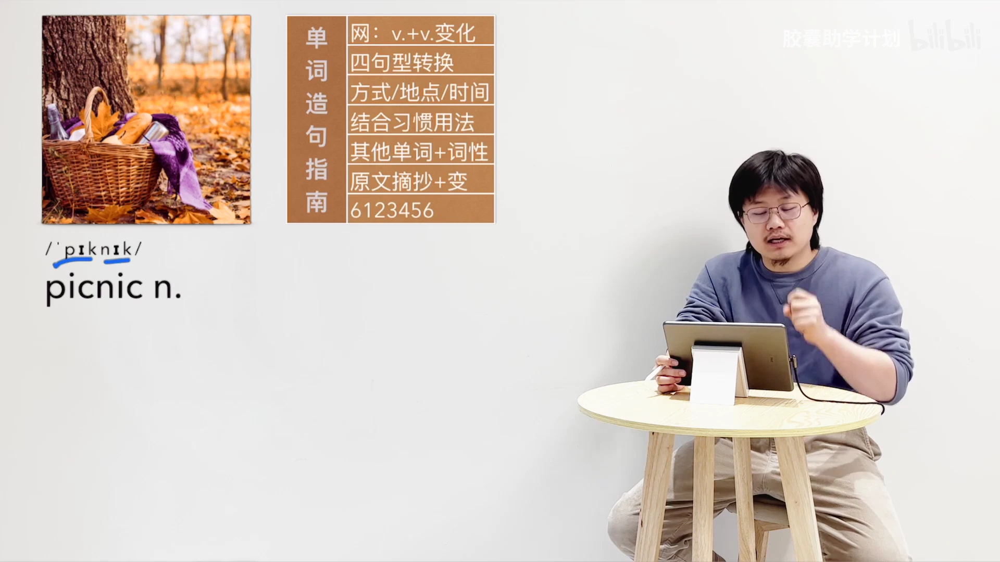

文字识别：单词造句指南 / 网：v.+v.变化 / 四句型转换 / 方式/地点/时间 / 结合习惯用法 / 其他单词+词性 / 原文摘抄+变 / 6123456 / /'piknik/ / picnic n.

### 画面 00:04:40

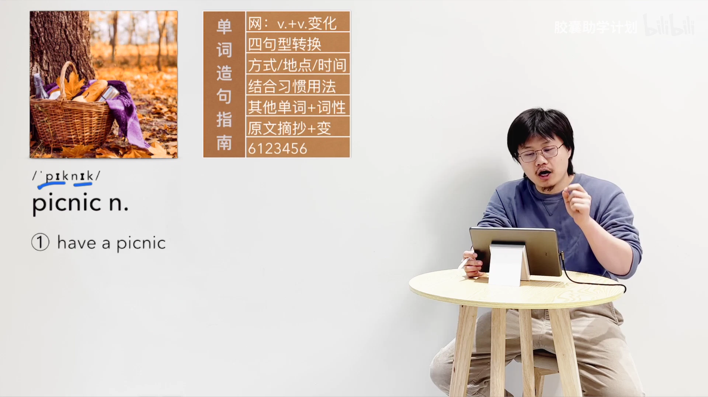

文字识别：单词造句指南 / 网：v.+v.变化 / 四句型转换 / 方式/地点/时间 / 结合习惯用法 / 其他单词+词性 / 原文摘抄+变 / 6123456 / /'piknik/ / picnic n. / ① have a picnic

### 画面 00:04:44

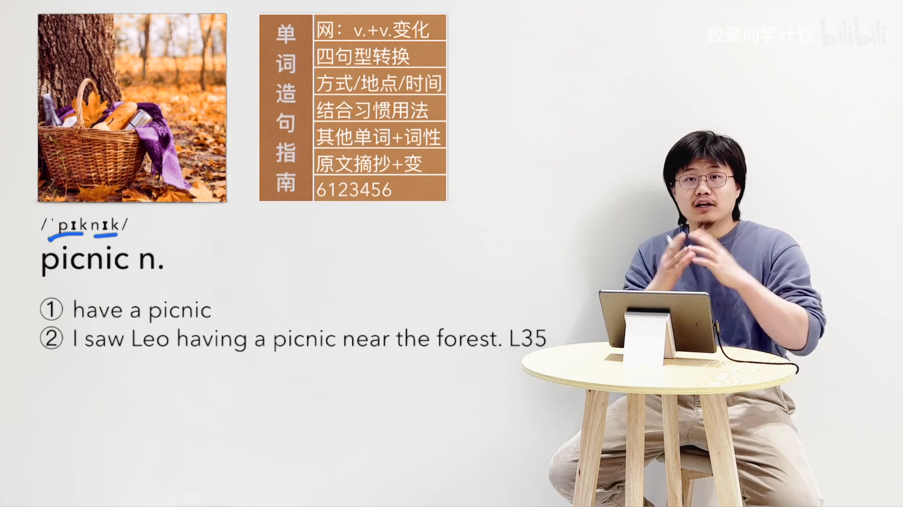

文字识别：单词造句指南 / 网：v.+v.变化 / 四句型转换 / 方式/地点/时间 / 结合习惯用法 / 其他单词+词性 / 原文摘抄+变 / 6123456 / /'piknik/ / picnic n. / ① have a picnic / ② I saw Leo having a picnic near the forest. L35 / 2

### 画面 00:04:46

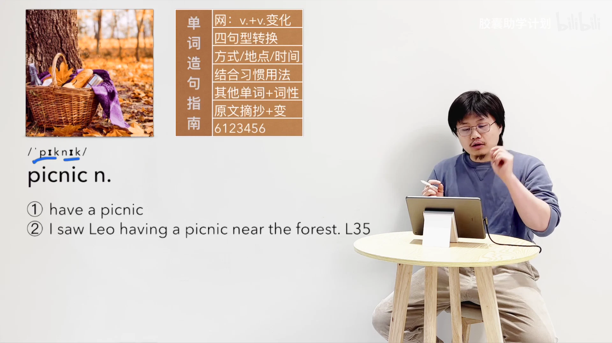

文字识别：单词造句指南 / 网：v.+v.变化 / 四句型转换 / 方式/地点/时间 / 结合习惯用法 / 其他单词+词性 / 原文摘抄+变 / 6123456 / /'piknik/ / picnic n. / ① have a picnic / ② I saw Leo having a picnic near the forest. L35

### 画面 00:04:50

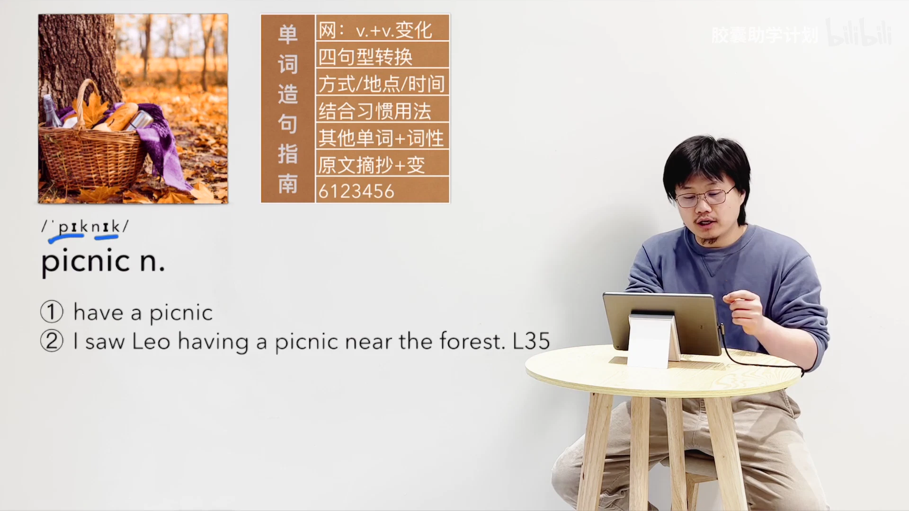

文字识别：单词造句指南 / 网：v.+v.变化 / 四句型转换 / 方式/地点/时间 / 结合习惯用法 / 其他单词+词性 / 原文摘抄+变 / 6123456 / /'piknik/ / picnic n. / ① have a picnic / ② I saw Leo having a picnic near the forest. L35

### 画面 00:04:52

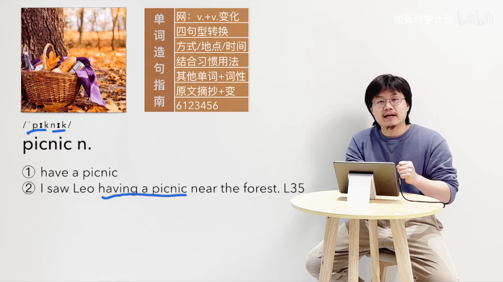

文字识别：单词造句指南 / 网：v.+v.变化 / 四句型转换 / 方式/地点/时间 / 结合习惯用法 / 其他单词+词性 / 原文摘抄+变 / 6123456 / /'piknik/ / picnic n. / ① have a picnic / ② I saw Leo having a picnic near the forest. L35

### 画面 00:04:54

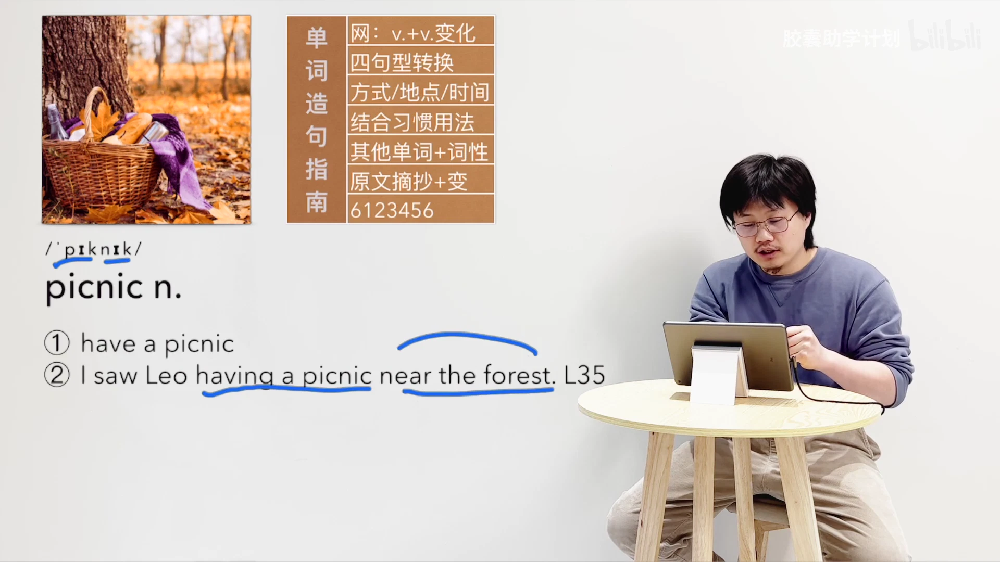

文字识别：单词造句指南 / 网：v.+v.变化 / 四句型转换 / 方式/地点/时间 / 结合习惯用法 / 其他单词+词性 / 原文摘抄+变 / 6123456 / /'piknik/ / picnic n. / ① have a picnic / ② I saw Leo having a picnic near the forest. L35 / 2

### 画面 00:04:56

文字识别：单词造句指南 / 网：v.+v.变化 / 四句型转换 / 方式/地点/时间 / 结合习惯用法 / 其他单词+词性 / 原文摘抄+变 / 6123456 / /'piknik/ / picnic n. / ① have a picnic / ) I saw Leo having a picnic / hear the forest. L35

## 00:05:00–00:05:30

放到了六二三四六当中五这个位置，对吧？这是单词造句的思路。其次，另一个单词造句的思路叫我要拉着我之前学过的单词，尽量啊。那你看这里的picnic，我就拉着之前刚刚学过的forest，对吧？一举一举多得啊！当然还用到了see somebody doing something，三十五课学到的习惯用法，看见某人正在做某件事情。Very good. Next one，我们用四十课学过的这个语法造一个句子，叫做If it

### 画面 00:05:00

文字识别：单词造句指南 / 网：v.+v.变化 / 四句型转换 / 方式/地点/时间 / 结合习惯用法 / 其他单词+词性 / 原文摘抄+变 / 6123456 / /'piknik/ / picnic n. / ① have a picnic / ) I saw Leo having a picnic / fear the forest. L35

### 画面 00:05:05

文字识别：单词造句指南 / 网：v.+v.变化 / 四句型转换 / 方式/地点/时间 / 结合习惯用法 / 其他单词+词性 / 原文摘抄+变 / 6123456 / /'piknik/ / picnic n. / ① have a picnic / ) I saw Leo having a picnic / fear the forest. L35

### 画面 00:05:10

文字识别：单词造句指南 / 网：v.+v.变化 / 四句型转换 / 方式/地点/时间 / 结合习惯用法 / 其他单词+词性 / 原文摘抄+变 / 6123456 / /'piknik/ / picnic n. / ① have a picnic / ) I saw Leo having a picnic / fear the forest. L35

### 画面 00:05:15

文字识别：单词造句指南 / 网：v.+v.变化 / 四句型转换 / 方式/地点/时间 / 结合习惯用法 / 其他单词+词性 / 原文摘抄+变 / 6123456 / /'piknik/ / picnic n. / ① have a picnic / ) I saw Leo having a picnic / fear the forest. L35

### 画面 00:05:20

文字识别：单词造句指南 / 网：v.+v.变化 / 四句型转换 / 方式/地点/时间 / 结合习惯用法 / 其他单词+词性 / 原文摘抄+变 / 6123456 / /'piknik/ / picnic n. / ① have a picnic / ) I saw Leo having a picnic / fear the foresy. L35

### 画面 00:05:25

文字识别：单词造句指南 / 网：v.+v.变化 / 四句型转换 / 方式/地点/时间 / 结合习惯用法 / 其他单词+词性 / 原文摘抄+变 / 6123456 / /'piknik/ / picnic n. / ① have a picnic / I saw Leo having a picnic / cfear the fores.L35 / If it didn't rain, we would haw / .L40

### 画面 00:05:27

文字识别：单词造句指南 / 网：v.+v.变化 / 四句型转换 / 方式/地点/时间 / 结合习惯用法 / 其他单词+词性 / 原文摘抄+变 / 6123456 / /'piknik/ / picnic n. / ① have a picnic /  I saw Leo having a picnic near the forest. L35 / 2 / If it didn't rain, we would have a picnic. L40

### 画面 00:05:29

文字识别：单词造句指南 / 网：v.+v.变化 / 四句型转换 / 方式/地点/时间 / 结合习惯用法 / 其他单词+词性 / 原文摘抄+变 / 6123456 / /'piknik/ / picnic n. / ① have a picnic / ② I saw Leo having a picnic near the forest. L35 / ) If it didn't rain, we would have a picnic. L40

## 00:05:30–00:06:00

didn't rain, we would have a picnic. 你看看到这句话字面意思能翻译过来不是太困难。我个人认为啊，学到这一刻，但你能不能迅速的观看到这样几个小的结构，然后迅速的判断它叫做是虚拟语气与现在事实相反。所以现在在没在下雨呢？现在正在下雨。我们能不能野餐呢？Sorry, you can't. Okay, we can't. Very good. Next one,

### 画面 00:05:31

文字识别：单词造句指南 / 网：v.+v.变化 / 四句型转换 / 方式/地点/时间 / 结合习惯用法 / 其他单词+词性 / 原文摘抄+变 / 6123456 / /'piknik/ / picnic n. / ① have a picnic / ② I saw Leo having a picnic near the forest. L35 / ) If it didn't rain, we would have a picnic. L40

### 画面 00:05:35

文字识别：单词造句指南 / 网：v.+v.变化 / 四句型转换 / 方式/地点/时间 / 结合习惯用法 / 其他单词+词性 / 原文摘抄+变 / 6123456 / /'piknik/ / picnic n. / ① have a picnic / ② I saw Leo having a picnic near the forest. L35 / ) If it didn't rain, we would have a picnic. L40

### 画面 00:05:40

文字识别：单词造句指南 / 网：v.+v.变化 / 四句型转换 / 方式/地点/时间 / 结合习惯用法 / 其他单词+词性 / 原文摘抄+变 / 6123456 / /'piknik/ / picnic n. / ① have a picnic / ) I saw Leo having a picnic near the forest. L35 / 2） /  If it didn't rain, we would have a picnic. L40

### 画面 00:05:43

文字识别：单词造句指南 / 网：v.+v.变化 / 四句型转换 / 方式/地点/时间 / 结合习惯用法 / 其他单词+词性 / 原文摘抄+变 / 6123456 / /'piknik/ / picnic n. / ① have a picnic / ② I saw Leo having a picnic near the forest. L35 / ③ Lf it didn't rain, we would have a picnic. L40

### 画面 00:05:45

文字识别：单词造句指南 / 网：v.+v.变化 / 四句型转换 / 方式/地点/时间 / 结合习惯用法 / 其他单词+词性 / 原文摘抄+变 / 6123456 / /'piknik/ / picnic n. / ① have a picnic / ② I saw Leo having a picnic near the forest. L35 / ③ Lf it didn't rain, we would have a picnic. L40

### 画面 00:05:50

文字识别：单词造句指南 / 网：v.+v.变化 / 四句型转换 / 方式/地点/时间 / 结合习惯用法 / 其他单词+词性 / 原文摘抄+变 / 6123456 / /'piknik/ / picnic n. / ① have a picnic / ② I saw Leo having a picnic near the forest. L35 / ③ Lf it didn't rain, we would have a picnic. L40

### 画面 00:05:57

文字识别：单词造句指南 / 网：v.+v.变化 / 四句型转换 / 方式/地点/时间 / 结合习惯用法 / 其他单词+词性 / 原文摘抄+变 / 6123456 / /'piknik/ / picnic n. / ① have a picnic / ② I saw Leo having a picnic near the forest. L35 / ③ lf it didn't rain, we would have a picnic. L40

## 00:06:00–00:06:30

say I had a picnic with Leo yesterday afternoon. You like this sentence, we actually, I from sentence when think is such a few points, right? Have a picnic is a basic thing. Phrase, I add a tense, add a time, right? I even add who. Such affirmative sentence, after you can in the end do a sentence transformation. Have a picnic this phrase or picnic this word, you want to make sentences, make five, six, seven, eight is easy. OK.

### 画面 00:06:00

文字识别：单词造句指南 / 网：v.+v.变化 / 四句型转换 / 方式/地点/时间 / 结合习惯用法 / 其他单词+词性 / 原文摘抄+变 / 6123456 / /'piknik/ / picnic n. / ① have a picnic / ② I saw Leo having a picnic near the forest. L35 / ③ Lf it didn't rain, we would have a picnic. L40 / ④ I had a picnic with Leo yesterday afternoon.

### 画面 00:06:05

文字识别：单词造句指南 / 网：v.+v.变化 / 四句型转换 / 方式/地点/时间 / 结合习惯用法 / 其他单词+词性 / 原文摘抄+变 / 6123456 / /'piknik/ / picnic n. / ① have a picnic / ② I saw Leo having a picnic near the forest. L35 / ③ Lf it didn't rain, we would have a picnic. L40 / ④ I had a picnic with Leo yesterday afternoon.

### 画面 00:06:07

文字识别：单词造句指南 / 网：v.+v.变化 / 四句型转换 / 方式/地点/时间 / 结合习惯用法 / 其他单词+词性 / 原文摘抄+变 / 6123456 / /'piknik/ / picnic n. / ① have a picnic / ② I saw Leo having a picnic near the forest. L35 / ③ Lf it didn't rain, we would have a picnic. L40 / ④ I had a picnic with Leo yesterday afternoon.

### 画面 00:06:10

文字识别：单词造句指南 / 网：v.+v.变化 / 四句型转换 / 方式/地点/时间 / 结合习惯用法 / 其他单词+词性 / 原文摘抄+变 / 6123456 / /'piknik/ / picnic n. / ① have a picnic / ② I saw Leo having a picnic near the forest. L35 / ③ Lf it didn't rain, we would have a picnic. L40 / ④ I had a picnic with Leo yesterday afternoon.

### 画面 00:06:15

文字识别：单词造句指南 / 网：v.+v.变化 / 四句型转换 / 方式/地点/时间 / 结合习惯用法 / 其他单词+词性 / 原文摘抄+变 / 6123456 / /'piknik/ / picnic n. / ① have a picnic / ② I saw Leo having a picnic near the forest. L35 / ③ Lf it didn't rain, we would have a picnic. L40 / ) I had a picnic with Leo yesterday afternoon.

### 画面 00:06:17

文字识别：单词造句指南 / 网：v.+v.变化 / 四句型转换 / 方式/地点/时间 / 结合习惯用法 / 其他单词+词性 / 原文摘抄+变 / 6123456 / /'pIknik/ / picnic n. / ① have a picnic /  I saw Leo having a picnic near the forest. L35 / 2 / )Lf it didn't rain, we would have a picnic. L40 / ③ / I had a picnic with Le yesterday afternoon.

### 画面 00:06:20

文字识别：单词造句指南 / 网：v.+v.变化 / 四句型转换 / 方式/地点/时间 / 结合习惯用法 / 其他单词+词性 / 原文摘抄+变 / 6123456 / /'piknik/ / picnic n. / ① have a picnic / 2 / ) I saw Leo having a picnic near the forest. L35 / ③ If it didn't rain, we would have a picnic. L40 / ) I had a picnic With Le yesterday afternoon.

### 画面 00:06:23

文字识别：单词造句指南 / 网：v.+v.变化 / 四句型转换 / 方式/地点/时间 / 结合习惯用法 / 其他单词+词性 / 原文摘抄+变 / 6123456 / /'piknik/ / picnic n. / ① have a picnic /  I saw Leo having a picnic near the forest. L35 / 2 / )Lf it didn't rain, we would have a picnic. L40 / ③ /  I had a picnic with Le yesterday afternoon.

### 画面 00:06:25

文字识别：单词造句指南 / 网：v.+v.变化 / 四句型转换 / 方式/地点/时间 / 结合习惯用法 / 其他单词+词性 / 原文摘抄+变 / 6123456 / /'piknik/ / picnic n. / ① have a picnic / I saw Leo having a picnic near the forest. L35 / 2 / )Lf it didn't rain, we would have a picnic. L40 / ③ / I had a picnic With Le yesterday afternoon.

## 00:06:30–00:07:00

易的事情了。OK，那给了啊，did who when where OK，不多说啊。您暂停屏幕或者下课的时候自己去做这个练习。玩一个，next one下一个单词叫做edge，edge叫什么什么的边缘。我们直接给大家一个短语叫at the edge of a forest，在一片森林的，在一个森林的边缘。这明显是我给各位标了个五，是想提醒你什么呢？六一二三四五五六当中，

### 画面 00:06:30

文字识别：单词造句指南 / 网：v.+v.变化 / 四句型转换 / 方式/地点/时间 / 结合习惯用法 / 其他单词+词性 / 原文摘抄+变 / 6123456 / /'piknik/ / picnic n. / ① have a picnic / 2 / ) I saw Leo having a picnic near the forest. L35 / ③ lf it didn't rain, we would have a picnic. L40 / ) I had a picnic With Le yesterday afternoon.

### 画面 00:06:34

文字识别：单词造句指南 / 网：v.+v.变化 / 四句型转换 / 方式/地点/时间 / 结合习惯用法 / 其他单词+词性 / 原文摘抄+变 / 6123456 / /'piknik/ / picnic n. / ① have a picnic / I saw Leo having a picnic near the forest. L35 / 2 / 3 / )Lf it didn't rain, we would have a picnic. L40 / I had a picnic With Le yesterday afternoon. / did/who/when/where...

### 画面 00:06:36

文字识别：单词造句指南 / 网：v.+v.变化 / 四句型转换 / 方式/地点/时间 / 结合习惯用法 / 其他单词+词性 / 原文摘抄+变 / 6123456 / /'piknik/ / picnic n. / ① have a picnic / ② I saw Leo having a picnic near the forest. L35 / ③ Lf it didn't rain, we would have a picnic. L40 /  I had a picnic with Leo yesterday afternoon. / 4 / did/who/when/where...

### 画面 00:06:39

文字识别：单词造句指南 / 网：v.+v.变化 / 四句型转换 / 方式/地点/时间 / 结合习惯用法 / 其他单词+词性 / 原文摘抄+变 / 6123456 / /ed3/ / edge n.

### 画面 00:06:41

文字识别：单词造句指南 / 网：v.+v.变化 / 四句型转换 / 方式/地点/时间 / 结合习惯用法 / 其他单词+词性 / 原文摘抄+变 / 6123456 / /ed3/ / edge n.

### 画面 00:06:45

文字识别：单词造句指南 / 网：v.+v.变化 / 四句型转换 / 方式/地点/时间 / 结合习惯用法 / 其他单词+词性 / 原文摘抄+变 / 6123456 / /ed3/ / edge n.

### 画面 00:06:50

文字识别：单词造句指南 / 网：v.+v.变化 / 四句型转换 / 方式/地点/时间 / 结合习惯用法 / 其他单词+词性 / 原文摘抄+变 / 6123456 / /ed3 / / edge n. / D at the edge of a forest 5

### 画面 00:06:55

文字识别：单词造句指南 / 网：v.+v.变化 / 四句型转换 / 方式/地点/时间 / 结合习惯用法 / 其他单词+词性 / 原文摘抄+变 / 6123456 / /ed3 / / edge n. / D at the edge of a forest 5

### 画面 00:06:58

文字识别：单词造句指南 / 网：v.+v.变化 / 四句型转换 / 方式/地点/时间 / 结合习惯用法 / 其他单词+词性 / 原文摘抄+变 / 6123456 / /ed3 / / edge n. / ① at the edge of a forest

## 00:07:00–00:07:30

它明显很容易作为一个地点，叫在森林的边缘，对吧？OK，那我们造句子叫做 They were having a picnic at the edge of a forest. 你看，我们造这句话的时候用到了多少之前学过的知识啊？虽然我没在这标。首先，were加doing表示过去进行时，新一就学过，新二又学过两遍了。其次，have a picnic刚刚学到的短语。那at the edge of a forest实际上是一个地

### 画面 00:07:00

文字识别：单词造句指南 / 网：v.+v.变化 / 四句型转换 / 方式/地点/时间 / 结合习惯用法 / 其他单词+词性 / 原文摘抄+变 / 6123456 / /ed3 / / edge n. / ① at the edge of a forest

### 画面 00:07:05

文字识别：单词造句指南 / 网：v.+v.变化 / 四句型转换 / 方式/地点/时间 / 结合习惯用法 / 其他单词+词性 / 原文摘抄+变 / 6123456 / /ed3 / / edge n. / at the edge of a forest / They were having a picnic at the edge of a / forest.

### 画面 00:07:10

文字识别：单词造句指南 / 网：v.+v.变化 / 四句型转换 / 方式/地点/时间 / 结合习惯用法 / 其他单词+词性 / 原文摘抄+变 / 6123456 / /ed3 / / edge n. / at the edge of a forest / They were having a picnic at the edge of a / forest.

### 画面 00:07:17

文字识别：单词造句指南 / 网：v.+v.变化 / 四句型转换 / 方式/地点/时间 / 结合习惯用法 / 其他单词+词性 / 原文摘抄+变 / 6123456 / /ed3 / / edge n. / at the edge of a forest / They were having a picnic at the edge of a / forest.

### 画面 00:07:23

文字识别：单词造句指南 / 网：v.+v.变化 / 四句型转换 / 方式/地点/时间 / 结合习惯用法 / 其他单词+词性 / 原文摘抄+变 / 6123456 / /ed3 / / edge n. / at the edge of a forest / They were having a picnic at the edge of a / forest.

### 画面 00:07:25

文字识别：单词造句指南 / 网：v.+v.变化 / 四句型转换 / 方式/地点/时间 / 结合习惯用法 / 其他单词+词性 / 原文摘抄+变 / 6123456 / /ed3 / / edge n. / at the edge of a forestl / They werehaving a picnig / at the edge of a / forest.

### 画面 00:07:27

文字识别：单词造句指南 / 网：v.+v.变化 / 四句型转换 / 方式/地点/时间 / 结合习惯用法 / 其他单词+词性 / 原文摘抄+变 / 6123456 / /ed31 / edge n. / at the edge of a forestl / They were having a picnig / at the edge of a / forest.

## 00:07:30–00:08:00

点，对吧？那整句话我们又用到了六一二三四五六，如何造一个对的和正确的好的句子，对吧？这样的一个语序玩一个，你看我们造一句话，其实要用很多很多之前学过的知识，所以我们要不停的练，不停的练啊，练到最后变成一种叫 second nature，变成一种第二本能的时候，这句子您张嘴就能说出来了。OK， next one，肯定句给您了，变成各种啊四句型，那我不多说啊。再来说，I had a

### 画面 00:07:30

文字识别：单词造句指南 / 网：v.+v.变化 / 四句型转换 / 方式/地点/时间 / 结合习惯用法 / 其他单词+词性 / 原文摘抄+变 / 6123456 / /ed31 / edge n. / at the edge of a forestl / They were having a picnig / at the edge of a / forest.

### 画面 00:07:33

文字识别：单词造句指南 / 网：v.+v.变化 / 四句型转换 / 方式/地点/时间 / 结合习惯用法 / 其他单词+词性 / 原文摘抄+变 / 6123456 / /ed3 / / edge n. / at the edge of a forest / They were having a picnig / at the edge of a / forest.

### 画面 00:07:35

文字识别：单词造句指南 / 网：v.+v.变化 / 四句型转换 / 方式/地点/时间 / 结合习惯用法 / 其他单词+词性 / 原文摘抄+变 / 6123456 / /ed3 1 / edge n. / at the edge of a forestl / They were having a picnig / at the edge of a / forest.

### 画面 00:07:41

文字识别：单词造句指南 / 网：v.+v.变化 / 四句型转换 / 方式/地点/时间 / 结合习惯用法 / 其他单词+词性 / 原文摘抄+变 / 16123456 / /ed3 1 / edge n. / at the edge of a forest / They were having a picnig / at the edge of a / forest.

### 画面 00:07:45

文字识别：单词造句指南 / 网：v.+v.变化 / 四句型转换 / 方式/地点/时间 / 结合习惯用法 / 其他单词+词性 / 原文摘抄+变 / 6123456 / /ed3 / / edge n. / at the edge of a forestl / They were having a picnig / at the edge of a / forest.

### 画面 00:07:55

文字识别：单词造句指南 / 网：v.+v.变化 / 四句型转换 / 方式/地点/时间 / 结合习惯用法 / 其他单词+词性 / 原文摘抄+变 / 16123456 / /ed31 / edge n. / at the edge of a forest / They were having a picnig / at the edge of a / forest. / were/who/where/when..

### 画面 00:07:59

文字识别：单词造句指南 / 网：v.+v.变化 / 四句型转换 / 方式/地点/时间 / 结合习惯用法 / 其他单词+词性 / 原文摘抄+变 / 16123456 / /ed3 / / edge n. / ① at the edge of a forestl / 5 / They were having_a picnig / gat the edge of a / forest. / were/who/where/when... / I had a glimpse of a deer at the edge of a / forest last night. L42

## 00:08:00–00:08:30

glimpse of a deer at the edge of a forest last night.你看这句话当中，我首先用到了之前学过的have a glimpse of啊，蛇的那一刻，对吧？瞥到了一眼。其次呢，我又加了一个时间。那像这样的一个句子就非常的丰满，很饱满了。您把它变成一般疑问句和各种特殊疑问句也比较好造了，对吧？你像这句话，至少可以用what对a deer提问，at the edge of a forest，你可以用where

### 画面 00:08:01

文字识别：单词造句指南 / 网：v.+v.变化 / 四句型转换 / 方式/地点/时间 / 结合习惯用法 / 其他单词+词性 / 原文摘抄+变 / 16123456 / /ed3 / / edge n. / ① at the edge of a forest! / 5 / They were having a picnig / at the edge of a / forest. / were/who/where/when... / I had a glimpse of a deer at the edge of a / forest last night. L42

### 画面 00:08:05

文字识别：单词造句指南 / 网：v.+v.变化 / 四句型转换 / 方式/地点/时间 / 结合习惯用法 / 其他单词+词性 / 原文摘抄+变 / 16123456 / /ed3 / / edge n. / ① at the edge of a forestl / 5 / They were having a picnig / gat the edge of a / forest. / were/who/where/when... / I had a glimpse of a deer at the edge of a / forest last night. L42

### 画面 00:08:07

文字识别：单词造句指南 / 网：v.+v.变化 / 四句型转换 / 方式/地点/时间 / 结合习惯用法 / 其他单词+词性 / 原文摘抄+变 / 16123456 / /ed3 / / edge n. / at the edge of a forestl / They werehaving a picnig / at the edge of a / forest. / were/who/where/when... / I had a alimpse of a deer at the edge of a / forest last night. L42

### 画面 00:08:13

文字识别：单词造句指南 / 网：v.+v.变化 / 四句型转换 / 方式/地点/时间 / 结合习惯用法 / 其他单词+词性 / 原文摘抄+变 / 16123456 / /ed3 / / edge n. / at the edge of a forestl / 1 / 5 / They were having a picnig / at the edge of a / forest. / were/who/where/when... / I had a alimpse of a deer at the edge of a / forest last night. L42

### 画面 00:08:16

文字识别：单词造句指南 / 网：v.+v.变化 / 四句型转换 / 方式/地点/时间 / 结合习惯用法 / 其他单词+词性 / 原文摘抄+变 / 16123456 / /ed3 / / edge n. / at the edge of a forestl / They were having a picnig /  at the edge of a / forest. / were/who/where/when... / I had a alimpse of a deer at the edge of a / forest last night. L42

### 画面 00:08:20

文字识别：单词造句指南 / 网：v.+v.变化 / 四句型转换 / 方式/地点/时间 / 结合习惯用法 / 其他单词+词性 / 原文摘抄+变 / 16123456 / /ed3 / / edge n. / at the edge of a forest! / 5 / They werehaving a picnig / at the edge of a / forest. / were/who/where/when... / I had a alimpse of a deer at the edge of a / forest last night. L42

### 画面 00:08:25

文字识别：单词造句指南 / 网：v.+v.变化 / 四句型转换 / 方式/地点/时间 / 结合习惯用法 / 其他单词+词性 / 原文摘抄+变 / 16123456 / /ed3 / / edge n. / at the edge of a forestl5 / They werehaving a picnig / at the edge of a / forest. / were/who/where/when / I had a alimpse of a dee at the edge of a / forest last night. L42

## 00:08:30–00:09:00

last night你可以用when对不对？好，下一个单词，跟我们一起读一下，叫做别忘了浊化，叫做strap strap啊，带子对吧？像这样的皮带叫做strap，它是一个名词。原文直接给了一句话，很简单，叫the strap broke，对吧？很简单一件事，叫做带子坏掉了。OK，肯定句给你了，各种一般疑问句、特殊疑问句，那您自己去做一下。这我们用的叫原文摘抄再加

### 画面 00:08:30

文字识别：单词造句指南 / 网：v.+v.变化 / 四句型转换 / 方式/地点/时间 / 结合习惯用法 / 其他单词+词性 / 原文摘抄+变 / 6123456 / /ed3 1 / edge n. / at the edge of a forestl / 5 / They werehaving a picnig / at the edge of a / forest. / were/who/where/when / I had a alimpse of A dee)at the edge of a / forest last night. L42

### 画面 00:08:33

文字识别：单词造句指南 / 网：v.+v.变化 / 四句型转换 / 方式/地点/时间 / 结合习惯用法 / 其他单词+词性 / 原文摘抄+变 / 6123456 / /stræep/ / strap n.

### 画面 00:08:35

文字识别：单词造句指南 / 网：v.+v.变化 / 四句型转换 / 方式/地点/时间 / 结合习惯用法 / 其他单词+词性 / 原文摘抄+变 / 6123456 / /stræp/ / strap n.

### 画面 00:08:41

文字识别：单词造句指南 / 网：v.+v.变化 / 四句型转换 / 方式/地点/时间 / 结合习惯用法 / 其他单词+词性 / 原文摘抄+变 / 6123456 / /stræep/ / strap n.

### 画面 00:08:46

文字识别：单词造句指南 / 网：v.+v.变化 / 四句型转换 / 方式/地点/时间 / 结合习惯用法 / 其他单词+词性 / 原文摘抄+变 / 6123456 / /stræp/ / strap n. / ① [Story]: The strap broke.

### 画面 00:08:50

文字识别：单词造句指南 / 网：v.+v.变化 / 四句型转换 / 方式/地点/时间 / 结合习惯用法 / 其他单词+词性 / 原文摘抄+变 / 6123456 / /stræp/ / strap n. / ① [Story]: The strap broke.

### 画面 00:08:55

文字识别：单词造句指南 / 网：v.+v.变化 / 四句型转换 / 方式/地点/时间 / 结合习惯用法 / 其他单词+词性 / 原文摘抄+变 / 6123456 / /stræp/ / strap n. / ① [Story]: The strap broke. / did/how/why...

## 00:09:00–00:09:30

变，原文摘抄再加变，往往都是嗯不一定啊，绝对如此。但大多数情况下，是我认为可能不是那么好造句的一些句子。您可以用这样的一种思路啊。OK，那再然后，比如说，My mom asked me how the strap broke. 这就是三十九课我们学到的叫做宾语从句了，对吧？而且是特殊疑问句引导，特殊疑问词引导的啊。OK，Next one,

### 画面 00:09:00

文字识别：单词造句指南 / 网：v.+v.变化 / 四句型转换 / 方式/地点/时间 / 结合习惯用法 / 其他单词+词性 / 原文摘抄+变 / 6123456 / /stræp/ / strap n. / ① [Story]: The strap broke. / did/how/why...

### 画面 00:09:10

文字识别：单词造句指南 / 网：v.+v.变化 / 四句型转换 / 方式/地点/时间 / 结合习惯用法 / 其他单词+词性 / 原文摘抄+变 / 6123456 / /stræp/ / strap n. / ① [Story]: The strap broke. / did/how/why...

### 画面 00:09:15

文字识别：单词造句指南 / 网：v.+v.变化 / 四句型转换 / 方式/地点/时间 / 结合习惯用法 / 其他单词+词性 / 原文摘抄+变 / 6123456 / /stræp/ / strap n. / ① [Story]: The strap broke. / did/how/why... / ) My mom asks me how the strap broke. L39 / 3）

### 画面 00:09:18

文字识别：单词造句指南 / 网：v.+v.变化 / 四句型转换 / 方式/地点/时间 / 结合习惯用法 / 其他单词+词性 / 原文摘抄+变 / 6123456 / /stræp/ / strap n. / ① [Story]: The strap broke. / did/how/why... / ) My mom asks me(how the strap brokeL39 / 3

### 画面 00:09:24

文字识别：单词造句指南 / 网：v.+v.变化 / 四句型转换 / 方式/地点/时间 / 结合习惯用法 / 其他单词+词性 / 原文摘抄+变 / 6123456 / /stræp/ / strap n. / ① [Story]: The strap broke. / did/how/why... / ) My mom asks me(how the strap brokeL39 / 3

### 画面 00:09:26

文字识别：单词造句指南 / 网：v.+v.变化 / 四句型转换 / 方式/地点/时间 / 结合习惯用法 / 其他单词+词性 / 原文摘抄+变 / 6123456 / /stræp/ / strap n. / ① [Story]: The strap broke. / did/how/why... / ) My mom asks mehow the strap brokeL39 / 3)

## 00:09:30–00:10:00

say this strap was made in Italy. This is a very simple sentence. The tenth lesson, we have learned, right? OK. Finally, another sentence is this is the most beautiful strap I have ever seen. This is the eighth lesson we have learned. OK, here is one. Next one, the next word, we will read together. It is possession. We will read together. It is possession. OK, what is the meaning of possession?

### 画面 00:09:30

文字识别：单词造句指南 / 网：v.+v.变化 / 四句型转换 / 方式/地点/时间 / 结合习惯用法 / 其他单词+词性 / 原文摘抄+变 / 6123456 / /stræp/ / strap n. / ① [Story]: The strap broke. / did/how/why... / My mom asks mehow the strap brokeL39 / 3 / This strap was made in Italy. L10

### 画面 00:09:35

文字识别：单词造句指南 / 网：v.+v.变化 / 四句型转换 / 方式/地点/时间 / 结合习惯用法 / 其他单词+词性 / 原文摘抄+变 / 6123456 / /stræp/ / strap n. / ① [Story]: The strap broke. / did/how/why... / My mom asks mehow the strap brokeL39 / This strap was made in Italy. L10

### 画面 00:09:38

文字识别：单词造句指南 / 网：v.+v.变化 / 四句型转换 / 方式/地点/时间 / 结合习惯用法 / 其他单词+词性 / 原文摘抄+变 / 6123456 / /stræp/ / strap n. / ① [Story]: The strap broke. / did/how/why... / My mom asks me(how the strap brokeL39 / 3 / This strap was made in Italy. L10 / This is the most beautiful strap I've ever / seen.L8

### 画面 00:09:40

文字识别：单词造句指南 / 网：v.+v.变化 / 四句型转换 / 方式/地点/时间 / 结合习惯用法 / 其他单词+词性 / 原文摘抄+变 / 6123456 / /stræp/ / strap n. / ① [Story]: The strap broke. / did/how/why... / My mom asks mehow the strap brokeL39 / 3 / This strap was made in Italy. L10 / This is the most beautiful strap I've ever / seen.L8

### 画面 00:09:50

文字识别：单词造句指南 / 网：v.+v.变化 / 四句型转换 / 方式/地点/时间 / 结合习惯用法 / 其他单词+词性 / 原文摘抄+变 / 6123456 / /stræp/ / strap n. / ① [Story]: The strap broke. / did/how/why... / My mom asks mehow the strap brokeL39 / 3 / This strap was made in Italy. L10 / This is the most beautiful strap I've ever / seen.L8

### 画面 00:09:52

文字识别：单词造句指南 / 网：v.+v.变化 / 四句型转换 / 方式/地点/时间 / 结合习惯用法 / 其他单词+词性 / 原文摘抄+变 / 6123456 / /ｐa'ze∫an/ / possession n.

### 画面 00:09:55

文字识别：单词造句指南 / 网：v.+v.变化 / 四句型转换 / 方式/地点/时间 / 结合习惯用法 / 其他单词+词性 / 原文摘抄+变 / 6123456 / /ｐa'ze∫aｎ/ / possession n.

## 00:10:00–00:10:30

that possession的意思是什么呢？就是呃拥有，是吧？啊，你比如说最常用的一个短语叫in somebody's possession啊，叫在某人的拥有之下，对吧？其实就是在某个人的所有权之下，其实就是have it, own it，对吧？拥有它。Okay, 那么造一个句子，比如说呃，the book is now in my possession。说这个书啊，现在归我所有了，在我的管辖范围之内，是吧？在我的

### 画面 00:10:00

文字识别：单词造句指南 / 网：v.+v.变化 / 四句型转换 / 方式/地点/时间 / 结合习惯用法 / 其他单词+词性 / 原文摘抄+变 / 6123456 / /ｐa'ze∫an/ / possession n.

### 画面 00:10:06

文字识别：单词造句指南 / 网：v.+v.变化 / 四句型转换 / 方式/地点/时间 / 结合习惯用法 / 其他单词+词性 / 原文摘抄+变 / 6123456 / /ｐa'ze∫an/ / possession n. / ① in sb's possession

### 画面 00:10:10

文字识别：单词造句指南 / 网：v.+v.变化 / 四句型转换 / 方式/地点/时间 / 结合习惯用法 / 其他单词+词性 / 原文摘抄+变 / 6123456 / /ｐaze∫an/ / possession n. / ① in sb's possession

### 画面 00:10:15

文字识别：单词造句指南 / 网：v.+v.变化 / 四句型转换 / 方式/地点/时间 / 结合习惯用法 / 其他单词+词性 / 原文摘抄+变 / 6123456 / /ｐａ'ze∫aｎ/ / possession n. / ① in sb's possession

### 画面 00:10:20

文字识别：单词造句指南 / 网：v.+v.变化 / 四句型转换 / 方式/地点/时间 / 结合习惯用法 / 其他单词+词性 / 原文摘抄+变 / 6123456 / /ｐa'ze∫an / / possession n. / ① in sb's possession / The book is now in my possession.

### 画面 00:10:25

文字识别：单词造句指南 / 网：v.+v.变化 / 四句型转换 / 方式/地点/时间 / 结合习惯用法 / 其他单词+词性 / 原文摘抄+变 / 6123456 / /ｐa'ze∫an / / possession n. / ① in sb's possession / The book is now in my possession.

## 00:10:30–00:11:00

拥有之下，对吧？OK，它其实就是 I have this book. This book is mine. 啊，很简单的一个用法。再来，比如说 This has been in my possession for a long time. 啊，这个属于我已经很长很长时间了。你注意一个小点，我们在这儿其实还引入了现在完成时的第二个用法，从过去重复或持续到现在，对吧？然后你再把它变一般疑问句，has提前，再加上各种特殊疑问词，

### 画面 00:10:30

文字识别：单词造句指南 / 网：v.+v.变化 / 四句型转换 / 方式/地点/时间 / 结合习惯用法 / 其他单词+词性 / 原文摘抄+变 / 6123456 / /ｐa'ze∫an / / possession n. / ① in sb's possession / The book is now in my possession.

### 画面 00:10:35

文字识别：单词造句指南 / 网：v.+v.变化 / 四句型转换 / 方式/地点/时间 / 结合习惯用法 / 其他单词+词性 / 原文摘抄+变 / 6123456 / /ｐa'ze∫an / / possession n. / ① in sb's possession / The book is now in my possession.

### 画面 00:10:40

文字识别：单词造句指南 / 网：v.+v.变化 / 四句型转换 / 方式/地点/时间 / 结合习惯用法 / 其他单词+词性 / 原文摘抄+变 / 6123456 / /ｐａ'ｚｅ∫ａｎ/ / possession n. / ① in sb's possession / The book is now in my possession. / This has been in my possession for a long / time.

### 画面 00:10:46

文字识别：单词造句指南 / 网：v.+v.变化 / 四句型转换 / 方式/地点/时间 / 结合习惯用法 / 其他单词+词性 / 原文摘抄+变 / 6123456 / /ｐａze∫ａｎ/ / possession n. / ① in sb's possession / The book is now in my possession. / This has been in my possession for a long / time.

### 画面 00:10:50

文字识别：单词造句指南 / 网：v.+v.变化 / 四句型转换 / 方式/地点/时间 / 结合习惯用法 / 其他单词+词性 / 原文摘抄+变 / 6123456 / /ｐa'ze∫an / / possession n. / ① in sb's possession / The book is now in my possession. / This has been in my possession for a long / time.

### 画面 00:10:55

文字识别：单词造句指南 / 网：v.+v.变化 / 四句型转换 / 方式/地点/时间 / 结合习惯用法 / 其他单词+词性 / 原文摘抄+变 / 6123456 / /ｐａｚｅ∫ａｎ/ / possession n. / ① in sb's possession / The book is now in my possession. / This has been in my possession for a long / time. / has/what/why/how long

## 00:11:00–00:11:30

您的句子又造出来了。OK，那我不多说了啊。下一个单词，我们一起读一下，叫做 breath，breath。注意它的词性，虽然它的含义叫呼吸，但在这里它的词性是一个名词。各位如果感兴趣，您不妨自己用搜索引擎去查一下它的动词长成什么样子，好吧？这个就当留家庭作业了。如果您查了，您可以在视频下方告诉我啊。OK，那它常用的一个

### 画面 00:11:00

文字识别：单词造句指南 / 网：v.+v.变化 / 四句型转换 / 方式/地点/时间 / 结合习惯用法 / 其他单词+词性 / 原文摘抄+变 / 6123456 / /ｐａ'ｚｅ∫ａｎ/ / possession n. / ① in sb's possession / The book is now in my possession. / This has been in my possession for a long / time. / has/what/why/how long

### 画面 00:11:03

文字识别：单词造句指南 / 网：v.+v.变化 / 四句型转换 / 方式/地点/时间 / 结合习惯用法 / 其他单词+词性 / 原文摘抄+变 / 6123456 / /breθ / / breath n.

### 画面 00:11:05

文字识别：单词造句指南 / 网：v.+v.变化 / 四句型转换 / 方式/地点/时间 / 结合习惯用法 / 其他单词+词性 / 原文摘抄+变 / 6123456 / /breθ/ / breath n.

### 画面 00:11:10

文字识别：单词造句指南 / 网：v.+v.变化 / 四句型转换 / 方式/地点/时间 / 结合习惯用法 / 其他单词+词性 / 原文摘抄+变 / 6123456 / /bre θ/ / breath n.

### 画面 00:11:15

文字识别：单词造句指南 / 网：v.+v.变化 / 四句型转换 / 方式/地点/时间 / 结合习惯用法 / 其他单词+词性 / 原文摘抄+变 / 6123456 / /breθ/ / breath n.

### 画面 00:11:20

文字识别：单词造句指南 / 网：v.+v.变化 / 四句型转换 / 方式/地点/时间 / 结合习惯用法 / 其他单词+词性 / 原文摘抄+变 / 6123456 / /breθ / / breath n.

### 画面 00:11:25

文字识别：单词造句指南 / 网：v.+v.变化 / 四句型转换 / 方式/地点/时间 / 结合习惯用法 / 其他单词+词性 / 原文摘抄+变 / 6123456 / /breθ/ / breath n.

## 00:11:30–00:12:00

短语，文章当中也出现了，叫out of breath. Out of breath直接的意思就是上气不接下气。您比如说冲刺了五十米，然后这样的一种感受的时候，我们就管它形容为叫out of breath. Okay,那么造一句话最简单，比如说He is out of breath.你看光这句话，我们就能做一些小的文章。您记住最万能的就是四句型转化，叫做Is he out of breath?

### 画面 00:11:30

文字识别：单词造句指南 / 网：v.+v.变化 / 四句型转换 / 方式/地点/时间 / 结合习惯用法 / 其他单词+词性 / 原文摘抄+变 / 6123456 / /breθ 1 / breath n. / ① out of breath

### 画面 00:11:33

文字识别：单词造句指南 / 网：v.+v.变化 / 四句型转换 / 方式/地点/时间 / 结合习惯用法 / 其他单词+词性 / 原文摘抄+变 / 6123456 / /breθ/ / breath n. / out of breath

### 画面 00:11:35

文字识别：单词造句指南 / 网：v.+v.变化 / 四句型转换 / 方式/地点/时间 / 结合习惯用法 / 其他单词+词性 / 原文摘抄+变 / 6123456 / /breθ / / breath n. / out of breath

### 画面 00:11:40

文字识别：单词造句指南 / 网：v.+v.变化 / 四句型转换 / 方式/地点/时间 / 结合习惯用法 / 其他单词+词性 / 原文摘抄+变 / 6123456 / /breθ/ / breath n. / out of breath

### 画面 00:11:50

文字识别：单词造句指南 / 网：v.+v.变化 / 四句型转换 / 方式/地点/时间 / 结合习惯用法 / 其他单词+词性 / 原文摘抄+变 / 6123456 / /breθ / / breath n. / out of breath / He is out of breath.

### 画面 00:11:55

文字识别：单词造句指南 / 网：v.+v.变化 / 四句型转换 / 方式/地点/时间 / 结合习惯用法 / 其他单词+词性 / 原文摘抄+变 / 6123456 / /breθ/ / breath n. / out of breath / He is out of breath.

### 画面 00:11:58

文字识别：单词造句指南 / 网：v.+v.变化 / 四句型转换 / 方式/地点/时间 / 结合习惯用法 / 其他单词+词性 / 原文摘抄+变 / 6123456 / /bre θ / / breath n. / out of breath / He is out of breath.

## 00:12:00–00:12:30

Who is out of breath? Why is he out of breath?啊，他为什么上气不接下气？谁上气不接下气？他为什么上气不接下气？对吧？Okay,他上气不接下气吗？啊，包括否定句叫He isn't out of breath. Okay, very good.我们啊，这刚才我提的不多说了啊。再造一个句子，我们用到了三十五课之前学过的一个语法叫So……点点点That说He ran so fast that he was out of breath.

### 画面 00:12:00

文字识别：单词造句指南 / 网：v.+v.变化 / 四句型转换 / 方式/地点/时间 / 结合习惯用法 / 其他单词+词性 / 原文摘抄+变 / 6123456 / /breθ/ / breath n. / out of breath / He is out of breath.

### 画面 00:12:05

文字识别：单词造句指南 / 网：v.+v.变化 / 四句型转换 / 方式/地点/时间 / 结合习惯用法 / 其他单词+词性 / 原文摘抄+变 / 6123456 / /b re θ / / breath n. / out of breath / He is out of breath.

### 画面 00:12:10

文字识别：单词造句指南 / 网：v.+v.变化 / 四句型转换 / 方式/地点/时间 / 结合习惯用法 / 其他单词+词性 / 原文摘抄+变 / 6123456 / /breθ/ / breath n. / out of breath / He is out of breath.

### 画面 00:12:17

文字识别：单词造句指南 / 网：v.+v.变化 / 四句型转换 / 方式/地点/时间 / 结合习惯用法 / 其他单词+词性 / 原文摘抄+变 / 6123456 / /brｅθ/ / breath n. / out of breath / He is out of breath. / is/who/why...

### 画面 00:12:20

文字识别：单词造句指南 / 网：v.+v.变化 / 四句型转换 / 方式/地点/时间 / 结合习惯用法 / 其他单词+词性 / 原文摘抄+变 / 6123456 / /breθ/ / breath n. / out of breath / He is out of breath. / is/who/why... / He ran so fast that he was out of breath. L35

### 画面 00:12:25

文字识别：单词造句指南 / 网：v.+v.变化 / 四句型转换 / 方式/地点/时间 / 结合习惯用法 / 其他单词+词性 / 原文摘抄+变 / 6123456 / /breθ/ / breath n. / out of breath / He is out of breath. / is/who/why... / He ran so fast that he was out of breath. L35

## 00:12:30–00:13:00

说他跑得如此的快，以至于他当时就岔气儿了，对吧？啊，我们汉语叫岔气儿，或者说上气不接下气了。OK，喘不过气来了。然后一个，再来说，He wanted to know why he was always out of breath. 三十九课宾语从句，带您复习一下，对吧？OK, why he was always out? She was out always out of breath.啊，几个小的点，比如说

### 画面 00:12:31

文字识别：单词造句指南 / 网：v.+v.变化 / 四句型转换 / 方式/地点/时间 / 结合习惯用法 / 其他单词+词性 / 原文摘抄+变 / 6123456 / /breθ/ / breath n. / out of breath / He is out of breath. / is/who/why... / He ran so fast that he was out of breath. L35

### 画面 00:12:35

文字识别：单词造句指南 / 网：v.+v.变化 / 四句型转换 / 方式/地点/时间 / 结合习惯用法 / 其他单词+词性 / 原文摘抄+变 / 6123456 / /breθ 1 / breath n. / out of breath / He is out of breath. / is/who/why... / He ran so fast that he was out of breath. L35

### 画面 00:12:40

文字识别：单词造句指南 / 网：v.+v.变化 / 四句型转换 / 方式/地点/时间 / 结合习惯用法 / 其他单词+词性 / 原文摘抄+变 / 6123456 / /breθ / / breath n. / D out of breath / He is out of breath. / is/who/why... / He ran so fast that he was out of breath. L35 /  She wanted to know why she was always / out of breath. L39

### 画面 00:12:45

文字识别：单词造句指南 / 网：v.+v.变化 / 四句型转换 / 方式/地点/时间 / 结合习惯用法 / 其他单词+词性 / 原文摘抄+变 / 6123456 / /breθ/ / breath n. /  out of breath / 1 / He is out of breath. / is/who/why... / He ran so fast that he yras out of breath. L35 / She wanted to knowwhy she was always / out of breath,Z39

### 画面 00:12:50

文字识别：单词造句指南 / 网：v.+v.变化 / 四句型转换 / 方式/地点/时间 / 结合习惯用法 / 其他单词+词性 / 原文摘抄+变 / 6123456 / /breθ / / breath n. / out of breath / He is out of breath. / is/who/why... / He ran so fast that he yras out of breath. L35 / She wanted to knowwhy she was always / out of breath,Z39

### 画面 00:12:53

文字识别：单词造句指南 / 网：v.+v.变化 / 四句型转换 / 方式/地点/时间 / 结合习惯用法 / 其他单词+词性 / 原文摘抄+变 / 6123456 / /breθ / / breath n. / out of breath / He is out of breath. / is/who/why... / He ran so fast that he yras out of breath. L35 / She wanted to knowwhy she was always / out of breath,Z39

### 画面 00:12:55

文字识别：单词造句指南 / 网：v.+v.变化 / 四句型转换 / 方式/地点/时间 / 结合习惯用法 / 其他单词+词性 / 原文摘抄+变 / 6123456 / /breθ / / breath n. / out of breath / He is out of breath. / is/who/why... / He ran so fast that he yras out of breath. L35 / She wanted to knowwhy she was always / Out of breath,Z39

## 00:13:00–00:13:30

特殊疑问词引导宾语从句啊。其次呢，这个后面你要用肯定句式，对吧？这个如果您忘了一定要回去看一下那课的讲解，好吧？Very good. Next one，下一个单词跟我们一起读一下，叫做呃，contents. Contents. OK，那contents的意思其实就是呃什么东呃所有东西的这样的一个总称，内容的一个总称。比如说

### 画面 00:13:01

文字识别：单词造句指南 / 网：v.+v.变化 / 四句型转换 / 方式/地点/时间 / 结合习惯用法 / 其他单词+词性 / 原文摘抄+变 / 6123456 / /breθ / / breath n. / out of breath / He is out of breath. / is/who/why... / He ran so fast that he yras out of breath. L35 / She wanted toKnowwhy / she was always / Out of breath,Z39

### 画面 00:13:05

文字识别：单词造句指南 / 网：v.+v.变化 / 四句型转换 / 方式/地点/时间 / 结合习惯用法 / 其他单词+词性 / 原文摘抄+变 / 6123456 / /b reθ / / breath n. / out of breath / He is out of breath. / is/who/why... / He ran so fast that he yras out of breath. L35 / She wanted to knowwhy / she was always / Out of breath,Z39

### 画面 00:13:07

文字识别：单词造句指南 / 网：v.+v.变化 / 四句型转换 / 方式/地点/时间 / 结合习惯用法 / 其他单词+词性 / 原文摘抄+变 / 6123456 / /breθ/ / breath n. / out of breath / He is out of breath. / is/who/why... / He ran so fast that he yras out of breath. L35 / She wanted to knowwhy / she was always / Out of breath,Z39

### 画面 00:13:10

文字识别：单词造句指南 / 网：v.+v.变化 / 四句型转换 / 方式/地点/时间 / 结合习惯用法 / 其他单词+词性 / 原文摘抄+变 / 6123456 / /breθ/ / breath n. / out of breath / He is out of breath. / is/who/why... / He ran so fast that he yras out of breath. L35 / She wanted to know why / she was always / Out of breath,Z39

### 画面 00:13:12

文字识别：单词造句指南 / 网：v.+v.变化 / 四句型转换 / 方式/地点/时间 / 结合习惯用法 / 其他单词+词性 / 原文摘抄+变 / 6123456 / /'kpntents/ / contents n.

### 画面 00:13:15

文字识别：单词造句指南 / 网：v.+v.变化 / 四句型转换 / 方式/地点/时间 / 结合习惯用法 / 其他单词+词性 / 原文摘抄+变 / 6123456 / /'kpntents/ / contents n.

### 画面 00:13:20

文字识别：单词造句指南 / 网：v.+v.变化 / 四句型转换 / 方式/地点/时间 / 结合习惯用法 / 其他单词+词性 / 原文摘抄+变 / 6123456 / /'kpntents/ / contents n.

### 画面 00:13:25

文字识别：单词造句指南 / 网：v.+v.变化 / 四句型转换 / 方式/地点/时间 / 结合习惯用法 / 其他单词+词性 / 原文摘抄+变 / 6123456 / /'kpntents/ / contents n.

## 00:13:30–00:14:00

the contents of the bag 就指的是这个包里所有的东西，叫做 the contents of the bag，对吧？所以你能看到它本身就是一个复数形式在存在的。好，那 the contents of the bag 合起来之后，其实你能明白它就是起到一个名词的作用。名词最常放的位置在句子当中六一二三四五六当中，无非就是一和三这样的两个位置，对不对？OK，那我们造句子，

### 画面 00:13:31

文字识别：单词造句指南 / 网：v.+v.变化 / 四句型转换 / 方式/地点/时间 / 结合习惯用法 / 其他单词+词性 / 原文摘抄+变 / 6123456 / /'kpntents/ / contents n. / ① the contents of the bag

### 画面 00:13:35

文字识别：单词造句指南 / 网：v.+v.变化 / 四句型转换 / 方式/地点/时间 / 结合习惯用法 / 其他单词+词性 / 原文摘抄+变 / 6123456 / /'kpntents/ / contents n. / ① the contents of the bag

### 画面 00:13:40

文字识别：单词造句指南 / 网：v.+v.变化 / 四句型转换 / 方式/地点/时间 / 结合习惯用法 / 其他单词+词性 / 原文摘抄+变 / 6123456 / /'kpntents/ / contents n. / ① the contents of the bag

### 画面 00:13:45

文字识别：单词造句指南 / 网：v.+v.变化 / 四句型转换 / 方式/地点/时间 / 结合习惯用法 / 其他单词+词性 / 原文摘抄+变 / 6123456 / /'kpntents/ / contents n. / ① the contents of the bag

### 画面 00:13:49

文字识别：单词造句指南 / 网：v.+v.变化 / 四句型转换 / 方式/地点/时间 / 结合习惯用法 / 其他单词+词性 / 原文摘抄+变 / 6123456 / / 'kpntents/ / contents n. / ① the contents of the bag

### 画面 00:13:51

文字识别：单词造句指南 / 网：v.+v.变化 / 四句型转换 / 方式/地点/时间 / 结合习惯用法 / 其他单词+词性 / 原文摘抄+变 / 6123456 / /'kpntents/ / contents n. / ① the contents of the bag

### 画面 00:13:55

文字识别：单词造句指南 / 网：v.+v.变化 / 四句型转换 / 方式/地点/时间 / 结合习惯用法 / 其他单词+词性 / 原文摘抄+变 / 6123456 / / 'kpntents/ / contents n. / ① the contents of the bag

## 00:14:00–00:14:30

说 I find the contents of your bag very interesting. 这个其实用了一个很简单，四十一课我们又学了一遍，对吧？前五课我印象当中我们也学过一遍，应该是第四课我们学的，叫 find something 再加形容词，对吧？那这句话就翻译成我呃认为觉得你包里边的东西很有趣啊，很简单。 Next one，那你可以把它变成一般疑问句、特殊疑问句

### 画面 00:14:00

文字识别：单词造句指南 / 网：v.+v.变化 / 四句型转换 / 方式/地点/时间 / 结合习惯用法 / 其他单词+词性 / 原文摘抄+变 / 6123456 / /'kpntents/ / contents n. / ① the contents of the bag /  I find the contents of your bag very / interesting. L41

### 画面 00:14:05

文字识别：单词造句指南 / 网：v.+v.变化 / 四句型转换 / 方式/地点/时间 / 结合习惯用法 / 其他单词+词性 / 原文摘抄+变 / 6123456 / / 'kpntents/ / contents n. / ① the contents of the bag /  I find the contents of your bag very / interesting. L41

### 画面 00:14:13

文字识别：单词造句指南 / 网：v.+v.变化 / 四句型转换 / 方式/地点/时间 / 结合习惯用法 / 其他单词+词性 / 原文摘抄+变 / 6123456 / /'kpntents/ / contents n. / ① the contents of the bag /  I find the contents of your bag very / interesting. L41

### 画面 00:14:15

文字识别：单词造句指南 / 网：v.+v.变化 / 四句型转换 / 方式/地点/时间 / 结合习惯用法 / 其他单词+词性 / 原文摘抄+变 / 6123456 / /'kpntents/ / contents n. / ① the contents of the bag /  I find the contents of your bag very / interesting. L41

### 画面 00:14:24

文字识别：单词造句指南 / 网：v.+v.变化 / 四句型转换 / 方式/地点/时间 / 结合习惯用法 / 其他单词+词性 / 原文摘抄+变 / 6123456 / / 'kpntents/ / contents n. / ① the contents of the bag /  I find the contents of your bag very / interesting. L41

### 画面 00:14:26

文字识别：单词造句指南 / 网：v.+v.变化 / 四句型转换 / 方式/地点/时间 / 结合习惯用法 / 其他单词+词性 / 原文摘抄+变 / 6123456 / /'kpntents/ / contents n. / ① the contents of the bag / I find the contents of your bag very / interesting. L41 / do/who/how...

### 画面 00:14:29

文字识别：单词造句指南 / 网：v.+v.变化 / 四句型转换 / 方式/地点/时间 / 结合习惯用法 / 其他单词+词性 / 原文摘抄+变 / 6123456 / /'kpntents/ / contents n. / ① the contents of the bag / ② I find the contents of your bag very / interesting. L41 / do/who/how... / ④ I couldn't tell the difference between the / contents of your bag and my bag. L42

## 00:14:30–00:15:00

啊。再来，我们用 tell the difference between A and B 造句，叫 I couldn't tell the difference between the contents of your bag and my bag. 说没有办法分清我们两个包之间的区别。还是啊，我觉得这里重点不是让各位把这句话背下来。我觉得有几个点，第一是我们其实通过这样的造句复习了一下之前学过的 tell the difference between A and B 这样的一个短语，对吧？其次呢，告诉各位单

### 画面 00:14:31

文字识别：单词造句指南 / 网：v.+v.变化 / 四句型转换 / 方式/地点/时间 / 结合习惯用法 / 其他单词+词性 / 原文摘抄+变 / 6123456 / /'kpntents/ / contents n. / ① the contents of the bag / ② I find the contents of your bag very / interesting. L41 / do/who/how... / ④ I couldn't tell the difference between the / contents of your bag and my bag. L42

### 画面 00:14:35

文字识别：单词造句指南 / 网：v.+v.变化 / 四句型转换 / 方式/地点/时间 / 结合习惯用法 / 其他单词+词性 / 原文摘抄+变 / 6123456 / /'kpntents/ / contents n. / ① the contents of the bag / ② I find the contents of your bag very / interesting. L41 / do/who/how... / ④ I couldn't tell the difference between the / contents of your bag and my bag. L42

### 画面 00:14:40

文字识别：单词造句指南 / 网：v.+v.变化 / 四句型转换 / 方式/地点/时间 / 结合习惯用法 / 其他单词+词性 / 原文摘抄+变 / 6123456 / /'kpntents/ / contents n. / ① the contents of the bag / ② I find the contents of your bag very / interesting. L41 / do/who/how... / ④ I couldn't tell the difference between the / contents of your bag and my bag. L42

### 画面 00:14:45

文字识别：单词造句指南 / 网：v.+v.变化 / 四句型转换 / 方式/地点/时间 / 结合习惯用法 / 其他单词+词性 / 原文摘抄+变 / 6123456 / /'kpntents/ / contents n. / ① the contents of the bag / ② I find the contents of your bag very / interesting. L41 / do/who/how... / ④ I couldn't tell the difference between the / contents of your bag and my bag. L42

### 画面 00:14:51

文字识别：单词造句指南 / 网：v.+v.变化 / 四句型转换 / 方式/地点/时间 / 结合习惯用法 / 其他单词+词性 / 原文摘抄+变 / 6123456 / /'kpntents/ / contents n. / ① the contents of the bag / ② I find the contents of your bag very / interesting. L41 / do/who/how... / ④ I couldn't tell the difference between the / contents of your bag and my bag. L42

### 画面 00:14:53

文字识别：单词造句指南 / 网：v.+v.变化 / 四句型转换 / 方式/地点/时间 / 结合习惯用法 / 其他单词+词性 / 原文摘抄+变 / 6123456 / /'kpntents/ / contents n. / ① the contents of the bag / ② I find the contents of your bag very / interesting. L41 / do/who/how... / ④ I couldn't tell the difference between the / contents of your bag and my bag. L42

### 画面 00:14:55

文字识别：单词造句指南 / 网：v.+v.变化 / 四句型转换 / 方式/地点/时间 / 结合习惯用法 / 其他单词+词性 / 原文摘抄+变 / 6123456 / /'kpntents/ / contents n. / ① the contents of the bag /  I find the contents of your bag very / interesting. L41 / do/who/how... / ④ I couldn't tell the difference between the / contents of your bag and my bag. L42

## 00:15:00–00:15:30

词，这就是我认为更重要的，叫做单词造句的思路啊。我们一遍一遍的重复，重复到各位看到一个任何新的单词，您自己框就造它二三十个句子，这就算您出师了，是吧？OK，下一个单词跟一起读，叫做 mend，终于出了一个动词，叫做 mend。好，那 mend 这个单词很有意思，它指的其实是修理的意思，对吧？那你要明白它修理什么，也就是它后边加什么名词，在英文世界

### 画面 00:15:00

文字识别：单词造句指南 / 网：v.+v.变化 / 四句型转换 / 方式/地点/时间 / 结合习惯用法 / 其他单词+词性 / 原文摘抄+变 / 6123456 / /'kpntents/ / contents n. / ① the contents of the bag / ② I find the contents of your bag very / interesting. L41 / do/who/how... / ④ I couldn't tell the difference between the / contents of your bag and my bag. L42

### 画面 00:15:03

文字识别：单词造句指南 / 网：v.+v.变化 / 四句型转换 / 方式/地点/时间 / 结合习惯用法 / 其他单词+词性 / 原文摘抄+变 / 6123456 / /'kpntents/ / contents n. / ① the contents of the bag /  I find the contents of your bag very / interesting. L41 / do/who/how... / D I couldn't tell the difference between the / contents of your bag and my bag. L42

### 画面 00:15:05

文字识别：单词造句指南 / 网：v.+v.变化 / 四句型转换 / 方式/地点/时间 / 结合习惯用法 / 其他单词+词性 / 原文摘抄+变 / 6123456 / /'kpntents/ / contents n. / ① the contents of the bag /  I find the contents of your bag very / interesting. L41 / do/who/how... / D I couldn't tell the difference between the / contents of your bag and my bag. L42

### 画面 00:15:13

文字识别：单词造句指南 / 网：v.+v.变化 / 四句型转换 / 方式/地点/时间 / 结合习惯用法 / 其他单词+词性 / 原文摘抄+变 / 6123456 / /'kpntents/ / contents n. / ① the contents of the bag / ② I find the contents of your bag very / interesting. L41 / do/who/how... / D I couldn't tell the difference between the / contents of your bag and my bag. L42

### 画面 00:15:15

文字识别：单词造句指南 / 网：v.+v.变化 / 四句型转换 / 方式/地点/时间 / 结合习惯用法 / 其他单词+词性 / 原文摘抄+变 / 6123456 / /mend / / mend v.

### 画面 00:15:20

文字识别：单词造句指南 / 网：v.+v.变化 / 四句型转换 / 方式/地点/时间 / 结合习惯用法 / 其他单词+词性 / 原文摘抄+变 / 6123456 / /mend / / mend v.

### 画面 00:15:25

文字识别：单词造句指南 / 网：v.+v.变化 / 四句型转换 / 方式/地点/时间 / 结合习惯用法 / 其他单词+词性 / 原文摘抄+变 / 6123456 / /mend / / mend v.

### 画面 00:15:29

文字识别：单词造句指南 / 网：v.+v.变化 / 四句型转换 / 方式/地点/时间 / 结合习惯用法 / 其他单词+词性 / 原文摘抄+变 / 6123456 / /mend/ / L / n / mend v.

## 00:15:30–00:16:00

之下会多一点点？那通过我的语感和查阅呢？哎，如下这些单词一般来说跟 mend 连起来会多一点点，比如说 mend chair，对吧？修理这个椅子， mend a roof，啊，这个是很多西方人自己要去处理的一件事情，就是整理修理自己的那个房顶。他们不都是住 house 吗？对吧？然后加上他们的人工又非常的贵，所以很多的时候呢，他们都是自己

### 画面 00:15:35

文字识别：单词造句指南 / 网：v.+v.变化 / 四句型转换 / 方式/地点/时间 / 结合习惯用法 / 其他单词+词性 / 原文摘抄+变 / 6123456 / /mend / / L / n / mend v. / ① chair; roof; hole in my shirt

### 画面 00:15:40

文字识别：单词造句指南 / 网：v.+v.变化 / 四句型转换 / 方式/地点/时间 / 结合习惯用法 / 其他单词+词性 / 原文摘抄+变 / 6123456 / /mend/ / n / L / mend v. / ① chair; roof; hole in my shirt

### 画面 00:15:46

文字识别：单词造句指南 / 网：v.+v.变化 / 四句型转换 / 方式/地点/时间 / 结合习惯用法 / 其他单词+词性 / 原文摘抄+变 / 6123456 / /mend / / n / L / mend v. / ① chair; roof; hole in my shirt

## 00:16:00–00:16:30

mend 啊，自己去修理他们的 roof 啊，他们的这个房顶啊。 Next one, say a hole in my shirt. Hole 啊，就是这个洞啊。 With the holes in it,之前我们学过这个单词，对吧？洞啊。那 hole in my shirt 就是我 T恤上的一个洞，对不对？造句子，这就很简单了。动词加名词给你了。至于什么时态、地点、时间这些，那您就随便了。比如说，我造的这句话，You

### 画面 00:16:06

文字识别：单词造句指南 / 网：v.+v.变化 / 四句型转换 / 方式/地点/时间 / 结合习惯用法 / 其他单词+词性 / 原文摘抄+变 / 6123456 / /mend/ / L / n / mend v. / ① chair; roof; hole in my shirt

### 画面 00:16:15

文字识别：单词造句指南 / 网：v.+v.变化 / 四句型转换 / 方式/地点/时间 / 结合习惯用法 / 其他单词+词性 / 原文摘抄+变 / 6123456 / /mend/ / n / L / mend v. / ① chair; roof; hole in my shirt

### 画面 00:16:20

文字识别：单词造句指南 / 网：v.+v.变化 / 四句型转换 / 方式/地点/时间 / 结合习惯用法 / 其他单词+词性 / 原文摘抄+变 / 6123456 / /mend / / n / L / mend v. / ① chair; roof; hole in my shirt

### 画面 00:16:23

文字识别：单词造句指南 / 网：v.+v.变化 / 四句型转换 / 方式/地点/时间 / 结合习惯用法 / 其他单词+词性 / 原文摘抄+变 / 6123456 / /mend / / L / n / mend v. / ① chair; roof; hole in my shirt

### 画面 00:16:25

文字识别：单词造句指南 / 网：v.+v.变化 / 四句型转换 / 方式/地点/时间 / 结合习惯用法 / 其他单词+词性 / 原文摘抄+变 / 6123456 / /mend / / L / n / mend v. / ① chair; roof; hole in my shirt / Tou needn't have mended that chair. L41

### 画面 00:16:27

文字识别：单词造句指南 / 网：v.+v.变化 / 四句型转换 / 方式/地点/时间 / 结合习惯用法 / 其他单词+词性 / 原文摘抄+变 / 6123456 / /mend / / L / n / mend v. / ① chair; roof; hole in my shirt /  Tou needn't have mended that chair. L41

## 00:16:30–00:17:00

needn't have mended that chair. 你本不必诶修理那个椅子，对吧？那个本来我就想扔了，你本不必修理它，但你给修了。Next one叫Are you able to mend the roof for me？他说你能帮我修理一下这个roof，这个房顶吗？啊，其实那个Are you able to？你可以理解为其实就是Can can you do something？对吧？这是咱们四十三课学的。Next one说She

### 画面 00:16:31

文字识别：单词造句指南 / 网：v.+v.变化 / 四句型转换 / 方式/地点/时间 / 结合习惯用法 / 其他单词+词性 / 原文摘抄+变 / 6123456 / /mend / / Ln / mend v. / ① chair; roof; hole in my shirt / ② You needn't have mended that chair. L41

### 画面 00:16:33

文字识别：单词造句指南 / 网：v.+v.变化 / 四句型转换 / 方式/地点/时间 / 结合习惯用法 / 其他单词+词性 / 原文摘抄+变 / 6123456 / /mend / / n / L / mend v. / ① chair; roof; hole in my shirt / ) You needn't have mended that chair. L41

### 画面 00:16:35

文字识别：单词造句指南 / 网：v.+v.变化 / 四句型转换 / 方式/地点/时间 / 结合习惯用法 / 其他单词+词性 / 原文摘抄+变 / 6123456 / /mend / / Ln / mend v. / ① chair; roof; hole inmy shirt / ) You needn't havemended that chair.41

### 画面 00:16:40

文字识别：单词造句指南 / 网：v.+v.变化 / 四句型转换 / 方式/地点/时间 / 结合习惯用法 / 其他单词+词性 / 原文摘抄+变 / 6123456 / /mend / / Ln / mend v. / ① chair; roof; hole in my shirt / ② You needn't have mended that chair. L41 / (Can)Are you able to mend the roof for me? / L43

### 画面 00:16:53

文字识别：单词造句指南 / 网：v.+v.变化 / 四句型转换 / 方式/地点/时间 / 结合习惯用法 / 其他单词+词性 / 原文摘抄+变 / 6123456 / /mend / / Ln / mend v. / ① chair; roof; hole in my shirt / ② You needn't have mended that chair. L41 / (Can)Are you able to mend the roof for me? / L43

### 画面 00:16:56

文字识别：单词造句指南 / 网：v.+v.变化 / 四句型转换 / 方式/地点/时间 / 结合习惯用法 / 其他单词+词性 / 原文摘抄+变 / 6123456 / /mend / / Ln / mend v. / ① chair; roof; hole in my shirt / ② You needn't have mended that chair. L41 / (Can)Are you able to mend the roof for me? / L43

## 00:17:00–00:17:30

intends to mend the hole in my shirt.她打算帮我缝一下我那个T恤上的这个洞洞，是吧？OK,那intend to do something三十六课咱们学的啊，计划打算做某件事情。OK,那这就是mend啊。除了本课单词以外，这些习惯用法是我给各位总结的，我们在文章当中也能见得到。您在这一课当中拿他们去造一造句子呢，很容易啊，帮助各位很容易的能学

### 画面 00:17:00

文字识别：单词造句指南 / 网：v.+v.变化 / 四句型转换 / 方式/地点/时间 / 结合习惯用法 / 其他单词+词性 / 原文摘抄+变 / 6123456 / /mend / / Ln / mend v. / ① chair; roof; hole in my shirt / ② You needn't have mended that chair. L41 / (Can)Are you able to mend the roof for me? / 3 / L43 / She intends to mend the hole in my shirt. / L36

### 画面 00:17:14

文字识别：Recap / Words / take a risk / have a picnic / Expression / at the edge of a forest / in sb'spossession / out of breath

### 画面 00:17:16

文字识别：Recap / Words / take a risk / have a picnic / Expression / at the edge of a forest / in sb's possession / out of breath

### 画面 00:17:18

文字识别：Recap / Words / take a risk / have a picnic / Expression / at the edge of a forest / in sb's possession / out of breath

### 画面 00:17:20

文字识别：Recap / Words / ake a risk / have a picnic / Expression / at the edge of a forest / in sb's possession / out of breath

### 画面 00:17:25

文字识别：Recap / Words / ake a risk / have a picnic / Expression / at the edge of a forest / in sb's possession / out of breath

## 00:17:30–00:18:00

习这些接下来的文章，好吧？那我们看一下家庭作业，老习惯单词造句，还是再强调一下，不要以你自己现在随便的一个思路去造句子，对吧？你的思路是现在先去按照我单词造句指南去造句子，先把这个学会啊。OK， next one 就是你反复听电影片段了。好，那以上呢就是本期视频的全部内容了。如果各位喜欢我们的课程呢，欢迎各位关注、订阅、一键三连啊，分享给那些需要的朋友，来帮助我

### 画面 00:17:30

文字识别：Recap / Words / ake a risk / have a picnic / Expression / at the edge of a forest / in sb's possession / out of breath

### 画面 00:17:32

### 画面 00:17:34

文字识别：1. / 单词造句/对话 / 【单词造句指南】 / 每个5句

### 画面 00:17:36

文字识别：单词造句/对话 / 1. / 【单词造句指南】 / 每个5句

### 画面 00:17:40

文字识别：1. / 单词造句/对话 / 【单词造句指南】 / 每个5句

### 画面 00:17:45

文字识别：单词造句/对话 / 1. / 【单词造句指南】 / 每个5句

### 画面 00:17:47

文字识别：单词造句/对话 / 【单词造句指南】 / 每个5句 / 反复听电影片段，直到能 / 听出关键短语/句子

### 画面 00:17:49

文字识别：👍

### 画面 00:17:53

## 00:18:00–00:18:14

们快速成长。 See you next time.

### 画面 00:18:02

### 画面 00:18:04

文字识别：CAPSULEACADEMY / 胶囊助学计划 / 小红书 / Lecturer / Leo / OE

### 画面 00:18:07

文字识别：CAPSULEACADEMY / 胶囊助学计划 / 『 / 小红书 / □ / 口 / Editor / OE

### 画面 00:18:10

文字识别：CAPSULEACADEMY / 胶囊助学计划 / 小红书 / Creator / Leo & Berlin / OE

### 画面 00:18:12

文字识别：bilibili / 胶囊助学计划 / 胶囊助学计划 / 小红书 / OE

### 画面 00:18:14

文字识别：bilibili / 胶囊助学计划

