# L044 文章

快速机器解析：语音为单模型转写，未进行独立交叉校对或人工复核；画面每秒采样并按变化选帧，短时文字和标记可能遗漏。截图时间约有 1 秒误差。图片有损压缩；遇到疑点请按时间查看 Google Drive 原视频。

## 00:00:00–00:00:30

Hello everyone, welcome to Capsule Academy. This is Leo. Today we're going to learn new concept in English book two, lesson forty four, story. Hope you gonna enjoy.嗯，那我们直接看文章吧。本课你可以理解为没有什么新的语法啊，我们把这些特别零碎的语法直接当做习惯用法去记就好了，好吧？那我们直接就可以看文章了。说 Mrs. Ann

### 画面 00:00:00

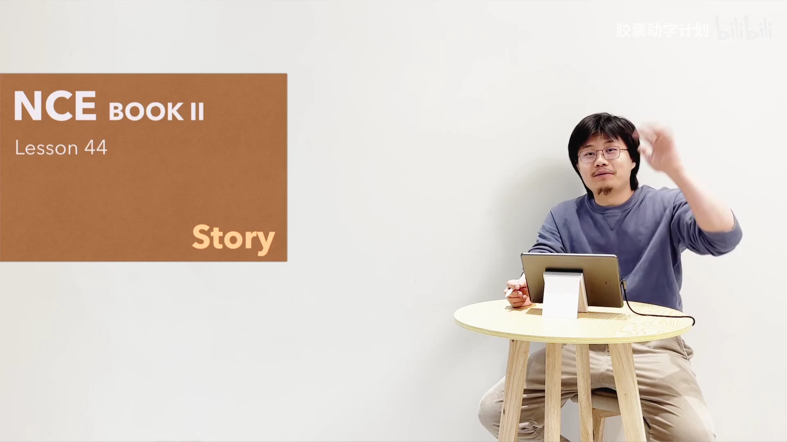

文字识别：NCE / BOOK" / Lesson 44 / Story

### 画面 00:00:02

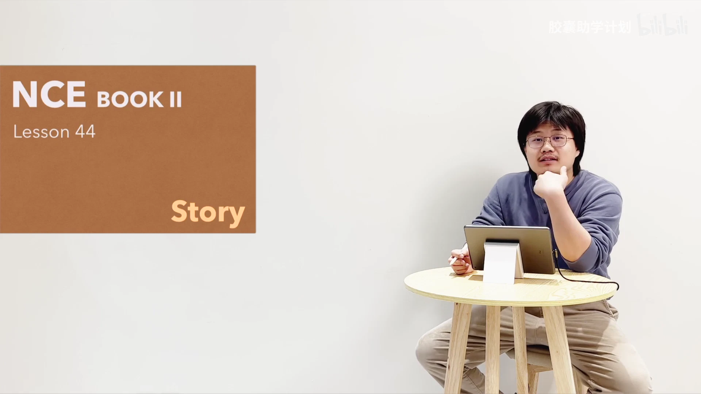

文字识别：NCE / BOOKⅡI / Lesson 44 / Story

### 画面 00:00:05

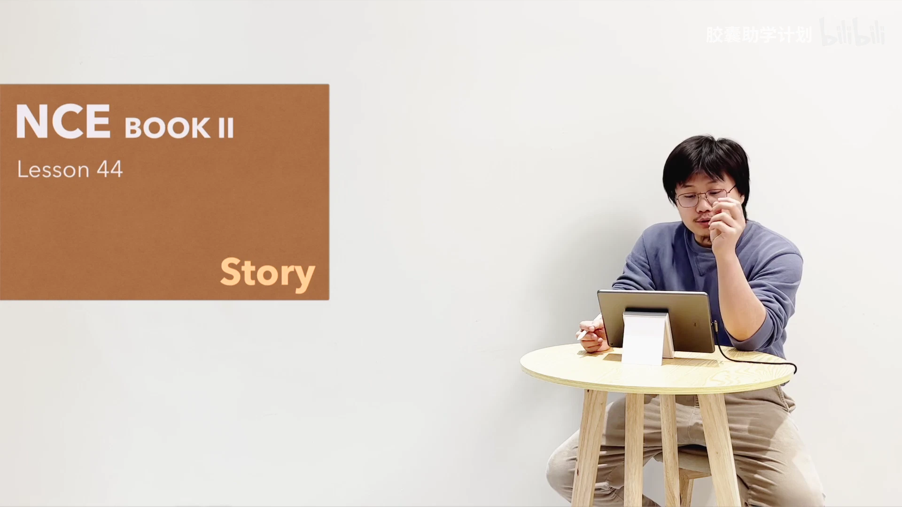

文字识别：NCE / BOOKII / Lesson 44 / Story

### 画面 00:00:09

文字识别：胶囊助学计划 bilbl / • / •

### 画面 00:00:13

文字识别：胶囊助学计划

### 画面 00:00:15

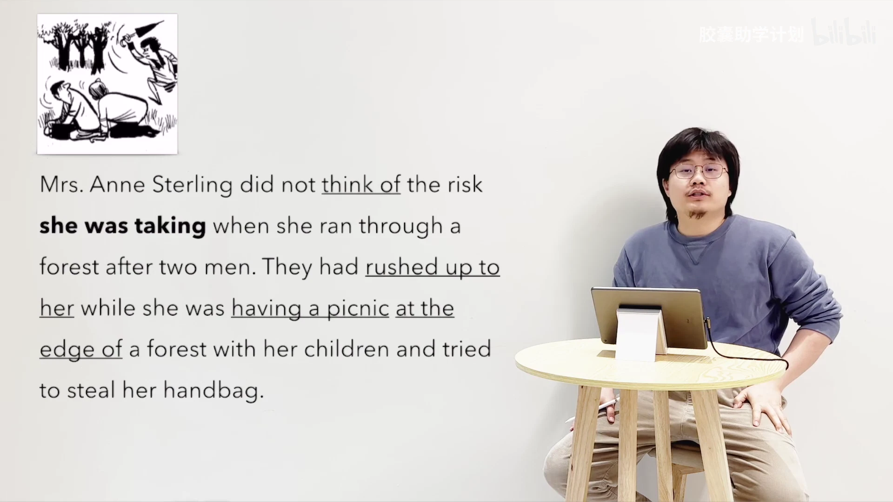

文字识别：Mrs. Anne Sterling did not think of the risk / she was taking when she ran through a / forest after two men. They had rushed up to / her while she was having a picnic at the / edge of a forest with her children and tried / to steal her handbag.

## 00:00:30–00:01:00

Sterling首先是一个人人物出现了，did not没有think of想the risk she was taking when she ran through a forest after two men.好，这里其实要做一个小的断句。你看这个句子其实从这里开始一直到右边括弧才结束，还挺长的了。这句话对吧？这是我们在学二册下半册，也就是四十九课开始，一直

### 画面 00:00:45

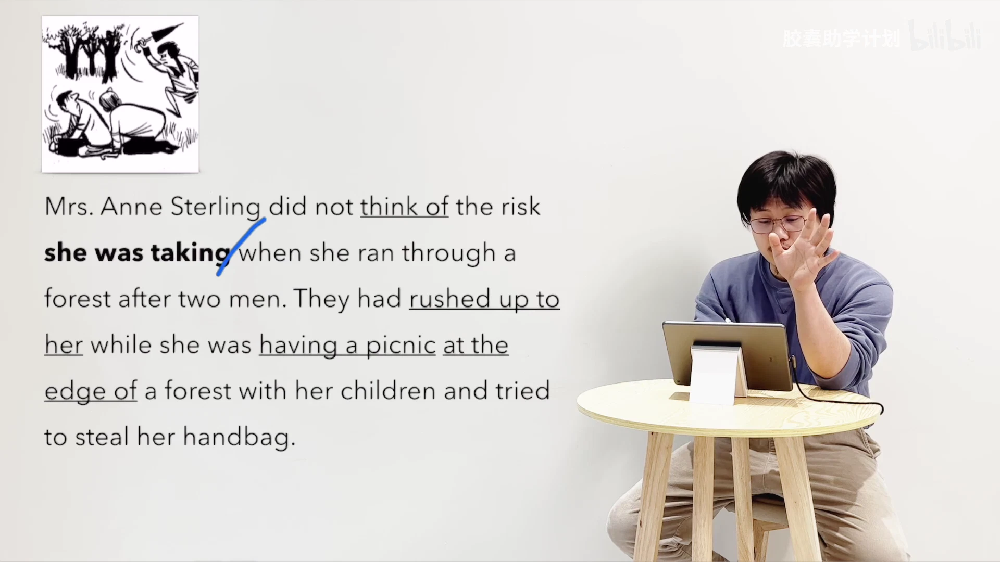

文字识别：Mrs. Anne Sterling did not think of the risk / she was taking when she ran through a / forest after two men. They had rushed up to / her while she was having a picnic at the / edge of a forest with her children and tried / to steal her handbag.

### 画面 00:00:53

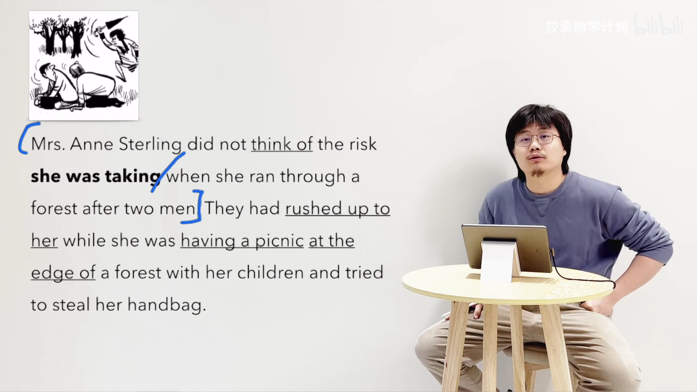

文字识别：Mrs. Anne Sterling did not think of the risk / she was taking when she ran through a / forest after two men / They had rushed up to / her while she was having a picnic at the / edge of a forest with her children and tried / to steal her handbag.

## 00:01:00–00:01:30

到整个三册的时候，要尝试去学的一个思路，就是有的英文句子会变得无比的长。你比如说像这里，其实它才占了三行。到三册的时候，你可能会见到这样的句子，叫做整个这一段就是一个句子。那于是你必须要学一个叫断句的能力啊，就把一个很长的句子拆分拆分成几个很短的句子。比如说在这里，我们就把它能拆

### 画面 00:01:23

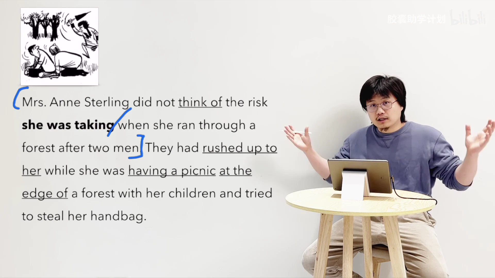

文字识别：Mrs. Anne Sterling did not think of the risk / she was takingwhen she ran through a / forest after two men / They had rushed up to / her while she was having a picnic at the / edge of a forest with her children and tried / to steal her handbag.

## 00:01:30–00:02:00

分成至少两个句子，这里的斜线就告诉你了，你先把前面看懂，然后再说后边，不要一口气儿看，是吧？OK，那我们看前面，他说 Mrs. and Sterling 人物迪娜没有想到 the risk she was taking，我把 she was taking 实际上给各位加了一个这个加粗，对吧？其实想告诉你叫做呃，这里是个定语从句啊，叫做 that she was taking，没有想到

### 画面 00:01:53

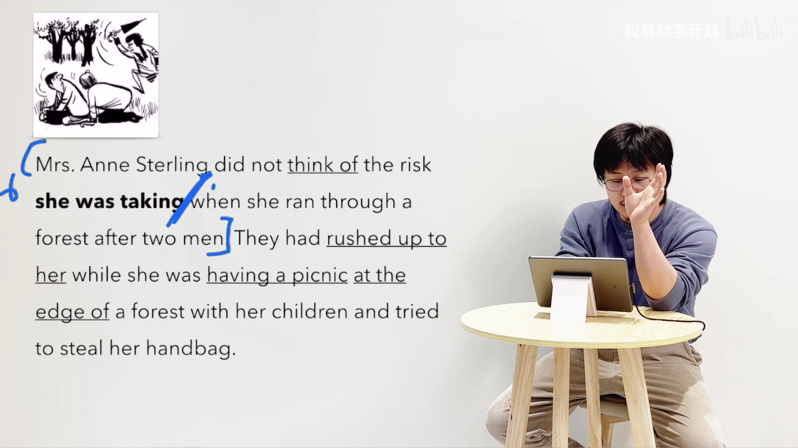

文字识别：Mrs. Anne Sterling did not think of the risk / she was taking When she ran through a / forest after two men / They had rushed up to / her while she was having a picnic at the / edge of a forest with her children and tried / to steal her handbag.

## 00:02:00–00:02:30

他正在冒的这个险啊，没有正在想到他正在冒的这个险。那你想一下，我们单词给了一个短语叫take a risk，对吧？这里其实你把它如果拆成两句话，叫做Mrs. Anstherling did not think of the risk。第一句话，第二句话叫做She was taking the risk right now，是吧？啊，他没有想到他现在正在冒的这个险是什么什么样的？Okay, very good.这是个定语从句啊。呃，

### 画面 00:02:01

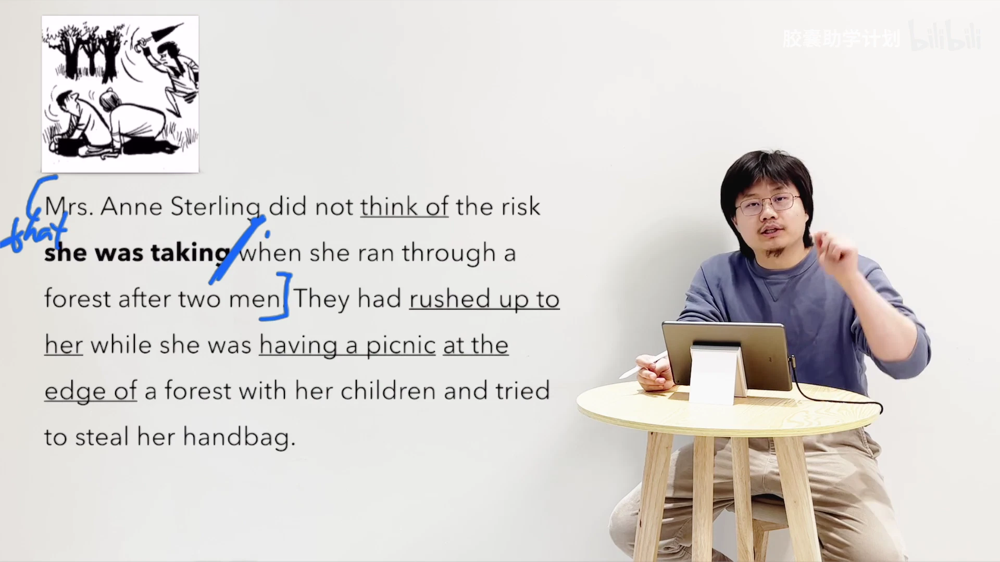

文字识别：Mrs. Anne Sterling did not think of the risk / she was taking when she ran through a / forest after two men / They had rushed up to / her while she was having a picnic at the / edge of a forest with her children and tried / to steal her handbag.

## 00:02:30–00:03:00

接下来说，When she ran through a forest after two man，说当她跑着run对吧，through从中间穿过对吧，through我们之前讲过了，再讲一遍，through往往指的是从中间穿过，比如说，瞧过玻璃，那叫做look through the window，对吧？比如说穿过啊，你注意穿过从内部穿过的话，穿过一块森林，那叫做walk through a forest。OK，

### 画面 00:02:31

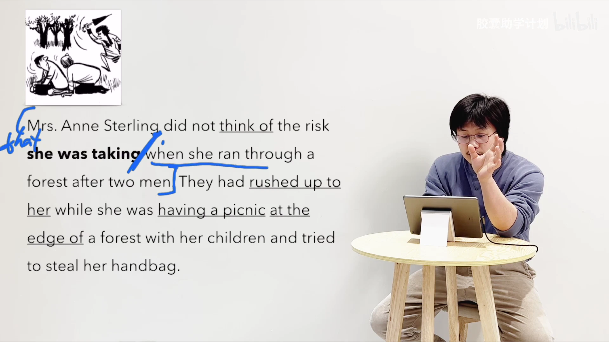

文字识别：Mrs. Anne Sterling did not think of the risk / she was taking when she ran through a / forest after two men / They had rushed up to / her while she was having a picnic at the / edge of a forest with her children and tried / to steal her handbag.

### 画面 00:02:33

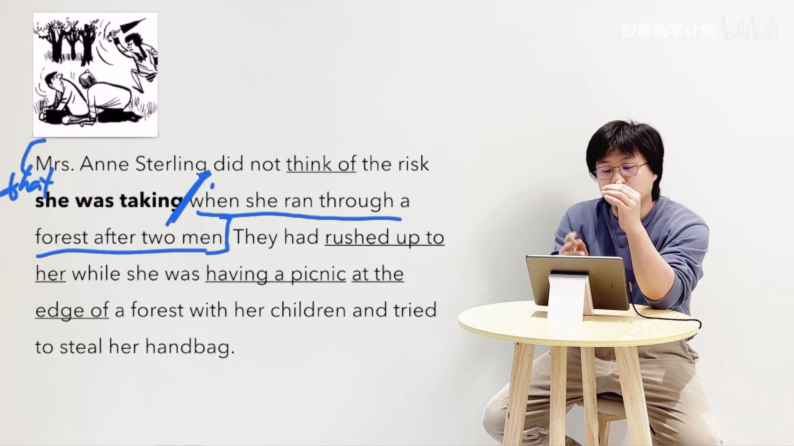

文字识别：Mrs. Anne Sterling did not think of the risk / she was taking when she ran through a / forest after two men / They had rushed up to / her while she was having a picnic at the / edge of a forest with her children and tried / to steal her handbag.

## 00:03:00–00:03:30

very good. Say when he was running through a forest,哎，穿过一个森林. After two men,在两个男人身后啊，追着两个男人穿过森林的时候呢，他并没有想到他正在冒的这个风险危险. Okay, they had rushed up to her. Oh,你看，其实这个文章它是倒叙的，他上来直接就告诉你啊，就给你中间硬插了一下，叫做一个女的追着俩男的跑进森林了，

### 画面 00:03:03

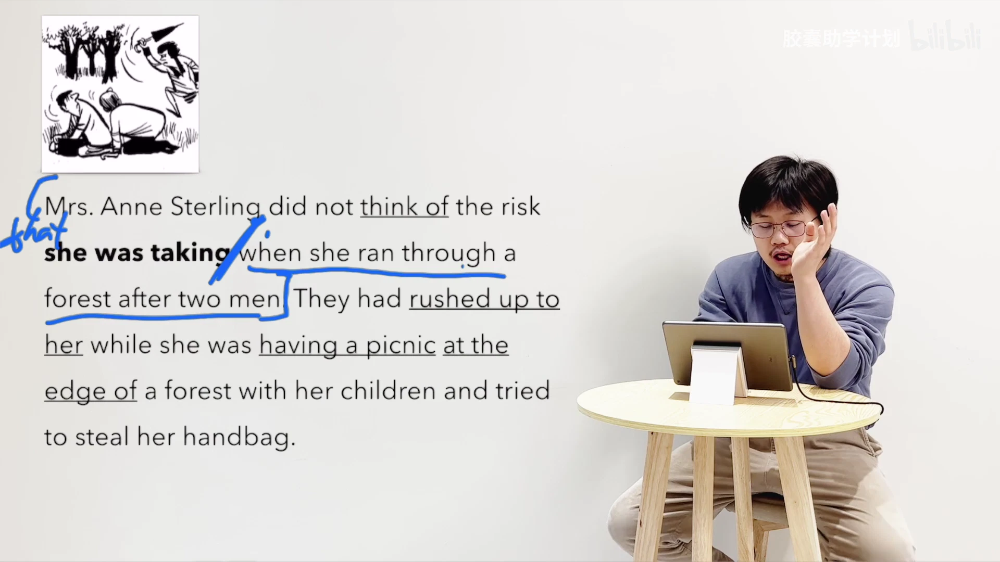

文字识别：Mrs. Anne Sterling did not think of the risk / she was taking when she ran through a / forest after two men / They had rushed up to / her while she was having a picnic at the / edge of a forest with her children and tried / to steal her handbag.

### 画面 00:03:27

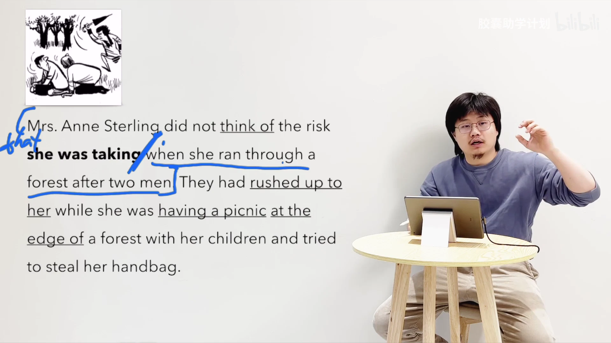

文字识别：Mrs. Anne Sterling did not think of the risk / she was taking when she ran through a / forest after two men / They had rushed up to / her while she was having a picnic at the / edge of a forest with her children and tried / to steal her handbag.

## 00:03:30–00:04:00

对吧？你就会好奇，这是我们其实写故事的一个方式了啊。当然，这不是我们英语上学到的东西，汉语也是这样写的。接下来，他再转回来，说，They had rushed up to her. 这地方有一个习惯用法叫做 rush up to somebody. 其实我们之前也学过，你只要知道 rush，我觉得什么意思，这句话就基本能猜出来了。Rush叫冲嘛。他们之前 rush up to her 就冲向她。Well,哎，又是问，对吧？一码事儿。When she was

### 画面 00:03:39

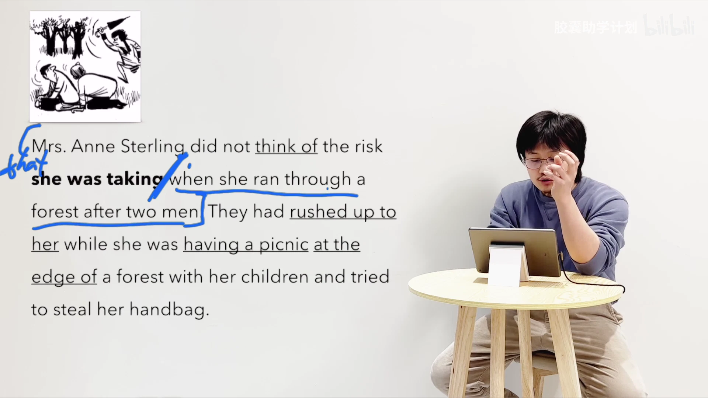

文字识别：Mrs. Anne Sterling did not think of the risk / she was taking when she ran through a / forest after two men / They had rushed up to / her while she was having a picnic at the / edge of a forest with her children and tried / to steal her handbag.

## 00:04:00–00:04:30

having a picnic at the edge of a forest,先不往后看了。当她正 having a picnic，当她正在野餐 at the edge of a forest。习惯用法，单词部分讲过了。在森林的边缘，后面是一些细碎的东西，叫 with her children，叫和她的孩子们啊，提供了一个细节，就是可能不是一个孩子。And try to steal her handbag，然后尝试着去偷她的手提包。这里我个人有

### 画面 00:04:09

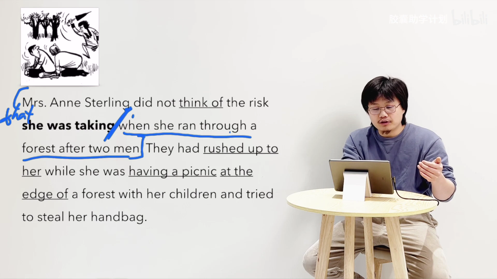

文字识别：Mrs. Anne Sterling did not think of the risk / she was taking when she ran through a / forest after two men / They had rushed up to / her while she was having a picnic at the / edge of a forest with her children and tried / to steal her handbag.

## 00:04:30–00:05:00

一个小的点，我觉得这里可能应该用的是 rob，而不是 steal。 Steal 是偷， rob 才是抢。他们的这种行为怎么看也不像是偷，怎么看怎么像是抢，是吧？ Okay. Continuing in the struggle. 这是一个小的短语，各位要记一下，叫做在挣扎当中。你还是挺字面意思的， struggle 叫在挣扎嘛。 The strap broke. 带子断了，包带儿断

### 画面 00:04:32

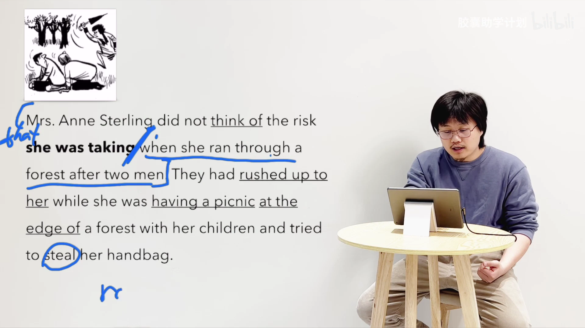

文字识别：Mrs. Anne Sterling did not think of the risk / she was taking when she ran through a / forest after two men / They had rushed up to / her while she was having a picnic at the / edge of a forest with her children and tried / stealher handbag. / to

### 画面 00:04:45

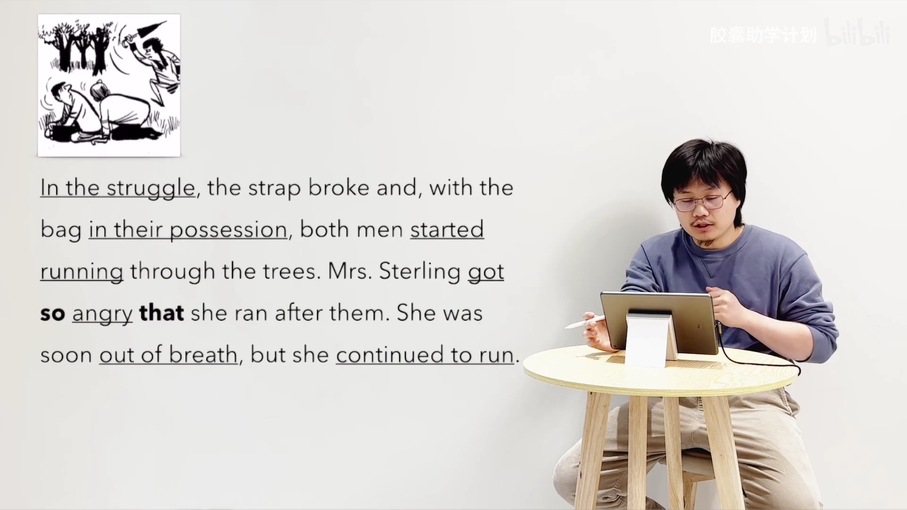

文字识别：In the struggle, the strap broke and, with the / bag in their possession, both men started / running through the trees. Mrs. Sterling got / so angry that she ran after them. She was / soon out of breath, but she continued to run.

## 00:05:00–00:05:30

了。And with the bag in their possession,好了，这句话其实我们呃，这个说话的时候其实一般不这样说啊，其实就是 they got,呃 they got the bag,是吧？就是他们拿到了这个包。这地方这样说还是挺拗口的。With the bag,就是有这个包啊，带着这个包 in their possession,在他们的控制之下、拥有之下，对吧？掌握之中，说其实就是他们拿到了这个包

### 画面 00:05:09

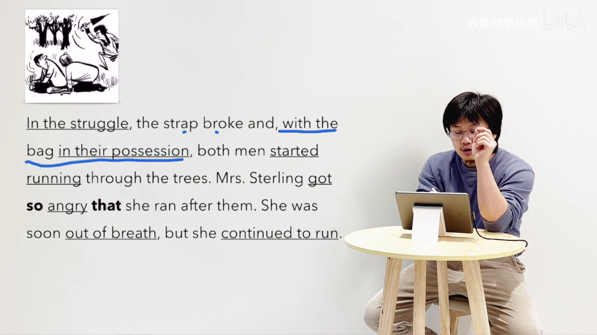

文字识别：In the struggle, the strap broke and, with the / bag in their possession, both men started / running through the trees. Mrs. Sterling got / so angry that she ran after them. She was / soon out of breath, but she continued to run.

## 00:05:30–00:06:00

啊，这两个人抢到了这个包，对不对？叫 They got the bag. 啊，不知道各位能不能理解啊？Both men,两个男人都怎么样呢？Started running.这地方其实就是告诉我们，叫start后边可以加doing something.其实本课你看是多少课？本课是四十四课，二十加二十四啊。这二十是第二十课，二十四是一个单元的啊，这个数量二十加二十四就是四十四。其实本课和第二十课学

### 画面 00:05:39

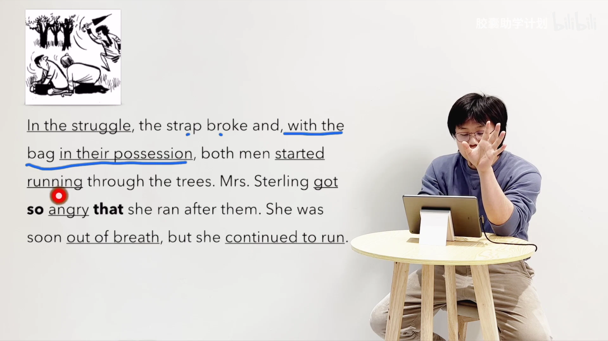

文字识别：In the struggle, the strap broke and, with the / bag in their possession, both men started / running through the trees. Mrs. Sterling got / so angry that she ran after them. She was / soon out of breath, but she continued to run.

## 00:06:00–00:06:30

的内容是一样的，我们都管它叫动名词，对吧？呃，动词后边也可以加动名词，比如说 start running，这里边就是个动名词。只不过我们可以不用以这样的一个特别复杂的语法角度，我们就把它当做一个很轻松的习惯用法的角度，叫 start doing something，这事儿就结了，对吧？他们开始怎么怎么样？开始怎么样呢？Running through the trees，他们开始在树哎树林当中去穿行穿梭。

### 画面 00:06:09

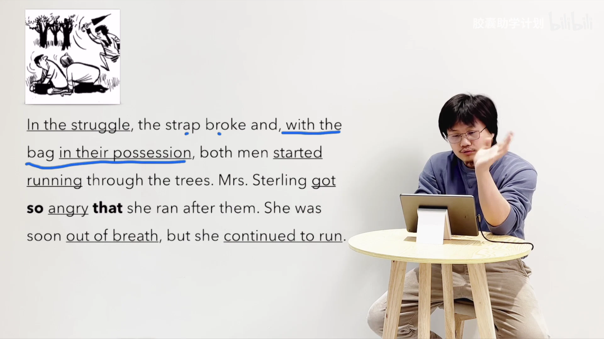

文字识别：In the struggle, the strap broke and, with the / bag in their possession, both men started / running through the trees. Mrs. Sterling got / so angry that she ran after them. She was / soon out of breath, but she continued to run.

## 00:06:30–00:07:00

Mrs. Darling got so angry.首先，got angry，第一节课就学过了。那so angry that，三十五课咱们学的，是吧？如果您忘了，一定要回去看一下。如此的愤怒以至于他们变得如此的愤怒以至于怎么样呢？She ran after them.啊，她开始跑，在他们身后跑，其实就是追着他们跑，对吧？She was soon out of breath.她很快out of breath，上气不接下气了。But she continued

### 画面 00:06:39

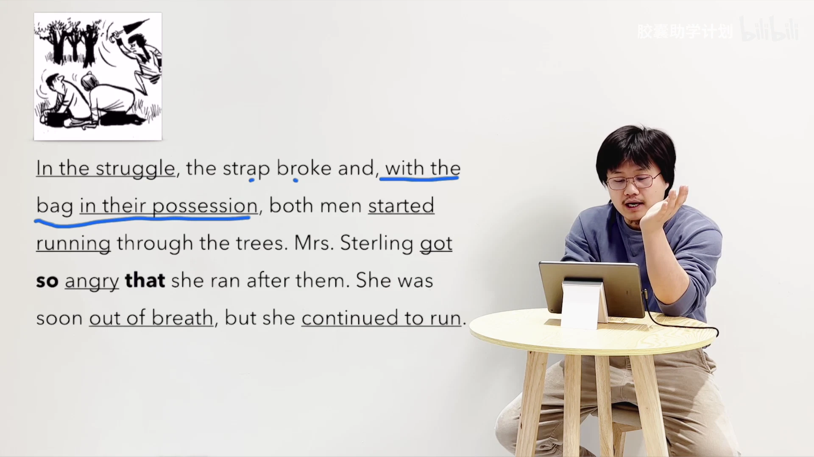

文字识别：In the struggle, the strap broke and, with the / bag in their possession, both men started / running through the trees. Mrs. Sterling got / so angry that she ran after them. She was / soon out of breath, but she continued to run.

## 00:07:00–00:07:30

run.你看这个习惯用法，我们之前见过。本课习惯用法特别多啊，非常非常的多。但是很多我们要么在单词部分学过了，要么在之前的文章当中见过了。比如像这里的 continue to do something，我们之前就学过了，对吧？哎，但是呢，她继续跑。OK，When she caught up with them，首先 caught，你要明白是 catch，哎，是这个单词的过去式。说当她

### 画面 00:07:09

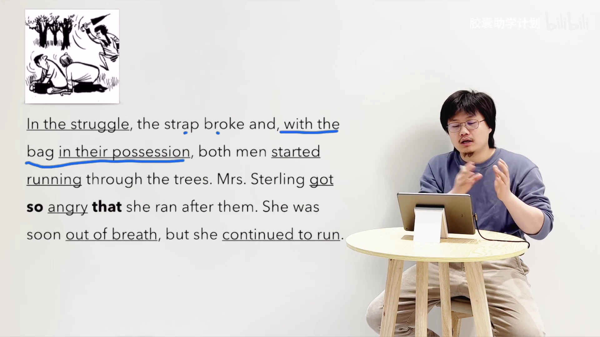

文字识别：In the struggle, the strap broke and, with the / bag in their possession, both men started / running through the trees. Mrs. Sterling got / so angry that she ran after them. She was / soon out of breath, but she continued to run.

### 画面 00:07:18

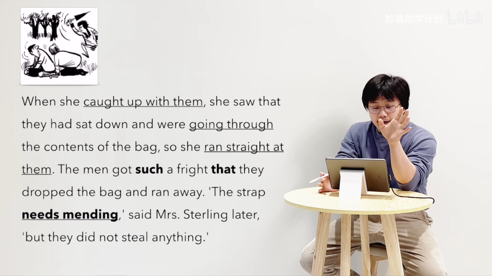

文字识别：When she caught up with them, she saw that / they had sat down and were going through / the contents of the bag, so she ran straight at / them. The men got such a fright that they / dropped the bag and ran away.'The strap / needs mending,' said Mrs. Sterling later, / 'but they did not steal anything.'

### 画面 00:07:25

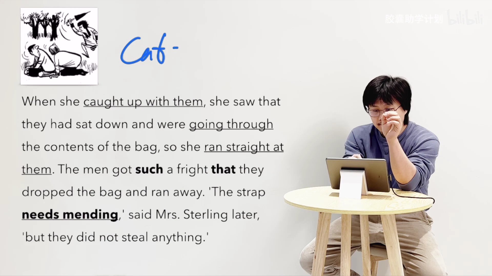

文字识别：Cnf / When she caught up with them, she saw that / they had sat down and were going through / the contents of the bag, so she ran straight at / them. The men got such a fright that they / dropped the bag and ran away. 'The strap / needs mending,' said Mrs. Sterling later, / 'but they did not steal anything.'

## 00:07:30–00:08:00

追赶到他们的时候，追到他们的时候，所以这里有一个习惯用法叫 catch up with somebody。一会儿我们讲啊。She saw that她看到了一件事情。They had sat down他们已经坐下了，and were going through the contents of the bag。你看这个 contents of the bag，实际上我们在讲这个单词的部分的时候已经见过它了，对吧？那 go through 是我们待会儿要用

### 画面 00:07:52

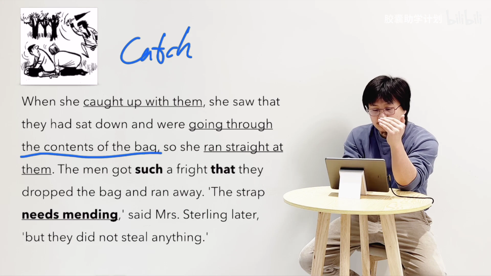

文字识别：Cnfch / When she caught up with them, she saw that / they had sat down and were going through / the contents of the baq, so she ran straight at / them. The men got such a fright that they / dropped the bag and ran away.'The strap / needs mending,' said Mrs. Sterling later, / 'but they did not steal anything.'

### 画面 00:07:57

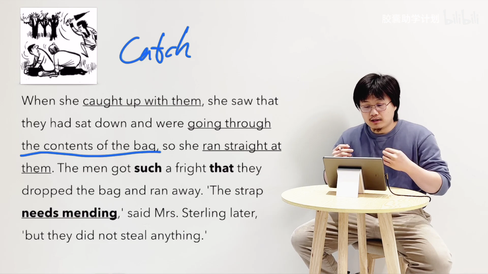

文字识别：Crfch / When she caught up with them, she saw that / they had sat down and were going through / the contents of the baq, so she ran straight at / them. The men got such a fright that they / dropped the bag and ran away.'The strap / needs mending,' said Mrs. Sterling later, / 'but they did not steal anything.'

## 00:08:00–00:08:30

called flipping. Ah, flipping. They're flipping. Ah, flipping this bag inside the things. So, so she ran straight at them. Ran straight at somebody. Ah, refers to straight towards someone, right? Think about 35 minutes. Our article, right? Ah, drive straight at, right? That place is driving straight towards someone. Here is running straight towards someone.

### 画面 00:08:00

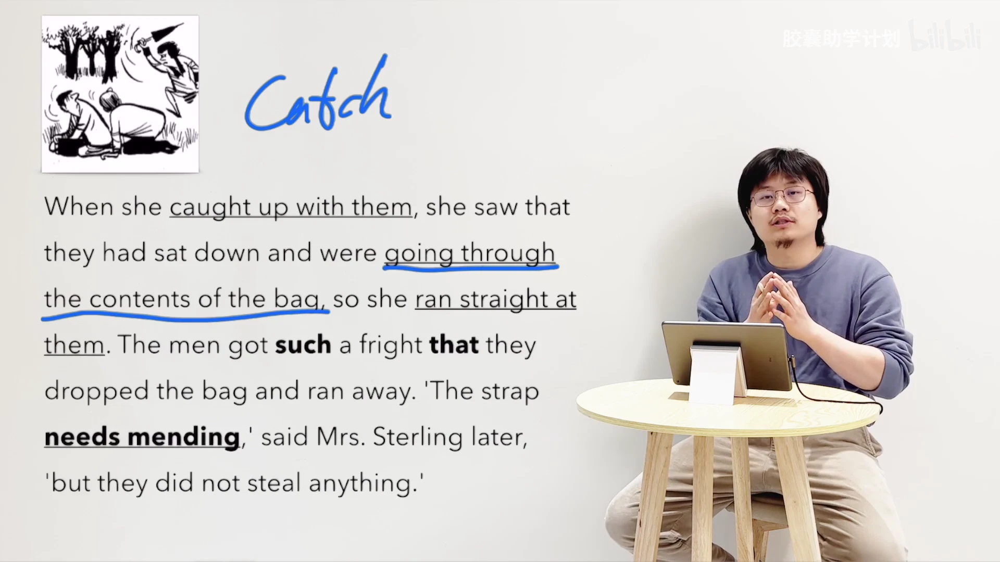

文字识别：Cnfch / When she caught up with them, she saw that / they had sat down and were going through / the contents of the baq, so she ran straight at / them. The men got such a fright that they / dropped the bag and ran away.'The strap / needs mending,' said Mrs. Sterling later, / 'but they did not steal anything.'

## 00:08:30–00:09:00

静止的冲向某人。The man got such a fright that你看，刚才刚复习了so的这点that，现在又复习了such点点that区别。so后边其实加形容词会多，不不不会放名词，而such后边重点是要有一个名词，对吧？那such a fright就是他们吓了如此大的一跳，that叫以至于，以至于怎么呢？They dropped the bag and ran away.他们扔掉了

### 画面 00:08:30

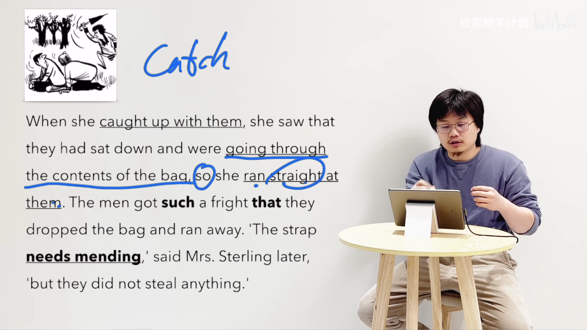

文字识别：Cnfch / When she caught up with them, she saw that / they had sat down and were going through / the contents of the baa,so / she ranstraight at / them. The men got such a fright that they / dropped the bag and ran away.'The strap / needs mending,' said Mrs. Sterling later, / 'but they did not steal anything.'

### 画面 00:08:37

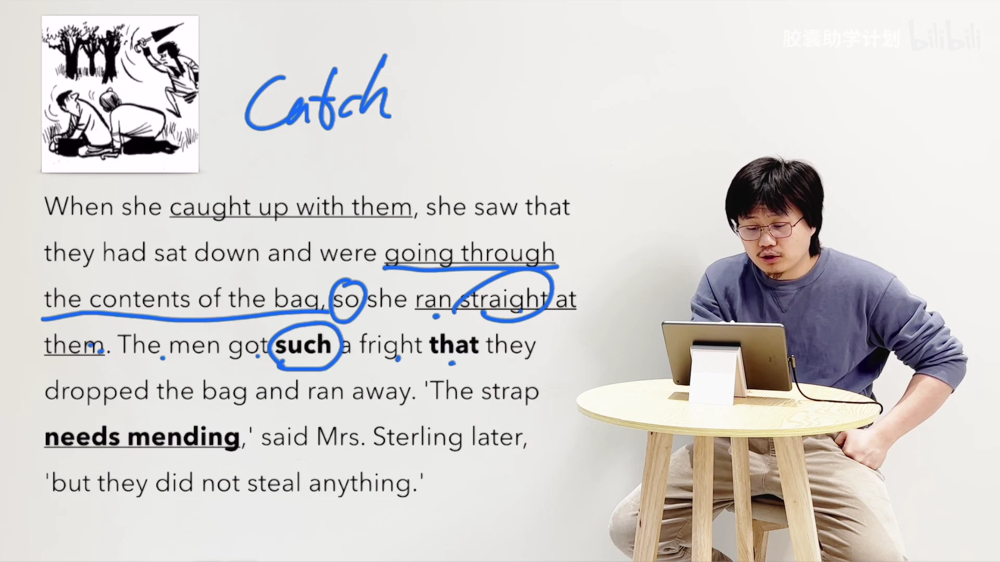

文字识别：Cnfch / When she caught up with them, she saw that / they had sat down and were going through / the contents of the bag, / she ran straight at / them. The.men gotsuch / fright that they / dropped the bag and ran away.'The strap / needs mending,' said Mrs. Sterling |ater, / 'but they did not steal anything."

### 画面 00:08:40

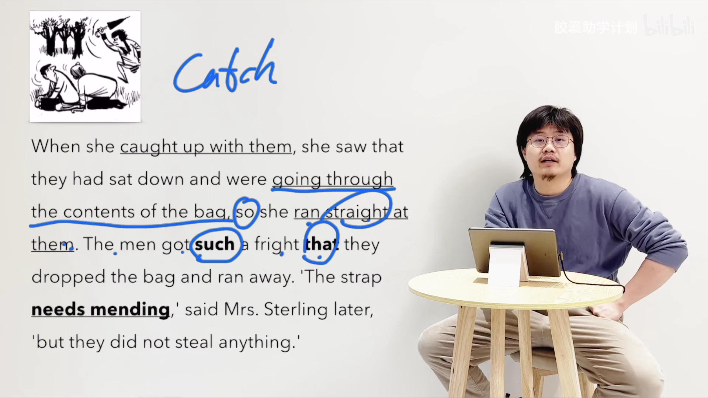

文字识别：Crfch / When she caught up with them, she saw that / they had sat down and were going through / the contents of the baq, / she ran straight at / SC / them. The.men gotsuch / frighthal they / a / dropped the bag and ran away.'The strap / needs mending,'said Mrs. Sterling later, / 'but they did not steal anything.'

### 画面 00:08:43

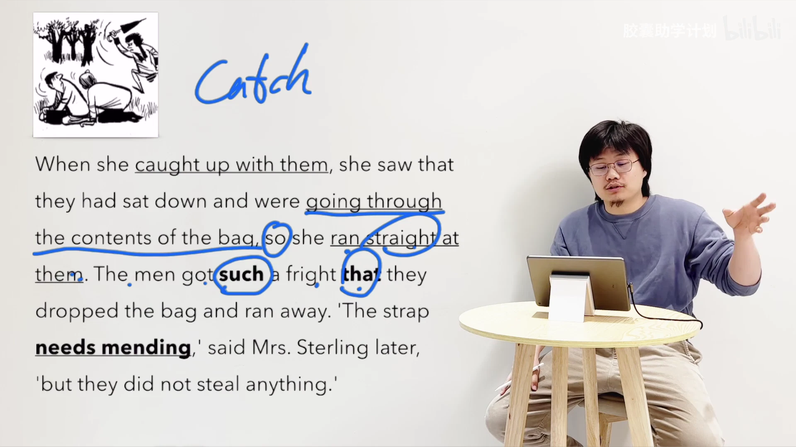

文字识别：Cnfch / When she caught up with them, she saw that / they had sat down and were going through / the contents of the baq, / she ran etraight at / SC / them. The.men gotsuch / afrighthalthey / a / dropped the bag and ran away. 'The strap / needs mending,' said Mrs. Sterling later, / 'but they did not steal anything.'

### 画面 00:08:56

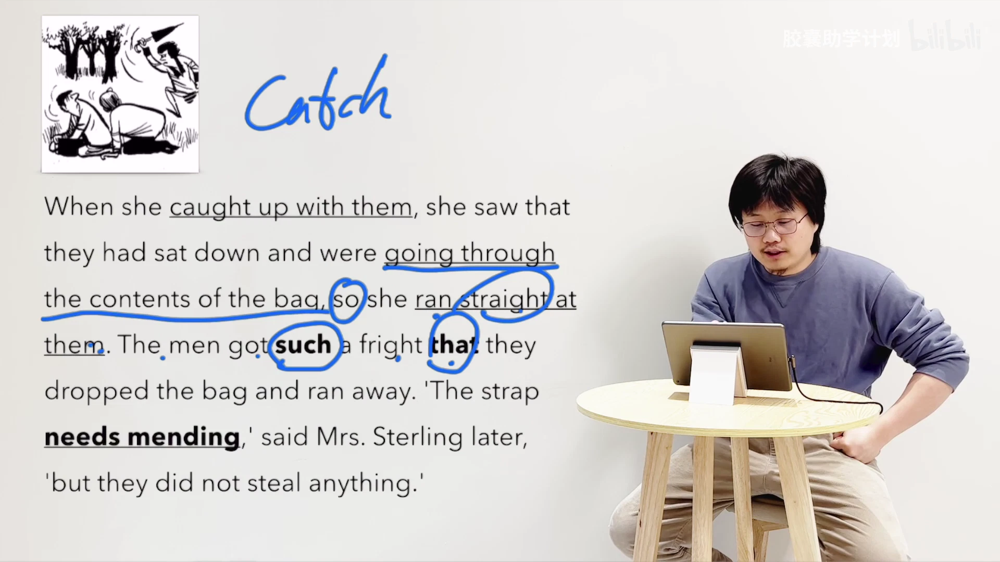

文字识别：Cnfch / When she caught up with them, she saw that / they had sat down and were going through / the contents of the bag, / )she ran straight at / SC / them. The.men gotsuch / frighthathey / a / dropped the bag and ran away.'The strap / needs mending,'said Mrs. Sterling later, / 'but they did not steal anything.'

## 00:09:00–00:09:30

The stripe needs mending. This一会儿我们重点要讲一下。虽然四十一课的时候啊，我们提过了need这个单词的所有啊诸多用法，但是还有一个在这里我们没有讲，叫need doing something。一会儿我们看它什么意思啊？我现在先告诉各位吧，叫做这个包啊需要修理。你看翻译成汉语的时候，你不会觉得有什么问题。一会儿我再讲有什

### 画面 00:09:00

文字识别：Cnfch / When she caught up with them, she saw that / they had sat down and were going through / the contents of the bag, / she ran etraight at / SC / them. The.men gotsuch /  frighthathey / dropped the bag and ran away.'The strap / needs mending,'said Mrs. Sterling later, / 'but they did not steal anything.'

### 画面 00:09:07

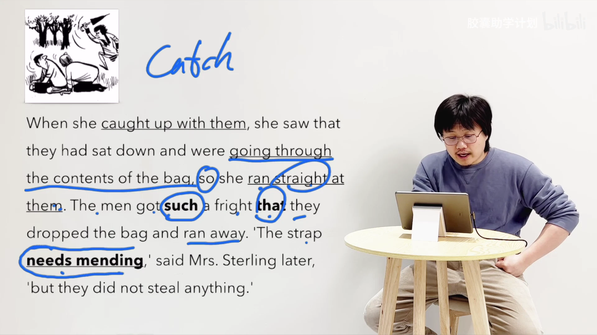

文字识别：Canfch / When she caught up with them, she saw that / they had sat down and were going through / the contents of the bag, / )she ran straightat / SC / them. The.men gotsuch / frighthathey / dropped the bag and ran away.'The strap / needs mending,'said Mrs. Sterling later, / 'but they did not steal anything.'

### 画面 00:09:09

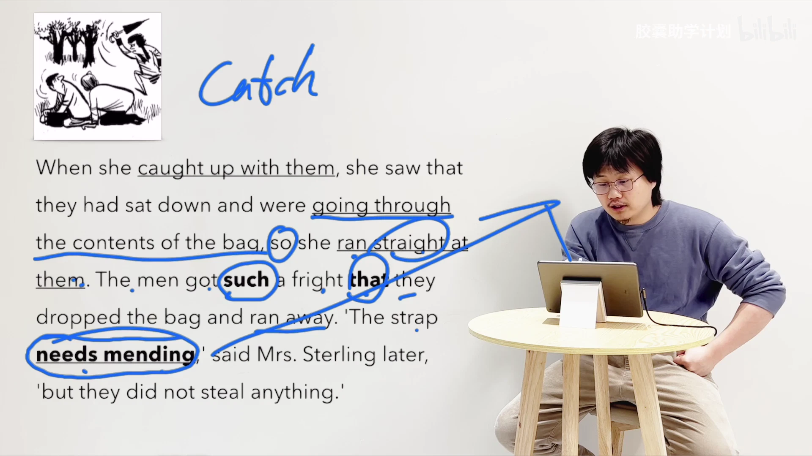

文字识别：Crfch / When she caught up with them, she saw that / they had sat down and were going through / the contents of the baq, / )she ran straight at / SC / them. The.men gotsuch / frighthaythey / dropped the bag and ran away. 'The strap / needs mending / said Mrs. Sterling later, / 'but they did not steal anything.'

### 画面 00:09:11

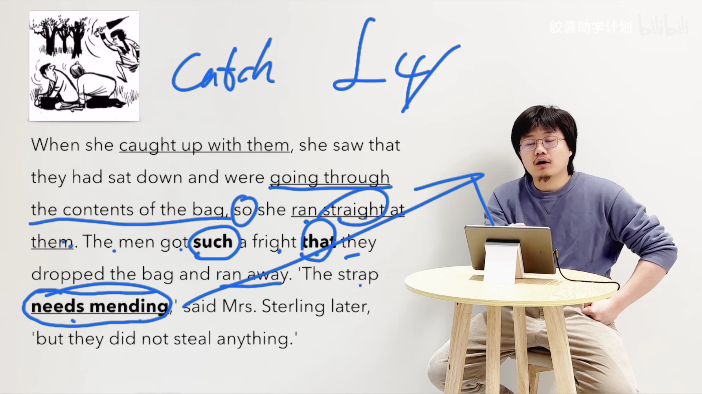

文字识别：Crfch / When she caught up with them, she saw that / they had sat down and were going through / the contents of the baq, / she ran straight at / S / them. The.men gotsuch / frighthay they / dropped the bag and ran away. 'The strap / needs mending / said Mrs. Sterling later, / 'but they did not steal anything.'

## 00:09:30–00:10:00

么问题啊。Said Mrs. Sterling later, he later. He said

### 画面 00:09:41

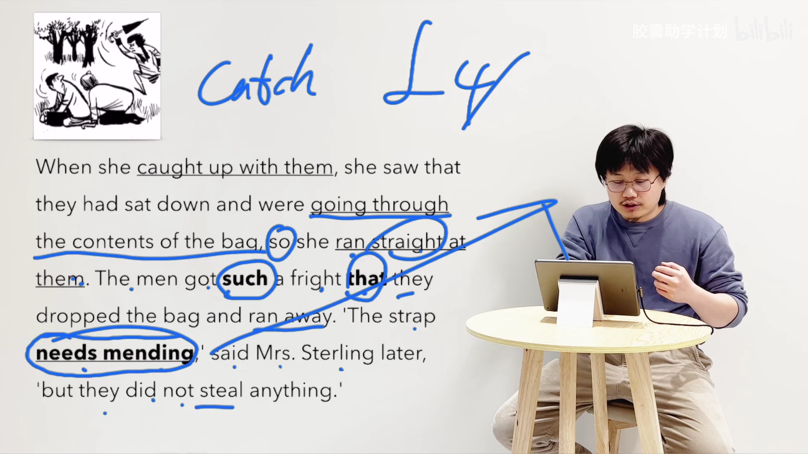

文字识别：Crfch / When she caught up with them, she saw that / they had sat down and were going through / the contents of the baq, / she ran straight at / them. The.men gotsuch /  frighthaythey / dropped the bag and ran away.'The strap / needs mending / said Mrs. Sterling later, / 0 / 'but they did not steal anything."

### 画面 00:09:43

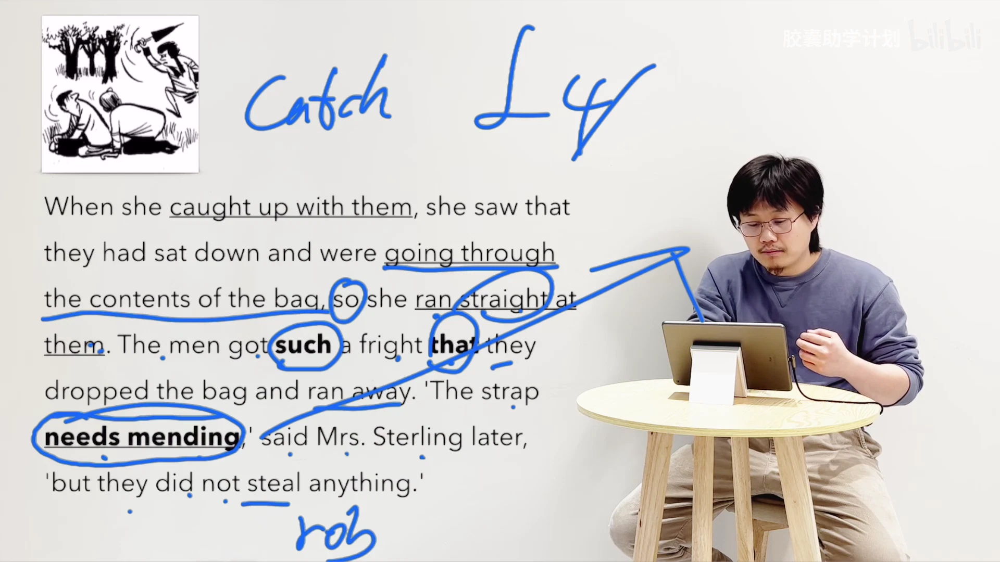

文字识别：Cnfch / When she caught up with them, she saw that / they had sat down and were going through / the contents of the bag, / )she ran straight at / them. The.men gotsuch /  frighthaythey / dropped the bag and ran away. / .'The strap / needs mending / said Mrs. Sterling later, / 0 / 'but they did not steal anything.' / rob

### 画面 00:09:48

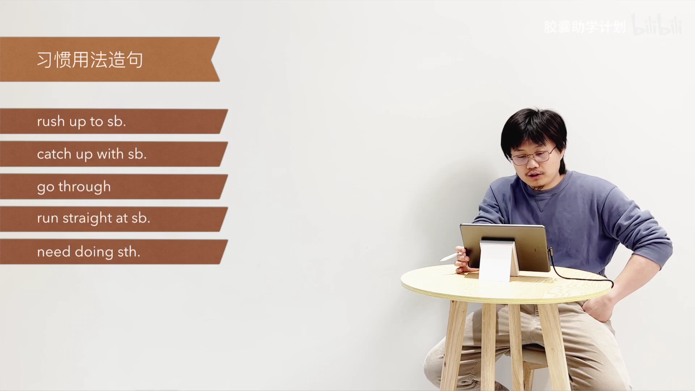

文字识别：习惯用法造句 / rush up to sb. / catch up with sb. / go through / run straight at sb. / need doing sth.

### 画面 00:09:50

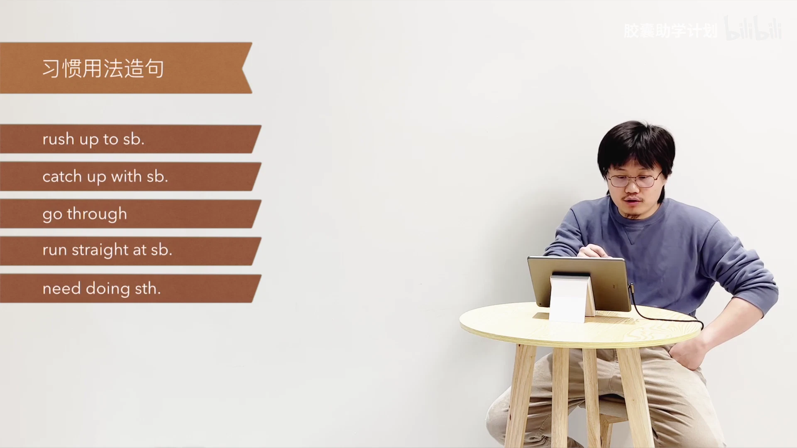

文字识别：习惯用法造句 / rush up to sb. / catch up with sb. / go through / W / run straight at sb. / need doing sth.

### 画面 00:09:52

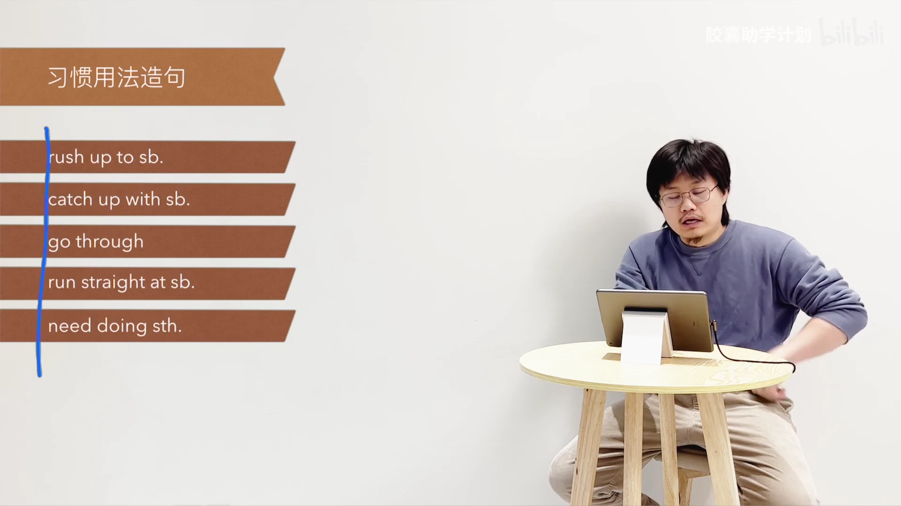

文字识别：习惯用法造句 / rush up to sb. / catch up with sb. / go through / run straight at sb. / need doing sth.

### 画面 00:09:54

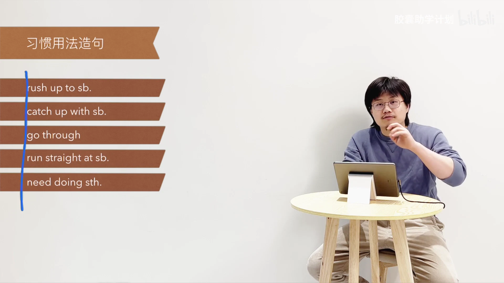

文字识别：习惯用法造句 / rush up to sb. / catch up with sb. / go through / run straight at sb. / need doing sth.

### 画面 00:09:59

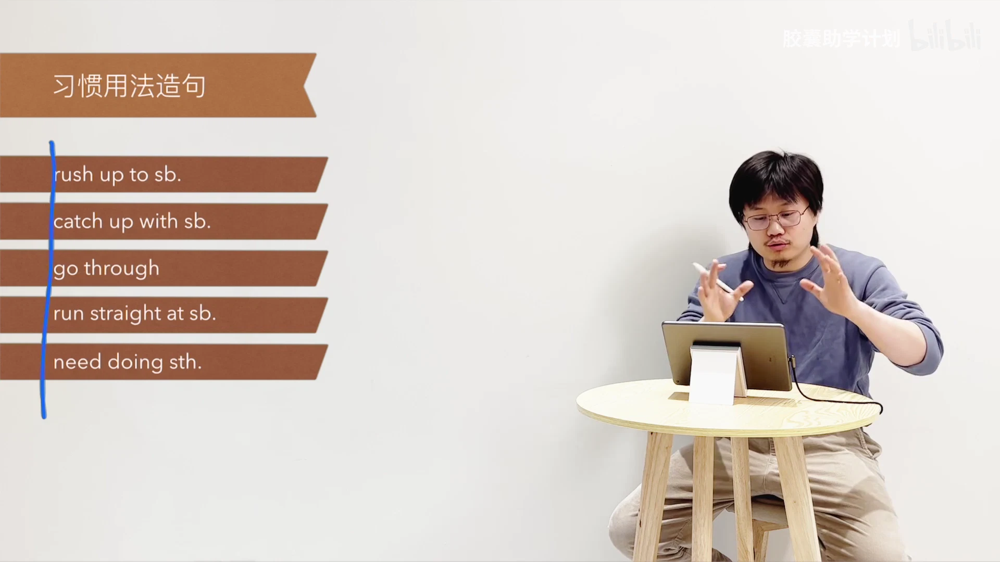

文字识别：习惯用法造句 / rush up to sb. / catch up with sb. / go through / run straight at sb. / need doing sth.

## 00:10:00–00:10:30

个，对吧？那我们挨个去造句啊。虽然都不太难。第一个 rush up to somebody呢，就是冲向某人。那很简单，造个句子，比如说 in despair he rushed up to his mom. 四十课学的 in despair嘛，虚拟语气那一课，对吧？绝望了，然后他问了什么一个问题，说绝望了，他冲向了他的母亲，没问题。哎，一般疑问句，特殊疑问句，对吧？然后再来，比如说 they rushed up to him and put out the fire. 他们冲着他就跑过去了，小孩在那儿放火，

### 画面 00:10:02

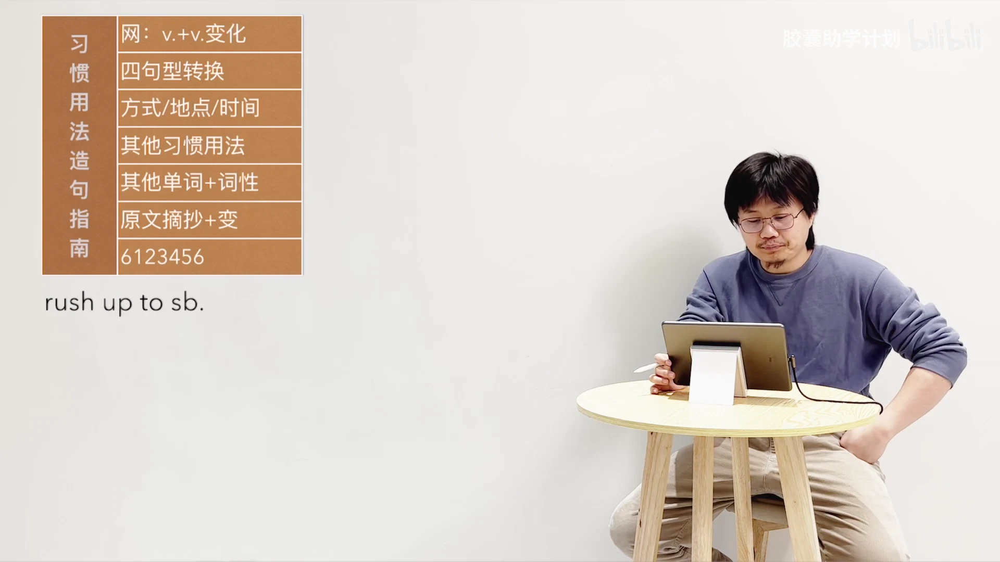

文字识别：网：v.+v.变化 / 习惯用法造句指南 / 四句型转换 / 方式/地点/时间 / 其他习惯用法 / 其他单词+词性 / 原文摘抄+变 / 6123456 / rush up to sb.

### 画面 00:10:04

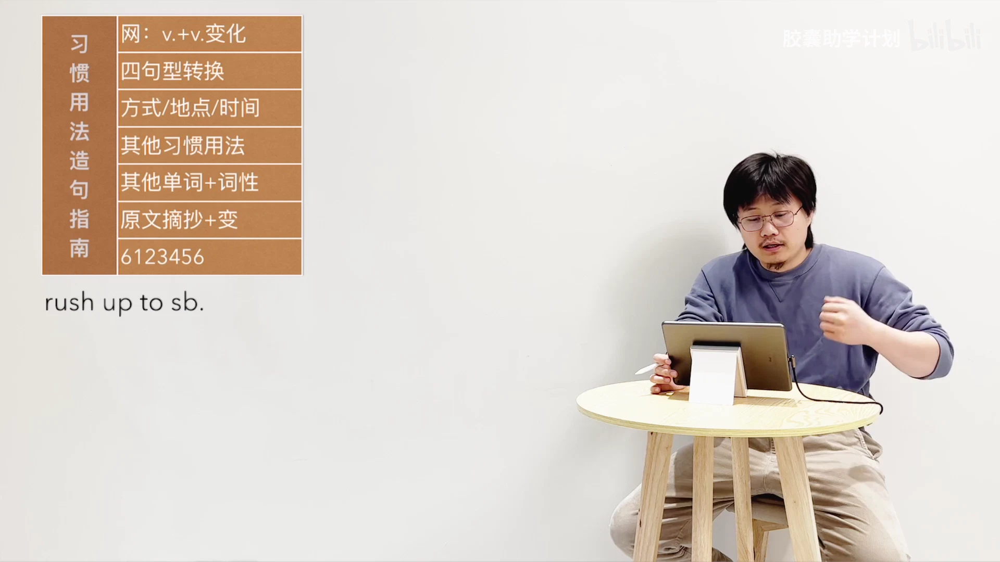

文字识别：网：v.+v.变化 / 习惯用法造句指南 / 四句型转换 / 方式/地点/时间 / 其他习惯用法 / 其他单词+词性 / 原文摘抄+变 / 6123456 / rush up to sb.

### 画面 00:10:09

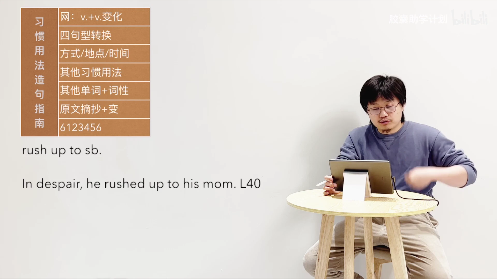

文字识别：网：v.+v.变化 / 习惯用法造句指南 / 四句型转换 / 方式/地点/时间 / 其他习惯用法 / 其他单词+词性 / 原文摘抄+变 / 6123456 / rush up to sb. / In despair, he rushed up to his mom. L40

### 画面 00:10:14

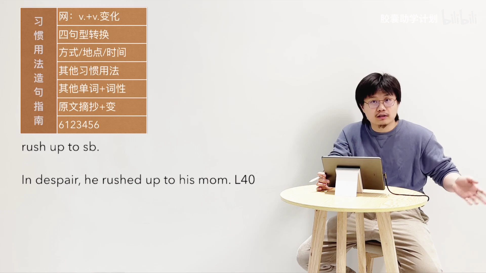

文字识别：网：v.+v.变化 / 习惯用法造句指南 / 四句型转换 / 方式/地点/时间 / 其他习惯用法 / 其他单词+词性 / 原文摘抄+变 / 6123456 / rush up to sb. / In despair, he rushed up to his mom. L40

### 画面 00:10:19

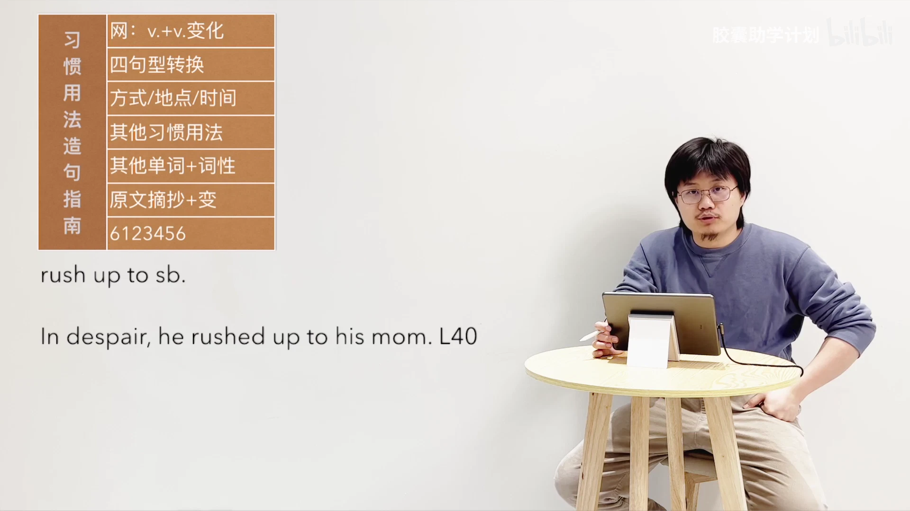

文字识别：网：v.+v.变化 / 习惯用法造句指南 / 四句型转换 / 方式/地点/时间 / 其他习惯用法 / 其他单词+词性 / 原文摘抄+变 / 6123456 / rush up to sb. / In despair, he rushed up to his mom. L40

### 画面 00:10:23

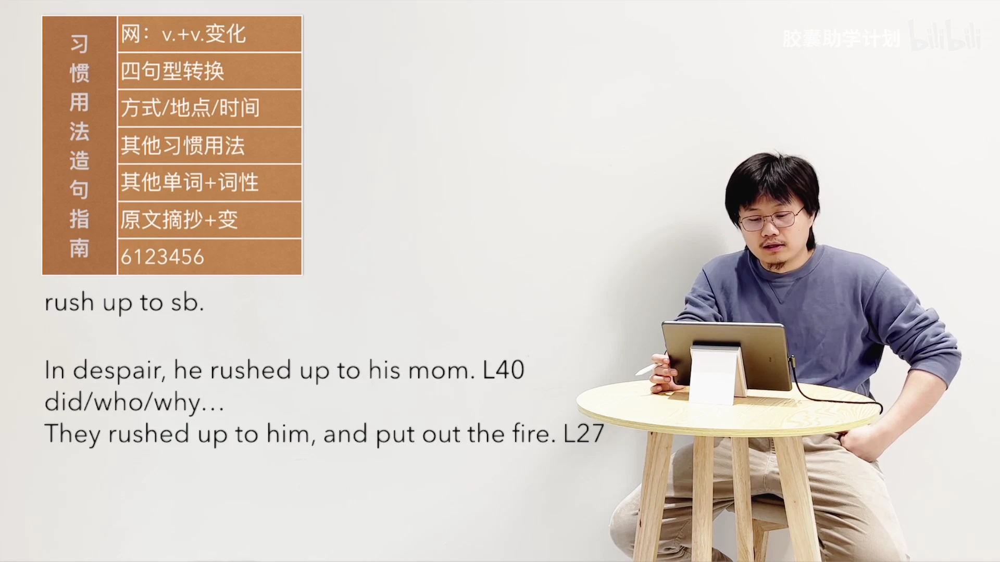

文字识别：网：v.+v.变化 / 习惯用法造句指南 / 四句型转换 / 方式/地点/时间 / 其他习惯用法 / 其他单词+词性 / 原文摘抄+变 / 6123456 / rush up to sb. / In despair, he rushed up to his mom. L40 / did/who/why... / They rushed up to him, and put out the fire. L27

### 画面 00:10:25

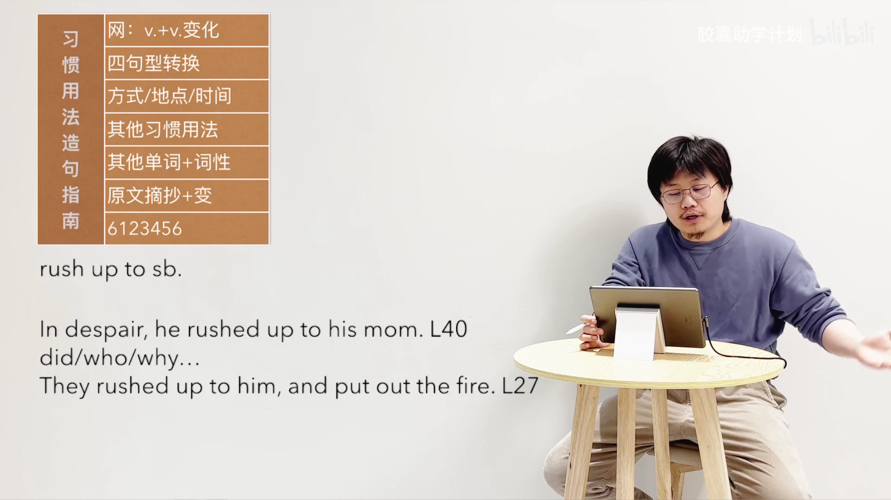

文字识别：网：v.+v.变化 / 习惯用法造句指南 / 四句型转换 / 方式/地点/时间 / 其他习惯用法 / 其他单词+词性 / 原文摘抄+变 / 6123456 / rush up to sb. / In despair, he rushed up to his mom. L40 / did/who/why... / They rushed up to him, and put out the fire. L27

### 画面 00:10:29

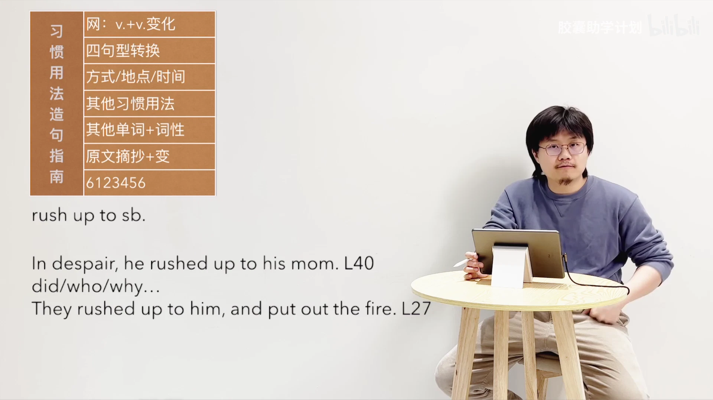

文字识别：网：v.+v.变化 / 习惯用法造句指南 / 四句型转换 / 方式/地点/时间 / 其他习惯用法 / 其他单词+词性 / 原文摘抄+变 / 6123456 / rush up to sb. / In despair, he rushed up to his mom. L40 / did/who/why... / They rushed up to him, and put out the fire. L27

## 00:10:30–00:11:00

对吧？但旁边比如说有，呃，煤气罐，对吧？他这个小孩不懂啊，在那儿放火玩儿，然后一帮大人冲着他就跑过去了，然后把这个火就给扑灭了，put out the fire。你看，put out the fire，二十七课咱学的，对吧？OK，下一个这个短语口语当中特别常用，catch up with somebody，但我们在本科并不是口语当中最常用的那个，我们本科学的叫追上、追赶上某人，对吧？

### 画面 00:10:34

文字识别：网：v.+v.变化 / 习惯用法造句指南 / 四句型转换 / 方式/地点/时间 / 其他习惯用法 / 其他单词+词性 / 原文摘抄+变 / 6123456 / rush up to sb. / In despair, he rushed up to his mom. L40 / did/who/why... / They rushed up to him, and put out the fire. L27

### 画面 00:10:37

文字识别：网：v.+v.变化 / 习惯用法造句指南 / 四句型转换 / 方式/地点/时间 / 其他习惯用法 / 其他单词+词性 / 原文摘抄+变 / 6123456 / rush up to sb. / In despair, he rushed up to his mom. L40 / did/who/why... / They rushed up to him, and put out the fire. L27

### 画面 00:10:39

文字识别：网：v.+v.变化 / 习惯用法造句指南 / 四句型转换 / 方式/地点/时间 / 其他习惯用法 / 其他单词+词性 / 原文摘抄+变 / 6123456 / rush up to sb. / In despair, he rushed up to his mom. L40 / did/who/why... / They rushed up to him, and put out the fire. L27

### 画面 00:10:43

文字识别：网：v.+v.变化 / 习惯用法造句指南 / 四句型转换 / 方式/地点/时间 / 其他习惯用法 / 其他单词+词性 / 原文摘抄+变 / 6123456 / rush up to sb. / In despair, he rushed up to his mom. L40 / did/who/why... / They rushed up to him, and put out the fire. L27

### 画面 00:10:45

文字识别：网：v.+v.变化 / 习惯用法造句指南 / 四句型转换 / 方式/地点/时间 / 其他习惯用法 / 其他单词+词性 / 原文摘抄+变 / 6123456 / N / catch up with sb.

### 画面 00:10:49

文字识别：网：v.+v.变化 / 习惯用法造句指南 / 四句型转换 / 方式/地点/时间 / 其他习惯用法 / 其他单词+词性 / 原文摘抄+变 / 6123456 / catch up with sb.

### 画面 00:10:54

文字识别：网：v.+v.变化 / 习惯用法造句指南 / 四句型转换 / 方式/地点/时间 / 其他习惯用法 / 其他单词+词性 / 原文摘抄+变 / 6123456 / catch up with sb.

### 画面 00:10:58

文字识别：网：v.+v.变化 / 习惯用法造句指南 / 四句型转换 / 方式/地点/时间 / 其他习惯用法 / 其他单词+词性 / 原文摘抄+变 / 6123456 / catch up with sb.

## 00:11:00–00:11:30

比如说，She ran as fast as she could.她尽可能快的跑，but she couldn't catch up with her brother.但是她没有办法赶上她的兄弟，对吧？Next one,说Slow down, so I can catch up catch up with you.说慢一点，所以我才能这样，我才能赶上你，对吧？这都是catch up with somebody最字面的一个意思，就是追上某人或赶上某人。但是呢，你要注意，catch

### 画面 00:11:00

文字识别：网：v.+v.变化 / 习惯用法造句指南 / 四句型转换 / 方式/地点/时间 / 其他习惯用法 / 其他单词+词性 / 原文摘抄+变 / 6123456 / catch up with sb. / She ran as fast as she could, but she couldn't / catch up with her brother.

### 画面 00:11:04

文字识别：网：v.+v.变化 / 习惯用法造句指南 / 四句型转换 / 方式/地点/时间 / 其他习惯用法 / 其他单词+词性 / 原文摘抄+变 / 6123456 / catch up with sb. / She ran as fast as she could, but she couldn't / catch up with her brother.

### 画面 00:11:09

文字识别：网：v.+v.变化 / 习惯用法造句指南 / 四句型转换 / 方式/地点/时间 / 其他习惯用法 / 其他单词+词性 / 原文摘抄+变 / 6123456 / catch up with sb. / She ran as fast as she could, but she couldn't / catch up with her brother.

### 画面 00:11:13

文字识别：网：v.+v.变化 / 习惯用法造句指南 / 四句型转换 / 方式/地点/时间 / 其他习惯用法 / 其他单词+词性 / 原文摘抄+变 / 6123456 / catch up with sb. / She ran as fast as she could, but she couldn't / catch up with her brother. / Slow down so I can catch up with you.

### 画面 00:11:15

文字识别：网：v.+v.变化 / 习惯用法造句指南 / 四句型转换 / 方式/地点/时间 / 其他习惯用法 / 其他单词+词性 / 原文摘抄+变 / 6123456 / catch up with sb. / She ran as fast as she could, but she couldn't / catch up with her brother. / Slow down so I can catch up with you.

### 画面 00:11:17

文字识别：网：v.+v.变化 / 习惯用法造句指南 / 四句型转换 / 方式/地点/时间 / 其他习惯用法 / 其他单词+词性 / 原文摘抄+变 / 6123456 / catch up with sb. / She ran as fast as she could, but she couldn't / catch up with her brother. / Slow down'sd / I can catch up with you.

### 画面 00:11:19

文字识别：网：v.+v.变化 / 习惯用法造句指南 / 四句型转换 / 方式/地点/时间 / 其他习惯用法 / 其他单词+词性 / 原文摘抄+变 / 6123456 / catch up with sb. / She ran as fast as she could, but she couldn't / catch up with her brother. / Slow down'sd / I can catch up with you.

### 画面 00:11:24

文字识别：网：v.+v.变化 / 习惯用法造句指南 / 四句型转换 / 方式/地点/时间 / 其他习惯用法 / 其他单词+词性 / 原文摘抄+变 / 6123456 / catch up with sb. / She ran as fast as she could, but she couldn't / catch up with her brother. / Slow down'sd / I can catch up with you.

### 画面 00:11:28

文字识别：I'Il catch up with you later tonight. / 美国X档案 / 随便他就这样 我得去写报告 / AmericanHistory X / Whatever, dude. He can't help it. I got to do that paper. / (1998)

## 00:11:30–00:12:00

up with somebody 有一个口语当中非常常用的用法，这个我希望各位记下来，叫 I will catch up with you later tonight. 你看这句话叫我今天晚上稍后一些时候会赶上你，就不太能翻译通了，对吧？它其实就是类似于一个单词叫 meet. 今天晚上稍后一些时候我会见你的，我会遇见你的，OK，我会去见你的，其实就是 catch

### 画面 00:11:37

文字识别：I'll catch up with you later tonight. / 美国X档案 / 随便他就这样 我得去写报告 / American History X / Whatever, dude. He can't help it. I got to do that paper. / (1998)

### 画面 00:11:42

文字识别：I'Il catch up with you later tonight. / 美国X档案 / 随便 他就这样 我得去写报告 / AmericanHistory X / Whatever, dude. He can't help it. I got to do that paper. / (1998)

## 00:12:00–00:12:30

up with somebody. Ah, okay. 那我们看一下电影片段吧. He can't help it. I gotta do that paper. Look, I'll catch up with you later tonight. Hey, pig, not cameras. What? Look, I need you to stay away from there. But why, man? I thought we were gonna hang. Trust me, I will explain it to you later. I just need you to stay away from the party, right? Whatever. Hey, I'm not kidding. Promise me you're gonna stay away from that party tonight, Danny. You're not fucking fourteen anymore, right? Okay, I'll catch up with you. I I will catch up with you later tonight. Very good.

### 画面 00:12:05

文字识别：I'Il catch up with you later tonight. / 美国X档案 / 随便他就这样 我得去写报告 / American History X / Whatever, dude. He can't help it. I got to do that paper. / (1998)

### 画面 00:12:08

文字识别：I'Il catch up with you later tonight. / 美国X档案 / 我今晚稍后再跟你聊 / American History X / (1998) / Look, I"ll catch up with you later tonight.

### 画面 00:12:10

文字识别：I'Il catch up with you later tonight. / 美国X档案 / 听着我要你远离那里 / American History X / Look I need you to stay away from there. / (1998)

### 画面 00:12:12

文字识别：I'Il catch up with you later tonight. / 美国X档案 / 为什么我以为我们要一起去 / AmericanHistory X / Why? I thought we were gonna hang. / (1998)

### 画面 00:12:14

文字识别：I'Il catch up with you later tonight. / 美国X档案 / 相信我我以后再解释 / American History X / Trust me. I'll explain it to you later. / (1998)

### 画面 00:12:16

文字识别：I'Il catch up with you later tonight. / 美国X档案 / 我要你别参加那聚会好吗 / AmericanHistory X / I need you to stay away from the party, allright? / (1998)

### 画面 00:12:18

文字识别：I'Il catch up with you later tonight. / 美国X档案 / -随便-我没在开玩笑 / American History X / -Whatever. -Hey, I'm not kidding. / (1998)

### 画面 00:12:20

文字识别：I'Il catch up with you later tonight. / 美国X档案 / 答应我你不会参加那聚会 / AmericanHistory X / (1998) / Promise me you'll stay away from that party.

### 画面 00:12:22

文字识别：catch up with you later tonight. / 美国X档案 / 我不是十四岁了好吗 / American History X / I'm not fucking 14 anymore, all right? / (1998)

### 画面 00:12:24

文字识别：catch up with you later tonight. / 美国X档案 / 我不是十四岁了好吗 / AmericanHistory X / Tm not fucking 14 anymore, all right? / (1998)

### 画面 00:12:29

文字识别：I'Il catch up with you later tonight. / 美国X档案 / 我不是十四岁了好吗 / American History X / Om notfucking 14 anymore, all right? / (1998)

## 00:12:30–00:13:00

好，接下来下一个短语叫go through啊，叫做这个呃翻阅对啊翻阅对吧查呃这个这个这个呃翻腾对吧？比如说They were going through the bag in the forest.说他们正在翻这个包啊，在森林当中，很简单一个句子。那你在变成各种一般疑问句、特殊疑问句，这事儿我觉得就结束了。当然你也可以说Don't go through my bag啊，别翻我的包，很简单的句子啊。OK，下一个小的短语

### 画面 00:12:31

文字识别：网：v.+v.变化 / 习惯用法造句指南 / 四句型转换 / 方式/地点/时间 / 其他习惯用法 / 其他单词+词性 / 原文摘抄+变 / 6123456 / go through

### 画面 00:12:34

文字识别：网：v.+v.变化 / 习惯用法造句指南 / 四句型转换 / 方式/地点/时间 / 其他习惯用法 / 其他单词+词性 / 原文摘抄+变 / 6123456 / go through

### 画面 00:12:39

文字识别：网：v.+v.变化 / 习惯用法造句指南 / 四句型转换 / 方式/地点/时间 / 其他习惯用法 / 其他单词+词性 / 原文摘抄+变 / 6123456 / go through

### 画面 00:12:41

文字识别：网：v.+v.变化 / 习惯用法造句指南 / 四句型转换 / 方式/地点/时间 / 其他习惯用法 / 其他单词+词性 / 原文摘抄+变 / 6123456 / go through / They were going through the bag in the forest.

### 画面 00:12:44

文字识别：网：v.+v.变化 / 习惯用法造句指南 / 四句型转换 / 方式/地点/时间 / 其他习惯用法 / 其他单词+词性 / 原文摘抄+变 / 6123456 / go through / They were going through the bag in the forest.

### 画面 00:12:48

文字识别：网：v.+v.变化 / 习惯用法造句指南 / 四句型转换 / 方式/地点/时间 / 其他习惯用法 / 其他单词+词性 / 原文摘抄+变 / 6123456 / go through / They were going through the bag in the forest. / were/what/where/when/who...

### 画面 00:12:50

文字识别：网：v.+v.变化 / 习惯用法造句指南 / 四句型转换 / 方式/地点/时间 / 其他习惯用法 / 其他单词+词性 / 原文摘抄+变 / 6123456 / go through / They were going through the bag in the forest. / were/what/where/when/who...

### 画面 00:12:54

文字识别：网：v.+v.变化 / 习惯用法造句指南 / 四句型转换 / 方式/地点/时间 / 其他习惯用法 / 其他单词+词性 / 原文摘抄+变 / 6123456 / go through / They were going through the bag in the forest. / were/what/where/when/who... / Don't go through my bag.

### 画面 00:12:59

文字识别：网：v.+v.变化 / 习惯用法造句指南 / 四句型转换 / 方式/地点/时间 / 其他习惯用法 / 其他单词+词性 / 原文摘抄+变 / 6123456 / run straight at sb.

## 00:13:00–00:13:30

run straight at somebody,呃，冲着某人径直的跑了过去，对吧？呃，比如说我其实造了两句话，各位可以对照着看。If I come home early, my son and my dog will run straight at me. If I came home early, my son and my dog would run straight at me.这两个区别，第一句话说的是A发生B就发生，就是说如果我回家，那我的

### 画面 00:13:01

文字识别：网：v.+v.变化 / 习惯用法造句指南 / 四句型转换 / 方式/地点/时间 / 其他习惯用法 / 其他单词+词性 / 原文摘抄+变 / 6123456 / run straight at sb.

### 画面 00:13:04

文字识别：网：v.+v.变化 / 习惯用法造句指南 / 四句型转换 / 方式/地点/时间 / 其他习惯用法 / 其他单词+词性 / 原文摘抄+变 / 6123456 / run straight at sb.

### 画面 00:13:06

文字识别：网：v.+v.变化 / 习惯用法造句指南 / 四句型转换 / 方式/地点/时间 / 其他习惯用法 / 其他单词+词性 / 原文摘抄+变 / 6123456 / run straight at sb. / If I come home early, my son and my dog will / run straight at me. L16

### 画面 00:13:08

文字识别：网：v.+v.变化 / 习惯用法造句指南 / 四句型转换 / 方式/地点/时间 / 其他习惯用法 / 其他单词+词性 / 原文摘抄+变 / 6123456 / run straight at sb. / If I come home early, my son and my dog will / run straight at me. L16 / If I came home early, my son and my dog / would run straight at me. L40

### 画面 00:13:10

文字识别：网：v.+v.变化 / 习惯用法造句指南 / 四句型转换 / 方式/地点/时间 / 其他习惯用法 / 其他单词+词性 / 原文摘抄+变 / 6123456 / run straight at sb. / If I come home early, my son and my dog will / run straight at me. L16 / If I came home early, my son and my dog / would run straight at me. L40

### 画面 00:13:12

文字识别：网：v.+v.变化 / 习惯用法造句指南 / 四句型转换 / 方式/地点/时间 / 其他习惯用法 / 其他单词+词性 / 原文摘抄+变 / 6123456 / run straight at sb. / Om2 home early, my son and my dog will / run straight at me. L16 / If I came home early, my son and my dog / would run straight at me. L40

### 画面 00:13:14

文字识别：网：v.+v.变化 / 习惯用法造句指南 / 四句型转换 / 方式/地点/时间 / 其他习惯用法 / 其他单词+词性 / 原文摘抄+变 / 6123456 / run straight at sb. / I m2 home early, my son and my dog will / run straight at me. L16 / If I came home early, my son and my dog / would run straight at me. L40

### 画面 00:13:16

文字识别：网：v.+v.变化 / 习惯用法造句指南 / 四句型转换 / 方式/地点/时间 / 其他习惯用法 / 其他单词+词性 / 原文摘抄+变 / 6123456 / run straight at sb. / I om2 home early, my son and my dogwill / run straight at me. L16 / If I came home early, my son and my dog / would run straight at me. L40 / W

### 画面 00:13:18

文字识别：网：v.+v.变化 / 习惯用法造句指南 / 四句型转换 / 方式/地点/时间 / 其他习惯用法 / 其他单词+词性 / 原文摘抄+变 / 6123456 / run straight at sb. / P1 omehome early, my son and my dogwill / n straight at me. L16 / amhomeearlymy son and my dog / would run straight at me. L40 / W

### 画面 00:13:20

文字识别：网：v.+v.变化 / 习惯用法造句指南 / 四句型转换 / 方式/地点/时间 / 其他习惯用法 / 其他单词+词性 / 原文摘抄+变 / 6123456 / run straight at sb. / 1 om home early, my son and my dog will / yn straight at me. L16 / smhomeearymy son nd mydog / would run straight at me. L40 / AW

### 画面 00:13:22

文字识别：网：v.+v.变化 / 习惯用法造句指南 / 四句型转换 / 方式/地点/时间 / 其他习惯用法 / 其他单词+词性 / 原文摘抄+变 / 6123456 / run straight at sb. / I om2 home early, my son and my dogwill / straight at me. L16 / amhomeearly,my son and mydog / would run straight at me. L40 / AW

### 画面 00:13:24

文字识别：网：v.+v.变化 / 习惯用法造句指南 / 四句型转换 / 方式/地点/时间 / 其他习惯用法 / 其他单词+词性 / 原文摘抄+变 / 6123456 / run straight at sb. / I m2 home early, my son and my dogwill / straight at me. L16 / I ceme home early, my son and my dog / would run straight at me. L40

### 画面 00:13:29

文字识别：网：v.+v.变化 / 习惯用法造句指南 / 四句型转换 / 方式/地点/时间 / 其他习惯用法 / 其他单词+词性 / 原文摘抄+变 / 6123456 / run straight at sb. / 1 om2home early, my son and my dog(will / yn straight at me. L16 /  home early, my son and my dog / would run straight at me. L40

## 00:13:30–00:14:00

儿子和我狗就会径直的冲我跑过来，对吧？我们在这儿其实复习一下之前学的两课语法，四十个呢，这个语法是虚拟语气。所以在说这句话的时候，说这句话的人认为，我基本我很希望说，我早早回家能能感受到那种亲情，对吧？是家庭的温暖，我的狗和我的儿子冲着我就跑过来，我觉得特别开心啊。但是呢，我一般情况下没有机会早回家，对吧？

### 画面 00:13:32

文字识别：网：v.+v.变化 / 习惯用法造句指南 / 四句型转换 / 方式/地点/时间 / 其他习惯用法 / 其他单词+词性 / 原文摘抄+变 / 6123456 / run straight at sb. / 1 m2 home early, my son and my dogwill / yn straight at me. L16 / am home early,my son and my dog / would run straight at me. L40

### 画面 00:13:34

文字识别：网：v.+v.变化 / 习惯用法造句指南 / 四句型转换 / 方式/地点/时间 / 其他习惯用法 / 其他单词+词性 / 原文摘抄+变 / 6123456 / run straight at sb. / 1 om2home early, my son and my dogwill / straight at me. L16 / Icme home early, my son and my dog / would run straight at me. L40

### 画面 00:13:39

文字识别：网：v.+v.变化 / 习惯用法造句指南 / 四句型转换 / 方式/地点/时间 / 其他习惯用法 / 其他单词+词性 / 原文摘抄+变 / 6123456 / run straight at sb. / I om2home early, my son and my dogwill / straight at me. L16 / I camehome early, my son and my dog / would run straight at me. L40

### 画面 00:13:42

文字识别：网：v.+v.变化 / 习惯用法造句指南 / 四句型转换 / 方式/地点/时间 / 其他习惯用法 / 其他单词+词性 / 原文摘抄+变 / 6123456 / run straight at sb. / I om2 home early, my son and my dog(will / straight at me. L16 / Ime home early, my son and my dog / would run straight at me. L40

### 画面 00:13:44

文字识别：网：v.+v.变化 / 习惯用法造句指南 / 四句型转换 / 方式/地点/时间 / 其他习惯用法 / 其他单词+词性 / 原文摘抄+变 / 6123456 / run straight at sb. / I om2 home early, my son and my dogwill / straight at me. L16 / I came home early, my son and my dog / would run straight at me. L40

### 画面 00:13:49

文字识别：网：v.+v.变化 / 习惯用法造句指南 / 四句型转换 / 方式/地点/时间 / 其他习惯用法 / 其他单词+词性 / 原文摘抄+变 / 6123456 / run straight at sb. / I om2 home early, my son and my dogwill / straight at me. L16 / amehome early, my son and my dog / would Pun straight at me. L40

### 画面 00:13:54

文字识别：网：v.+v.变化 / 习惯用法造句指南 / 四句型转换 / 方式/地点/时间 / 其他习惯用法 / 其他单词+词性 / 原文摘抄+变 / 6123456 / run straight at sb. / 1 m2home early, my son and my dogwill / straight at me. L16 / Icme home early, my son and my dog / would run straight at me. L40

### 画面 00:13:59

文字识别：网：v.+v.变化 / 习惯用法造句指南 / 四句型转换 / 方式/地点/时间 / 其他习惯用法 / 其他单词+词性 / 原文摘抄+变 / 6123456 / run straight at sb. / I om2 home early, my son and my dogwill / n straight at me. L16 / home early, my son and my dog / would Pun straight at me. L40

## 00:14:00–00:14:30

我没有办法早回家，对吧？不管是工作的要求还是什么样原因，但总之 anyway 就是没办法早回家，所以叫 if I came home early 虚拟语气，对吧？OK，接下来最后一个是比较重要的一个，它你就当做一个习惯用法，不用当成语法，叫 need doing something，它其实就是个被动啊，很神奇，是吧？叫 need doing something 就是个被动。我举个例子，比如说 Does your

### 画面 00:14:04

文字识别：网：v.+v.变化 / 习惯用法造句指南 / 四句型转换 / 方式/地点/时间 / 其他习惯用法 / 其他单词+词性 / 原文摘抄+变 / 6123456 / run straight at sb. / 1 om2 home early, my son and my dog(will / straight at me. L16 / Icme home early, my son and my dog / would Pun straight at me. L40

### 画面 00:14:09

文字识别：网：v.+v.变化 / 习惯用法造句指南 / 四句型转换 / 方式/地点/时间 / 其他习惯用法 / 其他单词+词性 / 原文摘抄+变 / 6123456 / run straight at sb. / I om2 home early, my son and my dog(will / n straight at me. L16 / me home early, my son and my dog / would Pun straight at me. L40

### 画面 00:14:12

文字识别：网：v.+v.变化 / 习惯用法造句指南 / 四句型转换 / 方式/地点/时间 / 其他习惯用法 / 其他单词+词性 / 原文摘抄+变 / 6123456 / need doing sth.

### 画面 00:14:14

文字识别：网：v.+v.变化 / 习惯用法造句指南 / 四句型转换 / 方式/地点/时间 / 其他习惯用法 / 其他单词+词性 / 原文摘抄+变 / 6123456 / need doing sth.

### 画面 00:14:19

文字识别：网：v.+v.变化 / 习惯用法造句指南 / 四句型转换 / 方式/地点/时间 / 其他习惯用法 / 其他单词+词性 / 原文摘抄+变 / 6123456 / need doing sth.

### 画面 00:14:24

文字识别：网：v.+v.变化 / 习惯用法造句指南 / 四句型转换 / 方式/地点/时间 / 其他习惯用法 / 其他单词+词性 / 原文摘抄+变 / 6123456 / need doing sth.

### 画面 00:14:28

文字识别：网：v.+v.变化 / 习惯用法造句指南 / 四句型转换 / 方式/地点/时间 / 其他习惯用法 / 其他单词+词性 / 原文摘抄+变 / 6123456 / need doing sth. / Does your suit need cleaning?(= .. need to be / cleaned)

## 00:14:30–00:15:00

suit need cleaning? 你看，实际上如果让你去翻译成汉语，你不会翻译成被动的感觉，但好像也没问题。叫做你这个衣服需要洗吗？汉语我觉得好像经常这样说，像你这个衣服需要洗吗？但是你想一下，你需要洗的不是你需要洗的，是你的衣服，你的衣服是被洗，只不过汉语被这个字可以忽略不计，它本质上还是个被动。而英文它用的就是这样一个结

### 画面 00:14:30

文字识别：网：v.+v.变化 / 习惯用法造句指南 / 四句型转换 / 方式/地点/时间 / 其他习惯用法 / 其他单词+词性 / 原文摘抄+变 / 6123456 / need doing sth. / Does your suit need cleaning? (= .. need to be / cleaned)

### 画面 00:14:33

文字识别：网：v.+v.变化 / 习惯用法造句指南 / 四句型转换 / 方式/地点/时间 / 其他习惯用法 / 其他单词+词性 / 原文摘抄+变 / 6123456 / need doing sth. / Does your suit need cleaning?(= …. need to be / cleaned)

### 画面 00:14:35

文字识别：网：v.+v.变化 / 习惯用法造句指南 / 四句型转换 / 方式/地点/时间 / 其他习惯用法 / 其他单词+词性 / 原文摘抄+变 / 6123456 / need doing sth. / Does your suit need cleaning? / (= …. need to be / cleaned)

### 画面 00:14:37

文字识别：网：v.+v.变化 / 习惯用法造句指南 / 四句型转换 / 方式/地点/时间 / 其他习惯用法 / 其他单词+词性 / 原文摘抄+变 / 6123456 / need doing sth. / Does your suit need cleaning? / (= …. need to be / cleaned)

### 画面 00:14:39

文字识别：网：v.+v.变化 / 习惯用法造句指南 / 四句型转换 / 方式/地点/时间 / 其他习惯用法 / 其他单词+词性 / 原文摘抄+变 / 6123456 / need doing sth. / Does your suit need cleaning? / (= ….. need to be / cleaned)

### 画面 00:14:44

文字识别：网：v.+v.变化 / 习惯用法造句指南 / 四句型转换 / 方式/地点/时间 / 其他习惯用法 / 其他单词+词性 / 原文摘抄+变 / 6123456 / need doing sth. / Does your suit need cleaning? / (= ….. need to be / cleaned)

### 画面 00:14:48

文字识别：网：v.+v.变化 / 习惯用法造句指南 / 四句型转换 / 方式/地点/时间 / 其他习惯用法 / 其他单词+词性 / 原文摘抄+变 / 6123456 / need doing sth. / Does your suit need cleaning? / (= …..need to be / cleaned)

### 画面 00:14:50

文字识别：网：v.+v.变化 / 习惯用法造句指南 / 四句型转换 / 方式/地点/时间 / 其他习惯用法 / 其他单词+词性 / 原文摘抄+变 / 6123456 / need doing sth. / Does your suit need cleaning? / (= ….. need to be / cleaned)

### 画面 00:14:54

文字识别：网：v.+v.变化 / 习惯用法造句指南 / 四句型转换 / 方式/地点/时间 / 其他习惯用法 / 其他单词+词性 / 原文摘抄+变 / 6123456 / need doing sth. / Does your suit need cleaning? / (= …. need to be / cleaned)

### 画面 00:14:57

文字识别：网：v.+v.变化 / 习惯用法造句指南 / 四句型转换 / 方式/地点/时间 / 其他习惯用法 / 其他单词+词性 / 原文摘抄+变 / 6123456 / need doing sth. / Does your suit need cleaning? / (= ... need to be / cleaned)

### 画面 00:14:59

文字识别：网：v.+v.变化 / 习惯用法造句指南 / 四句型转换 / 方式/地点/时间 / 其他习惯用法 / 其他单词+词性 / 原文摘抄+变 / 6123456 / need doing sth. / Does your suit need cleaning? / (= …. need to be / cleaned)

## 00:15:00–00:15:30

构，叫做 Does your suit need cleaning? 看见了吧？所以 need cleaning 就类似于等同于叫 need to be cleaned，需要被清理 to be done。听见了哈？比如我们再造一个句子，叫做 These clothes are dirty. They all need washing. 他们都需要清洗，都需要洗一下。你看，其实就是需要被清洗，只不过呢，英文用的结构叫 need doing。注意，不是所有动词都这样啊。Need 这

### 画面 00:15:04

文字识别：网：v.+v.变化 / 习惯用法造句指南 / 四句型转换 / 方式/地点/时间 / 其他习惯用法 / 其他单词+词性 / 原文摘抄+变 / 6123456 / need doing sth. / Does your suit need cleaning? / (= ... need to be / cleaned)

### 画面 00:15:07

文字识别：网：v.+v.变化 / 习惯用法造句指南 / 四句型转换 / 方式/地点/时间 / 其他习惯用法 / 其他单词+词性 / 原文摘抄+变 / 6123456 / need doing sth. / Does your suit need cleaning? / (= ... need to be / cleaned)

### 画面 00:15:09

文字识别：网：v.+v.变化 / 习惯用法造句指南 / 四句型转换 / 方式/地点/时间 / 其他习惯用法 / 其他单词+词性 / 原文摘抄+变 / 6123456 / need doing sth. / Does your suit need cleaning? / (= ... need to be / cleaned)

### 画面 00:15:14

文字识别：网：v.+v.变化 / 习惯用法造句指南 / 四句型转换 / 方式/地点/时间 / 其他习惯用法 / 其他单词+词性 / 原文摘抄+变 / 6123456 / need doing sth. / Does your suit need cleaning? / (= ...need to be / cleaned) / These clothes are dirty. They all need washing.

### 画面 00:15:19

文字识别：网：v.+v.变化 / 习惯用法造句指南 / 四句型转换 / 方式/地点/时间 / 其他习惯用法 / 其他单词+词性 / 原文摘抄+变 / 6123456 / need doing sth. / Does your suit need cleaning? / (= ... need to be / cleaned) / These clothes are dirty. They all need washing.

### 画面 00:15:21

文字识别：网：v.+v.变化 / 习惯用法造句指南 / 四句型转换 / 方式/地点/时间 / 其他习惯用法 / 其他单词+词性 / 原文摘抄+变 / 6123456 / need doing sth. / Does your suit need cleaning? / (= ….. need to be / cleaned) / These clothes are dirty. They all need washing.

### 画面 00:15:24

文字识别：网：v.+v.变化 / 习惯用法造句指南 / 四句型转换 / 方式/地点/时间 / 其他习惯用法 / 其他单词+词性 / 原文摘抄+变 / 6123456 / need doing sth. / Does your suit need cleaning? / (= .. need to be / cleaned) / These clothes are dirty. They all need washing.

### 画面 00:15:29

文字识别：网：v.+v.变化 / 习惯用法造句指南 / 四句型转换 / 方式/地点/时间 / 其他习惯用法 / 其他单词+词性 / 原文摘抄+变 / 6123456 / need doing sth. / Does your suit need cleaning? / ( = ...need to be / cleaned) / These clothes are dirty. They all need washing.

## 00:15:30–00:16:00

个单词很特殊，你就单独记这个结构就行了，这个不能给它扩范啊，这个扩大化，好吧？就只有need这个单词啊。说，Your hair is getting very long. It will need cutting soon. 很快就需要被修剪一下了，对不对？还是被动，所以我再说一遍，第一它是被动啊，需要被怎么怎么样。第二，你不要把它扩大化啊，千万不要说我找个动词加doing就是指的

### 画面 00:15:34

文字识别：网：v.+v.变化 / 习惯用法造句指南 / 四句型转换 / 方式/地点/时间 / 其他习惯用法 / 其他单词+词性 / 原文摘抄+变 / 6123456 / need doing sth. / Does your suit need cleaning? / (= …. need to be / cleaned) / These clothes are dirty. They all need washing.

### 画面 00:15:38

文字识别：网：v.+v.变化 / 习惯用法造句指南 / 四句型转换 / 方式/地点/时间 / 其他习惯用法 / 其他单词+词性 / 原文摘抄+变 / 6123456 / need doing sth. / Does your suit need cleaning? / (= ..need to be / cleaned) / These clothes are dirty. They all need washing. / Your hair is getting very long. Ilt will need cutting soon.

### 画面 00:15:40

文字识别：网：v.+v.变化 / 习惯用法造句指南 / 四句型转换 / 方式/地点/时间 / 其他习惯用法 / 其他单词+词性 / 原文摘抄+变 / 6123456 / need doing sth. / Does your suit need cleaning? / (= .. need to be / cleaned) / These clothes are dirty. They all need washing. / Your hair is getting very long. Ilt will need cutting soon.

### 画面 00:15:44

文字识别：网：v.+v.变化 / 习惯用法造句指南 / 四句型转换 / 方式/地点/时间 / 其他习惯用法 / 其他单词+词性 / 原文摘抄+变 / 6123456 / need doing sth. / Does your suit need cleaning? / (= ….. need to be / cleaned) / These clothes are dirty. They all need washing. / Your hair is getting very long. lt will need cutting soon.

### 画面 00:15:47

文字识别：网：v.+v.变化 / 习惯用法造句指南 / 四句型转换 / 方式/地点/时间 / 其他习惯用法 / 其他单词+词性 / 原文摘抄+变 / 6123456 / need doing sth. / Does your suit need cleaning? / (= .. need to be / cleaned) / These clothes are dirty. They all need washing. / Your hair is getting very long. Ilt will need cutting soon.

### 画面 00:15:49

文字识别：网：v.+v.变化 / 习惯用法造句指南 / 四句型转换 / 方式/地点/时间 / 其他习惯用法 / 其他单词+词性 / 原文摘抄+变 / 6123456 / need doing sth. / Does your suit need cleaning? / = ….. need to be / cleaned) / These clothes are dirty. They all peed washing. / Your hair is getting very long. lt will need cutting soon.

### 画面 00:15:54

文字识别：网：v.+v.变化 / 习惯用法造句指南 / 四句型转换 / 方式/地点/时间 / 其他习惯用法 / 其他单词+词性 / 原文摘抄+变 / 6123456 / need doing sth. / Does your suit need cleaning? / ( = ...need to be / cleaned) / These clothes are dirty. They all need washing. / Your hair is getting very long. lt will need cutting soon.

### 画面 00:15:59

文字识别：网：v.+v.变化 / 习惯用法造句指南 / 四句型转换 / 方式/地点/时间 / 其他习惯用法 / 其他单词+词性 / 原文摘抄+变 / 6123456 / need doing sth. / Does your suit need cleaning? / (= .. need to be / cleaned) / These clothes are dirty. They all need washing. / Your hair is getting very long. Ilt will need cutting soon.

## 00:16:00–00:16:30

是被动啊，不是这个逻辑，好吧？好，呃，除了文章重要以外，这些习惯用法又是各位单词造句的这个呃，就是家庭作业很重要的一部分了，对不对？那家庭作业习惯用法造句还是同理，你要去看习惯用法造句指南。其实它本质上跟呃单词造句指南都是类似的，也就是说，其实我们造句的时候，单词习惯用法和语法几乎都是没办法分离的啊，各位这样理解就行了。然后呢，文章熟

### 画面 00:16:02

文字识别：Recap / rush up to sb. / catch up / with sb. / Expression / go through / need / doing / sth. / run straight at sb.

### 画面 00:16:04

文字识别：Recap / rush up to sb. / catch up / with sb. / Expression / go through / need / doing / sth. / run straight at sb.

### 画面 00:16:06

文字识别：Recap / rush up to sb. / catch up / with sb. / Expression / go through / need / doing / sth. / run straight at sb.

### 画面 00:16:09

文字识别：Recap / rush up to sb. / catch up / with sb. / Expression / go through / need / doing / sth. / run straight at sb.

### 画面 00:16:11

文字识别：1. / 习惯用法造句/对话 / 【习惯用法造句指南】 / 每个5句

### 画面 00:16:14

文字识别：1. / 习惯用法造句/对话 / 【习惯用法造句指南』 / 每个5句

### 画面 00:16:19

文字识别：1. / 习惯用法造句/对话 / 【习惯用法造句指南】 / 每个5句

### 画面 00:16:27

文字识别：1. / 习惯用法造句/对话 / 【习惯用法造句指南』 / 每个5句

### 画面 00:16:29

文字识别：1. / 习惯用法造句/对话 / 【习惯用法造句指南】 / 每个5句 / 文章跟读至熟读成诵 / 内化单词+语法+习惯用法 / 听力+口语+写作练习

## 00:16:30–00:16:57

读成诵啊，这个就是老家作业了，好吧？那以上就是本期视频的全部内容了。如果各位喜欢我们的课程呢，欢迎各位关注、订阅、一键三连啊，分享给那些需要的朋友，来帮助我们快速成长。See you next time.

### 画面 00:16:33

文字识别：👍

### 画面 00:16:45

### 画面 00:16:47

文字识别：CAPSULEACADEMY / 胶囊助学计划 / 小红书 / Lecturer / Leo / OE

### 画面 00:16:50

文字识别：CAPSULEACADEMY / 胶囊助学计划 / 小红书 / Editor / OE

### 画面 00:16:53

文字识别：CAPSULEACADEMY / 胶囊助学计划 / 小红书 / Creator / Leo & Berlin / OE

### 画面 00:16:55

文字识别：BiliBili / 胶囊助学计划 / 胶囊助学计划 / 小红书 / 只接识

### 画面 00:16:57

文字识别：bilibili / 胶囊助学计划

