# L044 听说读写复述练习

快速机器解析：语音为单模型转写，未进行独立交叉校对或人工复核；画面每秒采样并按变化选帧，短时文字和标记可能遗漏。截图时间约有 1 秒误差。图片有损压缩；遇到疑点请按时间查看 Google Drive 原视频。

## 00:00:00–00:00:30

Hello everyone, welcome to Capsule Academy. This is Liu. Today we're going to learn new concept English book two lesson forty four practices. 那注意，进行如下所有练习，唯一的前提就是文章要跟读至熟读成诵啊，否则请勿开始。 Hope you gonna enjoy. 好，那我们先看这个第一个题叫 comprehension，对吧？听懂一般疑问句和特殊疑问句的能

### 画面 00:00:00

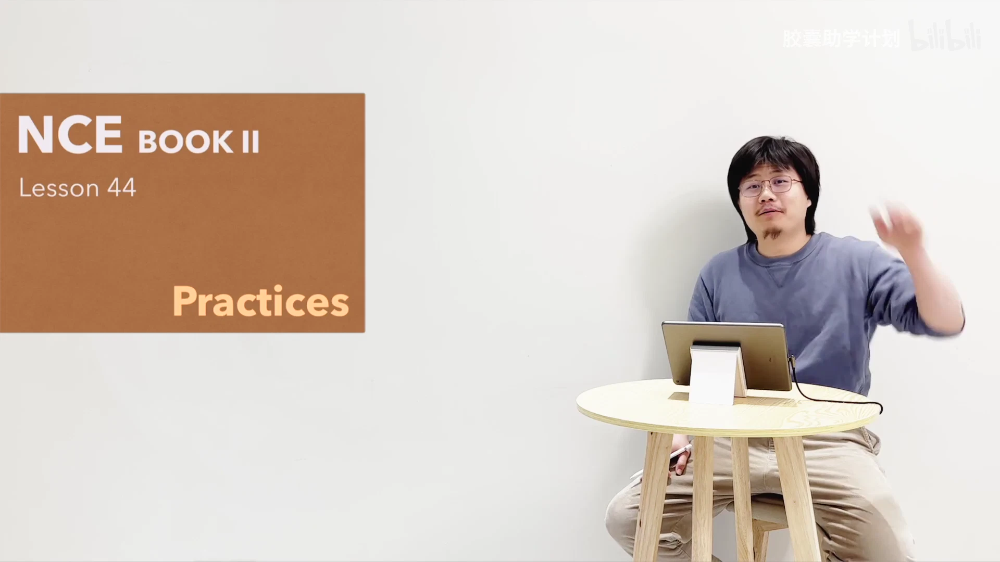

文字识别：NCE / BOOKII / Lesson 44 / Practices

### 画面 00:00:02

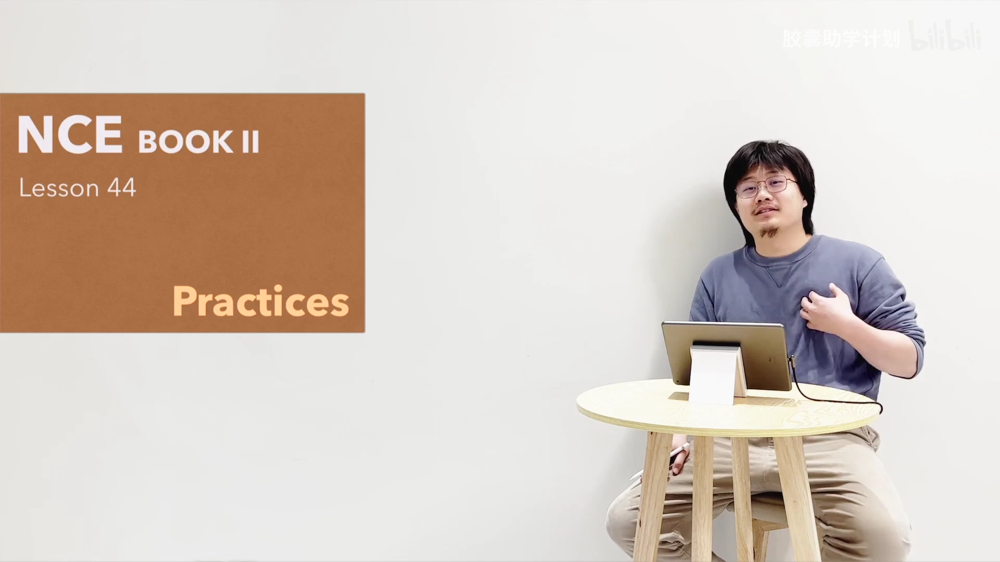

文字识别：NCE / BOOKII / Lesson 44 / Practices

### 画面 00:00:05

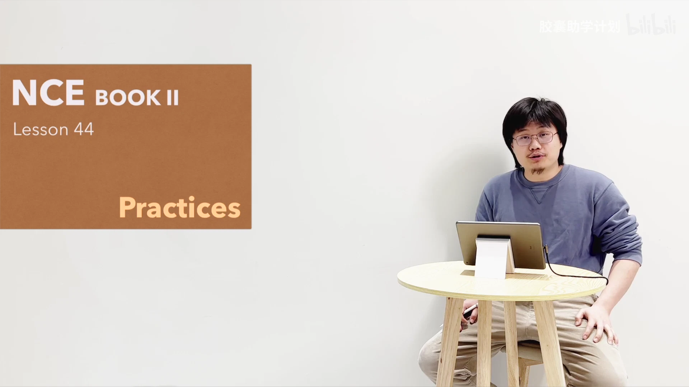

文字识别：NCE / BOOKI"I / Lesson 44 / Practices

### 画面 00:00:08

文字识别：进行如下练习唯一前提 / 文章跟读至熟读成诵 / 否则请勿开始

### 画面 00:00:15

文字识别：进行如下练习唯一前提 / 文章跟读至熟读成诵 / 否则请勿开始

### 画面 00:00:18

文字识别：胶囊助学计划 bilbl / •

### 画面 00:00:22

### 画面 00:00:24

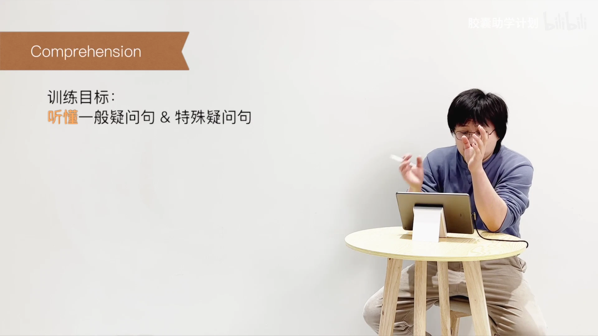

文字识别：Comprehension / 训练目标： / 听懂一般疑问句＆特殊疑问句

## 00:00:30–00:01:00

力，我问您答来了。Who ran through a forest after two men? Mrs. Anstelling. Next one. What didn't she think of as she ran? Of the risk she was taking. Next one. Was she with her children? Yes, she

### 画面 00:00:32

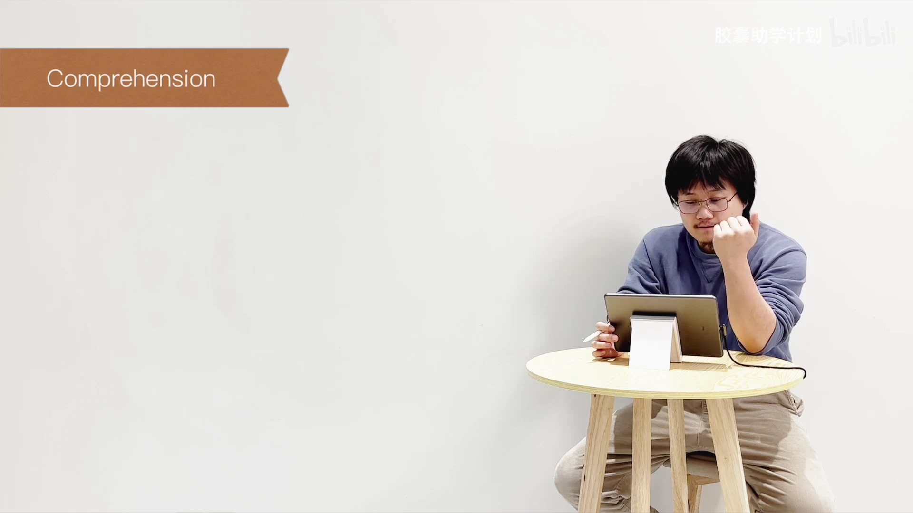

文字识别：Comprehension

### 画面 00:00:50

文字识别：Comprehension / What didn't she think of as she ran? / Of the risk she was taking.

### 画面 00:00:59

文字识别：Comprehension / Was she with her children? / Yes, she was.

## 00:01:00–00:01:30

was. Next one, what were they doing? Having a picnic. Next one, where were they having their picnic? At the edge of a forest. Next one, had the two men rushed up to her? Yes, they had. Next one, what did they try to steal? Her handbag.

### 画面 00:01:16

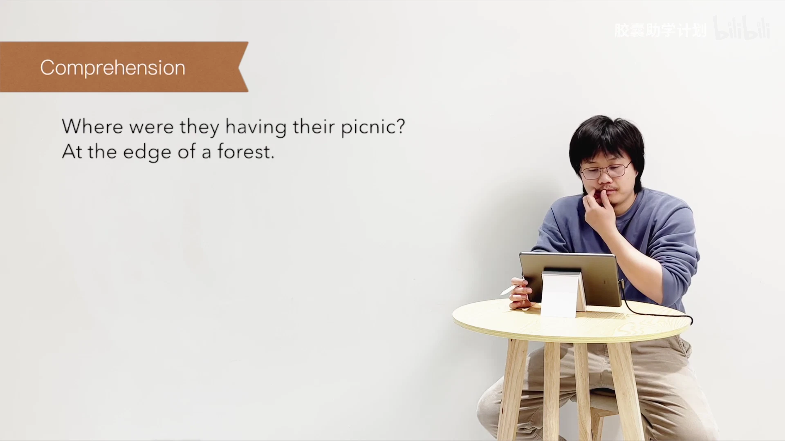

文字识别：Comprehension / Where were they having their picnic? / At the edge of a forest.

### 画面 00:01:18

文字识别：Comprehension / Had the two men rushed up to her?

### 画面 00:01:25

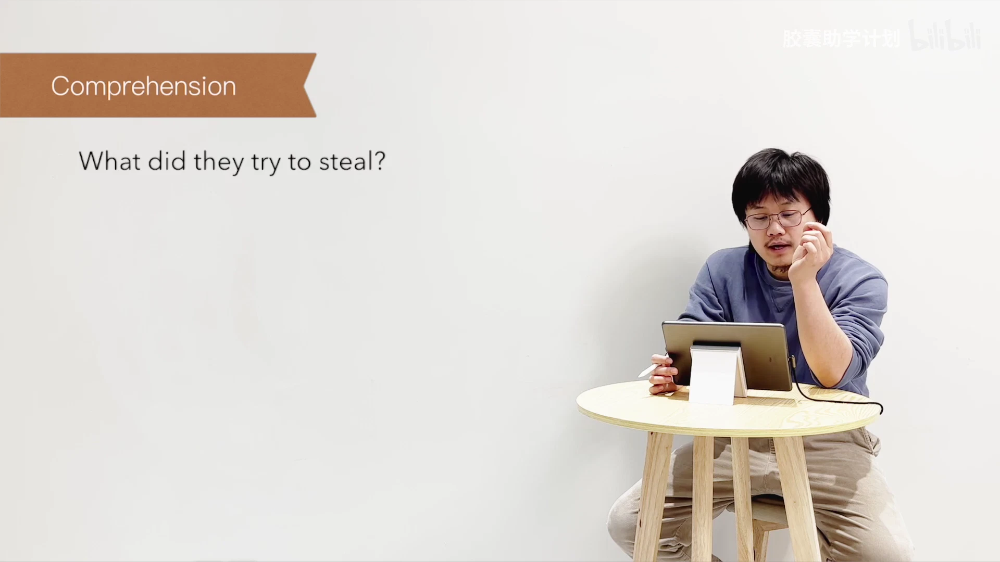

文字识别：Comprehension / What did they try to steal?

## 00:01:30–00:02:00

Next one. There was a struggle, wasn't there? Yes, there was. Next one. What broke in the struggle? The strap of her handbag. Next one. Where did they both start running? Through the trees. Next one. Did she run

### 画面 00:01:51

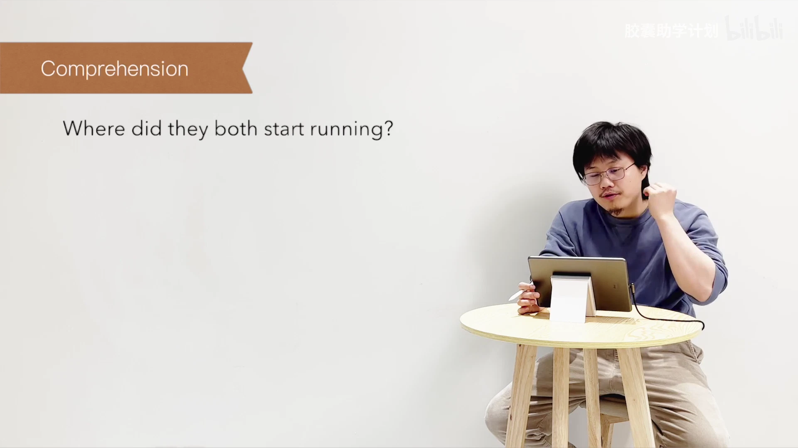

文字识别：Comprehension / Where did they both start running?

### 画面 00:01:58

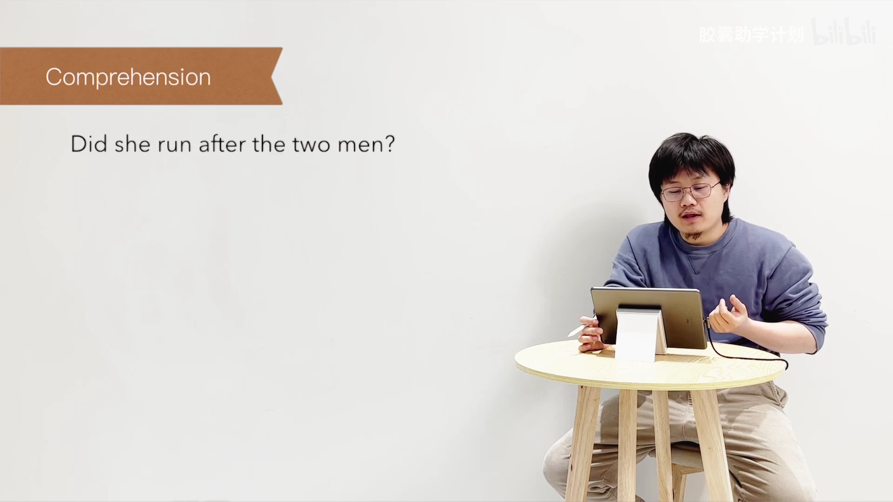

文字识别：Comprehension / Did she run after the two men?

## 00:02:00–00:02:30

after the two men? Yes, she did. Next one, she was soon out of breath, wasn't she? Yes, she was. Next one, she caught up with them, didn't she? Yes, she did.好, asking questions,练习的是我们会说一般疑问句和特殊疑问句的能力,也就是我们发问的能力,对吧?在现实生活当中这个实际应用上

### 画面 00:02:02

文字识别：Comprehension / Did she run after the two men? / Yes, she did.

### 画面 00:02:18

文字识别：Asking questions / 训练目标： / 会说一般疑问句＆特殊疑问句 / Accuracy / Fluency

### 画面 00:02:21

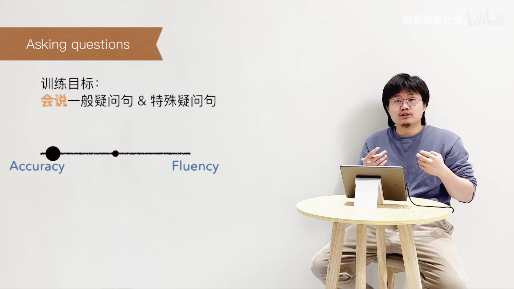

文字识别：Asking questions / 训练目标： / 会说一般疑问句＆特殊疑问句 / Accuracy / Fluency

### 画面 00:02:24

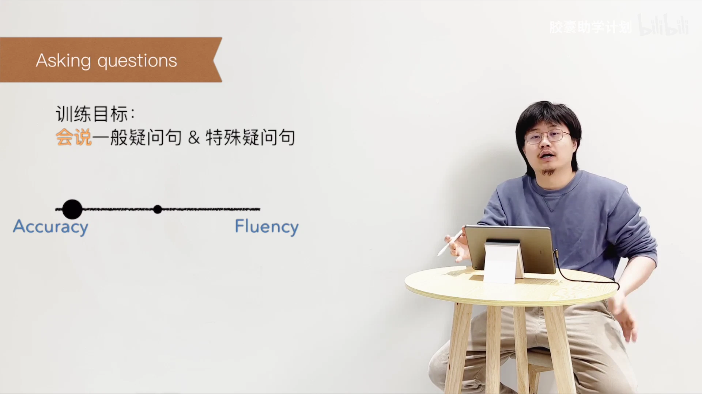

文字识别：Asking questions / 训练目标： / 会说一般疑问句＆特殊疑问句 / Accuracy / Fluency

### 画面 00:02:27

文字识别：Asking questions / 训练目标： / 会说一般疑问句＆特殊疑问句 / Accuracy / Fluency

## 00:02:30–00:03:00

啊，OK，我们先看个例子，叫做 Mrs. Ann Sterling was having a picnic. Was提前就可以了，然后Who那对主语提问直接替代，对吧？叫Who was having a picnic？好，我们接下来挨个对啊。首先Where这里没有Where，就是直接加整句，叫Where was Mrs. Ann Sterling having a picnic？看见了哈，就跟Why一样，直接加在整句话的最开始就可以了。

### 画面 00:02:31

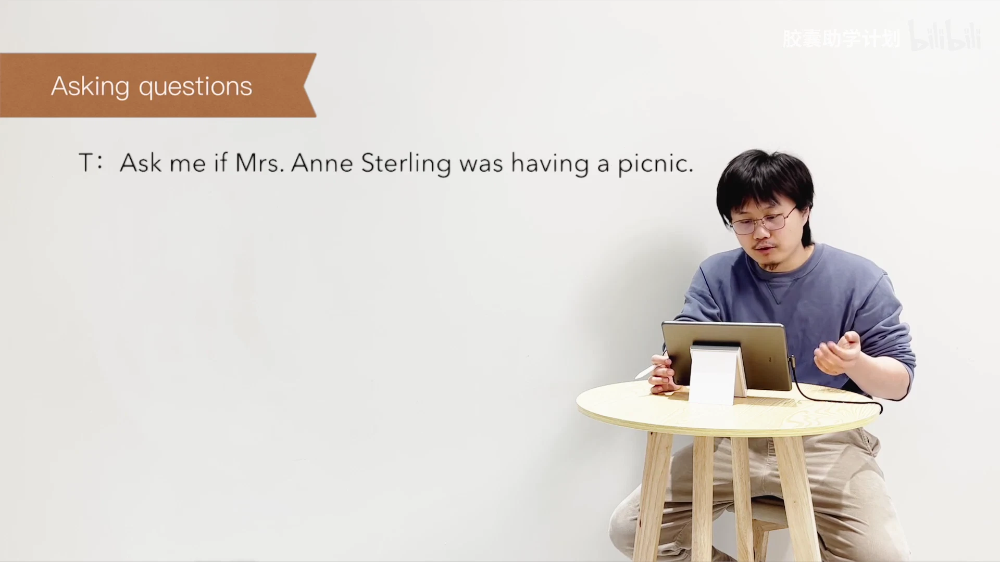

文字识别：Asking questions / T: Ask me if Mrs. Anne Sterling was having a picnic.

### 画面 00:02:36

文字识别：Asking questions / T: Ask me if Mrs. Anne Sterling was having a picnic. / S: Was Mrs. Anne Sterling having a picnic?

### 画面 00:02:43

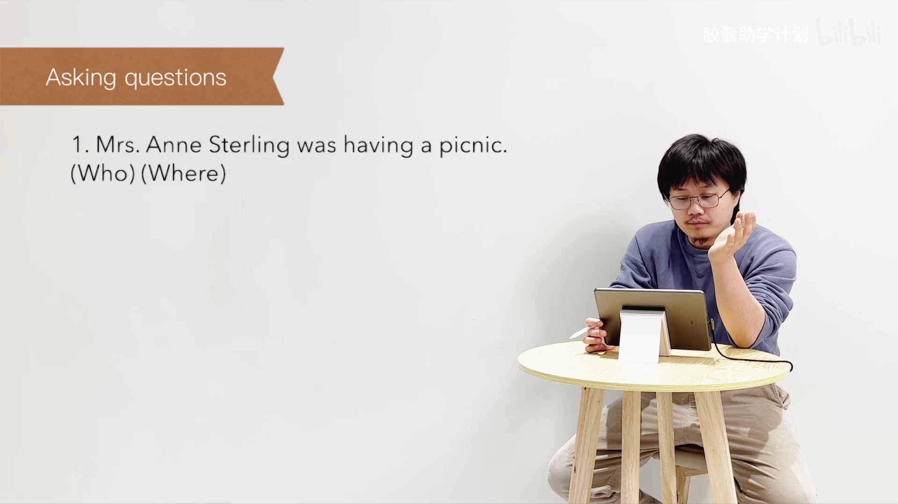

文字识别：Asking questions / 1. Mrs. Anne Sterling was having a picnic. / (Who)(Where)

## 00:03:00–00:03:30

Next one, say she was with her children. Was往前一提，那 who 点点 with 啊，你加谁都行，我觉得啊，你可以对 her children 叫 who was she with，对吧？ Okay，也可以说 who was with her children 啊。说 they were sitting at the edge of a forest. Where 往前提，Where 对 at the edge of a forest 问，Why 加整句，Who 对主语提问。Two men rushed up to her. 这里肯定是 did 提前，动

### 画面 00:03:13

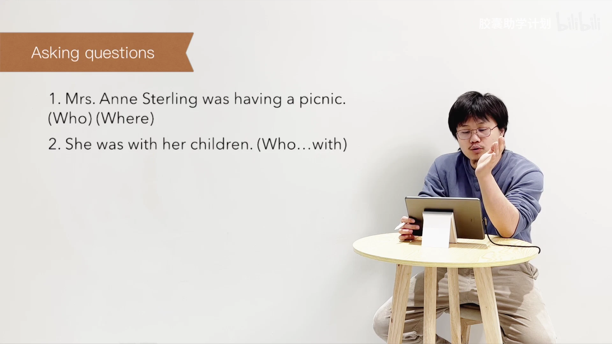

文字识别：Asking questions / 1. Mrs. Anne Sterling was having a picnic. / (Who)(Where) / 2. She was with her children.(Who...with)

### 画面 00:03:16

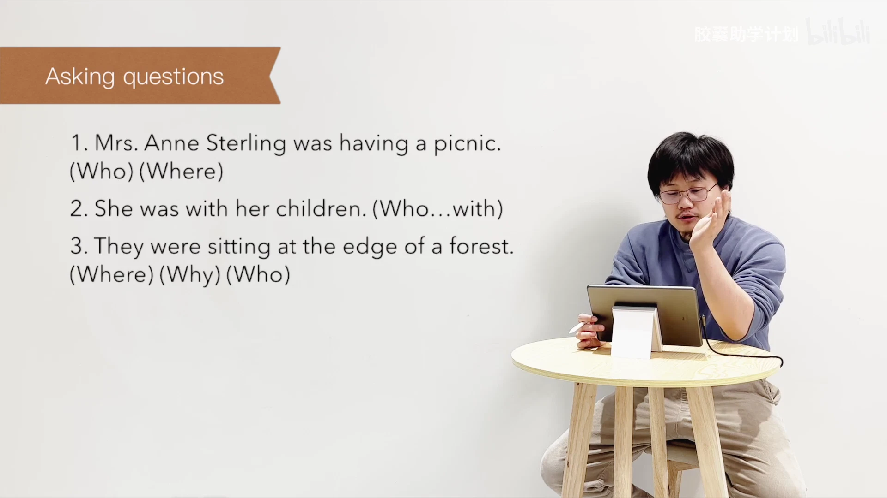

文字识别：Asking questions / 1. Mrs. Anne Sterling was having a picnic. / (Who)(Where) / 2. She was with her children. (Who...with) / 3. They were sitting at the edge of a forest. / (Where)(Why)(Who)

### 画面 00:03:18

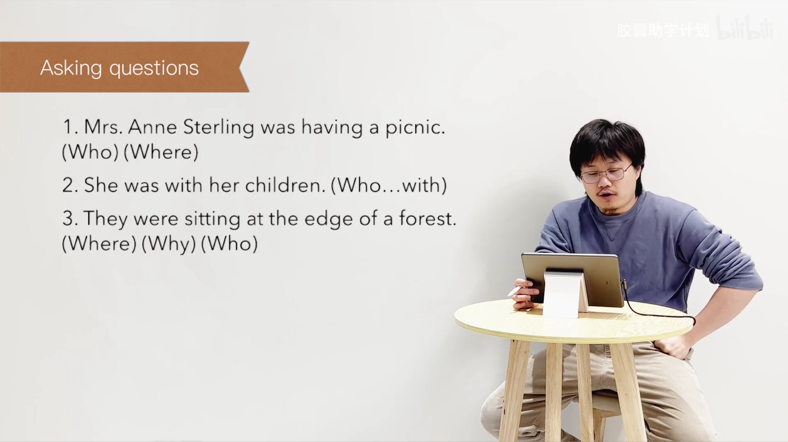

文字识别：Asking questions / 1. Mrs. Anne Sterling was having a picnic. / (Who)(Where) / 2. She was with her children. (Who...with) / 3. They were sitting at the edge of a forest. / (Where)(Why)(Who)

### 画面 00:03:25

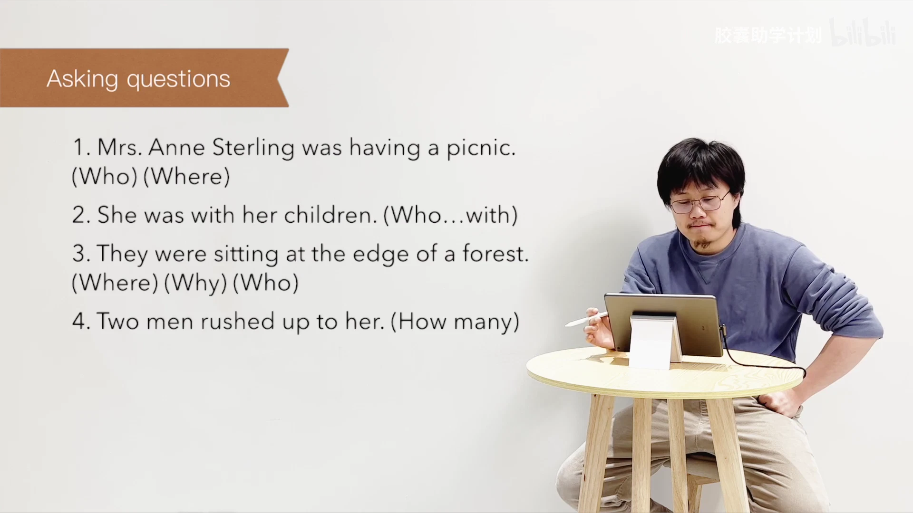

文字识别：Asking questions / 1. Mrs. Anne Sterling was having a picnic. / (Who)(Where) / 2. She was with her children. (Who...with) / 3. They were sitting at the edge of a forest. / (Where)(Why)(Who) / 4.Two men rushed up to her. (How many)

## 00:03:30–00:04:00

词换原形，对吧？ How many 对 two 提问，对不对？ How many men rushed up to her? Next one, say they tried to steal her handbag. Did 提前，对不对？然后 what 对 her handbag 提问吧，对吧？他们尝试偷什么？其实是抢。我在文章那一刻说了啊，那个视频。第六个说 the strap broke in the struggle. Did 提前，对吧？然后换回原形。那 what 对 the strap 提问？所以注意

### 画面 00:03:48

文字识别：Asking questions

## 00:04:00–00:04:30

对主语提问不用变一般疑问句，答案直接就是 What broke in the struggle? Okay. Next one,说The man ran off with a bag. D的往前提，然后What对the bag，对吧？Okay. They start running through the trees. D的往前提，然后Where对through the trees，外加整句Who对They提问啊，不用变一般疑问句，答案叫Who started running through the trees?

### 画面 00:04:02

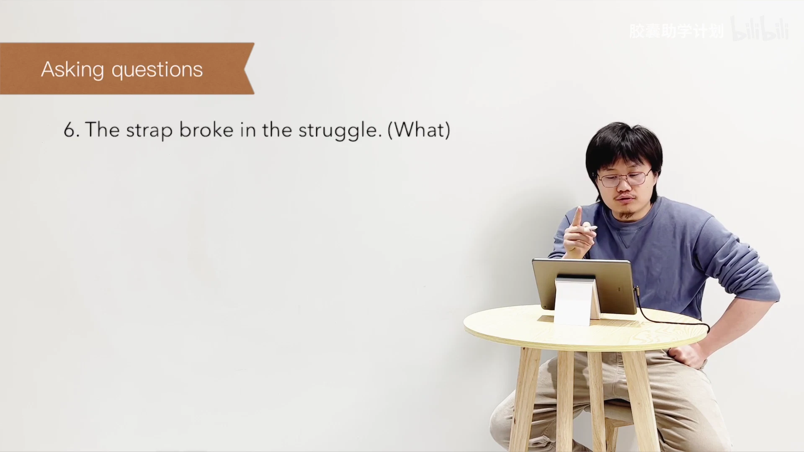

文字识别：Asking questions / 6.The strap broke in the struggle. (What)

### 画面 00:04:07

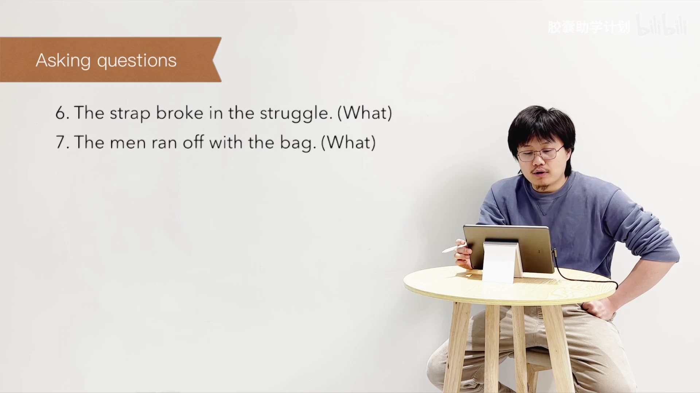

文字识别：Asking questions / 6. The strap broke in the struggle. (What) / 7. The men ran off with the bag.(What)

### 画面 00:04:14

文字识别：Asking questions / 6.The strap broke in the struggle. (What) / 7.The men ran off with the bag. (What) / 8. They started running through the trees. / (Where)(Why)(Who)

### 画面 00:04:28

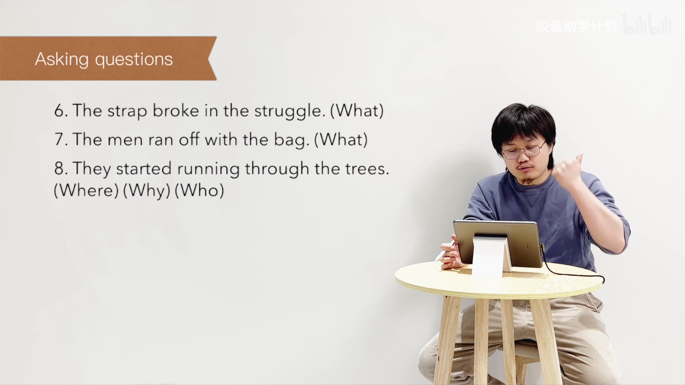

文字识别：Asking questions / 6. The strap broke in the struggle. (What) / 7.The men ran off with the bag. (What) / 8. They started running through the trees. / (Where)(Why)(Who)

## 00:04:30–00:05:00

Next one, Mrs. Sterling was very angry. Was? 把往前提. Why? 整句话. Who? 对 Mrs. Sterling 提问，对吧？这个 Why 对整句话是整个一般疑问句提问啊。呃, she ran after them. Did? 把往前提. What? 点点 do 就是呃标准答案. What did she do? 是吧？她做了什么？She was soon out of breath. Was? 把往前提. Why? 加整句话叫 Why was she soon out of breath?

### 画面 00:04:31

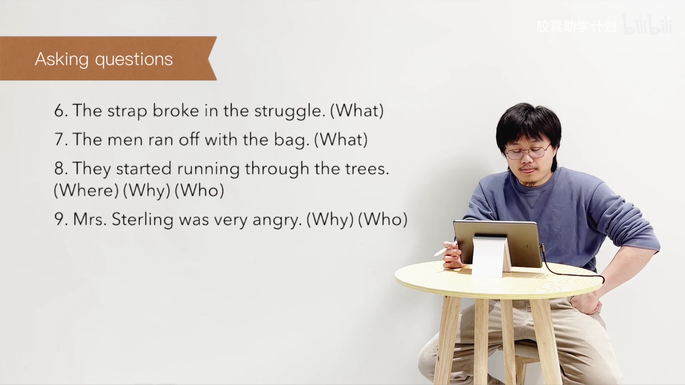

文字识别：Asking questions / 6. The strap broke in the struggle. (What) / 7.The men ran off with the bag.(What) / 8. They started running through the trees. / (Where)(Why) (Who) / 9. Mrs. Sterling was very angry.(Why) (Who)

### 画面 00:04:45

文字识别：Asking questions / 6. The strap broke in the struggle. (What) / 7.The men ran off with the bag. (What) / 8. They started running through the trees. / (Where)(Why)(Who) / 9. Mrs. Sterling was very angry.(Why) (Who) / 10. She ran after them.(What...do)

### 画面 00:04:59

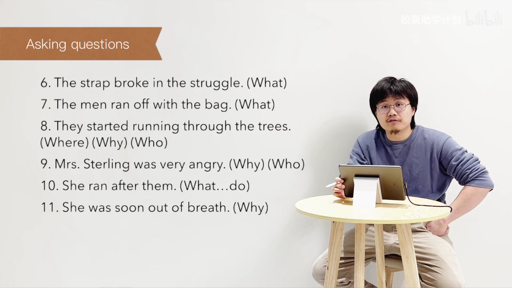

文字识别：Asking questions / 6. The strap broke in the struggle. (What) / 7.The men ran off with the bag. (What) / 8. They started running through the trees. / (Where)(Why)(Who) / 9. Mrs. Sterling was very angry.(Why) (Who) / 10. She ran after them.(What...do) / 11. She was soon out of breath. (Why)

## 00:05:00–00:05:30

Ah, good. Tell the story. This is we practice oral fluency. Ah, this in actual application English is very important. More practice is we fluency. Ah, practice is we this speaking fluency. So, article in reading fluency. After you here, ah, in fluency, can be wrong a little bit, but can not how good, but can not not fluency. Ah, is must be fast a little bit. Okay, good. Summarizing writing,

### 画面 00:05:01

文字识别：Tell the story / 训练目标： / 口语复述能力 / Accuracy / Fluency

### 画面 00:05:13

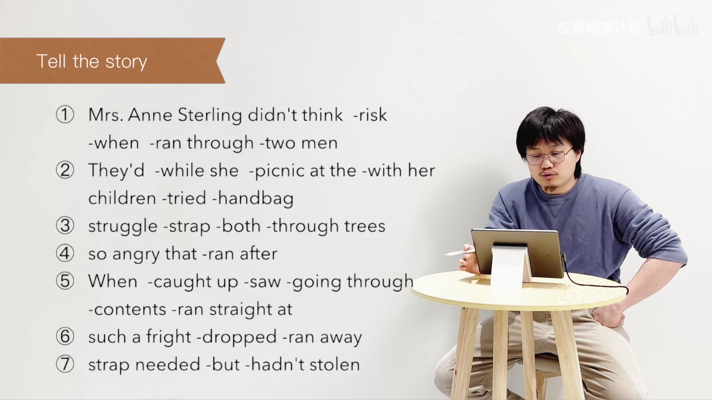

文字识别：Tell the story / Mrs.Anne Sterling didn't think -risk / -when -ran through -two men / They'd -while she -picnic at the -with her / children -tried -handbag / struggle -strap -both -through trees / so angry that -ran after / When -caught up -saw -going through / 5 / -contents -ran straight at / ) such a fright -dropped -ran away / 6 / strap needed -but -hadn't stolen

### 画面 00:05:28

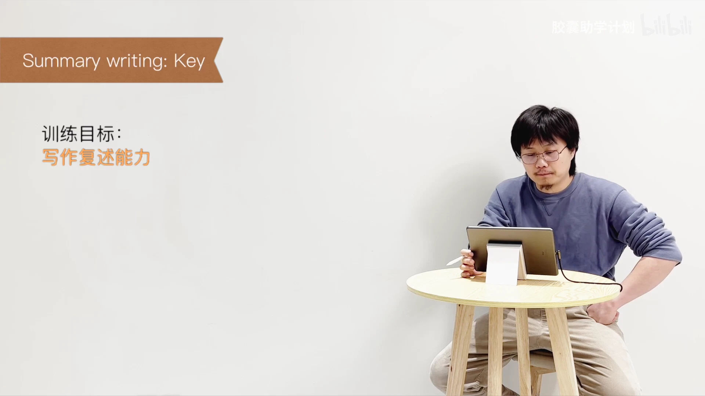

文字识别：Summary writing: Key / 训练目标： / 写作复述能力

## 00:05:30–00:06:00

写作写作复述能力，这对于我们应试考试也好，比如说国内的考试，国外的雅思托福考试，又或是工作当中的实际应用，这个能力都非常的重要啊。好，呃，这是答案，写完了，这对答案就行了，我们不多说了。然后 topic for discussion 就是我们所有练习到最后，其实目的就是能做到这样的事儿，就是我说的又流利，然后又准确，对吧？就跟我母语一样，就一个话题我就能聊起来，

### 画面 00:05:42

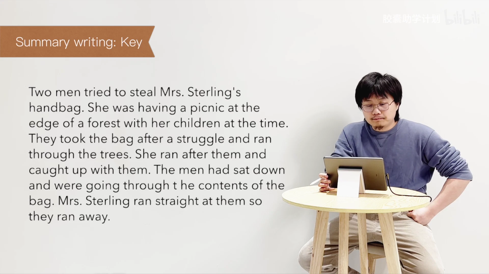

文字识别：Summary writing: Key / Two men tried to steal Mrs. Sterling's / handbag. She was having a picnic at the / edge of a forest with her children at the time. / They took the bag after a struggle and ran / through the trees. She ran after them and / caught up with them. The men had sat down / and were going through t he contents of the / bag. Mrs. Sterling ran straight at them so / they ran away.

### 画面 00:05:45

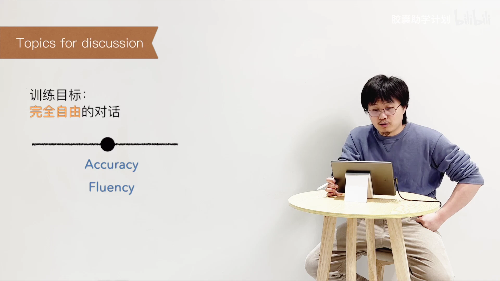

文字识别：Topics for discussion / 训练目标： / 完全自由的对话 / Accuracy / Fluency

### 画面 00:05:58

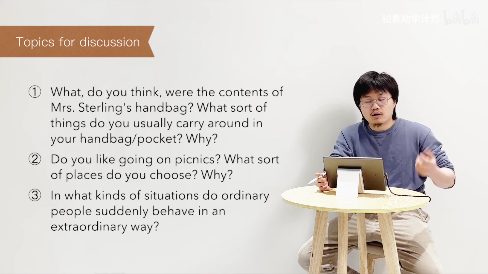

文字识别：Topics for discussion / What, do you think, were the contents of / Mrs. Sterling's handbag? What sort of / things do you usually carry around in / your handbag/pocket? Why? / Do you like going on picnics? What sort / of places do you choose? Why? / In what kinds of situations do ordinary / people suddenly behave in an / extraordinary way?

## 00:06:00–00:06:30

对不对？然后你比如说这里说 What do you think were the contents of Mrs. Sterling's handbag? 你认为她这包里有什么东西？ What sort of things do you usually carry around in your handbag pocket? Why? 你兜里平常都装什么？为啥？啊？ Do you like going on picnics? 你喜欢出去野餐吗？ What sort of place do you choose? Why? 啊？你会选择什么样的地方？为什么？ In what kinds of situation do ordinary people suddenly behave in an

### 画面 00:06:28

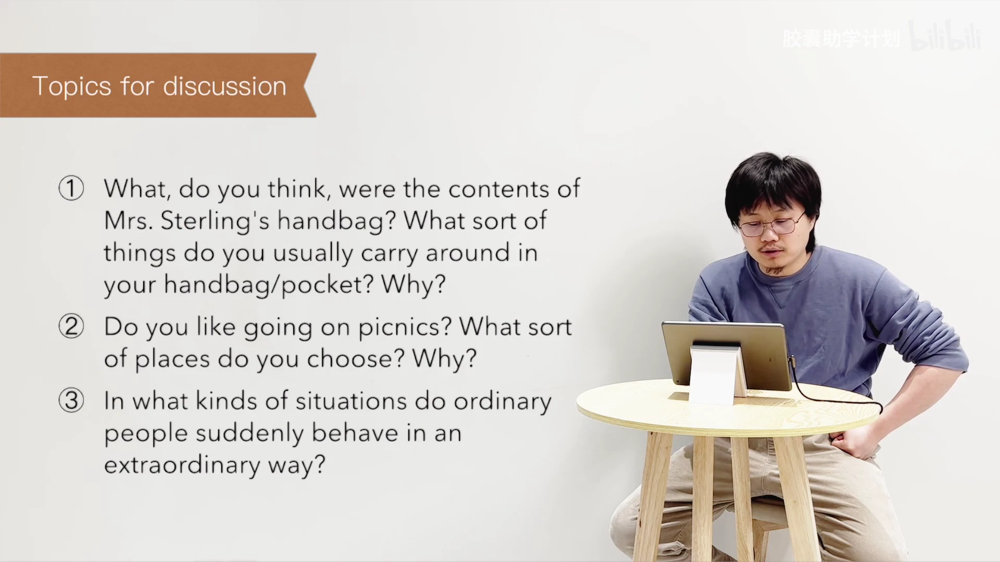

文字识别：Topics for discussion / What, do you think, were the contents of / Mrs. Sterling's handbag? What sort of / things do you usually carry around in / your handbag/pocket? Why? / Do you like going on picnics? What sort / of places do you choose? Why? / In what kinds of situations do ordinary / people suddenly behave in an / extraordinary way?

## 00:06:30–00:07:00

extraordinary way.说在什么样的在哪些情况之下，普通人会突然间表现的非常的不普通啊？你就比如说，我们说说妈妈突然间看到孩子从高空掉下来，会以百米冲刺的速度跑过去，这就叫 ordinary people suddenly behave in an extraordinary way. Okay,好，那不多说了。家庭作业，ask me if先写，写完了之后大声朗读摘要写作，

### 画面 00:06:53

### 画面 00:06:55

文字识别：1.Ask me if写&朗读

### 画面 00:06:58

文字识别：1.Ask me if写&朗读 / 2. / 摘要写作写&答案

## 00:07:00–00:07:30

先写，然后对答案。Tell the story，进行口语复述。专栏当中您都能找得到，好吧？然后呢，以上就是本期视频的全部内容了。如果呃各位喜欢我们的课程呢，欢迎各位关注、订阅、一键三连，分享给那些需要的朋友，来帮助我们快速成长。See you next time.

### 画面 00:07:00

文字识别：1.Ask me if写&朗读 / 2.摘要写作写&答案

### 画面 00:07:02

文字识别：1.Ask me if写&朗读 / 摘要写作写&答案 / 3.Tell the story 口语复述

### 画面 00:07:04

文字识别：1.Ask me if写&朗读 / 摘要写作写&答案 / 3.Tell the story 口语复述 / 专栏 / 4.

### 画面 00:07:07

文字识别：👍

### 画面 00:07:09

### 画面 00:07:11

### 画面 00:07:20

文字识别：- / 👍

### 画面 00:07:22

文字识别：CAPSULEACADEMY / 胶囊助学计划 / 小红书 / Lecturer / Leo / OE

### 画面 00:07:25

文字识别：CAPSULEACADEMY / 胶囊助学计划 / 小红书

### 画面 00:07:28

文字识别：CAPSULEACADEMY / 胶囊助学计划 / 小红书 / Creator / Leo & Berlin

## 00:07:30–00:07:33

### 画面 00:07:30

文字识别：Bilbili / 胶囊助学计划 / CAPSULEACADEMY / 胶囊助学计划 / 小红书 / OE

### 画面 00:07:32

文字识别：bilibili / 胶囊助学计划

