# L045 单词

快速机器解析：语音为单模型转写，未进行独立交叉校对或人工复核；画面每秒采样并按变化选帧，短时文字和标记可能遗漏。截图时间约有 1 秒误差。图片有损压缩；遇到疑点请按时间查看 Google Drive 原视频。

## 00:00:00–00:00:30

Hello everyone, welcome to Capsule Academy. This is Leo. Today we're going to learn New Concept English Book Two Lesson Forty Five Words. 那老习惯进入正式课程之前呢，我们先看几个小的问题。那首先，如何表达我问心无愧？接下来呢，如何表达百分之百确定？那带着这两个问题，Hope you gonna enjoy it. 好，那我们上来先看两个小的单词啊。这两个单

### 画面 00:00:00

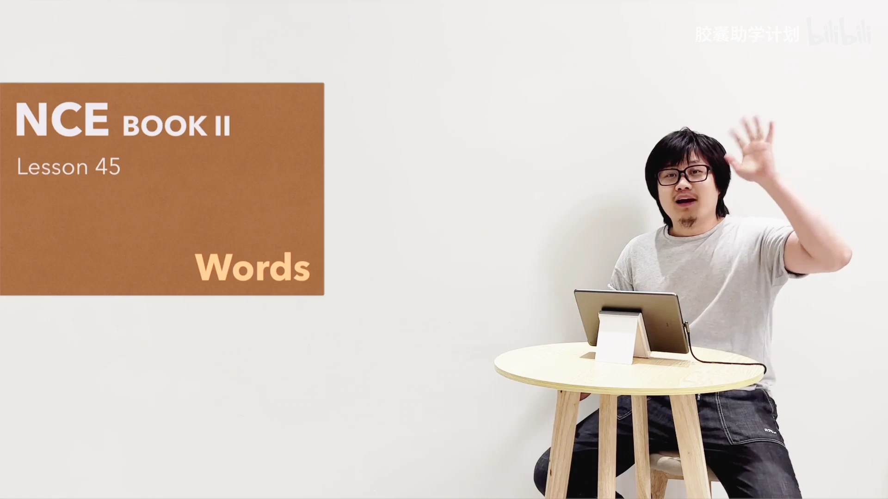

文字识别：NCE / BOOKII / Lesson 45 / Words

### 画面 00:00:02

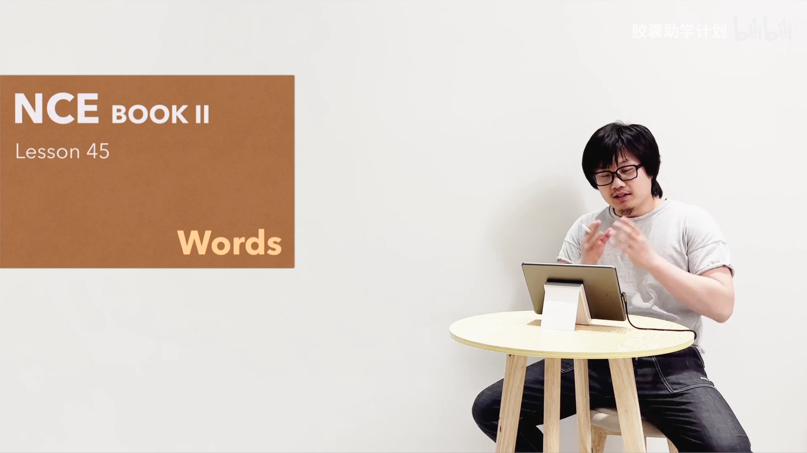

文字识别：NCE / BOOKⅡI / Lesson 45 / Words

### 画面 00:00:04

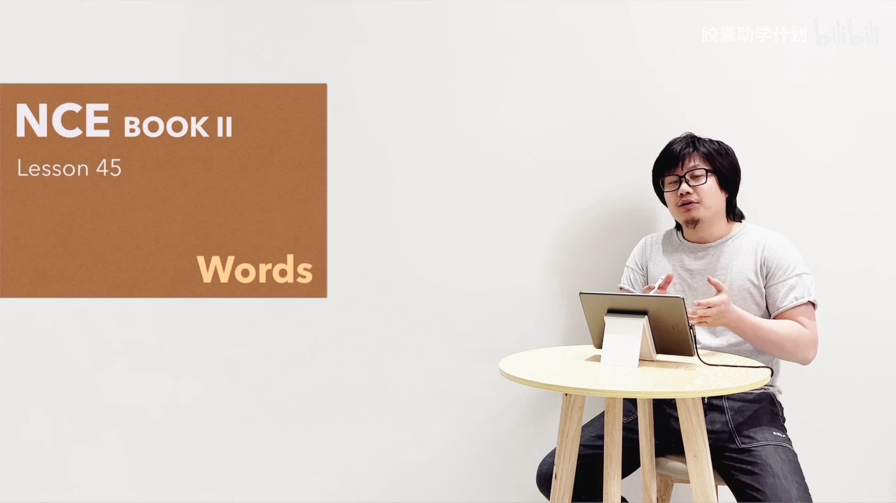

文字识别：NCE / BOOK"I / Lesson 45 / Words

### 画面 00:00:06

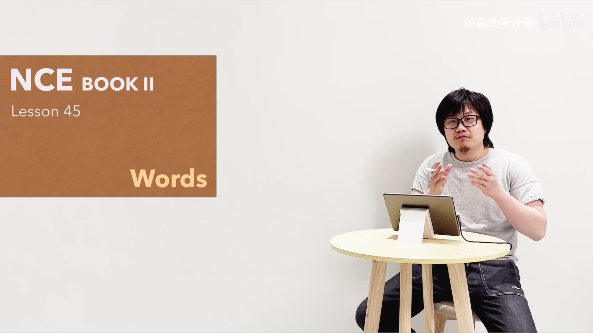

文字识别：NCE / BOOK"I / Lesson 45 / Words

### 画面 00:00:09

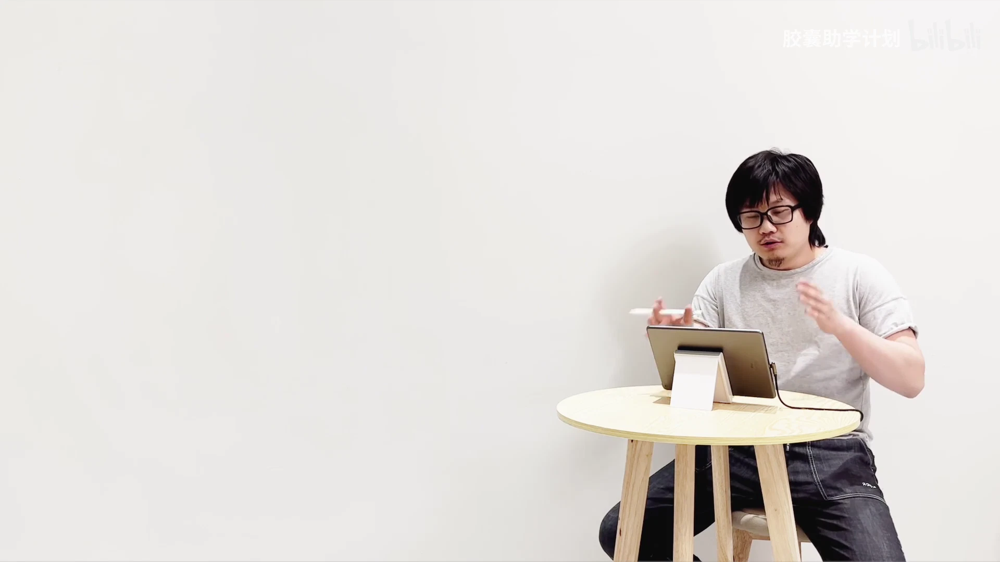

### 画面 00:00:12

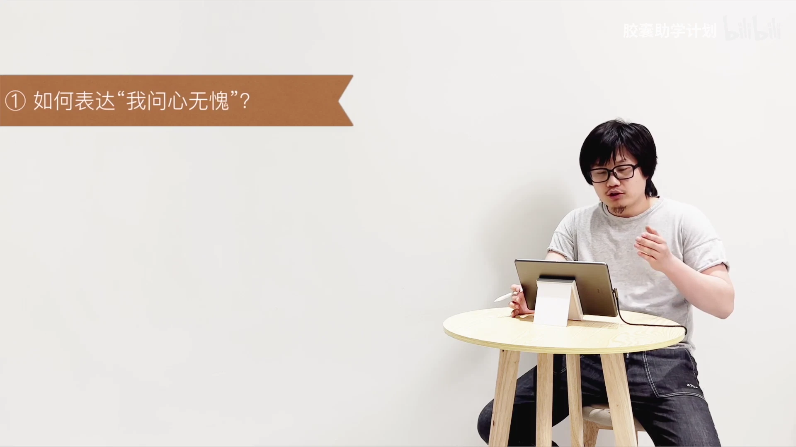

文字识别：①如何表达“我问心无愧”？

### 画面 00:00:14

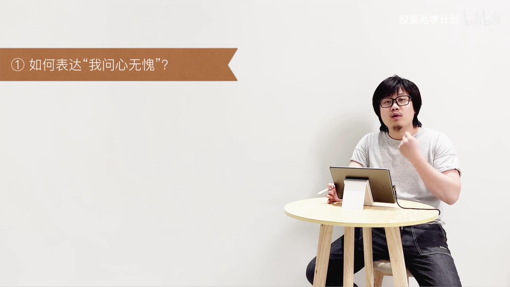

文字识别：①如何表达“我问心无愧”？

### 画面 00:00:16

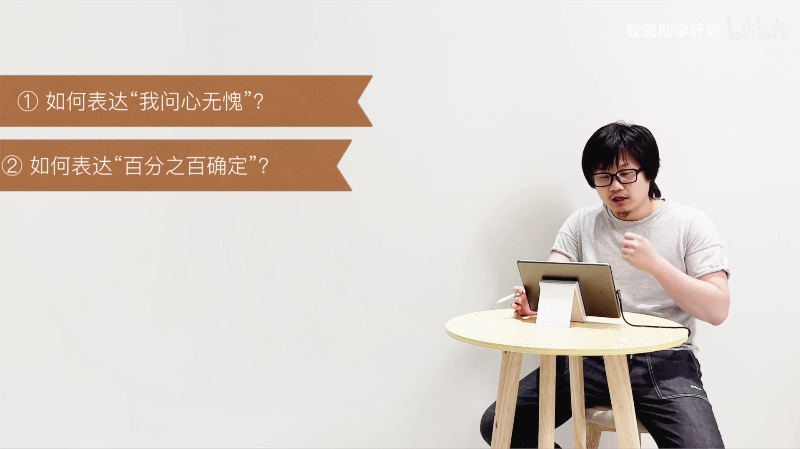

文字识别：①如何表达“我问心无愧”？ / 如何表达“百分之百确定”

### 画面 00:00:18

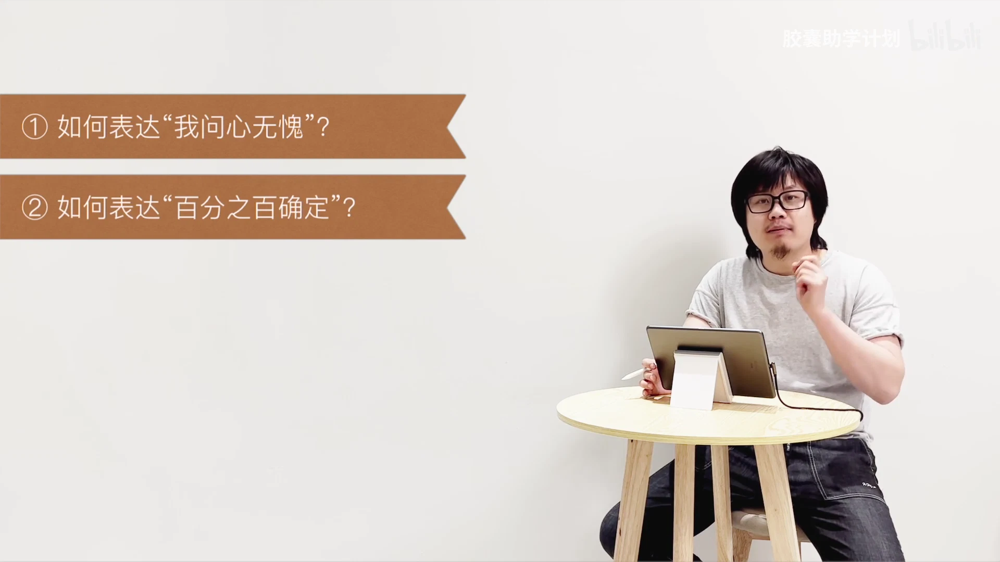

文字识别：①如何表达“我问心无愧”? / 如何表达“百分之百确定”

### 画面 00:00:22

文字识别：胶囊助学计划 bilb出 / •

### 画面 00:00:26

### 画面 00:00:28

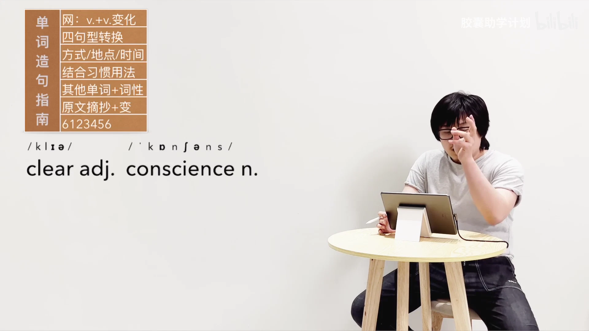

文字识别：单词造句指南 / 网：v.+v.变化 / 四句型转换 / 方式/地点/时间 / 结合习惯用法 / 其他单词+词性 / 原文摘抄+变 / 6123456 / /klia/ / / ·kрn ∫aｎs / / clear adj. conscience n.

## 00:00:30–00:01:00

词实际上在文章当中并没有出现，它是在我们标题当中出现的，对吧？呃，但是还挺常用，所以我们一起看一下。第一个叫做 clear，clear 这个单词其实我们见过很多次了，它有非常多的意思，对吧？然后下一个单词呢叫做 conscience，conscience，OK，良心，对吧？那 clear conscience 其实两个单词放到一起表示的就是干干净净的良心啊，其实就翻译成汉语叫问心无愧。

### 画面 00:00:30

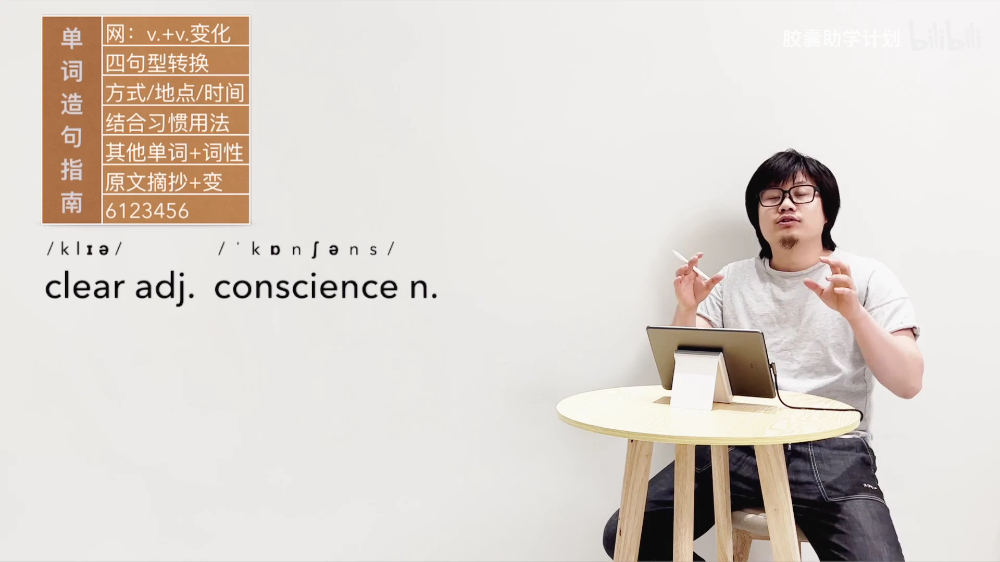

文字识别：单词造句指南 / 网：v.+v.变化 / 四句型转换 / 方式/地点/时间 / 结合习惯用法 / 其他单词+词性 / 原文摘抄+变 / 6123456 / /klia/ / / 'k рn ∫an s / / clear adj. conscience n.

### 画面 00:00:36

文字识别：单词造句指南 / 网：v.+v.变化 / 四句型转换 / 方式/地点/时间 / 结合习惯用法 / 其他单词+词性 / 原文摘抄+变 / 6123456 / /klial / / ·kрn ∫an s / / clear adj. conscience n.

### 画面 00:00:40

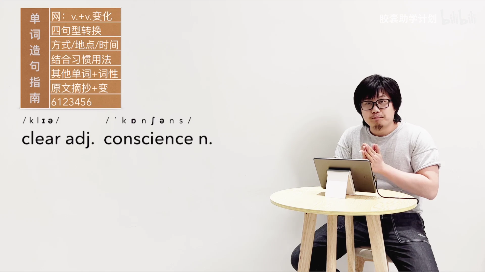

文字识别：单词造句指南 / 网：v.+v.变化 / 四句型转换 / 方式/地点/时间 / 结合习惯用法 / 其他单词+词性 / 原文摘抄+变 / 6123456 / /klia/ / / ·kрn ∫a ｎ s / / clear adj. conscience n.

### 画面 00:00:46

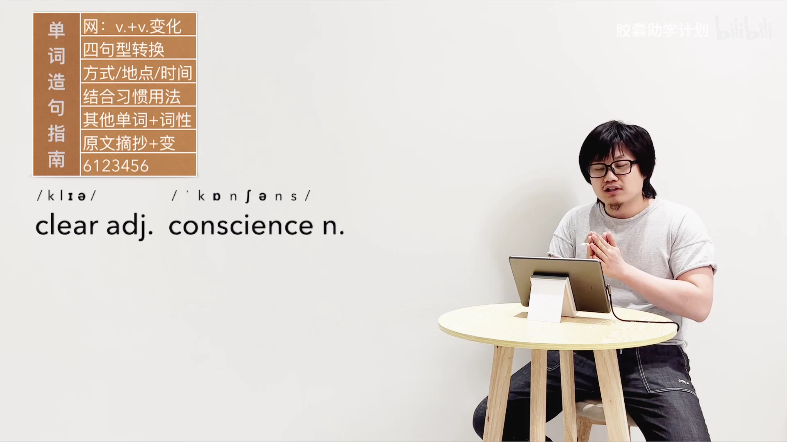

文字识别：单词造句指南 / 网：v.+v.变化 / 四句型转换 / 方式/地点/时间 / 结合习惯用法 / 其他单词+词性 / 原文摘抄+变 / 6123456 / /klia/ / / kｐn ∫an s / / clear adj. conscience n.

### 画面 00:00:51

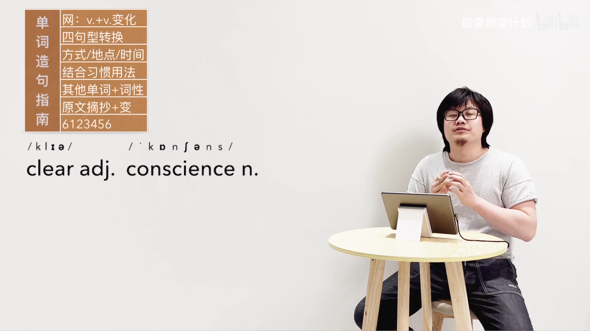

文字识别：单词造句指南 / 网：v.+v.变化 / 四句型转换 / 方式/地点/时间 / 结合习惯用法 / 其他单词+词性 / 原文摘抄+变 / 6123456 / /klia/ / / 'k р n ∫a n s / / clear adj. conscience n.

## 00:01:00–00:01:30

OK。好，那比如说我们造一个句子啊，说at least至少now I can face或者meet him with a clear conscience，OK。其实我们很多的这个clear conscience或者a clear conscience啊，它经常是放在句尾，叫做with a clear conscience这样去用的。所以在这儿其实我们重点就是想强调一下这里，好吧？那接下来呢，你比如说我也可以说，在这件事情上我问心无愧，那叫

### 画面 00:01:00

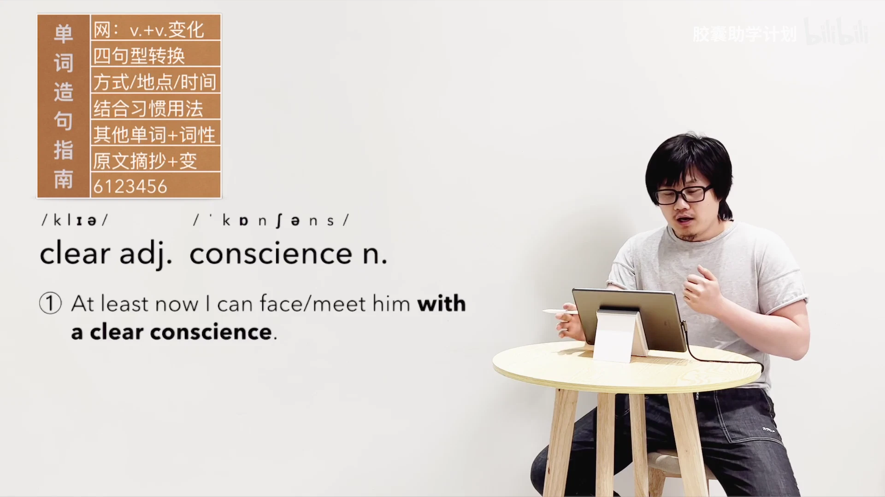

文字识别：单词造句指南 / 网：v.+v.变化 / 四句型转换 / 方式/地点/时间 / 结合习惯用法 / 其他单词+词性 / 原文摘抄+变 / 6123456 / /klial / / 'kрn ∫an s / / clear adj. conscience n. / ① At least now I can face/meet him with / a clear conscience.

### 画面 00:01:05

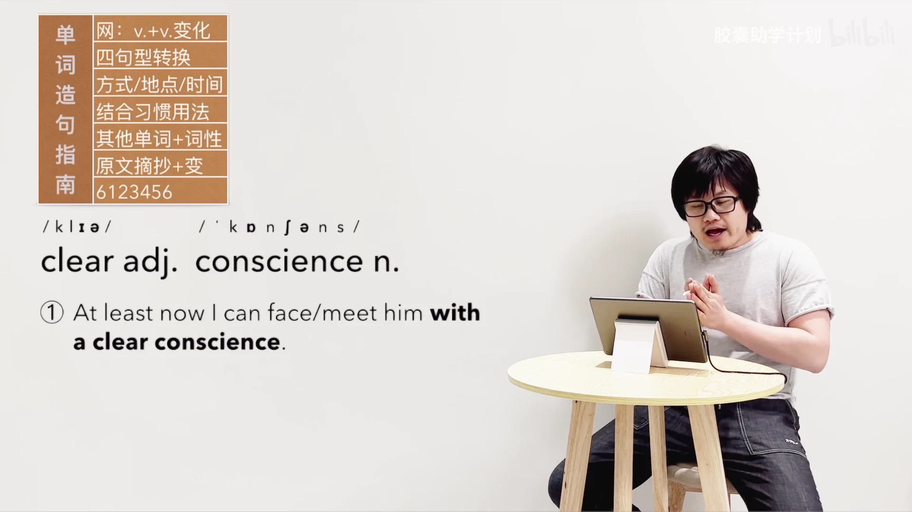

文字识别：单词造句指南 / 网：v.+v.变化 / 四句型转换 / 方式/地点/时间 / 结合习惯用法 / 其他单词+词性 / 原文摘抄+变 / 6123456 / /klial / / 'kрn ∫aｎs / / clear adj. conscience n. / ① At least now I can face/meet him with / a clear conscience.

### 画面 00:01:10

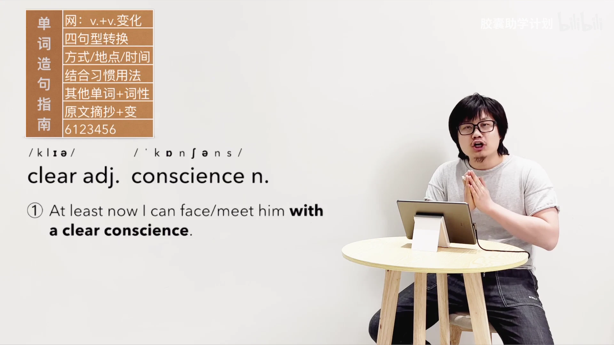

文字识别：单词造句指南 / 网：v.+v.变化 / 四句型转换 / 方式/地点/时间 / 结合习惯用法 / 其他单词+词性 / 原文摘抄+变 / 6123456 / /klial / / ' kр n ∫a n s / / clear adj. conscience n. / ① At least now I can face/meet him with / a clear conscience.

### 画面 00:01:20

文字识别：单词造句指南 / 网：v.+v.变化 / 四句型转换 / 方式/地点/时间 / 结合习惯用法 / 其他单词+词性 / 原文摘抄+变 / 6123456 / /klial / / 'kрn ∫a n s / / clear adj. conscience n. / ① At least now I can face/meet him with / a clear conscience.

### 画面 00:01:25

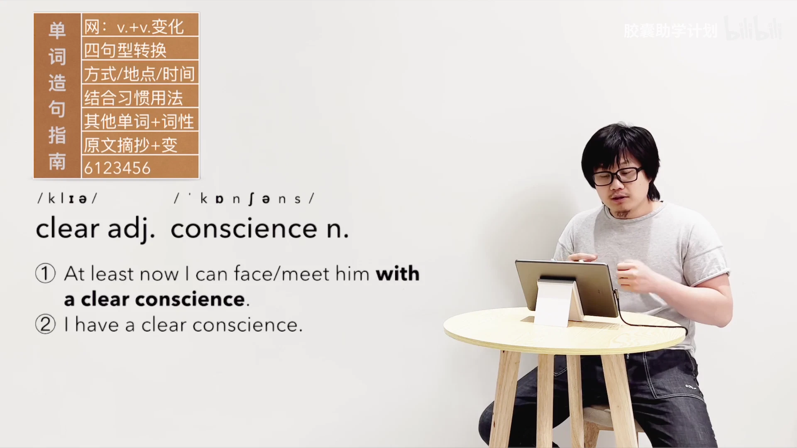

文字识别：单词造句指南 / 网：v.+v.变化 / 四句型转换 / 方式/地点/时间 / 结合习惯用法 / 其他单词+词性 / 原文摘抄+变 / 6123456 / /klial / / 'kрn ∫aｎ s / / clear adj. conscience n. / ① At least now I can face/meet him with / a clear conscience. / ) I have a clear conscience.

## 00:01:30–00:02:00

做 I have a clear conscience. Okay, very good.也就是说 have 经常跟 a clear conscience 其实是连在一起的。接下来呢，我们直接给大家一个小的电影片段。这个电影片段当中，你就能看到叫做 I have a clear conscience 这句话。注意听啊。 There's nothing bad about it. Well, there sure is. This is just incredible. Well, I have a clear conscience. Well,

### 画面 00:01:30

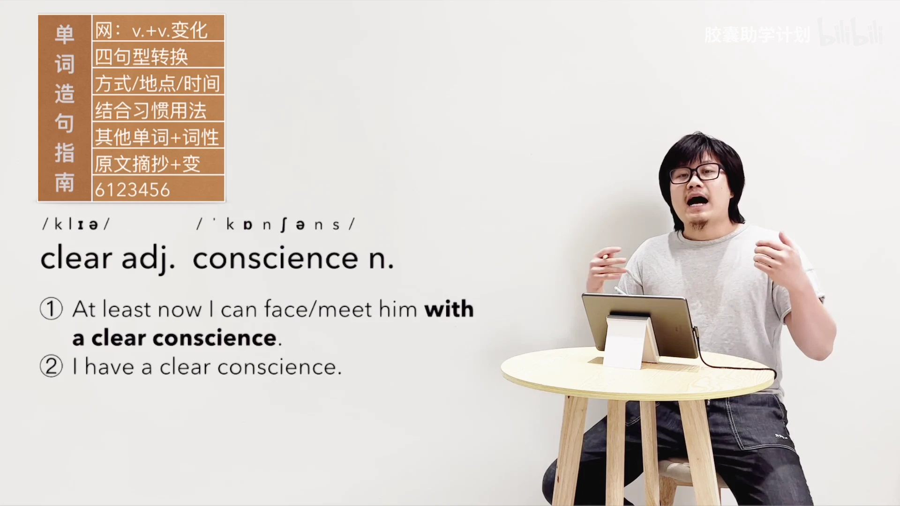

文字识别：单词造句指南 / 网：v.+v.变化 / 四句型转换 / 方式/地点/时间 / 结合习惯用法 / 其他单词+词性 / 原文摘抄+变 / 6123456 / /klial / / kрn ∫an s / / clear adj. conscience n. / ① At least now I can face/meet him with / a clear conscience. / ) I have a clear conscience.

### 画面 00:01:35

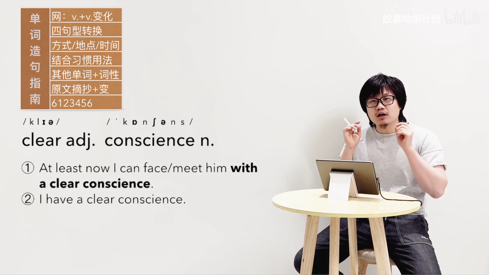

文字识别：单词造句指南 / 网：v.+v.变化 / 四句型转换 / 方式/地点/时间 / 结合习惯用法 / 其他单词+词性 / 原文摘抄+变 / 6123456 / /klial / / ·kрn ∫an s / / clear adj. conscience n. / ① At least now I can face/meet him with / a clear conscience. / ) I have a clear conscience.

### 画面 00:01:39

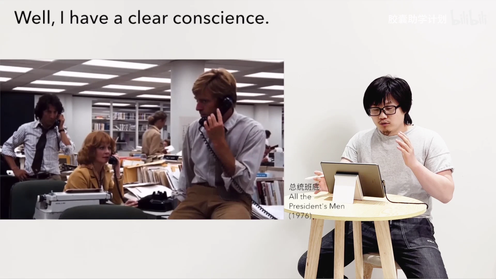

文字识别：Well, I have a clear conscience. / 总统班底 / All the / mm / President's Men / (1976)

### 画面 00:01:49

文字识别：Well, I have a clear conscience. / 总统班底 / 没什么不好的 / All the / mmmm / President's Men / There's nothing-bad about it. / (1976)

### 画面 00:01:51

文字识别：Well, I have a clear conscience. / 总统班底 / 非常糟糕 / All the / President's Men / Well, there-sure is. / (1976)

### 画面 00:01:53

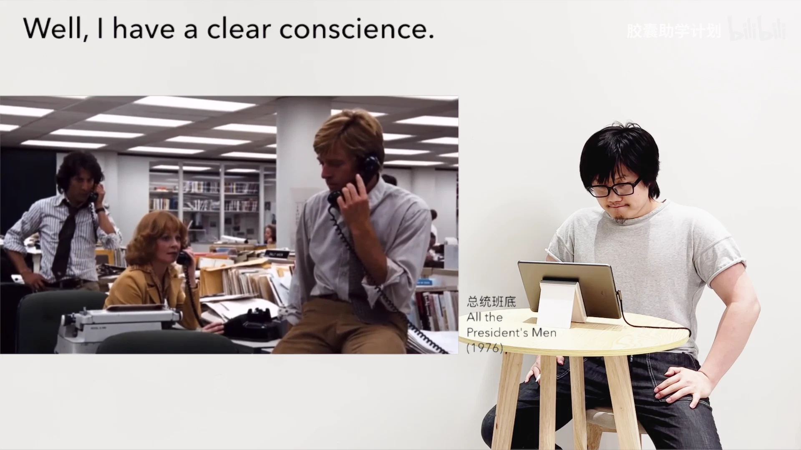

文字识别：Well, I have a clear conscience. / 总统班底 / All the / mm / President's Men / (1976)

### 画面 00:01:55

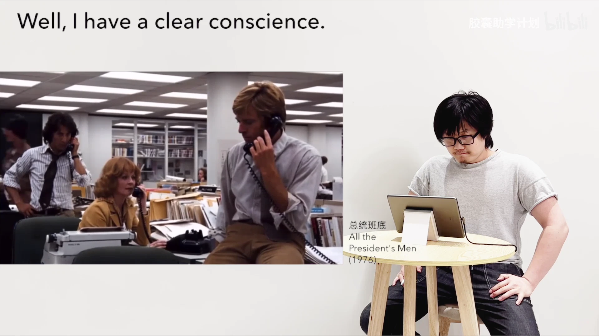

文字识别：Well, I have a clear conscience. / 总统班底 / All the / mm / President's Men / (1976)

### 画面 00:01:58

文字识别：Well, I have a clear conscience. / 总统班底 / 我间心无愧 / All the / mmmm / President's Men / Well, I have a clear conscience. / (1976)

## 00:02:00–00:02:30

I have a wife and a family, and a dog and a cat. Okay, very good.叫做Well, I have a clear conscience.啊，完了，无所谓，我问心无愧啊。Okay, next one.下一个单词其实我们之前已经见过很多次了啊。我造句经常用它，叫做wallet啊wallet. Okay,钱包。它是一个名词，造句的时候我们就要想一下词性这件事儿，或者说结合其他动词，对吧？那你就要带着，肯定要结合动词，对吧？其他习惯用

### 画面 00:02:00

文字识别：Well, I have a clear conscience. / 总统班底 / 萨利我有老婆有家庭.有狗还有猫 / All the / President's Men / Sally, I have a wife, and a familyand a dog, and a cat. / (1976)

### 画面 00:02:02

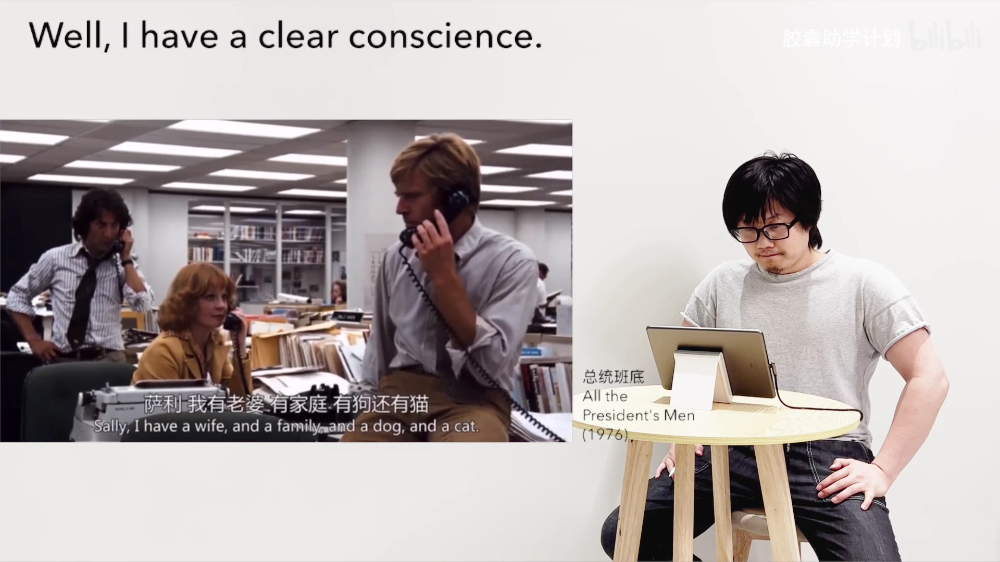

文字识别：Well, I have a clear conscience. / 总统班底 / 萨利我有老婆有家庭.有狗还有猫 / All the / mm / President's Men / Sally, I have a wife, and a failyand a dog, and a cat. / (1976)

### 画面 00:02:04

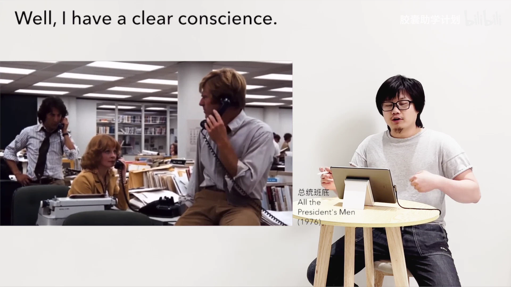

文字识别：Well, I have a clear conscience. / 总统班底 / All the / mmm / President's Men / (1976)

### 画面 00:02:10

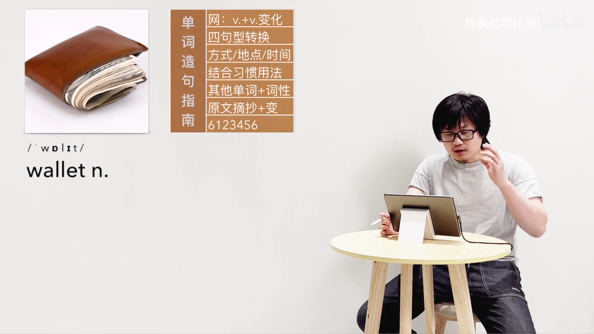

文字识别：单词造句指南 / 网：v.+v.变化 / 四句型转换 / 方式/地点/时间 / 结合习惯用法 / 其他单词+词性 / 原文摘抄+变 / 6123456 / /'wDlIt/ / wallet n.

### 画面 00:02:12

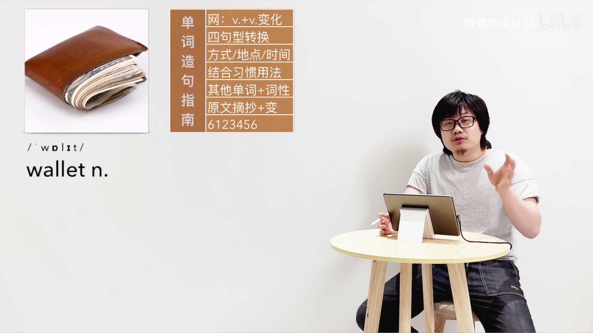

文字识别：单词造句指南 / 网：v.+v.变化 / 四句型转换 / 方式/地点/时间 / 结合习惯用法 / 其他单词+词性 / 原文摘抄+变 / 6123456 / /'wDlIt/ / wallet n.

### 画面 00:02:15

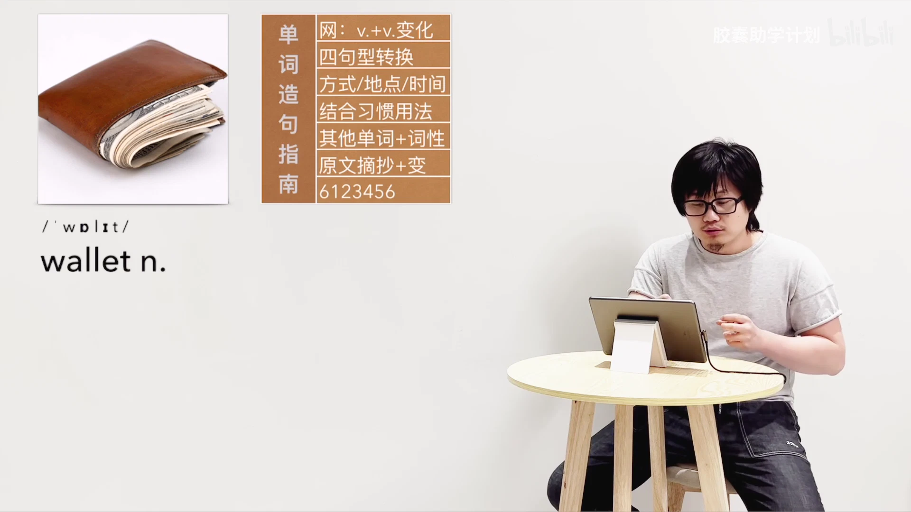

文字识别：单词造句指南 / 网：v.+v.变化 / 四句型转换 / 方式/地点/时间 / 结合习惯用法 / 其他单词+词性 / 原文摘抄+变 / 6123456 / /'wplIt/ / wallet n.

### 画面 00:02:18

文字识别：单词造句指南 / 网：v.+v.变化 / 四句型转换 / 方式/地点/时间 / 结合习惯用法 / 其他单词+词性 / 原文摘抄+变 / 6123456 / /' / wallet n.

### 画面 00:02:20

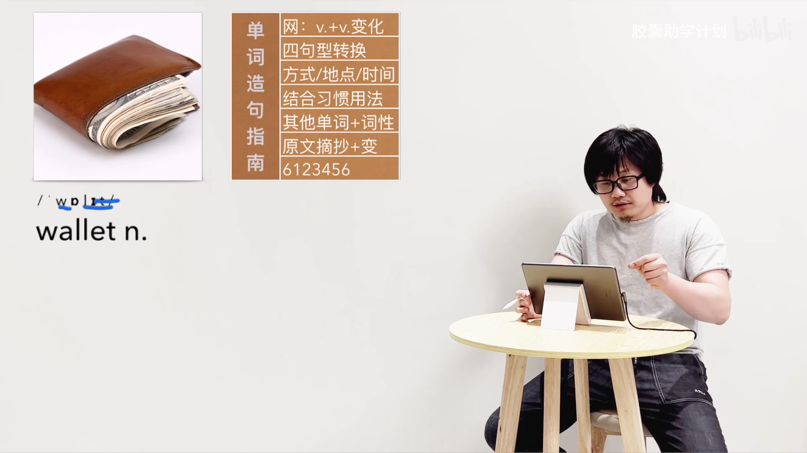

文字识别：单词造句指南 / 网：v.+v.变化 / 四句型转换 / 方式/地点/时间 / 结合习惯用法 / 其他单词+词性 / 原文摘抄+变 / 6123456 / wallet n. / 2

### 画面 00:02:24

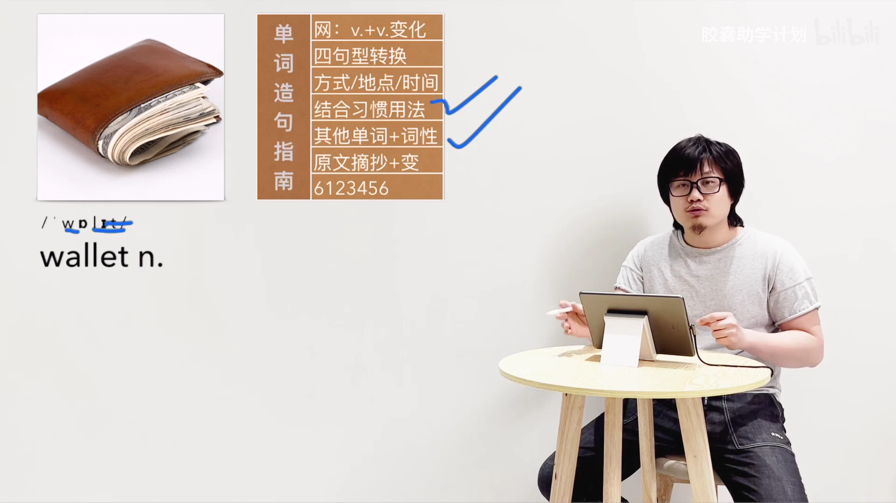

文字识别：单词造句指南 / 网：v.+v.变化 / 四句型转换 / 方式/地点/时间 / 结合习惯用法 / 其他单词+词性 / 原文摘抄+变 / 6123456 / wallet n.

### 画面 00:02:26

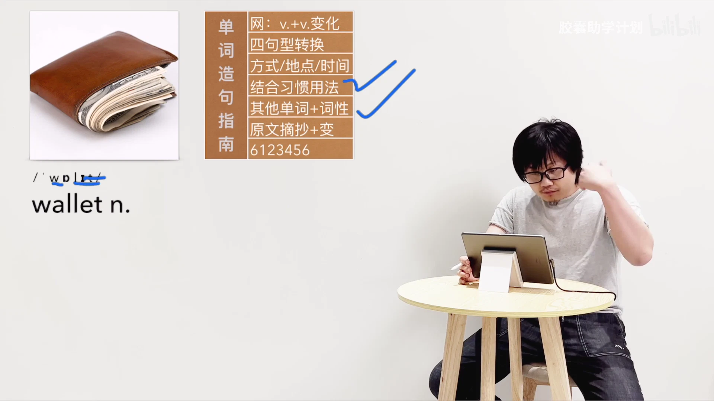

文字识别：单词造句指南 / 网：v.+v.变化 / 四句型转换 / 方式/地点/时间 / 结合习惯用法 / 其他单词+词性 / 原文摘抄+变 / 6123456 / /' / wallet n.

## 00:02:30–00:03:00

法要带着动词。OK，比如说 this wallet needs，呃，this wallet needs mending。这是咱们四十四课刚刚见过，叫 need doing something，叫做只啊需要被修理，对吧？OK， continue。比如说我再来一个，叫做 if I bought that wallet， I would give it away。好，你注意这里的，其实就是四十课咱们学的叫什么虚拟语气，对不对？你看这里，这里和这里，对不对？所以他想表达的

### 画面 00:02:32

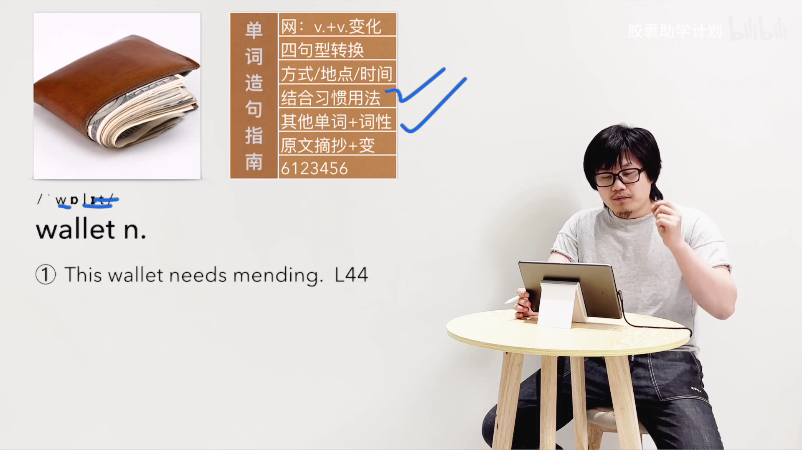

文字识别：单词造句指南 / 网：v.+v.变化 / 四句型转换 / 方式/地点/时间 / 结合习惯用法 / 其他单词+词性 / 原文摘抄+变 / 6123456 / wallet n. / ) This wallet needs mending. L44

### 画面 00:02:35

文字识别：单词造句指南 / 网：v.+v.变化 / 四句型转换 / 方式/地点/时间 / 结合习惯用法 / 其他单词+词性 / 原文摘抄+变 / 6123456 / wallet n. /  This wallet needs mending. L44

### 画面 00:02:40

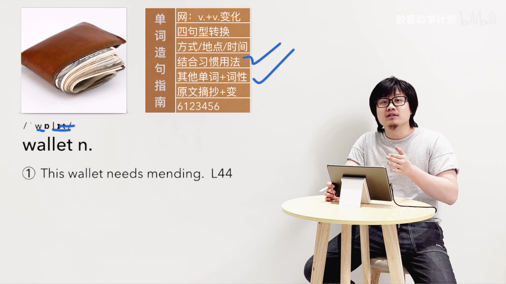

文字识别：单词造句指南 / 网：v.+v.变化 / 四句型转换 / 方式/地点/时间 / 结合习惯用法 / 其他单词+词性 / 原文摘抄+变 / 6123456 / wallet n. /  This wallet needs mending. L44

### 画面 00:02:45

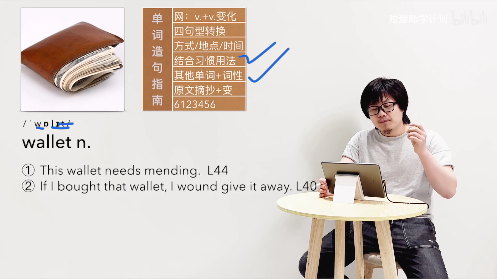

文字识别：单词造句指南 / 网：v.+v.变化 / 四句型转换 / 方式/地点/时间 / 结合习惯用法 / 其他单词+词性 / 原文摘抄+变 / 6123456 / /WDIt / wallet n. / This wallet needs mending. L44 /  If I bought that wallet, I wound give it away. L40

### 画面 00:02:50

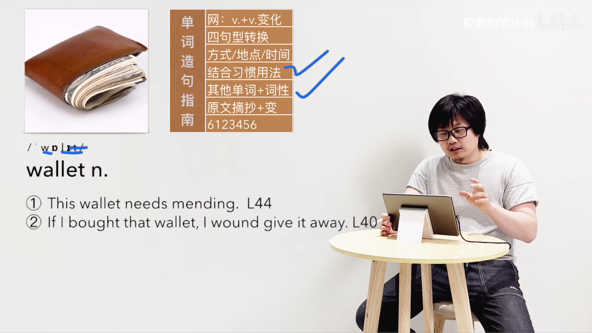

文字识别：单词造句指南 / 网：v.+v.变化 / 四句型转换 / 方式/地点/时间 / 结合习惯用法 / 其他单词+词性 / 原文摘抄+变 / 6123456 / wallet n. / This wallet needs mending. L44 / If I bought that wallet, I wound give it away. L40

### 画面 00:02:55

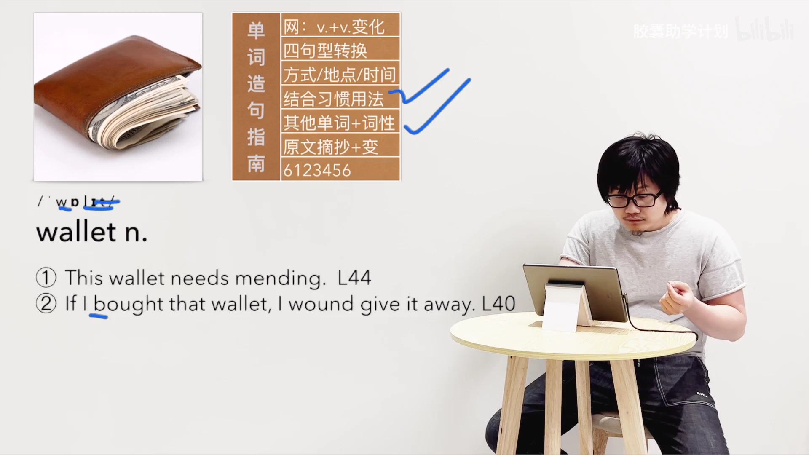

文字识别：单词造句指南 / 网：v.+v.变化 / 四句型转换 / 方式/地点/时间 / 结合习惯用法 / 其他单词+词性 / 原文摘抄+变 / 6123456 / /WDL / wallet n. / This wallet needs mending. L44 / If I bought that wallet, I wound give it away. L40

### 画面 00:02:57

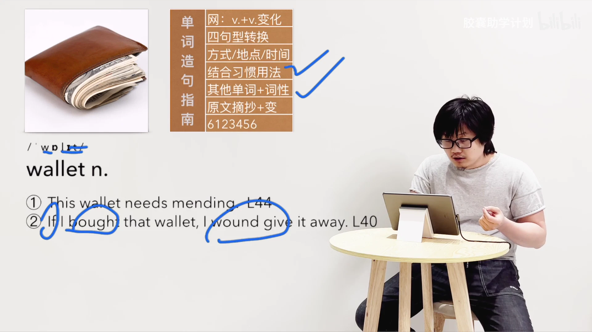

文字识别：单词造句指南 / 网：v.+v.变化 / 四句型转换 / 方式/地点/时间 / 结合习惯用法 / 其他单词+词性 / 原文摘抄+变 / 6123456 / wallet n. / This wallet needs mending L44 / Ibough / that wallet, I Wound give it away. L40 / If

## 00:03:00–00:03:30

意思其实叫做我并我不认为我会买那个钱包的。Okay, very good. Ah, next one.比如说，我们再造一个句子叫He used to sell wallet on the street.啊，或者呃，那这个地方注意一下，这个used to do something实际上是咱们新概念二册三十一课学过，叫过去常常怎么样，代表但现在其实并不这样去做了。Okay,好，那你可以看到在这儿其实我们用了几个小的动词啊

### 画面 00:03:00

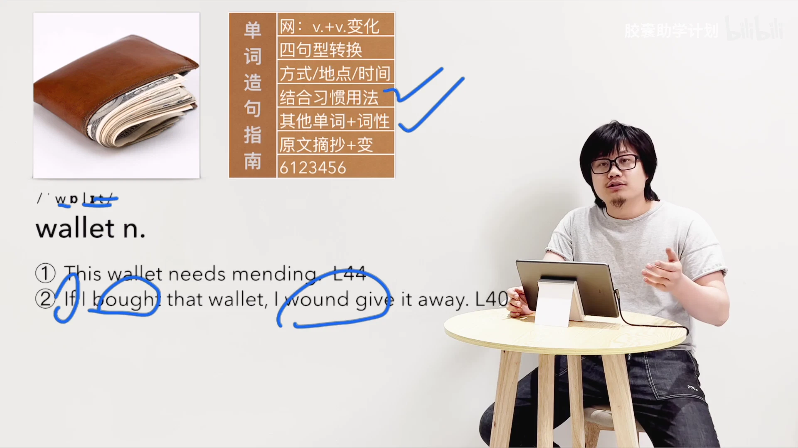

文字识别：单词造句指南 / 网：v.+v.变化 / 四句型转换 / 方式/地点/时间 / 结合习惯用法 / 其他单词+词性 / 原文摘抄+变 / 6123456 / wallet n. / This wallet needs mending L44 / If / Ibough / that wallet, I wound give it away. L40

### 画面 00:03:05

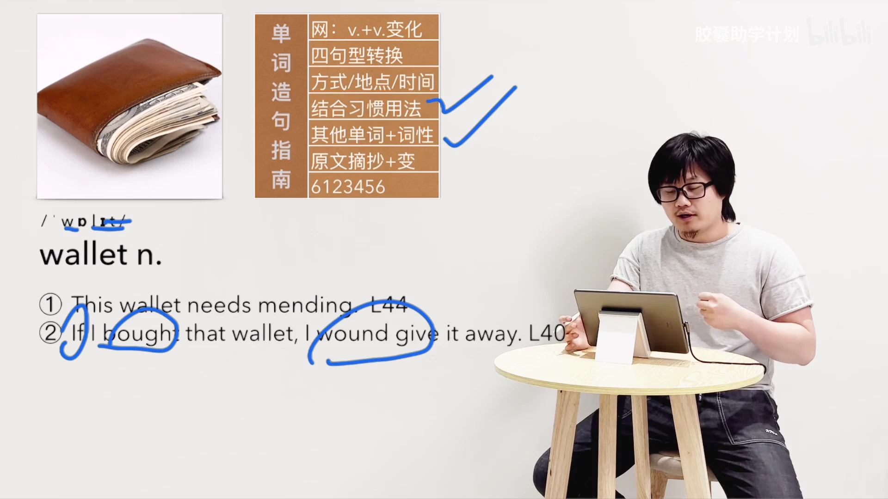

文字识别：单词造句指南 / 网：v.+v.变化 / 四句型转换 / 方式/地点/时间 / 结合习惯用法 / 其他单词+词性 / 原文摘抄+变 / 6123456 / wallet n. / This wallet needs mending L44 / lf / kough / that wallet, I wound give it away. L40

### 画面 00:03:08

文字识别：单词造句指南 / 网：v.+v.变化 / 四句型转换 / 方式/地点/时间 / 结合习惯用法 / 其他单词+词性 / 原文摘抄+变 / 6123456 / wallet n. / This wallet needs mending. L44 / If I bought that wallet, I wound give it away. L40 / He used to sell wallet on the street. L31

### 画面 00:03:10

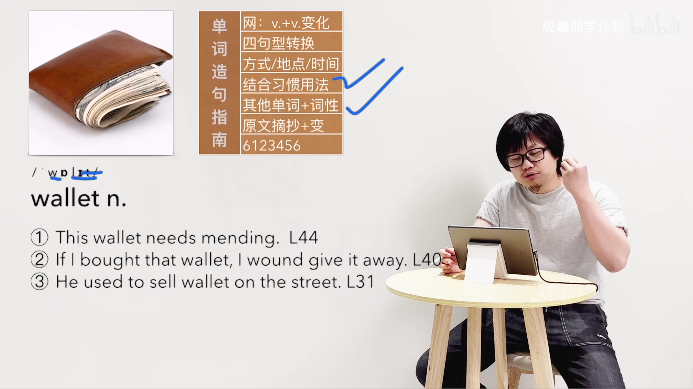

文字识别：单词造句指南 / 网：v.+v.变化 / 四句型转换 / 方式/地点/时间 / 结合习惯用法 / 其他单词+词性 / 原文摘抄+变 / 6123456 / wallet n. /  This wallet needs mending. L44 / Ifl bought that wallet, I wound give it away. L40≤ / 2 / He used to sell wallet on the street. L31

### 画面 00:03:15

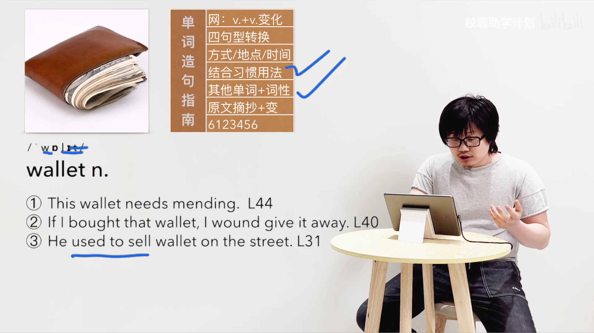

文字识别：单词造句指南 / 网：v.+v.变化 / 四句型转换 / 方式/地点/时间 / 结合习惯用法 / 其他单词+词性 / 原文摘抄+变 / 6123456 / wallet n. / This wallet needs mending. L44 / If I bought that wallet, I wound give it away. L40 / He used to sell wallet on the street. L31

### 画面 00:03:20

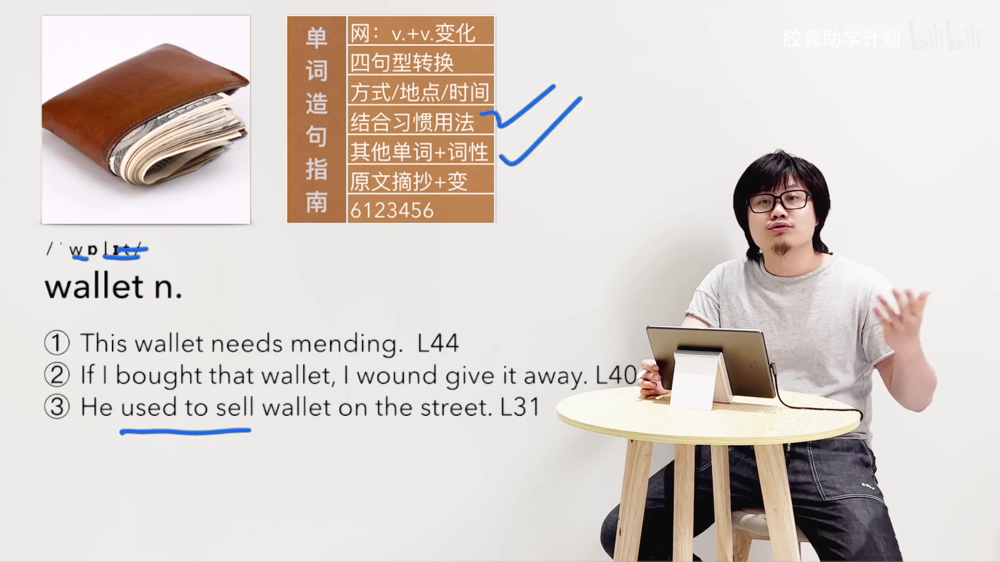

文字识别：单词造句指南 / 网：v.+v.变化 / 四句型转换 / 方式/地点/时间 / 结合习惯用法 / 其他单词+词性 / 原文摘抄+变 / 6123456 / wallet n. / This wallet needs mending. L44 / If I bought that wallet, I wound give it away. L403 / He used to sell wallet on the street. L31

### 画面 00:03:25

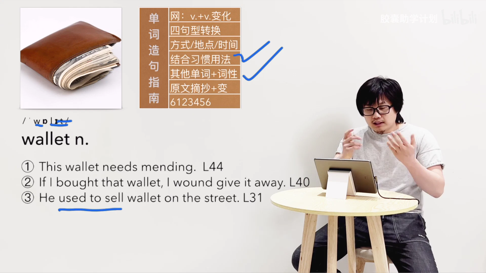

文字识别：单词造句指南 / 网：v.+v.变化 / 四句型转换 / 方式/地点/时间 / 结合习惯用法 / 其他单词+词性 / 原文摘抄+变 / 6123456 / wallet n. / This wallet needs mending. L44 / If I bought that wallet, I wound give it away. L40 / He used to sell wallet on the street. L31

### 画面 00:03:27

文字识别：单词造句指南 / 网：v.+v.变化 / 四句型转换 / 方式/地点/时间 / 结合习惯用法 / 其他单词+词性 / 原文摘抄+变 / 6123456 / /WD / wallet n. / This wallet Keeds mending. L44 / If I bought that wallet, I wound give it away. L40 / He used to sell wallet on the street. L31

### 画面 00:03:29

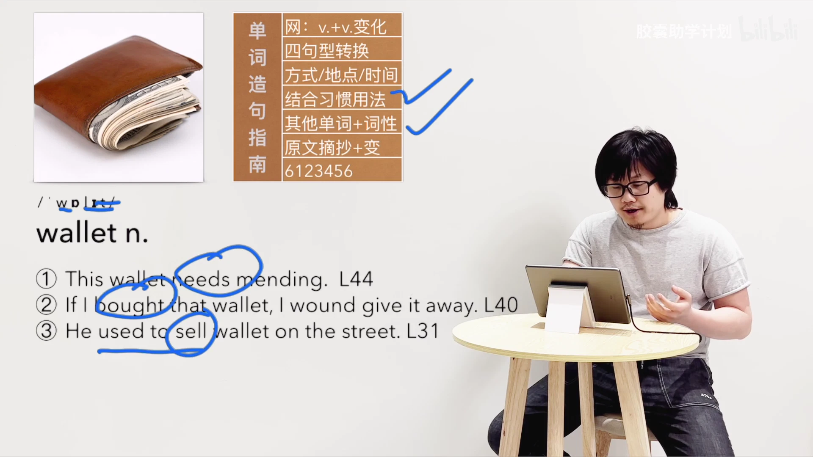

文字识别：单词造句指南 / 网：v.+v.变化 / 四句型转换 / 方式/地点/时间 / 结合习惯用法 / 其他单词+词性 / 原文摘抄+变 / 6123456 / wallet n. / This walleteeds mending. L44 / Ifl 6 / bought that wallet, I wound give it away. L40 / He used ta sellwallet on the street. L31

## 00:03:30–00:04:00

和 wallet 连在一起，这就是我们单词造句一个非常重要的思路。你要判断它的词性。OK， next one，下面这个单词是文章当中出现的，跟我一起先读一下，叫做 savings 啊，看着音标 savings。OK，它表示的是我们的存款。这个单词我个人认为你多少应该会的原因是什么呢？因为我们原来其实学过一个动词叫做 save 啊，saved 意思就是存下来，对吧？它

### 画面 00:03:31

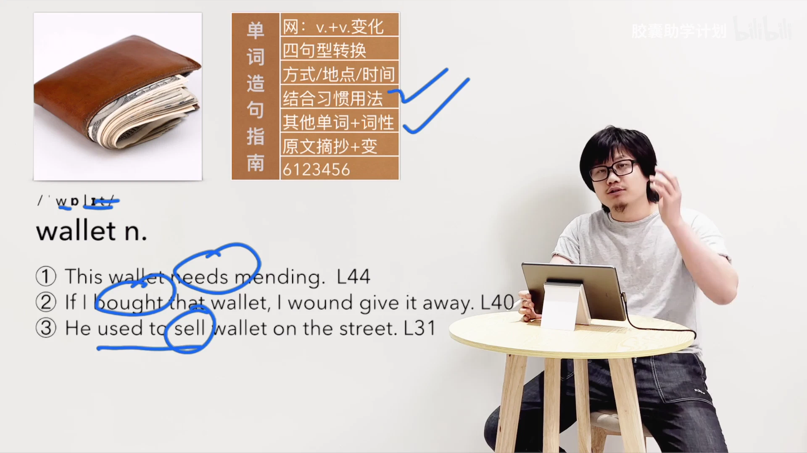

文字识别：单词造句指南 / 网：v.+v.变化 / 四句型转换 / 方式/地点/时间 / 结合习惯用法 / 其他单词+词性 / 原文摘抄+变 / 6123456 / wallet n. / This walleteeds mending. L44 / Ifl 6 / boughtthat wallet, I wound give it away. L40 / He used ta sellwallet on the street. L31

### 画面 00:03:36

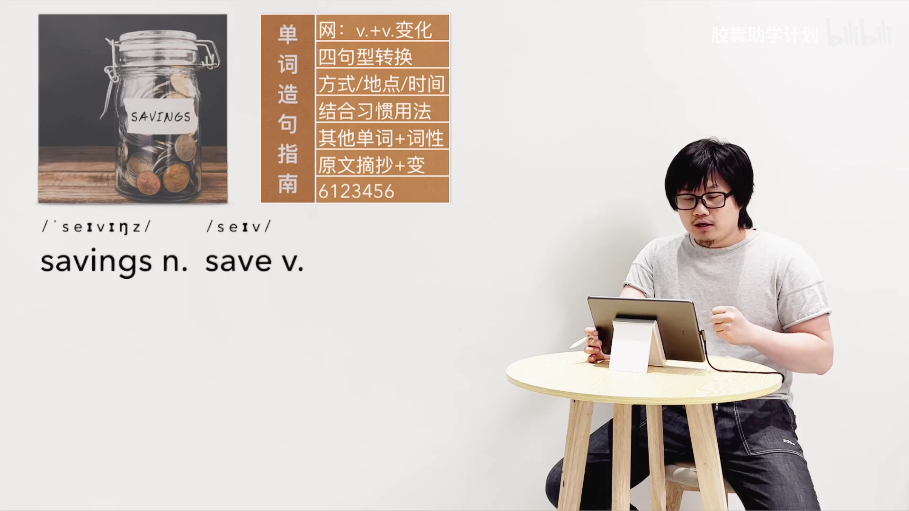

文字识别：单词造句指南 / 网：v.+v.变化 / 四句型转换 / 方式/地点/时间 / 结合习惯用法 / SAVINGS / 其他单词+词性 / 原文摘抄+变 / 6123456 / /'seivinz/ / /seivl / savings n. save V.

### 画面 00:03:39

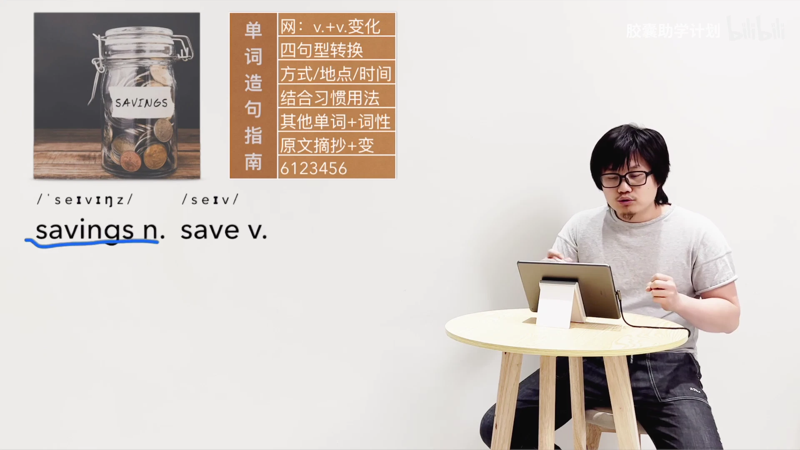

文字识别：单词造句指南 / 网：v.+v.变化 / 四句型转换 / 方式/地点/时间 / 结合习惯用法 / SAVINGS / 其他单词+词性 / 原文摘抄+变 / 6123456 / /'seivinzl / lseivl / savinqs n. save v.

### 画面 00:03:41

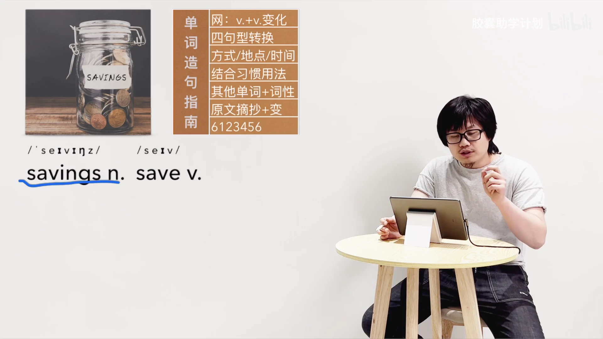

文字识别：单词造句指南 / 网：v.+v.变化 / 四句型转换 / 方式/地点/时间 / 结合习惯用法 / SAVINGS / 其他单词+词性 / 原文摘抄+变 / 6123456 / /'seivinzl / /seiv/ / savinqs n. save v.

### 画面 00:03:45

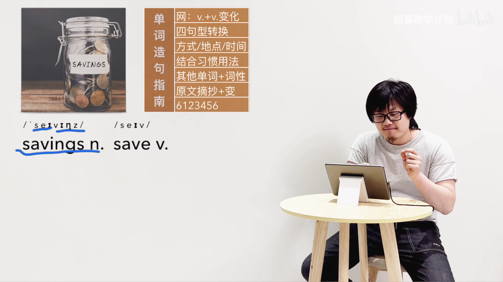

文字识别：单词造句指南 / 网：v.+v.变化 / 四句型转换 / 方式/地点/时间 / 结合习惯用法 / SAVINGS / 其他单词+词性 / 原文摘抄+变 / 6123456 / seivInz/ / /seivl / savinqs n.s / save v.

### 画面 00:03:51

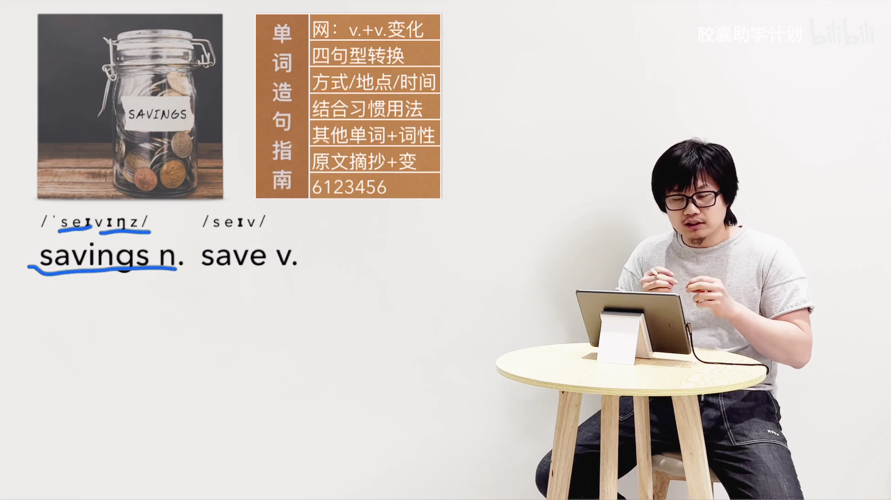

文字识别：单词造句指南 / 网：v.+v.变化 / 四句型转换 / 方式/地点/时间 / 结合习惯用法 / SAVINGS / 其他单词+词性 / 原文摘抄+变 / 6123456 / seivinz/ / /seivl / savinqs n. s / save v.

### 画面 00:03:55

文字识别：单词造句指南 / 网：v.+v.变化 / 四句型转换 / 方式/地点/时间 / 结合习惯用法 / SAVINGS / 其他单词+词性 / 原文摘抄+变 / 6123456 / seivinz/ / Iseivl / savings n. / save v.

## 00:04:00–00:04:30

是一个动词啊。呃，OK，那比如说原文给了这样一个小短语，叫 take his savings to the post office，说拿着他的存款，带着他的存款去邮局啊。比如说他可能是邮给别人，或者说这个呃存储起来，对吧？OK，这个短语我们有了之后，我们如何去造句子？我们就可以加上一些动词和动词的变化以及时间了。比如说

### 画面 00:04:00

文字识别：单词造句指南 / 网：v.+v.变化 / 四句型转换 / 方式/地点/时间 / 结合习惯用法 / SAVINGS / 其他单词+词性 / 原文摘抄+变 / 6123456 / / / seivinz/ / /seivl / savings n. / save v.

### 画面 00:04:05

文字识别：单词造句指南 / 网：v.+v.变化 / 四句型转换 / 方式/地点/时间 / 结合习惯用法 / SAVINGS / 其他单词+词性 / 原文摘抄+变 / 6123456 / /'seivinz/ / /seivl / savinqs n. / save v. /  take his savings to the post office

### 画面 00:04:10

文字识别：单词造句指南 / 网：v.+v.变化 / 四句型转换 / 方式/地点/时间 / 结合习惯用法 / SAVINGS / 其他单词+词性 / 原文摘抄+变 / 6123456 / /'seivinz/ / /seivl / savings n. / save v. /  take his savings to the post office

### 画面 00:04:15

文字识别：单词造句指南 / 网：v.+v.变化 / 四句型转换 / 方式/地点/时间 / 结合习惯用法 / SAVINGS / 其他单词+词性 / 原文摘抄+变 / 6123456 / /'seivinz/ / /seivl / savinqs n. / save v. / ) take his savings to the post office

### 画面 00:04:20

文字识别：单词造句指南 / 网：v.+v.变化 / 四句型转换 / 方式/地点/时间 / 结合习惯用法 / SAVINGS / 其他单词+词性 / 原文摘抄+变 / 6123456 / /'seivinzl / lseivl / savings n. / save v. / take his savings to the post office / He took his savings to the post office last / week.

### 画面 00:04:25

文字识别：单词造句指南 / 网：v.+v.变化 / 四句型转换 / 方式/地点/时间 / 结合习惯用法 / SAVINGS / 其他单词+词性 / 原文摘抄+变 / 6123456 / /'seivinz/ / /seivl / savings n. / save v. / take his savings to the post office / He took his savings to the post office last / week.

## 00:04:30–00:05:00

He took his savings to the post office last week.啊，说他拿着，他带着，对吧？你注意是 last week，所以是 took 啊，很简单一个句子就出来了。接下来您下课要去做的事情就是张嘴去练，叫 Did he take his savings to the post office last week? Why did he take his savings to the post office last week? Okay, one more again.啊，啊，那当然也可以用问啊，这个地方我们还少说了一个

### 画面 00:04:30

文字识别：单词造句指南 / 网：v.+v.变化 / 四句型转换 / 方式/地点/时间 / 结合习惯用法 / SAVINGS / 其他单词+词性 / 原文摘抄+变 / 6123456 / /'seivinz/ / /seivl / savinqsn. / save v. / take his savings to the post office / He took his savings to the post office last / week.

### 画面 00:04:35

文字识别：单词造句指南 / 网：v.+v.变化 / 四句型转换 / 方式/地点/时间 / 结合习惯用法 / SAVINGS / 其他单词+词性 / 原文摘抄+变 / 6123456 / /'seivinz/ / /seivl / savinas n. / save v. / take his savings to the post office / He took his savings to the post office last / week.

### 画面 00:04:37

文字识别：单词造句指南 / 网：v.+v.变化 / 四句型转换 / 方式/地点/时间 / 结合习惯用法 / SAVINGS / 其他单词+词性 / 原文摘抄+变 / 6123456 / /'seivinz/ / /seivl / savinqs n. / save v. / take his savings to the post office / He/took his savings to the post office last / week.

### 画面 00:04:40

文字识别：单词造句指南 / 网：v.+v.变化 / 四句型转换 / 方式/地点/时间 / 结合习惯用法 / SAVINGS / 其他单词+词性 / 原文摘抄+变 / 6123456 / /'seivinzl / /seivl / savinqs n. / save v. / take his savings to the post office / He/tool his savings to the post office last / week.

### 画面 00:04:45

文字识别：单词造句指南 / 网：v.+v.变化 / 四句型转换 / 方式/地点/时间 / 结合习惯用法 / SAVINGS / 其他单词+词性 / 原文摘抄+变 / 6123456 / /'seivinz/ / /seivl / savinqs n. / save v. / take his savings to the post office / 1 / He/tookhis savings to the post office last / week. / dia/who/why...

### 画面 00:04:47

文字识别：单词造句指南 / 网：v.+v.变化 / 四句型转换 / 方式/地点/时间 / 结合习惯用法 / SAVINGS / 其他单词+词性 / 原文摘抄+变 / 6123456 / /'seivinz/ / /seivl / savings n. / save v. / take his savings to the post office / Hetook his savings to the post office last / week. / did/who/why...

### 画面 00:04:50

文字识别：单词造句指南 / 网：v.+v.变化 / 四句型转换 / 方式/地点/时间 / 结合习惯用法 / SAVINGS / 其他单词+词性 / 原文摘抄+变 / 6123456 / /'seivinzl / /seivl / savings n. / save v. / take his savings to the post office / He/tookhis savings to the post office last / week. / did/who/why...

### 画面 00:04:52

文字识别：单词造句指南 / 网：v.+v.变化 / 四句型转换 / 方式/地点/时间 / 结合习惯用法 / SAVINGS / 其他单词+词性 / 原文摘抄+变 / 6123456 / /'seivinz/ / /seivl / savinqs n. / save v. / take his savings to the post office / 1 / Hetool his savings to the post office last / week. / did/who/why...

### 画面 00:04:55

文字识别：单词造句指南 / 网：v.+v.变化 / 四句型转换 / 方式/地点/时间 / 结合习惯用法 / SAVINGS / 其他单词+词性 / 原文摘抄+变 / 6123456 / /'seivinzl / /seivl / savinas n. / save v. / take his savings to the post office / 1 / He/took his savings to the post office last / week. / dia/who/why...

### 画面 00:04:59

文字识别：单词造句指南 / 网：v.+v.变化 / 四句型转换 / 方式/地点/时间 / 结合习惯用法 / SAVINGS / 其他单词+词性 / 原文摘抄+变 / 6123456 / /'seivinzl / /seivl / savinqs n. / save v. / take his savings to the post office / Hetook his savings to the post office last / week. / .wher / diarwho/why..

## 00:05:00–00:05:30

问啊，您自己去想一下，OK，玩一个。接下来下一个单词，跟我一起读一下，叫做villager，OK，villager连起来，villager，villager，OK。那其实village，我们早在新一就学过这个单词。那你看village，我们当时指的是村落。那villager，er结尾，咱们这么熟悉，它很可能就是什么了，就是表示什么地方的人，对吧？哎，村民

### 画面 00:05:01

文字识别：单词造句指南 / 网：v.+v.变化 / 四句型转换 / 方式/地点/时间 / 结合习惯用法 / SAVINGS / 其他单词+词性 / 原文摘抄+变 / 6123456 / /'seivinzl / /selvl / savings n. / save v. / take his savings to the / post office / Hetook his savings to t /  the post office last / week. / .wher / diarwho/why..

### 画面 00:05:03

文字识别：单词造句指南 / 网：v.+v.变化 / 四句型转换 / 方式/地点/时间 / 结合习惯用法 / 其他单词+词性 / 原文摘抄+变 / 6123456 / /'vilid3a/ / villager n. village n.

### 画面 00:05:05

文字识别：单词造句指南 / 网：v.+v.变化 / 四句型转换 / 方式/地点/时间 / 结合习惯用法 / 其他单词+词性 / 原文摘抄+变 / 6123456 / /'vilid3a/ / villager n. village n.

### 画面 00:05:10

文字识别：单词造句指南 / 网：v.+v.变化 / 四句型转换 / 方式/地点/时间 / 结合习惯用法 / 其他单词+词性 / 原文摘抄+变 / 6123456 / /'vilid3a/ / villager n. village n.

### 画面 00:05:14

文字识别：单词造句指南 / 网：v.+v.变化 / 四句型转换 / 方式/地点/时间 / 结合习惯用法 / 其他单词+词性 / 原文摘抄+变 / 6123456 / /'vilid3a/ / villager n. village n.

### 画面 00:05:16

文字识别：单词造句指南 / 网：v.+v.变化 / 四句型转换 / 方式/地点/时间 / 结合习惯用法 / 其他单词+词性 / 原文摘抄+变 / 6123456 / /'vilid3a/ / villager n. village n.

### 画面 00:05:20

文字识别：单词造句指南 / 网：v.+v.变化 / 四句型转换 / 方式/地点/时间 / 结合习惯用法 / 其他单词+词性 / 原文摘抄+变 / 6123456 / /'vilid3a/ / villager n. village n.

### 画面 00:05:25

文字识别：单词造句指南 / 网：v.+v.变化 / 四句型转换 / 方式/地点/时间 / 结合习惯用法 / 其他单词+词性 / 原文摘抄+变 / 6123456 / /'vilid3a/ / villager n. village n.

## 00:05:30–00:06:00

叫做 villager，OK，very good。那又是个人嘛，人想造句就很简单，跟我们之前学的什么 captain 啊，detective 啊这些单词没什么太本质上的区别啊。那我们造句子，比如说 the villager we met last night is having an operation，have an operation 啊，动手术对吧？三十九课咱们学的。其次 we met last night 一个定语从句啊，continue 说 the villagers are busy selling things to the tourists，说这

### 画面 00:05:30

文字识别：单词造句指南 / 网：v.+v.变化 / 四句型转换 / 方式/地点/时间 / 结合习惯用法 / 其他单词+词性 / 原文摘抄+变 / 6123456 / /'vilid3a/ / villager n. village n.

### 画面 00:05:33

文字识别：单词造句指南 / 网：v.+v.变化 / 四句型转换 / 方式/地点/时间 / 结合习惯用法 / 其他单词+词性 / 原文摘抄+变 / 6123456 / /'vilid3a/ / villager n. village n. / ① The villager we met last night is having an / Operation. L39

### 画面 00:05:35

文字识别：单词造句指南 / 网：v.+v.变化 / 四句型转换 / 方式/地点/时间 / 结合习惯用法 / 其他单词+词性 / 原文摘抄+变 / 6123456 / /'vrlid3a/ / villager n. village n. / ① The villager we met last night is having an / Operation. L39

### 画面 00:05:40

文字识别：单词造句指南 / 网：v.+v.变化 / 四句型转换 / 方式/地点/时间 / 结合习惯用法 / 其他单词+词性 / 原文摘抄+变 / 6123456 / /'vilid3a/ / villager n. village n. / ① The villager we met last night is having an / Operation. L39

### 画面 00:05:45

文字识别：单词造句指南 / 网：v.+v.变化 / 四句型转换 / 方式/地点/时间 / 结合习惯用法 / 其他单词+词性 / 原文摘抄+变 / 6123456 / /'vrlid3a/ / villager n. village n. / ① The villager we met last night is having an / operation. L39

### 画面 00:05:49

文字识别：单词造句指南 / 网：v.+v.变化 / 四句型转换 / 方式/地点/时间 / 结合习惯用法 / 其他单词+词性 / 原文摘抄+变 / 6123456 / /'vrlid3a/ / villager n. village n. / ① The villager we met last night is having an / Operation. L39

### 画面 00:05:51

文字识别：单词造句指南 / 网：v.+v.变化 / 四句型转换 / 方式/地点/时间 / 结合习惯用法 / 其他单词+词性 / 原文摘抄+变 / 6123456 / /'vilid3a/ / villager n. village n. / ① The villager we met last night is having an / Operation. L39

### 画面 00:05:55

文字识别：单词造句指南 / 网：v.+v.变化 / 四句型转换 / 方式/地点/时间 / 结合习惯用法 / 其他单词+词性 / 原文摘抄+变 / 6123456 / /'vilid3a/ / villager n. village n. / ① The villager we met last night is having an / operation. L39 / The villagers are busy selling things to the / tourists. L40

## 00:06:00–00:06:30

villager is busy doing something. Okay, this is what we learned before. Continue. Then combine with the words we learned before. So angry that the villager is so angry that dot dot dot dot dot, right? This is what we learned in the thirty-fifth class. Then dot dot dot dot dot, you try to fill it in. Say he is so angry that. Okay, continue. Next, we have the original sentence. It is separated. Actually, it is more common to connect them.

### 画面 00:06:00

文字识别：单词造句指南 / 网：v.+v.变化 / 四句型转换 / 方式/地点/时间 / 结合习惯用法 / 其他单词+词性 / 原文摘抄+变 / 6123456 / /'vilid3a/ / villager n. village n. / ① The villager we met last night is having an / operation. L39 / The villagers are busy selling things to the / tourists. L40

### 画面 00:06:05

文字识别：单词造句指南 / 网：v.+v.变化 / 四句型转换 / 方式/地点/时间 / 结合习惯用法 / 其他单词+词性 / 原文摘抄+变 / 6123456 / /'vilid3a/ / villager n. village n. / ① The villager we met last night is having an / operation. L39 / The villagers are busy selling things to the / tourists. L40

### 画面 00:06:10

文字识别：单词造句指南 / 网：v.+v.变化 / 四句型转换 / 方式/地点/时间 / 结合习惯用法 / 其他单词+词性 / 原文摘抄+变 / 6123456 / /'vilid3a/ / villager n. village n. / ① The villager we met last night is having an / Operation. L39 / The villagers are busy selling things to the / tourists. L40 / The villager is / angry that ... L35 / SC

### 画面 00:06:12

文字识别：单词造句指南 / 网：v.+v.变化 / 四句型转换 / 方式/地点/时间 / 结合习惯用法 / 其他单词+词性 / 原文摘抄+变 / 6123456 / /'vilid3a/ / villager n. village n. / ① The villager we met last night is having an / Operation. L39 / The villagers are busy selling things to the / tourists. L40 / The villager is / angry / that / ... 35 / SO

### 画面 00:06:15

文字识别：单词造句指南 / 网：v.+v.变化 / 四句型转换 / 方式/地点/时间 / 结合习惯用法 / 其他单词+词性 / 原文摘抄+变 / 6123456 / /'vilid3a/ / villager n. village n. / ① The villager we met last night is having an / Operation. L39 / The villagers are busy selling things to the / tourists. L40 / The villager is / angry / that / ... L35 / SO

### 画面 00:06:20

文字识别：单词造句指南 / 网：v.+v.变化 / 四句型转换 / 方式/地点/时间 / 结合习惯用法 / 其他单词+词性 / 原文摘抄+变 / 6123456 / /'vilid3a/ / villager n. village n. / ① The villager we met last night is having an / Operation. L39 / The villagers are busy selling things to the / tourists. L40 / The villager is / angry / that / ... 35 / SO

### 画面 00:06:25

文字识别：单词造句指南 / 网：v.+v.变化 / 四句型转换 / 方式/地点/时间 / 结合习惯用法 / 0 / 其他单词+词性 / 原文摘抄+变 / 6123456 / /pa'sent/ / per cent / percent

### 画面 00:06:28

文字识别：单词造句指南 / 网：v.+v.变化 / 四句型转换 / 方式/地点/时间 / ） / 结合习惯用法 / 0 / 其他单词+词性 / 原文摘抄+变 / 6123456 / /pa'sent/ / per cent / percent

## 00:06:30–00:07:00

其实更常见的是连到一起的，单词意思没有什么本质上太大的区别，就是表示百分比啊 percent. Okay, 那它在口语当中还真的挺常用。这实际上不是我造出来的句子啊，是我在实际生活场景当中摘出来的，直接告诉各位，各位多读几遍把它记起来，口语就能用了。比如说 I'm one hundred percent sure I'm right. 他说我百分之百确定我没有问题，我是对的，对吧？叫做 one hundred percent sure

### 画面 00:06:30

文字识别：单词造句指南 / 网：v.+v.变化 / 四句型转换 / 方式/地点/时间 / 结合习惯用法 / 其他单词+词性 / 原文摘抄+变 / 6123456 / /pa'sent/ / per cent / percent

### 画面 00:06:33

文字识别：单词造句指南 / 网：v.+v.变化 / 四句型转换 / 方式/地点/时间 / 结合习惯用法 / 其他单词+词性 / 原文摘抄+变 / 6123456 / /pa'sent/ / per cent / percent

### 画面 00:06:36

文字识别：单词造句指南 / 网：v.+v.变化 / 四句型转换 / 方式/地点/时间 / 结合习惯用法 / 其他单词+词性 / 原文摘抄+变 / 6123456 / /pa'sent/ / per cent / percent

### 画面 00:06:40

文字识别：单词造句指南 / 网：v.+v.变化 / 四句型转换 / 方式/地点/时间 / 结合习惯用法 / 其他单词+词性 / 原文摘抄+变 / 6123456 / /pa'sent/ / per cent / percent / ① I'm 100 percent sure I'm right.

## 00:07:00–00:07:30

I'm right. 那以及你可以问别人叫 Are you one hundred percent sure about this? About this 叫关于这件事情。 OK，那本课的单词并不是非常的多啊，有两个小的句子呢。我觉得其实你可以把它直接当做口语的句子去给它记下来。 OK，好，那我们接下来看家庭作业，单词造句老习惯，对吧？这里再强调一下，一定要用单词造句指指南去造句啊，不要自己随便

### 画面 00:07:02

文字识别：单词造句指南 / 网：v.+v.变化 / 四句型转换 / 方式/地点/时间 / 结合习惯用法 / 其他单词+词性 / 原文摘抄+变 / 6123456 / /pa'sent / / per cent / percent / ① I'm 100 percent sure I'm right. / Are you 100 percent sure about this?

### 画面 00:07:05

文字识别：单词造句指南 / 网：v.+v.变化 / 四句型转换 / 方式/地点/时间 / 结合习惯用法 / 其他单词+词性 / 原文摘抄+变 / 6123456 / /pa'sent/ / per cent / percent / D I'm 100 percent sure I'm right. / 1 / Are you 100 percent sure about this?

### 画面 00:07:09

文字识别：Recap / Words / I have a clear conscience. / Expression / Are you 100 / percent sure about this?

### 画面 00:07:11

文字识别：Recap / Words / I have a clear conscience. / Expression / Are you 100 / percent sure about this?

### 画面 00:07:13

文字识别：Recap / Words / have a clear conscience. / Expression / Are you 100p / percent sure about this?

### 画面 00:07:15

文字识别：Recap / Words / have a clear conscience. / Expression / Are you 100 percent sure about this?

### 画面 00:07:19

### 画面 00:07:21

文字识别：单词造句/对话 / 1. / 【单词造句指南】 / 每个5句

### 画面 00:07:25

文字识别：单词造句/对话 / 1. / 【单词造句指南】 / 每个5句

## 00:07:30–00:07:58

乱造，对吧？然后呢，反复听这个电影片段。OK，那以上就是本期视频的全部内容了。如果各位喜欢我们的课程呢，欢迎各位关注、订阅、一键三连，分享给那些需要的朋友，来帮助我们快速成长。See you next time.

### 画面 00:07:31

文字识别：单词造句/对话 / 1. / 【单词造句指南】 / 每个5句 / 反复听电影片段，直到能 / 听出关键短语/句子

### 画面 00:07:34

文字识别：👍

### 画面 00:07:46

### 画面 00:07:48

文字识别：CAPSULEACADEMY / 胶囊助学计划 / 小红书 / Lecturer / Leo / OE

### 画面 00:07:51

文字识别：CAPSULEACADEMY / 胶囊助学计划 / 小红书 / Editor / OE

### 画面 00:07:54

文字识别：CAPSULEACADEMY / 胶囊助学计划 / 小红书 / Creator / Leo & Berlin / OE

### 画面 00:07:56

文字识别：Bilibili / 胶囊助学计划 / 小红书 / 只型识

### 画面 00:07:58

文字识别：bilibili / 胶囊助学计划

