# L045 语法

快速机器解析：语音为单模型转写，未进行独立交叉校对或人工复核；画面每秒采样并按变化选帧，短时文字和标记可能遗漏。截图时间约有 1 秒误差。图片有损压缩；遇到疑点请按时间查看 Google Drive 原视频。

## 00:00:00–00:00:30

Hello, everyone. Welcome to Capsule Academy. This is Leo. Today, we're going to learn New Concept English Book Two, Lesson Forty Five, Grammar. Hope you gonna enjoy it. 好，那首先各位注意一下，本课是我们第二单元的第二十一课。呃，每个单元的第十课和第二十一课都是帮助各位去复习被动。本课本质上是没有新的语法

### 画面 00:00:00

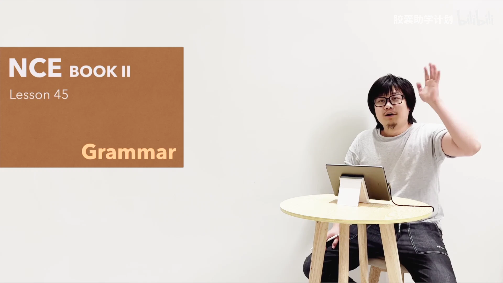

文字识别：NCE / BOOKII / Lesson 45 / Grammar

### 画面 00:00:02

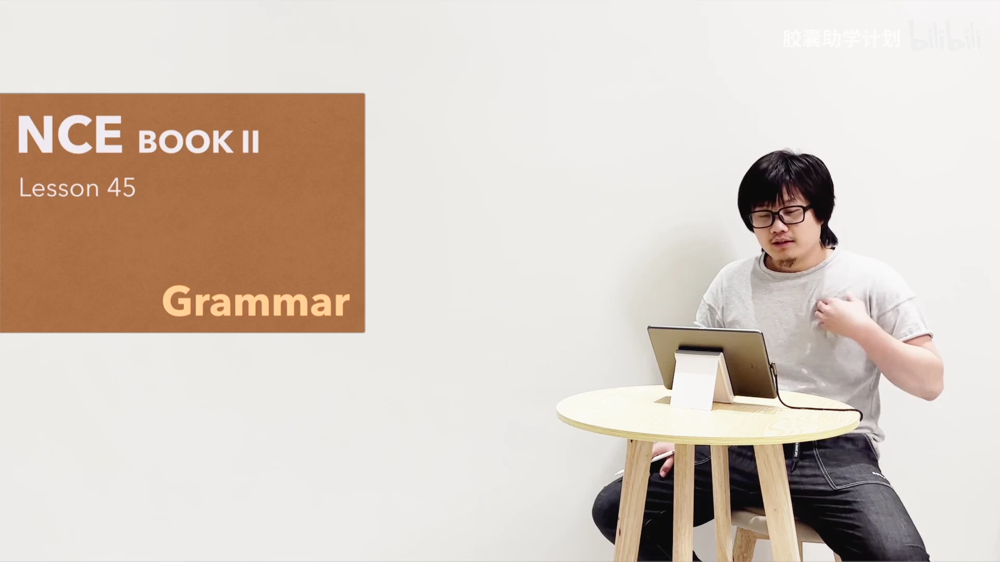

文字识别：NCE / BOOKII / Lesson 45 / Grammar

### 画面 00:00:04

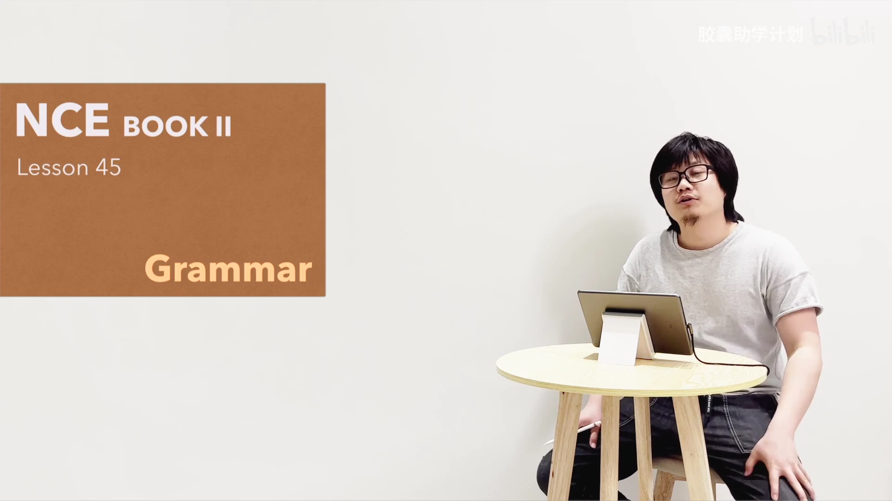

文字识别：NCE / BOOKⅡI / Lesson 45 / Grammar

### 画面 00:00:10

文字识别：胶囊助学计划b出l / •

### 画面 00:00:13

文字识别：胶囊助学计划 / 胶囊助学计划

### 画面 00:00:15

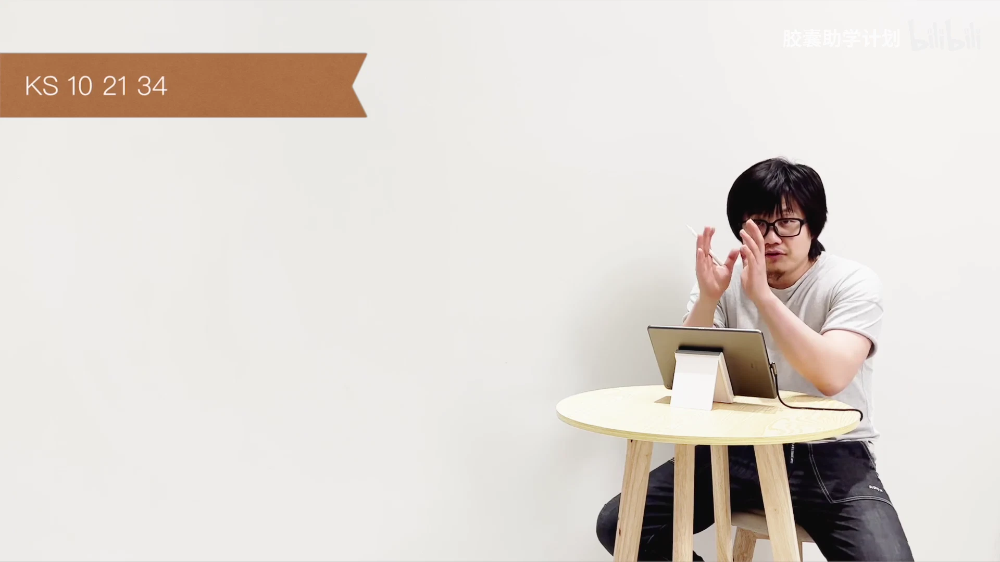

文字识别：KS 10 21 34

## 00:00:30–00:01:00

的，所以我们重点要去复习的是第十课、第二十一课和第三十四课我们曾经学过的被动。呃，鉴于在三十四课的时候，其实我们已经复习一遍了，今天我们就迅速的回顾一下就好了，好吧？比如说被动最基本的结构就是 be 加 but，然后呢，比如说 is 加 but。我们原来说过一个事儿叫做 be 表时态， but 表被动。我希望各位记得这句话。那 be 可以变成

### 画面 00:00:32

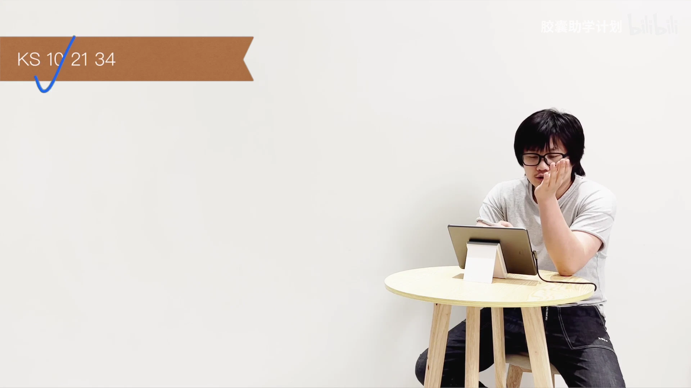

文字识别：KS 1021 34

### 画面 00:00:34

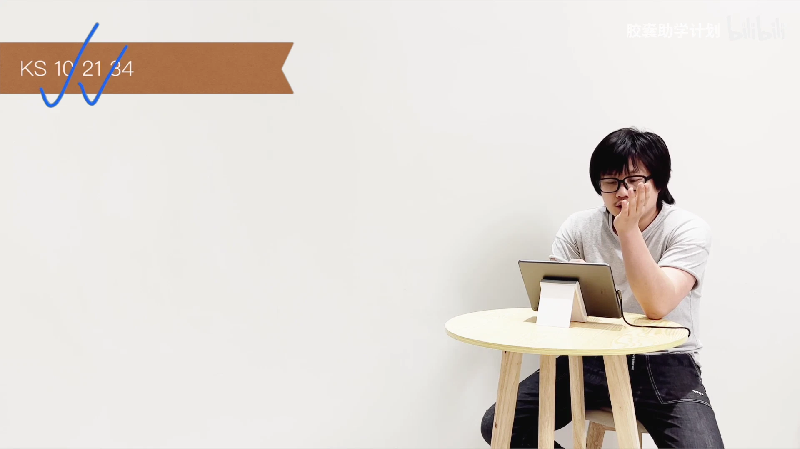

文字识别：KS 1021 34

### 画面 00:00:36

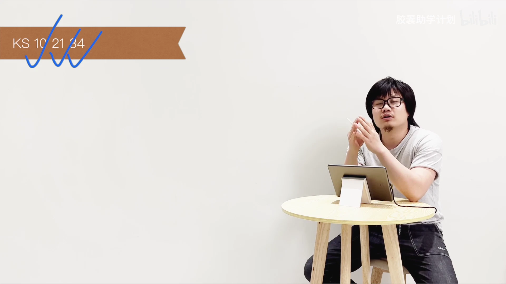

文字识别：KS102134

### 画面 00:00:51

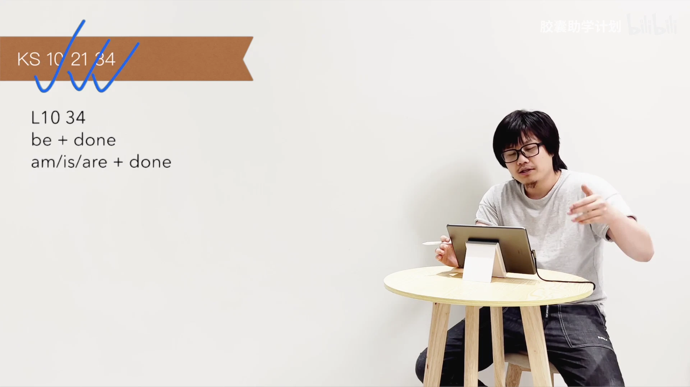

文字识别：KS 102134 / L10 34 / be + done / am/is/are + done

### 画面 00:00:55

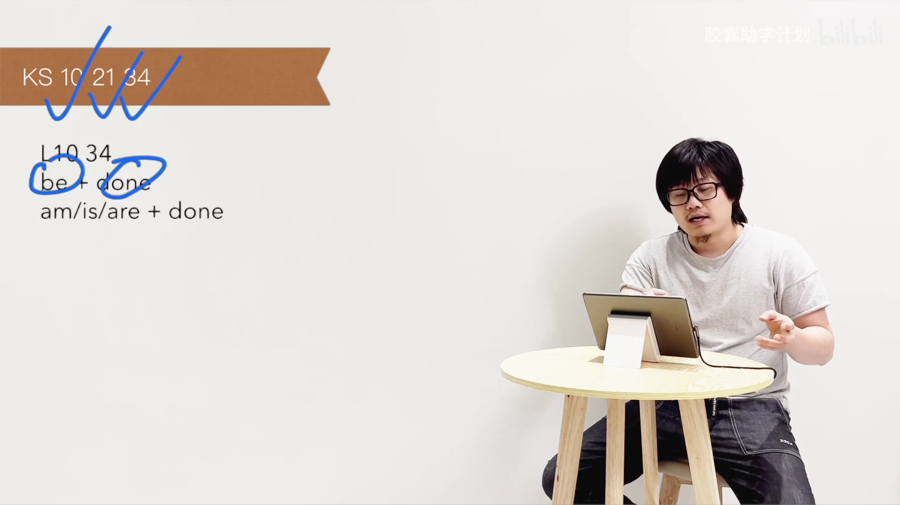

文字识别：KS102134 / L1Q34 / Gbet done / am/is/are + done

## 00:01:00–00:01:30

am/is/are, am/is/are 加 done 一般现在时的被动, was/were 加 done 一般过去时的被动，对吧？然后 have has been done 这叫做现在完成时的被动，这全是我们时刻学的。三十四课呢，咱们多引申了一个东西，叫做告诉你 have has 也可以变成 had，于是呢就出现了一个新的结构叫 had been done，对吧？那这个叫做过去完成时的被动。OK，那再然后 am/is/are 加 being 再加 done，

### 画面 00:01:07

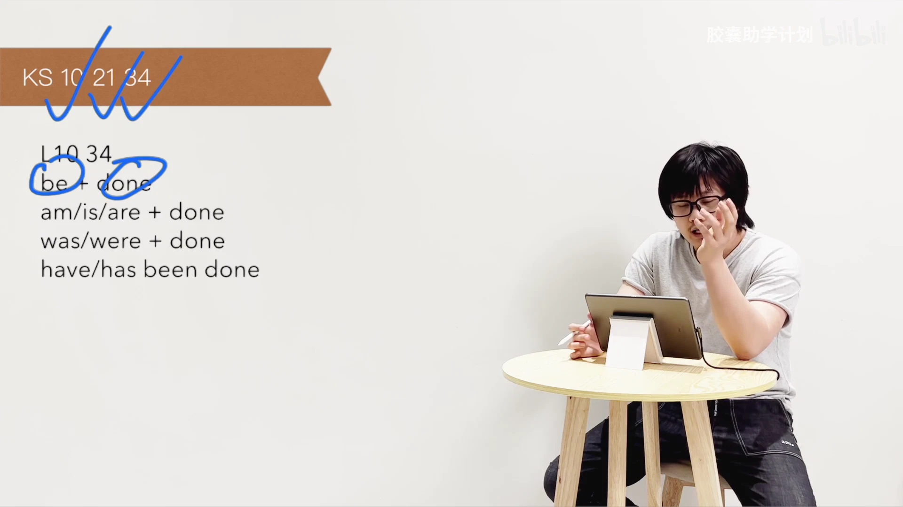

文字识别：KS102134 / L1Q34 / Cbet done / am/is/are + done / was/were + done / have/has been done

## 00:01:30–00:02:00

其实就是现在进行时的被动。那在这儿我就想提一个问题，虽然我还没有讲，对吧？如果我把 is are being done 里面的 is are 变成了 was were，也就是这个公式变成了 was were being done，那我就想问一个问题，你觉得它是什么时态的被动呢？是吧？这个以后我们一定会讲到啊，各位可以自己先想一下，在视频下方不妨留言告诉我们。OK，好，呃，was

### 画面 00:01:36

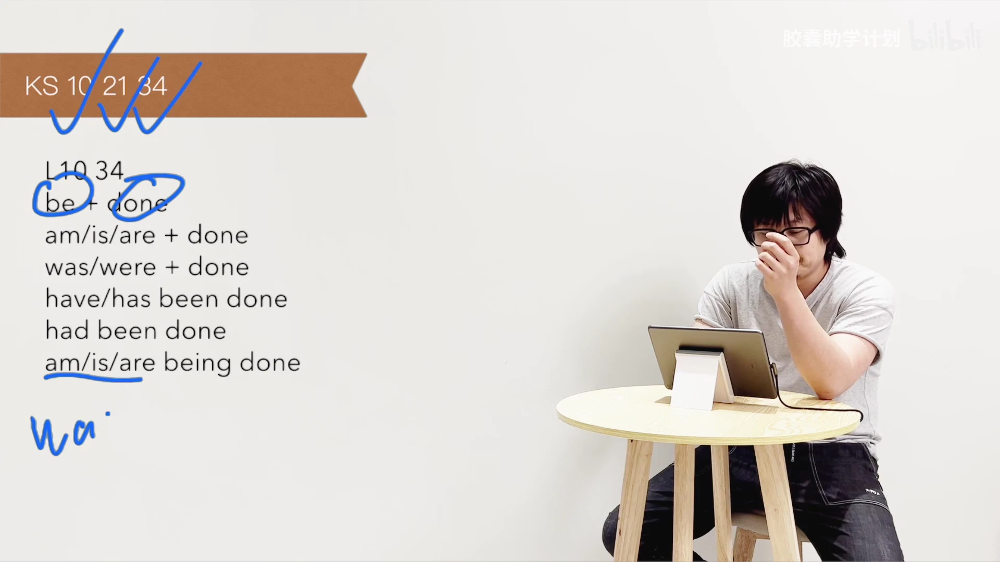

文字识别：KS102134 / L1Q34 / Gbet done / am/is/are + done / was/were + done / have/has been done / had been done / am/is/are being done / Wa

### 画面 00:01:41

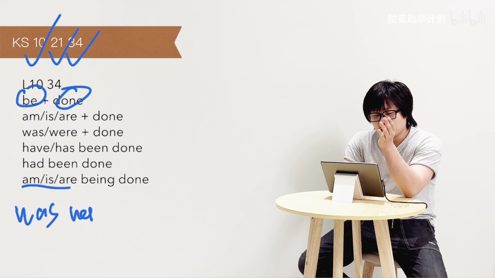

文字识别：KS102134 / L1Q34 / Gbet done / am/is/are + done / was/were + done / have/has been done / had been done / am/is/are being done / wel

### 画面 00:01:45

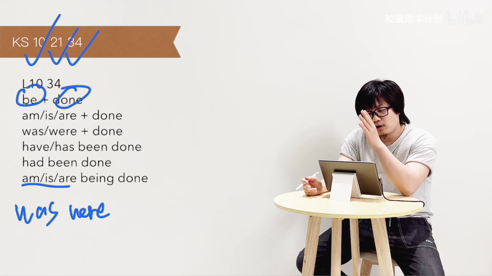

文字识别：KS102134 / L1Q34 / Gbet done / am/is/are + done / was/were + done / have/has been done / had been done / am/is/are being done / WaS / here

## 00:02:00–00:02:30

word be done? 啊，刚才我提到了，very good. 接下来呢，二十一课咱们其实学的就不是更多的不是时态的被动了，各种情态动词的被动，比如说 will be done 啊，将被怎么怎么样，can be done 能被怎么怎么样，must be done 必须被怎么怎么样，have to be done 也是必须怎么怎么样，对吧？这是咱们早在二十一课就学过的。当然还有一个，后来我不停的在用单词造句的时候，不停用不停用的一个

### 画面 00:02:02

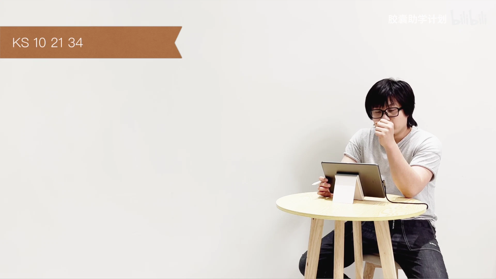

文字识别：KS 10 21 34

### 画面 00:02:18

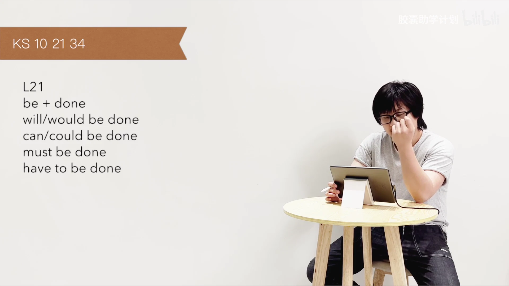

文字识别：KS 10 21 34 / L21 / be + done / will/would be done / can/could be done / must be done / have to be done

### 画面 00:02:26

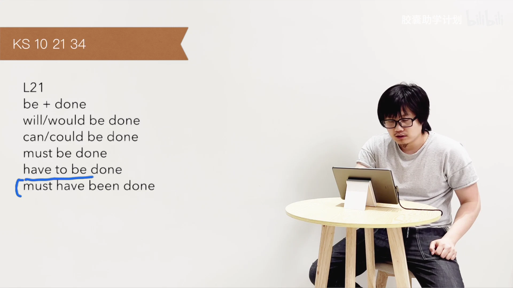

文字识别：KS 10 21 34 / L21 / be + done / will/would be done / can/could be done / must be done / have to be done / must have been done

### 画面 00:02:28

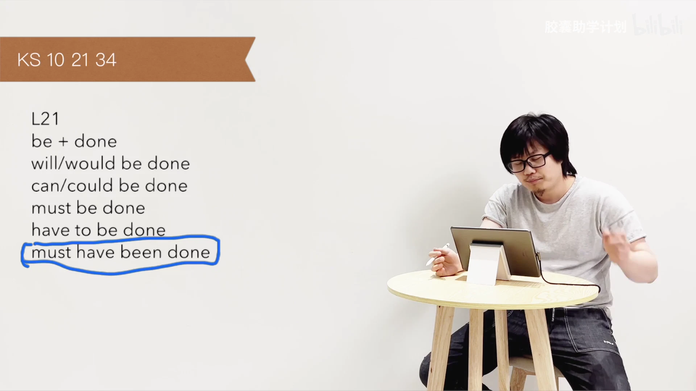

文字识别：KS 10 21 34 / L21 / be + done / will/would be done / can/could be done / must be done / have to be done / must have been done

## 00:02:30–00:03:00

东西，对吧？不停的在用叫 must have been done。它实际上既是被动，又是情态动词表推测，对吧？表示的叫做当时一定是被怎么怎么样了。Must have been done。 Okay, very good。好，我们复习完了之后呢，我们要明白所有的被动本质上就是六一二三四五六当中的二这个点，您记住就 OK 了，好吧？然后我们接下来要做的事情呢，

### 画面 00:02:48

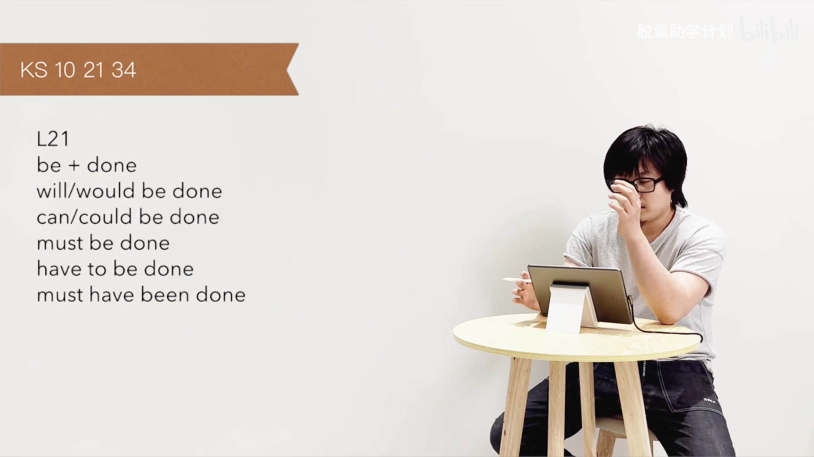

文字识别：KS 10 21 34 / L21 / be + done / will/would be done / can/could be done / must be done / have to be done / must have been done

### 画面 00:02:50

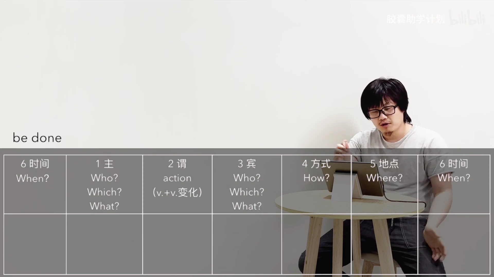

文字识别：be done / 6时间 / 1主 / 2谓 / 3宾 / 4方式 / 5地点 / 6时间 / When? / Who? / action / Who? / How? / Where? / When? / Which? / (v.+v.变化) / Which? / What? / What?

### 画面 00:02:52

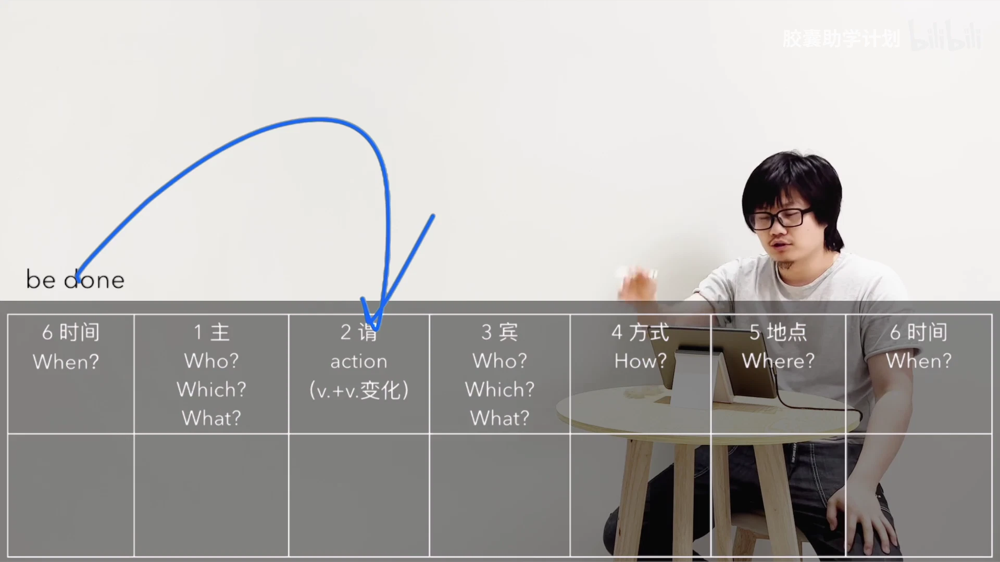

文字识别：be done / 6时间 / 1主 / 2谓 / 3宾 / 4方式 / 5地点 / 6时间 / When? / Who? / action / Who? / How? / Where? / When? / Which? / (v.+v.变化) / Which? / What? / What?

### 画面 00:02:58

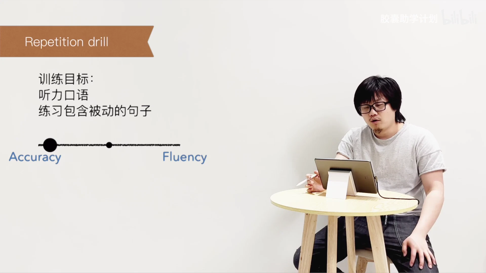

文字识别：Repetition drill / 训练目标： / 听力口语 / 练习包含被动的句子 / Accuracy / Fluency

## 00:03:00–00:03:30

就是直接用练习进行复习，好吧？那我们就直接来了啊，不多说了。比如说，你可以跟我读啊。Tell me about him. Must they pay him for this? They must pay him for this. They must pay him for this. They must pay him for this. They must pay him for this. They must pay him for this. They must pay him for this. They must pay him for this. They must pay him for this. They must pay him for this. They must pay him for this. They must pay him for this. They must pay him for this. They must pay him for this. They must pay him for this. They must pay him for

### 画面 00:03:04

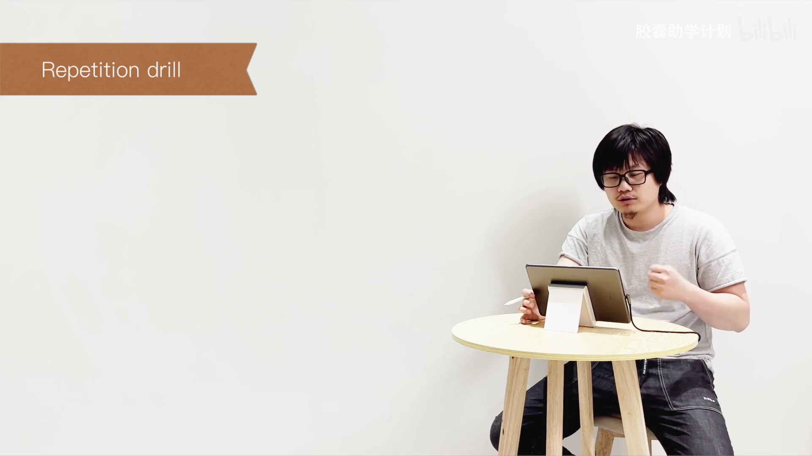

文字识别：Repetition drill

### 画面 00:03:16

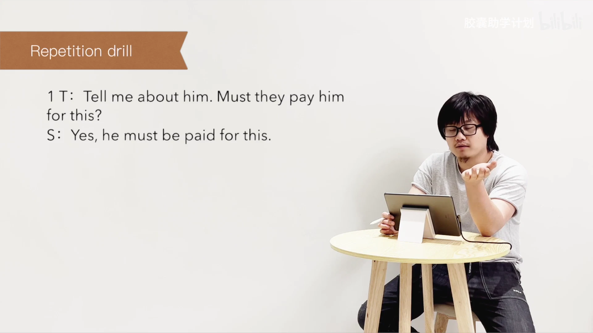

文字识别：Repetition drill / 1 T: Tell me about him. Must they pay him / for this? / S: Yes, he must be paid for this.

### 画面 00:03:27

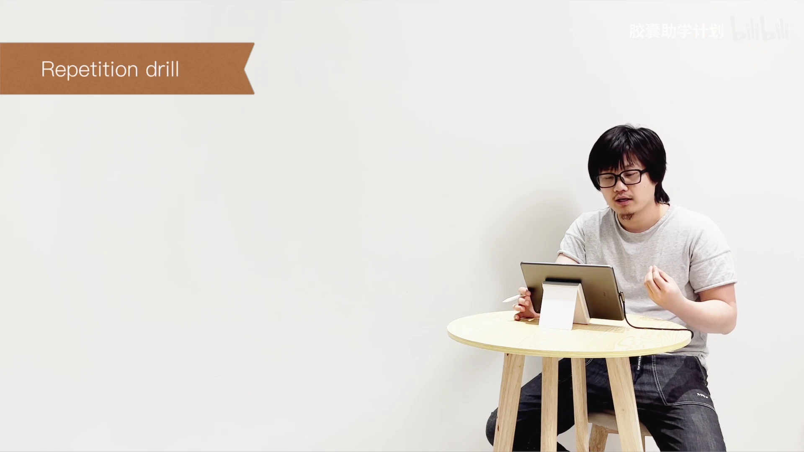

文字识别：Repetition drill

## 00:03:30–00:04:00

Can they inform her? Ah, they can inform her. Yes, Betty can be informed. Can be done. Okay, very good. Continue. So tell me about the parcel. 那你给我讲一讲这个包裹吧. Had they sent it to the wrong address? They sent it to the wrong address. They sent it to the wrong address. They sent it to the wrong address. They sent it to the wrong address. They sent it to the wrong address. They sent it to the wrong address. They sent it to the wrong address. They sent it to the wrong

### 画面 00:03:40

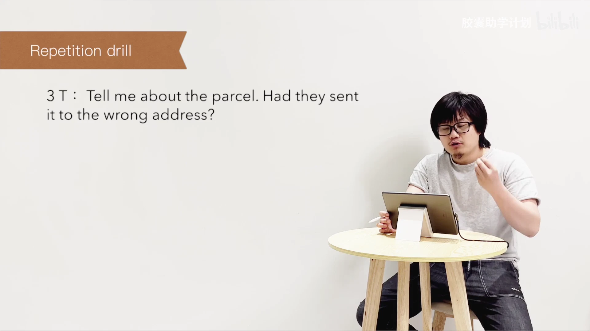

文字识别：Repetition drill / 3 T: Tell me about the parcel. Had they sent / it to the wrong address?

### 画面 00:03:51

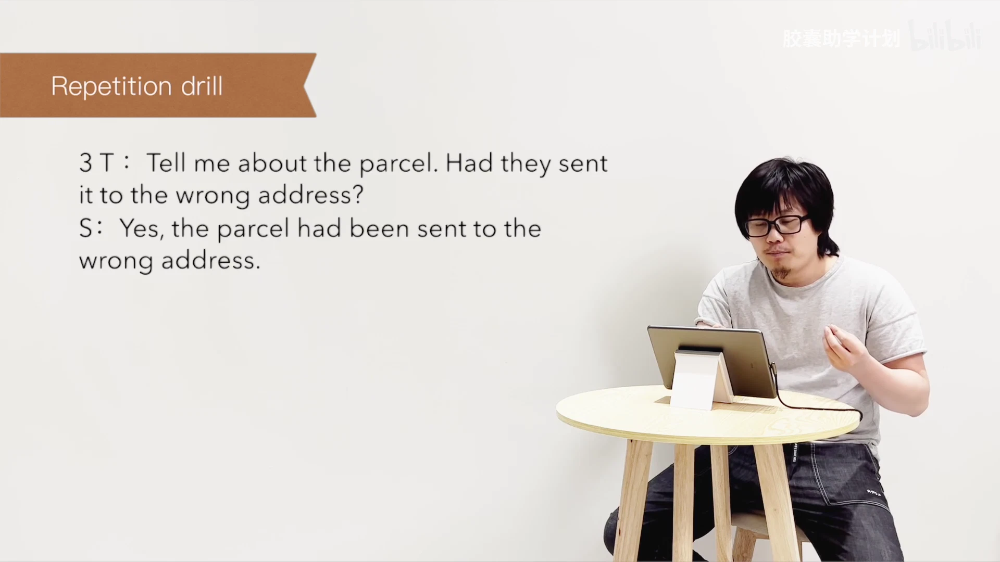

文字识别：Repetition drill / 3 T: Tell me about the parcel. Had they sent / it to the wrong address? / S: Yes, the parcel had been sent to the / wrong address.

### 画面 00:03:54

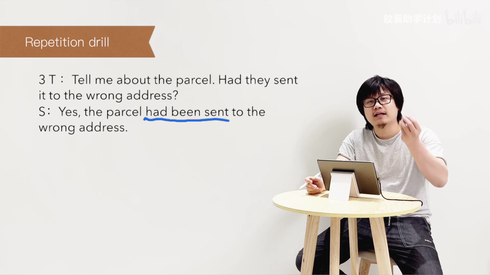

文字识别：Repetition drill / 3 T: Tell me about the parcel. Had they sent / it to the wrong address? / S: Yes, the parcel had been sent to the / wrong address.

## 00:04:00–00:04:30

address. Very good. Next one. So tell me about yourself. Will they send you home?他们会把你送回家吗？Yes, I shall be sent home.注意啊，这个shall我们在新一就讲过了，九十一课，新一的九十一课就是will啊，类似于will。各位可以主动，从来不用shall，你永远可以用will啊，至少在这个时态之下。OK啊，very good.那叫做我将被送回家。Will be done，对吧？Next

### 画面 00:04:01

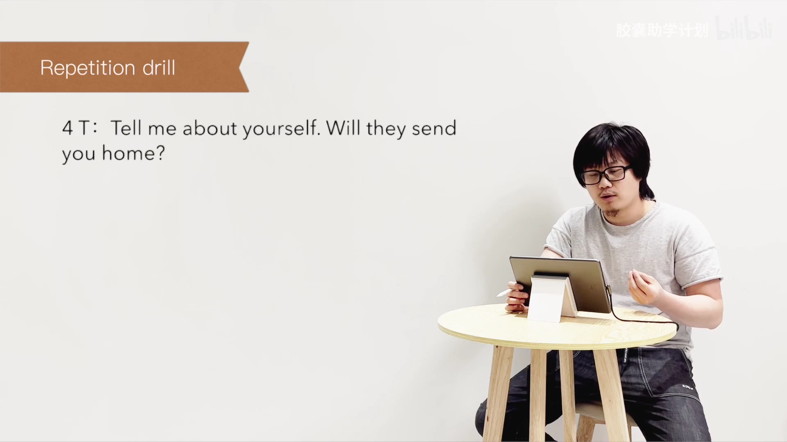

文字识别：Repetition drill / 4 T: Tell me about yourself. Will they send / you home?

### 画面 00:04:16

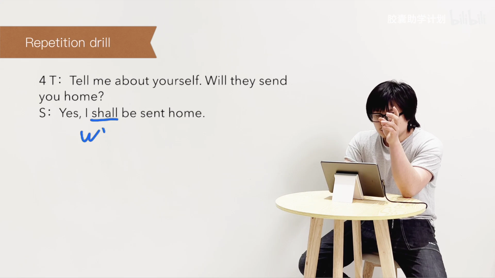

文字识别：Repetition drill / 4 T: Tell me about yourself. Will they send / you home? / S: Yes, I shall be sent home. / w'

### 画面 00:04:18

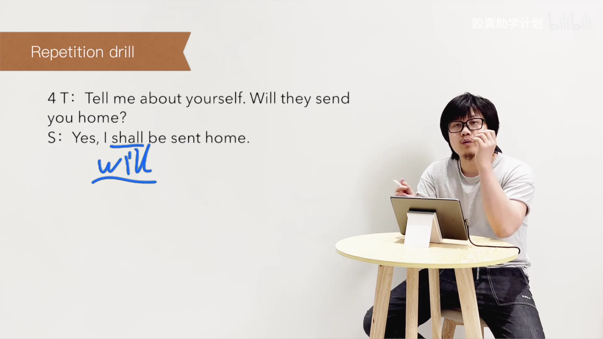

文字识别：Repetition drill / 4T: Tell me about yourself. Will they send / you home? / S: Yes, I shall be sent home. / wTu

### 画面 00:04:29

文字识别：Repetition drill

## 00:04:30–00:05:00

one, so tell me about the fire. Had they put it out before the fire brigade arrived? Ah, brigade arrived. Okay, very good. So yes, the fire had been put out before the fire brigade arrived. Okay,注意had been done,看见了吧?哎，过去完成时的被动。Very good. Next one, so tell me about the thief. Will they arrest him?他们会逮捕他吗? Yes, the thief will be

### 画面 00:04:38

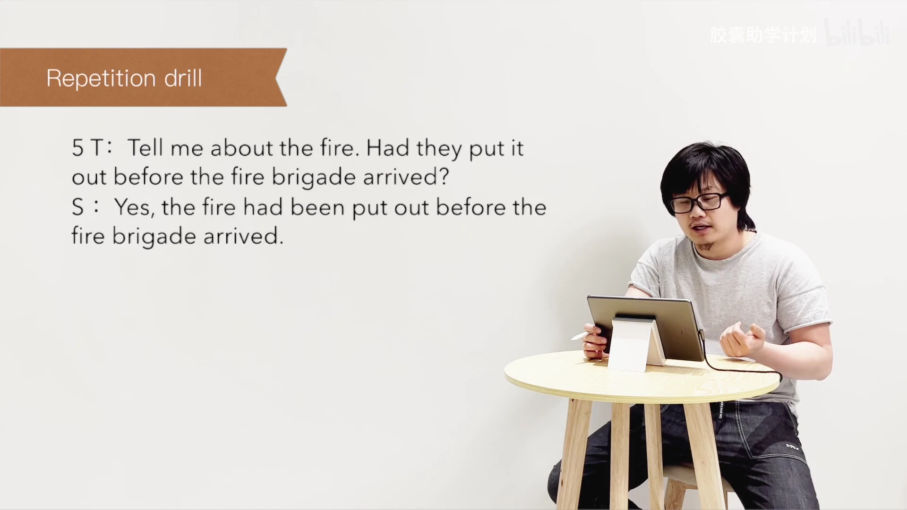

文字识别：Repetition drill / 5 T: Tell me about the fire. Had they put it / out before the fire brigade arrived? / S: Yes, the fire had been put out before the / fire brigade arrived.

### 画面 00:04:50

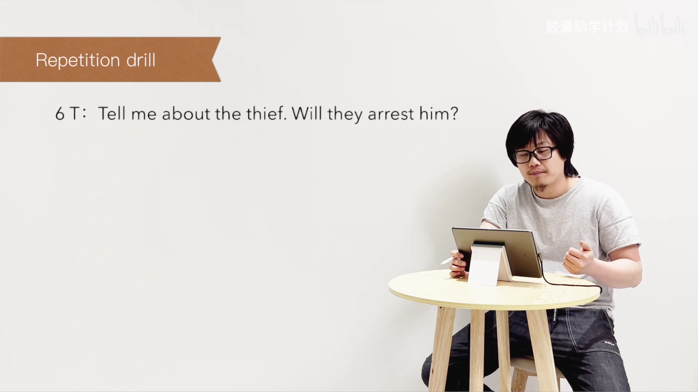

文字识别：Repetition drill / 6 T: Tell me about the thief. Will they arrest him?

## 00:05:00–00:05:30

Will be done. There you go.张嘴跟我读啊，来，tell me about the man. May they dismiss him? Okay. Yes, the man may be dismissed.你看，may be done，对吧？还是那句话啊，你想一下，它的逻辑最基本的就是be加done，前面加一个情态动词，对吧？我们虽然没有真的没有讲过说may加be和done，但我们讲过must加be done，讲过have to加be done. Okay.

### 画面 00:05:07

文字识别：Repetition drill / 7 T: Tell me about the man. May they / dismiss him? / S: Yes, the man may be dismissed.

### 画面 00:05:11

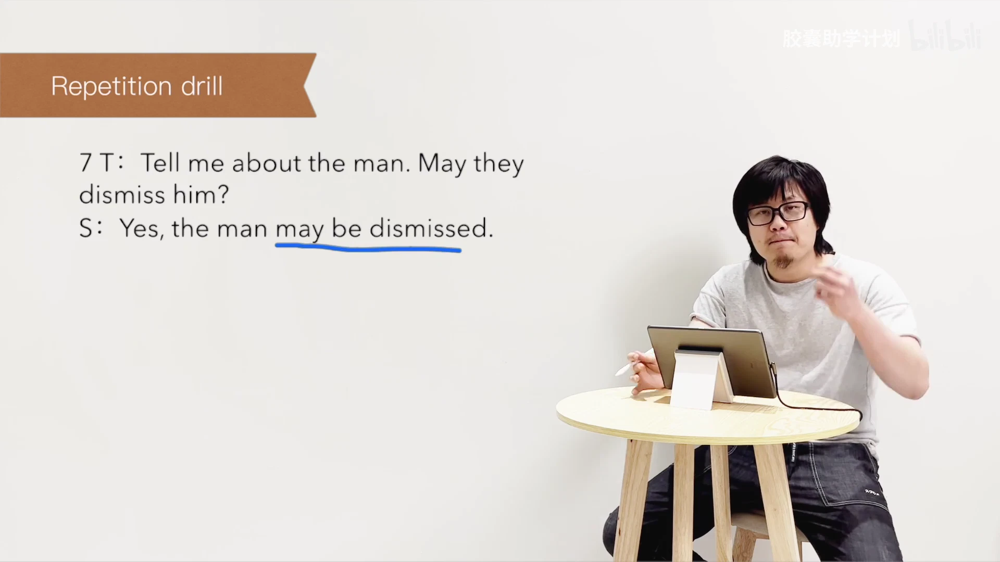

文字识别：Repetition drill / 7 T: Tell me about the man. May they / dismiss him? / S: Yes, the man may be dismissed.

## 00:05:30–00:06:00

下一个，说Tell me about yourself. Will they ask you to make a speech?啊，他们会要求你去做演讲吧？你看啊，Yes, I shall be asked to make a speech. Shall我刚才讲了will对吧？Will be done. Very good. Next one.说Tell me about the singers. Can we see them on television? Yes, the singers can be seen on television.好，还大大声张开嘴跟我读，Can be done，

### 画面 00:05:30

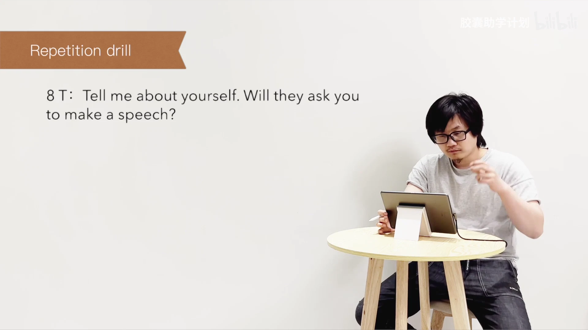

文字识别：Repetition drill / 8 T: Tell me about yourself. Will they ask you / to make a speech?

### 画面 00:05:42

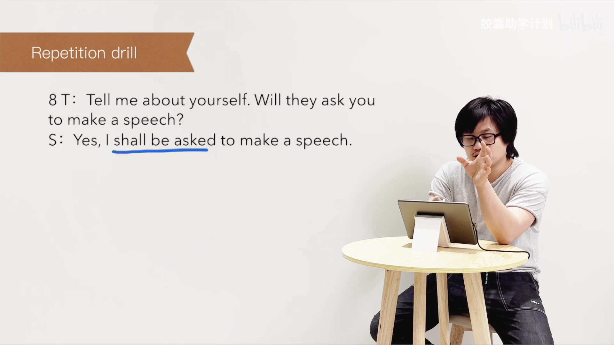

文字识别：Repetition drill / 8 T: Tell me about yourself. Will they ask you / to make a speech? / S: Yes, I shall be asked to make a speech.

### 画面 00:05:46

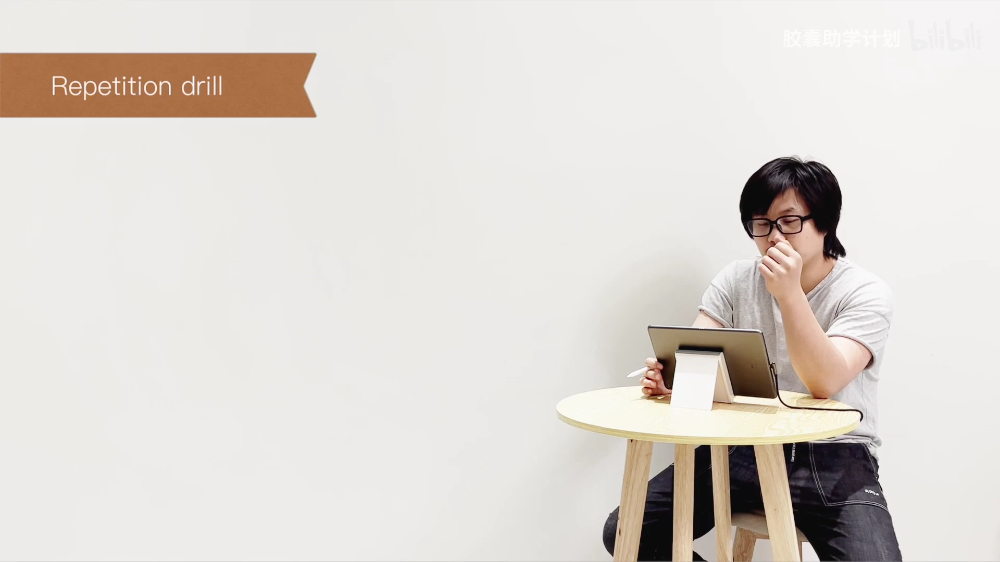

文字识别：Repetition drill

### 画面 00:05:53

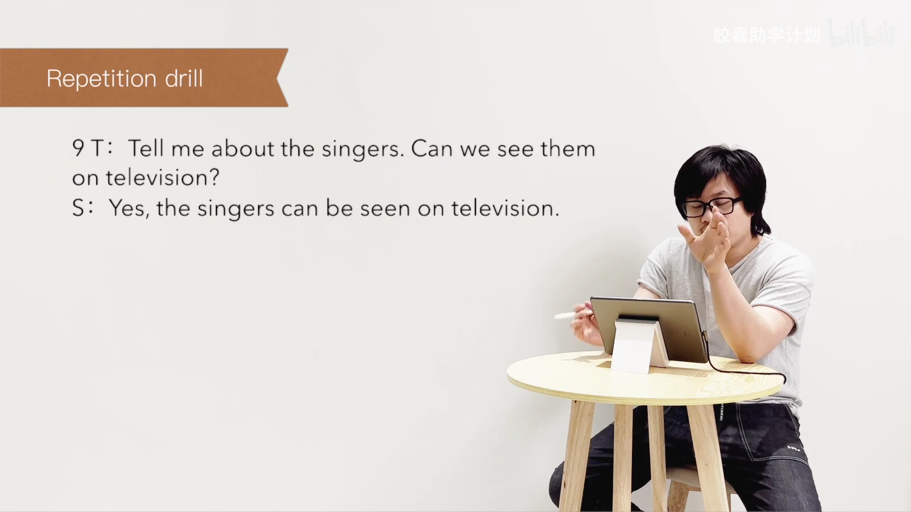

文字识别：Repetition drill / 9 T: Tell me about the singers. Can we see them / on television? / S: Yes, the singers can be seen on television.

## 00:06:00–00:06:30

对吧？Next one, so tell me about the boy. Must they take him to hospital? Yes, the boy must be taken to hospital. Must be done. Okay, very good.好，刚才我们做了十道练习题，接下来呢，刚才是口语听力练习题，对吧？好，您如果刚才做一遍没过瘾，再再跟着我读一遍就好了。视频放回去。Patanjali呢，是我们说老习惯的，叫做我告诉各位这两句话什么意思？各位把底下的这些

### 画面 00:06:01

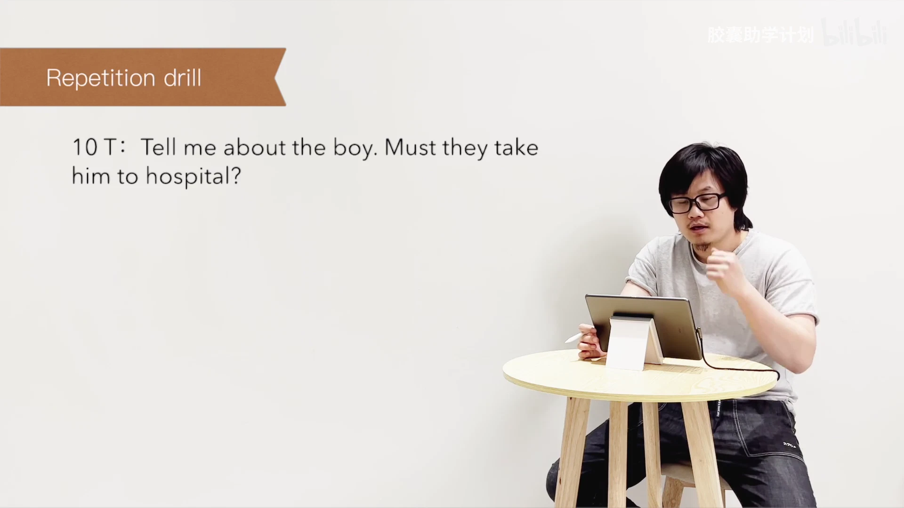

文字识别：Repetition drill / 10 T: Tell me about the boy. Must they take / him to hospital?

### 画面 00:06:12

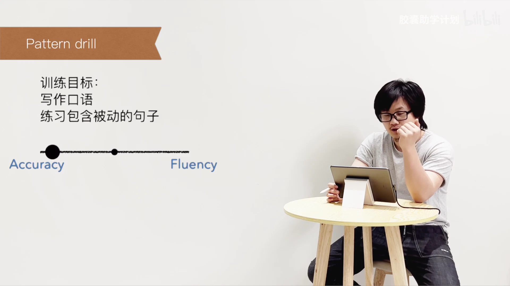

文字识别：Pattern drill / 训练目标： / 写作口语 / 练习包含被动的句子 / Accuracy / Fluency

### 画面 00:06:25

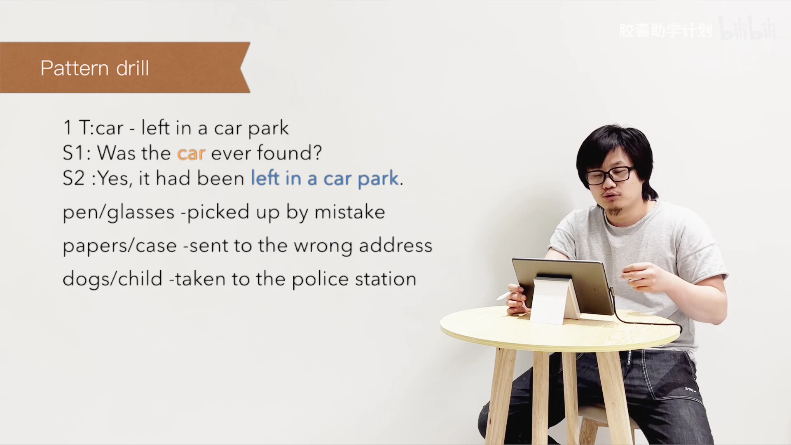

文字识别：Pattern drill / 1 T:car - left in a car park / S1: Was the car ever found? / S2 :Yes, it had been left in a car park. / pen/glasses -picked up by mistake / papers/case -sent to the wrong address / dogs/child -taken to the police station

## 00:06:30–00:07:00

往里面去带，先写，然后再大声朗读，好吧？那我们看一下这句话啊，两句话。第一个人说，Was the car ever found？说这个车到底有没有被找到？Was found，一般过去时的被动的一般疑问句，对吧？哎，问一个，说，Yes， it had been left in a car park。你看，had been done，呃，过去完成时的被动，对吧？Okay， very good. Next one，

### 画面 00:06:55

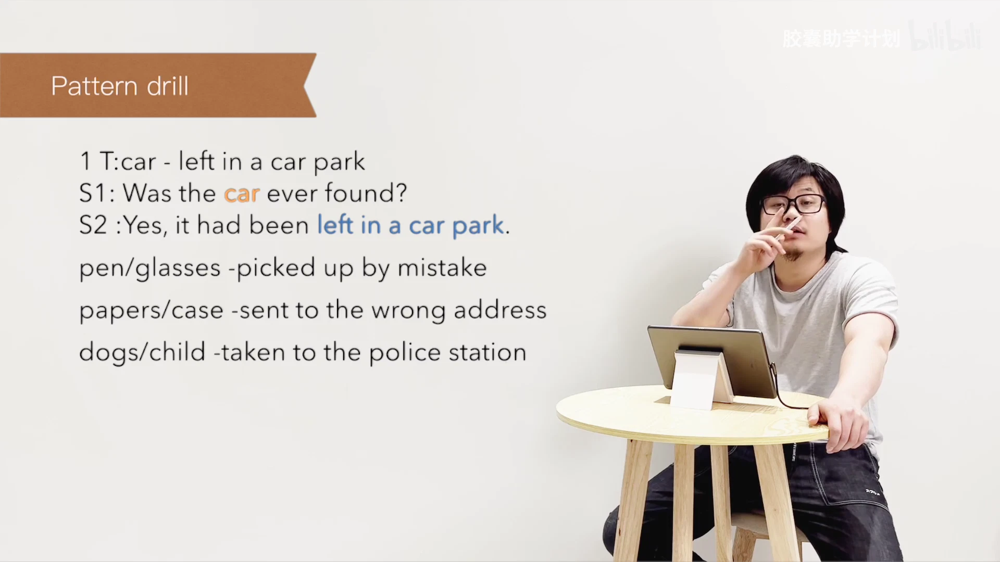

文字识别：Pattern drill / 1 T:car - left in a car park / S1: Was the car ever found? / S2 :Yes, it had been left in a car park. / pen/glasses -picked up by mistake / papers/case -sent to the wrong address / dogs/child -taken to the police station

### 画面 00:06:58

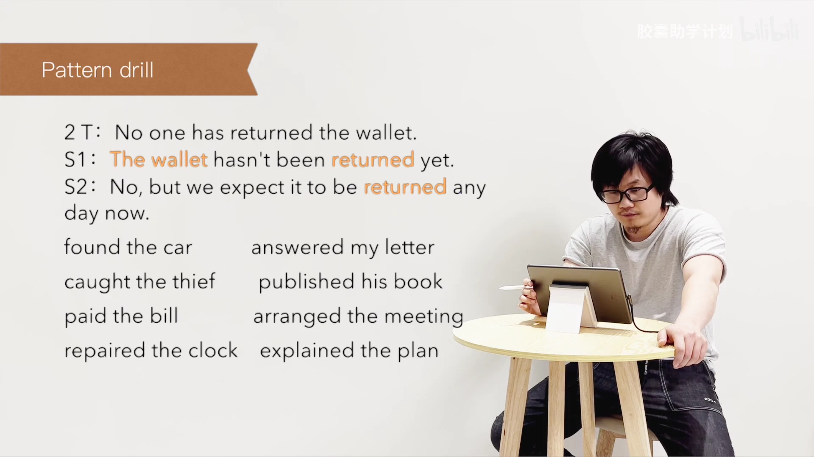

文字识别：Pattern drill / 2 T: No one has returned the wallet. / S1: The wallet hasn't been returned yet. / S2: No, but we expect it to be returned any / day now. / found the car / answered my letter / caught the thief / published his book / paid the bill / arranged the meeting / repaired the clock / explained the plan

## 00:07:00–00:07:30

say the wallet hasn't been returned yet. 现在完成时的被动，并且是否定 hasn't been done, 对吧？说还没有被送回来。所以您实际上把底下这些短语往里面去带的时候，最终练的是什么呢？我觉得有几个作用啊，在这简单提一下。第一个作用实际上是帮助我们把这些单词都复习一下啊，都很多都是我们之前学过的。其次的作用是什么呢？帮助你其实把 hasn't been done 这样的一个

### 画面 00:07:28

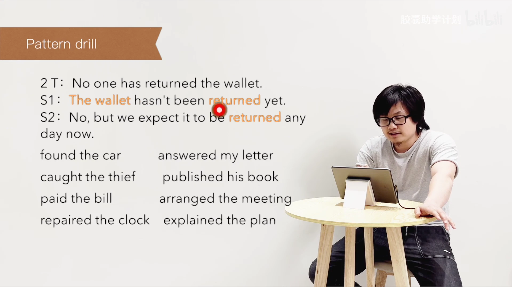

文字识别：Pattern drill / 2 T: No one has returned the wallet. / S1:1 / The wallet hasn't been returned yet. / S2: No, but we expect it to be returned any / day now. / found the car / answered my letter / caught the thief / published his book / paid the bill / arranged the meeting / repaired the clock / explained the plan

## 00:07:30–00:08:00

个结构给它记下来啊。说 no, but we expect it to be returned any day now. 说我们期待预期它被还回来 any day now 就任何一天啊，任何时候未来的接下来的任何一天都可能会被送回来。 Okay, very good. 第三个 I've been told to pay the rent. 你看 have been done 对吧？我已经被告知了干嘛呢？ Pay the rent,

### 画面 00:07:49

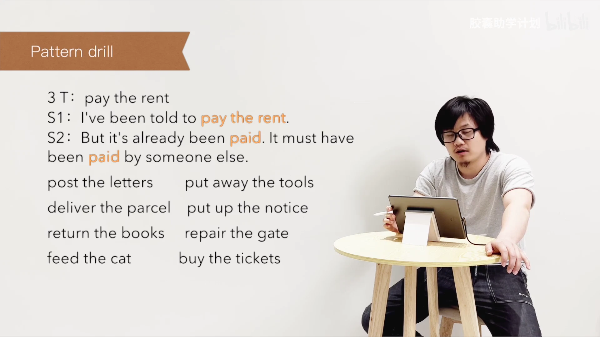

文字识别：Pattern drill / 3 T: pay the rent / S1: I've been told to pay the rent. / S2: But it's already been paid. Ilt must have / been paid by someone else. / post the letters / put away the tools / deliver the parcel / put up the notice / return the books / repair the gate / feed the cat / buy the tickets

## 00:08:00–00:08:30

支付这个租金. But it's already been paid, has been done.注意这儿的P.S.是has，对吧？但是它已经被支付了. It must have been paid by someone else.啊，someone else指的是其他别人啊，其他的任别人。那must have been done是我们刚刚说的二十一课，咱们学过非常各位很容易忘的一个结构。六一二三四五六里边的二，对不对？OK，玩一个。

### 画面 00:08:19

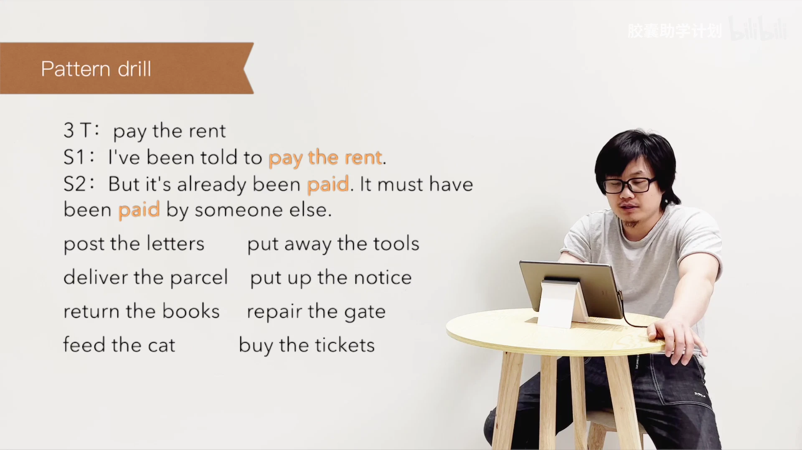

文字识别：Pattern drill / 3 T:pay the rent / S1: I've been told to pay the rent. / S2: But it's already been paid. Ilt must have / been paid by someone else. / post the letters / put away the tools / deliver the parcel / put up the notice / return the books / repair the gate / feed the cat / buy the tickets

## 00:08:30–00:09:00

接下来说The bill hasn't been paid，而这个账单还没有被支付。I thought it had been paid by your secretary. I'm sorry.你看这里实际上至少有两个语法点。第一个叫做had been done，过去完成时的被动。第二个，因为这里是thought，所以时态被往后迁了一下，对吧？变成了had been done。好，呃，家庭作业呢？呃呃，先说recap啊，我们本

### 画面 00:08:30

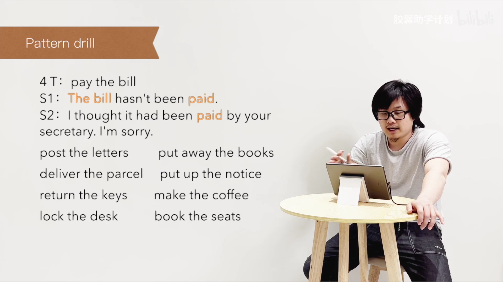

文字识别：Pattern drill / 4T: pay the bill / S1: The bill hasn't been paid. / S2: I thought it had been paid by your / secretary. I'm sorry. / post the letters / put away the books / deliver the parcel / put up the notice / return the keys / make the coffee / lock the desk / book the seats

### 画面 00:08:56

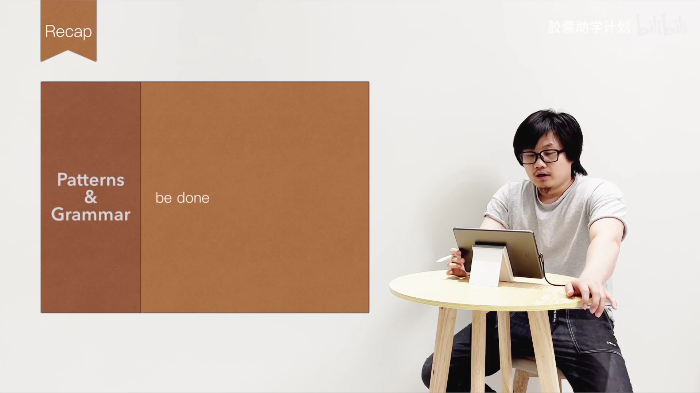

文字识别：Recap / Patterns / ＆ / be done / Grammar

### 画面 00:08:58

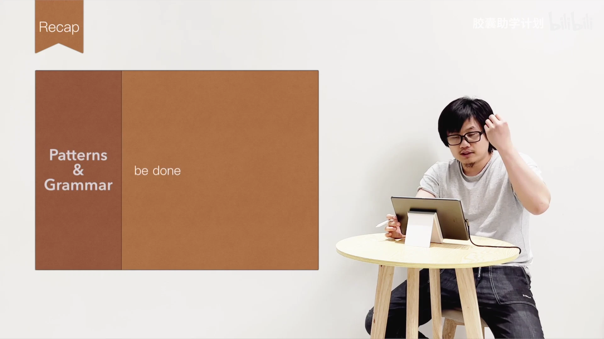

文字识别：Recap / Patterns / ＆ / be done / Grammar

## 00:09:00–00:09:30

课重点要去复习和练习的其实就是必弹啊，还是老习惯，所以各位刚才做了那些练习，其实就是在复习。 OK，好，那家庭作业呢？ Pattern drill，那各位这一课的其实要好好认真写一下，因为它出现了很多我们之前学过的被动嘛，对吧？ OK，那老习惯四乘四啊，然后尝试给自己讲解一遍今天的核心语法，其实对于各位来说就是总结一下嘛，对吧？自己去总结一下，回忆，通过回忆去进行总结，效果

### 画面 00:09:00

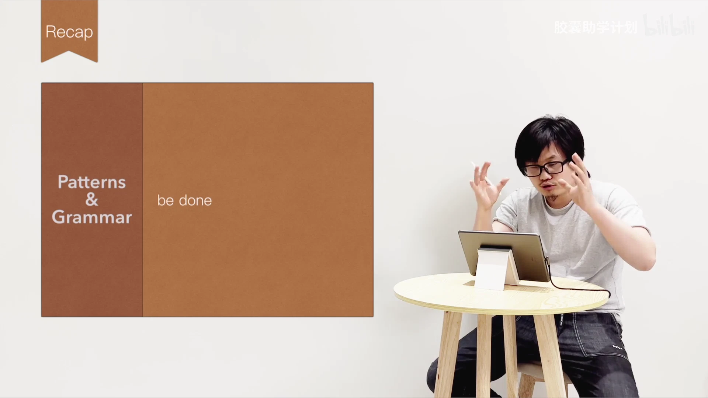

文字识别：Recap / Patterns / be done / Grammar

### 画面 00:09:04

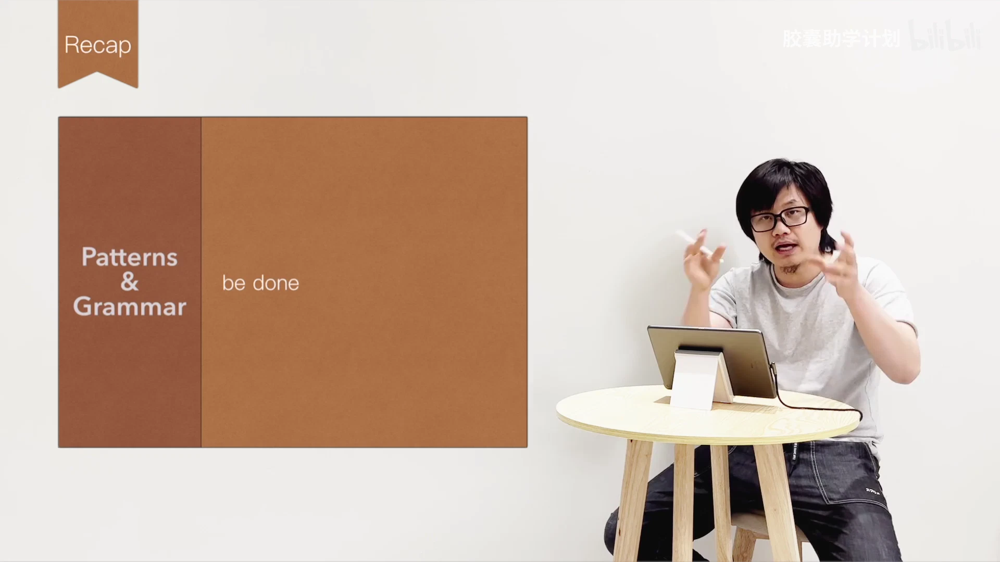

文字识别：Recap / Patterns / ＆ / be done / Grammar

### 画面 00:09:10

### 画面 00:09:12

文字识别：1.f / Pattern Drill写&朗读 / 专栏 / 4×4

### 画面 00:09:14

文字识别：1.f / Pattern Drill 写&朗读 / 专栏 / 4×4

### 画面 00:09:18

文字识别：Pattern Drill写&朗读 / 专栏 / 4×4 / 尝试回忆并给自己讲解一 / 遍今天的核心语法 / Study-Test / Learning Pyramid

### 画面 00:09:20

文字识别：Pattern Drill写&朗读 / 1. / 专栏 / 4×4 / 尝试回忆并给自己讲解一 / 遍今天的核心语法 / Study-Test / Learning Pyramid

### 画面 00:09:24

文字识别：Pattern Drill写&朗读 / 专栏 / 4×4 / 尝试回忆并给自己讲解一 / 遍今天的核心语法 / Study-Test / Learning Pyramid

### 画面 00:09:29

文字识别：Pattern Drill写&朗读 / 1. / 专栏 / 4X4 / 尝试回忆并给自己讲解一 / 遍今天的核心语法 / Study-Test / Learning Pyramid

## 00:09:30–00:10:00

非常的好。最后呢，就是你要尝试翻阅红皮书啊，通过目录啊或者索引找一下本课的这些语法。如果各位单词量比较大，你可以试着去写一下了，已经好吧？那以上就是本期视频的全部内容了。如果各位喜欢我们的课程呢，欢迎各位关注、订阅、一键三连啊，长按点赞。OK，好，那See you next time。

### 画面 00:09:31

文字识别：1. f / Pattern Drill写&朗读 / 专栏 / 4×4 / 尝试回忆并给自己讲解一 / 遍今天的核心语法 / Study-Test / Learning Pyramid / 尝试翻阅红皮书（中级） / 通过目录或索引(Index) / 查找到本课语法

### 画面 00:09:34

文字识别：1. f / Pattern Drill写&朗读 / 专栏 / 4×4 / 尝试回忆并给自己讲解一 / 遍今天的核心语法 / Study-Test / Learning Pyramid / 尝试翻阅红皮书（中级） / 通过目录或索引(Index) / 查找到本课语法

### 画面 00:09:39

文字识别：1. f / Pattern Drill写&朗读 / 专栏 / 4×4 / 尝试回忆并给自己讲解一 / 遍今天的核心语法 / Study-Test / Learning Pyramid / 尝试翻阅红皮书（中级） / 通过目录或索引(Index) / 查找到本课语法

### 画面 00:09:42

文字识别：👍

### 画面 00:09:54

### 画面 00:09:56

文字识别：CAPSULEACADEMY / 胶囊助学计划 / 小红书 / Lecturer / □ / 口 / Leo / OE

### 画面 00:09:59

文字识别：CAPSULEACADEMY / 胶囊助学计划 / 小红书 / Editor / OE

## 00:10:00–00:10:06

### 画面 00:10:02

文字识别：CAPSULEACADEMY / 胶囊助学计划 / 小红书 / Creator / □ / Leo & Berlin / OE

### 画面 00:10:04

文字识别：bilibili / 胶囊助学计划 / 胶囊助学计划 / 小红书 / 0 / OE

### 画面 00:10:06

文字识别：bilibili / 胶囊助学计划

