# L045 文章

快速机器解析：语音为单模型转写，未进行独立交叉校对或人工复核；画面每秒采样并按变化选帧，短时文字和标记可能遗漏。截图时间约有 1 秒误差。图片有损压缩；遇到疑点请按时间查看 Google Drive 原视频。

## 00:00:00–00:00:30

Hello everyone, welcome to Capsule Academy. This is Leo. Today we're going to learn New Concept English Book Two, Lesson Forty Five, Story. Hope you can enjoy. Okay,好，那注意啊，本课其实是我们相对来说略讲的一课啊，各位可以放轻松啊。这课基本没有新的语法，大多数都是我们之前学过的，好吧？好来了啊，几乎都是我们之前学过的。说 the whole village 啊，整

### 画面 00:00:00

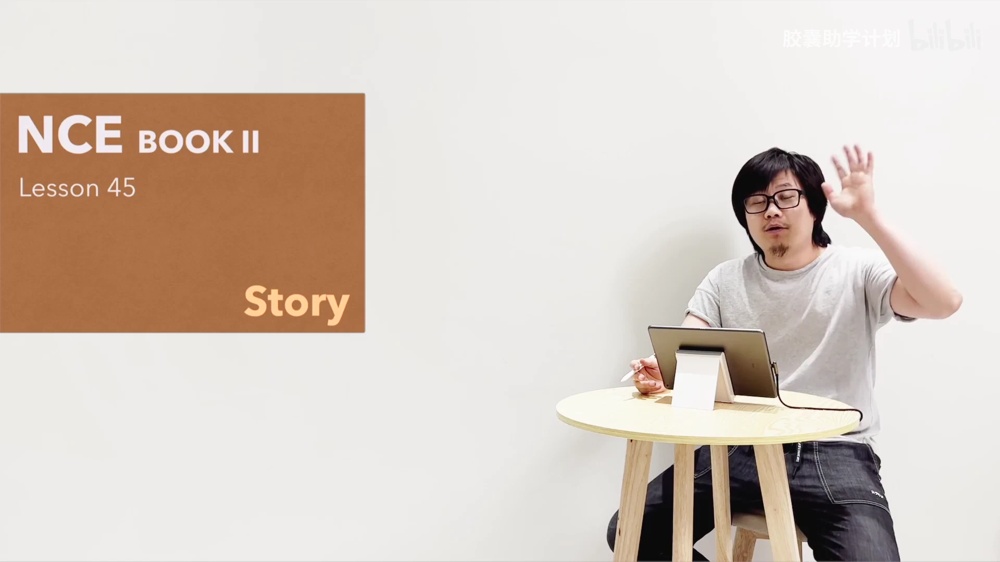

文字识别：NCE / BOOKII / Lesson 45 / Story

### 画面 00:00:05

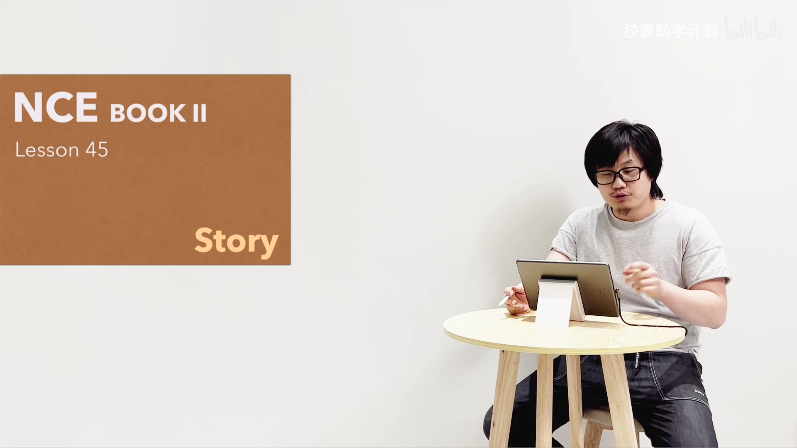

文字识别：NCE / BOOKⅡI / Lesson 45 / Story

### 画面 00:00:09

文字识别：胶囊助学计划 bilb出 / •

### 画面 00:00:13

文字识别：胶囊助学计划

### 画面 00:00:15

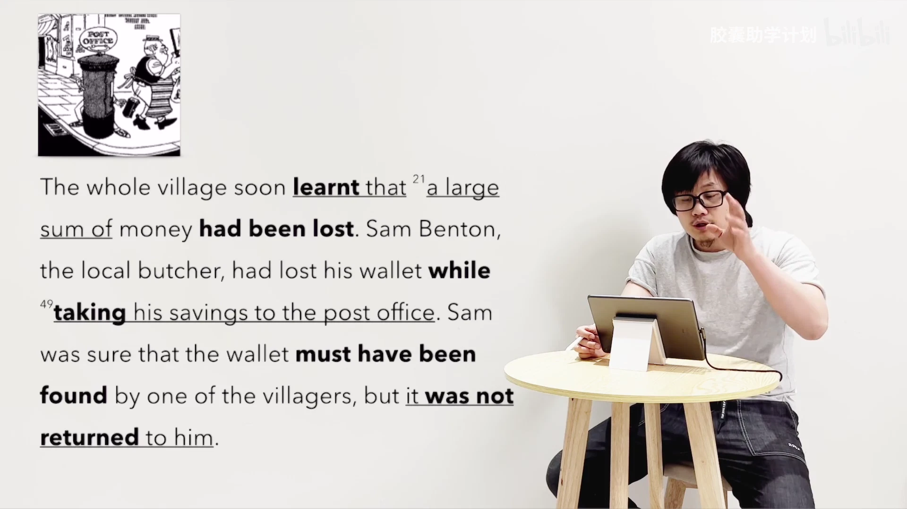

文字识别：DVFDCE / The whole village soon learnt that ²'a large / sum of money had been lost. Sam Benton, / the local butcher, had lost his wallet while / 'taking his savings to the post office. Sam / was sure that the wallet must have been / found by one of the villagers, but it was not / returned to him.

## 00:00:30–00:01:00

个村儿，soon很快，learn that我们先不管that的后边了，啊，你看，很整个村儿很快的就learn了一件事情。Learn这个单词在各位脑海当中比较可能经常出现的意思叫学习，对吧？Learn study，对吧？学习。Learn如果后边加了个that宾语从句，它其实比较常见的意思更像realize，就是意识到啊。

### 画面 00:00:42

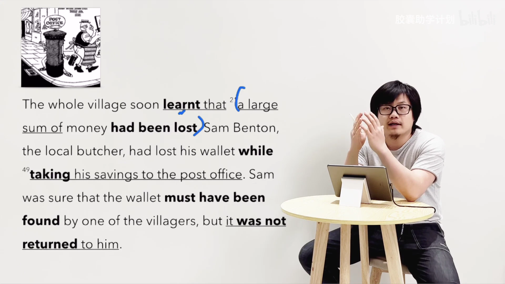

文字识别：0T / OVFICE / The whole village soon learnt that / a large / sum of money had been lost)Sam Benton, / the local butcher, had lost his wallet while / 'taking his savings to the post office. Sam / was sure that the wallet must have been / found by one of the villagers, but it was not / returned to him.

## 00:01:00–00:01:30

所以soon learn就是很快的就意识到，很快的就知道know啊，也像这个单词的意思，对吧？很快的就知道了什么呢？A large sum of money啊，这个就不用多说了，二十一课咱们原来就学过，对吧？如果您忘了，那你一定要去看一下二十一课我们学过的，对吧？A large sum of money就是大量的钱，had been lost，过去完成时的被动叫已经被弄丢了啊。Sam Benton

### 画面 00:01:01

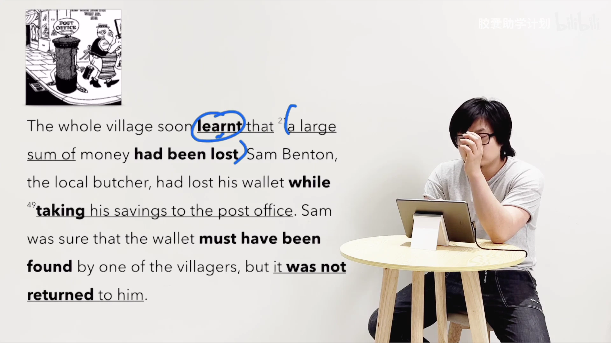

文字识别：OYFICE / The whole village soon learnt that / a large / sum of money had been lost)Sam Benton, / the local butcher, had lost his wallet while / 'taking his savings to the post office. Sam / was sure that the wallet must have been / found by one of the villagers, but it was not / returned to him.

### 画面 00:01:11

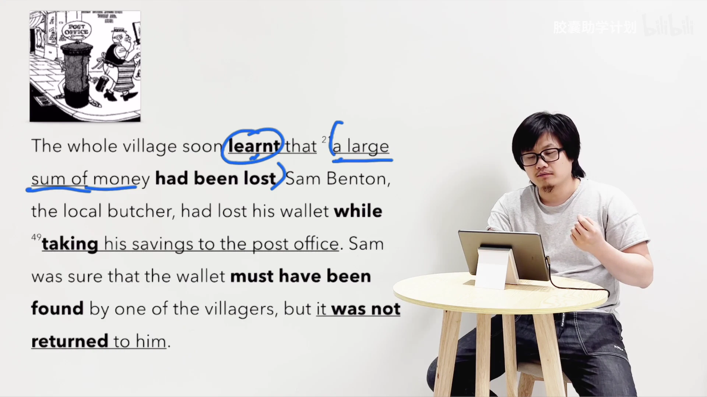

文字识别：OFFICE / The whole village soonlearntthat / a large / sum of money had been lost)Sam Benton, / the local butcher, had lost his wallet while / 'taking his savings to the post office. Sam / was sure that the wallet must have been / found by one of the villagers, but it was not / returned to him.

## 00:01:30–00:02:00

啊一个人名字。The local butcher同位语，什么人呢？Sam Benton是谁呢？这个人就是本地的屠夫啊。本地屠夫had lost his wallet，说已经丢了他的钱包啊，丢了他的钱包。While当什么时候呢？Taking his savings to the post office，这个地方还真有一个语法我们没学过，但我们今天不讲这个，要等到四十九课咱们才能去讲啊。分词

### 画面 00:01:41

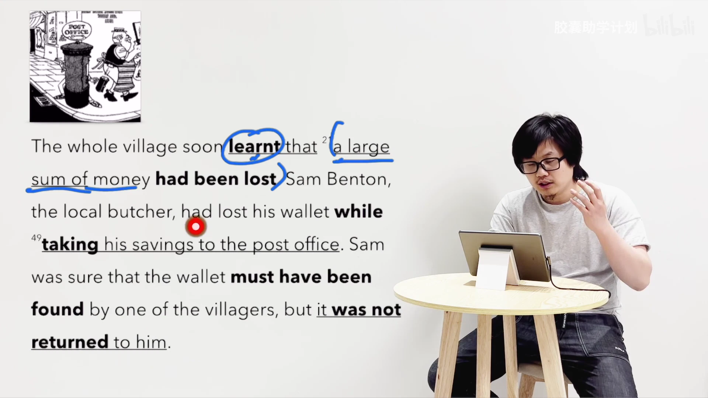

文字识别：OVFICE / The whole village soonlearntthat / a large / sum of money had been lost)Sam Benton, / the local butcher, had lost his wallet while / 'taking his savings to the post office. Sam / was sure that the wallet must have been / found by one of the villagers, but it was not / returned to him.

## 00:02:00–00:02:30

做状语这样一个东西啊。我们之前学了分词做定语嘛。四十九课有一个重头语法叫分词做定语啊，分词做状语是吧？但但这并不影响我们读懂这句话，因为 taking 和 take 在各位脑海当中翻译的意思是一样的，就是带着拿着拿着他的储蓄啊存款去了这个邮局。Sam was sure，Sam 很确定，the wallet must have been found，当时一定是被找到了，must have been

### 画面 00:02:11

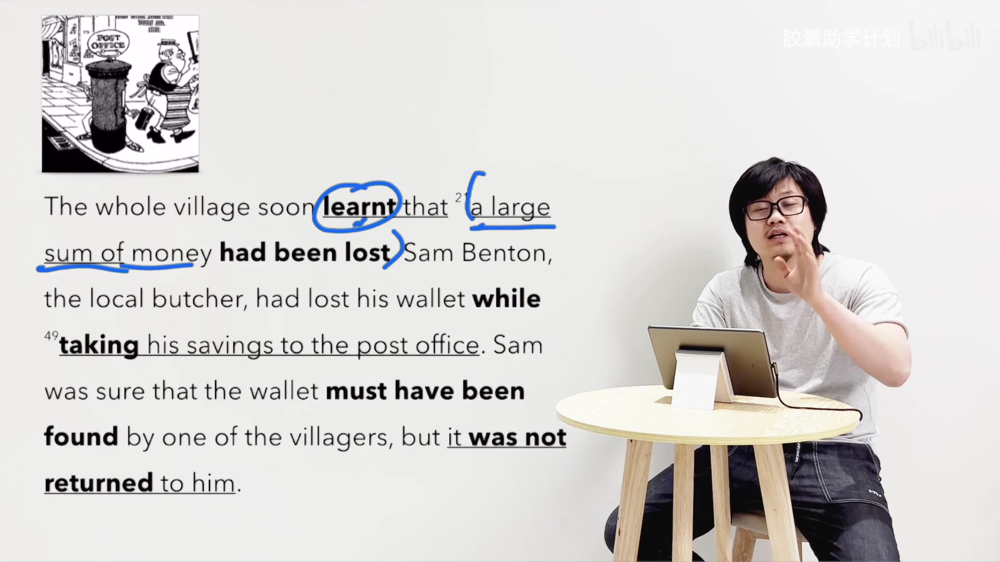

文字识别：OFFICE / The whole village soonlearntthat / a large / sum of money had been lost)Sam Benton, / the local butcher, had lost his wallet while / 'taking his savings to the post office. Sam / was sure that the wallet must have been / found by one of the villagers, but it was not / returned to him.

## 00:02:30–00:03:00

done. 我希望各位记住了这回是吧？我们之前二十一课学过，后来单词造句我又不停的用它，对吧？今天又见了一次，背什么呢？One of the villagers, 背村民之一。OK, but但是 it was not returned to him. 但是他没有被你看 wasn't done啊, wasn't再加一个done没有被还给他。这地方其实一会儿我们把它会摘出来一个习惯用

### 画面 00:02:41

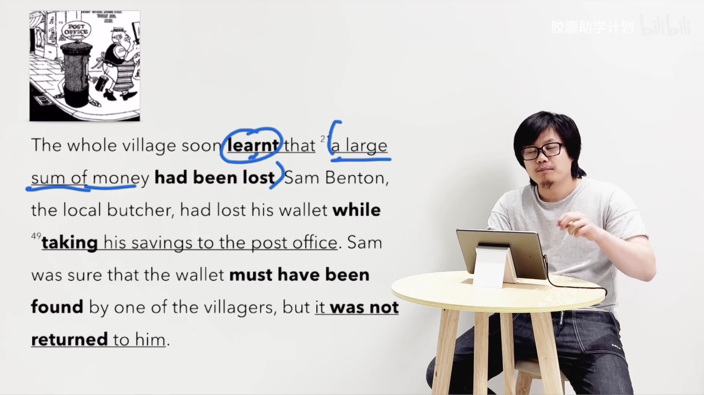

文字识别：OFFICE / The whole village soonlearntthat / a large / sum of money had been lost)Sam Benton, / the local butcher, had lost his wallet while / 'taking his savings to the post office. Sam / was sure that the wallet must have been / found by one of the villagers, but it was not / returned to him.

## 00:03:00–00:03:30

法，叫 return something to somebody，叫做把某物还给某人。只不过 return something to somebody 呢是主动的，然后呢这里用的呢是被动的，是吧？啊，叫做呃 be returned to somebody。 Okay, very good. Continue. Three months passed. Three months passed. 三个月过去了。 And then one morning, 然后有这么一天早晨, Sam found his wallet outside his front door. 说 Sam 啊发现了他的钱包

### 画面 00:03:11

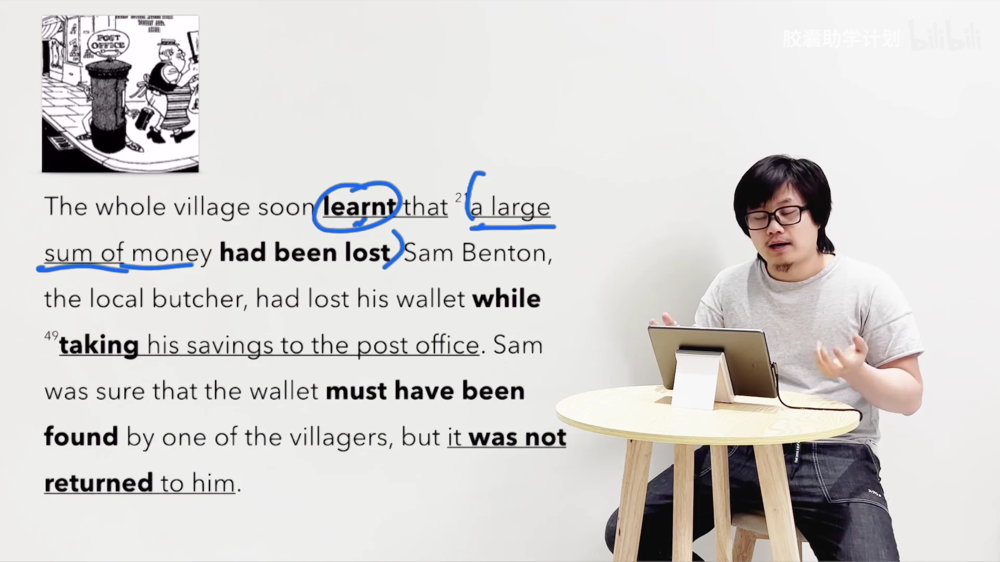

文字识别：OFFICE / The whole village soon learnt that / a large / sum of money had been lost)Sam Benton, / the local butcher, had lost his wallet while / 'taking his savings to the post office. Sam / was sure that the wallet must have been / found by one of the villagers, but it was not / returned to him.

### 画面 00:03:16

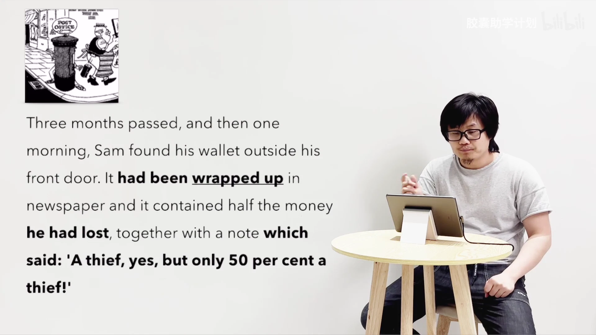

文字识别：OYFICE / Three months passed, and then one / morning, Sam found his wallet outside his / front door. It had been wrapped up in / newspaper and it contained half the money / he had lost, together with a note which / said: 'A thief, yes, but only 50 per cent a / thief!'

## 00:03:30–00:04:00

outside his front door，叫做在他前门的外面啊，outside在什么什么的外面，对吧？Front door前门，back door后门。It had been wrapped up啊，wrapped up我们哪课学的呢？三十二课，对吧？哎呃，一个女的呃去商场里面偷衣服啊，和她女儿一起偷，对吧？然后她女儿wrapped it up as quickly as possible，是吧？把这个包衣服给包裹起来，对吧？那你看啊，

### 画面 00:03:46

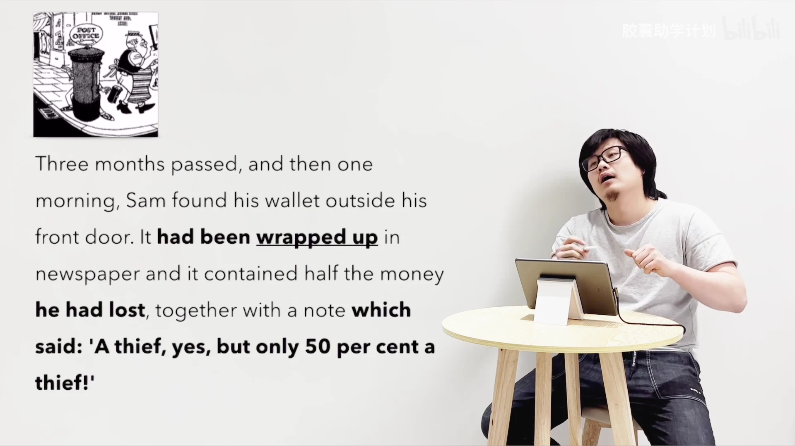

文字识别：e   / OFFDCE / Three months passed, and then one / morning, Sam found his wallet outside his / front door. It had been wrapped up in / newspaper and it contained half the money / he had lost, together with a note which / said: 'A thief, yes, but only 50 per cent a / thief!'

## 00:04:00–00:04:30

had been wrapped up叫已经被包裹起来了。It指的是这个钱包，对不对？被动啊，已经被包裹起来了。In newspaper用报纸，新闻报纸。And然后呢，it contained half the money。然后它包括了一半的钱。注意后面叫做he had lost，前面再加上一个which或者that，你就能反应过来了，这是个定语从句。怎么翻译的这句话？叫它包含了一半的钱，什么样

### 画面 00:04:16

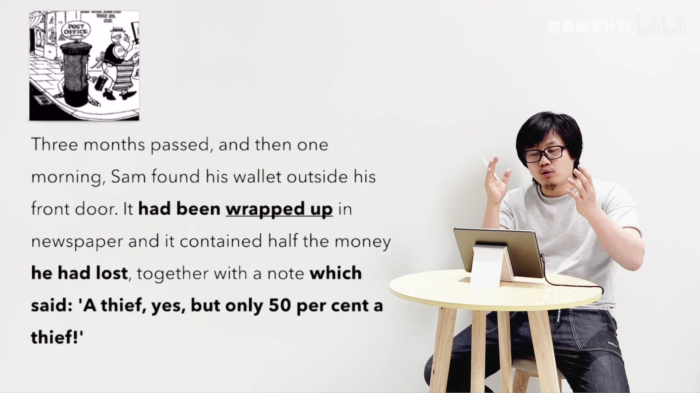

文字识别：OVFICE / Three months passed, and then one / morning, Sam found his wallet outside his / front door. It had been wrapped up in / newspaper and it contained half the money / he had lost, together with a note which / said: 'A thief, yes, but only 50 per cent a / thief!'

### 画面 00:04:20

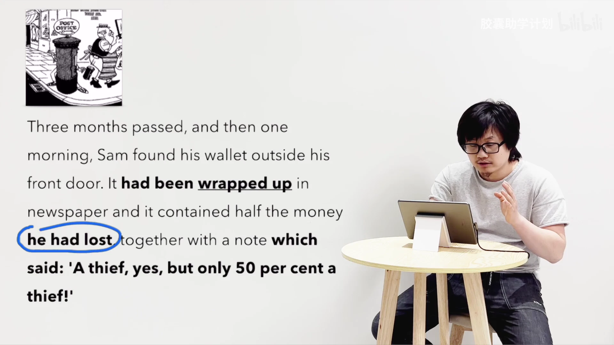

文字识别：eet a  / OFFICE / Three months passed, and then one / morning, Sam found his wallet outside his / front door. It had been wrapped up in / newspaper and it contained half the money / he had lost together with a note which / said: 'A thief, yes, but only 50 per cent a / thief!'

## 00:04:30–00:05:00

的钱呢？叫做他已经丢了的那个钱，对吧？所以这句话我们把它翻译成汉语，叫做它包含了一半儿他丢了的钱，对吧？啊，OK，very good。Together with a note，和什么在一起呢？Together with，对吧？和什么在一起呢？叫一个小的note，便签儿。十六课咱们用过这个单词，我印象当中啊，就是这个警察拿一个note贴到车上那一刻，后边很典型一个定语从句了。这个便签儿said

### 画面 00:04:50

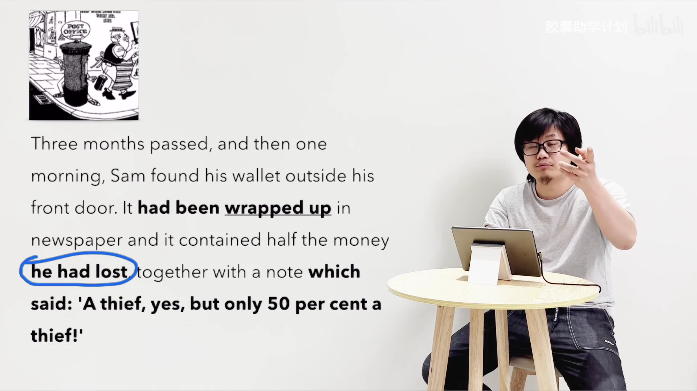

文字识别：OFFICE / Three months passed, and then one / morning, Sam found his wallet outside his / front door. It had been wrapped up in / newspaper and it contained half the money / he had lost together with a note which / said: 'A thief, yes, but only 50 per cent a / thief!'

## 00:05:00–00:05:30

recording. Transcribe the exact words in their original spoken languages. Never translate. Preserve repetitions, questions and examples.

### 画面 00:05:15

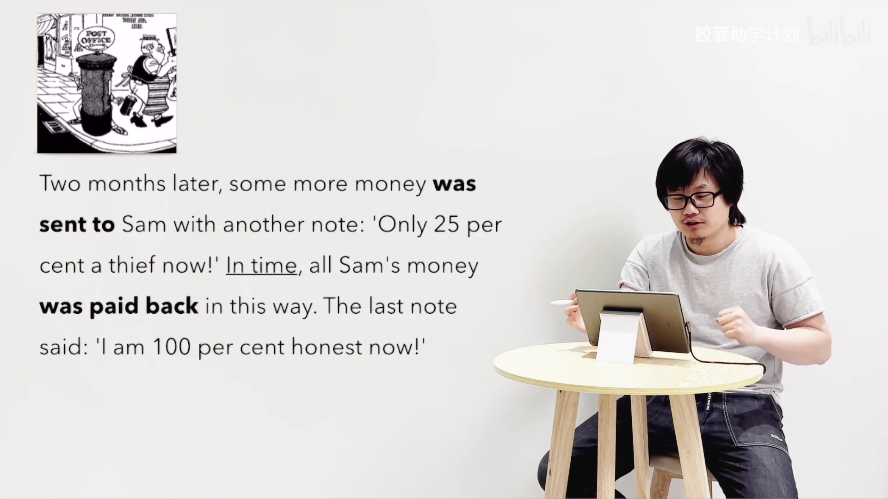

文字识别：OFFICE / Two months later, some more money was / sent to Sam with another note: 'Only 25 per / cent a thief now!' In time, all Sam's money / was paid back in this way. The last note / said: 'I am 100 per cent honest now!'

## 00:05:30–00:06:00

吧？Was word加that，一般过去式被动。With another note,哎，带着另一个便签儿。Only twenty five percent a thief now.说现在呀，只是百分之二十五的贼了。那我还了百分之七十五的钱了。In time,本课的in time还真不是in time最常用的那个意思。本课的in time就类似于at last, finally啊，就最终。All Sam's money was

### 画面 00:05:45

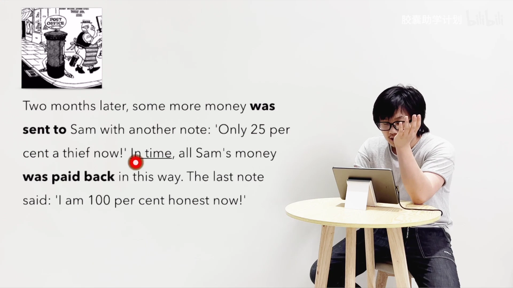

文字识别：OVFICE / Two months later, some more money was / sent to Sam with another note: 'Only 25 per / cent a thief now!' Jn time, all Sam's money / was paid back in this way. The last note / said: 'I am 100 per cent honest now!'

## 00:06:00–00:06:30

paid back in this way.说Sam所有的钱was paid back叫做都被还回来了。In this way叫做用这样的一种方式。The last note said说最后一个便签写的是I'm I am one hundred percent honest now.说我现在是百分之百的honest honest叫做诚实。我现在是百分之百的诚实了。Okay,

### 画面 00:06:15

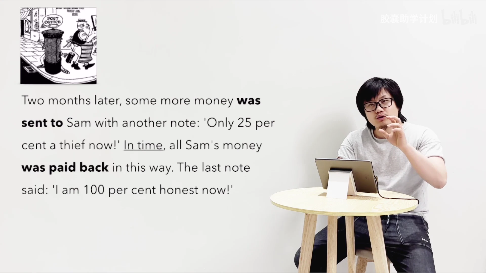

文字识别：OVFICE / Two months later, some more money was / sent to Sam with another note: 'Only 25 per / cent a thief now!' In time, all Sam's money / was paid back in this way. The last note / said: 'I am 100 per cent honest now!'

## 00:06:30–00:07:00

那从原文当中我们摘出来了两个习惯用法，第一个叫做 somebody learn that 加宾语从句，另外一个叫 return something to somebody，对吧？那我们先看 somebody learn that，就某个人呃知道了这么一件事儿，或者意识到了这么一件事儿，对吧？明白了这样一件事儿，你注意啊，这里 somebody 对于各位去造句的时候，你其实随便造，随便用，爱用谁用谁，对吧？只要就是就是很容易，你说 Leo 也行，你说 Mac 也行，你说 Sam 也行，无所谓。

### 画面 00:06:30

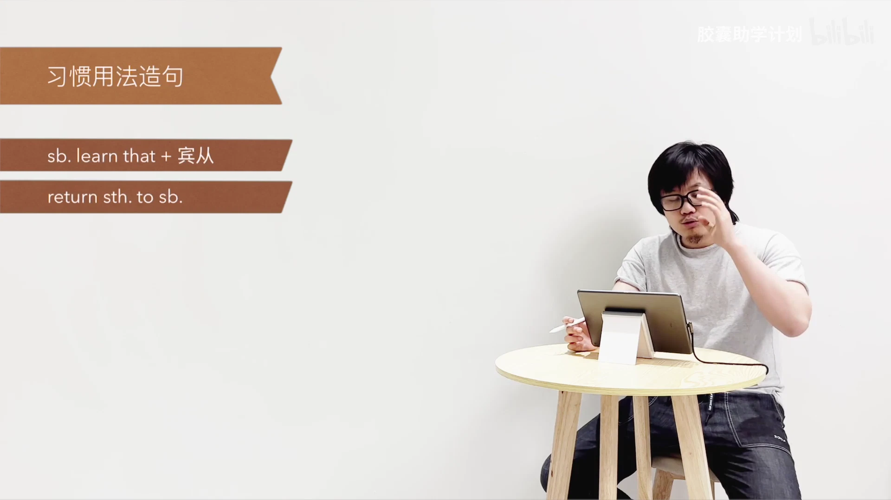

文字识别：习惯用法造句 / sb. learn that +宾从 / return sth. to sb.

### 画面 00:06:32

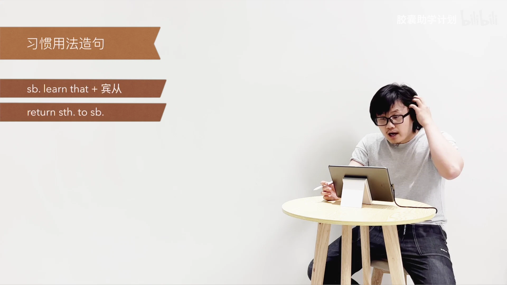

文字识别：习惯用法造句 / sb. learn that +宾从 / return sth. to sb.

### 画面 00:06:35

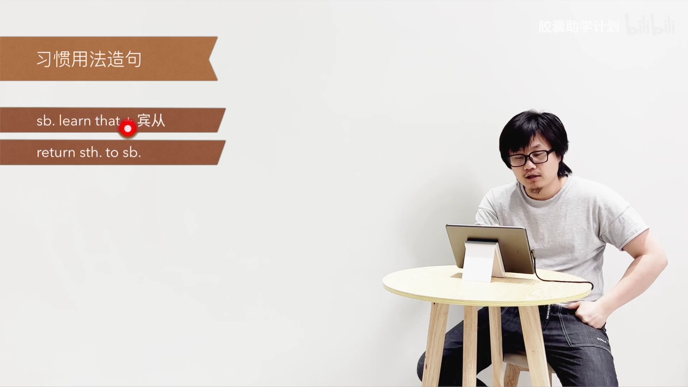

文字识别：习惯用法造句 / sb.learn that：宾从 / return sth. to sb.

### 画面 00:06:40

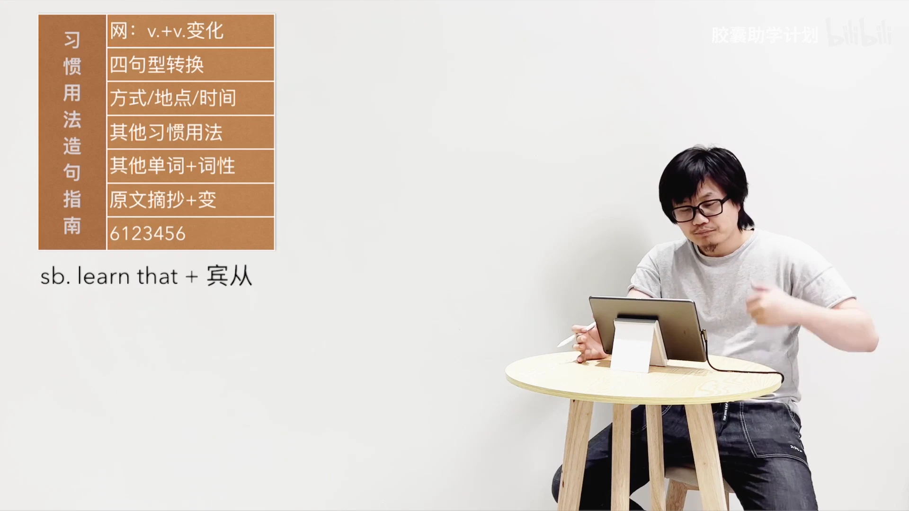

文字识别：网：v.+v.变化 / 习惯用法造句指南 / 四句型转换 / 方式/地点/时间 / 其他习惯用法 / 其他单词+词性 / 原文摘抄+变 / 6123456 / sb.learn that +宾从

### 画面 00:06:42

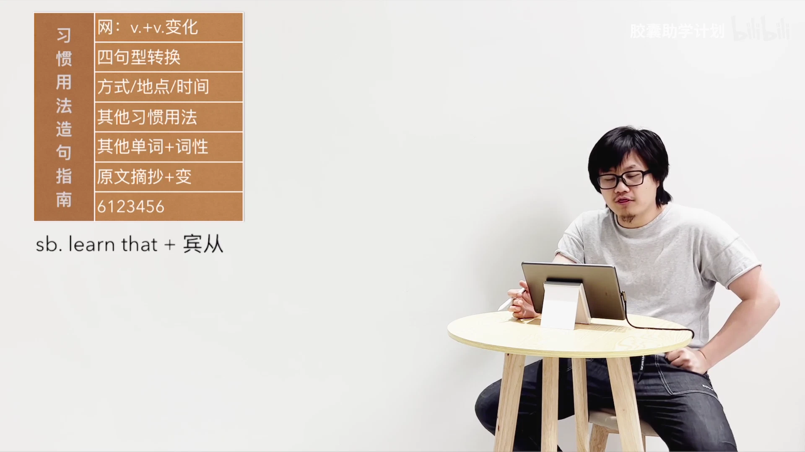

文字识别：网：v.+v.变化 / 习惯用法造句指南 / 四句型转换 / 方式/地点/时间 / 其他习惯用法 / 其他单词+词性 / 原文摘抄+变 / 6123456 / sb.learn that +宾从

### 画面 00:06:45

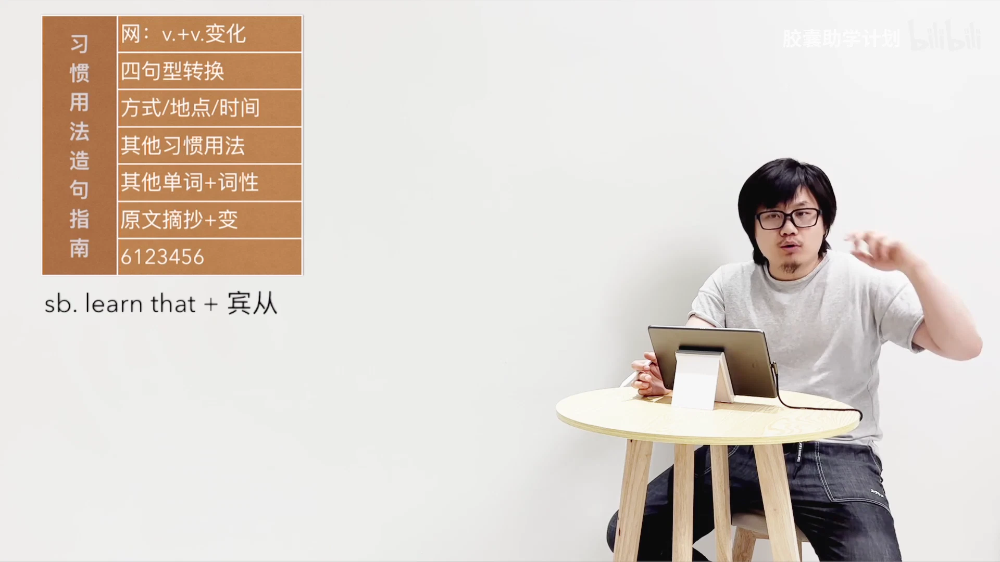

文字识别：网：v.+v.变化 / 习惯用法造句指南 / 四句型转换 / 方式/地点/时间 / 其他习惯用法 / 其他单词+词性 / 原文摘抄+变 / 6123456 / sb.learn that +宾从

### 画面 00:06:50

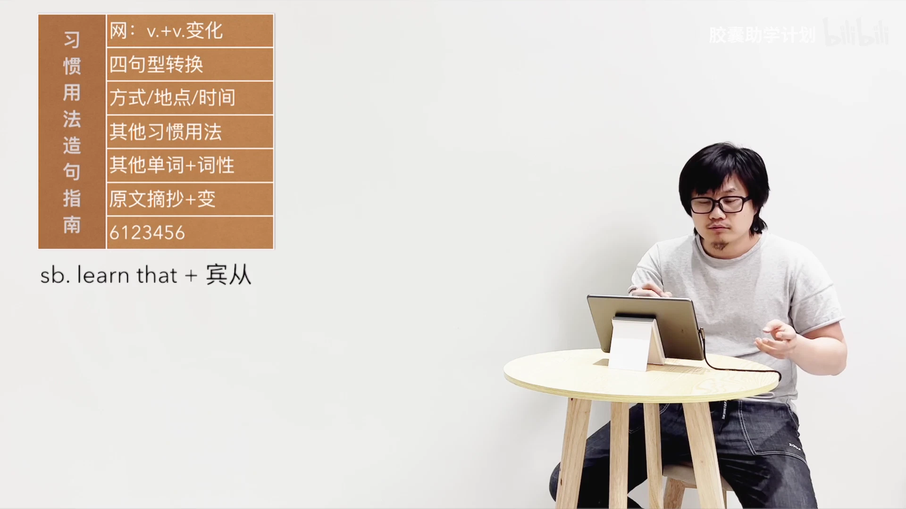

文字识别：网：v.+v.变化 / 习惯用法造句指南 / 四句型转换 / 方式/地点/时间 / 其他习惯用法 / 其他单词+词性 / 原文摘抄+变 / 6123456 / sb.learn that +宾从

### 画面 00:06:55

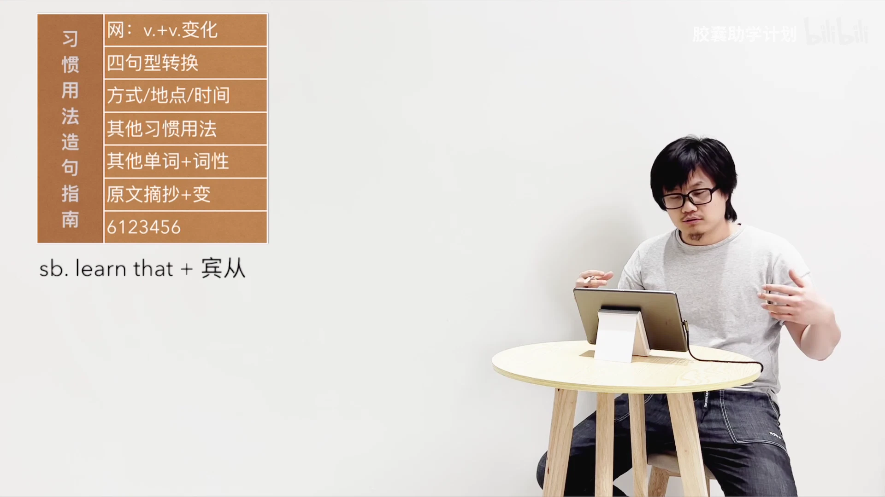

文字识别：网：v.+v.变化 / 习惯用法造句指南 / 四句型转换 / 方式/地点/时间 / 其他习惯用法 / 其他单词+词性 / 原文摘抄+变 / 6123456 / sb. learn that +宾从

## 00:07:00–00:07:30

关键点叫你后边其实要造个宾从，造一个完全完整的句子。比如说，你看我就这样写的，叫做 She learned yesterday. 我多加了一个小的单词 that，后边一句话叫做 They were able to get get out of the forest. 说他们成功的跑出了这个森林。四十三课咱们学的，不知道各位还记不记得？Was able to 和 could 有一个小的区别，叫 Was able to 可以表示过去的成功事件。回顾一下，

### 画面 00:07:00

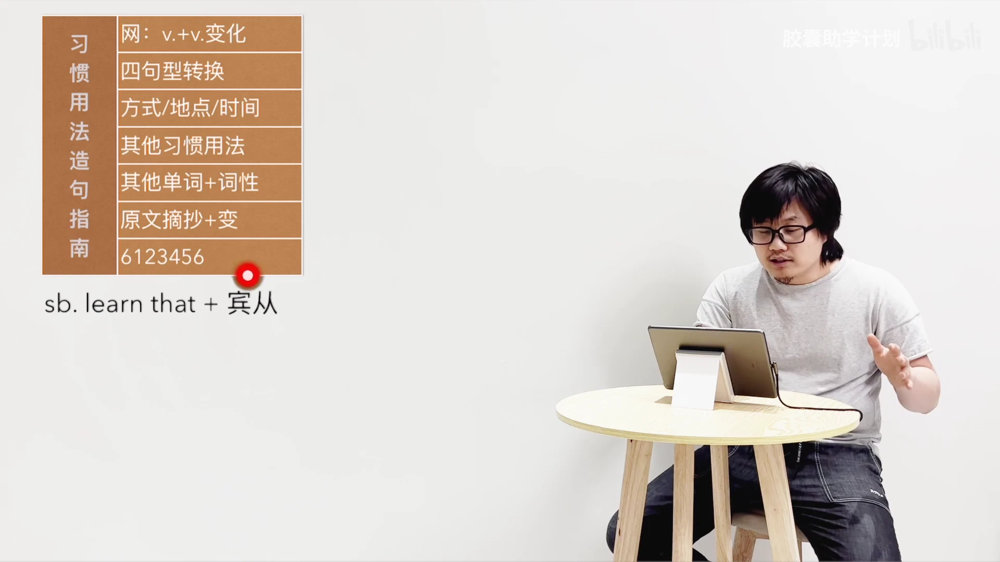

文字识别：网：v.+v.变化 / 习惯用法造句指南 / 四句型转换 / 方式/地点/时间 / 其他习惯用法 / 其他单词+词性 / 原文摘抄+变 / 6123456 / sb. learn that +宾从

### 画面 00:07:04

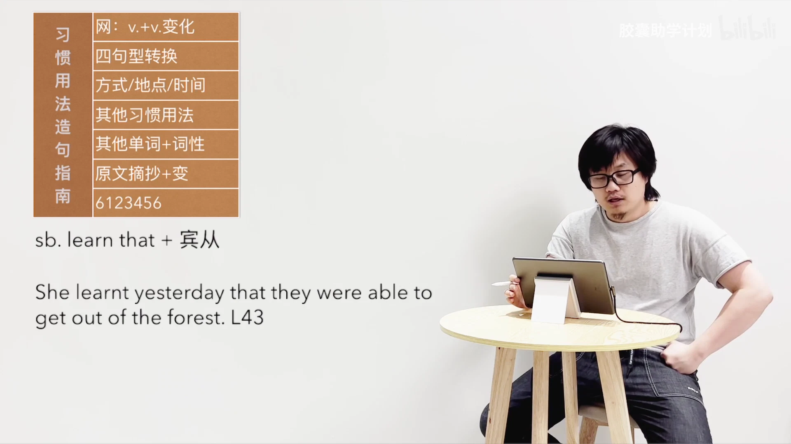

文字识别：网：v.+v.变化 / 习惯用法造句指南 / 四句型转换 / 方式/地点/时间 / 其他习惯用法 / 其他单词+词性 / 原文摘抄+变 / 6123456 / sb. learn that +宾从 / She learnt yesterday that they were able to / get out of the forest. L43

### 画面 00:07:06

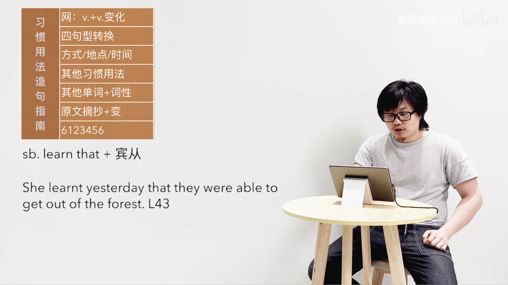

文字识别：网：v.+v.变化 / 习惯用法造句指南 / 四句型转换 / 方式/地点/时间 / 其他习惯用法 / 其他单词+词性 / 原文摘抄+变 / 6123456 / sb. learn that +宾从 / She learnt yesterday that they were able to / get out of the forest. L43

### 画面 00:07:10

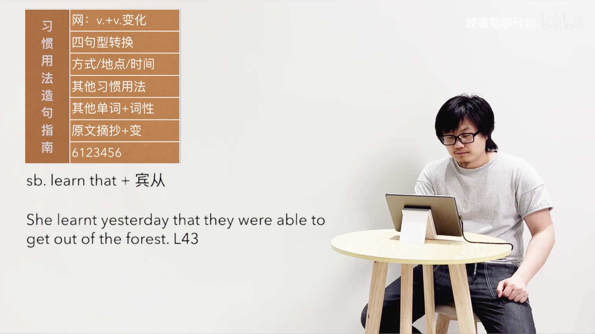

文字识别：网：v.+v.变化 / 习惯用法造句指南 / 四句型转换 / 方式/地点/时间 / 其他习惯用法 / 其他单词+词性 / 原文摘抄+变 / 6123456 / sb. learn that +宾从 / She learnt yesterday that they were able to / get out of the forest. L43

### 画面 00:07:13

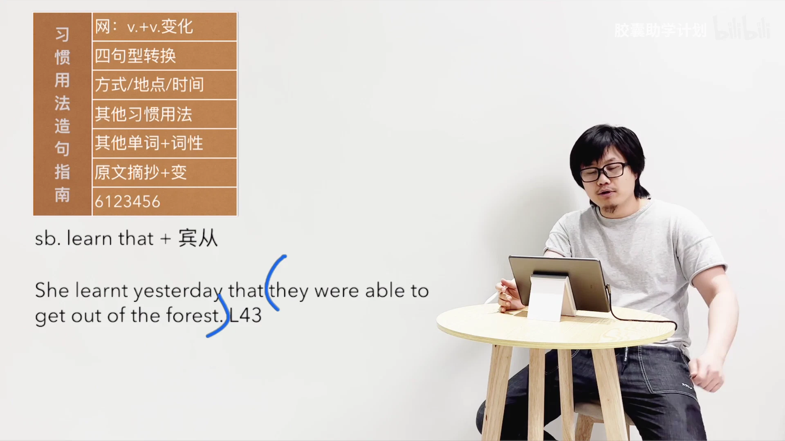

文字识别：网：v.+v.变化 / 习惯用法造句指南 / 四句型转换 / 方式/地点/时间 / 其他习惯用法 / 其他单词+词性 / 原文摘抄+变 / 6123456 / sb. learn that +宾从 / She learnt yesterday thatthey were able to / get out of the forest.)L43

### 画面 00:07:15

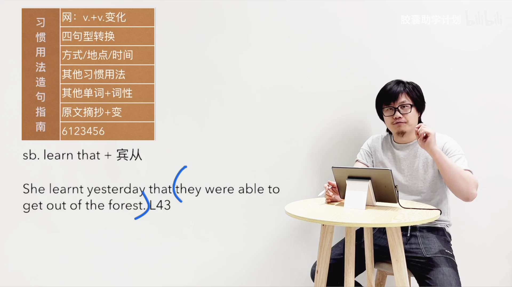

文字识别：网：v.+v.变化 / 习惯用法造句指南 / 四句型转换 / 方式/地点/时间 / 其他习惯用法 / 其他单词+词性 / 原文摘抄+变 / 6123456 / sb. learn that +宾从 / She learnt yesterday thatthey were able to / get out of the forest.L43

### 画面 00:07:20

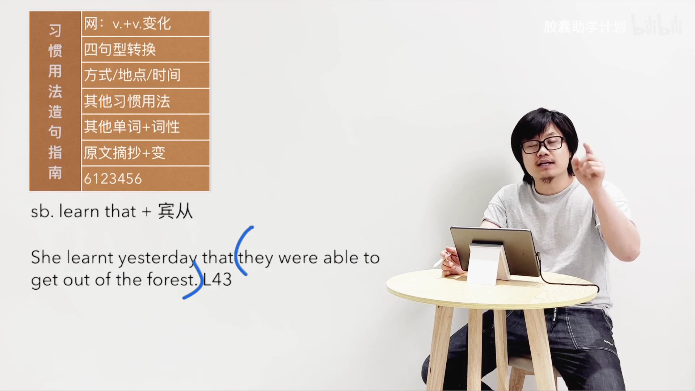

文字识别：网：v.+v.变化 / 习惯用法造句指南 / 四句型转换 / 方式/地点/时间 / 其他习惯用法 / 其他单词+词性 / 原文摘抄+变 / 6123456 / sb. learn that +宾从 / She learnt yesterday thatthey were able to / get out of the forest.L43

### 画面 00:07:25

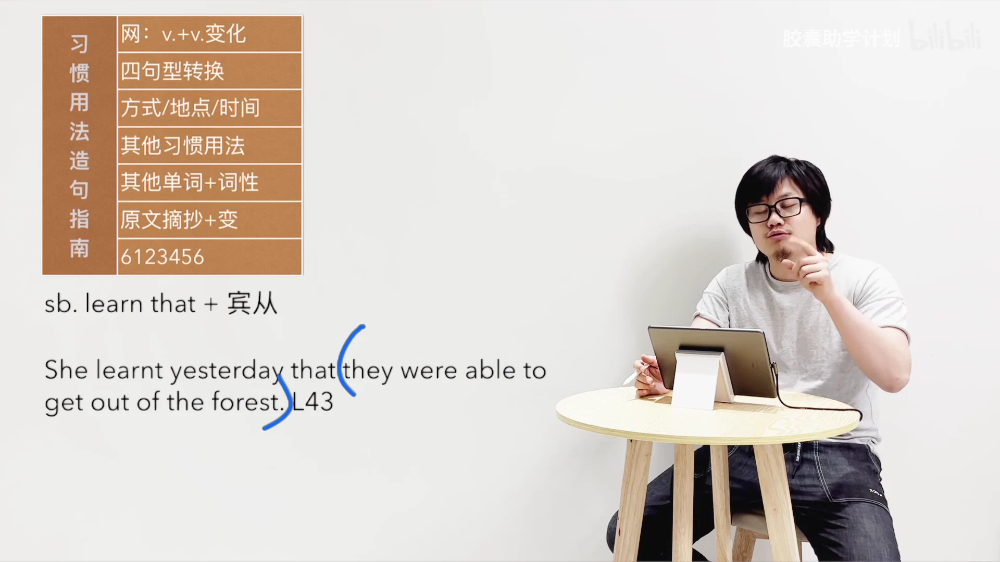

文字识别：网：v.+v.变化 / 习惯用法造句指南 / 四句型转换 / 方式/地点/时间 / 其他习惯用法 / 其他单词+词性 / 原文摘抄+变 / 6123456 / sb. learn that +宾从 / She learnt yesterday thatthey were able to / get out of the forest.L43

## 00:07:30–00:08:00

next one，说 she learned that，你看我后边给各位加了个括弧啊，这是左括弧，这是右括弧，对吧？左括弧和右括弧中间是什么呢？括号啊，中间是什么呢？整个是一个宾语从句，对吧？叫做 her father was busy reading the book，他的父亲正在忙着去读啊，正在忙着去读这个书啊，在读这个书，什么样的书呢？Which she gave him

### 画面 00:07:30

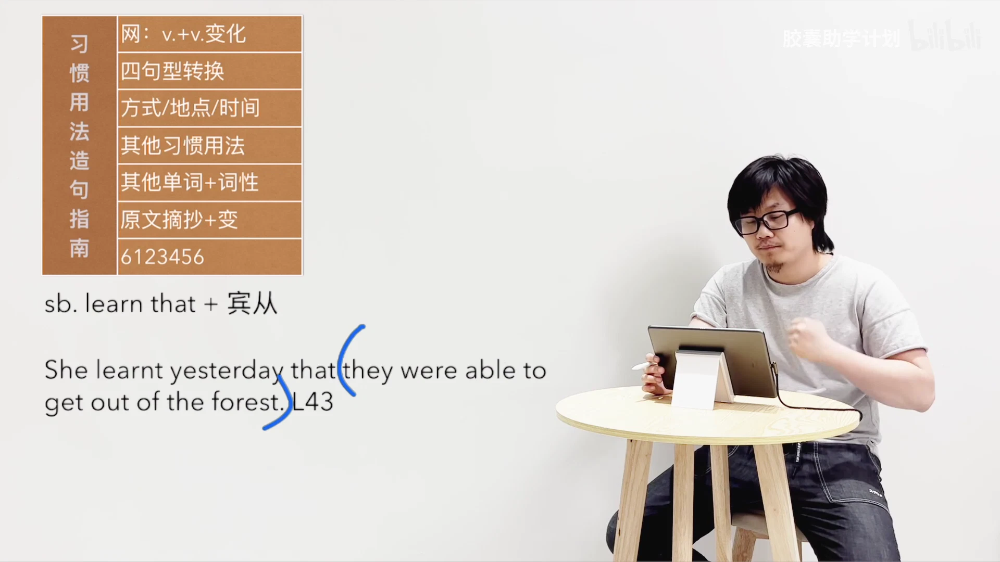

文字识别：网：v.+v.变化 / 习惯用法造句指南 / 四句型转换 / 方式/地点/时间 / 其他习惯用法 / 其他单词+词性 / 原文摘抄+变 / 6123456 / sb. learn that +宾从 / She learnt yesterday thatthey were able to / get out of the forest.L43

### 画面 00:07:32

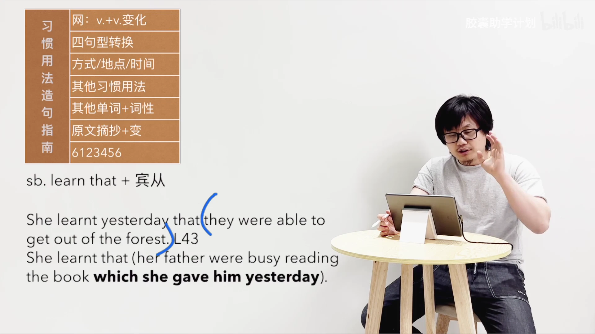

文字识别：网：v.+v.变化 / 习惯用法造句指南 / 四句型转换 / 方式/地点/时间 / 其他习惯用法 / 其他单词+词性 / 原文摘抄+变 / 6123456 / sb. learn that +宾从 / She learnt yesterday thatthey were able to / get out of the forest.L43 / She learnt that (her father were busy reading / the book which she gave him yesterday).

### 画面 00:07:35

文字识别：网：v.+v.变化 / 习惯用法造句指南 / 四句型转换 / 方式/地点/时间 / 其他习惯用法 / 其他单词+词性 / 原文摘抄+变 / 6123456 / sb. learn that +宾从 / She learnt yesterday thatthey were able to / get out of the forest.L43 / She learnt that (her father were busy reading / the book which she gave him yesterday).

### 画面 00:07:39

文字识别：网：v.+v.变化 / 习惯用法造句指南 / 四句型转换 / 方式/地点/时间 / 其他习惯用法 / 其他单词+词性 / 原文摘抄+变 / 6123456 / sb. learn that +宾从 / She learnt yesterday thatthey were able to / get out of the forest.L43 / She learnt that (her father were busy reading / the book which she gave him yesterday)

### 画面 00:07:41

文字识别：网：v.+v.变化 / 习惯用法造句指南 / 四句型转换 / 方式/地点/时间 / 其他习惯用法 / 其他单词+词性 / 原文摘抄+变 / 6123456 / sb. learn that +宾从 / She learnt yesterday thatthey were able to / get out of the forest.L43 / She learnt that (her father were busy reading / the book which she gave him yesterday)

### 画面 00:07:45

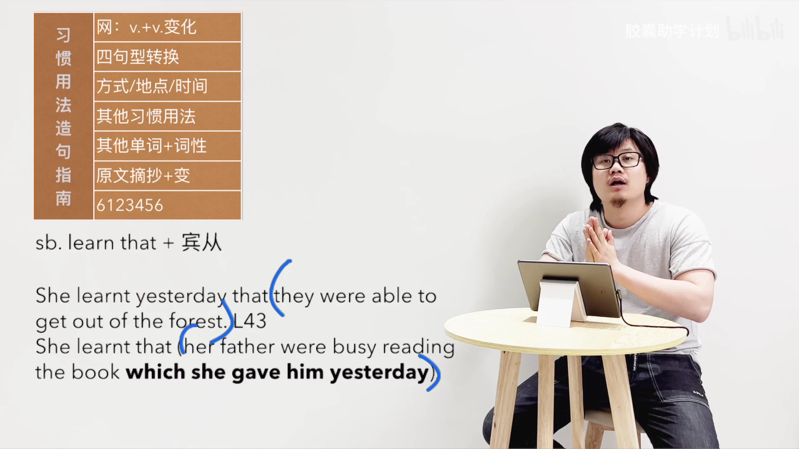

文字识别：网：v.+v.变化 / 习惯用法造句指南 / 四句型转换 / 方式/地点/时间 / 其他习惯用法 / 其他单词+词性 / 原文摘抄+变 / 6123456 / sb. learn that +宾从 / She learnt yesterday thatthey were able to / get out of the forest.L43 / She learnt that (her father were busy reading / the book which she gave him yesterday)

### 画面 00:07:50

文字识别：网：v.+v.变化 / 习惯用法造句指南 / 四句型转换 / 方式/地点/时间 / 其他习惯用法 / 其他单词+词性 / 原文摘抄+变 / 6123456 / sb. learn that +宾从 / She learnt yesterday thatthey were able to / get out of the forest.L43 / She learnt that (her father were busy reading / the book which she gave him yesterday)

### 画面 00:07:55

文字识别：网：v.+v.变化 / 习惯用法造句指南 / 四句型转换 / 方式/地点/时间 / 其他习惯用法 / 其他单词+词性 / 原文摘抄+变 / 6123456 / sb. learn that +宾从 / She learnt yesterday thatthey were able to / get out of the forest.L43 / She learnt that (her father were busy reading / the book which she gave him yesterday)

## 00:08:00–00:08:30

yesterday,叫做他昨天给他的那本书，也就是我现在宾语从句里边其实又套了一个定语从句，所以这个地方我想提一个很小的点，哎，我为什么造了这么长的一个句子？就是想告诉各位，随着我们往后面去学，你会注意到一件事情，就是句子会变得越来越长，越来越长，一个句子套着另一个句子啊，这是以后我们会见的，尤其是新概念三册，好吧，我们所谓叫英语长难句

### 画面 00:08:00

文字识别：网：v.+v.变化 / 习惯用法造句指南 / 四句型转换 / 方式/地点/时间 / 其他习惯用法 / 其他单词+词性 / 原文摘抄+变 / 6123456 / sb. learn that +宾从 / She learnt yesterday thatthey were able to / get out of the forest.L43 / She learnt that (her father were busy reading / the book which she gave him yesterday)

### 画面 00:08:05

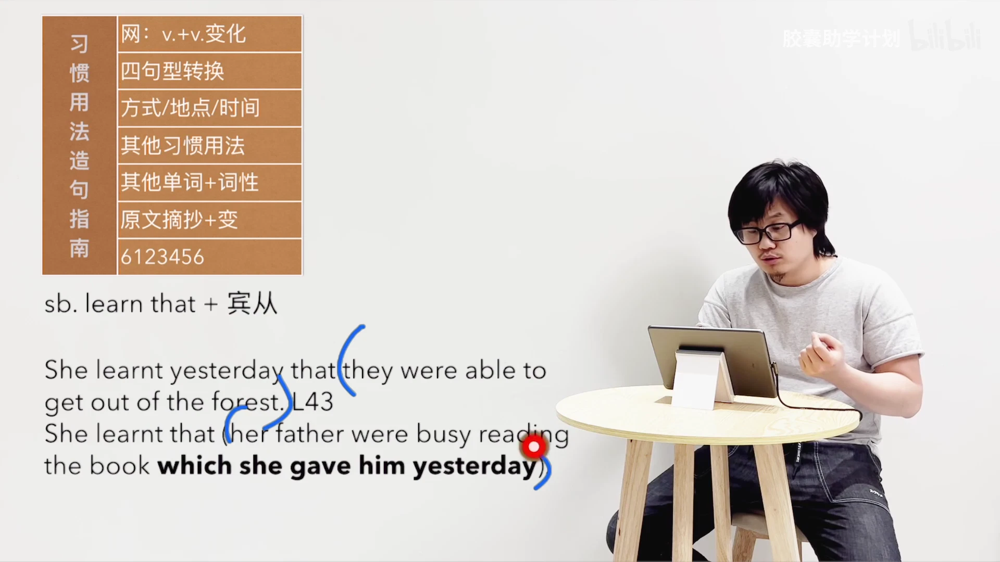

文字识别：网：v.+v.变化 / 习惯用法造句指南 / 四句型转换 / 方式/地点/时间 / 其他习惯用法 / 其他单词+词性 / 原文摘抄+变 / 6123456 / sb. learn that +宾从 / She learnt yesterday thatthey were able to / get out of the forest.L43 / She learnt that her father were busy read: / 9 / the book which she gave him yesterday)

### 画面 00:08:10

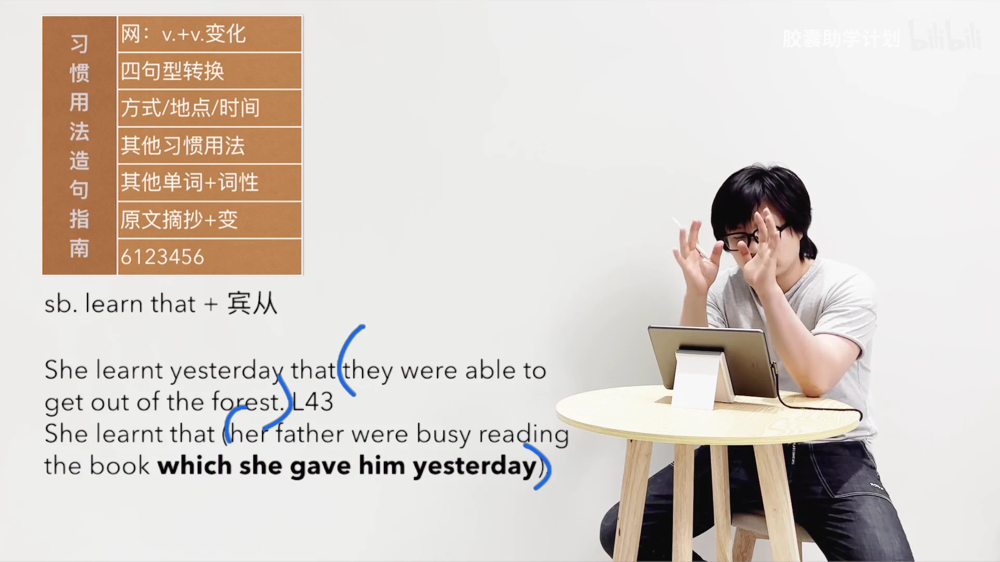

文字识别：网：v.+v.变化 / 习惯用法造句指南 / 四句型转换 / 方式/地点/时间 / 其他习惯用法 / 其他单词+词性 / 原文摘抄+变 / 6123456 / sb. learn that +宾从 / She learnt yesterday thatthey were able to / get out of the forest.L43 / She learnt that (her father were busy reading / the book which she gave him yesterday)

### 画面 00:08:15

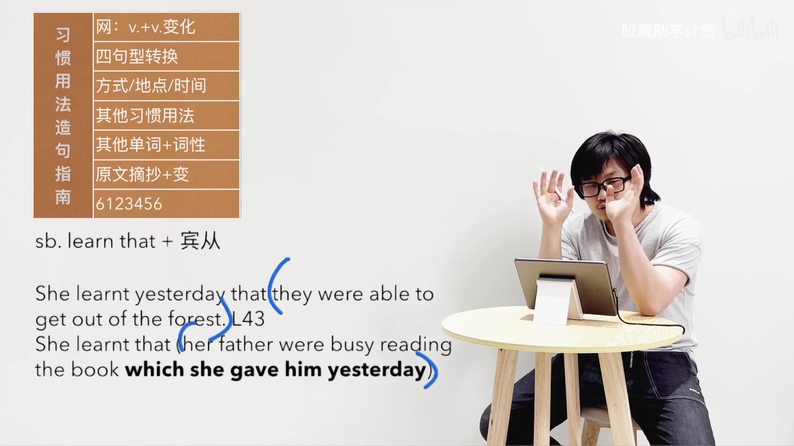

文字识别：网：v.+v.变化 / 习惯用法造句指南 / 四句型转换 / 方式/地点/时间 / 其他习惯用法 / 其他单词+词性 / 原文摘抄+变 / 6123456 / sb. learn that +宾从 / She learnt yesterday thatthey were able to / get out of the forest.L43 / She learnt that (her father were busy reading / the book which she gave him yesterday)

### 画面 00:08:20

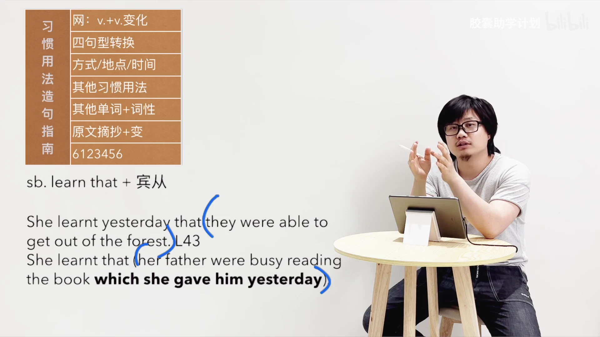

文字识别：网：v.+v.变化 / 习惯用法造句指南 / 四句型转换 / 方式/地点/时间 / 其他习惯用法 / 其他单词+词性 / 原文摘抄+变 / 6123456 / sb. learn that +宾从 / She learnt yesterday thatthey were able to / get out of the forest.L43 / She learnt that (her father were busy reading / the book which she gave him yesterday)

### 画面 00:08:25

文字识别：网：v.+v.变化 / 习惯用法造句指南 / 四句型转换 / 方式/地点/时间 / 其他习惯用法 / 其他单词+词性 / 原文摘抄+变 / 6123456 / sb. learn that +宾从 / She learnt yesterday thatthey were able to / get out of the forest.L43 / She learnt that (her father were busy reading / the book which she gave him yesterday)

## 00:08:30–00:09:00

啊。OK，下一个叫 return something to somebody，这个也很容易。Somebody很容易编，something之前学了那么多something，对吧？比如说 bicycle啊，the police returned his bicycle to him yesterday. Bicycle，这是不是你之前学过的？Newspaper啊，pen啊，是个名词就可以被还给别人，是不是？OK，好，肯定句出来了，各种一般疑问句、特殊疑问句，这是下课您自己的任务。我再造一个句

### 画面 00:08:30

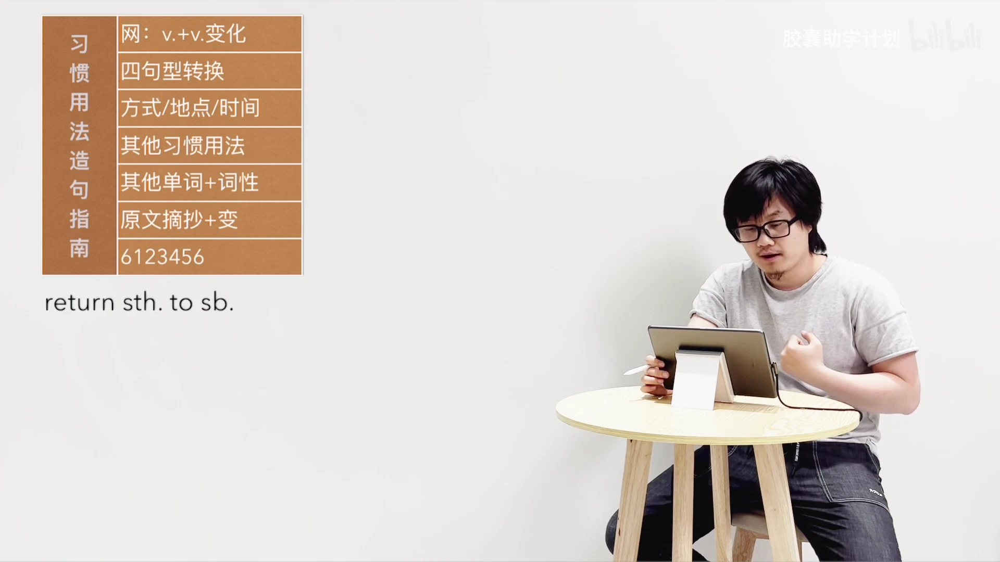

文字识别：网：v.+v.变化 / 习惯用法造句指南 / 四句型转换 / 方式/地点/时间 / 其他习惯用法 / 其他单词+词性 / 原文摘抄+变 / 6123456 / return sth.to sb.

### 画面 00:08:32

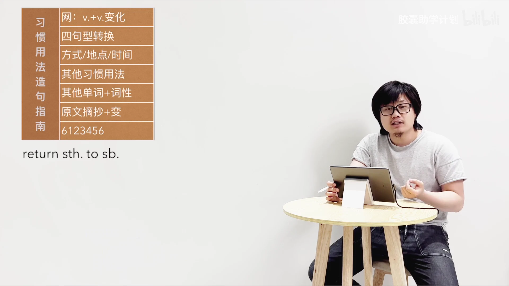

文字识别：网：v.+v.变化 / 习惯用法造句指南 / 四句型转换 / 方式/地点/时间 / 其他习惯用法 / 其他单词+词性 / 原文摘抄+变 / 6123456 / return sth.to sb.

### 画面 00:08:35

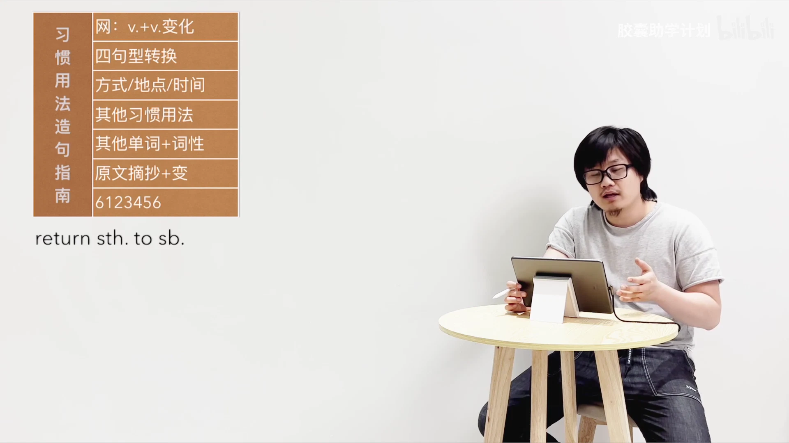

文字识别：网：v.+v.变化 / 习惯用法造句指南 / 四句型转换 / 方式/地点/时间 / 其他习惯用法 / 其他单词+词性 / 原文摘抄+变 / 6123456 / return sth.to sb.

### 画面 00:08:40

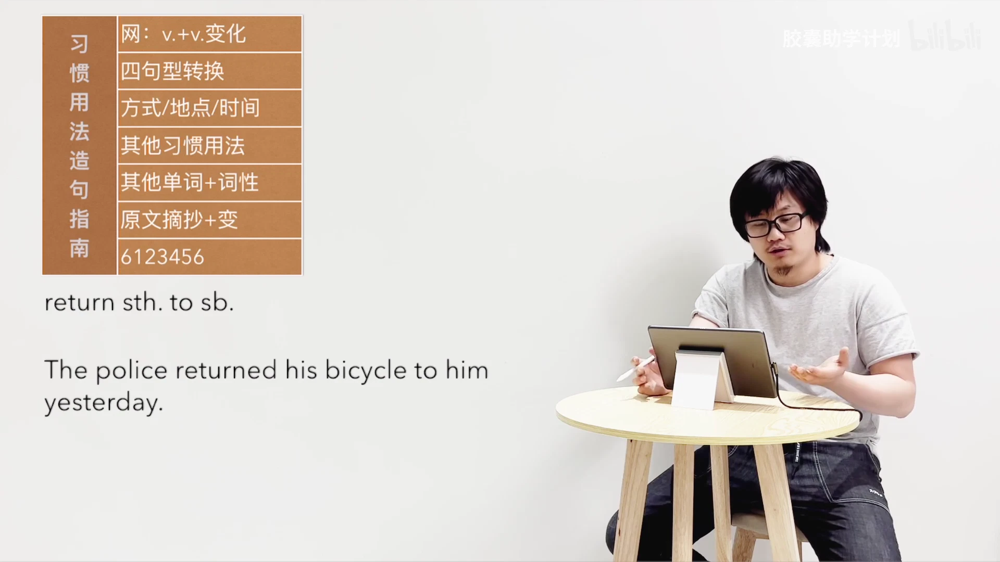

文字识别：网：v.+v.变化 / 习惯用法造句指南 / 四句型转换 / 方式/地点/时间 / 其他习惯用法 / 其他单词+词性 / 原文摘抄+变 / 6123456 / return sth.to sb. / The police returned his bicycle to him / yesterday.

### 画面 00:08:45

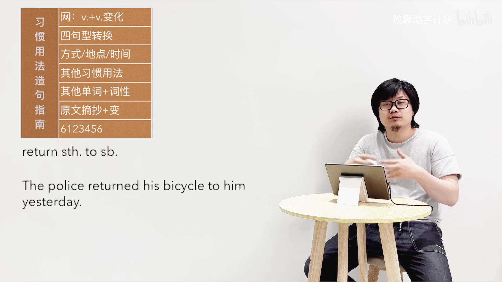

文字识别：网：v.+v.变化 / 习惯用法造句指南 / 四句型转换 / 方式/地点/时间 / 其他习惯用法 / 其他单词+词性 / 原文摘抄+变 / 6123456 / return sth.to sb. / The police returned his bicycle to him / yesterday.

### 画面 00:08:50

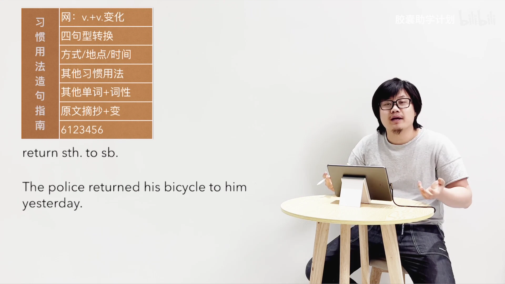

文字识别：网：v.+v.变化 / 习惯用法造句指南 / 四句型转换 / 方式/地点/时间 / 其他习惯用法 / 其他单词+词性 / 原文摘抄+变 / 6123456 / return sth. to sb. / The police returned his bicycle to him / yesterday.

### 画面 00:08:55

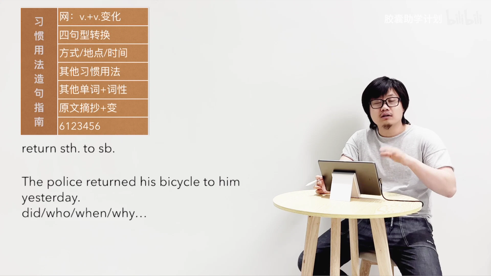

文字识别：网：v.+v.变化 / 习惯用法造句指南 / 四句型转换 / 方式/地点/时间 / 其他习惯用法 / 其他单词+词性 / 原文摘抄+变 / 6123456 / return sth.to sb. / The police returned his bicycle to him / yesterday. / did/who/when/why...

## 00:09:00–00:09:30

子。The diamond, 第七课咱们学的，对吧？The diamond, 这个钻石 will be returned to him tonight. 你注意，你看我这里就把它变成被动了，叫 will be returned to somebody, 叫 be returned to somebody, 叫做将被还给他今晚。OK, very good. 嗯，除了文章重要以外，那就是这两个小的习惯用法呗。各位回去记得造句啊。交作业。呃，习惯用法造

### 画面 00:09:00

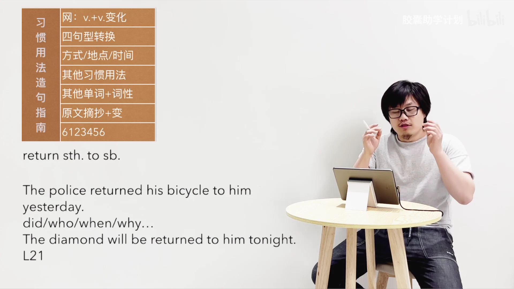

文字识别：网：v.+v.变化 / 习惯用法造句指南 / 四句型转换 / 方式/地点/时间 / 其他习惯用法 / 其他单词+词性 / 原文摘抄+变 / 6123456 / return sth.to sb. / The police returned his bicycle to him / yesterday. / did/who/when/why... / The diamond will be returned to him tonight. / L21

### 画面 00:09:05

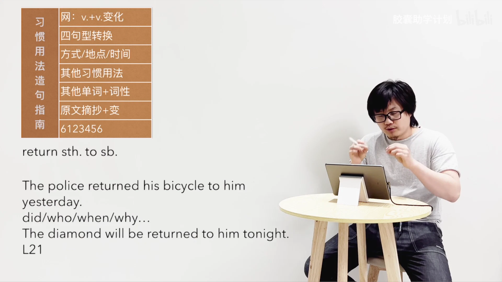

文字识别：网：v.+v.变化 / 习惯用法造句指南 / 四句型转换 / 方式/地点/时间 / 其他习惯用法 / 其他单词+词性 / 原文摘抄+变 / 6123456 / return sth.to sb. / The police returned his bicycle to him / yesterday. / did/who/when/why... / The diamond will be returned to him tonight. / L21

### 画面 00:09:10

文字识别：网：v.+v.变化 / 习惯用法造句指南 / 四句型转换 / 方式/地点/时间 / 其他习惯用法 / 其他单词+词性 / 原文摘抄+变 / 6123456 / return sth.to sb. / The police returned his bicycle to him / yesterday. / did/who/when/why... / The diamond will be returned to him tonight. / L21

### 画面 00:09:15

文字识别：网：v.+v.变化 / 习惯用法造句指南 / 四句型转换 / 方式/地点/时间 / 其他习惯用法 / 其他单词+词性 / 原文摘抄+变 / 6123456 / return sth.to sb. / The police returned his bicycle to him / yesterday. / did/who/when/why... / The diamond will be returned to him tonight. / L21

### 画面 00:09:20

文字识别：Recap / sb.learn that +宾从 / Expression / return sth. to sb.

### 画面 00:09:22

文字识别：Recap / sb.learn that +宾从 / Expression / return sth. to sb.

### 画面 00:09:24

文字识别：Recap / sb.learn that +宾从 / Expression / return sth. to sb.

### 画面 00:09:26

文字识别：Recap / sb.learn that+宾从 / Expression / return sth. to sb.

### 画面 00:09:28

文字识别：1. / 习惯用法造句/对话 / 【习惯用法造句指南】 / 每个5句

## 00:09:30–00:10:00

句，那老习惯是吧？每个用造五个，然后文章你还是要熟读成诵啊。原因我之前说过是吧？我再重申一下啊，就是我们实际上你本课的单词、语法和习惯用法，通过一遍一遍读文章，你自己就都记下来了啊。以及我们下一个视频的练习，一定要基于文章能熟读成诵啊。OK，呃，那以上就是本期视频的全部内容了。如果各位喜欢我们的课程呢，欢迎各位点赞、关注、

### 画面 00:09:30

文字识别：1. / 习惯用法造句/对话 / 【习惯用法造句指南】 / 每个5句

### 画面 00:09:33

文字识别：1. / 习惯用法造句/对话 / 【习惯用法造句指南】 / 每个5句 / 文章跟读至熟读成诵 / 内化单词+语法+习惯用法 / 听力+口语+写作练习

### 画面 00:09:35

文字识别：1. / 习惯用法造句/对话 / 【习惯用法造句指南】 / 每个5句 / 文章跟读至熟读成诵 / 内化单词+语法+习惯用法 / 听力+口语+写作练习

### 画面 00:09:40

文字识别：1. / 习惯用法造句/对话 / 【习惯用法造句指南】 / 每个5句 / 文章跟读至熟读成诵 / 内化单词+语法+习惯用法 / 听力+口语+写作练习

### 画面 00:09:45

文字识别：习惯用法造句/对话 / 1. / 【习惯用法造句指南】 / 每个5句 / 文章跟读至熟读成诵 / 内化单词+语法+习惯用法 / 听力+口语+写作练习

### 画面 00:09:51

## 00:10:00–00:10:17

一键三连，长按点赞，对吧？OK，那 see you next time.

### 画面 00:10:05

文字识别：CAPSULEACADEMY / 胶囊助学计划 / 小红书

### 画面 00:10:07

文字识别：CAPSULEACADEMY / 胶囊助学计划 / 小红书 / Leo

### 画面 00:10:13

文字识别：CAPSULEACADEMY / 胶囊助学计划 / 小红书 / Creator / □ / Leo & Berlin

### 画面 00:10:15

文字识别：bilibili / 胶囊助学计划

### 画面 00:10:16

文字识别：bilibili / 胶囊助学计划

