# L046 单词

快速机器解析：语音为单模型转写，未进行独立交叉校对或人工复核；画面每秒采样并按变化选帧，短时文字和标记可能遗漏。截图时间约有 1 秒误差。图片有损压缩；遇到疑点请按时间查看 Google Drive 原视频。

## 00:00:00–00:00:30

Hello everyone, welcome to Capsule Academy. This is Leo. Today we're going to learn New Concept English Book Two, Lesson Forty Six Words. 那老习惯进入正式课程之前呢，我们先看几个小的问题。第一，如何表达某人突然想起某件事情？第二，如何表达很吃惊？啊，最后一个问题，如何表达承认做了某件事情？带着这三个问题，Hope you gonna enjoy.

### 画面 00:00:00

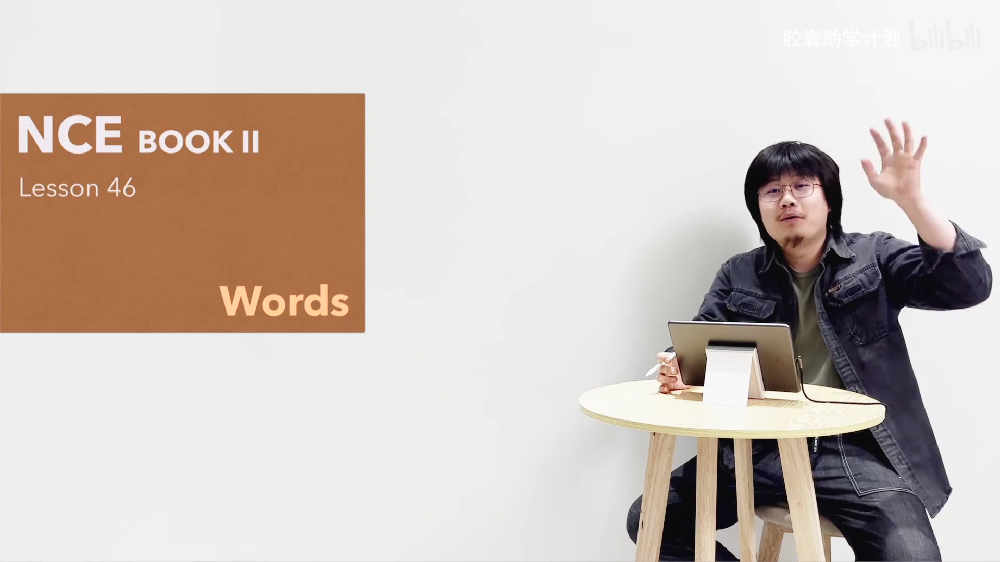

文字识别：NCE / BOOKI"I / Lesson 46 / Words

### 画面 00:00:02

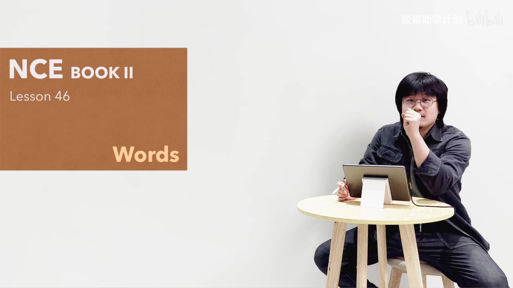

文字识别：NCE / BOOK"I / Lesson 46 / Words

### 画面 00:00:09

### 画面 00:00:11

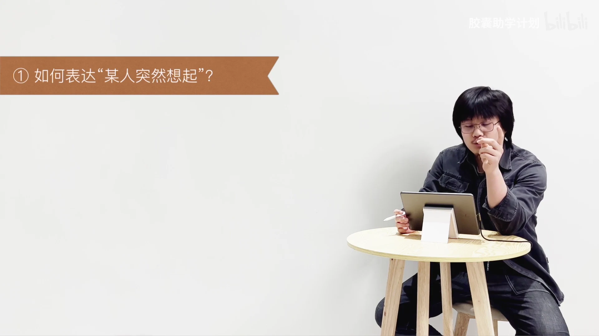

文字识别：①如何表达“某人突然想起”？

### 画面 00:00:16

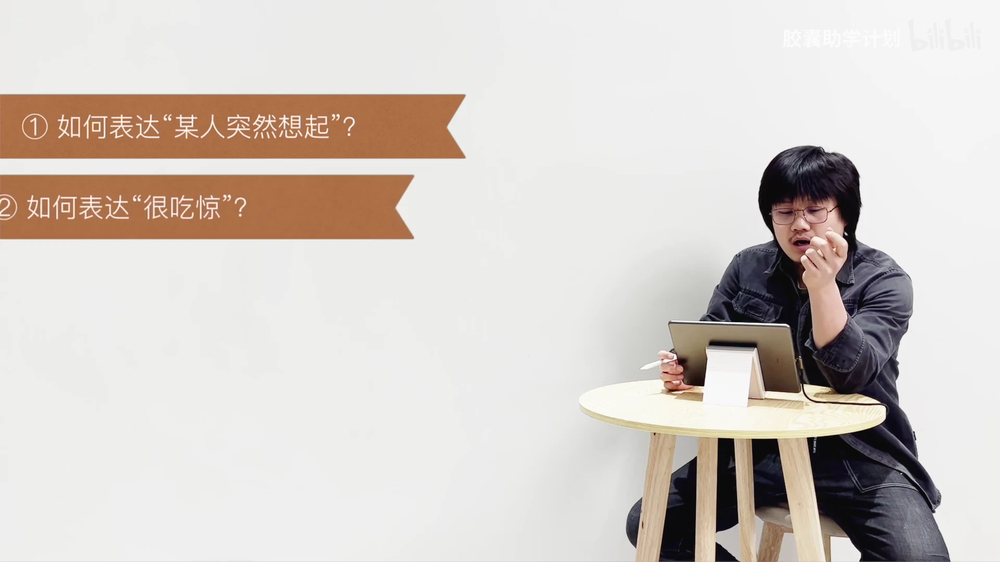

文字识别：①如何表达“某人突然想起”？ / 如何表达“很吃惊”？

### 画面 00:00:18

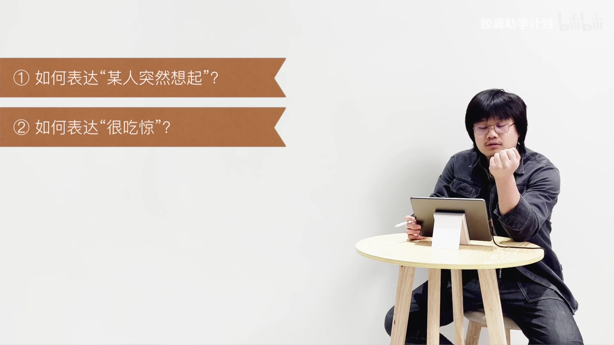

文字识别：①如何表达“某人突然想起”？ / 如何表达“很吃惊”？

### 画面 00:00:20

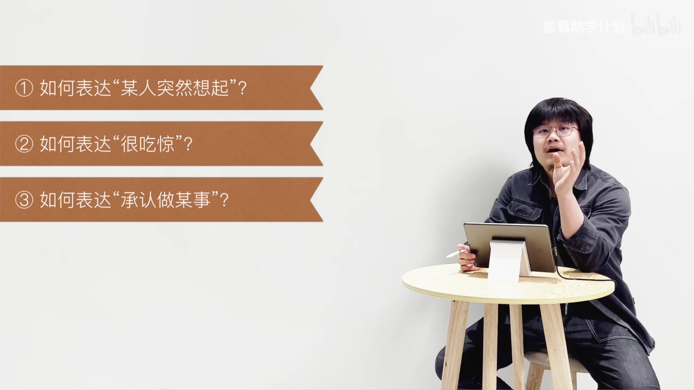

文字识别：①如何表达“某人突然想起”？ / 如何表达“很吃惊”? / 如何表达“承认做某事”?

### 画面 00:00:26

文字识别：胶囊助学计划 bilb出 / •

## 00:00:30–00:01:00

好，那我们上来先看第一个小的单词，跟我一起读一下，叫做 unload，注意重音在后面啊，叫 unload， OK，然后提一个小点叫 un 这个字母组合，这个字母组合我们之前见过，比如说 untidy 对吧，unhappy 啊等等等等，然后呢，那我们注意一个小的点，就是 un 告诉我们的叫做英语的前缀，表示的是否定啊，那其实你就要看一下 load 是什么意思，load 就是把我们的东西

### 画面 00:00:30

### 画面 00:00:32

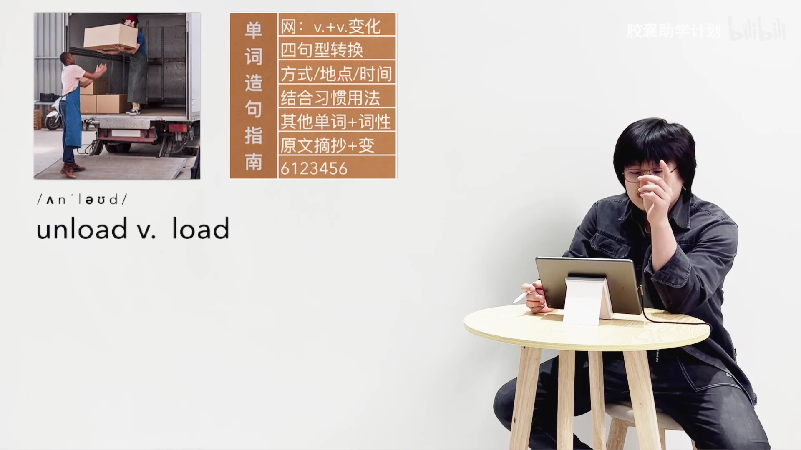

文字识别：单词造句指南 / 网：v.+v.变化 / 四句型转换 / 方式/地点/时间 / 结合习惯用法 / 其他单词+词性 / 原文摘抄+变 / 6123456 / /Λn'laud/ / unload v. load

### 画面 00:00:36

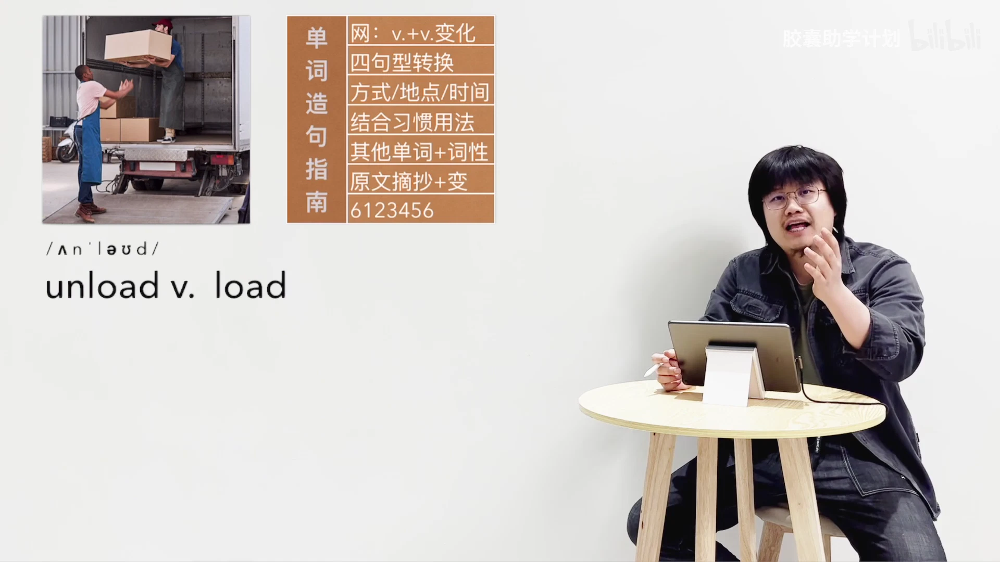

文字识别：单词造句指南 / 网：v.+v.变化 / 四句型转换 / 方式/地点/时间 / 结合习惯用法 / 其他单词+词性 / 原文摘抄+变 / 6123456 / /Λn'laud/ / unload v. load

### 画面 00:00:40

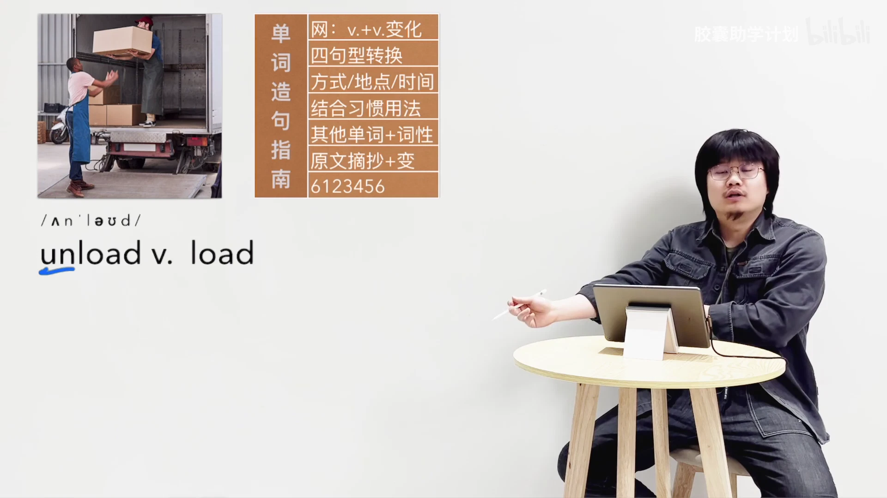

文字识别：单词造句指南 / 网：v.+v.变化 / 四句型转换 / 方式/地点/时间 / 结合习惯用法 / 其他单词+词性 / 原文摘抄+变 / 6123456 / /Λn'laud/ / unload v. load

### 画面 00:00:56

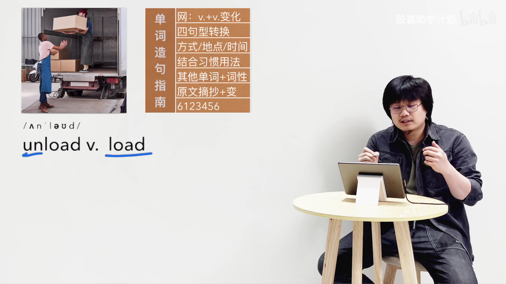

文字识别：单词造句指南 / 网：v.+v.变化 / 四句型转换 / 方式/地点/时间 / 结合习惯用法 / 其他单词+词性 / 原文摘抄+变 / 6123456 / /Λn'laud/ / unload v. load

## 00:01:00–00:01:30

装上车的这个过程，那unload呢就是把车里的东西卸货的这个过程，我们管它叫unload。OK，好，那我们现在知道了我要用unload这个单词去造句，它又是一个动词。动词去造句的时候最重要的其实就是我说的这个网，叫做动词加动词的变化。OK，那我们想一下，动词的变化包含了什么？简单说一下，比如说包含了我们之前学过的时态

### 画面 00:01:20

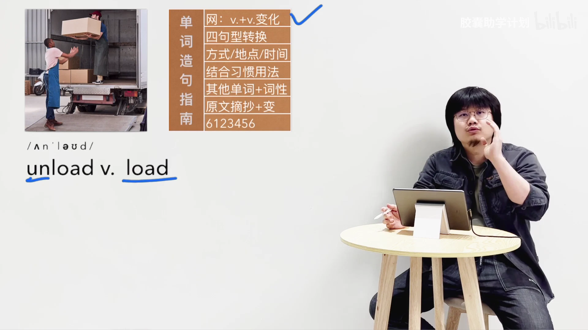

文字识别：单词造句指南 / 网：v.+v.变化 / 四句型转换 / 方式/地点/时间 / 结合习惯用法 / 其他单词+词性 / 原文摘抄+变 / 6123456 / /Λn'laud/ / unload v. load

## 00:01:30–00:02:00

的主动，时态的被动，情态助动词的主动，情态助动词的被动，以及情态助动词表推测，对吧？这些全算上是动词加动词的变化，也就是六一二三四五六当中二那个位置。OK，比如说我们造一些句子，叫做 They are they are unloading the boxes。第二课 be 加 doing，现在正在做某件事儿。再来，比如说 The boxes are being unloaded，这就变成了第十课，叫做

### 画面 00:01:33

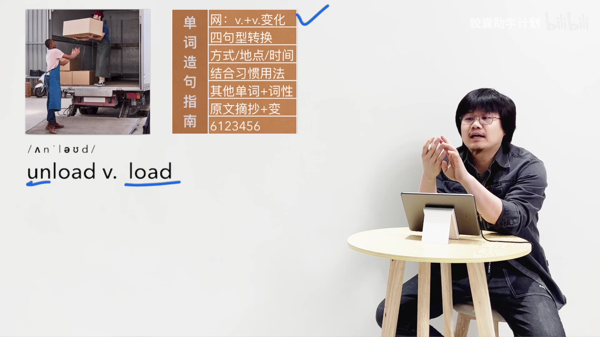

文字识别：单词造句指南 / 网：v.+v.变化 / 四句型转换 / 方式/地点/时间 / 结合习惯用法 / 其他单词+词性 / 原文摘抄+变 / 6123456 / /Λn'laud/ / unload v. load

### 画面 00:01:35

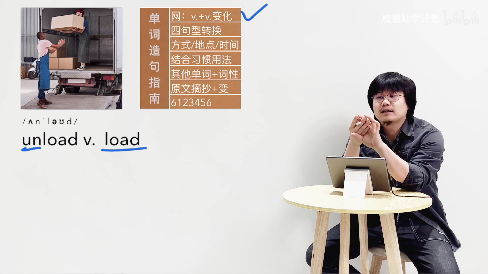

文字识别：单词造句指南 / 网：v.+v.变化 / 四句型转换 / 方式/地点/时间 / 结合习惯用法 / 其他单词+词性 / 原文摘抄+变 / 6123456 / /Λn'laud/ / unload v. load

### 画面 00:01:50

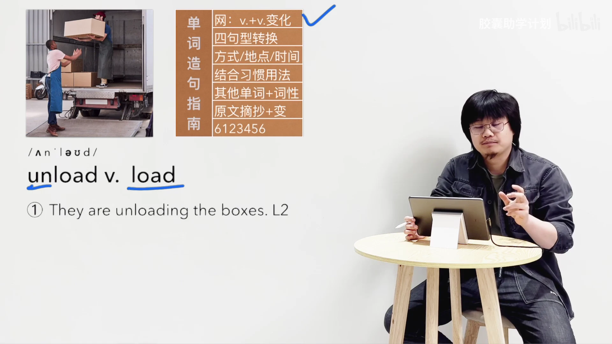

文字识别：单词造句指南 / 网：v.+v.变化 / 四句型转换 / 方式/地点/时间 / 结合习惯用法 / 其他单词+词性 / 原文摘抄+变 / 6123456 / /Λn'laud/ / unload v. load / ① They are unloading the boxes. L2

## 00:02:00–00:02:30

箱子正在被卸下来，对吧？OK啊，Next one说，These boxes must have been low unloaded yesterday afternoon. Must have been done.这是咱们二十一课学过的，哎，这就是我跟大家说，各位经常容易忘到的，它叫做不仅是形态动词，还是表推测，然后还是被动，叫must have been done，对吧？二十一课咱们学的，练到了今天，再来，比如说He used to unload boxes every day.三十

### 画面 00:02:03

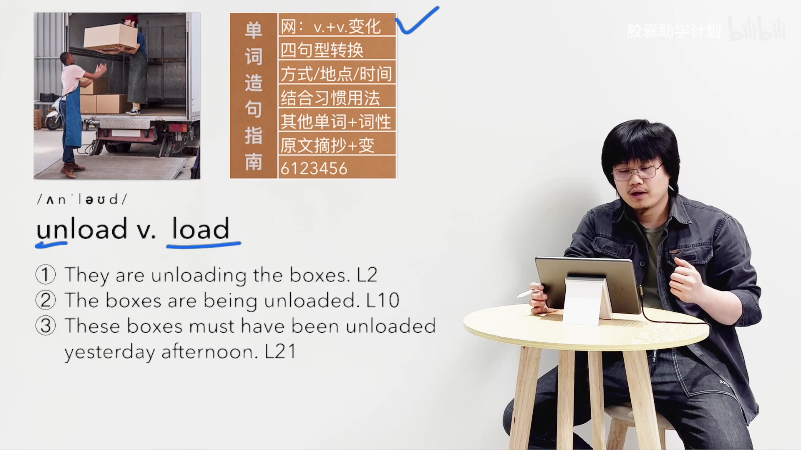

文字识别：单词造句指南 / 网：v.+v.变化 / 四句型转换 / 方式/地点/时间 / 结合习惯用法 / 其他单词+词性 / 原文摘抄+变 / 6123456 / /Λn'laud/ / unload v. load / ① They are unloading the boxes. L2 / 9 The boxes are being unloaded. L10 / These boxes must have been unloaded / yesterday afternoon. L21

### 画面 00:02:05

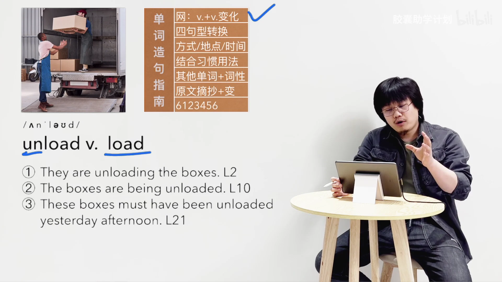

文字识别：单词造句指南 / 网：v.+v.变化 / 四句型转换 / 方式/地点/时间 / 结合习惯用法 / 其他单词+词性 / 原文摘抄+变 / 6123456 / /Λn'laud/ / unload v. load / ① They are unloading the boxes. L2 / ) The boxes are being unloaded. L10 / 2 / These boxes must have been unloaded / yesterday afternoon. L21

### 画面 00:02:11

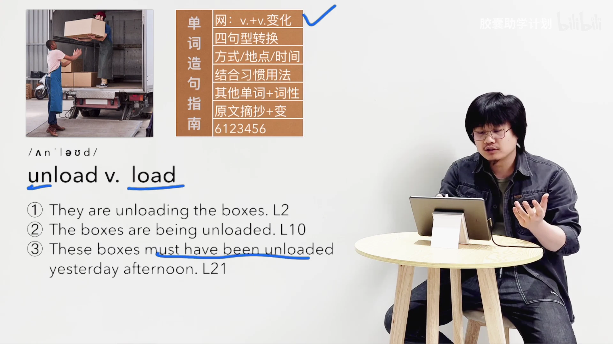

文字识别：单词造句指南 / 网：v.+v.变化 / 四句型转换 / 方式/地点/时间 / 结合习惯用法 / 其他单词+词性 / 原文摘抄+变 / 6123456 / /Λn'laud / / unload v. load / ① They are unloading the boxes. L2 / ) The boxes are being unloaded. L10 / These boxes must have been unloaded / yesterday afternoon. L21

### 画面 00:02:26

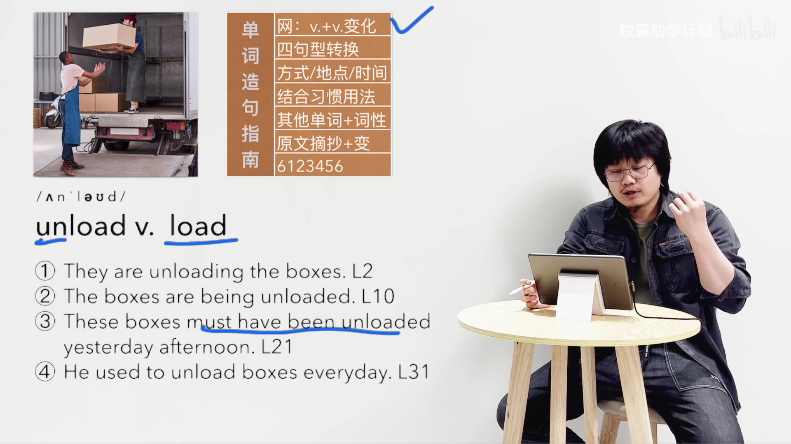

文字识别：单词造句指南 / 网：v.+v.变化 / 四句型转换 / 方式/地点/时间 / 结合习惯用法 / 其他单词+词性 / 原文摘抄+变 / 6123456 / /Λn'laud/ / unload v. load / ① They are unloading the boxes. L2 / ② The boxes are being unloaded. L10 / 2） / These boxes must have been unloaded / yesterday afternoon. L21 / ) He used to unload boxes everyday. L31

## 00:02:30–00:03:00

课咱们学的 used to do something, 对吧？再来，比如说 you needn't have unloaded all the boxes. 41课咱们学的 needn't have done. 各位看我造的这五句话的主语其实无所谓，主语你愿意用谁用谁，你统一全用成 they，我觉得问题也不大，除了被动啊，当然。然后呢，你看其实我们的动词就是做了各种样的动词的变化，对不对？这个是大家的基本功。OK, next one, 下一个单词跟我读一下，叫做 wouldn't.

### 画面 00:02:40

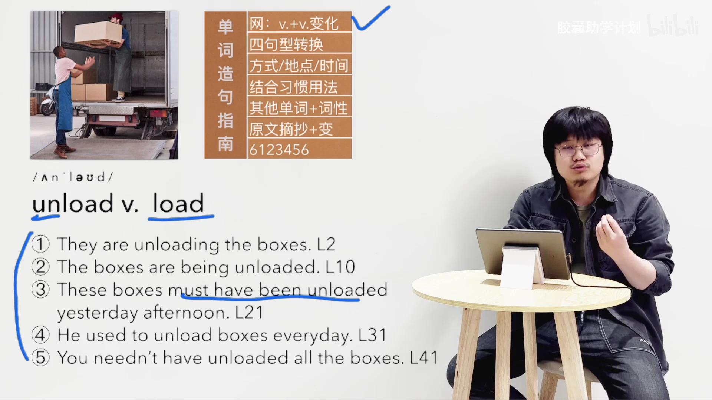

文字识别：单词造句指南 / 网：v.+v.变化 / 四句型转换 / 方式/地点/时间 / 结合习惯用法 / 其他单词+词性 / 原文摘抄+变 / 6123456 / /Λn'laud/ / unload v. load / ① They are unloading the boxes. L2 / ) The boxes are being unloaded. L10 / 2 / These boxes must have been unloaded / yesterday afternoon. L21 / He used to unload boxes everyday. L31 / ⑤ You needn't have unloaded all the boxes. L41

### 画面 00:02:52

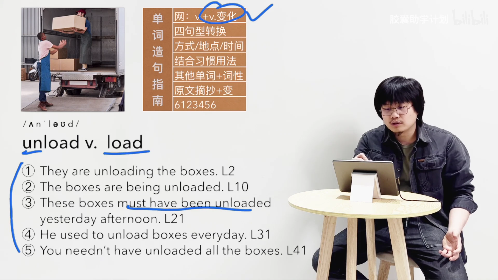

文字识别：单词造句指南 / 网：√+v.变化 / 四句型转换 / 方式/地点/时间 / 结合习惯用法 / 其他单词+词性 / 原文摘抄+变 / 6123456 / /Λn'laud/ / unload v. load / ① They are unloading the boxes. L2 / The boxes are being unloaded. L10 / 2 / These boxes must have been unloaded / yesterday afternoon. L21 / He used to unload boxes everyday. L31 / ⑤ You needn't have unloaded all the boxes. L41

### 画面 00:02:57

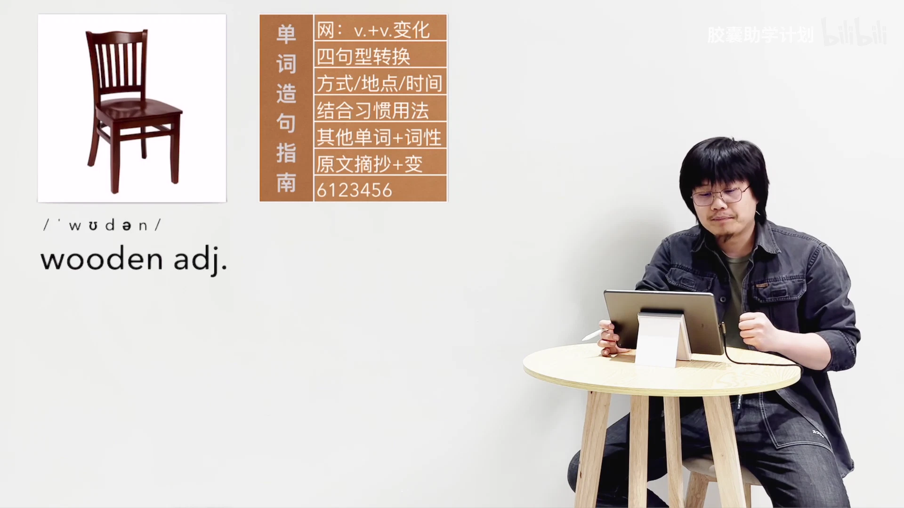

文字识别：单词造句指南 / 网：v.+v.变化 / 四句型转换 / 方式/地点/时间 / 结合习惯用法 / 其他单词+词性 / 原文摘抄+变 / 6123456 / /'wudan/ / wooden adj.

## 00:03:00–00:03:30

wooden。这个单词我们见过啊，不管它是木质的还是木头的啊。本课跟我印象当中应该是第八课啊，第八课我们讲这个呃小花园的那一刻啊，那课是形容词比较级最高级的那一刻，我们学过一个叫 wooden bridge，对吧？那是形容词啊，这本课一模一样，只是含义有一点点区别，变成了木质的是吧？木头的、木质的，本质上没什么太大区别，都是形容词。那你

### 画面 00:03:27

文字识别：单词造句指南 / 网：v.+v.变化 / 四句型转换 / 方式/地点/时间 / 结合习惯用法 / 其他单词+词性 / 原文摘抄+变 / 6123456 / /'wudan / / wooden adj.

## 00:03:30–00:04:00

后边要加名词，对吧？这是我们说单词要看词性。那我们加一些，比如说名词，比如说 wooden chair、 wooden bridge，啊，我这还给你标了一下。第八课我们就学过，对吧？形容词加名词合起来，好了，有这个小的词组了。再去造句的时候，我还是需要动词啊，你还是得去想一些动词。那其实就很简单了，你比如说买一个、建一个，对吧？做一个啊，扔一个啊，这个卖一个，这都算最常用的动词了。

### 画面 00:03:32

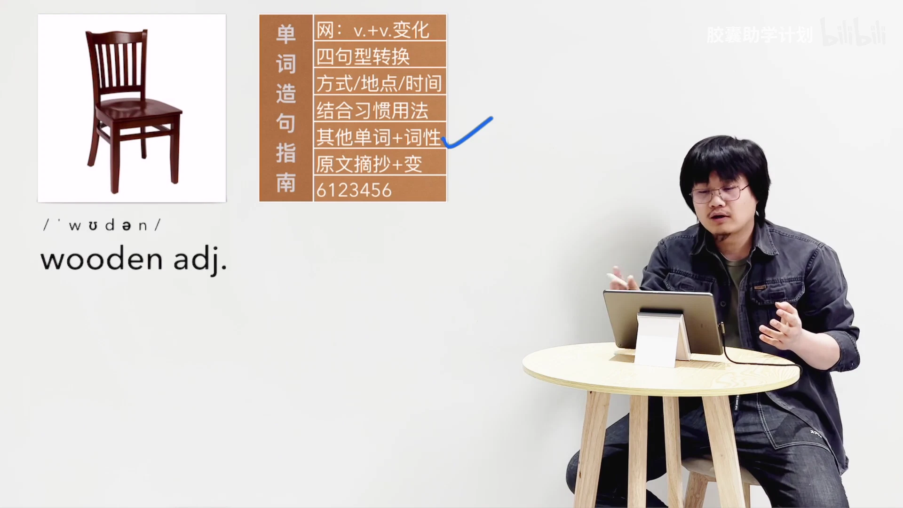

文字识别：单词造句指南 / 网：v.+v.变化 / 四句型转换 / 方式/地点/时间 / 结合习惯用法 / 其他单词+词性 / 原文摘抄+变 / 6123456 / /'wudan/ / wooden adj.

### 画面 00:03:35

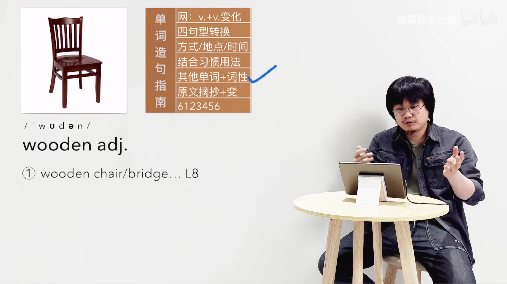

文字识别：单词造句指南 / 网：v.+v.变化 / 四句型转换 / 方式/地点/时间 / 结合习惯用法 / 其他单词+词性 / 原文摘抄+变 / 6123456 / / 'wudan / / wooden adj. / wooden chair/bridge... L8

### 画面 00:03:41

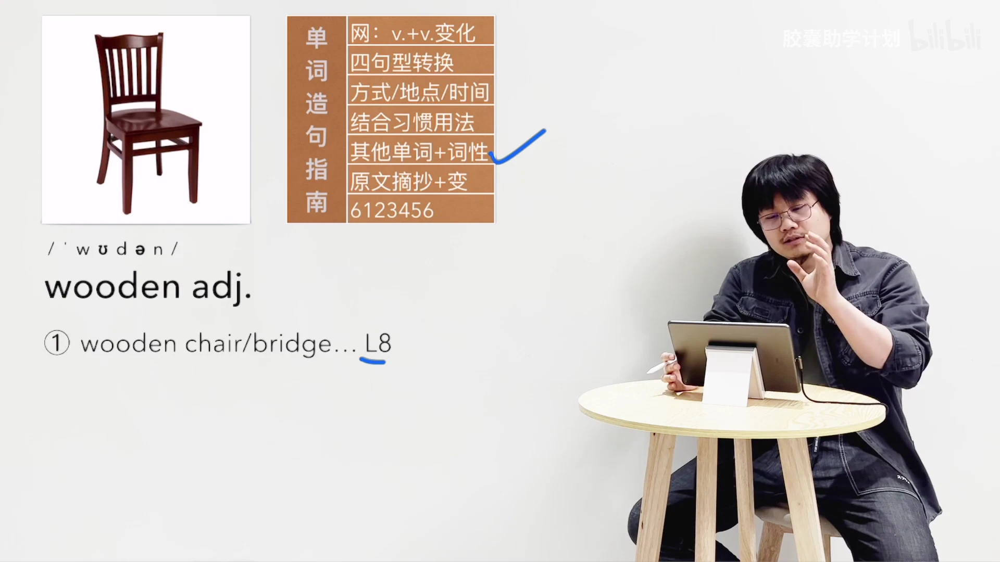

文字识别：单词造句指南 / 网：v.+v.变化 / 四句型转换 / 方式/地点/时间 / 结合习惯用法 / 其他单词+词性 / 原文摘抄+变 / 6123456 / / 'wudan/ / wooden adj. / wooden chair/bridge... L8

### 画面 00:03:48

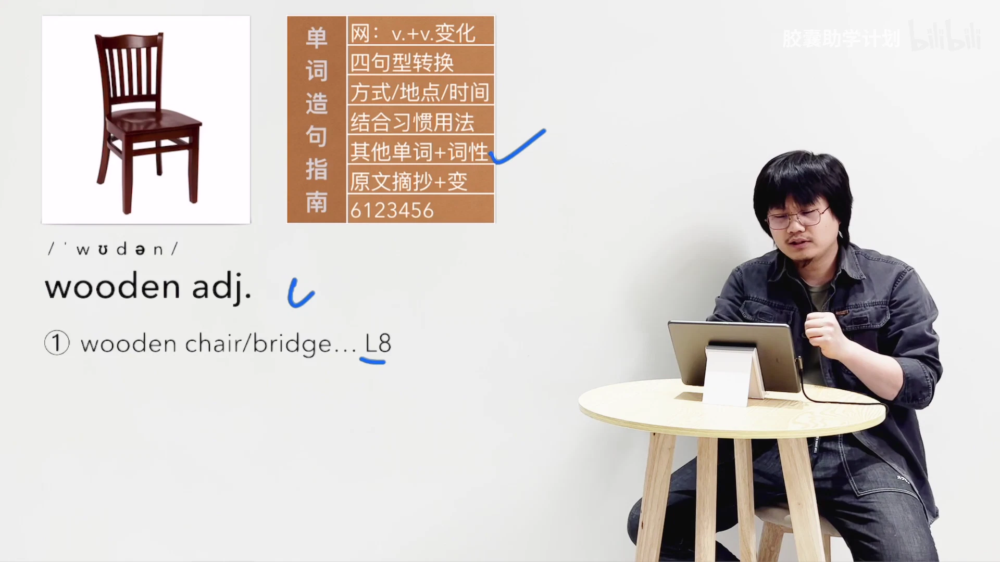

文字识别：单词造句指南 / 网：v.+v.变化 / 四句型转换 / 方式/地点/时间 / 结合习惯用法 / 其他单词+词性 / 原文摘抄+变 / 6123456 / / 'wudan / / wooden adj. / wooden chair/bridge... L8

## 00:04:00–00:04:30

OK，好，那比如说，你看，我就来了这个叫做 If they bought their wooden chair, I would give you one too. 哎，如果他们买，我也给你一个。但是注意看一下结构，If bought和 would 加 give，再加上四十克虚拟语气，所以我认为他们就不会买那个木质的椅子的。OK，再来说 This wooden bridge needs mending. 说这个木质的桥需要修理了。四十四课咱们刚

### 画面 00:04:00

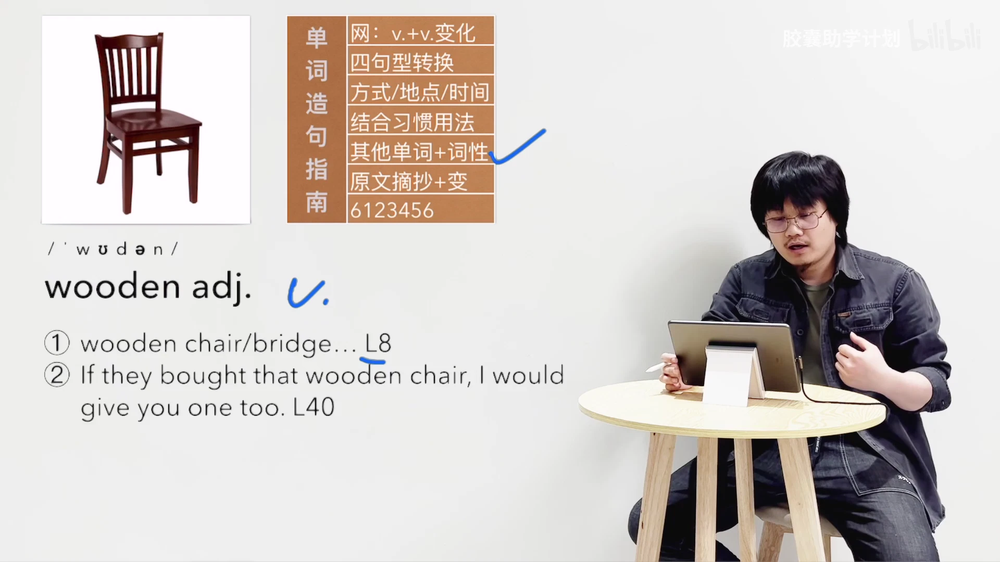

文字识别：单词造句指南 / 网：v.+v.变化 / 四句型转换 / 方式/地点/时间 / 结合习惯用法 / 其他单词+词性 / 原文摘抄+变 / 6123456 / / 'wudan / / wooden adj. / V. / wooden chair/bridge... L8 / If they bought that wooden chair, I would / give you one too. L40

### 画面 00:04:11

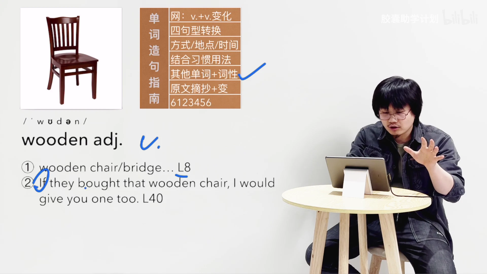

文字识别：单词造句指南 / 网：v.+v.变化 / 四句型转换 / 方式/地点/时间 / 结合习惯用法 / 其他单词+词性 / 原文摘抄+变 / 6123456 / / 'wudən / / wooden adj. / V. / Wooden chair/bridge... L8 / they b.ought that wooden chair, I would / give you one too. L40

### 画面 00:04:13

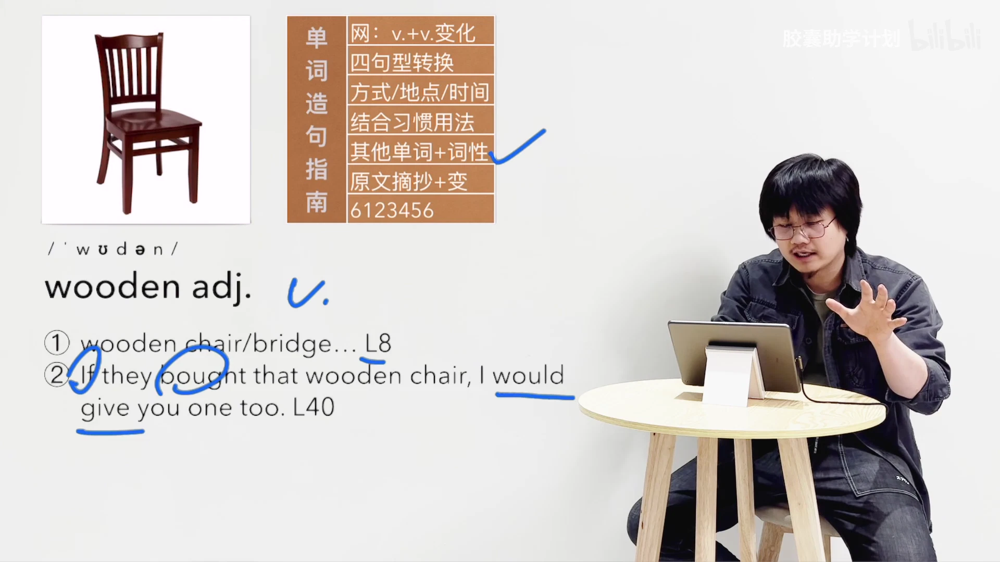

文字识别：单词造句指南 / 网：v.+v.变化 / 四句型转换 / 方式/地点/时间 / 结合习惯用法 / 其他单词+词性 / 原文摘抄+变 / 6123456 / / 'wudan / / wooden adj. / V. / wooden chair/bridge... L8 / theyoought that wooden chair, I would / give you one too. L40

### 画面 00:04:15

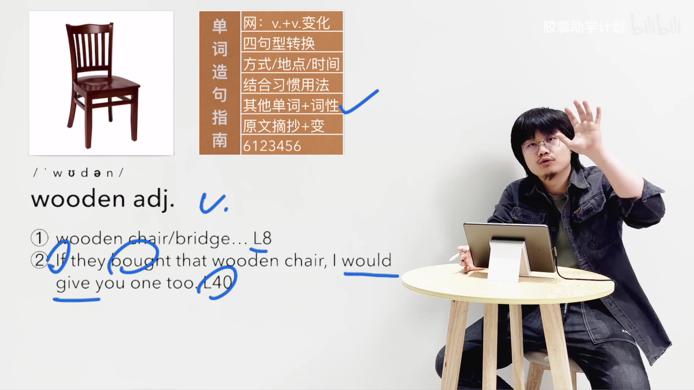

文字识别：单词造句指南 / 网：v.+v.变化 / 四句型转换 / 方式/地点/时间 / 结合习惯用法 / 其他单词+词性 / 原文摘抄+变 / 6123456 / /'wudan/ / wooden adj. / V. / wooden chair/bridge... L8 / theyoought that wooden chair, I would / give you one too. L40

### 画面 00:04:23

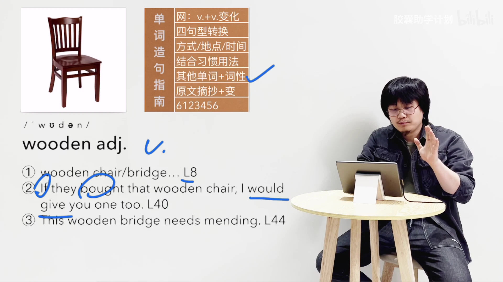

文字识别：单词造句指南 / 网：v.+v.变化 / 四句型转换 / 方式/地点/时间 / 结合习惯用法 / 其他单词+词性 / 原文摘抄+变 / 6123456 / / 'wudan / / wooden adj. / V / wooden chair/bridge... L8 / theyoought that wooden chair, I would / lf / give you one too. L40 / This wooden bridge needs mending. L44

### 画面 00:04:26

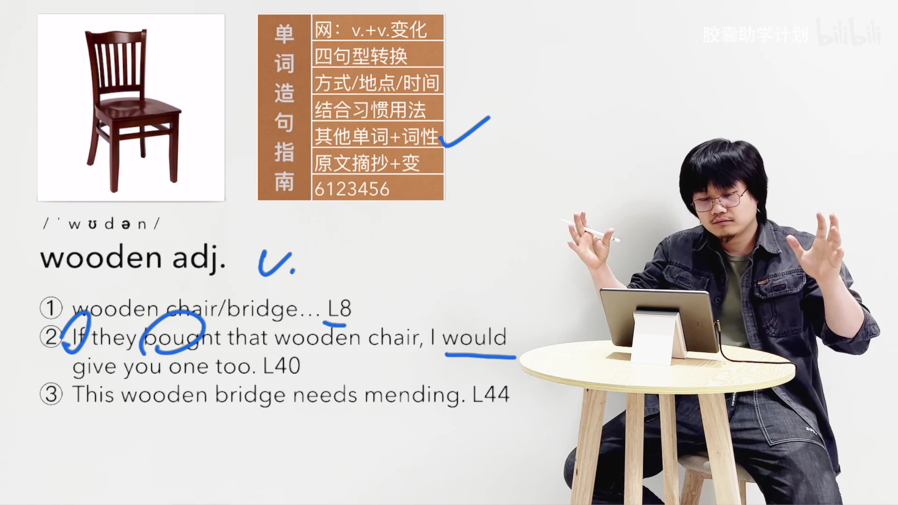

文字识别：单词造句指南 / 网：v.+v.变化 / 四句型转换 / 方式/地点/时间 / 结合习惯用法 / 其他单词+词性 / 原文摘抄+变 / 6123456 / / 'wudən / / wooden adj. / V. / wooden chair/bridge... L8 / theypought that wooden chair, I would / lf / give you one too. L40 / This wooden bridge needs mending. L44

## 00:04:30–00:05:00

学的 need doing something，对吧？OK，表示的是被动啊。复习了。Next one，再来说，She finds this wooden chair beautiful。四十一课咱们学的叫 find something，后边加形容词，对吧？陈述一个客观事实。于是这个句话我用的是一般现在时。您还可以把它变成其他的呃句型，对吧？四句型啊。OK， next one，下一个单词，注意，首先它是个副词。副词我们最常用的两

### 画面 00:04:30

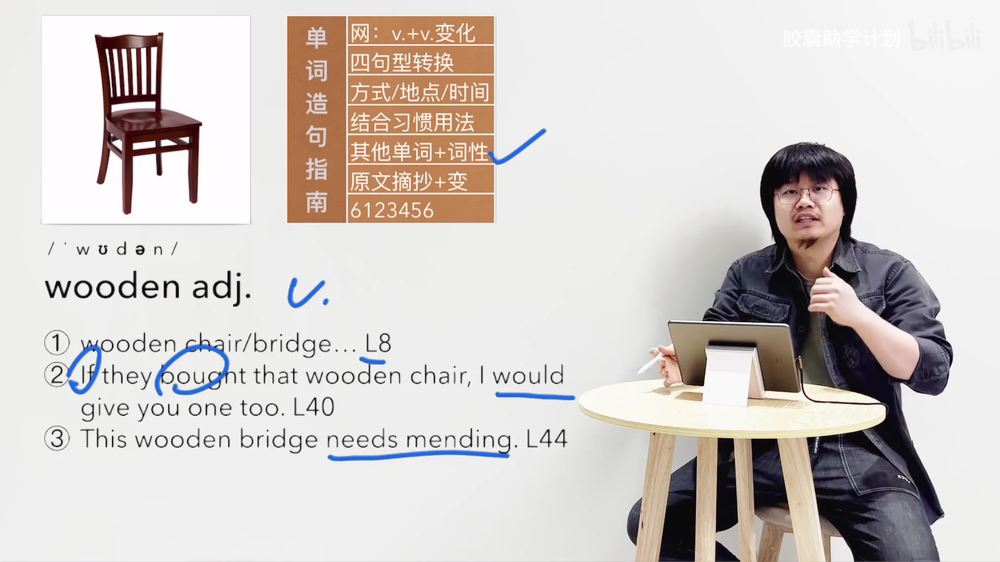

文字识别：单词造句指南 / 网：v.+v.变化 / 四句型转换 / 方式/地点/时间 / 结合习惯用法 / 其他单词+词性 / 原文摘抄+变 / 6123456 / / 'wudan / / wooden adj. / V / wooden chair/bridge... L8 / theyoought that wooden chair, I would / give you one too. L40 / This wooden bridge needs mending. L44

### 画面 00:04:40

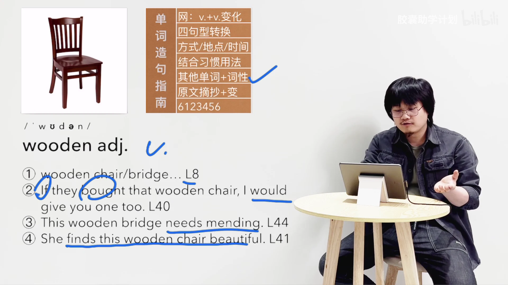

文字识别：单词造句指南 / 网：v.+v.变化 / 四句型转换 / 方式/地点/时间 / 结合习惯用法 / 其他单词+词性 / 原文摘抄+变 / 6123456 / / wud an / / wooden adj. / V. / wooden chair/bridge... L8 / 1 / lf / theyoought that wooden chair, I would / give you one too. L40 / This wooden bridge needs mending. L44 / 4 She finds this wooden chair beautiful. L41

### 画面 00:04:53

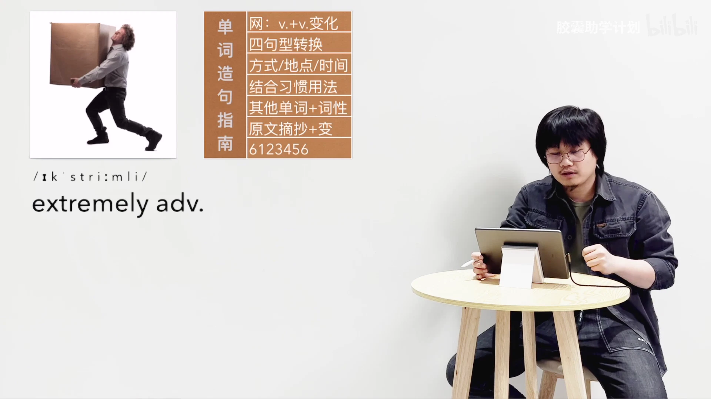

文字识别：单词造句指南 / 网：v.+v.变化 / 四句型转换 / 方式/地点/时间 / 结合习惯用法 / 其他单词+词性 / 原文摘抄+变 / 6123456 / /rk'stri:mli/ / extremely adv.

### 画面 00:04:56

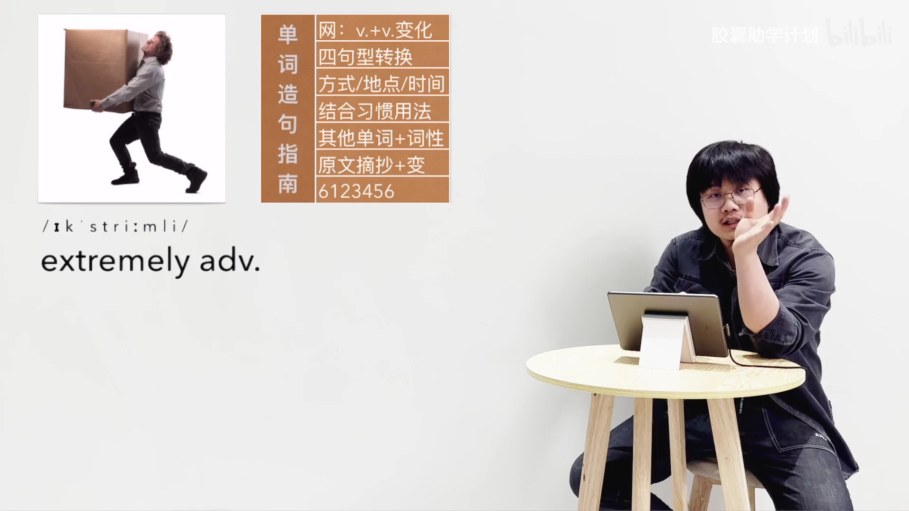

文字识别：单词造句指南 / 网：v.+v.变化 / 四句型转换 / 方式/地点/时间 / 结合习惯用法 / 其他单词+词性 / 原文摘抄+变 / 6123456 / /rk'stri:mli/ / extremely adv.

## 00:05:00–00:05:30

个地方，一个是接着动词，一个是接着啊，它不具体一点，不能叫接着，接着有其一个是修饰动词，一个是修饰形容词，对吧？那这个单词叫 extremely， extremely， extremely，叫做极度的、极端的。其实你可以把它理解为叫做 very， very， very， very， very，对吧？就特别特别特别特别特别啊，就是大概这样的一种感觉。好，那 extremely 副词，我们给它加一点点形容

### 画面 00:05:01

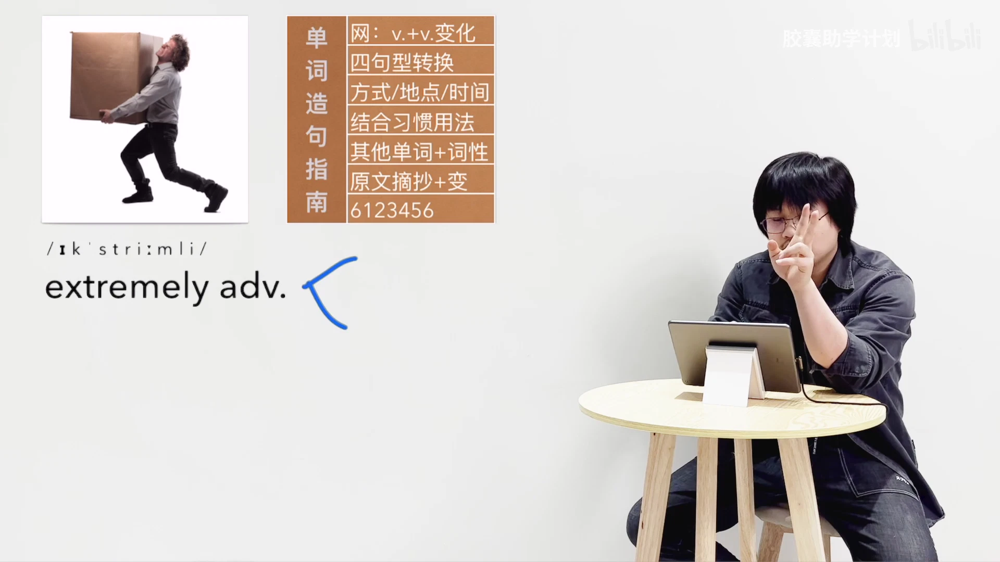

文字识别：单词造句指南 / 网：v.+v.变化 / 四句型转换 / 方式/地点/时间 / 结合习惯用法 / 其他单词+词性 / 原文摘抄+变 / 6123456 / /ik'stri:mli/ / extremely adv.

### 画面 00:05:04

文字识别：单词造句指南 / 网：v.+v.变化 / 四句型转换 / 方式/地点/时间 / 结合习惯用法 / 其他单词+词性 / 原文摘抄+变 / 6123456 / /ik'stri:mli/ / V / extremely adv.

### 画面 00:05:12

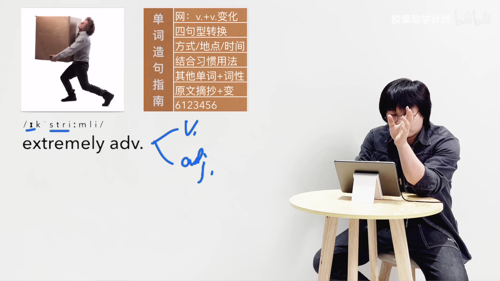

文字识别：单词造句指南 / 网：v.+v.变化 / 四句型转换 / 方式/地点/时间 / 结合习惯用法 / 其他单词+词性 / 原文摘抄+变 / 6123456 / /Ik'stri:m li/ / V / extremely adv. / ad

### 画面 00:05:15

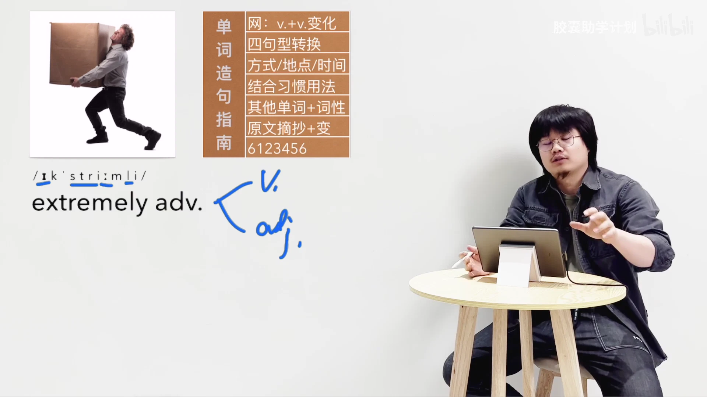

文字识别：单词造句指南 / 网：v.+v.变化 / 四句型转换 / 方式/地点/时间 / 结合习惯用法 / 其他单词+词性 / 原文摘抄+变 / 6123456 / /Ik^ s tri:m|i / / V / extremely adv. / ad

## 00:05:30–00:06:00

词，比如说 extremely tired, extremely thirsty, extremely heavy. 后边都是形容词，对吧？极度的累，极度的渴和极度的沉啊。我们说一下它和 very 一点点区别呢。我举个例子，如果零到一百，一百是最沉，零是最轻，对吧？没有重量。比如说 very 可能是六十或七十分，而 extremely 给人的感觉就是九十五分朝上。各位能理

### 画面 00:05:30

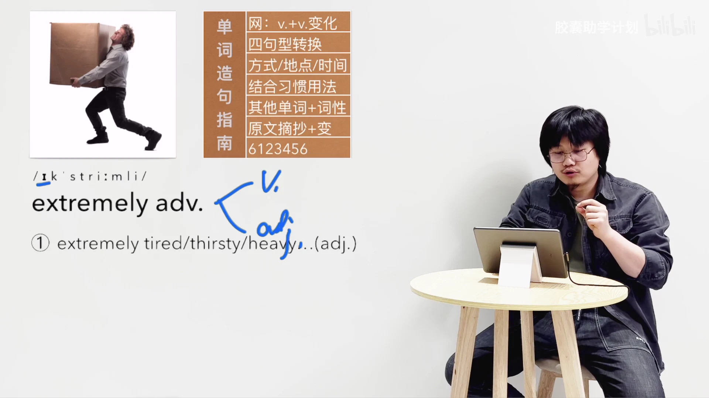

文字识别：单词造句指南 / 网：v.+v.变化 / 四句型转换 / 方式/地点/时间 / 结合习惯用法 / 其他单词+词性 / 原文摘抄+变 / 6123456 / /Ik'stri:m li / / V / extremely adv. / ad / D extremely tired/thirsty/heayy..(adj.)

### 画面 00:05:32

文字识别：单词造句指南 / 网：v.+v.变化 / 四句型转换 / 方式/地点/时间 / 结合习惯用法 / 其他单词+词性 / 原文摘抄+变 / 6123456 / /Ik^stri:m li / / extremely adv. / ① extremely tired/thirsty/heavy...(adj.)

### 画面 00:05:35

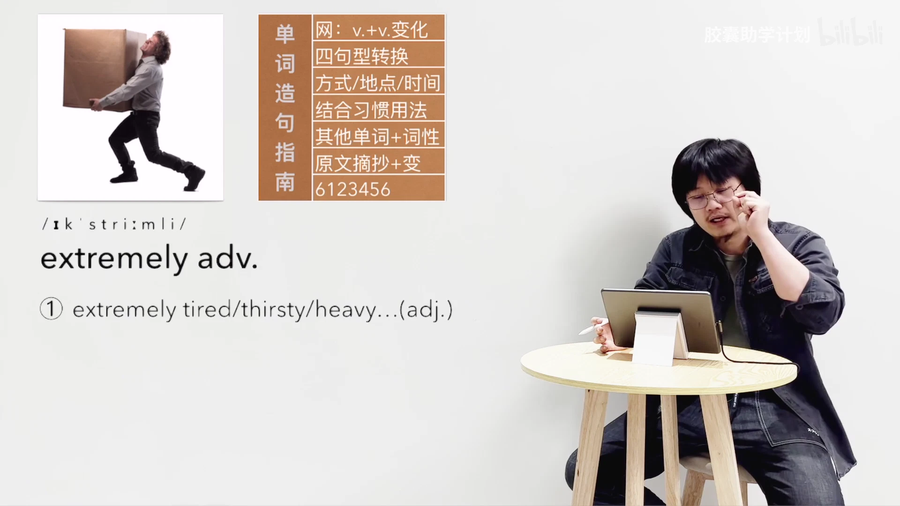

文字识别：单词造句指南 / 网：v.+v.变化 / 四句型转换 / 方式/地点/时间 / 结合习惯用法 / 其他单词+词性 / 原文摘抄+变 / 6123456 / /Ik^stri:m li / / extremely adv. / ① extremely tired/thirsty/heavy...(adj.)

## 00:06:00–00:06:30

解了啊？程度的不同，OK。那你看，接下来我们副词其实想造句的时候，我们要么挂靠动词，那本副词我们挂靠的是一个呃形容词，对吧？挂靠完了之后，接下来我还是需要一些，比如说什么名词啊、动词啊，或者哪怕be动词这样一些东西。比如说我造一个句子叫She is extremely tired or thirsty，对吧？她极度的累或渴，非常简单。你看，这其实就是我

### 画面 00:06:05

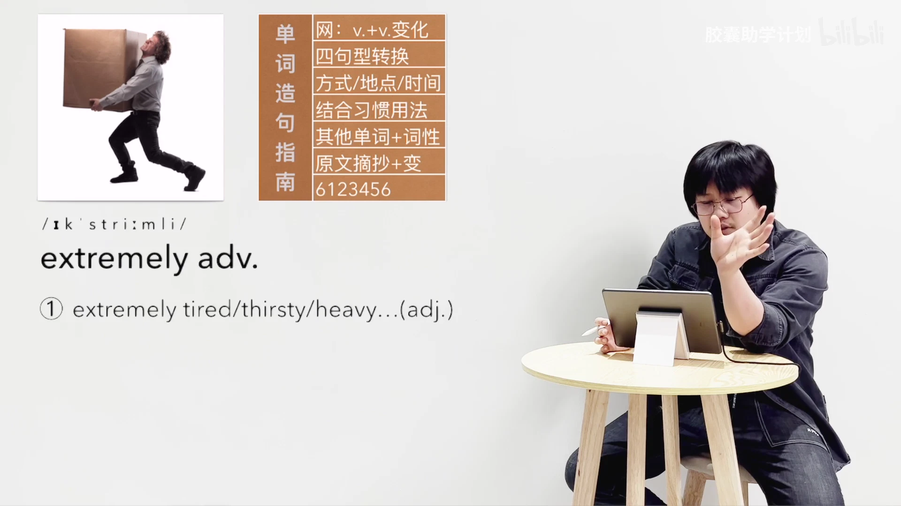

文字识别：单词造句指南 / 网：v.+v.变化 / 四句型转换 / 方式/地点/时间 / 结合习惯用法 / 其他单词+词性 / 原文摘抄+变 / 6123456 / /ik^stri:m li/ / extremely adv. / ① extremely tired/thirsty/heavy...(adj.)

## 00:06:30–00:07:00

们新概念一册前二十课就学的句子啊。好，再来说，She inquired about that extremely heavy boxes last night. 所以你看，我这句话造出来是怎么造出来？各位想一下思路啊，我给各位讲一下思路，对吧？首先，我先选用了核心的，叫我要拿 extremely 造句，所以 extremely heavy 我要先拿出来。其次，那 extremely heavy 什么呢？我又想了一个名词，叫做 box。

### 画面 00:06:33

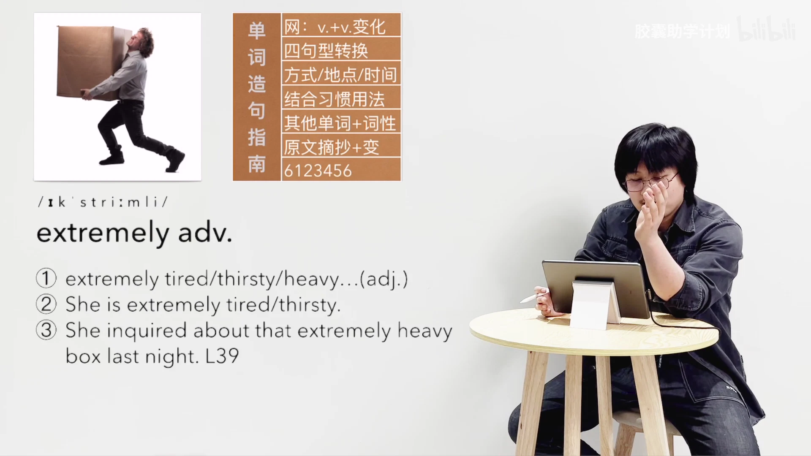

文字识别：单词造句指南 / 网：v.+v.变化 / 四句型转换 / 方式/地点/时间 / 结合习惯用法 / 其他单词+词性 / 原文摘抄+变 / 6123456 / /rk'stri:mli/ / extremely adv. / ① extremely tired/thirsty/heavy...(adj.) / ② She is extremely tired/thirsty. / ③ She inquired about that extremely heavy / 3 / box last night. L39

### 画面 00:06:49

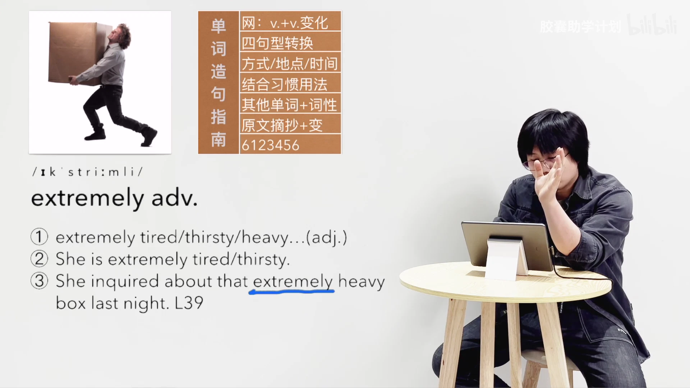

文字识别：单词造句指南 / 网：v.+v.变化 / 四句型转换 / 方式/地点/时间 / 结合习惯用法 / 其他单词+词性 / 原文摘抄+变 / 6123456 / /rk^stri:mli/ / extremely adv. / ① extremely tired/thirsty/heavy..(adj.) / ② She is extremely tired/thirsty. / ) She inquired about that extremely heavy / 3 / box last night. L39

### 画面 00:06:51

文字识别：单词造句指南 / 网：v.+v.变化 / 四句型转换 / 方式/地点/时间 / 结合习惯用法 / 其他单词+词性 / 原文摘抄+变 / 6123456 / /rk^stri:mli/ / extremely adv. / ① extremely tired/thirsty/heavy..(adj.) / ② She is extremely tired/thirsty. / ) She inquired about thatextremely heavy / 3 / box last night. L39

### 画面 00:06:58

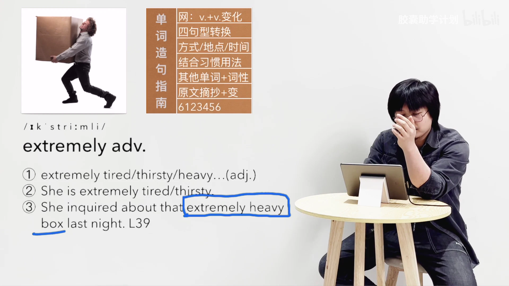

文字识别：单词造句指南 / 网：v.+v.变化 / 四句型转换 / 方式/地点/时间 / 结合习惯用法 / 其他单词+词性 / 原文摘抄+变 / 6123456 / /rk'stri:mli/ / extremely adv. / ① extremely tired/thirsty/heavy..(adj.) / ② She is extremely tired/thirsty. / ③ She inquired about thatextremely heavy / 3） / box last night. L39

## 00:07:00–00:07:30

好，名词出来了。名词出来了之后，配着这个名词肯定要有一个动词，要么是搬，要么是询问，反正你就找你之前学过的。咱们之前学过叫做 inquire about 这个小的习惯用法，应该是三十九课，对吧？那 inquire，询问，询问那个极度沉的箱子，没有问题，对吧？然后我再去配合一些动词变化，加上一些所谓的时间地点，那这句话我就造出来了啊，对吧？还是啊，这个地

### 画面 00:07:00

文字识别：单词造句指南 / 网：v.+v.变化 / 四句型转换 / 方式/地点/时间 / 结合习惯用法 / 其他单词+词性 / 原文摘抄+变 / 6123456 / /rk^stri:mli/ / extremely adv. / ① extremely tired/thirsty/heavy..(adj.) / ② She is extremely tired/thirsty. /  She inquired about thatextremely heavy / 3） / box last night. L39

### 画面 00:07:05

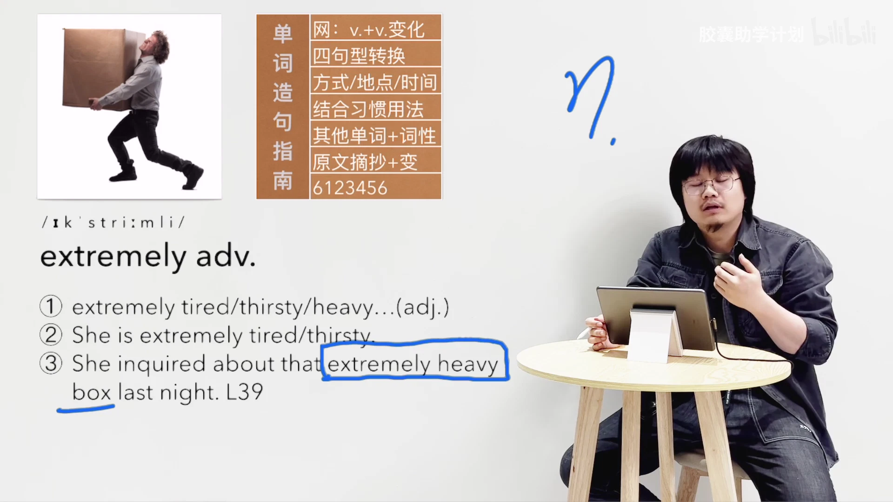

文字识别：单词造句指南 / 网：v.+v.变化 / 四句型转换 / 方式/地点/时间 / 结合习惯用法 / 其他单词+词性 / 原文摘抄+变 / 6123456 / /ik^stri:m li/ / extremely adv. / ① extremely tired/thirsty/heavy..(adj.) / ② She is extremely tired/thirsty. / ) She inquired about thatextremely heavy / box last night. L39

### 画面 00:07:10

文字识别：单词造句指南 / 网：v.+v.变化 / 四句型转换 / 方式/地点/时间 / 结合习惯用法 / 其他单词+词性 / 原文摘抄+变 / 6123456 / /rk^stri:mli/ / extremely adv. / ① extremely tired/thirsty/heavy..(adj.) /  She is extremely tired/thirsty. / 2） / ) She inquired about thatextremely heavy / box last night. L39

### 画面 00:07:12

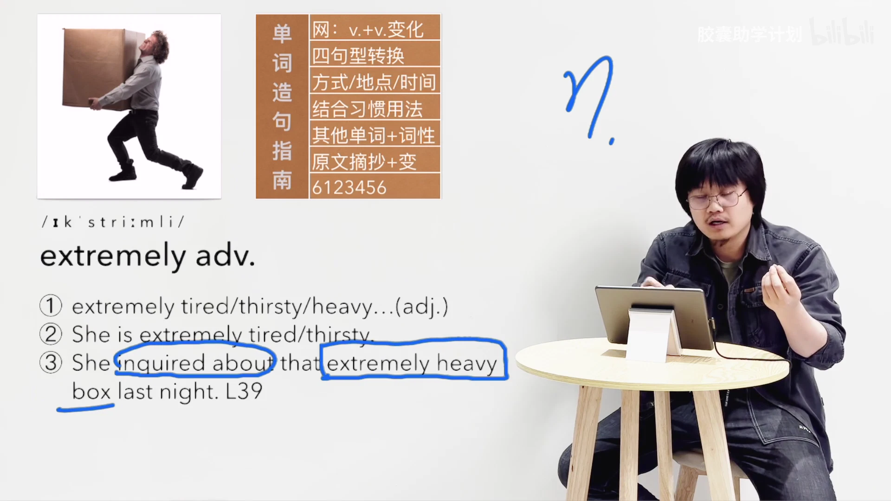

文字识别：单词造句指南 / 网：v.+v.变化 / 四句型转换 / 方式/地点/时间 / 结合习惯用法 / 其他单词+词性 / 原文摘抄+变 / 6123456 / /rk^stri:mli/ / extremely adv. / ① extremely tired/thirsty/heavy...(adj.) / ② She is extremelv tired/thirsty. /  Shenguired aboud thatextremely heavy / 3 / box last night. L39

### 画面 00:07:16

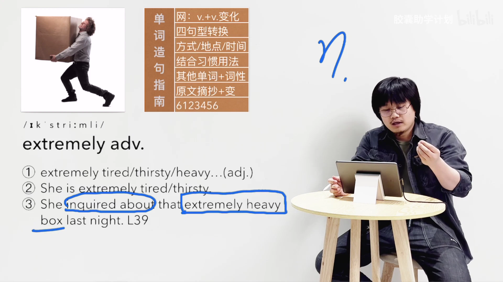

文字识别：单词造句指南 / 网：v.+v.变化 / 四句型转换 / 方式/地点/时间 / 结合习惯用法 / 其他单词+词性 / 原文摘抄+变 / 6123456 / /rk^stri:mli/ / extremely adv. / ① extremely tired/thirsty/heavy..(adj.) / ② She is extremelv tired/thirsty. /  Shenguired about thatextremely heavy / 3） / box last night. L39

### 画面 00:07:25

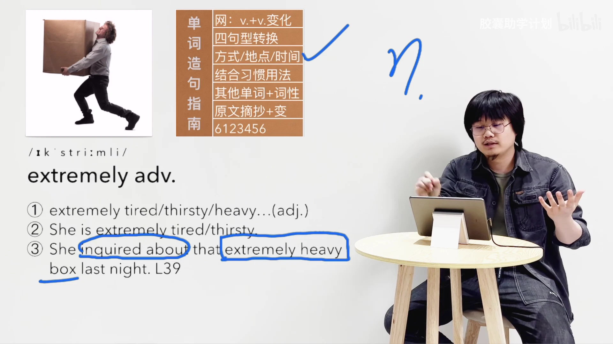

文字识别：单词造句指南 / 网：v.+v.变化 / 四句型转换 / 方式/地点/时间 / 结合习惯用法 / 其他单词+词性 / 原文摘抄+变 / 6123456 / /rk^stri:mli/ / extremely adv. / ① extremely tired/thirsty/heavy...(adj.) / 2) / ) She is extremelv tired/thirsty. /  She nguired about thatextremely heavy / box last night. L39

## 00:07:30–00:08:00

方最重要的并不是背下来我这个句子啊，最重要的是学会我如何去造句的。所以各位，当脱离了我们的课堂任何一个课之后，随便给你一个词组或者单词，你才能去造句，这是我们要最终学会的一个东西啊。OK，那你再去变四句型，我就不多说了。下课，课下作业。Next one，下一个单词跟我读，叫做 occur，occur，occur 的意思呢，就是呃

### 画面 00:07:45

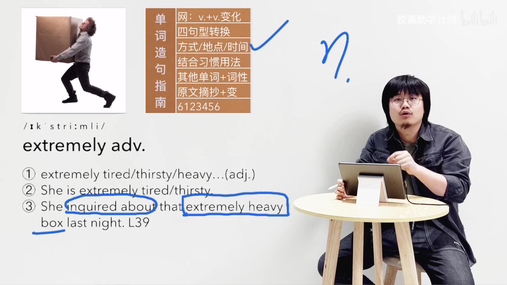

文字识别：单词造句指南 / 网：v.+v.变化 / 四句型转换 / 方式/地点/时间 / 结合习惯用法 / 其他单词+词性 / 原文摘抄+变 / 6123456 / /Ik^stri:m li / / extremely adv. / ① extremely tired/thirsty/heavy...(adj.) / 2) /  She is extremelv tired/thirsty. / ) Shenguired about thatextremely heavy / 3 / box last night. L39

### 画面 00:07:51

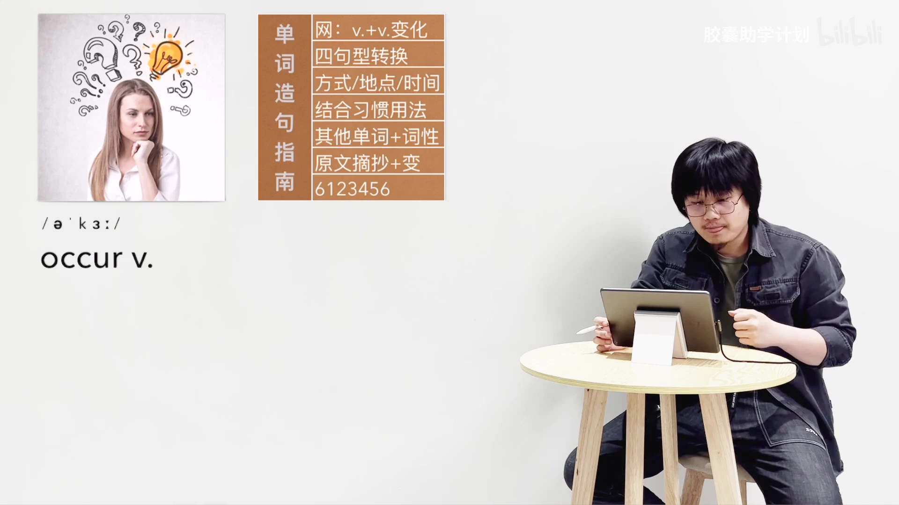

文字识别：单词造句指南 / 网：v.+v.变化 / 四句型转换 / 方式/地点/时间 / Ge / 结合习惯用法 / 其他单词+词性 / 原文摘抄+变 / 6123456 / /a'k3:/ / occur v.

### 画面 00:07:55

文字识别：单词造句指南 / 网：v.+v.变化 / 四句型转换 / G / 方式/地点/时间 / Go / 结合习惯用法 / OC / 其他单词+词性 / 原文摘抄+变 / 6123456 / /a'k3:/ / occur v.

## 00:08:00–00:08:30

啊，我们不用管。其实某种程度上不用专门想这个单词的意思。我们重要是要把它要搞明白，叫做 it occurred to somebody that occur 在这句这个这个这个呃呃这个理解为句型当中吧。其实它的意思就是 suddenly think about or suddenly happen 啊 suddenly happen 或 suddenly think about 就突然间想到或突然间发生的。比如说 it occurred to somebody

### 画面 00:08:00

文字识别：单词造句指南 / 网：v.+v.变化 / 四句型转换 / G / 方式/地点/时间 / Go / 结合习惯用法 / 其他单词+词性 / 原文摘抄+变 / 6123456 / /a'k3:/ / occur v.

### 画面 00:08:04

文字识别：单词造句指南 / 网：v.+v.变化 / 四句型转换 / 方式/地点/时间 / Go / 结合习惯用法 / 其他单词+词性 / 原文摘抄+变 / 6123456 / /a'k3:/ / occur v. / 1 / ) It occurred to sb. that...

### 画面 00:08:06

文字识别：单词造句指南 / 网：v.+v.变化 / 四句型转换 / 方式/地点/时间 / Go / 结合习惯用法 / 其他单词+词性 / 原文摘抄+变 / 6123456 / /a' k3 :/ / occur v. / It occurred to sb. that..

### 画面 00:08:09

文字识别：单词造句指南 / 网：v.+v.变化 / G / 四句型转换 / 方式/地点/时间 / Go / 结合习惯用法 / 其他单词+词性 / 原文摘抄+变 / 6123456 / /a'k3:/ / occur v. / It occurred to sb. that..

### 画面 00:08:15

文字识别：单词造句指南 / 网：v.+v.变化 / 四句型转换 / 方式/地点/时间 / Go / 结合习惯用法 / OC / 其他单词+词性 / 原文摘抄+变 / 6123456 / /a'k3:/ / occur v. / It occurred to sb. that..

### 画面 00:08:19

文字识别：单词造句指南 / 网：v.+v.变化 / 四句型转换 / G / 方式/地点/时间 / Go / 结合习惯用法 / 其他单词+词性 / 原文摘抄+变 / 6123456 / /a'k3:/ / occur v. / It occurred to sb. that..

### 画面 00:08:25

文字识别：单词造句指南 / 网：v.+v.变化 / 四句型转换 / 方式/地点/时间 / G / 结合习惯用法 / 其他单词+词性 / 原文摘抄+变 / 6123456 / /a'k3:/ / occur v. / It occurred to sb. that..

## 00:08:30–00:09:00

somebody that 就是某个人突然间想到。还是我再说一句啊， occur 虽然本身是一个动词，但是它本身还带着一个副词的含义，就是 suddenly。听见了吧？啊，所以你当你用它的时候，你想表达的绝对不是一个深思熟虑，我这个事儿想了五天了。OK，听见了啊？不是这样的。然后我做了一个决定啊，不是这个样子的，是可能我想了五天，我也没想懂，然后我就去游泳了。游着游着，

### 画面 00:08:30

文字识别：单词造句指南 / 网：v.+v.变化 / 四句型转换 / 方式/地点/时间 / Go / 结合习惯用法 / 其他单词+词性 / 原文摘抄+变 / 6123456 / /a'k3:/ / occur v. / It occurred to sb. that..

### 画面 00:08:37

文字识别：单词造句指南 / 网：v.+v.变化 / G / 四句型转换 / 方式/地点/时间 / Go / 结合习惯用法 / 其他单词+词性 / 原文摘抄+变 / 6123456 / /a'k3 :/ / occur v. / It occurred to sb. that..

### 画面 00:08:44

文字识别：单词造句指南 / 网：v.+v.变化 / 四句型转换 / 方式/地点/时间 / Go / 结合习惯用法 / OC / 其他单词+词性 / 原文摘抄+变 / 6123456 / /a'k3 :/ / occur v. / It occurred to sb. that..

## 00:09:00–00:09:30

突然间 it occurred to me，我突然间想到了，听见了啊，叫做 it occurred to somebody that，啊，某人突然间想到一件事儿，比如说 it occurred to me that，说我突然间想到了一件事儿，什么事儿呢？I forgot your birthday，我忘记你的生日了。好，我们不用去过多分析语法，我非常了解啊，有一部分同学可能就要想，我这是个什么从句，是不是跟 it 什么形式主语乱七八糟的？在这个地方我们还没到那个点儿，

### 画面 00:09:09

文字识别：单词造句指南 / 网：v.+v.变化 / 四句型转换 / 方式/地点/时间 / Go / 结合习惯用法 / 其他单词+词性 / 原文摘抄+变 / 6123456 / /a'k3:/ / occur v. / It occurred to sb. that. / It occurred to me that I forgot your birthday.

### 画面 00:09:11

文字识别：单词造句指南 / 网：v.+v.变化 / 四句型转换 / 方式/地点/时间 / Go / 结合习惯用法 / 其他单词+词性 / 原文摘抄+变 / 6123456 / /a'k3:/ / occur v. / It occurred to sb. that. / It occurred to me that I forgot your birthday.

### 画面 00:09:15

文字识别：单词造句指南 / 网：v.+v.变化 / 四句型转换 / 方式/地点/时间 / Go / 结合习惯用法 / 其他单词+词性 / 原文摘抄+变 / 6123456 / /a'k3:/ / occur v. / It occurred to sb. that / It occurred to me that I forgot your birthday.

### 画面 00:09:17

文字识别：单词造句指南 / 网：v.+v.变化 / 四句型转换 / G / 方式/地点/时间 / Go / 结合习惯用法 / 其他单词+词性 / 原文摘抄+变 / 6123456 / /a'k3:/ / occur v. / It occurred to sb. that / It occurred to me that I forgot your birthday.

### 画面 00:09:22

文字识别：单词造句指南 / 网：v.+v.变化 / 四句型转换 / 方式/地点/时间 / Go / 结合习惯用法 / 其他单词+词性 / 原文摘抄+变 / 6123456 / /a'k3:/ / occur v. / It occurred to sb. that. / It occurred to me that I forgot your birthday.

### 画面 00:09:24

文字识别：单词造句指南 / 网：v.+v.变化 / 四句型转换 / G / G / 方式/地点/时间 / Go / 结合习惯用法 / 其他单词+词性 / 原文摘抄+变 / 6123456 / /a^k3:/ / occur v. / 1 /  It occurred to sb.that.. / It occurred to methat I forgot your birthday

### 画面 00:09:29

文字识别：单词造句指南 / 网：v.+v.变化 / 四句型转换 / 方式/地点/时间 / Go / 结合习惯用法 / 其他单词+词性 / 原文摘抄+变 / 6123456 / /a'k3:/ / occur v. / 1 / ) It occurred to sb. that... /  It occurred to me that I forgot your birthday.

## 00:09:30–00:10:00

不着急。我们先把它当习惯用法记下来就行了。所以，对于各位来说，要做的事情就是前面你甚至不用变前面几个单词，叫 It occurred to me that. 翻译成我突然间想起来一件事儿。什么事儿呢？I worked for that company for ten years. 我已经为那个我在那个公司啊工作了十年。我突然间意识到，我在这个公司工作了十年。我之前从来没有这样去哎算过这个日子，对吧？所以在这里

### 画面 00:09:36

文字识别：单词造句指南 / 网：v.+v.变化 / 四句型转换 / G / o / 方式/地点/时间 / Go / 结合习惯用法 / 其他单词+词性 / 原文摘抄+变 / 6123456 / /a'k3:/ / occur v. / ① It occurred to sb. that... /  It occurred to me that I forgot your birthday. / 2 / 3 / ) It occurred to me that I worked for that / company for ten years. L4

### 画面 00:09:39

文字识别：单词造句指南 / 网：v.+v.变化 / 四句型转换 / 方式/地点/时间 / Go / 结合习惯用法 / 其他单词+词性 / 原文摘抄+变 / 6123456 / /a^ k3:/ / occur v. / ① It occurred to sb. that... / ② It occurred to me that I forgot your birthday. / 2 /  It occurred to me that I worked for that / company for ten years. L4

### 画面 00:09:45

文字识别：单词造句指南 / 网：v.+v.变化 / 四句型转换 / G / 方式/地点/时间 / G / Go / 结合习惯用法 / 其他单词+词性 / 原文摘抄+变 / 6123456 / /a'k3:/ / occur v. / ① It occurred to sb. that... / ) It occurred to me that I forgot your birthday. / 2 / 3 /  It occurred to me that I worked for that / company for ten years. L4

### 画面 00:09:47

文字识别：单词造句指南 / 网：v.+v.变化 / 四句型转换 / G / G / 方式/地点/时间 / Go / 结合习惯用法 / 其他单词+词性 / 原文摘抄+变 / 6123456 / /a'k3:/ / occur v. / ① It occurred to sb. that... / ) It occurred to me that I forgot your birthday. / 2 / 3 /  It occurred to me that I worked for that / company for ten years. L4

### 画面 00:09:50

文字识别：单词造句指南 / 网：v.+v.变化 / 四句型转换 / G / 方式/地点/时间 / Go / 结合习惯用法 / 其他单词+词性 / 原文摘抄+变 / 6123456 / /a'k3:/ / occur v. / ① It occurred to sb. that... / ) It occurred to me that I forgot your birthday. / 2 /  It occurred to me that I worked for that / company for ten years. L4

## 00:10:00–00:10:30

最最后各位造句子，前面不变，后边加上一个句子就可以了啊。今天家庭作业一定要去拿它造一下句子，好吧？好，它还有一个特别常见的叫做 it occurred to somebody to do something，叫做令某人其实类似啊，就突然间想到去做某件事情。比如说 it occurred to her to ask him for a lift，说她突然间想到去让他就

### 画面 00:10:01

文字识别：单词造句指南 / 网：v.+v.变化 / 四句型转换 / G / G / 方式/地点/时间 / Go / 结合习惯用法 / 其他单词+词性 / 原文摘抄+变 / 6123456 / /a'k3 :/ / occur v. / It occurred to sb. that... / It occurred to me that I forgot your birthday. / It occurred to me that l worked for that / company for ten years. L4

### 画面 00:10:03

文字识别：单词造句指南 / 网：v.+v.变化 / 四句型转换 / 0 / 方式/地点/时间 / Go / 结合习惯用法 / 其他单词+词性 / 原文摘抄+变 / 6123456 / /a'k3 :/ / occur v. / It occurred to sb. that. / occurred to me that I forgot your birthday. / t / It occurred to me that l worked for that / company for ten years. L4

### 画面 00:10:05

文字识别：单词造句指南 / 网：v.+v.变化 / 四句型转换 / G / 方式/地点/时间 / Go / 结合习惯用法 / 其他单词+词性 / 原文摘抄+变 / 6123456 / /a'k3:/ / occur v. / t occurred to me that I forgot your birthday. / t / It occurred to me that I worked for that / company for ten years. L4

### 画面 00:10:08

文字识别：单词造句指南 / 网：v.+v.变化 / 四句型转换 / G / G / 方式/地点/时间 / Go / 结合习惯用法 / 其他单词+词性 / 原文摘抄+变 / 6123456 / /a'k3:/ / occur v. / ① It occurred to sb. that... / ) It occurred to me that I forgot your birthday. / 2 / 3 /  It occurred to me that I worked for that / company for ten years. L4

### 画面 00:10:10

文字识别：单词造句指南 / 网：v.+v.变化 / 四句型转换 / 方式/地点/时间 / 5 / Go / 结合习惯用法 / ao / 其他单词+词性 / 原文摘抄+变 / 6123456 / /a'k3:/ / occur v. / ① It occurred to sb. that... / ) It occurred to me that I forgot your birthday. / 2 / It occurred to me that I worked for that / company for ten years. L4

### 画面 00:10:16

文字识别：单词造句指南 / 网：v.+v.变化 / 四句型转换 / G / G / 方式/地点/时间 / Go / 结合习惯用法 / 其他单词+词性 / 原文摘抄+变 / 6123456 / /a'k3:/ / occur v. / ① It occurred to sb. that... /  It occurred to me that I forgot your birthday. / 2 / It occurred to me that I worked for that / company for ten years. L4 / It occurred to sb. to do sth.

### 画面 00:10:19

文字识别：单词造句指南 / 网：v.+v.变化 / 四句型转换 / G / G / 方式/地点/时间 / 0 / Go / 结合习惯用法 / 其他单词+词性 / 原文摘抄+变 / 6123456 / /a'k3:/ / occur v. / ① It occurred to sb. that... / ) It occurred to me that I forgot your birthday. / 2 / It occurred to me that I worked for that / company for ten years. L4 / It occurred to sb. to do sth.

### 画面 00:10:24

文字识别：单词造句指南 / 网：v.+v.变化 / G / 四句型转换 / G / G / o / 方式/地点/时间 / O / Go / 结合习惯用法 / 其他单词+词性 / 原文摘抄+变 / 6123456 / /a'k3:/ / occur v. / ① It occurred to sb. that... / ② It occurred to me that I forgot your birthday. / 2 /  It occurred to me that I worked for that / 3 / company for ten years. L4 / It occurred to sb. to do sth. / It occurred to her to ask him for a lift. L14

### 画面 00:10:28

文字识别：单词造句指南 / 网：v.+v.变化 / 四句型转换 / 方式/地点/时间 / G / 0 / 结合习惯用法 / 其他单词+词性 / 原文摘抄+变 / 6123456 / /a'k3:/ / occur v. / ① It occurred to sb. that... / ② It occurred to me that I forgot your birthday. / 2 / It occurred to me that I worked for that / company for ten years. L4 / It occurred to sb. to do sth. / 5 / It occurred to her toask him for a lift, L14

## 00:10:30–00:11:00

向他要求搭一个便车，这是咱十四课学的，对吧？Ask somebody for a lift.他突然间想到说，哎，我可以找他搭个便车呀。It occurred to somebody to do something. Okay, very good.好，接下来我们看一个电影片段。这个电影片段当中就出现了这样一句话，叫做But it occurred to me that后边加了一句话，叫做我突然间想起来什么事儿呢？后边那句话叫This is about starting a new

### 画面 00:10:30

文字识别：单词造句指南 / 网：v.+v.变化 / 四句型转换 / G / G / 。心 / 方式/地点/时间 / O / Go / 结合习惯用法 / 其他单词+词性 / 原文摘抄+变 / 6123456 / /a'k3:/ / occur v. / ① It occurred to sb. that... /  It occurred to me that I forgot your birthday. / 2 / 3 / It occurred to me that I worked for that / company for ten years. L4 / It occurred to sb. to do sth. / It occurred to her to ask him for a lift L14 / 5

### 画面 00:10:42

文字识别：单词造句指南 / 网：v.+v.变化 / 四句型转换 / G / G / 方式/地点/时间 / 0 / Go / 结合习惯用法 / 其他单词+词性 / 原文摘抄+变 / 6123456 / /a'k3:/ / occur v. / ① It occurred to sb. that... /  It occurred to me that I forgot your birthday. / 2 / It occurred to me that I worked for that / company for ten years. L4 / It occurred to sb. to do sth. / It occurred to her toask him for a lift L14 / 5

### 画面 00:10:44

文字识别：But it occurred to me that this is / about starting a new family. / 碟中谍3 / Mission: / 当茱莉亚告诉我她要结婚了 / Impossible / When Julia called and told me that she was getting married, / (2006)

### 画面 00:10:51

文字识别：But it occurred to me that this is / about starting / a new family. / 碟中谍3 / Mission: / 当茱莉亚告诉我她要结婚了 / Impossible I / When Julia called and told me that she was getting married, / (2006)

### 画面 00:10:53

文字识别：But it occurred to methat / this is / about starting / a new family. / 碟中谍3 / Mission: / 当茱莉亚告诉我她要结婚了 / Impossible l / When Julia called and told me that she was getting married, / (2006)

### 画面 00:10:55

文字识别：But it occurred to methat / this is / about starting a new family. / 碟中谍3 / Mission: / 当茱莉亚告诉我她要结婚了 / Impossible / When Julia called and told me that she was getting married, / (2006)

## 00:11:00–00:11:30

family. 说这个是关于哎建立一个新的家庭的事情。 Okay, very good. 那注意力集中，开始了。 Julia called and told me that she was getting married. I had one thought that it was just too bad that Daddy wasn't here to walk her down the aisle. And then when Julia told me, "Thanks, Mom," that Ethan doesn't have his parents anymore either, I got really sad. But it occurred to me that this

### 画面 00:11:09

文字识别：But it occurred to methat / this is / about starting / a new family. / 碟中谍3 / MUSIC SUPERVISOR / Mission: / 当荣莉亚告诉我她要结婚NYBRAMSON / Impossible / When Julia called and told me that she was getting married, / (2006)

### 画面 00:11:11

文字识别：But it occurred to methat / this is / about starting / a new family. / 碟中谍3 / MUSIC SUPERVISOR / 当荣莉亚告诉我她要结婚NYBRAMSON / Mission: / Impossible / When Julia called and told me that she was getting married, / (2006)

### 画面 00:11:13

文字识别：But it occurred to methat this is / about starting a new family. / 碟中谍3 / Mission: / 我只想到了一件事不过不太好 / Impossible / I had one thought, that it was just too bad / (2006)

### 画面 00:11:15

文字识别：But it occurred to methat this is / about starting a new family. / 碟中谍3 / CO-PRODUCER / ARTHUR ANDERSON / Mission: / Impossible / (2006)

### 画面 00:11:17

文字识别：But it occurred to methatthis is / about starting a new family. / 碟中谍3 / CO-PRODUCER / ARTHUR AN为不能带她走下红地毯 / Mission: / Impossible / that Daddy wasrt here to walk her down the aisle. / (2006)

### 画面 00:11:19

文字识别：But it occurred to methatthis is / about starting a new family. / 碟中谍3 / Mission: / 因为老爸不能带她走下红地毯 / Impossible / that Daddy wasrt here to walk her down the aisle. / (2006)

### 画面 00:11:21

文字识别：But it occurred to methat / this is / about starting a new family. / 碟中谍3 / Mission: / 然后朱莉亚跟我说谢了妈 / Impossibte / And then when Julia told me.. Thanks, Mom. / (2006)

### 画面 00:11:23

文字识别：But it occurred to methat / this is / about starting / a new family. / 碟中谍3 / VISUAL EFFECTS SUPERVISOR / ROGER GUYETT / Mission: / 伊森的父母也不在了F / Impossible / That Ethan doesn't have,his parents anymore, either, / (2006)

### 画面 00:11:25

文字识别：But it occurred to methatthis is / about starting a new family. / 碟中谍3 / Mission: / 伊森的父母也不在了 / Impossible / That Ethan doesn't have his parents anymore, either, / (2006)

### 画面 00:11:27

文字识别：But it occurred to methat this is / about starting a new family. / 碟中谍3 / Mission: / 我真的很难过 / Impossibte / I got really sad. / (2006)

### 画面 00:11:29

文字识别：But it occurred to methat this is / about starting a new family. / 碟中谍3 / Mission: / 不过我也想到这是一个全新的家庭 / Impossible / But it occurred to me that this is about starting a new family / (2006)

## 00:11:30–00:12:00

is about starting a new family, and how beautiful that is. And I just want to say, I am making Julia an aunt. So I expect the same treatment very, very soon. Okay, very good. Ah,说But it occurred to me that this is about starting a new family.啊，就我突然想到的事情，这是一个关于哎建立一个新的家庭的事情。Very good. Next one,下一个单词跟我读叫astonish.注意这地方要浊化astonish, astonish.

### 画面 00:11:31

文字识别：But it occurred to methat / tthis is / about starting a new family. / 碟中谍3 / Mission: / 不过我也想到这是一个全新的家庭 / Impossibte / But it occurred to me that this is about starting a new family / (2006)

### 画面 00:11:33

文字识别：But it occurred to methat this is / about starting a new family. / 碟中谍3 / Mission: / 真是太棒了 / Impossible / and how beautiful that is. / (2006)

### 画面 00:11:35

文字识别：But it occurred to methat / this is / a new family. / about starting / 碟中谍3 / Mission: / 我只想说朱莉亚也快当姨妈了 / Impossible / And I just want to say I am making Julia an aunt, / (2006)

### 画面 00:11:37

文字识别：But it occurred to methatthis is / about starting a new family. / 碟中谍3 / Mission: / 我也祝你早生贵子 / Impossibte / so I expect the same treatment very, very soon. / (2006)

### 画面 00:11:39

文字识别：But it occurred to methatthis is / about starting a new family. / 碟中谍3 / Mission: / 我也祝你早生贵子 / Impossible / soI expect the same treatment very, very soon. / (2006)

### 画面 00:11:41

文字识别：But it occurred to methat this is / about starting a new family. / 碟中谍3 / Mission: / Impossible / (2006)

### 画面 00:11:43

文字识别：But it occurred to methat this is / about starting a new family. / 碟中谍3 / Mission: / Impossible / (2006)

### 画面 00:11:53

文字识别：单词造句指南 / 网：v.+v.变化 / 四句型转换 / 方式/地点/时间 / 结合习惯用法 / 其他单词+词性 / 原文摘抄+变 / 6123456 / /a'stpnI∫/ / astonish v.

### 画面 00:11:58

文字识别：单词造句指南 / 网：v.+v.变化 / 四句型转换 / 方式/地点/时间 / 结合习惯用法 / 其他单词+词性 / 原文摘抄+变 / 6123456 / /a'stpnil/ / astonish v.

## 00:12:00–00:12:30

它类似于我们原来学过的shocked。第十课咱们就学过shocked，和在很多课当中都见过，叫做surprise，对吧？比如说这个常见的词组叫be astonished at something，叫做对某件事情感到很震惊。其实它就刚才我说了嘛，特别像was surprised或者was shocked，对吧？这都是我们之前学过的啊。那到这复习一下，比如说In New York, visitors are astonished

### 画面 00:12:11

文字识别：单词造句指南 / 网：v.+v.变化 / 四句型转换 / 方式/地点/时间 / 结合习惯用法 / 其他单词+词性 / 原文摘抄+变 / 6123456 / /a'stpnil/ / astonish v. / ① be astonished at sth/ was surprised/was / shocked...

### 画面 00:12:13

文字识别：单词造句指南 / 网：v.+v.变化 / 四句型转换 / 方式/地点/时间 / 结合习惯用法 / 其他单词+词性 / 原文摘抄+变 / 6123456 / /a'stpnil/ / astonish v. / ① be astonished at sth/ was surprised/was / shocked...

### 画面 00:12:18

文字识别：单词造句指南 / 网：v.+v.变化 / 四句型转换 / 方式/地点/时间 / 结合习惯用法 / 其他单词+词性 / 原文摘抄+变 / 6123456 / /a'stpnil/ / astonish v. / ① be astonished at sth/ was surprised/was / shocked...

### 画面 00:12:21

文字识别：单词造句指南 / 网：v.+v.变化 / 四句型转换 / 方式/地点/时间 / 结合习惯用法 / 其他单词+词性 / 原文摘抄+变 / 6123456 / /a'stpnil/ / astonish v. / 1 /  be astonished at sth/ was surprised/was / shocked...

### 画面 00:12:24

文字识别：单词造句指南 / 网：v.+v.变化 / 四句型转换 / 方式/地点/时间 / 结合习惯用法 / 其他单词+词性 / 原文摘抄+变 / 6123456 / /a'stpnil/ / astonish v. / ① be astonished at sth/ was surprised/was / shocked... / InNew York, visitors are astonished at high / buildings.

### 画面 00:12:29

文字识别：单词造句指南 / 网：v.+v.变化 / 四句型转换 / 方式/地点/时间 / 结合习惯用法 / 其他单词+词性 / 原文摘抄+变 / 6123456 / /a'stpnil/ / astonish v. /  be astonished at sth/ was surprised/was / shocked... / InNew York, visitors are astonished at high / buildings.

## 00:12:30–00:13:00

at high buildings,对吧？说这个在纽约呀，很多来访的啊，你比如说你原来一直在住乡下啊，比如在美国中部啊，他们都震惊于这个楼有多么的高啊。Okay, one again,好再来，你可以把它变成一般疑问句，各种特殊疑问句啊。我这个就不多说了，都是各各位课下的一个作业啊。再来，比如说I was astonished at something,对吧？这个something叫做his stupidity啊，

### 画面 00:12:39

文字识别：单词造句指南 / 网：v.+v.变化 / 四句型转换 / 方式/地点/时间 / 结合习惯用法 / 其他单词+词性 / 原文摘抄+变 / 6123456 / /a'stpnil/ / astonish v. / ① be astonished at sth/ was surprised/was / shocked... / InNew York, visitors are astonished at high / buildings.

### 画面 00:12:45

文字识别：单词造句指南 / 网：v.+v.变化 / 四句型转换 / 方式/地点/时间 / 结合习惯用法 / 其他单词+词性 / 原文摘抄+变 / 6123456 / /a'stpnil/ / astonish v. / ① be astonished at sth/ was surprised/was / shocked... / InNew York, visitors are astonished at high / buildings. / are/who...

### 画面 00:12:59

文字识别：单词造句指南 / 网：v.+v.变化 / 四句型转换 / 方式/地点/时间 / 结合习惯用法 / 其他单词+词性 / 原文摘抄+变 / 6123456 / /a'stpnil/ / astonish v. / ① be astonished at sth/ was surprised/was / shocked... / InTNew York, visitors are astonished at high / buildings. / are/who... / ) I was astonished at his stupidity.

## 00:13:00–00:13:30

呃，他的愚蠢啊，我被他的愚蠢震惊了啊。这地方我其实给大家补充了一个新的单词，叫 stupid。大家学会的是那个单词，在这儿它的名词叫 his stupidity. Okay, very good. 呃，下一个单词叫做 pile pile 啊，就是一堆啊，就叫 pile. Okay, 比如说 a pile of oos books questions oos 就像这个图里边一堆木头 books

### 画面 00:13:06

文字识别：单词造句指南 / 网：v.+v.变化 / 四句型转换 / 方式/地点/时间 / 结合习惯用法 / 其他单词+词性 / 原文摘抄+变 / 6123456 / /a'stpnil/ / astonish v. / ① be astonished at sth/ was surprised/was / shocked... / InTew York, visitors are astonished at high / buildings. / are/who... / ) I was astonished at hisstupidity

### 画面 00:13:14

文字识别：单词造句指南 / 网：v.+v.变化 / 四句型转换 / 方式/地点/时间 / 结合习惯用法 / 其他单词+词性 / 原文摘抄+变 / 6123456 / /a'stpnI∫/ / astonish v. / ① be astonished at sth/ was surprised/was / shocked... / ② In New York, visitors are astonished at high / buildings. / are/who... / D I was astonished at his stupidity.

### 画面 00:13:16

文字识别：单词造句指南 / 网：v.+v.变化 / 四句型转换 / 方式/地点/时间 / 结合习惯用法 / 其他单词+词性 / 原文摘抄+变 / 6123456 / /parl/ / pile n.

### 画面 00:13:19

文字识别：单词造句指南 / 网：v.+v.变化 / 四句型转换 / 方式/地点/时间 / 结合习惯用法 / 其他单词+词性 / 原文摘抄+变 / 6123456 / /parl/ / pile n.

### 画面 00:13:24

文字识别：单词造句指南 / 网：v.+v.变化 / 四句型转换 / 方式/地点/时间 / 结合习惯用法 / 其他单词+词性 / 原文摘抄+变 / 6123456 / /parl/ / pile n. / ① a pile of woods/books/questions

### 画面 00:13:29

文字识别：单词造句指南 / 网：v.+v.变化 / 四句型转换 / 方式/地点/时间 / 结合习惯用法 / 其他单词+词性 / 原文摘抄+变 / 6123456 / /parl/ / pile n. / ① a pile of woods/books/questions

## 00:13:30–00:14:00

一堆书 questions，一堆问题 again，这里都是名词。A pile of，我又告诉你要加着后边这些名词，所以接下来你其实要想的事情是什么？叫做哪些动词和这些名词是连着的？比如说 ask a pile of questions，这个动词短语就出来了，对吧？OK，比如说来了啊，说 I've got a pile of questions，说我有一大堆的问题啊，或者

### 画面 00:13:34

文字识别：单词造句指南 / 网：v.+v.变化 / 四句型转换 / 方式/地点/时间 / 结合习惯用法 / 其他单词+词性 / 原文摘抄+变 / 6123456 / /parl/ / pile n. / ① a pile of woods/books/questions

### 画面 00:13:38

文字识别：单词造句指南 / 网：v.+v.变化 / 四句型转换 / 方式/地点/时间 / 结合习惯用法 / 其他单词+词性 / 原文摘抄+变 / 6123456 / /parl/ / pile n. / n / 十 / ① a pile of woods/books/questions

### 画面 00:13:40

文字识别：单词造句指南 / 网：v.+v.变化 / 四句型转换 / 方式/地点/时间 / 结合习惯用法 / 其他单词+词性 / 原文摘抄+变 / 6123456 / /parl/ / pile n. / n / 十 / ① a pile of woods/books/questions

### 画面 00:13:44

文字识别：单词造句指南 / 网：v.+v.变化 / 四句型转换 / 方式/地点/时间 / 结合习惯用法 / 其他单词+词性 / 原文摘抄+变 / 6123456 / /pail/ / pile n. / n / 十 / ① a pile of woods/books/questions / V. / V.

### 画面 00:13:49

文字识别：单词造句指南 / 网：v.+v.变化 / 四句型转换 / 方式/地点/时间 / 结合习惯用法 / 其他单词+词性 / 原文摘抄+变 / 6123456 / /parl/ / pile n. / 十 / ① a pile of woods/books/questions / v.V. / V.

### 画面 00:13:53

文字识别：单词造句指南 / 网：v.+v.变化 / 四句型转换 / 方式/地点/时间 / 结合习惯用法 / 其他单词+词性 / 原文摘抄+变 / 6123456 / /parl/ / pile n. / n / ① a pile of woods/books/questions / T've got a pile of questions.

### 画面 00:13:55

文字识别：单词造句指南 / 网：v.+v.变化 / 四句型转换 / 方式/地点/时间 / 结合习惯用法 / 其他单词+词性 / 原文摘抄+变 / 6123456 / /parl/ / pile n. / ① a pile of woods/books/questions / ② I've got a pile of questions.

### 画面 00:13:59

文字识别：单词造句指南 / 网：v.+v.变化 / 四句型转换 / 方式/地点/时间 / 结合习惯用法 / 其他单词+词性 / 原文摘抄+变 / 6123456 / /parl/ / pile n. / ① a pile of woods/books/questions / ② I've got a pile of questions.

## 00:14:00–00:14:30

### 画面 00:14:04

文字识别：单词造句指南 / 网：v.+v.变化 / 四句型转换 / 方式/地点/时间 / 结合习惯用法 / 其他单词+词性 / 原文摘抄+变 / 6123456 / /parl/ / pile n. / ① a pile of woods/books/questions / ② I've got a pile of questions.

### 画面 00:14:08

文字识别：单词造句指南 / 网：v.+v.变化 / 四句型转换 / 方式/地点/时间 / 结合习惯用法 / 其他单词+词性 / 原文摘抄+变 / 6123456 / /parl/ / pile n. / ① a pile of woods/books/questions / ② I've got a pile of questions. / The captain ordered his men to throw a pile / of books out of the ship. L43

### 画面 00:14:10

文字识别：单词造句指南 / 网：v.+v.变化 / 四句型转换 / 方式/地点/时间 / 结合习惯用法 / 其他单词+词性 / 原文摘抄+变 / 6123456 / /parl/ / pile n. / ① a pile of woods/books/questions / ② I've got a pile of questions. / The captain ordered his men to throw a pile / of books out of the ship. L43

### 画面 00:14:15

文字识别：单词造句指南 / 网：v.+v.变化 / 四句型转换 / 方式/地点/时间 / 结合习惯用法 / 其他单词+词性 / 原文摘抄+变 / 6123456 / /parl/ / pile n. / ① a pile of woods/books/questions / ② I've got a pile of questions. / The captain ordered his men to throw a pile / of books out of the ship. L43

### 画面 00:14:17

文字识别：单词造句指南 / 网：v.+v.变化 / 四句型转换 / 方式/地点/时间 / 结合习惯用法 / 其他单词+词性 / 原文摘抄+变 / 6123456 / /parl/ / pile n. / ① a pile of woods/books/questions / ② I've got a pile of questions. / The captain ordered his men to throw a pile / of books out of the ship. L43

### 画面 00:14:20

文字识别：单词造句指南 / 网：v.+v.变化 / 四句型转换 / 方式/地点/时间 / 结合习惯用法 / 其他单词+词性 / 原文摘抄+变 / 6123456 / /parl/ / pile n. / ① a pile of woods/books/questions / ② I've got a pile of questions. / The captain ordered his men to throw a pile / of books out of the ship. L43

### 画面 00:14:28

文字识别：单词造句指南 / 网：v.+v.变化 / 四句型转换 / 方式/地点/时间 / 结合习惯用法 / 其他单词+词性 / 原文摘抄+变 / 6123456 / /parl/ / pile n. / ① a pile of woods/books/questions / ② I've got a pile of questions. /  The captain ordered his men to throw a pile / 3 / of books out of the ship. L43 / ④ You have to return this pile of woods to Leo. / L45

## 00:14:30–00:15:00

Leo. Return something to somebody. 四十五课咱们刚学的。你看我 return 的是什么？叫做 this pile of oaks。我无非就是把 a 换成了 this，叫这一大堆木头，你得还给他，好吧？ OK，还是啊，在这儿我们学到的思路叫做，我告诉了各位 a pile of 后边可以加的名词，你可以去想的是哪些动词跟这些名词能连起来。那这些动词去哪儿找？往前找，看之前的

### 画面 00:14:30

文字识别：单词造句指南 / 网：v.+v.变化 / 四句型转换 / 方式/地点/时间 / 结合习惯用法 / 其他单词+词性 / 原文摘抄+变 / 6123456 / /parl/ / pile n. / ① a pile of woods/books/questions / ② I've got a pile of questions. / ) The captain ordered his men to throw a pile / 3 / of books out of the ship. L43 / ④ You have to return this pile of woods to Leo. / L45

### 画面 00:14:32

文字识别：单词造句指南 / 网：v.+v.变化 / 四句型转换 / 方式/地点/时间 / 结合习惯用法 / 其他单词+词性 / 原文摘抄+变 / 6123456 / /parl/ / pile n. / ① a pile of woods/books/questions / ② I've got a pile of questions. / The captain ordered his men to throw a pile / 3 / of books out of the ship. L43 / ④ You have to return this pile of woods to Leo. / L45

### 画面 00:14:34

文字识别：单词造句指南 / 网：v.+v.变化 / 四句型转换 / 方式/地点/时间 / 结合习惯用法 / 其他单词+词性 / 原文摘抄+变 / 6123456 / /parl/ / pile n. / ① a pile of woods/books/questions / ② I've got a pile of questions. / The captain ordered his men to throw a pile / 3 / of books out of the ship. L43 / ④ You have to return this pile of woods to Leo. / L45

### 画面 00:14:37

文字识别：单词造句指南 / 网：v.+v.变化 / 四句型转换 / 方式/地点/时间 / 结合习惯用法 / 其他单词+词性 / 原文摘抄+变 / 6123456 / /parl/ / pile n. / ① a pile of woods/books/questions / ② I've got a pile of questions. / The captain ordered his men to throw a pile / of books out of the ship L43 / ④ You have to return this pile of woods to Leo. / L45

### 画面 00:14:39

文字识别：单词造句指南 / 网：v.+v.变化 / 四句型转换 / 方式/地点/时间 / 结合习惯用法 / 其他单词+词性 / 原文摘抄+变 / 6123456 / /parl/ / pile n. / ①apile of woods/books/questions / ② I've got a pile of questions. / The captain ordered his men to throw a pile / of books out of the shipk43 /  You have to return / his pile of woodsto Leo. / L45

### 画面 00:14:48

文字识别：单词造句指南 / 网：v.+v.变化 / 四句型转换 / 方式/地点/时间 / 结合习惯用法 / 其他单词+词性 / 原文摘抄+变 / 6123456 / /parl/ / pile n. / apile of woods/books/questions / 1 /  I've got a pile of questions. / 2 / The captain ordered his men to throw a pile / of books out of the ship L43 / You have to return / his pile of woods to Leo. / L45

### 画面 00:14:50

文字识别：单词造句指南 / 网：v.+v.变化 / 四句型转换 / 方式/地点/时间 / 结合习惯用法 / 其他单词+词性 / 原文摘抄+变 / 6123456 / /parl/ / pile n. / n / a pile of woods/books/auestions / 1 /  I've got a pile of questions. / The captain ordered his men to throw a pile / of books out of the ship k43 /  You have to return / his pile of woods to Leo. / L45

### 画面 00:14:53

文字识别：单词造句指南 / 网：v.+v.变化 / 四句型转换 / 方式/地点/时间 / 结合习惯用法 / 其他单词+词性 / 原文摘抄+变 / 6123456 / V. / /parl/ / pile n. / n / 1 / apile of / woods/books/guestions /  I've got a pile of questions. / 2 / The captain ordered his men to throw a pile / of books out of the shipL43 /  You have to return / his pile of woodsto Leo. / L45

### 画面 00:14:55

文字识别：单词造句指南 / 网：v.+v.变化 / 四句型转换 / 方式/地点/时间 / 结合习惯用法 / 其他单词+词性 / 原文摘抄+变 / 6123456 / V. / /parl/ / pile n. / Ln / 1 / apile of / woods/books/guestions / I've got a pile of questions. / The captain ordered his men to throw a pile / of books out of the shipk43 / You have to return / his pile of woods to Leo. / L45

### 画面 00:14:57

文字识别：单词造句指南 / 网：v.+v.变化 / 四句型转换 / 方式/地点/时间 / 结合习惯用法 / 其他单词+词性 / 原文摘抄+变 / 6123456 / /parl/ / pile n. / ↓n / apile of / woods/books/guestions / I've got a pile of questions. / The captain ordered his men to throw a pile / of books out of the shipL43 / You have to return / his pile of woodsto Leo. / L45

### 画面 00:14:59

文字识别：单词造句指南 / 网：v.+v.变化 / 四句型转换 / 方式/地点/时间 / 结合习惯用法 / 其他单词+词性 / 原文摘抄+变 / 6123456 / /parl/ / pile n. / ↓n / 1 / apile of / woods/books/guestions /  I've got a pile of questions. / 2 / The captain ordered his men to throw a pile / of books out of the shipL43 /  You have to return / his pile of woods to Leo. / L45

## 00:15:00–00:15:30

我们学过哪些动词，对吧？新一，你现在已经学到新二四十六课了，新一多少应该是会的吧？新一前四十六课应该是会的吧？去找那些动词和这些名词连起来，您的造句任务就完成了啊。好，next one，下一个单词叫做woolen，woolen啊，注意一个小的点呢，羊毛的，对吧？它其实是有两个拼写方式的，可以double l，可以有两个l，也可以直接有一个l啊。OK，然后下一个呢，单词叫做goods啊，叫做货物

### 画面 00:15:04

文字识别：单词造句指南 / 网：v.+v.变化 / 四句型转换 / 方式/地点/时间 / 结合习惯用法 / 其他单词+词性 / 原文摘抄+变 / 6123456 / /parl/ / pile n. / ↓n / 1 / apile ofv / woods/books/guestions / I've got a pile of questions. / The captain ordered his men to throw a pile / of books out of the ship L43 / You have to return / his pile of woods to Leo. / L45

### 画面 00:15:09

文字识别：单词造句指南 / 网：v.+v.变化 / 四句型转换 / 方式/地点/时间 / 结合习惯用法 / 其他单词+词性 / 原文摘抄+变 / 6123456 / /parl/ / pile n. / ↓n / 1 / apileofv / woods/books/guestions / I've got a pile of questions. / The captain ordered his men to throw a pile / of books out of the ship L43 /  You have to return / his pile of woods to Leo. / L45

### 画面 00:15:13

文字识别：单词造句指南 / 网：v.+v.变化 / 四句型转换 / 方式/地点/时间 / 结合习惯用法 / 其他单词+词性 / 原文摘抄+变 / 6123456 / /wulan/ / /ｇudz/ / woollen n. woolen goods n.

### 画面 00:15:15

文字识别：单词造句指南 / 网：v.+v.变化 / 四句型转换 / 方式/地点/时间 / 结合习惯用法 / 其他单词+词性 / 原文摘抄+变 / 6123456 / /'wulan/ / /gudz / / woollen n. woolen goods n.

### 画面 00:15:19

文字识别：单词造句指南 / 网：v.+v.变化 / 四句型转换 / 方式/地点/时间 / 结合习惯用法 / 其他单词+词性 / 原文摘抄+变 / 6123456 / /'wulan/ / /gudz / / woollen n. woolen goods n.

### 画面 00:15:24

文字识别：单词造句指南 / 网：v.+v.变化 / 四句型转换 / 方式/地点/时间 / 结合习惯用法 / 其他单词+词性 / 原文摘抄+变 / 6123456 / /'wulan/ / /gudz / / woollen n. woolen goods n.

### 画面 00:15:29

文字识别：单词造句指南 / 网：v.+v.变化 / 四句型转换 / 方式/地点/时间 / 结合习惯用法 / 其他单词+词性 / 原文摘抄+变 / 6123456 / /'wulan / / /gudz / / woollen n. woolen goods n.

## 00:15:30–00:16:00

或者商品。你看，各位比较熟悉的叫 good 啊，叫好形容词 good 啊，那 no good 是不好 bad。 Okay，好，那 goods 在这儿注意，它不是那个好了，它是一个名词，非常常用这个用法，一般就是以复数的情况存在，指的就是商品货品 goods 啊，就是个名词。再来，比如说，那我们刚学了嘛，叫 a pile of woolen goods。注意这个地方拼错了，一个小的 typo 啊， w

### 画面 00:15:39

文字识别：单词造句指南 / 网：v.+v.变化 / 四句型转换 / 方式/地点/时间 / 结合习惯用法 / 其他单词+词性 / 原文摘抄+变 / 6123456 / /'wulan/ / /gudz / / woollen n. woolen goods n.

### 画面 00:15:44

文字识别：单词造句指南 / 网：v.+v.变化 / 四句型转换 / 方式/地点/时间 / 结合习惯用法 / 其他单词+词性 / 原文摘抄+变 / 6123456 / /'wulan/ / /gudz / / woollen n. woolen goods n.

### 画面 00:15:54

文字识别：单词造句指南 / 网：v.+v.变化 / 四句型转换 / 方式/地点/时间 / 结合习惯用法 / 其他单词+词性 / 原文摘抄+变 / 6123456 / /'wulan / / /gudz / / woollen n. woolen goods n. / ① a pile of wollen goods

### 画面 00:15:59

文字识别：单词造句指南 / 网：v.+v.变化 / 四句型转换 / 方式/地点/时间 / 结合习惯用法 / 其他单词+词性 / 原文摘抄+变 / 6123456 / /'wulan/ / /gudz / / woollen n. woolen goods n. / Wo / ① a pile of wollen goods

## 00:16:00–00:16:30

woollen 啊，不是 woolen 啊，这个地方注意一下啊，叫 a pile of woolen goods. Very good. 又是 a pile of woolen goods. 名词又给你了，接下来还不是找那些动词嘛？比如说，she bought a pile of woolen goods for her mom last month. 你看啊，人给你了，时间我也给你填上了，你再去变各种句型，四句型转换，很容易

### 画面 00:16:01

文字识别：单词造句指南 / 网：v.+v.变化 / 四句型转换 / 方式/地点/时间 / 结合习惯用法 / 其他单词+词性 / 原文摘抄+变 / 6123456 / /'wulan/ / /gudz / / woollen n: wpolen goods n. / woobter / ① a pile of wollen goods

### 画面 00:16:05

文字识别：单词造句指南 / 网：v.+v.变化 / 四句型转换 / 方式/地点/时间 / 结合习惯用法 / 其他单词+词性 / 原文摘抄+变 / 6123456 / / 'wulan / / /gudz / / woollen n. wpolen goods n. / woolten / ① a pile of wollen / goods

### 画面 00:16:13

文字识别：单词造句指南 / 网：v.+v.变化 / 四句型转换 / 方式/地点/时间 / 结合习惯用法 / 其他单词+词性 / 原文摘抄+变 / 6123456 / /'wulan/ / /gudz / / woollen n: wpolen goods n. / woobten / ① a pile of wollen / goods

### 画面 00:16:15

文字识别：单词造句指南 / 网：v.+v.变化 / 四句型转换 / 方式/地点/时间 / 结合习惯用法 / 其他单词+词性 / 原文摘抄+变 / 6123456 / /'wulan/ / /gudz/ / woollen n. wpolen goods n. / woolten / ① a pile of wollen goods / She bought a pile of wollen goods for her / mom last month.

### 画面 00:16:19

文字识别：单词造句指南 / 网：v.+v.变化 / 四句型转换 / 方式/地点/时间 / 结合习惯用法 / 其他单词+词性 / 原文摘抄+变 / 6123456 / /'wulan/ / /gudz / / woollen n. wpolen goods n. / wo olten / ① a pile of wollen goods / She bought a pile of wollen goods for her / mom last month.

### 画面 00:16:24

文字识别：单词造句指南 / 网：v.+v.变化 / 四句型转换 / 方式/地点/时间 / 结合习惯用法 / 其他单词+词性 / 原文摘抄+变 / 6123456 / / wulan / / /gudz / / woollen n. wpolen goods n. / woobten / ① a pile of vollen  /  goods / M / She bought a pile of wollen goods for her / mom last month.

### 画面 00:16:29

文字识别：单词造句指南 / 网：v.+v.变化 / 四句型转换 / 方式/地点/时间 / 结合习惯用法 / 其他单词+词性 / 原文摘抄+变 / 6123456 / /wulan/ / /gudz / / woollen n. wpolen goods n. / woolten / ① a pile of wollen goods / She bought a pile of wollen goods for her / mom last month. / did/who/when...

## 00:16:30–00:17:00

的事儿，对吧？好，接下来说，These woolen goods were made in China. 这个大家太熟悉了，be made in，对吧？我想表达曾经被中国制造，叫were made in China。那我就想表达一个陈述客观事实，就是are made in China，对吧？Very good. 啊，第十课咱们学的嘛，be made in. 啊，好。Next one，下一个单词叫discover. Discover. Discover. Okay, very good. 好，比如说，Several new species species

### 画面 00:16:34

文字识别：单词造句指南 / 网：v.+v.变化 / 四句型转换 / 方式/地点/时间 / 结合习惯用法 / 其他单词+词性 / 原文摘抄+变 / 6123456 / /wulan/ / /gudz / / woollen n. wpolen goods n. / woobten / ① a pile of wollen goods / She bought a pile of wollen goods for her / 2 / mom last month. / did/who/when... / Ihese woollen goods were made in China. / L10

### 画面 00:16:36

文字识别：单词造句指南 / 网：v.+v.变化 / 四句型转换 / 方式/地点/时间 / 结合习惯用法 / 其他单词+词性 / 原文摘抄+变 / 6123456 / /'wulan/ / /gudz / / woollen n. wpolen goods n. / woolten / ① a pile of wollen goods / She bought a pile of wollen goods for her / 2 / mom last month. / did/who/when... / Ihese woollen goods / Were made inChina. / L10

### 画面 00:16:39

文字识别：单词造句指南 / 网：v.+v.变化 / 四句型转换 / 方式/地点/时间 / 结合习惯用法 / 其他单词+词性 / 原文摘抄+变 / 6123456 / /'wulan/ / /gudz / / woollen n. wpolen goods n. / woolten / ① a pile of vollen 9 / goods / M / She bought a pile of wollen goods for her / 2 / mom last month. / did/who/when... / Ihese woollen goods / Nere made in / China. / L10

### 画面 00:16:49

文字识别：单词造句指南 / 网：v.+v.变化 / 四句型转换 / 方式/地点/时间 / 结合习惯用法 / 其他单词+词性 / 原文摘抄+变 / 6123456 / /dI'skΛva/ / discover v. / 王

### 画面 00:16:54

文字识别：单词造句指南 / 网：v.+v.变化 / 四句型转换 / 方式/地点/时间 / 结合习惯用法 / 其他单词+词性 / 原文摘抄+变 / 6123456 / /dI'skΛva/ / discover v.

### 画面 00:16:57

文字识别：单词造句指南 / 网：v.+v.变化 / 四句型转换 / 方式/地点/时间 / 结合习惯用法 / 其他单词+词性 / 原文摘抄+变 / 6123456 / / d Ⅰ's k Λ v a / / aiscover v. / ① Several new species of plants have recently / been discovered. L10

## 00:17:00–00:17:30

of plants, have recently been discovered.好了，这里我其实啊，虽然说多了一个小的单词吧，啊，但是我们用的核心语法还是第十课学的 have been done啊，have been discovered叫已经被发现了，好吧？那你看这里翻译成叫数个新品类的植物叫最近已经被发现了，哪一个？那我把它再换一换，比如说 they，我给它换成主动 they

### 画面 00:17:04

文字识别：单词造句指南 / 网：v.+v.变化 / 四句型转换 / 方式/地点/时间 / 结合习惯用法 / 其他单词+词性 / 原文摘抄+变 / 6123456 / / d Ⅰ's k Λ v a / / aiscover v. / ① Several new species of plants have recently / .been discovered. L10

### 画面 00:17:06

文字识别：单词造句指南 / 网：v.+v.变化 / 四句型转换 / 方式/地点/时间 / 结合习惯用法 / 其他单词+词性 / 原文摘抄+变 / 6123456 / / d Ⅰ's k Λ v a / / aiscover v. / ① Several new species of plants have recently / been discovered. L10

### 画面 00:17:09

文字识别：单词造句指南 / 网：v.+v.变化 / 四句型转换 / 方式/地点/时间 / 结合习惯用法 / 其他单词+词性 / 原文摘抄+变 / 6123456 / /dI'skΛva/ / aiscover v. / ① Several new / Species f plants have recently / been discovered. L10

### 画面 00:17:12

文字识别：单词造句指南 / 网：v.+v.变化 / 四句型转换 / 方式/地点/时间 / 结合习惯用法 / 其他单词+词性 / 原文摘抄+变 / 6123456 / /dI'skΛva / / aiscover v. / ① Several new / Species of plants have recently / been discovered. L10

## 00:17:30–00:18:00

discover a new plan last month. 你看我多加了个时间，为什么要多加一个时间呢？或者你自己造句的时候，其实能加也最好给它加上。原因是你接下来四句型转换的时候，不就多了一个能问的问题吗？When，对吧？啊，When，OK。下一个单词，跟我们一起读，叫做 admit，admit，叫做承认。Admit，原文出现了，在这儿我们也讲一下，叫做 admit doing something，叫做承

### 画面 00:17:31

文字识别：单词造句指南 / 网：v.+v.变化 / 四句型转换 / 方式/地点/时间 / 结合习惯用法 / 其他单词+词性 / 原文摘抄+变 / 6123456 / / d Ⅰ's k Λ v a / / aiscover v. / ① Several new species f plants have recently / been discovered. L10 / They discovered a new plant last month.

### 画面 00:17:34

文字识别：单词造句指南 / 网：v.+v.变化 / 四句型转换 / 方式/地点/时间 / 结合习惯用法 / 其他单词+词性 / 原文摘抄+变 / 6123456 / /dI'skΛva / / aiscover v. / ① Several new / Species f plants have recently / been discovered. L10 / They discovered a new plantlast month

### 画面 00:17:39

文字识别：单词造句指南 / 网：v.+v.变化 / 四句型转换 / 方式/地点/时间 / 结合习惯用法 / 其他单词+词性 / 原文摘抄+变 / 6123456 / /dI'skΛva/ / aiscover V. / ① Several new / v Species f plants have recently / been discovered. L10 / They discovered a new plant last month

### 画面 00:17:42

文字识别：单词造句指南 / 网：v.+v.变化 / 四句型转换 / 方式/地点/时间 / 结合习惯用法 / 其他单词+词性 / 原文摘抄+变 / 6123456 / /dI'skΛ va / / aiscover V. / ① Several new Species f plants have recently / been discovered. L10 / They discovered a new plantlast month / did/what/when/how/who...

### 画面 00:17:47

文字识别：单词造句指南 / 网：v.+v.变化 / 四句型转换 / 方式/地点/时间 / 结合习惯用法 / 其他单词+词性 / 原文摘抄+变 / 6123456 / /dI'skΛva / / aiscover V. / ① Several new / v Species f plants have recently / been discovered. L10 / They discovered a new plant last month / did/what/when/how/who...

### 画面 00:17:49

文字识别：单词造句指南 / 网：v.+v.变化 / 四句型转换 / 方式/地点/时间 / 结合习惯用法 / 其他单词+词性 / 原文摘抄+变 / 6123456 / /ad'mit/ / admit v.

### 画面 00:17:54

文字识别：单词造句指南 / 网：v.+v.变化 / 四句型转换 / 方式/地点/时间 / 结合习惯用法 / 其他单词+词性 / 原文摘抄+变 / 6123456 / /ad'mit/ / admit v. / admit doing sth.

## 00:18:00–00:18:30

认做某件事情啊，比如说原文当中给了一句话叫做The man admitted hiding in the box, admitted doing something，承认了他藏在这个箱子里面，对吧？好，那各位看一下啊，我其实把它稍微改一下，主语换成thief，然后承认的叫做admitted变成不说hiding了，变成了stealing，变成了偷，偷的是什么？就是钱包，然后加了个时间，也

### 画面 00:18:08

文字识别：单词造句指南 / 网：v.+v.变化 / 四句型转换 / 方式/地点/时间 / 结合习惯用法 / 其他单词+词性 / 原文摘抄+变 / 6123456 / /ad'mit/ / admit v. / admit doing sth. / ) [Story]: The man admitted hiding in the box. / 2

### 画面 00:18:10

文字识别：单词造句指南 / 网：v.+v.变化 / 四句型转换 / 方式/地点/时间 / 结合习惯用法 / 其他单词+词性 / 原文摘抄+变 / 6123456 / /ad'mit/ / admit v. / admit doing sth. / ) [Story]: The man admitted hiding in the box. / 2）

### 画面 00:18:19

文字识别：单词造句指南 / 网：v.+v.变化 / 四句型转换 / 方式/地点/时间 / 结合习惯用法 / 其他单词+词性 / 原文摘抄+变 / 6123456 / /ad'mit/ / admit v. / admit doing sth. / [Story]: The man admitted hiding in the box. / The thief admitted stealing the wallet this morning.

### 画面 00:18:21

文字识别：单词造句指南 / 网：v.+v.变化 / 四句型转换 / 方式/地点/时间 / 结合习惯用法 / 其他单词+词性 / 原文摘抄+变 / 6123456 / /ad'mit/ / admit v. / admit doing sth. / [Story]: The man admitted hiding in the box. / The thief admitted stealing the wallet this morning.

### 画面 00:18:27

文字识别：单词造句指南 / 网：v.+v.变化 / 四句型转换 / 方式/地点/时间 / 结合习惯用法 / 其他单词+词性 / 原文摘抄+变 / 6123456 / /ad'mit/ / admit v. / admit doing sth. / [Story]: The man admitted hiding in the box. / The thief admitted stealing the wallet this morning.

## 00:18:30–00:19:00

就是说，其实原文这句话，我们把它每一个部分先拆出来，然后都给它改一改，再加一些东西，就变成了底下这句话。而底下这句话肯定句一旦出来，四句型自然而然就是必然带来的了，对吧？比如说我想说 did，那叫 did the thief admit stealing the wallet this morning？啊，那我说，比如说呃 who，对吧？我想问谁承认了？那叫做 who admitted stealing the wallet this morning？啊，这就是各位要练到张

### 画面 00:18:30

文字识别：单词造句指南 / 网：v.+v.变化 / 四句型转换 / 方式/地点/时间 / 结合习惯用法 / 其他单词+词性 / 原文摘抄+变 / 6123456 / /ad'mit/ / admit v. / admit doing sth. / [Story]: The man admitted hiding in the box. / The thief admitted stealing the wallet this morning.

### 画面 00:18:35

文字识别：单词造句指南 / 网：v.+v.变化 / 四句型转换 / 方式/地点/时间 / 结合习惯用法 / 其他单词+词性 / 原文摘抄+变 / 6123456 / /ad'mit/ / admit v. / admit doing sth. / [Story]: The man admitted hiding in the box. / The thief admitted stealing / the wallet this morning.

### 画面 00:18:53

文字识别：单词造句指南 / 网：v.+v.变化 / 四句型转换 / 方式/地点/时间 / 结合习惯用法 / 其他单词+词性 / 原文摘抄+变 / 6123456 / /ad'mit/ / admit v. / admit doing sth. / [Story]: The man admitted hiding in the box. / The thief admitted stealing / the wallet this morning. / did/who/what/where...

## 00:19:00–00:19:30

嘴就来啊！好，还有一个 admit 特别常见的，这个一定要给大家讲一下。其实就是 somebody admitted that。如果你真要去分析语法呢，它本质上后边是一个宾语从句。但我我个人更希望在这儿你不是去分析语法，而是说 somebody 你随便换个人 admitted，随就永远用这个 that 后边加一句话，他承认了一件事儿，看见了吧？其实我们到最后要养成的张怎么才能张嘴就来，是把语

### 画面 00:19:07

文字识别：单词造句指南 / 网：v.+v.变化 / 四句型转换 / 方式/地点/时间 / 结合习惯用法 / 其他单词+词性 / 原文摘抄+变 / 6123456 / /ad'mit/ / admit v. / admit doing sth. / [Story]: The man admitted hiding in the box. / The thief admited stealing the wallet this morning. / did/who/what/where... / sb.admit that...

### 画面 00:19:11

文字识别：单词造句指南 / 网：v.+v.变化 / 四句型转换 / 方式/地点/时间 / 结合习惯用法 / 其他单词+词性 / 原文摘抄+变 / 6123456 / /ad'mit/ / admit v. / admit doing sth. / [Story]: The man admitted hiding in the box. / The thief admitted stealing the wallet this morning. / did/who/what/where... / sb. admit that / She admitted / d that) she had made a mistake.

### 画面 00:19:15

文字识别：单词造句指南 / 网：v.+v.变化 / 四句型转换 / 方式/地点/时间 / 结合习惯用法 / 其他单词+词性 / 原文摘抄+变 / 6123456 / /ad'mit/ / admit v. / admit doing sth. / [Story]: The man admitted hiding in the box. / The thief admitted stealing the wallet this morning. / did/who/what/where... / sb.admit that / She admitted / d that) she had made a mistake

### 画面 00:19:20

文字识别：单词造句指南 / 网：v.+v.变化 / 四句型转换 / 方式/地点/时间 / 结合习惯用法 / 其他单词+词性 / 原文摘抄+变 / 6123456 / /ad'mit/ / admit v. / admit doing sth. / [Story]: The man admitted hiding in the box. / The thief admitted stealing the wallet this morning. / did/who/what/where... / sb.admit that / She admitted that) she had made a mistake

## 00:19:30–00:20:00

法其实学会了，然后又淡忘掉啊？通过一遍一遍的重复性的练习，把这个句型给它记下来，叫做 She admitted that. 啊， She had made a mistake. 她犯了个错误。 Okay, very good. 呃，接下来我们说一个 admit 口语当中特别常用的一个东西，叫做 admitted。这地方有个小的连读啊， admitted。叫做承认了吧？Admitted，叫做承认了吧？啊，呃，然后呢，这个电影片段当中还出

### 画面 00:19:43

文字识别：admit it / If it weren't for you, Mufasa / would be alive. / 狮子王 / The Lion King / (1994)

### 画面 00:19:49

文字识别：admit it /  If it weren't for you, Mufasa / would be alive. / 狮子王 / The Lion King / (1994)

## 00:20:00–00:20:30

现了这样一个虚拟语气，我也给它标出来，叫做 It if it weren't for you, Ah Mufasa would be alive. 你看，非常典型的宾语从句，叫如果不是你，Mufasa还会活着。看见了吧？虚拟语气，所以它其实反过来就正因为你，Mufasa才死了。OK，好，注意力集中，我们看这个电影片段啊。 It's not true. Tell me it's not true. It's

### 画面 00:20:04

文字识别：admit it /  If it weren't for you, Mufasa / would be alive. / 狮子王 / The Lion King / (1994)

### 画面 00:20:09

文字识别：admit it /  it werent for you, Mufasa / would be alive. / 狮子王 / The Lion King / (1994)

### 画面 00:20:22

文字识别：admit it /  it werent for you, Mufasa / would be alive. / 狮子王 / 这不是真的 / The Lion King / It's not true / (1994)

### 画面 00:20:24

文字识别：admit it /  it werent for you, Mufasa / would be alive. / 狮子王 / 这不是真的 / The Lion King / It's not true / (1994)

### 画面 00:20:26

文字识别：admit it /  it werent for you, Mufasa / would be alive. / 狮子王 / 告诉我这不是真的 / The Lion King / Tell me it's not true / (1994)

### 画面 00:20:28

文字识别：admit it / it weren't for you, 1 / Mufasa / would be  / alive. / 狮子王 / The Lion King / (1994)

## 00:20:30–00:21:00

true. You see, he admits it. Murder? No, it's an accident. If it weren't for you, Mufasa would still be alive. It's your fault. He's dead. Do you deny it? No. Then you're guilty. No, I'm not a murderer. Okay, very good. Ah,不多说了啊。下一个单词来跟我一起读，叫做 confine. 注意重音后面啊，不是 confine，是吧？Confine. Very good.就限制啊，限制，局限，束缚。然后原文其

### 画面 00:20:30

文字识别：admit it / it / werent for you, Mufasa / would be a / alive. / 狮子王 / 是真的，看吧，他承认了 / The Lion / King / It's true You see? He admits it! / (1994)

### 画面 00:20:32

文字识别：admit it / it / weren t for you, 1 / Mufasa / would be alive. / 小5 / 狮子王 / The Lion King / (1994)

### 画面 00:20:34

文字识别：admit it / it / weren't for you, Mufasa / would be alive. / 狮子王 / 凶手...不!那只是个意外 / The Lion / King / Murderer! No! It was an accident / (1994)

### 画面 00:20:36

文字识别：admit it /  werent for you, Mufasa / it / would be alive. / 狮子王 / 如果不是为了你,木法沙还会活着,他的死是你的错 / The Lion I / King / If it weren't for you, Mufasa would be alive It's your fault he's dead! / (1994)

### 画面 00:20:38

文字识别：admit it / t werent for you, Mufasa / it  / would be alive. / 狮子王 / 如果不是为了你,木法沙还会活着，他的死是你的错 / The Lion King / If it weren't for you, Mufasa would be alive It's your fault he's dead! / (1994)

### 画面 00:20:40

文字识别：admit it /  it werent for you, Mufasa / would be alive. / 狮子王 / 你能否认吗?不能 / The Lion King / Do you deny it? No / (1994)

### 画面 00:20:42

文字识别：admit it / werent for you, Mufasa / it / would be alive. / 狮子王 / 那么你是有罪的了，不!我不是凶手 / The Lion / King / Then you're guilty No, I'm not a murderer! / (1994)

### 画面 00:20:44

文字识别：admit it / weren't for you, / Mufasa / it / would be / alive. / 狮子王 / 那么你是有罪的了,不!我不是凶手 / The Lion / King / Then you're guilty No, 'm not a murderer! / (1994)

### 画面 00:20:46

文字识别：admit it / weren't for you, Mufasa / it / would be alive. / 狮子王 / 那么你是有罪的了，不!我不是凶手 / The Lion / King / Then you're guilty No, I'm not a murderer! / (1994)

### 画面 00:20:48

文字识别：单词造句指南 / 网：v.+v.变化 / 四句型转换 / 方式/地点/时间 / 结合习惯用法 / 其他单词+词性 / 原文摘抄+变 / 6123456 / /kan'fain/ / confine v.

### 画面 00:20:51

文字识别：单词造句指南 / 网：v.+v.变化 / 四句型转换 / 方式/地点/时间 / 结合习惯用法 / 其他单词+词性 / 原文摘抄+变 / 6123456 / /kan'fain/ / confine v.

### 画面 00:20:55

文字识别：单词造句指南 / 网：v.+v.变化 / 四句型转换 / 方式/地点/时间 / 结合习惯用法 / 其他单词+词性 / 原文摘抄+变 / 6123456 / /kan'fain/ / confine v.

## 00:21:00–00:21:30

实给了我们一个叫 something 或者 somebody was confined to some place 被限制在了某个地方。我们拿它去尝试造一个句。我们先看原文，叫做 he had been confined to the wooden box for over eighteen hours。我们一个一个处理，说他之前被限制在了一个 wooden box，啊，被限制在了一个这个木质的箱子里面，超过了十八个小时，对吧？还是啊，你看啊，肯定句原文

### 画面 00:21:00

文字识别：单词造句指南 / 网：v.+v.变化 / 四句型转换 / 方式/地点/时间 / 结合习惯用法 / 其他单词+词性 / 原文摘抄+变 / 6123456 / /kan'fain/ / confine v. / ① sth./ sb. was confined to +地点

### 画面 00:21:03

文字识别：单词造句指南 / 网：v.+v.变化 / 四句型转换 / 方式/地点/时间 / 结合习惯用法 / 其他单词+词性 / 原文摘抄+变 / 6123456 / /kan'fain/ / confine v. / ) sth./ sb. was confined to +地点

### 画面 00:21:06

文字识别：单词造句指南 / 网：v.+v.变化 / 四句型转换 / 方式/地点/时间 / 结合习惯用法 / 其他单词+词性 / 原文摘抄+变 / 6123456 / / kan'fain/ / confine v. / sth./ sb.was confined to +地点 / [Story]: He had been contined to the / wooden box for over eighteen hours.

### 画面 00:21:08

文字识别：单词造句指南 / 网：v.+v.变化 / 四句型转换 / 方式/地点/时间 / 结合习惯用法 / 其他单词+词性 / 原文摘抄+变 / 6123456 / / kan'fain/ / confine V. / ① sth./ sb.was confined to +地点 / [Story]: He had been confined to the / wooden box for over eighteen hours.

### 画面 00:21:10

文字识别：单词造句指南 / 网：v.+v.变化 / 四句型转换 / 方式/地点/时间 / 结合习惯用法 / 其他单词+词性 / 原文摘抄+变 / 6123456 / / kan'fain/ / confine v. / ① sth./ sb.was confined to +地点 / [Story]: He had been confined to the / 2 / wooden box for over eighteen hours.

### 画面 00:21:15

文字识别：单词造句指南 / 网：v.+v.变化 / 四句型转换 / 方式/地点/时间 / 结合习惯用法 / 其他单词+词性 / 原文摘抄+变 / 6123456 / / kan'fain/ / confine V. / ① sth./ sb.was confined to +地点 / [Story]: He had been confined to the / wooden box for over eighteen hours.

### 画面 00:21:17

文字识别：单词造句指南 / 网：v.+v.变化 / 四句型转换 / 方式/地点/时间 / 结合习惯用法 / 其他单词+词性 / 原文摘抄+变 / 6123456 / / kan'fain/ / confine v. / ① sth./ sb.was confined to +地点 / [Story]Hehad been confined to the / wooden box for over eighteen hours.

### 画面 00:21:19

文字识别：单词造句指南 / 网：v.+v.变化 / 四句型转换 / 方式/地点/时间 / 结合习惯用法 / 其他单词+词性 / 原文摘抄+变 / 6123456 / /kan'fain/ / confine V. / ① sth./ sb.was confined to +地点 / [Story]Hehad been confined to the / wooden box for over eighteen hours.

### 画面 00:21:21

文字识别：单词造句指南 / 网：v.+v.变化 / 四句型转换 / 方式/地点/时间 / 结合习惯用法 / 其他单词+词性 / 原文摘抄+变 / 6123456 / / kan'fain/ / confine V. /  sth./ sb.was confined to +地点 / [Story]Hehad been confined to the / wooden box for over eighteen hours.

### 画面 00:21:25

文字识别：单词造句指南 / 网：v.+v.变化 / 四句型转换 / 方式/地点/时间 / 结合习惯用法 / 其他单词+词性 / 原文摘抄+变 / 6123456 / / kan'fain/ / confine V. / sth./ sb.was confined to +地点 / [Story]He had been confined to the / wooden bo for over eighteen hours.

### 画面 00:21:28

文字识别：单词造句指南 / 网：v.+v.变化 / 四句型转换 / 方式/地点/时间 / 结合习惯用法 / 其他单词+词性 / 原文摘抄+变 / 6123456 / / kan'fain/ / confine V. / ① sth./ sb.was confined to +地点 / [Story]Hehad been confined to the / wooden box for over eighteen hours.

## 00:21:30–00:22:00

给你了。其实首先你造句最容易的就是把它进行四句型转换，对吧？好，其次呢，我们把它再做一点点改变。你看主语我不变，然后时态我给它变成 was confined to。原来 confined to 的是 the wooden box，我现在把 wooden box 换成了 the kitchen。原来是 for over eighteen hours，我现在给它换成了 for an hour。我就造出来一句话叫做它被呃这个限制在这个厨房里面，其实就是被关在了啊

### 画面 00:21:30

文字识别：单词造句指南 / 网：v.+v.变化 / 四句型转换 / 方式/地点/时间 / 结合习惯用法 / 其他单词+词性 / 原文摘抄+变 / 6123456 / / kan'fain/ / confine v. / ① sth./ sb.was confined to +地点 / [Story]: He had been confined to the / 2 / wooden box for over eighteen hours.

### 画面 00:21:33

文字识别：单词造句指南 / 网：v.+v.变化 / 四句型转换 / 方式/地点/时间 / 结合习惯用法 / 其他单词+词性 / 原文摘抄+变 / 6123456 / / kan'fain/ / confine V. / ① sth./ sb.was confined to +地点 / [Story]: He had been confined to the / wooden box for over eighteen hours.

### 画面 00:21:36

文字识别：单词造句指南 / 网：v.+v.变化 / 四句型转换 / 方式/地点/时间 / 结合习惯用法 / 其他单词+词性 / 原文摘抄+变 / 6123456 / /kan'fain/ / confine v. / ① sth./ sb.was confined to +地点 / 2 / ) [Story]: He had been confined to the / wooden box for over eighteen hours. / ) had/who/what/how long/why... / ) He was confined to the kitchen for an hour.

### 画面 00:21:41

文字识别：单词造句指南 / 网：v.+v.变化 / 四句型转换 / 方式/地点/时间 / 结合习惯用法 / 其他单词+词性 / 原文摘抄+变 / 6123456 / /kan'fain/ / confine v. / ① sth./ sb.was confined to +地点 / [Story]: He had been confined to the / 2 / wooden box for over eighteen hours. / ) had/who/what/how long/why... / ) He was confined to the kitchen for an hour.

### 画面 00:21:44

文字识别：单词造句指南 / 网：v.+v.变化 / 四句型转换 / 方式/地点/时间 / 结合习惯用法 / 其他单词+词性 / 原文摘抄+变 / 6123456 / /kan'fain/ / confine v. / ① sth./ sb.was confined to +地点 / [Story]: He had been confined to the / 2 / wooden box for over eighteen hours. / ) had/who/what/how long/why... / ) He was confined to the kitchen for an hour.

### 画面 00:21:46

文字识别：单词造句指南 / 网：v.+v.变化 / 四句型转换 / 方式/地点/时间 / 结合习惯用法 / 其他单词+词性 / 原文摘抄+变 / 6123456 / /kan'fain/ / confine v. / ① sth./ sb.was confined to +地点 / [Story]: He had been confined to the / wooden box for over eighteen hours. / had/who/what/how long/why... / ) He was confined to the kitchen for an hour.

### 画面 00:21:48

文字识别：单词造句指南 / 网：v.+v.变化 / 四句型转换 / 方式/地点/时间 / 结合习惯用法 / 其他单词+词性 / 原文摘抄+变 / 6123456 / /kan'fain/ / confine v. / sth./ sb. was confined to +地点 / 1 / [Story]: He had been confined to the / wooden box for over eighteen hour. / had/who/what/how long/why. / K / He was confined to the kitchen for an hour.

### 画面 00:21:50

文字识别：单词造句指南 / 网：v.+v.变化 / 四句型转换 / 方式/地点/时间 / 结合习惯用法 / 其他单词+词性 / 原文摘抄+变 / 6123456 / /kan'fain/ / confine V. / sth./ sb. was confined to +地点 / [Story]: He had been confined to the / wooden box for over eighteen houre. / had/who/what/how long/why. / He was confined to the kitchen for an hour.

### 画面 00:21:55

文字识别：单词造句指南 / 网：v.+v.变化 / 四句型转换 / 方式/地点/时间 / 结合习惯用法 / 其他单词+词性 / 原文摘抄+变 / 6123456 / /kan'fain/ / confine v. / sth./ sb. was confined to +地点 / 1 / [Story]: He had been confined to the / wooden box for over eighteen houre. / had/who/what/how long/why. / K /  He was confined to the kitchen for an hour.

## 00:22:00–00:22:30

was shut down, was shut in,是吧？被关在了厨房里面 for an hour，大概关了一个小时。所以各位原文啊，我们拿过来，其实有两种变法。第一个变法呢，是你把它换一换人称啊，加换一换时间呢，换一换地点呢，换一换时态呀。其实你就换出来一个新的句子了，对吧？其次你不想换，那你就直接把原文四句型转换。OK，不多说了啊，这个讲完了，再跟我读一遍，叫做 confined there again。

### 画面 00:22:00

文字识别：单词造句指南 / 网：v.+v.变化 / 四句型转换 / 方式/地点/时间 / 结合习惯用法 / 其他单词+词性 / 原文摘抄+变 / 6123456 / /kan'fain/ / confine V. / ① sth./ sb.was confined to +地点 / [Story]: He had been confined to the / wooden box for over eighteen houre. / had/who/what/how long/why. / K /  He was confined to the kitchen for an hour.

### 画面 00:22:07

文字识别：单词造句指南 / 网：v.+v.变化 / 四句型转换 / 方式/地点/时间 / 结合习惯用法 / 其他单词+词性 / 原文摘抄+变 / 6123456 / /kan'fain/ / confine v. / sth./ sb. was confined to +地点 / 1 / [Story]: He had been confined to the / wooden box for over eighteen hour. / had/who/what/how long/why. / K /  He was confined to the kitchen for an hour.

### 画面 00:22:12

文字识别：单词造句指南 / 网：v.+v.变化 / 四句型转换 / 方式/地点/时间 / 结合习惯用法 / 其他单词+词性 / 原文摘抄+变 / 6123456 / /kan'fain/ / confine v. / ① sth./ sb.was confined to +地点 / [Story]: He had been confined to the / wooden box for over eighteen houry. / had/who/what/how long/why. / K / He was confined to the kitchen for an hour.

### 画面 00:22:15

文字识别：单词造句指南 / 网：v.+v.变化 / 四句型转换 / 方式/地点/时间 / 结合习惯用法 / 其他单词+词性 / 原文摘抄+变 / 6123456 / /kan'fain/ / confine v. / ① sth./ sb. was confined to +地点 /  [Story]: He had been confined to the / wooden box for over eighteen houre. / had/who/what/how long/why. / K / He was confined to the kitchen for an hour.

### 画面 00:22:23

文字识别：单词造句指南 / 网：v.+v.变化 / 四句型转换 / 方式/地点/时间 / 结合习惯用法 / 其他单词+词性 / 原文摘抄+变 / 6123456 / /kan'fain/ / confine V. / ① sth./ sb.was confined to +地点 /  [Story]: He had been confinedto t / th / wooden box for over eighteen bou2. / had/who/what/how long/why / He was confined to the kitchen for an hour.

### 画面 00:22:28

文字识别：单词造句指南 / 网：v.+v.变化 / 四句型转换 / 方式/地点/时间 / 结合习惯用法 / 其他单词+词性 / 原文摘抄+变 / 6123456 / /'noimal/ / normal adj.

## 00:22:30–00:23:00

下一个单词跟我一起读，叫做 normal 口语当中特别常见啊。比如说这很正常，叫 this is normal 啊，非常简单吧？你看 this is normal 新概念一册第一课 this is my handbag this is normal 这很正常。那新概念一册还是第一课 is this your handbag？好，你会了对不对？我现在想问你叫这正常吗？刚才我告诉你叫这很正常，我现在想问这正常吗？怎么问？Is this normal？口语当

### 画面 00:22:30

文字识别：单词造句指南 / 网：v.+v.变化 / 四句型转换 / 方式/地点/时间 / 结合习惯用法 / 其他单词+词性 / 原文摘抄+变 / 6123456 / /'noimal/ / normal adj.

### 画面 00:22:35

文字识别：单词造句指南 / 网：v.+v.变化 / 四句型转换 / 方式/地点/时间 / 结合习惯用法 / 其他单词+词性 / 原文摘抄+变 / 6123456 / /'noimal/ / normal adj.

### 画面 00:22:40

文字识别：单词造句指南 / 网：v.+v.变化 / 四句型转换 / 方式/地点/时间 / 结合习惯用法 / 其他单词+词性 / 原文摘抄+变 / 6123456 / /'no:mal/ / normal adj.

## 00:23:00–00:23:30

中非常常用的两句话，对吧？这常见吗？OK，好。其次，一会儿我把那两句话打出来啊。这个两句话各位是可以抄一下的。Normal是个形容词，形容词不就又变成找词性，找动词，找名词了吗？对吧？比如说 normal guy，他就是个普通的、正常不过的家伙。Normal people，正常人，对吧？A normal price，原文出现了，叫做一个正常的价格。Normal life，正常的生活，对吧？好，那比如说我们看这句话叫做 I

### 画面 00:23:00

文字识别：单词造句指南 / 网：v.+v.变化 / 四句型转换 / 方式/地点/时间 / 结合习惯用法 / 其他单词+词性 / 原文摘抄+变 / 6123456 / /'noimal/ / normal adj.

### 画面 00:23:05

文字识别：单词造句指南 / 网：v.+v.变化 / 四句型转换 / 方式/地点/时间 / 结合习惯用法 / 其他单词+词性 / 原文摘抄+变 / 6123456 / /'noimal/ / normal adj. / ① normal guy/people/price/life

### 画面 00:23:10

文字识别：单词造句指南 / 网：v.+v.变化 / 四句型转换 / 方式/地点/时间 / 结合习惯用法 / 其他单词+词性 / 原文摘抄+变 / 6123456 / /'no:mal/ / normal adj. / ① normal guy/people/price/life

### 画面 00:23:12

文字识别：单词造句指南 / 网：v.+v.变化 / 四句型转换 / 方式/地点/时间 / 结合习惯用法 / 其他单词+词性 / 原文摘抄+变 / 6123456 / /'noimal/ / normal adj. / ① normal guy/people/price/life

### 画面 00:23:15

文字识别：单词造句指南 / 网：v.+v.变化 / 四句型转换 / 方式/地点/时间 / 结合习惯用法 / 其他单词+词性 / 原文摘抄+变 / 6123456 / /'noimal/ / normal adj. / ① normal guy/people/price/life

### 画面 00:23:26

文字识别：单词造句指南 / 网：v.+v.变化 / 四句型转换 / 方式/地点/时间 / 结合习惯用法 / 其他单词+词性 / 原文摘抄+变 / 6123456 / /'noimal/ / normal adj. / ① normal guy/people/price/life

### 画面 00:23:29

文字识别：单词造句指南 / 网：v.+v.变化 / 四句型转换 / 方式/地点/时间 / 结合习惯用法 / 其他单词+词性 / 原文摘抄+变 / 6123456 / /'noimal/ / normal adj. / ① normal guy/people/price/life / I just want to live a normal life.

## 00:23:30–00:24:00

just want to live a normal life。说我就是想要去活一个很正常的生活，对吧？就是想朝九晚五，晚上到点儿就该睡觉睡觉，对吧？该吃早饭吃早饭。我不想天天上夜班了。Very good。好再来，比如说 He is just a normal guy。他就是一个很普通的哥们儿嘛，对吧？一个家伙啊。再来，比如说 What's the normal price？正常状 What's the price？啊价价钱是什么？对吧？那正常的普通的价钱是什么？

### 画面 00:23:36

文字识别：单词造句指南 / 网：v.+v.变化 / 四句型转换 / 方式/地点/时间 / 结合习惯用法 / 其他单词+词性 / 原文摘抄+变 / 6123456 / /'noimal/ / normal adj. / i / ① normal guy/people/price/life / ) I just want to live a normal life. / 2

### 画面 00:23:46

文字识别：单词造句指南 / 网：v.+v.变化 / 四句型转换 / 方式/地点/时间 / 结合习惯用法 / 其他单词+词性 / 原文摘抄+变 / 6123456 / /'noimal/ / normal adj. / ① normal guy/people/price/life / 2 / I just want to live a normal life. / ) He is just a normal guy. / 3

### 画面 00:23:55

文字识别：单词造句指南 / 网：v.+v.变化 / 四句型转换 / 方式/地点/时间 / 结合习惯用法 / 其他单词+词性 / 原文摘抄+变 / 6123456 / /'no:mal/ / normal adj. / ① normal guy/people/price/life / 2 / I just want to live a normal life. / He is just a normal guy. / 3 / ) What's the normal price?

## 00:24:00–00:24:30

Where you go？那再然后啊，这两句话就是刚才我说的嘛。口语当中非常常用，叫This is normal啊，这很常见啊，或者Is this normal？这常见吗？OK。Recap，除了单词造句以外，这些习惯用法一定是今天各位单词造句的时候重点要照顾的对象，对吧？啊，你要绞尽脑汁的去想怎么拿它去造句啊。加上作业，单词造句，反复听

### 画面 00:24:04

文字识别：单词造句指南 / 网：v.+v.变化 / 四句型转换 / 方式/地点/时间 / 结合习惯用法 / 其他单词+词性 / 原文摘抄+变 / 6123456 / /'no:mal/ / normal adj. / ① normal guy/people/price/life / 2 / I just want to live a normal life. / He is just a normal guy. / 3 / What's the normal price? / This is normal. Is this normal?

### 画面 00:24:11

文字识别：Recap / Words / It occurred to sb. that... / It occurred to sb. to do sth. / Expression / be astonished at sth / admit doing sth. / sb. admit that

### 画面 00:24:13

文字识别：Recap / Words / It occurred to sb. that... / It occurred to sb. to do sth. / Expression / be astonished at sth / admit doing sth. / sb. admit that

### 画面 00:24:15

文字识别：Recap / Words / It occurred to sb. that... / It occurred to sb. to do sth. / Expression / be astonished at sth / admit doing sth. / sb. admit that

### 画面 00:24:17

文字识别：Recap / Words / It occurred to sb.that... / It occurred to sb. to do sth. / Expression / be astonished at sth / admit doing sth. / sb. admit that

### 画面 00:24:20

文字识别：Recap / Words / It occurred to sb.that... / It occurred to sb. to do sth. / Expression / be astonished at sth / admit doing sth. / sb.admit that

### 画面 00:24:25

文字识别：Recap / Words / It occurred to sb.that... / It occurred to sb. to do sth. / Expression / be astonished at sth / admit doing sth. / sb.admit that

### 画面 00:24:27

### 画面 00:24:29

文字识别：单词造句/对话 / 【单词造句指南】 / 每个5句 / 反复听电影片段，直到能 / 听出关键短语/句子

## 00:24:30–00:24:57

电影片段啊，这都是老习惯了。以上就是本期视频的全部内容了。如果各位喜欢我们的课程呢，欢迎各位关注、订阅、一键三连，分享给那些需要的朋友，来帮助我们快速成长啊！See you next time.

### 画面 00:24:31

### 画面 00:24:45

文字识别：CAPSULEACADEMY / 胶囊助学计划 / 小红书 / 品质 / Lectur / OE

### 画面 00:24:47

文字识别：CAPSULEACADEMY / 胶囊助学计划 / 小红书 / Ph / 💯 / OE

### 画面 00:24:50

文字识别：CAPSULEACADEMY / 胶囊助学计划 / 『 / 小红书 / Editor / □ / 口 / Berlin / OE

### 画面 00:24:53

文字识别：CAPSULEACADEMY / 胶囊助学计划 / 『 / 小红书 / Leo & Berlin

### 画面 00:24:55

文字识别：bilibili / 胶囊助学计划

### 画面 00:24:56

文字识别：bilibili / 胶囊助学计划

