# L046 语法 同位语从句

快速机器解析：语音为单模型转写，未进行独立交叉校对或人工复核；画面每秒采样并按变化选帧，短时文字和标记可能遗漏。截图时间约有 1 秒误差。图片有损压缩；遇到疑点请按时间查看 Google Drive 原视频。

## 00:00:00–00:00:30

Hello everyone. This is Leo. Welcome to Capsule Academy. Today we're going to learn New Concept English Book Two Lesson Forty Six Grammar.老习惯进入正式课程之前，我们先看两个问题。今天是重头戏啊！如何使用同位语从句？那我们早在新概念二册第四课，我们其实到早在新一我们就见过同位语了。那今天我们看一下什么叫同位语从句。然后呢，我们再简单说一下如何区分定从

### 画面 00:00:00

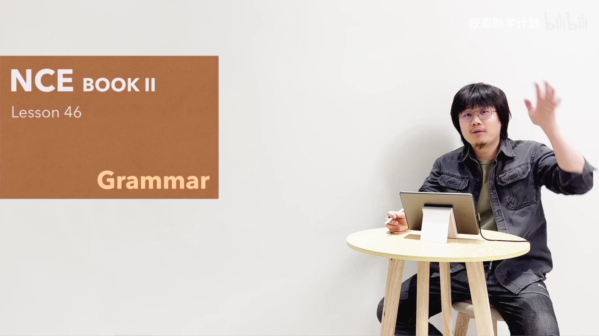

文字识别：NCE / BOOK"I / Lesson 46 / Grammar

### 画面 00:00:03

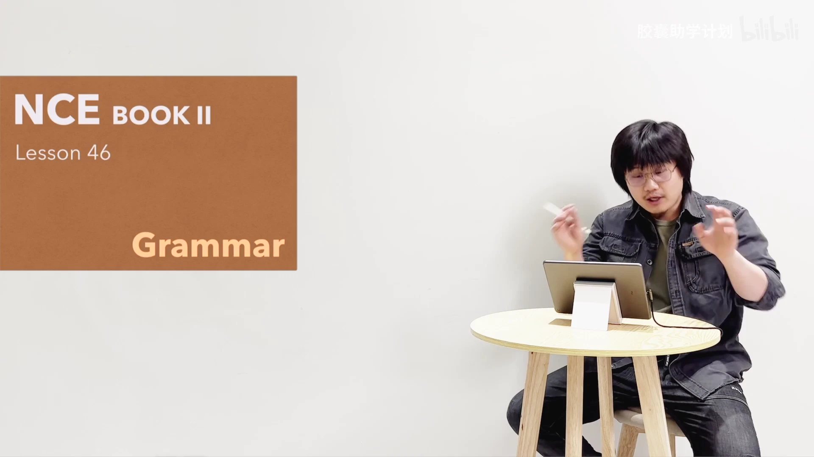

文字识别：NCE / BOOK"I / Lesson 46 / Grammar

### 画面 00:00:05

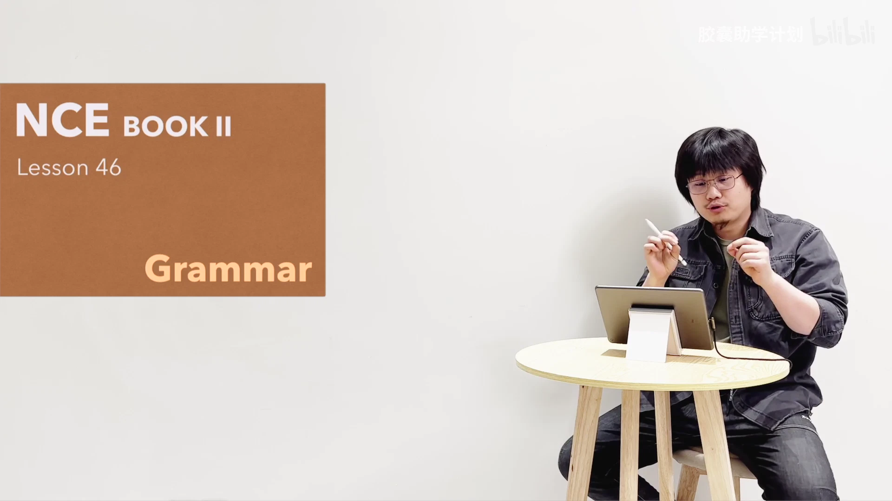

文字识别：NCE / BOOKII / Lesson 46 / Grammar

### 画面 00:00:09

### 画面 00:00:12

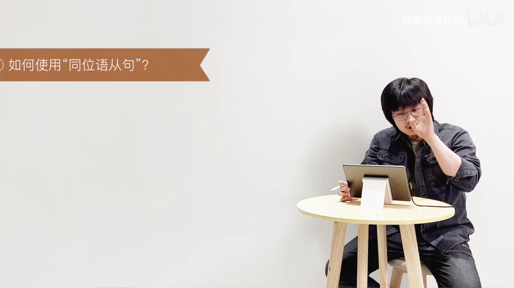

文字识别：如何使用“同位语从句”？

### 画面 00:00:14

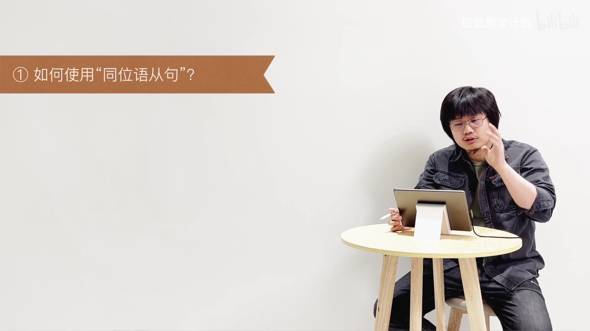

文字识别：①如何使用“同位语从句”？

### 画面 00:00:26

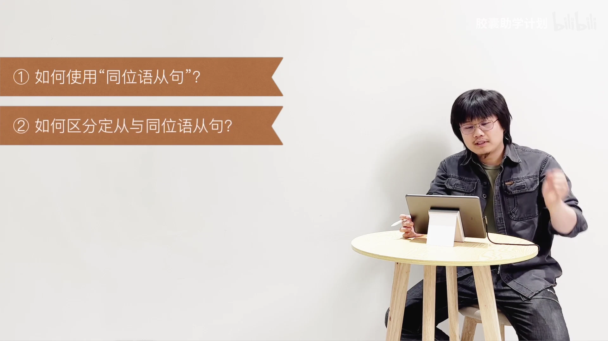

文字识别：①如何使用“同位语从句”？ / 如何区分定从与同位语从句?

## 00:00:30–00:01:00

啊，也就是定语从句与同位语从句？OK，那带着这两个问题，Hope you gonna enjoy it。好，那我们先看同位语从句，是吧？所谓同位语从句，同位语从句。那首先你要回顾一下同位语，同位语最基本的作用叫补充说明，对吧？名词的。之前我说过，比如说我们早在第四课啊，比如说 I have just received a letter from my brother Tim，

### 画面 00:00:30

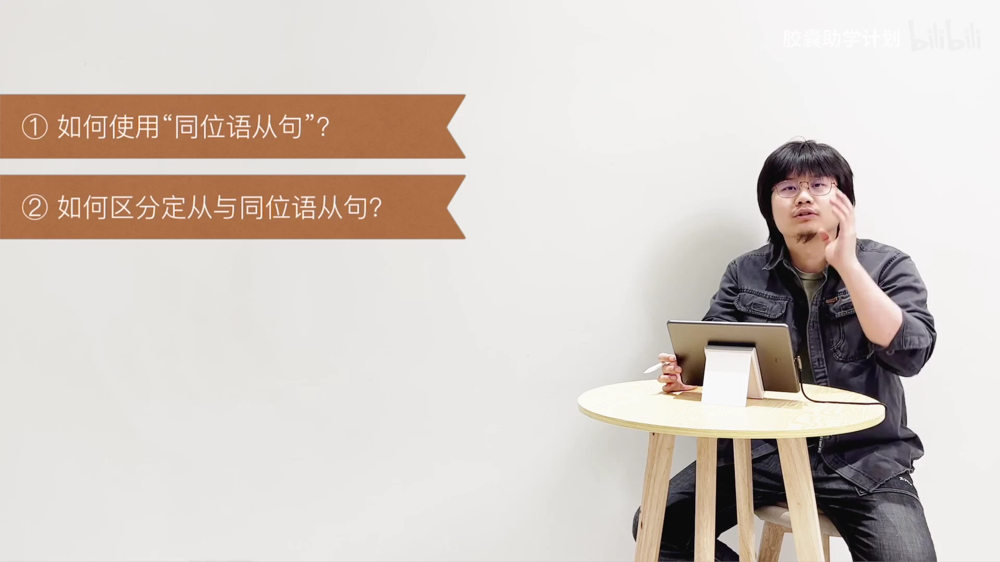

文字识别：①如何使用“同位语从句”? / 如何区分定从与同位语从句?

### 画面 00:00:36

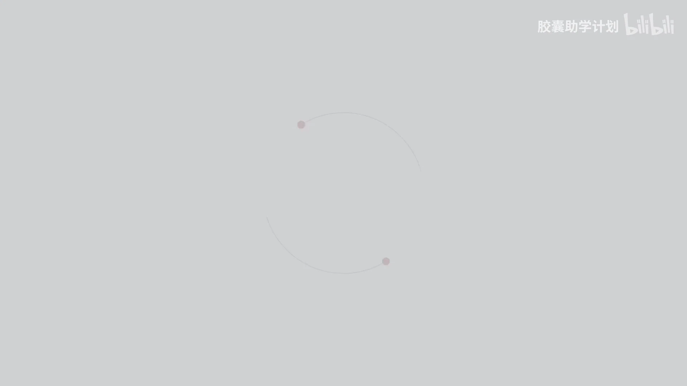

文字识别：胶囊助学计划bll

### 画面 00:00:40

### 画面 00:00:42

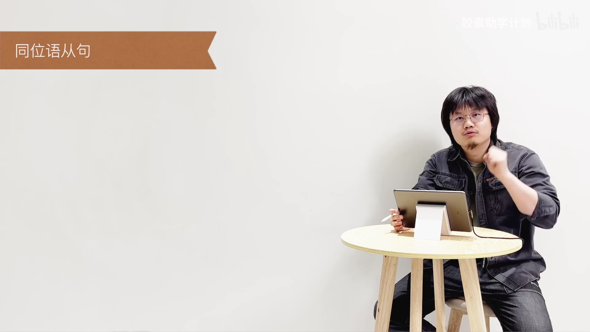

文字识别：同位语从句

### 画面 00:00:54

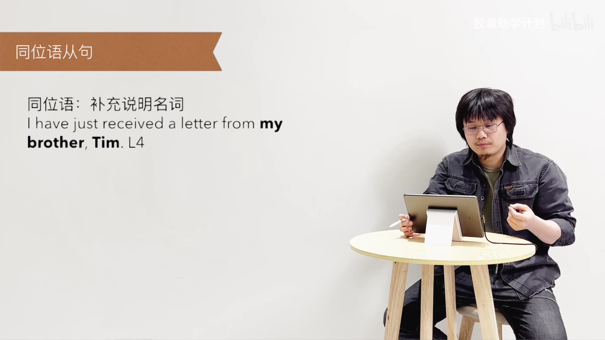

文字识别：同位语从句 / 同位语：补充说明名词 / I have just received a letter from my / brother, Tim. L4 / i

## 00:01:00–00:01:30

My brother and Tim is one thing. They are co-relative pronouns, right? Okay, same position language is called relative pronoun. Ah, it is supplementary. My brother is who? My brother is Tim. Tim is who? Tim is my brother. Very simple. It is similar to me. For example, Beijing is what? Beijing is the capital of China. The capital of China, Beijing. These two are one thing. Chinese also has similar relative pronoun things, right? For example, this is my English teacher Leo. Leo and English, my

### 画面 00:01:24

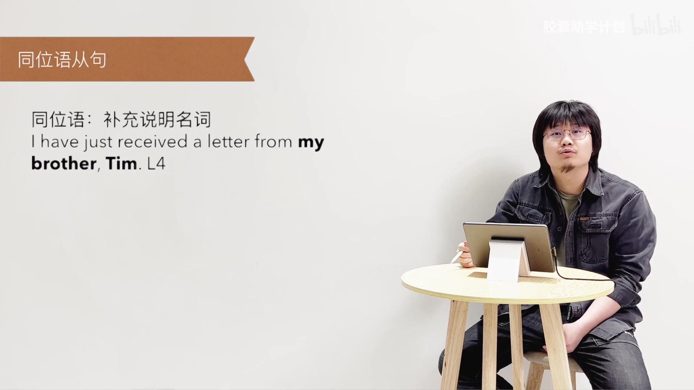

文字识别：同位语从句 / 同位语：补充说明名词 / I have just received a letter from my / brother, Tim. L4

## 00:01:30–00:02:00

Leo，Leo和英语，我的英语老师互为同位语，这就叫同位语，对吧？我们之前见过很多次了。那什么叫同位语从句呢？你看，各位，目前为止我们学过宾语从句，宾语从句叫一个句子做宾语；学过定语从句，叫一个句子做定语；我们学过状语从句啊，比如说什么时间状语从句、条件状语从句，那就是一个句子做时间，一个句子做条件，对吧？宾语同位语从句，猜也能猜出来了，叫做一个句子

### 画面 00:01:54

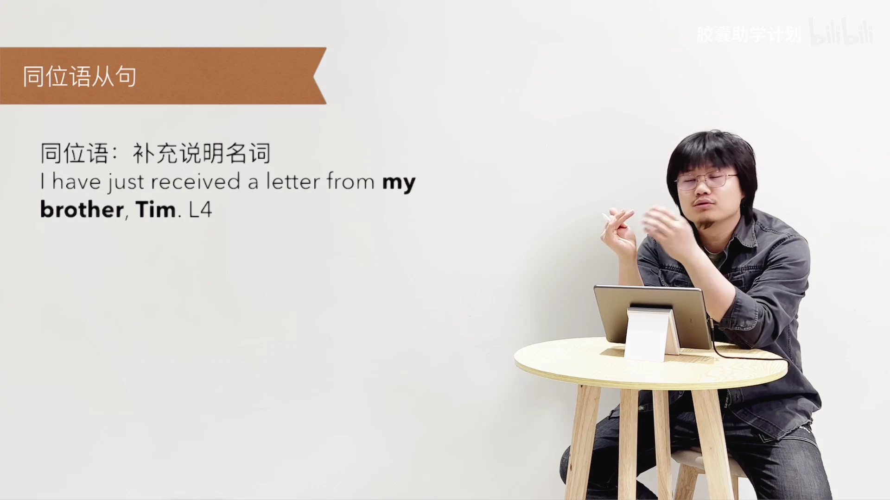

文字识别：同位语从句 / 同位语：补充说明名词 / I have just received a letter from my / brother, Tim. L4

### 画面 00:01:57

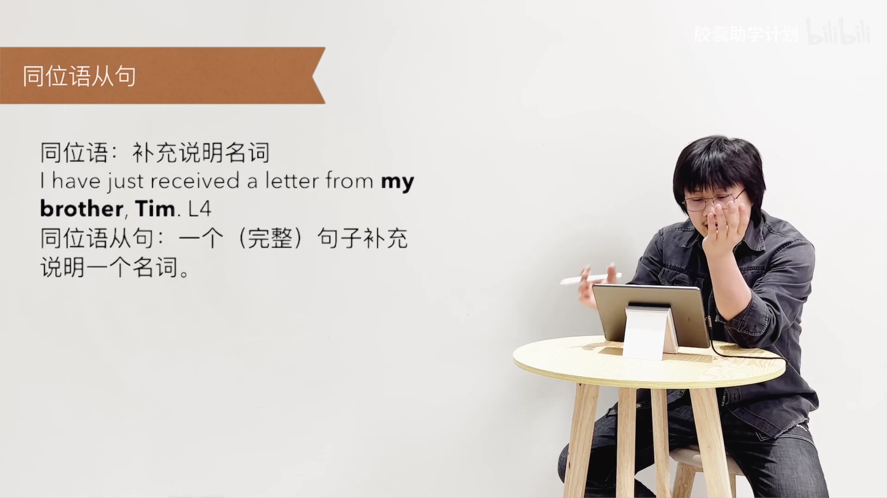

文字识别：同位语从句 / 同位语：补充说明名词 / I have just received a letter from my / brother, Tim. L4 / 同位语从句：一个（完整）句子补充 / 说明一个名词。

## 00:02:00–00:02:30

补充说明一个名词，也就是一个句子做同位语，对吧？同位语的作用叫补充说明名词嘛？那一个句子去补充说明一个名词，也就是说一个句子去做了同位语，那它就叫同位语从句。然后这里我给它加了一个完整两个字，为什么呢？各位先记下来，它一会儿我们用它去区分和定语从句的区别。那我们先不多说，直接上个定语从啊，直接上一个同位语从句，对吧？哎，

### 画面 00:02:24

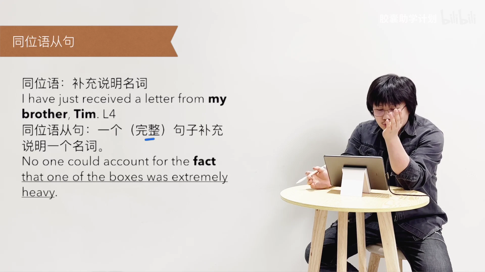

文字识别：同位语从句 / 同位语：补充说明名词 / I have just received a letter from my / brother, Tim. L4 / 同位语从句：一个（完整）句子补充 / 说明一个名词。 / No one could account for the fact / that one of the boxes was extremely / heavy.

## 00:02:30–00:03:00

我们看这句话叫做 No one could account for the fact that one of the boxes was extremely heavy。这句话是我们原文出现的，我们把它摘到这里了。我先给各位简单解释一下啊，进入原文我会更详细的去解释。我先说它的字面意思叫做没有人能 account for，叫做解释说明，类似于我们原来学过的 explain，啊，就解释说明，没有人能解释说明 the fact，叫做这样一个事实。后

### 画面 00:02:54

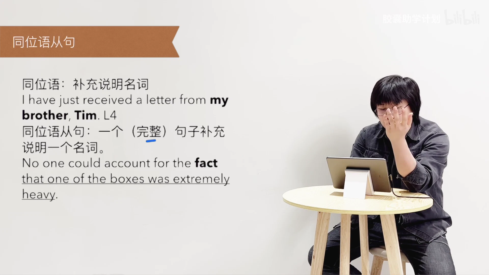

文字识别：同位语从句 / 同位语：补充说明名词 / I have just received a letter from my / brother, Tim. L4 / 同位语从句：一个（完整）句子补充 / 说明一个名词。 / No one could account for the fact / that one of the boxes was extremely / heavy.

## 00:03:00–00:03:30

面是什么呢？你看 that 引导的同位语从句叫 one of the boxes was extremely heavy。好了，到这儿我们就可以开始了。第一，fact 本身是个名词，对吧？然后后边一个句子跟着这个名词的时候，你因为你的定语从句学的太好了，我希望你是这样的，所以你下意识的可能会想问，这不能是定语从句吧？好，

### 画面 00:03:19

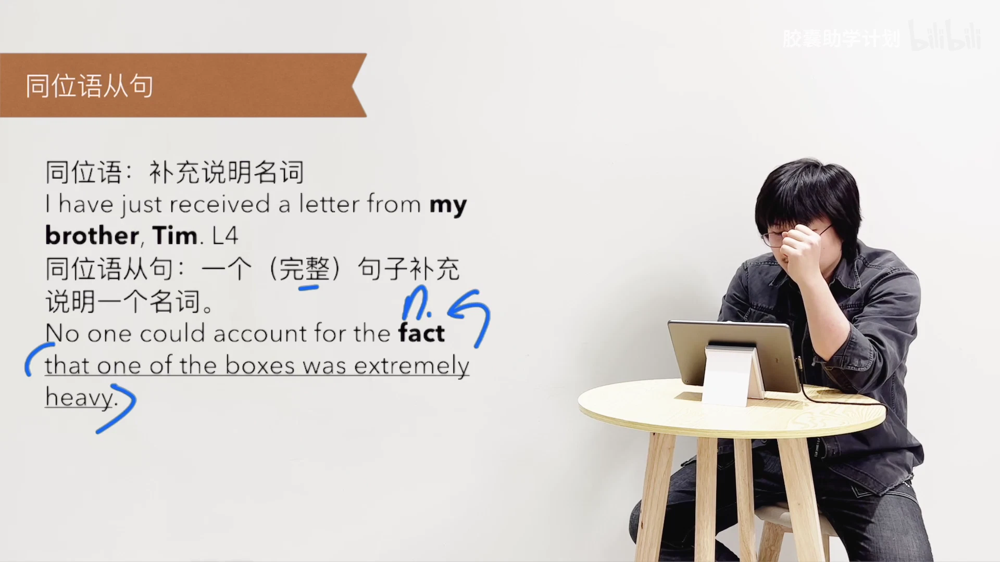

文字识别：同位语从句 / 同位语：补充说明名词 / I have just received a letter from my / brother, Tim. L4 / 同位语从句：一个（完整）句子补充 / 说明一个名词。 / No one could account for the fact / that one of the boxes was extremely / heavy.

## 00:03:30–00:04:00

然后我们就要回顾一件事情。新概念一册幺二幺幺二三，新概念二册二十八课，我们全学过定语从句。如果您到哎，我先提一句啊，如果定语从句各位还没学呢，赶紧关了视频去学定语从句。一定是先学定语从句，再学同位语从句，这个顺序反了就没没法学，是吧？好，那我们回顾一下，定语从句有一个最基本的一个步骤，叫做要用什么what啊啊，要用who，which，that

### 画面 00:03:49

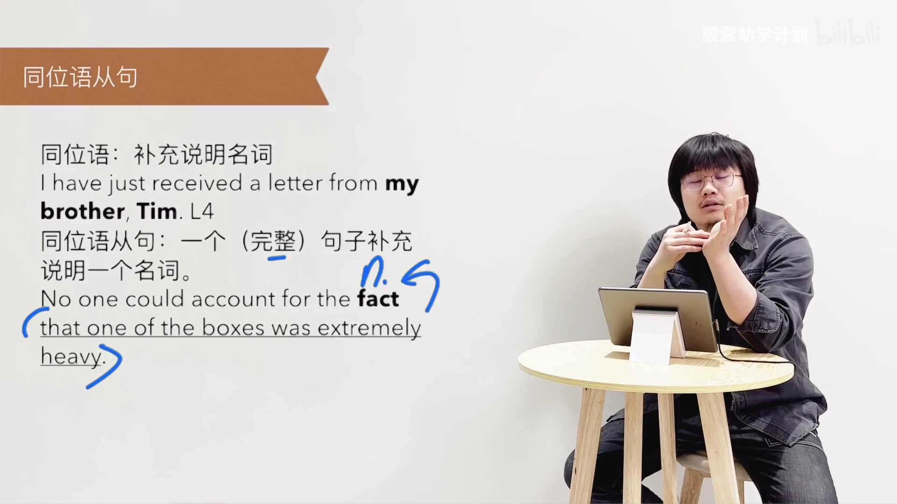

文字识别：同位语从句 / 同位语：补充说明名词 / I have just received a letter from my / brother, Tim. L4 / 同位语从句：一个（完整）句子补充 / 说明一个名词。 / No one could account for the fact / that one of the boxes was extremely / heavy.

## 00:04:00–00:04:30

that 去替代句子中的一个主语或者宾语的位置成分，对吧？所以它往往在它在它的这个定语从句当中啊，这个 which, that, who 是干嘛的？是这个呃承担句子成分的。也就是说，如果你把这个单词去掉，后面的单词后边的句子是不完整的，要么缺主语，要么缺宾语。那我们看一下下边这句话，我们把 that 先去掉。

### 画面 00:04:19

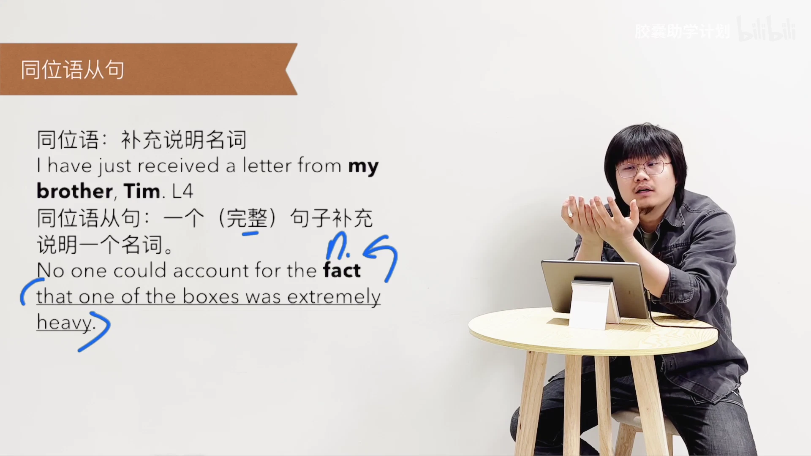

文字识别：同位语从句 / 同位语：补充说明名词 / I have just received a letter from my / brother, Tim. L4 / 同位语从句：一个（完整）句子补充 / 说明一个名词。 / No one could account for the fact / that one of the boxes was extremely / heavy.

## 00:04:30–00:05:00

One of the boxes was extremely heavy.说其中一个箱子，主语was系对吧？Extremely heavy表非常简单的主系表，跟新概念一册前二十课没有任何区别啊！硬说它是主谓宾，问题也不是特别的大，是吧？很多外国语法书不分主系表、主谓宾的啊。好，一二三，

### 画面 00:04:38

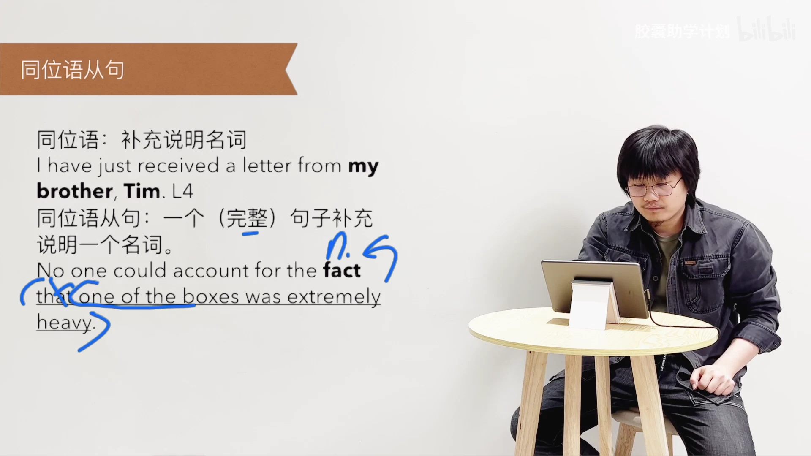

文字识别：同位语从句 / 同位语：补充说明名词 / I have just received a letter from my / brother, Tim. L4 / 同位语从句：一个（完整）句子补充 / 说明一个名词。 / No one could account for the fact / thone of the boxes was extremely / heavy.

### 画面 00:04:40

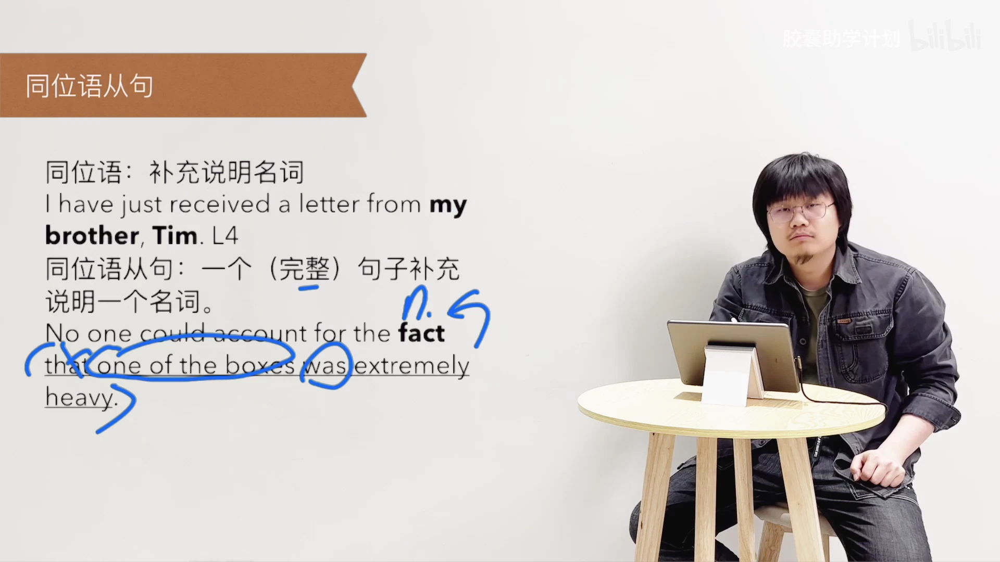

文字识别：同位语从句 / 同位语：补充说明名词 / I have just received a letter from my / brother, Tim. L4 / 同位语从句：一个 / （完整） / 句子补充 / 说明一个名词。 / No one could account for the fact / thxone of the boxesNas / )extremely / heavy.

### 画面 00:04:58

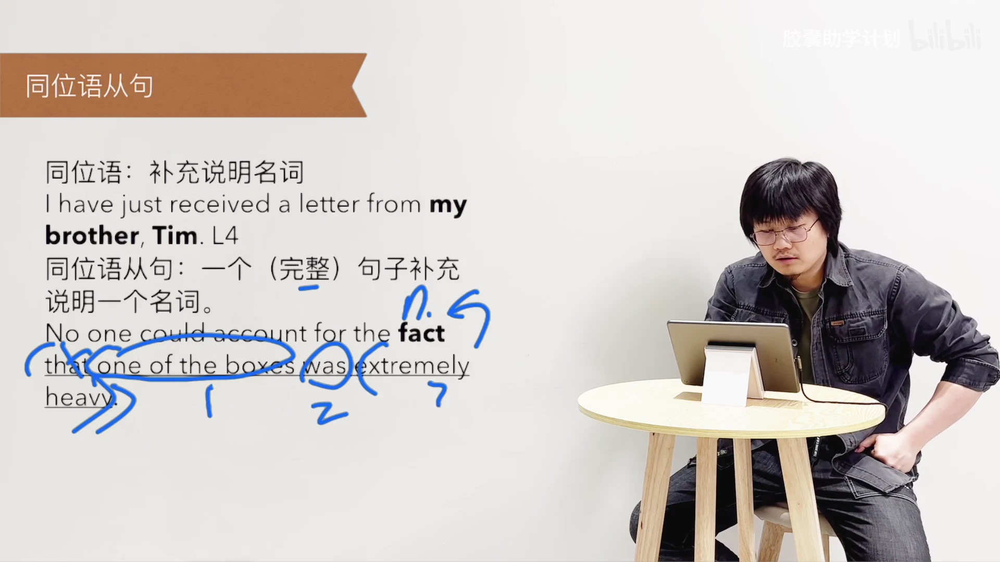

文字识别：同位语从句 / 同位语：补充说明名词 / I have just received a letter from my / brother, Tim. L4 / 同位语从句：一个 / (完整) / 句子补充 / 说明一个名词。 / No one could account for the fact / thai one of the boxesWas extremely / heav

## 00:05:00–00:05:30

常的完整。回想一下，二册第一课我们学过，你要造一个句子，只要有一和二就已经够了。这句话不但有一有二，还有三，不缺任何句子成分，它就不是定语从句。说清楚了吧？定语从句后边的那个句子一定是缺句子成分的，至少我们到目前为止见过的，对吧？这是第一个。第二个，我从更本质、不从语法的角度，从含义的角度去给各位讲定

### 画面 00:05:12

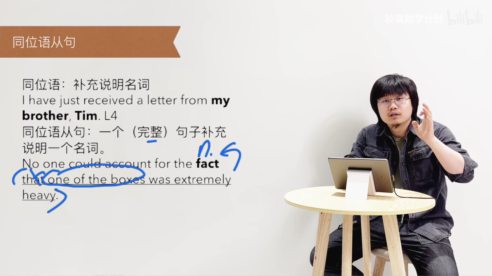

文字识别：同位语从句 / 同位语：补充说明名词 / I have just received a letter from my / brother, Tim. L4 / 同位语从句：一个 / （完整）句子补充 / 说明一个名词。 / No one could account for the fact / thX one of the boxcs was extremely / heavy.

### 画面 00:05:14

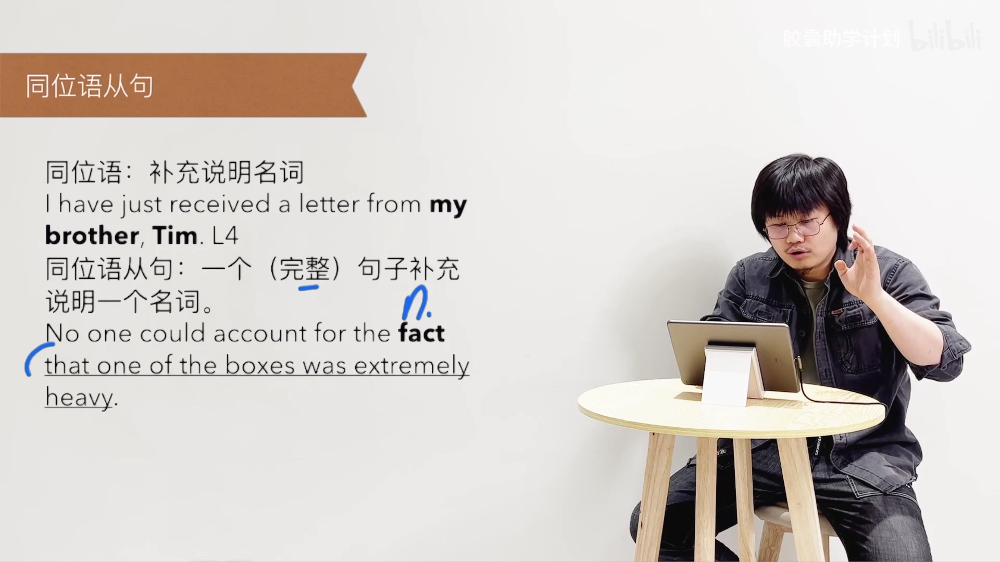

文字识别：同位语从句 / 同位语：补充说明名词 / I have just received a letter from my / brother, Tim. L4 / 同位语从句：一个（完整）句子补充 / 说明一个名词。 / No one could account for the fact / that one of the boxes was extremely / heavy.

### 画面 00:05:18

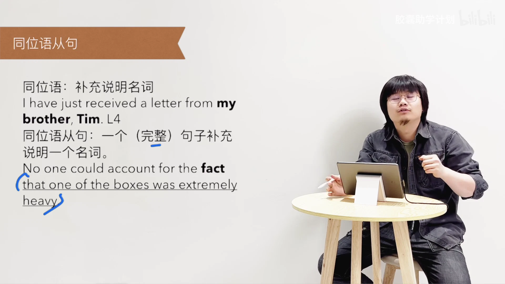

文字识别：同位语从句 / 同位语：补充说明名词 / I have just received a letter from my / brother, Tim. L4 / 同位语从句：一个（完整）句子补充 / 说明一个名词。 / No one could account for the fact / that one of the boxes was extremely / heavy

## 00:05:30–00:06:00

语从句和同位语从句的区别。同位语从句整个这句话说的就是 fact 的内容，事实是什么？事实就是一个箱子极度的沉，说的就是 fact 的内容。 fact 是一个抽象名词。我举个例子，我说我告诉你说，我想告诉你一个事实，你就会问我事实的内容是什么？事实的内容叫做一个箱子极度的沉，这就叫做事

### 画面 00:05:34

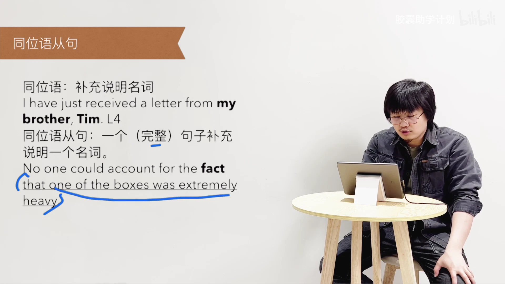

文字识别：同位语从句 / 同位语：补充说明名词 / I have just received a letter from my / brother, Tim. L4 / 同位语从句：一个（完整）句子补充 / 说明一个名词。 / No one could account for the fact / that one of the boxes was extremely / heavy

### 画面 00:05:36

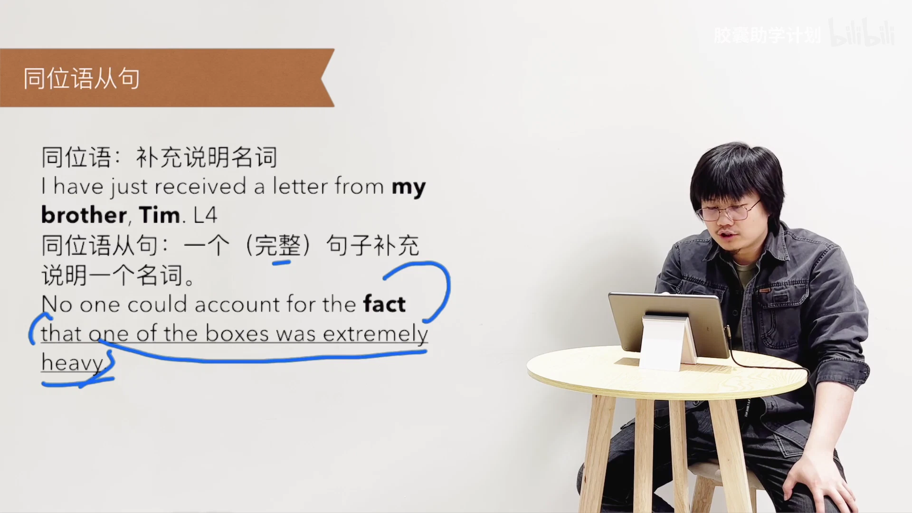

文字识别：同位语从句 / 同位语：补充说明名词 / I have just received a letter from my / brother, Tim. L4 / 同位语从句：一个（完整）句子补充 / 说明一个名词。 / No one could account for the fact / that one of the boxes was extremely / heavy

### 画面 00:05:58

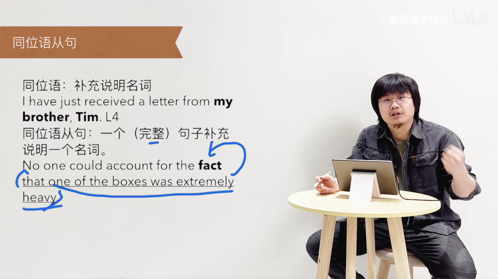

文字识别：同位语从句 / 同位语：补充说明名词 / I have just received a letter from my / brother, Tim. L4 / 同位语从句：一个（完整）句子补充 / 说明一个名词。 / Aaitutg / No one could account for the fact / that one of the boxes was extremely / heavy

## 00:06:00–00:06:30

实的内容，对吧？事实本身到底是什么？这就叫同位语从句，因为它俩说的是一个东西。什么叫定语从句？我们没从语法的角度去分啊，我们从含义的角度，定语从句就告诉你一个是什么样的事实，对吧？比如说，我现在造一句汉语，叫你必须要告诉我昨天晚上你告诉他的那个事实。你看，你告诉他的，这就是一个定语从句。为什么？你告诉他的是在形容 fact 的，

### 画面 00:06:06

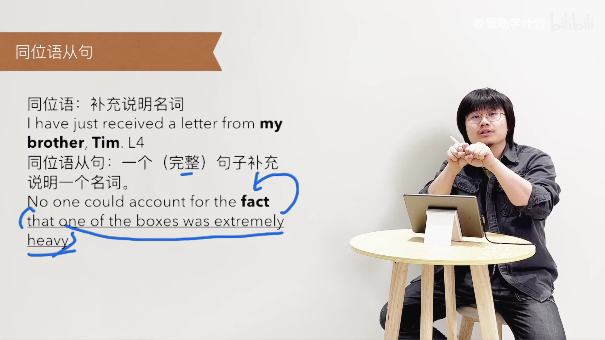

文字识别：同位语从句 / 同位语：补充说明名词 / I have just received a letter from my / brother, Tim. L4 / 同位语从句：一个（完整）句子补充 / 说明一个名词。 / No one could account for the fact / that one of the boxes was extremely / heavy

## 00:06:30–00:07:00

在修饰 fact 的，对吧？你可能有十个事实，我只想知道昨天晚上他告诉你的那个事实。但是告诉你的事实是什么？内容是什么？我是不知道的。如果只如果这句话说的是昨天晚上告诉他这个内容啊，告诉你了这个事实的内容，告诉你，他就变成同位语从句了。比如说，我告诉你昨天晚上他告诉我的那个事实，这个事实是什么呢？他不爱我了，他爱你，对吧？他不

### 画面 00:06:36

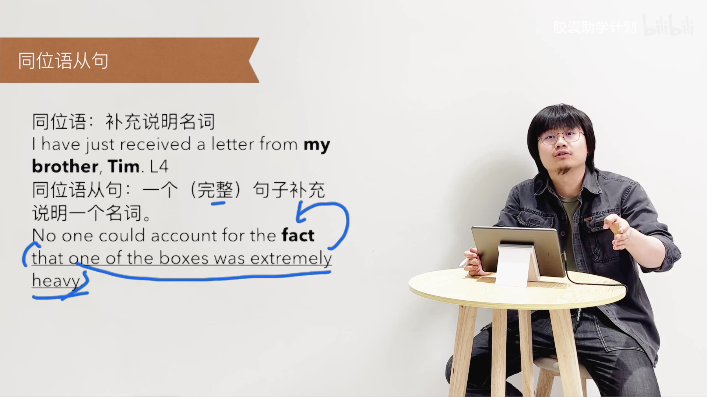

文字识别：同位语从句 / 同位语：补充说明名词 / I have just received a letter from my / brother, Tim. L4 / 同位语从句：一个（完整）句子补充 / 说明一个名词。 / No one could account for the fact / that one of the boxes was extremely / heavy

## 00:07:00–00:07:30

爱我了，他爱你是这个事实的内容，叫同位语从句。而昨天晚上他告诉我的事实，他告诉我的这叫定语从句，修饰的是事实，好吧？刚才我说的这些话比较绕，但是我说一句啊，如果各位听不懂，有两种可能性，第一，我讲的不对，我不能叫不对，不好，不够好，让你完全能听懂，这是我的责任。另一种责任在于你自己，叫做你的汉语不

### 画面 00:07:06

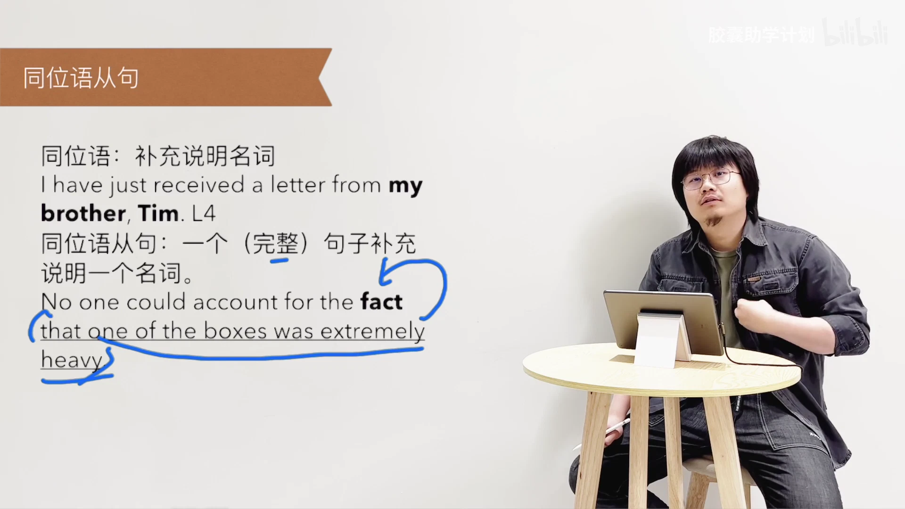

文字识别：同位语从句 / 同位语：补充说明名词 / I have just received a letter from my / brother, Tim. L4 / 同位语从句：一个（完整）句子补充 / 说明一个名词。 / No one could account for the fact / that one of the boxes was extremely / heavy

## 00:07:30–00:08:00

够好，你分不明白刚才我说这些汉语为什么？因为我刚才根本不是从语法的角度在解释同位语从句和定语从句的区别，我是从人类我们汉语基本的点去解释，只要它是它的内容，它就是同位语从句。如果是帮你尝试去区分有十个事实，帮你去认定一个事实，那它就是定语从句，好吧？那接下来我们看几个同位语从句。同位语从句有一个特点，

### 画面 00:07:36

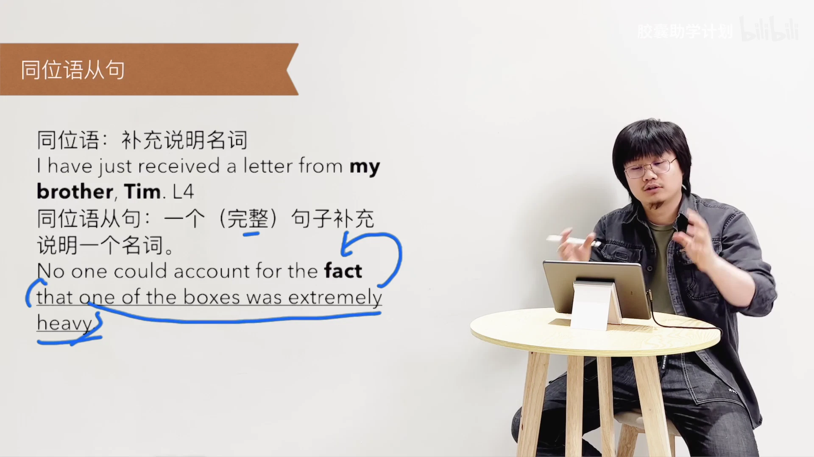

文字识别：同位语从句 / 同位语：补充说明名词 / I have just received a letter from my / brother, Tim. L4 / 同位语从句：一个（完整）句子补充 / 说明一个名词。 / No one could account for the fact / that one of the boxes was extremely / heavy

### 画面 00:07:56

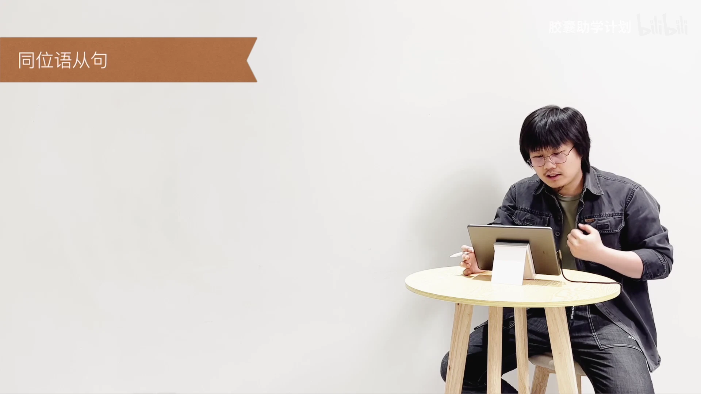

文字识别：同位语从句

### 画面 00:07:58

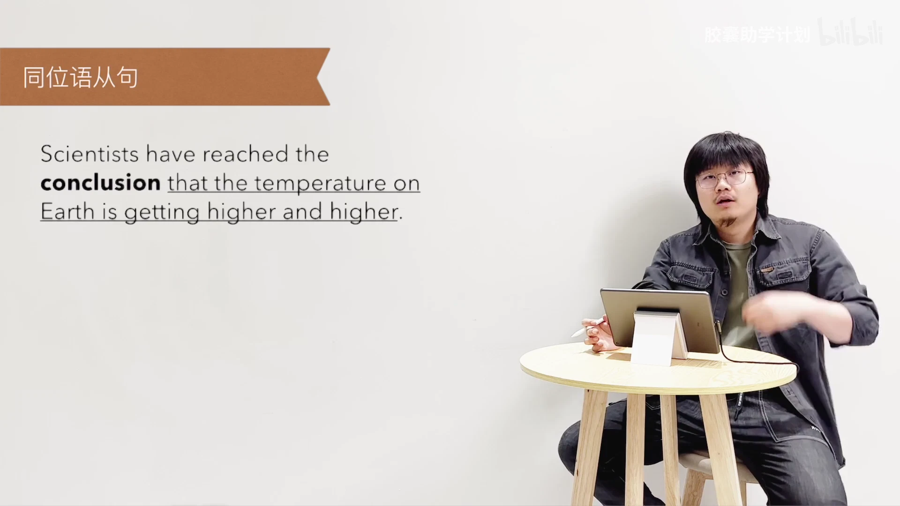

文字识别：同位语从句 / Scientists have reached the / conclusion that the temperature on / Earth is getting higher and higher.

## 00:08:00–00:08:30

各位记住啊，前面的这个名词往往都是抽象名词，而且就那么几个。比如说刚才你看到的 fact，fact 后面非常长跟的就是同位语从句。比如说我们再看这儿，叫做 scientists have reached the conclusion，他们达到了这样一个结论，获得了这样一个结论。这个结论的内容是什么呢？内容是 the temperature on Earth is getting higher and higher，地球上的温度在变得越来越高。地球上的温度在变得越来越高，就是这个事

### 画面 00:08:28

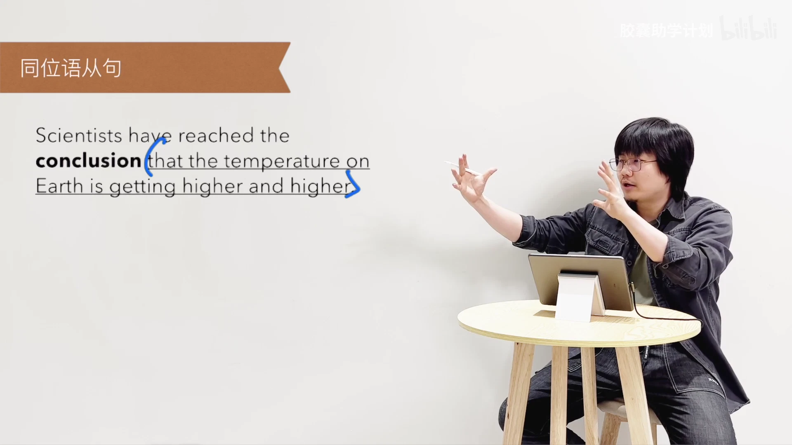

文字识别：同位语从句 / Scientists / s haye reached the / conclusionthat the temperature on / Earth is getting higher and higher

## 00:08:30–00:09:00

实的内容。如果你把这个事实，我这样，我再举个例子，如果你把这个事实或这个 conclusion 啊，它们是一码事儿。比做一个球的话，你现在不知道球里边是什么，对吧？它的内容。后边这句话，the temperature on Earth is getting higher and higher，就是这个球里边的内容。所以他们俩是一个东西，叫做同位语。听见了啊？如果你现在有十个球，

### 画面 00:08:58

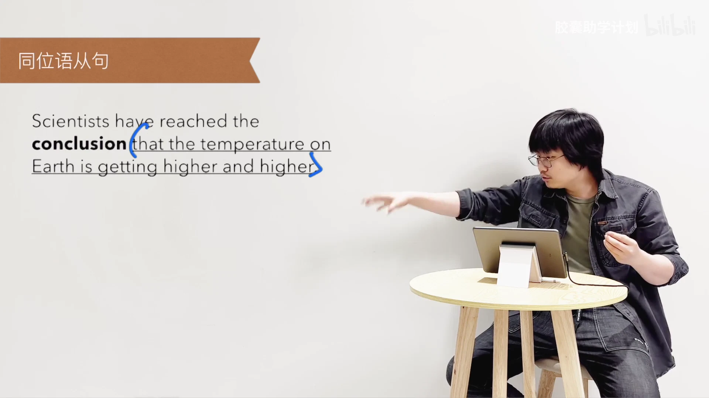

文字识别：同位语从句 / Scientists / ; haye reached the / conclusionthat the temperature on / Earth is getting higher and highe)

## 00:09:00–00:09:30

你要去通过一句话判断是哪个球，我想要的哪个球，这个叫定语从句。我举个例子啊，说科学家们已经得到了这样一个结论，什么样的一个结论呢？听到了啊，有二十个结论。我想说的是哪个结论呢？关于地球的那个结论。你看，有关于月球的，有关于火星的，有关于太阳的，有关于地球的。我现在是哪个结论呢？假设你把结论

### 画面 00:09:21

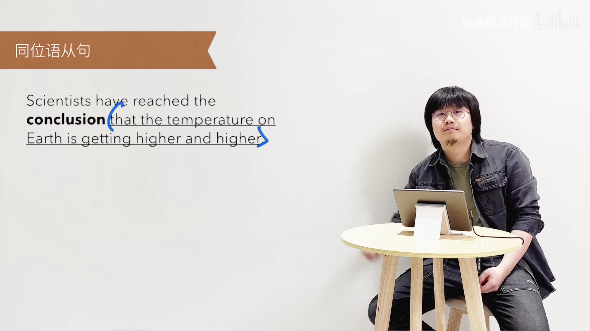

文字识别：同位语从句 / Scientists / ; haye reached the / conclusionthat the temperature on / Earth is getting higher and higher

### 画面 00:09:29

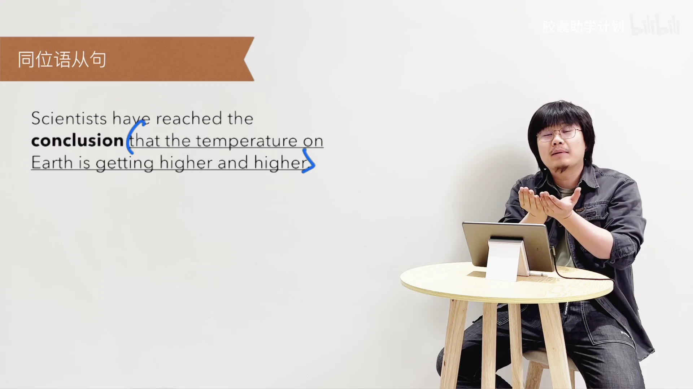

文字识别：同位语从句 / Scientists /  haye reached the / conclusionthat the temperature on / Earth is getting higher and higher

## 00:09:30–00:10:00

比作一个球的话，叫做这四个当中关于地球的那个。你看，你依旧不知道它的结论内容是什么，但是你选到了这个球，听到了吧？四个球选一个球是用定语从句。你想知道这个球里边的内容是什么，用的是同位语从句。哎呀，我觉得我已经应该讲的挺清楚了，是吧？OK，那我们再往下看一个，比如说 We were all happy about the news. 我们对于这个新闻都特别的开心。新

### 画面 00:09:52

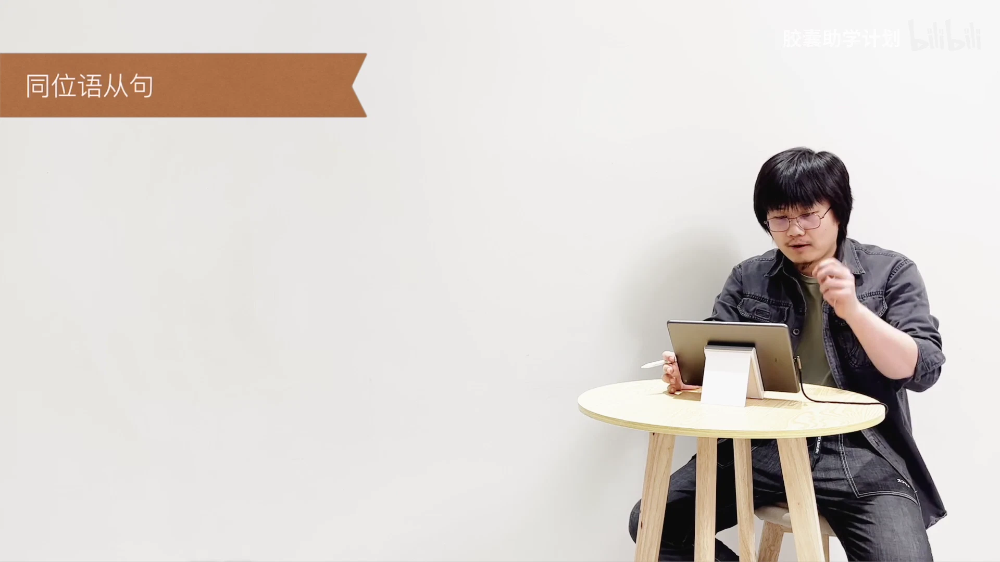

文字识别：同位语从句

### 画面 00:09:58

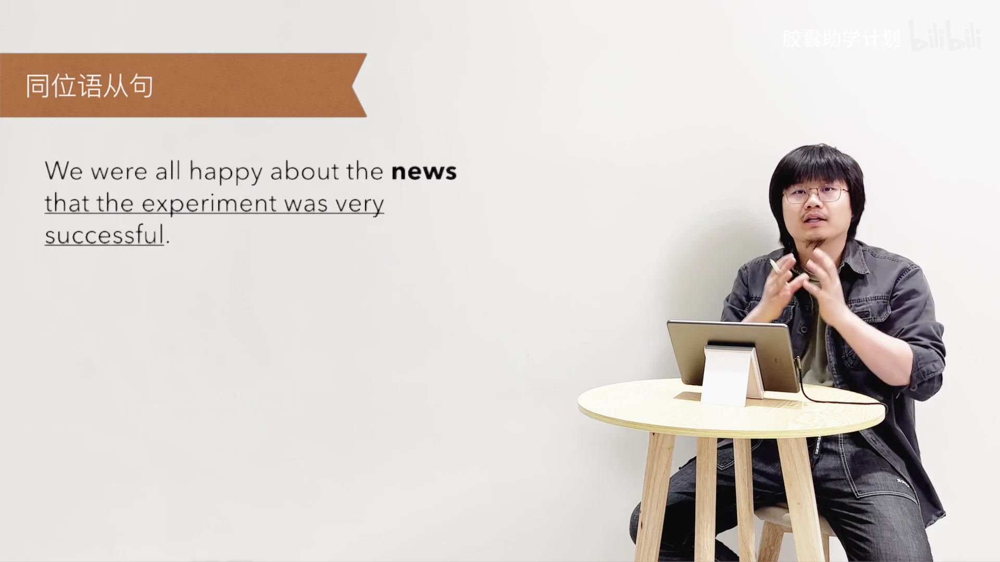

文字识别：同位语从句 / We were all happy about the news / that the experiment was very / successful.

## 00:10:00–00:10:30

闻的内容是什么？That 引导了后边一句话，叫 Experiment was very successful。你注意，你看后边是一个完整的句子。这是从语法的角度去区分同位语从句和定语从句的区别。同位语从句里边的句子是完整的，不缺任何成分；而定语从句里边是缺成分的。这是语法的角度，对吧？这个角度你语法如果前面学的好，你能理解的，对吧？如果你学的不好呢，你就从刚才我说的第二个角度，对吧？新闻的内容

### 画面 00:10:06

文字识别：同位语从句 / We were all happy about the news / that the experiment was very / successful.y

## 00:10:30–00:11:00

是实验很成功。但如果我现在有四个新闻，我要确定哪一个新闻？比如说昨天晚上发生的那个新闻。那通过昨天晚上发生的，因为还有昨天早上发生的，还有昨天中午发生的，还有昨天晚上发生的，对吧？还有昨天后半夜发生的四个新闻。我现在想知道的是昨天晚上发生的那个新闻。所以你把四个新闻从里边挑了一个出来，怎么挑出来？用的是定语从句。好了，我觉得我应该讲到位了啊。好，

### 画面 00:10:36

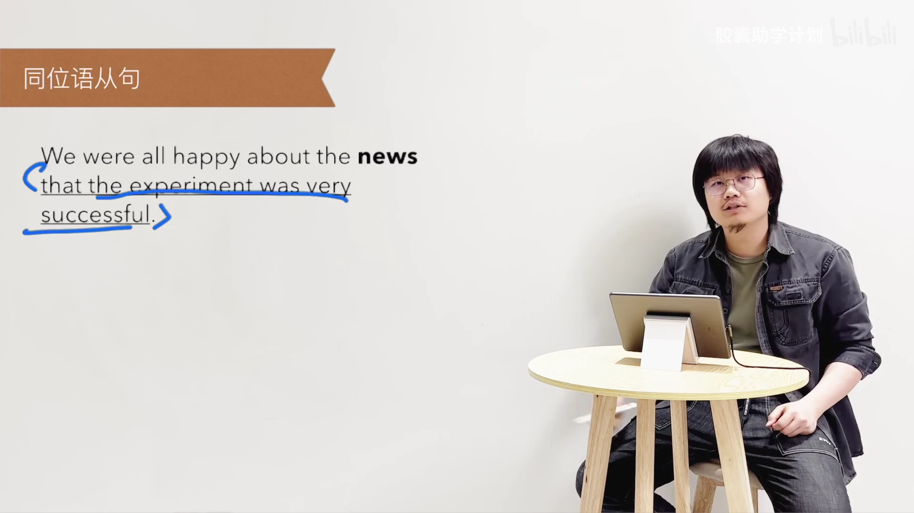

文字识别：同位语从句 / We were all happy about the news / that the experiment was very / successful.y

### 画面 00:10:59

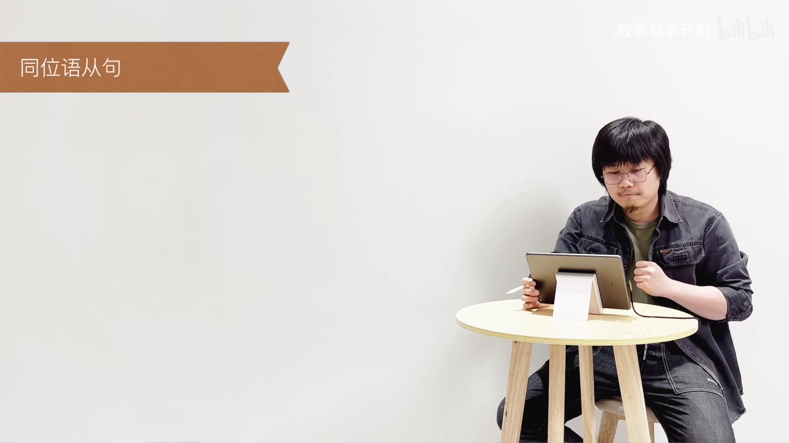

文字识别：同位语从句

## 00:11:00–00:11:30

接下来，比如说 I have a theory that. 其实 theory 就是口语当中很常用的句型。我给大家摘了两个出来，对吧？我有这么一个理论，这个理论的内容是什么？同位语从句，对吧？比如说 I have no doubt 我完全没有任何的疑惑 that he will help you. 啊， he will help me. 叫他会帮助我这件事情，我没有任何的 doubt. 它俩一码事儿，是吧？OK. I have no doubt

### 画面 00:11:03

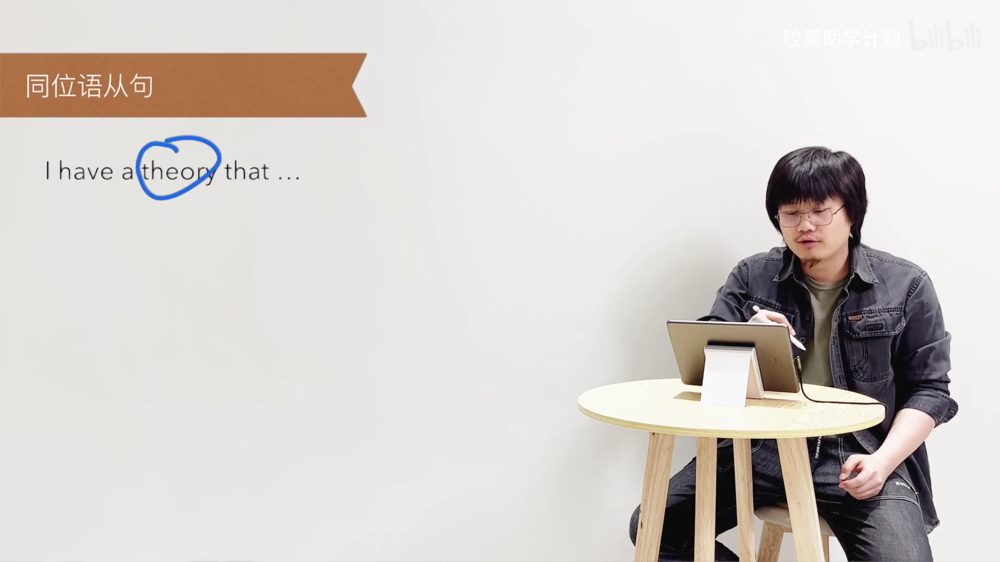

文字识别：同位语从句 / Ihave atheory / that ...

### 画面 00:11:13

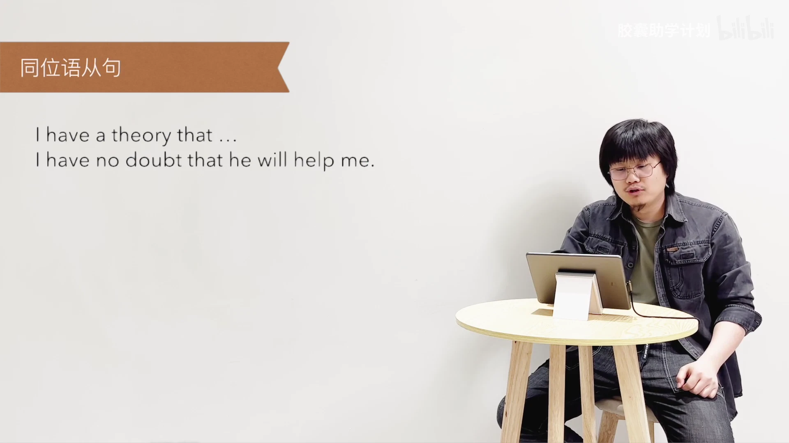

文字识别：同位语从句 / I have a theory that ... / I have no doubt that he will help me.

### 画面 00:11:21

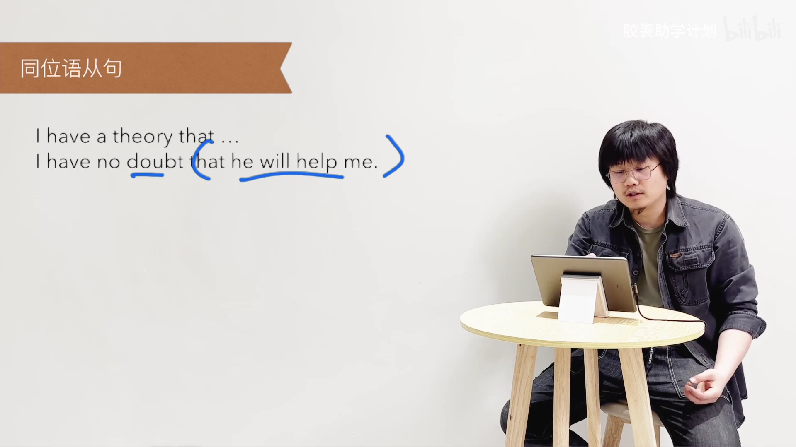

文字识别：同位语从句 / I have a theory that / I have no doubt that he will help me.

## 00:11:30–00:12:00

that he will help me.我没有任何的疑惑，对于什么事情呢？对于他会帮助我这个内容，对吧？这件事儿，我没有疑惑啊。OK，往后啊，呃，同位语从句本质上起到了一个名词的作用。名词一三啊五六，其实多多少少都会出现。但我个人呃，通过这个经验啊，和读一些语法书，其实这个

### 画面 00:11:42

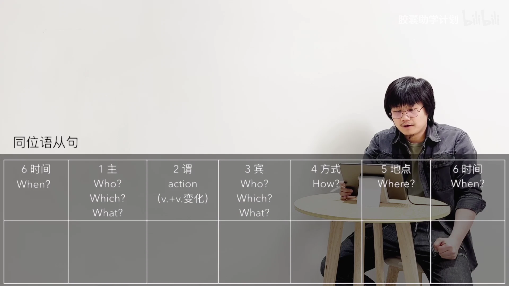

文字识别：同位语从句 / 6时间 / 1主 / 2谓 / 3宾 / 4方式 / 5地点 / 6时间 / When? / Who? / action / Who? / How? / Where? / When? / Which? / (v.+v.变化) / Which? / What? / What?

### 画面 00:11:49

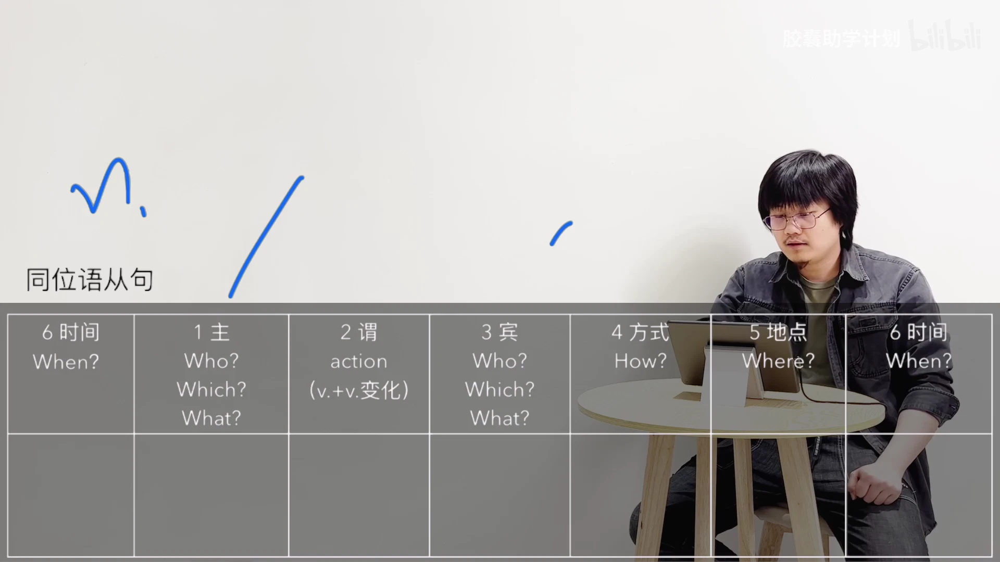

文字识别：同位语从句 / 6时间 / 1主 / 2谓 / 3宾 / 4方式 / 5地点 / 6时间 / When? / Who? / action / Who? / How? / Where? / When? / Which? / (v.+v.变化) / Which? / What? / What?

## 00:12:00–00:12:30

呃同位语从句最常出现的就是一和三这两个位置啊，嗯，呃我们其实再往后学的时候，新二出现同位语不是特别多，新三出现同位语开始多一点点，呃不过啊同位语从句确实也要比定语从句少的多的多的多啊，所以各位预计接下来可能也不会看那么多啊，OK，呃recap那我们第一讲了什么叫同位语从句对吧？很简单

### 画面 00:12:02

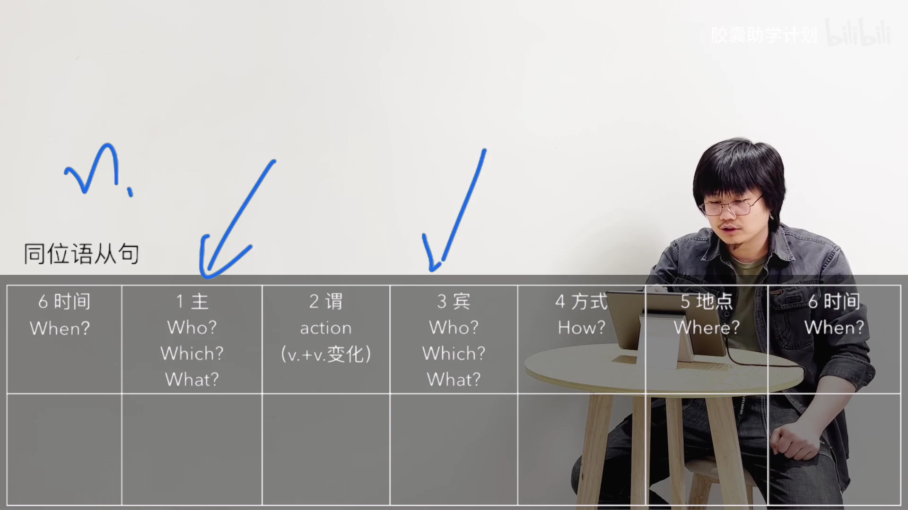

文字识别：同位语从句 / 6时间 / 1主 / 2谓 / 3宾 / 4方式 / 5地点 / 时间 / When? / Who? / action / Who? / How? / Where? / When? / Which? / (v.+v.变化) / Which? / What? / What?

### 画面 00:12:23

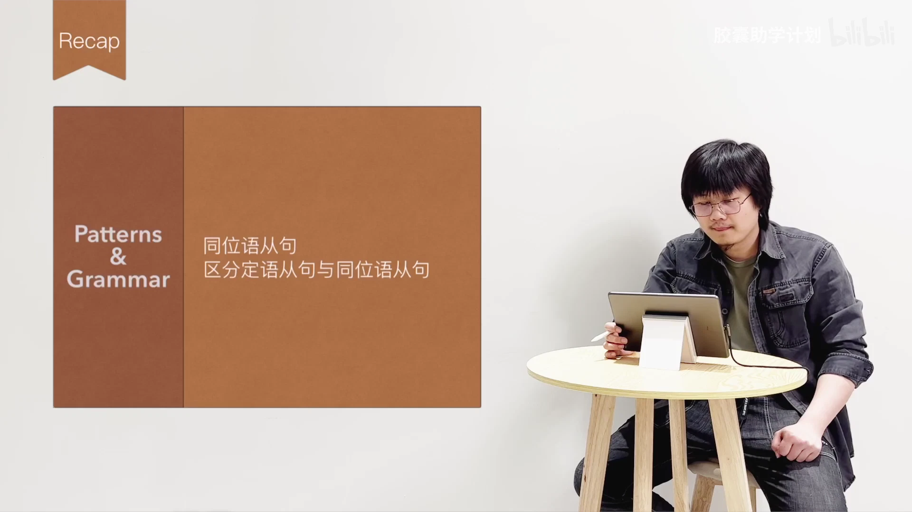

文字识别：Recap / Patterns / 同位语从句 / 区分定语从句与同位语从句 / Grammar

### 画面 00:12:25

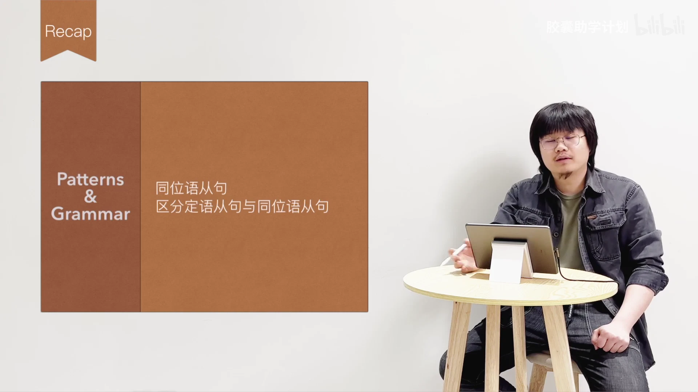

文字识别：Recap / Patterns / 同位语从句 / ＆ / 区分定语从句与同位语从句 / Grammar

### 画面 00:12:27

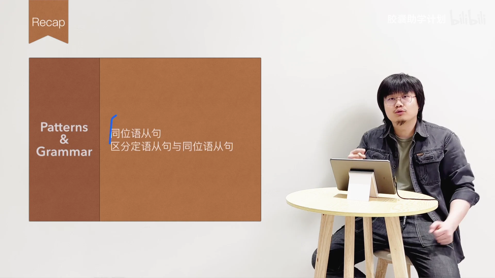

文字识别：Recap / Patterns / 同位语从句 / ＆ / 区分定语从句与同位语从句 / Grammar

### 画面 00:12:29

文字识别：Recap / Patterns / 同位语从句 / 区分定语从句与同位语从句 / Grammar

## 00:12:30–00:13:00

很简单啊！它经常搁这几个单词的前面。进入文章，我会用一种更简单粗暴的方式教会各位怎么去使用同位语从句。其实本课只教各位区分了，对吧？没教各位使用。进入那个呃文章的那个视频啊，我会更简单粗暴告诉各位咱们怎么用。然后如何区分呢？我给了两个思路。第一个思路是从我们语法的角度、结构的层面去区分，对吧？看缺不缺成分。呃，然后另一个呢，是我们从语言的角度、

### 画面 00:12:34

文字识别：Recap / Patterns / 同位语从句 / 区分定语从句与同位语从句 / Grammar

### 画面 00:12:36

文字识别：Recap / Patterns / 同位语从句 / ＆ / 区分定语从句与同位语从句 / Grammar

### 画面 00:12:39

文字识别：Recap / Patterns / 同位语从句 / ＆ / 区分定语从句与同位语从句 / Grammar

### 画面 00:12:44

文字识别：Recap / Patterns / 同位语从句 / ＆ / 区分定语从句与同位语从句 / Grammar

### 画面 00:12:49

文字识别：Recap / Patterns / 同位语从句 / ＆ / 区分定语从句与同位语从句 / Grammar

### 画面 00:12:51

文字识别：Recap / Patterns / 同位语从句 / ＆ / 区分定语从句与同位语从句 / Grammar

### 画面 00:12:53

文字识别：Recap / Patterns / 同位语从句 / ＆ / 区分定语从句与同位语从句 / Grammar

### 画面 00:12:55

文字识别：Recap / Patterns / 同位语从句 / ＆ / 区分定语从句与同位语从句 / Grammar

### 画面 00:12:58

文字识别：Recap / Patterns / 同位语从句 / ＆ / 区分定语从句与同位语从句 / Grammar

## 00:13:00–00:13:30

汉语语言的角度，英语也是语言的角度啊。就是如果是它的球里边的内容，那就是同位语从句；如果是四个球挑出一个球来，那就是定语从句，对吧？定语从句的目的就是帮助我们去区分嘛，对吧？去挑嘛。OK，加上作业没有pattern drill，各位不用去写了。但是第二个你一定要去做，就回忆一下，给自己讲解一遍。我今天刚才之前讲的那段文字相对来说比较抽象，各位可以多听几遍，多给

### 画面 00:13:00

文字识别：Recap / Patterns / 同位语从句 / ＆ / 区分定语从句与同位语从句 / Grammar

### 画面 00:13:04

文字识别：Recap / Patterns / 同位语从句 / ＆ / 区分定语从句与同位语从句 / Grammar

### 画面 00:13:09

文字识别：Recap / Patterns / 同位语从句 / ＆ / 区分定语从句与同位语从句 / Grammar

### 画面 00:13:14

文字识别：1.f / Pattern Drill 写&朗读 / 专栏 / 4×4

### 画面 00:13:17

文字识别：Pattern Drill写&朗读 / 1. / 专栏 / 4×4 / 尝试回忆并给自己讲解一 / 遍今天的核心语法 / Study-Test / Learning Pyramid

### 画面 00:13:19

文字识别：1. / Pattern Drill写&朗读 / 专栏 / 4×4 / 尝试回忆并给自己讲解一 / 遍今天的核心语法 / Study-Test / Learning Pyramid

### 画面 00:13:24

文字识别：1. / Pattern Drill写&朗读 / 专栏 / 4×4 / 尝试回忆并给自己讲解一 / 遍今天的核心语法 / Study-Test / Learning Pyramid

### 画面 00:13:29

文字识别：1. / Pattern Drill写&朗读 / 专栏 / 4×4 / 尝试回忆并给自己讲解一 / 遍今天的核心语法 / Study-Test / Learning Pyramid

## 00:13:30–00:14:00

自己举几个例子去想一想，是吧？OK，然后翻阅红皮书，能看一下能不能找到啊？不多说了。那以上就是本期视频的全部内容了。如果各位喜欢我们的课程呢，欢迎各位关注、订阅、一键三连，分享给那些需要的朋友，来帮助我们快速成长。See you next time.

### 画面 00:13:33

文字识别：1.↑ / Pattern Drill写&朗读 / 专栏 / 4×4 / 尝试回忆并给自己讲解一 / 遍今天的核心语法 / Study-Test / Learning Pyramid / 尝试翻阅红皮书（中级） / 通过目录或索引(Index) / 查找到本课语法

### 画面 00:13:35

文字识别：1. f / Pattern Drill写&朗读 / 专栏 / 4×4 / 尝试回忆并给自己讲解一 / 遍今天的核心语法 / Study-Test / Learning Pyramid / 尝试翻阅红皮书（中级） / 通过目录或索引(Index) / 查找到本课语法

### 画面 00:13:37

文字识别：不

### 画面 00:13:48

### 画面 00:13:50

文字识别：CAPSULEACADEMY / 胶囊助学计划 / 小红书 / Lecturer / Leo / OE

### 画面 00:13:53

文字识别：CAPSULEACADEMY / 胶囊助学计划 / 小红书 / OE

### 画面 00:13:56

文字识别：CAPSULEACADEMY / 胶囊助学计划 / 『 / 小红书 / Creator / □ / Leo & Berlin / OE

### 画面 00:13:58

文字识别：bilbili / 胶囊助学计划 / CAPSULEACADEMY / 胶囊助学计划 / 小红书 / 品

## 00:14:00–00:14:01

### 画面 00:14:00

文字识别：bilibili / 胶囊助学计划

