# L046 文章

快速机器解析：语音为单模型转写，未进行独立交叉校对或人工复核；画面每秒采样并按变化选帧，短时文字和标记可能遗漏。截图时间约有 1 秒误差。图片有损压缩；遇到疑点请按时间查看 Google Drive 原视频。

## 00:00:00–00:00:30

Hello everyone, this is Liu. Welcome to Capsule Academy. Today we're going to learn New Concept English Book Two Lesson Forty Six Story. Hope you gonna enjoy it.好，那我们上来直接看文章啊。他说 When a plane from London 啊，从伦敦来的一个飞机，由后往前翻译，对吧？这是一个小的后置啊，由介词引导的后置。二八、二九、三十课

### 画面 00:00:00

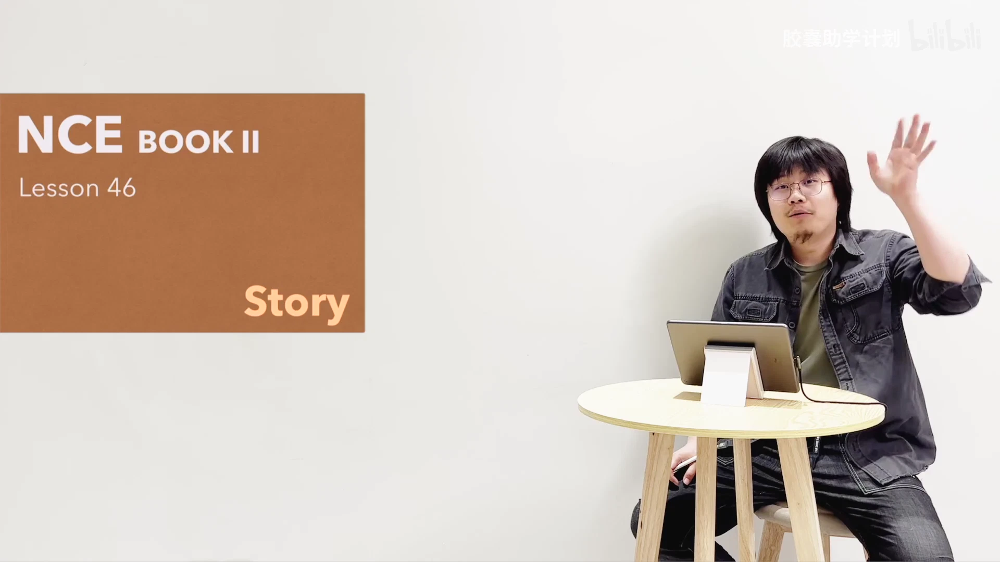

文字识别：NCE / BOOKⅡI / Lesson 46 / Story

### 画面 00:00:02

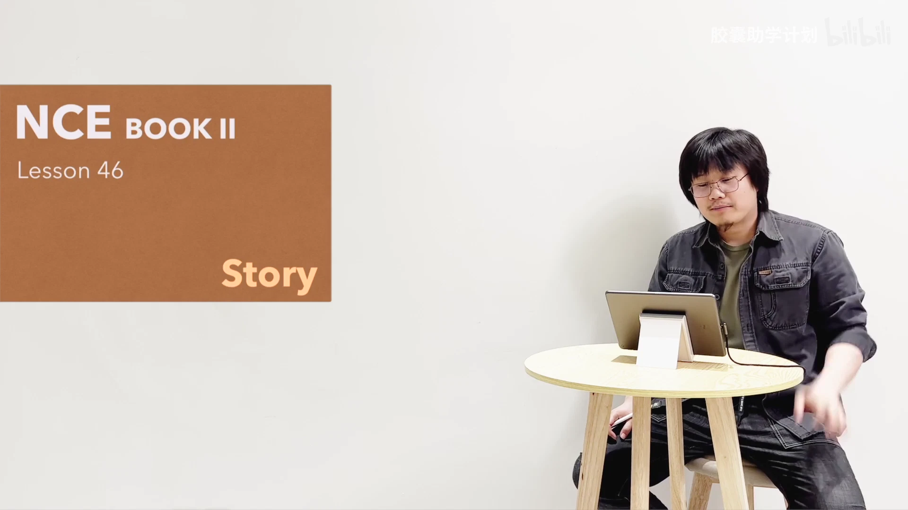

文字识别：NCE / BOOKII / Lesson 46 / Story

### 画面 00:00:05

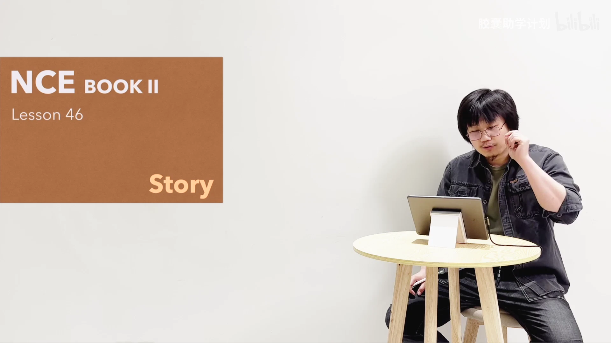

文字识别：NCE / BOOKⅡI / Lesson 46 / Story

### 画面 00:00:10

文字识别：胶囊助学计划bill

### 画面 00:00:14

### 画面 00:00:16

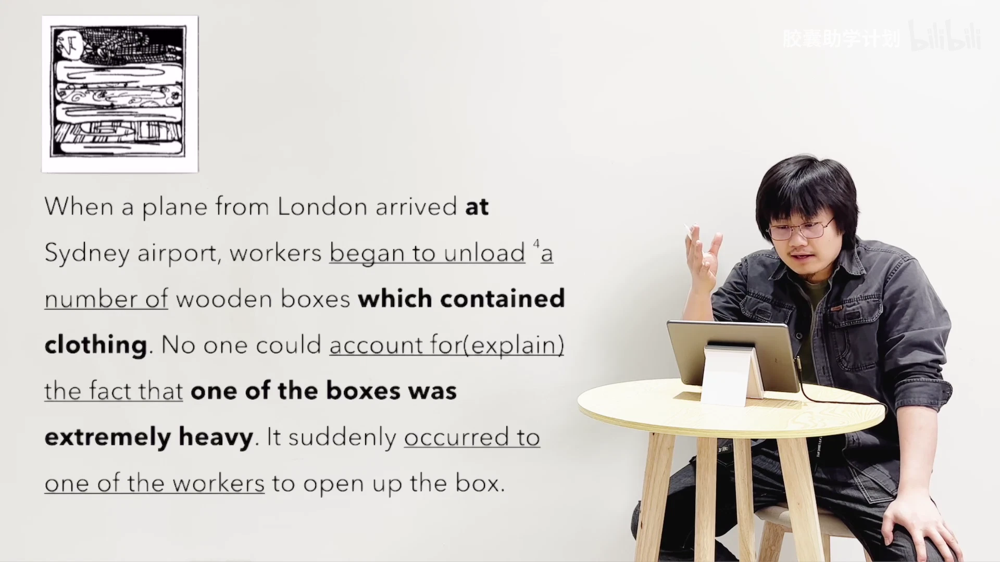

文字识别：When a plane from London arrived at / Sydney airport, workers began to unload 'a / number of wooden boxes which contained / clothing. No one could account for(explain) / the fact that one of the boxes was / extremely heavy.Ilt suddenly occurred to / one of the workers to open up the box.

### 画面 00:00:27

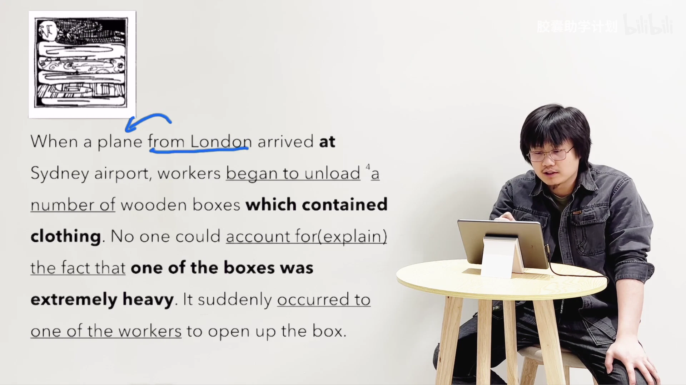

文字识别：When a plane from London arrived at / Sydney airport, workers began to unload 'a / number of wooden boxes which contained / clothing. No one could account for(explain) / the fact that one of the boxes was / extremely heavy. It suddenly occurred to / one of the workers to open up the box.

## 00:00:30–00:01:00

咱们学过啊。当一个来自于伦敦的飞机 arrived at Sydney Airport 到达悉尼机场的时候，注意一个小点，到达机场一般用的这个小的短语叫 arrive at Sydney Airport。OK， workers 工人们 began to do something 开始做某件事情之前学过， began to unload 开始去卸什么呢？A number of wooden boxes 开始去卸了。A number of 第四课

### 画面 00:00:57

文字识别：When a plane from Londonarrived at / Sydney airpor workers began to unload 'a / number of wooden boxes which contained / clothing. No one could account for(explain) / the fact that one of the boxes was / extremely heavy.Ilt suddenly occurred to / one of the workers to open up the box.

## 00:01:00–00:01:30

咱们学过，第四课咱们学的是a great number of啊，对吧？大量的啊，number of就是一堆啊，一一系列的。嗯，呃，a lot of是吧？Wooden boxes，木质的箱子，后边一个非常典型的定语从句叫which contained clothing，是吧？这个箱子里面包含了衣服。哎，注意一个点，我们之前不是刚刚上一个视频讲了同位语从句和定语从句的区

### 画面 00:01:27

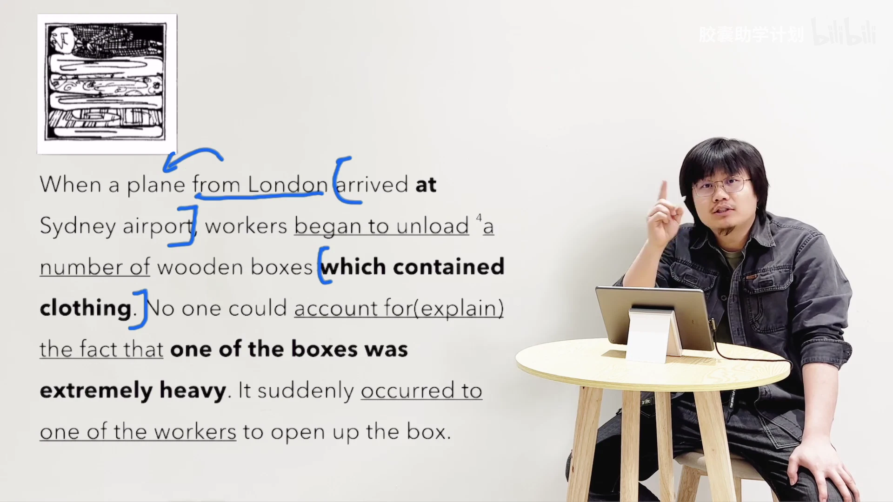

文字识别：When a plane from London arrived at / Sydney airpor workers began to unload 'a / number of wooden boxesWhich contained / clothing, No one could account forlexplain) / the fact that one of the boxes was / extremely heavy. It suddenly occurred to / one of the workers to open up the box.

## 00:01:30–00:02:00

别嘛？那我们现在区分一下。我当时讲了，首先你看 boxes 叫箱子，它不是抽象名词，对吧？其次后边这句话叫 which contained clothing，缺句子，缺句子成分。你把 which 去掉了， contained clothing 叫做包含衣服，什么包含衣服？对吧？你看缺了个主语，所以它就是定语从句，叫做包含了衣服的一些木质的箱子。

### 画面 00:01:45

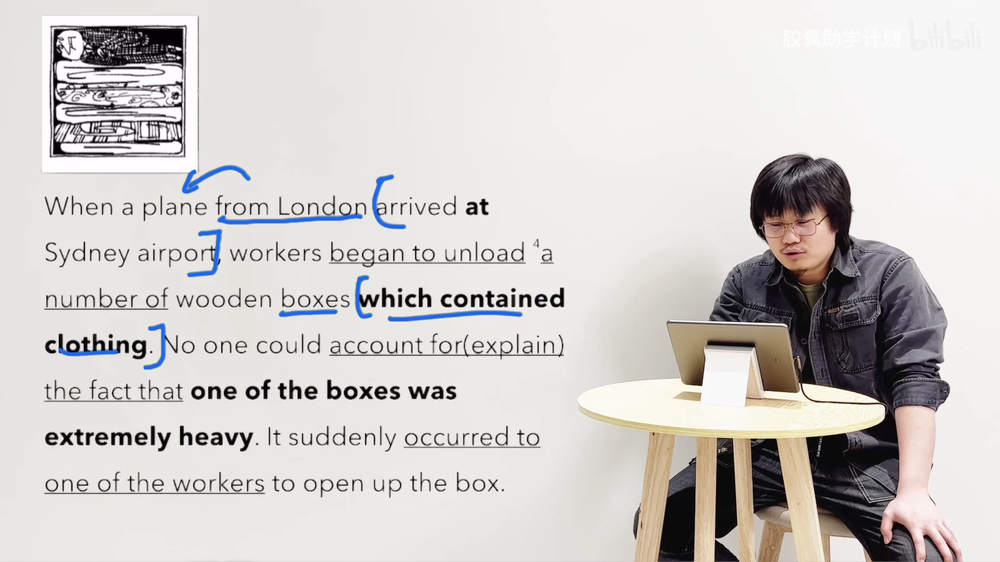

文字识别：When a plane from London arrived at / Sydney airpor workers began to unload"a / number of wooden boxesWhich contained / clothing No one could account forlexplain) / the fact that one of the boxes was / extremely heavy. It suddenly occurred to / one of the workers to open up the box.

### 画面 00:01:59

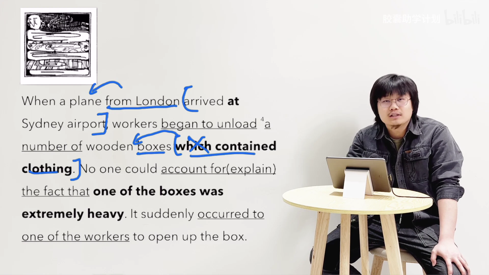

文字识别：When a plane from Londonarrived at / Sydney airpor workers began to unload 'a / number of woodenSoxes wbkh contained / clothing No one could account forlexplain) / the fact that one of the boxes was / extremely heavy. It suddenly occurred to / one of the workers to open up the box.

## 00:02:00–00:02:30

Okay, no one could could account for the fact that one of the boxes was extremely heavy.啊，这个讲上一个视频，我们讲同位语从句的时候，这句话已经分析烂了，是吧？说没有人能解释 account for。啊，我后边给你加了个 explain，告诉你 account for 在这儿的意思就是 explain。啊，没有人能解释 the fact这样一个事实。什么事实呢？That one of the boxes was

### 画面 00:02:04

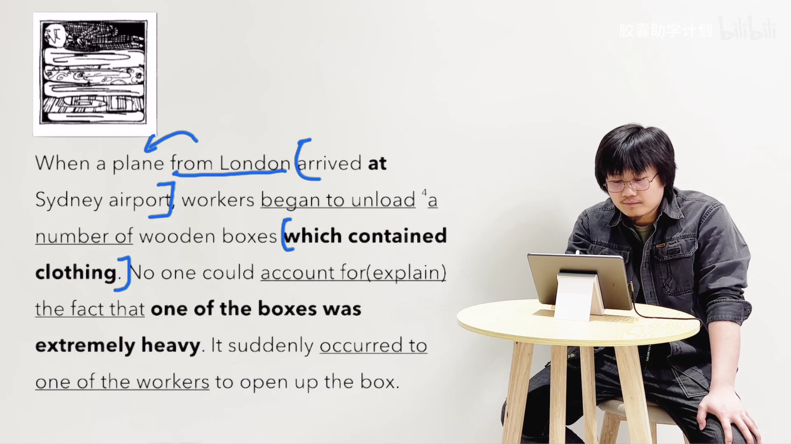

文字识别：When a plane from London arrived at / Sydney airpor workers began to unload 'a / number of wooden boxesWhich contained / clothing, No one could account forlexplain) / the fact that one of the boxes was / extremely heavy. It suddenly occurred to / one of the workers to open up the box.

### 画面 00:02:10

文字识别：When a plane from Londonarrived at / Sydney airpor workers began to unload 'a / number of wooden boxes which contained / clothingNo one could account forlexplain) / the fact that one of the boxes was / extremely heavy,lt suddenly occurred to / one of the workers to open up the box.

### 画面 00:02:17

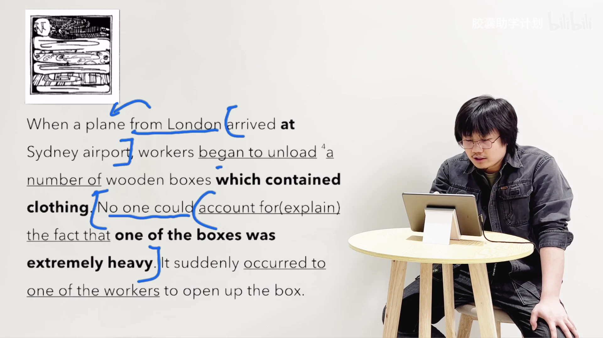

文字识别：When a plane from Londonarrived at / Sydney airpor workers began to unload 'a / number of wooden boxes which contained / the fact that one of the boxes was / extremely heavy.It suddenly occurred to / one of the workers to open up the box.

### 画面 00:02:25

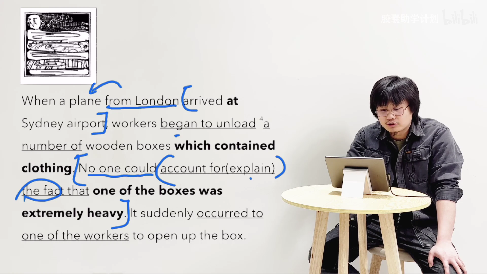

文字识别：When a plane from Londonarrived at / Sydney airpor workers began to unload'a / number of wooden boxes which contained / clothing No one could acount forlexplain) / /he faot that one of the boxes was / extremely heavy,It suddenly occurred to / one of the workers to open up the box.

## 00:02:30–00:03:00

was extremely heavy. Ah, say, there is one box extremely heavy. Look at this black part. Ah, look at this black part. I will remove it. One of the boxes was extremely heavy. Is there any missing sentence component? It is not missing, right? And it is the content of the abstract noun. The specific content, right? I only tell you that there is such a fact. You do not know what the fact is. The fact is that one of the boxes is extremely heavy. It

### 画面 00:02:33

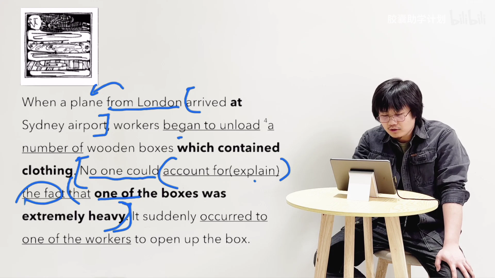

文字识别：When a plane from Londonarrived at / Sydney airpor / t workers began to unload 'a / number of wooden boxes which contained / clothingNo one couldaccount forlexplain) / /he faot that one of the boxes was / extremely heavylt suddenly occurred to / one of the workers to open up the box.

### 画面 00:02:35

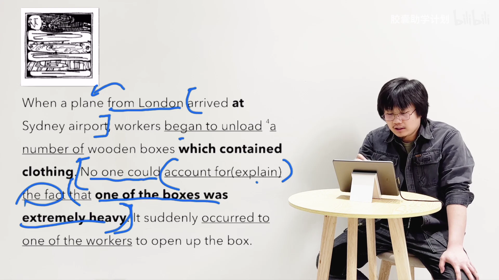

文字识别：When a plane from London / arrived at / Sydney airpor workers began to unload'a / number of wooden boxes which contained / clothingNo one couldaccount forlexplain) / /he faot that one of the boxes was / extremely heavylt suddenly occurred to / one of the workers to open up the box.

### 画面 00:02:37

文字识别：When a plane from Londonarrived at / Sydney airpor workers began to unload 'a / number of wooden boxes which contained / clothing. No one could account for(explain) / the fact that one of the boxes was / extremely heavy. It suddenly occurred to / one of the workers to open up the box.

### 画面 00:02:39

文字识别：When a plane from London arrived at / Sydney airpor workers began to unload'a / number of wooden boxes which contained / ttaa / clothing. No one could account for(explain) / the fact that one of the boxes was / extremely heavy.Ilt suddenly occurred to / one of the workers to open up the box.

### 画面 00:02:49

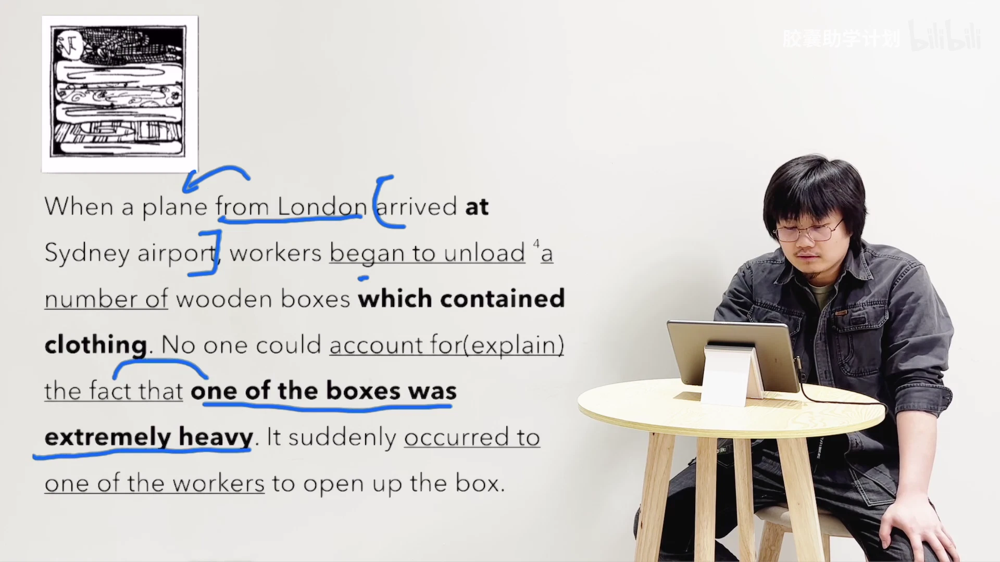

文字识别：When a plane from Londonarrived at / Sydney airpor workers began to unload 'a / number of wooden boxes which contained / clothing. No one could account for(explain) / the fact that one of the boxes was / extremely heavy. It suddenly occurred to / one of the workers to open up the box.

### 画面 00:02:52

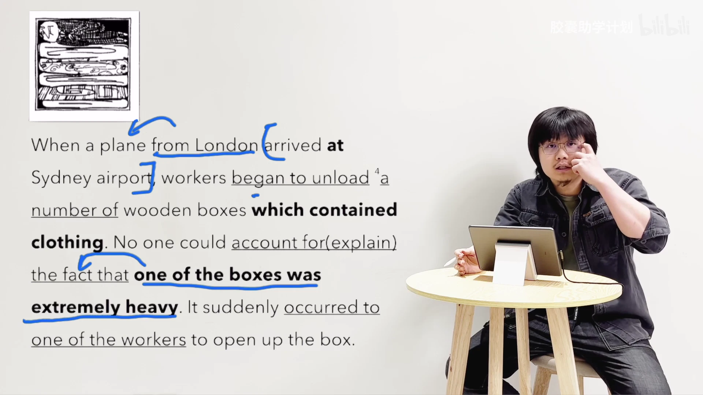

文字识别：When a plane from Londonarrived at / Sydney airpor workers began to unload 'a / number of wooden boxes which contained / clothing. No one could account for(explain) / the fact that one of the boxes was / extremely heavy. It suddenly occurred to / one of the workers to open up the box.

## 00:03:00–00:03:30

It suddenly occurred to one of the workers. 哎，其实这个 suddenly 某某种程度上有一点点多余了，因为 occur 你去查它的时候，它就是 suddenly，它本身就带了一个 suddenly 的潜台词，对吧？但是我们说话不完全符合逻辑，是吧？也无所谓了。Suddenly occurred to one of the workers. 就是有一个工人突然间想到了这样一件事儿，叫做 to open up the box.

### 画面 00:03:00

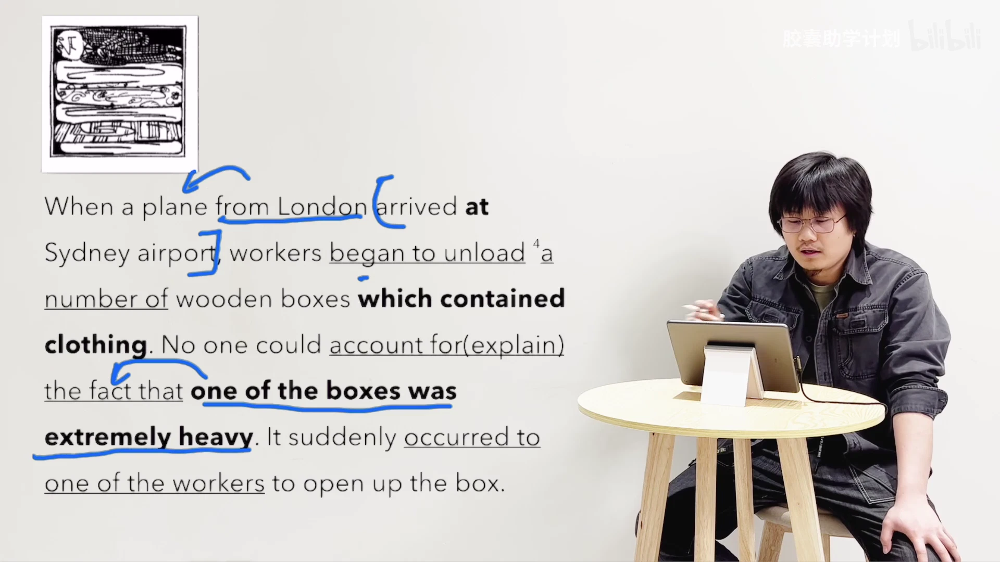

文字识别：When a plane from London arrived at / Sydney airpor workers began to unload 'a / number of wooden boxes which contained / clothing. No one could account for(explain) / the fact that one of the boxes was / extremely heavy. It suddenly occurred to / one of the workers to open up the box.

### 画面 00:03:08

文字识别：When a plane from Londonarrived at / Sydney airpor workers began to unload 'a / number of wooden boxes which contained / clothing. No one could account for(explain) / the fact that one of the boxes was / extremely heavy. It suddenly occurred to / one of the workers to open up the box.

### 画面 00:03:21

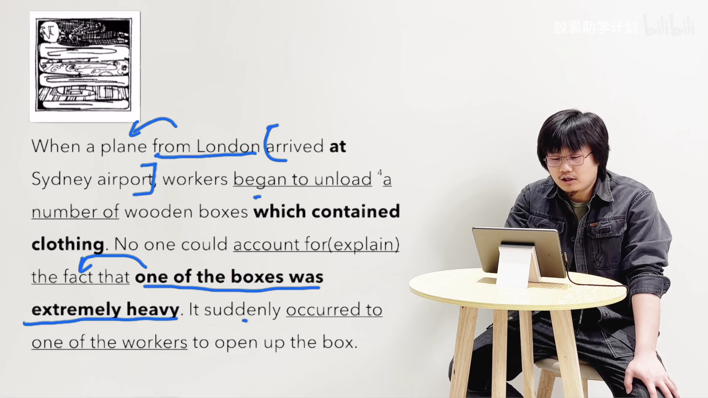

文字识别：When a plane from Londonarrived at / Sydney airpor workers began to unload 'a / number of wooden boxes which contained / clothing. No one could account for(explain) / the fact that one of the boxes was / extremely heavy. It suddenly occurred to / one of the workers to open up the box.

### 画面 00:03:26

文字识别：When a plane from London arrived at / Sydney airpor workers began to unload'a / number of wooden boxes which contained / clothing. No one could account for(explain) / the fact that one of the boxes was / extremely heavy. It suddenly occurred to / one of the workers to open up the box.

## 00:03:30–00:04:00

哎, occur to somebody to do something, 他想到然后去开开了这个箱子. He was astonished at, 他震惊于的是，先不看后面，震惊于的是 what he found. 这句话如果你把 what 翻译成什么，不特别能翻译的通。比如说他震惊于他发现了什么，不对吧？你

### 画面 00:03:37

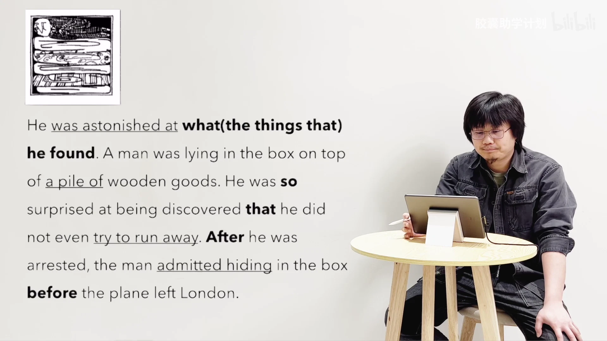

文字识别：He was astonished at what(the things that) / he found. A man was lying in the box on top / of a pile of wooden goods. He was so / surprised at being discovered that he did / not even try to run away. After he was / arrested, the man admitted hiding in the box / before the plane left London.

### 画面 00:03:44

文字识别：He was astonished at what / he found. A man was lying in the box on top / of a pile of wooden goods. He was so / surprised at being discovered that he did / not even try to run away. After he was / arrested, the man admitted hiding in the box / before the plane left London.

### 画面 00:03:46

文字识别：He Was astonished at what / he found. A man was lying in the box on top / of a pile of wooden goods. He was so / surprised at being discovered that he did / not even try to run away. After he was / arrested, the man admitted hiding in the box / before the plane left London.

### 画面 00:03:48

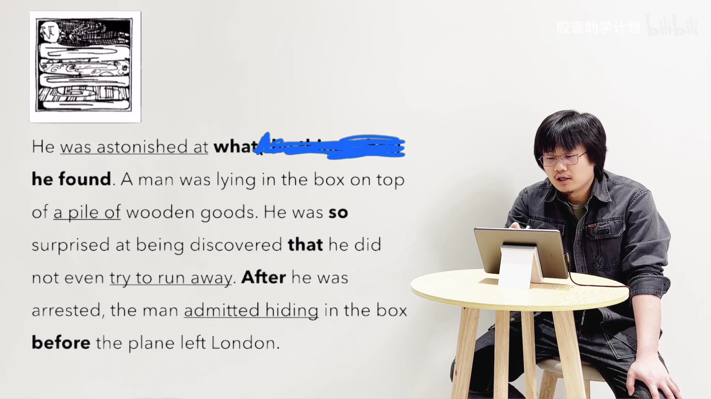

文字识别：He was astonished at what / he found. A man was lying in the box on top / of a pile of wooden goods. He was so / surprised at being discovered that he did / not even try to run away. After he was / arrested, the man admitted hiding in the box / before the plane left London.

## 00:04:00–00:04:30

看，你一般舒舒服的这句话叫他震惊于他发现了一只猫，他震惊于他发现了一条狗，对吧？一般都是个具体的东西。他现在如果 word 翻译成什么，大家最熟悉的 word 就是翻译成什么嘛，对吧？那叫做他震惊于他发现了什么。我我想问的问题就是他震惊于他发现了什么东西，对吧？你告诉我他震惊于他发现了什么，这句话是不通的汉语，对不对？所以这里的 word 并不翻

### 画面 00:04:01

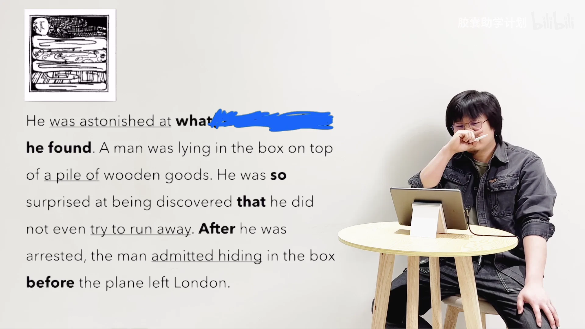

文字识别：He Was astonished at what / he found. A man was lying in the box on top / of a pile of wooden goods. He was so / surprised at being discovered that he did / not even try to run away. After he was / arrested, the man admitted hiding in the box / before the plane left London.

### 画面 00:04:03

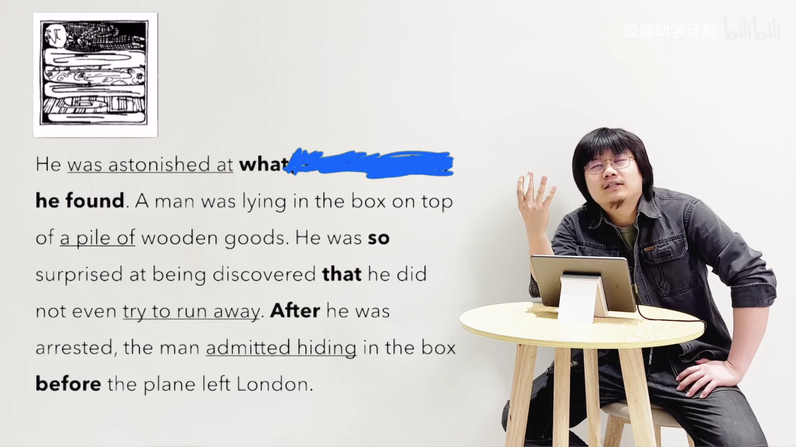

文字识别：He Was astonished at what / he found. A man was lying in the box on top / of a pile of wooden goods. He was so / surprised at being discovered that he did / not even try to run away. After he was / arrested, the man admitted hiding in the box / before the plane left London.

### 画面 00:04:12

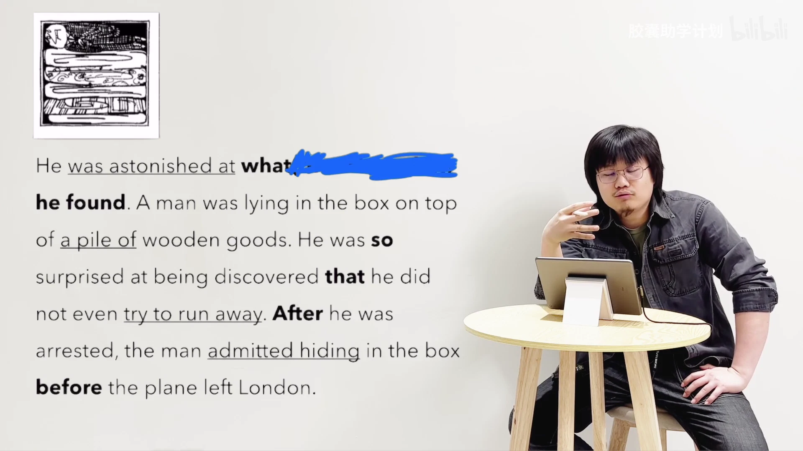

文字识别：He was astonished at what / he found. A man was lying in the box on top / of a pile of wooden goods. He was so / surprised at being discovered that he did / not even try to run away. After he was / arrested, the man admitted hiding in the box / before the plane left London.

### 画面 00:04:29

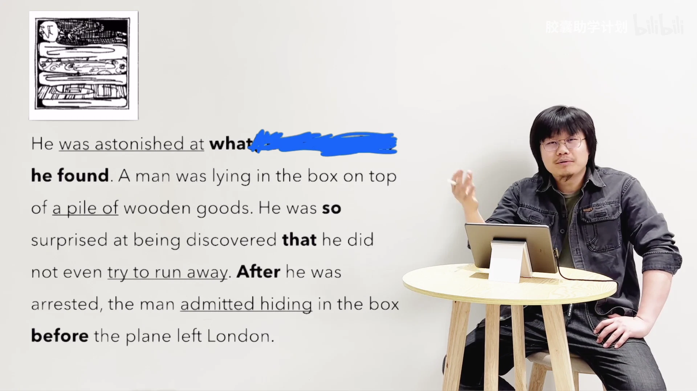

文字识别：He Was astonished at what / he found. A man was lying in the box on top / of a pile of wooden goods. He was so / surprised at being discovered that he did / not even try to run away. After he was / arrested, the man admitted hiding in the box / before the plane left London.

## 00:04:30–00:05:00

译成发现了什么，他发现他翻译的是，这是我们全书到目前为止第一次见到这个用法。这里的 what 往往就会被拆解成这样，叫做 the things that，或者是单数 the thing that。一会儿我们会具体讲解这个语法。比如说 he was astonished at what，这里变成了叫 the things that。那我们就不管 what 了，叫做 he was astonished at the things。他震惊于这些东

### 画面 00:04:31

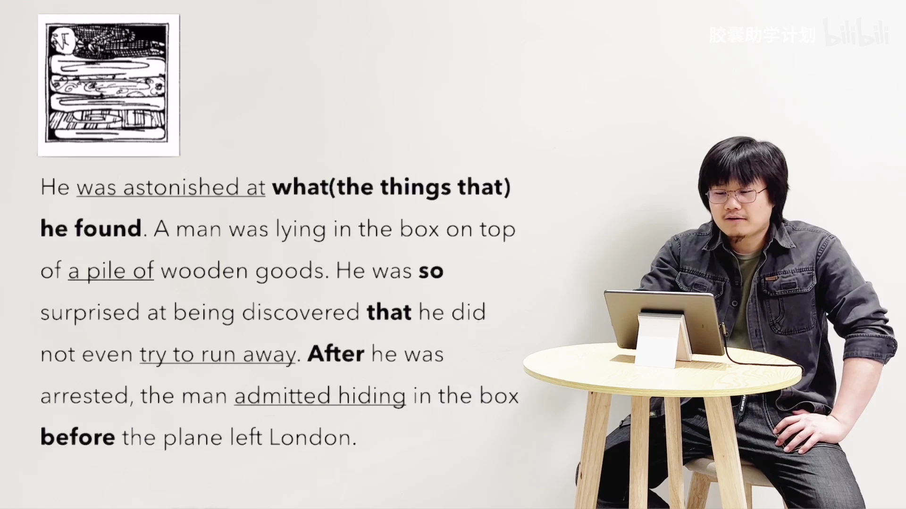

文字识别：He was astonished at what(the things that) / he found. A man was lying in the box on top / of a pile of wooden goods. He was so / surprised at being discovered that he did / not even try to run away. After he was / arrested, the man admitted hiding in the box / before the plane left London.

### 画面 00:04:34

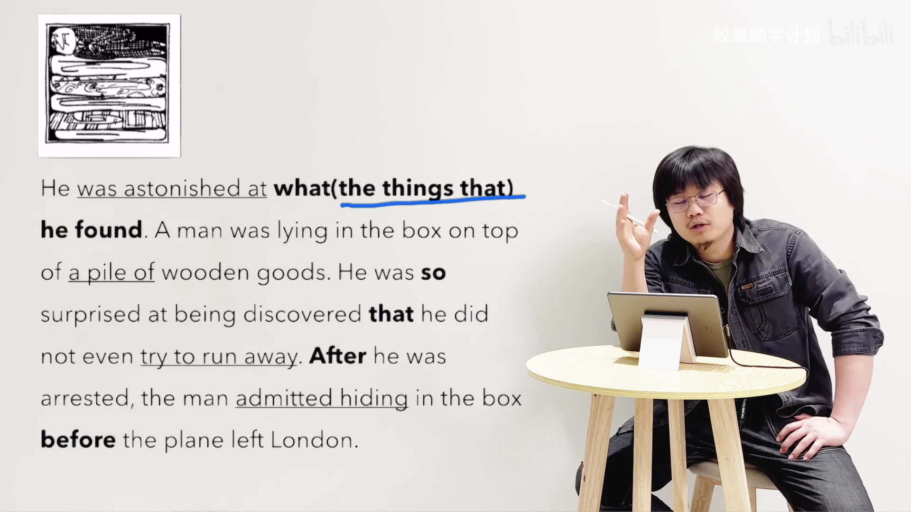

文字识别：He Was astonished at what(the things that) / he found. A man was lying in the box on top / of a pile of wooden goods. He was so / surprised at being discovered that he did / not even try to run away. After he was / arrested, the man admitted hiding in the box / before the plane left London.

### 画面 00:04:38

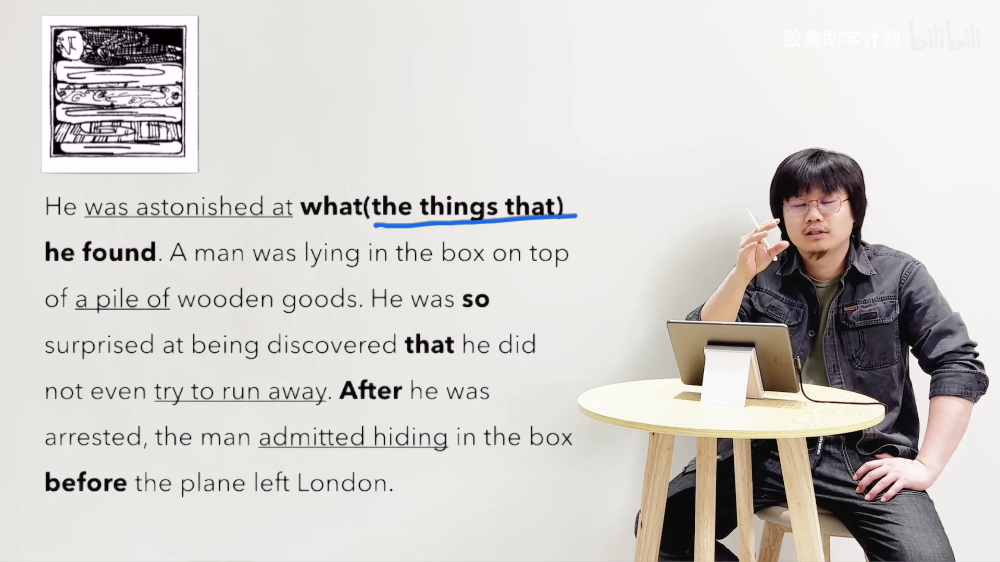

文字识别：He Was astonished at what(the things that) / he found. A man was lying in the box on top / of a pile of wooden goods. He was so / surprised at being discovered that he did / not even try to run away. After he was / arrested, the man admitted hiding in the box / before the plane left London.

### 画面 00:04:40

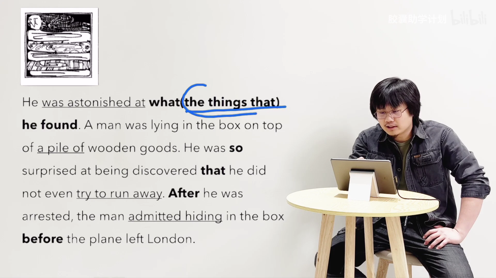

文字识别：He Was astonished at what(the things that) / he found. A man was lying in the box on top / of a pile of wooden goods. He was so / surprised at being discovered that he did / not even try to run away. After he was / arrested, the man admitted hiding in the box / before the plane left London.

### 画面 00:04:42

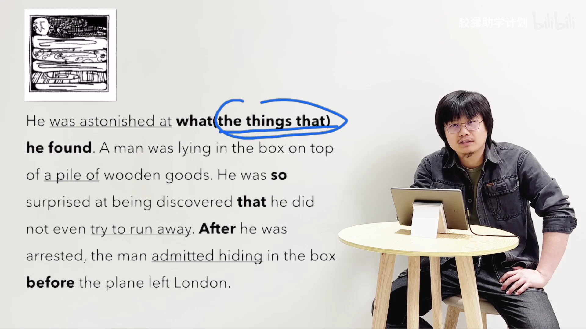

文字识别：He Was astonished at what(the things that) / he found. A man was lying in the box on top / of a pile of wooden goods. He was so / surprised at being discovered that he did / not even try to run away. After he was / arrested, the man admitted hiding in the box / before the plane left London.

## 00:05:00–00:05:30

西，什么东西呢？ That he found. 其实后面被拆成了一个定语从句，叫做他发现的那些东西。他震惊于的是他发现的那些东西。你看这句话翻译的就通了，对吧？好，我在这儿只是简单说了一下，一会儿文章讲完，我们再这个详细的讲解一下，好吧？继续。 A man was lying. 哎，他正在躺着。 In the box. 在这个箱子里面。 On

### 画面 00:05:12

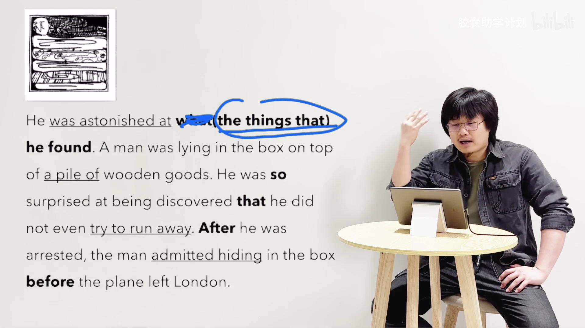

文字识别：He was astonished at / (the things that) / he found. A man was lying in the box on top / of a pile of wooden goods. He was so / surprised at being discovered that he did / not even try to run away. After he was / arrested, the man admitted hiding in the box / before the plane left London.

## 00:05:30–00:06:00

top of在什么什么的上方，什么上方呢？A pile of wooden goods啊，在呃这个应该是uln goods啊，应该是uln goods，w o o l l e n啊，说在一堆的羊毛产品的上方啊。He was so surprised，他是如此的震惊于at being discovered。好，这里是有一点点

### 画面 00:05:31

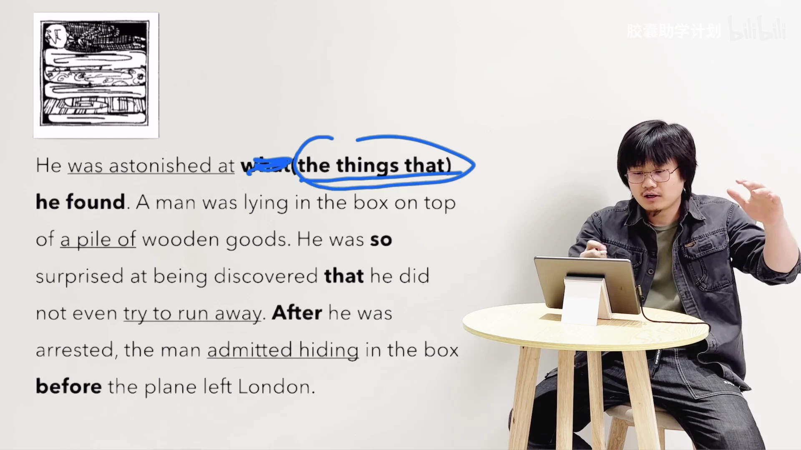

文字识别：He was astonished at / (the things that) / he found. A man was lying in the box on top / of a pile of wooden goods. He was so / surprised at being discovered that he did / not even try to run away. After he was / arrested, the man admitted hiding in the box / before the plane left London.

### 画面 00:05:40

文字识别：He was astonished at / e(the things that) / he found. A man was lying in the box on top / of a pile of wooden goods. He was so / surprised at being discovered that he did / not even try to run away. After he was / arrested, the man admitted hiding in the box / before the plane left London.

### 画面 00:05:43

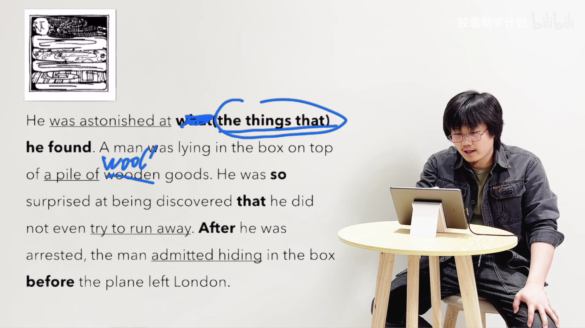

文字识别：He was astonished at / e(the things that) / he found. A manyas lying in the box on top / wool / of a pile of / wooden goods. He was so / surprised at being discovered that he did / not even try to run away. After he was / arrested, the man admitted hiding in the box / before the plane left London.

### 画面 00:05:45

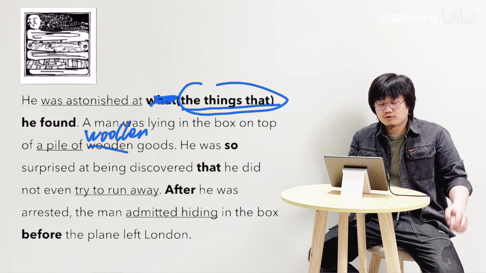

文字识别：He was astonished at  / (the things that) / of a pile of / wooden goods. He was so / surprised at being discovered that he did / not even try to run away. After he was / arrested, the man admitted hiding in the box / before the plane left London.

### 画面 00:05:59

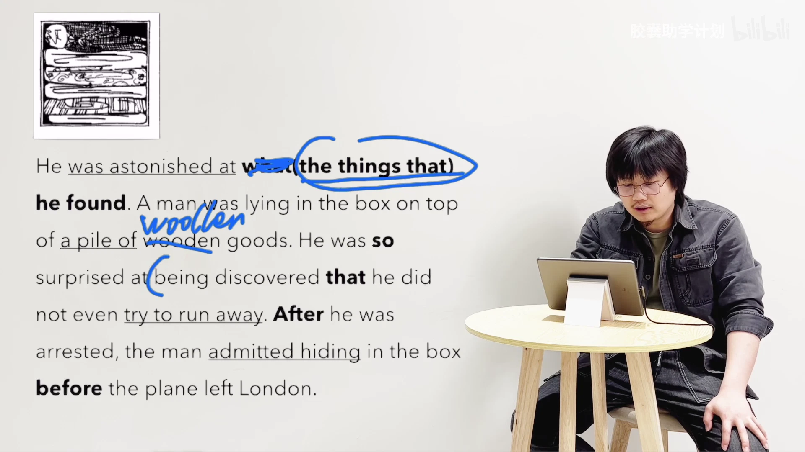

文字识别：He was astonished at / (the things that) / of a pile of / wooden goods. He was so / surprised at being discovered that he did / not even try to run away. After he was / arrested, the man admitted hiding in the box / before the plane left London.

## 00:06:00–00:06:30

超纲的小语法，我们暂时先不管它，先看一下 so that。这里想提醒各位，叫做它是如此的怎么怎？新概念二册三十五课咱们学的 so 点点点 that 对吧？它是如此的惊讶，以至于后边后边怎么样？我们先不管它啊，我们再看一下这里，再看一下这里，它是如此的震惊、惊讶、

### 画面 00:06:04

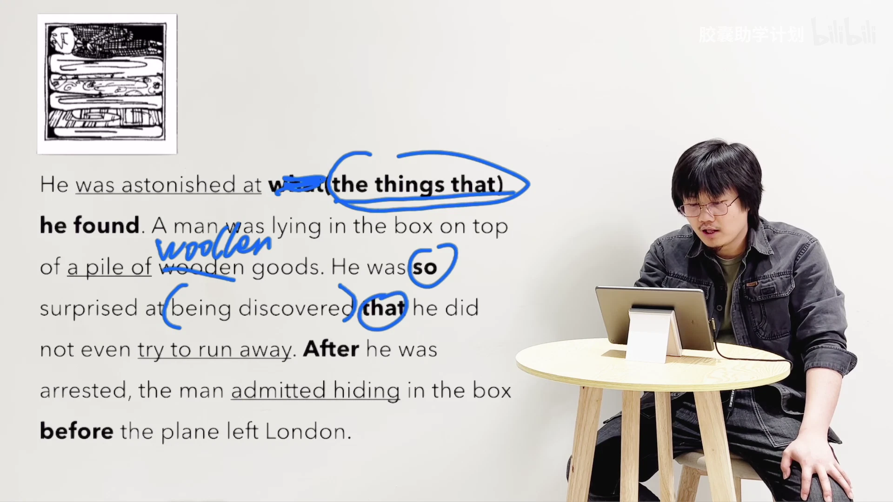

文字识别：He was astonished at / (the things that) / of a pile of / wooden goods. He wasl / so / surprised atbeing discovered / chathe did / not even try to run away. After he was / arrested, the man admitted hiding in the box / before the plane left London.

### 画面 00:06:22

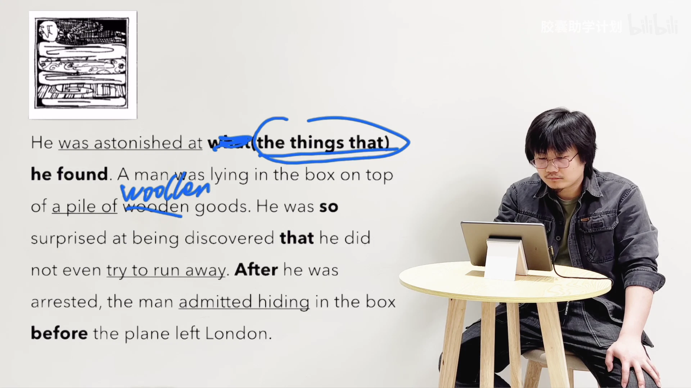

文字识别：He was astonished at / (the things that) / of a pile of / wooden goods. He was so / surprised at being discovered that he did / not even try to run away. After he was / arrested, the man admitted hiding in the box / before the plane left London.

### 画面 00:06:24

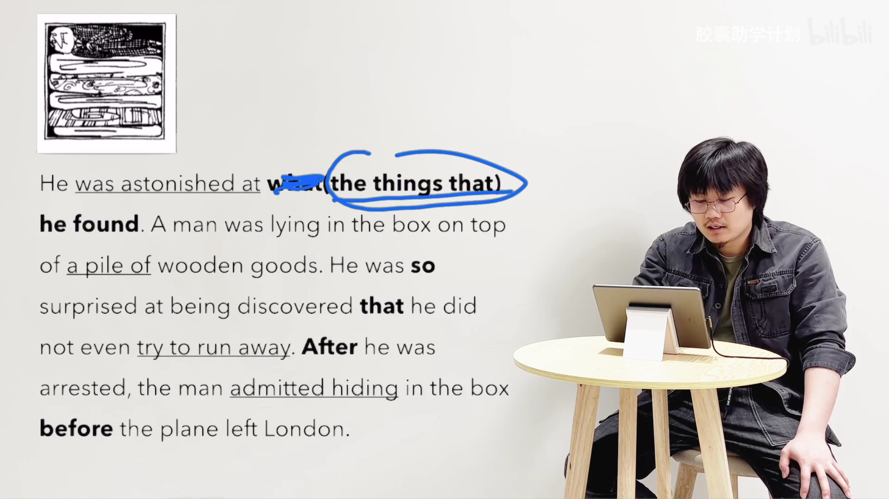

文字识别：He was astonished at / (the things that) / he found. A man was lying in the box on top / of a pile of wooden goods. He was so / surprised at being discovered that he did / not even try to run away. After he was / arrested, the man admitted hiding in the box / before the plane left London.

## 00:06:30–00:07:00

惊讶于什么事儿呢？Being discovered，这个我们真的是第一次见，但今天确实讲不了，今天只能以非常简单粗暴的方式告诉各位，看啊，被动基本的结构叫 be 加 done，对不对？这是一个非谓语，其实被动叫 be 加 done，对不对？这里是 being done，这里是个介词，介词后边如果是被动的，必须得叫做 being done，

### 画面 00:06:35

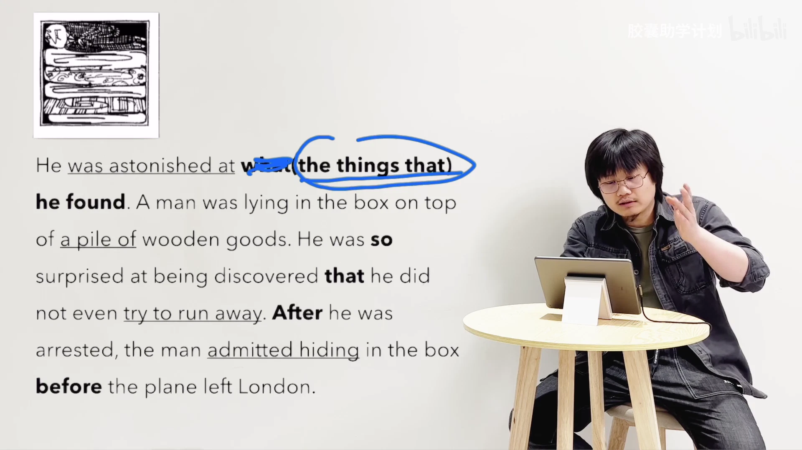

文字识别：He was astonished at / (the things that) / he found. A man was lying in the box on top / of a pile of wooden goods. He was so / surprised at being discovered that he did / not even try to run away. After he was / arrested, the man admitted hiding in the box / before the plane left London.

### 画面 00:06:44

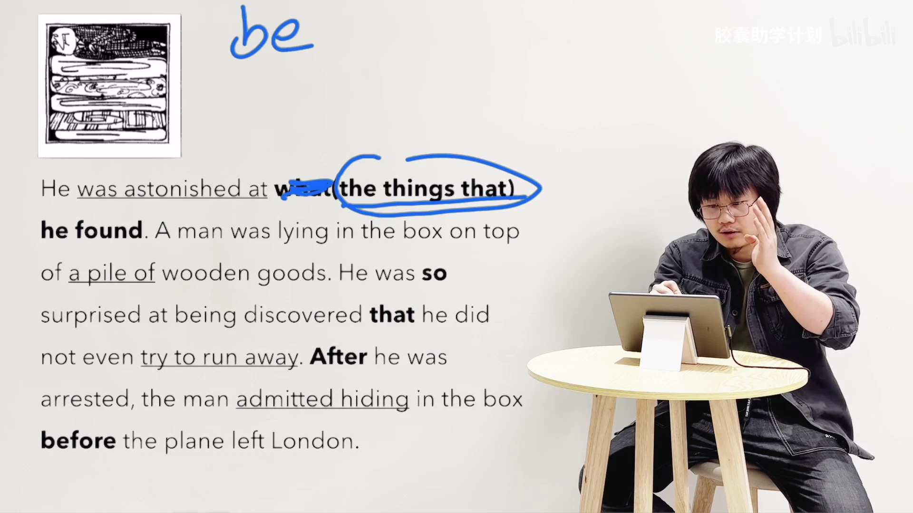

文字识别：be / C / He was astonished at  / r(the things that) / he found. A man was lying in the box on top / of a pile of wooden goods. He was so / surprised at being discovered that he did / not even try to run away. After he was / arrested, the man admitted hiding in the box / before the plane left London.

### 画面 00:06:46

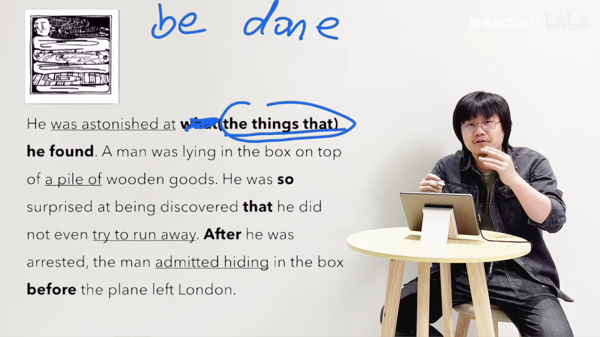

文字识别：be / dme / He was astonished at / (the things that) / he found. A man was lying in the box on top / of a pile of wooden goods. He was so / surprised at being discovered that he did / not even try to run away. After he was / arrested, the man admitted hiding in the box / before the plane left London.

### 画面 00:06:53

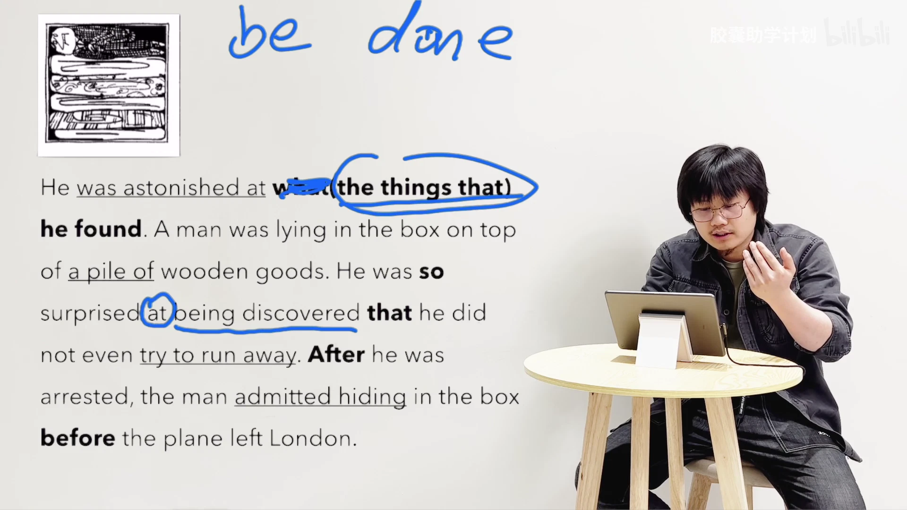

文字识别：be / dme / He was astonished at / (the things that) / he found. A man was lying in the box on top / of a pile of wooden goods. He was so / surprisedatbeing discovered that he did / not even try to run away. After he was / arrested, the man admitted hiding in the box / before the plane left London.

### 画面 00:06:56

文字识别：be / dme / He was astonished at  / (the things that) / he found. A man was lying in the box on top / of a pile of wooden goods. He was so / surprisedatbeing discovered that he did / not even try to run away. After he was / arrested, the man admitted hiding in the box / before the plane left London.

### 画面 00:06:59

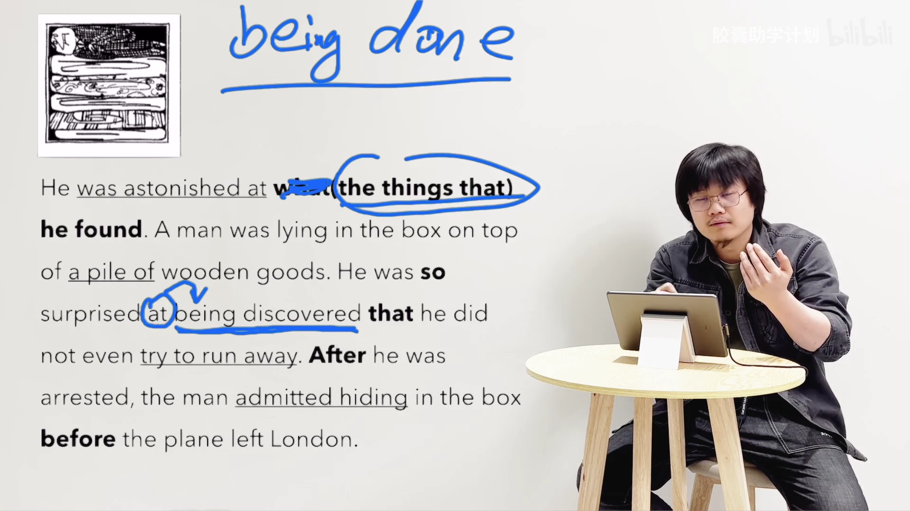

文字识别：beig / done / He was astonished at / (the things that) / he found. A man was lying in the box on top / of a pile of wooden goods. He was so / surprisedatbeing discovered that he did / not even try to run away. After he was / arrested, the man admitted hiding in the box / before the plane left London.

## 00:07:00–00:07:30

所以你现在只要知道它是被动，这事儿咱今天就结了。叫做 he was so surprised at being discovered，叫做他如此的惊讶于被发现了，以至于 that he did not even try to run away，他甚至都没有尝试着去跑。 After he was arrested，一个很小的被动，叫在他被逮捕之后，

### 画面 00:07:09

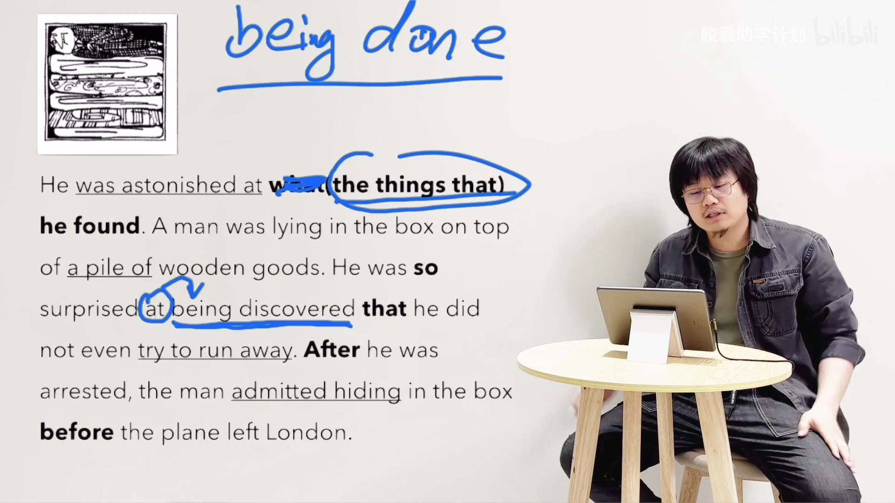

文字识别：beig / done / He was astonished at / (the things that) / he found. A man was lying in the box on top / of a pile of wooden goods. He was so / surprisedlatbeing discovered that he did / not even try to run away. After he was / arrested, the man admitted hiding in the box / before the plane left London.

### 画面 00:07:16

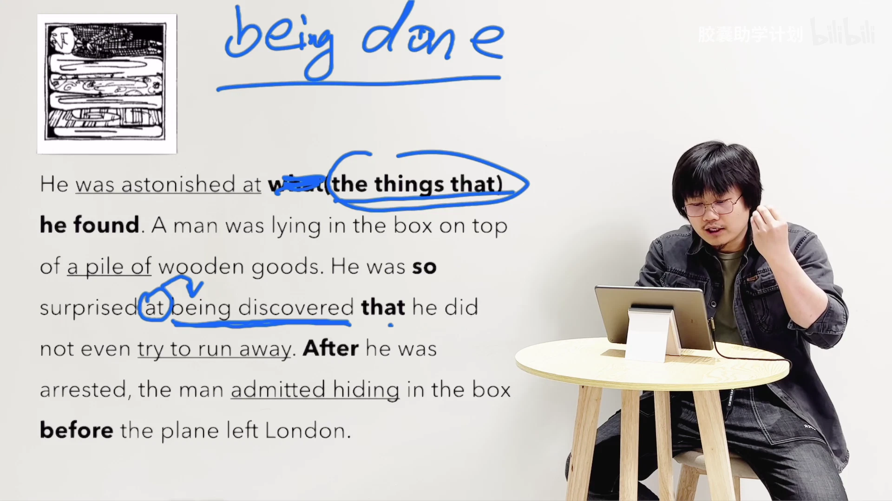

文字识别：beiy / done / He was astonished at / (the things that) / he found. A man was lying in the box on top / of a pile of wooden goods. He was so / surprisedat being discovered that he did / not even try to run away. After he was / arrested, the man admitted hiding in the box / before the plane left London.

## 00:07:30–00:08:00

一件事情发生了，叫 the man admitted hiding in the box. 他承认了待在呃藏在这个箱子里面。 Before the plane left London, 在飞机离开伦敦之前，哎，也就是这句话再翻译，从 after 一直到伦敦啊，来来 London 啊，在他被逮捕之后，这个男人承认了藏在箱子里面，在什么呢？

### 画面 00:07:46

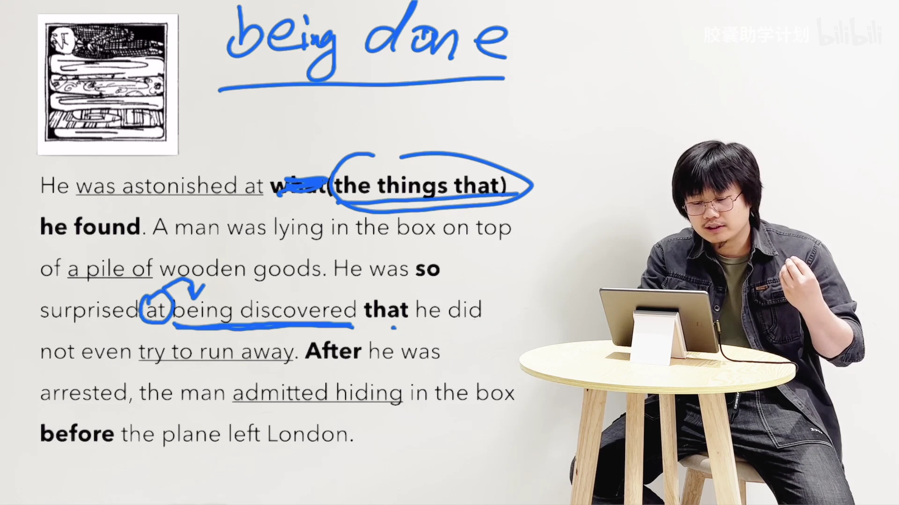

文字识别：beiyg / done / He was astonished at / (the things that) / he found. A man was lying in the box on top / of a pile of wooden goods. He was so / surprisedatbeing discovered that he did / not even try to run away. After he was / arrested, the man admitted hiding in the box / before the plane left London.

### 画面 00:07:52

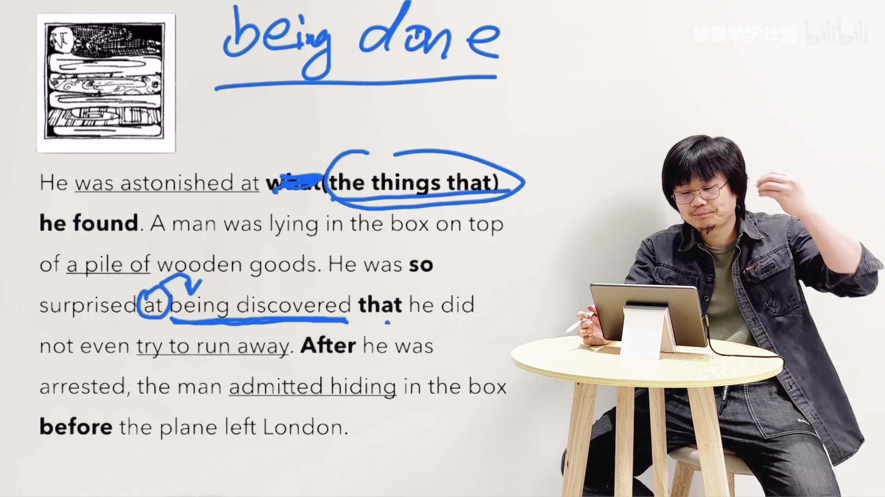

文字识别：beig / done / He was astonished at / (the things that) / he found. A man was lying in the box on top / of a pile of wooden goods. He was so / surprisedatbeing discovered that he did / not even try to run away. After he was / arrested, the man admitted hiding in the box / before the plane left London.

### 画面 00:07:54

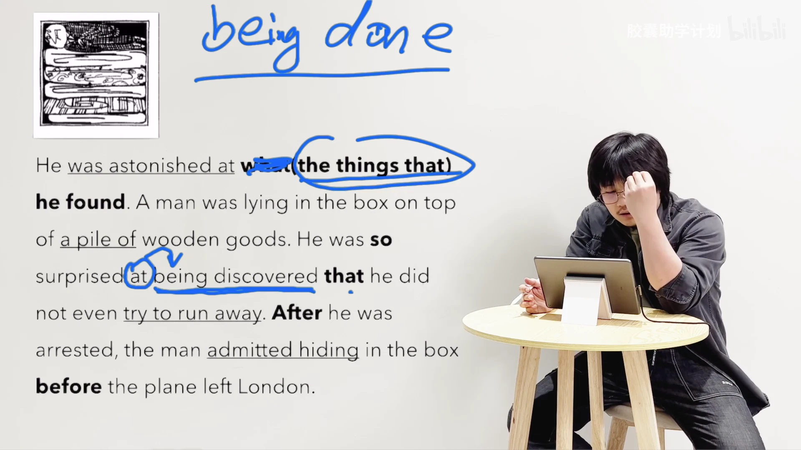

文字识别：beiy / done / He was astonished at / (the things that) / he found. A man was lying in the box on top / of a pile of wooden goods. He was so / surprisedatbeing discovered that he did / not even try to run away. After he was / arrested, the man admitted hiding in the box / before the plane left London.

## 00:08:00–00:08:30

在飞机离开伦敦之前就藏进去了，对吧？Okay,最后一段. He had had a long and uncomfortable trip.你看，comfortable你学过，uncomfortable，这不就手到擒来吗？不舒适的，他有他之前有一个很长并且很不舒适的trip，这个旅行。因为for我们这是第二次见他了，对吧？

### 画面 00:08:04

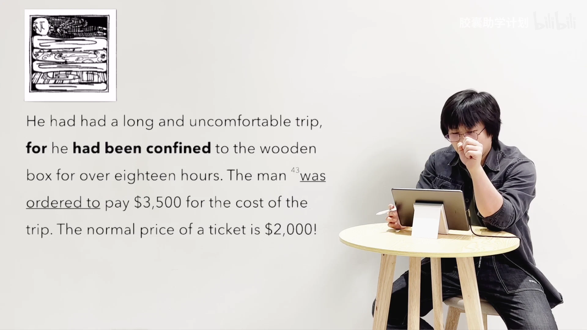

文字识别：He had had a long and uncomfortable trip, / for he had been confined to the wooden / box for over eighteen hours. The man "was / ordered to pay $3,500 for the cost of the / trip. The normal price of a ticket is $2,000!

### 画面 00:08:16

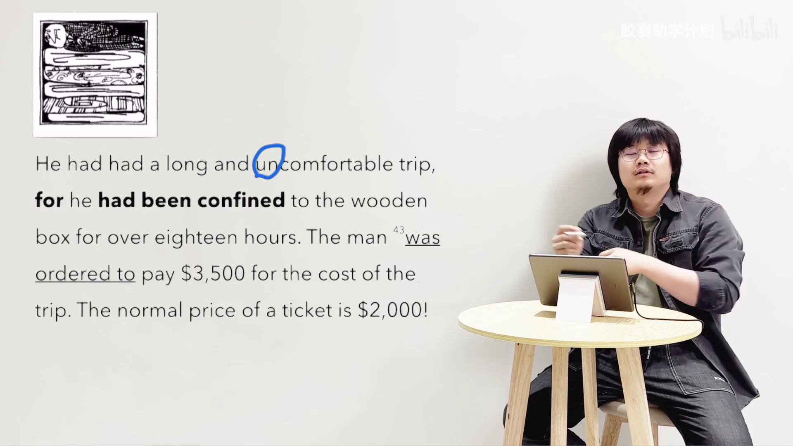

文字识别：He had had a long and / Dcomfortable trip, / for he had been confined to the wooden / box for over eighteen hours. The man “was / ordered to pay $3,500 for the cost of the / trip. The normal price of a ticket is $2,000!

### 画面 00:08:21

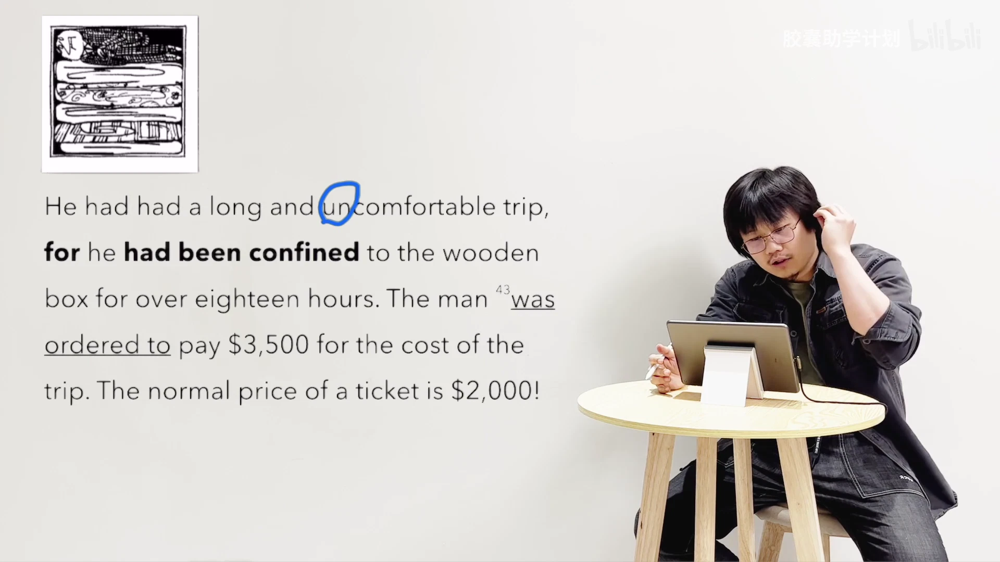

文字识别：He had had a long and / comfortable trip, / for he had been confined to the wooden / box for over eighteen hours.The man "was / ordered to pay $3,500 for the cost of the / trip. The normal price of a ticket is $2,000!

### 画面 00:08:27

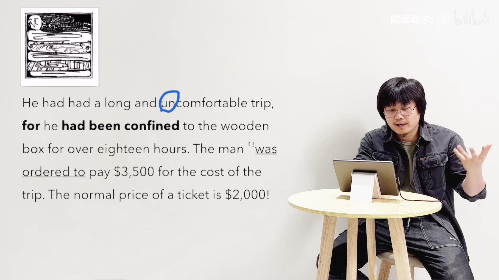

文字识别：He had had a long and / Zomfortable trip, / for he had been confined to the wooden / box for over eighteen hours. The man "was / ordered to pay $3,500 for the cost of the / trip. The normal price of a ticket is $2,000!

## 00:08:30–00:09:00

He yeah,就类似于因为啊，跟because类似。He had been confined to the wooden box.说他之前一直都被限制在了这个 wooden box 这个木质的箱子里面 for over eighteen hours. 超过了十八个小时。The man was ordered to pay.你看这里其实是个被动，叫做 be ordered to

### 画面 00:08:57

文字识别：He had had a long and / Domfortable trip, / for he had been confined to the wooden / box for over eighteen hours. The man “was / ordered to pay $3,500 for the cost of the / trip. The normal price of a ticket is $2,000!

## 00:09:00–00:09:30

do something. 我们四十三课学的是主动叫做 order somebody to do something. 无非就是那个 somebody 给换到主语去，就变成被动了，对吧？ The man was ordered to pay. 说这个男人被要求被命令去支付 three thousand five hundred 三千五百磅 for the cost of the trip. 为什么呢？为 A of B 结

### 画面 00:09:27

文字识别：He had had a long and / tomfortable trip, / for he had been confined to the wooden / box for over eighteen hours. The man "was / ordered to pay $3,500 for the cost of the / trip. The normal price of a ticket is $2,000!

## 00:09:30–00:10:00

构，the cost of the trip，这次航行的花费啊。然后后边一句话很讽刺，叫做the normal price of a ticket，一个票的正常价钱。A of B结构，以后往前翻译，正常价格是two thousand，是两千块钱。OK，我们刚才文章讲，文章讲完了。文章当中有一句话叫做what，我们没有

### 画面 00:09:31

文字识别：He had had a long and / Domfortable trip, / for he had been confined to the wooden / box for over eighteen hours. The man "was / ordered to pay $3,500 for the cost of the / trip. The normal price of a ticket is $2,000!

### 画面 00:09:43

文字识别：He had had a long and / comfortable trip, / for he had been confined to the wooden / 43 / was / ordered to pay $3, 500 for the cOst of the / trip. The normal price of a ticket is $2,000!

### 画面 00:09:51

文字识别：He had had a long and / omfortable trip, / for he had been confined to the wooden / 43 / was / ordered to pay $3,500 for the cost of the / trip. The normal price of a ticket is $2,000!

### 画面 00:09:53

### 画面 00:09:59

文字识别：what 不翻译成"什么"(疑问/陈述)= the thing that/ the person that..

## 00:10:00–00:10:30

把它翻译成什么，对吧？而是给它翻译成了叫 the thing that，或者是 the person that。文章当中用的是 the thing that，对吧？好，我给大家一些例子啊。我们先不管这个疑问陈述啊，这儿先暂时不管它。我们看这儿叫做 she is not。我们先不管这儿原文叫做 what she used to be。你看，她不是她曾经是什么？你这句话根本就翻译不通，对不对？

### 画面 00:10:28

文字识别：what不翻译成"什么”（ / 経コた术 / ) = the thing that / the person that... / 规何际述 / She is not what(the person that) she used to be.

## 00:10:30–00:11:00

根本就翻译不通。所以这里，如果当你发现你没法把它翻译成什么的时候，百分之八十以上的情况，甚至九十以上的情况都是什么啊？一会儿我给大家看。如果你发现你翻译成什么狗屁不通的时候，哎，sorry，就不通的时候，对吧？怎么办呢？你就把这个 what 给它变成 the person that 或者 the thing that。于是这句话就变成了，他不是那个人了。哪个人呢？She

### 画面 00:10:58

文字识别：what不翻译成"什么”（ / ヒマコナンボ / ) = the thing that / the person that.. / 规阿际标述 / She is not what(the person that) she used to be.

## 00:11:00–00:11:30

used to be that person, 也就变成了一个定语从句了。他不是那个人了。哪个人？他曾经是的那个人，也就是他不是他曾经是的那个人了，对吧？我变了啊！再来看一句话，Show me what you have written. 说给我看一下你刚刚写了什么？哎，你注意，你看这里的什么好像又通了，是吧？这里我可以不翻译成 the thing that。这个地方非常的。

### 画面 00:11:28

文字识别：what 不翻译成"什么"(疑问/陈述) = the thing that/ the person that. / She is not what(the person that) she used to be. / Show me what(the thing that) you have written.

## 00:11:30–00:12:00

subtle，呃，非常的这个细微。我尝试给各位讲一下啊，如果到最后我没有完成这个任务，你就记住，待我一会儿再告诉你怎么办啊。给我看一下你刚刚写了什么，这里的什么是一个陈述，因为汉语的什么这两个字，它其实有疑问，也可以表陈述。啊，给我看看你刚才写的什么，

### 画面 00:11:58

文字识别：what 不翻译成"什么'(疑问/陈述) = the thing that /the person that... / She is not what(the person that) she used to be. / Show me what(the thing that) you have written.

## 00:12:00–00:12:30

和给我看看你刚刚已经写了什么？嗯，这两句话啊，不不说这两句话，我们再换一个思路啊。比如说，就还看这句话，给我看一下你刚刚写了什么。Show me what you have written。我大概好像还能理解这个意思，翻译成汉语是OK的。它偏向于是一个陈述，而呃，我们刚才说你吃了什么？这个问

### 画面 00:12:28

文字识别：what 不翻译成"什么"(疑问/陈述)= the thing that /the personthat... / She is not what(the person that) she used to be. / Show me what(the thing that) you have written.

## 00:12:30–00:13:00

题里边的什么，它本质上是一个疑问，啊，我希望我说清楚了。所以汉语的什么有两个意思，而英语的what，它跟汉语这两个什么不是能一一对应起来的。我先这样说吧，那这样说还是有点懵哈。我那我换一个思路，如果各位翻译成什么的时候，你翻译不通，你就把它翻译成the thing that或the person that。我举个例子，

### 画面 00:12:58

文字识别：what 不翻译成"什么"(疑问/陈述)= the thing that /the personthat.. / She is not what(the person that) she used to be. / Show me what(the thing that) you have written.

## 00:13:00–00:13:30

他不是他曾经是的什么，绝对翻译不通。怎么办？给他换成 the person that，对吧？给我看看你刚才写了什么。如果你觉得这个没问题吧，对吧？汉语这样翻译是通的，没问题。巧了，这只是啊，这只是巧了。你就这样翻译也行，或者你给他翻译成叫 show me the thing，给我看看那个东西。什么东西呢？你刚刚写的那个东西，对吧？你看这两句话，其实汉语很像。给我看看你刚才写了什么，和给我看

### 画面 00:13:28

文字识别：what 不翻译成"什么"(疑问/陈述) = the thing that /the person that... / She is not what(the person that) she used to be. / Show me what(the thing that) you have written.

## 00:13:30–00:14:00

看你刚才写的那个东西，对吧？OK，再来，比如说，This is not what I mean。你看，这不是我想表达的什么，就是翻译不通的，这是对吧？汉语是没法这样说的，英语也没法这样说。所以这里的what是the thing that叫做这不是这个东西，什么东西呢？我想表达的这个东西。所以这句话就变成这不是我想表达的东西。好，再来。

### 画面 00:13:58

文字识别：what 不翻译成"什么"(疑问/陈述)= the thing that /the personthat... / She is not what(the person that) she used to be. / Show me what(the thing that) you have written. / This is not what(the thing that) I meant. / There is some truth in what(the thing that) he has just said.

## 00:14:00–00:14:30

There is some truth in说还是有一些事实的，在什么里边呢？在What he has just said，他刚刚说的什么的东西里边，翻译不通，所以你要把这的what变成the thing that，叫做还是有一些事实的，在什么里边呢？在这个东西里边，什么东西里边呢？他刚刚说的那些事情里边，好吧，OK，再来一个。We can and will

### 画面 00:14:28

文字识别：what 不翻译成"什么”(疑问/陈述) = the thing that/ the person that.. / She is not what(the person that) she used to be. / Show me what(the thing that) you have written. / This is not what(the thing that) I meant. / There is some truth in what(the thing that) he has just said. / We can and will do what(the thing that) we want to do.

## 00:14:30–00:15:00

will do. We can also do.

### 画面 00:14:58

文字识别：what 不翻译成"什么"(疑问/陈述) = the thing that / the person that.. / She is not what(the person that) she used to be. / Show me what(the thing that) you have written. / This is not what(the thing that) I meant. / There is some truth in what(the thing that) he has just said. / We can and will do what(the thing that) we want to do.

## 00:15:00–00:15:30

所以这一页讲完了之后，如果刚才我讲这里的疑问和陈述给各位讲懵了的话，无所谓，你只要记住 what 两针儿，一针翻译成什么就是特殊疑问词，甭管它是用在宾语从句里边，还是主语从句，还是表语从句啊，无所谓，它就是翻译成什么。另一针儿就是今天各位新学的叫 the thing that 或 the person that，你当翻译成什么翻译不通的时候，你就翻译成这两个东西。我给大

### 画面 00:15:28

文字识别：what 不翻译成"什么"(疑问/陈述) = the thing that/the personthat. / She is not what(the person that) she used to be. / Show me what(the thing that) you have written. / This is not what(the thing that) I meant. / There is some truth in what(the thing that) he has just said. / We can and will do what(the thing that) we want to do.

## 00:15:30–00:16:00

家找了一下之前我们出现的，我们看一下，二十六课，They always tell you what a picture is about.他们总是告诉你一个图片是关于什么的。非常好，What翻译成什么？I asked him what it was.我问的他，他是什么？二十八课，什么？The man laughed when he realized what had happened.当他意识到刚刚发生了什么的时候，他笑了。什么？对吧？还不

### 画面 00:15:30

文字识别：what 不翻译成"什么”(疑问/陈述) = the thing that/ the person that...

### 画面 00:15:45

文字识别：what 不翻译成"什么”(疑问/陈述)= the thing that/ the person that. / They always tell you what a picture is 'about'. L26 / I asked him what it was .. L28

## 00:16:00–00:16:30

是 the thing that，所以大部分情况下都不是今天的这个用法啊。再来，Nearly a week passed before the girl was able to explain what had happened to her. 发什么发生在她的身上？还是什么？只有今天这个。He was astonished at what he found. 他惊讶于他发现了什么？不通对吧？所以他惊讶的是，他惊讶的是这些事，这些东西，他发现的这些东西，所以就变成了 the thing that.

### 画面 00:16:04

文字识别：what 不翻译成"什么"(疑问/陈述) = the thing that / the person that. / They always tell you what a picture is 'about'. L26 / I asked him what it was .. L28 / The man laughed when he realized what had happened. L30 / Nearly a week passed before the girl was able to explain what had happened to / her.L33

## 00:16:30–00:17:00

OK. 后面还有一些，我直接也给大家找出来了。我们看一下，When I asked him what he was doing，当我问他他正在做什么的时候，翻译成什么？ The last thing shows you what will happen，会发生什么？翻译成什么？七十六课，We were curious to find out what had happened，我们很好奇的呃，很想好奇的去找明弄明白刚刚发生了什么。

### 画面 00:16:32

### 画面 00:16:48

文字识别：When I asked him what he was doing. L51 / This last scene shows you what will happen... 76 / ...We were curious to find out what had happened. L79

## 00:17:00–00:17:30

七十九课翻译成什么？Both men had hardly had time to realize what was happening. 正在发生什么？还是翻译成什么？对吧？哎，八十九课，We all know what the poor man should have said. Should have said. 我们还没学呢。我直接告诉你，叫他本应该说什么。我们都知道他本应该说什么。But what he actually said was. 后边一句话说，但是他说的什么是翻译不通了。

### 画面 00:17:10

文字识别：When I asked him what he was doing. L51 / This last scene shows you what will happen... L76 / ..we were curious to find out what had happened. L79 / Both men had hardly had time to realize what was happening... L86 / We all know what the poor man should have said, but what he actually said was: / ….L89

## 00:17:30–00:18:00

这里变成了 the thing that，但是他说的那个事情是 the thing，把 what 换成 the thing that he actually said，对吧？他实际上说的那个事情是，所以八十九课这里就翻译成了 the thing that。九十一课最后一个叫做 did not know what the other half was doing，另一部分正在做什么？这里的 what 还是翻译成什么？所以如果据

### 画面 00:17:40

文字识别：When I asked him what he was doing. L51 / This last scene shows you what will happen... L76 / ..We were curious to find out what had happened. L79 / Both men had hardly had time to realize what was happening... L86 / We all know what the poor man should have said, but what he actually said was: / ….L89

### 画面 00:17:49

文字识别：When I asked him what he was doing. L51 / This last scene shows you what will happen... L76 / .….we were curious to find out what had happened. L79 / Both men had hardly had time to realize what was happening.….. L86 / We all know what the poor man should have said, but what he actually said was: / ….L89 / .…one half of the station did not know what the other halfwas doing! L91 / 八

## 00:18:00–00:18:30

我这个不完全统计，我们整个新二 what 只会出现两次，翻译成 the thing that 一课是本课，一课是八十九课，剩下大部分时间 what 就翻译成什么？好吧，好，我希望这个点我给各位讲清楚了啊。然后我们又给大家说了一个对于这个同位语从句来说更容易的一个解决方法，就你把它叫我一直用的这个词叫做高难语法习惯用

### 画面 00:18:17

文字识别：习惯用法造句 / sb. account for the fact that+句子

### 画面 00:18:19

文字识别：习惯用法造句 / sb. account for the fact that+句子

### 画面 00:18:21

文字识别：网：v.+v.变化 / 习惯用法造句指南 / 四句型转换 / 方式/地点/时间 / 其他习惯用法 / 其他单词+词性 / 原文摘抄+变 / 6123456 / sb.account for the fact that+句子

### 画面 00:18:24

文字识别：网：v.+v.变化 / 习惯用法造句指南 / 四句型转换 / 方式/地点/时间 / 其他习惯用法 / 其他单词+词性 / 原文摘抄+变 / 6123456 / sb.account for the fact that+句子

### 画面 00:18:27

文字识别：网：v.+v.变化 / 习惯用法造句指南 / 四句型转换 / 方式/地点/时间 / 其他习惯用法 / 其他单词+词性 / 原文摘抄+变 / 6123456 / sb.account for the fact that+句子

## 00:18:30–00:19:00

法化。高难语法你单学学不明白或学懵了的时候，你就把它变成习惯用法，叫 somebody account for the fact that 某个人解释了这样一个事实，这个事实是一个句子，对吧？好，比如说 no one could account for the fact that，你看前面我都不变它，没有人能解释清楚这样一个事实。That 后边加的是一个句子，对不对？我直接造了三个句子，第一个叫 he was able to get out，他能成功的跑了出来。He ordered me to beat him，他

### 画面 00:18:30

文字识别：网：v.+v.变化 / 习惯用法造句指南 / 四句型转换 / 方式/地点/时间 / 其他习惯用法 / 其他单词+词性 / 原文摘抄+变 / 6123456 / sb.account for the fact that+句子

### 画面 00:18:36

文字识别：网：v.+v.变化 / 习惯用法造句指南 / 四句型转换 / 方式/地点/时间 / 其他习惯用法 / 其他单词+词性 / 原文摘抄+变 / 6123456 / sb.account / the fact that+句子

### 画面 00:18:39

文字识别：网：v.+v.变化 / 习惯用法造句指南 / 四句型转换 / 方式/地点/时间 / 其他习惯用法 / 其他单词+词性 / 原文摘抄+变 / 6123456 / sb.account for the fact that+句子

### 画面 00:18:42

文字识别：网：v.+v.变化 / 习惯用法造句指南 / 四句型转换 / 方式/地点/时间 / 其他习惯用法 / 其他单词+词性 / 原文摘抄+变 / 6123456 / sb.account for the fact that+句子 / No one could account for the fact that ...

### 画面 00:18:44

文字识别：网：v.+v.变化 / 习惯用法造句指南 / 四句型转换 / 方式/地点/时间 / 其他习惯用法 / 其他单词+词性 / 原文摘抄+变 / 6123456 / sb.account for the fact that+句子 / No one could account for the fact that ...

### 画面 00:18:49

文字识别：网：v.+v.变化 / 习惯用法造句指南 / 四句型转换 / 方式/地点/时间 / 其他习惯用法 / 其他单词+词性 / 原文摘抄+变 / 6123456 / sb.account for the fact that+句子 / No one could account for the fact that ...

### 画面 00:18:51

文字识别：网：v.+v.变化 / 习惯用法造句指南 / 四句型转换 / 方式/地点/时间 / 其他习惯用法 / 其他单词+词性 / 原文摘抄+变 / 6123456 / sb.account for the fact that+句子 / fó8 / No one could account for the fact that .

### 画面 00:18:53

文字识别：网：v.+v.变化 / 习惯用法造句指南 / 四句型转换 / 方式/地点/时间 / 其他习惯用法 / 其他单词+词性 / 原文摘抄+变 / 6123456 / sb.account for the fact that+句子 / fó8 / No one could account for the fact that . / 1. he was able to get out. / 2. he ordered me to beat him. / 3. she is out of breath.

### 画面 00:18:55

文字识别：网：v.+v.变化 / 习惯用法造句指南 / 四句型转换 / 方式/地点/时间 / 其他习惯用法 / 其他单词+词性 / 原文摘抄+变 / 6123456 / sb.account for the fact that+句子 / fó8 / No one could account for the fact that . / 1. he was able to get out. / 2. he ordered me to beat him. / 3. she is out of breath.

### 画面 00:18:59

文字识别：网：v.+v.变化 / 习惯用法造句指南 / 四句型转换 / 方式/地点/时间 / 其他习惯用法 / 其他单词+词性 / 原文摘抄+变 / 6123456 / sb.account for the fact that+句子 / fós / No one could account for the fact that . / 1. he was able to get out. / 2. / he ordered me to beat him. / she is out of breath.

## 00:19:00–00:19:30

命令我去揍他一顿，或者是She is out of breath.叫做他上气不接下气。没有人能解释清楚这个事实。三个事实，一二三，对吧？你看，你通过这样的练习，最后你记住的不是同位语从句，你记住的是No one could account for the fact that加一句话，好吧。接下来我们看个电影片段呗。电影片段就出现了这样一句话，叫How do you

### 画面 00:19:03

文字识别：网：v.+v.变化 / 习惯用法造句指南 / 四句型转换 / 方式/地点/时间 / 其他习惯用法 / 其他单词+词性 / 原文摘抄+变 / 6123456 / sb.account for the fact that+句子 / No one could account for the fact that . / 1. he was able to get out. / 2. / he ordered me to beat him. / 3. / she is out of breath.

### 画面 00:19:05

文字识别：网：v.+v.变化 / 习惯用法造句指南 / 四句型转换 / 方式/地点/时间 / 其他习惯用法 / 其他单词+词性 / 原文摘抄+变 / 6123456 / sb.account for the fact that+句子 / fó8 / No one could account for the fact that . / 1. he was able to get out. / 2. / he ordered me to beat him. / 3. / she is out of breath.

### 画面 00:19:09

文字识别：网：v.+v.变化 / 习惯用法造句指南 / 四句型转换 / 方式/地点/时间 / 其他习惯用法 / 其他单词+词性 / 原文摘抄+变 / 6123456 / sb.account for the fact that+句子 / fós / No one could account for the fact that . / 1. he was able to get out. / 2. / he ordered me to beat him. / 3. / she is out of breath.

### 画面 00:19:12

文字识别：网：v.+v.变化 / 习惯用法造句指南 / 四句型转换 / 方式/地点/时间 / 其他习惯用法 / 其他单词+词性 / 原文摘抄+变 / 6123456 / sb.account for the fact that+句子 / fó8 / No one could account for the fact that . / 1. he was able to get out. / 2. / he ordered me to beat him. / 3. / she is out of breath.

### 画面 00:19:14

文字识别：网：v.+v.变化 / 习惯用法造句指南 / 四句型转换 / 方式/地点/时间 / 其他习惯用法 / 其他单词+词性 / 原文摘抄+变 / 6123456 / sb.account for the fact that+句子 / No one could account for the fact that . / 1. he was able to get out. / 2. / he ordered me to beat him. / 3. / she is out of breath.

### 画面 00:19:17

文字识别：网：v.+v.变化 / 习惯用法造句指南 / 四句型转换 / 方式/地点/时间 / 其他习惯用法 / 其他单词+词性 / 原文摘抄+变 / 6123456 / sb.account for the fact that+句子 / f68 / No one could account for the fact that . / 1. he was able to get out. / 2. / he ordered me to beat him. / 3. / she is out of breath.

### 画面 00:19:19

文字识别：网：v.+v.变化 / 习惯用法造句指南 / 四句型转换 / 方式/地点/时间 / 其他习惯用法 / 其他单词+词性 / 原文摘抄+变 / 6123456 / sb.account for the fact that+句子 / No one could account for the fact that . / 1. he was able to get out. / 2. / he ordered me to beat him. / 3. / she is out of breath.

### 画面 00:19:24

文字识别：Then how do you account for the / fact that the alarm was shut off? / 阁楼 / The Loft / (2014)

### 画面 00:19:29

文字识别：Then how do you account for the / fact that the alarm was shut off ? / 阁楼 / The Loft / (2014)

## 00:19:30–00:20:00

account for the fact that the alarm was shut off? 说你如何解释这样一个事实？事实的内容是这个警报被关了。 I don't have it on me, okay? It's not like I need it every day, like some of you guys. But you do still have it, Vincent. Whether or not I have my key on me right now is really not important. It's extremely fucking important. Someone got in using a key, and yours is missing. Is that right, Vincent? How do you account for the fact that the alarm was shut off? So let's just cut the bullshit, because it definitely had to be one of us five.

### 画面 00:19:31

文字识别：Then how do you account for the / fact chat the alarm was shut off ? / 阁楼 / The Loft / (2014)

### 画面 00:19:33

文字识别：Then hgw do you account for the / factchat the alarm was shut off? / 阁楼 / The Loft / (2014)

### 画面 00:19:36

文字识别：Then hgw do you account for the / factchat the alarm was shut off? / 阁楼 / The Loft / (2014)

### 画面 00:19:41

文字识别：Then hgw do you account for the / factchat the alarm was shut off? / 我没带在身上，好吗？ / 阁楼 / The Loft / (2014)

### 画面 00:19:43

文字识别：Then hgw do you account for the / factchat the alarm was shut off? / 我并不是每天都要用钥匙，不像你们中的某些人 / 阁楼 / The Loft / (2014)

### 画面 00:19:45

文字识别：Then hgw do you account for the / fact chat the alarm was shut off? / 文森特，我的钥匙现在在不在我身上都无关紧要 / 阁楼 / TheLoft / (2014)

### 画面 00:19:47

文字识别：Then hgw do you account for the / fact chat the alarm was shut off? / 文森特，我的钥匙现在在不在我身上都无关紧要 / 阁楼 / The Loft / (2014)

### 画面 00:19:49

文字识别：Then hgw do you account for the / factchat the alarm was shut off? / 太他妈重要了！ / 阁楼 / The Loft / (2014)

### 画面 00:19:51

文字识别：Then hgw do you account for the / factchat the alarm was shut off? / 某个人用钥匙进来了，而你的钥匙丢了！ / 阁楼 / The Loft / (2014)

### 画面 00:19:53

文字识别：Then hgw do you account for the / fact chat the alarm was shut off? / 那怎么解释警报被关掉了？ / 阁楼 / The Loft / (2014)

### 画面 00:19:55

文字识别：Then hgw do you account for the / fact Chat the alarm was shut off? / 所以我们别他妈瞎扯了 / 阁楼 / The Loft / (2014)

### 画面 00:19:57

文字识别：Then hgw do you account for the / factchat the alarm was shut off? / 就是我们五个人中的一个干的 / 阁楼 / The Loft / (2014)

### 画面 00:19:59

文字识别：Then hgw do you account for the / fact chat the alarm was shut off? / 阁楼 / The Loft / (2014)

## 00:20:00–00:20:30

Plus, okay, very good. How do you account for the fact that the alarm was shut off? Recap,本课我们实际上出现了两个很小的语法点。第一个是what，除了翻译成什么，还有另一种比较罕见的情况会翻译成the thing that或者the person that，对吧？然后还有就是我们把呃刚刚讲过的同位语从句教各位怎么去用呢？特别简单，你就把它直接习

### 画面 00:20:01

文字识别：Then hgw do you account for the / fact chat the alarm was shut off? / 阁楼 / The Loft / (2014)

### 画面 00:20:03

文字识别：Then hgw do you account for the / factchat the alarm was shut off? / 除非… / 阁楼 / The Loft / (2014)

### 画面 00:20:08

文字识别：Recap / what = the thing that/the person / that.. / Expression / sb. account for the fact that+句子

### 画面 00:20:10

文字识别：Recap / what = the thing that / the person / that.. / Expression / sb. account for the fact that+句子

### 画面 00:20:14

文字识别：Recap / what = the thing that / the person / that. / Expression / sb. account for the fact that+句子

### 画面 00:20:18

文字识别：Recap / what = the thing that / the person / that. / Expression / sb. account for the fact that+句子

### 画面 00:20:20

文字识别：Recap / what = the thing that / the person / that.. / Expression / sb. account for the fact that+句子

### 画面 00:20:22

文字识别：Recap / what = the thing that/ the person / that.. / Expression / sb. account for the fact that+句子

### 画面 00:20:24

文字识别：Recap / what = the thing that /the person / that.. / Expression / ;b.account for the fact that+句子

### 画面 00:20:27

文字识别：Recap / what = the thing that / the person / that.. / Expression / sb. account for the fact that+句子

### 画面 00:20:29

文字识别：Recap / what = the thing that / the person / that.. / Expression / sb. account for the fact that+句子

## 00:20:30–00:21:00

惯用法化。没人能解释这样一个事实，然后后边加一个事实的内容，对吧？OK，交作业，习惯用法造句啊，文章跟读，然后我们目的是做最后一个视频的练习，好吧？那以上就是本期视频的全部内容了。如果各位喜欢我们的课程呢，欢迎各位关注、订阅、一键三连，分享给那些需要的朋友，来帮助我们快速成长。See you next time.

### 画面 00:20:32

文字识别：Recap / what = the thing that / the person / that.. / Expression / sb. account for the fact that+句子

### 画面 00:20:34

文字识别：Recap / what = the thing that/ the person / that.. / Expression / sb.account for the fact that+句子

### 画面 00:20:36

文字识别：1. / 习惯用法造句/对话 / 【习惯用法造句指南】 / 每个5句 / 文章跟读至熟读成诵 / 内化单词+语法+习惯用法 / 听力+口语+写作练习

### 画面 00:20:39

文字识别：1. / 习惯用法造句/对话 / 【习惯用法造句指南】 / 每个5句 / 文章跟读至熟读成诵 / 内化单词+语法+习惯用法 / 听力+口语+写作练习

### 画面 00:20:42

文字识别：👍

### 画面 00:20:46

### 画面 00:20:53

文字识别：4

### 画面 00:20:55

文字识别：CAPSULEACADEMY / 胶囊助学计划 / 小红书 / Lecturer / Leo / OE

### 画面 00:20:58

文字识别：CAPSULEACADEMY / 胶囊助学计划 / 小红书 / Edit-.

## 00:21:00–00:21:05

### 画面 00:21:01

文字识别：CAPSULEACADEMY / 胶囊助学计划 / 小红书 / Creator / Leo & Berlin

### 画面 00:21:03

文字识别：bilibili / 胶囊助学计划 / CAPSULEACADEMY / 胶囊助学计划 / 小红书 / OE

### 画面 00:21:05

文字识别：bilibili / 胶囊助学计划

