# L047 单词

快速机器解析：语音为单模型转写，未进行独立交叉校对或人工复核；画面每秒采样并按变化选帧，短时文字和标记可能遗漏。截图时间约有 1 秒误差。图片有损压缩；遇到疑点请按时间查看 Google Drive 原视频。

## 00:00:00–00:00:30

Hello everyone, welcome to Capsule Academy. This is Leo. Today we're going to learn New Concept English Book Two, Lesson Forty Seven Words. 那老习惯进入正式课程之前呢，我们先看几个小的问题。那第一个啊，应该是唯一一个，就是我们如何去表达摇头。OK，那带着这个问题，Hope you guys enjoy it. 好，那第一个单词，我们早在新概念一册很靠前的位

### 画面 00:00:00

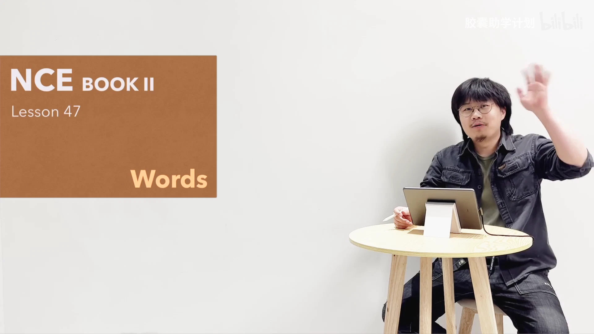

文字识别：NCE / BOOK"I / Lesson 47 / Words

### 画面 00:00:02

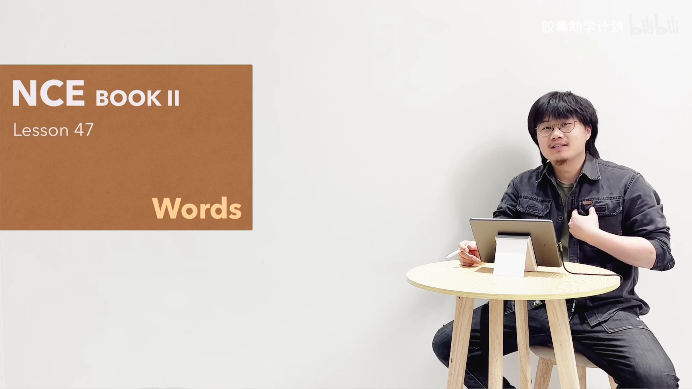

文字识别：NCE / BOOKII / Lesson 47 / Words

### 画面 00:00:06

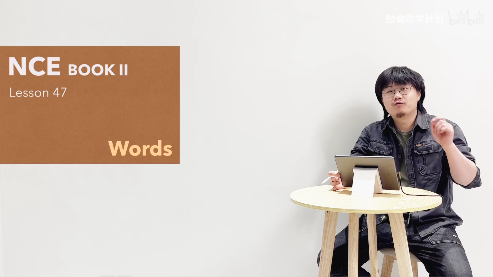

文字识别：NCE / BOOKⅡI / Lesson 47 / Words

### 画面 00:00:10

### 画面 00:00:12

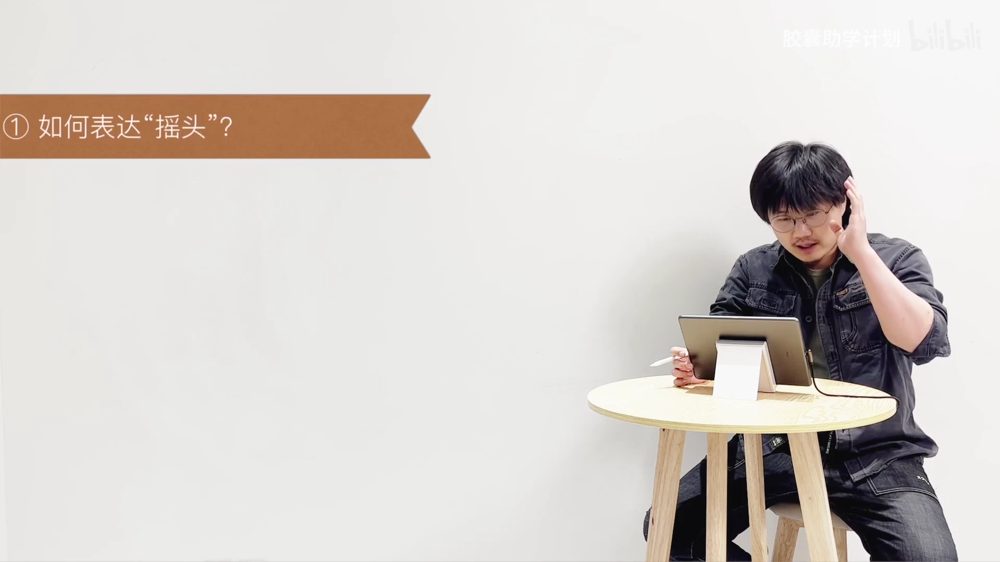

文字识别：①如何表达“摇头”？

### 画面 00:00:14

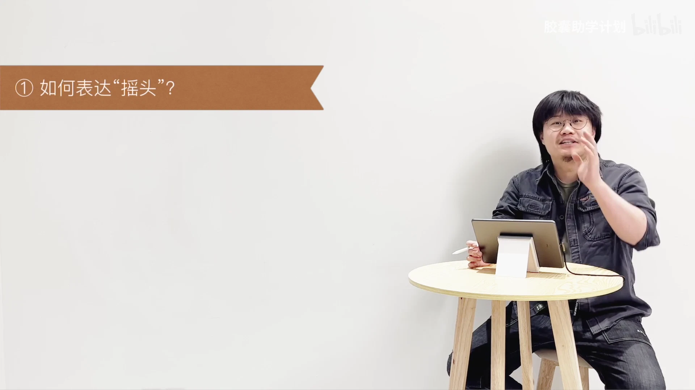

文字识别：①如何表达“摇头”?

### 画面 00:00:21

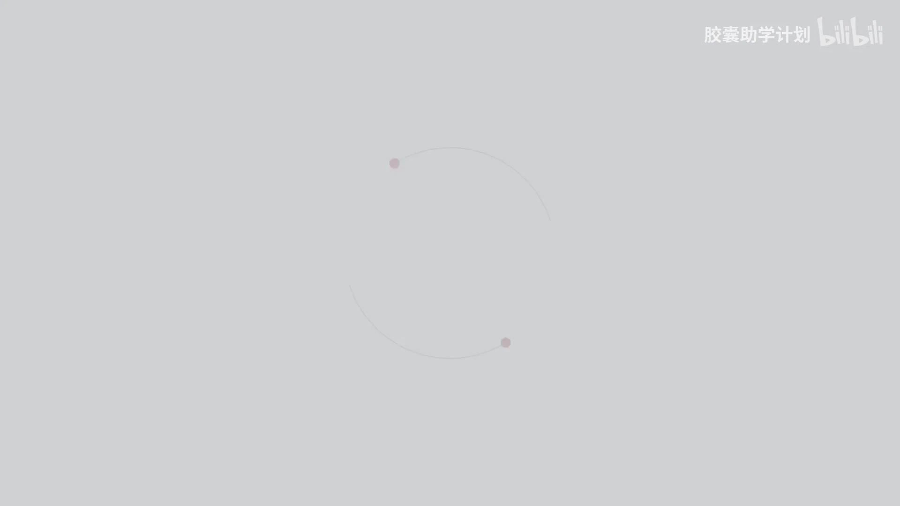

文字识别：胶囊助学计划bl出 / •

### 画面 00:00:25

### 画面 00:00:27

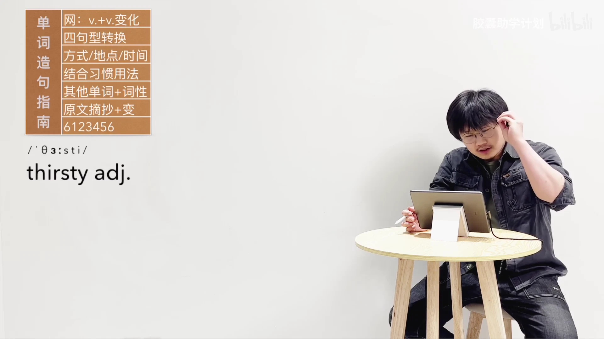

文字识别：单词造句指南 / 网：v.+v.变化 / 四句型转换 / 方式/地点/时间 / 结合习惯用法 / 其他单词+词性 / 原文摘抄+变 / 6123456 / /'θ3:sti/ / thirsty adj.

## 00:00:30–00:01:00

置就学过这个单词，跟我一起读一下，叫做 thirsty thirsty。 OK， it's like you need some water，啊， then you're thirsty， right？你需要一些水，然后你可能就是渴了。 OK，那本文当中他给的一个含义叫做贪杯的，是吧？啊，thirsty ghost，啊，一个贪杯的这个鬼魂。 OK，好，那其实啊，thirsty 它有很多表示渴就可以了，它只是说结合上下文把它翻译成了

### 画面 00:00:30

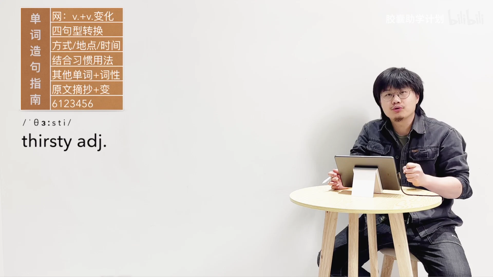

文字识别：单词造句指南 / 网：v.+v.变化 / 四句型转换 / 方式/地点/时间 / 结合习惯用法 / 其他单词+词性 / 原文摘抄+变 / 6123456 / / 'θ3:sti/ / thirsty adj.

### 画面 00:00:35

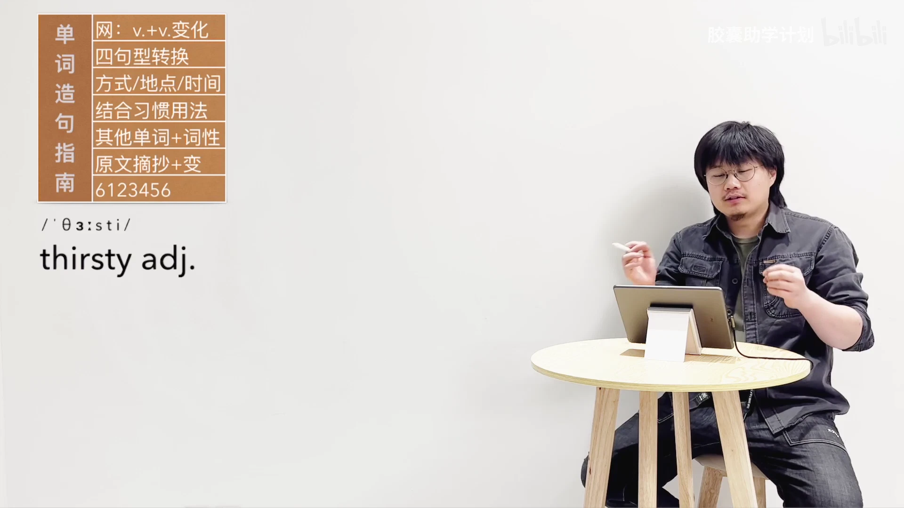

文字识别：单词造句指南 / 网：v.+v.变化 / 四句型转换 / 方式/地点/时间 / 结合习惯用法 / 其他单词+词性 / 原文摘抄+变 / 6123456 / / 'θ3:sti/ / thirsty adj.

### 画面 00:00:40

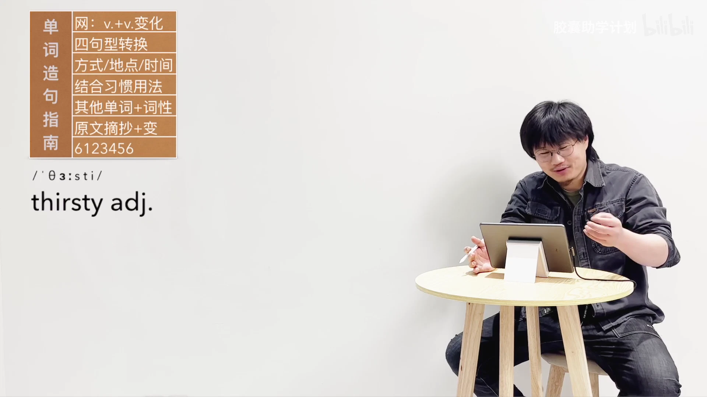

文字识别：单词造句指南 / 网：v.+v.变化 / 四句型转换 / 方式/地点/时间 / 结合习惯用法 / 其他单词+词性 / 原文摘抄+变 / 6123456 / /'θ3:sti/ / thirsty adj.

### 画面 00:00:45

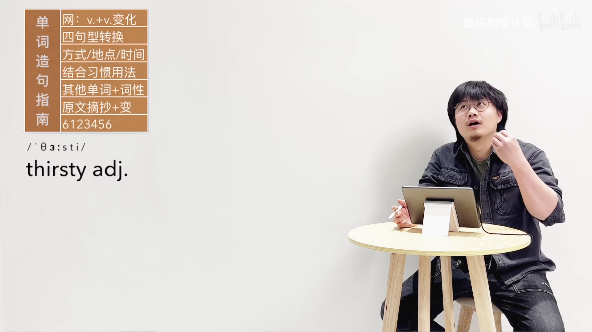

文字识别：单词造句指南 / 网：v.+v.变化 / 四句型转换 / 方式/地点/时间 / 结合习惯用法 / 其他单词+词性 / 原文摘抄+变 / 6123456 / /'θ3:sti/ / thirsty adj.

### 画面 00:00:50

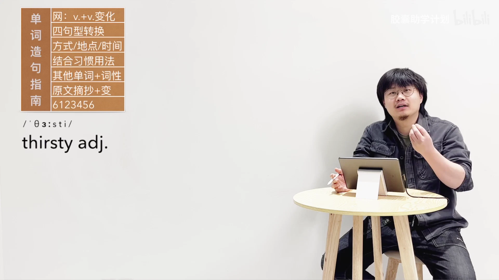

文字识别：单词造句指南 / 网：v.+v.变化 / 四句型转换 / 方式/地点/时间 / 结合习惯用法 / 其他单词+词性 / 原文摘抄+变 / 6123456 / / 'θ3:sti/ / thirsty adj.

### 画面 00:00:57

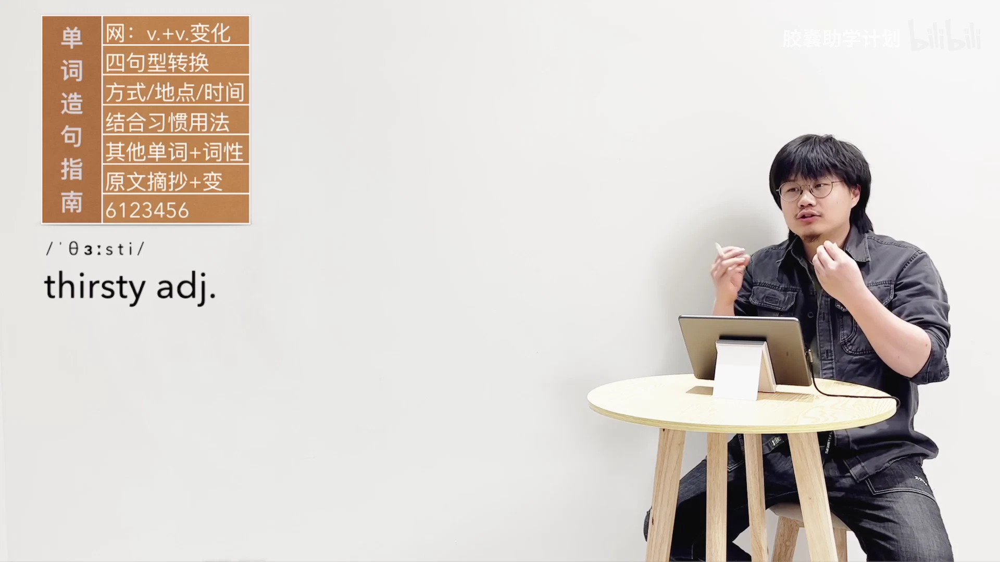

文字识别：单词造句指南 / 网：v.+v.变化 / 四句型转换 / 方式/地点/时间 / 结合习惯用法 / 其他单词+词性 / 原文摘抄+变 / 6123456 / /'θ3:sti/ / thirsty adj.

## 00:01:00–00:01:30

了贪杯的，OK。所以，比如我们去造它的时候，更多的时候还就是用可就可以了。这个单词本来我不想拿它去造句的，但后来一想，我们正好可以拿它复习一下刚刚学过的一些呃语法也好，习惯用法也好，那我就拿它造几个吧。比如说四十六课咱们刚学的同位语从句，And no one could account for the fact that he is extremely thirsty，对吧？他极度的渴，没有人能解释这个事实为什么是这样的。OK，下一

### 画面 00:01:00

文字识别：单词造句指南 / 网：v.+v.变化 / 四句型转换 / 方式/地点/时间 / 结合习惯用法 / 其他单词+词性 / 原文摘抄+变 / 6123456 / /'θ3:sti/ / thirsty adj.

### 画面 00:01:02

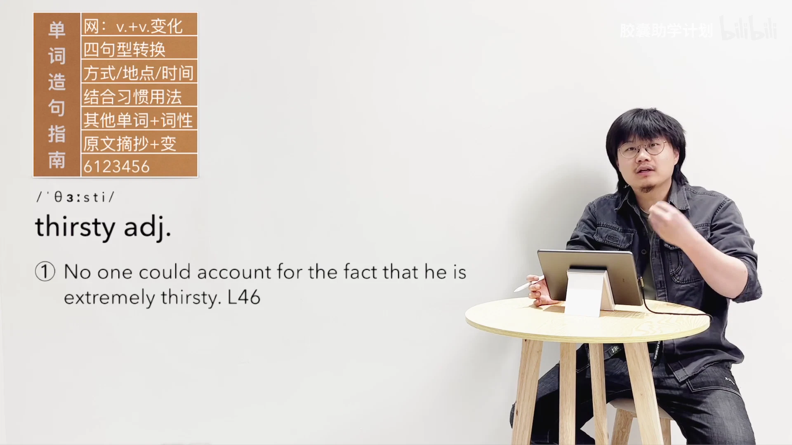

文字识别：单词造句指南 / 网：v.+v.变化 / 四句型转换 / 方式/地点/时间 / 结合习惯用法 / 其他单词+词性 / 原文摘抄+变 / 6123456 / / 'θ3:sti/ / thirsty adj. / ① No one could account for the fact that he is / extremely thirsty. L46

### 画面 00:01:05

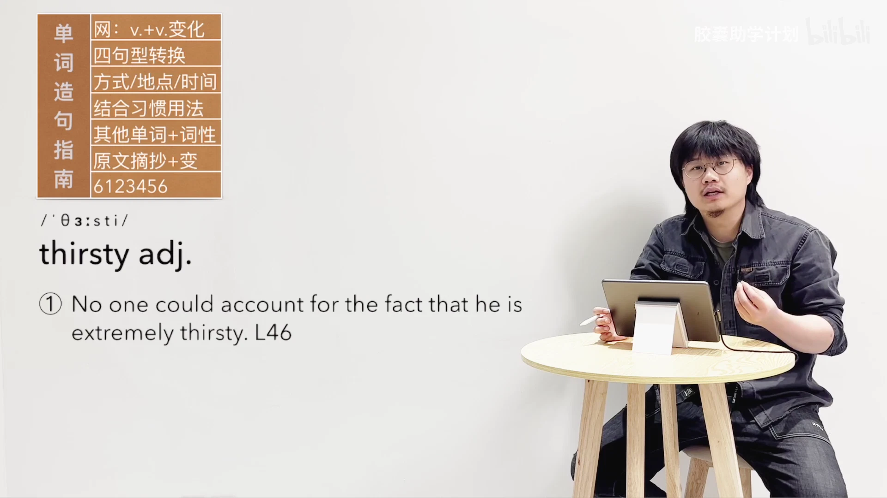

文字识别：单词造句指南 / 网：v.+v.变化 / 四句型转换 / 方式/地点/时间 / 结合习惯用法 / 其他单词+词性 / 原文摘抄+变 / 6123456 / /'θ3:sti/ / thirsty adj. / ① No one could account for the fact that he is / extremely thirsty. L46

### 画面 00:01:10

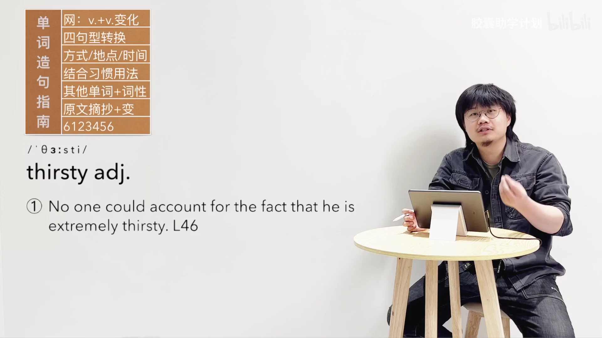

文字识别：单词造句指南 / 网：v.+v.变化 / 四句型转换 / 方式/地点/时间 / 结合习惯用法 / 其他单词+词性 / 原文摘抄+变 / 6123456 / /'θ3:sti/ / thirsty adj. / ① No one could account for the fact that he is / extremely thirsty. L46

### 画面 00:01:15

文字识别：单词造句指南 / 网：v.+v.变化 / 四句型转换 / 方式/地点/时间 / 结合习惯用法 / 其他单词+词性 / 原文摘抄+变 / 6123456 / /'θ3:sti/ / thirsty adj. / ① No one could account for the fact that he is / extremely thirsty. L46

### 画面 00:01:20

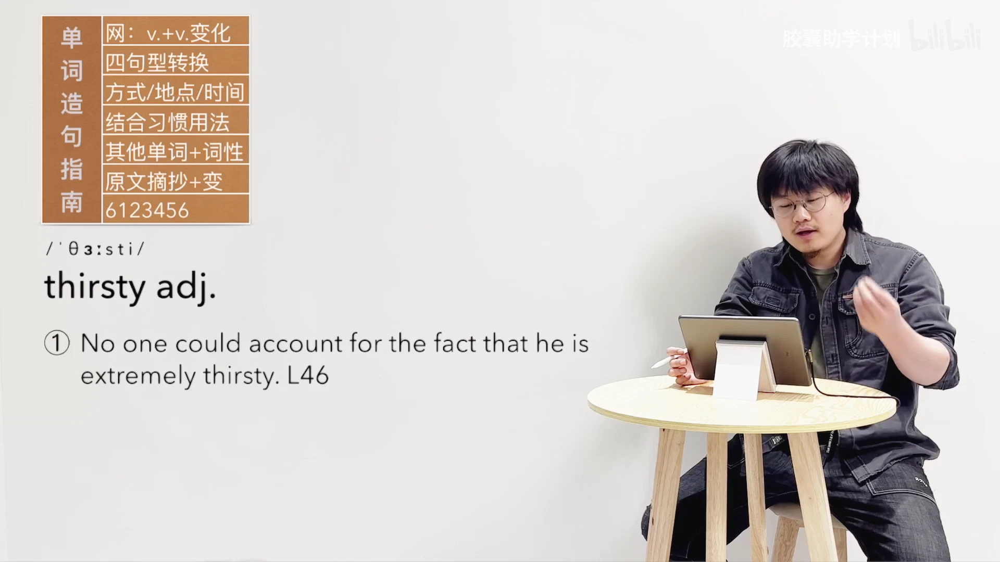

文字识别：单词造句指南 / 网：v.+v.变化 / 四句型转换 / 方式/地点/时间 / 结合习惯用法 / 其他单词+词性 / 原文摘抄+变 / 6123456 / /'θ3:sti/ / thirsty adj. / ① No one could account for the fact that he is / extremely thirsty. L46

### 画面 00:01:26

文字识别：单词造句指南 / 网：v.+v.变化 / 四句型转换 / 方式/地点/时间 / 结合习惯用法 / 其他单词+词性 / 原文摘抄+变 / 6123456 / /'θ3:sti/ / thirsty adj. / ① No one could account for the fact that he is / extremely thirsty. L46

## 00:01:30–00:02:00

个说说Everybody was astonished at how thirsty he is。说每个人都极度的惊讶，呃，每个人都很惊讶于他如此的渴，对吧？他有多么的渴？好，下一个叫做Can't you tell the difference between thirsty and hungry？说难道你分不清这两者的区别吗？四十二课咱们学过，对吧？OK啊，那我们就拿它当复习一下了。接下来下一个单词啊，是本课也是标题上的一个单

### 画面 00:01:30

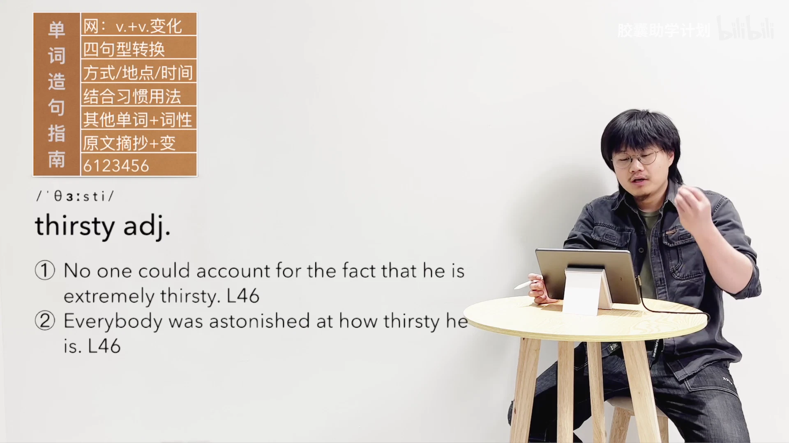

文字识别：单词造句指南 / 网：v.+v.变化 / 四句型转换 / 方式/地点/时间 / 结合习惯用法 / 其他单词+词性 / 原文摘抄+变 / 6123456 / /'θ3:sti/ / thirsty adj. / ① No one could account for the fact that he is / extremely thirsty. L46 / Everybody was astonished at how thirsty he / is. L46

### 画面 00:01:35

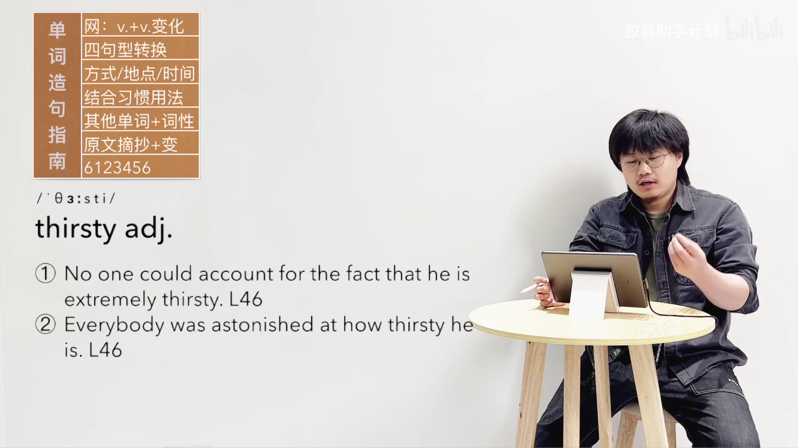

文字识别：单词造句指南 / 网：v.+v.变化 / 四句型转换 / 方式/地点/时间 / 结合习惯用法 / 其他单词+词性 / 原文摘抄+变 / 6123456 / 1'θ3:sti/ / thirsty adj. / ① No one could account for the fact that he is / extremely thirsty. L46 / Everybody was astonished at how thirsty he / is. L46

### 画面 00:01:40

文字识别：单词造句指南 / 网：v.+v.变化 / 四句型转换 / 方式/地点/时间 / 结合习惯用法 / 其他单词+词性 / 原文摘抄+变 / 6123456 / /'θ3:sti/ / thirsty adj. / ① No one could account for the fact that he is / extremely thirsty. L46 / Everybody was astonished at how thirsty he / is. L46

### 画面 00:01:44

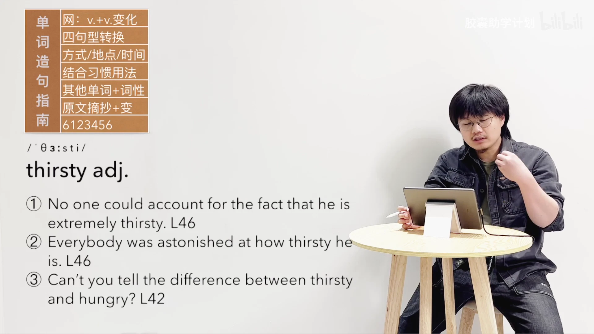

文字识别：单词造句指南 / 网：v.+v.变化 / 四句型转换 / 方式/地点/时间 / 结合习惯用法 / 其他单词+词性 / 原文摘抄+变 / 6123456 / /'θ3:sti/ / thirsty adj. / ① No one could account for the fact that he is / extremely thirsty. L46 / Everybody was astonished at how thirsty he / is.L46 / Can't you tell the difference between thirsty / and hungry? L42

### 画面 00:01:46

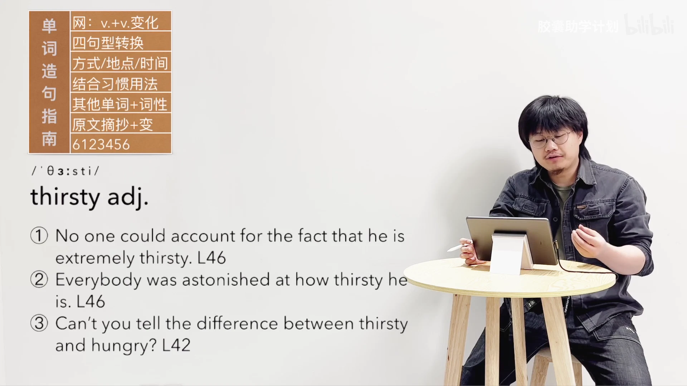

文字识别：单词造句指南 / 网：v.+v.变化 / 四句型转换 / 方式/地点/时间 / 结合习惯用法 / 其他单词+词性 / 原文摘抄+变 / 6123456 / /'θ3:sti/ / thirsty adj. / ① No one could account for the fact that he is / extremely thirsty. L46 / Everybody was astonished at how thirsty he / is. L46 / Can't you tell the difference between thirsty / and hungry? L42

### 画面 00:01:50

文字识别：单词造句指南 / 网：v.+v.变化 / 四句型转换 / 方式/地点/时间 / 结合习惯用法 / 其他单词+词性 / 原文摘抄+变 / 6123456 / 1'θ3:sti/ / thirsty adj. / ① No one could account for the fact that he is / extremely thirsty. L46 / Everybody was astonished at how thirsty he / is.L46 / Can't you tell the difference between thirsty / and hungry? L42

### 画面 00:01:53

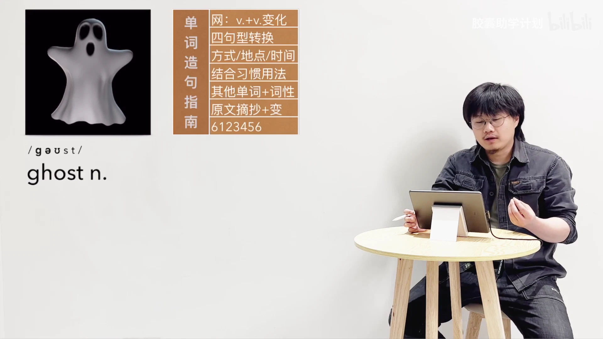

文字识别：单词造句指南 / 网：v.+v.变化 / 四句型转换 / 方式/地点/时间 / 结合习惯用法 / 其他单词+词性 / 原文摘抄+变 / 6123456 / /gaust/ / ghost n.

### 画面 00:01:55

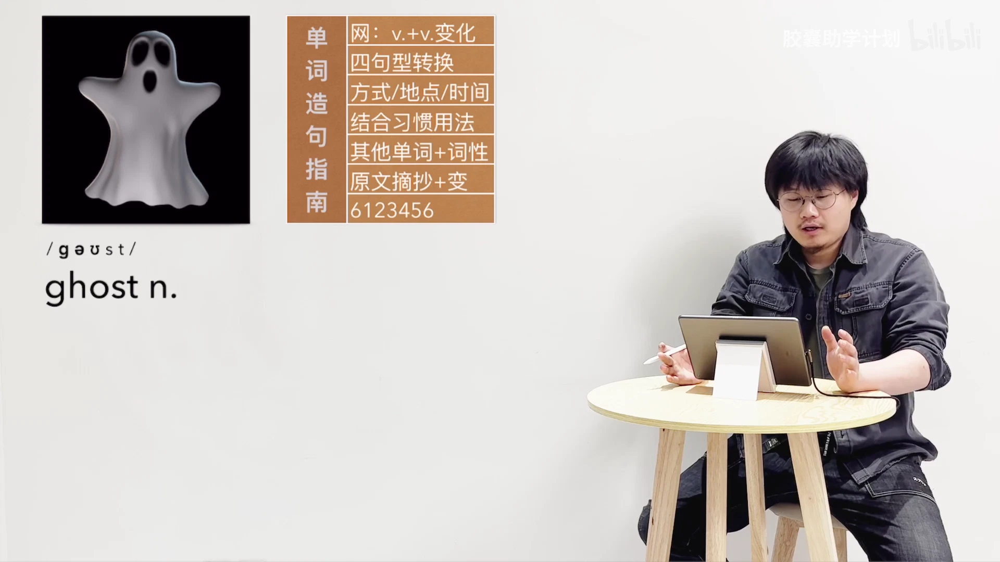

文字识别：单词造句指南 / 网：v.+v.变化 / 四句型转换 / 方式/地点/时间 / 结合习惯用法 / 其他单词+词性 / 原文摘抄+变 / 6123456 / /gaust/ / ghost n.

## 00:02:00–00:02:30

词，跟我一起读一下，叫做 ghost。 ghost， a ghost 指的是鬼魂、灵魂的意思，对吧？好，你比如说，我们可以造一个句子，叫做 He is one of those rare people who believes in ghost。说他是那些很罕见的人，哪样的人呢？说那些相信 ghost、鬼魂、灵魂的人。哎，你注意，这其实我就是突然间想到二十八课我们的第一句话，我记得叫 Jasper White is one of those rare people

### 画面 00:02:00

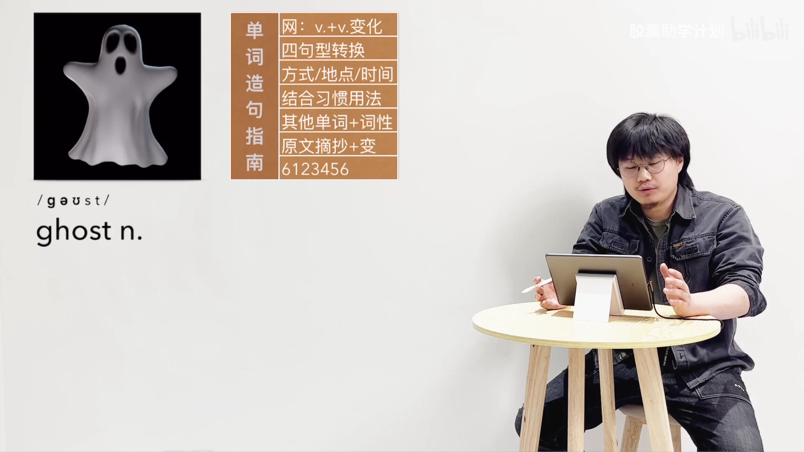

文字识别：单词造句指南 / 网：v.+v.变化 / 四句型转换 / 方式/地点/时间 / 结合习惯用法 / 其他单词+词性 / 原文摘抄+变 / 6123456 / /gaust/ / ghost n.

### 画面 00:02:07

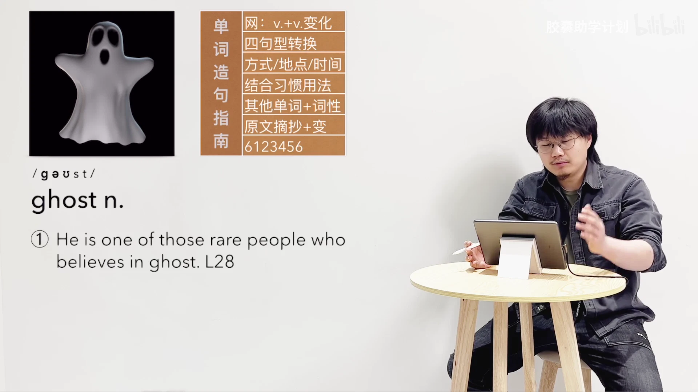

文字识别：单词造句指南 / 网：v.+v.变化 / 四句型转换 / 方式/地点/时间 / 结合习惯用法 / 其他单词+词性 / 原文摘抄+变 / 6123456 / /gaust/ / ghost n. / ① He is one of those rare people who / believes in ghost. L28

### 画面 00:02:10

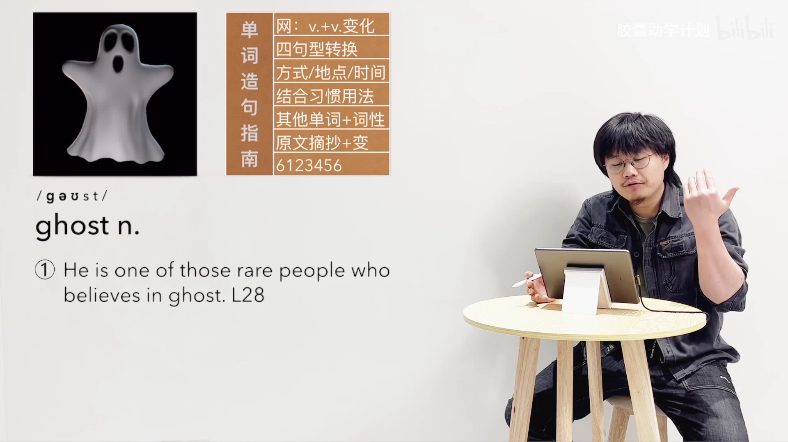

文字识别：单词造句指南 / 网：v.+v.变化 / 四句型转换 / 方式/地点/时间 / 结合习惯用法 / 其他单词+词性 / 原文摘抄+变 / 6123456 / /gaust/ / ghost n. / ① He is one of those rare people who / believes in ghost. L28

### 画面 00:02:15

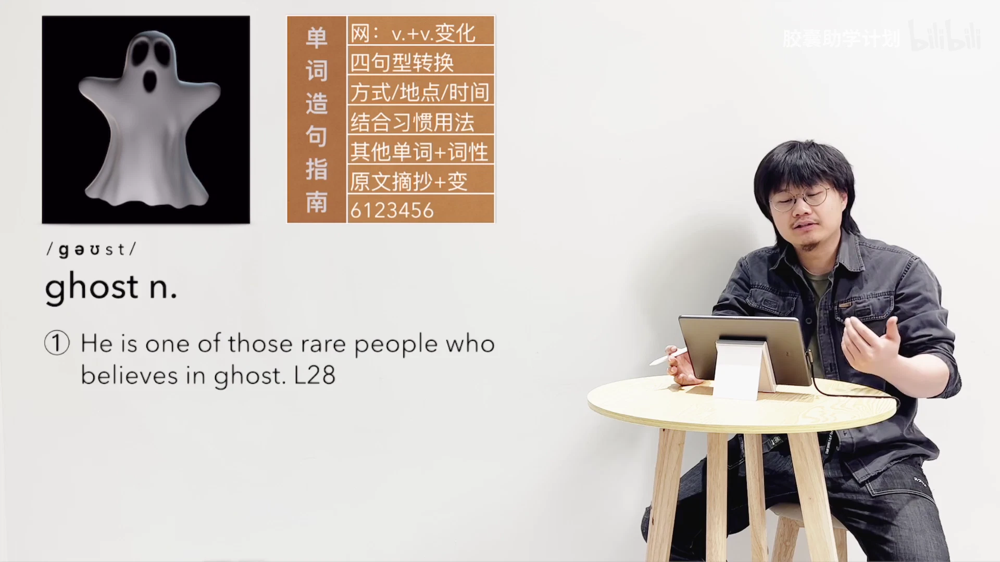

文字识别：单词造句指南 / 网：v.+v.变化 / 四句型转换 / 方式/地点/时间 / 结合习惯用法 / 其他单词+词性 / 原文摘抄+变 / 6123456 / /gaust/ / ghost n. / ① He is one of those rare people who / believes in ghost. L28

### 画面 00:02:21

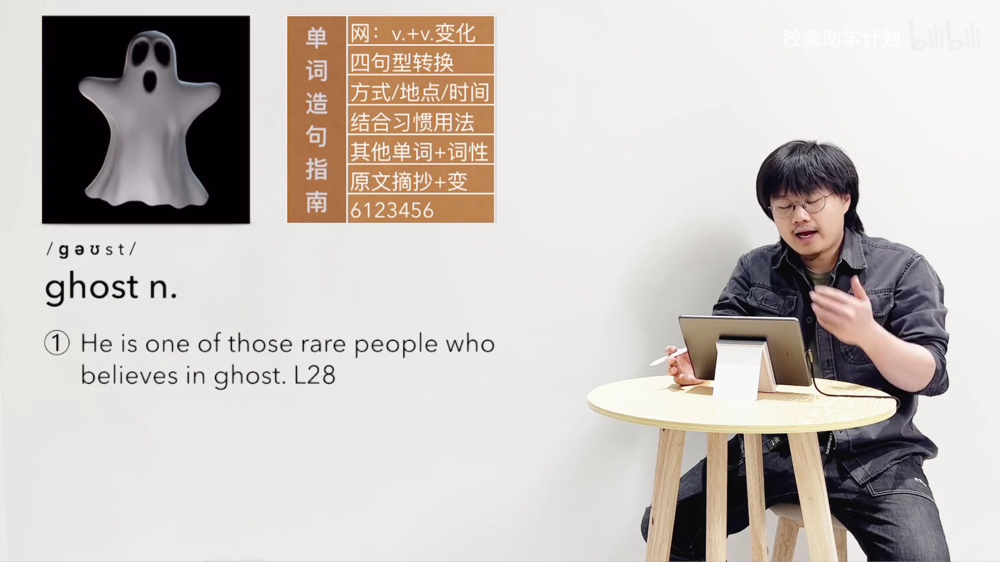

文字识别：单词造句指南 / 网：v.+v.变化 / 四句型转换 / 方式/地点/时间 / 结合习惯用法 / 其他单词+词性 / 原文摘抄+变 / 6123456 / /gaust/ / ghost n. / ① He is one of those rare people who / believes in ghost. L28

### 画面 00:02:25

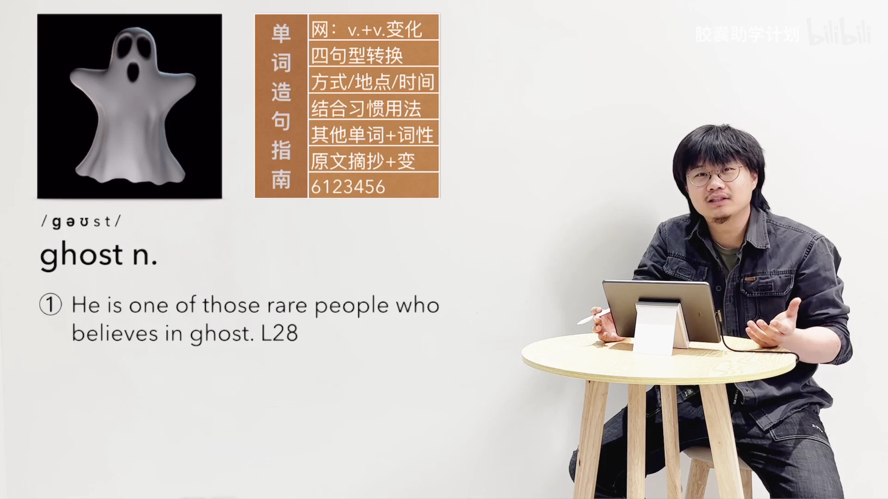

文字识别：单词造句指南 / 网：v.+v.变化 / 四句型转换 / 方式/地点/时间 / 结合习惯用法 / 其他单词+词性 / 原文摘抄+变 / 6123456 / /gaust/ / ghost n. / ① He is one of those rare people who / believes in ghost. L28

## 00:02:30–00:03:00

who believes in ancient myth,对吧？我把那句话实际上给它稍微改变一下，就变成了这句话定语从句啊，二十八课。那我们造一个很简单的句子，陈述客观事实，叫 He believes in ghosts. 然后四句型转换了，对吧？OK OK. 再然后呢？三十一课说 He used to believe in ghosts and now he doesn't believe it anymore. 现在他不再相信这件事情了。三十一课 used to do something. OK, very good. 下一个单词共一起

### 画面 00:02:30

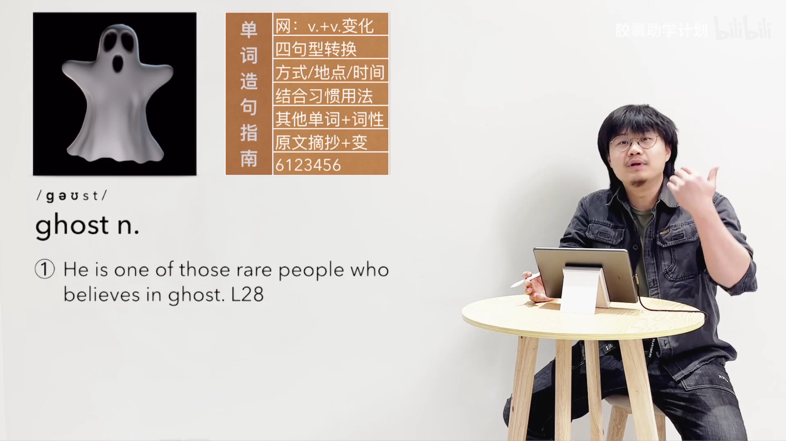

文字识别：单词造句指南 / 网：v.+v.变化 / 四句型转换 / 方式/地点/时间 / 结合习惯用法 / 其他单词+词性 / 原文摘抄+变 / 6123456 / /gaust/ / ghost n. / ① He is one of those rare people who / believes in ghost. L28

### 画面 00:02:40

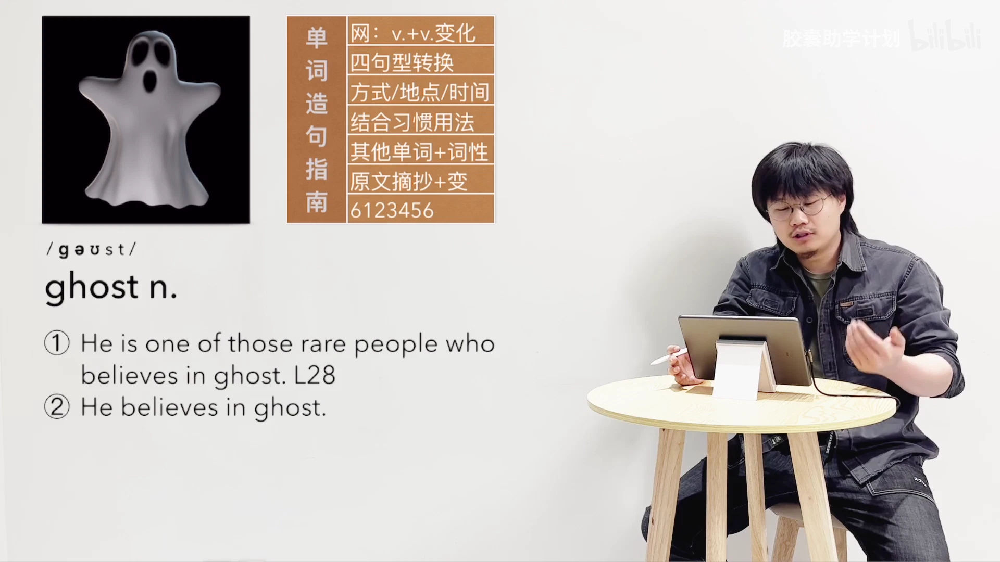

文字识别：单词造句指南 / 网：v.+v.变化 / 四句型转换 / 方式/地点/时间 / 结合习惯用法 / 其他单词+词性 / 原文摘抄+变 / 6123456 / /gaust/ / ghost n. / ① He is one of those rare people who / believes in ghost. L28 / He believes in ghost.

### 画面 00:02:45

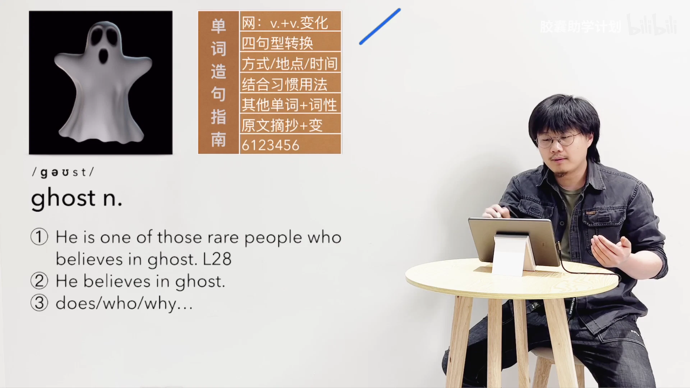

文字识别：单词造句指南 / 网：v.+v.变化 / 四句型转换 / 方式/地点/时间 / 结合习惯用法 / 其他单词+词性 / 原文摘抄+变 / 6123456 / /gaust/ / ghost n. / ① He is one of those rare people who / believes in ghost. L28 / He believes in ghost. / ) does/who/why...

### 画面 00:02:49

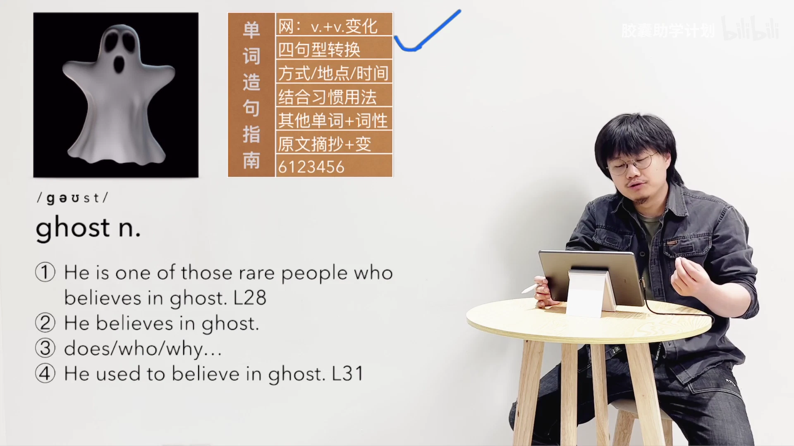

文字识别：单词造句指南 / 网：v.+v.变化 / 四句型转换 / 方式/地点/时间 / 结合习惯用法 / 其他单词+词性 / 原文摘抄+变 / 6123456 / /gaust/ / ghost n. / ① He is one of those rare people who / believes in ghost. L28 / He believes in ghost. / does/who/why... /  He used to believe in ghost. L31

### 画面 00:02:55

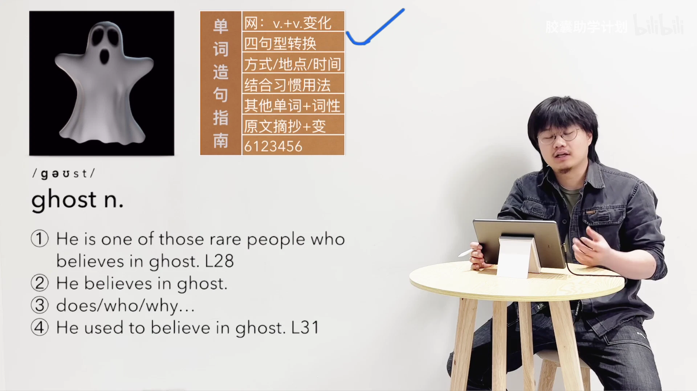

文字识别：单词造句指南 / 网：v.+v.变化 / 四句型转换 / 方式/地点/时间 / 结合习惯用法 / 其他单词+词性 / 原文摘抄+变 / 6123456 / /gaust/ / ghost n. / ① He is one of those rare people who / believes in ghost. L28 / He believes in ghost. / does/who/why... /  He used to believe in ghost. L31

### 画面 00:02:58

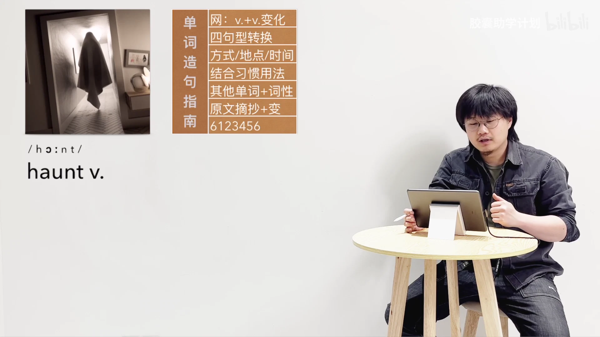

文字识别：单词造句指南 / 网：v.+v.变化 / 四句型转换 / 方式/地点/时间 / 结合习惯用法 / 其他单词+词性 / 原文摘抄+变 / 6123456 / /hoint/ / haunt v.

## 00:03:00–00:03:30

读叫做 haunted 啊，其实就是闹鬼了。这个地方闹鬼了，比如说 this room is haunted. 说这个房间啊，哎闹鬼了，叫做 is haunted. 被动对吧？OK. 再然后呢？你看啊，我接下来其实做的一些是动词加动词的变化。这里我用的是一般现在时的被动，我给它换成一般过去时被动，叫 this room was haunted years ago. 我再给它换一个时态，叫做 this room has been haunted for five years.

### 画面 00:03:00

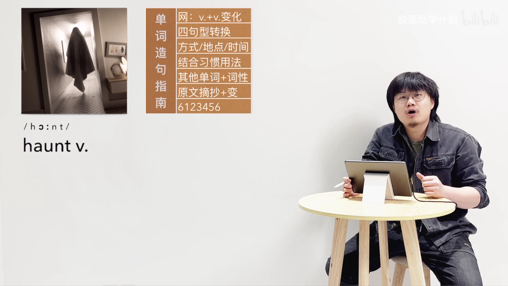

文字识别：单词造句指南 / 网：v.+v.变化 / 四句型转换 / 方式/地点/时间 / 结合习惯用法 / 其他单词+词性 / 原文摘抄+变 / 6123456 / /ho:nt/ / haunt v.

### 画面 00:03:05

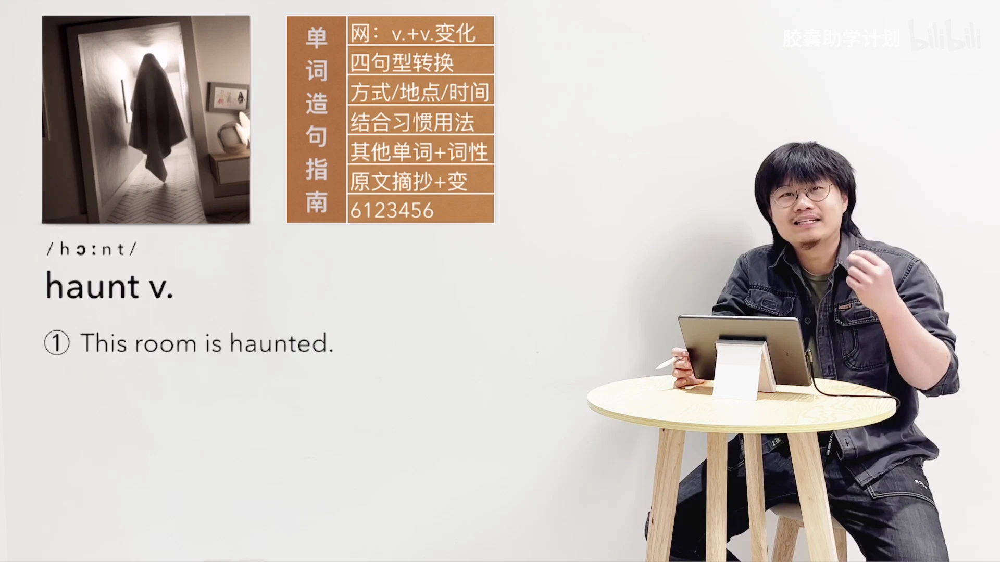

文字识别：单词造句指南 / 网：v.+v.变化 / 四句型转换 / 方式/地点/时间 / 结合习惯用法 / 其他单词+词性 / 原文摘抄+变 / 6123456 / /ho:nt/ / haunt v. /  This room is haunted.

### 画面 00:03:10

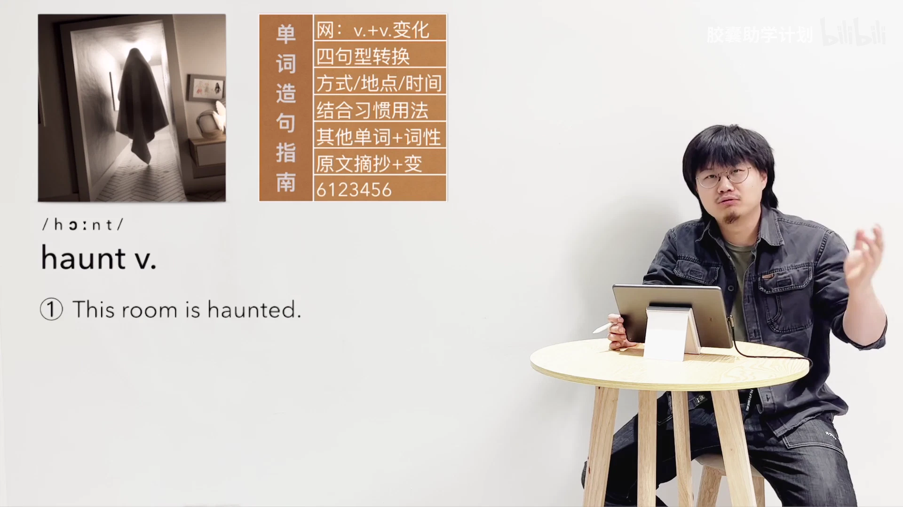

文字识别：单词造句指南 / 网：v.+v.变化 / 四句型转换 / 方式/地点/时间 / 结合习惯用法 / 其他单词+词性 / 原文摘抄+变 / 6123456 / /ho:nt/ / haunt v. / This room is haunted.

### 画面 00:03:15

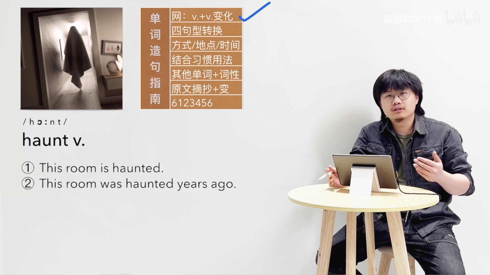

文字识别：单词造句指南 / 网：v.+v.变化 / 四句型转换 / 方式/地点/时间 / 结合习惯用法 / 其他单词+词性 / 原文摘抄+变 / 6123456 / /hoint/ / haunt v. / ) This room is haunted. / This room was haunted years ago.

### 画面 00:03:22

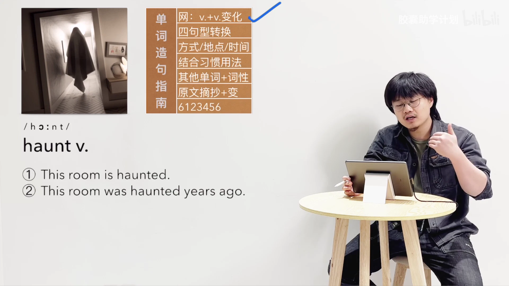

文字识别：单词造句指南 / 网：v.+v.变化 / 四句型转换 / 方式/地点/时间 / 结合习惯用法 / 其他单词+词性 / 原文摘抄+变 / 6123456 / /ho:nt/ / haunt v. / ) This room is haunted. / This room was haunted years ago.

### 画面 00:03:25

文字识别：单词造句指南 / 网：v.+v.变化 / 四句型转换 / 方式/地点/时间 / 结合习惯用法 / 其他单词+词性 / 原文摘抄+变 / 6123456 / /ho:nt/ / haunt v. / ) This room is haunted. / This room was haunted years ago. / This room has been haunted for 5 years. / L10

## 00:03:30–00:04:00

现在完成时，对吧？等等啊，你比如说，我又给他造了一个叫做 He inquired about the room.首先，inquire about我们之前学过，对吧？询问这个房间什么样的房间呢？加了个定语从句，叫 Which has been haunted for five years.啊，到现在闹鬼已经到了五年的这样的一个房间。OK, very good.再跟我读一遍这个单词 haunt. Very good. Next one,下一个单词跟我读一下，叫做 block.

### 画面 00:03:30

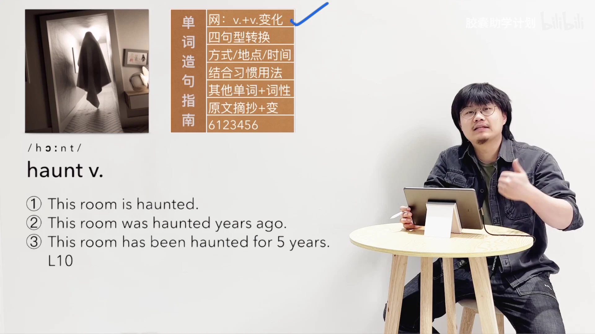

文字识别：单词造句指南 / 网：v.+v.变化 / 四句型转换 / 方式/地点/时间 / 结合习惯用法 / 其他单词+词性 / 原文摘抄+变 / 6123456 / /ho:nt/ / haunt v. / ) This room is haunted. / This room was haunted years ago. / This room has been haunted for 5 years. / L10

### 画面 00:03:32

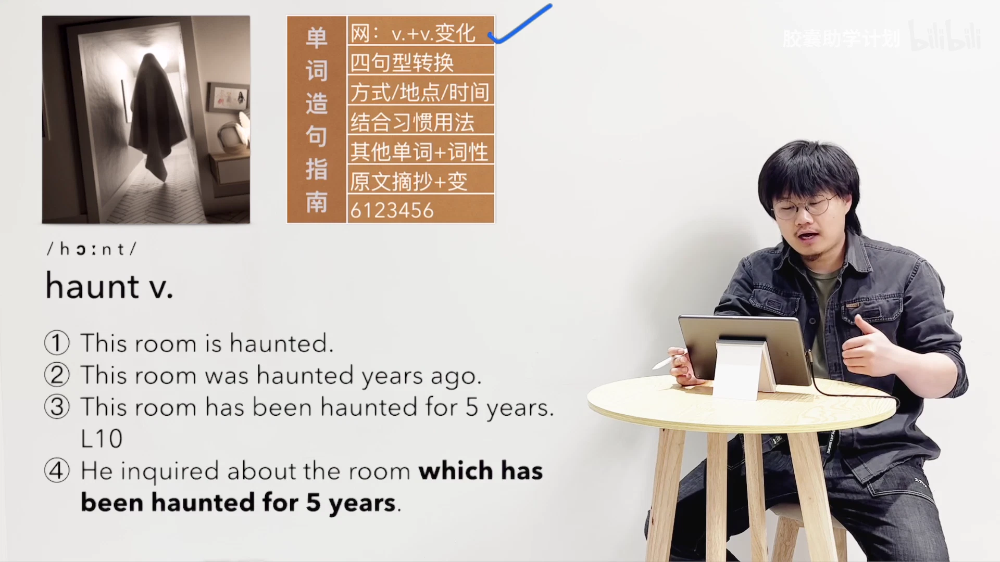

文字识别：单词造句指南 / 网：v.+v.变化 / 四句型转换 / 方式/地点/时间 / 结合习惯用法 / 其他单词+词性 / 原文摘抄+变 / 6123456 / /ho:nt/ / haunt v. / ) This room is haunted. / This room was haunted years ago. / This room has been haunted for 5 years. / L10 / He inquired about the room which has / been haunted for 5 years.

### 画面 00:03:35

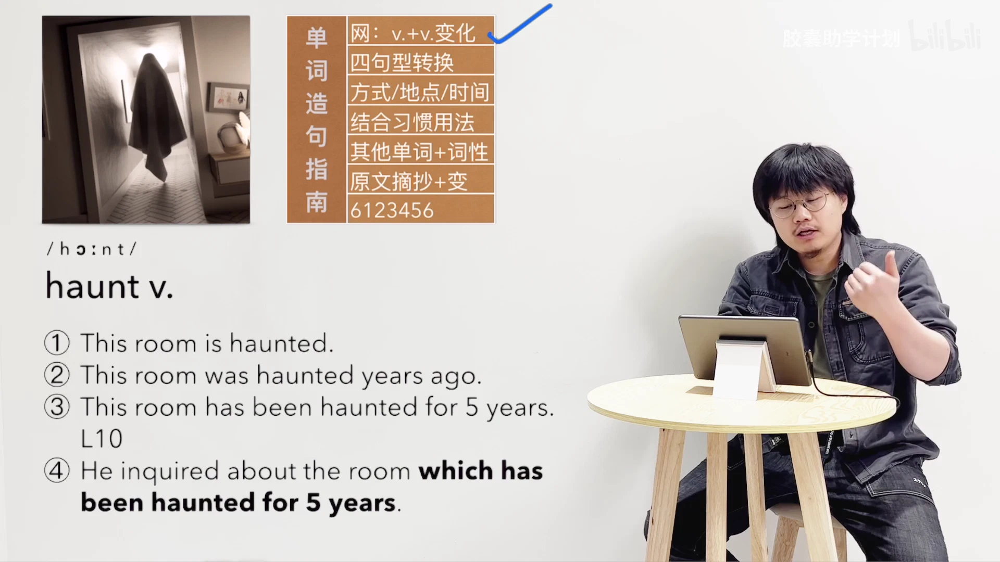

文字识别：单词造句指南 / 网：v.+v.变化 / 四句型转换 / 方式/地点/时间 / 结合习惯用法 / 其他单词+词性 / 原文摘抄+变 / 6123456 / /ho:nt/ / haunt v. /  This room is haunted. / This room was haunted years ago. / This room has been haunted for 5 years. / L10 / He inquired about the room which has / been haunted for 5 years.

### 画面 00:03:38

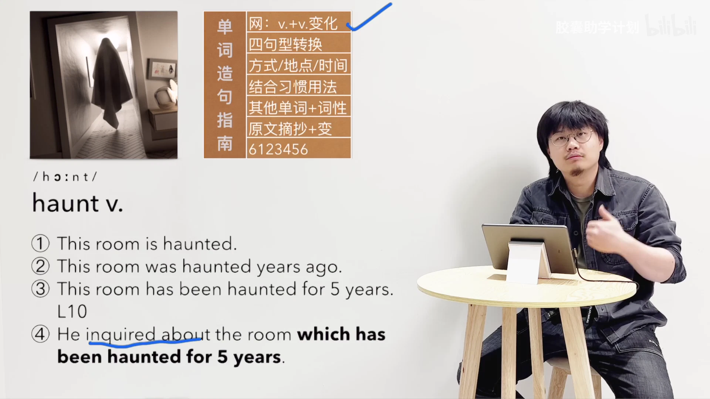

文字识别：单词造句指南 / 网：v.+v.变化 / 四句型转换 / 方式/地点/时间 / 结合习惯用法 / 其他单词+词性 / 原文摘抄+变 / 6123456 / /ho:nt/ / haunt v. / ) This room is haunted. / This room was haunted years ago. / This room has been haunted for 5 years. / L10 / He inquired about the room which has / been haunted for 5 years.

### 画面 00:03:40

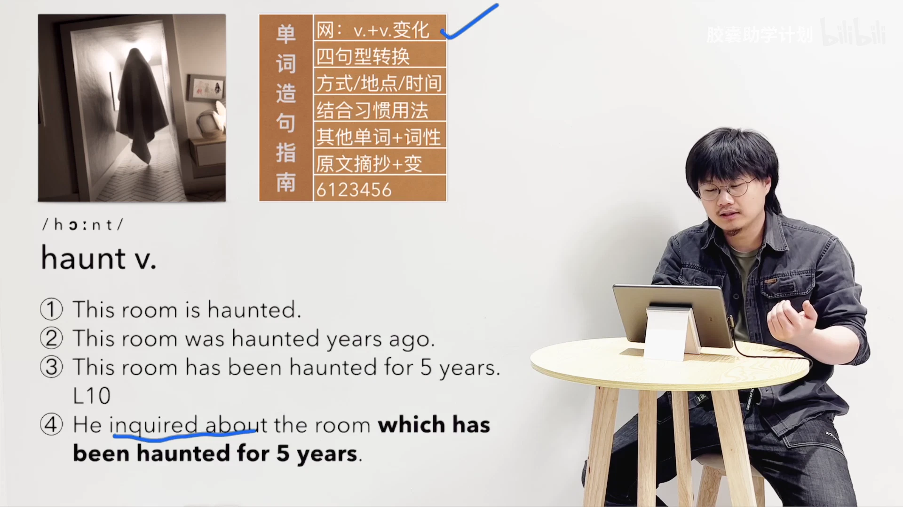

文字识别：单词造句指南 / 网：v.+v.变化 / 四句型转换 / 方式/地点/时间 / 结合习惯用法 / 其他单词+词性 / 原文摘抄+变 / 6123456 / /hoint/ / haunt v. / ) This room is haunted. / This room was haunted years ago. / This room has been haunted for 5 years. / L10 / He inquired about the room which has / been haunted for 5 years.

### 画面 00:03:43

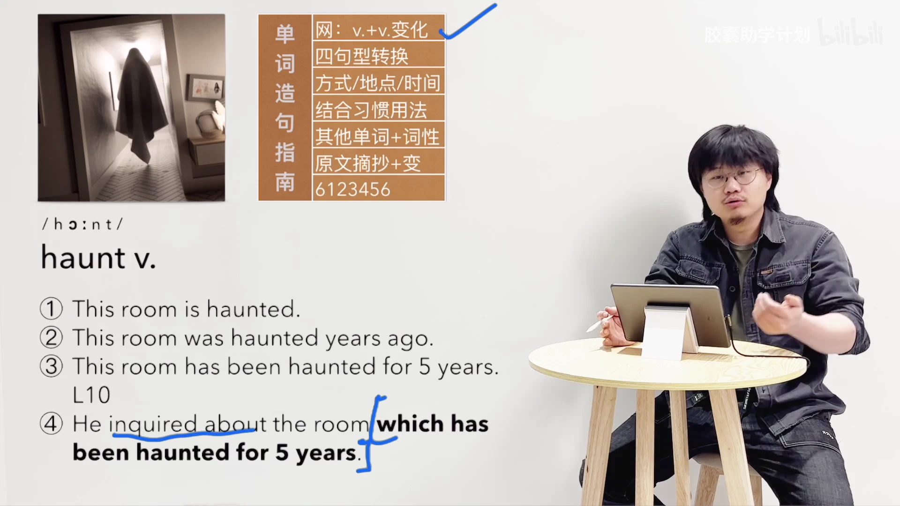

文字识别：单词造句指南 / 网：v.+v.变化 / 四句型转换 / 方式/地点/时间 / 结合习惯用法 / 其他单词+词性 / 原文摘抄+变 / 6123456 / /ho:nt/ / haunt v. / ) This room is haunted. / This room was haunted years ago. / This room has been haunted for 5 years. / L10 / He inquired about the room / which has / been haunted for 5 years.

### 画面 00:03:45

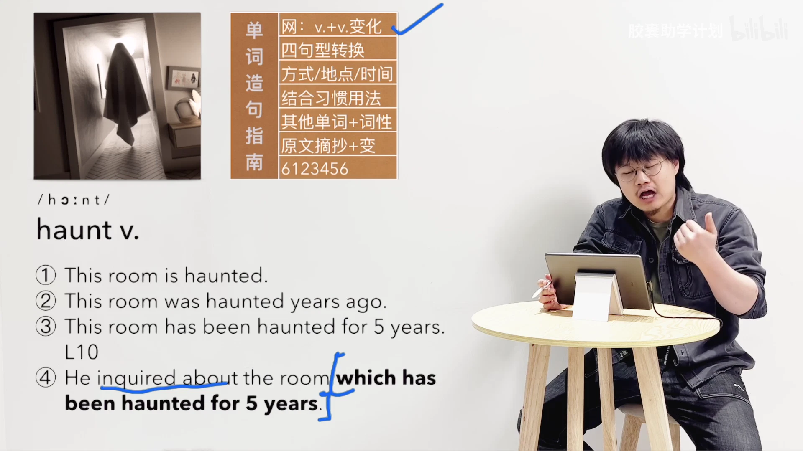

文字识别：单词造句指南 / 网：v.+v.变化 / 四句型转换 / 方式/地点/时间 / 结合习惯用法 / 其他单词+词性 / 原文摘抄+变 / 6123456 / /ho:nt/ / haunt v. / ) This room is haunted. / This room was haunted years ago. / This room has been haunted for 5 years. / L10 / He inquired about the room / which has / been haunted for 5 years.

### 画面 00:03:52

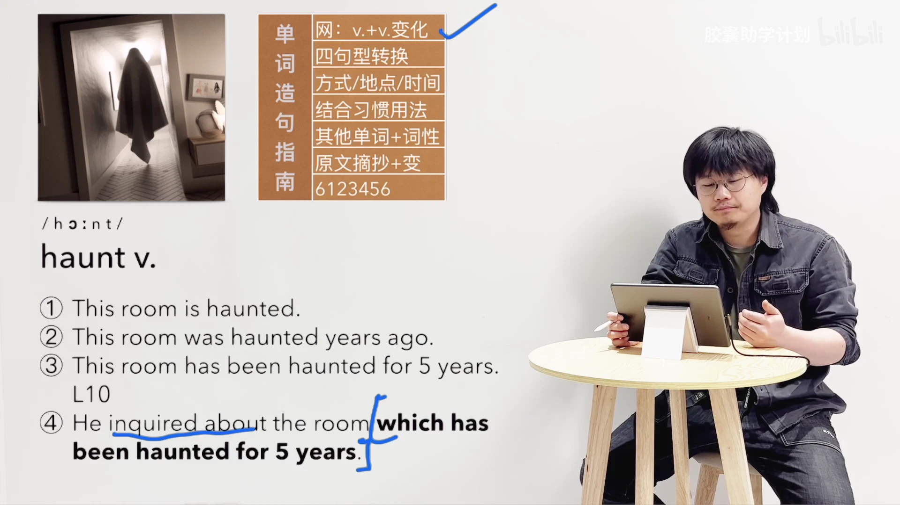

文字识别：单词造句指南 / 网：v.+v.变化 / 四句型转换 / 方式/地点/时间 / 结合习惯用法 / 其他单词+词性 / 原文摘抄+变 / 6123456 / /ho:nt/ / haunt v. / ) This room is haunted. / This room was haunted years ago. / This room has been haunted for 5 years. / L10 / He inquired about the room / which has / been haunted for 5 years.

### 画面 00:03:56

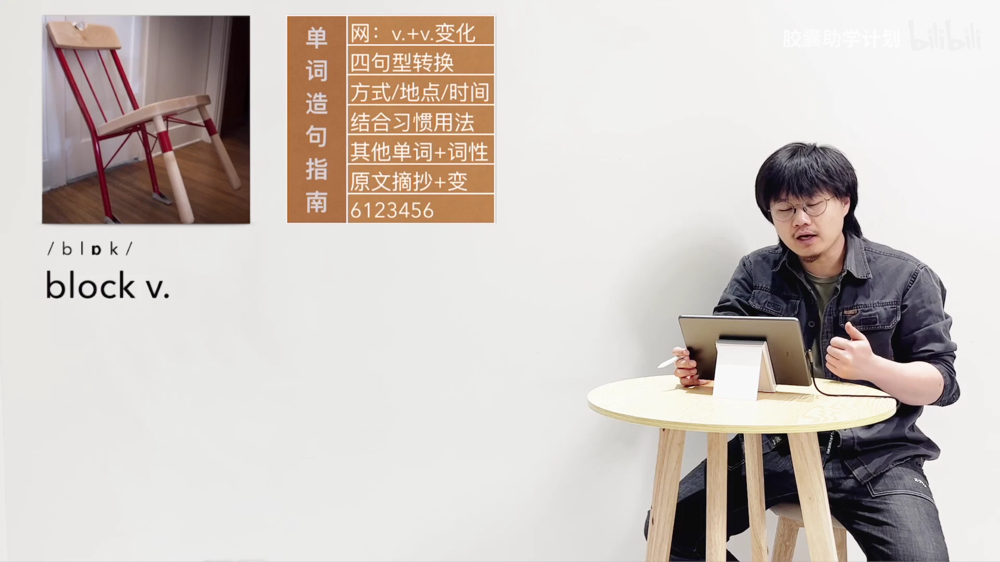

文字识别：单词造句指南 / 网：v.+v.变化 / 四句型转换 / 方式/地点/时间 / 结合习惯用法 / 其他单词+词性 / 原文摘抄+变 / 6123456 / /blゅk / / block v.

## 00:04:00–00:04:30

block。首先，这个单词我们以前见过，指的是街区的意思，对吧？今天那时候它是个名词，a block of flat。我印象当中啊，今天呢给它换成了一个动词，叫做阻碍阻挡，对吧？OK，比如说 the door is blocked by a chair。你看一个小的被动，对吧？其实在这里，如果你去做一些动词加动词的变化，说它昨天被呃椅子挡上了，这就变成了一般过去时的被动，对不对？等

### 画面 00:04:00

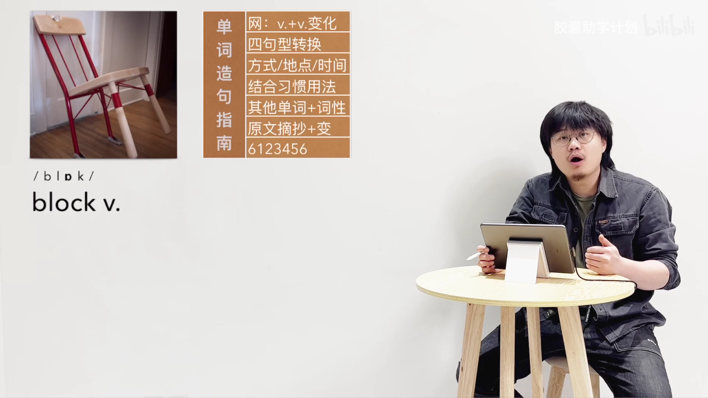

文字识别：单词造句指南 / 网：v.+v.变化 / 四句型转换 / 方式/地点/时间 / 结合习惯用法 / 其他单词+词性 / 原文摘抄+变 / 6123456 / /blゅk / / block v.

### 画面 00:04:05

文字识别：单词造句指南 / 网：v.+v.变化 / 四句型转换 / 方式/地点/时间 / 结合习惯用法 / 其他单词+词性 / 原文摘抄+变 / 6123456 / /blpk / / block v.

### 画面 00:04:11

文字识别：单词造句指南 / 网：v.+v.变化 / 四句型转换 / 方式/地点/时间 / 结合习惯用法 / 其他单词+词性 / 原文摘抄+变 / 6123456 / /blゅk/ / block v.

### 画面 00:04:15

文字识别：单词造句指南 / 网：v.+v.变化 / 四句型转换 / 方式/地点/时间 / 结合习惯用法 / 其他单词+词性 / 原文摘抄+变 / 6123456 / /blｐk/ / block v. / ① The doors is blocked by a chair.

### 画面 00:04:18

文字识别：单词造句指南 / 网：v.+v.变化 / 四句型转换 / 方式/地点/时间 / 结合习惯用法 / 其他单词+词性 / 原文摘抄+变 / 6123456 / /blゅk/ / block v. / ① The doors is blocked by a chair.

### 画面 00:04:20

文字识别：单词造句指南 / 网：v.+v.变化 / 四句型转换 / 方式/地点/时间 / 结合习惯用法 / 其他单词+词性 / 原文摘抄+变 / 6123456 / /blゅk/ / block v. / ① The doors is blocked by a chair.

### 画面 00:04:25

文字识别：单词造句指南 / 网：v.+v.变化 / 四句型转换 / 方式/地点/时间 / 结合习惯用法 / 其他单词+词性 / 原文摘抄+变 / 6123456 / /blゅk/ / block v. / ① The doors is blocked by a chair.

## 00:04:30–00:05:00

等等啊，然后呢？当然了，你也可以做四句型的转换。这两者其实是各位一定要牢牢记下来的。这两者是对于我们，呃，实际应用当中用处最大的两个造句的思路啊。接下来我说，A fallen tree is blocking the road。啊，来注意这个 fallen，其实是我们二三十课学分词做定语那课学过很重要的一个语法，对吧？哎，一个倒下的树正在挡着这

### 画面 00:04:30

文字识别：单词造句指南 / 网：v.+v.变化 / 四句型转换 / 方式/地点/时间 / 结合习惯用法 / 其他单词+词性 / 原文摘抄+变 / 6123456 / /blゅk/ / block v. / ① The doors is blocked by a chair. / ② is/what/why...

### 画面 00:04:35

文字识别：单词造句指南 / 网：v.+v.变化 / 四句型转换 / 方式/地点/时间 / 结合习惯用法 / 其他单词+词性 / 原文摘抄+变 / 6123456 / /blゅk/ / block v. / ① The doors is blocked by a chair. / ) is/what/why...

### 画面 00:04:40

文字识别：单词造句指南 / 网：v.+v.变化 / 四句型转换 / 方式/地点/时间 / 结合习惯用法 / 其他单词+词性 / 原文摘抄+变 / 6123456 / /blゅk/ / block v. / ① The doors is blocked by a chair. / ) is/what/why...

### 画面 00:04:45

文字识别：单词造句指南 / 网：v.+v.变化 / 四句型转换 / 方式/地点/时间 / 结合习惯用法 / 其他单词+词性 / 原文摘抄+变 / 6123456 / /blゅk/ / block v. / ① The doors is blocked by a chair. / ② is/what/why... / ③ A fallen tree is blocking the road.

### 画面 00:04:50

文字识别：单词造句指南 / 网：v.+v.变化 / 四句型转换 / 方式/地点/时间 / 结合习惯用法 / 其他单词+词性 / 原文摘抄+变 / 6123456 / /blゅk / / block v. / ① The doors is blocked by a chair. / ② is/what/why... / ③ A fallen tree is blocking the road.

### 画面 00:04:55

文字识别：单词造句指南 / 网：v.+v.变化 / 四句型转换 / 方式/地点/时间 / 结合习惯用法 / 其他单词+词性 / 原文摘抄+变 / 6123456 / /blゅk/ / block v. / ① The doors is blocked by a chair. / ② is/what/why... / ③ A fallen tree is blocking the road.

## 00:05:00–00:05:30

个路，对吧？Is blocking the road. Okay,玩一个。那我们可以造说What is blocking the road?啊，说什么在挡着阻哎堵着前面的这个路呢？玩一个。再来，我说The road must have been blocked by the tree.各位想一下三四五啊，其实某种程度上都是从一个句子给它做了要么是动词的这个核心二和动词变化，对吧？六一二三四五六里边的二的变化，

### 画面 00:05:00

文字识别：单词造句指南 / 网：v.+v.变化 / 四句型转换 / 方式/地点/时间 / 结合习惯用法 / 其他单词+词性 / 原文摘抄+变 / 6123456 / /blゅk/ / block v. / ① The doors is blocked by a chair. / ② is/what/why... / ③ A fallen tree is blocking the road.

### 画面 00:05:02

文字识别：单词造句指南 / 网：v.+v.变化 / 四句型转换 / 方式/地点/时间 / 结合习惯用法 / 其他单词+词性 / 原文摘抄+变 / 6123456 / /blゅk/ / block v. / ① The doors is blocked by a chair. / ② is/what/why... / ③ A fallen tree is blocking the road.

### 画面 00:05:05

文字识别：单词造句指南 / 网：v.+v.变化 / 四句型转换 / 方式/地点/时间 / 结合习惯用法 / 其他单词+词性 / 原文摘抄+变 / 6123456 / /blゅk / / block v. / ① The doors is blocked by a chair. / ② is/what/why... / ③ A fallen tree is blocking the road. / ) What is blocking the road?

### 画面 00:05:10

文字识别：单词造句指南 / 网：v.+v.变化 / 四句型转换 / 方式/地点/时间 / 结合习惯用法 / 其他单词+词性 / 原文摘抄+变 / 6123456 / /b lｏk / / block v. / ① The doors is blocked by a chair. / ) is/what/why... / ③ A fallen tree is blocking the road. / ) What is blocking the road?

### 画面 00:05:13

文字识别：单词造句指南 / 网：v.+v.变化 / 四句型转换 / 方式/地点/时间 / 结合习惯用法 / 其他单词+词性 / 原文摘抄+变 / 6123456 / /b lゅk / / block v. / ① The doors is blocked by a chair. / ② is/what/why... / ③ A fallen tree is blocking the road. / What is blocking the road? / The road must have been blocked by the / tree. L21

### 画面 00:05:15

文字识别：单词造句指南 / 网：v.+v.变化 / 四句型转换 / 方式/地点/时间 / 结合习惯用法 / 其他单词+词性 / 原文摘抄+变 / 6123456 / /b lゅk / / block v. / ① The doors is blocked by a chair. / ② is/what/why... / ③ A fallen tree is blocking the road. / What is blocking the road? / The road must have been blocked by the / tree. L21

### 画面 00:05:18

文字识别：单词造句指南 / 网：v.+v.变化 / 四句型转换 / 方式/地点/时间 / 结合习惯用法 / 其他单词+词性 / 原文摘抄+变 / 6123456 / /b lゅk / / block v. / ① The doors is blocked by a chair. / ② is/what/why... / ③ A fallen tree is blocking the road. / What is blocking the road? / The road must have been blocked by the / tree.L21

### 画面 00:05:20

文字识别：单词造句指南 / 网：v.+v.变化 / 四句型转换 / 方式/地点/时间 / 结合习惯用法 / 其他单词+词性 / 原文摘抄+变 / 6123456 / /blゅk/ / block v. / ① The doors is blocked by a chair. / ② is/what/why... / ③ A fallen tree is blocking the road. / What is blocking the road? / The road must have been blocked by the / tree.L21

### 画面 00:05:25

文字识别：单词造句指南 / 网：v.+v.变化 / 四句型转换 / 方式/地点/时间 / 结合习惯用法 / 其他单词+词性 / 原文摘抄+变 / 6123456 / /b lｏk / / block v. / ① The doors is blocked by a chair. / ) is/what/why... / ③ A fallen tree is blocking the road. / What is blocking the road? / The road must have been blocked by the / tree.L21

## 00:05:30–00:06:00

要么呢，我就是把它变了一个四句型啊。OK啊，再读一遍这个单词叫block. Very good. Next one,下一个单词跟我读一下，叫做furniture. Furniture啊，furniture的意思指的是，你注意啊，它是一个总称，叫做家具啊，它是个不可数名词，这个点要各位注意一下啊。比如说，我造一个句子叫做By the end of this year,截止到今年年尾，He will have sold the furniture for ten years.你看，will have

### 画面 00:05:30

文字识别：单词造句指南 / 网：v.+v.变化 / 四句型转换 / 方式/地点/时间 / 结合习惯用法 / 其他单词+词性 / 原文摘抄+变 / 6123456 / / b lnk / / block v. / ① The doors is blocked by a chair. / ② is/what/why... / ③ A fallen tree is blocking the road. / What is blocking the road? / The road must have been blocked by the / tree. L21

### 画面 00:05:35

文字识别：单词造句指南 / 网：v.+v.变化 / 四句型转换 / 方式/地点/时间 / 结合习惯用法 / 其他单词+词性 / 原文摘抄+变 / 6123456 / /blゅk / / block v. / ① The doors is blocked by a chair. / ② is/what/why... / ③ A fallen tree is blocking the road. / What is blocking the road? / The road must have been blocked by the / tree.L21

### 画面 00:05:37

文字识别：单词造句指南 / 网：v.+v.变化 / 四句型转换 / 方式/地点/时间 / 结合习惯用法 / 其他单词+词性 / 原文摘抄+变 / 6123456 / / 'f3:nit∫a/ / furniture n.

### 画面 00:05:40

文字识别：单词造句指南 / 网：v.+v.变化 / 四句型转换 / 方式/地点/时间 / 结合习惯用法 / 其他单词+词性 / 原文摘抄+变 / 6123456 / / 'f3:nit∫a/ / furniture n.

### 画面 00:05:45

文字识别：单词造句指南 / 网：v.+v.变化 / 四句型转换 / 方式/地点/时间 / 结合习惯用法 / 其他单词+词性 / 原文摘抄+变 / 6123456 / / 'f3:nit∫a/ / furniture n.

### 画面 00:05:50

文字识别：单词造句指南 / 网：v.+v.变化 / 四句型转换 / 方式/地点/时间 / 结合习惯用法 / 其他单词+词性 / 原文摘抄+变 / 6123456 / / 'f3:nit∫a/ / furniture n. / ① By the end of this year, he will have sold the / furniture for ten years. L37

### 画面 00:05:55

文字识别：单词造句指南 / 网：v.+v.变化 / 四句型转换 / 方式/地点/时间 / 结合习惯用法 / 其他单词+词性 / 原文摘抄+变 / 6123456 / / 'f3:nit∫a/ / furniture n. / ① By the end of this year, he will have sold the / furniture for ten years. L37

## 00:06:00–00:06:30

done将来完成时，截止到未来的一个时间，某个动作持续了多长时间啊？这是咱们三十七课学的，对吧？好，奥林匹克运动会那课学的啊。下一个说This is such nice furniture that we must have it now. Okay, such的的点儿that such如此的好，以至于怎么怎么样，对吧？Okay，这是我们三十五课学的啊。再来一个说He always

### 画面 00:06:00

文字识别：单词造句指南 / 网：v.+v.变化 / 四句型转换 / 方式/地点/时间 / 结合习惯用法 / 其他单词+词性 / 原文摘抄+变 / 6123456 / / 'f3:nIt∫a / / furniture n. / ① By the end of this year, he will have sold the / furniture for ten years. L37

### 画面 00:06:05

文字识别：单词造句指南 / 网：v.+v.变化 / 四句型转换 / 方式/地点/时间 / 结合习惯用法 / 其他单词+词性 / 原文摘抄+变 / 6123456 / / 'f3:nIt ∫a / / furniture n. / ① By the end of this year, he will have sold the / furniture for ten years. L37

### 画面 00:06:10

文字识别：单词造句指南 / 网：v.+v.变化 / 四句型转换 / 方式/地点/时间 / 结合习惯用法 / 其他单词+词性 / 原文摘抄+变 / 6123456 / / 'f3:nit∫a/ / furniture n. / ① By the end of this year, he will have sold the / furniture for ten years. L37 / This is such nice furniture that we must have / it now. L35

### 画面 00:06:16

文字识别：单词造句指南 / 网：v.+v.变化 / 四句型转换 / 方式/地点/时间 / 结合习惯用法 / 其他单词+词性 / 原文摘抄+变 / 6123456 / / 'f3:nit∫a/ / furniture n. / ① By the end of this year, he will have sold the / furniture for ten years. L37 / This is such nice furniture that we must have / it now. L35

### 画面 00:06:20

文字识别：单词造句指南 / 网：v.+v.变化 / 四句型转换 / 方式/地点/时间 / 结合习惯用法 / 其他单词+词性 / 原文摘抄+变 / 6123456 / / ^f3:nit∫a/ / furniture n. / ① By the end of this year, he will have sold the / furniture for ten years. L37 / This is suchnicefurniturethatwe must have / it now.L35

### 画面 00:06:25

文字识别：单词造句指南 / 网：v.+v.变化 / 四句型转换 / 方式/地点/时间 / 结合习惯用法 / 其他单词+词性 / 原文摘抄+变 / 6123456 / / 'f3:nit∫a/ / furniture n. / ① By the end of this year, he will have sold the / furniture for ten years. L37 / This is suchnicefurniturethatwe must have / it now.L35

### 画面 00:06:27

文字识别：单词造句指南 / 网：v.+v.变化 / 四句型转换 / 方式/地点/时间 / 结合习惯用法 / 其他单词+词性 / 原文摘抄+变 / 6123456 / / 'f3:nit∫a/ / furniture n. / ① By the end of this year, he will have sold the / furniture for ten years. L37 / This is suchnicefurniturethatwe must have / it now. L35 / He always complains about the furniture / which he bought last month. L24

## 00:06:30–00:07:00

complains about the furniture. 他总是在抱怨这个家具。什么样的家具呢？ Which he bought last month. 一个小的定语从句，对吧？那 complain about 实际上是我们二十四课学的，叫做抱怨。 OK，一个小的习惯用法。所以你看，我们比如说第三个句子啊，我们在单词去造句的时候，我其实只有一个 furniture，对吧？然后我就要想，对于我来说啊，我是如何造出这个句子？我就要想，哎，那我把什么和

### 画面 00:06:30

文字识别：单词造句指南 / 网：v.+v.变化 / 四句型转换 / 方式/地点/时间 / 结合习惯用法 / 其他单词+词性 / 原文摘抄+变 / 6123456 / / 'f3:nit∫a/ / furniture n. / ① By the end of this year, he wil have sold the / furniture for ten years. L37 / This is suchnicefurniturethatwe must have / it now. L35 / He always complains about the furniture / which he bought last month. L24

### 画面 00:06:37

文字识别：单词造句指南 / 网：v.+v.变化 / 四句型转换 / 方式/地点/时间 / 结合习惯用法 / 其他单词+词性 / 原文摘抄+变 / 6123456 / / 'f3:nit∫a/ / furniture n. / ① By the end of this year, he will have sold the / furniture for ten years. L37 / This is suchnicefurniturethatwe must have / it now. L35 / He always complains about the furniture / which he bought last month. L24

### 画面 00:06:40

文字识别：单词造句指南 / 网：v.+v.变化 / 四句型转换 / 方式/地点/时间 / 结合习惯用法 / 其他单词+词性 / 原文摘抄+变 / 6123456 / / 'f3:nit∫a/ / furniture n. / ① By the end of this year, he will have sold the / furniture for ten years. L37 / This is suchnicefurniturethatwe must have / it now. L35 / He always complains about the furniture / which he bought last month. L24

### 画面 00:06:45

文字识别：单词造句指南 / 网：v.+v.变化 / 四句型转换 / 方式/地点/时间 / 结合习惯用法 / 其他单词+词性 / 原文摘抄+变 / 6123456 / / 'f3:nit∫a/ / furniture n. / ① By the end of this year, he will have sold the / furniture for ten years. L37 / This is suchnicefurniturethatwe must have / it now. L35 / He always / sComplains aboulthe furniture / which he bought last month. L24

### 画面 00:06:52

文字识别：单词造句指南 / 网：v.+v.变化 / 四句型转换 / 方式/地点/时间 / 结合习惯用法 / 其他单词+词性 / 原文摘抄+变 / 6123456 / / 'f3:nit∫a/ / furniture n. / ① By the end of this year, he will have sold the / furniture for ten years. L37 / This is suchnice furniturethatwe must have / it now. L35 / He always / sComplains aboulthe furniture / which he bought last month. L24

### 画面 00:06:55

文字识别：单词造句指南 / 网：v.+v.变化 / 四句型转换 / 方式/地点/时间 / 结合习惯用法 / 其他单词+词性 / 原文摘抄+变 / 6123456 / / 'f3:nit∫a/ / furniture n. / ① By the end of this year, he will have sold the / furniture for ten years. L37 / This is suchnicefurniturethatwe must have / it now. L35 / He always / sComplains aboulthe furniture / which he bought last month. L24

## 00:07:00–00:07:30

furniture 连起来呢？我就开始往前去翻我们之前学过的习惯用法。我一看二十四课有一个 complain about，没问题。我就造了一个句子叫做 he complained about furniture。然后我要想，那我用什么样的时态呢？我可以造一个简单的句子叫昨天他抱怨这个家具了。但是就感觉好像缺一点点东西，叫抱怨什么家具了，对吧？所以我又转念一想，那我给他加个定语从句吧，叫做 he complained about the furniture which he bought last month。他总抱怨的是他上个月

### 画面 00:07:00

文字识别：单词造句指南 / 网：v.+v.变化 / 四句型转换 / 方式/地点/时间 / 结合习惯用法 / 其他单词+词性 / 原文摘抄+变 / 6123456 / / 'f3:nit∫a/ / furniture n. / ① By the end of this year, he will have sold the / furniture for ten years. L37 / This is suchnicefurniturethatwe must have / it now. L35 / He always / sComplains aboulthe furniture / which he bought last month. L24

### 画面 00:07:05

文字识别：单词造句指南 / 网：v.+v.变化 / 四句型转换 / 方式/地点/时间 / 结合习惯用法 / 其他单词+词性 / 原文摘抄+变 / 6123456 / / 'f3:nit∫a/ / furniture n. / ① By the end of this year, he will have sold the / furniture for ten years. L37 / This is suchnicefurniturethatwe must have / it now. L35 / He always / sComplains aboulthe furniture / which he bought last month. L24

### 画面 00:07:10

文字识别：单词造句指南 / 网：v.+v.变化 / 四句型转换 / 方式/地点/时间 / 结合习惯用法 / 其他单词+词性 / 原文摘抄+变 / 6123456 / / 'f3:nit∫a/ / furniture n. / ① By the end of this year, he wil have sold the / furniture for ten years. L37 / This is suchnicefurniturethatwe must have / it now. L35 / He always / sComplains aboulthe furniture / which he bought last month. L24

### 画面 00:07:24

文字识别：单词造句指南 / 网：v.+v.变化 / 四句型转换 / 方式/地点/时间 / 结合习惯用法 / 其他单词+词性 / 原文摘抄+变 / 6123456 / / 'f3:nit∫a/ / furniture n. / ① By the end of this year, he will have sold the / furniture for ten years. L37 / This is suchnicefurniturethatwe must have / it now. L35 / He always / sComplains abouPthe furniture / which he bought last month. L24

### 画面 00:07:26

文字识别：单词造句指南 / 网：v.+v.变化 / 四句型转换 / 方式/地点/时间 / 结合习惯用法 / 其他单词+词性 / 原文摘抄+变 / 6123456 / / 'f3init∫a/ / furniture n. / ① By the end of this year, he will have sold the / furniture for ten years. L37 / This is suchnicefurniturethatwe must have / it now. L35 / He always / sComplains aboulthe furniture / which he bought last month. L24

## 00:07:30–00:08:00

买的那个家具，然后你再一想说，哎，这里动词加动词变化要加上，所以加了个 always，把 complain 后边加了个 s，用的是一般现在时，所以这句话的思路就出来了，对吧？各位重点要学的其实是这样的思路，这个思路一旦学会，所有单词您自己随便造句子啊。OK， next one，下一个单词 whiskey， whiskey。OK， very good，它指的就是酒嘛，对吧？威士忌酒啊，比如说 he had a glimpse of

### 画面 00:07:30

文字识别：单词造句指南 / 网：v.+v.变化 / 四句型转换 / 方式/地点/时间 / 结合习惯用法 / 其他单词+词性 / 原文摘抄+变 / 6123456 / / 'f3:nit∫a/ / furniture n. / ① By the end of this year, he wil have sold the / furniture for ten years. L37 / This is suchnicefurniturethatwe must have / it now. L35 / He always / sComplains aboulthe furniture / which he bought last month. L24

### 画面 00:07:35

文字识别：单词造句指南 / 网：v.+v.变化 / 四句型转换 / 方式/地点/时间 / 结合习惯用法 / 其他单词+词性 / 原文摘抄+变 / 6123456 / / 'f3:nit∫a/ / furniture n. / ① By the end of this year, he wil have sold the / furniture for ten years. L37 / This is suchnicefurniturethatwe must have / it now. L35 / He always / sComplains aboulthe furniture / which he bought last month. L24

### 画面 00:07:40

文字识别：单词造句指南 / 网：v.+v.变化 / 四句型转换 / 方式/地点/时间 / 结合习惯用法 / 其他单词+词性 / 原文摘抄+变 / 6123456 / / 'f3init∫a/ / furniture n. / ① By the end of this year, he will have sold the / furniture for ten years. L37 / This is suchnicefurniturethatwe must have / it now. L35 / He always / sComplains aboulthe furniture / which he bought last month. L24

### 画面 00:07:45

文字识别：单词造句指南 / 网：v.+v.变化 / 四句型转换 / 方式/地点/时间 / 结合习惯用法 / 其他单词+词性 / 原文摘抄+变 / 6123456 / / 'f3:nit∫a/ / furniture n. / ① By the end of this year, he will have sold the / furniture for ten years. L37 / This is suchnicefurniturethatwe must have / it now. L35 / He always / sComplains aboulthe furniture / which he bought last month. L24

### 画面 00:07:50

文字识别：单词造句指南 / 网：v.+v.变化 / 四句型转换 / 方式/地点/时间 / 结合习惯用法 / 其他单词+词性 / 原文摘抄+变 / 6123456 / / 'wI s ki / / whisky n.

### 画面 00:07:52

文字识别：单词造句指南 / 网：v.+v.变化 / 四句型转换 / 方式/地点/时间 / 结合习惯用法 / 其他单词+词性 / 原文摘抄+变 / 6123456 / / 'wIs ki / / whisky n.

### 画面 00:07:55

文字识别：单词造句指南 / 网：v.+v.变化 / 四句型转换 / 方式/地点/时间 / 结合习惯用法 / 其他单词+词性 / 原文摘抄+变 / 6123456 / / 'wI s ki/ / whisky n.

### 画面 00:07:58

文字识别：单词造句指南 / 网：v.+v.变化 / 四句型转换 / 方式/地点/时间 / 结合习惯用法 / 其他单词+词性 / 原文摘抄+变 / 6123456 / / 'wIski/ / whisky n. / ① He had a glimpse of whisky on the table. L42

## 00:08:00–00:08:30

whiskey on the table. 你看这里想造句子就很简单，结合之前学的习惯用法，他瞥到了，对吧？瞥到了桌子上的那个酒。OK，一般疑问句、特殊疑问句、四句型转换。然后我又用到了二十五课我们之前学过的一个语法，叫做 neither A nor B。啊，叫做 neither your mom nor your dad likes to drink whiskey。这个地方我想问一个问题，您可以视频下方留言告诉我。明

### 画面 00:08:00

文字识别：单词造句指南 / 网：v.+v.变化 / 四句型转换 / 方式/地点/时间 / 结合习惯用法 / 其他单词+词性 / 原文摘抄+变 / 6123456 / / 'wI ski / / whisky n. / ① He had a glimpse of whisky on the table. L42

### 画面 00:08:02

文字识别：单词造句指南 / 网：v.+v.变化 / 四句型转换 / 方式/地点/时间 / 结合习惯用法 / 其他单词+词性 / 原文摘抄+变 / 6123456 / / ' wI ski / / whisky n. / ① He had a glimpse of whisky on the table. L42

### 画面 00:08:05

文字识别：单词造句指南 / 网：v.+v.变化 / 四句型转换 / 方式/地点/时间 / 结合习惯用法 / 其他单词+词性 / 原文摘抄+变 / 6123456 / / ' wIski / / whisky n. / ① He had a glimpse of whisky on the table. L42

### 画面 00:08:08

文字识别：单词造句指南 / 网：v.+v.变化 / 四句型转换 / 方式/地点/时间 / 结合习惯用法 / 其他单词+词性 / 原文摘抄+变 / 6123456 / / ' wI ski/ / whisky n. / ① He had a glimpse of whisky on the table. L42 /  did/what/who...

### 画面 00:08:10

文字识别：单词造句指南 / 网：v.+v.变化 / 四句型转换 / 方式/地点/时间 / 结合习惯用法 / 其他单词+词性 / 原文摘抄+变 / 6123456 / / 'wIski/ / whisky n. / ① He had a glimpse of whisky on the table. L42 /  did/what/who...

### 画面 00:08:12

文字识别：单词造句指南 / 网：v.+v.变化 / 四句型转换 / 方式/地点/时间 / 结合习惯用法 / 其他单词+词性 / 原文摘抄+变 / 6123456 / / ' wI s k i / / whisky n. / ① He had a glimpse of whisky on the table. L42 / ② did/what/who... / Neither your mom nor your dad likes to drink / whisky. L25

### 画面 00:08:15

文字识别：单词造句指南 / 网：v.+v.变化 / 四句型转换 / 方式/地点/时间 / 结合习惯用法 / 其他单词+词性 / 原文摘抄+变 / 6123456 / / ' w I s k i / / whisky n. / ① He had a glimpse of whisky on the table. L42 / ② did/what/who... / Neither your mom nor your dad likes to drink / whisky. L25

### 画面 00:08:17

文字识别：单词造句指南 / 网：v.+v.变化 / 四句型转换 / 方式/地点/时间 / 结合习惯用法 / 其他单词+词性 / 原文摘抄+变 / 6123456 / / ' wI s k i / / whisky n. / ① He had a glimpse of whisky on the table. L42 / did/what/wh / Neithel your / A / om nor your dad likes to drink / whisky. L25

### 画面 00:08:19

文字识别：单词造句指南 / 网：v.+v.变化 / 四句型转换 / 方式/地点/时间 / 结合习惯用法 / 其他单词+词性 / 原文摘抄+变 / 6123456 / / 'wIs ki/ / whisky n. / ① He had a glimpse of whisky on the table. L42 / did/what/wh /  youd kesto ink / Neithe your / whisky. L25

### 画面 00:08:21

文字识别：单词造句指南 / 网：v.+v.变化 / 四句型转换 / 方式/地点/时间 / 结合习惯用法 / 其他单词+词性 / 原文摘抄+变 / 6123456 / / ' wIski / / whisky n. / ① He had a glimpse of whisky on the table. L42 / did/what/wh / oyoud kesto ink / Neithe your / whisky. L25

### 画面 00:08:23

文字识别：单词造句指南 / 网：v.+v.变化 / 四句型转换 / 方式/地点/时间 / 结合习惯用法 / 其他单词+词性 / 原文摘抄+变 / 6123456 / / ' wI s ki / / whisky n. / ① He had a glimpse of whisky on the table. L42 / did/what/who / Neithe your mom nor your dad likes to drink / whisky. L25

### 画面 00:08:25

文字识别：单词造句指南 / 网：v.+v.变化 / 四句型转换 / 方式/地点/时间 / 结合习惯用法 / 其他单词+词性 / 原文摘抄+变 / 6123456 / / ' wI s ki / / whisky n. / ① He had a glimpse of whisky on the table. L42 / did/what/who... / 2） / Neither your mom nor your dad likes to drink / whisky. L25

### 画面 00:08:27

文字识别：单词造句指南 / 网：v.+v.变化 / 四句型转换 / 方式/地点/时间 / 结合习惯用法 / 其他单词+词性 / 原文摘抄+变 / 6123456 / / ' wIski / / whisky n. / ① He had a glimpse of whisky on the table. L42 / did/what/who... / 2 / Neither your mom nor your dadlikes todrink / whisky. L25

## 00:08:30–00:09:00

明我说的是你爸爸和你妈妈都不怎么怎么样，对吧？既不是你妈也不是你爸喜欢喝 whiskey 啊，他俩人都不喜欢喝。那为啥在这里我用了 like 后边加 s 呢？我用的对吗？啊，也许我用的是错的，对吧？如果我错了，你告诉我为什么我错了；如果我对了，请你告诉我为什么我对了。如果您忘了这个语法，那一定要去再回来啊，翻看一下二十五课语法的那个视频，好吧？啊，我们一边学一边要复习的。Next one, so you

### 画面 00:08:30

文字识别：单词造句指南 / 网：v.+v.变化 / 四句型转换 / 方式/地点/时间 / 结合习惯用法 / 其他单词+词性 / 原文摘抄+变 / 6123456 / / 'wIski/ / whisky n. / ① He had a glimpse of whisky on the table. L42 / did/what/who... / 2） / Neither your mom nor your dadlikes todrink / whisky. L25

### 画面 00:08:35

文字识别：单词造句指南 / 网：v.+v.变化 / 四句型转换 / 方式/地点/时间 / 结合习惯用法 / 其他单词+词性 / 原文摘抄+变 / 6123456 / / 'wIski / / whisky n. / ① He had a glimpse of whisky on the table. L42 / did/what/who... / 2 / Neither your mom nor your dadlikes todrink / whisky. L25

### 画面 00:08:40

文字识别：单词造句指南 / 网：v.+v.变化 / 四句型转换 / 方式/地点/时间 / 结合习惯用法 / 其他单词+词性 / 原文摘抄+变 / 6123456 / / 'wIski/ / whisky n. / ① He had a glimpse of whisky on the table. L42 / did/what/who... / 2) / Neither your mom nor your dadlikes todrink / whisky. L25

### 画面 00:08:45

文字识别：单词造句指南 / 网：v.+v.变化 / 四句型转换 / 方式/地点/时间 / 结合习惯用法 / 其他单词+词性 / 原文摘抄+变 / 6123456 / / 'wIski/ / whisky n. / ① He had a glimpse of whisky on the table. L42 / did/what/who... / 2） / Neither your mom nor your dadlikes todrink / whisky. L25

### 画面 00:08:50

文字识别：单词造句指南 / 网：v.+v.变化 / 四句型转换 / 方式/地点/时间 / 结合习惯用法 / 其他单词+词性 / 原文摘抄+变 / 6123456 / / 'wIski/ / whisky n. / ① He had a glimpse of whisky on the table. L42 / did/what/who... / 2) / Neither your mom nor your dadlikes todrink / whisky. L25

### 画面 00:08:55

文字识别：单词造句指南 / 网：v.+v.变化 / 四句型转换 / 方式/地点/时间 / 结合习惯用法 / 其他单词+词性 / 原文摘抄+变 / 6123456 / / 'wIski / / whisky n. / ① He had a glimpse of whisky on the table. L42 / did/what/who... / 2) / Neither your mom nor your dadlikes todrink / whisky. L25

### 画面 00:08:59

文字识别：单词造句指南 / 网：v.+v.变化 / 四句型转换 / 方式/地点/时间 / 结合习惯用法 / 其他单词+词性 / 原文摘抄+变 / 6123456 / / 'wIsk i / / whisky n. / ① He had a glimpse of whisky on the table. L42 / ② / did/what/who... / Neither your mom nor your dadlikes to drink / whisky. L25 / D You must give up drinking whisky. L20

## 00:09:00–00:09:30

must give up drinking whiskey. 二十个学的很简单，你必须要放弃怎么怎么样？哎，这里就是结合了一个之前的习惯用法。好，当然这句话你也可以变一般疑问句啊。 Okay, next one, 下一个单词很简单，叫 suggest, suggest, suggest. Okay, suggest. 好，就是建议啊。比如说， What do you suggest? 说你建议什么事儿？再来说， He suggests, he suggests that 加一个句子。其实告

### 画面 00:09:01

文字识别：单词造句指南 / 网：v.+v.变化 / 四句型转换 / 方式/地点/时间 / 结合习惯用法 / 其他单词+词性 / 原文摘抄+变 / 6123456 / / ' wI s k i / / whisky n. / ① He had a glimpse of whisky on the table. L42 / did/what/who... / 2) / Neither your mom nor your dadlikes to drink / whisky. L25 / ) You must give up drinking whisky. L20

### 画面 00:09:03

文字识别：单词造句指南 / 网：v.+v.变化 / 四句型转换 / 方式/地点/时间 / 结合习惯用法 / 其他单词+词性 / 原文摘抄+变 / 6123456 / / 'wI s k i / / whisky n. / ① He had a glimpse of whisky on the table. L42 / did/what/who... / 2) / Neither your mom nor your dadlikes to drink / whisky. L25 / ) You must give up drinking whisky. L20

### 画面 00:09:05

文字识别：单词造句指南 / 网：v.+v.变化 / 四句型转换 / 方式/地点/时间 / 结合习惯用法 / 其他单词+词性 / 原文摘抄+变 / 6123456 / / ' wI s k i / / whisky n. / ① He had a glimpse of whisky on the table. L42 / did/what/who... / 2 / Neither your mom nor your dadlikes todrink / whisky. L25 / ) You must give up drinking whisky. L20

### 画面 00:09:07

文字识别：单词造句指南 / 网：v.+v.变化 / 四句型转换 / 方式/地点/时间 / 结合习惯用法 / 其他单词+词性 / 原文摘抄+变 / 6123456 / / ' wI s k i / / whisky n. / ① He had a glimpse of whisky on the table. L42 / did/what/who... / 2 / Neither your mom nor your dadlikes to drink / whisky. L25 / ) You must give up drinking whisky. L20

### 画面 00:09:09

文字识别：单词造句指南 / 网：v.+v.变化 / 四句型转换 / 方式/地点/时间 / 结合习惯用法 / 其他单词+词性 / 原文摘抄+变 / 6123456 / / ' wI s k i / / whisky n. / ① He had a glimpse of whisky on the table. L42 / did/what/who... / 2） / Neither your mom nor your dadlikes to drink / whisky. L25 / ) You must give up drinking whisky. L20

### 画面 00:09:11

文字识别：单词造句指南 / 网：v.+v.变化 / 四句型转换 / 方式/地点/时间 / 结合习惯用法 / 其他单词+词性 / 原文摘抄+变 / 6123456 / / ' wI s k i / / whisky n. / ① He had a glimpse of whisky on the table. L42 / did/what/who... / 2) / Neither your mom nor your dadlikes todrink / whisky. L25 / ) You must give up drinking whisky. L20

### 画面 00:09:13

文字识别：单词造句指南 / 网：v.+v.变化 / 四句型转换 / 方式/地点/时间 / 结合习惯用法 / 其他单词+词性 / 原文摘抄+变 / 6123456 / /sa'd3est/ / suggest v.

### 画面 00:09:15

文字识别：单词造句指南 / 网：v.+v.变化 / 四句型转换 / 方式/地点/时间 / 结合习惯用法 / 其他单词+词性 / 原文摘抄+变 / 6123456 / /sa'd3est/ / suggest v.

### 画面 00:09:20

文字识别：单词造句指南 / 网：v.+v.变化 / 四句型转换 / 方式/地点/时间 / 结合习惯用法 / 其他单词+词性 / 原文摘抄+变 / 6123456 / /sa'd3est/ / suggest v.

### 画面 00:09:24

文字识别：单词造句指南 / 网：v.+v.变化 / 四句型转换 / 方式/地点/时间 / 结合习惯用法 / 其他单词+词性 / 原文摘抄+变 / 6123456 / /sa'd3est/ / suggest v. / ① What do you suggest? / ) He suggests that …..+句子

### 画面 00:09:26

文字识别：单词造句指南 / 网：v.+v.变化 / 四句型转换 / 方式/地点/时间 / 结合习惯用法 / 其他单词+词性 / 原文摘抄+变 / 6123456 / /sa'd3est/ / suggest v. / ① What do you suggest? / ) He suggests that ...+句子

## 00:09:30–00:10:00

告诉各位的就是后边是个宾语从句。本来我应该再给各位三个句子，但因为这样的事儿，我之前做过太多了。对于各位来说，这里他建议的不就是一件事儿吗？那造一个句子，如何去造？这里全是造句指南，您自己去想一想，造个句子放在那个地方，好吧？OK，那这里我就不给大家造句了啊，偶尔要给大家一个自己去这个适应的呃，自自己去试的这个机会啊，别怕错

### 画面 00:09:30

文字识别：单词造句指南 / 网：v.+v.变化 / 四句型转换 / 方式/地点/时间 / 结合习惯用法 / 其他单词+词性 / 原文摘抄+变 / 6123456 / /sa'd3est/ / suggest v. / ① What do you suggest? /  He suggests that..+句子

### 画面 00:09:35

文字识别：单词造句指南 / 网：v.+v.变化 / 四句型转换 / 方式/地点/时间 / 结合习惯用法 / 其他单词+词性 / 原文摘抄+变 / 6123456 / /sa'd3est/ / suggest v. / ① What do you suggest? / He suggests that..+句子

### 画面 00:09:40

文字识别：单词造句指南 / 网：v.+v.变化 / 四句型转换 / 方式/地点/时间 / 结合习惯用法 / 其他单词+词性 / 原文摘抄+变 / 6123456 / /sa'd3est/ / suggest v. / ① What do you suggest? / He suggests that...+句子

### 画面 00:09:44

文字识别：单词造句指南 / 网：v.+v.变化 / 四句型转换 / 方式/地点/时间 / 结合习惯用法 / 其他单词+词性 / 原文摘抄+变 / 6123456 / /sa'd3est/ / suggest v. / ① What do you suggest? / He suggests that…..+句子

### 画面 00:09:46

文字识别：单词造句指南 / 四句型转换 / 方式/地点/时间 / 结合习惯用法 / 其他单词+词性 / 原文摘抄+变 / 6123456 / /sa'd3est/ / suggest v. / D What do you suggest? / 1 / He suggests that…..+句子

### 画面 00:09:50

文字识别：单词造句指南 / 四句型转换 / 方式/地点/时间 / 结合习惯用法 / 其他单词+词性 / 原文摘抄+变 / 6123456 / /sa'd3est/ / suggest v. / What do you suggest? / He suggests that..+句子

### 画面 00:09:53

文字识别：单词造句指南 / 网：v.+v.变化 / 四句型转换 / 方式/地点/时间 / 结合习惯用法 / 其他单词+词性 / 原文摘抄+变 / 6123456 / /∫elk/ /∫uk/ /'∫eikan/ / shake shook shaken v.

### 画面 00:09:55

文字识别：单词造句指南 / 网：v.+v.变化 / 四句型转换 / 方式/地点/时间 / 结合习惯用法 / 其他单词+词性 / 原文摘抄+变 / 6123456 / /∫eik/ /∫uk/ /'∫eikan/ / shake shook shaken v.

## 00:10:00–00:10:30

啊。下一个单词叫做 shake 啊，叫摇 shake。那 shook 就是之前摇，那 shaken 啊，就是现在完成时的过去分词，对吧？哎， shaken 啊。好，比如说摇头，She is shaking her head on the street. Why is she shaking her head on the street? Because she is listening to pop music, electric music, 对吧？Metal music, something like that. Okay, very good.她正在听音乐呢啊。

### 画面 00:10:00

文字识别：单词造句指南 / 网：v.+v.变化 / 四句型转换 / 方式/地点/时间 / 结合习惯用法 / 其他单词+词性 / 原文摘抄+变 / 6123456 / /∫eik/ /∫uk/ /'∫eikan/ / shake shook shaken v.

### 画面 00:10:05

文字识别：单词造句指南 / 网：v.+v.变化 / 四句型转换 / 方式/地点/时间 / 结合习惯用法 / 其他单词+词性 / 原文摘抄+变 / 6123456 / /∫eik/ /∫uk/ /'∫eikan/ / shake shook shaken v.

### 画面 00:10:10

文字识别：单词造句指南 / 网：v.+v.变化 / 四句型转换 / 方式/地点/时间 / 结合习惯用法 / 其他单词+词性 / 原文摘抄+变 / 6123456 / /∫eik/ /∫uk/ /'∫eikan/ / shake shook shaken v.

### 画面 00:10:14

文字识别：单词造句指南 / 网：v.+v.变化 / 四句型转换 / 方式/地点/时间 / 结合习惯用法 / 其他单词+词性 / 原文摘抄+变 / 6123456 / /∫eik/ /∫uk/ /'∫eikan/ / shake shook shaken v. / ① She is shaking her head on the street.

### 画面 00:10:16

文字识别：单词造句指南 / 网：v.+v.变化 / 四句型转换 / 方式/地点/时间 / 结合习惯用法 / 其他单词+词性 / 原文摘抄+变 / 6123456 / / ∫eik/ /∫uk/ /'∫eikan/ / shake shook shaken v. / ① She is shaking her head on the street.

### 画面 00:10:20

文字识别：单词造句指南 / 网：v.+v.变化 / 四句型转换 / 方式/地点/时间 / 结合习惯用法 / 其他单词+词性 / 原文摘抄+变 / 6123456 / /∫eik/ /∫uk/ /'∫eikan/ / shake shook shaken v. / ① She is shaking her head on the street.

### 画面 00:10:25

文字识别：单词造句指南 / 网：v.+v.变化 / 四句型转换 / 方式/地点/时间 / 结合习惯用法 / 其他单词+词性 / 原文摘抄+变 / 6123456 / /∫eik/ /∫uk/ /'∫eikan/ / shake shook shaken v. / ① She is shaking her head on the street.

## 00:10:30–00:11:00

good. Then four sentence transformations. You see, I said why is she shaking her head on the street? It's me who opened my mouth, right? How do you open your mouth? Such exercises are important. Okay, next one. A young boy climbed into the apple tree and shook the branches. Shook means shake, right? I said a young boy, a boy, not young anymore, just a boy. He climbed up the apple tree and shook the branches. Shook means shake. Branches means branches.

### 画面 00:10:30

文字识别：单词造句指南 / 网：v.+v.变化 / 四句型转换 / 方式/地点/时间 / 结合习惯用法 / 其他单词+词性 / 原文摘抄+变 / 6123456 / / ∫eik/ /∫uk/ /'∫eikan/ / shake shook shaken v. / ① She is shaking her head on the street.

### 画面 00:10:35

文字识别：单词造句指南 / 网：v.+v.变化 / 四句型转换 / 方式/地点/时间 / 结合习惯用法 / 其他单词+词性 / 原文摘抄+变 / 6123456 / / ∫eik/ /∫uk/ /'∫eikan/ / shake shook shaken V. / ① She is shaking her head on the street. / ② is/why/who/where...

### 画面 00:10:40

文字识别：单词造句指南 / 网：v.+v.变化 / 四句型转换 / 方式/地点/时间 / 结合习惯用法 / 其他单词+词性 / 原文摘抄+变 / 6123456 / / ∫eik/ /∫uk/ /'∫eikan/ / shake shook shaken v. / ① She is shaking her head on the street. / ② is/why/who/where...

### 画面 00:10:42

文字识别：单词造句指南 / 网：v.+v.变化 / 四句型转换 / 方式/地点/时间 / 结合习惯用法 / 其他单词+词性 / 原文摘抄+变 / 6123456 / /∫eik/ /∫uk/ /'∫eikan/ / shake shook shaken v. / ① She is shaking her head on the street. / is/why/who/where..

### 画面 00:10:44

文字识别：单词造句指南 / 网：v.+v.变化 / 四句型转换 / 方式/地点/时间 / 结合习惯用法 / 其他单词+词性 / 原文摘抄+变 / 6123456 / /∫eik/ /∫uk/ /∫eikan/ / shake shook shaken v. / ① She is shaking her head on the street. / is/why/who/where.. / Ayoung boy climbed into / the apple tree and shook the branches.

### 画面 00:10:46

文字识别：单词造句指南 / 网：v.+v.变化 / 四句型转换 / 方式/地点/时间 / 结合习惯用法 / 其他单词+词性 / 原文摘抄+变 / 6123456 / /∫eik/ /∫uk/ /∫eikan/ / shake shook shaken v. / ① She is shaking her head on the street. / is/why/who/where. / Ayoung boy climbed into / the apple tree and shook the branches.

### 画面 00:10:50

文字识别：单词造句指南 / 网：v.+v.变化 / 四句型转换 / 方式/地点/时间 / 结合习惯用法 / 其他单词+词性 / 原文摘抄+变 / 6123456 / /∫eik/ /∫uk/ /'∫eikan/ / shake shook shaken v. / ① She is shaking her head on the street. / is/why/who/where. / Ayoung boy climbed into / the apple tree and shook the branches.

### 画面 00:10:55

文字识别：单词造句指南 / 网：v.+v.变化 / 四句型转换 / 方式/地点/时间 / 结合习惯用法 / 其他单词+词性 / 原文摘抄+变 / 6123456 / /∫eik/ /∫uk/ /'∫eikan/ / shake shook shaken v. / ① She is shaking her head on the street. / is/why/who/where. / Ayoung boy climbed into / the apple tree and shook the branches.

## 00:11:00–00:11:30

这个单词就算各位不会，您查一下拿字典，我对吧？查完字典了之后，你就知道它表示的是树枝。这句话整个的意思您就懂了。哎，一个小男孩爬到了苹果树上，开始摇晃树枝，估计是想吃苹果了，对不对？然后你把它变一般疑问句、特殊疑问句，哎，这就是您自己的句子了。OK，下一个单词跟我一起读，叫做 accept accept，叫做接受。accept 是个动词，接受的是什么？那接受的往

### 画面 00:11:00

文字识别：单词造句指南 / 网：v.+v.变化 / 四句型转换 / 方式/地点/时间 / 结合习惯用法 / 其他单词+词性 / 原文摘抄+变 / 6123456 / /∫eik/ /∫uk/ /∫eikan/ / shake shook shaken V. / ① She is shaking her head on the street. / is/why/who/where. / Ayoung boy climbed into / the apple tree and shook the branches.

### 画面 00:11:02

文字识别：单词造句指南 / 网：v.+v.变化 / 四句型转换 / 方式/地点/时间 / 结合习惯用法 / 其他单词+词性 / 原文摘抄+变 / 6123456 / /∫eik/ /∫uk/ /'∫eikan/ / shake shook shaken v. / ① She is shaking her head on the street. / is/why/who/where. / Ayoung boy climbed into / the apple tree and shook the branches.

### 画面 00:11:05

文字识别：单词造句指南 / 网：v.+v.变化 / 四句型转换 / 方式/地点/时间 / 结合习惯用法 / 其他单词+词性 / 原文摘抄+变 / 6123456 / /∫eik/ /∫uk/ /∫eikan/ / shake shook shaken v. / ① She is shaking her head on the street. / is/why/who/where.. / Ayoung boy climbed into / the apple tree and shook the branches.

### 画面 00:11:10

文字识别：单词造句指南 / 网：v.+v.变化 / 四句型转换 / 方式/地点/时间 / 结合习惯用法 / 其他单词+词性 / 原文摘抄+变 / 6123456 / /∫eik/ /∫uk/ /∫eikan/ / shake shook shaken v. /  She is shaking her head on the street. / is/why/who/where.. / Ayoung boy climbed into / the apple tree and shook the branches.

### 画面 00:11:15

文字识别：单词造句指南 / 网：v.+v.变化 / 四句型转换 / 方式/地点/时间 / 结合习惯用法 / 其他单词+词性 / 原文摘抄+变 / 6123456 / / ∫eik/ /∫uk/ /'∫eikan/ / shake shook shaken v. / ① She is shaking her head on the street. / is/why/who/where. / Ayoung boy climbed into / the apple tree and shook the branches. / did/who...

### 画面 00:11:20

文字识别：单词造句指南 / 网：v.+v.变化 / 四句型转换 / 方式/地点/时间 / 结合习惯用法 / 其他单词+词性 / 原文摘抄+变 / 6123456 / /ak'sept/ / accept v.

### 画面 00:11:24

文字识别：单词造句指南 / 网：v.+v.变化 / 四句型转换 / 方式/地点/时间 / 结合习惯用法 / 其他单词+词性 / 原文摘抄+变 / 6123456 / /ak'sept/ / accept v.

### 画面 00:11:26

文字识别：单词造句指南 / 网：v.+v.变化 / 四句型转换 / 方式/地点/时间 / 结合习惯用法 / 其他单词+词性 / 原文摘抄+变 / 6123456 / /ak'sept/ / accept v.

### 画面 00:11:29

文字识别：单词造句指南 / 网：v.+v.变化 / 四句型转换 / 方式/地点/时间 / 结合习惯用法 / f1 / 其他单词+词性 / 原文摘抄+变 / 6123456 / /ak'sept/ / accept v.

## 00:11:30–00:12:00

往是名词，对吧？比如说 accept your money，接受你的钱；accept your advice，接受你的建议，都是我们之前学的，对不对？好，比如说 if you gave me your pub， I still wouldn't accept it。啊，其实我是把原文做了一点点变化，然后呢，我就想，哎，您看这里，四十个见到了 if，见到了后边是 did，见到了后边是 would do，

### 画面 00:11:31

文字识别：单词造句指南 / 网：v.+v.变化 / 四句型转换 / 方式/地点/时间 / 结合习惯用法 / fn. / 其他单词+词性 / 原文摘抄+变 / 6123456 / /ak'sept/ / accept v.

### 画面 00:11:35

文字识别：单词造句指南 / 网：v.+v.变化 / 四句型转换 / 方式/地点/时间 / 结合习惯用法 / fn. / 其他单词+词性 / 原文摘抄+变 / 6123456 / /ak'sept/ / accept v.

### 画面 00:11:40

文字识别：单词造句指南 / 网：v.+v.变化 / 四句型转换 / 方式/地点/时间 / 结合习惯用法 / fn. / 其他单词+词性 / 原文摘抄+变 / 6123456 / /ak'sept/ / accept v. / ① If you gave me your pub, I still wouldn't / accept it. L40

### 画面 00:11:45

文字识别：单词造句指南 / 网：v.+v.变化 / 四句型转换 / 方式/地点/时间 / 结合习惯用法 / fn. / 其他单词+词性 / 原文摘抄+变 / 6123456 / /ak'sept/ / accept v. / ① If you gave me your pub, I still wouldn't / accept it. L40

### 画面 00:11:50

文字识别：单词造句指南 / 网：v.+v.变化 / 四句型转换 / 方式/地点/时间 / 结合习惯用法 / fn. / 其他单词+词性 / 原文摘抄+变 / 6123456 / /ak'sept/ / accept v. / you gave me your pub, I still wouldn't / accept it. L40

### 画面 00:11:52

文字识别：单词造句指南 / 网：v.+v.变化 / 四句型转换 / 方式/地点/时间 / 结合习惯用法 / fn. / 其他单词+词性 / 原文摘抄+变 / 6123456 / /ak'sept/ / accept v. / you / gaveme your pub, I still / Wouldn't / accept it. L40

### 画面 00:11:54

文字识别：单词造句指南 / 网：v.+v.变化 / 四句型转换 / 方式/地点/时间 / 结合习惯用法 / fn. / 其他单词+词性 / 原文摘抄+变 / 6123456 / /ak'sept/ / accept v. / you / gaveme your pub, I still / Wouldn't / acceptt. L40

## 00:12:00–00:12:30

对吧？只不过变否定无所谓，就是虚拟语气。所以这句话直译叫做，哎，最字面的意思叫做，如果你把你的酒吧给我，我也不会接收的，对吧？好，但是实际上说话人可能认为的是，你不会把你的酒吧给我，我不存在接不接受这件事儿，对吧？OK，再来说，You needn't have accepted his advice.这里，ad呃accept和advice就连起来了，对吧？

### 画面 00:12:00

文字识别：单词造句指南 / 网：v.+v.变化 / 四句型转换 / 方式/地点/时间 / 结合习惯用法 / fn. / 其他单词+词性 / 原文摘抄+变 / 6123456 / /ak'sept/ / accept v. / lf / you / gaveme your pub, I still / Wouldn't / acceptt. L40

### 画面 00:12:05

文字识别：单词造句指南 / 网：v.+v.变化 / 四句型转换 / 方式/地点/时间 / 结合习惯用法 / fn. / 其他单词+词性 / 原文摘抄+变 / 6123456 / /ak'sept/ / accept v. / you / gaveme your pub, I still / Wouldn't / acceptt. L40

### 画面 00:12:10

文字识别：单词造句指南 / 网：v.+v.变化 / 四句型转换 / 方式/地点/时间 / 结合习惯用法 / fn. / 其他单词+词性 / 原文摘抄+变 / 6123456 / /ak'sept/ / accept v. / you / gaveme your pub, I still / Wouldn't / acceptt. L40

### 画面 00:12:15

文字识别：单词造句指南 / 网：v.+v.变化 / 四句型转换 / 方式/地点/时间 / 结合习惯用法 / fn. / 其他单词+词性 / 原文摘抄+变 / 6123456 / /ak'sept/ / accept v. / lf / you / gaveme your pub, I still / Wouldn't / acceptt. L40

### 画面 00:12:20

文字识别：单词造句指南 / 网：v.+v.变化 / 四句型转换 / 方式/地点/时间 / 结合习惯用法 / fn. / 其他单词+词性 / 原文摘抄+变 / 6123456 / /ak'sept/ / accept v. / you/gaveme your pub, I still / Wouldn't / acceptt. L40 / ) You needn't have accepted his advice. L41

### 画面 00:12:24

文字识别：单词造句指南 / 网：v.+v.变化 / 四句型转换 / 方式/地点/时间 / 结合习惯用法 / fn. / 其他单词+词性 / 原文摘抄+变 / 6123456 / /ak'sept/ / accept v. / you / gaveme your pub, I still / Wouldn't / acceptt. L40 /  You needn't have accepted his advice. L41

### 画面 00:12:26

文字识别：单词造句指南 / 网：v.+v.变化 / 四句型转换 / 方式/地点/时间 / 结合习惯用法 / fn. / 其他单词+词性 / 原文摘抄+变 / 6123456 / /ak'sept/ / accept v. / youl / gaveme your pub, I still / Wouldn't / acceptt. L40 / You needn't have accepted his advice. L41

## 00:12:30–00:13:00

哎，你本不必本不必接受他的这个建议，接受他的这个建议，对吧？接受他的这个建议啊！Needn't have done. 四十一课咱们学的，对吧？各位一定要记住啊！我们对抗遗忘一个非常好的方式，在单词这个地方就是去造句的时候带着之前学过的单词、语法和习惯用法，否则您特别容易忘。另一个点就是你要去想，我之前学了那么多的单词、语法、习惯用法，为的是什么？不是为了学呀，是为了用啊，

### 画面 00:12:35

文字识别：单词造句指南 / 网：v.+v.变化 / 四句型转换 / 方式/地点/时间 / 结合习惯用法 / fn. / 其他单词+词性 / 原文摘抄+变 / 6123456 / /ak'sept/ / accept v. / TZUAS / you / gaveme your pub, I still / wouldn't / acceptt. L40 /  You needn't have accepted his advice. L41

### 画面 00:12:40

文字识别：单词造句指南 / 网：v.+v.变化 / 四句型转换 / 方式/地点/时间 / 结合习惯用法 / fn. / 其他单词+词性 / 原文摘抄+变 / 6123456 / /ak'sept/ / accept v. / you/gaveme your pub, I still / Wouldn't / acceptt. L40 /  You needn't have accepted his advice. L41

### 画面 00:12:50

文字识别：单词造句指南 / 网：v.+v.变化 / 四句型转换 / 方式/地点/时间 / 结合习惯用法 / fn. / 其他单词+词性 / 原文摘抄+变 / 6123456 / /ak'sept/ / accept v. / youl / gaveme your pub, I still / Wouldn't / acceptt. L40 /  You needn't have accepted his advice. L41

### 画面 00:12:55

文字识别：单词造句指南 / 网：v.+v.变化 / 四句型转换 / 方式/地点/时间 / 结合习惯用法 / fn. / 其他单词+词性 / 原文摘抄+变 / 6123456 / /ak'sept/ / accept v. / you / gaveme your pub, I still / Wouldn't / acceptt. L40 / You needn't have accepted his advice. L41

## 00:13:00–00:13:30

对吧？所以那 accept 造句的时候就要把它带过来，好吧？ Next one, say I can't accept your money. 这个是口语当中比较常见的一句话，叫我不能收你的钱啊，非常好。那我们看一下啊，这个 recap，我们复习一下本课除了单词以外，我们主要就学了一个叫 shake somebody's hand，啊，摇头是吧？就学了这么一个小的习惯用法，并不是很多，

### 画面 00:13:05

文字识别：单词造句指南 / 网：v.+v.变化 / 四句型转换 / 方式/地点/时间 / 结合习惯用法 / fn. / 其他单词+词性 / 原文摘抄+变 / 6123456 / /ak'sept/ / accept v. / youl / gaveme your pub, I still / Wouldn't / acceptt. L40 / You needn't have accepted his advice. L41 / ) I can't accept your money. / 3

### 画面 00:13:10

文字识别：单词造句指南 / 网：v.+v.变化 / 四句型转换 / 方式/地点/时间 / 结合习惯用法 / fn. / 其他单词+词性 / 原文摘抄+变 / 6123456 / /ak'sept/ / accept v. / you / gaveme your pub, I still / Wouldn't / acceptt. L40 /  You needn't have accepted his advice. L41 /  I can't accept your money. / 3

### 画面 00:13:14

文字识别：Recap / Words / ainilltua / Expression / shake sb's head

### 画面 00:13:16

文字识别：Recap / Words / Expression / shake sb's head

### 画面 00:13:20

文字识别：Recap / Words / Expression / shake sb's head

### 画面 00:13:22

文字识别：Recap / Words / Expression / shake sb's head

### 画面 00:13:24

文字识别：Recap / Words / Expression / shake sb's head

### 画面 00:13:26

文字识别：Recap / Words / Expression / shake sb's head

### 画面 00:13:29

文字识别：tita

## 00:13:30–00:14:00

但是单词造句这还是老习惯。各位啊，还是那句话，您第一要参考单词造句指南，不要自己凭感觉去造句，对吧？比如说今天刚有一个学员留言，呃，他是学新一的时候说 make the bed 叫做整理这个床铺，然后他就说那 make the book 是不就是整理书柜呢？这一看就是第一啊，我们说学语言要多模仿少创造，他发挥自己的创

### 画面 00:13:31

文字识别：1. / 单词造句/对话 / 【单词造句指南】 / 每个5句

### 画面 00:13:35

文字识别：1. / 单词造句/对话 / 【单词造句指南】 / 每个5句

### 画面 00:13:45

文字识别：1. / 单词造句/对话 / 【单词造句指南】 / 每个5句

### 画面 00:13:50

文字识别：1. / 单词造句/对话 / 【单词造句指南】 / 每个5句

### 画面 00:13:55

文字识别：1. / 单词造句/对话 / 【单词造句指南】 / 每个5句

## 00:14:00–00:14:30

造力了。第二，他还没有学到新二，他知道学到新二之后，单词就不能这样去造句了，对不对？所以整理书绝对不能用 make the book 啊。然后那老习惯，单词造句的话，每个单词造五个啊。好，嗯，反复听这个电影。那本视频没有电影，您就不用管这个作业了。OK，以上就是本期视频的全部内容了。如果各位喜欢我们的课程呢，欢迎各位关注、订阅、一键三连啊，分享给那些需要的朋

### 画面 00:14:00

文字识别：1. / 单词造句/对话 / 【单词造句指南】 / 每个5句

### 画面 00:14:02

文字识别：单词造句/对话 / 1. / 【单词造句指南】 / 每个5句

### 画面 00:14:05

文字识别：1. / 单词造句/对话 / 【单词造句指南】 / 每个5句

### 画面 00:14:10

文字识别：单词造句/对话 / 1. / 【单词造句指南】 / 每个5句

### 画面 00:14:15

文字识别：单词造句/对话 / 【单词造句指南】 / 每个5句 / 反复听电影片段，直到能 / 听出关键短语/句子

### 画面 00:14:20

### 画面 00:14:24

## 00:14:30–00:14:48

友，长按点赞，强烈推荐。OK，好，呃，See you next time。

### 画面 00:14:36

### 画面 00:14:38

文字识别：CAPSULEACADEMY / 胶囊助学计划 / 小红书 / Lecturer / Leo / OE

### 画面 00:14:41

文字识别：CAPSULEACADEMY / 胶囊助学计划 / 小红书 / Editor / OE

### 画面 00:14:44

文字识别：CAPSULEACADEMY / 胶囊助学计划 / 『 / 小红书 / Creator / □ / 口 / Leo & Berlin / OE

### 画面 00:14:46

文字识别：bilibili / 胶囊助学计划 / 胶囊助学计划 / 小红书 / 控□ / OE

### 画面 00:14:48

文字识别：bilibili / 胶囊助学计划

