# L047 听说读写复述练习

快速机器解析：语音为单模型转写，未进行独立交叉校对或人工复核；画面每秒采样并按变化选帧，短时文字和标记可能遗漏。截图时间约有 1 秒误差。图片有损压缩；遇到疑点请按时间查看 Google Drive 原视频。

## 00:00:00–00:00:30

Hello everyone, welcome to Capsule Academy. This is Leo. Today we're going to learn new concept English book two lesson forty seven practices. 那注意啊，进行如下练习的一个唯一前提就是你文章要跟读至熟读成诵，否则请勿开始。 Hope you can enjoy it. 我们先看第一题 comprehension 训练的目标是大家能听懂一般疑问句和特殊疑问句的能力。我

### 画面 00:00:00

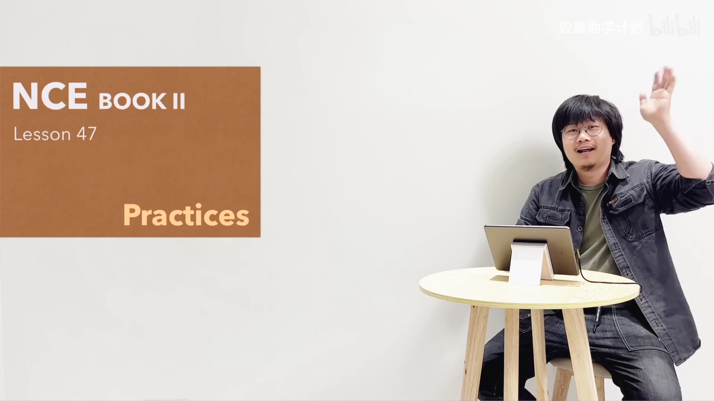

文字识别：NCE / BOOKII / Lesson 47 / Practices

### 画面 00:00:02

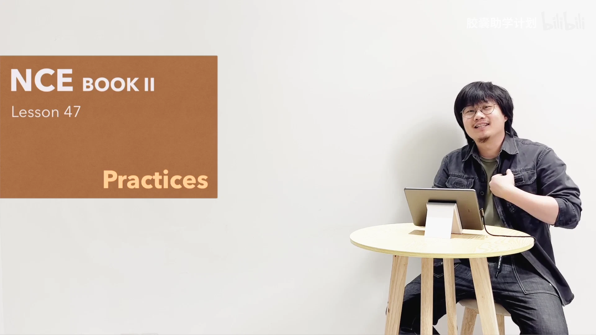

文字识别：NCE / BOOKII / Lesson 47 / Practices

### 画面 00:00:05

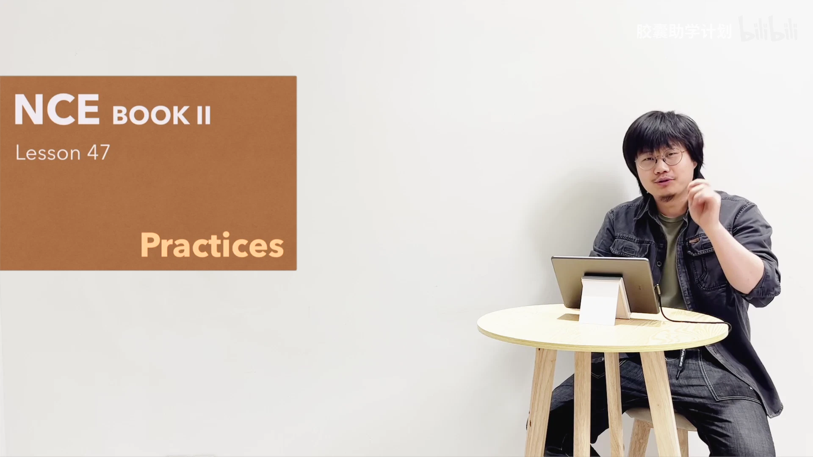

文字识别：NCE / BOOKⅡI / Lesson 47 / Practices

### 画面 00:00:08

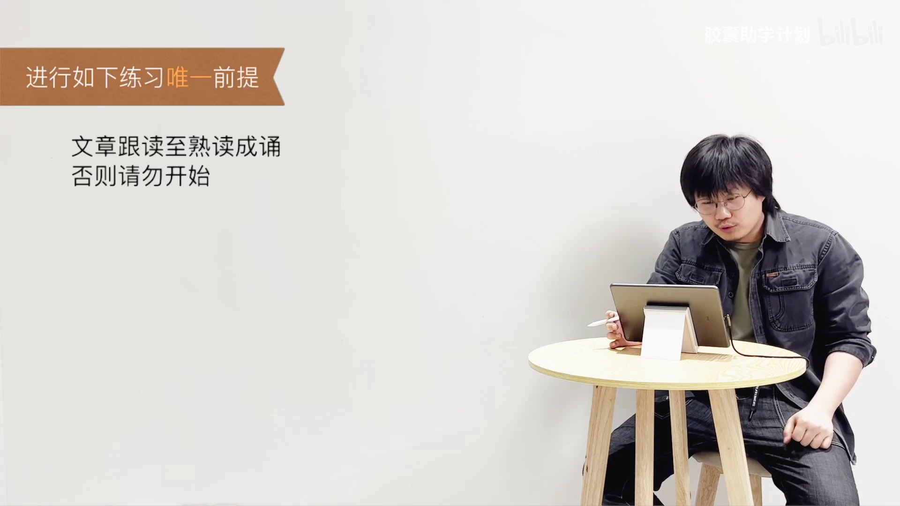

文字识别：进行如下练习唯一前提 / 文章跟读至熟读成诵 / 否则请勿开始

### 画面 00:00:17

文字识别：胶囊助学计划 bilbl / ••

### 画面 00:00:21

文字识别：胶囊助学计划

### 画面 00:00:23

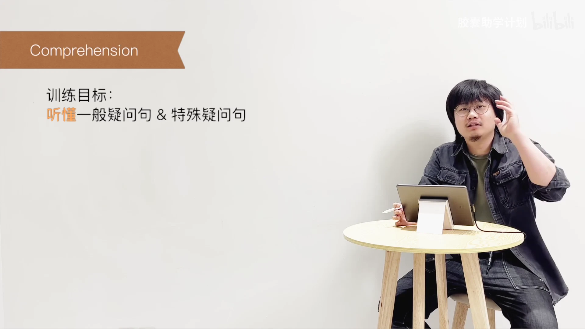

文字识别：Comprehension / 训练目标： / 听懂一般疑问句＆特殊疑问句

## 00:00:30–00:01:00

问您答，就这么简单啊！来了，第一个叫做 What is up for sale？ Next one, a public house，啊，其实就是 pub，啊。 Next one, who is the present owner？ Present 就是 now，啊，现在的拥有者，啊，Mr. N. Thompson。 Next one, has he owned it for long？ No, he hasn't。 Next one, why

### 画面 00:00:32

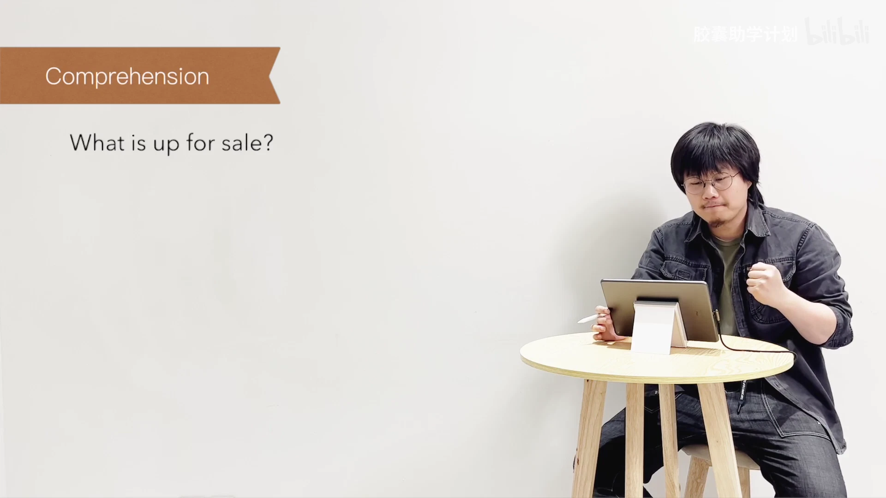

文字识别：Comprehension / What is up for sale?

### 画面 00:00:42

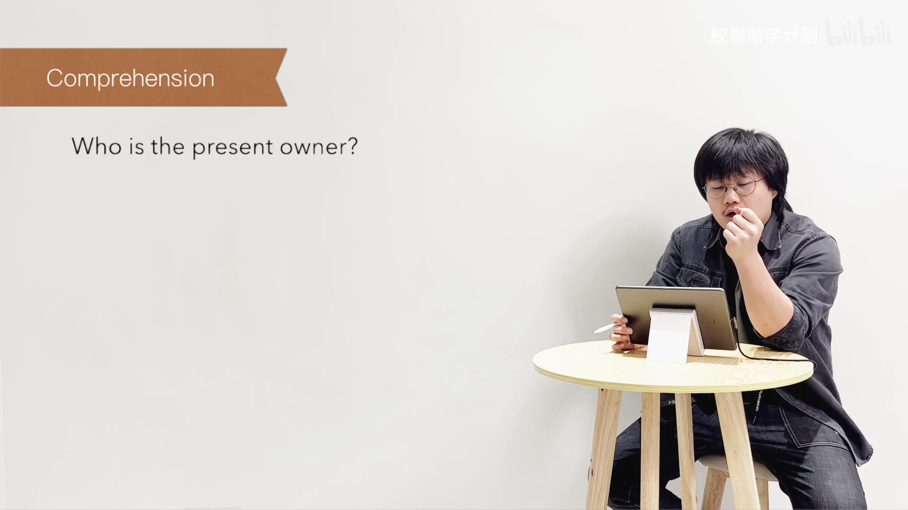

文字识别：Comprehension / Who is the present owner?

## 00:01:00–00:01:30

is he going to sell it? It is haunted by the ghost. Next one, why wouldn't he go to sleep one night? He heard a strange noise. Next one, where was it coming from? From the bar. Next one, when did he find the doors blocked? The next morning. Next one,

### 画面 00:01:08

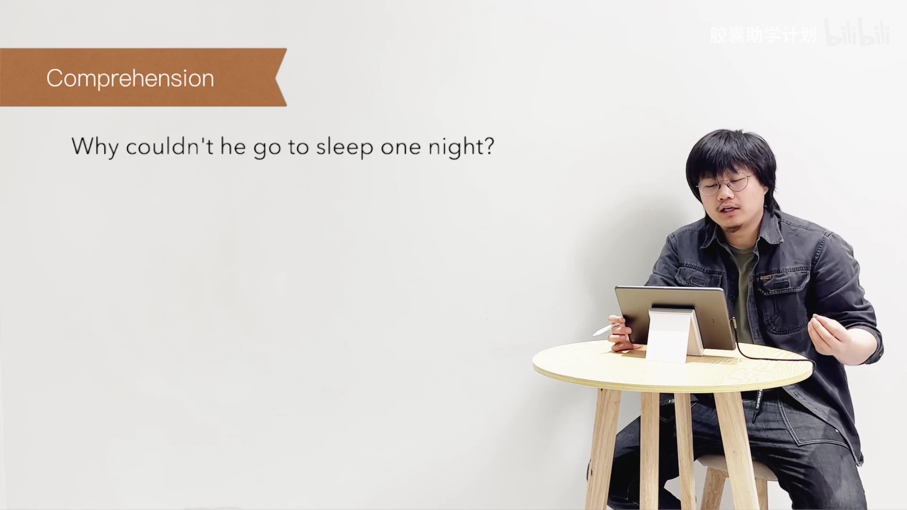

文字识别：Comprehension / Why couldn't he go to sleep one night?

### 画面 00:01:11

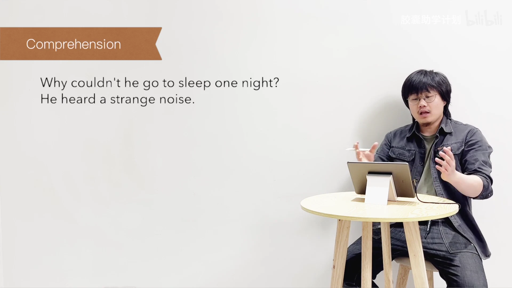

文字识别：Comprehension / Why couldn't he go to sleep one night? / He heard a strange noise.

### 画面 00:01:15

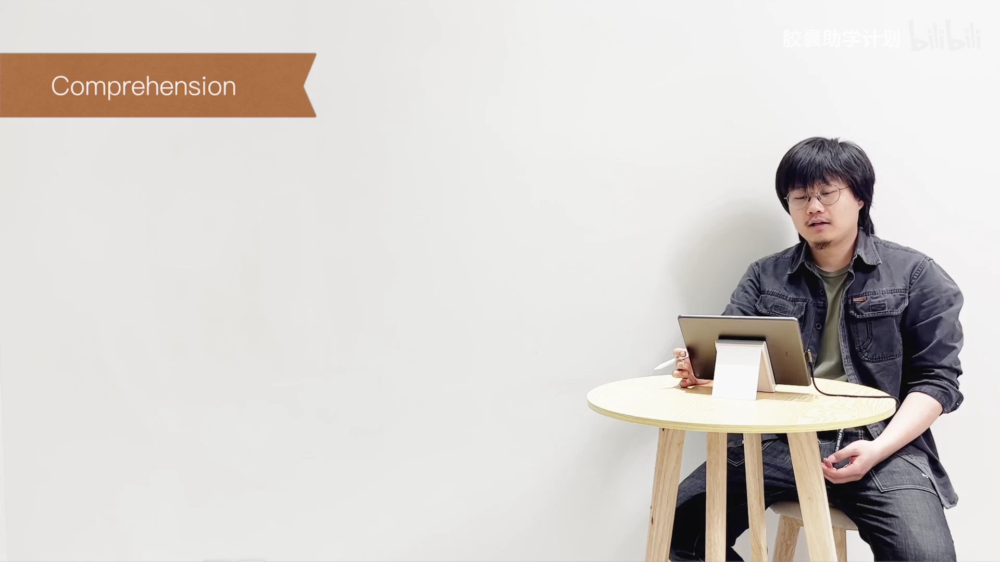

文字识别：Comprehension

### 画面 00:01:25

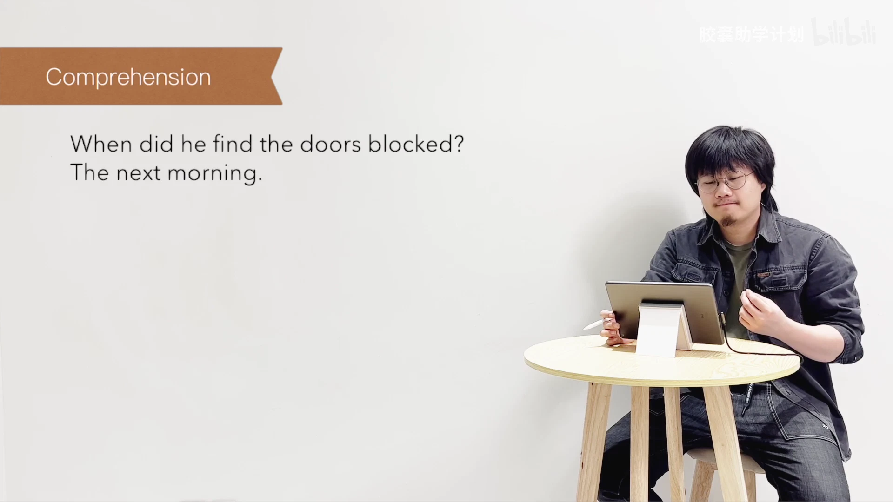

文字识别：Comprehension / When did he find the doors blocked? / The next morning.

## 00:01:30–00:02:00

what had been moved? The furniture had. Next one, when had Mr. Thompson turned the lights off? Before he went to bed the night before. Next one, were they on or off in the morning? Ah, they were on. Next one, how many empty whiskey bottles did he find?

### 画面 00:01:37

文字识别：Comprehension / When had Mr. Thompson turned the lights off ?

### 画面 00:01:52

文字识别：Comprehension / Were they on or off in the morning? / They were on.

### 画面 00:01:54

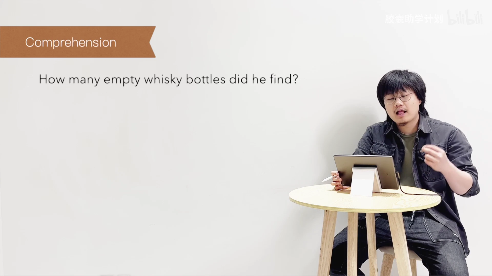

文字识别：Comprehension / How many empty whisky botles did he find?

## 00:02:00–00:02:30

five? Good. Asking questions. Ah, practice. We understand. Ah, we can say ourselves. General questions and special questions. Ability. Ah, ask questions. Ability. Okay. The first question is ask me if a public house is up for sale. General question is is before. What? What is up for sale? Ask the subject. What is up for sale? Ask the subject. What is up for sale? Ask the subject. What is up for sale? Ask the subject. What is up for sale? Ask the subject.

### 画面 00:02:02

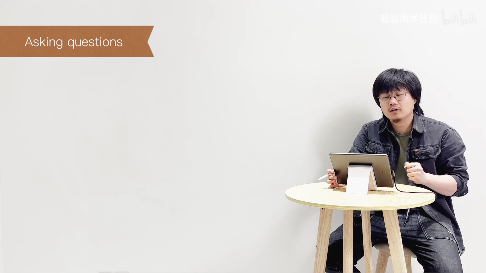

文字识别：Asking questions

### 画面 00:02:16

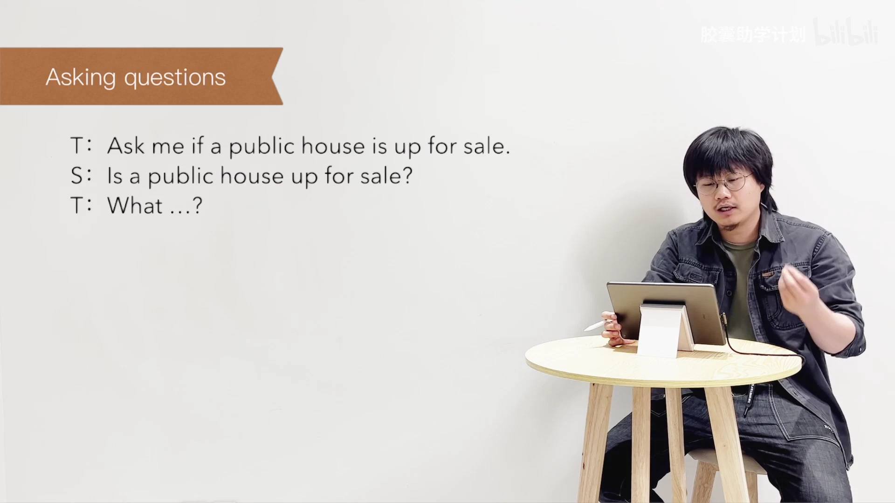

文字识别：Asking questions / T: Ask me if a public house is up for sale. / S: Is a public house up for sale? / T: What ...?

### 画面 00:02:22

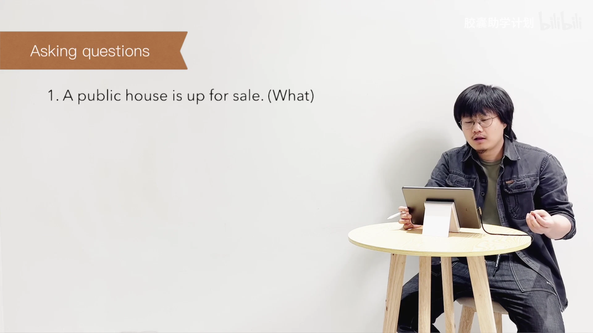

文字识别：Asking questions / 1.A public house is up for sale. (What)

### 画面 00:02:24

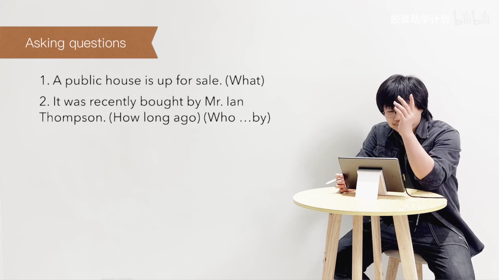

文字识别：Asking questions / 1.A public house is up for sale. (What) / 2. Ilt was recently bought by Mr. lan / Thompson.(How long ago) (Who ..by)

## 00:02:30–00:03:00

was bought was提前就可以了，对吧？How long ago?其实多久前？我个人认为在这里是对recently提问的，就最近嘛，对吧？所以答案叫How long ago was it bought by Mr.呃N Thompson?对吧？那who的点儿点儿by啊，那就是被谁买的呗，对吧？对，就是这里的Mr. N Thompson呗，对吧？呃，第三题叫He is going to sell it because it is haunted.这里注意一个小点，

### 画面 00:02:31

文字识别：Asking / questions / 1.A public H / : house is up for sale. (What) / 2.It was recently / bought by / Mr. Ian / Thompson.(Howl / / long ago) (Who ...by)

### 画面 00:02:54

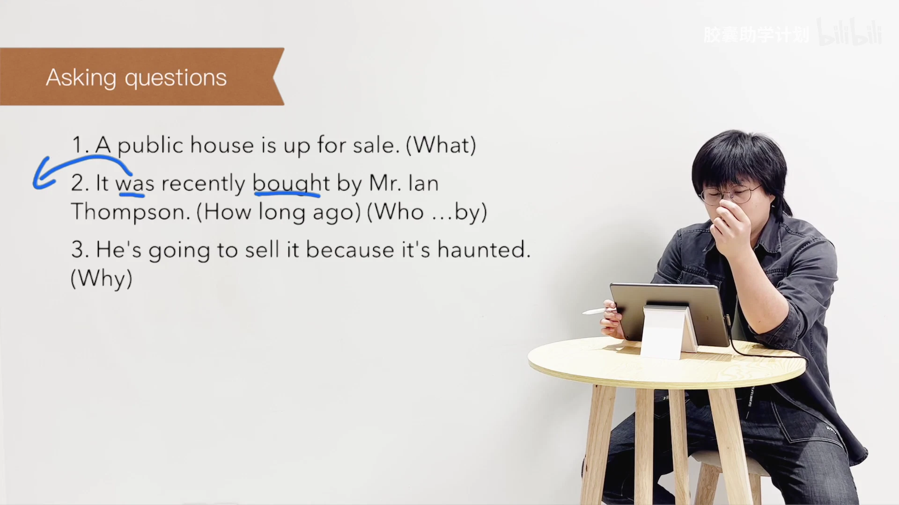

文字识别：Asking questions / 1.A public house is up for sale. (What) / 2.Ilt was recently bought by Mr. lan / Thompson.(How long ago)(Who ..by) / 3. He's going to sell it because it's haunted. / (Why)

## 00:03:00–00:03:30

because是连词,我们不看后面的,我们要看不能看because引导的那句话啊,要看主句,所以把这个is提前,对吧?叫做Is he going to sell it? Because it is haunted. Very good.呃, why直接加整句话,对吧?哎, why哎why你要把because去掉就行了嘛? Why问的正好是because,对吧?所以叫Why is he going to sell it?答案叫Because it is haunted.下一个, he heard a strange noise one night. Did提前,

### 画面 00:03:00

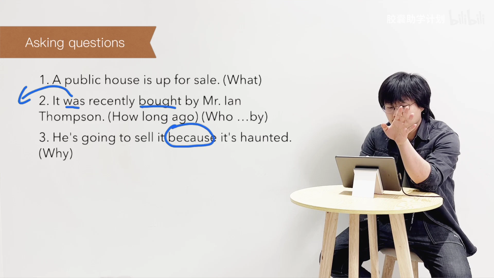

文字识别：Asking questions / 1.A public house is up for sale. (What) / 2.It was recently / bought by 1 / Mr. lan / Thompson.(How l /  long ago) (Who ...by) / 3. He's going to sell itbecause / it's haunted. / (Why)

### 画面 00:03:07

文字识别：Asking / questions / 1.Apublic / house is up for sale. (What) / 2.It was recently / bouqht by / Mr. lan / Thompson.(How / long ago) (Who ..by) / 3. He's going to sellit because i / it'shaunted. / (Why)

### 画面 00:03:18

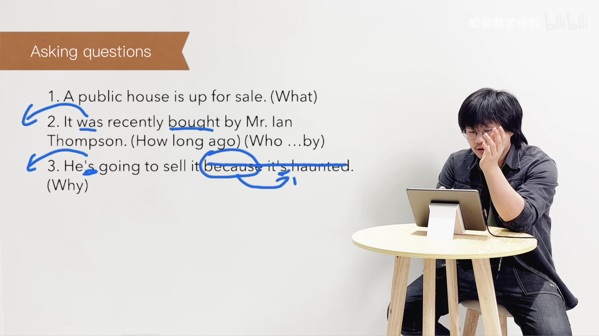

文字识别：Asking / questions / 1.Apublic / house is up for sale. (What) / 2.It / was / recently / bouahtl / by / Mr. lan / Thompson.(How / long / ago) (Who ..by) / 3. He's going to s / sell it( / becausy / anted / (Why)

### 画面 00:03:23

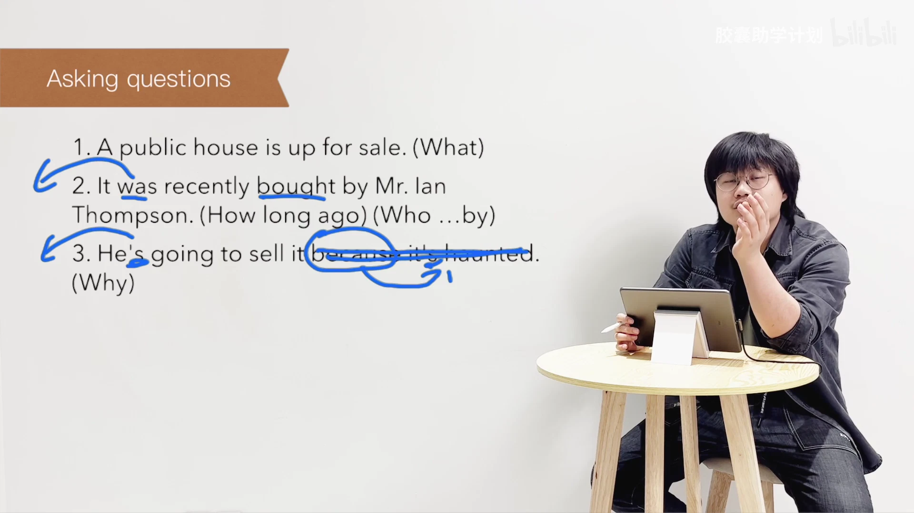

文字识别：Asking / questions / 1.Apublic / house is up for sale.(What) / 2.It was recently / bouaht by / Mr. lan / Thompson.(How / long ago) (Who …..by) / 3. He's going to sell it / (Why)

### 画面 00:03:27

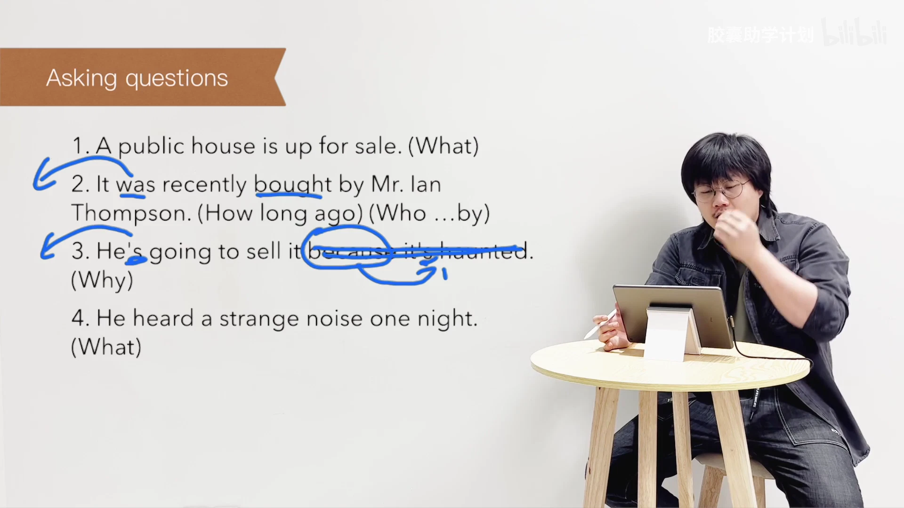

文字识别：Asking / questions / 1.Apublic / house is up for sale. (What) / 2.It was recently / bouqht by / Mr.lan / Thompson.(How / long ago) (Who …..by) / 3. He's going to sellit / (Why) / 4.He /  heard a strange noise one / night. / (What)

## 00:03:30–00:04:00

对吧？然后What对a strange noise提问，叫What did he hear one night? It was coming from the bar. Was提前，Where对Where was it coming from？对吧？对这个the bar提问就行了。Next one，第六题。He stayed awake all night. Did提前，How long对all night提问，对吧？He went to the bar next morning. Did提前，When对next morning，Where对the bar提问啊？Where did he go？啊，应该是

### 画面 00:03:36

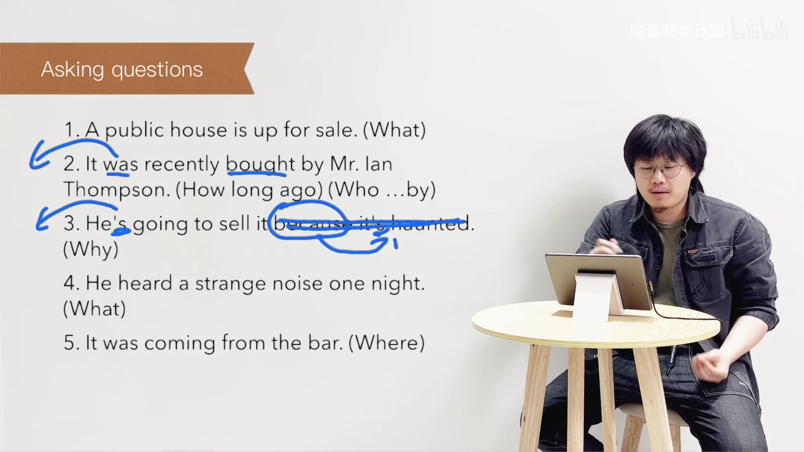

文字识别：Asking questions / 1.A public house is up for sale. (What) / 2.It was recently /  bought by Mr. lan / Thompson. (How long ago)(Who ..by) / 3. He's going to sell itk / (Why) / 4. He heard a strange noise one night. / (What) / 5. Ilt was coming from the bar. (Where)

### 画面 00:03:40

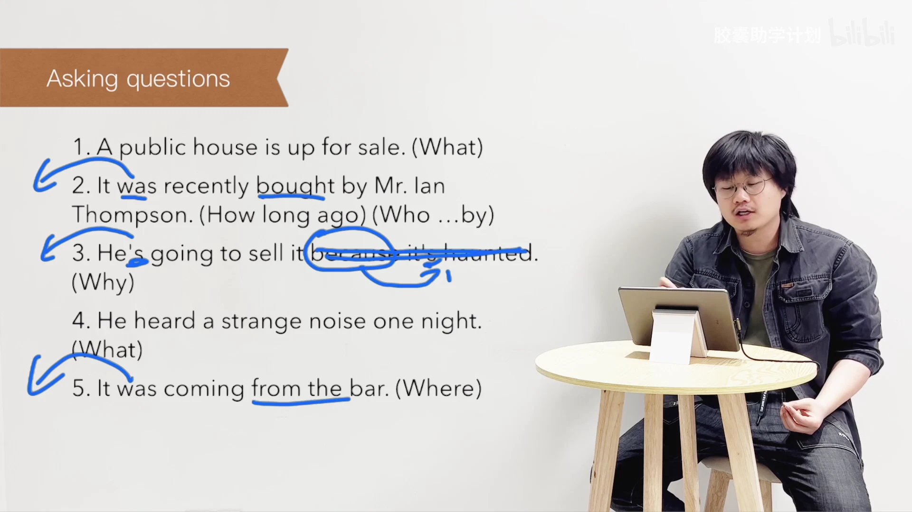

文字识别：Asking questions / 1.A public house is up for sale. (What) / 2.Ilt was recently / bought by 1 / Mr. lan / Thompson.(Howl /  long ago) (Who ..by) / 3. He's going to sell itk / (Why) / 4. He heard a strange noise one night. / (What) / 5. It was coming from the bar. (Where)

### 画面 00:03:42

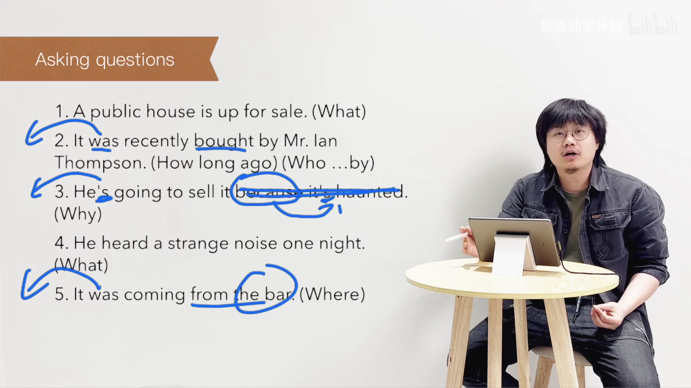

文字识别：Asking / questions / 1.Apublic H /  house is up for sale. (What) / 2. It was recently / bought by / Mr. lan / Thompson.(How / long ago) (Who ..by) / 3. He's going to sell it / (Why) / 4.He / e heard a strange noise one  / : night. / (What) / 5. It was coming ! / fromthe bar.(Where)

### 画面 00:03:44

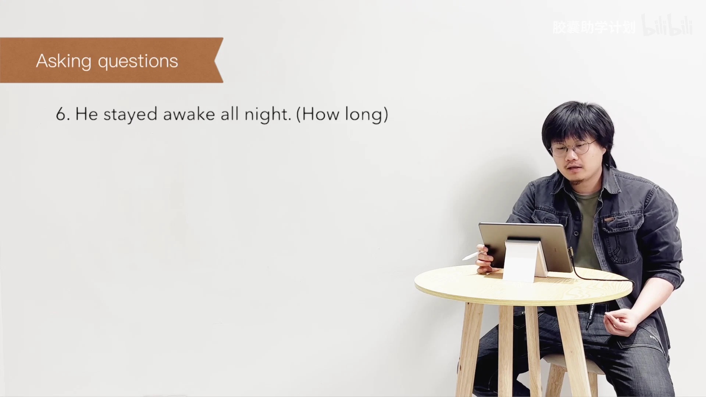

文字识别：Asking questions / 6. He stayed awake all night. (How long)

### 画面 00:03:50

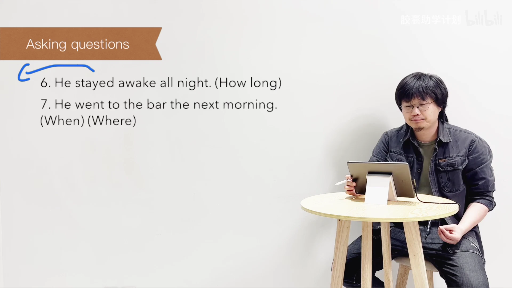

文字识别：Asking questions / 6. He stayed awake all night.(How long) / 7. He went to the bar the next morning. / (When)(Where)

### 画面 00:03:55

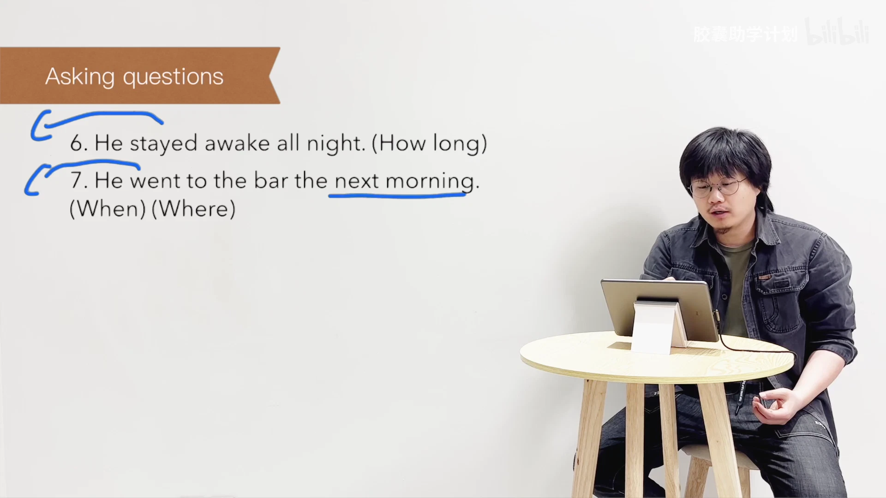

文字识别：Asking / questions / 6.He / stayed / awake all night. (How long) / 7. He went to t /  the bar the next morning. / (When) (Where)

### 画面 00:03:57

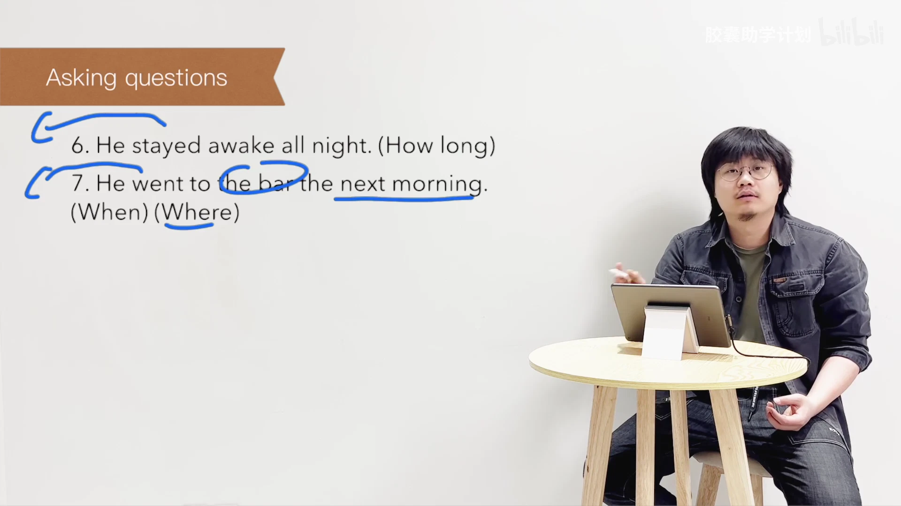

文字识别：Asking / questions / 6.He / stayed / awake all night.(How long) / he barthe / 7.He / went to / next / t morning. / (When)(Where)

## 00:04:00–00:04:30

to的吧啊. Where did he go the next morning?第八个, the doors had been blocked by chairs.过去完成时的被动, had提前,然后what,呃,你可以对the doors提问,然后what点点by这个what呢,你对the chairs提问,好吧?第九个, the furniture had been moved.哎, had往前一提啊,然后what对主语提问,不变一般疑问句,对

### 画面 00:04:03

文字识别：Asking / questions / 6.He S / stayed / awake all night. (How long) / 7. He went to / he barthe next morning. / (When) (Where) / 8. The doors had been blocked by chairs. / (What) (What ...by)

### 画面 00:04:09

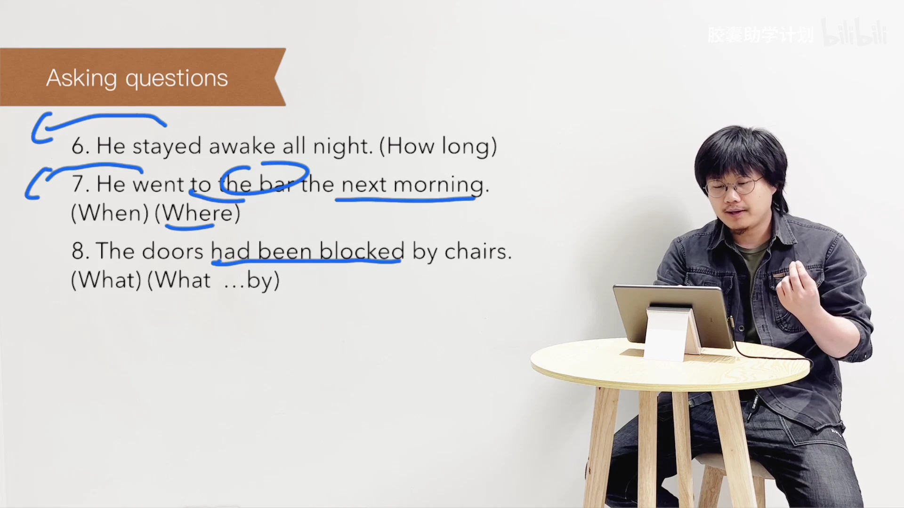

文字识别：Asking / questions / 6.He / stayed / awake all night. (How long) / 7. He went to / he barthe next morning. / (When) (Where) / 8.The / doors /  had been blocked by chairs. / (What) (What ...by)

### 画面 00:04:11

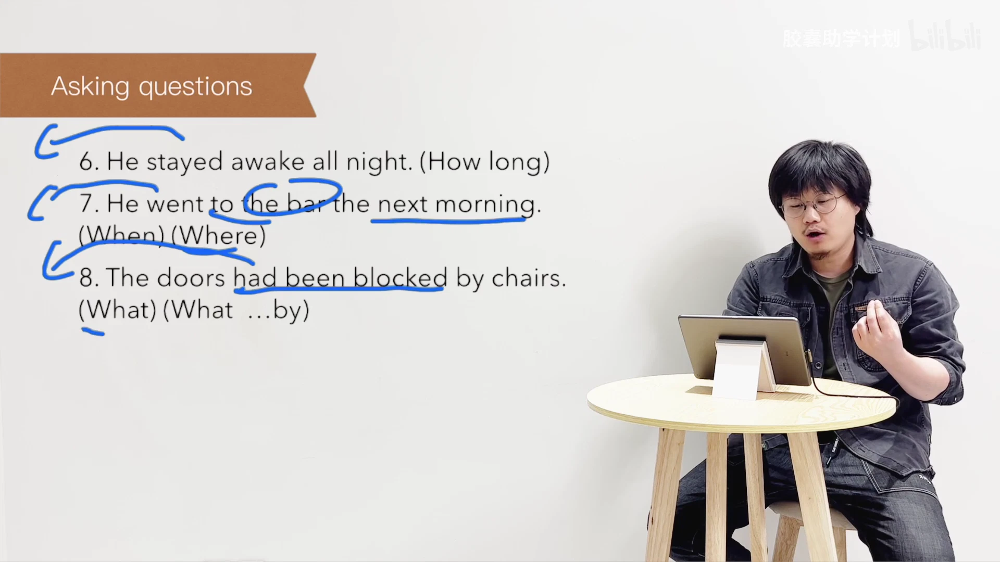

文字识别：Asking / questions / 6.He / stayed / awake all night.(How long) / 7.He / wentto / he barthe / e next morning. / (When) (Where) / 8.The / doors / had been blocked by chairs. / (What) (What / t ...by)

### 画面 00:04:14

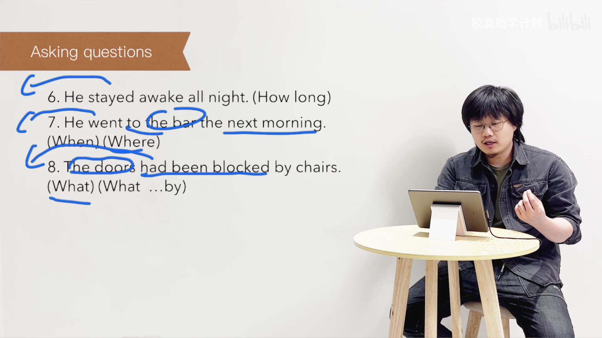

文字识别：Asking / questions / 6.He / stayed / awake all night. (How long) / 7. He wentto / he barthe / : next morning. / (When)(Where) / 8. The door / had been blocked by chairs. / (What) (What / t ...by)

### 画面 00:04:18

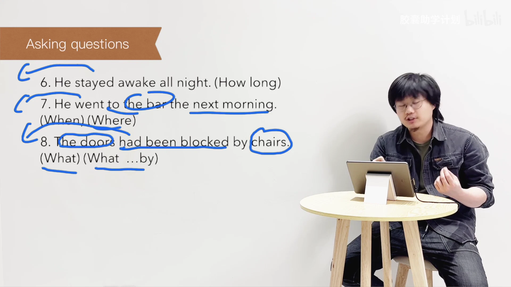

文字识别：Asking / questions / 6.He / stayed / awake all night. (How long) / 7.He / wentto / he barthe / next / t morning. / (When)(Where) / 8. The doors / had been blocked by / Chairs. / (What) (What /  ….by)

### 画面 00:04:25

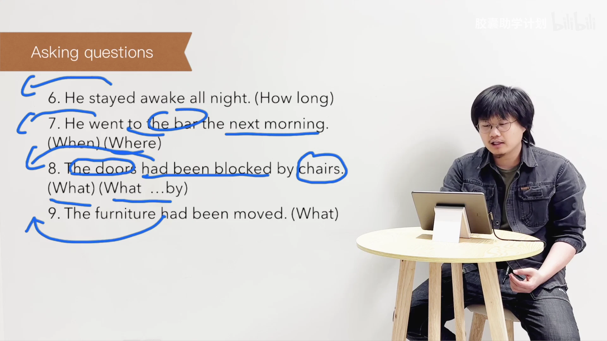

文字识别：Asking / questions / 6.He / stayed / awake all night. (How long) / 7.He wentto / he barthe next morning. / (When)(Where) / 8. The door / had been blocked by / Chairs. / (What)(What / t ..by) / 9.The / furniture had been moved.(What)

## 00:04:30–00:05:00

吧？直接叫做 What had been moved. 第十题 The lights were on. 很简单，were 提前，were 对主语提，what 对主语提问是吧？ Tell the story. 第一单元我 tell了很多遍，很很多文章了，对吧？各位随便找一篇文章看一下，大概模仿一下就可以了。可以错一点点，不能太慢，所以文章必须要读到很熟。文章还磕磕绊绊的时候，这个练习你几乎不可能做啊。看着

### 画面 00:04:37

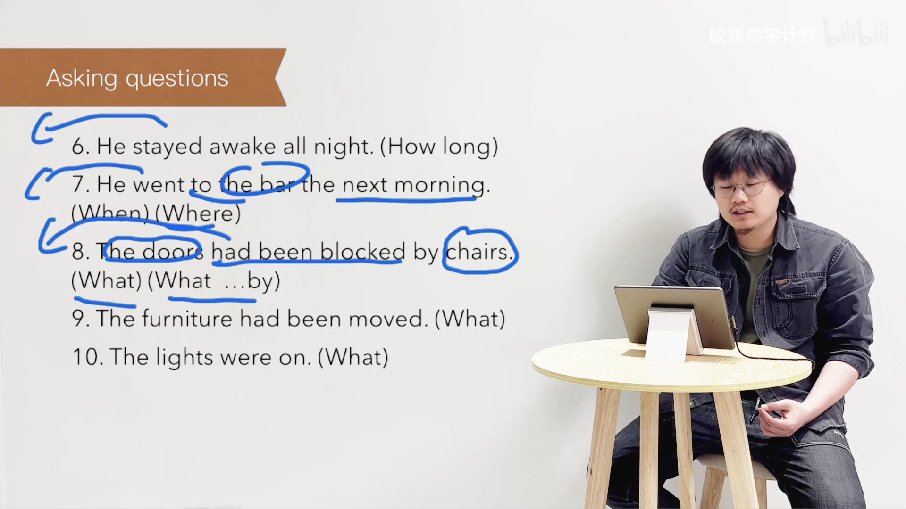

文字识别：Asking questions / 6. He stayed / awake all night. (How long) / 7.He went tot / he barthe next morning. / (When)(Where) / 8. The door / had been blocked by / Chairs. / (What) (What …..by) / 9. Thef / furniture / had been moved.(What) / 10.The lights were on. (What)

### 画面 00:04:41

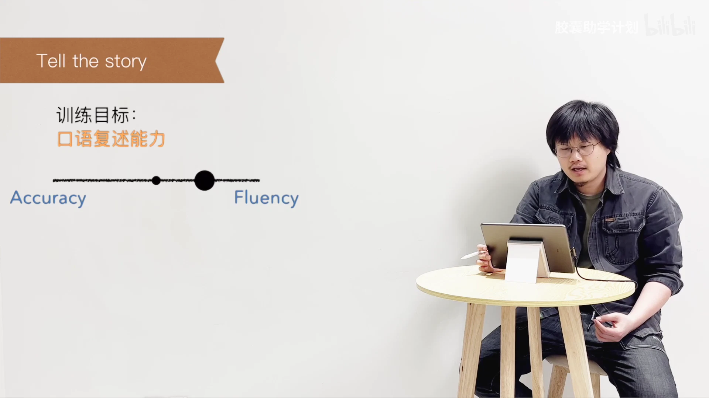

文字识别：Tell the story / 训练目标： / 口语复述能力 / Accuracy / Fluency

### 画面 00:04:59

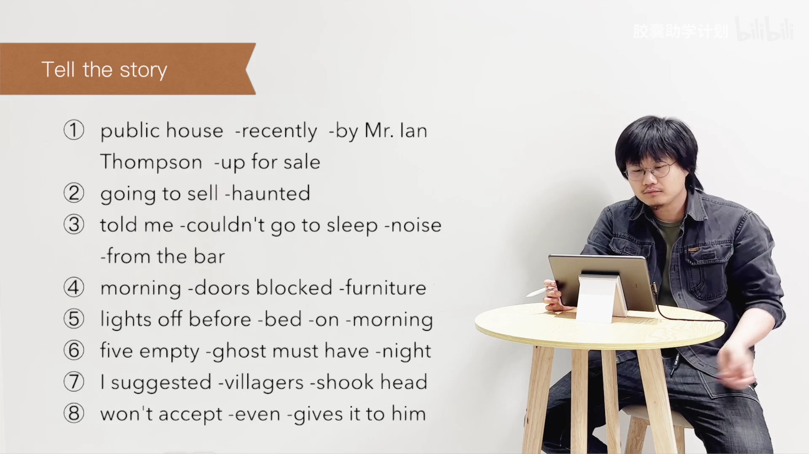

文字识别：Tell the story / ① / public house -recently -by Mr. lan / Thompson -up for sale / going to sell -haunted / told me -couldn't go to sleep -noise / -from the bar / morning -doors blocked -furniture /  lights off before -bed -on -morning / five empty -ghost must have -night / 6 / I suggested -villagers -shook head / 8 / won't accept -even -gives it to him

## 00:05:00–00:05:30

这些就可以了。然后摘要写作练习的，我们是写作复述能力，这个对于我们考试写作也好，对于工作的邮件写作也好，帮助非常的大。呃，来这对答案就可以啊。然后 topic for discussion，我们还是现在水平不够，只能跟大家说一下话题。比如说第一个叫 if you wanted to buy a house， what kinds of thing would？第一， persuade you to buy it， and b，第二， make you decide not to buy。如果你

### 画面 00:05:01

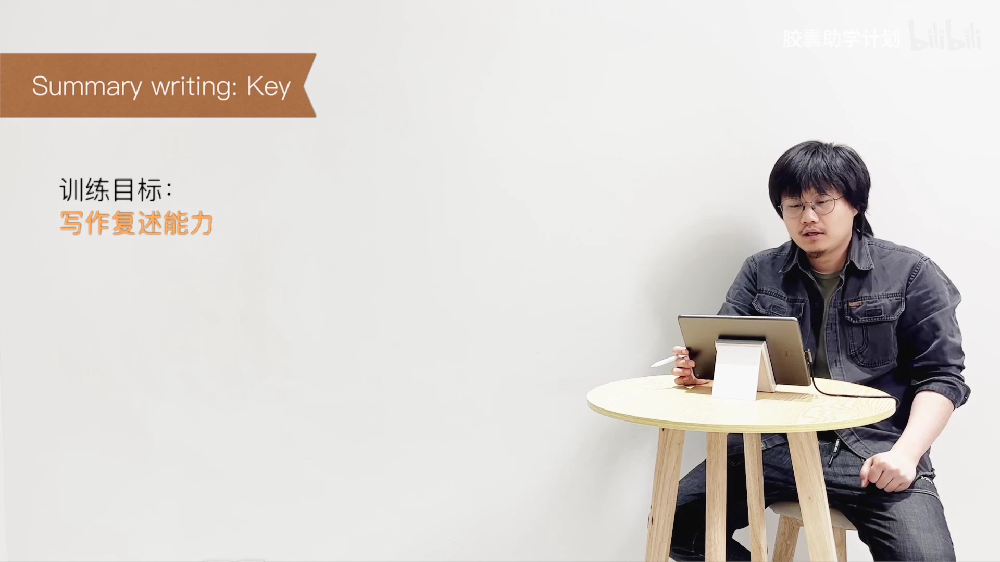

文字识别：Summary writing: Key / 训练目标： / 写作复述能力

### 画面 00:05:11

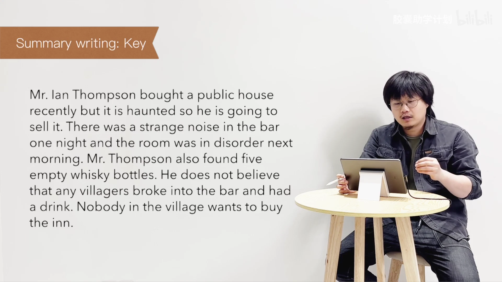

文字识别：Summary writing: Key / Mr. lan Thompson bought a public house / recently but it is haunted so he is going to / sell it. There was a strange noise in the bar / one night and the room was in disorder next / morning. Mr. Thompson also found five / empty whisky bottles. He does not believe / that any villagers broke into the bar and had / a drink. Nobody in the village wants to buy / theinn.

### 画面 00:05:13

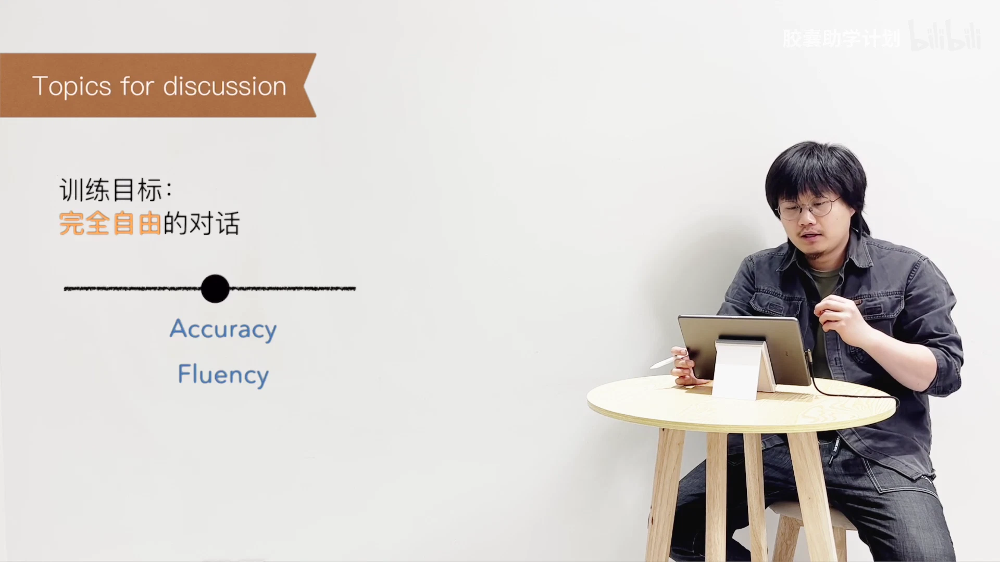

文字识别：Topics for discussion / 训练目标： / 完全自由的对话 / Accuracy / Fluency

### 画面 00:05:15

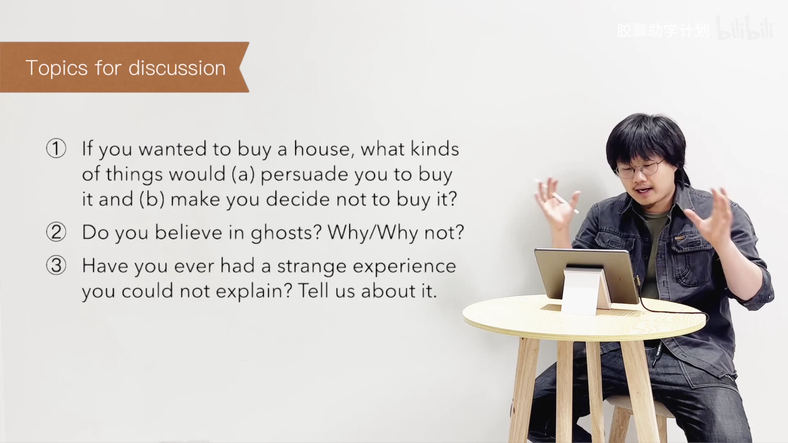

文字识别：Topics for discussion / If you wanted to buy a house, what kinds / of things would (a) persuade you to buy / it and (b) make you decide not to buy it? / Do you believe in ghosts? Why/Why not? / Have you ever had a strange experience / 3 / you could not explain? Tell us about it.

## 00:05:30–00:06:00

想买一个房子，什么样的事情会劝说你去买它？什么样的事情会让你决定不去买它？啊，各位如果买过房子，正好可以聊一聊。 Do you believe in ghosts? Why or not? 你相信鬼魂吗？相信为什么相信？不相信为什么不相信？第三题， Have you ever had a strange experience you could not explain? Tell us about it. 说你有没有过一个特别奇怪的经验？你没有办法解释，给我们讲一讲吧。 Okay, very good. 加作

### 画面 00:05:45

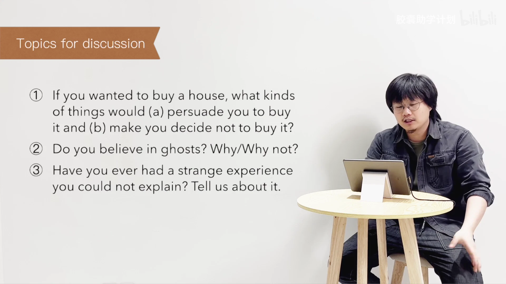

文字识别：Topics for discussion / If you wanted to buy a house, what kinds / of things would (a) persuade you to buy / it and (b) make you decide not to buy it? / Do you believe in ghosts? Why/Why not? / Have you ever had a strange experience / 3 / you could not explain? Tell us about it.

### 画面 00:05:59

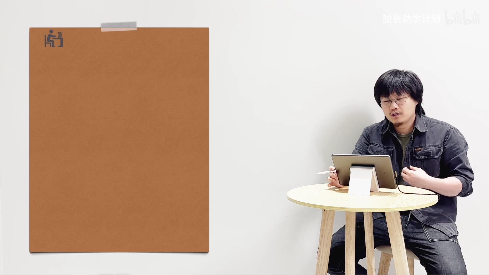

## 00:06:00–00:06:30

业，ask me if一定要先写，确定自己写的是对的，看着自己写的答案，大声朗读啊。第二，摘要写作写完来这里对答案，tell the story。文章读到非常熟了之后，熟读成诵之后，来这里进行口语复述，好吧？那以上就是本期视频的全部内容了。如果各位喜欢我们的课程呢，欢迎各位关注、订阅、一键三连，长长按点赞，强烈推荐。Okay, see you next time.

### 画面 00:06:01

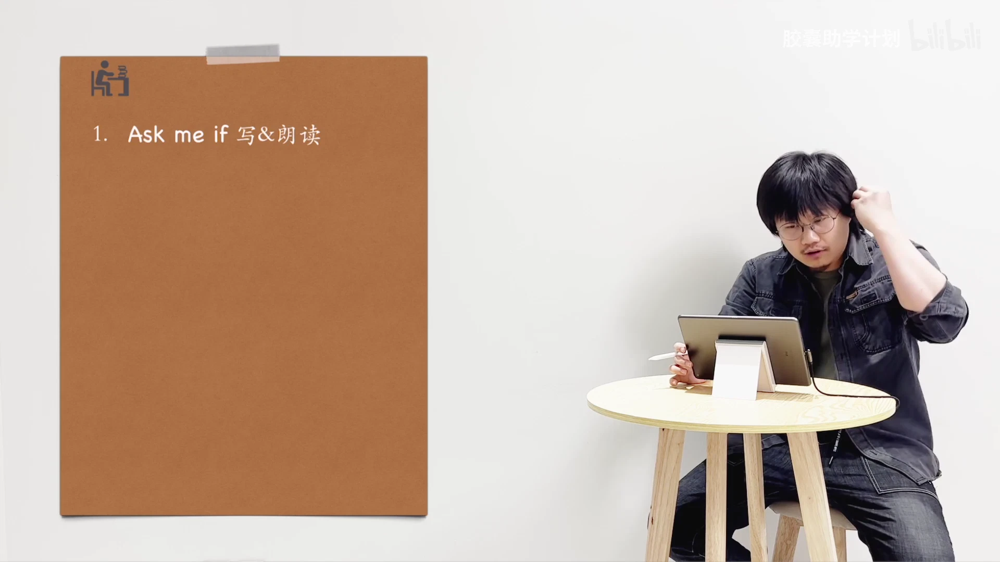

文字识别：1.Ask me if写&朗读

### 画面 00:06:07

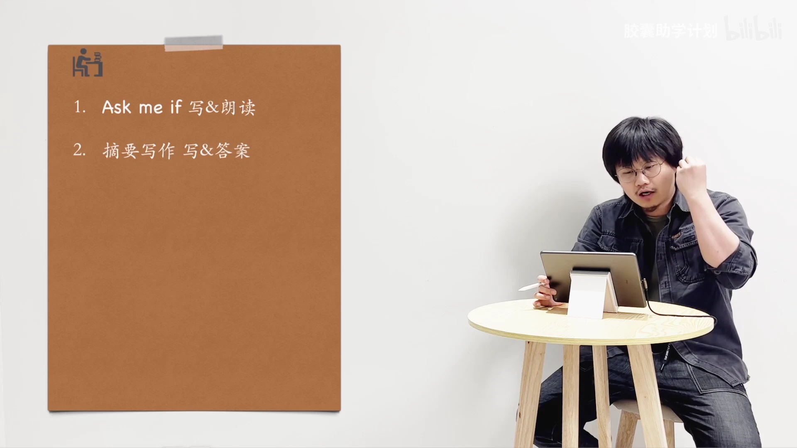

文字识别：1.Ask me if写&朗读 / 2.摘要写作写&答案

### 画面 00:06:09

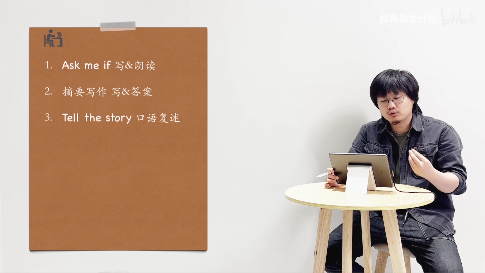

文字识别：1.Ask me if写&朗读 / 摘要写作写&答案 / 3.Tell the story 口语复述

### 画面 00:06:15

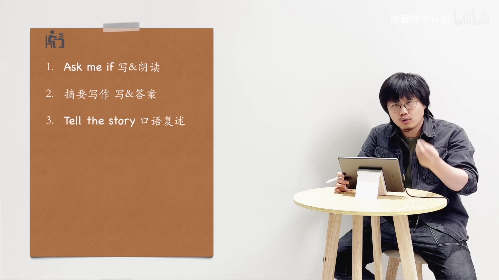

文字识别：1.Ask me if写&朗读 / 摘要写作写&答案 / 3.Tell the story 口语复述

### 画面 00:06:17

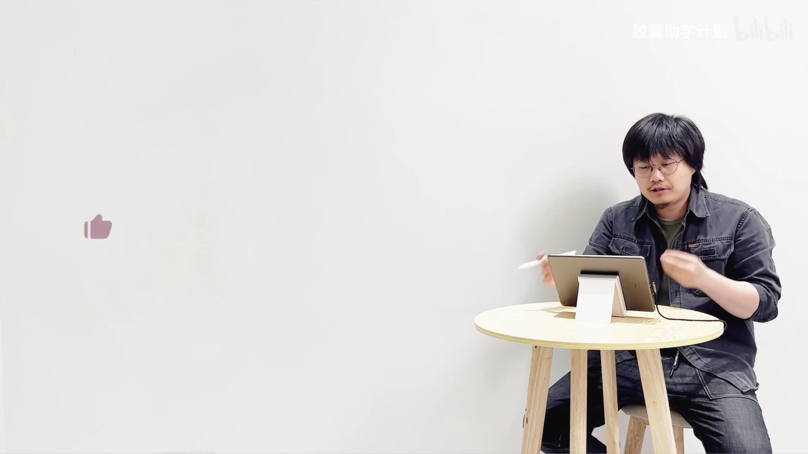

文字识别：👍

## 00:06:30–00:06:42

### 画面 00:06:30

### 画面 00:06:32

文字识别：CAPSULEACADEMY / 胶囊助学计划 / 小红书 / Lecturer / □ / 口 / Leo / OE

### 画面 00:06:35

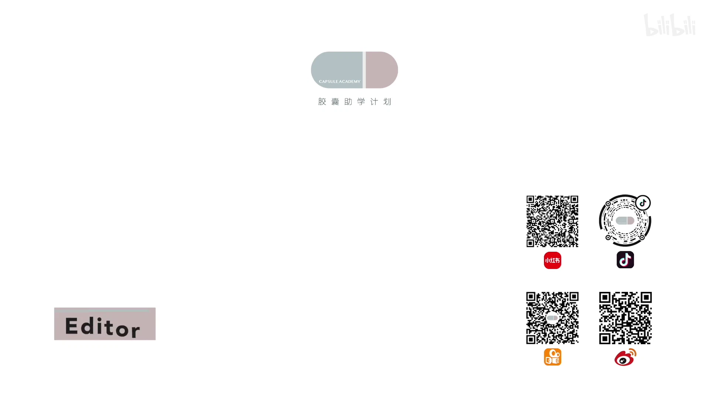

文字识别：CAPSULEACADEMY / 胶囊助学计划 / 『 / 小红书 / □ / Editor / OE

### 画面 00:06:38

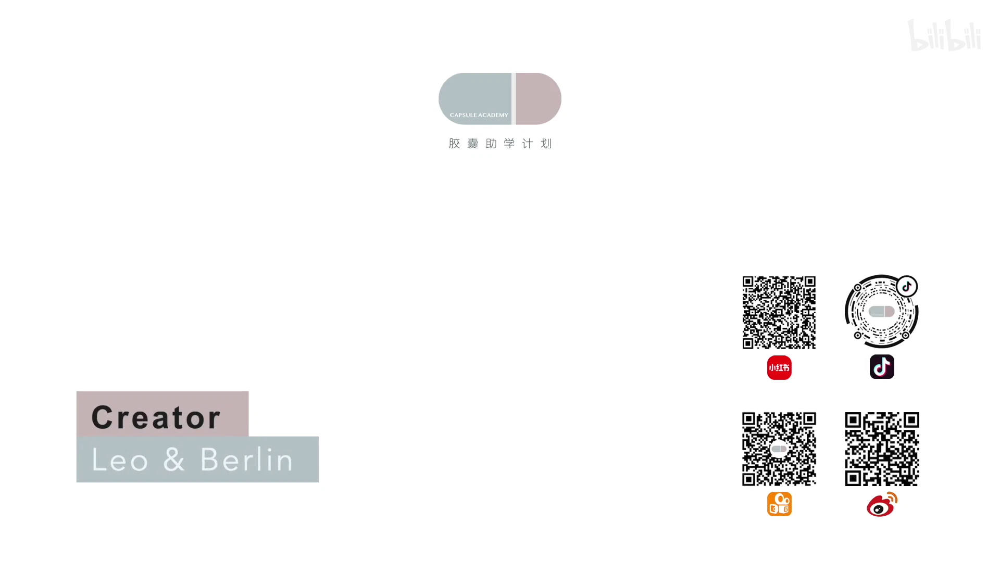

文字识别：CAPSULEACADEMY / 胶囊助学计划 / 『 / 小红书 / Creator / Leo & Berlin

### 画面 00:06:40

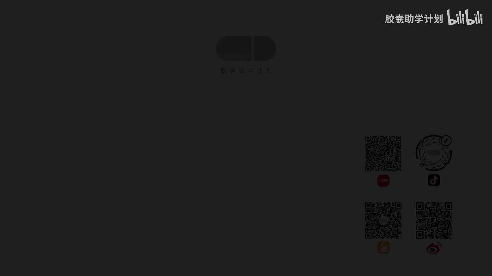

文字识别：Bilibili / 胶囊助学计划 / 小红书

### 画面 00:06:42

文字识别：bilibili / 胶囊助学计划

