# L048 单词

快速机器解析：语音为单模型转写，未进行独立交叉校对或人工复核；画面每秒采样并按变化选帧，短时文字和标记可能遗漏。截图时间约有 1 秒误差。图片有损压缩；遇到疑点请按时间查看 Google Drive 原视频。

## 00:00:00–00:00:30

Hello everyone, welcome to Capsule Academy. This is Leo. Today we are going to learn New Concept English Book Two Lesson Forty Eight Words. 那老习惯进入正式课程之前，我们先看几个小的问题。首先，如何表达私人收藏啊？接下来呢，如何表达与此同时？那带着这两个问题，Hope you guys enjoy it. 好，我们先看第一个单词叫做

### 画面 00:00:00

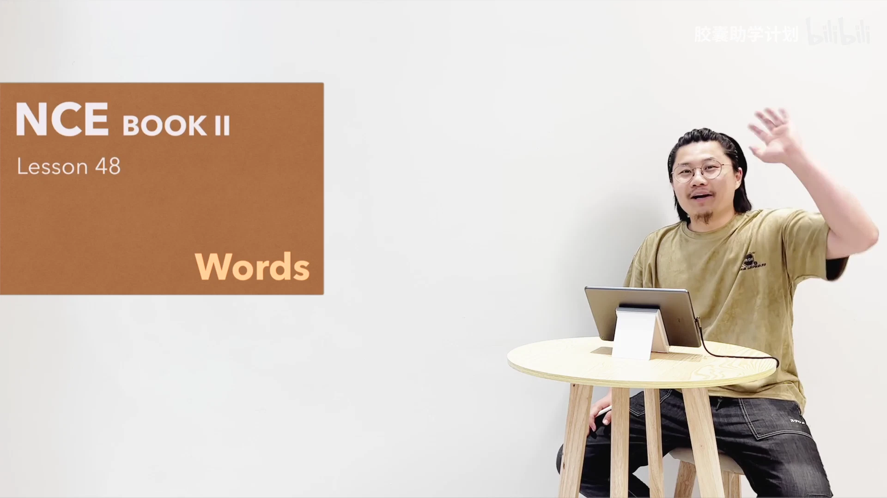

文字识别：NCE / BOOKⅡI / Lesson 48 / Words

### 画面 00:00:08

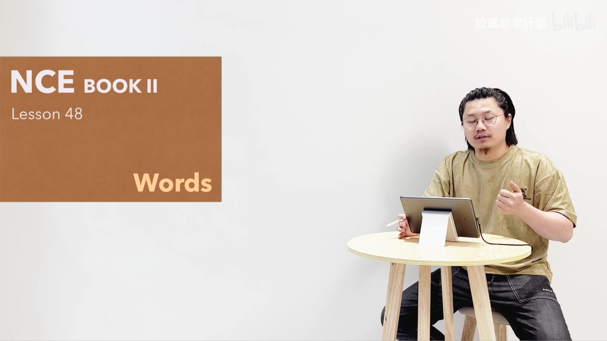

文字识别：NCE / BOOKII / Lesson 48 / Words

### 画面 00:00:10

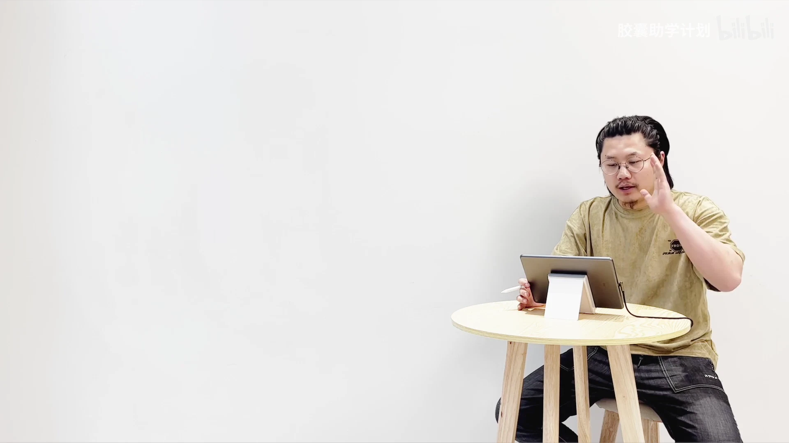

文字识别：FROA

### 画面 00:00:12

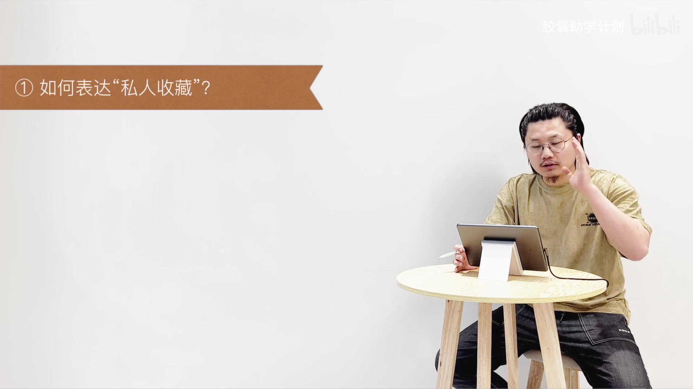

文字识别：①如何表达“私人收藏”？ / FROA

### 画面 00:00:16

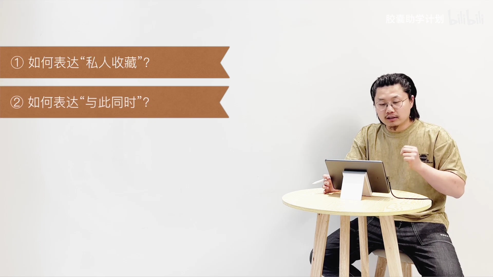

文字识别：①如何表达“私人收藏”？ / 如何表达“与此同时” / ROM

### 画面 00:00:21

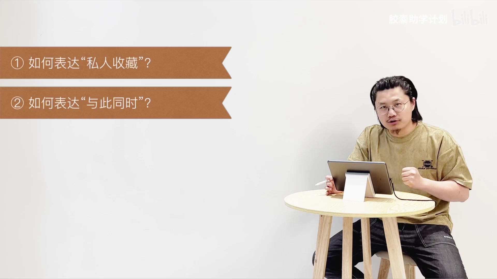

文字识别：①如何表达“私人收藏”？ / 如何表达“与此同时”?

### 画面 00:00:23

文字识别：胶囊助学计划 bilbl

### 画面 00:00:26

### 画面 00:00:28

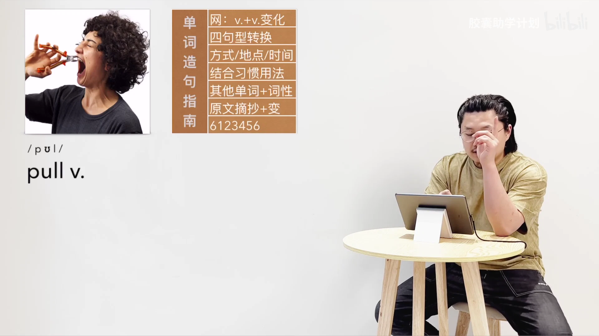

文字识别：单词造句指南 / 网：v.+v.变化 / 四句型转换 / 方式/地点/时间 / 结合习惯用法 / 其他单词+词性 / 原文摘抄+变 / 6123456 / /pul/ / pull v.

## 00:00:30–00:01:00

pull，最后注意那个音啊，舌尖要舔上牙龈。看我啊，叫做 pull。 Okay, very good. 那 pull 其实最基本的意思是推拉的那个拉啊。我们说推门叫做 push， p u s h 啊，叫做 push 这个动作，对吧？那生孩子其实也是 push，往外推啊。你去看美剧啊，或者说美国的电影生孩子的时候就喊 push push 啊。 Okay， 那 pull 呢就是往外拉。

### 画面 00:00:30

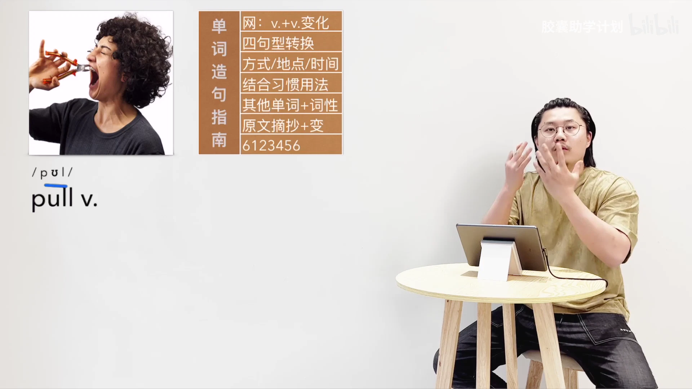

文字识别：单词造句指南 / 网：v.+v.变化 / 四句型转换 / 方式/地点/时间 / 结合习惯用法 / 其他单词+词性 / 原文摘抄+变 / 6123456 / /pul/ / pull v.

### 画面 00:00:35

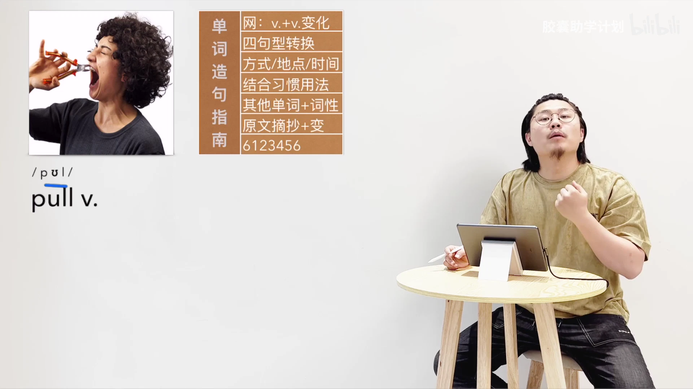

文字识别：单词造句指南 / 网：v.+v.变化 / 四句型转换 / 方式/地点/时间 / 结合习惯用法 / 其他单词+词性 / 原文摘抄+变 / 6123456 / /pul/ / pull v.

### 画面 00:00:38

文字识别：单词造句指南 / 网：v.+v.变化 / 四句型转换 / 方式/地点/时间 / 结合习惯用法 / 其他单词+词性 / 原文摘抄+变 / 6123456 / /pul/ / pull v.

### 画面 00:00:41

文字识别：单词造句指南 / 网：v.+v.变化 / 四句型转换 / 方式/地点/时间 / 结合习惯用法 / 其他单词+词性 / 原文摘抄+变 / 6123456 / /pul/ / pull v.

### 画面 00:00:45

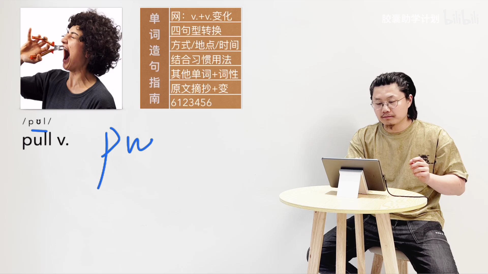

文字识别：单词造句指南 / 网：v.+v.变化 / 四句型转换 / 方式/地点/时间 / 结合习惯用法 / 其他单词+词性 / 原文摘抄+变 / 6123456 / /pul/ / pull v. / W

### 画面 00:00:47

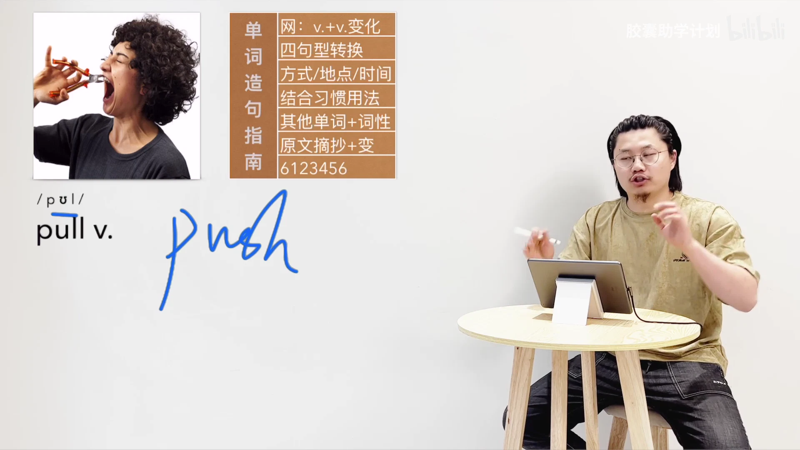

文字识别：单词造句指南 / 网：v.+v.变化 / 四句型转换 / 方式/地点/时间 / 结合习惯用法 / 其他单词+词性 / 原文摘抄+变 / 6123456 / /pul/ / pull v. / WI

### 画面 00:00:50

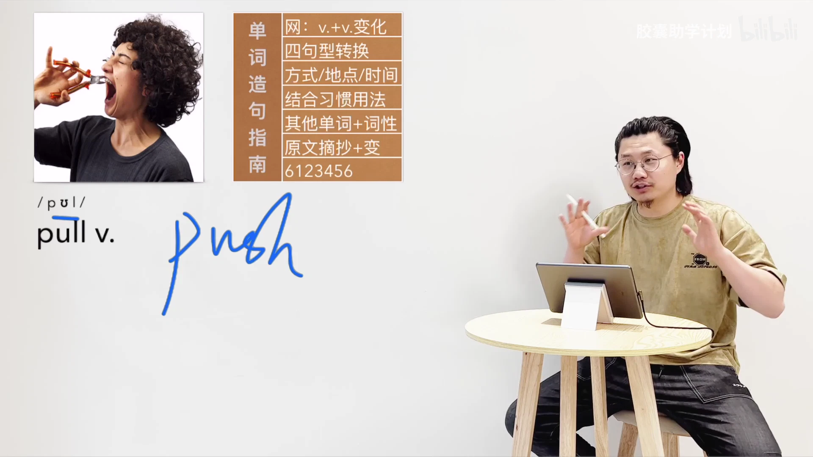

文字识别：单词造句指南 / 网：v.+v.变化 / 四句型转换 / 方式/地点/时间 / 结合习惯用法 / 其他单词+词性 / 原文摘抄+变 / 6123456 / /pul/ / pull v. / W

### 画面 00:00:54

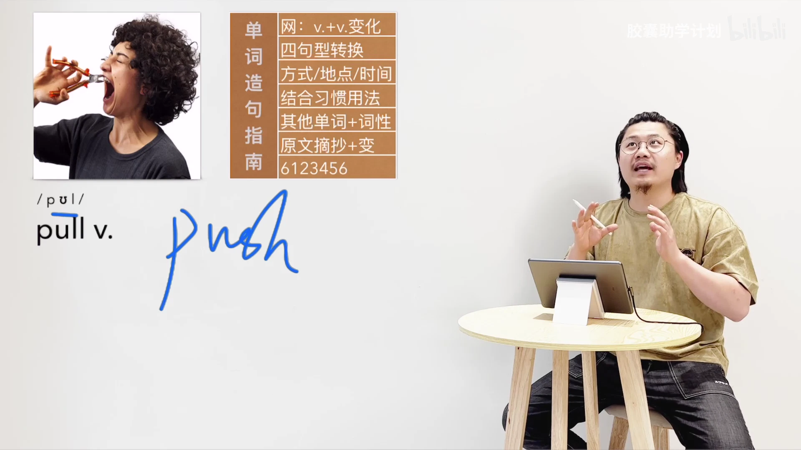

文字识别：单词造句指南 / 网：v.+v.变化 / 四句型转换 / 方式/地点/时间 / 结合习惯用法 / 其他单词+词性 / 原文摘抄+变 / 6123456 / /pul/ / pūll v. / W4

### 画面 00:00:56

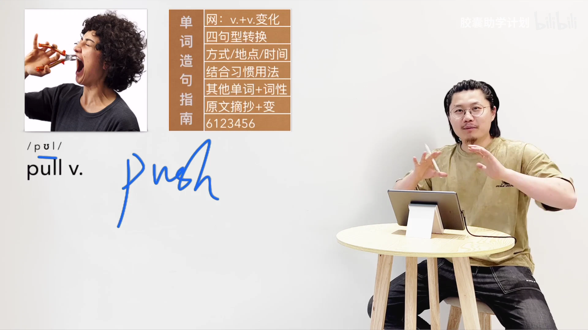

文字识别：单词造句指南 / 网：v.+v.变化 / 四句型转换 / 方式/地点/时间 / 结合习惯用法 / 其他单词+词性 / 原文摘抄+变 / 6123456 / /pul/ / pull v. / WI

### 画面 00:00:58

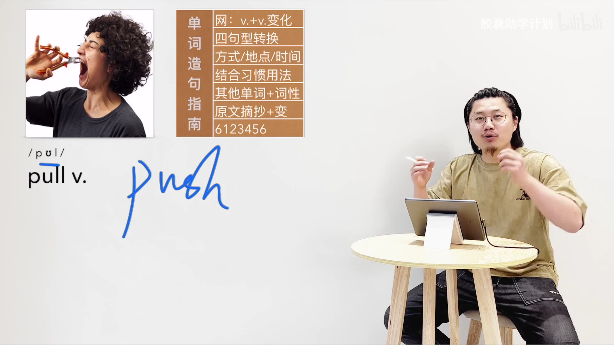

文字识别：单词造句指南 / 网：v.+v.变化 / 四句型转换 / 方式/地点/时间 / 结合习惯用法 / 其他单词+词性 / 原文摘抄+变 / 6123456 / /pul/ / pull v. / W

## 00:01:00–00:01:30

那拔牙这个过程不也是往外拉吗？其实，对吧？啊，所以它叫做 pull. Okay, very good.那比如说原文给了一句话，我们单词造句，我直接给大家拿了一句原文，叫做 My dentist has just pulled out one of my teeth. 啊，他刚刚把我的一个牙给拔出来了。 Okay, 注意接下来我们要做的事情是动词加动词的变化，也就是说我们别的地方尽量几乎不变，重点就变这个地方的时态。比如说，你看我现在把它

### 画面 00:01:00

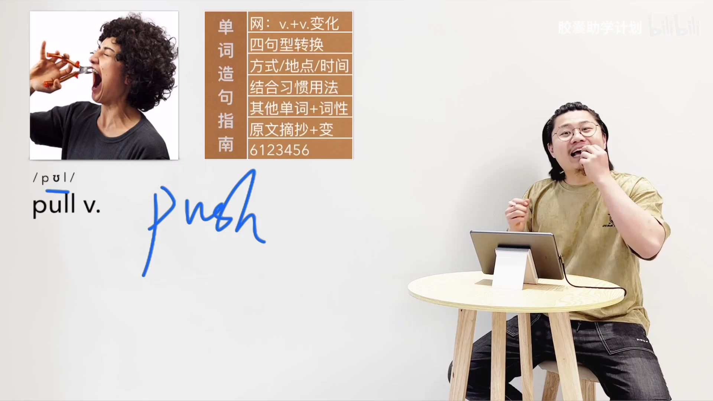

文字识别：单词造句指南 / 网：v.+v.变化 / 四句型转换 / 方式/地点/时间 / 结合习惯用法 / 其他单词+词性 / 原文摘抄+变 / 6123456 / /pul/ / pull v. / h

### 画面 00:01:05

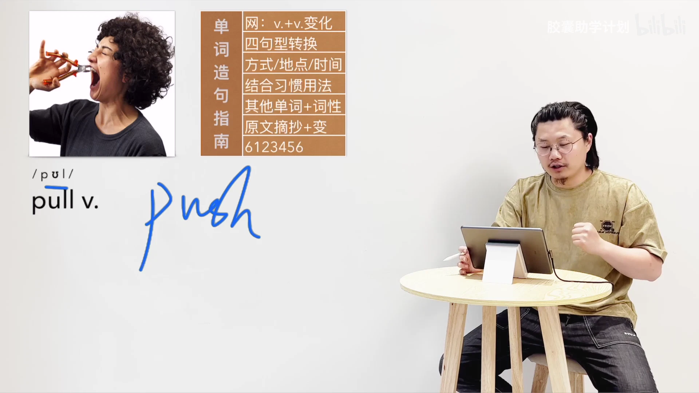

文字识别：单词造句指南 / 网：v.+v.变化 / 四句型转换 / 方式/地点/时间 / 结合习惯用法 / 其他单词+词性 / 原文摘抄+变 / 6123456 / /pul/ / pull v. / W / ROM

### 画面 00:01:07

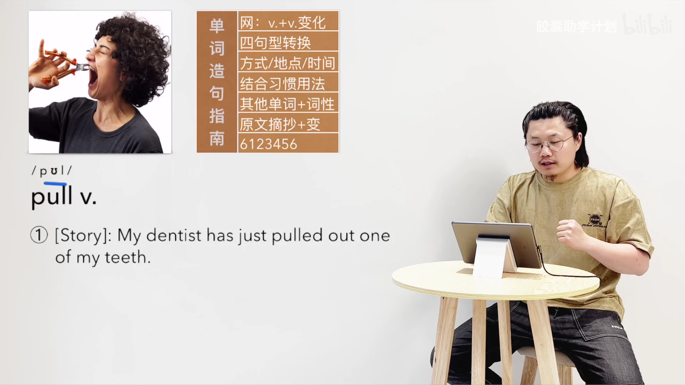

文字识别：单词造句指南 / 网：v.+v.变化 / 四句型转换 / 方式/地点/时间 / 结合习惯用法 / 其他单词+词性 / 原文摘抄+变 / 6123456 / /pul/ / pull v. / ① [Story]: My dentist has just pulled out one / of my teeth.

### 画面 00:01:10

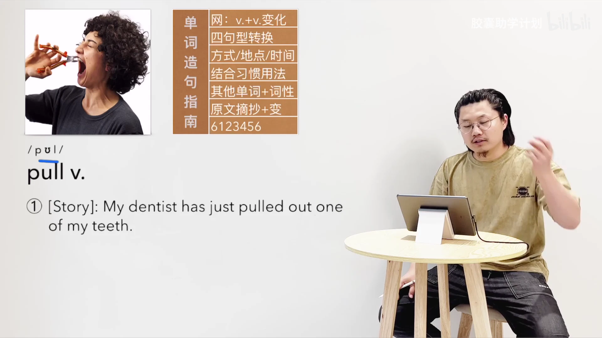

文字识别：单词造句指南 / 网：v.+v.变化 / 四句型转换 / 方式/地点/时间 / 结合习惯用法 / 其他单词+词性 / 原文摘抄+变 / 6123456 / /pul1 / pull v. / ① [Story]: My dentist has just pulled out one / of my teeth.

### 画面 00:01:19

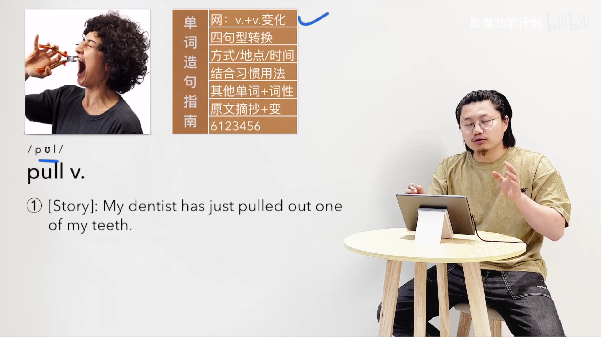

文字识别：单词造句指南 / 网：v.+v.变化 / 四句型转换 / 方式/地点/时间 / 结合习惯用法 / 其他单词+词性 / 原文摘抄+变 / 6123456 / /pul/ / pull v. / ① [Story]: My dentist has just pulled out one / of my teeth.

### 画面 00:01:21

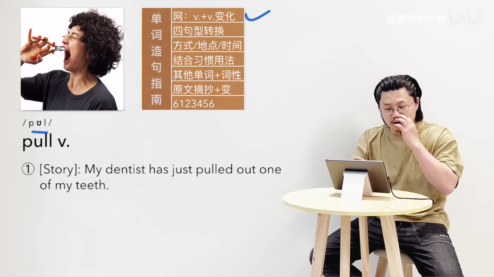

文字识别：单词造句指南 / 网：v.+v.变化 / 四句型转换 / 方式/地点/时间 / 结合习惯用法 / 其他单词+词性 / 原文摘抄+变 / 6123456 / /pul/ / pūll v. / ① [Story]: My dentist has just pulled out one / of my teeth.

### 画面 00:01:23

文字识别：单词造句指南 / 网：v.+v.变化 / 四句型转换 / 方式/地点/时间 / 结合习惯用法 / 其他单词+词性 / 原文摘抄+变 / 6123456 / /pul/ / pūll v. / ① [Story]: My dentist has just pulled out one / of my teeth.

### 画面 00:01:25

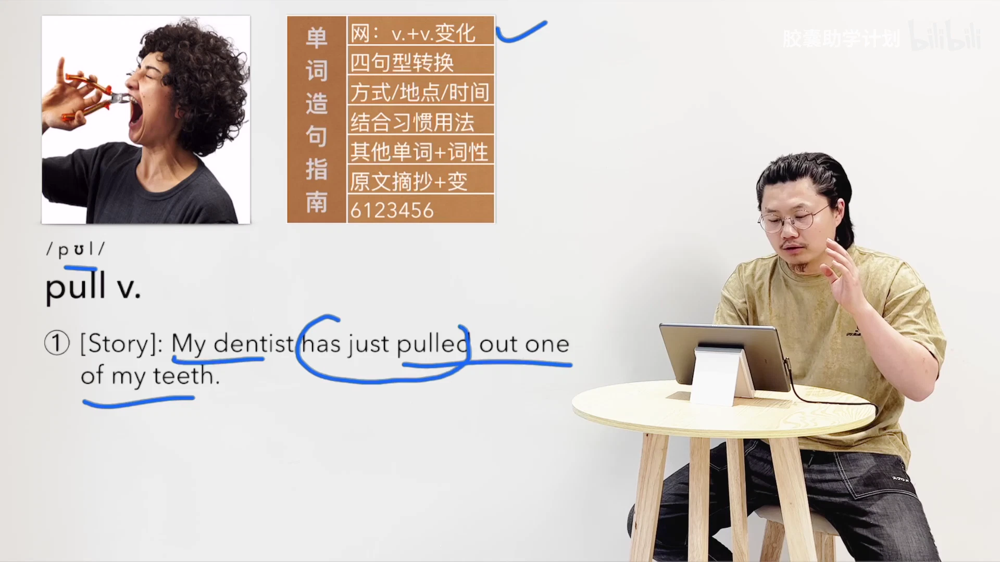

文字识别：单词造句指南 / 网：v.+v.变化 / 四句型转换 / 方式/地点/时间 / 结合习惯用法 / 其他单词+词性 / 原文摘抄+变 / 6123456 / /pul/ / pull v. / ① [Story]: My dentisthas just pulled / out one / of my teeth.

### 画面 00:01:27

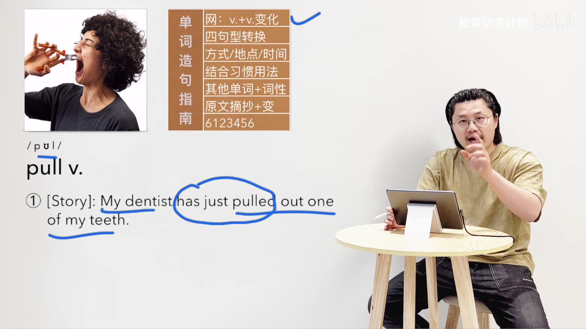

文字识别：单词造句指南 / 网：v.+v.变化 / 四句型转换 / 方式/地点/时间 / 结合习惯用法 / 其他单词+词性 / 原文摘抄+变 / 6123456 / /pul/ / pull v. / ① [Story]: My dentisthas just pulled / out one / of my teeth.

## 00:01:30–00:02:00

换成了另一个时态，叫做 My dentist pulled out one of my teeth yesterday. Okay,很简单，我把一个现在完成时变成了一般过去时，对吧？哎，这其实就是我们说，你文章读懂了之后，如果你还会别的语法，对我们非常大的一个帮助啊。接下来我又用了一个二十克的，叫做 Instead of啊，Instead of doing something，代替做了一个什么什么事情，对吧？说代替 pulling out the right one，说他本来应该把正

### 画面 00:01:30

文字识别：单词造句指南 / 网：v.+v.变化 / 四句型转换 / 方式/地点/时间 / 结合习惯用法 / 其他单词+词性 / 原文摘抄+变 / 6123456 / /pul/ / pūll v. / ① [Story]: My dentist has just pulled out one / of my teeth. / My dentist pulled out one of my teeth / yesterday.

### 画面 00:01:36

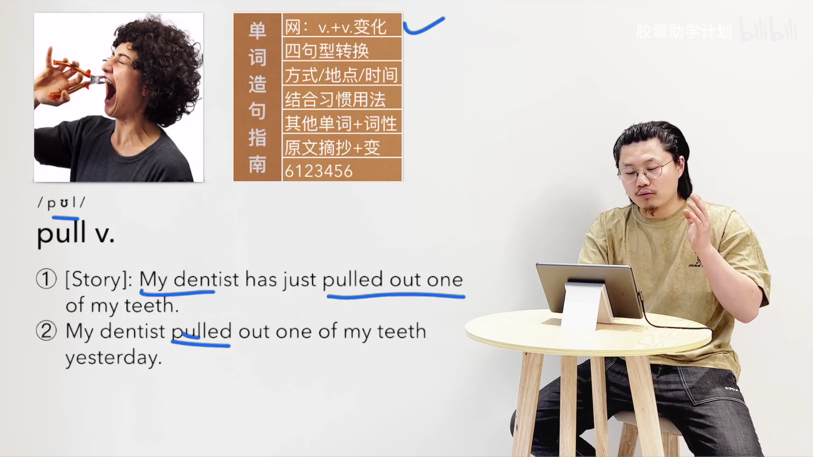

文字识别：单词造句指南 / 网：v.+v.变化 / 四句型转换 / 方式/地点/时间 / 结合习惯用法 / 其他单词+词性 / 原文摘抄+变 / 6123456 / /pul/ / pull v. / ① [Story]: My dentist has just pulled out one / of my teeth. / My dentist pulled out one of my teeth / yesterday.

### 画面 00:01:40

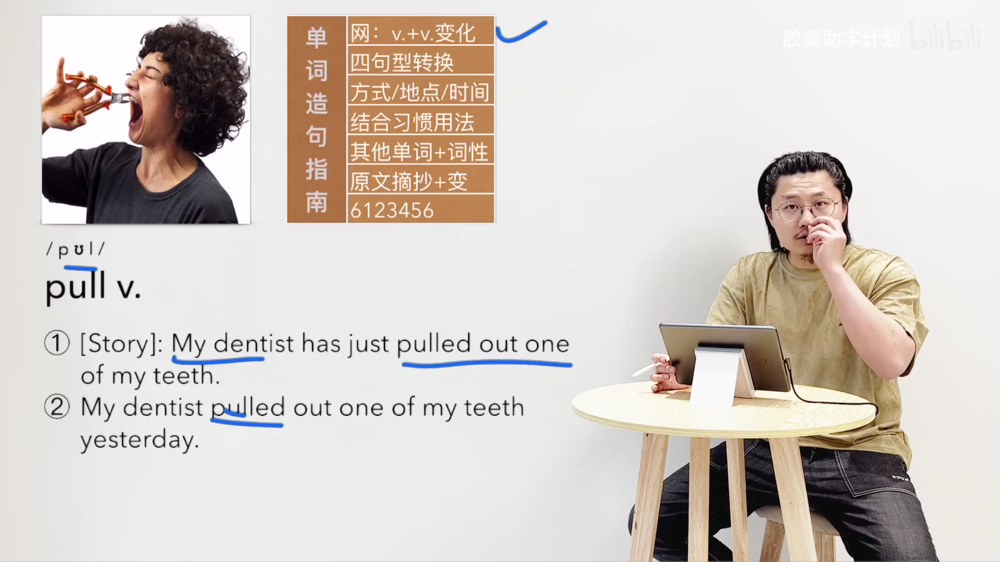

文字识别：单词造句指南 / 网：v.+v.变化 / 四句型转换 / 方式/地点/时间 / 结合习惯用法 / 其他单词+词性 / 原文摘抄+变 / 6123456 / /pul/ / pull v. / ① [Story]: My dentist has just pulled out one / of my teeth. / My dentist pulled out one of my teeth / yesterday.

### 画面 00:01:47

文字识别：单词造句指南 / 网：v.+v.变化 / 四句型转换 / 方式/地点/时间 / 结合习惯用法 / 其他单词+词性 / 原文摘抄+变 / 6123456 / /pul/ / pūll v. / ① [Story]: My dentist has just pulled out one / of my teeth. / My dentist pulled out one of my teeth / yesterday. / Instead of pulling out the right one, my / dentist pulled out the wrong tooth. L20

### 画面 00:01:49

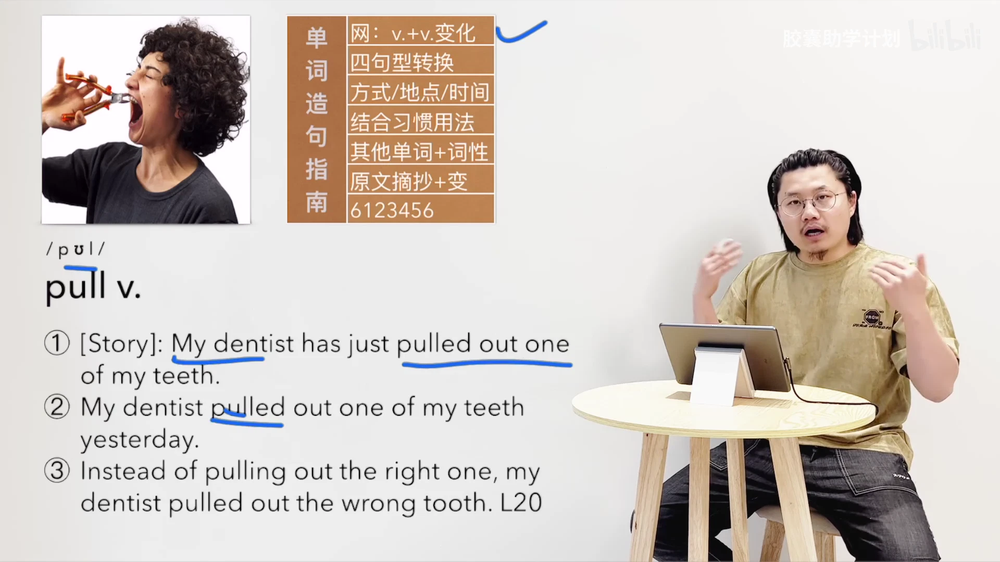

文字识别：单词造句指南 / 网：v.+v.变化 / 四句型转换 / 方式/地点/时间 / 结合习惯用法 / 其他单词+词性 / 原文摘抄+变 / 6123456 / /pul/ / pull v. / ① [Story]: My dentist has just pulled out one / of my teeth. / My dentist pulled out one of my teeth / yesterday. / Instead of pulling out the right one, my / dentist pulled out the wrong tooth. L20

### 画面 00:01:51

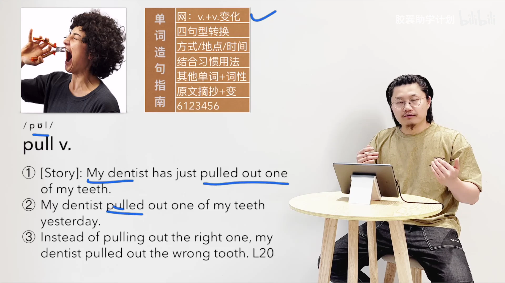

文字识别：单词造句指南 / 网：v.+v.变化 / 四句型转换 / 方式/地点/时间 / 结合习惯用法 / 其他单词+词性 / 原文摘抄+变 / 6123456 / /pul/ / pull v. / ① [Story]: My dentist has just pulled out one / of my teeth. / ) My dentist pulled out one of my teeth / yesterday. / Instead of pulling out the right one, my / dentist pulled out the wrong tooth. L20

### 画面 00:01:55

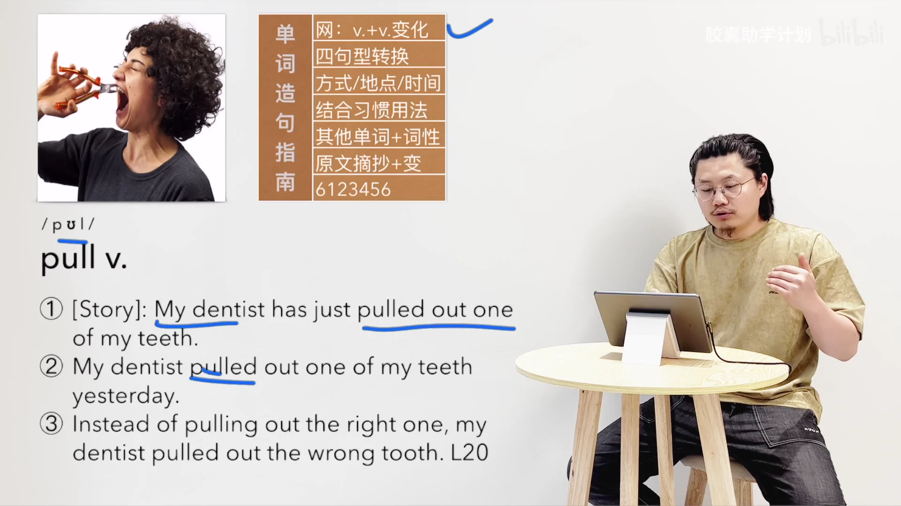

文字识别：单词造句指南 / 网：v.+v.变化 / 四句型转换 / 方式/地点/时间 / 结合习惯用法 / 其他单词+词性 / 原文摘抄+变 / 6123456 / /pul/ / pull v. / ① [Story]: My dentist has just pulled out one / of my teeth. / ) My dentist pulled out one of my teeth / yesterday. / Instead of pulling out the right one, my / dentist pulled out the wrong tooth. L20

### 画面 00:01:57

文字识别：单词造句指南 / 网：v.+v.变化 / 四句型转换 / 方式/地点/时间 / 结合习惯用法 / 其他单词+词性 / 原文摘抄+变 / 6123456 / /pul/ / pull v. / ① [Story]: My dentist has just pulled out one / of my teeth. / My dentist pulled out one of my teeth / yesterday. / instead of pulling out the right one, my / dentist pulled out the wrong tooth. L20

## 00:02:00–00:02:30

确的牙拔出来，对吧？他替代了说拔出正确的那颗牙。My dentist pulled out the wrong tooth.他把那个错误的给我拔出来了。这是咱们二十课的，instead of doing something啊。再读一遍这个单词，叫做pull. Very good. Next one，两个单词放到一起，咱们去看就行了。叫做cotton wool. Okay，还是啊，你看这最后舌尖还是要舔上牙龈. wool. Okay, wool. Very good. Wool.啊，cotton wool其实

### 画面 00:02:00

文字识别：单词造句指南 / 网：v.+v.变化 / 四句型转换 / 方式/地点/时间 / 结合习惯用法 / 其他单词+词性 / 原文摘抄+变 / 6123456 / /pul/ / pull v. / ① [Story]: My dentist has just pulled out one / of my teeth. / ) My dentist pulled out one of my teeth / yesterday. / instead of pulling out the right one, my / dentist pulled out the wrong tooth. L20

### 画面 00:02:09

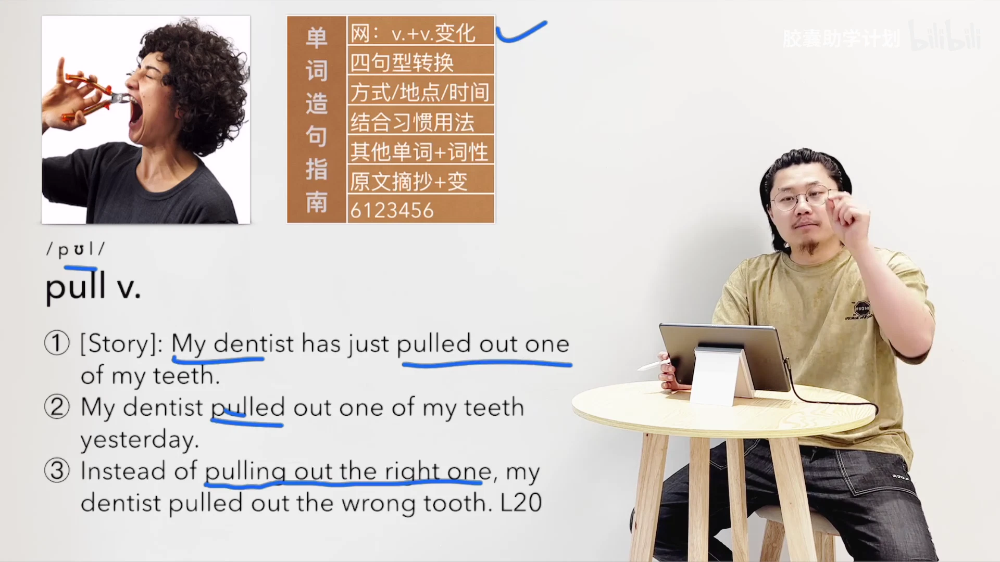

文字识别：单词造句指南 / 网：v.+v.变化 / 四句型转换 / 方式/地点/时间 / 结合习惯用法 / 其他单词+词性 / 原文摘抄+变 / 6123456 / /pul/ / pull v. / ① [Story]: My dentist has just pulled out one / of my teeth. / My dentist pulled out one of my teeth / yesterday. / instead of pulling out the right one, my / dentist pulled out the wrong tooth. L20

### 画面 00:02:11

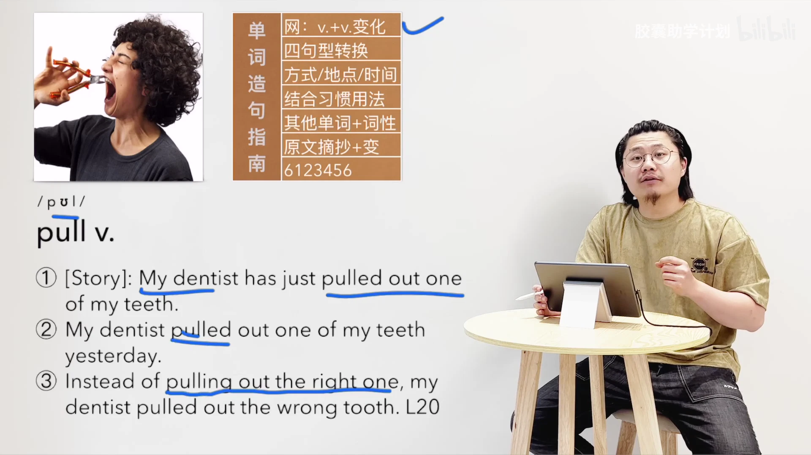

文字识别：单词造句指南 / 网：v.+v.变化 / 四句型转换 / 方式/地点/时间 / 结合习惯用法 / 其他单词+词性 / 原文摘抄+变 / 6123456 / /pul/ / pull v. / ① [Story]: My dentist has just pulled out one / of my teeth. / My dentist pulled out one of my teeth / yesterday. / Instead of pulling out the right one, my / dentist pulled out the wrong tooth. L20

### 画面 00:02:16

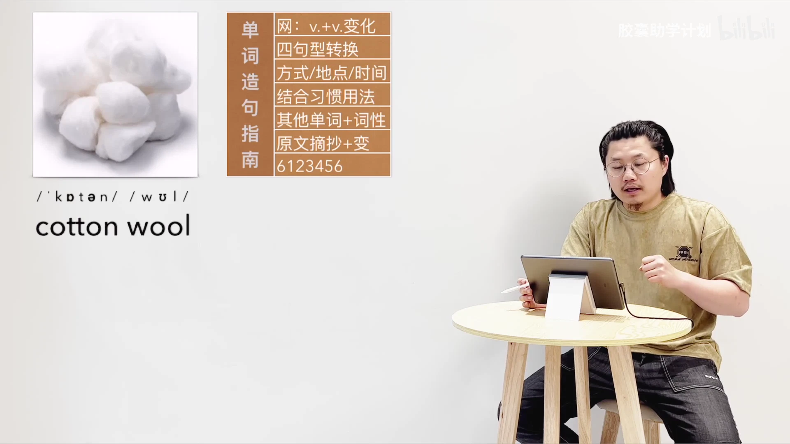

文字识别：单词造句指南 / 网：v.+v.变化 / 四句型转换 / 方式/地点/时间 / 结合习惯用法 / 其他单词+词性 / 原文摘抄+变 / 6123456 / /'kptan//wul/ / cotton wool

### 画面 00:02:18

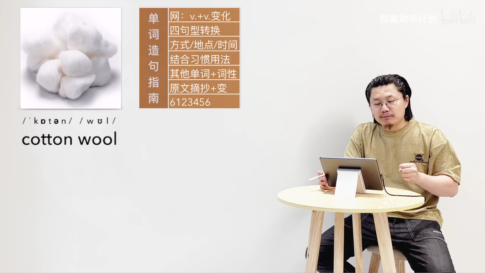

文字识别：单词造句指南 / 网：v.+v.变化 / 四句型转换 / 方式/地点/时间 / 结合习惯用法 / 其他单词+词性 / 原文摘抄+变 / 6123456 / /'kptan/ /wul/ / cotton wool

### 画面 00:02:20

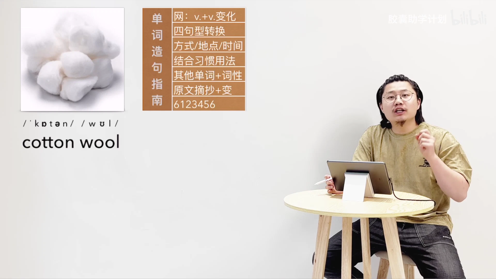

文字识别：单词造句指南 / 网：v.+v.变化 / 四句型转换 / 方式/地点/时间 / 结合习惯用法 / 其他单词+词性 / 原文摘抄+变 / 6123456 / /'kptan//wul/ / cotton wool

### 画面 00:02:25

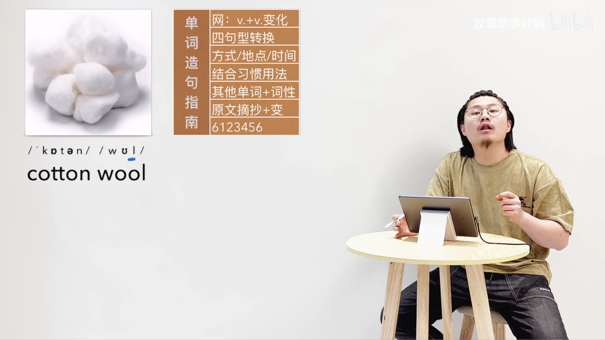

文字识别：单词造句指南 / 网：v.+v.变化 / 四句型转换 / 方式/地点/时间 / 结合习惯用法 / 其他单词+词性 / 原文摘抄+变 / 6123456 / /'kptan/ /wul/ / cotton wool

## 00:02:30–00:03:00

就是药棉啊。各位如果拔过牙的话，反正我我长大就没再拔过了。但小的时候拔牙的时候，每次拔完牙有几个流程，第一个是要咬一块药棉搁在那儿，对吧？第二是特别开心买一根雪糕，不知道各位有没有这个童年记忆啊？叫做 cotton wool，就是那个你咬在牙里面拔完牙咬在牙里面的那个东西叫做药棉啊。它其实你可以理解为本质上是个名词嘛，那你造句又是无非找那些动词就好了，或者找

### 画面 00:02:30

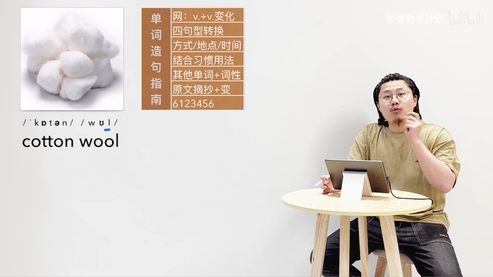

文字识别：单词造句指南 / 网：v.+v.变化 / 四句型转换 / 方式/地点/时间 / 结合习惯用法 / 其他单词+词性 / 原文摘抄+变 / 6123456 / /'kptan/ /wul/ / cotton wool

### 画面 00:02:40

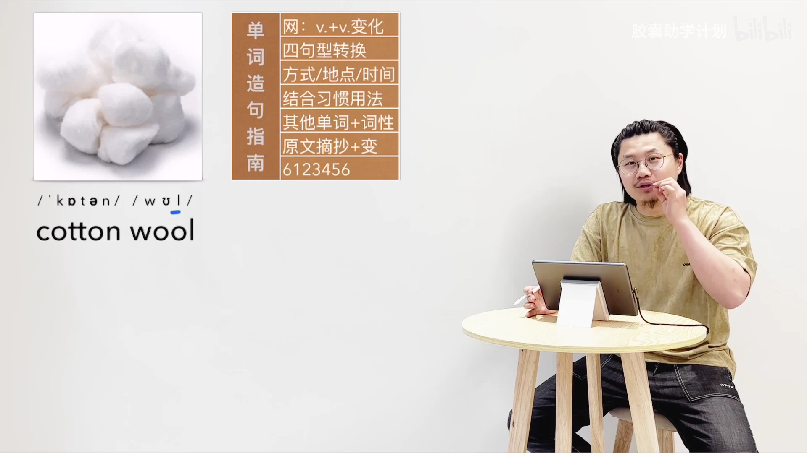

文字识别：单词造句指南 / 网：v.+v.变化 / 四句型转换 / 方式/地点/时间 / 结合习惯用法 / 其他单词+词性 / 原文摘抄+变 / 6123456 / /'kptan//wul/ / cotton wool

### 画面 00:02:50

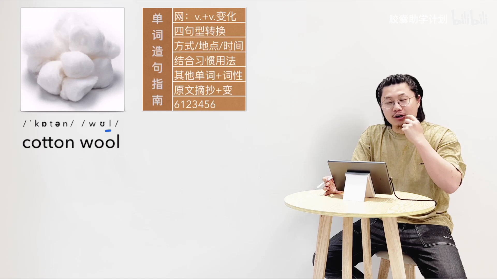

文字识别：单词造句指南 / 网：v.+v.变化 / 四句型转换 / 方式/地点/时间 / 结合习惯用法 / 其他单词+词性 / 原文摘抄+变 / 6123456 / /'kptan/ /wul/ / cotton wool

### 画面 00:02:54

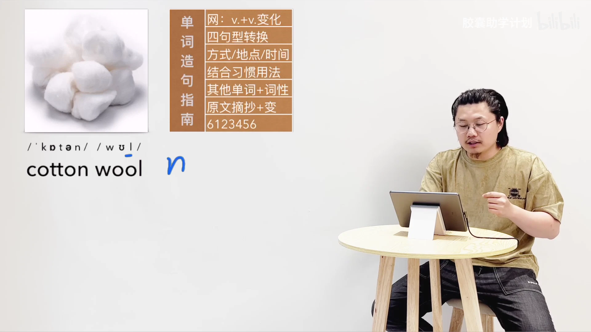

文字识别：单词造句指南 / 网：v.+v.变化 / 四句型转换 / 方式/地点/时间 / 结合习惯用法 / 其他单词+词性 / 原文摘抄+变 / 6123456 / /'kptan//wul/ / n / cotton wool

### 画面 00:02:59

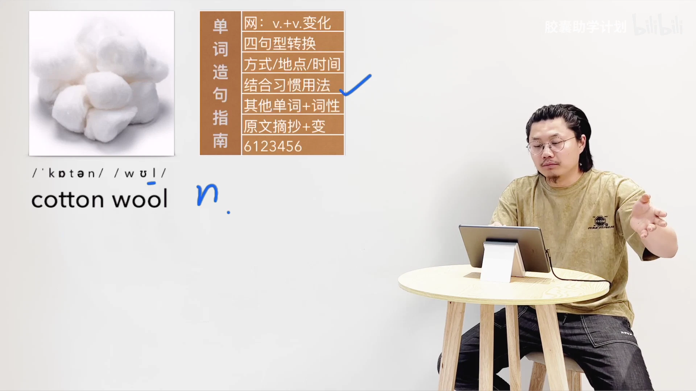

文字识别：单词造句指南 / 网：v.+v.变化 / 四句型转换 / 方式/地点/时间 / 结合习惯用法 / 其他单词+词性 / 原文摘抄+变 / 6123456 / /'kptan//wul/ / n / cotton wool

## 00:03:00–00:03:30

之前咱们学过的其他习惯用法，对吧？比如说，She always pretends that she has cotton wool in her hands. 这是咱们二十六课学的，always pretend后边加了一个小的从句，对吧？OK，那你看这里，你看，呃，我们造句子的时候啊，就随着我们，你看我们现在都学到新概念二册第二单元的最后一课了，我们一直在造句子，我们可以试着去给它扩展一下，对吧？你比如说，你就

### 画面 00:03:01

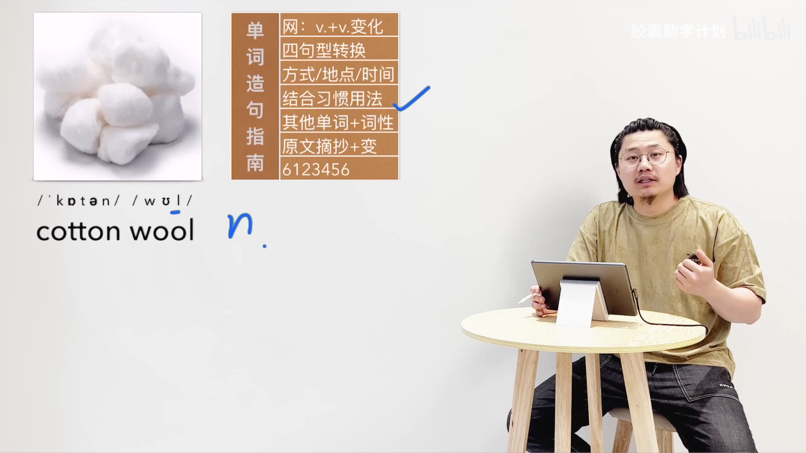

文字识别：单词造句指南 / 网：v.+v.变化 / 四句型转换 / 方式/地点/时间 / 结合习惯用法 / 其他单词+词性 / 原文摘抄+变 / 6123456 / /'kptan/ /wul/ / n / cotton wool

### 画面 00:03:03

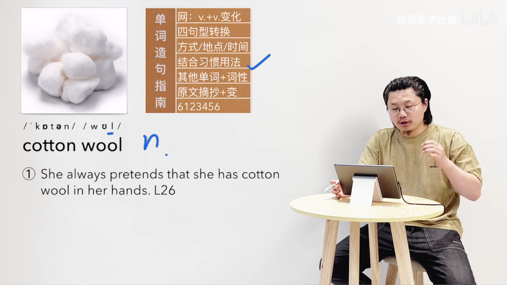

文字识别：单词造句指南 / 网：v.+v.变化 / 四句型转换 / 方式/地点/时间 / 结合习惯用法 / 其他单词+词性 / 原文摘抄+变 / 6123456 / /'kptan/ /wul/ / cotton wool / n / ① She always pretends that she has cotton / wool in her hands. L26

### 画面 00:03:05

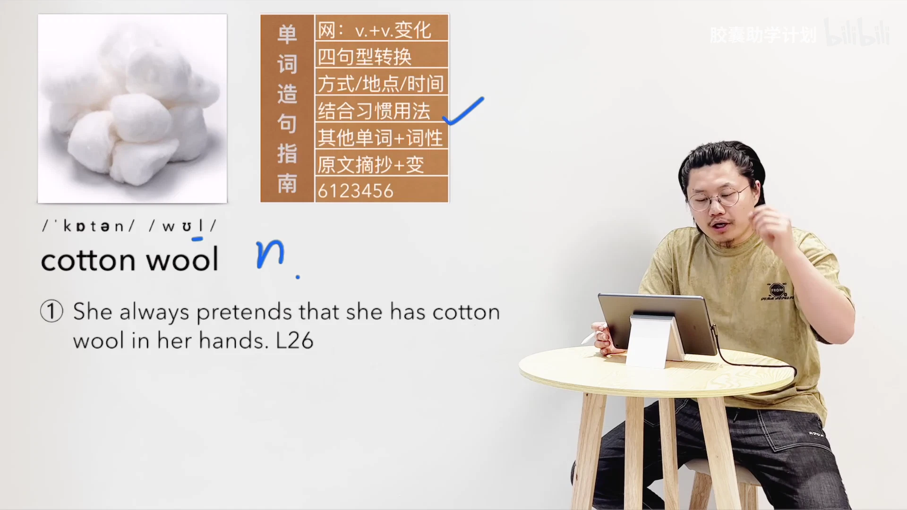

文字识别：单词造句指南 / 网：v.+v.变化 / 四句型转换 / 方式/地点/时间 / 结合习惯用法 / 其他单词+词性 / 原文摘抄+变 / 6123456 / /'kptan/ /wul/ / n / cotton wool / ROM / ① She always pretends that she has cotton / Wool in her hands. L26

### 画面 00:03:07

文字识别：单词造句指南 / 网：v.+v.变化 / 四句型转换 / 方式/地点/时间 / 结合习惯用法 / 其他单词+词性 / 原文摘抄+变 / 6123456 / /'kptan/ /wul/ / n / cotton wool / ① She always pretends that she has cotton / wool in her hands. L26

### 画面 00:03:10

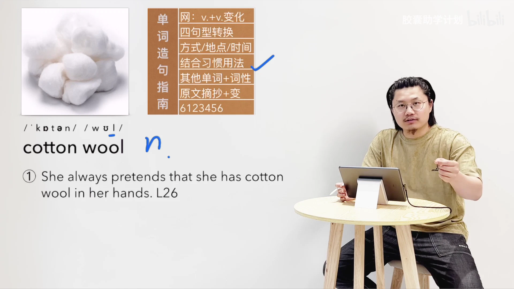

文字识别：单词造句指南 / 网：v.+v.变化 / 四句型转换 / 方式/地点/时间 / 结合习惯用法 / 其他单词+词性 / 原文摘抄+变 / 6123456 / /'kptan/ /wul/ / n / cotton wool / ① She always pretends that she has cotton / wool in her hands. L26

### 画面 00:03:13

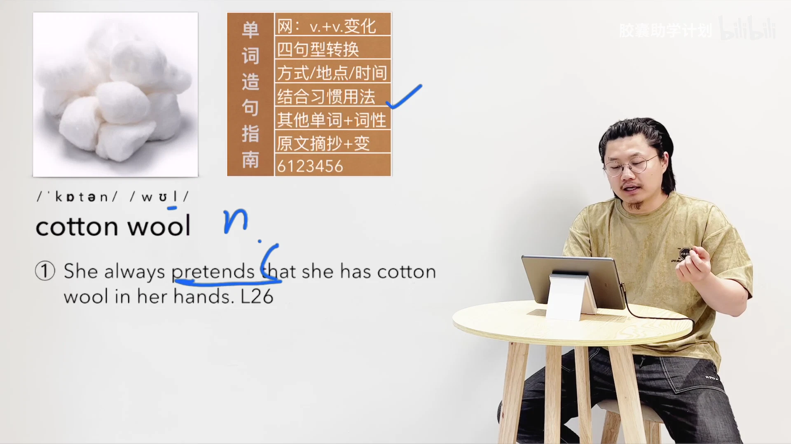

文字识别：单词造句指南 / 网：v.+v.变化 / 四句型转换 / 方式/地点/时间 / 结合习惯用法 / 其他单词+词性 / 原文摘抄+变 / 6123456 / /'kptan//wul/ / n / cotton wool / ① She always pretends bat she has cotton / wool in her hands. L26

### 画面 00:03:15

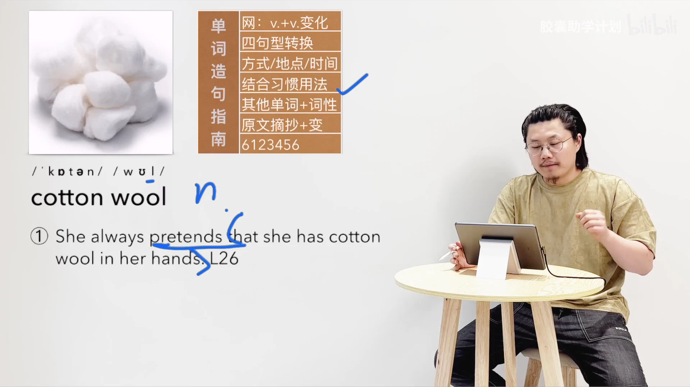

文字识别：单词造句指南 / 网：v.+v.变化 / 四句型转换 / 方式/地点/时间 / 结合习惯用法 / 其他单词+词性 / 原文摘抄+变 / 6123456 / /'kptan//wul/ / n / cotton wool / ① She always pretends hat she has cotton / wool in her hands L26

### 画面 00:03:20

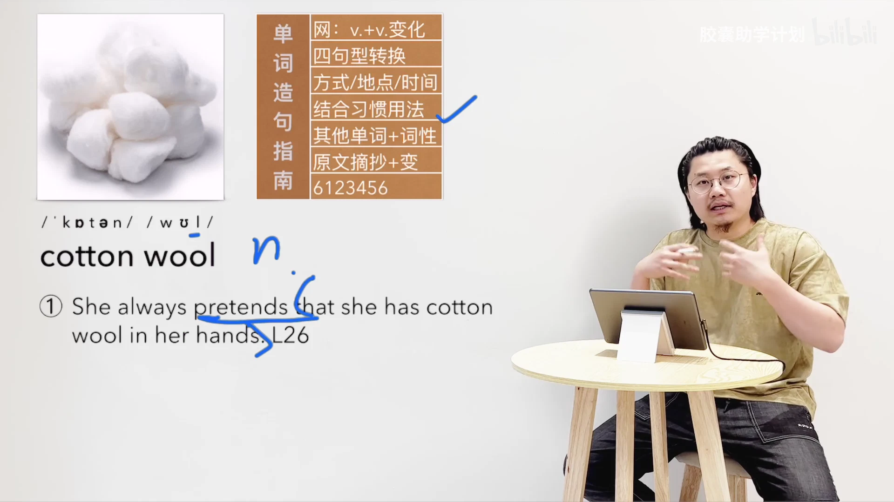

文字识别：单词造句指南 / 网：v.+v.变化 / 四句型转换 / 方式/地点/时间 / 结合习惯用法 / 其他单词+词性 / 原文摘抄+变 / 6123456 / /'kptan/ /wul/ / n / cotton wool / ① She always pretends bat she has cotton / wool in her handsL26

### 画面 00:03:25

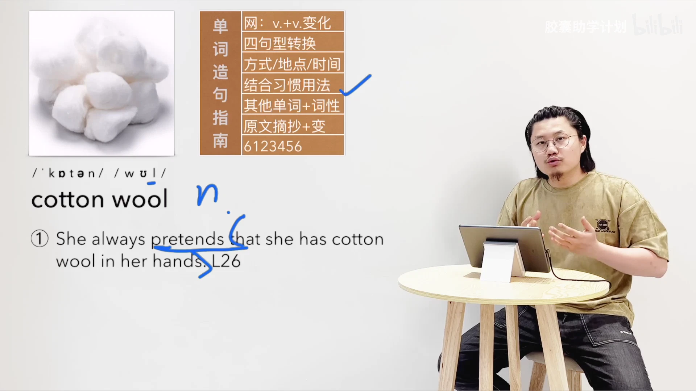

文字识别：单词造句指南 / 网：v.+v.变化 / 四句型转换 / 方式/地点/时间 / 结合习惯用法 / 其他单词+词性 / 原文摘抄+变 / 6123456 / /'kptan/ /wul/ / n / cotton wool / FROU / ① She always pretends hat she has cotton / wool in her hands.L26

### 画面 00:03:28

文字识别：单词造句指南 / 网：v.+v.变化 / 四句型转换 / 方式/地点/时间 / 结合习惯用法 / 其他单词+词性 / 原文摘抄+变 / 6123456 / /'kptan//wul/ / n / cotton wool / ① She always pretends hat she has cotton / wool in her hands. L26

## 00:03:30–00:04:00

要想那这句话的使用场景是什么？你就可以想小孩儿过家家嘛。比如说，一个小女孩总想着自己是个护士，她总假装哎，她手里面拿着一个药棉，对吧？那小男孩儿呢，总假装自己打仗中枪了，然后躺在地上等待治疗，对不对？Okay, next one is in her twenties. 哎，这两个习惯用法和语法啊，一个习惯用法，一个语法，都是三十一课的。在她二十多岁的时候呢，she used to sell cotton wool to doctors. 啊，在她二

### 画面 00:03:30

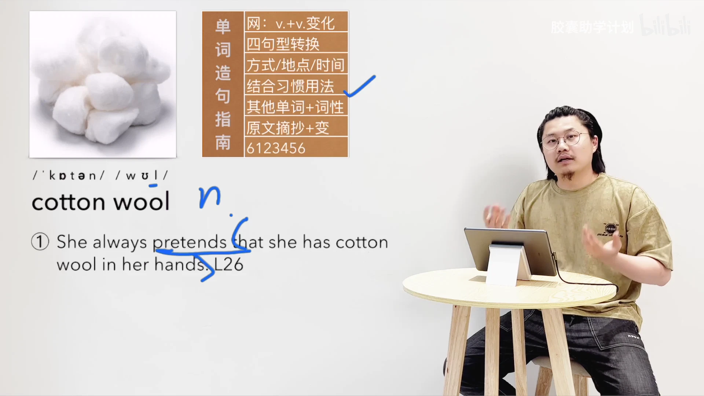

文字识别：单词造句指南 / 网：v.+v.变化 / 四句型转换 / 方式/地点/时间 / 结合习惯用法 / 其他单词+词性 / 原文摘抄+变 / 6123456 / /'kptan//wul/ / n / cotton wool / ① She always pretends bat she has cotton / wool in her hands L26

### 画面 00:03:35

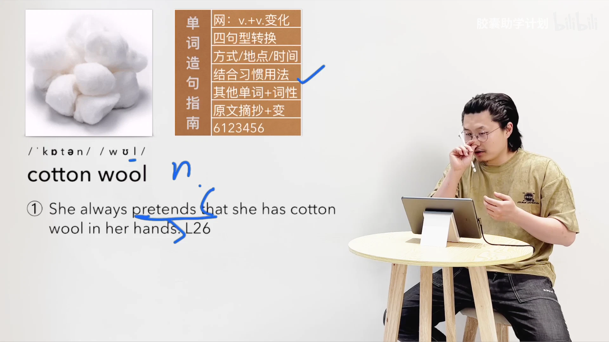

文字识别：单词造句指南 / 网：v.+v.变化 / 四句型转换 / 方式/地点/时间 / 结合习惯用法 / 其他单词+词性 / 原文摘抄+变 / 6123456 / /'kptan//wul/ / n / cotton wool / ① She always pretends hat she has cotton / wool in her hands L26

### 画面 00:03:45

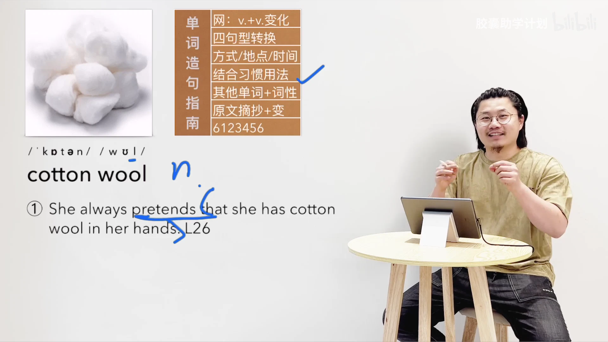

文字识别：单词造句指南 / 网：v.+v.变化 / 四句型转换 / 方式/地点/时间 / 结合习惯用法 / 其他单词+词性 / 原文摘抄+变 / 6123456 / /'kptan/ /wul/ / n / cotton wool / ① She always pretends bat she has cotton / wool in her hands L26

### 画面 00:03:47

文字识别：单词造句指南 / 网：v.+v.变化 / 四句型转换 / 方式/地点/时间 / 结合习惯用法 / 其他单词+词性 / 原文摘抄+变 / 6123456 / /'kptan/ /wul/ / n / cotton wool / ① She always pretends bat she has cotton / wool in her hands.L26 / ) In her twenties, she used to sell cotton wool / to doctors. L31

### 画面 00:03:50

文字识别：单词造句指南 / 网：v.+v.变化 / 四句型转换 / 方式/地点/时间 / 结合习惯用法 / 其他单词+词性 / 原文摘抄+变 / 6123456 / /'kptan//wul/ / n / cotton wool / ① She always pretends hat she has cotton / wool in her handsL26 / ② JIn her twenties, she used to sell cotton wool / to doctors. L31

### 画面 00:03:52

文字识别：单词造句指南 / 网：v.+v.变化 / 四句型转换 / 方式/地点/时间 / 结合习惯用法 / 其他单词+词性 / 原文摘抄+变 / 6123456 / /'kptan/ /wul/ / n / cotton wool / ① She always pretends hat she has cotton / wool in her hands.L26 / Jn her twenties, she used to sell cotton wool / to doctors. L31

### 画面 00:03:54

文字识别：单词造句指南 / 网：v.+v.变化 / 四句型转换 / 方式/地点/时间 / 结合习惯用法 / 其他单词+词性 / 原文摘抄+变 / 6123456 / /'kptan/ /wul/ / n / cotton wool / ① She always pretends hat she has cotton / wool in her hands.L26 / Jn her twenties, she used to sell cotton wool / to doctors. L31

### 画面 00:03:56

文字识别：单词造句指南 / 网：v.+v.变化 / 四句型转换 / 方式/地点/时间 / 结合习惯用法 / 其他单词+词性 / 原文摘抄+变 / 6123456 / /'kptan/ /wul/ / n / cotton wool / ① She always pretends hat she has cotton / wool in her hands.L26 / Jn her twenties, she used to sell cotton wool / to doctors. L31

### 画面 00:03:59

文字识别：单词造句指南 / 网：v.+v.变化 / 四句型转换 / 方式/地点/时间 / 结合习惯用法 / 其他单词+词性 / 原文摘抄+变 / 6123456 / /'kptan/ /wul/ / n / cotton wool / ① She always pretends hat she has cotton / wool in her handsL26 / Jn her twenties, she used to sell cotton wool / to doctors. L31

## 00:04:00–00:04:30

十多岁的时候，他那个时候常常卖药棉给医生，对吧？Okay, next one. Say please return this cotton wool to me. Ah, return something to somebody. We've reviewed it. Okay, we don't need to say it again. Okay, next one. Let's read it together. It's called collect. Okay, collect is a verb. Then you pay attention to the word collection. This is a little point. We learn words. Okay, gradually, as the words become more difficult, the words become more and more. We gradually introduce some.

### 画面 00:04:02

文字识别：单词造句指南 / 网：v.+v.变化 / 四句型转换 / 方式/地点/时间 / 结合习惯用法 / 其他单词+词性 / 原文摘抄+变 / 6123456 / /'kptan/ /wul/ / n / cotton wool / ① She always pretends hat she has cotton / wool in her hands.L26 / Jn her twenties, she used to sell cotton wool / to doctors. L31

### 画面 00:04:05

文字识别：单词造句指南 / 网：v.+v.变化 / 四句型转换 / 方式/地点/时间 / 结合习惯用法 / 其他单词+词性 / 原文摘抄+变 / 6123456 / /'kptan/ /wul/ / n / cotton wool / ① She always pretends bat she has cotton / wool in her hands.L26 / Jn her twenties, she used to sell cotton wool / to doctors. L31 / Please return these cotton wool to me. L45

### 画面 00:04:14

文字识别：单词造句指南 / 网：v.+v.变化 / 四句型转换 / 方式/地点/时间 / 结合习惯用法 / 其他单词+词性 / 原文摘抄+变 / 6123456 / /ka'lekt/ / collect v. collection n. / OM

### 画面 00:04:16

文字识别：单词造句指南 / 网：v.+v.变化 / 四句型转换 / 方式/地点/时间 / 结合习惯用法 / 其他单词+词性 / 原文摘抄+变 / 6123456 / /ka'lekt/ / collect v. collection n.

### 画面 00:04:20

文字识别：单词造句指南 / 网：v.+v.变化 / 四句型转换 / 方式/地点/时间 / 结合习惯用法 / 其他单词+词性 / 原文摘抄+变 / 6123456 / /ka'lekt/ / collect y. collection n.

### 画面 00:04:25

文字识别：单词造句指南 / 网：v.+v.变化 / 四句型转换 / 方式/地点/时间 / 结合习惯用法 / 其他单词+词性 / 原文摘抄+变 / 6123456 / /ka'lekt/ / collect y. collection n.

## 00:04:30–00:05:00

我们会逐渐引入一些所谓词根、词缀、前缀、后缀，对吧？比如说像 T I O N 这四个字母，一般放在单词的最后面的时候，它往往都是一个提醒。什么提醒呢？告诉我们这个单词它很可能是一个名词，对吧？比如说 collect，我们管它叫做收集、收藏、集邮的那个集就是 collect，对吧？那我做了很多的集邮啊，然后比如说我现在有这么多的收藏

### 画面 00:04:30

文字识别：单词造句指南 / 网：v.+v.变化 / 四句型转换 / 方式/地点/时间 / 结合习惯用法 / 其他单词+词性 / 原文摘抄+变 / 6123456 / /ka'lekt/ / collect y. collection n.

### 画面 00:04:35

文字识别：单词造句指南 / 网：v.+v.变化 / 四句型转换 / 方式/地点/时间 / 结合习惯用法 / 其他单词+词性 / 原文摘抄+变 / 6123456 / /ka'lekt/ / collect y. collection n.

### 画面 00:04:37

文字识别：单词造句指南 / 网：v.+v.变化 / 四句型转换 / 方式/地点/时间 / 结合习惯用法 / 其他单词+词性 / 原文摘抄+变 / 6123456 / /ka'lekt/ / collect y. collection

### 画面 00:04:40

文字识别：单词造句指南 / 网：v.+v.变化 / 四句型转换 / 方式/地点/时间 / 结合习惯用法 / 其他单词+词性 / 原文摘抄+变 / 6123456 / /ka'lekt/ / collect y. collection

### 画面 00:04:45

文字识别：单词造句指南 / 网：v.+v.变化 / 四句型转换 / 方式/地点/时间 / 结合习惯用法 / 其他单词+词性 / 原文摘抄+变 / 6123456 / /ka'lekt/ / collect y. collection

### 画面 00:04:50

文字识别：单词造句指南 / 网：v.+v.变化 / 四句型转换 / 方式/地点/时间 / 结合习惯用法 / 其他单词+词性 / 原文摘抄+变 / 6123456 / /ka'lekt/ / collect y. collection n.

### 画面 00:04:52

文字识别：单词造句指南 / 网：v.+v.变化 / 四句型转换 / 方式/地点/时间 / 结合习惯用法 / 其他单词+词性 / 原文摘抄+变 / 6123456 / /ka'lekt/ / collect y. collection n.

### 画面 00:04:55

文字识别：单词造句指南 / 网：v.+v.变化 / 四句型转换 / 方式/地点/时间 / 结合习惯用法 / 其他单词+词性 / 原文摘抄+变 / 6123456 / /ka'lekt/ / collect y. collection n.

## 00:05:00–00:05:30

品，那这个名词我们就管它叫 collection。所以两个单词我放到一起去学了。好，我们造一些句子，比如说 he used to collect stamps。这里的 stamps 你换成什么都行，比如说你换成 coin，啊，像图这样，你给它换成 coin，啊 coins，硬币，对吧？可以，你可以给它换成呃 boxes，啊 match boxes，等等等等。我觉得你可以换成很多东西啊，你收藏什么你就换什么就好了。Next one，用到了十四课的

### 画面 00:05:00

文字识别：单词造句指南 / 网：v.+v.变化 / 四句型转换 / 方式/地点/时间 / 结合习惯用法 / 其他单词+词性 / 原文摘抄+变 / 6123456 / /ka'lekt/ / collect y. collection n.

### 画面 00:05:03

文字识别：单词造句指南 / 网：v.+v.变化 / 四句型转换 / 方式/地点/时间 / 结合习惯用法 / 其他单词+词性 / 原文摘抄+变 / 6123456 / /ka'lekt/ / collect y. collection n.

### 画面 00:05:05

文字识别：单词造句指南 / 网：v.+v.变化 / 四句型转换 / 方式/地点/时间 / 结合习惯用法 / 其他单词+词性 / 原文摘抄+变 / 6123456 / /ka'lekt/ / collect y. collection n. / ① He used to collect stamps. L31

### 画面 00:05:07

文字识别：单词造句指南 / 网：v.+v.变化 / 四句型转换 / 方式/地点/时间 / 结合习惯用法 / 其他单词+词性 / 原文摘抄+变 / 6123456 / /ka'lekt/ / collect y. collection n. / ① He used to collect stamps. L31

### 画面 00:05:10

文字识别：单词造句指南 / 网：v.+v.变化 / 四句型转换 / 方式/地点/时间 / 结合习惯用法 / 其他单词+词性 / 原文摘抄+变 / 6123456 / /ka'lekt/ / collect y. collection n. / ① He used to collect stamps. L31

### 画面 00:05:15

文字识别：单词造句指南 / 网：v.+v.变化 / 四句型转换 / 方式/地点/时间 / 结合习惯用法 / 其他单词+词性 / 原文摘抄+变 / 6123456 / /ka'lekt/ / collect y. collection n. / ① He used to collect stamps. L31

### 画面 00:05:18

文字识别：单词造句指南 / 网：v.+v.变化 / 四句型转换 / 方式/地点/时间 / 结合习惯用法 / 其他单词+词性 / 原文摘抄+变 / 6123456 / /ka'lekt/ / collect y. collection n. / ① He used to collect stamps. L31

### 画面 00:05:20

文字识别：单词造句指南 / 网：v.+v.变化 / 四句型转换 / 方式/地点/时间 / 结合习惯用法 / 其他单词+词性 / 原文摘抄+变 / 6123456 / /ka'lekt/ / collect y. collection n. / ① He used to collect stamps. L31

### 画面 00:05:23

文字识别：单词造句指南 / 网：v.+v.变化 / 四句型转换 / 方式/地点/时间 / 结合习惯用法 / 其他单词+词性 / 原文摘抄+变 / 6123456 / /ka'lekt/ / collect y. collection n. / ① He used to collect stamps. L31

### 画面 00:05:25

文字识别：单词造句指南 / 网：v.+v.变化 / 四句型转换 / 方式/地点/时间 / 结合习惯用法 / 其他单词+词性 / 原文摘抄+变 / 6123456 / /ka'lekt/ / collect y. collection n. / ① He used to collect stamps. L31

### 画面 00:05:27

文字识别：单词造句指南 / 网：v.+v.变化 / 四句型转换 / 方式/地点/时间 / 结合习惯用法 / 其他单词+词性 / 原文摘抄+变 / 6123456 / /ka'lekt/ / collect y. collection n. / ① He used to collect stamps. L31 / ② After he had collected stamps for ten years, / he set up a new world record. L14 L36

## 00:05:30–00:06:00

语法和三十六课的一个习惯用法，我们给它拆起来了。说 after he had collected stamps for ten years, after A逗号B对吧？过去完成时啊。说在他收集邮票十年之后，he set up a new world record.他创立了一个新的世界纪录。Okay. Next one, she is keen on collecting stamps. Be keen on doing something.我印象当中

### 画面 00:05:30

文字识别：单词造句指南 / 网：v.+v.变化 / 四句型转换 / 方式/地点/时间 / 结合习惯用法 / 其他单词+词性 / 原文摘抄+变 / 6123456 / /ka'lekt/ / collect y. collection n. / ① He used to collect stamps. L31 / ② After he had collected stamps for ten years, / he set up a new world record.L14 L36

### 画面 00:05:33

文字识别：单词造句指南 / 网：v.+v.变化 / 四句型转换 / 方式/地点/时间 / 结合习惯用法 / 其他单词+词性 / 原文摘抄+变 / 6123456 / /ka'lekt/ / collect y. collection n. / 0 / ① He used to collect stamps. L31 / ② After he had collected stamps for ten years, / he set up a new world record.L14 L36

### 画面 00:05:35

文字识别：单词造句指南 / 网：v.+v.变化 / 四句型转换 / 方式/地点/时间 / 结合习惯用法 / 其他单词+词性 / 原文摘抄+变 / 6123456 / /ka'lekt/ / collect y. collection n. / ① He used to collect stamps. L31 / ② After he had collected stamps for ten years, / he set up a new world record.L14 L36

### 画面 00:05:40

文字识别：单词造句指南 / 网：v.+v.变化 / 四句型转换 / 方式/地点/时间 / 结合习惯用法 / 其他单词+词性 / 原文摘抄+变 / 6123456 / /ka'lekt/ / collect y. collection n. / ① He used to collect stamps. L31 / ② After he had collected stamps for ten years, / he set up a new world record.L14 L36

### 画面 00:05:42

文字识别：单词造句指南 / 网：v.+v.变化 / 四句型转换 / 方式/地点/时间 / 结合习惯用法 / 其他单词+词性 / 原文摘抄+变 / 6123456 / /ka'lekt/ / collect y. collection n. / ① He used to collect stamps. L31 / ② After he had collected stamps for ten years, / he set up a new world record.L14 L36

### 画面 00:05:45

文字识别：单词造句指南 / 网：v.+v.变化 / 四句型转换 / 方式/地点/时间 / 结合习惯用法 / 其他单词+词性 / 原文摘抄+变 / 6123456 / /ka'lekt/ / collect y. collection n. / ① He used to collect stamps. L31 / ② After he had collected stamps for ten years, / he set up a new world record.L14 L36

### 画面 00:05:51

文字识别：单词造句指南 / 网：v.+v.变化 / 四句型转换 / 方式/地点/时间 / 结合习惯用法 / 其他单词+词性 / 原文摘抄+变 / 6123456 / /ka'lekt/ / collect y. collection n. / ① He used to collect stamps. L31 / ② After he had collected stamps for ten years, / he set up a new world record.L14 L36

### 画面 00:05:53

文字识别：单词造句指南 / 网：v.+v.变化 / 四句型转换 / 方式/地点/时间 / 结合习惯用法 / 其他单词+词性 / 原文摘抄+变 / 6123456 / /ka'lekt/ / collect y. collection n. / ① He used to collect stamps. L31 / ② After he had collected stamps for ten years, / he set up a new world record. L14 L36 / ) She is keen on collecting stamps. L20

### 画面 00:05:55

文字识别：单词造句指南 / 网：v.+v.变化 / 四句型转换 / 方式/地点/时间 / 结合习惯用法 / 其他单词+词性 / 原文摘抄+变 / 6123456 / /ka'lekt/ / collect y. collection n. / ① He used to collect stamps. L31 / ② After he had collected stamps for ten years, / he set up a new world record. L14 L36 / ) She is keen on collecting stamps. L20

### 画面 00:05:58

文字识别：单词造句指南 / 网：v.+v.变化 / 四句型转换 / 方式/地点/时间 / 结合习惯用法 / 其他单词+词性 / 原文摘抄+变 / 6123456 / / ka'lekt/ / collect y. collection n. / ① He used to collect stamps. L31 / ② After he had collected stamps for ten years, / he set up a new world record. L14 L36 /  She is keen on collecting stamps. L20

## 00:06:00–00:06:30

这是咱们二十课 pattern drill 里面出现的文章当中并没有出现，但是我们还是把它当做一个习惯用法给拉出来了，对吧？啊，叫做热衷于做某件事情啊，begin on doing something 啊。OK，比如说 Are you keen on fishing？这句话什么意思啊？能不能啊留言告诉我？你看你能不能听出来，对吧？Are you keen on fishing？ There again. Next one, 那 collection，你注意它是一个名词，它是名词，它往往前面

### 画面 00:06:01

文字识别：单词造句指南 / 网：v.+v.变化 / 四句型转换 / 方式/地点/时间 / 结合习惯用法 / 其他单词+词性 / 原文摘抄+变 / 6123456 / /ka'lekt/ / collect y. collection n. / ① He used to collect stamps. L31 / ② After he had collected stamps for ten years, / he set up a new world record. L14 L36 / She is keen on collecting stamps. L20

### 画面 00:06:05

文字识别：单词造句指南 / 网：v.+v.变化 / 四句型转换 / 方式/地点/时间 / 结合习惯用法 / 其他单词+词性 / 原文摘抄+变 / 6123456 / /ka'lekt/ / collect y. collection n. / ① He used to collect stamps. L31 / ② After he had collected stamps for ten years, / he set up a new world record. L14 L36 /  She is keen on collecting stamps. L20

### 画面 00:06:10

文字识别：单词造句指南 / 网：v.+v.变化 / 四句型转换 / 方式/地点/时间 / 结合习惯用法 / 其他单词+词性 / 原文摘抄+变 / 6123456 / /ka'lekt/ / collect y. collection n. / ① He used to collect stamps. L31 / ② After he had collected stamps for ten years, / he set up a new world record. L14 L36 / ) She is keen on collecting stamps. L20

### 画面 00:06:14

文字识别：单词造句指南 / 网：v.+v.变化 / 四句型转换 / 方式/地点/时间 / 结合习惯用法 / 其他单词+词性 / 原文摘抄+变 / 6123456 / /ka'lekt/ / collect y. collection n. / ① He used to collect stamps. L31 / ② After he had collected stamps for ten years, / he set up a new world record. L14 L36 / ) She is keen on collecting stamps. L20

### 画面 00:06:16

文字识别：单词造句指南 / 网：v.+v.变化 / 四句型转换 / 方式/地点/时间 / 结合习惯用法 / 其他单词+词性 / 原文摘抄+变 / 6123456 / /ka'lekt/ / collect y. collection n. / ① He used to collect stamps. L31 / ② After he had collected stamps for ten years, / he set up a new world record. L14 L36 /  She is keen on collecting stamps. L20

### 画面 00:06:18

文字识别：单词造句指南 / 网：v.+v.变化 / 四句型转换 / 方式/地点/时间 / 结合习惯用法 / 其他单词+词性 / 原文摘抄+变 / 6123456 / /ka'lekt/ / collect y. collection n. / ① He used to collect stamps. L31 / ② After he had collected stamps for ten years, / he set up a new world record. L14 L36 / She is keen on collecting stamps. L20

### 画面 00:06:20

文字识别：单词造句指南 / 网：v.+v.变化 / 四句型转换 / 方式/地点/时间 / 结合习惯用法 / 其他单词+词性 / 原文摘抄+变 / 6123456 / /ka'lekt/ / collect y. collection n. / ① He used to collect stamps. L31 / ② After he had collected stamps for ten years, / he set up a new world record. L14 L36 /  She is keen on collecting stamps. L20

### 画面 00:06:24

文字识别：单词造句指南 / 网：v.+v.变化 / 四句型转换 / 方式/地点/时间 / 结合习惯用法 / 其他单词+词性 / 原文摘抄+变 / 6123456 / /ka'lekt/ / collect y. collection n. / ① He used to collect stamps. L31 / ② After he had collected stamps for ten years, / he set up a new world record. L14 L36 / She is keen on collecting stamps. L20 / private collection

### 画面 00:06:26

文字识别：单词造句指南 / 网：v.+v.变化 / 四句型转换 / 方式/地点/时间 / 结合习惯用法 / 其他单词+词性 / 原文摘抄+变 / 6123456 / /ka'lekt/ / collect y. collection n. / ① He used to collect stamps. L31 / ② After he had collected stamps for ten years, / he set up a new world record. L14 L36 / She is keen on collecting stamps. L20 / private collection

### 画面 00:06:29

文字识别：单词造句指南 / 网：v.+v.变化 / 四句型转换 / 方式/地点/时间 / 结合习惯用法 / 其他单词+词性 / 原文摘抄+变 / 6123456 / /ka'lekt/ / a / collect y. collection n. / ① He used to collect stamps. L31 / ② After he had collected stamps for ten years, / he set up a new world record. L14 L36 / She is keen on collecting stamps. L20 / private collection

## 00:06:30–00:07:00

会加形容词，对吧？或者动词。Okay, 那我 private collection 是不是就跟我们第一课的 private conversation 连起来了？Okay，好，再来，比如说 he is proud of his collection, be proud of，对吧？他因为他自己的这个呃收集的这个收藏品而感到很骄傲很自豪。当然你也可以说 he is proud of his private collection，他的私人收藏啊。Continue， he showed me his

### 画面 00:06:31

文字识别：单词造句指南 / 网：v.+v.变化 / 四句型转换 / 方式/地点/时间 / 结合习惯用法 / 其他单词+词性 / 原文摘抄+变 / 6123456 / /ka'lekt/ / collect y. colleltibon n. / ① He used to collect stamps. L31 / After he had collected stamps for ten years, / 2) / he set up a new world record. L14 L36 / She is keen on collecting stamps. L20 / private collection

### 画面 00:06:33

文字识别：单词造句指南 / 网：v.+v.变化 / 四句型转换 / 方式/地点/时间 / 结合习惯用法 / 其他单词+词性 / 原文摘抄+变 / 6123456 / V / /ka'lekt/ / collect y. colleltion n. / ① He used to collect stamps. L31 / ② After he had collected stamps for ten years, / he set up a new world record. L14 L36 / She is keen on collecting stamps. L20 / private collection

### 画面 00:06:35

文字识别：单词造句指南 / 网：v.+v.变化 / 四句型转换 / 方式/地点/时间 / 结合习惯用法 / 其他单词+词性 / 原文摘抄+变 / 6123456 / /ka'lekt/ / V / collect y. colleltion n. / ① He used to collect stamps. L31 / After he had collected stamps for ten years, / 2) / he set up a new world record. L14 L36 / She is keen on collecting stamps. L20 / private collection

### 画面 00:06:40

文字识别：单词造句指南 / 网：v.+v.变化 / 四句型转换 / 方式/地点/时间 / 结合习惯用法 / 其他单词+词性 / 原文摘抄+变 / 6123456 / /ka'lekt/ / V / collect y. colleltion n. / ① He used to collect stamps. L31 / ② After he had collected stamps for ten years, / he set up a new world record. L14 L36 / She is keen on collecting stamps. L20 / private collection / He is proud of his collection. L12

### 画面 00:06:42

文字识别：单词造句指南 / 网：v.+v.变化 / 四句型转换 / 方式/地点/时间 / 结合习惯用法 / 其他单词+词性 / 原文摘抄+变 / 6123456 / V / /ka'lekt/ / collect y. colleltion n. / ① He used to collect stamps. L31 / ② After he had collected stamps for ten years, / he set up a new world record. L14 L36 / She is keen on collecting stamps. L20 / private collection / He is proud of his collection. L12

### 画面 00:06:45

文字识别：单词造句指南 / 网：v.+v.变化 / 四句型转换 / 方式/地点/时间 / 结合习惯用法 / 其他单词+词性 / 原文摘抄+变 / 6123456 / V / /ka'lekt/ / collect y. colleltion n. / ① He used to collect stamps. L31 /  After he had collected stamps for ten years, / 2 / he set up a new world record.L14 L36 / She is keen on collecting stamps. L20 / private collection / He is proud of his collection. L12

### 画面 00:06:47

文字识别：单词造句指南 / 网：v.+v.变化 / 四句型转换 / 方式/地点/时间 / 结合习惯用法 / 其他单词+词性 / 原文摘抄+变 / 6123456 / V / /ka'lekt/ / Ca / collect y. colleltibn n. / ① He used to collect stamps. L31 / ② After he had collected stamps for ten years, / he set up a new world record. L14 L36 / She is keen on collecting stamps. L20 / private collection / He is proud of his collection. L12

### 画面 00:06:49

文字识别：单词造句指南 / 网：v.+v.变化 / 四句型转换 / 方式/地点/时间 / 结合习惯用法 / 其他单词+词性 / 原文摘抄+变 / 6123456 / /ka'lekt/ / V / collect y. colleltion n. / ① He used to collect stamps. L31 / ② After he had collected stamps for ten years, / he set up a new world record. L14 L36 / She is keen on collecting stamps. L20 / private collection / He is proud of his collection. L12

### 画面 00:06:51

文字识别：单词造句指南 / 网：v.+v.变化 / 四句型转换 / 方式/地点/时间 / 结合习惯用法 / 其他单词+词性 / 原文摘抄+变 / 6123456 / V / /ka'lekt/ / collect y. colleltion n. / ① He used to collect stamps. L31 / After he had collected stamps for ten years, / 2) / he set up a new world record.L14 L36 / She is keen on collecting stamps. L20 / private collection / He is proud of his collection. L12

### 画面 00:06:55

文字识别：单词造句指南 / 网：v.+v.变化 / 四句型转换 / 方式/地点/时间 / 结合习惯用法 / 其他单词+词性 / 原文摘抄+变 / 6123456 / /ka'lekt/ / V / collect y. colleltibn n. / ① He used to collect stamps. L31 / After he had collected stamps for ten years, / 2） / he set up a new world record.L14 L36 / She is keen on collecting stamps. L20 / private collection / He is proud of his collection. L12

### 画面 00:06:57

文字识别：单词造句指南 / 网：v.+v.变化 / 四句型转换 / 方式/地点/时间 / 结合习惯用法 / 其他单词+词性 / 原文摘抄+变 / 6123456 / V / /ka'lekt/ / collect y. colleltion n. / ① He used to collect stamps. L31 / ② After he had collected stamps for ten years, / he set up a new world record.L14 L36 / She is keen on collecting stamps. L20 / private collection / He is proud of his collection. L12 / He showed me his stamp collection.

## 00:07:00–00:07:30

### 画面 00:07:00

文字识别：单词造句指南 / 网：v.+v.变化 / 四句型转换 / 方式/地点/时间 / 结合习惯用法 / 其他单词+词性 / 原文摘抄+变 / 6123456 / /ka'lekt/ / V / collect y. colleltion n. / ① He used to collect stamps. L31 / ② After he had collected stamps for ten years, / he set up a new world record.L14 L36 / She is keen on collecting stamps. L20 / private collection / He is proud of his collection. L12 / He showed me his stamp collection.

### 画面 00:07:04

文字识别：单词造句指南 / 网：v.+v.变化 / 四句型转换 / 方式/地点/时间 / 结合习惯用法 / 其他单词+词性 / 原文摘抄+变 / 6123456 / /ka'lekt/ / V / collect y. colleltion n. / ① He used to collect stamps. L31 / ② After he had collected stamps for ten years, / he set up a new world record. L14 L36 / She is keen on collecting stamps. L20 / private collection / He is proud of his collection. L12 / He showed me his stamp collection.

### 画面 00:07:06

文字识别：单词造句指南 / 网：v.+v.变化 / 四句型转换 / 方式/地点/时间 / 结合习惯用法 / 其他单词+词性 / 原文摘抄+变 / 6123456 / V / /ka'lekt/ / collect y. colleltibn n. / ① He used to collect stamps. L31 / ② After he had collected stamps for ten years, / he set up a new world record.L14 L36 / She is keen on collecting stamps. L20 / private collection / He is proud of his collection. L12 / He showed me his stamp collection.

### 画面 00:07:08

文字识别：单词造句指南 / 网：v.+v.变化 / 四句型转换 / 方式/地点/时间 / 结合习惯用法 / 其他单词+词性 / 原文摘抄+变 / 6123456 / V / /ka'lekt/ / collect y. colleltibn n. / ① He used to collect stamps. L31 / ② After he had collected stamps for ten years, / he set up a new world record. L14 L36 / She is keen on collecting stamps. L20 / private collection / He is proud of his collection. L12 / He showed me his stamp collection.

### 画面 00:07:11

文字识别：单词造句指南 / 网：v.+v.变化 / 四句型转换 / 方式/地点/时间 / 结合习惯用法 / 其他单词+词性 / 原文摘抄+变 / 6123456 / /ka'lekt/ / V / collect y. colleltion n. / ① He used to collect stamps. L31 / ② After he had collected stamps for ten years, / he set up a new world record.L14 L36 / She is keen on collecting stamps. L20 / private collection / He is proud of his collection. L12 / He showed me his stamp collection.

### 画面 00:07:13

文字识别：单词造句指南 / 网：v.+v.变化 / 四句型转换 / 方式/地点/时间 / 结合习惯用法 / 其他单词+词性 / 原文摘抄+变 / 6123456 / V / /ka'lekt/ / collect y. colleltion n. / ① He used to collect stamps. L31 / ② After he had collected stamps for ten years, / he set up a new world record.L14 L36 / She is keen on collecting stamps. L20 / private collection / He is proud of his collection. L12 / He showed me his stamp collection.

### 画面 00:07:15

文字识别：单词造句指南 / 网：v.+v.变化 / 四句型转换 / 方式/地点/时间 / 结合习惯用法 / 其他单词+词性 / 原文摘抄+变 / 6123456 / /ka'lekt/ / V / collect y. colleltion n. / ① He used to collect stamps. L31 / ② After he had collected stamps for ten years, / he set up a new world record. L14 L36 / She is keen on collecting stamps. L20 / private collection / He is proud of his collection. L12 / He showed me his stamp collection.

### 画面 00:07:18

文字识别：单词造句指南 / 网：v.+v.变化 / 四句型转换 / 方式/地点/时间 / 结合习惯用法 / 其他单词+词性 / 原文摘抄+变 / 6123456 / /nDd/ / nod v.

### 画面 00:07:20

文字识别：单词造句指南 / 网：v.+v.变化 / 四句型转换 / 方式/地点/时间 / 结合习惯用法 / 其他单词+词性 / 原文摘抄+变 / 6123456 / /nDd/ / nod v.

### 画面 00:07:25

文字识别：单词造句指南 / 网：v.+v.变化 / 四句型转换 / 方式/地点/时间 / 结合习惯用法 / 其他单词+词性 / 原文摘抄+变 / 6123456 / /nDd/ / nod v.

## 00:07:30–00:08:00

She nodded when I asked her if she was ready.好，这句话是我直接给你的，但是我想让你多看几个点啊。这实际上是我们逐渐进入下半册的一个特点，就是从句套从句。所以你前面基础越好，后面学的一般就越容易一些。说他点头了，当我问他一件事情，叫做他是否准备好了。你看这里分别出现了第七课和第三十九课，咱们学

### 画面 00:07:30

文字识别：单词造句指南 / 网：v.+v.变化 / 四句型转换 / 方式/地点/时间 / 结合习惯用法 / 其他单词+词性 / 原文摘抄+变 / 6123456 / /npd/ / nod v. / ① She nodded when I asked her if she was / ready.

### 画面 00:07:35

文字识别：单词造句指南 / 网：v.+v.变化 / 四句型转换 / 方式/地点/时间 / 结合习惯用法 / 其他单词+词性 / 原文摘抄+变 / 6123456 / /npd/ / nod v. / ① She nodded when I asked her if she was / ready.

### 画面 00:07:38

文字识别：单词造句指南 / 网：v.+v.变化 / 四句型转换 / 方式/地点/时间 / 结合习惯用法 / 其他单词+词性 / 原文摘抄+变 / 6123456 / /npd/ / nod v. / ① She noddedwhen I asked her if she was / ready.

### 画面 00:07:40

文字识别：单词造句指南 / 网：v.+v.变化 / 四句型转换 / 方式/地点/时间 / 结合习惯用法 / 其他单词+词性 / 原文摘抄+变 / 6123456 / /npd/ / nod v. / ① She noddedwhen I asked her if she was / ready.7

### 画面 00:07:45

文字识别：单词造句指南 / 网：v.+v.变化 / 四句型转换 / 方式/地点/时间 / 结合习惯用法 / 其他单词+词性 / 原文摘抄+变 / 6123456 / /npd/ / nod v. / ① She noddedwhen I asked her if she was / ready.7

### 画面 00:07:50

文字识别：单词造句指南 / 网：v.+v.变化 / 四句型转换 / 方式/地点/时间 / 结合习惯用法 / 其他单词+词性 / 原文摘抄+变 / 6123456 / /npd/ / nod v. / ① She noddedwherI asked her if she was / ready.7

### 画面 00:07:52

文字识别：单词造句指南 / 网：v.+v.变化 / 四句型转换 / 方式/地点/时间 / 结合习惯用法 / 其他单词+词性 / 原文摘抄+变 / 6123456 / /npd/ / nod v. / ① She nodded / wherI asked her if she was / ready.7

### 画面 00:07:55

文字识别：单词造句指南 / 网：v.+v.变化 / 四句型转换 / 方式/地点/时间 / 结合习惯用法 / 其他单词+词性 / 原文摘抄+变 / 6123456 / /nDd/ / nod v. / ① She nodded / /wher| asked herif she was / ready.

### 画面 00:07:57

文字识别：单词造句指南 / 网：v.+v.变化 / 四句型转换 / 方式/地点/时间 / 结合习惯用法 / 其他单词+词性 / 原文摘抄+变 / 6123456 / /npd/ / - / nod v. / ① She podded / /wherl asked herif she was / ready.

### 画面 00:07:59

文字识别：单词造句指南 / 网：v.+v.变化 / 四句型转换 / 方式/地点/时间 / 结合习惯用法 / 其他单词+词性 / 原文摘抄+变 / 6123456 / /npd/ / T / nod v. / ① She nodded / /wherl asked herif she was / ready.

## 00:08:00–00:08:30

的从句，第七课学的是时间从句或时间状语从句，对吧？当我问他，问他什么事情呢？三十九课宾语从句，if she was ready，她是否准备好了，对吧？Okay，她点头了。好，next one，说 she neither nodded nor said anything。Okay，说她既没有也没有，这是二十五课学的，对吧？既没也没有。好，她既没有点头，也没有说任何东西。二十五课咱们学的连词，

### 画面 00:08:01

文字识别：单词造句指南 / 网：v.+v.变化 / 四句型转换 / 方式/地点/时间 / 结合习惯用法 / 其他单词+词性 / 原文摘抄+变 / 6123456 / /npd/ / T / nod v. / ① She nodded / /wherl asked herif she was / ready.

### 画面 00:08:04

文字识别：单词造句指南 / 网：v.+v.变化 / 四句型转换 / 方式/地点/时间 / 结合习惯用法 / 其他单词+词性 / 原文摘抄+变 / 6123456 / /npd/ / T / nod v. / ① She nodded / /wherl asked herif she was / ready.

### 画面 00:08:06

文字识别：单词造句指南 / 网：v.+v.变化 / 四句型转换 / 方式/地点/时间 / 结合习惯用法 / 其他单词+词性 / 原文摘抄+变 / 6123456 / /npd/ / nod v. / ① She nodded / /wherl asked herif she was / ready.

### 画面 00:08:11

文字识别：单词造句指南 / 网：v.+v.变化 / 四句型转换 / 方式/地点/时间 / 结合习惯用法 / 其他单词+词性 / 原文摘抄+变 / 6123456 / /npd/ / T / nod v. / ① She podded / wherl asked herif she was / ready.

### 画面 00:08:15

文字识别：单词造句指南 / 网：v.+v.变化 / 四句型转换 / 方式/地点/时间 / 结合习惯用法 / 其他单词+词性 / 原文摘抄+变 / 6123456 / /npd/ / nod v. / ① She nodded / wherI asked herif she was / ready. / She neither nodded nor said anything. L25

### 画面 00:08:20

文字识别：单词造句指南 / 网：v.+v.变化 / 四句型转换 / 方式/地点/时间 / 结合习惯用法 / 其他单词+词性 / 原文摘抄+变 / 6123456 / /npd/ / nod v. / ① She podded / wherI asked herif she was / ready. / She neither nodded nor said anything. L25

### 画面 00:08:24

文字识别：单词造句指南 / 网：v.+v.变化 / 四句型转换 / 方式/地点/时间 / 结合习惯用法 / 其他单词+词性 / 原文摘抄+变 / 6123456 / /npd/ / - / nod v. / ① She podded / wherI asked herif she was / ready. / She neither nodded nor said anything. L25

### 画面 00:08:26

文字识别：单词造句指南 / 网：v.+v.变化 / 四句型转换 / 方式/地点/时间 / 结合习惯用法 / 其他单词+词性 / 原文摘抄+变 / 6123456 / /npd/ / - / nod v. / ① She podded / wherI asked herif she was / ready. / She neither nodded nor said anything. L25

## 00:08:30–00:09:00

另外一个跟它经常，呃，作为一个对比的叫做 either or 啊，不知道各位有没有印象？Next one，说 she could only nod，她只能点头，because，哎，because，因为，because her mouth was full of food，啊，她的嘴啊充满了食物。你看 be full of，其实也是一个小的习惯用法。好，那咱们接着再往下看，最后一个单词 meanwhile，

### 画面 00:08:30

文字识别：单词造句指南 / 网：v.+v.变化 / 四句型转换 / 方式/地点/时间 / 结合习惯用法 / 其他单词+词性 / 原文摘抄+变 / 6123456 / /npd/ / nod v. / ① She podded / wherI asked herif she was / ready. / She neither nodded nor said anything. L25

### 画面 00:08:34

文字识别：单词造句指南 / 网：v.+v.变化 / 四句型转换 / 方式/地点/时间 / 结合习惯用法 / 其他单词+词性 / 原文摘抄+变 / 6123456 / /npd/ / - / nod v. / ① She podded / wherI asked herif she was / ready. / She neither nodded nor said anything. L25

### 画面 00:08:37

文字识别：单词造句指南 / 网：v.+v.变化 / 四句型转换 / 方式/地点/时间 / 结合习惯用法 / 其他单词+词性 / 原文摘抄+变 / 6123456 / /npd/ / - / nod v. / ① She nodded / wherI asked henif she was / ready. / She neither nodded nor said anything. L25 / She CouTd only nod, because her mouth / was full of food.

### 画面 00:08:40

文字识别：单词造句指南 / 网：v.+v.变化 / 四句型转换 / 方式/地点/时间 / 结合习惯用法 / 其他单词+词性 / 原文摘抄+变 / 6123456 / /nod/ / nod v. / ① She nodded / /wherI asked herif she was / ready. / She neither nodded nor said anything. L25 / She CouTd only nod, because her mouth / was full of food.

### 画面 00:08:43

文字识别：单词造句指南 / 网：v.+v.变化 / 四句型转换 / 方式/地点/时间 / 结合习惯用法 / 其他单词+词性 / 原文摘抄+变 / 6123456 / /npd/ / - / nod v. / ① She nodded / /wherI asked herif she was / ready. / She neither nodded nor said anything. L25 / She could only nod, becaus / : her mouth / was full of food.

### 画面 00:08:46

文字识别：单词造句指南 / 网：v.+v.变化 / 四句型转换 / 方式/地点/时间 / 结合习惯用法 / 其他单词+词性 / 原文摘抄+变 / 6123456 / /nod/ / nod v. / ① She podded / wherI asked herif she was / ready. / She neither nodded nor said anything. L25 / She Could only nod, becaus / : her mouth / was full of food.

### 画面 00:08:48

文字识别：单词造句指南 / 网：v.+v.变化 / 四句型转换 / 方式/地点/时间 / 结合习惯用法 / 其他单词+词性 / 原文摘抄+变 / 6123456 / /npd/ / - / nod v. / ① She podded / /wherI asked herif she was / ready. / She neither nodded nor said anything. L25 / She could only nod, becaus / her mouth / was full of food.

### 画面 00:08:50

文字识别：单词造句指南 / 网：v.+v.变化 / 四句型转换 / 方式/地点/时间 / 结合习惯用法 / 其他单词+词性 / 原文摘抄+变 / 6123456 / /nod/ / - / nod v. / ① She podded / /wherl asked herif she was / ready. / She neither nodded nor said anything. L25 / She could only nod, because / her mouth / was full of food.

### 画面 00:08:55

文字识别：单词造句指南 / 网：v.+v.变化 / 四句型转换 / 方式/地点/时间 / 结合习惯用法 / 其他单词+词性 / 原文摘抄+变 / 6123456 / /npd/ / - / nod v. / ① She nodded / /wherl asked herif she was / ready. / She neither nodded nor said anything. L25 / She could only nod, becaus / her mouth / was full of food.

### 画面 00:08:57

文字识别：单词造句指南 / 网：v.+v.变化 / 四句型转换 / 方式/地点/时间 / 结合习惯用法 / 其他单词+词性 / 原文摘抄+变 / 6123456 / /'miinwarl/ / meanwhile adv.

### 画面 00:08:59

文字识别：单词造句指南 / 网：v.+v.变化 / 四句型转换 / 方式/地点/时间 / 结合习惯用法 / 其他单词+词性 / 原文摘抄+变 / 6123456 / /'mi:nwarl/ / meanwhile adv.

## 00:09:00–00:09:30

meanwhile，好，它的意思就是与此同时。其实你要拿它去造句啊，你就把它放在最前面，你随便造个句子就行了，对吧？与此同时，他在做任何一件事情都可以。所以，我随便造了一些句子啊。所以，这这这个其实就没有什么造句，不需要造句指南了。你就随便造两个句子啊。说他在那边吃饭，同时呢，他在那边看电影啊，就可以，对吧？但是注意，这是两个句子，因为它不是连词，它是副词啊。副词不能连接两个句子。好，我们说都是连

### 画面 00:09:01

文字识别：单词造句指南 / 网：v.+v.变化 / 四句型转换 / 方式/地点/时间 / 结合习惯用法 / 其他单词+词性 / 原文摘抄+变 / 6123456 / /'mi:nwarl / / meanwhile adv.

### 画面 00:09:05

文字识别：单词造句指南 / 网：v.+v.变化 / 四句型转换 / 方式/地点/时间 / 结合习惯用法 / 其他单词+词性 / 原文摘抄+变 / 6123456 / /'miinwai l / / meanwhile adv.

### 画面 00:09:11

文字识别：单词造句指南 / 网：v.+v.变化 / 四句型转换 / 方式/地点/时间 / 结合习惯用法 / 其他单词+词性 / 原文摘抄+变 / 6123456 / /'mi:nwar l / / meanwhile adv.

### 画面 00:09:14

文字识别：单词造句指南 / 网：v.+v.变化 / 四句型转换 / 方式/地点/时间 / 结合习惯用法 / 其他单词+词性 / 原文摘抄+变 / 6123456 / / ' m i :n w aI l / / meanwhile adv. / ① He won't come until ten o'clock. Meanwhile / you can have a rest.

### 画面 00:09:16

文字识别：单词造句指南 / 网：v.+v.变化 / 四句型转换 / 方式地点/时间 / 结合习用法 / 其他单词+司性 / 原文摘抄+变 / 6123456 / mi:n w aIl/ / meanwhile adv. / ① He won't come until ten o'clock. Meanwhile / you can have a rest.

### 画面 00:09:20

文字识别：单词造句指南 / 网：v.+v.变化 / 四句型转换 / 方式地点/时间 / 结合用法 / 其他单词+同性 / 原文摘抄+变 / 6123456 / mi:n w aIl / / meanwhile adv. / ① He won't come until ten o'clock. Meanwhile / you can have a rest.

### 画面 00:09:24

文字识别：单词造句指南 / 网：v.+v.变化 / 四句型转换 / 方式地点/时间 / 结合用法 / 其他单词+司性 / 原文摘抄+变 / 6123456 / mi:n waIl/ / meanwhile ády, / ① He won't come until ten o'clock. Meanwhile / you can have a rest.

### 画面 00:09:28

文字识别：单词造句指南 / 网：v.+v.变化 / 四句型转换 / 方式地点/时间 / 结合用法 / 其他单词+同性 / 原文摘抄+变 / 6123456 / mi:nwai l/ / meanwhile ádv, / ① He won't come until ten o'clock. Meanwhile / you can have a rest.

## 00:09:30–00:10:00

词嘛。二十五课咱们学的连词才能连接两个句子啊。Okay, say he won't come until ten o'clock. Meanwhile, you can have a rest.说他不会来直到十点钟。那与此同时呢，你可以休息一下。再来说，you can set the table.啊，说你能整理一下这个桌子，对吧？你能准备一下这个桌子，不是整理啊，准备桌子，准备碗筷。Meanwhile，与此同时呢，I will start making dinner.我要开始做晚饭了。与此同时，再来说，she spent four years

### 画面 00:09:30

文字识别：单词造句指南 / 网：v.+v.变化 / 四句型转换 / 方式地点/时间 / 结合用法 / 其他单词+同性 / 原文摘抄+变 / 6123456 / m i:n w aIl / / meanwhile ády, / ① He won't come until ten o'clock. Meanwhile / you can have a rest.

### 画面 00:09:35

文字识别：单词造句指南 / 网：v.+v.变化 / 四句型转换 / 方式地点/时间 / 结合习用法 / 其他单词+同性 / 原文摘抄+变 / 6123456 / m i:n w aIl / / meanwhile ady, / ① He won't come until ten o'clock. Meanwhile / you can have a rest.

### 画面 00:09:40

文字识别：单词造句指南 / 网：v.+v.变化 / 四句型转换 / 方式地点/时间 / 结合用法 / 其他单词+同性 / 原文摘抄+变 / 6123456 / mi:n w aIl/ / meanwhile ády, / ① He won't come until ten o'clock. Meanwhile / you can have a rest.

### 画面 00:09:45

文字识别：单词造句指南 / 网：v.+v.变化 / 四句型转换 / 方式地点/时间 / 结合习用法 / 其他单词+同性 / 原文摘抄+变 / 6123456 / mi:nwai l / / meanwhile ádv, / ① He won't come until ten o'clock. Meanwhile / you can have a rest. / You can set the table. Meanwhile, I'll start / making dinner.

### 画面 00:09:50

文字识别：单词造句指南 / 网：v.+v.变化 / 四句型转换 / 方式地点/时间 / 结合用法 / 其他单词+同性 / 原文摘抄+变 / 6123456 / mi:nwar l/ / meanwhile ádv, / ① He won't come until ten o'clock. Meanwhile / you can have a rest. / ) You can set the table. Meanwhile, I'll start / making dinner.

### 画面 00:09:55

文字识别：单词造句指南 / 网：v.+v.变化 / 四句型转换 / 方式地点/时间 / 结合用法 / 其他单词+同性 / 原文摘抄+变 / 6123456 / mi:nwai l/ / meanwhile ádv, / ① He won't come until ten o'clock. Meanwhile / you can have a rest. / You can set the table. Meanwhile, I'll start / making dinner.

### 画面 00:09:57

文字识别：单词造句指南 / 网：v.+v.变化 / 四句型转换 / 方式地点/时间 / 结合力用法 / 其他单词+司性 / 原文摘抄+变 / 6123456 / mi:n w aIl / / meanwhile ády. / ① He won't come until ten o'clock. Meanwhile / you can have a rest. /  You can set the table. Meanwhile, I'll start / 2 / making dinner. / She spent four years studying for her law / degree. Meanwhile, she continued to work / at the bank.

## 00:10:00–00:10:30

studying for her law degree. This place has a super standard called law degree, ah, called legal degree, right? Meanwhile, she continued to work at the bank. That at the same time, she continued to work at the bank. That与此同时呢，她继续在银行工作。我为什么写了这句话呢？哎，这个是实际上我在新西兰的一个经历。呃，我第一次去呃银行啊，某银行办业务的时候，那个银行的柜员，我一看就感觉非常非常的小。然后那是我第一次去，我就跟他聊了一下，我发现他就是

### 画面 00:10:00

文字识别：单词造句指南 / 鱼网：v.+v.变化 / 四句型转换 / 方式地点/时间 / 结合力用法 / 其他单词+同性 / 原文摘抄+变 / 6123456 / mi:n w aIl / / meanwhile ádv, / ① He won't come until ten o'clock. Meanwhile / you can have a rest. / ② You can set the table. Meanwhile, I'll start / 2） / making dinner. / She spent four years studying for her law / degree. Meanwhile, she continued to work / at the bank.

### 画面 00:10:04

文字识别：四句型转换 / 方式地点/时间 / 结合力用法 / 其他单词+同性 / 原文摘抄+变 / 6123456 / mi:n waI l / / meanwhile adv, / ① He won't come until ten o'clock. Meanwhile / you can have a rest. / ) You can set the table. Meanwhile, I'll start / making dinner. / She spent four years studying for her law / degree. Meanwhile, she continued to work / at the bank.

### 画面 00:10:06

文字识别：四句型转换 / 方式地点/时间 / 结合小用法 / 其他单词+同性 / 原文摘抄+变 / 6123456 / mi:n w aIl / / meanwhile ády, / ① He won't come until ten o'clock. Meanwhile / you can have a rest. / ) You can set the table. Meanwhile, I'll start / making dinner. / She spent four years studying for her law / degree. Meanwhile, she continued to work / at the bank.

### 画面 00:10:10

文字识别：四句型转换 / 方式地点/时间 / 结合用法 / 其他单词+同性 / 原文摘抄+变 / 6123456 / mi:n w aI l / / meanwhile ady, / ① He won't come until ten o'clock. Meanwhile / you can have a rest. / ) You can set the table. Meanwhile, I'll start / making dinner. / She spent four years studying for her law / degree. Meanwhile, she continued to work / at the bank.

### 画面 00:10:14

文字识别：单词造句指南 / 鱼网：v.+v.变化 / 四句型转换 / 方式地点/时间 / 结合用法 / 其他单词+同性 / 原文摘抄+变 / 6123456 / mi:n w aIl / / meanwhile ády. / ① He won't come until ten o'clock. Meanwhile / you can have a rest. / ) You can set the table. Meanwhile, I'll start / 2 / making dinner. / She spent four years studying for her law / degree. Meanwhile, she continued to work / at the bank.

### 画面 00:10:20

文字识别：单词造句指南 / 网：v.+v.变化 / 四句型转换 / 方式地点/时间 / 结合用法 / 其他单词+同性 / 原文摘抄+变 / 6123456 / mi:n w aIl / / meanwhile ády. / ① He won't come until ten o'clock. Meanwhile / you can have a rest. / ) You can set the table. Meanwhile, I'll start / 2 / making dinner. / She spent four years studying for her law / degree. Meanwhile, she continued to work / at the bank.

### 画面 00:10:25

文字识别：四句型转换 / 方式地点/时间 / 结合用法 / 其他单词+同性 / 原文摘抄+变 / 6123456 / mi:n w aIl / / meanwhile ády. / ① He won't come until ten o'clock. Meanwhile / you can have a rest. / ) You can set the table. Meanwhile, I'll start / making dinner. / She spent four years studying for her law / degree. Meanwhile, she continued to work / at the bank.

## 00:10:30–00:11:00

我们澳大的 part time，本科生兼职的本科生啊，这是一个跟国内不太一样的，他兼职学习，全职工作，是吧？啊，很有意思。注意他是本科生啊，所以跟这句话就很像。而且那个人恰好真的就是在银行工作，学的恰好也真的就是法律的学位。好，那我再读一遍这个单词，跟我读，叫做 meanwhile， very good。好，那我们看一个小的电影片段，叫做 meanwhile my son is out

### 画面 00:10:35

文字识别：单词造句指南 / 网：v.+v.变化 / 四句型转换 / 方式地点/时间 / 结合用法 / 其他单词+同性 / 原文摘抄+变 / 6123456 / mi:nwar l/ / meanwhile adv, / ① He won't come until ten o'clock. Meanwhile / you can have a rest. / ) You can set the table. Meanwhile, I'll start / making dinner. / She spent four years studying for her law / degree. Meanwhile, she continued to work / at the bank.

### 画面 00:10:42

文字识别：单词造句指南 / 网：v.+v.变化 / 四句型转换 / 方式地点/时间 / 结合用法 / 其他单词+同性 / 原文摘抄+变 / 6123456 / mi:nwar l/ / meanwhile ády, / ① He won't come until ten o'clock. Meanwhile / you can have a rest. / ) You can set the table. Meanwhile, I'll start / making dinner. / She spent four years studying for her law / degree. Meanwhile, she continued to work / at the bank.

### 画面 00:10:45

文字识别：四句型转换 / 方式地点/时间 / 结合力用法 / 其他单词+同性 / 原文摘抄+变 / 6123456 / miin war l / / meanwhile ády. / ① He won't come until ten o'clock. Meanwhile / you can have a rest. /  You can set the table. Meanwhile, I'll start / 2） / making dinner. / She spent four years studying for her law / degree. Meanwhile, she continued to work / at the bank.

### 画面 00:10:55

文字识别：Meanwhile, my son is out there. / 1OM / 海底总动员 / -嘿，什么事？-什么事？ / Finding Nemo / -Hey, what's the matter? - What's the matter? / (2003)

## 00:11:00–00:11:30

out there. Okay,来了. Hey, what's the matter? What's the matter? While they're doing their silly little impressions, I am miles from home with a fish that can't even remember her own name. Boy, but that's frustrating. Yeah. Meanwhile, my son is out there. Your son Chico? Right, got it. But it doesn't matter, cause no fish in this entire ocean is gonna help me. Well, I'm helping you. Wait right here. Okay, meanwhile,啊，与此同时，好，那 recap啊，本

### 画面 00:11:00

文字识别：Meanwhile, my son is out there. / 海底总动员 / -嘿，什么事？-什么事？ / Finding Nemo / -Hey, what's the matter?- What's the matter? / (2003)

### 画面 00:11:02

文字识别：Meanwhile, my son is out there. / 海底总动员 / -嘿，什么事？-什么事？ / Finding Nemo / -Hey, what's the matter? - What's the matter? / (2003)

### 画面 00:11:04

文字识别：Meanwhile, my son is out there. / 海底总动员 / 当他们在做着那些愚蠢的模仿秀时. / Finding Nemo / While they're doing their silly little impressions. / (2003)

### 画面 00:11:06

文字识别：Meanwhile, my son is out there. / 海底总动员 / 我正远离家乡 守着一条我连名字都记不起的傻鱼！ / Finding Nemo / I am miles from home with a fish that can't remember her name! / (2003)

### 画面 00:11:08

文字识别：Meanwhile, my son is out there. / 海底总动员 / 我正远离家乡 守着一条我连名字都记不起的傻鱼！ / Finding Nemo / I am miles from home with a fish that can't remember her name! / (2003)

### 画面 00:11:10

文字识别：Meanwhile, my son is out there. / 海底总动员 / 我想这真是令人沮丧 / Finding Nemo / I bet that's frustrating. / (2003)

### 画面 00:11:12

文字识别：Meanwhile, my son is out there. / 海底总动员 / 而且，我儿子还下落不明 / Finding Nemo / Meanwhile, my son is out there. / (2003)

### 画面 00:11:14

文字识别：Meanwhile, my son is out there. / 海底总动员 / -你的儿子吉莫？-是尼莫？ / Finding Nemo / -Your son Chico? - Nemo? / (2003)

### 画面 00:11:16

文字识别：Meanwhile, my son is out there. / 海底总动员 / 都没有一条鱼肯帮我 / Finding Nemo / in this entire ocean is going to help me. / (2003)

### 画面 00:11:18

文字识别：Meanwhile, my son is out there. / 海底总动员 / 嗯，我会帮你 / Finding Nemo / Well, I' m helping you. / (2003)

### 画面 00:11:20

文字识别：Meanwhile, my son is out there. / 海底总动员 / 嗯，我会帮你 / Finding Nemo / Well, ' m helping you. / (2003)

### 画面 00:11:22

文字识别：Meanwhile, my son is out there. / RO1 / 海底总动员 / 在这儿等着 / Finding Nemo / Wait right here. / (2003)

### 画面 00:11:24

文字识别：Meanwhile, my son is out there. / 海底总动员 / Finding Nemo / (2003)

### 画面 00:11:26

文字识别：Meanwhile, my son is out there. / 海底总动员 / Finding Nemo / (2003)

### 画面 00:11:28

文字识别：Recap / Words / Expression / private collection

## 00:11:30–00:12:00

课的单词都很重要，没有太多的习惯用法，对吧？啊，我们还是那句话，背单词的方式不要一个单词一遍一遍写，你拿它多去造一些句子，好吧？OK，那 private collection 叫做私人收藏，这个咱们就不多说了。家庭作业呢，单词造句老习惯，每个单词五句话啊。接下来反复听电影片段。OK，那以上呢就是本期视频的全部内容了。如果您喜欢我们的课程呢，欢迎大家关注、订阅、一键三

### 画面 00:11:30

文字识别：Recap / Words / Expression / private collection

### 画面 00:11:32

文字识别：Recap / Words / Expression / private collection

### 画面 00:11:34

文字识别：Recap / Words / Expression / private collection

### 画面 00:11:36

文字识别：Recap / Words / Expression / private collection

### 画面 00:11:40

文字识别：Recap / Words / Expression / private collection

### 画面 00:11:42

文字识别：Recap / Words / Expression / private collection

### 画面 00:11:45

### 画面 00:11:47

文字识别：单词造句/对话 / 1. / 【单词造句指南】 / 每个5句 / no

### 画面 00:11:50

文字识别：单词造句/对话 / 【单词造句指南】 / 每个5句 / 反复听电影片段，直到能 / 听出关键短语/句子

### 画面 00:11:53

## 00:12:00–00:12:18

连、分享给那些需要的朋友，来帮助我们快速成长。See you next time.

### 画面 00:12:05

### 画面 00:12:07

文字识别：CAPSULEACADEMY / 胶囊助学计划 / 小红书 / Lecturer / □ / Leo / OE

### 画面 00:12:10

文字识别：CAPSULEACADEMY / 胶囊助学计划 / 『 / 小红书 / 品 / OE

### 画面 00:12:13

文字识别：CAPSULEACADEMY / 胶囊助学计划 / 『 / 小红书 / Creator / Leo & Berlin / OE

### 画面 00:12:15

文字识别：bilbili / 胶囊助学计划 / CAPSULEACADEMY / 胶囊助学计划 / 小红书 / OE / 0

### 画面 00:12:17

文字识别：bilibili / 胶囊助学计划

