# L048 文章

快速机器解析：语音为单模型转写，未进行独立交叉校对或人工复核；画面每秒采样并按变化选帧，短时文字和标记可能遗漏。截图时间约有 1 秒误差。图片有损压缩；遇到疑点请按时间查看 Google Drive 原视频。

## 00:00:00–00:00:30

Hello everyone, welcome to Capsule Academy. This is Leo. Today we're going to learn New Concept English Book Two, Lesson Forty Eight, Story. Hope you guys enjoyed.好，那我们直接进入文章啊。说 dentists，首先第一个单词可能对于各位是个生词，我不敢完全确定，它叫做牙医啊。你注意 doctor 指的是所有的医生，但是牙医一般就不用 doctor，一般就是专门用

### 画面 00:00:00

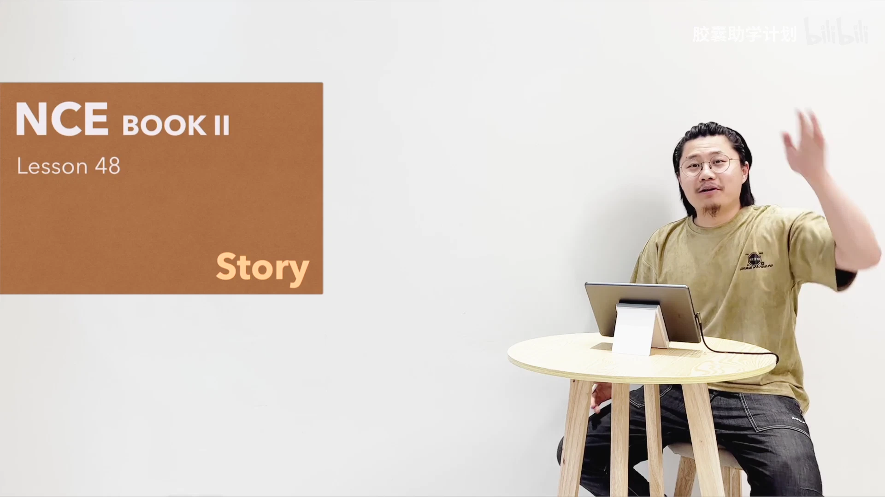

文字识别：NCE / BOOKII / Lesson 48 / Story

### 画面 00:00:02

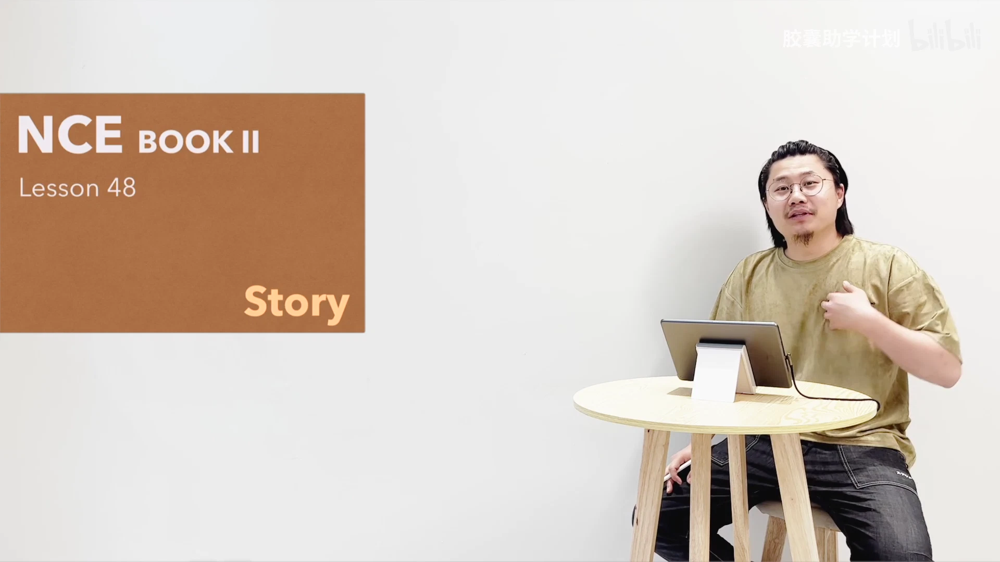

文字识别：NCE / BOOKII / Lesson 48 / Story

### 画面 00:00:05

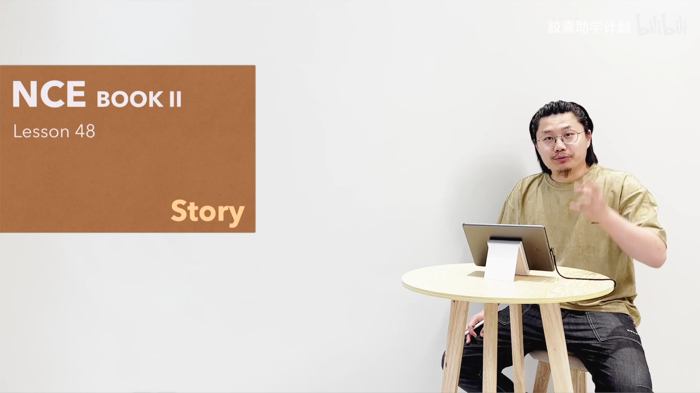

文字识别：NCE / BOOK"I / Lesson 48 / Story

### 画面 00:00:10

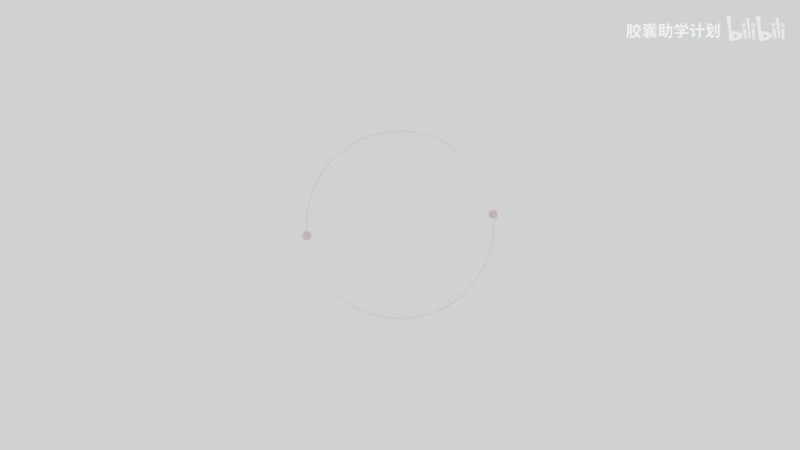

文字识别：胶囊助学计划b出l

### 画面 00:00:14

### 画面 00:00:16

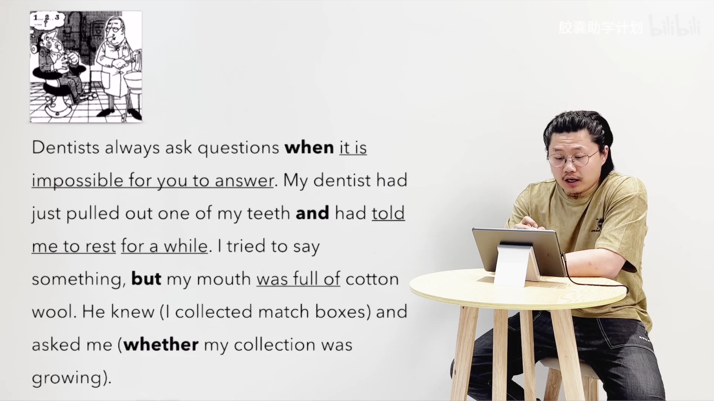

文字识别：1. / 4.* / Dentists always ask questions when it is / impossible for you to answer. My dentist had / just pulled out one of my teeth and had told / me to rest for a while. I tried to say / something, but my mouth was full of cotton / wool. He knew (I collected match boxes) and / asked me (whether my collection was / growing).

## 00:00:30–00:01:00

dentist这个单词啊，注意一下，说牙医们啊，注意是复数是吧？Always ask questions，总是问一些问题。When it is impossible for you to answer，总是会问一些问题。当哦，这是复习了一下，注意四十八课是没有语法的，我们还是在复习对吧？也就是说没有，我们不讲新的语法啊，我们就是在复习二十五课到四十八课。说当it is impossible

### 画面 00:00:46

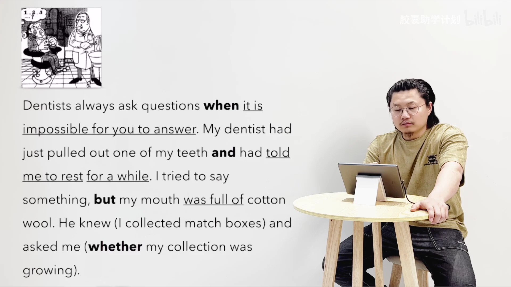

文字识别：1. / Dentists always ask questions when it is / impossible for you to answer. My dentist had / just pulled out one of my teeth and had told / me to rest for a while.I tried to say / something, but my mouth was full of cotton / wool. He knew (I collected match boxes) and / asked me (whether my collection was / growing).

## 00:01:00–00:01:30

### 画面 00:01:16

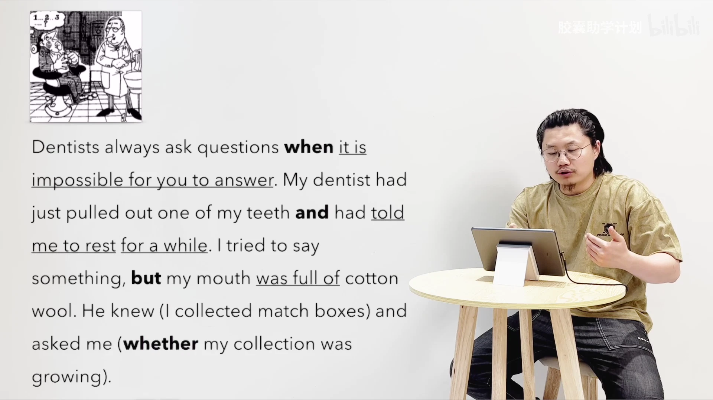

文字识别：Dentists always ask questions when it is / impossible for you to answer. My dentist had / just pulled out one of my teeth and had told / me to rest for a while.I tried to say / something, but my mouth was full of cotton / wool. He knew (I collected match boxes) and / asked me (whether my collection was / growing).

## 00:01:30–00:02:00

one of my teeth,说我的牙医啊刚刚 pulled out one of my teeth,刚刚拔出了 one of my teeth,我的一个牙一颗牙。那 teeth 就是 tooth, t o o t h,对吧？t o o t h 的复数啊。Okay, and然后呢？Had told me to rest for a while. I told somebody to do something.告诉某人去做某件事情啊。这个我们早就学过了，我们只是在这复习一下。

### 画面 00:01:42

文字识别：1 / Dentists always ask questions when it is / impossible for you to answer. My dentist had / just pulled out one of my teeth and had told / me to rest for a while. I tried to say / something, but my mouth was full of cotton / wool. He knew (I collected match boxes) and / asked me (whether my collection was / growing).

### 画面 00:01:44

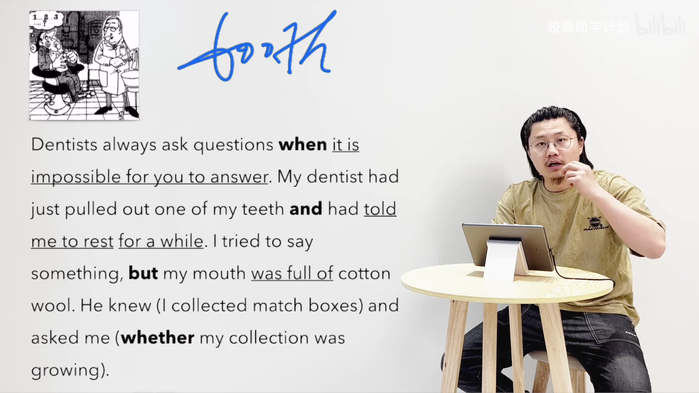

文字识别：1 / h / Dentists always ask questions when it is / impossible for you to answer. My dentist had / just pulled out one of my teeth and had told / me to rest for a while. I tried to say / something, but my mouth was full of cotton / wool. He knew (I collected match boxes) and / asked me (whether my collection was / growing).

## 00:02:00–00:02:30

告诉你说，告诉我干什么呢？Rest for a while. I休息一小下，休息一会儿叫rest for a while。我们当习惯用法也直接摘出来了，叫休息一会儿。I tried to say something.注意这的基本上读不出来哈。I tried你不会读成I tried的to say something。一般就是I tried。你看，哎，很弱很弱。I tried to say something.

### 画面 00:02:14

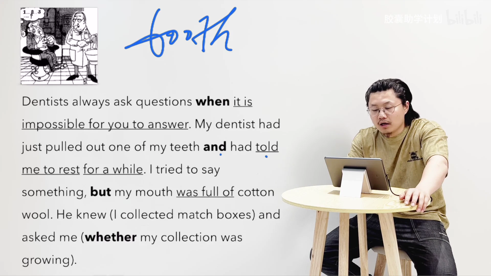

文字识别：eae / ** / Th / Dentists always ask questions when it is / impossible for you to answer. My dentist had / just pulled out one of my teeth and had told / • / me to rest for a while. I tried to say / something, but my mouth was full of cotton / wool. He knew (l collected match boxes) and / asked me (whether my collection was / growing).

## 00:02:30–00:03:00

but但是两个句子连起来了，用but. My mouth was full of cotton wool.好，be full of啊，充满，充满了药棉. He knew knew knew的是什么？宾语从句，我给各位标出来了，对吧？I collected match boxes.说我呀，收藏的是match boxes. Match是咱们新一六十五课学的一个六四六五六六啊，应该是大概这

### 画面 00:02:44

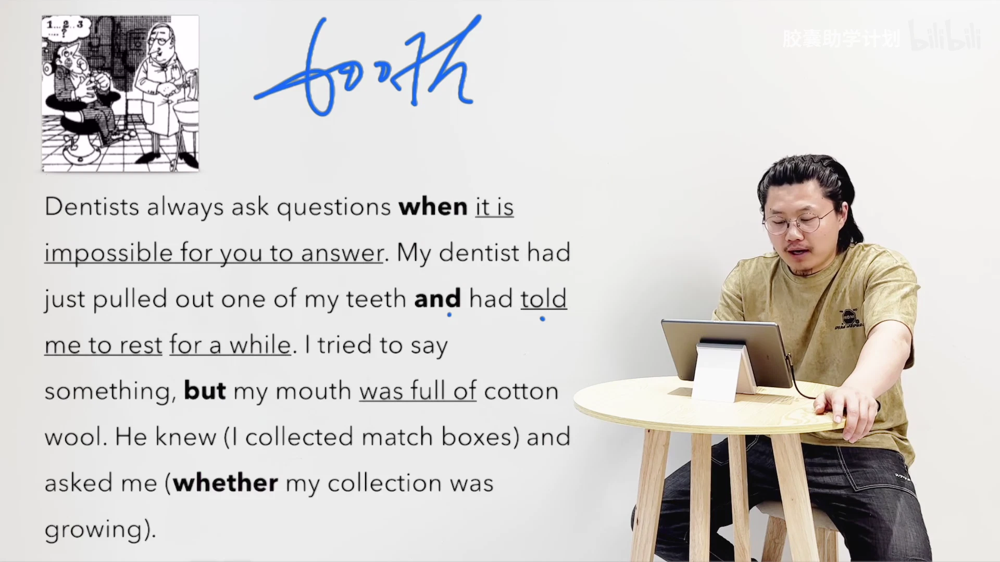

文字识别：th / Dentists always ask questions when it is / impossible for you to answer. My dentist had / just pulled out one of my teeth and had told / • / me to rest for a while. I tried to say / something, but my mouth was full of cotton / wool. He knew (I collected match boxes) and / asked me (whether my collection was / growing).

## 00:03:00–00:03:30

节课，我印象当中我们学的一个单词，呃，叫做火柴呢，match boxes就是那个火柴盒啊。and然后呢，ask me然后问我whether my collection was growing，然后问我的问题也是一个宾语从句，这个宾语从句呢，我们接着往下看，问的是什么呢？叫做是否还是whether跟if是一样的啊，说是否我的这个收藏was growing。首先

### 画面 00:03:14

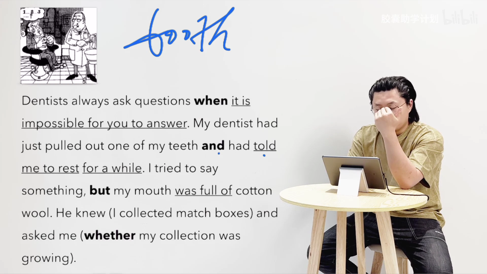

文字识别：1 / eie / 3 / th / Dentists always ask questions when it is / impossible for you to answer. My dentist had / just pulled out one of my teeth and had told / me to rest for a while. I tried to say / something, but my mouth was full of cotton / wool. He knew (I collected match boxes) and / asked me (whether my collection was / growing).

## 00:03:30–00:04:00

grow这个单词我们常用在人和植物、动物这样的事情东西上，对吧？比如说，如果你说人grow, grow up啊，就是成长、生长。你说动物grow啊，就变大呗，对吧？啊，那你说植物呢，就是变高啊，生长、成长。那如果你说是My collection was growing，那其实就是有没有增长，对吧？你要这样去理解就可以了。Continue. He then asked me.他然后又问我一件事情。你看，特殊疑问句引导的

### 画面 00:03:44

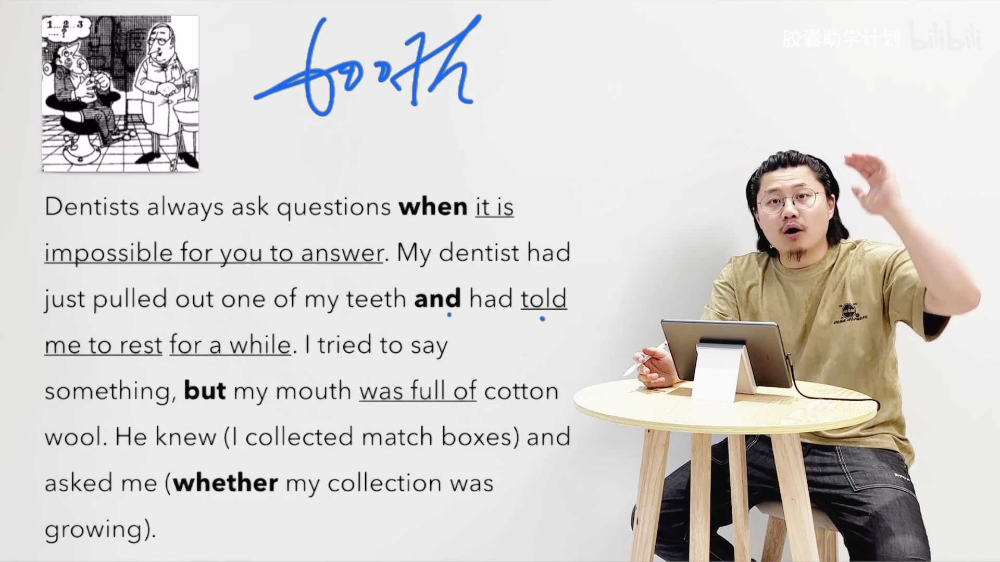

文字识别：1 / 3 / h / Dentists always ask questions when it is / impossible for you to answer. My dentist had / just pulled out one of my teeth and had told / • / me to rest for a while. I tried to say / something, but my mouth was full of cotton / wool. He knew (I collected match boxes) and / asked me (whether my collection was / growing).

### 画面 00:03:53

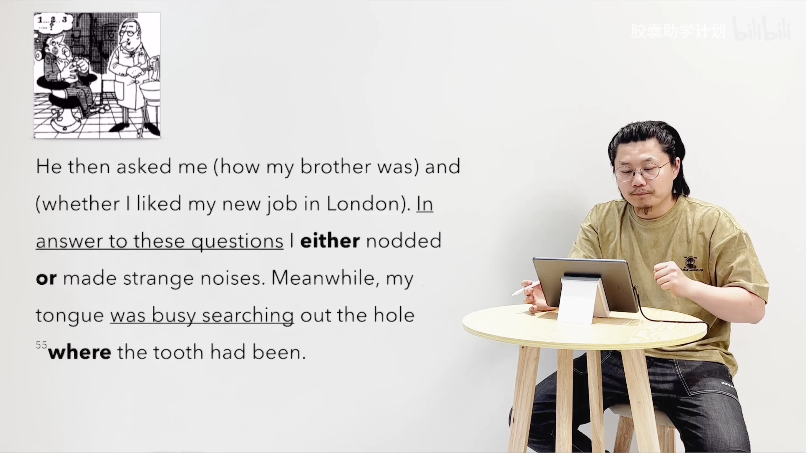

文字识别：1 / ebe- / 3 / He then asked me (how my brother was) and / (whether I liked my new job in London). In / answer to these questions I either nodded / or made strange noises. Meanwhile, my / tongue was busy searching out the hole / 55 / where the tooth had been.

## 00:04:00–00:04:30

宾语从句啊，特殊疑问词引导的宾语从句，对吧？注意它的语序不能是 how was your brother，对吧？一定是 how my brother was，一定是这样一个啊，它放在最前面，然后它的语序是主语再加谓语，不能是谓语加主语，对吧？我们说要给它调换过来，调换成陈述句语序。如果这个语法您忘了，你相信我，一定要回到新概念一册一百三十九课，回去好好看一下，这个语法

### 画面 00:04:23

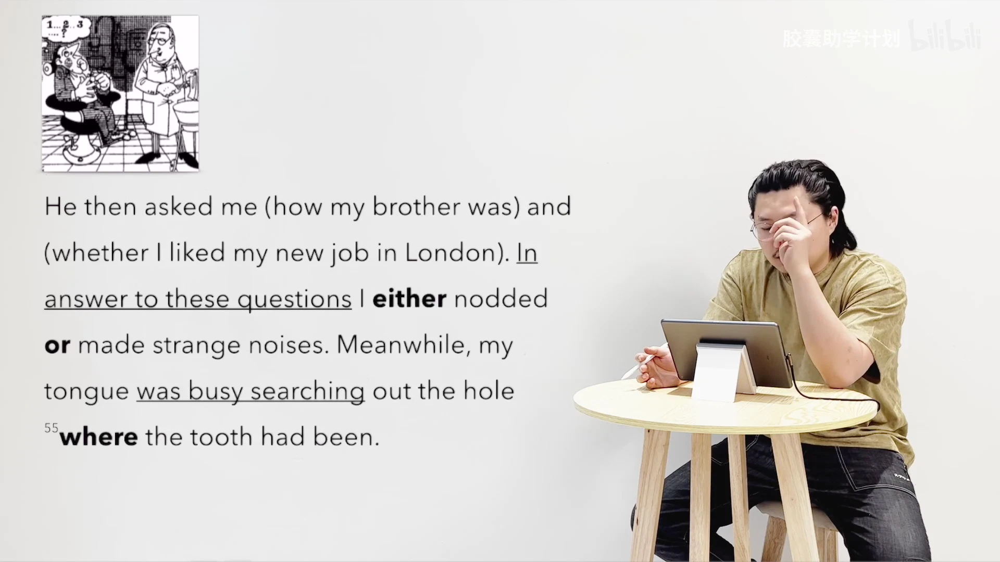

文字识别：1 / eie / 3 / *** / He then asked me (how my brother was) and / (whether I liked my new job in London). In / answer to these questions I either nodded / or made strange noises. Meanwhile, my / tongue was busy searching out the hole / 55 / where the tooth had been.

## 00:04:30–00:05:00

无比的重要啊。And然后呢，Whether I liked my new job in London, I whether if啊，是否我喜欢我新的工作在伦敦？这里其实是一样的，它实际上是一般疑问句做了宾语从句啊。这课宾语从句还真多，做了宾语从句。然后这里是是否？你看后面他就没有说，Do you like your new job in London？不是这个样，他要换成陈述句语序，对吧？也其实就是换成肯定句，你再给它换

### 画面 00:04:53

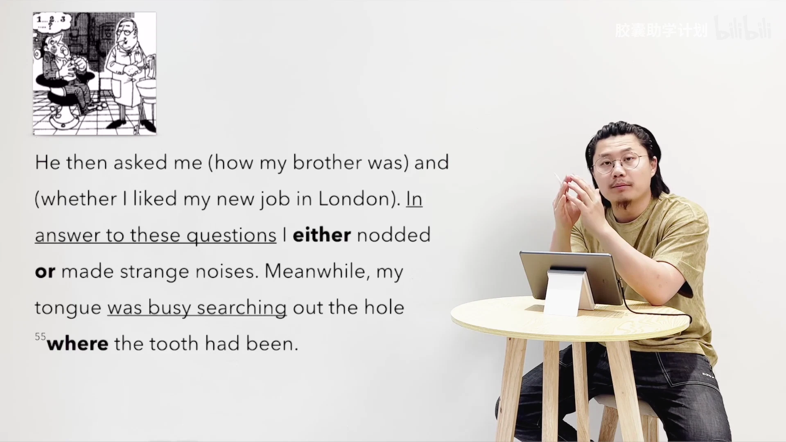

文字识别：ee / He then asked me (how my brother was) and / (whether I liked my new job in London). In / answer to these questions I either nodded / or made strange noises. Meanwhile, my / tongue was busy searching out the hole / where the tooth had been.

## 00:05:00–00:05:30

回去，所以就是 I like my new job in London. 但是再加上一个是否，就这整句话的意思就出来了啊。还是那句话，这个都是一百三十九克的新概念一册一百三十九克，忘了您一定要回去看一下，好吧，花点时间不浪费的。那新三包括新二下半册全是这个东西。 In answer to these questions, 好，作为对这些问题的回答，I 这个单词有两个发音，either either 都是对的，

### 画面 00:05:23

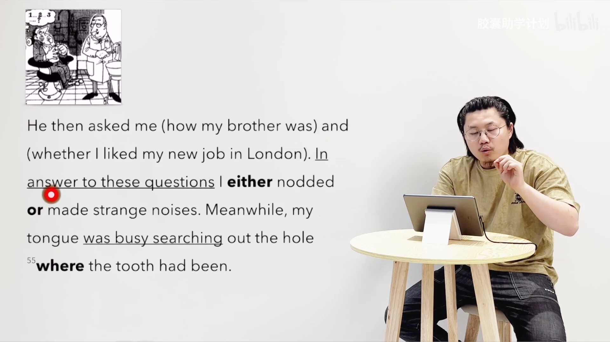

文字识别：1 / ** / He then asked me (how my brother was) and / (whether I liked my new job in London). In / answer to these questions I either nodded / or made strange noises. Meanwhile, my / tongue was busy searching out the hole / 55 / where the tooth had been.

## 00:05:30–00:06:00

没有谁错，没有谁对，我都是混着用的，你随便，好吧。I either nodded or make strange noises.说我要么就是点头，要么就是做出了一些奇怪的声响。你看，make noise, make noise，也是我们应该是六十五、六十六学的新概念一册啊。那你看，现在你只不过把它变成了叫made strange noises，对吧？Strange就是奇怪的啊。我只能要么点头，要么做出一些

### 画面 00:05:53

文字识别：He then asked me (how my brother was) and / (whether I liked my new job in London). In / answer to these questions I either nodded / or made strange noises. Meanwhile, my / tongue was busy searching out the hole / 55 / where the tooth had been.

## 00:06:00–00:06:30

嗯嗯嗯奇怪的声音。Meanwhile,与此同时，my tongue was busy searching out the hole.说我的这个舌头啊，be busy doing something，忙于做某件事情。Search out the hole，正在去忙着搜索the hole，搜索那个洞啊，搜索那个牙拔下来的那个洞。注意，接下来的这个是一个高端的语法，我们新概念二册五十五课才会学到，

### 画面 00:06:23

文字识别：1 / He then asked me (how my brother was) and / (whether Iliked my new job in London). In / answer to these questions I either nodded / or made strange noises. Meanwhile, my / tongue was busy searching out the hole / 55 / where the tooth had been.

## 00:06:30–00:07:00

今天见到但不学啊。它实际上是 where 引导的一个定语从句。我先告诉你它怎么翻译，叫做在那里，而不是翻译成哪里。听见了吧？不是翻译成哪里啊，带着口的那个字儿啊，不是翻译成哪里，而是在翻译成叫做在那里啊。where 要翻译成在那里啊，在那个洞啊那里怎么样呢？The tooth had been 说这个牙

### 画面 00:06:46

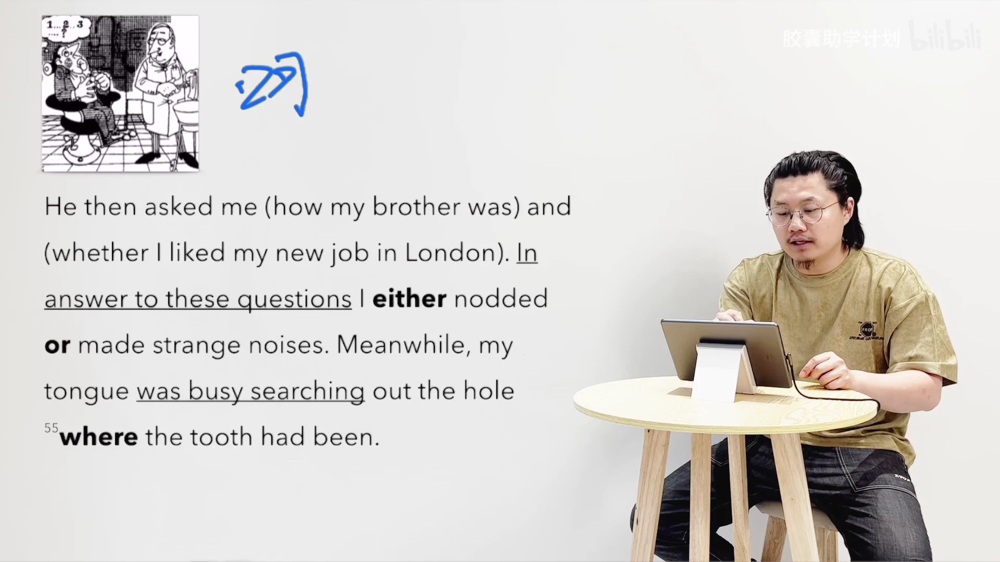

文字识别：1 / eie / 3 / He then asked me (how my brother was) and / (whether I liked my new job in London). In / answer to these questions I either nodded / or made strange noises. Meanwhile, my / tongue was busy searching out the hole / 55 / where the tooth had been.

### 画面 00:06:48

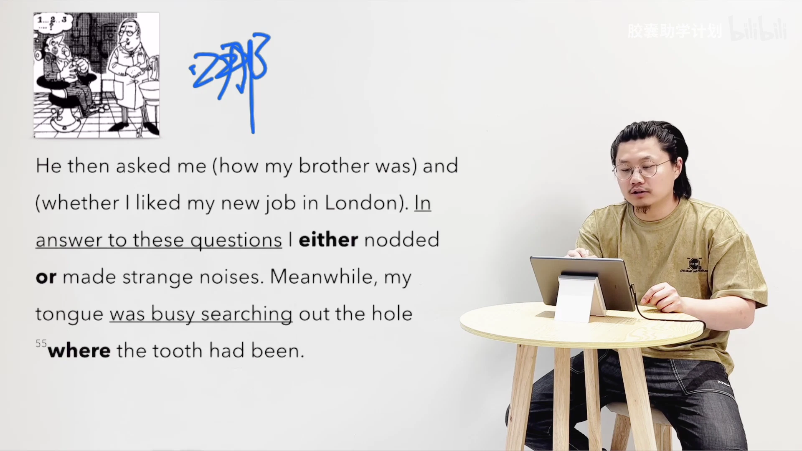

文字识别：ese / 4* / He then asked me (how my brother was) and / (whether Iliked my new job in London). In / answer to these questions I either nodded / or made strange noises. Meanwhile, my / tongue was busy searching out the hole / where the tooth had been.

### 画面 00:06:50

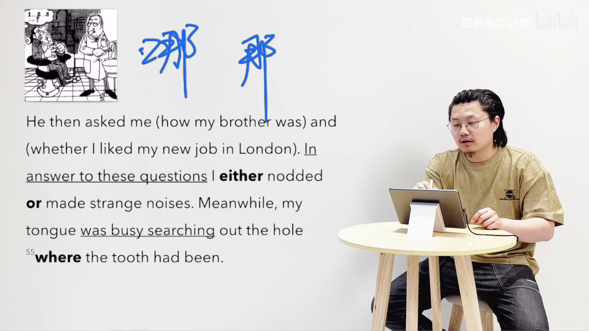

文字识别：eae / *** / 那 / He then asked me (how my brother was) and / (whether I liked my new job in London). In / answer to these questions I either nodded / or made strange noises. Meanwhile, my / tongue was busy searching out the hole / 55 / where the tooth had been.

### 画面 00:06:58

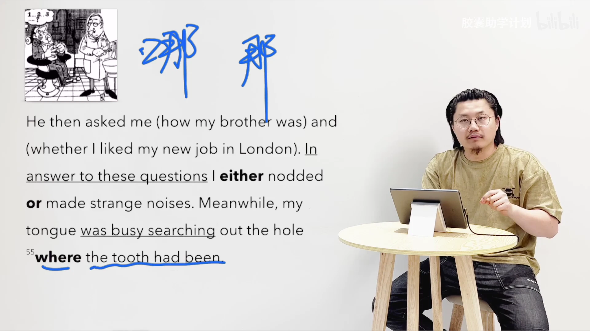

文字识别：eie / 3 / 1 / 那 / He then asked me (how my brother was) and / (whether I liked my new job in London). In / answer to these questions I either nodded / or made strange noises. Meanwhile, my / tongue was busy searching out the hole / where the tooth had been.

## 00:07:00–00:07:30

之前在那里的那个洞，对吧？OK，玩一个。那我再翻一遍这句话啊，叫做与此同时，我的舌头正在忙着去搜寻那个洞，哪个洞呢？这个牙之前在的那个洞啊，其实就是你拔下来的那个牙的那个洞啊。OK，还是那句话，因为它是我们五十五课才会学到的，今天我只讲解给各位听，对吧？你坚持往下去学，学到五十五课，到那课我会回来再分析一下这个句子，

### 画面 00:07:28

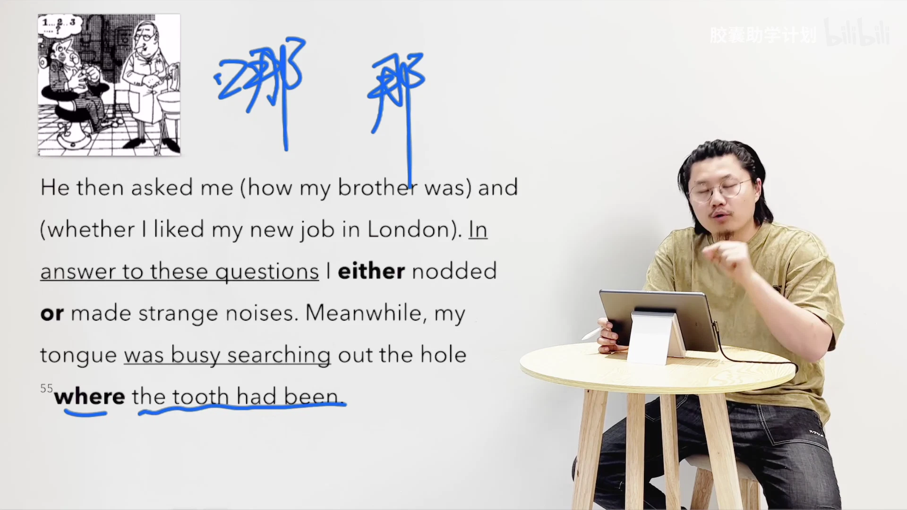

文字识别：那 / He then asked me (how my brother was) and / (whether I liked my new job in London). In / answer to these questions I either nodded / or made strange noises. Meanwhile, my / tongue was busy searching out the hole / 55 / where the tooth had been.

## 00:07:30–00:08:00

好吧。I suddenly felt very worried. 我突然间感到非常的焦虑和担心。But但是could not say anything.但是没办法说任何的东西。When the dentist at last removed the cotton wool from my mouth.你看从这儿到这儿这么长的一句话，其实就是个时间从句，表达了一个时间，什么时间呢？叫做牙医最终

### 画面 00:07:31

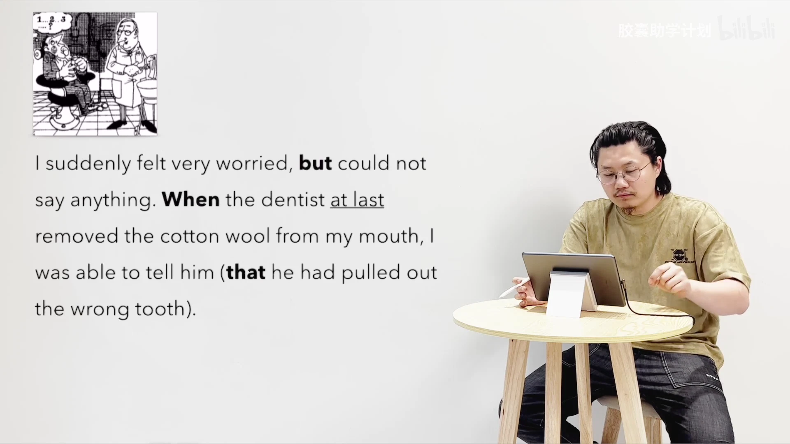

文字识别：1 / ** / I suddenly felt very worried, but could not / say anything. When the dentist at last / removed the cotton wool from my mouth, I / was able to tell him (that he had pulled out / the wrong tooth).

## 00:08:00–00:08:30

移掉了这个药棉从我的嘴里。I was able to tell him.我才能够告诉他was able to，对吧？我才能够告诉他什么事儿呢？一个事情，又是宾语从句，that he had pulled out the wrong tooth.啊，说他呀已经拔出了这个错误的牙。OK，那整篇文章就是这个样子。我们摘了两个习惯用法，别的习惯用法之前都学过啊，就

### 画面 00:08:01

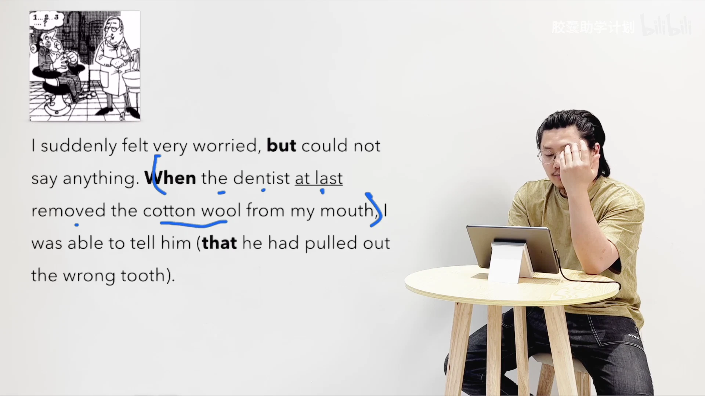

文字识别：1 / ese / 3 / I suddenly felt yery worried, but could not / say anything. When the dentist at last / • / removed the cotton wool from my mouthy / was able to tell him (that he had pulled out / the wrong tooth).

### 画面 00:08:25

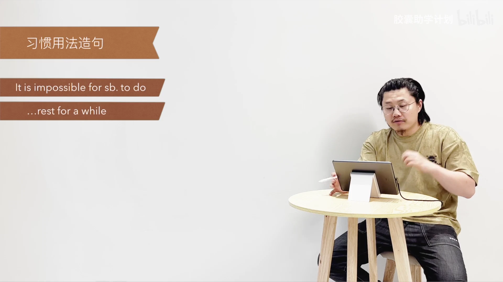

文字识别：习惯用法造句 / It is impossible for sb. to do / ...rest for a while

### 画面 00:08:27

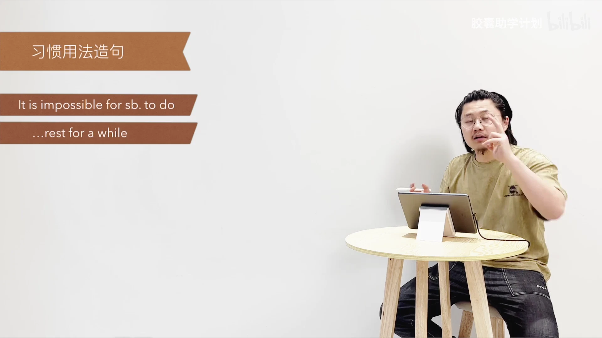

文字识别：习惯用法造句 / It is impossible for sb. to do / ...rest for a while

## 00:08:30–00:09:00

不用挨个儿摘了。摘了两个习惯用法，叫 it is impossible for somebody to do something 和 rest for a while。 OK，我们先看第一个。 It is impossible for somebody to do something，叫对于某人来说去做某件事情是不可能的。 OK，比如说， It is impossible for him to break the record。 好，对于他来说去打破这个记录是不可能的。好，我这地方提一个小点，你看前面其实是不变的， somebody 你爱用谁用谁，这儿的重点不

### 画面 00:08:30

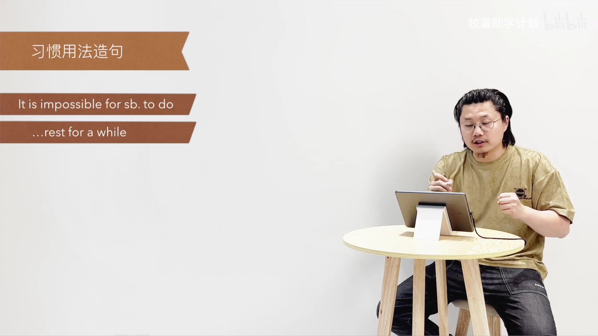

文字识别：习惯用法造句 / It is impossible for sb. to do / ..rest for a while

### 画面 00:08:35

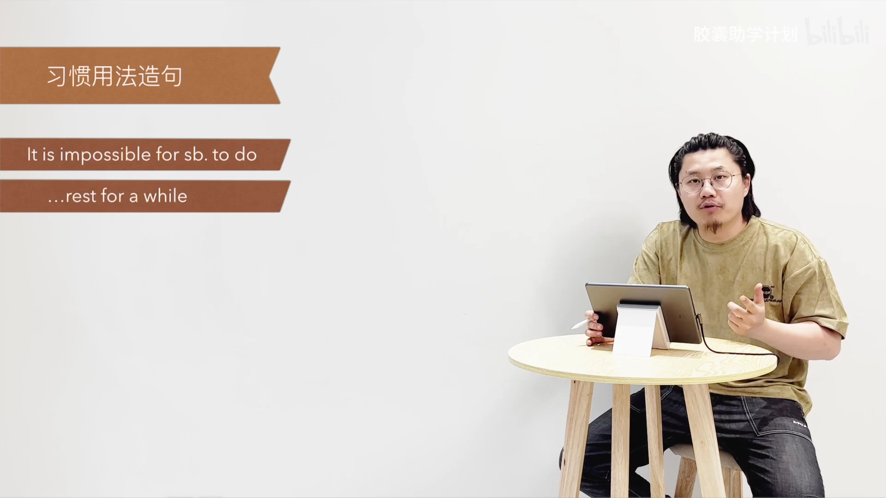

文字识别：习惯用法造句 / It is impossible for sb. to do / ...rest for a while

### 画面 00:08:37

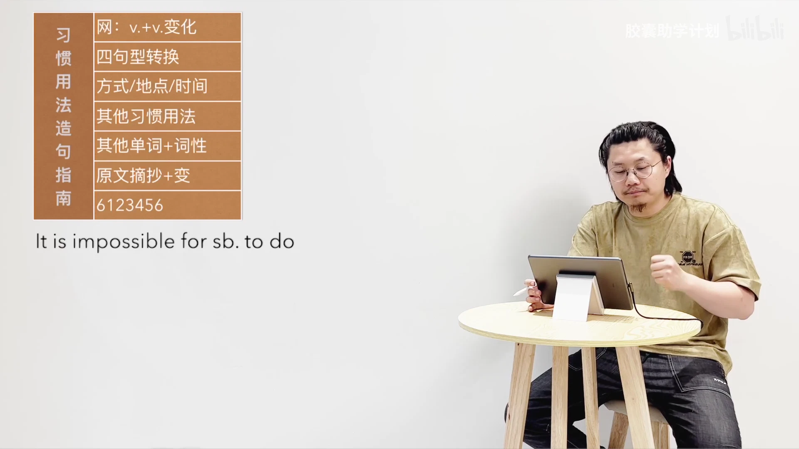

文字识别：网：v.+v.变化 / 习惯用法造句指南 / 四句型转换 / 方式/地点/时间 / 其他习惯用法 / 其他单词+词性 / 原文摘抄+变 / 6123456 / It is impossible for sb. to do

### 画面 00:08:39

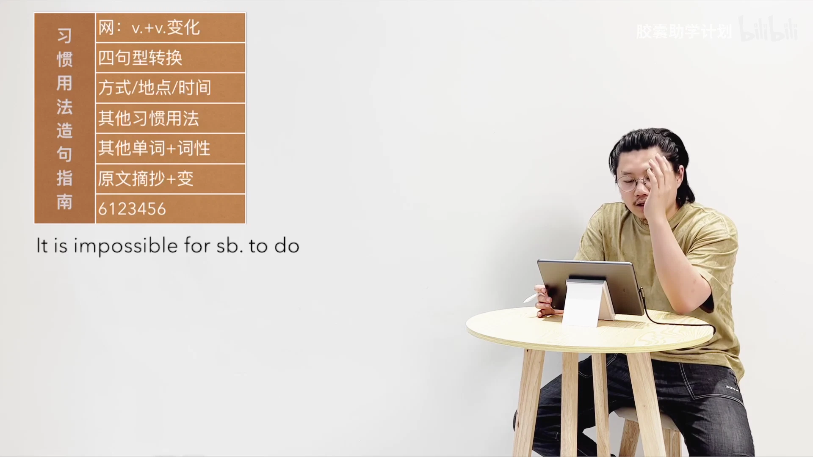

文字识别：网：v.+v.变化 / 习惯用法造句指南 / 四句型转换 / 方式/地点/时间 / 其他习惯用法 / 其他单词+词性 / 原文摘抄+变 / 6123456 / It is impossible for sb. to do

### 画面 00:08:41

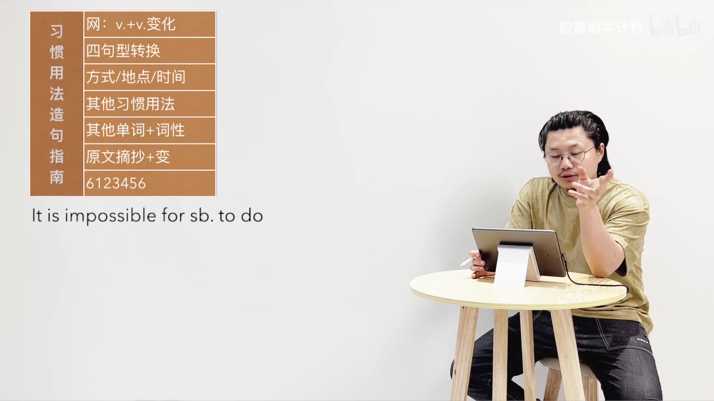

文字识别：网：v.+v.变化 / 习惯用法造句指南 / 四句型转换 / 方式/地点/时间 / 其他习惯用法 / 其他单词+词性 / 原文摘抄+变 / 6123456 / It is impossible for sb. to do

### 画面 00:08:45

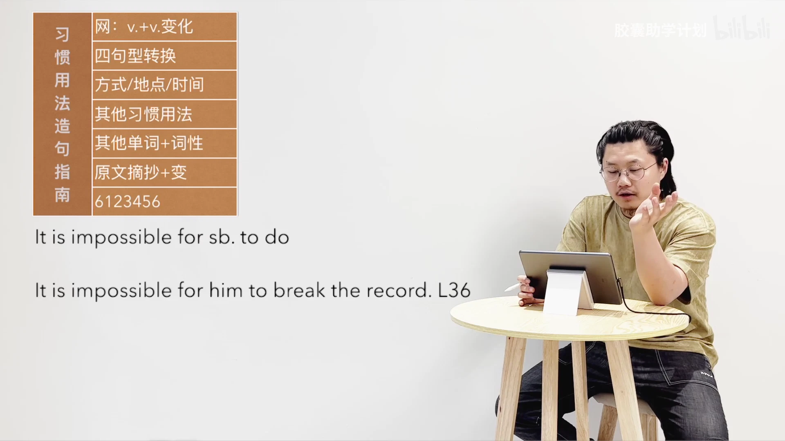

文字识别：网：v.+v.变化 / 习惯用法造句指南 / 四句型转换 / 方式/地点/时间 / 其他习惯用法 / 其他单词+词性 / 原文摘抄+变 / 6123456 / It is impossible for sb.to do / It is impossible for him to break the record. L36

### 画面 00:08:47

文字识别：网：v.+v.变化 / 习惯用法造句指南 / 四句型转换 / 方式/地点/时间 / 其他习惯用法 / 其他单词+词性 / 原文摘抄+变 / 6123456 / It is impossible for sb.to do / It is impossible for him to break the record. L36

### 画面 00:08:50

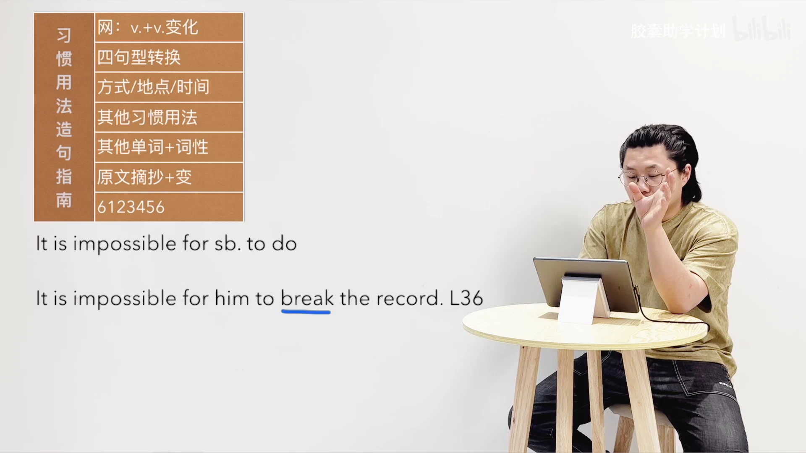

文字识别：网：v.+v.变化 / 习惯用法造句指南 / 四句型转换 / 方式/地点/时间 / 其他习惯用法 / 其他单词+词性 / 原文摘抄+变 / 6123456 / It is impossible for sb.to do / It is impossible for him to break the record. L36

### 画面 00:08:52

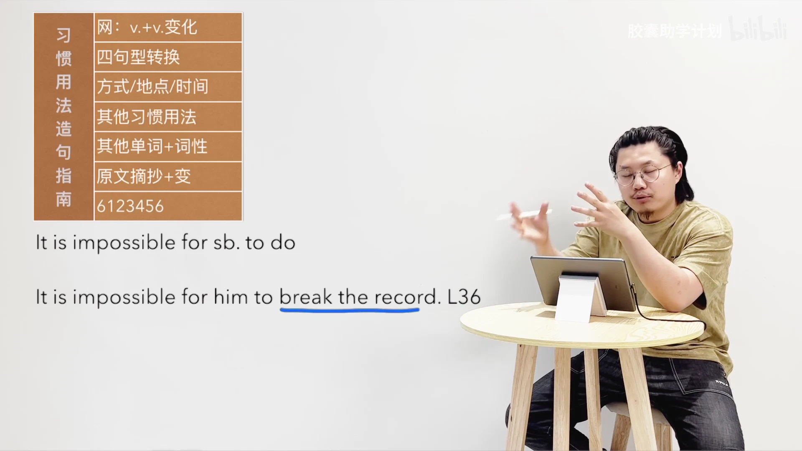

文字识别：网：v.+v.变化 / 习惯用法造句指南 / 四句型转换 / 方式/地点/时间 / 其他习惯用法 / 其他单词+词性 / 原文摘抄+变 / 6123456 / It is impossible for sb. to do / It is impossible for him to break the record. L36

### 画面 00:08:55

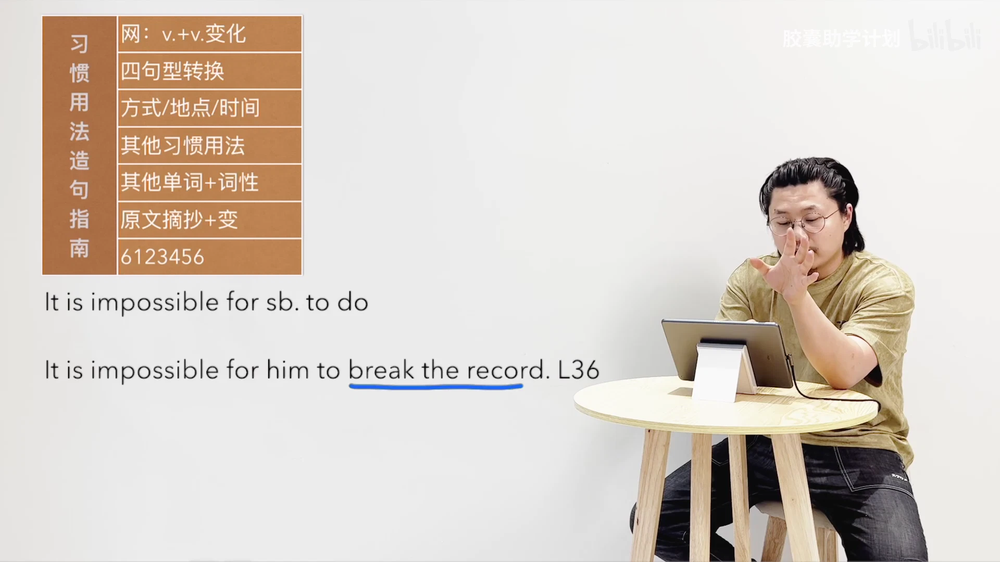

文字识别：网：v.+v.变化 / 习惯用法造句指南 / 四句型转换 / 方式/地点/时间 / 其他习惯用法 / 其他单词+词性 / 原文摘抄+变 / 6123456 / It is impossible for sb.to do / It is impossible for him to break the record. L36

### 画面 00:08:57

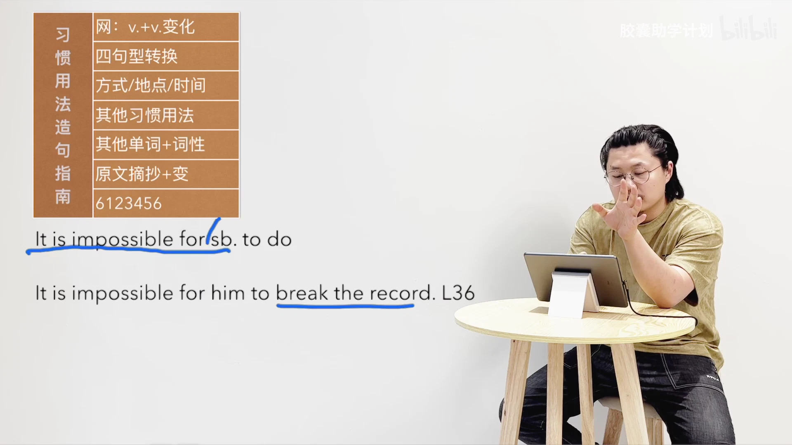

文字识别：网：v.+v.变化 / 习惯用法造句指南 / 四句型转换 / 方式/地点/时间 / 其他习惯用法 / 其他单词+词性 / 原文摘抄+变 / 6123456 / It is impossible for/sb. to do / It is impossible for him to break the record. L36

### 画面 00:08:59

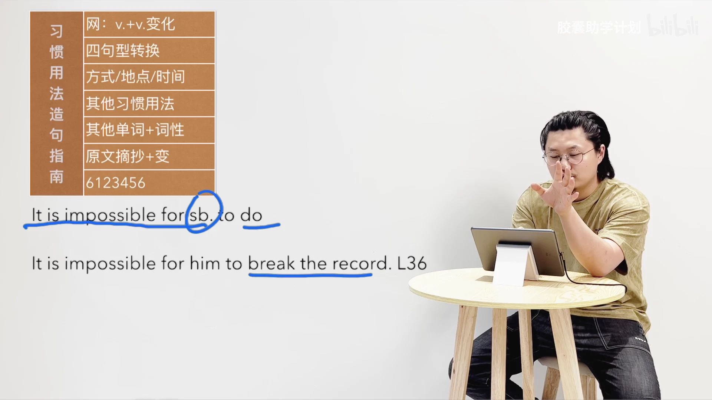

文字识别：网：v.+v.变化 / 习惯用法造句指南 / 四句型转换 / 方式/地点/时间 / 其他习惯用法 / 其他单词+词性 / 原文摘抄+变 / 6123456 / It is impossible forsb.lo do / It is impossible for him to break the record. L36

## 00:09:00–00:09:30

就是找个动词吗？如果想用它去造句的话，对吧？好，再来，比如说，It is impossible for him to catch up with his brother.啊，赶上某人，追上某人。OK，好，那所以我在这儿想提的就就是for him，其实对于你来说，你保持它不变。今天回去拿它造句的重点是在这儿找点动词，对吧？所以我给你点点点了，课下各位去造来五个句子，复习一下之前学过的习惯用法，好吧？

### 画面 00:09:01

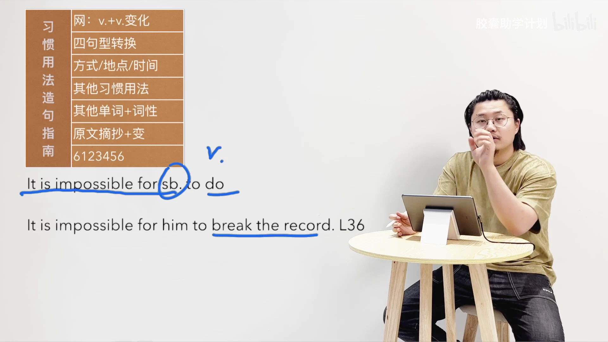

文字识别：网：v.+v.变化 / 习惯用法造句指南 / 四句型转换 / 方式/地点/时间 / 其他习惯用法 / 其他单词+词性 / 原文摘抄+变 / 6123456 / It is impossible forsb.lo do / It is impossible for him to break the record. L36

### 画面 00:09:03

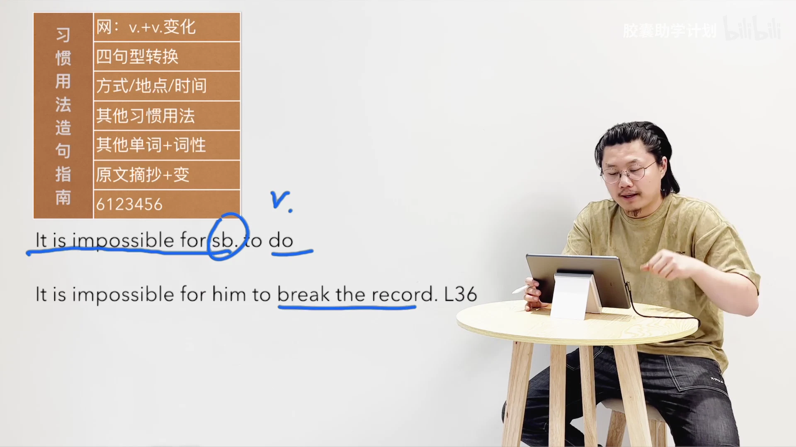

文字识别：网：v.+v.变化 / 习惯用法造句指南 / 四句型转换 / 方式/地点/时间 / 其他习惯用法 / 其他单词+词性 / 原文摘抄+变 / 6123456 / It is impossible forsb.lo do / It is impossible for him to break the record. L36

### 画面 00:09:05

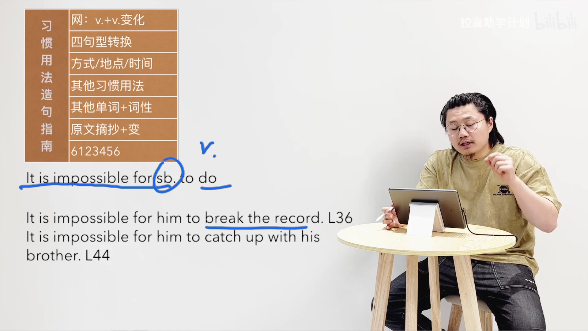

文字识别：网：v.+v.变化 / 习惯用法造句指南 / 四句型转换 / 方式/地点/时间 / 其他习惯用法 / 其他单词+词性 / 原文摘抄+变 / 6123456 / It is impossible forsb.lo do / It is impossible for him to break the record. L36 / It is impossible for him to catch up with his / brother. L44

### 画面 00:09:09

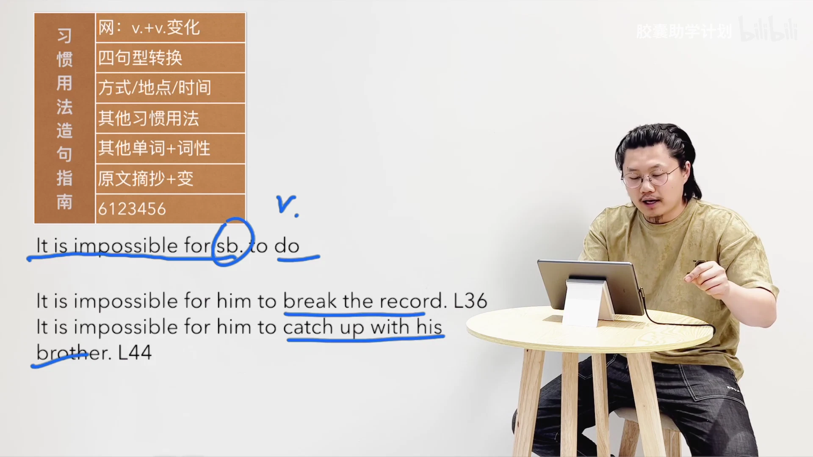

文字识别：网：v.+v.变化 / 习惯用法造句指南 / 四句型转换 / 方式/地点/时间 / 其他习惯用法 / 其他单词+词性 / 原文摘抄+变 / 6123456 / It is impossible forsb.lo do / It is impossible for him to break the record. L36 / It is impossible for him to catch up with his / brother. L44

### 画面 00:09:11

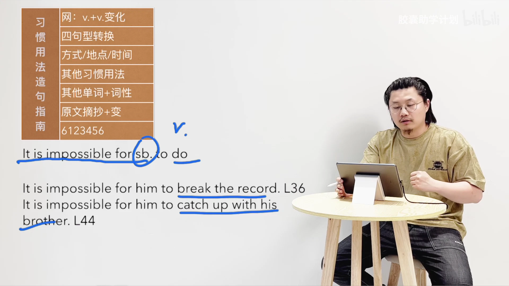

文字识别：网：v.+v.变化 / 习惯用法造句指南 / 四句型转换 / 方式/地点/时间 / 其他习惯用法 / 其他单词+词性 / 原文摘抄+变 / 6123456 / It is impossible forsb.lo do / It is impossible for him to break the record. L36 / It is impossible for him to catch up with his / brother. L44

### 画面 00:09:13

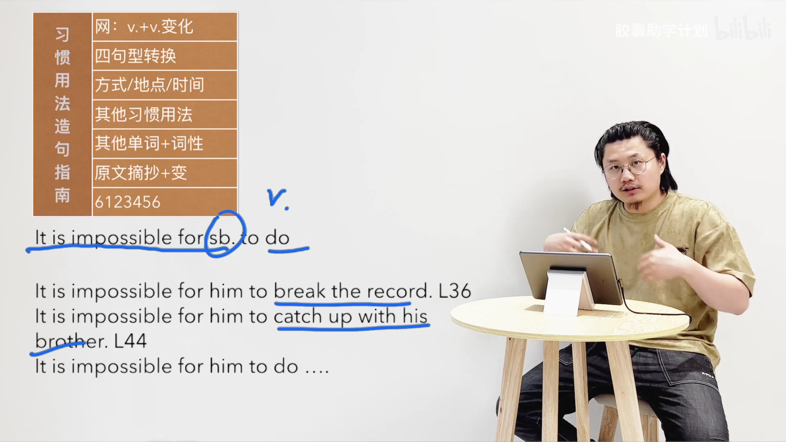

文字识别：网：v.+v.变化 / 习惯用法造句指南 / 四句型转换 / 方式/地点/时间 / 其他习惯用法 / 其他单词+词性 / 原文摘抄+变 / 6123456 / It is impossible forsb.lo do / It is impossible for him to break the record. L36 / It is impossible for him to catch up with his / brother. L44 / It is impossible for him to do ...

### 画面 00:09:15

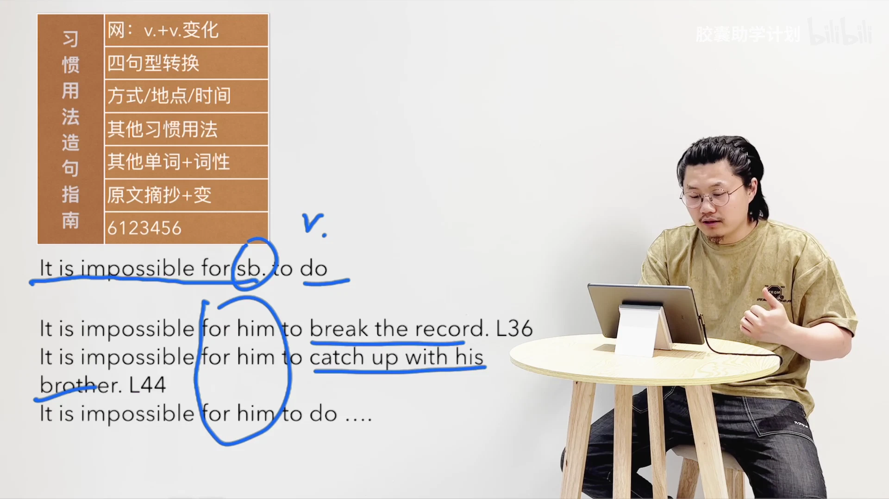

文字识别：网：v.+v.变化 / 习惯用法造句指南 / 四句型转换 / 方式/地点/时间 / 其他习惯用法 / 其他单词+词性 / 原文摘抄+变 / 6123456 / It is impossible forsb.lo do / It is impossiblefor himto break the record. L36 / It is impossiblefor him to catch up with his / brother. L44 / It is impossiblefor himto do ..

### 画面 00:09:17

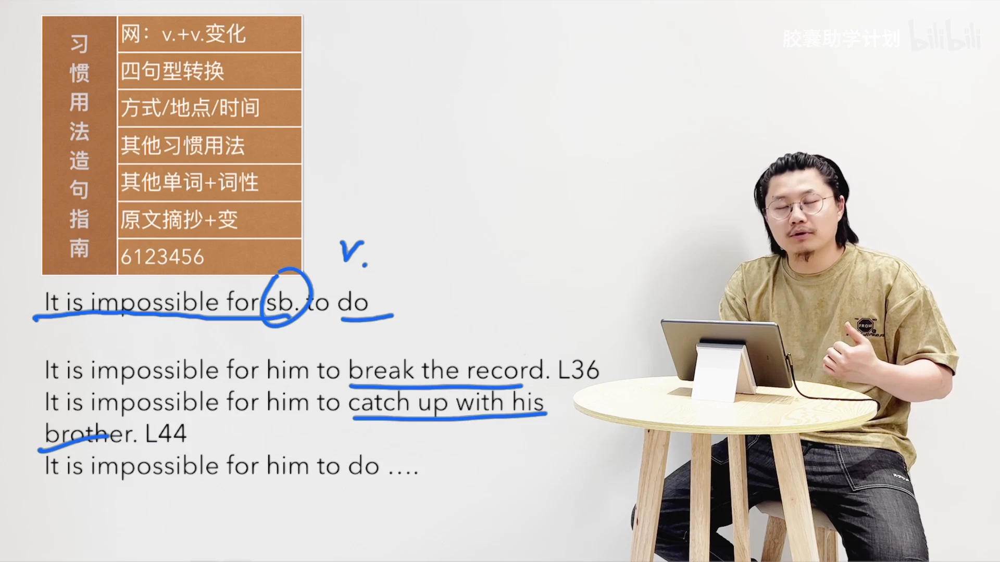

文字识别：网：v.+v.变化 / 习惯用法造句指南 / 四句型转换 / 方式/地点/时间 / 其他习惯用法 / 其他单词+词性 / 原文摘抄+变 / 6123456 / It is impossible forsb.lo do / It is impossible for him to break the record. L36 / It is impossible for him to catch up with his / brother. L44 / It is impossible for him to do ...

### 画面 00:09:19

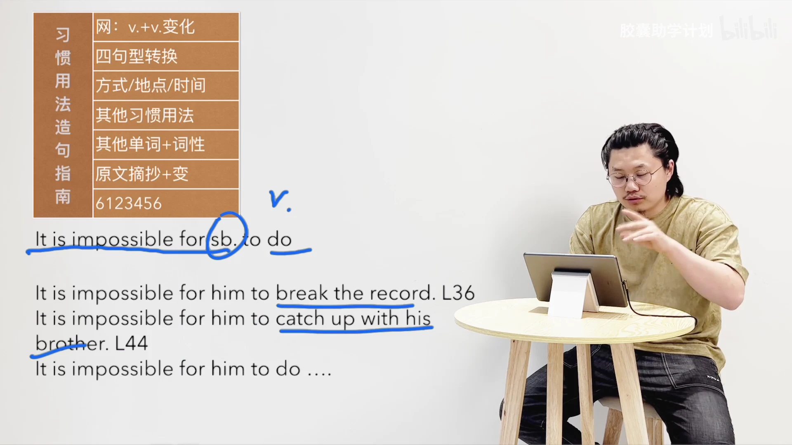

文字识别：网：v.+v.变化 / 习惯用法造句指南 / 四句型转换 / 方式/地点/时间 / 其他习惯用法 / 其他单词+词性 / 原文摘抄+变 / 6123456 / It is impossible forsb.lo do / It is impossible for him to break the record. L36 / It is impossible for him to catch up with his / brother. L44 / It is impossible for him to do ...

### 画面 00:09:21

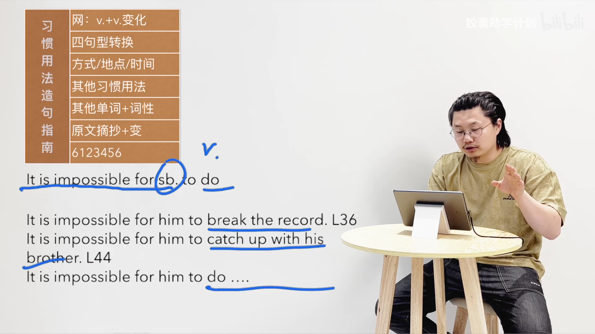

文字识别：网：v.+v.变化 / 习惯用法造句指南 / 四句型转换 / 方式/地点/时间 / 其他习惯用法 / 其他单词+词性 / 原文摘抄+变 / 6123456 / It is impossible forsb.lo do / It is impossible for him to break the record. L36 / It is impossible for him to catch up with his / brother. L44 / It is impossible for him to do ...

### 画面 00:09:23

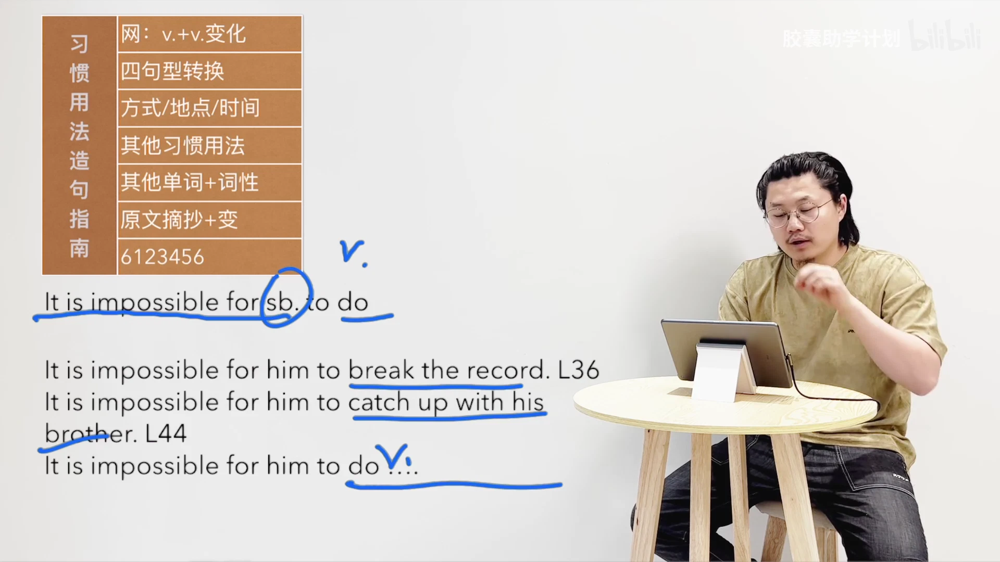

文字识别：网：v.+v.变化 / 习惯用法造句指南 / 四句型转换 / 方式/地点/时间 / 其他习惯用法 / 其他单词+词性 / 原文摘抄+变 / 6123456 / It is impossible forsb.lo do / It is impossible for him to break the record. L36 / It is impossible for him to catch up with his / brother. L44 / It is impossible for him to doV.

### 画面 00:09:25

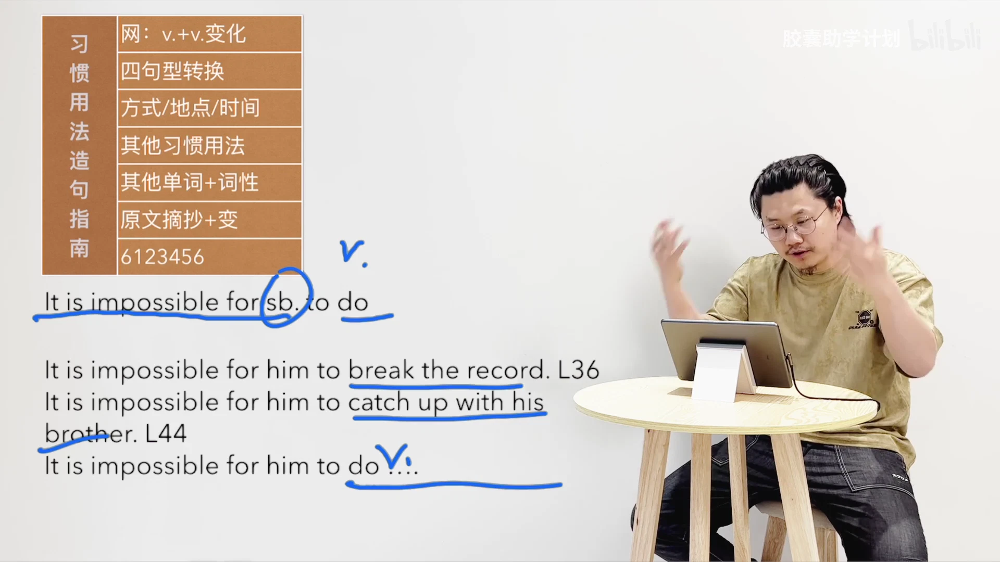

文字识别：网：v.+v.变化 / 习惯用法造句指南 / 四句型转换 / 方式/地点/时间 / 其他习惯用法 / 其他单词+词性 / 原文摘抄+变 / 6123456 / It is impossible forsb.lo do / It is impossible for him to break the record. L36 / It is impossible for him to catch up with his / brother. L44 / Tt is impossible for him to doY.

### 画面 00:09:28

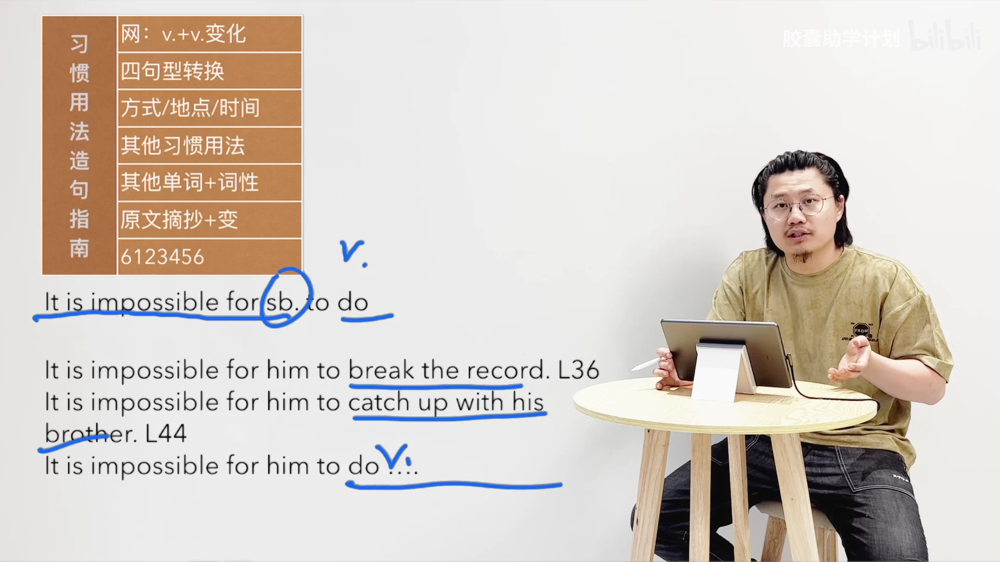

文字识别：网：v.+v.变化 / 习惯用法造句指南 / 四句型转换 / 方式/地点/时间 / 其他习惯用法 / 其他单词+词性 / 原文摘抄+变 / 6123456 / It is impossible forsb.lo do / It is impossible for him to break the record. L36 / It is impossible for him to catch up with his / brother. L44 / Tt is impossible for him to doY.

## 00:09:30–00:10:00

来了。Rest for a while叫休息一会儿，很简单。你看动词其实都已经给你了，就无非就是再加上一些结构，这个句子就出来了。比如说我们用了四十一课的结构，I needn't have rested for a while，我本不必休息一会儿的，needn't have that，对吧？再加上 rest，一个句子很很舒服就出来了。OK，再来说，instead of working， he rested for a while，啊，替代工作他休息了一

### 画面 00:09:30

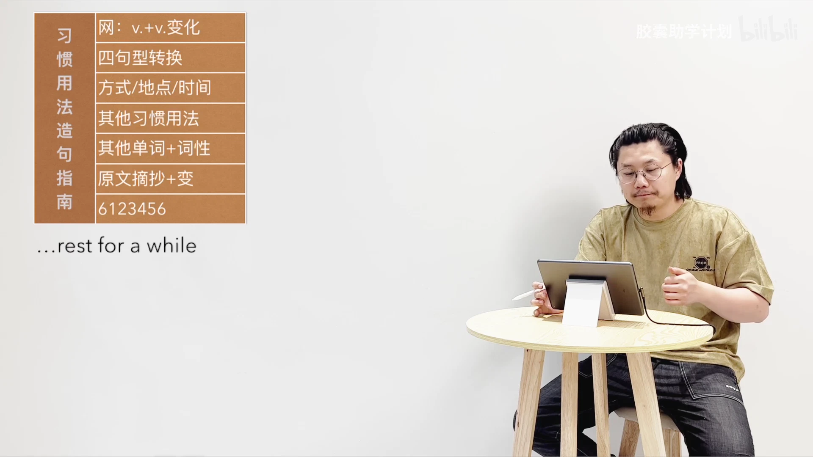

文字识别：网：v.+v.变化 / 习惯用法造句指南 / 四句型转换 / 方式/地点/时间 / 其他习惯用法 / 其他单词+词性 / 原文摘抄+变 / 6123456 / ...rest for a while

### 画面 00:09:35

文字识别：网：v.+v.变化 / 习惯用法造句指南 / 四句型转换 / 方式/地点/时间 / 其他习惯用法 / 其他单词+词性 / 原文摘抄+变 / 6123456 / ...rest for a while

### 画面 00:09:38

文字识别：网：v.+v.变化 / 习惯用法造句指南 / 四句型转换 / 方式/地点/时间 / 其他习惯用法 / 其他单词+词性 / 原文摘抄+变 / 6123456 / ...rest for a while / I needn't have rested for a while. L41

### 画面 00:09:40

文字识别：网：v.+v.变化 / 习惯用法造句指南 / 四句型转换 / 方式/地点/时间 / 其他习惯用法 / 其他单词+词性 / 原文摘抄+变 / 6123456 / ...rest for a while / I needn't have rested for a while. L41

### 画面 00:09:44

文字识别：网：v.+v.变化 / 习惯用法造句指南 / 四句型转换 / 方式/地点/时间 / 其他习惯用法 / 其他单词+词性 / 原文摘抄+变 / 6123456 / ...rest for a while / I needn't have rested for a while. L41

### 画面 00:09:46

文字识别：网：v.+v.变化 / 习惯用法造句指南 / 四句型转换 / 方式/地点/时间 / 其他习惯用法 / 其他单词+词性 / 原文摘抄+变 / 6123456 / ...rest for a while / I needn't have rested for a while. L41

### 画面 00:09:48

文字识别：网：v.+v.变化 / 习惯用法造句指南 / 四句型转换 / 方式/地点/时间 / 其他习惯用法 / 其他单词+词性 / 原文摘抄+变 / 6123456 / ...rest for a while / FROM / I needn't have rested for a while. L41

### 画面 00:09:50

文字识别：网：v.+v.变化 / 习惯用法造句指南 / 四句型转换 / 方式/地点/时间 / 其他习惯用法 / 其他单词+词性 / 原文摘抄+变 / 6123456 / ...rest for a while / I needn't have rested for a while. L41

### 画面 00:09:54

文字识别：网：v.+v.变化 / 习惯用法造句指南 / 四句型转换 / 方式/地点/时间 / 其他习惯用法 / 其他单词+词性 / 原文摘抄+变 / 6123456 / ...rest for a while / I needn't have rested for a while. L41 / Instead of working, he rested for a while. L20

### 画面 00:09:56

文字识别：网：v.+v.变化 / 习惯用法造句指南 / 四句型转换 / 方式/地点/时间 / 其他习惯用法 / 其他单词+词性 / 原文摘抄+变 / 6123456 / ...rest for a while / I needn't have rested for a while. L41 / Instead of working, he rested for a while. L20

## 00:10:00–00:10:30

会儿，二十克，对吧？今天咱们用了两回了，以及最简单就I need to rest for a while，我需要休息一下。肯定句出来了，你再把不同的句型做一下变化呗，对吧？那rest for a while这个习惯用法，你可能就记在脑海当中了，好吧？Recap，除了文章，两个习惯用法摘出来了啊。家庭作业，你要拿它去造句。文章一定要熟读成诵，多读多读，对吧？好，你

### 画面 00:10:00

文字识别：网：v.+v.变化 / 习惯用法造句指南 / 四句型转换 / 方式/地点/时间 / 其他习惯用法 / 其他单词+词性 / 原文摘抄+变 / 6123456 / ...rest for a while / I needn't have rested for a while. L41 / Instead of working, he rested for a while. L20

### 画面 00:10:05

文字识别：网：v.+v.变化 / 习惯用法造句指南 / 四句型转换 / 方式/地点/时间 / 其他习惯用法 / 其他单词+词性 / 原文摘抄+变 / 6123456 / ...rest for a while / I needn't have rested for a while. L41 / Instead of working, he rested for a while. L20 / I need to rest for a while.

### 画面 00:10:08

文字识别：网：v.+v.变化 / 习惯用法造句指南 / 四句型转换 / 方式/地点/时间 / 其他习惯用法 / 其他单词+词性 / 原文摘抄+变 / 6123456 / ...rest for a while / HOL / I needn't have rested for a while. L41 / Instead of working, he rested for a while. L20 / I need to rest for a while. / do/who/how long...

### 画面 00:10:10

文字识别：网：v.+v.变化 / 习惯用法造句指南 / 四句型转换 / 方式/地点/时间 / 其他习惯用法 / 其他单词+词性 / 原文摘抄+变 / 6123456 / ...rest for a while / I needn't have rested for a while. L41 / Instead of working, he rested for a while. L20 / I need to rest for a while. / do/who/how long...

### 画面 00:10:14

文字识别：网：v.+v.变化 / 习惯用法造句指南 / 四句型转换 / 方式/地点/时间 / 其他习惯用法 / 其他单词+词性 / 原文摘抄+变 / 6123456 / ...rest for a while / I needn't have rested for a while. L41 / Instead of working, he rested for a while. L20 / I need to rest for a while. / do/who/how long...

### 画面 00:10:16

文字识别：Recap / It is impossible for sb. to do / Expression / ...rest for a while

### 画面 00:10:18

文字识别：Recap / It is impossible for sb. to do / Expression / ...rest for a while

### 画面 00:10:20

文字识别：Recap / It is impossible for sb.to do / Expression / ...rest for a while / tOM

### 画面 00:10:22

### 画面 00:10:24

文字识别：1. / 习惯用法造句/对话 / 【习惯用法造句指南】 / 每个5句

### 画面 00:10:26

文字识别：习惯用法造句/对话 / 1. / 【习惯用法造句指南】 / 每个5句 / 文章跟读至熟读成诵 / 内化单词+语法+习惯用法 / 听力+口语+写作练习

## 00:10:30–00:11:00

一个礼拜要是学一课，你学完一天了之后，你几乎天天每天都要读它，最好是早中晚的去读啊。好，不多说了，那以上就是本期视频的全部内容。如果各位喜欢我们的课程呢，欢迎各位关注、订阅、一键三连，分享给那些需要的朋友，来帮助我们快速成长。See you next time.

### 画面 00:10:30

文字识别：习惯用法造句/对话 / 1. / 【习惯用法造句指南】 / 每个5句 / 文章跟读至熟读成诵 / 内化单词+语法+习惯用法 / 听力+口语+写作练习

### 画面 00:10:35

文字识别：习惯用法造句/对话 / 【习惯用法造句指南】 / 每个5句 / 文章跟读至熟读成诵 / 内化单词+语法+习惯用法 / 听力+口语+写作练习

### 画面 00:10:38

文字识别：FROU

### 画面 00:10:50

### 画面 00:10:52

文字识别：CAPSULEACADEMY / 胶囊助学计划 / 小红书 / Lecturer / □ / 口 / Leo / 8 / OE

### 画面 00:10:55

文字识别：CAPSULEACADEMY / 胶囊助学计划 / 小红书 / □ / Editor / OE

### 画面 00:10:58

文字识别：CAPSULEACADEMY / 胶囊助学计划 / 小红书 / Creator / □ / Leo & Berlin / OE

## 00:11:00–00:11:02

### 画面 00:11:00

文字识别：bilibili / 胶囊助学计划 / 胶囊助学计划 / 小红书 / OE

### 画面 00:11:02

文字识别：bilibili / 胶囊助学计划

