# L048 练习

快速机器解析：语音为单模型转写，未进行独立交叉校对或人工复核；画面每秒采样并按变化选帧，短时文字和标记可能遗漏。截图时间约有 1 秒误差。图片有损压缩；遇到疑点请按时间查看 Google Drive 原视频。

## 00:00:00–00:00:30

Hello everyone, welcome to Capsule Academy. This is Liu. Today we're going to learn New Concept English Book Two Lesson Forty Eight Practices. That note,进行如下练习唯一的前提就是文章要跟读至熟读成诵，否则请勿开始。Hope you gonna enjoy it.那我们先看第一道题，Comprehension练习我们能听懂别人发问的能力。第一道题，

### 画面 00:00:00

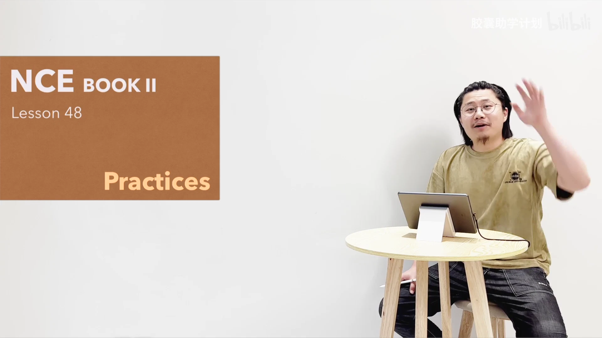

文字识别：NCE / BOOKII / Lesson 48 / Practices

### 画面 00:00:06

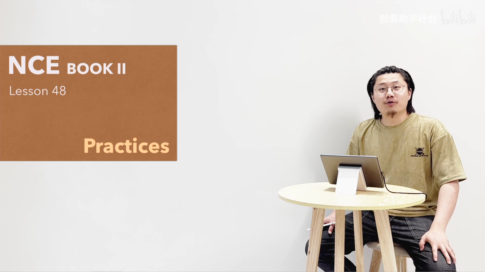

文字识别：NCE / BOOKII / Lesson 48 / Practices

### 画面 00:00:08

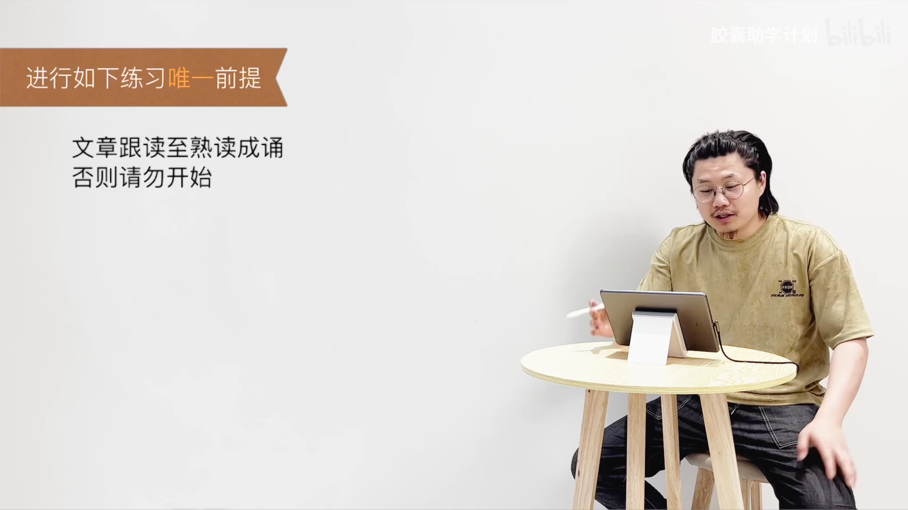

文字识别：进行如下练习唯一前提 / 文章跟读至熟读成诵 / 否则请勿开始

### 画面 00:00:18

文字识别：胶囊助学计划bill / •

### 画面 00:00:22

### 画面 00:00:24

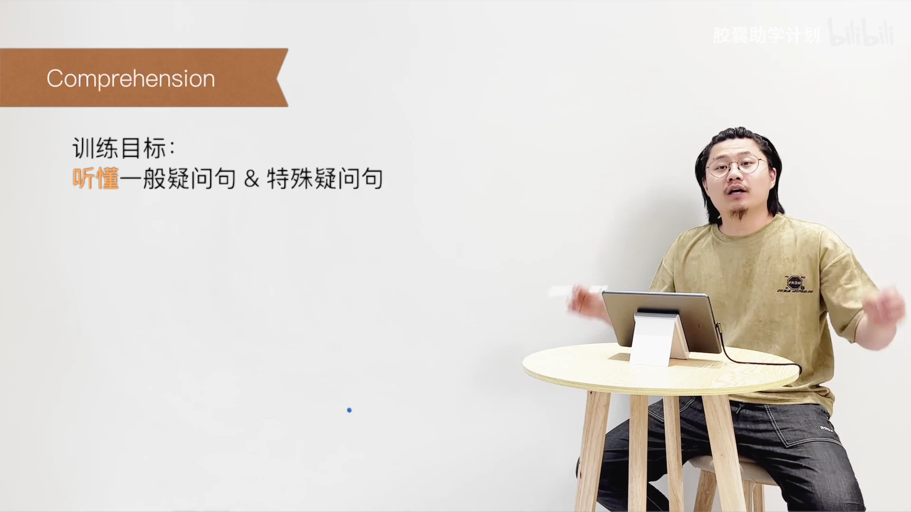

文字识别：Comprehension / 训练目标： / 听懂一般疑问句＆特殊疑问句

### 画面 00:00:28

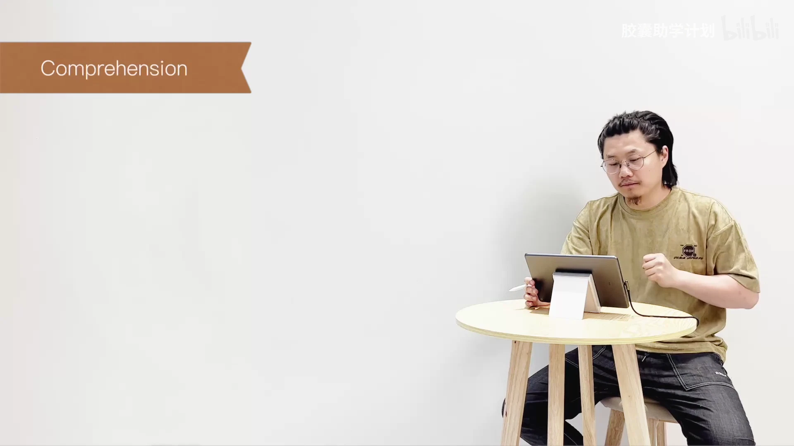

文字识别：Comprehension

## 00:00:30–00:01:00

question. When do dentists always ask questions? When it's impossible for us to answer. Next one. Have you just had a tooth out? Yes, I have. Next one. Who put it out for you? My dentist did. Next one. What did he tell you to do afterwards?

### 画面 00:00:34

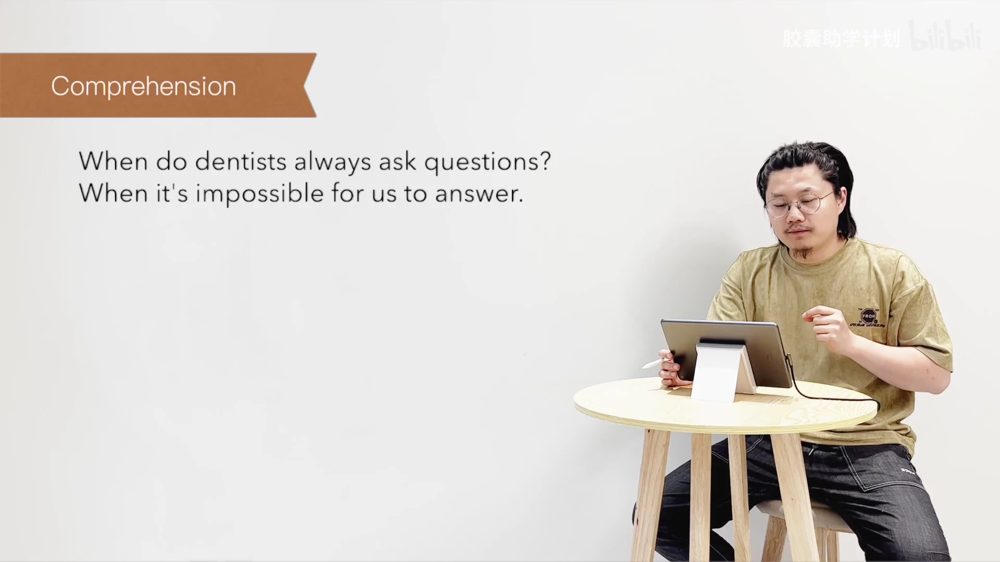

文字识别：Comprehension / When do dentists always ask questions? / When it's impossible for us to answer.

### 画面 00:00:39

文字识别：Comprehension / Have you just had a tooth out?

## 00:01:00–00:01:30

the rest for a while. Next one, did you try to say something? Yes, I did. Next one, you couldn't, could you? No, I couldn't. Next one, why couldn't you? My mouth was full of cotton wool. Next one, what did the dentist know about you? That collected

### 画面 00:01:09

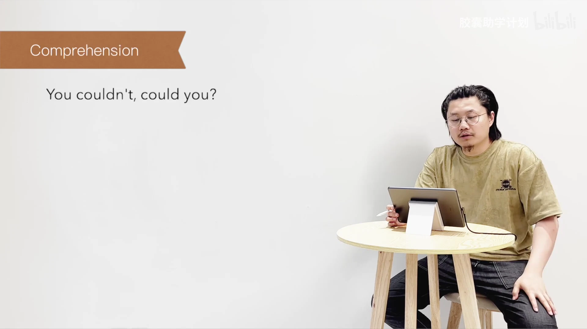

文字识别：Comprehension / You couldn't, could you? / FRON

### 画面 00:01:18

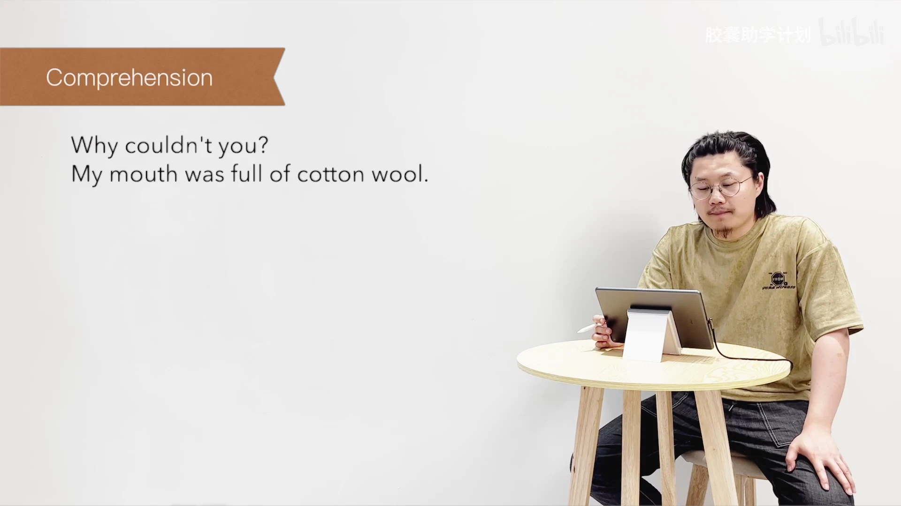

文字识别：Comprehension / Why couldn't you? / My mouth was full of cotton wool.

### 画面 00:01:23

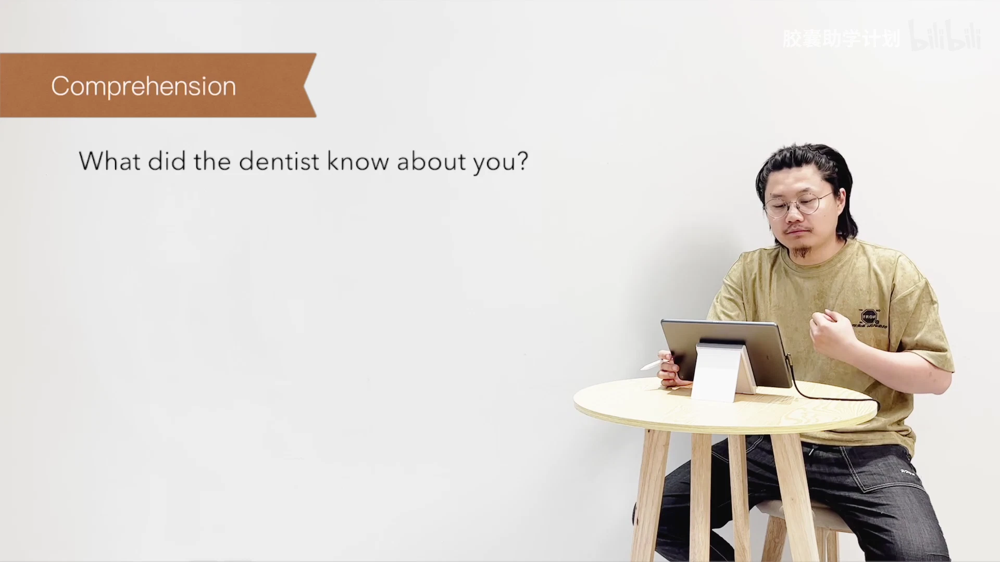

文字识别：Comprehension / What did the dentist know about you?

## 00:01:30–00:02:00

matchboxes. What did he ask you about your collection? Whether my collection was growing. Next one, did he ask you about your brother? Yes, he did. Next one, what else did he ask you? Whether I liked my job in London. Next one, what

### 画面 00:01:39

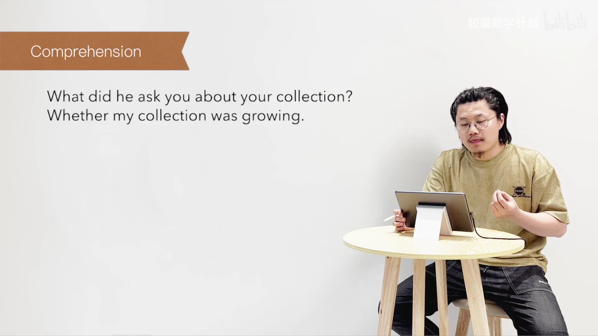

文字识别：Comprehension / What did he ask you about your collection? / Whether my collection was growing.

### 画面 00:01:43

文字识别：Comprehension / Did he ask you about your brother?

### 画面 00:01:54

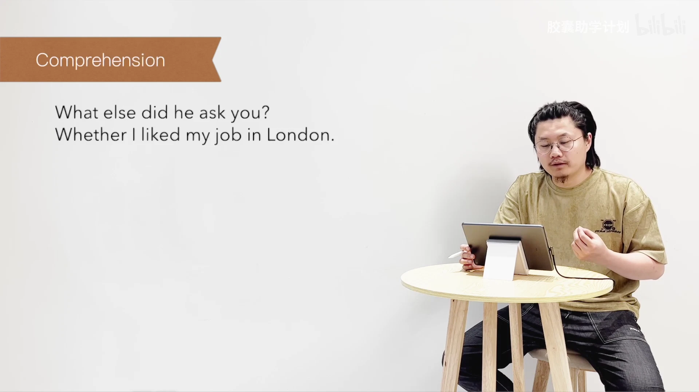

文字识别：Comprehension / What else did he ask you? / Whether Iliked my job in London.

## 00:02:00–00:02:30

was your town busy doing? Searching out the hole where the tooth had been. How did you feel suddenly? Very worried. 好，asking questions，练习我们能说出一般疑问句和特殊疑问句，也就是我们能问别人问题的口语能力啊。那我们在这儿还是老习惯啊，简单说思路对吧？Dentists always ask questions when you can't answer.

### 画面 00:02:03

文字识别：Comprehension / What was your tongue busy doing? / Searching out the hole where the tooth had / been.

### 画面 00:02:09

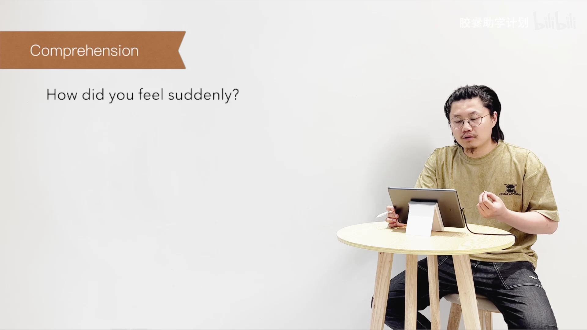

文字识别：Comprehension / How did you feel suddenly?

### 画面 00:02:15

文字识别：Asking questions / 训练目标： / 会说一般疑问句＆特殊疑问句 / Accuracy / Fluency

### 画面 00:02:23

文字识别：Asking questions / T: Ask me if dentists always ask questions / when you can't answer.

### 画面 00:02:29

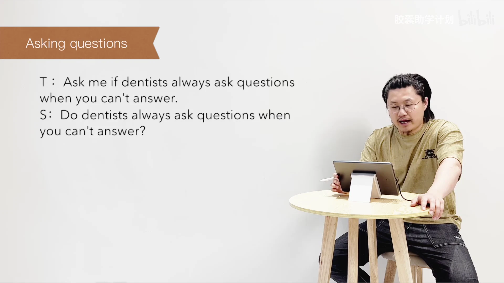

文字识别：Asking questions / T: Ask me if dentists always ask questions / when you can't answer. / S: Do dentists always ask questions when / you can't answer?

## 00:02:30–00:03:00

那肯定是 do 提前，对吧？因为这个主语是 ask嘛，啊，主句是 ask嘛，对吧？好，再然后 when，那就是对问题问啊， when you can't answer 这个时间从句提问，所以答案叫 when do dentists always ask questions？ Very good. 呃，还有一个 who，我们直接对 dentist 提问，记住不用变一般疑问句就可以了，叫做 who always ask questions when you can't answer？对吧？第二题， my dentist

### 画面 00:02:42

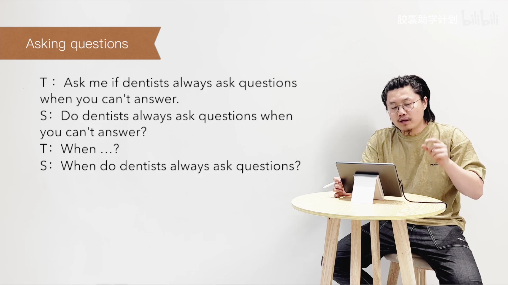

文字识别：Asking questions / T: Ask me if dentists always ask questions / when you can't answer. / S: Do dentists always ask questions when / you can't answer? / T: When ...? / S: When do dentists always ask questions?

### 画面 00:02:46

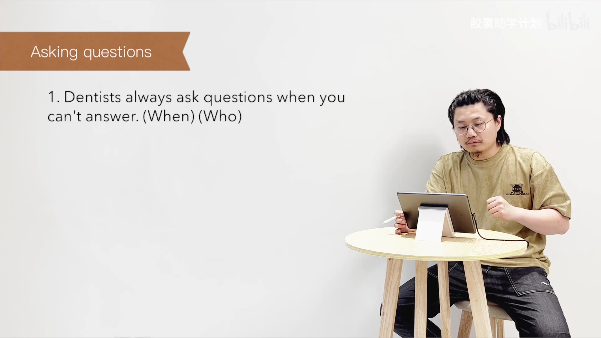

文字识别：Asking / questions / 1. Dentists always ask ( / questions when you / can't answer.(When) (Who)

## 00:03:00–00:03:30

does this.啊，其实他这个 does this 就是他会这么做。他会怎么做呢？他会在你不能回答问题的时候去问你问题。啊，我的牙医也会这么做。OK，所以呢，这个 does 其实就是你把 does 提前就行了，叫做 Does your dentist do this？啊， who 对主语提问， who does this？啊，谁这么干？那 what 对 this 提问嘛，对吧？叫做 What？呃， does your dentist do？啊，他做什么事儿？啊，其实就是就是 this。

### 画面 00:03:10

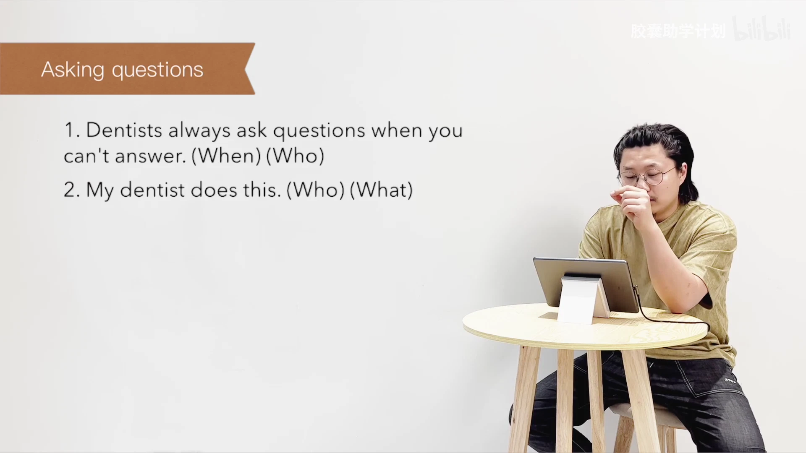

文字识别：Asking questions / 1. Dentists always ask questions when you / can't answer.(When) (Who) / 2. My dentist does this. (Who)(What)

## 00:03:30–00:04:00

那 this 指代的就是当你不能回答问题的时候问你问题这件事儿啊。OK，这句话稍微有点复杂，注意这里的撇 d 啊，撇 d 我们常见的有两个形式 would 和 had，那这里其实是 had 啊，所以 had 提前就可以了。那 what 对 a tooth 提问，不都说很简单？Had to，had to，你把 did 提前，对吧？Had 换回原形叫 did you have to rest for a while？那 how long 对 for a while 提问呗，对吧？

### 画面 00:03:40

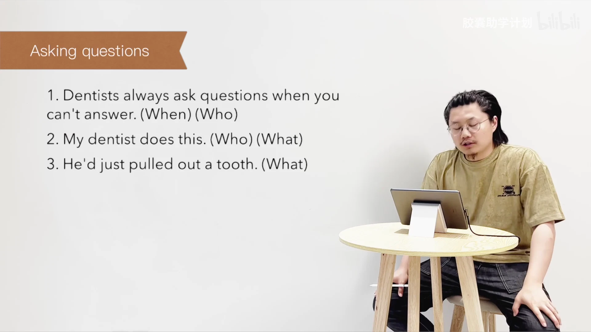

文字识别：Asking questions / 1. Dentists always ask questions when you / can't answer.(When) (Who) / 2. My dentist does this. (Who)(What) / 3. He'd just pulled out a tooth. (What)

### 画面 00:03:48

文字识别：Asking questions / 1. Dentists always ask questions when you / can't answer.(When)(Who) / 2. My dentist does this.(Who)(What) / 3. He'd just pulled out a tooth. (What) / 4.I had to rest for awhile. (How long)

## 00:04:00–00:04:30

I try to speak. Did提前动词还原形，What did you do？注意，只要是What did you do，答案是统一的，叫What did you do，对吧？啊，你由时态去决定，也可能是What do you do？或What does he do？啊，那What did you do？就是你当时做什么了？好，第六个，My mouth was full of cotton wool. Was提前，What对， cotton wool提问就行了，对吧？你嘴里面充满了什么？叫做What was your mouth full of？I collect match boxes.注意，

### 画面 00:04:14

文字识别：Asking questions

## 00:04:30–00:05:00

看一下它的时态. I collect,不是说 I collected.度提前. What对match boxes提问,火柴盒啊. What do you collect就行了. Ask me about my collection. Did提前,动词换回原形. What about对my collection提问. Who直接对主语提问,直接把它去掉.你也可以对me提问,对吧?但是对me提问就要有一般疑问句了啊. Next one说He wanted to know about my new job. Did提前. What

### 画面 00:04:30

文字识别：Asking questions / 6. My mouth was full of cotton wool. (What) / 7.I collect match boxes.(What)

### 画面 00:04:38

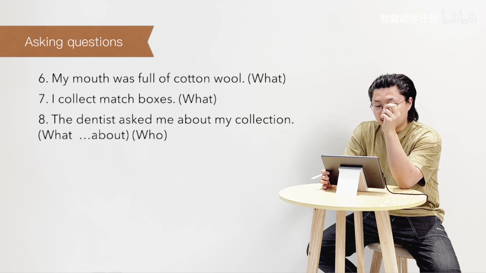

文字识别：Asking questions / 6. My mouth was full of cotton wool. (What) / 7.I collect match boxes.(What) / 8. The dentist asked me about my collection. / (What ...about) (Who)

### 画面 00:04:54

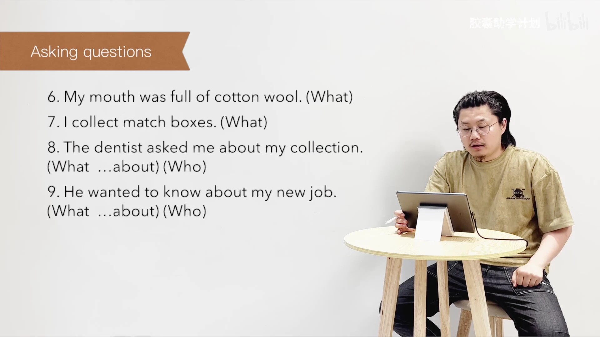

文字识别：Asking questions / 6. My mouth was full of cotton wool. (What) / 7.I collect match boxes.(What) / 8. The dentist asked me about my collection. / (What ...about) (Who) / 9. He wanted to know about my new job. / (What ...about) (Who)

## 00:05:00–00:05:30

对my new job提问，对吧？What did he want to know about？啊，他想了解关于什么事情？Who对主语提问吧，直接去掉，不用变一般疑问句，叫做Who wanted to know about your new job？好，第十个，I answered him with noise and strange noises. Did提前，对吧？How好，这里是how是方式，这里的with其实某种程度上可以当做一个呃

### 画面 00:05:20

文字识别：Asking questions / 6. My mouth was full of cotton wool. (What) / 7.I collect match boxes.(What) / 8. The dentist asked me about my collection. / (What ...about) (Who) / 9. He wanted to know about my new job. / (What ...about) (Who) / 10.I answered him with nods and strange / noises.(How) (Why)

## 00:05:30–00:06:00

方式，对吧？所以其实这里的答案就是 How did you answer him? 啊， Why 加整句就行了啊。那结束了。 Tell the story. 还是在重复一下，练习的是 fluency 啊，对啊，就练习我们流畅性，而不练习准确性。这个在国内的注意，国内的大多数考试当中，因为我们国内不考口语啊，是呃不太行的。但是你雅思托福某种程度上是考流畅性的，当然它考的是流畅性加准确性，对吧？就你两个都不

### 画面 00:05:37

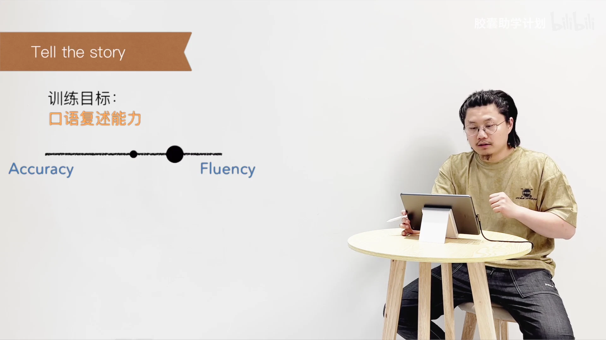

文字识别：Tell the story / 训练目标： / 口语复述能力 / Accuracy / Fluency

## 00:06:00–00:06:30

能太差，但我们大多数情况下很少练流畅性，那我们就拿它去练一下，好吧？这个第一单元我做了很多的示范了，我在这就不多做了，各位直接看就好了。呃，summary writing叫做写作的复述能力，各位去摘要写作写完来这里对答案，有问题视频留言告诉我就好了啊。然后 topics for discussion 完全自由的对话，呃，我们只看一下题啊。 How often do you go to the dentist？

### 画面 00:06:04

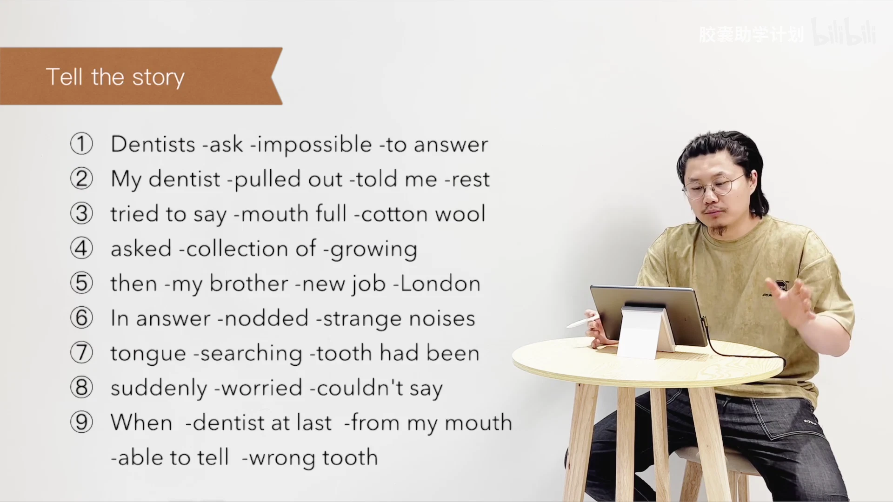

文字识别：Tell the story / ① Dentists -ask -impossible -to answer / My dentist -pulled out -told me -rest / tried to say -mouth full -cotton wool / ) asked -collection of -growing / then -my brother -new job -London /  In answer -nodded -strange noises / tongue -searching -tooth had been / suddenly -worried -couldn't say / When -dentist at last -from my mouth / 9 / -able to tell -wrong tooth

### 画面 00:06:11

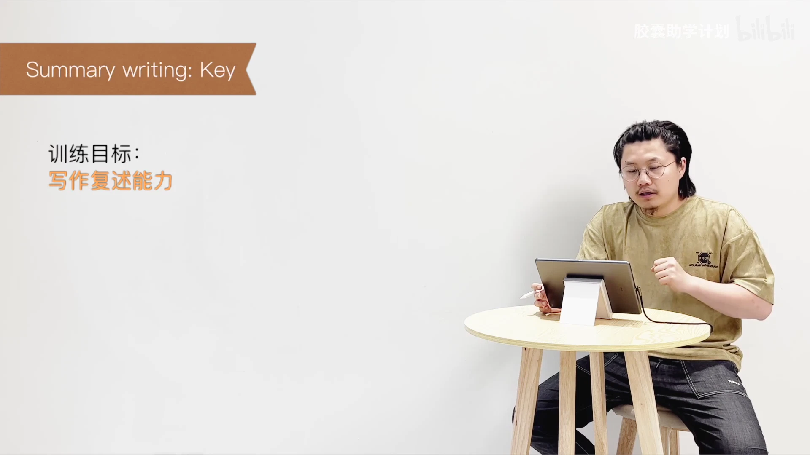

文字识别：Summary writing: Key / 训练目标： / 写作复述能力

### 画面 00:06:16

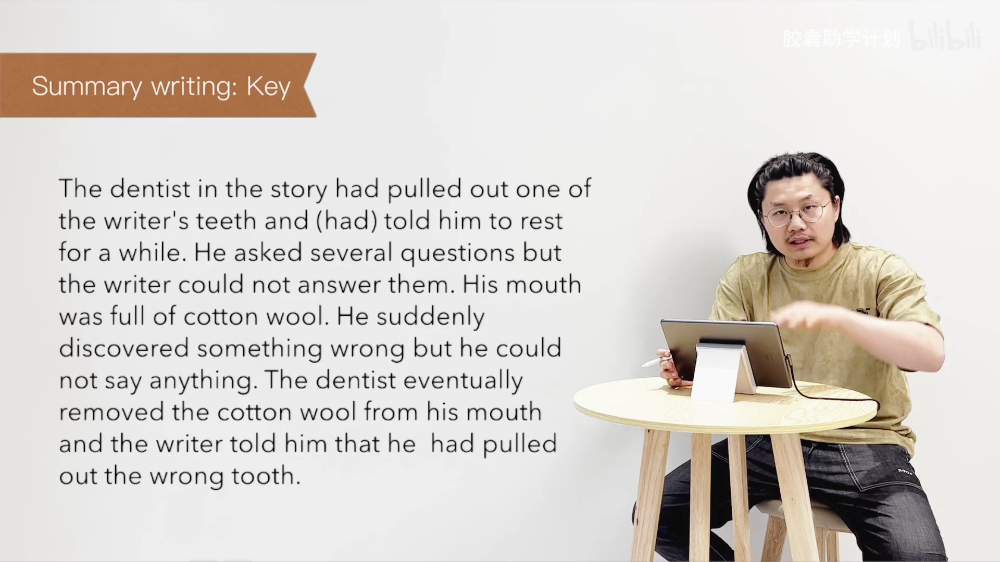

文字识别：Summary writing: Key / The dentist in the story had pulled out one of / the writer's teeth and (had) told him to rest / for a while. He asked several questions but / the writer could not answer them. His mouth / was full of cotton wool. He suddenly / discovered something wrong but he could / not say anything. The dentist eventually / removed the cotton wool from his mouth / and the writer told him that he had pulled / out the wrong tooth.

### 画面 00:06:19

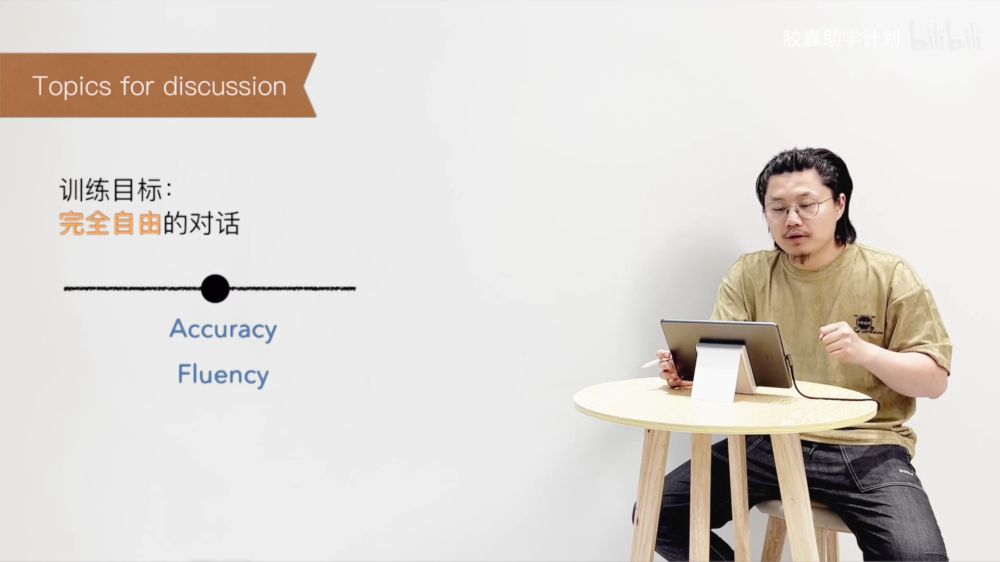

文字识别：Topics for discussion / 训练目标： / 完全自由的对话 / Accuracy / Fluency

### 画面 00:06:25

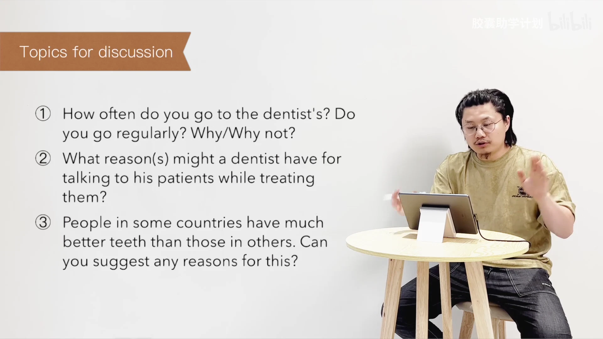

文字识别：Topics for discussion / How often do you go to the dentist's? Do / you go regularly? Why/Why not? / What reason(s) might a dentist have for / talking to his patients while treating / them? / People in some countries have much / better teeth than those in others. Can / you suggest any reasons for this?

## 00:06:30–00:07:00

自由对话啊，它其实这个就有点像雅思托福的口语题了啊，雅思托福的口语题，或者说我们在现实生活当中，您出国留学、旅游、工作、学术啊，呃，交流的时候，都大概会遇到这样的题，嗯，也不是题了，就是生活，它就是生活了。说你多久去一次牙看牙医？Do you go regularly? Why? Why not? 你经常去吗？为什么经常去？为什么不经常去？What reason or reasons might a dentist have

### 画面 00:06:55

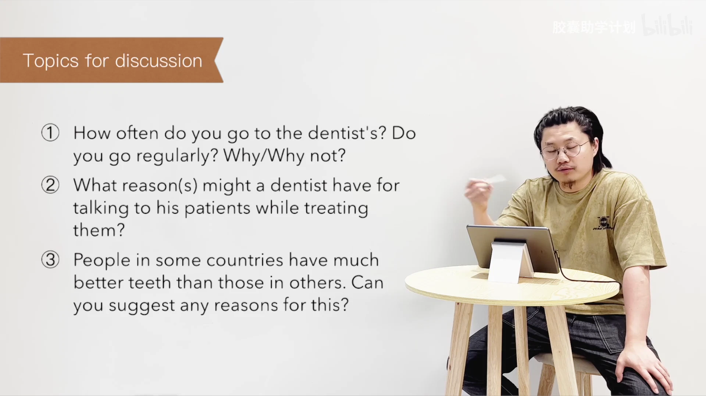

文字识别：Topics for discussion / How often do you go to the dentist's? Do / you go regularly? Why/Why not? / What reason(s) might a dentist have for / talking to his patients while treating / them? / People in some countries have much / better teeth than those in others. Can / you suggest any reasons for this?

## 00:07:00–00:07:30

have for talking to his patients while treating them?说当啊这些牙医在去给他们的病人治病的时候，对吧？就修牙或者补牙的时候呢，有什么样的原因会导致一个牙医啊去和他的病人沟通？第三个说，People in some countries have much better teeth than those in others.说在一些国家的人们有更好的牙比另一些国家的人们。Can you suggest

### 画面 00:07:25

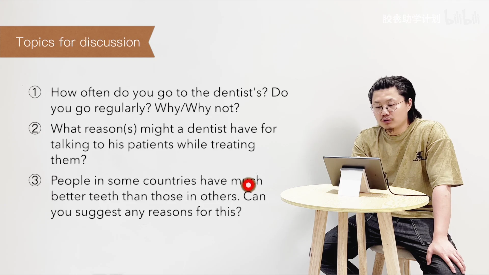

文字识别：Topics for discussion / How often do you go to the dentist's? Do / you go regularly? Why/Why not? / What reason(s) might a dentist have for / talking to his patients while treating / them? / People in some countries have m / better teeth than those in others. Can / you suggest any reasons for this?

## 00:07:30–00:08:00

any reasons for this? 说你能建议任何原因吗？啊，你能给出任何建，就是你能提出来任何原因吗？啊，也不是建议啊，你能提出来任何原因吗？OK，好，那我们看一下家庭作业啊。 Ask me if，先写再朗读啊，写保证准确性，朗读它毕竟是一个我们的口语听力题，本质上。 Next one，摘要写作写完来这里对答案。 Tell the story，进行一个口语复述。 OK，那以上呢就是本期

### 画面 00:07:41

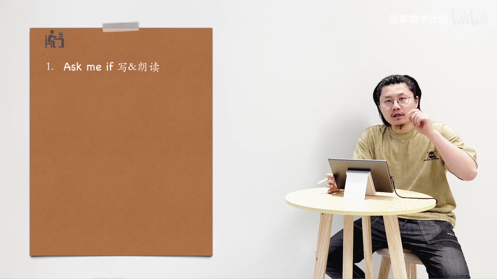

文字识别：1.Ask me if写&朗读

### 画面 00:07:45

文字识别：1.Ask me if写&朗读

### 画面 00:07:50

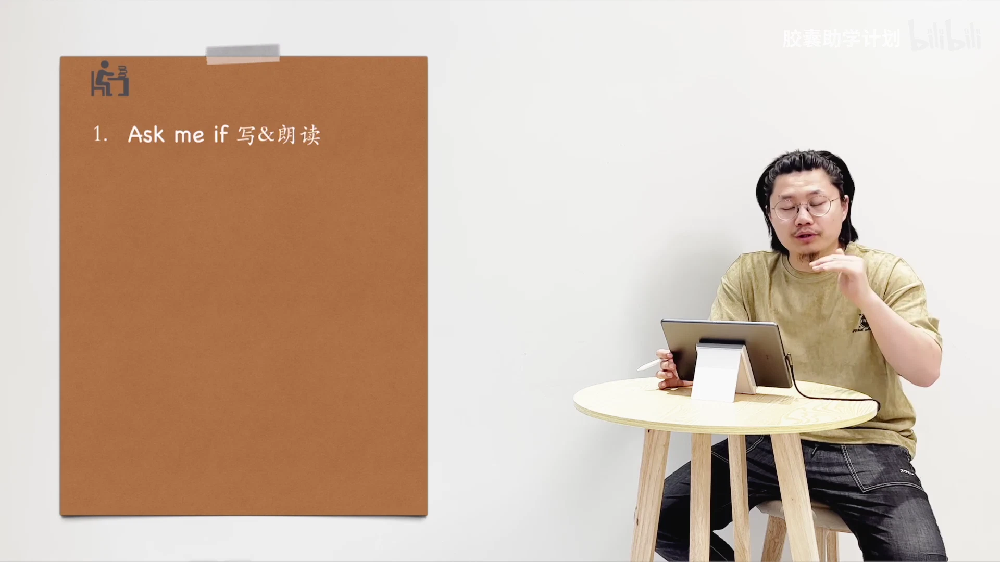

文字识别：1.Ask me if写&朗读

### 画面 00:07:52

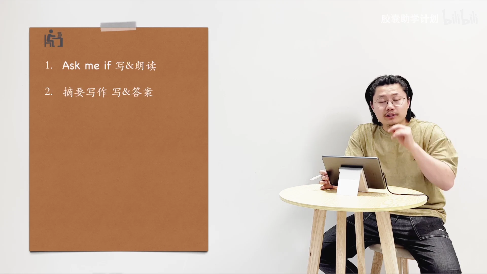

文字识别：1.Ask me if写&朗读 / 2. / 摘要写作写&答案

### 画面 00:07:54

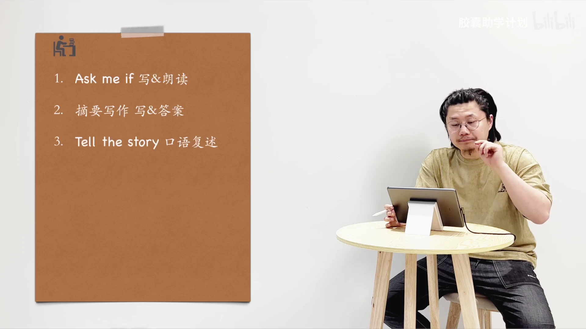

文字识别：1.Ask me if写&朗读 / 摘要写作写&答案 / 3.Tell the story 口语复述

### 画面 00:07:57

## 00:08:00–00:08:24

视频的全部内容了。呃，如果各位喜欢我们的课程呢，欢迎各位关注、订阅、一键三连、分享给那些需要的朋友。咱们新概念二册下半册见，See you next time.

### 画面 00:08:12

### 画面 00:08:14

文字识别：CAPSULEACADEMY / 胶囊助学计划 / 小红书 / Lecturer / □ / 口 / Leo / OE

### 画面 00:08:17

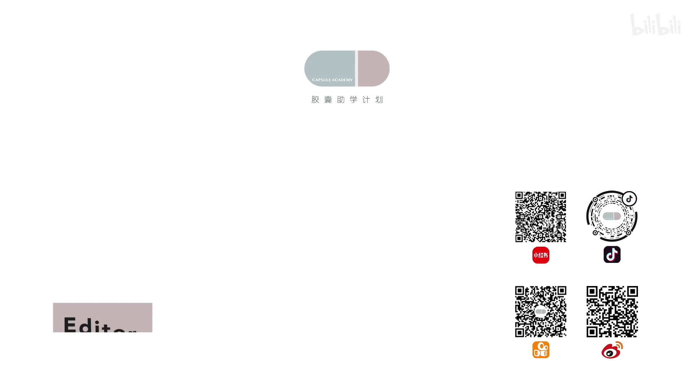

文字识别：CAPSULEACADEMY / 胶囊助学计划 / 小红书 / □ / Edit~. / OE

### 画面 00:08:20

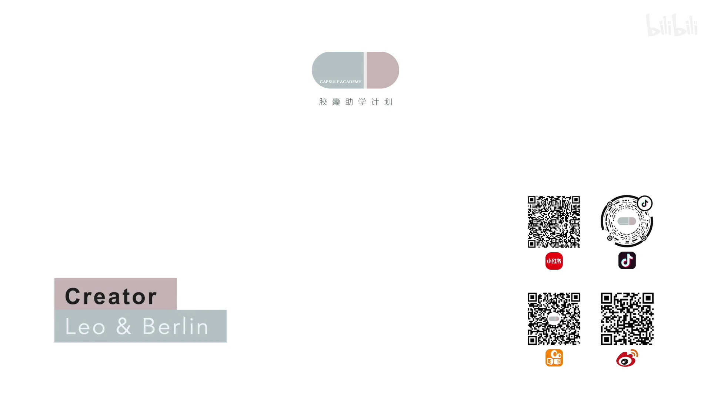

文字识别：CAPSULEACADEMY / 胶囊助学计划 / 小红书 / Creator / □ / Leo & Berlin / OE

### 画面 00:08:22

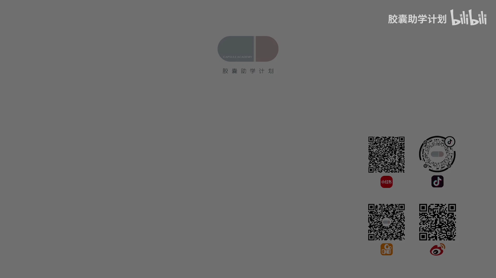

文字识别：bilibili / 胶囊助学计划 / CAPSULEACADEMY / 胶囊助学计划 / 小红书 / OE

### 画面 00:08:24

文字识别：bilibili / 胶囊助学计划

