# 049 单词

快速机器解析：语音为单模型转写，未进行独立交叉校对或人工复核；画面每秒采样并按变化选帧，短时文字和标记可能遗漏。截图时间约有 1 秒误差。图片有损压缩；遇到疑点请按时间查看 Google Drive 原视频。

## 00:00:00–00:00:30

Hello everyone, welcome to Capsule Academy. This is Leo. Today we're going to learn New Concept English Book Two Lesson Forty Nine Words. 那老习惯进入正式课程之前，咱们先看几个问题啊。首先，如何表达厌倦啊与某件事情？第二呢，如何表达一阵风？最后一个问题，如何表达砸成碎片？那带着这三个问题，Hope you can enjoy. 我们先看第一个

### 画面 00:00:00

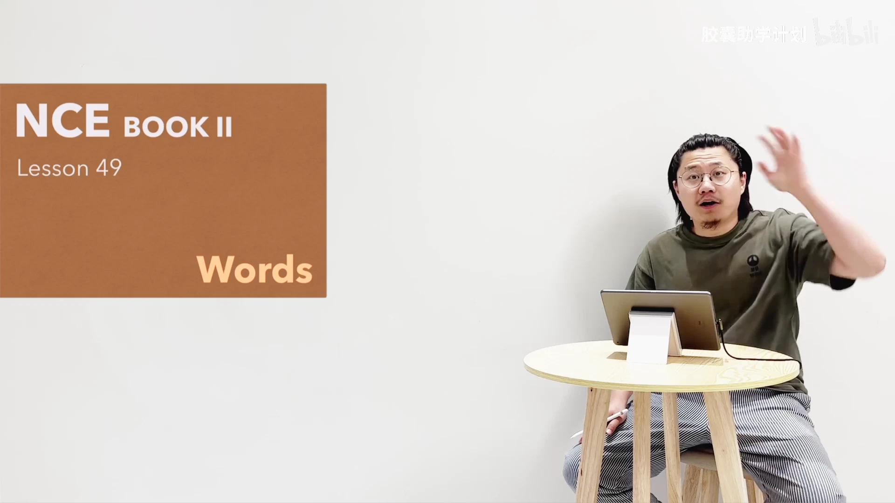

文字识别：NCE / BOOKII / Lesson 49 / Words

### 画面 00:00:05

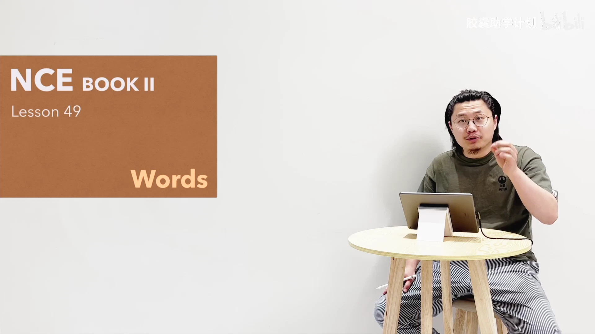

文字识别：NCE / BOOKI"I / Lesson 49 / Words / ND / WAH

### 画面 00:00:09

文字识别：学计划 / NU / WIIR

### 画面 00:00:11

文字识别：①如何表达“厌倦于”?

### 画面 00:00:14

文字识别：①如何表达“厌倦于”？ / 达“一阵风”？

### 画面 00:00:16

文字识别：①如何表达“厌倦于”？ / 如何表达“一阵风”？

### 画面 00:00:18

文字识别：①如何表达“厌倦于”？ / 如何表达“一阵风”？ / 如何表达“砸成碎片”?

### 画面 00:00:21

文字识别：①如何表达“厌倦于”? / 如何表达“一阵风”？ / 如何表达“砸成碎片”? / NU / WIE

### 画面 00:00:24

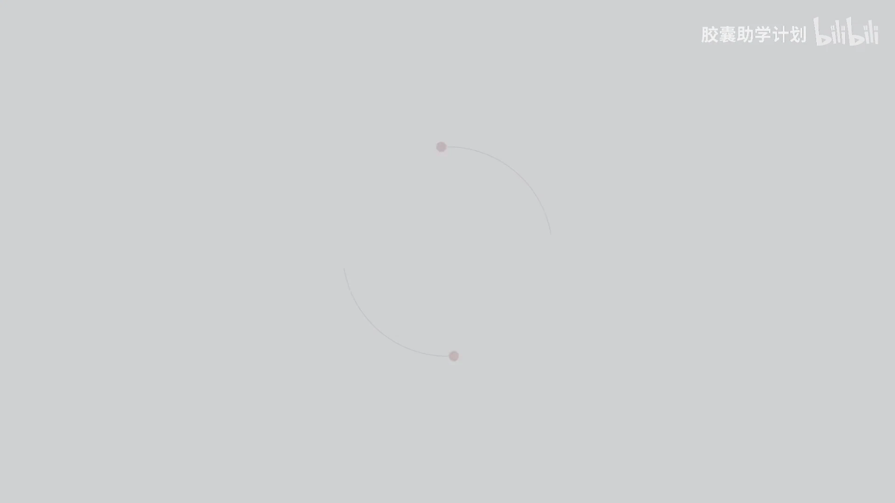

文字识别：胶囊助学计划bil出

### 画面 00:00:28

## 00:00:30–00:01:00

单词，跟我一起读一下，叫做 tired。这个单词对于各位来说应该是非常熟悉的啊。新概念一册十九课咱们就学过 thirsty and tired。那个时候咱们学 tired 指的是什么意思呢？就是我很累，对吧？I'm so tired right now. Okay。那这个地方呢，咱们其实今天学的这个 tired 是什么意思呢？是厌倦于做某件事情。它经常出现在接下来的这个习惯用法当中，可以说叫 be tired of something。这里实际上是我把几

### 画面 00:00:30

文字识别：单词造句指南 / 网：v.+v.变化 / 学计划 / 四句型转换 / 方式/地点/时间 / 结合习惯用法 / 其他单词+词性 / 原文摘抄+变 / 6123456 / /'taiad/ / tired adj.

### 画面 00:00:35

文字识别：单词造句指南 / 网：v.+v.变化 / 哈计划 / 四句型转换 / 方式/地点/时间 / 结合习惯用法 / 其他单词+词性 / 原文摘抄+变 / 6123456 / /'taiad/ / tired adj.

### 画面 00:00:40

文字识别：单词造句指南 / 网：v.+v.变化 / 四句型转换 / 方式/地点/时间 / 结合习惯用法 / 其他单词+词性 / 原文摘抄+变 / 6123456 / /'taiad/ / tired adj.

### 画面 00:00:45

文字识别：单词造句指南 / 网：v.+v.变化 / 哈计划 / 四句型转换 / 方式/地点/时间 / 结合习惯用法 / 其他单词+词性 / 原文摘抄+变 / 6123456 / /'taiad/ / tired adj.

### 画面 00:00:51

文字识别：单词造句指南 / 网：v.+v.变化 / 计划 / 四句型转换 / 方式/地点/时间 / 结合习惯用法 / 其他单词+词性 / 原文摘抄+变 / 6123456 / /'taiad/ / tired adj.

### 画面 00:00:55

文字识别：单词造句指南 / 网：v.+v.变化 / 四句型转换 / 方式/地点/时间 / 结合习惯用法 / 其他单词+词性 / 原文摘抄+变 / 6123456 / /'taiad/ / tired adj. / NU / ① get/be tired of sth./doing sth. / WHR

## 00:01:00–00:01:30

usage to together. It has some small variants. The first most common is called be tired of something. Ah, tired of something. You can also say be tired of doing something. Ah, this is the first. This is the second, right? You can say tired of doing something. Of course, the be can also be completely replaced with the colloquialism. Very commonly used another word is get. Get tired of something. Okay. Well, let's use it to make a sentence. This is actually very simple. You think you are actually.

### 画面 00:01:01

文字识别：单词造句指南 / 网：v.+v.变化 / 计划 / 四句型转换 / 方式/地点/时间 / 结合习惯用法 / 其他单词+词性 / 原文摘抄+变 / 6123456 / /'taiad/ / tired adj. / ① get/be tired of sth./doing sth.

### 画面 00:01:03

文字识别：单词造句指南 / 网：v.+v.变化 / 计划 / 四句型转换 / 方式/地点/时间 / 结合习惯用法 / 其他单词+词性 / 原文摘抄+变 / 6123456 / /'taiad/ / tired adj. / ① get/be tired of sth./doing sth.

### 画面 00:01:06

文字识别：单词造句指南 / 网：v.+v.变化 / 四句型转换 / 方式/地点/时间 / 结合习惯用法 / 其他单词+词性 / 原文摘抄+变 / 6123456 / /'taiad/ / tired adj. / ① get/be tired of sth./doing sth.

### 画面 00:01:08

文字识别：单词造句指南 / 网：v.+v.变化 / 计划 / 四句型转换 / 方式/地点/时间 / 结合习惯用法 / 其他单词+词性 / 原文摘抄+变 / 6123456 / /'taiad/ / tired adj. / ① get/be tired of sth./doing sth.

### 画面 00:01:11

文字识别：单词造句指南 / 网：v.+v.变化 / 四句型转换 / 方式/地点/时间 / 结合习惯用法 / 其他单词+词性 / 原文摘抄+变 / 6123456 / /'taiad/ / tired adj. / NU / ① get/be tired of sth./doing sth.

### 画面 00:01:13

文字识别：单词造句指南 / 网：v.+v.变化 / 四句型转换 / 方式/地点/时间 / 结合习惯用法 / 其他单词+词性 / 原文摘抄+变 / 6123456 / /'taiad/ / tired adj. / ① get/be tired of sth./doing sth.

### 画面 00:01:15

文字识别：单词造句指南 / 网：v.+v.变化 / 哈计划 / 四句型转换 / 方式/地点/时间 / 结合习惯用法 / 其他单词+词性 / 原文摘抄+变 / 6123456 / /'taiad/ / tired adj. / NU / ① get/be tired of sth./doing sth. / VIR

### 画面 00:01:18

文字识别：单词造句指南 / 网：v.+v.变化 / 学计划 / 四句型转换 / 方式/地点/时间 / 结合习惯用法 / 其他单词+词性 / 原文摘抄+变 / 6123456 / /'taiad/ / tired adj. / getbe / tired of sth./doing sth.

### 画面 00:01:21

文字识别：单词造句指南 / 网：v.+v.变化 / 学计划 / 四句型转换 / 方式/地点/时间 / 结合习惯用法 / 其他单词+词性 / 原文摘抄+变 / 6123456 / /'taiad/ / tired adj. / wii / NU / tired of sth./doing sth. / get / be

### 画面 00:01:25

文字识别：单词造句指南 / 网：v.+v.变化 / 之计划 / 四句型转换 / 方式/地点/时间 / 结合习惯用法 / 其他单词+词性 / 原文摘抄+变 / 6123456 / /'tarad/ / tired adj. / NU / WIlR / tired of sth./doing sth. / get / be

## 00:01:30–00:02:00

你现在其实这个句子当中，无非你就是在找一下 something 或 doing something，对吧？随便换个主语，这个句子就出来了。比如说，She is tired of working late every night. 啊，她厌倦于每天晚上都要工作到很晚。啊，OK，肯定句出来了。接下来一般疑问句、特殊疑问句啊，各位一定要反复练，从新一练到新三，练到各位张嘴能说出来为止。叫做 Is she tired of working

### 画面 00:01:32

文字识别：单词造句指南 / 网：v.+v.变化 / 学计划 / 四句型转换 / 方式/地点/时间 / 结合习惯用法 / 其他单词+词性 / 原文摘抄+变 / 6123456 / /'taiad/ / tired adj. / NU / WIR / tired of sth./doing sth. / get / be

### 画面 00:01:37

文字识别：单词造句指南 / 网：v.+v.变化 / 学计划 / 四句型转换 / 方式/地点/时间 / 结合习惯用法 / 其他单词+词性 / 原文摘抄+变 / 6123456 / /'taiad/ / tired adj. / tired of sth./doing sth. / get / be

### 画面 00:01:40

文字识别：单词造句指南 / 网：v.+v.变化 / 学计划 / 四句型转换 / 方式/地点/时间 / 结合习惯用法 / 其他单词+词性 / 原文摘抄+变 / 6123456 / /'taiad/ / tired adj. / tired of sth./doing sth. / 1 / getbe / Shetired of working late every night.

### 画面 00:01:42

文字识别：单词造句指南 / 网：v.+v.变化 / 计划 / 四句型转换 / 方式/地点/时间 / 结合习惯用法 / 其他单词+词性 / 原文摘抄+变 / 6123456 / /'taiad/ / tired adj. / get/be tired of sth./doing sth. / 1 / She is tired of working late every night.

### 画面 00:01:44

文字识别：单词造句指南 / 网：v.+v.变化 / 命计划 / 四句型转换 / 方式/地点/时间 / 结合习惯用法 / 其他单词+词性 / 原文摘抄+变 / 6123456 / /'taiad/ / tired adj. / ① get/be tired of sth./doing sth. /  She is tired of working late every night.

### 画面 00:01:50

文字识别：单词造句指南 / 网：v.+v.变化 / 学计划 / 四句型转换 / 方式/地点/时间 / 结合习惯用法 / 其他单词+词性 / 原文摘抄+变 / 6123456 / /'taiad/ / tired adj. / NU / WIIR / ① get/be tired of sth./doing sth. / ② She is tired of working late every night. / ③ is/why/who/...

### 画面 00:01:55

文字识别：单词造句指南 / 网：v.+v.变化 / 四句型转换 / 方式/地点/时间 / 结合习惯用法 / 其他单词+词性 / 原文摘抄+变 / 6123456 / /'taiad/ / tired adj. / ① get/be tired of sth./doing sth. / ② She is tired of working late every night. / ③ is/why/who/...

## 00:02:00–00:02:30

late every night? Why is she tired of working late every night? Okay,好，接下来呢，比如说我们再来一个句子。刚才这个是 be tired of doing something，对吧？咱们再来一个 tired of something的。比如说 I'm a little tired of pizza. Can we get something else?说，我有点厌倦于吃 pizza 了，对吧？那我们能来点别的东西吗？Okay，再来，比如说 I'm tired of listening to his complaints.好，complaints这个单词咱们没见过，但咱们见

### 画面 00:02:05

文字识别：单词造句指南 / 网：v.+v.变化 / 计划 / 四句型转换 / 方式/地点/时间 / 结合习惯用法 / 其他单词+词性 / 原文摘抄+变 / 6123456 / /'taiad/ / tired adj. / NO / ① get/be tired of sth./doing sth. / ② She is tired of working late every night. / ③ is/why/who/... / ④ I'm a little tired of pizza. Can we get something else?

### 画面 00:02:12

文字识别：单词造句指南 / 网：v.+v.变化 / 学计划 / 四句型转换 / 方式/地点/时间 / 结合习惯用法 / 其他单词+词性 / 原文摘抄+变 / 6123456 / /'taiad/ / tired adj. / WnR / ① get/be tired of sth./doing sth. / ② She is tired of working late every night. / ③ is/why/who/... / ④ I'm a little tired of pizza. Can we get something else?

### 画面 00:02:28

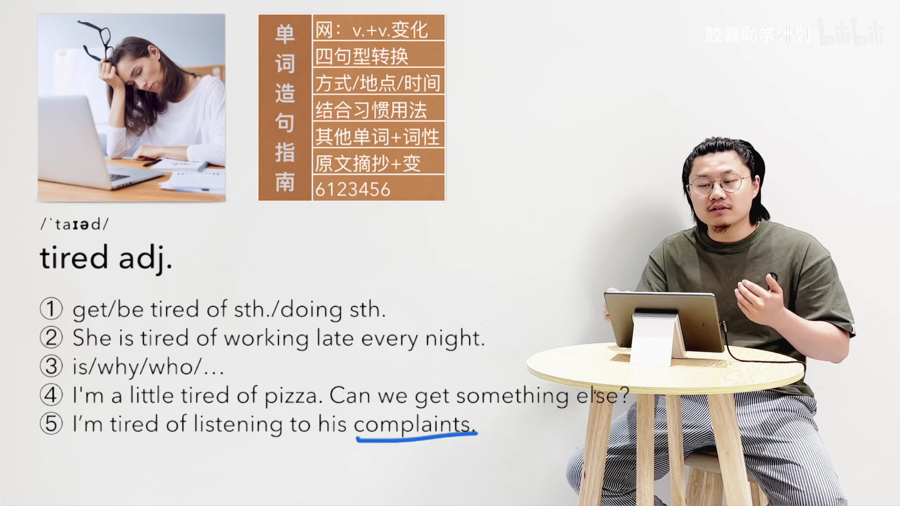

文字识别：单词造句指南 / 网：v.+v.变化 / 学计划 / 四句型转换 / 方式/地点/时间 / 结合习惯用法 / 其他单词+词性 / 原文摘抄+变 / 6123456 / /'taiad/ / tired adj. / ① get/be tired of sth./doing sth. / ② She is tired of working late every night. / ③ is/why/who/... / ④ I'm a litle tired of pizza. Can we get something el'se? / ⑤ I'm tired of listening to his complaints.

## 00:02:30–00:03:00

过它的动词形式叫 complain about something，对吧？Okay啊，这个抱怨某件事情。Okay，这是我们新概念一啊二册第二十三课，咱学过这个单词叫 complained about something，complained of something。好，说厌倦，那这是它的名词叫抱怨嘛？Okay，厌倦于抱怨这件事情了。再来，比如说 we got tired of the country。注意，你看这里我把 be 就换成了一个叫 got，对吧？Okay，we got tired of the country and we moved into town。啊，我说我们厌倦

### 画面 00:02:50

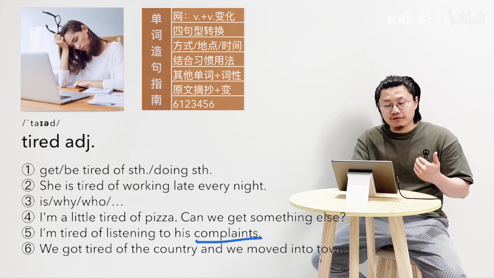

文字识别：单词造句指南 / 网：v.+v.变化 / 学计划 / 四句型转换 / 方式/地点/时间 / 结合习惯用法 / 其他单词+词性 / 原文摘抄+变 / 6123456 / /'taiad/ / tired adj. / ① get/be tired of sth./doing sth. / ② She is tired of working late every night. / ③ is/why/who/... / ④ I'm a litle tired of pizza. Can we get something el'se? / ⑤ I'm tired of listening to his complaints. / ⑥ We got tired of the country and we moved into toV

### 画面 00:02:52

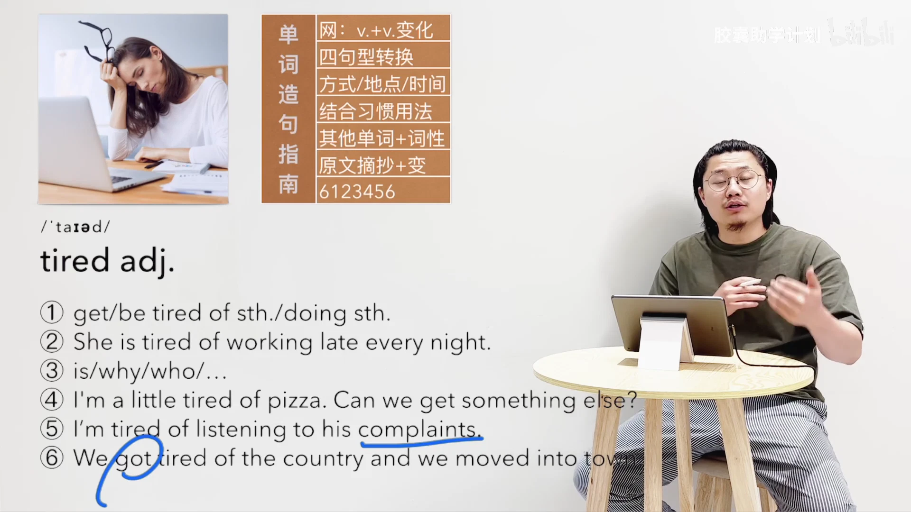

文字识别：单词造句指南 / 网：v.+v.变化 / 学计划 / 四句型转换 / 方式/地点/时间 / 结合习惯用法 / 其他单词+词性 / 原文摘抄+变 / 6123456 / /'taiad/ / tired adj. / ① get/be tired of sth./doing sth. / ② She is tired of working late every night. / ③ is/why/who/... / ④ I'm a litle tired of pizza. Can we get something el'se? / ⑤ I'm tired of listening to his complaints. / ⑥ We/gottired of the country and we moved into toV

### 画面 00:02:55

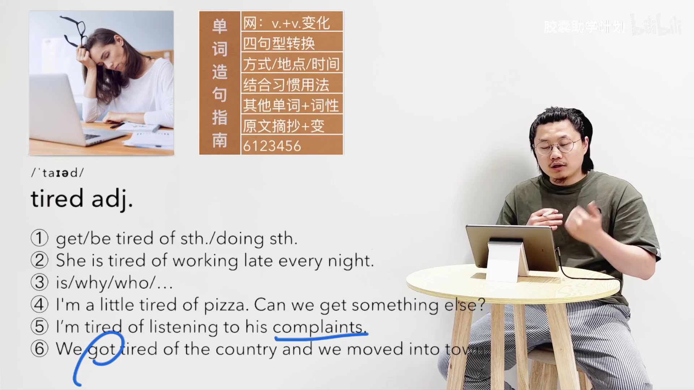

文字识别：单词造句指南 / 网：v.+v.变化 / 学计划 / 四句型转换 / 方式/地点/时间 / 结合习惯用法 / 其他单词+词性 / 原文摘抄+变 / 6123456 / /'taiad/ / tired adj. / ① get/be tired of sth./doing sth. / ② She is tired of working late every night. / ③ is/why/who/... / ④ I'm a litle tired of pizza. Can we get something el'se? / ⑤ I'm tired of listening to his complaints. / ⑥ We/gottired of the country and we moved into toV

## 00:03:00–00:03:30

of living in the countryside, and then we moved to a small town. Very good. Now, remember this word. You recognize the key phrase: be tired of something or be tired of doing something. Okay. Okay. Next, we look at a small movie clip. In the movie clip, we see the phrase "get tired of something." Okay. Now, focus. Let's watch together. Stage one. I'm sorry. My son is stage three. It's

### 画面 00:03:05

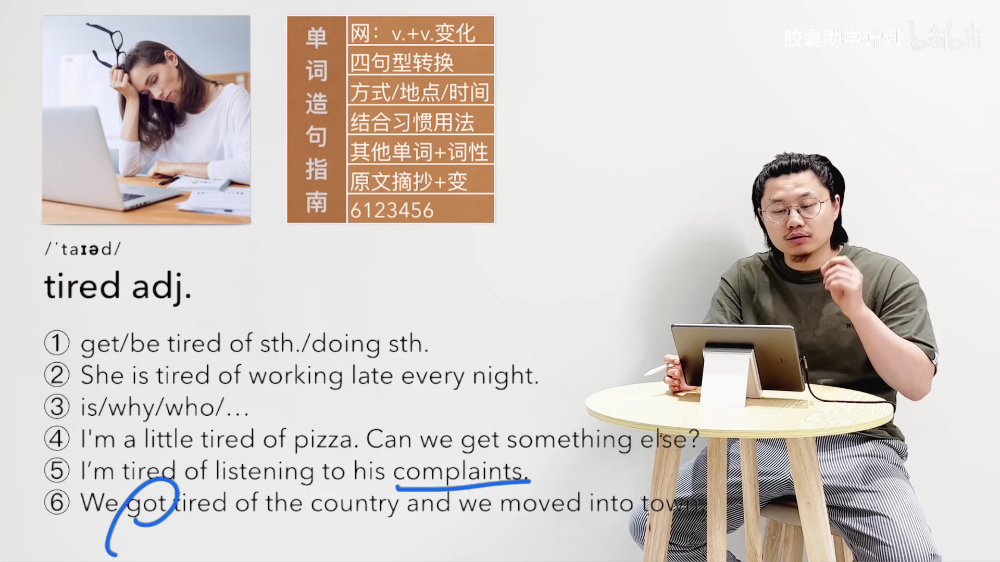

文字识别：单词造句指南 / 网：v.+v.变化 / 学计划 / 四句型转换 / 方式/地点/时间 / 结合习惯用法 / 其他单词+词性 / 原文摘抄+变 / 6123456 / /'taiad/ / tired adj. / ① get/be tired of sth./doing sth. / ② She is tired of working late every night. / ③ is/why/who/... / ④ I'm a litle tired of pizza. Can we get something el'se? / ⑤ I'm tired of listening to his complaints. / ⑥ We/gottired of the country and we moved into tov

### 画面 00:03:11

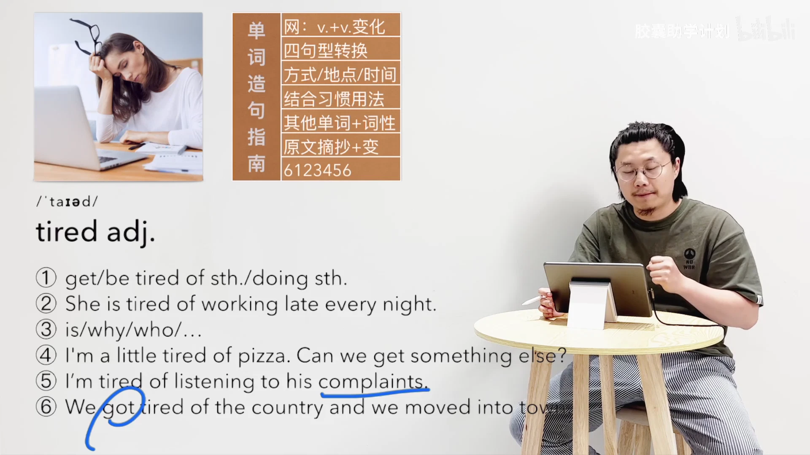

文字识别：单词造句指南 / 网：v.+v.变化 / 宇计划 / 四句型转换 / 方式/地点/时间 / 结合习惯用法 / 其他单词+词性 / 原文摘抄+变 / 6123456 / /'taiad/ / tired adj. / NU / ① get/be tired of sth./doing sth. / WIR / ② She is tired of working late every night. / ③ is/why/who/... / ④ I'm a little tired of pizza. Can we get something else? / ⑤ I'm tired of listening to his complaints. / ⑥ We/gottired of the country and we moved into toV

### 画面 00:03:13

文字识别：get tired of.. / 爱情与灵药 / Love & Other Drugs / (2010)

### 画面 00:03:23

文字识别：get tired of.. / NU / WR / 爱情与灵药 / Love & Other Drugs / (2010)

### 画面 00:03:25

文字识别：get tired of.. / WIIR / NU / 爱情与灵药 / 一期吗 / Love & Other Drugs / Stage One? / (2010)

### 画面 00:03:27

文字识别：get tired of.. / NO / WIIR / 爱情与灵药 / 什么 / Love & Other Drugs / I'm sorry? / (2010)

### 画面 00:03:29

文字识别：get tired of.. / 60 / ND / WIIR / 爱情与灵药 / 我儿子是三期 / Love & Other Drugs / My son's a Stage Three. / (2010)

## 00:03:30–00:04:00

not obvious. Don't worry. We're across the street. Whenever you get tired of this bullshit, want to hear what's really going on? Thank you. Okay,你看这句话说Whenever you get tired of this bullshit啊, okay, bullshit各位自己查一下,很有用的一个单词啊.然后continue下一个单词,跟我一起读一下,叫做real.好,我们好像见过它的副词叫really,是吧?但是这两个单词稍有点不太一样. Real是真

### 画面 00:03:31

文字识别：get tired of.. / NU / WIIRE / 爱情与灵药 / 不明显的别担心 / Love & Other Drugs / It's not obvious, don't worry. / (2010)

### 画面 00:03:33

文字识别：get tired of.. / NU / 爱情与灵药 / 我们就在街对面 / Love & Other Drugs / We're across the street. / (2010)

### 画面 00:03:35

文字识别：get tired of.. / 哈计划 / 芝加哥反代表大会 / 患者已失去耐心 / UNConventior / yeanth / patients / the / iosing patience / and / OKD / WIIR / NU / Bealthcare / strong / the / You need to become your / snvitation: / 爱情与灵药 / Love & Other Drugs / Holiatic AIternativem. /  and.mind / you think about healeh / 1273 Randolp / (2010)

### 画面 00:03:37

文字识别：get tired of.. / NU / WIR / 爱情与灵药 / 要是你厌倦了这些破事 / Love & Other Drugs / Whenever you get tired of this bullshit / (2010)

### 画面 00:03:39

文字识别：get tired of.. / NU / WIIR / 爱情与灵药 / Love & Other Drugs / (2010)

### 画面 00:03:41

文字识别：get tired of.. / NO / WIIR / 爱情与灵药 / 谢谢 / Love & Other Drugs / Thank you. / (2010)

### 画面 00:03:43

文字识别：get tired of.. / NO / WIR / 爱情与灵药 / Love & Other Drugs / (2010)

### 画面 00:03:49

文字识别：get tired of.. / 爱情与灵药 / Love & Other Drugs / (2010)

### 画面 00:03:51

文字识别：单词造句指南 / 网：v.+v.变化 / 学计划 / 四句型转换 / 方式/地点/时间 / 结合习惯用法 / 其他单词+词性 / 原文摘抄+变 / 6123456 / /ri:1/ / real adj. / WIR / NO

### 画面 00:03:53

文字识别：单词造句指南 / 网：v.+v.变化 / 字计划 / 四句型转换 / 方式/地点/时间 / 结合习惯用法 / 其他单词+词性 / 原文摘抄+变 / 6123456 / /ri:1/ / real adj. / ND / WIIR

### 画面 00:03:56

文字识别：单词造句指南 / 网：v.+v.变化 / 学计划 / 四句型转换 / 方式/地点/时间 / 结合习惯用法 / 其他单词+词性 / 原文摘抄+变 / 6123456 / /ri:l/ / real adj.

## 00:04:00–00:04:30

正的啊，比如说a real bed啊，我们在文章当中出现了这个小的词组，形容词加名词嘛，我们单词造句要看词性，对吧？形容词加名词a real bed，一个真正的床啊。那real reason是什么意思呢？就是一个真正的原因啊，真正的原因。那real friend就是你是真正的一个好朋友。比如说口语当中特别常出现一句话，各位看电影当中也经常会有，叫做You are a real friend，说你真是一个好朋友啊，你是一个

### 画面 00:04:02

文字识别：单词造句指南 / 网：v.+v.变化 / 学计划 / 四句型转换 / 方式/地点/时间 / 结合习惯用法 / 其他单词+词性 / 原文摘抄+变 / 6123456 / /ri:1/ / real adj. / ① a read bed/reason/friend

### 画面 00:04:05

文字识别：单词造句指南 / 网：v.+v.变化 / 子计划 / 四句型转换 / 方式/地点/时间 / 结合习惯用法 / 其他单词+词性 / 原文摘抄+变 / 6123456 / /ri:l/ / real adj. / ① a read bed/reason/friend

### 画面 00:04:08

文字识别：单词造句指南 / 网：v.+v.变化 / 学计划 / 四句型转换 / 方式/地点/时间 / 结合习惯用法 / 其他单词+词性 / 原文摘抄+变 / 6123456 / /ri:1/ / real adj. / ① a read bed/reason/friend

### 画面 00:04:10

文字识别：单词造句指南 / 网：v.+v.变化 / 计划 / 四句型转换 / 方式/地点/时间 / 结合习惯用法 / 其他单词+词性 / 原文摘抄+变 / 6123456 / /ri:1/ / real adj. / ① a read bed/reason/friend

### 画面 00:04:15

文字识别：单词造句指南 / 网：v.+v.变化 / 学计划 / 四句型转换 / 方式/地点/时间 / 结合习惯用法 / 其他单词+词性 / 原文摘抄+变 / 6123456 / /ri:l/ / real adj. / ① a read bed/reason/friend

### 画面 00:04:19

文字识别：单词造句指南 / 网：v.+v.变化 / 学计划 / 四句型转换 / 方式/地点/时间 / 结合习惯用法 / 其他单词+词性 / 原文摘抄+变 / 6123456 / /ri:1/ / real adj. / Nn / ① a read bed/reason/friend / WIR

### 画面 00:04:23

文字识别：单词造句指南 / 网：v.+v.变化 / 学计划 / 四句型转换 / 方式/地点/时间 / 结合习惯用法 / 其他单词+词性 / 原文摘抄+变 / 6123456 / /ri:1/ / real adj. / NU / WIR / ① a read bed/reason/friend /  You are a real friend.

### 画面 00:04:26

文字识别：单词造句指南 / 网：v.+v.变化 / 学計划 / 四句型转换 / 方式/地点/时间 / 结合习惯用法 / 其他单词+词性 / 原文摘抄+变 / 6123456 / /ri:1/ / real adj. / WIIR / NO / ① a read bed/reason/friend /  You are a real friend.

## 00:04:30–00:05:00

真的朋友，你不是狐朋狗友，对吧？OK，玩一个，那再来。我们结合之前学过的一些语法，或者说这个固定搭配或者结构，对吧？比如说 We needn't have bought a real bed。四十一课咱们学的，我们本不必去买这样一个真正的床，我们在这搭地铺挺好的，对不对？OK， next one，说 I don't know the real reason。这个句子是很简单的，无非就是告诉各位 the real reason 如何去用，对吧？口语当中还真的能用得到，

### 画面 00:04:31

文字识别：单词造句指南 / 网：v.+v.变化 / 计划 / 四句型转换 / 方式/地点/时间 / 结合习惯用法 / 其他单词+词性 / 原文摘抄+变 / 6123456 / /ri:1/ / real adj. / ① a read bed/reason/friend /  You are a real friend.

### 画面 00:04:35

文字识别：单词造句指南 / 网：v.+v.变化 / 学计划 / 四句型转换 / 方式/地点/时间 / 结合习惯用法 / 其他单词+词性 / 原文摘抄+变 / 6123456 / /ri:1/ / real adj. / ① a read bed/reason/friend / 2 /  You are a real friend. / ) We needn't have bought a real bed. L41

### 画面 00:04:40

文字识别：单词造句指南 / 网：v.+v.变化 / 学计划 / 四句型转换 / 方式/地点/时间 / 结合习惯用法 / 其他单词+词性 / 原文摘抄+变 / 6123456 / /ri:1/ / real adj. / NU / WIR / ① a read bed/reason/friend / 2) / ) You are a real friend. / ) We needn't have bought a real bed. L41

### 画面 00:04:55

文字识别：单词造句指南 / 网：v.+v.变化 / 学计划 / 四句型转换 / 方式/地点/时间 / 结合习惯用法 / 其他单词+词性 / 原文摘抄+变 / 6123456 / /ri:l/ / real adj. / ① a read bed/reason/friend / 2 /  You are a real friend. / ③ We needn't have bought a real bed. L41 / 3） / ④ I don't know the real reason.

## 00:05:00–00:05:30

叫 I don't know the real reason，对吧？ Continue，说 he dreamed of buying a real bed for years。这是三十八课咱们学叫 dream of doing something，对吧？梦想的，这是咱们说一个人从地中海搬回到英国的那一刻，对吧？他梦想着搬回到英国，no sooner than hardly win那课咱学的，对不对？好，dream of doing something，very good。下一个单词，这两个单词其实各位应该是认得到，就算你从来没见过，但我认为你应该

### 画面 00:05:02

文字识别：单词造句指南 / 网：v.+v.变化 / 学计划 / 四句型转换 / 方式/地点/时间 / 结合习惯用法 / 其他单词+词性 / 原文摘抄+变 / 6123456 / /ri:1/ / real adj. / NO / WIR / ① a read bed/reason/friend / 2 / ② You are a real friend. / ) We needn't have bought a real bed. L41 / 3 / ④ I don't know the real reason. / ⑤ He dreamed Of buying a real bed for years. L38

### 画面 00:05:09

文字识别：单词造句指南 / 网：v.+v.变化 / 计划 / 四句型转换 / 方式/地点/时间 / 结合习惯用法 / 其他单词+词性 / 原文摘抄+变 / 6123456 / /ri:1/ / real adj. / ① a read bed/reason/friend / 2 / ② You are a real friend. /  We needn't have bought a real bed. L41 / 3 / ④ I don't know the real reason. / ⑤ He dreamed of buying a real bed for years. L38

### 画面 00:05:20

文字识别：单词造句指南 / 网：v.+v.变化 / 计划 / 四句型转换 / 方式/地点/时间 / 结合习惯用法 / 其他单词+词性 / 原文摘抄+变 / 6123456 / /ri:l/ / real adj. / ① a read bed/reason/friend / 2 / ② You are a real friend. /  We needn't have bought a real bed. L41 / 3 / ④ I don't know the real reason. / ⑤ He dreamed of buying a real bed for years. L38

### 画面 00:05:23

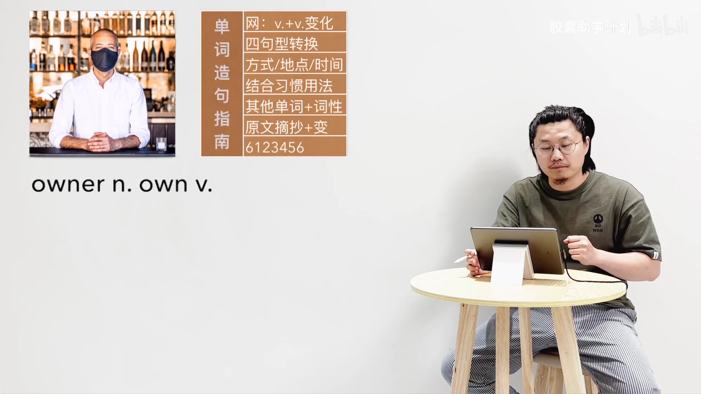

文字识别：单词造句指南 / 网：v.+v.变化 / 计划 / 四句型转换 / 方式/地点/时间 / 结合习惯用法 / 其他单词+词性 / 原文摘抄+变 / 6123456 / owner n. own v. / WIR / NU

### 画面 00:05:25

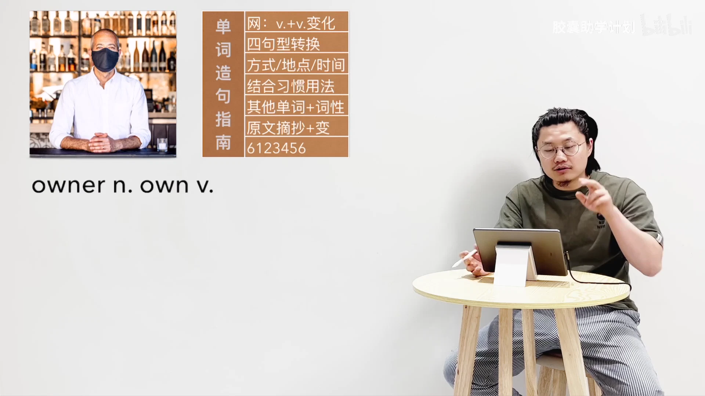

文字识别：单词造句指南 / 网：v.+v.变化 / 宇计划 / 四句型转换 / 方式/地点/时间 / 结合习惯用法 / 其他单词+词性 / 原文摘抄+变 / 6123456 / owner n. own v.

## 00:05:30–00:06:00

是认的，叫 owner 这个单词，对吧？为什么？因为 own 这个单词，我们二十八课学过，对吧？叫做拥有动词，后边再加上 e 二了之后，往往表示做某件事情的人，对吧？own 叫做拥有，类似于 have，那拥有者啊，对吧？叫做 owner，对吧？好，很容易造句的，比如说 he is the owner of a pub，对吧？第二单元最后咱们刚学了一课，刚学了 pub 这个单词，public house，对吧？我们就拿它出来复习一下，说他

### 画面 00:05:31

文字识别：单词造句指南 / 网：v.+v.变化 / 计划 / 四句型转换 / 方式/地点/时间 / 结合习惯用法 / 其他单词+词性 / 原文摘抄+变 / 6123456 / owner n. own v. / M

### 画面 00:05:35

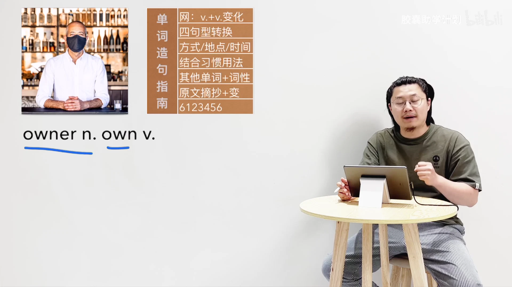

文字识别：单词造句指南 / 网：v.+v.变化 / 四句型转换 / 方式/地点/时间 / 结合习惯用法 / 其他单词+词性 / 原文摘抄+变 / 6123456 / owner n. own v. / NO / nr

### 画面 00:05:50

文字识别：单词造句指南 / 网：v.+v.变化 / 哈计划 / 四句型转换 / 方式/地点/时间 / 结合习惯用法 / 其他单词+词性 / 原文摘抄+变 / 6123456 / owner n. own v. / NU / WIR / ① He is the owner of a pub.

### 画面 00:05:55

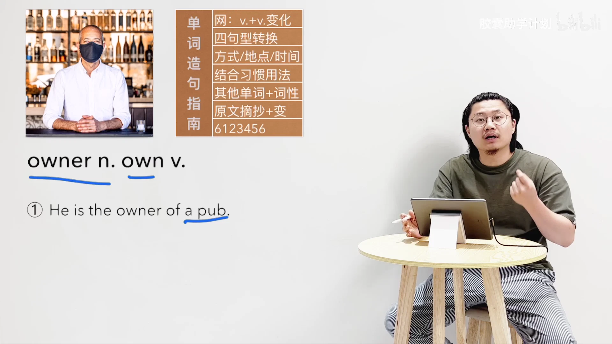

文字识别：单词造句指南 / 网：v.+v.变化 / 四句型转换 / 方式/地点/时间 / 结合习惯用法 / 其他单词+词性 / 原文摘抄+变 / 6123456 / owner n. own v. / ① He is the owner of a pub.

## 00:06:00–00:06:30

是这个酒吧的拥有者，很简单。然后呢，我可以换一个说法，叫做 he owns a pub，对吧？他拥有一个酒吧。那你注意一个小点，你看这句话里面的时态，为什么 own 后边加了 s 呢？你能不能对吧？告诉我啊？OK，那你还可以把它变成一般疑问句，各种特殊疑问句，比如说 Does he own a pub？ Why does he own a pub？对吧？啊，OK，他那么穷，他为什么会有一个这个酒吧呢？Why does he own a pub？

### 画面 00:06:00

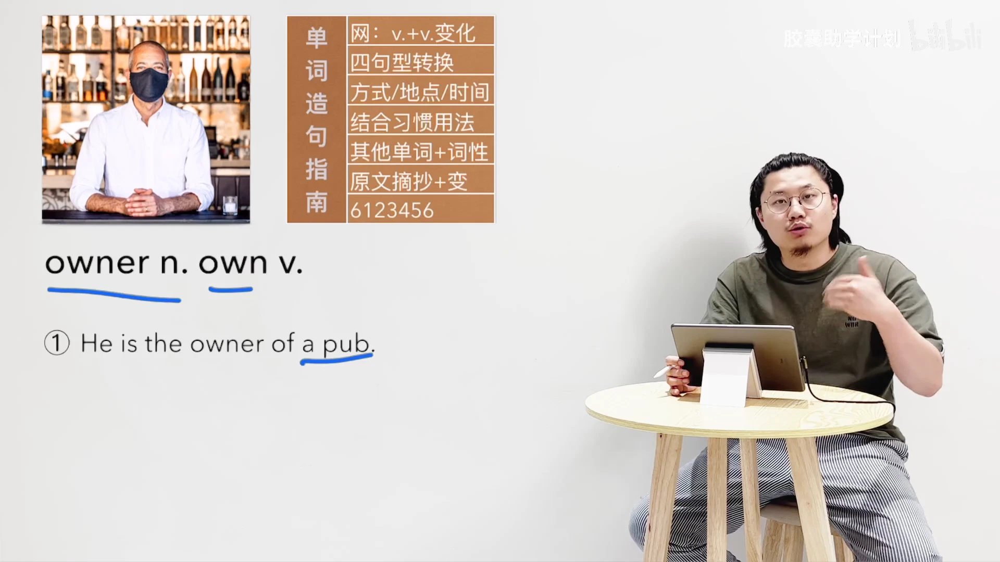

文字识别：单词造句指南 / 网：v.+v.变化 / 计划 / 四句型转换 / 方式/地点/时间 / 结合习惯用法 / 其他单词+词性 / 原文摘抄+变 / 6123456 / owner n. own v. / WIR / ① He is the owner of a pub.

### 画面 00:06:05

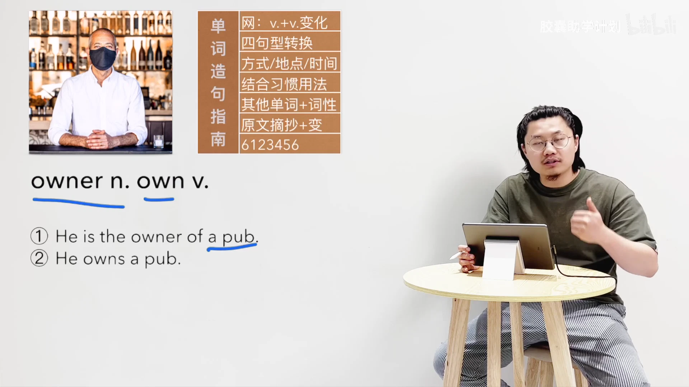

文字识别：单词造句指南 / 网：v.+v.变化 / 四句型转换 / 方式/地点/时间 / 结合习惯用法 / 其他单词+词性 / 原文摘抄+变 / 6123456 / owner n. own v. / ① He is the owner of a pub. / He owns a pub.

### 画面 00:06:10

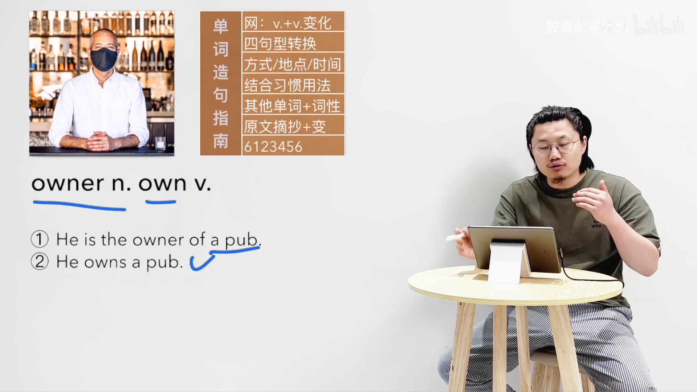

文字识别：单词造句指南 / 网：v.+v.变化 / 计划 / 四句型转换 / 方式/地点/时间 / 结合习惯用法 / 其他单词+词性 / 原文摘抄+变 / 6123456 / owner n. own v. / wnut / ① He is the owner of a pub. / He owns a pub.

### 画面 00:06:17

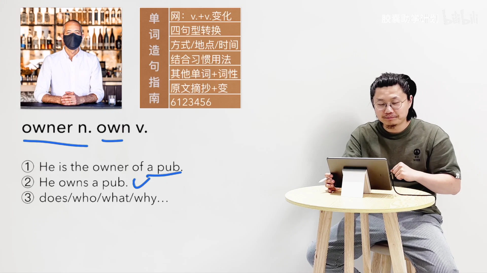

文字识别：单词造句指南 / 网：v.+v.变化 / 哈计划 / 四句型转换 / 方式/地点/时间 / 结合习惯用法 / 其他单词+词性 / 原文摘抄+变 / 6123456 / owner n. own v. / NU / ① He is the owner of a pub. / WIR / ) He owns a pub.C / ) does/who/what/why... / 3

### 画面 00:06:21

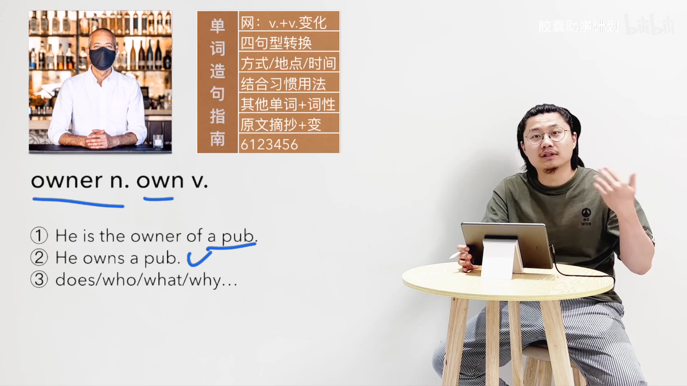

文字识别：单词造句指南 / 网：v.+v.变化 / 计划 / 四句型转换 / 方式/地点/时间 / 结合习惯用法 / 其他单词+词性 / 原文摘抄+变 / 6123456 / owner n. own v. / NU / WHR / ① He is the owner of a pub. / ) He owns a pub.C / ) does/who/what/why... / 3）

## 00:06:30–00:07:00

### 画面 00:06:31

文字识别：单词造句指南 / 网：v.+v.变化 / 四句型转换 / 方式/地点/时间 / 结合习惯用法 / 其他单词+词性 / 原文摘抄+变 / 6123456 / owner n. own v. / ① He is the owner of a pub. / ) He owns a pub.( / C / ③ does/who/what/why... / 3 / 9 I want to know who is the owner of this pub. L39 / 4

### 画面 00:06:35

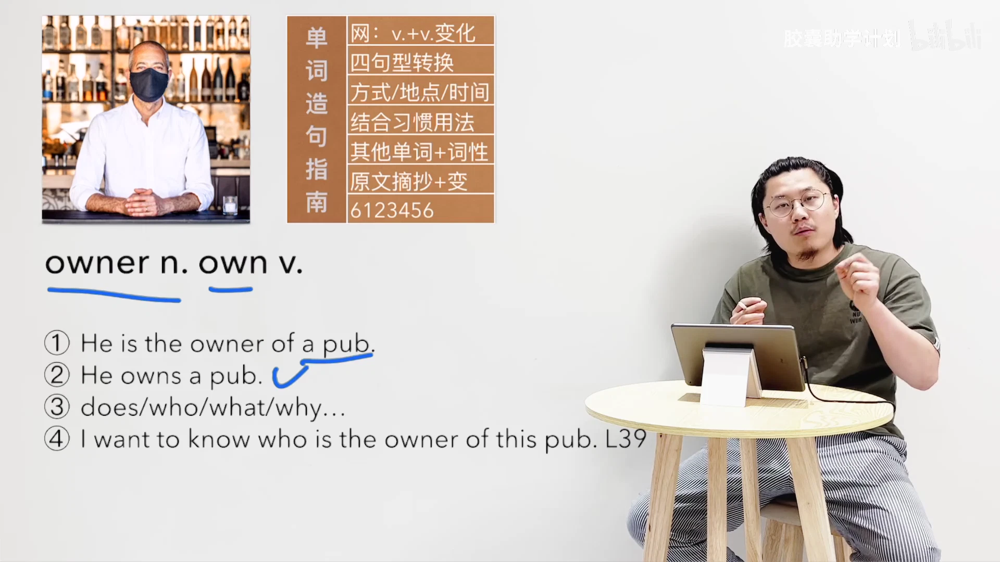

文字识别：单词造句指南 / 网：v.+v.变化 / 计划 / 四句型转换 / 方式/地点/时间 / 结合习惯用法 / 其他单词+词性 / 原文摘抄+变 / 6123456 / owner n. own v. / ① He is the owner of a pub. /  He owns a pub.( / C / does/who/what/why... / 3 /  I want to know who is the owner of this pub. L39

### 画面 00:06:43

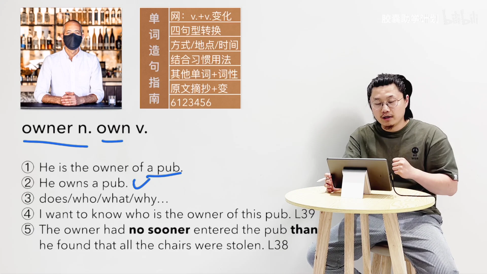

文字识别：单词造句指南 / 网：v.+v.变化 / 学计划 / 四句型转换 / 方式/地点/时间 / 结合习惯用法 / 其他单词+词性 / 原文摘抄+变 / 6123456 / owner n. own v. / NU / WIIR / ① He is the owner of a pub. / ) He owns a pub. ( / 2 / C / 3 / ③ does/who/what/why... / D I want to know who is the owner of this pub. L39 / 4 / The owner had no sooner entered the pub than / he found that all the chairs were stolen. L38

### 画面 00:06:45

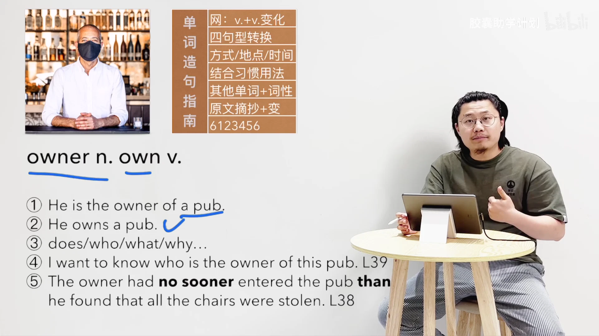

文字识别：单词造句指南 / 网：v.+v.变化 / 学计划 / 四句型转换 / 方式/地点/时间 / 结合习惯用法 / 其他单词+词性 / 原文摘抄+变 / 6123456 / owner n. own v. / NU / ① He is the owner of a pub. /  He owns a pub.( / 2 / C / ③ / ③ does/who/what/why.. / A / D I want to know who is the owner of this pub. L39 / The owner had no sooner entered the pub than / he found that all the chairs were stolen. L38

### 画面 00:06:50

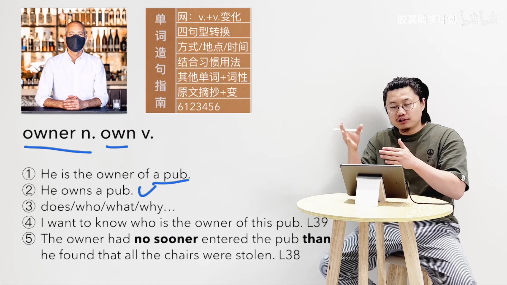

文字识别：单词造句指南 / 网：v.+v.变化 / 学计划 / 四句型转换 / 方式/地点/时间 / 结合习惯用法 / 其他单词+词性 / 原文摘抄+变 / 6123456 / owner n. own v. / WIR / ① He is the owner of a pub. /  He owns a pub. ( / 2 / C / ③ / ③ does/who/what/why... / D I want to know who is the owner of this pub. L39 / The owner had no sooner entered the pub than / he found that all the chairs were stolen. L38

### 画面 00:06:55

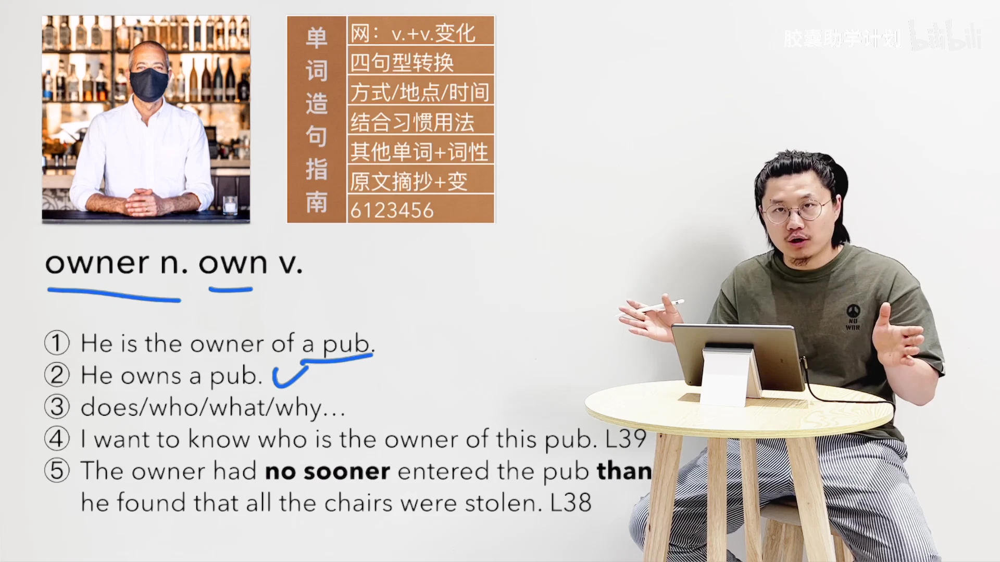

文字识别：单词造句指南 / 网：v.+v.变化 / 学计划 / 四句型转换 / 方式/地点/时间 / 结合习惯用法 / 其他单词+词性 / 原文摘抄+变 / 6123456 / owner n. own v. / ① He is the owner of a pub. / WIR / NU / ) He owns a pub.( / 2 / C / 3 / ③ does/who/what/why... / 9 I want to know who is the owner of this pub. L39 / The owner had no sooner entered the pub than / he found that all the chairs were stolen. L38

### 画面 00:06:58

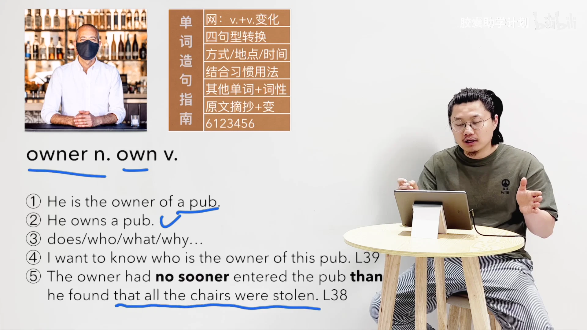

文字识别：单词造句指南 / 网：v.+v.变化 / 哈计划 / 四句型转换 / 方式/地点/时间 / 结合习惯用法 / 其他单词+词性 / 原文摘抄+变 / 6123456 / owner n. own v. / WIE / ① He is the owner of a pub. / ) He owns a pub.( / C / ) does/who/what/why... / 3 / D I want to know who is the owner of this pub. L39 / 4 / The owner had no sooner entered the pub than / he found that all the chairs were stolen. L38

## 00:07:00–00:07:30

句，这也是我们在实际上下半册对吧？类似于开篇的上一个视频当中，我们刚刚复习了简单句、并列句和主从复合句，对吧？那我们接下来在造句子的时候，就会不停的用到我们之前学过的那些东西了。OK， next one, continue，下一个单词，注意把它浊化一下，叫做 spring, spring。OK, very good。那 spring 这个单词，其实新一各位就见过，新一五十一课、五十三课，咱们就见过这个单词，对吧？一年四

### 画面 00:07:01

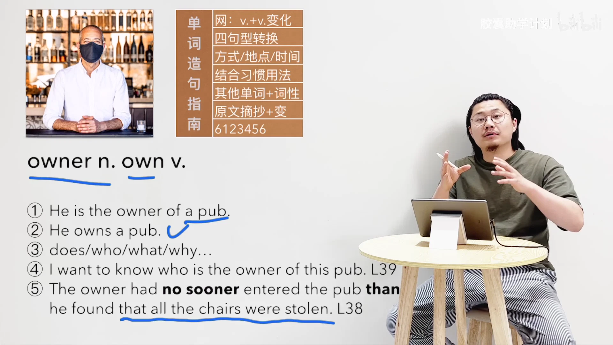

文字识别：单词造句指南 / 网：v.+v.变化 / 计划 / 四句型转换 / 方式/地点/时间 / 结合习惯用法 / 其他单词+词性 / 原文摘抄+变 / 6123456 / owner n. own v. / ① He is the owner of a pub. / ) He owns a pub.( / C / does/who/what/why... / 3 / D I want to know who is the owner of this pub. L39 / 4 / The owner had no sooner entered the pub than / he found that all the chairs were stolen. L38

### 画面 00:07:05

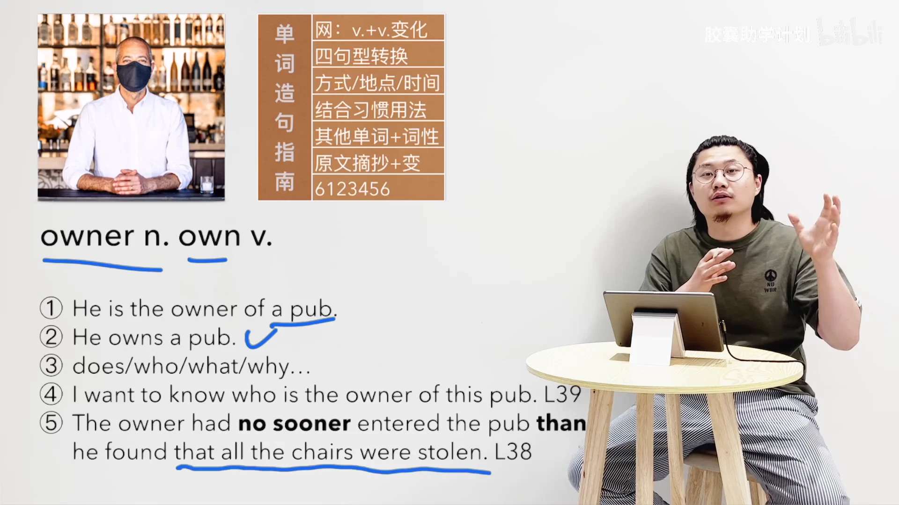

文字识别：单词造句指南 / 网：v.+v.变化 / 学计划 / 四句型转换 / 方式/地点/时间 / 结合习惯用法 / 其他单词+词性 / 原文摘抄+变 / 6123456 / owner n. own v. / NU / WIIR / ① He is the owner of a pub. / ) He owns a pub.( / C / does/who/what/why... / 3 / 4 / ) I want to know who is the owner of this pub. L39 / The owner had no sooner entered the pub than / he found that all the chairs were stolen. L38

### 画面 00:07:08

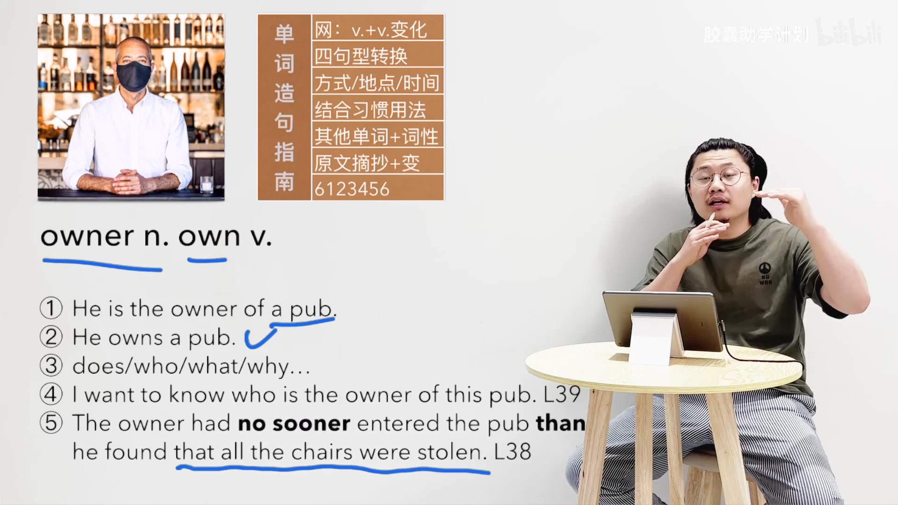

文字识别：单词造句指南 / 网：v.+v.变化 / 学计划 / 四句型转换 / 方式/地点/时间 / 结合习惯用法 / 其他单词+词性 / 原文摘抄+变 / 6123456 / owner n. own v. / ① He is the owner of a pub. / ) He owns a pub. ( / C / does/who/what/why... / 3 / 4 / ) I want to know who is the owner of this pub. L39 / The owner had no sooner entered the pub than / he found that all the chairs were stolen. L38

### 画面 00:07:10

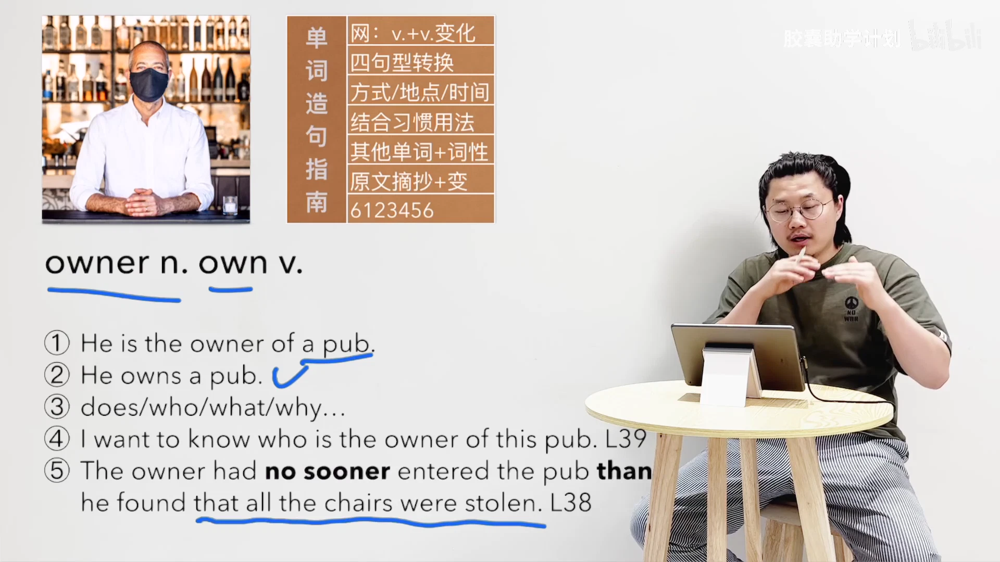

文字识别：单词造句指南 / 网：v.+v.变化 / 子计划 / 四句型转换 / 方式/地点/时间 / 结合习惯用法 / 其他单词+词性 / 原文摘抄+变 / 6123456 / owner n. own v. / WIIR / NU / ① He is the owner of a pub. / ) He owns a pub.( / 2 / C / ③ / ) does/who/what/why... / D I want to know who is the owner of this pub. L39 / 4 / The owner had no sooner entered the pub than / he found that all the chairs were stolen. L38

### 画面 00:07:16

文字识别：单词造句指南 / 网：v.+v.变化 / 学计划 / 四句型转换 / 方式/地点/时间 / 结合习惯用法 / 其他单词+词性 / 原文摘抄+变 / 6123456 / /sｐrīn/ / spring n. / NU / IR

### 画面 00:07:20

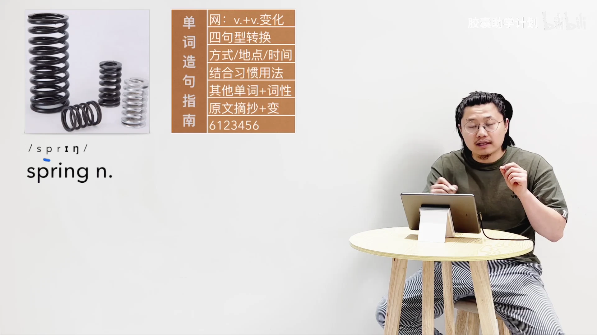

文字识别：单词造句指南 / 网：v.+v.变化 / 计划 / 四句型转换 / 方式/地点/时间 / 000 / 结合习惯用法 / 其他单词+词性 / 原文摘抄+变 / 6123456 / /sｐrīη/ / spring n.

### 画面 00:07:24

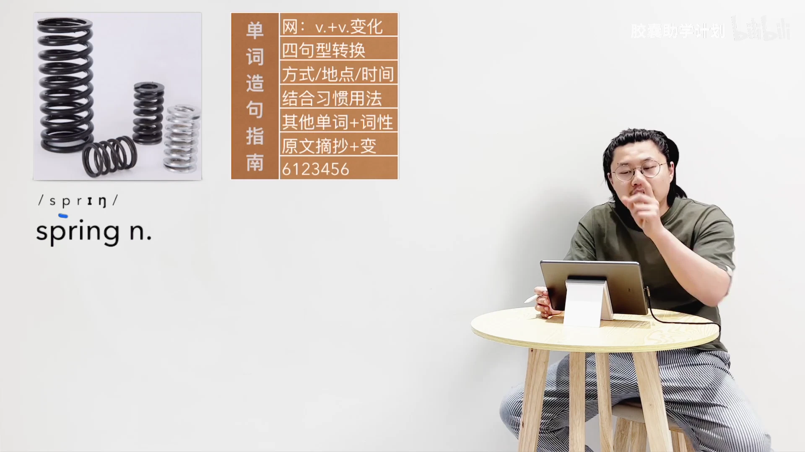

文字识别：单词造句指南 / 网：v.+v.变化 / 计划 / 四句型转换 / 方式/地点/时间 / 0780 / 结合习惯用法 / 其他单词+词性 / 原文摘抄+变 / 6123456 / /sｐrīη/ / spring n.

### 画面 00:07:26

文字识别：单词造句指南 / 网：v.+v.变化 / 计划 / 四句型转换 / 方式/地点/时间 / 000 / 结合习惯用法 / 其他单词+词性 / 原文摘抄+变 / 6123456 / /sｐrīη/ / spring n.

## 00:07:30–00:08:00

季，其中有一个叫做 spring，叫春天，没问题，很常用。那 spring 还有一个意思，还真不是那么常用啊。我之前在教新二之前都不知道啊，教了很，当然很多年前了，最开始备课的时候啊。那它现在在文章当中指的就是图，就是这弹簧，是吧？OK，那注意它是可数的。所以比如说我们造一句话叫 If he found out the springs under the bed, I would eat it。还是那句话，各位，这句话你记起来是没有必然用处的。

### 画面 00:07:30

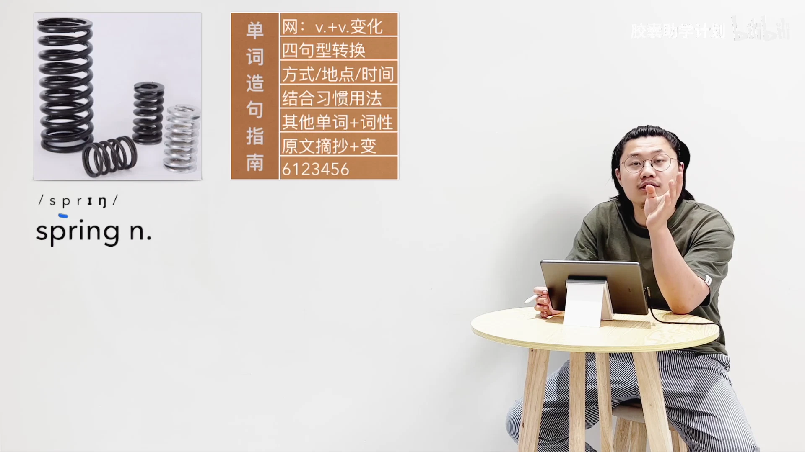

文字识别：单词造句指南 / 网：v.+v.变化 / 学计划 / 四句型转换 / 方式/地点/时间 / 结合习惯用法 / 其他单词+词性 / 原文摘抄+变 / 6123456 / /sｐrīn/ / spring n.

### 画面 00:07:40

文字识别：单词造句指南 / 网：v.+v.变化 / 学计划 / 四句型转换 / 方式/地点/时间 / 000 / 结合习惯用法 / 其他单词+词性 / 原文摘抄+变 / 6123456 / /sｐrīn/ / spring n.

### 画面 00:07:47

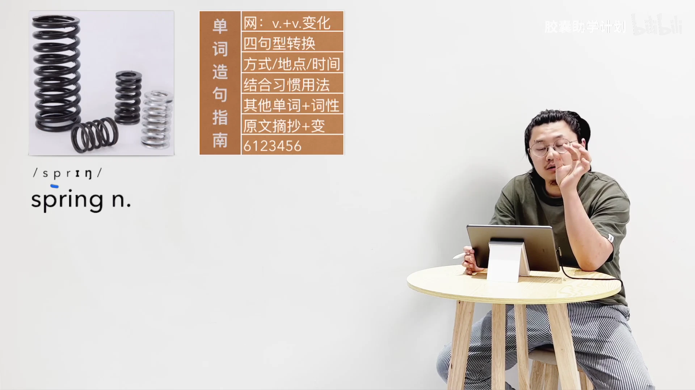

文字识别：单词造句指南 / 网：v.+v.变化 / 学计划 / 四句型转换 / 方式/地点/时间 / 结合习惯用法 / 其他单词+词性 / 原文摘抄+变 / 6123456 / /sｐrīη/ / spring n.

### 画面 00:07:49

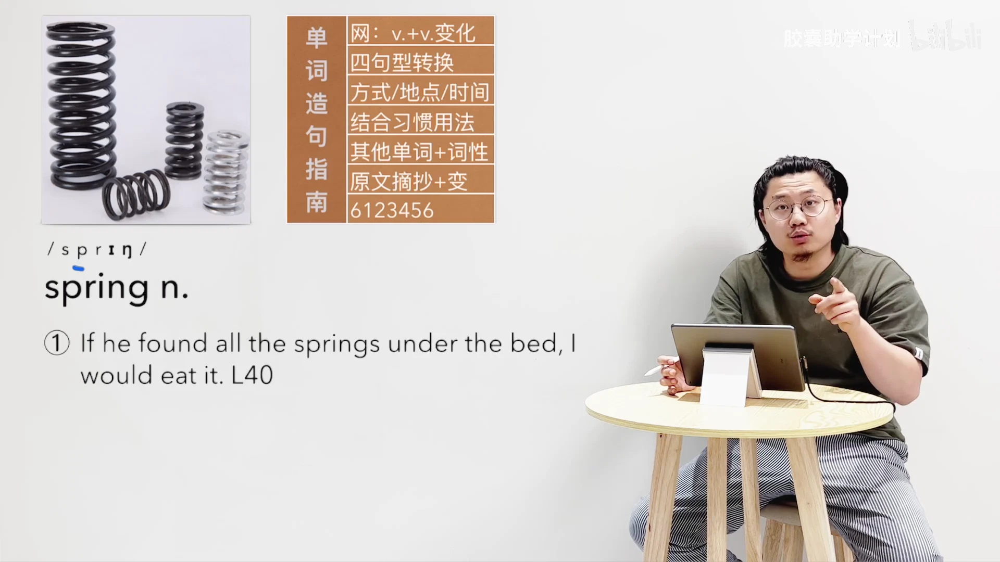

文字识别：单词造句指南 / 网：v.+v.变化 / 计划 / 四句型转换 / 方式/地点/时间 / 00 / 结合习惯用法 / 其他单词+词性 / 原文摘抄+变 / 6123456 / /sｐrīn/ / spring n. / ① If he found all the springs under the bed, I / would eat it. L40

### 画面 00:07:51

文字识别：单词造句指南 / 网：v.+v.变化 / 哈计划 / 四句型转换 / 方式/地点/时间 / 0700 / 结合习惯用法 / 其他单词+词性 / 原文摘抄+变 / 6123456 / /sｐrīn/ / spring n. / ① If he found all the springs under the bed, 1 / would eat it. L40

### 画面 00:07:56

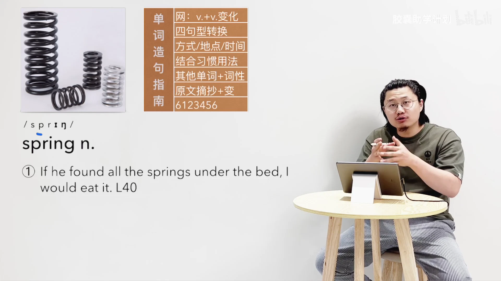

文字识别：单词造句指南 / 网：v.+v.变化 / 四句型转换 / 方式/地点/时间 / 000 / 结合习惯用法 / 其他单词+词性 / 原文摘抄+变 / 6123456 / /sｐrīn/ / spring n. / ① If he found all the springs under the bed, I / would eat it. L40

## 00:08:00–00:08:30

你要记住我是怎么造出来这句话的，造出来的方式是什么呢？我要先去想它是一个名词，我要去找动词，对吧？那 find 是很容易想到的一个动词，能跟 spring 联系起来的。其次呢，那我还要语法。我这这个地方处理的语法是四十课咱们学过的虚拟语气啊。假设他找到了床底下所有的，那我就把它都吃了，是吧？哎，其实 eat them 更好一点，对吧？因为这是 springs，对吧？加复数嘛，所以把它换成 them 可能

### 画面 00:08:06

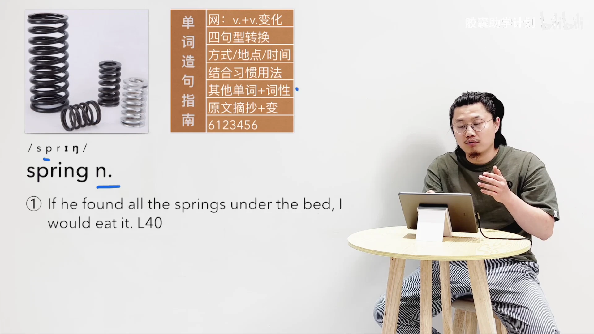

文字识别：单词造句指南 / 网：v.+v.变化 / 计划 / 四句型转换 / 方式/地点/时间 / 0700 / 结合习惯用法 / 其他单词+词性 / 原文摘抄+变 / 6123456 / /sｐrīn/ / spring n. / ① If he found all the springs under the bed, I / would eat it. L40

### 画面 00:08:09

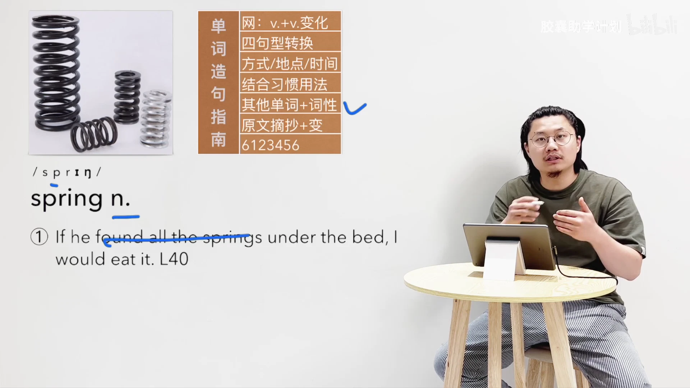

文字识别：单词造句指南 / 网：v.+v.变化 / 四句型转换 / 方式/地点/时间 / 0700 / 结合习惯用法 / 其他单词+词性 / 原文摘抄+变 / 6123456 / /sｐrīn/ / spring n. / ① If he feund all the springs under the bed, I / would eat it. L40

### 画面 00:08:26

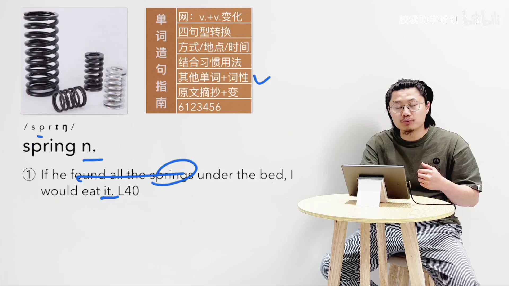

文字识别：单词造句指南 / 网：v.+v.变化 / 四句型转换 / 方式/地点/时间 / 000 / 结合习惯用法 / 其他单词+词性 / 原文摘抄+变 / 6123456 / /sｐrīn/ / spring n. / ① If he feund all the / Srimo& under the bed, 1 / would eat it. L40

## 00:08:30–00:09:00

更好一点啊，我觉得更符合这个语境一点。好，那注意，其实说这句话的人是不是说期待着我要吃那个螺丝呃，就吃这个弹簧上去呢？并不是，是吧？他的意思是你根本找不着，太小了。 Okay, continue. I regretted buying all these springs. Okay,玩一个springs。好，注意一个小点啊，regret doing something。这结合了之前的其他的习惯用法，四十课咱们学过的regret doing something，后悔做某件事情。

### 画面 00:08:30

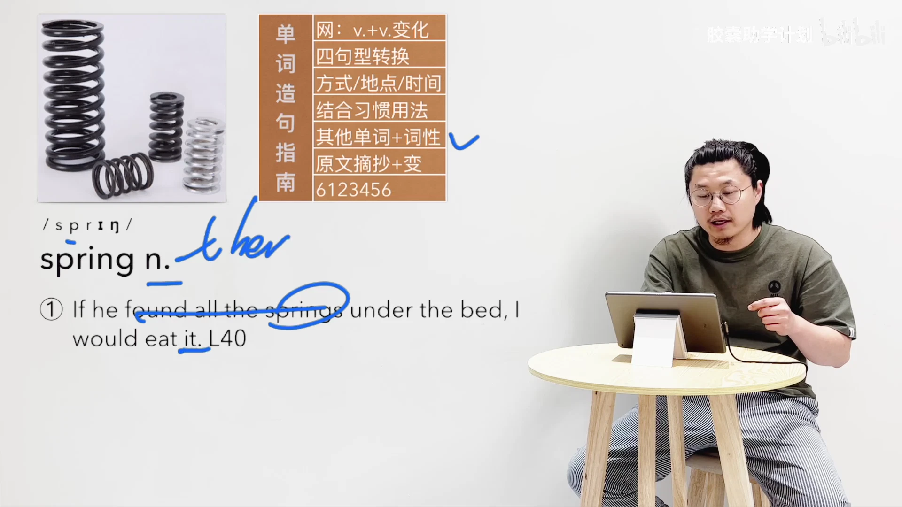

文字识别：单词造句指南 / 网：v.+v.变化 / 学计划 / 四句型转换 / 方式/地点/时间 / 000 / 结合习惯用法 / 其他单词+词性 / 原文摘抄+变 / 6123456 / /sｐrīn/ / hev / spring / n. / ① If he feund allthe / frimo& under the bed, I / would eat it. L40

### 画面 00:08:33

文字识别：单词造句指南 / 网：v.+v.变化 / 学辻划 / 四句型转换 / 方式/地点/时间 / 000 / 结合习惯用法 / 其他单词+词性 / 原文摘抄+变 / 6123456 / .l hem. / /sｐrīn/ / spring / n. / ① If he feund allthe sf / sprimo& under the bed,1 / would eat it. L40

### 画面 00:08:36

文字识别：单词造句指南 / 网：v.+v.变化 / 学计划 / 四句型转换 / 方式/地点/时间 / 000 / 结合习惯用法 / 其他单词+词性 / 原文摘抄+变 / 6123456 / .l hem. / /sｐrīn/ / spring / n. / ① If he feund allthe sf / sfrimo& under the bed, 1 / WIIR / would eat it. L40

### 画面 00:08:41

文字识别：单词造句指南 / 网：v.+v.变化 / 四句型转换 / 方式/地点/时间 / 结合习惯用法 / 其他单词+词性 / 原文摘抄+变 / 6123456 / .l hem. / /sｐrīn/ / spring / n. / WIR / NU / ① If he feund allthe sf / Primo8 under the bed, I / would eat it. L40

### 画面 00:08:47

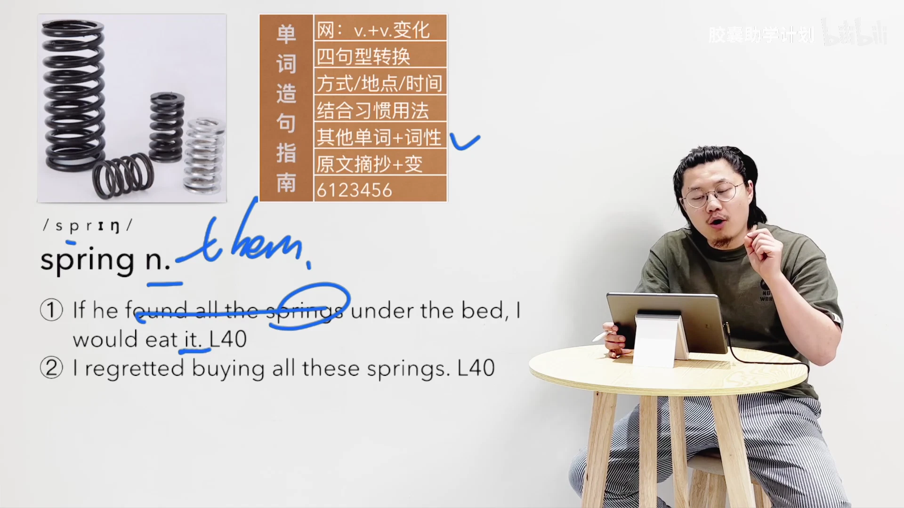

文字识别：单词造句指南 / 网：v.+v.变化 / 学计划 / 四句型转换 / 方式/地点/时间 / 000 / 结合习惯用法 / 其他单词+词性 / 原文摘抄+变 / 6123456 / .l hem. / /sｐrīn/ / spring / n. / ① If he feund all the sprimo& under the bed, I / WnK / would eat it. L40 / I regretted buying allthese springs. L40

### 画面 00:08:51

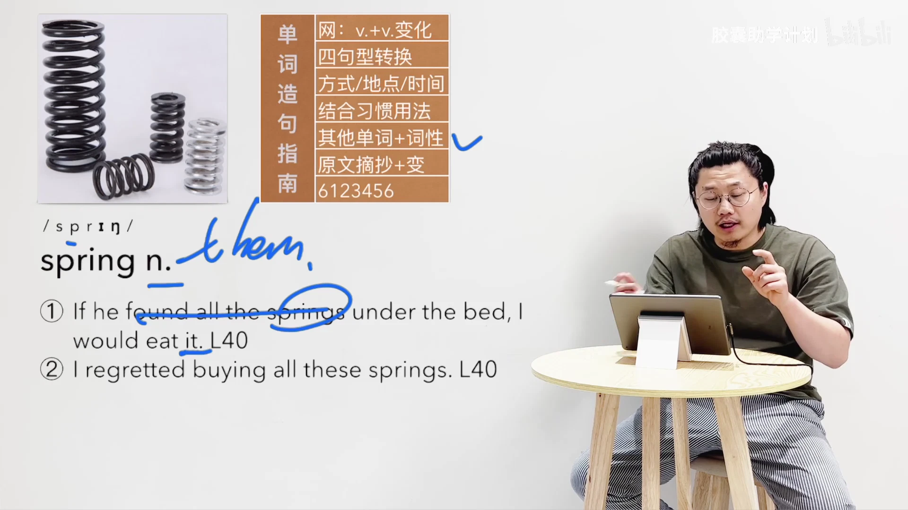

文字识别：单词造句指南 / 网：v.+v.变化 / 四句型转换 / 方式/地点/时间 / 00 / 结合习惯用法 / 其他单词+词性 / 原文摘抄+变 / 6123456 / .l hem. / /sｐrīn/ / spring /  n. / ① If he feund all the sprimo under the bed, 1 / would eat it. L40 /  I regretted buying all these springs. L40

### 画面 00:08:53

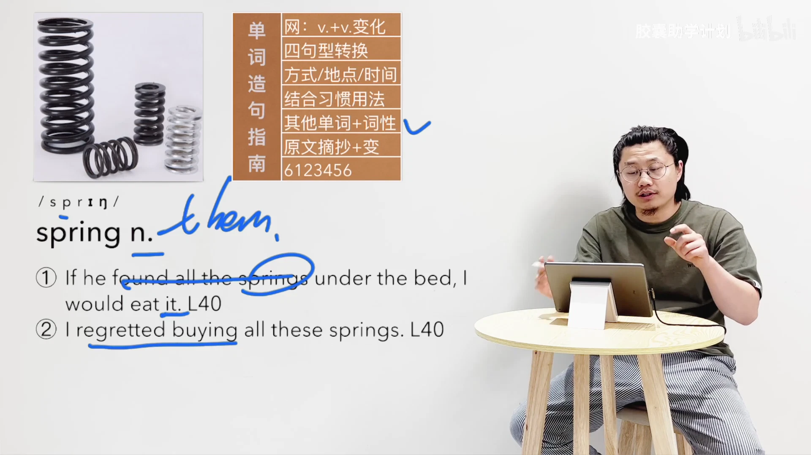

文字识别：单词造句指南 / 网：v.+v.变化 / 四句型转换 / 方式/地点/时间 / 00 / 结合习惯用法 / 其他单词+词性 / 原文摘抄+变 / 6123456 / .l hem. / /sｐrīn/ / spring / n. / ① If he feund all the sprimo under the bed, 1 / would eat it. L40 / I regretted buying all these springs. L40

### 画面 00:08:55

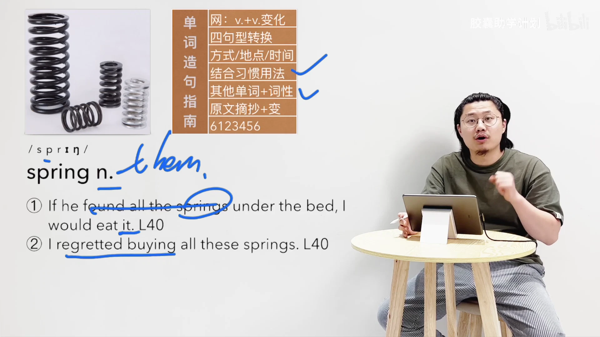

文字识别：单词造句指南 / 网：v.+v.变化 / 四句型转换 / 方式/地点/时间 / 00 / 结合习惯用法 / 其他单词+词性 / 原文摘抄+变 / 6123456 / .l hem. / /sｐrīn/ / spring / y n. / ① If he feund allthe s6 / primo& under the bed, I / would eat it. L40 / I regretted buying all these springs. L40

## 00:09:00–00:09:30

Continuing, so he was able to find all the springs at last. Ah,我们跟第一课第一句话给它连起来。四十三课咱们学的be able to do.然后呢，我们还专门拉出来了一个东西叫was able to.它有既可以表示能普遍的能力，还有一个特殊的用法叫成功的做成了某件事情。所以这句话咱们别把它翻译成它能啊，给它翻译成叫它成功的找到了所有的弹簧，最终，对不对？

### 画面 00:09:00

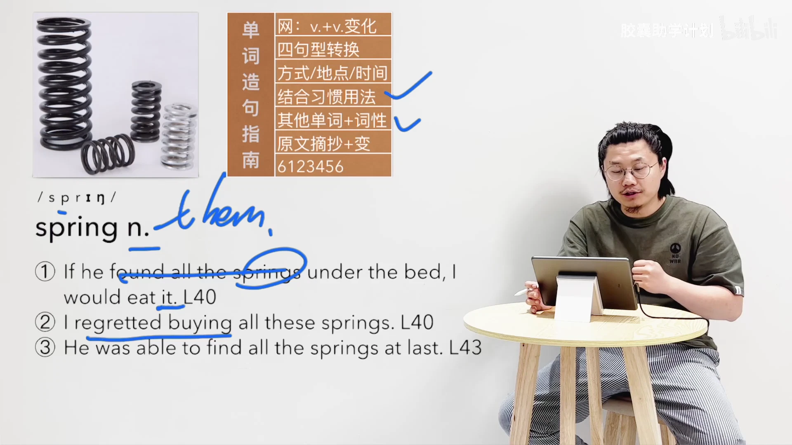

文字识别：单词造句指南 / 网：v.+v.变化 / 计划 / 四句型转换 / 方式/地点/时间 / 结合习惯用法 / 其他单词+词性 / 原文摘抄+变 / 6123456 / .l hem. / /sｐrīη/ / spring / y n. / WIR / ① If he feund all the sprimod under the bed, I / would eat it. L40 / I regretted buying allthese springs. L40 / He / e was able to find all the springs at last. L43

### 画面 00:09:05

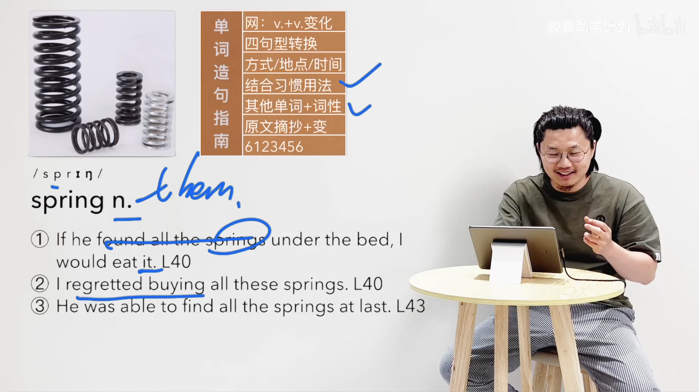

文字识别：单词造句指南 / 网：v.+v.变化 / 四句型转换 / 方式/地点/时间 / 结合习惯用法 / 其他单词+词性 / 原文摘抄+变 / 6123456 / .l hem. / /sｐrīη/ / spring / y n. / ① If he feund all the sbrimo& under the bed, I / would eat it. L40 / I regretted buying allthese springs. L40 / He / e was able to find all the springs at last. L43

### 画面 00:09:07

文字识别：单词造句指南 / 网：v.+v.变化 / 四句型转换 / 方式/地点/时间 / Q00 / 结合习惯用法 / 其他单词+词性 / 原文摘抄+变 / 6123456 / .l hem. / /sｐrīη/ / spring / y n. / If he feund allthe sprim& under the bed, I / 1 / would eat it. L40 / I regretted buying allthese springs. L40 / He / e was able to find all the springs at last. L43

### 画面 00:09:13

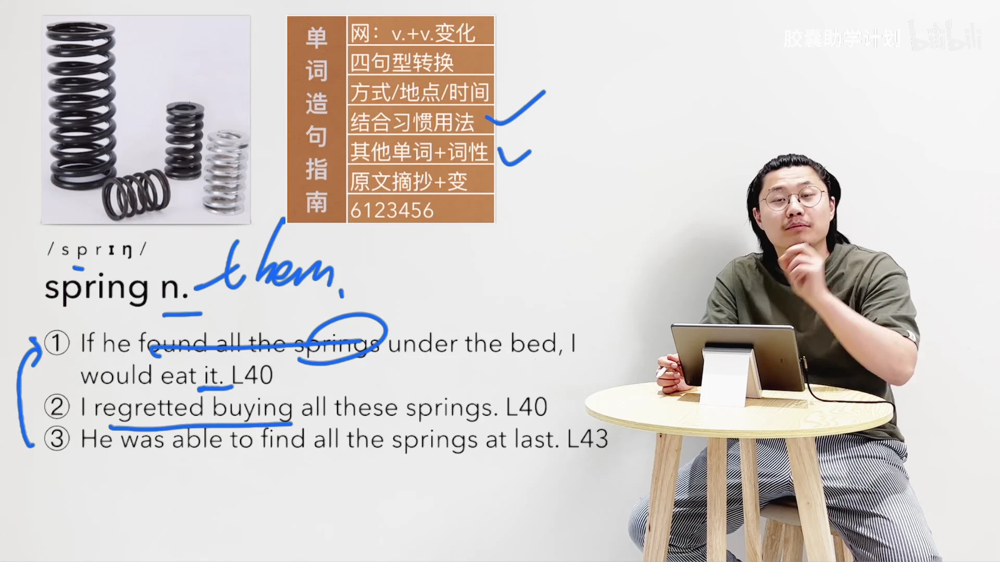

文字识别：单词造句指南 / 网：v.+v.变化 / 四句型转换 / 方式/地点/时间 / 结合习惯用法 / 其他单词+词性 / 原文摘抄+变 / 6123456 / .l hem. / /sｐrīn/ / spring / y n. / If he feund all the sprimo& under the bed, I / 1 / would eat it. L40 / I regretted buying allthese springs. L40 / He / ewas able to find all the springs at last. L43 / 3

### 画面 00:09:16

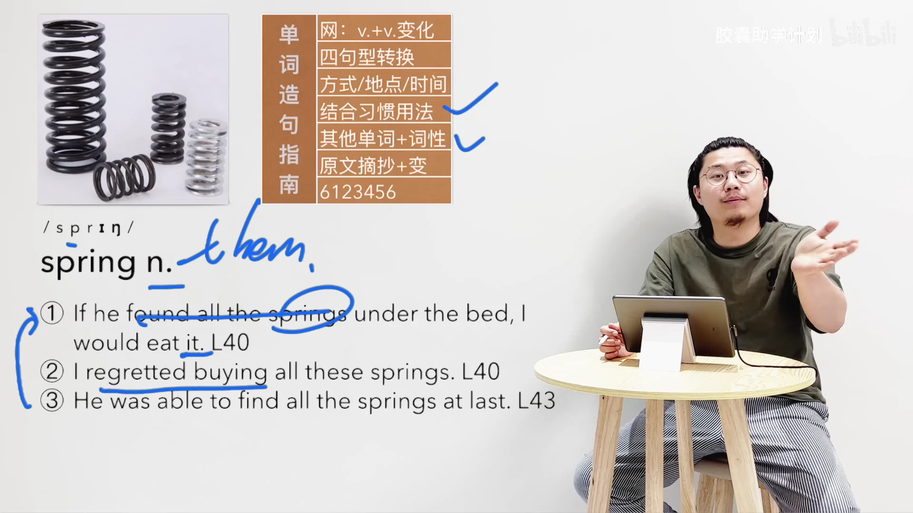

文字识别：单词造句指南 / 网：v.+v.变化 / 四句型转换 / 方式/地点/时间 / 结合习惯用法 / 其他单词+词性 / 原文摘抄+变 / 6123456 / .l hem. / /sｐrīn/ / spring n. / If he feund allthe sprino& under the bed, I / 1 / would eat it. L40 / I regretted buying allthese springs. L40 / He was able to find all the springs at last. L43

### 画面 00:09:18

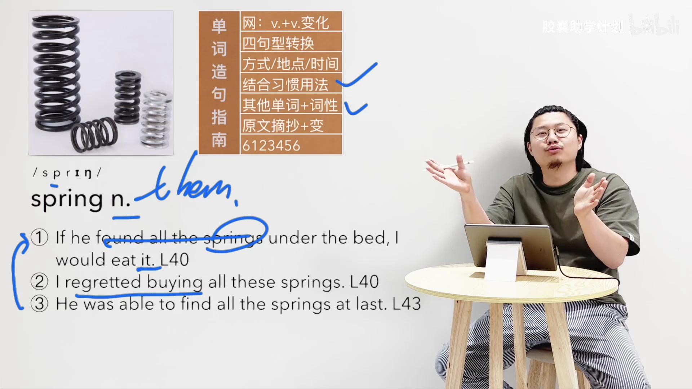

文字识别：单词造句指南 / 网：v.+v.变化 / 计划 / 四句型转换 / 方式/地点/时间 / 结合习惯用法 / 其他单词+词性 / 原文摘抄+变 / 6123456 / .l hem. / /sｐrīn/ / spring / y n. / If he feund all the sprimo& under the bed,I / 1 / would eat it. L40 / I regretted buying allthese springs. L40 / He was able to find allthe springs at last. L43

### 画面 00:09:22

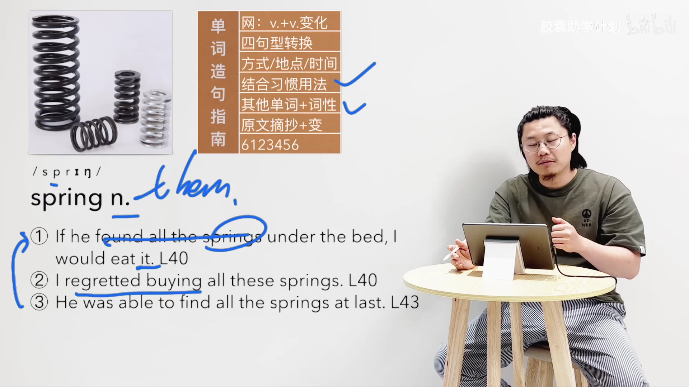

文字识别：单词造句指南 / 网：v.+v.变化 / 字计划 / 四句型转换 / 方式/地点/时间 / 结合习惯用法 / 其他单词+词性 / 原文摘抄+变 / 6123456 / .l hem. / /sｐrīn/ / spring / y n. / If he feund all the sprimo& under the bed, I / WIR / NU / 1 / Would eat it. L40 / I regretted buying allthese springs. L40 / He / e was able to find all the springs at last. L43

### 画面 00:09:28

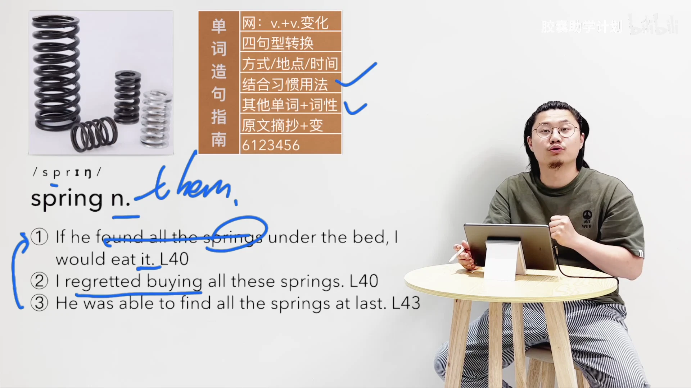

文字识别：单词造句指南 / 网：v.+v.变化 / 四句型转换 / 方式/地点/时间 / 结合习惯用法 / 其他单词+词性 / 原文摘抄+变 / 6123456 / .l hem. / /sｐrīη/ / spring / y n. / If he feund allthe sprimmod under the bed, I / would eat it. L40 / I regretted buying allthese springs. L40 / He / e was able to find all the springs at last. L43

## 00:09:30–00:10:00

Very good，又复习了之前的语法吧，很好。下一个单词，我们一起读一下，叫做 mattress。 mattress 这两个单词其实是放到一起的，在文章当中啊。那 mattress 的意思指的是床垫，对吧？不是床啊，是床垫。好，那一个名词，你想去造句子怎么办？动词或者之前其他习惯用法，对吧？那你看我这里造了一个句子，叫 I'm look I'm I'm，哎，注意这个地方少加了一个有一个 typo 啊， looking I'm looking forward to

### 画面 00:09:30

文字识别：单词造句指南 / 网：v.+v.变化 / 四句型转换 / 方式/地点/时间 / 00 / 结合习惯用法 / 其他单词+词性 / 原文摘抄+变 / 6123456 / .l hem. / /sｐrīn/ / spring n. / If he feund allthe sprimod under the bed, I / 1 / would eat it. L40 / I regretted buying all these springs. L40 / He / ewas able to find all the springs at last. L43

### 画面 00:09:32

文字识别：单词造句指南 / 网：v.+v.变化 / 学计划 / 四句型转换 / 方式/地点/时间 / 结合习惯用法 / 其他单词+词性 / 原文摘抄+变 / 6123456 / / 'mæetras / / mattress n. / NO / WIR

### 画面 00:09:36

文字识别：单词造句指南 / 网：v.+v.变化 / 学计划 / 四句型转换 / 方式/地点/时间 / 结合习惯用法 / 其他单词+词性 / 原文摘抄+变 / 6123456 / / 'mæetras / / mattress n.

### 画面 00:09:46

文字识别：单词造句指南 / 网：v.+v.变化 / 计划 / 四句型转换 / 方式/地点/时间 / 结合习惯用法 / 其他单词+词性 / 原文摘抄+变 / 6123456 / / 'm æetras / / mattress n. / WIN / N / ① I'm look forward to buying a new / mattress. L37

### 画面 00:09:50

文字识别：单词造句指南 / 网：v.+v.变化 / 学針划 / 四句型转换 / 方式/地点/时间 / 结合习惯用法 / 其他单词+词性 / 原文摘抄+变 / 6123456 / / ' m æetr a s / / mattress n. / ① I'm look forward to buying a new / WIR / NO / mattress. L37

### 画面 00:09:57

文字识别：单词造句指南 / 网：v.+v.变化 / 计划 / 四句型转换 / 方式/地点/时间 / 结合习惯用法 / 其他单词+词性 / 原文摘抄+变 / 6123456 / / 'mæetras / / mattress n. / ① I'm look'f8rward to buying a new / mattress. L37

## 00:10:00–00:10:30

buying a new mattress. 好，说我很期待去买一个新的床垫。 Look forward to something, or look forward to doing something, 对吧？ Very good. 三十七课咱们学的。再来，She couldn't resist the temptation and bought the mattress. 你看，这里其实很简单。这句话并不难。 Bought the mattress, 对吧？啊，这个这个动词并不难。但实际上，我们实际上是把第一句话

### 画面 00:10:11

文字识别：单词造句指南 / 网：v.+v.变化 / 命计划 / 四句型转换 / 方式/地点/时间 / 结合习惯用法 / 其他单词+词性 / 原文摘抄+变 / 6123456 / / 'm æe tra s / / mattress n. / ① I'm look'f8rward to buying a new / mattress. L37 / She couldn't resist the temptation and / bought the mattress. L32

### 画面 00:10:15

文字识别：单词造句指南 / 网：v.+v.变化 / 计划 / 四句型转换 / 方式/地点/时间 / 结合习惯用法 / 其他单词+词性 / 原文摘抄+变 / 6123456 / / 'mæe tras / / mattress n. / ① I'm look'f8rward to buying a new / mattress. L37 / She couldn't resist the temptation and / bought the mattress. L32

### 画面 00:10:21

文字识别：单词造句指南 / 网：v.+v.变化 / 计划 / 四句型转换 / 方式/地点/时间 / 结合习惯用法 / 其他单词+词性 / 原文摘抄+变 / 6123456 / / 'm æe tra s / / mattress n. / ① I'm look'f8rward to buying a new / mattress. L37 / She couldn't resist the temptation and / bought the mattress. L32

### 画面 00:10:23

文字识别：单词造句指南 / 网：v.+v.变化 / 计划 / 四句型转换 / 方式/地点/时间 / 结合习惯用法 / 其他单词+词性 / 原文摘抄+变 / 6123456 / / ' m æ tra s / / mattress n. / ① I'm look'f8rward to buying a new / NU / mattress. L37 / She couldn't resist the temptation and / bought the mattress. L32

### 画面 00:10:25

文字识别：单词造句指南 / 网：v.+v.变化 / 学计划 / 四句型转换 / 方式/地点/时间 / 结合习惯用法 / 其他单词+词性 / 原文摘抄+变 / 6123456 / / 'm æe tra s / / mattress n. / ① I'm look'f8rward to buying a new / mattress. L37 / She couldn't resist the temptation and / bought the mattress. L32

## 00:10:30–00:11:00

啊，两句话给它通过 and 连接到了一起，这也是我们在接下来造句子的时候逐渐要学会的一个思路，就是我们开始不只造简单句了，我们开始也开始大面积去大面积的去造这个并列句、主从复合句啊，Very good. Continue. So he used to sell mattresses in the shop. 好吧，注意这个地方 mattresses 是结尾的，所以它的复数是 mattresses. Okay, very good.

### 画面 00:10:30

文字识别：单词造句指南 / 网：v.+v.变化 / 计划 / 四句型转换 / 方式/地点/时间 / 结合习惯用法 / 其他单词+词性 / 原文摘抄+变 / 6123456 / / 'm æe tra s / / mattress n. / ① I'm look'f8rward to buying a new / mattress. L37 / ②She couldn't resist the temptatioland / fbought the mattress. L32

### 画面 00:10:32

文字识别：单词造句指南 / 网：v.+v.变化 / 计划 / 四句型转换 / 方式/地点/时间 / 结合习惯用法 / 其他单词+词性 / 原文摘抄+变 / 6123456 / / 'm æe tra s / / mattress n. / ① I'm look'f8rward to buying a new / mattress. L37 / She couldn't resist the temptatiorand / Cbought the mattress:Y32

### 画面 00:10:36

文字识别：单词造句指南 / 网：v.+v.变化 / 计划 / 四句型转换 / 方式/地点/时间 / 结合习惯用法 / 其他单词+词性 / 原文摘抄+变 / 6123456 / / 'm æe tra s / / mattress n. / ① I'm look'f8rward to buying a new / mattress. L37 / ②She couldn't resist the temptatiorand / Cbought the mattress.Y32

### 画面 00:10:49

文字识别：单词造句指南 / 网：v.+v.变化 / 计划 / 四句型转换 / 方式/地点/时间 / 结合习惯用法 / 其他单词+词性 / 原文摘抄+变 / 6123456 / / ' m æetras / / mattress n. / NU / WIR / ① I'm look'f8rward to buying a new / mattress. L37 / 2She couldn't resist the temptatiopand / fbought the mattress:Y32 / ③He used to sell mattresses in the / shop. L31

### 画面 00:10:54

文字识别：单词造句指南 / 网：v.+v.变化 / 四句型转换 / 方式/地点/时间 / 结合习惯用法 / 其他单词+词性 / 原文摘抄+变 / 6123456 / / 'm æe t ras / / mattress n. / ① I'm look'f8rward to buying a new / mattress. L37 / ②She couldn't resist the temptatior:nd / fbought the mattress:Y32 / ③He used to sell mattresses in the / shop. L31

### 画面 00:10:56

文字识别：单词造句指南 / 网：v.+v.变化 / 计划 / 四句型转换 / 方式/地点/时间 / 结合习惯用法 / 其他单词+词性 / 原文摘抄+变 / 6123456 / / 'm æe tra s / / mattress n. / ① I'm look'f8rward to buying a new / mattress. L37 / ②She couldn't resist the temptatio)and / fbought the mattress:Y_32 / ③He used to sell mattresses in the / shop. L31

## 00:11:00–00:11:30

所以他过去啊，在这个商店里面卖这个床垫啊, used to do something. 三十一课咱们学的语法又复习了一遍啊。接下来下一个单词，跟我一起读一下，叫做 gust, gust, gust. 那其实这个 gust 它不单独出现，它叫做 a gust of wind. 文章当中直接就给咱们了这个短语，咱们就把这个短语给它记下来，叫做一阵风啊。直接对应翻译成汉语叫一阵风。那 sweep 这个单词过去式、

### 画面 00:11:00

文字识别：单词造句指南 / 网：v.+v.变化 / 四句型转换 / 方式/地点/时间 / 结合习惯用法 / 其他单词+词性 / 原文摘抄+变 / 6123456 / / 'mæe tras / / mattress n. / ① I'm look'f8rward to buying a new / mattress. L37 / ②She couldn't resist the temptatio)and / fbought the mattress:Y32 / ③He used to sell mattresses in the / shop. L31

### 画面 00:11:05

文字识别：单词造句指南 / 网：v.+v.变化 / 四句型转换 / 方式/地点/时间 / 结合习惯用法 / 其他单词+词性 / 原文摘抄+变 / 6123456 / /'mæe tras / / mattress n. / ① I'm look'f8rward to buying a new / mattress. L37 / ②She couldn't resist the temptatiopand / Cbought the mattress:Y32 / ③He used to sell mattresses in the / shop. L31

### 画面 00:11:07

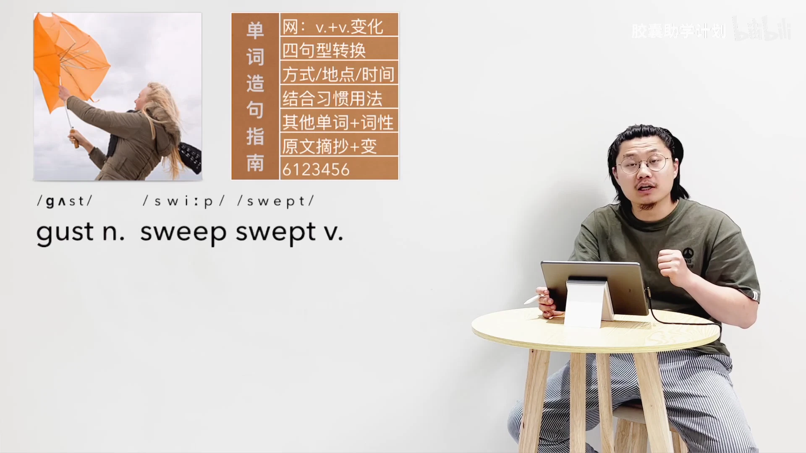

文字识别：单词造句指南 / 网：v.+v.变化 / 四句型转换 / 方式/地点/时间 / 结合习惯用法 / 其他单词+词性 / 原文摘抄+变 / 6123456 / /gast/ / / swi:p / /swept/ / gust n. sweep swept v.

### 画面 00:11:10

文字识别：单词造句指南 / 网：v.+v.变化 / 计划 / 四句型转换 / 方式/地点/时间 / 结合习惯用法 / 其他单词+词性 / 原文摘抄+变 / 6123456 / //gast/ / / swi:p/ /swept/ / gust n. sweep swept v.

### 画面 00:11:15

文字识别：单词造句指南 / 网：v.+v.变化 / 学计划 / 四句型转换 / 方式/地点/时间 / 结合习惯用法 / 其他单词+词性 / 原文摘抄+变 / 6123456 / //gast/ / /swi:p/ /swept/ / gust n. sweep swept v.

### 画面 00:11:18

文字识别：单词造句指南 / 网：v.+v.变化 / 四句型转换 / 方式/地点/时间 / 结合习惯用法 / 其他单词+词性 / 原文摘抄+变 / 6123456 / V/gast/ / / s wi:p/ /swept/ / gust n. sweep swept v. / ① [Story]: A gust of wind swept the bed off / the roof.

### 画面 00:11:20

文字识别：单词造句指南 / 网：v.+v.变化 / 四句型转换 / 方式/地点/时间 / 结合习惯用法 / 其他单词+词性 / 原文摘抄+变 / 6123456 / V/gast/ / / s wi:p / /swept / / gust n. sweep swept v. / ① [Story]: / A gust of wind swept the bed off / the roof.

### 画面 00:11:22

文字识别：单词造句指南 / 网：v.+v.变化 / 计划 / 四句型转换 / 方式/地点/时间 / 结合习惯用法 / 其他单词+词性 / 原文摘抄+变 / 6123456 / V/gast/ / / s wi:p / /sw ept / / gust n. sweep swept v. / ① [Story]: / A gust of wind swept the bed off / the roof.

### 画面 00:11:25

文字识别：单词造句指南 / 网：v.+v.变化 / 四句型转换 / 方式/地点/时间 / 结合习惯用法 / 其他单词+词性 / 原文摘抄+变 / 6123456 / V/gast/ / /swi:p/ /swept/ / gust n. sweep swept v. / ① [Story]: / A gust of wind swept the bed off / the roof.

### 画面 00:11:29

文字识别：单词造句指南 / 网：v.+v.变化 / 四句型转换 / 方式/地点/时间 / 结合习惯用法 / 其他单词+词性 / 原文摘抄+变 / 6123456 / Vigast/ / /swi:p/ /swept/ / gust n. sweep swept v. / ①[Story] / A gust of wind swept the bed off / the roof.

## 00:11:30–00:12:00

过去分词都是 swept。这个单词你应该不会不认的。我们新一就学过，对吧？三十一、三十三，咱就学过这个单词，非常的常用的一个单词，就是扫地的这个动作。那它还有新的意思，其实就是刮啊，风刮着怎么怎么样？比如说刮，呃，把这个树叶刮了一地，对吧？这个刮啊，叫做 sweep。那你看原文这句话，对吧？我们造句，这这些单词着实不是特别好造。那我们就走

### 画面 00:11:31

文字识别：单词造句指南 / 网：v.+v.变化 / 四句型转换 / 方式/地点/时间 / 结合习惯用法 / 其他单词+词性 / 原文摘抄+变 / 6123456 / /gast/ / / s wi:p / /swept/ / gust n. sweep s / swept v. / ①[Story] / A gust of wind swept the bed off / 10 / the roof.

### 画面 00:11:41

文字识别：单词造句指南 / 网：v.+v.变化 / 四句型转换 / 方式/地点/时间 / 结合习惯用法 / 其他单词+词性 / 原文摘抄+变 / 6123456 / /gast/ / / s wi:p / /swept/ / gust n. sweep / swept v. / ND / WIR / ① [Story]: / A gust of wind swept the bed off / the roof.

### 画面 00:11:45

文字识别：单词造句指南 / 网：v.+v.变化 / 四句型转换 / 方式/地点/时间 / 结合习惯用法 / 其他单词+词性 / 原文摘抄+变 / 6123456 / /gast/ / / s wi:p / /swept / / gust n. sweep / swept v. / ① [Story]: / A gust of wind swept the bed off / the roof.

### 画面 00:11:58

文字识别：单词造句指南 / 网：v.+v.变化 / 四句型转换 / 方式/地点/时间 / 结合习惯用法 / 其他单词+词性 / 原文摘抄+变 / 6123456 / /gast/ / / s wi:p / /swept / / gust n. sweep s / swept v. / ①[Story] / A gust of wind swept the bed off / the roof.

## 00:12:00–00:12:30

一个非常中规中矩的路线，叫原文摘抄再加变，叫 A gust of wind swept the bed off the roof，对吧？说一阵风刮着这个床就离开了这个房顶。OK，肯定句给你了，你去把它变成一般疑问句和特各种特殊疑问句，这就是您的基本功了，对吧？像今天各位这个单词造句，您就是按照我接下来这些思路，把各种特殊疑问句给它造出来，我觉得就可以了。

### 画面 00:12:00

文字识别：单词造句指南 / 网：v.+v.变化 / 计划 / 四句型转换 / 方式/地点/时间 / 结合习惯用法 / 其他单词+词性 / 原文摘抄+变 / 6123456 / V/gast/ / / s wi:p / /sw ept / / gust n. sweep s / swept v. / ①[Story] / A gust of wind swept the bed off / the roof.

### 画面 00:12:08

文字识别：单词造句指南 / 网：v.+v.变化 / 计划 / 四句型转换 / 方式/地点/时间 / 结合习惯用法 / 其他单词+词性 / 原文摘抄+变 / 6123456 / /gast/ / / s wi:p / /swept/ / gust n. sweep s / swept v. / ① [Story]: / A gust of wind swept the bed off / the roof.

### 画面 00:12:10

文字识别：单词造句指南 / 网：v.+v.变化 / 四句型转换 / 方式/地点/时间 / 结合习惯用法 / 其他单词+词性 / 原文摘抄+变 / 6123456 / //gast/ / / s wi:p / /swept / / gust n. sweep / swept v. / ① [Story]: / A gust of wind swept the bed off / the roof.

### 画面 00:12:13

文字识别：单词造句指南 / 网：v.+v.变化 / 四句型转换 / 方式/地点/时间 / 结合习惯用法 / 其他单词+词性 / 原文摘抄+变 / 6123456 / V/gast/ / / s wi :p / / sw ept/ / gust n. sweep / swept v. / ① [Story]: / A gust of wind swept the bedoff / the roof.

### 画面 00:12:16

文字识别：单词造句指南 / 网：v.+v.变化 / 命计划 / 四句型转换 / 方式/地点/时间 / 结合习惯用法 / 其他单词+词性 / 原文摘抄+变 / 6123456 / Vigast/ / / s w i :p / / sw ept / / gust n. sweep s / swept v. / ①[Story] / A gust of wind swept the bedoff / the roof. / Did a gust of wind sweep the bed off the / roof?

### 画面 00:12:20

文字识别：单词造句指南 / 网：v.+v.变化 / 计划 / 四句型转换 / 方式/地点/时间 / 结合习惯用法 / 其他单词+词性 / 原文摘抄+变 / 6123456 / V/gast/ / / s w i :p / / s w ept / / gust n. sweep swept v. / ① [Story]: / A gust of wind swept the bedoff / the roof. / Did a gust of wind sweep the bed off the / roof? / What did a gust of wind sweep off the roof.

## 00:12:30–00:13:00

实在不行，你把 bad 换一下，对吧？哎，我一阵风能从房顶上刮落的东西可以是很多的，对不对？OK，好。下一个单词跟我读一下，叫做 courtyard courtyard。好， courtyard 指的是我们的那个院子，我们的那个庭院啊。好，那其实它比较常用的就是这个小的短语叫 in the courtyard。我为什么标了个五呢？就是又要用到这个东西了。六一二三四五六啊，你看第一课学到到第

### 画面 00:12:30

文字识别：单词造句指南 / 网：v.+v.变化 / 哈计划 / 四句型转换 / 方式/地点/时间 / 结合习惯用法 / 其他单词+词性 / 原文摘抄+变 / 6123456 / V/gast/ / / s w i :p / / s w ept / / gust n. sweep swept v. / ① [Story] / A gust of wind swept the bed off / the roof. / Did a gust of wind sweep the bed off the / roof? / What did a gust of wind sweep off the roof.

### 画面 00:12:32

文字识别：单词造句指南 / 网：v.+v.变化 / 计划 / 四句型转换 / 方式/地点/时间 / 结合习惯用法 / 其他单词+词性 / 原文摘抄+变 / 6123456 / V/gast/ / / s w i :p / / s w ept / / gust n. sweep swept v. / ① [Story] / A gust of wind swept the bed / off / the roof. / Did a gust of wind sweep the bed off the / roof? / What did a gust of wind sweep off the roof.

### 画面 00:12:38

文字识别：单词造句指南 / 网：v.+v.变化 / 学计划 / 四句型转换 / 方式/地点/时间 / 结合习惯用法 / 其他单词+词性 / 原文摘抄+变 / 6123456 / /'koitjaid/ / courtyard n. / NO / WRR

### 画面 00:12:41

文字识别：单词造句指南 / 网：v.+v.变化 / 学计划 / 四句型转换 / 方式/地点/时间 / 结合习惯用法 / 其他单词+词性 / 原文摘抄+变 / 6123456 / / 'koitjaid/ / courtyard n.

### 画面 00:12:52

文字识别：单词造句指南 / 网：v.+v.变化 / 学计划 / 四句型转换 / 方式/地点/时间 / 结合习惯用法 / 其他单词+词性 / 原文摘抄+变 / 6123456 / / 'koitjaid/ / courtyard n. / NU / ① in the courtyard 5

### 画面 00:12:56

文字识别：单词造句指南 / 网：v.+v.变化 / 计划 / 四句型转换 / 方式/地点/时间 / 结合习惯用法 / 其他单词+词性 / 原文摘抄+变 / 6123456 / / 'ko:tjaid/ / courtyard n. / ① in the courtyard 5

## 00:13:00–00:13:30

四十九课还在用，原因就是就是英文的最常用的句子就是这些东西，对吧？没有多复杂。In the courtyard,那经常是做五的，所以各位在去造这个句子的时候，其实就稍微困难一点。或者其实另一个角度呢，就是你的自由度会稍微高一点，你可以自己随便去造一个一二三六，对吧？然后把in the courtyard往里一加就行了。比如说，我用了一个习惯用法叫explain

### 画面 00:13:01

文字识别：单词造句指南 / 网：v.+v.变化 / 学计划 / 四句型转换 / 方式/地点/时间 / 结合习惯用法 / 其他单词+词性 / 原文摘抄+变 / 6123456 / /'koitjaid/ / courtyard n. / WIR / ① in the courtyard 5

### 画面 00:13:10

文字识别：单词造句指南 / 网：v.+v.变化 / 计划 / 四句型转换 / 方式/地点/时间 / 结合习惯用法 / 其他单词+词性 / 原文摘抄+变 / 6123456 / / 'koitjaid/ / courtyard n. / NU / ① in the courtyard 5 / WIR

### 画面 00:13:27

文字识别：单词造句指南 / 网：v.+v.变化 / 四句型转换 / 方式/地点/时间 / 结合习惯用法 / 其他单词+词性 / 原文摘抄+变 / 6123456 / / koitjaid / / courtyard n. / ① in the courtyard 5 / He explained everything to me in the / courtyard last night.

## 00:13:30–00:14:00

something to somebody。我说的是 he explained everything to me。他把一切都解释给我听了。In the courtyard last night。好，各位看这句话是不是还是符合六一二三四五六？我们虽然只用到了 in the courtyard，但剩下的都是咱们之前学过的。OK，那肯定句给你了，各种一般疑问句，您当家庭作业或者暂停视频做口语或写作练习，对不对？好，然后呢，我们再结合一个二十

### 画面 00:13:30

文字识别：单词造句指南 / 网：v.+v.变化 / 四句型转换 / 方式/地点/时间 / 结合习惯用法 / 其他单词+词性 / 原文摘抄+变 / 6123456 / / 'ko:tj aid / / courtyard n. / ① in the courtyard 5 / He explained everything to me in the / courtyard last night.

### 画面 00:13:40

文字识别：单词造句指南 / 网：v.+v.变化 / 四句型转换 / 方式/地点/时间 / 结合习惯用法 / 其他单词+词性 / 原文摘抄+变 / 6123456 / / 'koitjaid/ / courtyard n. / ① in the courtyard 5 / He explaiped everything to me in the / courtyardlast night.

### 画面 00:13:44

文字识别：单词造句指南 / 网：v.+v.变化 / 四句型转换 / 方式/地点/时间 / 结合习惯用法 / 其他单词+词性 / 原文摘抄+变 / 6123456 / / 'koitjaid/ / courtyard n. / ① in the courtyard 5 / VL / He explaiped everything to mein the / courtyard|ast night.

### 画面 00:13:50

文字识别：单词造句指南 / 网：v.+v.变化 / 四句型转换 / 方式/地点/时间 / 结合习惯用法 / 其他单词+词性 / 原文摘抄+变 / 6123456 / / 'koitjaid/ / courtyard n. / NO / ① in the courtyard 5 / WIN / He explained everything to melin the / courtyardlast night. / did/who/When/where/why...

### 画面 00:13:52

文字识别：单词造句指南 / 网：v.+v.变化 / 四句型转换 / 方式/地点/时间 / 结合习惯用法 / 其他单词+词性 / 原文摘抄+变 / 6123456 / / ' koitjaid/ / courtyard n. / ① in the courtyard 5 /  He explained everything to mein the / courtyard last night. / did/who/when/where/why...

### 画面 00:13:54

文字识别：单词造句指南 / 网：v.+v.变化 / 计划 / 四句型转换 / 方式/地点/时间 / 结合习惯用法 / 其他单词+词性 / 原文摘抄+变 / 6123456 / / koit j a:d / / courtyard n. / NU / ① in the courtyard 5 / ) He explained everything to me in the / courtyard last night. / did/who/when/where/why...

### 画面 00:13:56

文字识别：单词造句指南 / 网：v.+v.变化 / 命计划 / 四句型转换 / 方式/地点/时间 / 结合习惯用法 / 其他单词+词性 / 原文摘抄+变 / 6123456 / / ko it j a:d / / courtyard n. / ① in the courtyard 5 / Nn / ) He explained everything to me in the / courtyard last night. / did/who/when/where/why...

## 00:14:00–00:14:30

八，have trouble doing something。我造了一句话叫 he had trouble parking his car in the court yard，说他把他他面有一个困难，就是把他的车停到这个庭院当中去。OK，好，要么门口堵车了，要么门太小。玩一个，这就不多说了啊。再读一遍这个单词 courtyard courtyard。玩一个啊，这个其实还有一点点失去爆破，它可能不是读成 court yard，对

### 画面 00:14:00

文字识别：单词造句指南 / 网：v.+v.变化 / 学计划 / 四句型转换 / 方式/地点/时间 / 结合习惯用法 / 其他单词+词性 / 原文摘抄+变 / 6123456 / / k o:t j a:d / / courtyard n. / NI / ① in the courtyard 5 / WAH / ② He explained everything to me in the / courtyard last night. / did/who/when/where/why... / He had trouble parking his car in the / courtyard. L28

### 画面 00:14:16

文字识别：单词造句指南 / 网：v.+v.变化 / 宇计划 / 四句型转换 / 方式/地点/时间 / 结合习惯用法 / 其他单词+词性 / 原文摘抄+变 / 6123456 / / ^ k o:t j a:d / / courtyard n. / ① in the courtyard 5 / WIIRE / NUI / ② He explained everything to me in the / courtyard last night. / did/who/when/where/why... / ) He had trouble parking his car in the / courtyard. L28

### 画面 00:14:26

文字识别：单词造句指南 / 网：v.+v.变化 / 计划 / 四句型转换 / 方式/地点/时间 / 结合习惯用法 / 其他单词+词性 / 原文摘抄+变 / 6123456 / /  koit j a:d / / courtyard n. / ① in the courtyard 5 / ② He explained everything to me in the / courtyard last night. / did/who/when/where/why... / He had trouble parking his car in the / courtyard. L28

### 画面 00:14:28

文字识别：单词造句指南 / 网：v.+v.变化 / 学计划 / 四句型转换 / 方式/地点/时间 / 结合习惯用法 / 其他单词+词性 / 原文摘抄+变 / 6123456 / / 'koitjaid/ / courtyard n. / ① in the courtyard 5 / ② He explained everything to me in the / courtyard last night. / did/who/when/where/why... / He had trouble parking his car in the / courtyard. L28

## 00:14:30–00:15:00

吧？不是这个样子，是 courtyard 啊。你看这个 t 和 d 都有点失去爆破啊。你不完全失去也没事儿，你读成 courtyard 啊，不会认为你是错的。听见了啊？但是你如果能学着去做这个失去爆破，对于你的听力是有帮助的。因为英语是母语的这些人，他们在读这些单词的时候，读的往往不是 courtyard，对吧？他读的是 courtyard。 OK，这个 d 的声音特别特别的小。

### 画面 00:14:30

文字识别：单词造句指南 / 网：v.+v.变化 / 学计划 / 四句型转换 / 方式/地点/时间 / 结合习惯用法 / 其他单词+词性 / 原文摘抄+变 / 6123456 / / 'ko:tja:d/ / courtyard n. / ① in the courtyard 5 / ② He explained everything to me in the / courtyard last night. / did/who/when/where/why... / ) He had trouble parking his car in the / courtyard. L28

### 画面 00:14:33

文字识别：单词造句指南 / 网：v.+v.变化 / 学计划 / 四句型转换 / 方式/地点/时间 / 结合习惯用法 / 其他单词+词性 / 原文摘抄+变 / 6123456 / / 'koitjaid/ / courtyard n. / ① in the courtyard 5 / ② He explained everything to me in the / courtyard last night. / did/who/when/where/why... / He had trouble parking his car in the / courtyard. L28

### 画面 00:14:35

文字识别：单词造句指南 / 网：v.+v.变化 / 哈计划 / 四句型转换 / 方式/地点/时间 / 结合习惯用法 / 其他单词+词性 / 原文摘抄+变 / 6123456 / /  ko it j a:d / / courtyard n. / ① in the courtyard 5 / ② He explained everything to me in the / 2) / courtyard last night. / did/who/when/where/why... / He had trouble parking his car in the / courtyard. L28

### 画面 00:14:46

文字识别：单词造句指南 / 网：v.+v.变化 / 计划 / 四句型转换 / 方式/地点/时间 / 结合习惯用法 / 其他单词+词性 / 原文摘抄+变 / 6123456 / / 'koitjaid/ / courtyard n. / ① in the courtyard 5 / ② He explained everything to me in the / courtyard last night. / did/who/when/where/why... / He had trouble parking his car in the / courtyard. L28

### 画面 00:14:57

文字识别：单词造句指南 / 网：v.+v.变化 / 四句型转换 / 方式/地点/时间 / 结合习惯用法 / 其他单词+词性 / 原文摘抄+变 / 6123456 / /  koitjaid / / courtyard n. / ① in the courtyard 5 / ② He explained everything to me in the / courtyard last night. / did/who/when/where/why... / He had trouble parking his car in the / courtyard. L28

## 00:15:00–00:15:30

good. 下一个单词跟我读一下，叫做哎，这个音标不知道各位还记不记得啊，哎哎，对吧？来，叫做 smash，smash，very good啊，叫砸碎，对吧？砸碎，smash。好，原文给了一句话叫做 the bed was smashed to pieces。哎，特别的好。首先它是个被动，对吧？叫被砸成了碎片。OK，我们其实首先你可以做四句型转换，这是最中规中矩的单词造

### 画面 00:15:00

文字识别：单词造句指南 / 网：v.+v.变化 / 命计划 / 四句型转换 / 方式/地点/时间 / 结合习惯用法 / 其他单词+词性 / 原文摘抄+变 / 6123456 / / s m æ ∫ 1 / smash v. / NO / WIR

### 画面 00:15:03

文字识别：单词造句指南 / 网：v.+v.变化 / 哈计划 / 四句型转换 / 方式/地点/时间 / 结合习惯用法 / 其他单词+词性 / 原文摘抄+变 / 6123456 / / s m æ ∫ 1 / smash v.

### 画面 00:15:05

文字识别：单词造句指南 / 网：v.+v.变化 / 哈计划 / 四句型转换 / 方式/地点/时间 / 结合习惯用法 / 其他单词+词性 / 原文摘抄+变 / 6123456 / / s m æ ∫ 1 / smash v.

### 画面 00:15:11

文字识别：单词造句指南 / 网：v.+v.变化 / 四句型转换 / 方式/地点/时间 / 结合习惯用法 / 其他单词+词性 / 原文摘抄+变 / 6123456 / / s m æ ∫ 1 / smash v.

### 画面 00:15:15

文字识别：单词造句指南 / 网：v.+v.变化 / 四句型转换 / 方式/地点/时间 / 结合习惯用法 / 其他单词+词性 / 原文摘抄+变 / 6123456 / / s m æ ∫ / / smash v. / ① [Story]: The bed was smashed to pieces.

### 画面 00:15:20

文字识别：单词造句指南 / 网：v.+v.变化 / 四句型转换 / 方式/地点/时间 / 结合习惯用法 / 其他单词+词性 / 原文摘抄+变 / 6123456 / / s m æ ∫ 1 / smash v. / ① [Story]: The bed was smashed to pieces. / NU

### 画面 00:15:23

文字识别：单词造句指南 / 网：v.+v.变化 / 计划 / 四句型转换 / 方式/地点/时间 / 结合习惯用法 / 其他单词+词性 / 原文摘抄+变 / 6123456 / / s m æe ∫ 1 / smash v. / ① [Story]: The bed was smashed to pieces.

### 画面 00:15:27

文字识别：单词造句指南 / 网：v.+v.变化 / 计划 / 四句型转换 / 方式/地点/时间 / 结合习惯用法 / 其他单词+词性 / 原文摘抄+变 / 6123456 / / s m æ ∫ 1 / smash v. / ① [Story]: The bed was smashed to pieces. / NU / VIR / was/what/why...

## 00:15:30–00:16:00

句的方式。然后我们由这个，给它挑出来一个习惯用法，叫 smash something to pieces。咱给它变成一个肯定啊，主动的，对不对？比如说，They had a fight, and he smashed the window to pieces.你看啊，我们又是把两句话连到了一起，对吧？我们造句的能力在逐渐的提升。他们吵架了，然后呢，这个男的

### 画面 00:15:30

文字识别：单词造句指南 / 网：v.+v.变化 / 哈计划 / 四句型转换 / 方式/地点/时间 / 结合习惯用法 / 其他单词+词性 / 原文摘抄+变 / 6123456 / / s m æ ∫ 1 / smash v. / ① [Story]: The bed was smashed to pieces. / ND / VIIR / was/what/why... / smash sth.to pieces

### 画面 00:15:36

文字识别：单词造句指南 / 网：v.+v.变化 / 哈计划 / 四句型转换 / 方式/地点/时间 / 结合习惯用法 / 其他单词+词性 / 原文摘抄+变 / 6123456 / / s m æ ∫ 1 / smash v. / ① [Story]: The bed was smashed to pieces. / NU / was/what/why... / smash sth.to pieces

### 画面 00:15:40

文字识别：单词造句指南 / 网：v.+v.变化 / 四句型转换 / 方式/地点/时间 / 结合习惯用法 / 其他单词+词性 / 原文摘抄+变 / 6123456 / / s m æ ∫ 1 / smash v. / ① [Story]: The bed was smashed to pieces. / NO / was/what/why... / smash sth. to pieces

### 画面 00:15:43

文字识别：单词造句指南 / 网：v.+v.变化 / 四句型转换 / 方式/地点/时间 / 结合习惯用法 / 其他单词+词性 / 原文摘抄+变 / 6123456 / / s m æe ∫ / / smash v. / ① [Story]: The bed was smashed to pieces. / was/what/why... / smash sth.to pieces / They had a fight and he smashed the / window to pieces.

### 画面 00:15:45

文字识别：单词造句指南 / 网：v.+v.变化 / 计划 / 四句型转换 / 方式/地点/时间 / 结合习惯用法 / 其他单词+词性 / 原文摘抄+变 / 6123456 / / s m æ ∫ 1 / smash v. / ① [Story]: The bed was smashed to pieces. / was/what/why... / smash sth.to pieces / They had a fight and he smashed the / window to pieces.

### 画面 00:15:51

文字识别：单词造句指南 / 网：v.+v.变化 / 哈计划 / 四句型转换 / 方式/地点/时间 / 结合习惯用法 / 其他单词+词性 / 原文摘抄+变 / 6123456 / / s m æ ∫ 1 / smash v. / ① [Story]: The bed was smashed to pieces. / was/what/why... / smash sth.to pieces / They had a fight and he smashed the / window to pieces.

### 画面 00:15:53

文字识别：单词造句指南 / 网：v.+v.变化 / 学计划 / 四句型转换 / 方式/地点/时间 / 结合习惯用法 / 其他单词+词性 / 原文摘抄+变 / 6123456 / / s m æe ∫ 1 / smash v. / ① [Story]: The bed was smashed to pieces. / was/what/why... / smash sth.to pieces / They had a fight andhe smashed the / window to pieces.

### 画面 00:15:56

文字识别：单词造句指南 / 网：v.+v.变化 / 哈计划 / 四句型转换 / 方式/地点/时间 / 结合习惯用法 / 其他单词+词性 / 原文摘抄+变 / 6123456 / / s m æ ∫ 1 / smash v. / ① [Story]: The bed was smashed to pieces. / was/what/why... / smash sth.to pieces / They had a fight andhe smashed the / window to pieces.

## 00:16:00–00:16:30

就把这个玻璃砸成了碎片，对不对？Very good.好，再来说，Why is he interested in smashing things to pieces？你注意，你看这句话，我是直接没给大家造肯定句，我直接就给他变成了一个特殊疑问句，对吧？各位要逐渐通过四句型转换，最终练出来的能力，不是说我想问一个问题，我先得想肯定句长啥样，然后再给它变成一般疑问句，然后最

### 画面 00:16:00

文字识别：单词造句指南 / 网：v.+v.变化 / 哈计划 / 四句型转换 / 方式/地点/时间 / 结合习惯用法 / 其他单词+词性 / 原文摘抄+变 / 6123456 / / s m æe ∫ / / smash v. / ND / WIIH / ① [Story]: The bed was smashed to pieces. / was/what/why... / smash sth. to pieces / They had a fight andhe smashed the / window to pieces.

### 画面 00:16:04

文字识别：单词造句指南 / 网：v.+v.变化 / 哈计划 / 四句型转换 / 方式/地点/时间 / 结合习惯用法 / 其他单词+词性 / 原文摘抄+变 / 6123456 / / s m æe ∫ 1 / smash v. / NU / ① [Story]: The bed was smashed to pieces. / WR / was/what/why... / smash sth.to pieces / They had a fight and he smashed the / window to pieces. / Why is he interested in smashing things to / pieces? L20

### 画面 00:16:08

文字识别：单词造句指南 / 网：v.+v.变化 / 计划 / 四句型转换 / 方式/地点/时间 / 结合习惯用法 / 其他单词+词性 / 原文摘抄+变 / 6123456 / / s m æe ∫ 1 / smash v. / ① [Story]: The bed was smashed to pieces. / was/what/why... / smash sth. to pieces / They had a fight andhe smashed the / window to pieces. / Why is he interested in smashing things to / pieces? L20

### 画面 00:16:11

文字识别：单词造句指南 / 网：v.+v.变化 / 计划 / 四句型转换 / 方式/地点/时间 / 结合习惯用法 / 其他单词+词性 / 原文摘抄+变 / 6123456 / / s m æe ∫ / / smash v. / ① [Story]: The bed was smashed to pieces. / was/what/why... / smash sth.to pieces / They had a fight and he smashed the / window to pieces. / Why is he interested in smashing things to / pieces? L20

### 画面 00:16:20

文字识别：单词造句指南 / 网：v.+v.变化 / 计划 / 四句型转换 / 方式/地点/时间 / 结合习惯用法 / 其他单词+词性 / 原文摘抄+变 / 6123456 / / s m æe ∫ 1 / smash v. / ① [Story]: The bed was smashed to pieces. / was/what/why... / smash sth. to pieces / They had a fight andhe smashed the / window to pieces. / Why is he interested in smashing things to / pieces? L20

## 00:16:30–00:17:00

终想到特殊疑问句才能说出来，不是的。你要最终达到的一个效果就是，我想说这句话，你张嘴就能说出来。那通过的就是反复练习啊。所以这句话 be interested in doing something，二十课咱们学的。OK，好。电影片段，I'm gonna smash that thing to pieces，对吧？注意这里的 gonna，新一我们就提过了，是 be going to do 的一个缩写，叫 be gonna，对吧？口语当

### 画面 00:16:33

文字识别：单词造句指南 / 网：v.+v.变化 / 学計划 / 四句型转换 / 方式/地点/时间 / 结合习惯用法 / 其他单词+词性 / 原文摘抄+变 / 6123456 / / s m æe ∫ 1 / smash v. / ① [Story]: The bed was smashed to pieces. / was/what/why... / smash sth.to pieces / They had a fight and he smashed the / window to pieces. / Why is he interested in smashing things to / pieces? L20

### 画面 00:16:40

文字识别：单词造句指南 / 网：v.+v.变化 / 计划 / 四句型转换 / 方式/地点/时间 / 结合习惯用法 / 其他单词+词性 / 原文摘抄+变 / 6123456 / / s m æ ∫ 1 / smash v. / ① [Story]: The bed was smashed to pieces. / was/what/why... / smash sth. to pieces / They had a fight and he smashed the / window to pieces. / Why is he interested in smashing things to / pieces? L20

### 画面 00:16:45

文字识别：I'm gonna smash that thing to / pieces. / NU / 复仇者联盟2 / 28:55

## 00:17:00–00:17:30

中很常见，口语当中说 going to do 也不是没有，还是有的，但是 gonna 会更常见一点。叫 I'm gonna smash that thing to pieces. Okay, 注意力听一下啊。 I keep it up, and I'm gonna smash that thing to pieces. Very good. 啊，这段你不妨反复听一下，它的语速还是比较快的，但这就是英语的正常语速啊。好，下面两个单词我们放到一起。首先第一个单词有点长，我带着各位看一下音标，叫做

### 画面 00:17:11

文字识别：I'm gonna smash that thing to / pieces. / NO / WAR / 复仇者联盟20 / 28:55

### 画面 00:17:13

文字识别：I'm gonna smash that thing to / pieces. / NU / WIR / 复仇者联盟20 / 28:55

### 画面 00:17:15

文字识别：I'm gonna smash that thing to / pieces. / 复仇者联盟20 / 28:55

### 画面 00:17:21

文字识别：单词造句指南 / 网：v.+v.变化 / 四句型转换 / 方式/地点/时间 / 结合习惯用法 / 其他单词+词性 / 原文摘抄+变 / 6123456 / /mI'ræ kjalasli/ / miraculously adv. unhurt adj. hurt v. / NU / WOR

### 画面 00:17:24

文字识别：单词造句指南 / 网：v.+v.变化 / 四句型转换 / 方式/地点/时间 / 结合习惯用法 / 其他单词+词性 / 原文摘抄+变 / 6123456 / /mi'rækjalasli/ / miraculously adv. unhurt adj. hurt v.

### 画面 00:17:26

文字识别：单词造句指南 / 网：v.+v.变化 / 四句型转换 / 方式/地点/时间 / 结合习惯用法 / 其他单词+词性 / 原文摘抄+变 / 6123456 / /mI'rækjalasli / / miraculously adv. unhurt adj. hurt v. / NUI / WIR

## 00:17:30–00:18:00

miraculously，miraculously，五个音节吧，应该是一二三四五，对吧？五个音节连起来，注意重音在第二个音节上，叫 miraculously，miraculously 连起来，miraculously，好，奇迹般地，对吧？注意是一个副词啊，副词我们其实提过，副词来说比较常搭配的

### 画面 00:17:30

文字识别：单词造句指南 / 网：v.+v.变化 / 四句型转换 / 方式/地点/时间 / 结合习惯用法 / 其他单词+词性 / 原文摘抄+变 / 6123456 / / mi'r æ k j alas li / / miraculously adv. unhurt adj. hurt v.

### 画面 00:17:42

文字识别：单词造句指南 / 网：v.+v.变化 / 四句型转换 / 方式/地点/时间 / 结合习惯用法 / 其他单词+词性 / 原文摘抄+变 / 6123456 / /mi'rækjalasli/ / miraculously adv. unhurt adj. hurt v.

### 画面 00:17:48

文字识别：单词造句指南 / 网：v.+v.变化 / 四句型转换 / 方式/地点/时间 / 结合习惯用法 / 其他单词+词性 / 原文摘抄+变 / 6123456 / /mI'rækjalasli / / miraculously adv. unhurt adj. hurt v. / NU / WAR

### 画面 00:17:51

文字识别：单词造句指南 / 网：v.+v.变化 / 四句型转换 / 方式/地点/时间 / 结合习惯用法 / 其他单词+词性 / 原文摘抄+变 / 6123456 / /mI'rækjalasli / / miraculously adv. unhurt adj. hurt v.

### 画面 00:17:56

文字识别：单词造句指南 / 网：v.+v.变化 / 四句型转换 / 方式/地点/时间 / 结合习惯用法 / 其他单词+词性 / 原文摘抄+变 / 6123456 / /mi'rækjalasli / / miraculously adv. unhurt adj. hurt v. / NU

## 00:18:00–00:18:30

词性啊，我们单词去造句的时候，比较常搭配的词性呢，主要是两类，一类叫做形容词，一类叫做动词，对吧？好，那我们接下来呢，就有一个单词叫做 unhurt，是一个形容词，miraculously unhurt，叫做奇迹般的没有受伤。OK，好，那其实 unhurt，我认为这个单词你应该认得，为什么？因为你认得 hurt 这个单词，新一咱们就学过，对吧？hurt 啊，

### 画面 00:18:00

文字识别：单词造句指南 / 网：v.+v.变化 / 四句型转换 / 方式/地点/时间 / 结合习惯用法 / 其他单词+词性 / 原文摘抄+变 / 6123456 / /mI'rækjalasli / / miraculously adv. unhurt adj. hurt v.

### 画面 00:18:05

文字识别：单词造句指南 / 网：v.+v.变化 / 四句型转换 / 方式/地点/时间 / 结合习惯用法 / 其他单词+词性 / 原文摘抄+变 / 6123456 / /mi'rækjalasli / / miraculously adv. unhurt adj. hurt v.

### 画面 00:18:11

文字识别：单词造句指南 / 网：v.+v.变化 / 四句型转换 / 方式/地点/时间 / 结合习惯用法 / 其他单词+词性 / 原文摘抄+变 / 6123456 / /mI'rækjalasli / / miraculously adv. unhurt adj. hurt v. / NU / VNR

### 画面 00:18:15

文字识别：单词造句指南 / 网：v.+v.变化 / 四句型转换 / 方式/地点/时间 / 结合习惯用法 / 其他单词+词性 / 原文摘抄+变 / 6123456 / /mI'rækjalasli / / miraculously adv. unhurt adj. hurt v.

### 画面 00:18:18

文字识别：单词造句指南 / 网：v.+v.变化 / 四句型转换 / 方式/地点/时间 / 结合习惯用法 / 其他单词+词性 / 原文摘抄+变 / 6123456 / /mI'ræ kjalasli / / miraculously adv. unhurt adj. hurt v. / NII

### 画面 00:18:21

文字识别：单词造句指南 / 网：v.+v.变化 / 四句型转换 / 方式/地点/时间 / 结合习惯用法 / 其他单词+词性 / 原文摘抄+变 / 6123456 / /mI'rækjalasli / / miraculously adv. unhurt adj. hurt v. / NU / WNR

### 画面 00:18:25

文字识别：单词造句指南 / 网：v.+v.变化 / 四句型转换 / 方式/地点/时间 / 结合习惯用法 / 其他单词+词性 / 原文摘抄+变 / 6123456 / /mi'rækjalasli/ / miraculously adv. unhurt adj. hurt v. / NO / WIR

## 00:18:30–00:19:00

好，我们造一句话。He had a car crash yesterday, and你看我又开始造并列句了。Was miraculously unhurt.昨天撞车了，但奇迹般的没有受伤。There we go. Continue.说How was he unhurt?你看啊，其实这句话怎么变过来的？之首先，这句话的意思叫他怎么没有受伤？好，或者说How was he miraculously unhurt?他怎么做到的奇迹

### 画面 00:18:30

文字识别：单词造句指南 / 网：v.+v.变化 / 四句型转换 / 方式/地点/时间 / 结合习惯用法 / 其他单词+词性 / 原文摘抄+变 / 6123456 / /mi'rækjalasli / / miraculously adv. unhurt adj. hurt v. / ① He had a car crash yesterday and was / miraculously unhurt.

### 画面 00:18:33

文字识别：单词造句指南 / 网：v.+v.变化 / 四句型转换 / 方式/地点/时间 / 结合习惯用法 / 其他单词+词性 / 原文摘抄+变 / 6123456 / / mi'rækjalasli / / miraculously adv. unhurt adj. hurt v. / ① He had a car crash yesterday and was / miraculously unhurt.

### 画面 00:18:36

文字识别：单词造句指南 / 网：v.+v.变化 / 四句型转换 / 方式/地点/时间 / 结合习惯用法 / 其他单词+词性 / 原文摘抄+变 / 6123456 / /mi'rækjalasli / / miraculously adv. unhurt adj. hurt v. / NU / ① He had a car crash yesterday and was / WIR / miraculously unhurt.

### 画面 00:18:38

文字识别：单词造句指南 / 网：v.+v.变化 / 計划 / 四句型转换 / 方式/地点/时间 / 结合习惯用法 / 其他单词+词性 / 原文摘抄+变 / 6123456 / /mi'rækjalasli / / miraculously adv. unhurt adj. hurt v. / ① He had a car crash yesterday / WnR / and / was / miraculously unhurt.

### 画面 00:18:41

文字识别：单词造句指南 / 网：v.+v.变化 / 四句型转换 / 方式/地点/时间 / 结合习惯用法 / 其他单词+词性 / 原文摘抄+变 / 6123456 / /mi'rækjalasli / / miraculously adv. unhurt adj. hurt v. / ① He had a car crash yesterday / WIH / NU / and / was / miraculously unhurt.

### 画面 00:18:45

文字识别：单词造句指南 / 网：v.+v.变化 / 四句型转换 / 方式/地点/时间 / 结合习惯用法 / 其他单词+词性 / 原文摘抄+变 / 6123456 / /mi'rækjalasli / / miraculously adv. unhurt adj. hurt v. / NU / ① He had a car crash yesterday / WIIH / and / was / miraculously unhurt.

### 画面 00:18:51

文字识别：单词造句指南 / 网：v.+v.变化 / 四句型转换 / 方式/地点/时间 / 结合习惯用法 / 其他单词+词性 / 原文摘抄+变 / 6123456 / /mι'rækjalasl i / / miraculously adv. unhurt adj. hurt v. / ① He had a car crash yesterday / and / was / miraculously unhurt. / How was he unhurt?

## 00:19:00–00:19:30

the miracle of not being injured? Actually, it's just this sentence changed. Was miraculously unheard. No, it's just adding a subject. He was miraculously unheard. Change to a general question, change to a special question. These are all things you are very familiar with. Come on. Miraculously, this word, you see, in 6123456, it's in the position of 4, right? Well, in the first lesson, we actually mentioned it. I said 6123456. Everyone, remember, it's not English's golden rule. It can't be.

### 画面 00:19:10

文字识别：单词造句指南 / 网：v.+v.变化 / 四句型转换 / 方式/地点/时间 / 结合习惯用法 / 其他单词+词性 / 原文摘抄+变 / 6123456 / /mi'rækjalasl i / / miraculously adv. unhurt adj. hurt v. / ① He had a car crash yesterday / and / was / miraculously unhurt. / How was he unhurt?

### 画面 00:19:14

文字识别：单词造句指南 / 网：v.+v.变化 / 哈计划 / 四句型转换 / 方式/地点/时间 / 结合习惯用法 / 其他单词+词性 / 原文摘抄+变 / 6123456 / / mi' rækjalasli / / miraculously adv. unhurt adj. hurt v. / ① He had a car crash yesterday / and / was / miraculously unhurt. / How was he unhurt? / Miraculously, he made a big decision on / the last day. L3

### 画面 00:19:20

文字识别：单词造句指南 / 网：v.+v.变化 / 哈計划 / 四句型转换 / 方式/地点/时间 / 结合习惯用法 / 其他单词+词性 / 原文摘抄+变 / 6123456 / /mi'rækjalasli/ / miraculously adv. unhurt adj. hurt v. / ① He had a car crash yesterday / and / was / miraculously unhurt. / How was he unhurt? / Miraculously, he made a big decision on / the last day. L3

### 画面 00:19:23

文字识别：单词造句指南 / 网：v.+v.变化 / 计划 / 四句型转换 / 方式/地点/时间 / 结合习惯用法 / 其他单词+词性 / 原文摘抄+变 / 6123456 / /mi'rækjalasli / / miraculously adv. unhurt adj. hurt v. / ① He had a car crash yesterday / and / was / miraculously unhurt. / How was he unhurt? / Miraculously, he made a big decision on / the last day. L3

### 画面 00:19:25

文字识别：单词造句指南 / 网：v.+v.变化 / 计划 / 四句型转换 / 方式/地点/时间 / 结合习惯用法 / 其他单词+词性 / 原文摘抄+变 / 6123456 / / mi'rækjalasli / / miraculously adv. unhurt adj. hurt v. / ① He had a car crash yesterday / and / was / miraculously unhurt. / How was he unhurt? / Miraculously, he made a big decision on / the last day. L3

## 00:19:30–00:20:00

科玉律，完全不能被破坏的。只不过呢，我们要先学规则，再打破规则，对吧？OK，第一步先学会这个规则啊，规则知道了，六二三四五六，我接下来就教你。哎，我们有的时候可以把副词放到最前面去，有一个类似于强调的感觉，或者说有一点点，稍微有点牵强啊，但是有一点点说，我一说，你看我跟你聊天，我说miraculously，你的注意力就过来了，对

### 画面 00:19:42

文字识别：单词造句指南 / 网：v.+v.变化 / 学计划 / 四句型转换 / 方式/地点/时间 / 结合习惯用法 / 其他单词+词性 / 原文摘抄+变 / 6123456 / /mi'rækjalasli / / miraculously adv. unhurt adj. hurt v. / ① He had a car crash yesterday / and / was / miraculously unhurt. / How was he unhurt? / Miraculously, he made a big decision on / the last day. L3

### 画面 00:19:45

文字识别：单词造句指南 / 网：v.+v.变化 / 哈计划 / 四句型转换 / 方式/地点/时间 / 结合习惯用法 / 其他单词+词性 / 原文摘抄+变 / 6123456 / / mI'rækjalasli/ / miraculously adv. unhurt adj. hurt v. / ① He had a car crash yesterday / and / was / miraculously unhurt. / How was he unhurt? / Miraculously, he made a big decision on / the last day. L3

### 画面 00:19:47

文字识别：单词造句指南 / 网：v.+v.变化 / 四句型转换 / 方式/地点/时间 / 结合习惯用法 / 其他单词+词性 / 原文摘抄+变 / 6123456 / /mi'rækjalasli / / miraculously adv. unhurt adj. hurt v. / ① He had a car crash yesterday / and / was / miraculously unhurt. / How was he unhurt? / Miraculously, he made a big decision on / the last day. L3

### 画面 00:19:51

文字识别：单词造句指南 / 网：v.+v.变化 / 哈计划 / 四句型转换 / 方式/地点/时间 / 结合习惯用法 / 其他单词+词性 / 原文摘抄+变 / 6123456 / /mi'rækjalasli / / miraculously adv. unhurt adj. hurt v. / ① He had a car crash yesterday / NU / and / was / miraculously unhurt. / How was he unhurt? / Miraculously, he made a big decision on / the last day. L3

### 画面 00:19:57

文字识别：单词造句指南 / 网：v.+v.变化 / 学计划 / 四句型转换 / 方式/地点/时间 / 结合习惯用法 / 其他单词+词性 / 原文摘抄+变 / 6123456 / /mi'rækjalasli / / miraculously adv. unhurt adj. hurt v. / NO / ① He had a car crash yesterday / and / was / miraculously unhurt. / How was he unhurt? / Miraculously, he made a big decision on / the last day. L3

### 画面 00:19:59

文字识别：单词造句指南 / 网：v.+v.变化 / 学计划 / 四句型转换 / 方式/地点/时间 / 结合习惯用法 / 其他单词+词性 / 原文摘抄+变 / 6123456 / /mi'rækjalasli / / miraculously adv. unhurt adj. hurt v. / ① He had a car crash yesterday / and / was / miraculously unhurt. / How was he unhurt? / Miraculously, he made a big decision on / the last day. L3

## 00:20:00–00:20:30

吧？有点这样一个小的作用，奇迹般的，你知道吗？He made a big decision on the last day。这就很简单，第三课 made a big decision，对吧？哎，奇迹般，他在最后一天做出了一个重大的决定。所以，如果我一旦知道了这样一个思路，那就又是六月二三四五六当中四给我了，放到最前面，后边我爱造什么句子造什么句子。比如说，Miraculously, he went to the theater yesterday。可不可以？可以，你就得有上下文，你只要解释清楚

### 画面 00:20:02

文字识别：单词造句指南 / 网：v.+v.变化 / 学计划 / 四句型转换 / 方式/地点/时间 / 结合习惯用法 / 其他单词+词性 / 原文摘抄+变 / 6123456 / / mi'rækjalasli / / miraculously adv. unhurt adj. hurt v. / ① He had a car crash yesterday / and / was / miraculously unhurt. / How was he unhurt? / Miraculously, he made a big decision on / the last day. L3

### 画面 00:20:04

文字识别：单词造句指南 / 网：v.+v.变化 / 学计划 / 四句型转换 / 方式/地点/时间 / 结合习惯用法 / 其他单词+词性 / 原文摘抄+变 / 6123456 / / mi' rækjalasli / / miraculously adv. unhurt adj. hurt v. / ① He had a car crash yesterday / and / was / miraculously unhurt. / How was he unhurt? / Miraculously, he made a big decision on / the last day. L3

### 画面 00:20:07

文字识别：单词造句指南 / 网：v.+v.变化 / 四句型转换 / 方式/地点/时间 / 结合习惯用法 / 其他单词+词性 / 原文摘抄+变 / 6123456 / /mi'rækjalasli / / miraculously adv. unhurt adj. hurt v. / ① He had a car crash yesterday / and / was / miraculously unhurt. / How was he unhurt? / Miraculously, he made a big decision on / the last day. L3

### 画面 00:20:10

文字识别：单词造句指南 / 网：v.+v.变化 / 学计划 / 四句型转换 / 方式/地点/时间 / 结合习惯用法 / 其他单词+词性 / 原文摘抄+变 / 6123456 / / mi'rækjalasli/ / miraculously adv. unhurt adj. hurt v. / ① He had a car crash yesterday / and / was / miraculously unhurt. / How was he unhurt? / Miraculously, he made a big decision on / the last day. L3

### 画面 00:20:18

文字识别：单词造句指南 / 网：v.+v.变化 / 哈计划 / 四句型转换 / 方式/地点/时间 / 结合习惯用法 / 其他单词+词性 / 原文摘抄+变 / 6123456 / /mi'rækjalasli / / miraculously adv. unhurt adj. hurt v. / Nu / ① He had a car crash yesterday / and / was / miraculously unhurt. / How was he unhurt? / Miraculously, he made a big decision on / the last day. L3

### 画面 00:20:20

文字识别：单词造句指南 / 网：v.+v.变化 / 计划 / 四句型转换 / 方式/地点/时间 / 结合习惯用法 / 其他单词+词性 / 原文摘抄+变 / 6123456 / /mi'rækjalasli / / miraculously adv. unhurt adj. hurt v. / NO / IWIR / ① He had a car crash yesterday / and / was / miraculously unhurt. / How was he unhurt? / Miraculously, he made a big decision on / the last day. L3

### 画面 00:20:23

文字识别：单词造句指南 / 网：v.+v.变化 / 四句型转换 / 方式/地点/时间 / 结合习惯用法 / 其他单词+词性 / 原文摘抄+变 / 6123456 / /mI'rækjalasli/ / miraculously adv. unhurt adj. hurt v. / NUI / WR / ① He had a car crash yesterday / and / was / miraculously unhurt. / How was he unhurt? / Miraculously, he made a big decision on / the last day. L3

### 画面 00:20:26

文字识别：单词造句指南 / 网：v.+v.变化 / 四句型转换 / 方式/地点/时间 / 结合习惯用法 / 其他单词+词性 / 原文摘抄+变 / 6123456 / /mi'rækjalasli / / miraculously adv. unhurt adj. hurt v. / N / ① He had a car crash yesterday / and / was / miraculously unhurt. / How was he unhurt? / Miraculously, he made a big decision on / the last day. L3

## 00:20:30–00:21:00

为什么他昨天去剧院了这件事情是奇迹般地 miraculously，就可以放在这儿。咱们现在没有造整个段落，对吧？你不需要去对这个进行解释。所以说 miraculously he didn't pay any attention. 啊，比如说这个话剧太好看了，但奇迹般的他竟然一点注意力都没有放到那个话剧上，对不对？可以啊，没有问题。下一个单词，跟我读一下，叫做 glance glance

### 画面 00:20:30

文字识别：单词造句指南 / 网：v.+v.变化 / 四句型转换 / 方式/地点/时间 / 结合习惯用法 / 其他单词+词性 / 原文摘抄+变 / 6123456 / /mi'rækjalasli / / miraculously adv. unhurt adj. hurt v. / NO / ① He had a car crash yesterday / WIIR / and / was / miraculously unhurt. / How was he unhurt? / Miraculously, he made a big decision on / the last day. L3

### 画面 00:20:32

文字识别：单词造句指南 / 网：v.+v.变化 / 計划 / 四句型转换 / 方式/地点/时间 / 结合习惯用法 / 其他单词+词性 / 原文摘抄+变 / 6123456 / /mi'rækjalasli / / miraculously adv. unhurt adj. hurt v. / WIIR / NO / ① He had a car crash yesterday / and / was / miraculously unhurt. / How was he unhurt? / Miraculously, he made a big decision on / the last day. L3

### 画面 00:20:35

文字识别：单词造句指南 / 网：v.+v.变化 / 哈计划 / 四句型转换 / 方式/地点/时间 / 结合习惯用法 / 其他单词+词性 / 原文摘抄+变 / 6123456 / /mi'rækjalasli / / miraculously adv. unhurt adj. hurt v. / NU / WAR / ① He had a car crash yesterday / and / was / miraculously unhurt. / How was he unhurt? / Miraculously, he made a big decision on / the last day. L3

### 画面 00:20:39

文字识别：单词造句指南 / 网：v.+v.变化 / 四句型转换 / 方式/地点/时间 / 结合习惯用法 / 其他单词+词性 / 原文摘抄+变 / 6123456 / / mi'rækjalasli / / miraculously adv. unhurt adj. hurt v. / ① He had a car crash yesterday / and / was / miraculously unhurt. / How was he unhurt? / Miraculously, he made a big decision on / the last day. L3

### 画面 00:20:42

文字识别：单词造句指南 / 网：v.+v.变化 / 计划 / 四句型转换 / 方式/地点/时间 / 结合习惯用法 / 其他单词+词性 / 原文摘抄+变 / 6123456 / /mi'rækjalasli/ / miraculously adv. unhurt adj. hurt v. / WIR / NII / ① He had a car crash yesterday / and / was / miraculously unhurt. / How was he unhurt? / Miraculously, he made a big decision on / the last day. L3 / D Miraculously, he didn't pay any attention. L1

### 画面 00:20:45

文字识别：单词造句指南 / 网：v.+v.变化 / 计划 / 四句型转换 / 方式/地点/时间 / 结合习惯用法 / 其他单词+词性 / 原文摘抄+变 / 6123456 / /mi'rækjalasli/ / miraculously adv. unhurt adj. hurt v. / ① He had a car crash yesterday / and / was / miraculously unhurt. / How was he unhurt? / Miraculously, he made a big decision on / the last day. L3 /  Miraculously, he didn't pay any attention. L1

### 画面 00:20:48

文字识别：单词造句指南 / 网：v.+v.变化 / 计划 / 四句型转换 / 方式/地点/时间 / 结合习惯用法 / 其他单词+词性 / 原文摘抄+变 / 6123456 / /mi'rækjalasli/ / miraculously adv. unhurt adj. hurt v. / ① He had a car crash yesterday / NU / and / was / WIIR / miraculously unhurt. / How was he unhurt? / Miraculously, he made a big decision on / the last day. L3 /  Miraculously, he didn't pay any attention. L1

### 画面 00:20:52

文字识别：单词造句指南 / 网：v.+v.变化 / 计划 / 四句型转换 / 方式/地点/时间 / 结合习惯用法 / 其他单词+词性 / 原文摘抄+变 / 6123456 / /mi'rækjalasli/ / miraculously adv. unhurt adj. hurt v. / ① He had a car crash yesterday / WIIR / NU / and / was / miraculously unhurt. / How was he unhurt? / Miraculously, he made a big decision on / the last day. L3 / D Miraculously, he didn't pay any attention. L1

### 画面 00:20:55

文字识别：单词造句指南 / 网：v.+v.变化 / 计划 / 四句型转换 / 方式/地点/时间 / 结合习惯用法 / 其他单词+词性 / 原文摘抄+变 / 6123456 / /glains/ / glance v. / NU / WIR

## 00:21:00–00:21:30

啊，我们其实已经学过了很多看了，对吧？Glimpses啊啊，look, see等等等等。呃，这个地方这个glance其实就是扫一下，扫一下。比如说，假设我现在这儿带着一个表，我给各位在上课，对吧？OK，那我说看一下几点了，我就可能这样啊，这样扫一下，叫做glance。Very good.好，所以你看它的英文解释叫to take a quick look at something，迅速的看一眼某个东西，扫视一下。Very good.

### 画面 00:21:00

文字识别：单词造句指南 / 网：v.+v.变化 / 四句型转换 / 方式/地点/时间 / 结合习惯用法 / 其他单词+词性 / 原文摘抄+变 / 6123456 / /glains/ / glance v.

### 画面 00:21:12

文字识别：单词造句指南 / 网：v.+v.变化 / 四句型转换 / 方式/地点/时间 / 结合习惯用法 / 其他单词+词性 / 原文摘抄+变 / 6123456 / /glains/ / glance v.

### 画面 00:21:14

文字识别：单词造句指南 / 网：v.+v.变化 / 四句型转换 / 方式/地点/时间 / 结合习惯用法 / 其他单词+词性 / 原文摘抄+变 / 6123456 / /glains/ / glance v.

### 画面 00:21:16

文字识别：单词造句指南 / 网：v.+v.变化 / 四句型转换 / 方式/地点/时间 / 结合习惯用法 / 其他单词+词性 / 原文摘抄+变 / 6123456 / /glains/ / glance v.

### 画面 00:21:20

文字识别：单词造句指南 / 网：v.+v.变化 / 计划 / 四句型转换 / 方式/地点/时间 / 结合习惯用法 / 其他单词+词性 / 原文摘抄+变 / 6123456 / /glains/ / glance v. / NI / ① : to take a quick look at something

### 画面 00:21:27

文字识别：单词造句指南 / 网：v.+v.变化 / 四句型转换 / 方式/地点/时间 / 结合习惯用法 / 其他单词+词性 / 原文摘抄+变 / 6123456 / /glains/ / glance v. / ① : to take a quick look at something

## 00:21:30–00:22:00

Glance呢，有点像 look，你也得加 look at. 这个 glance at his watch，或者 glance at the menu, glance at the hat，后边其实加什么名词无所谓，是吧？你放心去加啊。好，或者你至少先用我这些，我这些是保证没有问题的嘛。比如说 he glanced at the woman, but quickly looked away. 啊，说他瞟了一眼这个女的，然后迅速就看开了，是吧？迅速就把眼神挪开了，是吧？Very good. 再

### 画面 00:21:30

文字识别：单词造句指南 / 网：v.+v.变化 / 哈计划 / 四句型转换 / 方式/地点/时间 / 结合习惯用法 / 其他单词+词性 / 原文摘抄+变 / 6123456 / /glains/ / glance v. / ① : to take a quick look at something / ② glanced at his watch/the menu/the hat...

### 画面 00:21:35

文字识别：单词造句指南 / 网：v.+v.变化 / 哈計划 / 四句型转换 / 方式/地点/时间 / 结合习惯用法 / 其他单词+词性 / 原文摘抄+变 / 6123456 / /glains/ / glance v. / ① : to take a quick look at something / ② glanced at his watch/the menu/the hat...

### 画面 00:21:42

文字识别：单词造句指南 / 网：v.+v.变化 / 四句型转换 / 方式/地点/时间 / 结合习惯用法 / 其他单词+词性 / 原文摘抄+变 / 6123456 / /glains/ / glance v. / ① : to take a quick look at something / ② glanced at his watch/the menu/the hat...

### 画面 00:21:45

文字识别：单词造句指南 / 网：v.+v.变化 / 哈计划 / 四句型转换 / 方式/地点/时间 / 结合习惯用法 / 其他单词+词性 / 原文摘抄+变 / 6123456 / /gla:ns/ / glance v. / NU / ① : to take a quick look at something / WIR / ② glanced at his watch/the menu/the hat... / He glanced at the woman but quickly / 3 / looked away. L25

### 画面 00:21:49

文字识别：单词造句指南 / 网：v.+v.变化 / 哈计划 / 四句型转换 / 方式/地点/时间 / 结合习惯用法 / 其他单词+词性 / 原文摘抄+变 / 6123456 / /glains/ / glance v. / ① : to take a quick look at something / ② glanced at his watch/the menu/the hat... / ) He glanced at the woman but quickly / 3） / looked away. L25

### 画面 00:21:54

文字识别：单词造句指南 / 网：v.+v.变化 / 计划 / 四句型转换 / 方式/地点/时间 / 结合习惯用法 / 其他单词+词性 / 原文摘抄+变 / 6123456 / /glains/ / glance v. / ① : to take a quick look at something / ② glanced at his watch/the menu/the hat... /  He glanced at the woman but quickly / 3 / looked away. L25

### 画面 00:21:56

文字识别：单词造句指南 / 网：v.+v.变化 / 学計划 / 四句型转换 / 方式/地点/时间 / 结合习惯用法 / 其他单词+词性 / 原文摘抄+变 / 6123456 / /glains/ / glance v. / ① : to take a quick look at something / ② glanced at his watch/the menu/the hat... / He glanced at the woman but quickly / 3 / looked away. L25

## 00:22:00–00:22:30

来，比如说 he glanced at his watch.刚才我说了这个动作，对吧？扫一下，迅速看一下。There again,好，变成四句型，不多说了。这是您下课的作业。下一个单词跟我一起读，叫promptly啊，连起来promptly, promptly. There again, promptly其实特别像fast, soon啊，这个quickly啊，它们其实都是同义词啊，都是同义词。好，迅速的，快速的。六一二三四五六当中，你看它又

### 画面 00:22:00

文字识别：单词造句指南 / 网：v.+v.变化 / 学计划 / 四句型转换 / 方式/地点/时间 / 结合习惯用法 / 其他单词+词性 / 原文摘抄+变 / 6123456 / /glains/ / glance v. / ① : to take a quick look at something / ② glanced at his watch/the menu/the hat... /  He glanced at the woman but quickly / 3） / looked away. L25 / ④ He glanced at his watch.

### 画面 00:22:05

文字识别：单词造句指南 / 网：v.+v.变化 / 四句型转换 / 方式/地点/时间 / 结合习惯用法 / 其他单词+词性 / 原文摘抄+变 / 6123456 / /glains/ / glance v. / NU / ① : to take a quick look at something / WR / ② glanced at his watch/the menu/the hat... /  He glanced at the woman but quickly / 3 / looked away. L25 / ④ He glanced at his watch.

### 画面 00:22:09

文字识别：单词造句指南 / 网：v.+v.变化 / 学计划 / 四句型转换 / 方式/地点/时间 / 结合习惯用法 / 其他单词+词性 / 原文摘抄+变 / 6123456 / / 'prpmptli/ / promptly adv. / NU / WAR

### 画面 00:22:11

文字识别：单词造句指南 / 网：v.+v.变化 / 学计划 / 四句型转换 / 方式/地点/时间 / 结合习惯用法 / 其他单词+词性 / 原文摘抄+变 / 6123456 / /'prpmptli/ / promptly adv.

### 画面 00:22:16

文字识别：单词造句指南 / 网：v.+v.变化 / 命计划 / 四句型转换 / 方式/地点/时间 / 结合习惯用法 / 其他单词+词性 / 原文摘抄+变 / 6123456 / /'prpmptli/ / promptly adv.

### 画面 00:22:25

文字识别：单词造句指南 / 网：v.+v.变化 / 学计划 / 四句型转换 / 方式/地点/时间 / 结合习惯用法 / 其他单词+词性 / 原文摘抄+变 / 6123456 / /'prpmptli/ / promptly adv.

## 00:22:30–00:23:00

只起到了一个作用，你至少要去想一二三，对不对？所以你随便造，He replied to the email promptly啊，你随便造个句子，然后加上promptly就完事儿了，对吧？只要这个句子能解释通就行。十四课reply to something，对吧？他迅速的就回了这封邮件。再来，一般疑问句、特殊疑问句、四群转换。然后呢，我们带着大家复习了一个很久之前学过，但特别重要，而且各位很常忘的三个东西：must have left、can't have left和may have left，分别是

### 画面 00:22:30

文字识别：单词造句指南 / 网：v.+v.变化 / 学计划 / 四句型转换 / 方式/地点/时间 / 结合习惯用法 / 其他单词+词性 / 原文摘抄+变 / 6123456 / /'prpmptli/ / promptly adv. / NU / WIH

### 画面 00:22:36

文字识别：单词造句指南 / 网：v.+v.变化 / 计划 / 四句型转换 / 方式/地点/时间 / 结合习惯用法 / 其他单词+词性 / 原文摘抄+变 / 6123456 / / 'prpmpt li / / promptly adv. / NI / ① He replied to the email promptly. L14

### 画面 00:22:45

文字识别：单词造句指南 / 网：v.+v.变化 / 学计划 / 四句型转换 / 方式/地点/时间 / 结合习惯用法 / 其他单词+词性 / 原文摘抄+变 / 6123456 / / 'prpmpt li / / promptly adv. / ① He replied to the email promptly. L14 / WIIR / NU / did/how soon/who...

### 画面 00:22:50

文字识别：单词造句指南 / 网：v.+v.变化 / 计划 / 四句型转换 / 方式/地点/时间 / 结合习惯用法 / 其他单词+词性 / 原文摘抄+变 / 6123456 / /'prDmptli/ / promptly adv. / ND / ① He replied to the email promptly. L14 / WIR / did/how soon/who... / He must have left the house promptly. L17

### 画面 00:22:54

文字识别：单词造句指南 / 网：v.+v.变化 / 学计划 / 四句型转换 / 方式/地点/时间 / 结合习惯用法 / 其他单词+词性 / 原文摘抄+变 / 6123456 / /'prpmptli / / promptly adv. / WIR / ① He replied to the email promptly. L14 / did/how soon/who... / 2 / He must have left the house promptly. L17 /  He can't have left the house promptly. L17 / 4 / ⑤ He may have left the house promptly. L19

### 画面 00:22:56

文字识别：单词造句指南 / 网：v.+v.变化 / 学计划 / 四句型转换 / 方式/地点/时间 / 结合习惯用法 / 其他单词+词性 / 原文摘抄+变 / 6123456 / /'prpmptli/ / promptly adv. / ① He replied to the email promptly. L14 / did/how soon/who... / He must have left the house promptly. L17 / ④ He Can't have left the house promptly. L17 / ⑤ He may have left the house promptly. L19

### 画面 00:22:58

文字识别：单词造句指南 / 网：v.+v.变化 / 学计划 / 四句型转换 / 方式/地点/时间 / 结合习惯用法 / 其他单词+词性 / 原文摘抄+变 / 6123456 / /'prpmptl i / / promptly adv. / ① He replied to the email promptly. L14 / WIn / NU / did/how soon/who... / 2 /  He must have left the house promptly. L17 / ④ He can't have left the house promptly. L17 / ⑤ He may have left the house promptly. L19

## 00:23:00–00:23:30

十七、十九课咱们学过的，说他当时一定是迅速的离开了这个房间，他当时一定不能是迅速的离开了这个房间，他当时可能是迅速的离开了这个房间。在十七、十九，我们补充了大概二三十个呀，这样的一些呃六一二三四六当中二，对吧？谓语的结构啊，叫情态动词或情态助动词表推测的用法。OK，不多说了。Recap，本课除了单词

### 画面 00:23:00

文字识别：单词造句指南 / 网：v.+v.变化 / 学辻划 / 四句型转换 / 方式/地点/时间 / 结合习惯用法 / 其他单词+词性 / 原文摘抄+变 / 6123456 / / pr pmptl i / / promptly adv. / ① He replied to the email promptly. L14 / did/how soon/who... / 2 /  He must have left the house promptly. L17 / ④ He Can't have left the house promptly. L17 / ⑤ He may have left the house promptly. L19

### 画面 00:23:06

文字识别：单词造句指南 / 网：v.+v.变化 / 学計划 / 四句型转换 / 方式/地点/时间 / 结合习惯用法 / 其他单词+词性 / 原文摘抄+变 / 6123456 / /'prpmptl i / / promptly adv. / ① He replied to the email promptly. L14 / WIIR / NU / did/how soon/who... / 2） /  He must have left the house promptly. L17 / 3 / ④ He Can't have left the house promptly. L17 / ⑤ He may have left the house promptly. L19

### 画面 00:23:11

文字识别：单词造句指南 / 网：v.+v.变化 / 学计划 / 四句型转换 / 方式/地点/时间 / 结合习惯用法 / 其他单词+词性 / 原文摘抄+变 / 6123456 / / prpmptl i / / promptly adv. / WIR / ① He replied to the email promptly. L14 / did/how soon/who... / 2） /  He must have left the house promptly. L17 / 3 / ④ He Can't have left the house promptly. L17 / ⑤ He may have left the house promptly. L19

### 画面 00:23:25

文字识别：单词造句指南 / 网：v.+v.变化 / 学计划 / 四句型转换 / 方式/地点/时间 / 结合习惯用法 / 其他单词+词性 / 原文摘抄+变 / 6123456 / /'prpmptl i / / promptly adv. / ① He replied to the email promptly. L14 / did/how soon/who... / 2) / ) He must have left the house promptly. L17 / 3 / ④ He Can't have left the house promptly. L17 / ⑤ He may have left the house promptly. L19

### 画面 00:23:27

文字识别：Recap / Words / get/be /  tired of sth./doing s / sth. / NU / WER / A / Agust of wind / swept.. / Expression / in the / courtyard / smash / sth. to pieces / glanced a / at sth.

### 画面 00:23:29

文字识别：Recap / Words / NII / get/be /  tired of sth./doing s / sth. / WIIR / A /  gust of wind / swept.. / Expression / in the / courtyard / smash / sth. to pieces / glanced a / at sth.

## 00:23:30–00:24:00

以外，expression都在这里。单词造句的时候，不要忘了用它们，好吧？好，将作业我们看一下。第一个单词造句啊，老习惯。然后反复听电影片段。我们在下半册又多了一个啊，这也是我们最新制作出来的一个这个环节。各位可以去进行一个间隔重复，看一下置顶留言，找到这个新概念二册对应的这个学习材料，对吧？然后呢，比如说您现在学到四十九课，那

### 画面 00:23:31

文字识别：Recap / Words / get/be tired of sth./doing  / sth. / A / A gust of wind / swept.. / Expression / in the / courtyard / smash / sth.to pieces / glanced: / at sth.

### 画面 00:23:33

文字识别：Recap / Words / get/be tired of sth./doing s / sth. / A /  gust of wind / swept.. / Expression / in the / courtyard / smash / sth.to pieces / glanced  / at sth.

### 画面 00:23:35

文字识别：NI / WnR

### 画面 00:23:37

文字识别：单词造句/对话 / 1. / 【单词造句指南】 / 每个5句

### 画面 00:23:39

文字识别：单词造句/对话 / 【单词造句指南】 / 每个5句 / 反复听电影片段，直到能 / 听出关键短语/句子 / NU / WAR

### 画面 00:23:41

文字识别：单词造句/对话 / 【单词造句指南】 / 每个5句 / 反复听电影片段，直到能 / 听出关键短语/句子 / WIR

### 画面 00:23:43

文字识别：计划 / 单词造句/对话 / 【单词造句指南】 / 每个5句 / 反复听电影片段，直到能 / 听出关键短语/句子 / NI / 3.重复间隔（置顶留言）

### 画面 00:23:45

文字识别：计划 / 单词造句/对话 / 【单词造句指南】 / 每个5句 / 2.反复听电影片段，直到能 / 听出关键短语/句子 / 3.重复间隔（置顶留言）

### 画面 00:23:47

文字识别：计划 / 单词造句/对话 / 【单词造句指南】 / 每个5句 / 反复听电影片段，直到能 / 听出关键短语/句子 / 3.重复间隔（置顶留言） / WIR / NU

### 画面 00:23:50

文字识别：单词造句/对话 / 【单词造句指南】 / 每个5句 / 反复听电影片段，直到能 / 听出关键短语/句子 / 3.重复间隔（置顶留言）

### 画面 00:23:53

文字识别：哈計划 / 单词造句/对话 / 【单词造句指南】 / 每个5句 / 反复听电影片段，直到能 / 听出关键短语/句子 / 3.重复间隔（置顶留言）

### 画面 00:23:55

文字识别：学计划 / 单词造句/对话 / 【单词造句指南】 / 每个5句 / 2.反复听电影片段，直到能 / 听出关键短语/句子 / Wie / 3.重复间隔（置顶留言）

### 画面 00:23:58

文字识别：单词造句/对话 / 【单词造句指南】 / 每个5句 / 反复听电影片段，直到能 / 听出关键短语/句子 / 3.重复间隔（置顶留言）

## 00:24:00–00:24:30

你就可以拿起来我们的手机去看一下，比如说第一课当年我学了什么，利用那些零散的时间，这就叫间隔重复啊，是非常好的一个学习方法。以后有机会我给大家去分享。OK，好，那以上呢就是本期视频的全部内容了。如果各位喜欢我们的课程呢，欢迎各位关注、订阅、一键三连，分享给那些需要的朋友来帮助我们快速成长。See you next time.

### 画面 00:24:00

文字识别：单词造句/对话 / 【单词造句指南】 / 每个5句 / 反复听电影片段，直到能 / 听出关键短语/句子 / Nn / 3.重复间隔（置顶留言）

### 画面 00:24:02

文字识别：字计划 / 1. / 单词造句/对话 / 【单词造句指南】 / 每个5句 / 2.反复听电影片段，直到能 / 听出关键短语/句子 / NU / WIR / 3.重复间隔（置顶留言）

### 画面 00:24:04

文字识别：计划 / 单词造句/对话 / 1. / 【单词造句指南】 / 每个5句 / 2.反复听电影片段，直到能 / 听出关键短语/句子 / 3.重复间隔（置顶留言）

### 画面 00:24:06

文字识别：单词造句/对话 / 【单词造句指南】 / 每个5句 / 2.反复听电影片段，直到能 / 听出关键短语/句子 / 3.重复间隔（置顶留言）

### 画面 00:24:09

文字识别：单词造句/对话 / 【单词造句指南】 / 每个5句 / 2.反复听电影片段，直到能 / 听出关键短语/句子 / NII / 3.重复间隔（置顶留言）

### 画面 00:24:11

文字识别：计划 / 单词造句/对话 / 【单词造句指南】 / 每个5句 / ，反复听电影片段，直到能 / 听出关键短语/句子 / NU / 3.重复间隔（置顶留言） / WIIR

### 画面 00:24:14

文字识别：单词造句/对话 / 【单词造句指南】 / 每个5句 / 反复听电影片段，直到能 / 听出关键短语/句子 / NU / 3.重复间隔（置顶留言） / WIIR

### 画面 00:24:16

文字识别：哈计划 / NU / WIR

### 画面 00:24:19

文字识别：哈计划 / 不 / NU / WIH

### 画面 00:24:23

文字识别：学计划

### 画面 00:24:29

## 00:24:30–00:24:41

### 画面 00:24:31

文字识别：CAPSULEACADEMY / 胶囊助学计划 / 小红书 / Lecturer / Leo / OE

### 画面 00:24:33

文字识别：CAPSULEACADEMY / 胶囊助学计划 / 小红书 / Photographer / Berlin / OE

### 画面 00:24:35

文字识别：CAPSULEACADEMY / 胶囊助学计划 / 小红书 / Editor / □ / Berlin / OE

### 画面 00:24:38

文字识别：CAPSULEACADEMY / 胶囊助学计划 / 小红书

### 画面 00:24:40

文字识别：bilibili / 胶囊助学计划

