# 049 练习

快速机器解析：语音为单模型转写，未进行独立交叉校对或人工复核；画面每秒采样并按变化选帧，短时文字和标记可能遗漏。截图时间约有 1 秒误差。图片有损压缩；遇到疑点请按时间查看 Google Drive 原视频。

## 00:00:00–00:00:30

Hello everyone, welcome to Capsule Academy. This is Leo. Today we're going to learn New Concept English Book Two Lesson Forty Nine Practices. 那注意，进行如下练习唯一的前提就是文章要跟读至熟读成诵，否则请勿开始。 Hope you can enjoy it. 好，那我们先看第一道题，Comprehension啊，练习我们能听懂别人问题的能力，对吧？哎，这是口语当中

### 画面 00:00:00

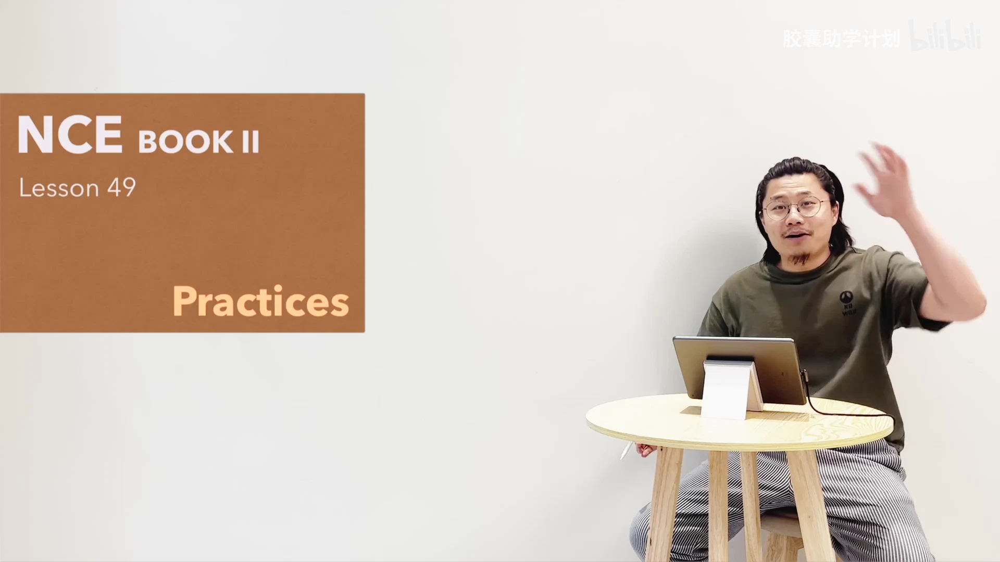

文字识别：NCE / BOOK I"I / Lesson 49 / Practices

### 画面 00:00:02

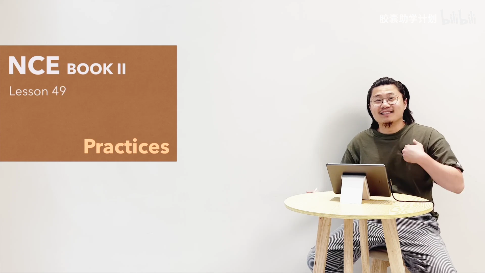

文字识别：NCE / BOOK I"I / Lesson 49 / Practices

### 画面 00:00:06

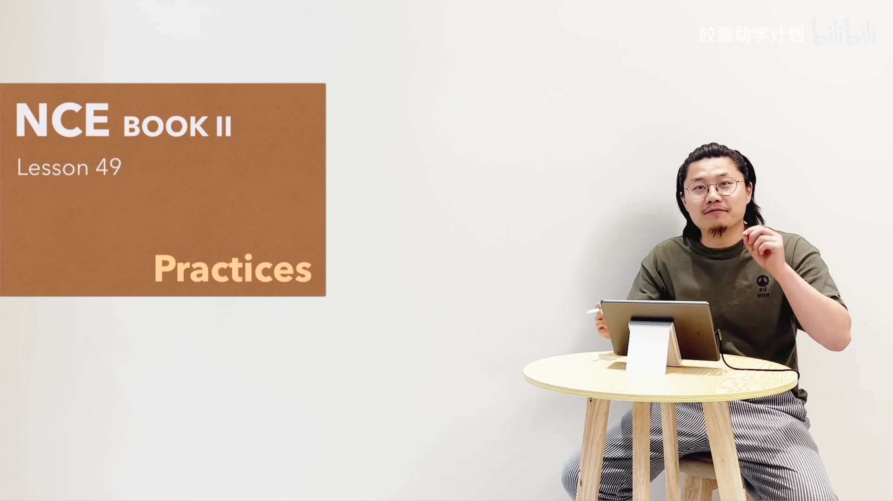

文字识别：NCE / BOOKII / Lesson 49 / Practices / WIR

### 画面 00:00:08

文字识别：进行如下练习唯一前提 / 文章跟读至熟读成诵 / 否则请勿开始 / NU / AR

### 画面 00:00:18

文字识别：胶囊助学计划bill / •

### 画面 00:00:21

文字识别：胶囊助学计划 / 胶囊助学计划

### 画面 00:00:23

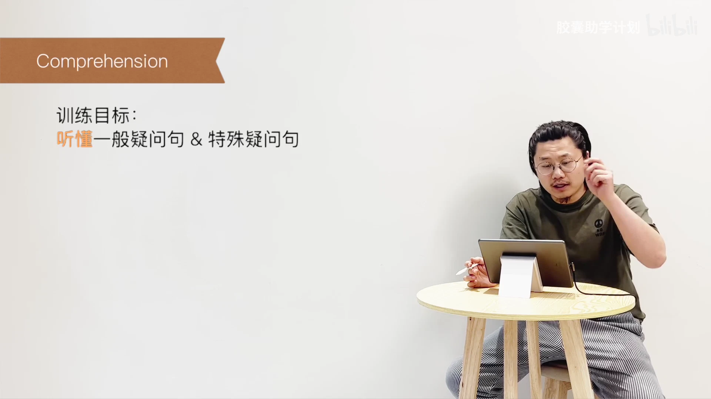

文字识别：Comprehension / 训练目标： / 听懂一般疑问句＆特殊疑问句

## 00:00:30–00:01:00

非常重要的一个能力，听力当中非常重要的一个能力。我问您答啊。Okay, first question: Who saved up for years? A young man intrepid. Next one: What did he save up to buy? A real bed. Next one: Why did he want

### 画面 00:00:30

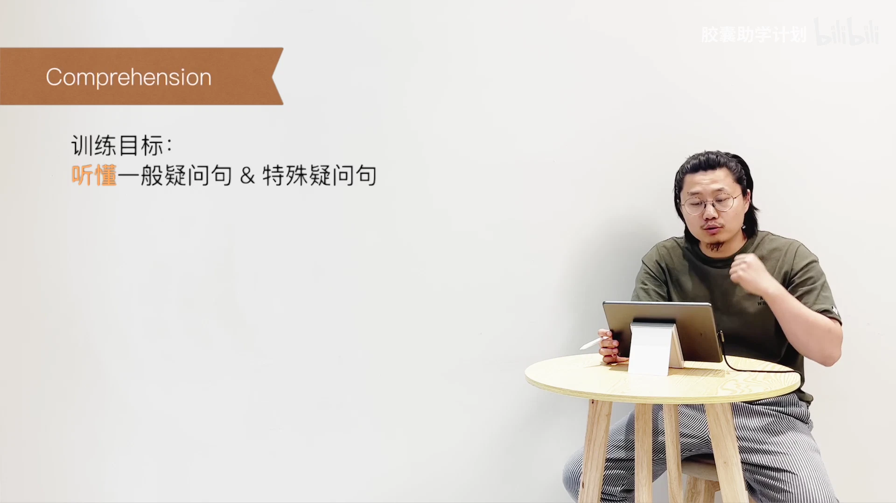

文字识别：Comprehension / 训练目标： / 听懂一般疑问句＆特殊疑问句

### 画面 00:00:37

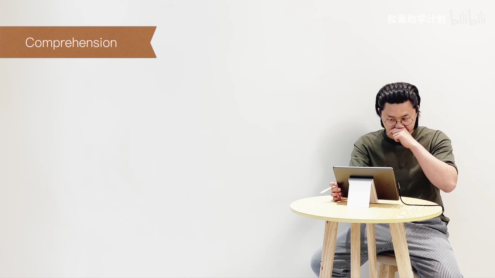

文字识别：Comprehension

### 画面 00:00:46

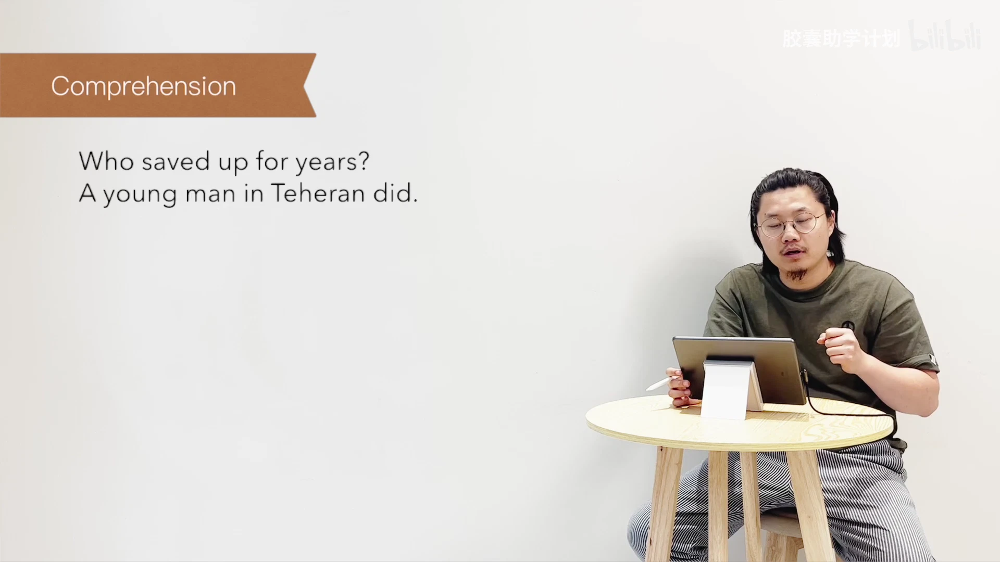

文字识别：Comprehension / Who saved up for years? / A young man in Teheran did.

## 00:01:00–00:01:30

He was tired of sleeping on the floor. Next one, did his bed have springs and a mattress? Yes, it did. Next one, where did he take his bed? Onto the roof of his house. Next one, why did he take it there? Because the weather was very hot.

### 画面 00:01:01

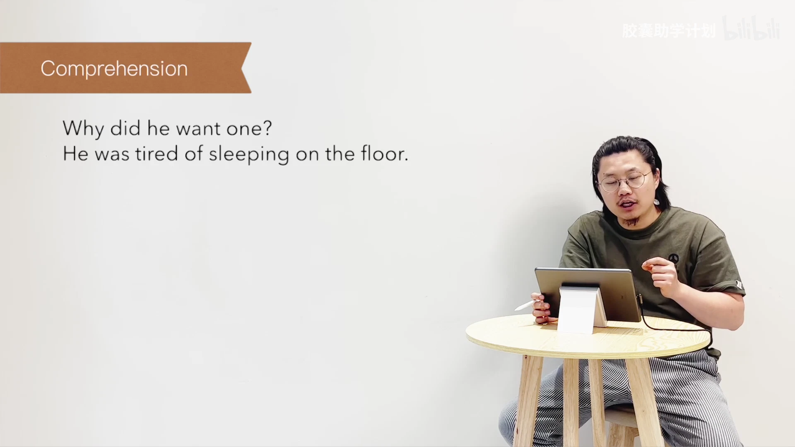

文字识别：Comprehension / Why did he want one? / He was tired of sleeping on the floor.

### 画面 00:01:05

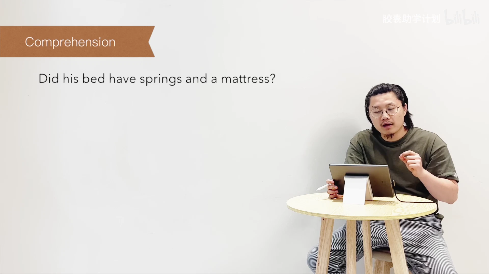

文字识别：Comprehension / Did his bed have springs and a mattress?

### 画面 00:01:17

文字识别：Comprehension / Where did he take his bed? / On to the roof of his house.

### 画面 00:01:25

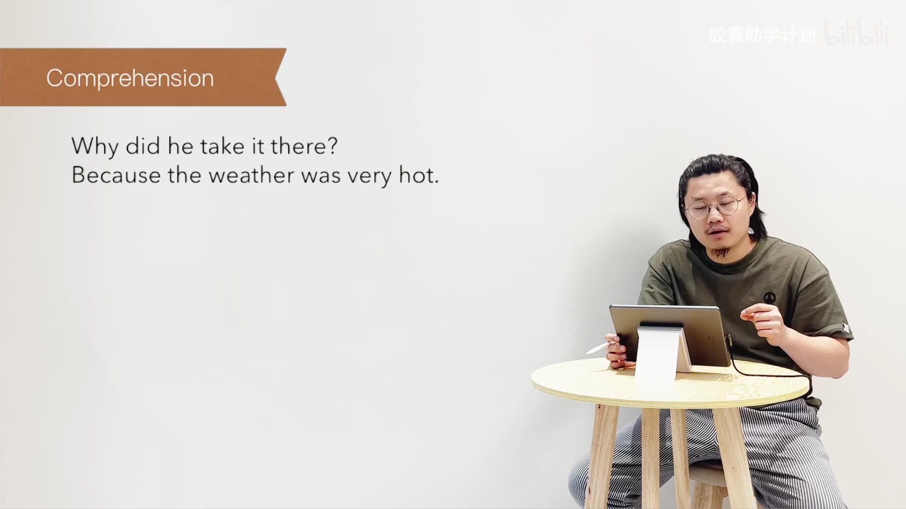

文字识别：Comprehension / Why did he take it there? / Because the weather was very hot.

## 00:01:30–00:02:00

How did he sleep at first? Very well. Next one. What happened on the third night? A storm blew it up. Next one. What swept the bed off the roof? A gust of wind. This did有没有都行啊. Next one. Where did it land? In the courtyard below.

### 画面 00:01:36

文字识别：Comprehension / What happened on the third night? / NU

## 00:02:00–00:02:30

Next one, when did the young man wake up? After the bed had struck the ground, or until the bed had struck the ground,都可以. Next one, was he hurt? No, he wasn't. What about the bed? It was mashed to pieces. Was the young man still on the mattress or on the ground?

### 画面 00:02:05

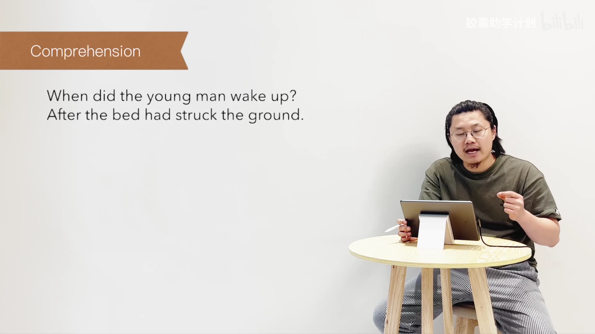

文字识别：Comprehension / When did the young man wake up? / After the bed had struck the ground.

### 画面 00:02:13

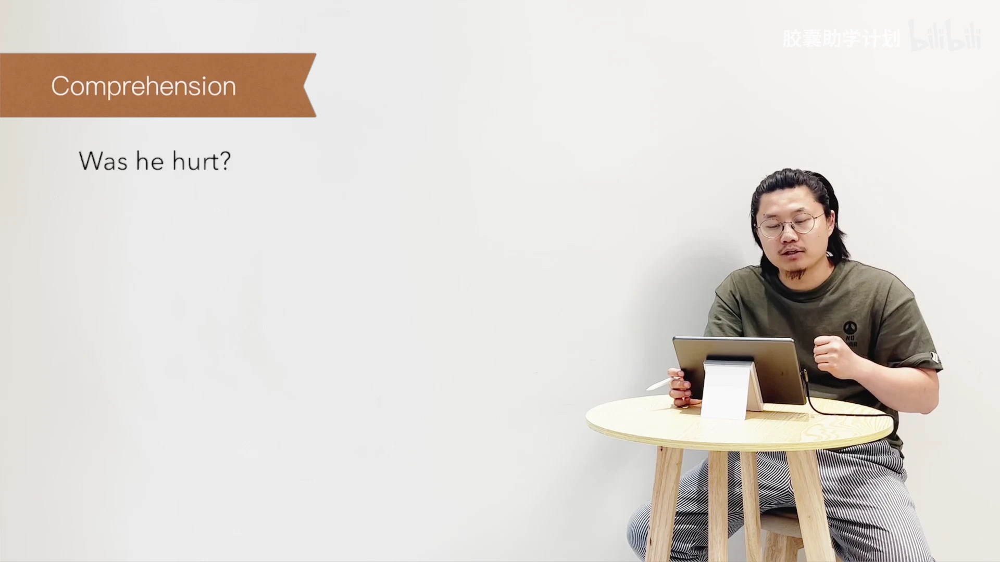

文字识别：Comprehension / Was he hurt?

### 画面 00:02:23

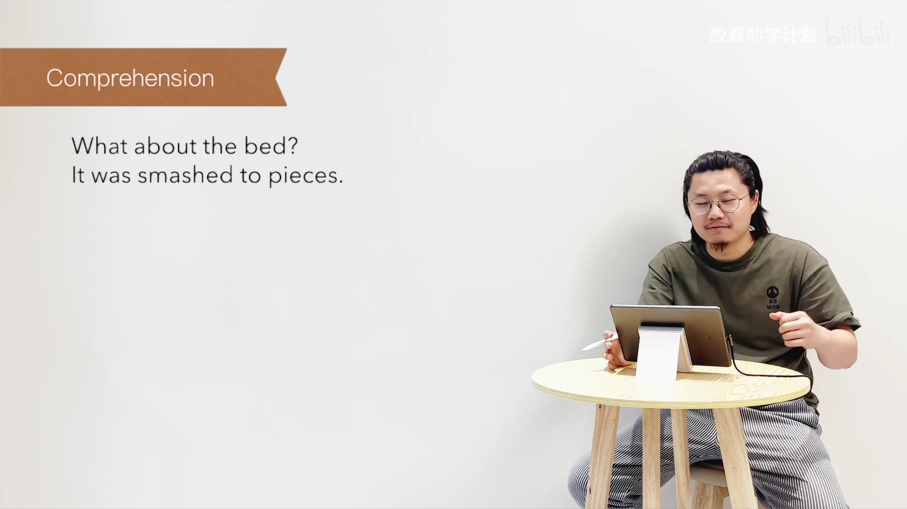

文字识别：Comprehension / What about the bed? / It was smashed to pieces. / NU / wii

### 画面 00:02:25

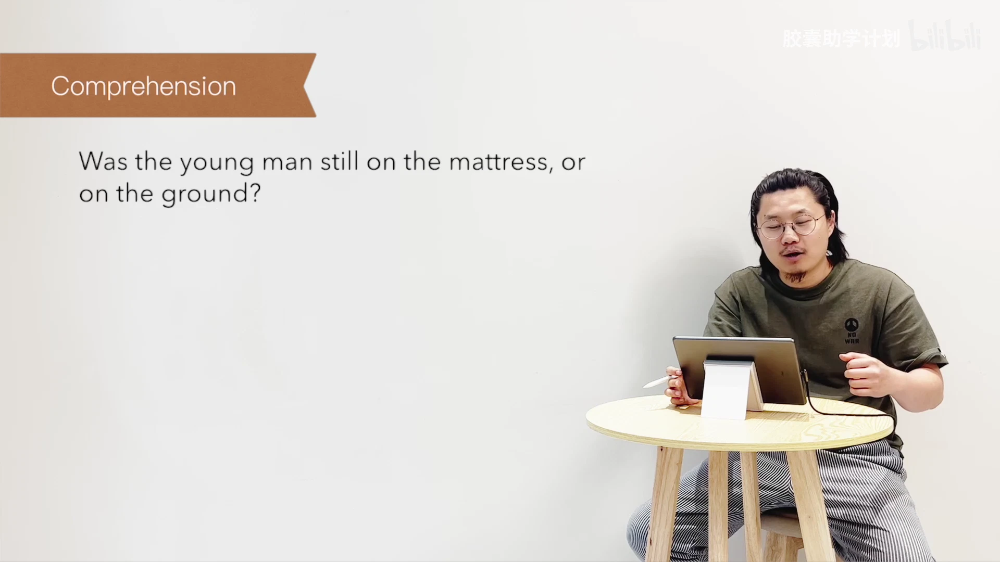

文字识别：Comprehension / Was the young man stillon the mattress, or / on the ground? / NO / WAR

## 00:02:30–00:03:00

on the mattress. Ah, very lucky. Asking questions.练习的是我们口语问别人问题的能力，对吧？我们不能只背句子，大多数背的文章和句子都是肯定句。我们要去练怎么变成一般疑问句和特殊疑问句，对吧？好，呃，第一题做一个示范啊。比如说，the young man lived in Tehran. Did提前动词换为原形啊？Where对in Tehran

### 画面 00:02:35

文字识别：Asking questions / 训练目标： / 会说一般疑问句＆特殊疑问句 / Accuracy / Fluency / NO

### 画面 00:02:38

文字识别：Asking questions / 训练目标： / 会说一般疑问句＆特殊疑问句 / Accuracy / Fluency / Nl. / WHA

### 画面 00:02:43

文字识别：Asking questions / 训练目标： / 会说一般疑问句＆特殊疑问句 / Accuracy / Fluency / NU / WIR

### 画面 00:02:50

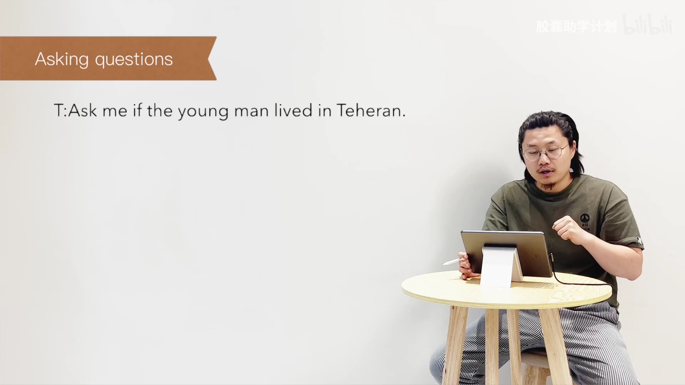

文字识别：Asking questions / T:Ask me if the young man lived in Teheran. / NU

## 00:03:00–00:03:30

提问，那叫做Where did the young man live？很简单啊，呃，第一题不多说了。第二题还是我们只提思路啊，只提思路，因为这个基础实际上是我们新一就有的基础啊。我们在这儿不会挨个说了。Was提前，What可以对什么提问呢？可以直接对Sleeping on the floor提问，叫做What was he tired of？他厌倦于什么事情了？听见了吧？这个事情叫Sleeping on the floor。Who就是对主语提问，不用变一般疑问句。

### 画面 00:03:00

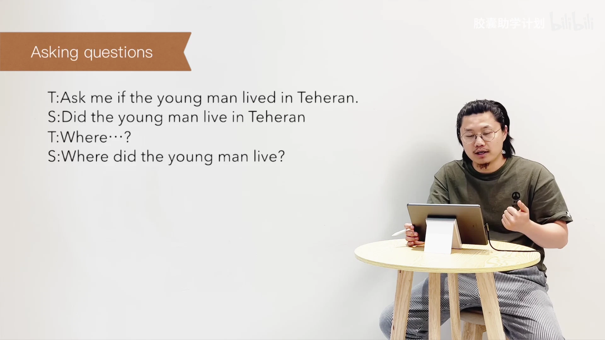

文字识别：Asking questions / T:Ask me if the young man lived in Teheran. / S:Did the young man live in Teheran / T:Where…? / S:Where did the young man live?

### 画面 00:03:04

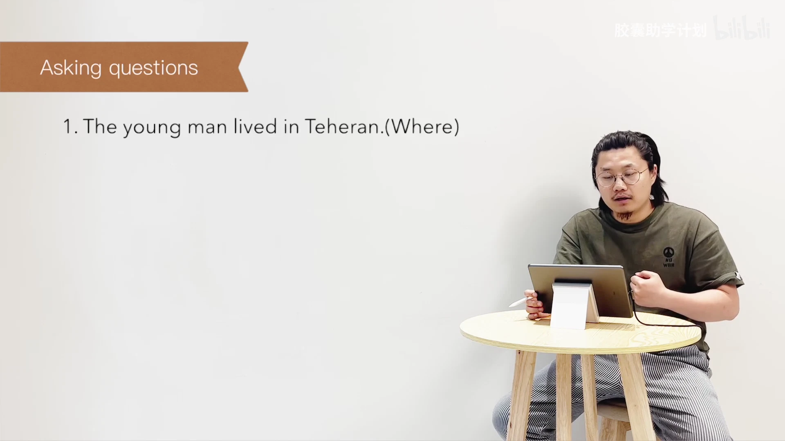

文字识别：Asking questions / 1. The young man lived in Teheran.(Where)

### 画面 00:03:07

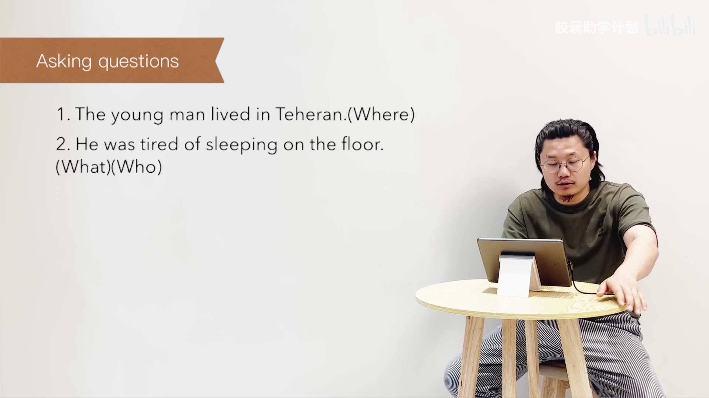

文字识别：Asking questions / 1. The young man lived in Teheran.(Where) / 2. He was tired of sleeping on the floor. / (What)(Who)

## 00:03:30–00:04:00

saved一般过去时 did提前 how long对 for years提问 why直接加整句 wanted did提前 what对 a real bed提问对吧所以答案是 what did he want to buy非常简单 why整句话啊呃注意整个是一般疑问句的整句话啊而不是整句直接加上肯定句啊叫做 why did he want to buy a real bed啊 he bought a bed with springs and mattress did提前 what kind注意

### 画面 00:03:36

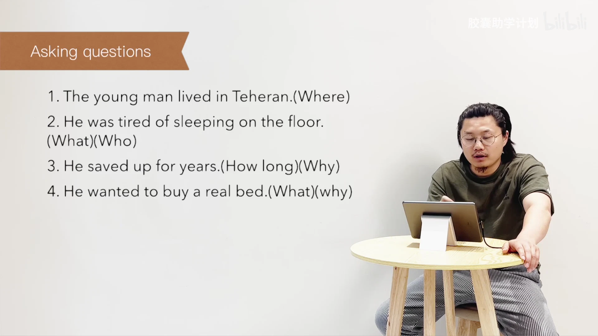

文字识别：Asking questions / 1. The young man lived in Teheran.(Where) / 2. He was tired of sleeping on the floor. / (What)(Who) / 3. He saved up for years.(How long)(Why) / 4. He wanted to buy a real bed.(What)(why)

### 画面 00:03:48

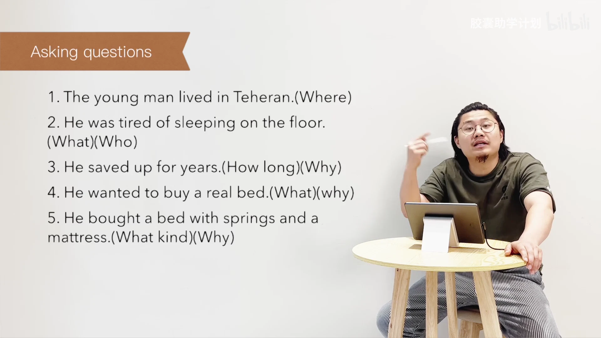

文字识别：Asking questions / 1. The young man lived in Teheran.(Where) / 2. He was tired of sleeping on the floor. / (What)(Who) / 3. He saved up for years.(How long)(Why) / 4. He wanted to buy a real bed.(What)(why) / 5. He bought a bed with springs and a / mattress.(What kind)(Why)

## 00:04:00–00:04:30

一般What kind都要加上of，就算他不给你，你自己也要加上，对吧？然后What kind of指的是什么类型的？你注意什么类型的床呢？答案叫做with springs and a mattress，对吧？所以你的答案叫What kind of bed did he buy？他买了一个什么类型的床呢？哎，有弹簧和有床垫的床，对吧？Why？整句话。The weather was very hot. Was往

### 画面 00:04:18

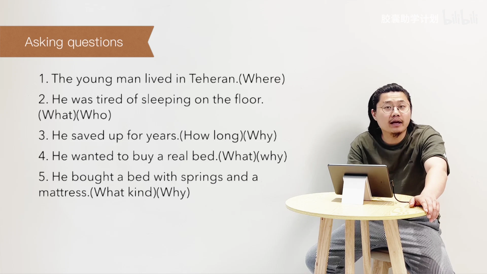

文字识别：Asking questions / 1. The young man lived in Teheran.(Where) / 2. He was tired of sleeping on the floor. / (What)(Who) / 3. He saved up for years.(How long)(Why) / 4. He wanted to buy a real bed.(What)(why) / 5. He bought a bed with springs and a / mattress.(What kind)(Why)

### 画面 00:04:26

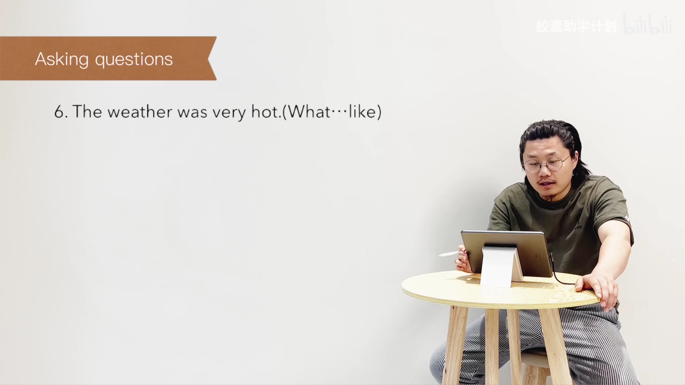

文字识别：Asking questions / 6. The weather was very hot.(What···like)

## 00:04:30–00:05:00

前一提啊，梦回新概念一册五十一课。What was the weather like? 是吧，Very hot. He carried his bed onto the roof. Did往前一提，Where to? 你看，to已经告诉你了，你就对the roof提问就行了呗，对吧？Okay. Uh, he slept very well. Did提前，How对very well提问啊？Who对主语提问？但是注意不要变一般疑问句了。新概念一册三十一课开始学，一直练到了今天，不应该再错了啊。

### 画面 00:04:47

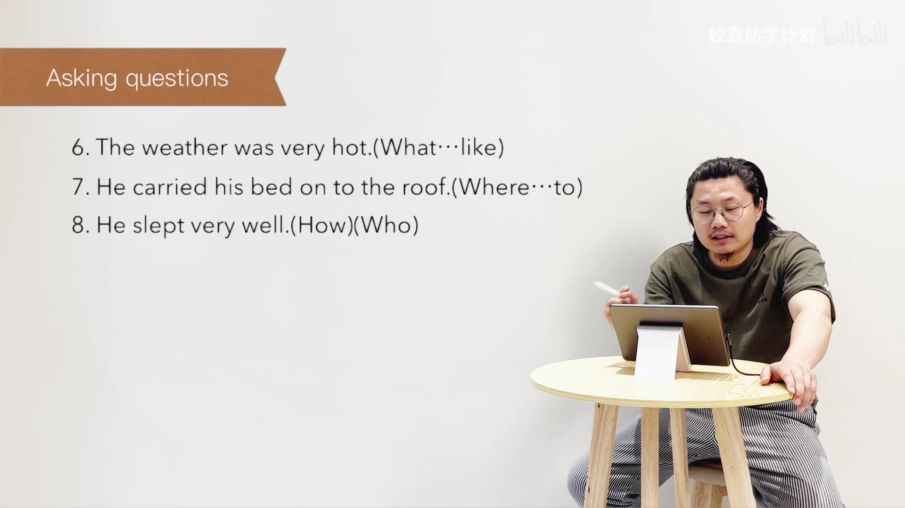

文字识别：Asking questions / 6. The weather was very hot.(What·…like) / 7. He carried his bed on to the roof.(Where·to) / 8. He slept very well.(How)(Who)

## 00:05:00–00:05:30

所以答案叫 Who slept very well, 对吧？不用变一般疑问句。A storm blow up on the third night, did 往前一提完事儿了。When 对 on the third night 提问啊，中规中矩。A gust wind swept the bed off the roof, did 往前一提，动词换回原形。What 你可以对 the bed 提问，也可以对 a gust of wind 提问，但是我觉得对 a gust wind 提问有点怪。什么把这个床刮刮刮刮

### 画面 00:05:12

文字识别：Asking questions / 6. The weather was very hot.(What·…like) / 7. He carried his bed on to the roof.(Where·to) / 8. He slept very well.(How)(Who) / 9.A storm blew up on the third night.(When) / 10.A gust of wind swept the bed off the roof. / (What)(When)

## 00:05:30–00:06:00

下了这个房顶是吧？呃，除了大自然的风还有什么？是吧？妖术吗？是吧？所以你直接对 the bad 提问可能好一点啊。问直接加整句没有问题啊。It landed in the courtyard. 这个 landed 对于各位来说也许是个生词。land 名词呢一般指的是土地，但是你看它放在了动词，包括后边还加了 e d 变成了过去式，对吧？它指的是着陆啊，飞机着陆啊等等啊。然后这个 landed 那地的提

### 画面 00:05:42

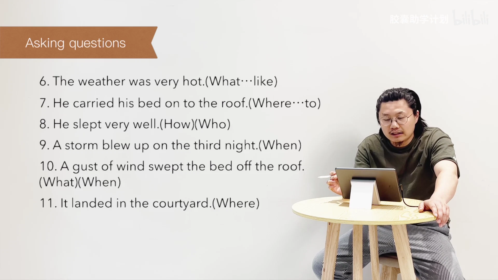

文字识别：Asking questions / 6. The weather was very hot.(What·like) / 7. He carried his bed on to the roof.(Where·to) / 8. He slept very well.(How)(Who) / 9.A storm blew up on the third night.(When) / 10.A gust of wind swept the bed off the roof. / (What)(When) / 11. It landed in the courtyard.(Where)

### 画面 00:05:46

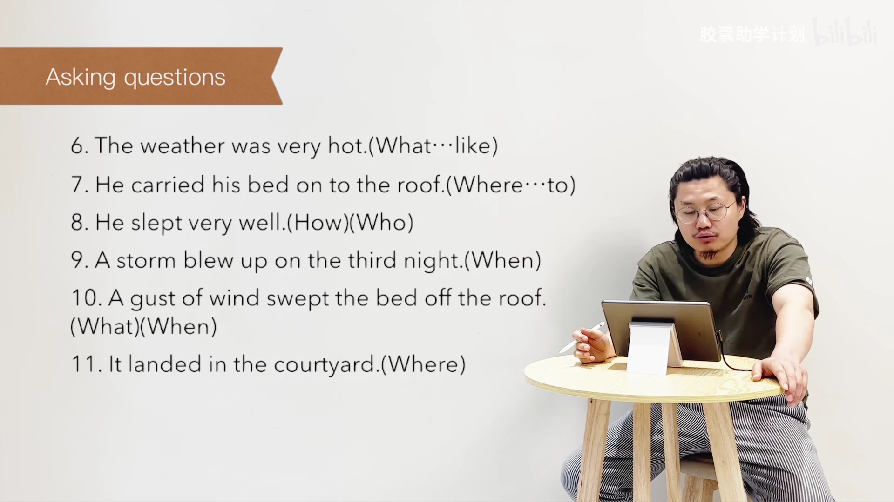

文字识别：Asking questions / 6. The weather was very hot.(What·like) / 7. He carried his bed on to the roof.(Where·to) / 8. He slept very well.(How)(Who) / 9.A storm blew up on the third night.(When) / 10.A gust of wind swept the bed off the roof. / (What)(When) / 11. It landed in the courtyard.(Where)

### 画面 00:05:51

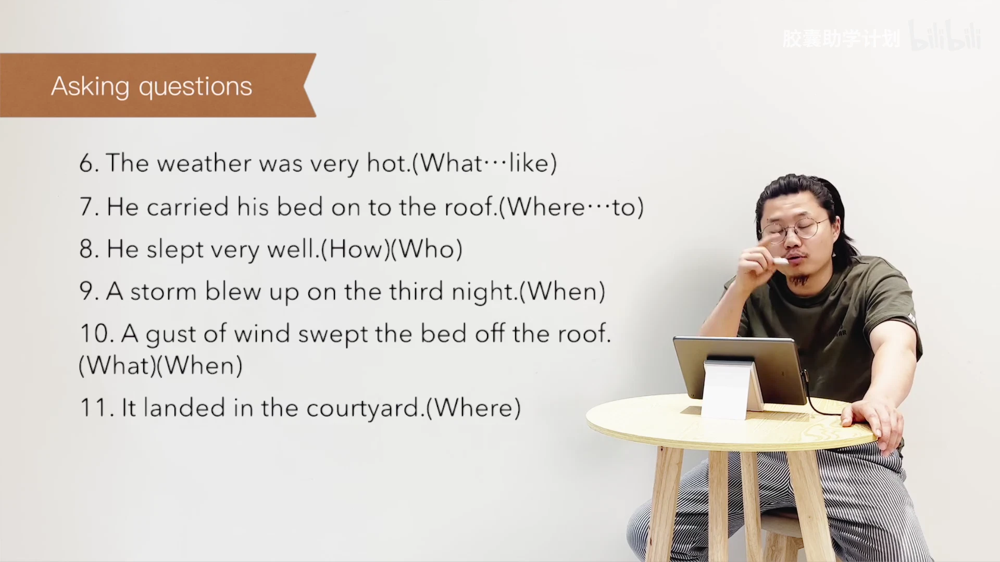

文字识别：Asking questions / 6. The weather was very hot.(What·…like) / 7. He carried his bed on to the roof.(Where·to) / 8. He slept very well.(How)(Who) / 9.A storm blew up on the third night.(When) / 10.A gust of wind swept the bed off the roof. / (What)(When) / 11. It landed in the courtyard.(Where)

## 00:06:00–00:06:30

前呗？ Where 对？ In the courtyard 提问，对吧？ Where did it land？啊，它落在了什么地方？好， asking question 结束。 Tell the story。第一单元我进行了大量的 tell the story 的这个展示，对吧？这个地方我们不重准确性，重的是流利性，听见了吧？所以你文章熟读成诵，看着这些关键的呃单词啊，我们去进行复述，这个事儿就结束了，好吧？

### 画面 00:06:06

文字识别：Tell the story / 训练目标： / 口语复述能力 / Accuracy / Fluency

### 画面 00:06:19

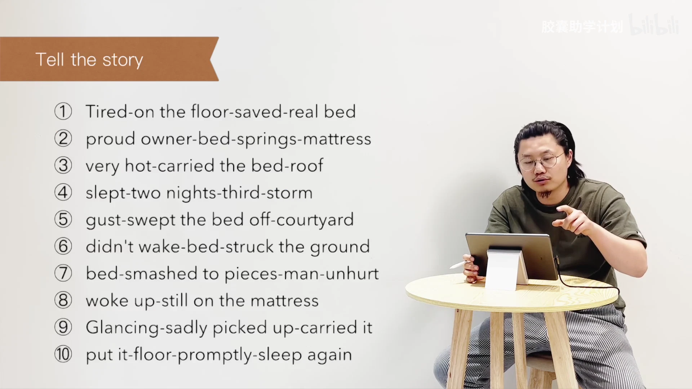

文字识别：Tell the story / Tired-on the floor-saved-real bed / proud owner-bed-springs-mattress / very hot-carried the bed-roof / 3 / 4 / slept-two nights-third-storm / gust-swept the bed off-courtyard / 5 / didn't wake-bed-struck the ground / 6 / 9 bed-smashed to pieces-man-unhurt / woke up-still on the mattress / 8 / Glancing-sadly picked up-carried it / 9 / 1⑩ put it-floor-promptly-sleep again

### 画面 00:06:23

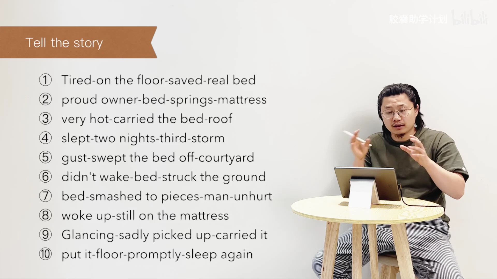

文字识别：Tell the story / Tired-on the floor-saved-real bed / 1 / proud owner-bed-springs-mattress / very hot-carried the bed-roof / 3 / 4 / slept-two nights-third-storm / gust-swept the bed off-courtyard / 5 / didn't wake-bed-struck the ground / 6 /  bed-smashed to pieces-man-unhurt / 7 / 8 / woke up-still on the mattress / Glancing-sadly picked up-carried it / 9 / 1① put it-floor-promptly-sleep again

### 画面 00:06:28

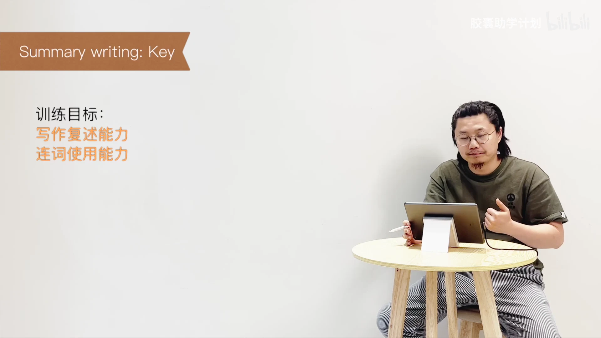

文字识别：Summary writing: Key / 训练目标： / 写作复述能力 / 连词使用能力

## 00:06:30–00:07:00

writing，注意一个小点和第一单元、第二单元稍有不同了。它开始不仅帮助我们去练习写作了，开始也让我们去练习连词的使用了，对吧？各位去认真看摘要写作，认真去写。写完了之后，来这里对答案，或者去看置顶留言啊。置顶留言里面有一个更方便的途径，让各位去对答案。好吧，OK，呃，topic for discussion还是它是我们所有练习最终的目的，就是围绕

### 画面 00:06:46

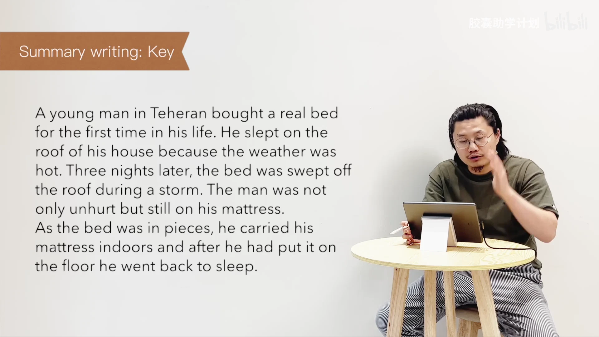

文字识别：Summary writing: Key / A young man in Teheran bought a real bed / for the first time in his life. He slept on the / roof of his house because the weather was / hot. Three nights later, the bed was swept off / the roof during a storm. The man was not / only unhurt but still on his mattress. / As the bed was in pieces, he carried his / mattress indoors and after he had put it on / the floor he went back to sleep.

### 画面 00:06:49

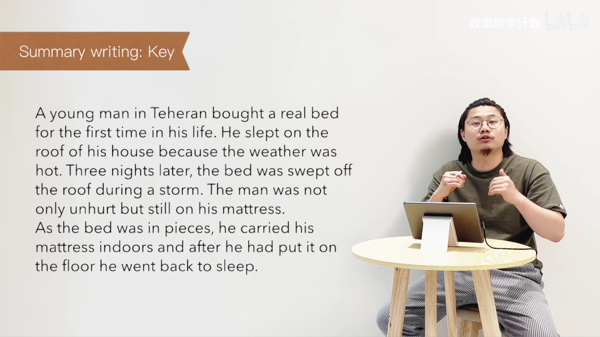

文字识别：Summary writing: Key / A young man in Teheran bought a real bed / for the first time in his life. He slept on the / roof of his house because the weather was / hot. Three nights later, the bed was swept off / the roof during a storm. The man was not / only unhurt but still on his mattress. / As the bed was in pieces, he carried his / mattress indoors and after he had put it on / the floor he went back to sleep.

### 画面 00:06:53

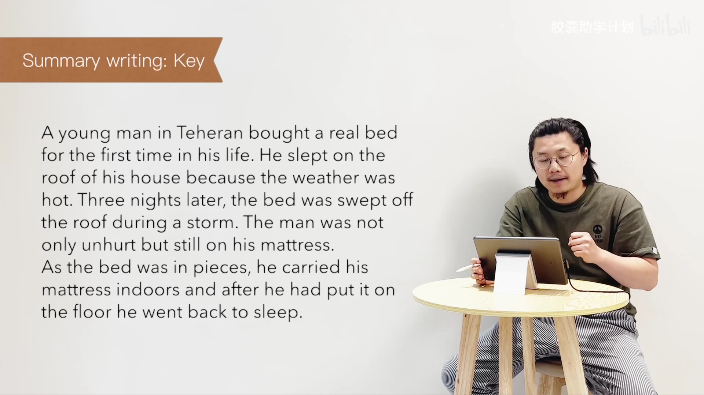

文字识别：Summary writing: Key / A young man in Teheran bought a real bed / for the first time in his life. He slept on the / roof of his house because the weather was / hot. Three nights later, the bed was swept off / the roof during a storm. The man was not / only unhurt but still on his mattress. / NU / As the bed was in pieces, he carried his / mattress indoors and after he had put it on / the floor he went back to sleep.

### 画面 00:06:55

文字识别：Topics for discussion / 训练目标： / 完全自由的对话 / Accuracy / W / Fluency

### 画面 00:06:59

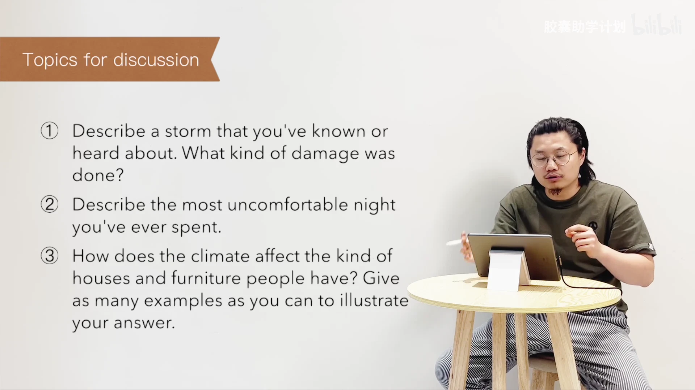

文字识别：Topics for discussion / Describe a storm that you've known or / heard about. What kind of damage was / done? / Describe the most uncomfortable night / you've ever spent. / How does the climate affect the kind of / houses and furniture people have? Give / as many examples as you can to illustrate / your answer.

## 00:07:00–00:07:30

着任何一个话题，要么去写东西，要么去跟别人流利的聊天，对吧？啊，我们就看一下，我们现在没有办法去进行大面积的练习，但是我们要熟悉这些话题。比如说，describe a storm that you've known or heard about，描述一个暴风雨，对吧？你你你知道的或听过的。What kind of damage was that？什么类型的伤啊？这个这个破坏造成了。Describe the most uncomfortable night you've ever spent。描述一

### 画面 00:07:29

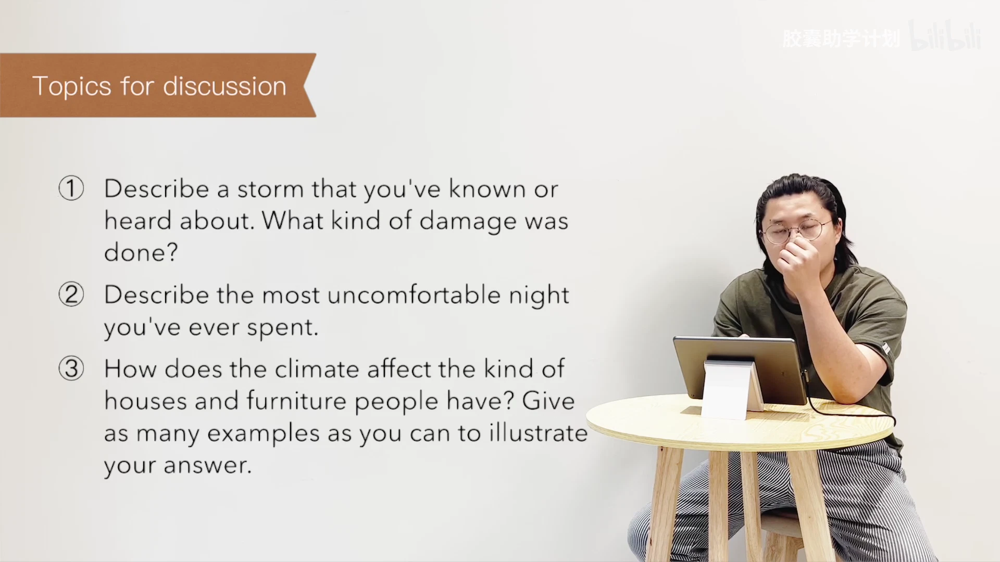

文字识别：Topics for discussion / Describe a storm that you've known or / heard about. What kind of damage was / done? / Describe the most uncomfortable night / you've ever spent. / How does the climate affect the kind of / houses and furniture people have? Give / as many examples as you can to illustrate / your answer.

## 00:07:30–00:08:00

ever spent. Describe one night you've ever spent. Describe one night you've ever spent. Describe one night you've ever spent. Describe one night you've ever spent. Describe one night you've ever spent. Describe one night you've ever spent. Describe one night you've ever spent. Describe one night you've ever spent. Describe one night you've ever spent. Describe one night you've ever spent. Describe one night you've ever spent. Describe one night you've ever spent. Describe one night you've ever spent. Describe one night you've ever spent. Describe one night you've ever spent. Describe one night you've ever spent. Describe one night you've ever spent. Describe one night you've ever spent. Describe one night you've ever spent. Describe one night you've ever spent. Describe one night you've ever spent. Describe one night you've ever

### 画面 00:07:59

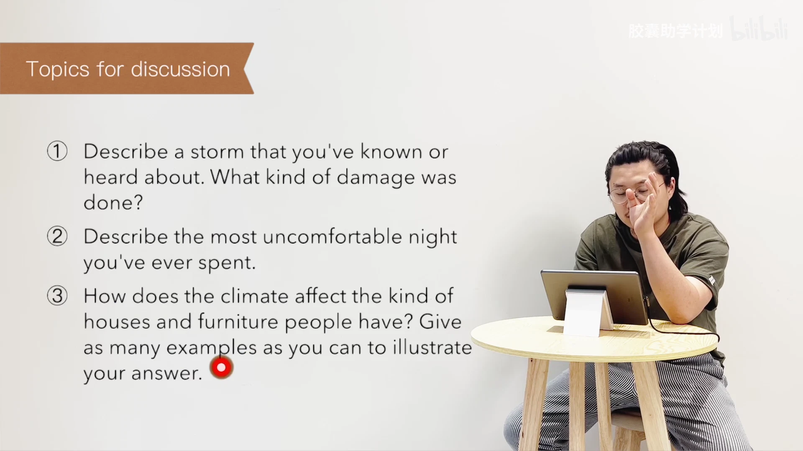

文字识别：Topics for discussion / Describe a storm that you've known or / heard about. What kind of damage was / done? / Describe the most uncomfortable night / you've ever spent. / How does the climate affect the kind of / houses and furniture people have? Give / as many examples as you can to illustrate / your answer.

## 00:08:00–00:08:30

的这个例子去证明你的这个啊，去证明你的这个答案对吧？哎，去说明你的这个答案。OK，好，那不多说了。讲作业，Ask me if先写再朗读摘要写作，先写然后来到刚才我说置顶留言去找，然后去对答案对吧？当然来这儿对答案也可以。Tell the story口语复述重复间隔置顶留言自己去看好吧。OK，那以上呢就是本期

### 画面 00:08:10

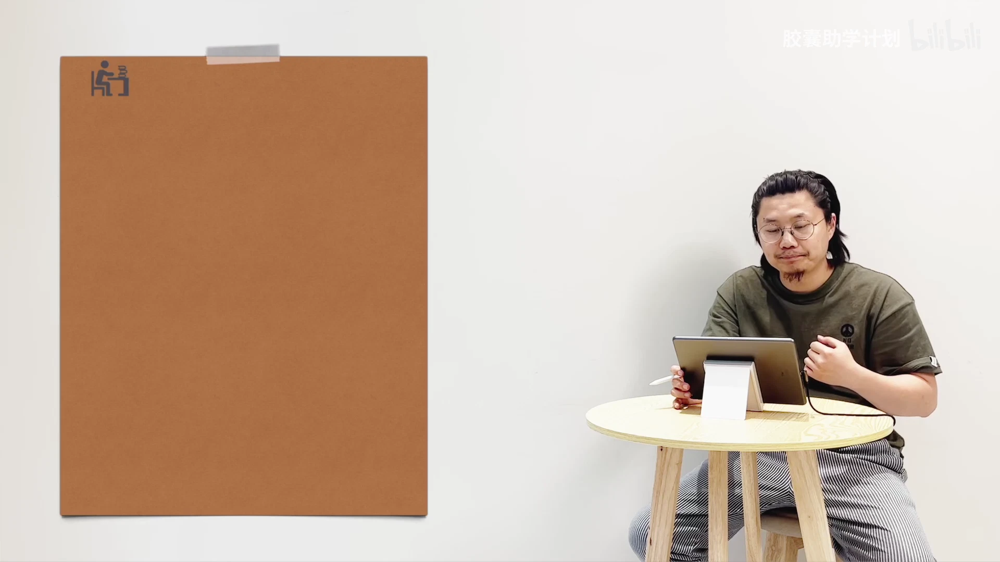

### 画面 00:08:13

文字识别：1.Ask me if写&朗读 / 2.摘要写作写&答案 / WIIR

### 画面 00:08:15

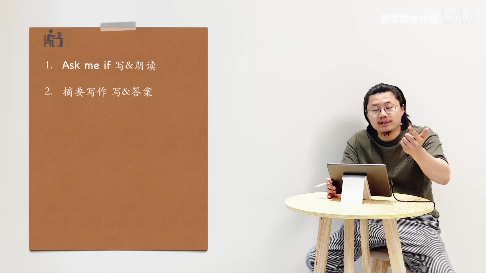

文字识别：1.Ask me if写&朗读 / 2.摘要写作写&答案

### 画面 00:08:20

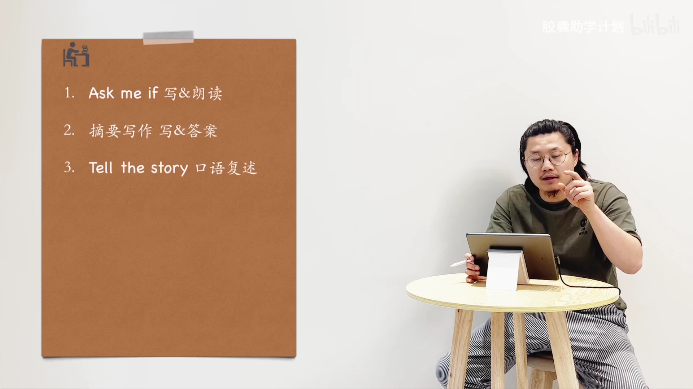

文字识别：1.Askme if写&朗读 / 摘要写作写&答案 / 3.Tell the story 口语复述

### 画面 00:08:24

文字识别：1.Ask me if写&朗读 / 摘要写作写&答案 / 3.Tell the story 口语复述 / 4.重复间隔（置顶留言）

### 画面 00:08:26

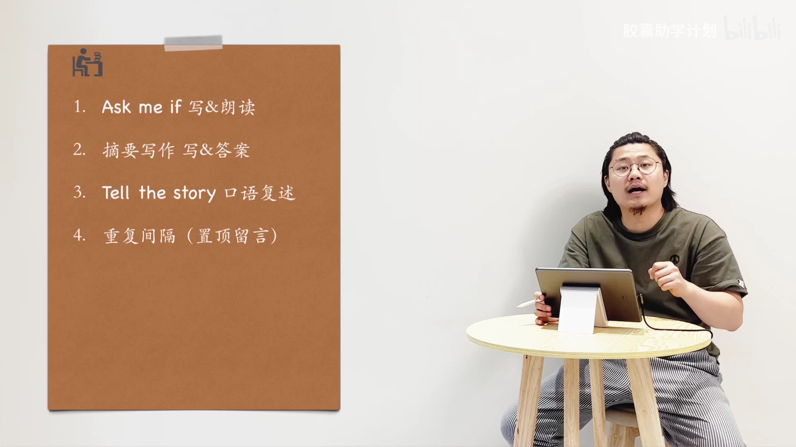

文字识别：1.Ask me if写&朗读 / 摘要写作写&答案 / 3.Tell the story 口语复述 / 4.重复间隔（置顶留言）

### 画面 00:08:28

文字识别：不

## 00:08:30–00:08:54

视频的全部内容了。如果各位喜欢我们的课程呢，欢迎各位关注啊、订阅、一键三连，分享给那些需要的朋友，来帮助我们快速成长。See you next time.

### 画面 00:08:34

### 画面 00:08:41

### 画面 00:08:43

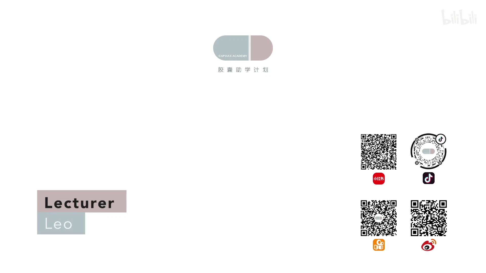

文字识别：CAPSULEACADEMY / 胶囊助学计划 / 小红书 / Lecturer / 口 / Leo / OE

### 画面 00:08:46

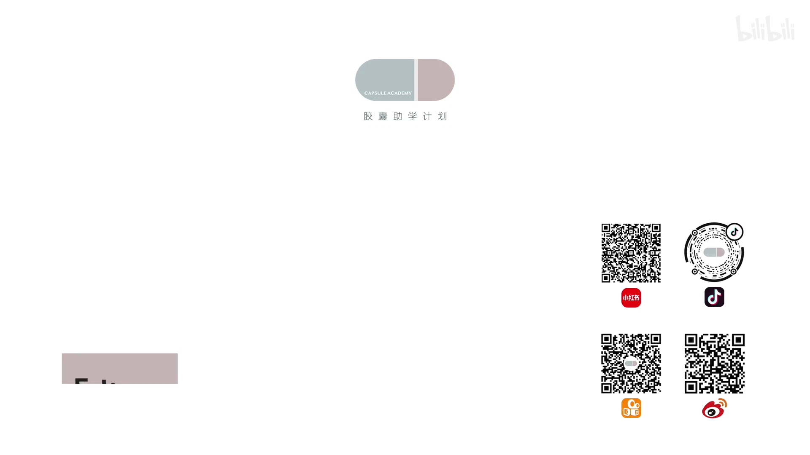

文字识别：CAPSULEACADEMY / 胶囊助学计划 / 小红书

### 画面 00:08:49

文字识别：CAPSULEACADEMY / 胶囊助学计划 / 小红书 / Creator / Leo & Berlin / OE

### 画面 00:08:51

文字识别：bilbili / 胶囊助学计划 / CAPSULEACADEMY / 胶囊助学计划 / 小红书 / OE

### 画面 00:08:53

文字识别：bilibili / 胶囊助学计划

