# 050 单词

快速机器解析：语音为单模型转写，未进行独立交叉校对或人工复核；画面每秒采样并按变化选帧，短时文字和标记可能遗漏。截图时间约有 1 秒误差。图片有损压缩；遇到疑点请按时间查看 Google Drive 原视频。

## 00:00:00–00:00:30

Hello everyone, welcome to Capsule Academy. This is Leo. Today we're going to learn New Concept English Book Two, Lesson Fifty Words.那老习惯进入正式课程之前，咱们先看几个小的问题啊。首先，如何表达骑车或者骑马啊？接下来呢，如何表达短距离的旅行，或者咱们管它叫做郊游吧？OK。那第三个，如何表达饱览美景？OK。那带着这三个问题，Hope you can enjoy.

### 画面 00:00:00

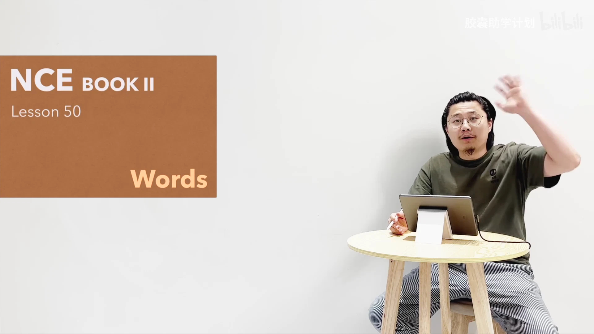

文字识别：NCE / BOOK II / Lesson 50 / Words

### 画面 00:00:02

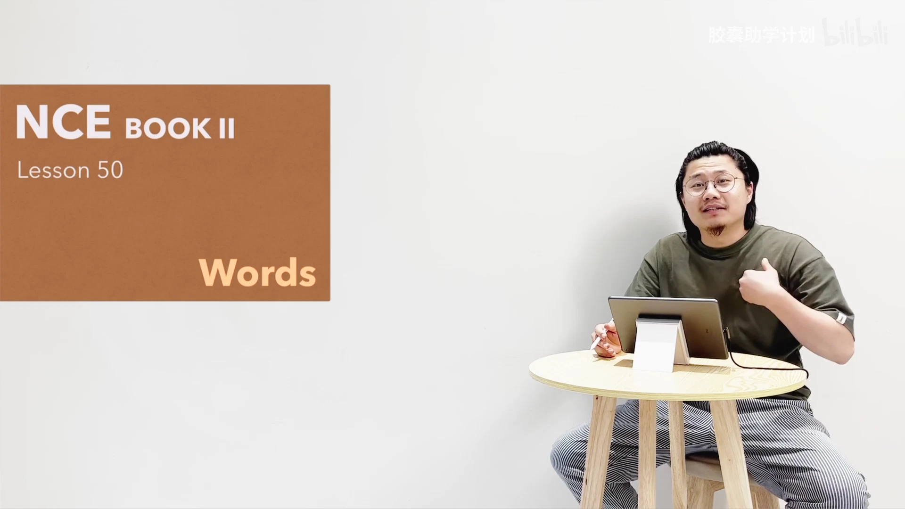

文字识别：NCE / BOOK II / Lesson 50 / Words

### 画面 00:00:04

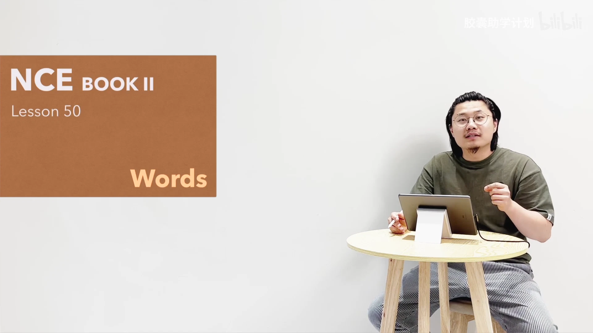

文字识别：NCE / BOOK"I / Lesson 50 / Words

### 画面 00:00:06

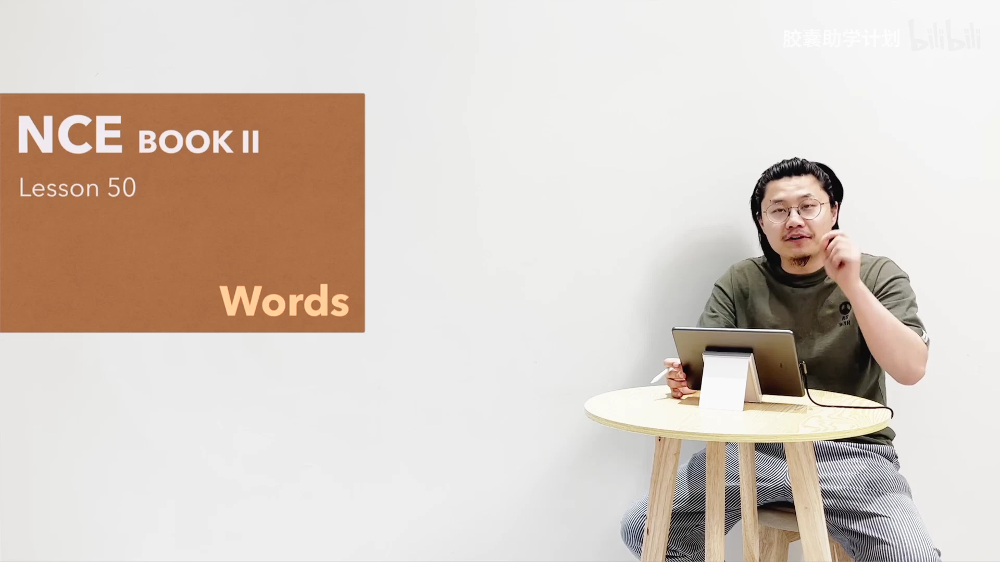

文字识别：NCE / BOOKI"I / Lesson 50 / Words

### 画面 00:00:10

文字识别：WOH

### 画面 00:00:12

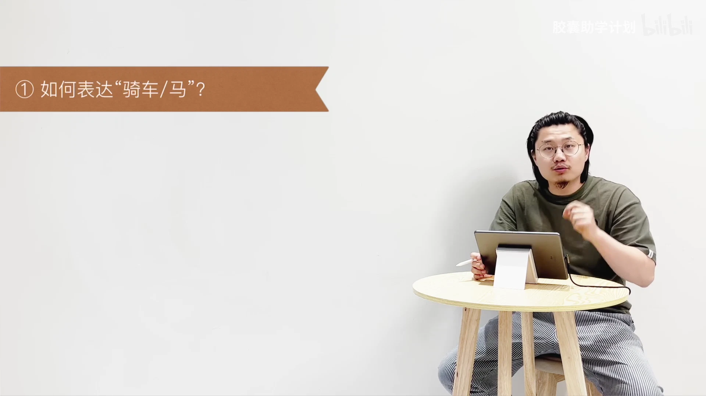

文字识别：①如何表达“骑车/马”？

### 画面 00:00:15

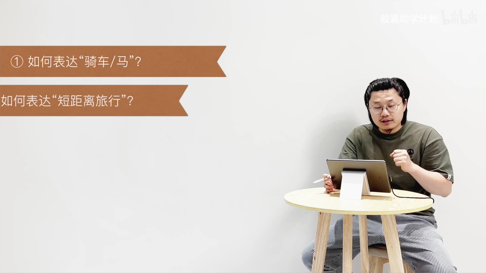

文字识别：①如何表达“骑车/马”？ / 如何表达“短距离旅行”?

### 画面 00:00:17

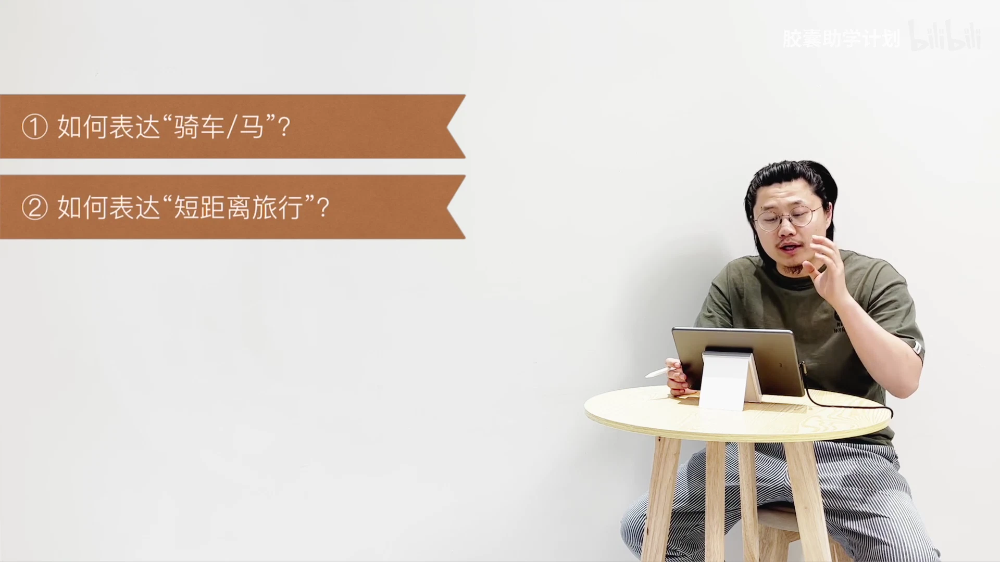

文字识别：①如何表达“骑车/马”? / 如何表达“短距离旅行”?

### 画面 00:00:21

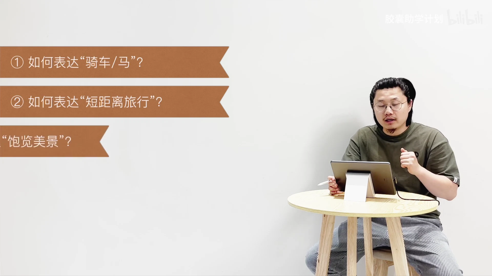

文字识别：①如何表达“骑车/马”? / 如何表达“短距离旅行”? / “饱览美景”?

### 画面 00:00:23

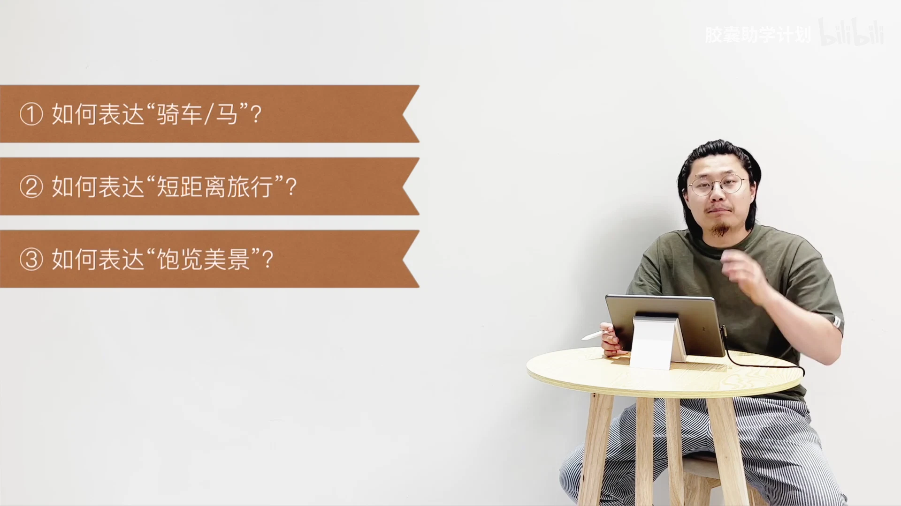

文字识别：①如何表达“骑车/马”? / 如何表达“短距离旅行”? / 如何表达“饱览美景”?

### 画面 00:00:25

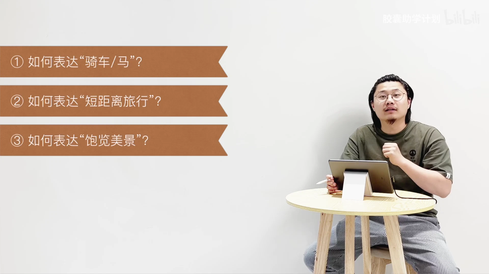

文字识别：①如何表达“骑车/马”? / 如何表达“短距离旅行”? / 如何表达“饱览美景”? / NU

### 画面 00:00:28

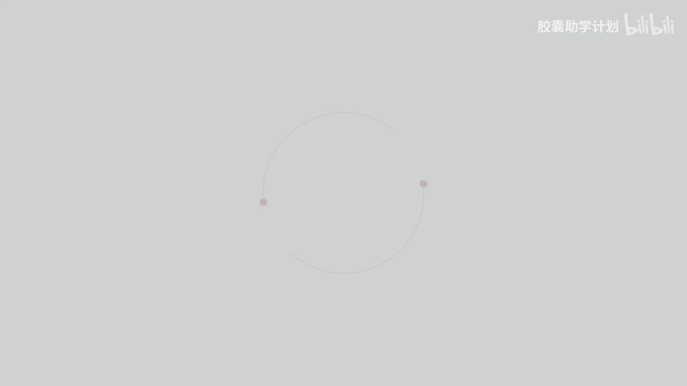

文字识别：胶囊助学计划bll / •

## 00:00:30–00:01:00

好，那我们先看第一个单词啊，看着音标，我们一起读一下，叫做 ride ride。注意，在我们原文当中啊，它实际上是在标题当中出现的，对吧？它是一个名词啊，ride 啊，旅行。其实它更常用的一个含义呢，或者说一个词性呢，是动词啊，所以它有过去式、过去分词 rode and ridden，对吧？OK，它分别表示的意思呢，刚才我说了，名词

### 画面 00:00:32

### 画面 00:00:34

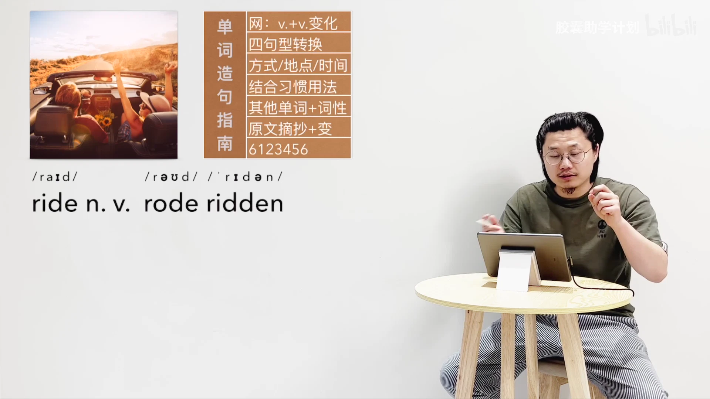

文字识别：单词造句指南 / 网：v.+v.变化 / 四句型转换 / 方式/地点/时间 / 结合习惯用法 / 其他单词+词性 / 原文摘抄+变 / 6123456 / /raid/ / /raud/ /'ridan/ / ride n. v. rode ridden / NU / WAR

### 画面 00:00:36

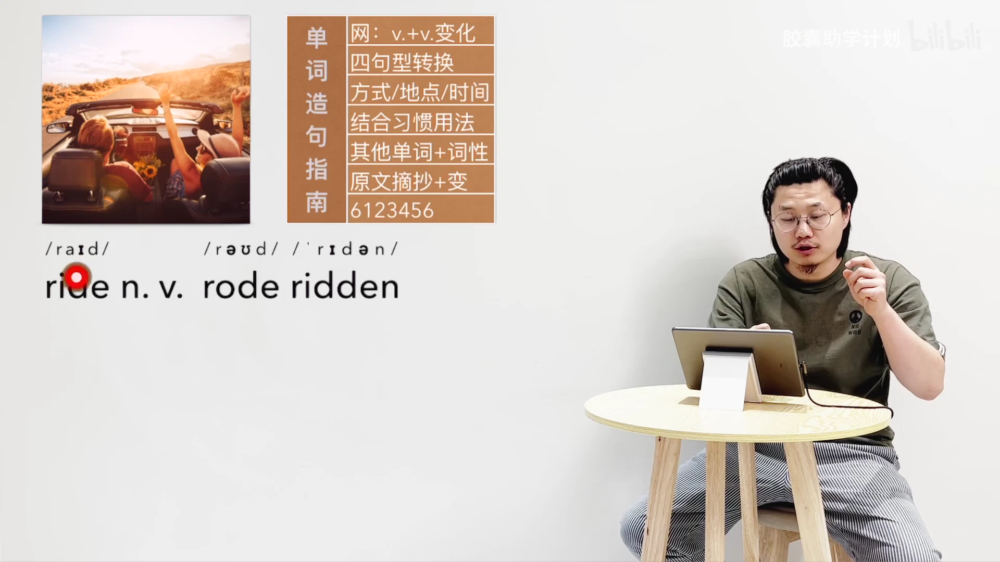

文字识别：单词造句指南 / 网：v.+v.变化 / 四句型转换 / 方式/地点/时间 / 结合习惯用法 / 其他单词+词性 / 原文摘抄+变 / 6123456 / /raid/ / /raud/ /'ridan/ / ride n. v. rode ridden / NII / WNR

### 画面 00:00:40

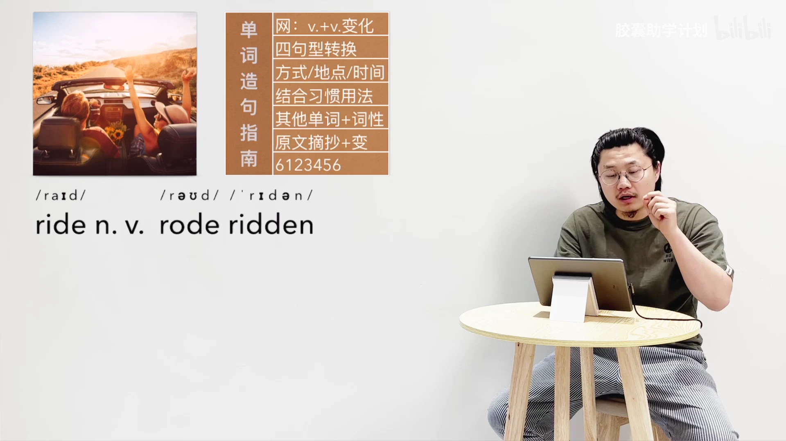

文字识别：单词造句指南 / 网：v.+v.变化 / 四句型转换 / 方式/地点/时间 / 结合习惯用法 / 其他单词+词性 / 原文摘抄+变 / 6123456 / /raid/ / /raud/ /'ridan/ / ride n. v. rode ridden / NO / WAR

### 画面 00:00:46

文字识别：单词造句指南 / 网：v.+v.变化 / 四句型转换 / 方式/地点/时间 / 结合习惯用法 / 其他单词+词性 / 原文摘抄+变 / 6123456 / /raid/ / /raud/ /'ridan/ / ride n. v. rode ridden / NU / WIIR

### 画面 00:00:50

文字识别：单词造句指南 / 网：v.+v.变化 / 四句型转换 / 方式/地点/时间 / 结合习惯用法 / 其他单词+词性 / 原文摘抄+变 / 6123456 / /raid/ / /raud/ /'ridan/ / ride n. v. rode ridden / NO / WnR

### 画面 00:00:57

文字识别：单词造句指南 / 网：v.+v.变化 / 四句型转换 / 方式/地点/时间 / 结合习惯用法 / 其他单词+词性 / 原文摘抄+变 / 6123456 / /raid/ / /raud/ /'ridan/ / ride n. v. rode ridden

## 00:01:00–00:01:30

是旅行，那动词呢？它其实表示的是这个骑车骑马的意思。一会儿我们马上讲到啊。那我们先说一下标题，叫做 Taken for a Ride。 OK，这个标题它实际上标题上给的意思就是出去旅游一下，对不对？ OK，注意它本身其实是一个胖啊，英文当中啊，亚历山大很多的这种文章的标题都是胖胖，叫做双关，也就是说它自己啊是有两个含义的。那怎

### 画面 00:01:06

文字识别：单词造句指南 / 网：v.+v.变化 / 四句型转换 / 方式/地点/时间 / 结合习惯用法 / 其他单词+词性 / 原文摘抄+变 / 6123456 / /raid/ / /raud/ /'ridan/ / ride n. v. rode ridden / WIR / ① Taken for a ride...[pun]

### 画面 00:01:10

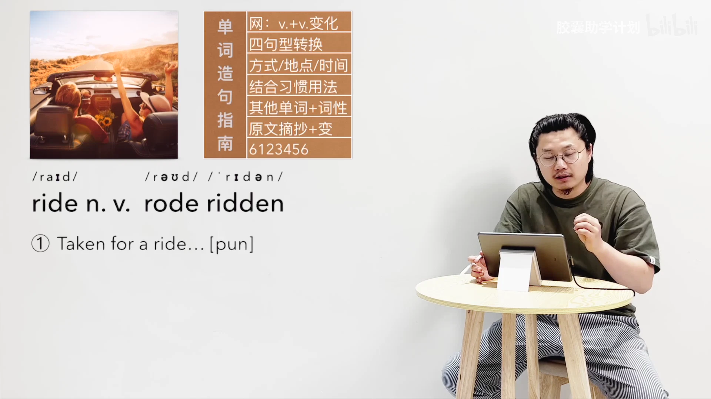

文字识别：单词造句指南 / 网：v.+v.变化 / 四句型转换 / 方式/地点/时间 / 结合习惯用法 / 其他单词+词性 / 原文摘抄+变 / 6123456 / /raid/ / /raud/ /'ridan/ / ride n. v. rode ridden / ① Taken for a ride... [pun]

### 画面 00:01:20

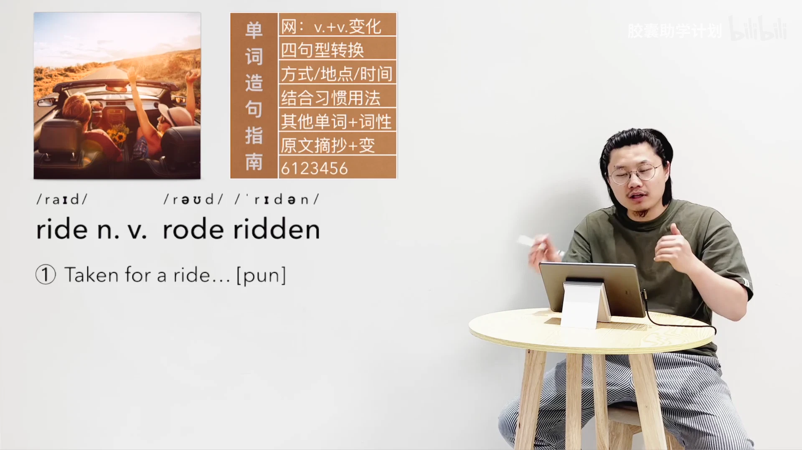

文字识别：单词造句指南 / 网：v.+v.变化 / 四句型转换 / 方式/地点/时间 / 结合习惯用法 / 其他单词+词性 / 原文摘抄+变 / 6123456 / /raid/ / /raud/ /'ridan/ / ride n. v. rode ridden / ① Taken for a ride... [pun]

### 画面 00:01:25

文字识别：单词造句指南 / 网：v.+v.变化 / 四句型转换 / 方式/地点/时间 / 结合习惯用法 / 其他单词+词性 / 原文摘抄+变 / 6123456 / /raid/ / /raud/ /'ridan/ / ride n. V. rode ridden / ① Taken for a ride... [pun]

## 00:01:30–00:02:00

么去进行这个解释呢？首先啊，其实我们课文注释已经给大家这个呃说了，是吧？那我们再给大家说一下，简单的拓展一点点啊。比如说，他讲到这样一个点，叫做 take a for b，叫做把 a 当作 b。这个对于各位来说不是最重要的啊。各位最重要的是它的一个应用，叫做 take it for granted。哦，把这四个单词放到一起，比如说口语当中很常用，叫 don't

### 画面 00:01:30

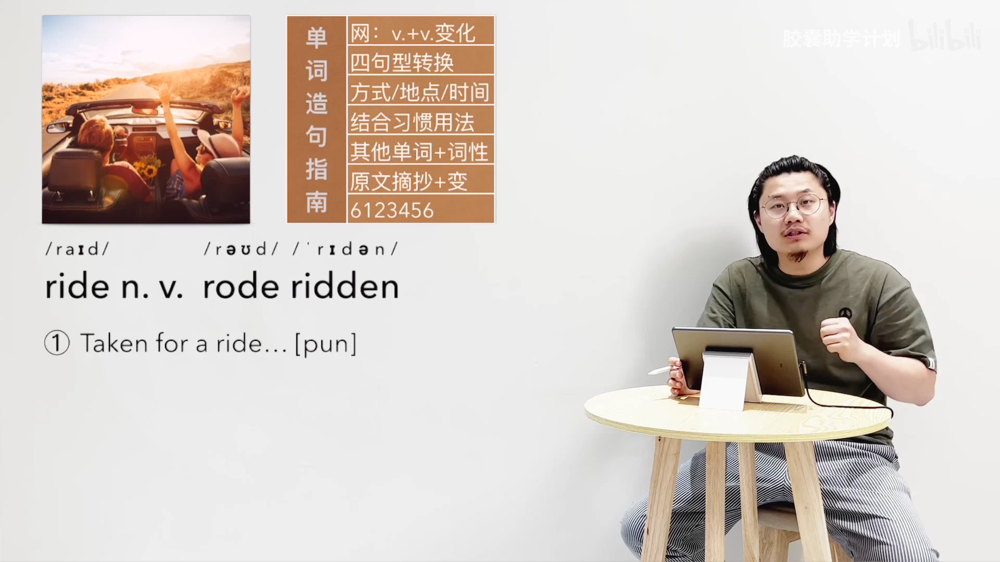

文字识别：单词造句指南 / 网：v.+v.变化 / 四句型转换 / 方式/地点/时间 / 结合习惯用法 / 其他单词+词性 / 原文摘抄+变 / 6123456 / /raid/ / /raud/ /'ridan/ / ride n. V. rode ridden / ① Taken for a ride...[pun]

### 画面 00:01:33

文字识别：单词造句指南 / 网：v.+v.变化 / 四句型转换 / 方式/地点/时间 / 结合习惯用法 / 其他单词+词性 / 原文摘抄+变 / 6123456 / /raid/ / /raud/ /'ridan/ / ride n. v. rode ridden / D Taken for a ride... [pun] / ① take a for b

### 画面 00:01:35

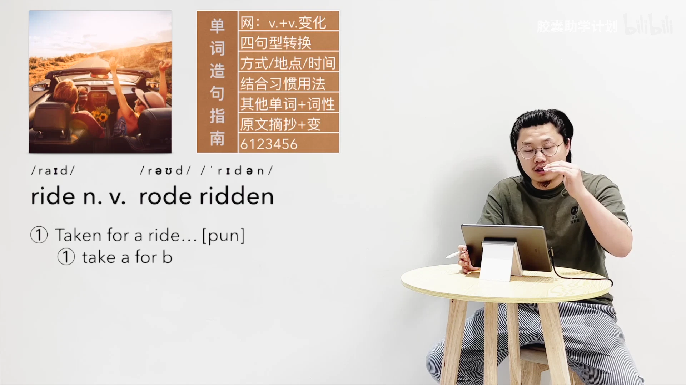

文字识别：单词造句指南 / 网：v.+v.变化 / 四句型转换 / 方式/地点/时间 / 结合习惯用法 / 其他单词+词性 / 原文摘抄+变 / 6123456 / /raid/ / /raud/ /'ridan/ / ride n. v. rode ridden / ① Taken for a ride...[pun] / ① take a for b

### 画面 00:01:45

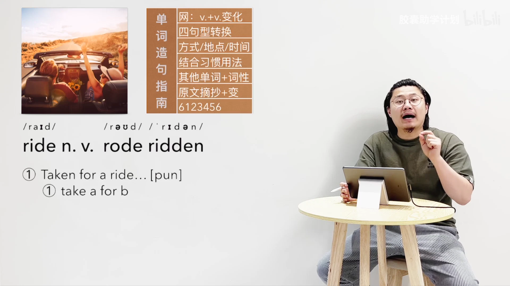

文字识别：单词造句指南 / 网：v.+v.变化 / 四句型转换 / 方式/地点/时间 / 结合习惯用法 / 其他单词+词性 / 原文摘抄+变 / 6123456 / /raid/ / /raud/ /'ridan/ / ride n. v. rode ridden / ① Taken for a ride... [pun] / ① take a for b

### 画面 00:01:50

文字识别：单词造句指南 / 网：v.+v.变化 / 四句型转换 / 方式/地点/时间 / 结合习惯用法 / 其他单词+词性 / 原文摘抄+变 / 6123456 / /raid/ / /raud/ /'ridan/ / ride n. v. rode ridden / ① Taken for a ride... [pun] / ① take a for b / ② take it for granted...

### 画面 00:01:55

文字识别：单词造句指南 / 网：v.+v.变化 / 四句型转换 / 方式/地点/时间 / 结合习惯用法 / 其他单词+词性 / 原文摘抄+变 / 6123456 / /raid/ / /raud/ /'ridan/ / ride n. v. rode ridden / NO / WIR / ① Taken for a ride... [pun] / ① take a for b / ② take it for granted...

## 00:02:00–00:02:30

take it for granted 啊，不要认为这事儿是理所应当的、理所当然的，对吧？就类似于我们北方话说我欠你的嘛，我就活该这样做嘛，对吧？叫 don't take it for granted, be gratitude, 对吧？哎，要有一颗感恩之心，叫做 take it for granted. Okay, 好，那 take a for b, 所以这个地方叫做把它当做一次旅行啊。其次呢，还有一个这个不要求各位在本课当中

### 画面 00:02:00

文字识别：单词造句指南 / 网：v.+v.变化 / 四句型转换 / 方式/地点/时间 / 结合习惯用法 / 其他单词+词性 / 原文摘抄+变 / 6123456 / /raid/ / /raud/ /'ridan/ / ride n. v. rode ridden / ① Taken for a ride... [pun] / ① take a for b / ② take it for granted...

### 画面 00:02:07

文字识别：单词造句指南 / 网：v.+v.变化 / 四句型转换 / 方式/地点/时间 / 结合习惯用法 / 其他单词+词性 / 原文摘抄+变 / 6123456 / /raid/ / /raud/ /'ridan/ / ride n. v. rode ridden / ① Taken for a ride... [pun] / ① take a for b / ② take it for granted...

### 画面 00:02:13

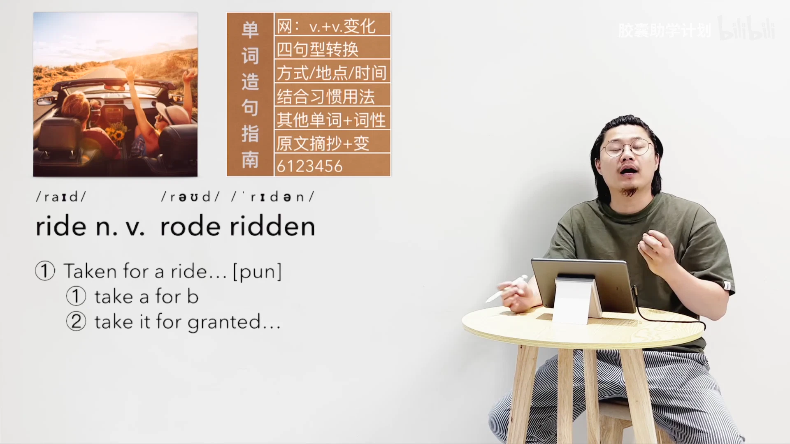

文字识别：单词造句指南 / 网：v.+v.变化 / 四句型转换 / 方式/地点/时间 / 结合习惯用法 / 其他单词+词性 / 原文摘抄+变 / 6123456 / /raid/ / /raud/ /'ridan/ / ride n. v. rode ridden / ① Taken for a ride... [pun] / ① take a for b / ② take it for granted...

### 画面 00:02:16

文字识别：单词造句指南 / 网：v.+v.变化 / 四句型转换 / 方式/地点/时间 / 结合习惯用法 / 其他单词+词性 / 原文摘抄+变 / 6123456 / /raid/ / /raud/ /'ridan/ / ride n. v. rode ridden / ① Taken for a ride... [pun] / ① take a for b / ② take it for granted...

### 画面 00:02:25

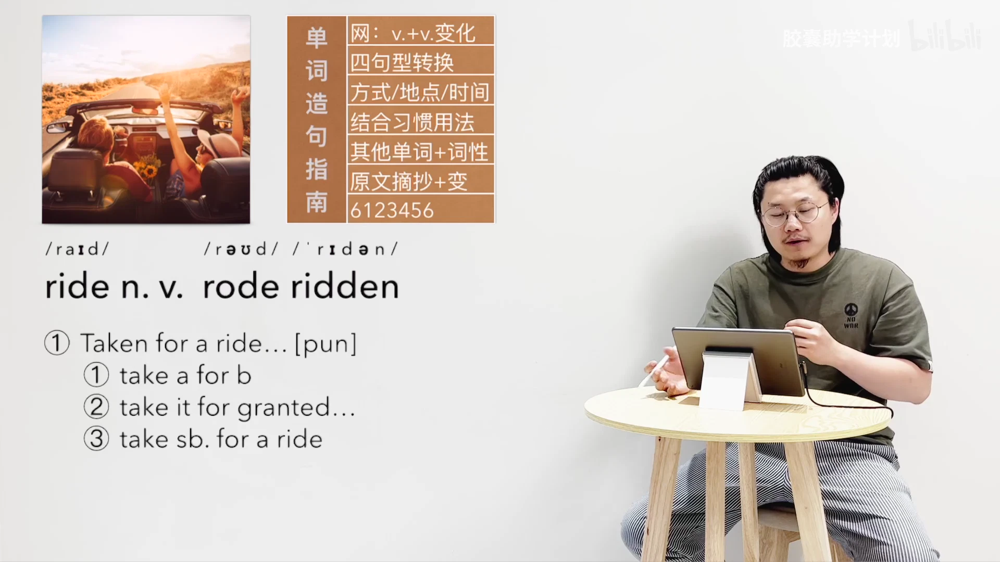

文字识别：单词造句指南 / 网：v.+v.变化 / 四句型转换 / 方式/地点/时间 / 结合习惯用法 / 其他单词+词性 / 原文摘抄+变 / 6123456 / /raid/ / /raud/ /'ridan/ / ride n. v. rode ridden / WnR / NO / ① Taken for a ride... [pun] / ① take a for b / ② take it for granted... / ③ take sb.for a ride

## 00:02:30–00:03:00

去进行一个掌握，它其实就类似于一个我们所谓叫美国俚语也好啊，或者说我们统称为它叫 expression 习惯用法也好，叫 take somebody for a ride。 OK，它其实一个从字面意思完全你看不出来它是什么意思啊，你会猜说是不是带着某人去旅游一下，并不是完全不沾边儿，它的意思叫做欺骗或者上当，对吧？欺骗了某人或者让某人上当了。所以这个文章当中它这个标题，

### 画面 00:02:31

文字识别：单词造句指南 / 网：v.+v.变化 / 四句型转换 / 方式/地点/时间 / 结合习惯用法 / 其他单词+词性 / 原文摘抄+变 / 6123456 / /raid/ / /raud/ /'ridan/ / ride n. v. rode ridden / ① Taken for a ride... [pun] / NO / ① take a for b / ② take it for granted... / ③ take sb.for a ride

### 画面 00:02:36

文字识别：单词造句指南 / 网：v.+v.变化 / 四句型转换 / 方式/地点/时间 / 结合习惯用法 / 其他单词+词性 / 原文摘抄+变 / 6123456 / /raid/ / /raud/ /'ridan/ / ride n. v. rode ridden / ND / ① Taken for a ride... [pun] / WHR / ① take a for b / ② take it for granted... / ③ take sb.for a ride

### 画面 00:02:40

文字识别：单词造句指南 / 网：v.+v.变化 / 四句型转换 / 方式/地点/时间 / 结合习惯用法 / 其他单词+词性 / 原文摘抄+变 / 6123456 / /raid/ / /raud/ /'ridan/ / ride n. v. rode ridden / ① Taken for a ride... [pun] / ① take a for b / ② take it for granted... / ③ take sb.for a ride

### 画面 00:02:45

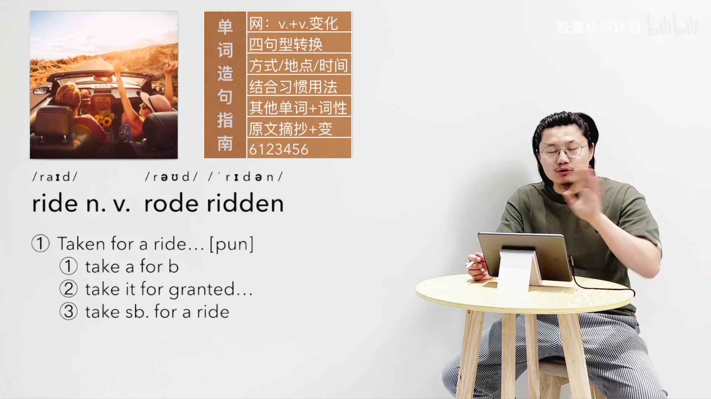

文字识别：单词造句指南 / 网：v.+v.变化 / 四句型转换 / 方式/地点/时间 / 结合习惯用法 / 其他单词+词性 / 原文摘抄+变 / 6123456 / /raid/ / /raud/ /'ridan/ / ride n. v. rode ridden / ① Taken for a ride... [pun] / ① take a for b / ② take it for granted... / ③ take sb.for a ride

### 画面 00:02:50

文字识别：单词造句指南 / 网：v.+v.变化 / 四句型转换 / 方式/地点/时间 / 结合习惯用法 / 其他单词+词性 / 原文摘抄+变 / 6123456 / /raid/ / /raud/ /'ridan/ / ride n. v. rode ridden / ① Taken for a ride... [pun] / ① take a for b / ② take it for granted... / ③ take sb.for a ride

### 画面 00:02:57

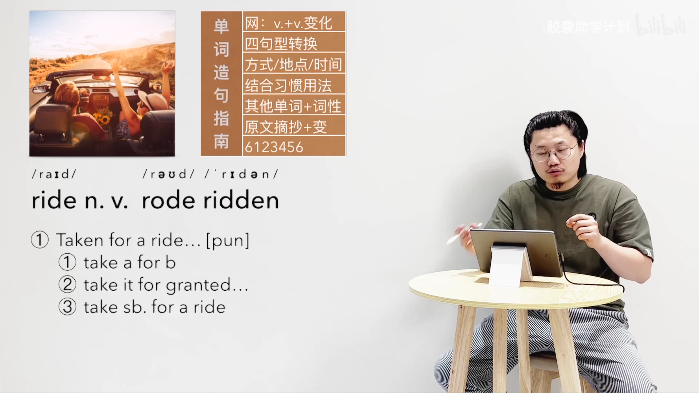

文字识别：单词造句指南 / 网：v.+v.变化 / 四句型转换 / 方式/地点/时间 / 结合习惯用法 / 其他单词+词性 / 原文摘抄+变 / 6123456 / /raid/ / /raud/ /'ridan/ / ride n. v. rode ridden / ① Taken for a ride... [pun] / ① take a for b / ② take it for granted... / ③ take sb.for a ride

## 00:03:00–00:03:30

如果你以前提前看过文章，那你可能明白啊。没有提前看过呢，那我们进入文章，一会儿我们再讲为什么是这样的。所以它有两个含义，它叫胖，对吧？双关。第一个含义就是他哎出去旅游了一圈啊，就这么简单，字面意思。第二个含义 taken for a ride 就是上当了，被骗了。一会儿我们看为什么，对吧？OK。接下来咱们看一个很小的电影片段，这个电影片段当中用到了这句话叫做 But you, he was your real dad, and you just took it

### 画面 00:03:20

文字识别：单词造句指南 / 网：v.+v.变化 / 四句型转换 / 方式/地点/时间 / 结合习惯用法 / 其他单词+词性 / 原文摘抄+变 / 6123456 / /raid/ / /raud/ /'ridan/ / ride n. v. rode ridden / ① Taken for a ride... [pun] / ① take a for b / ② take it for granted... / ③ take sb.for a ride

### 画面 00:03:22

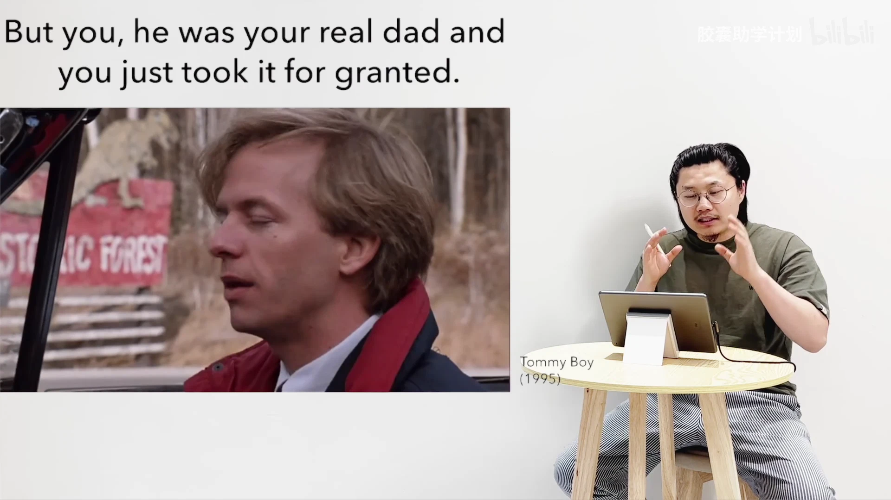

文字识别：But you, he was your real dad and / you just took it for granted. / AIC FOREST / Tommy Boy / (1995)

## 00:03:30–00:04:00

for granted. 说他是你真正意义上的父亲，他是你的亲生父亲，对吧？ Real dad，我们刚学过 real friend， real reason，对吧？ Real dad 就是他是你呃这个这个这个呃亲爹，对吧？咱们可以这样理解。但是呢，你认为这事儿是理所应当的。我们注意力集中，听一下。 Me, but you, he was your real dad, and you just took it for granted. Okay, 啊，语速比较快，各位可以反复多听几遍。 Okay，接下来呢，那我们说的是他更常用的另

### 画面 00:03:50

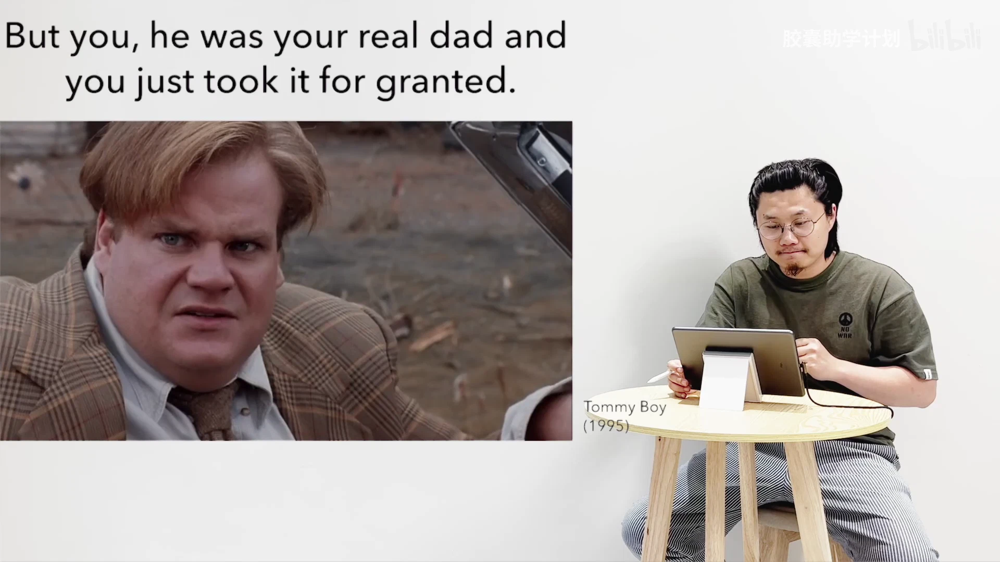

文字识别：But you, he was your real dad and / you just took it for granted. / WIR / Tommy Boy / (1995)

### 画面 00:03:52

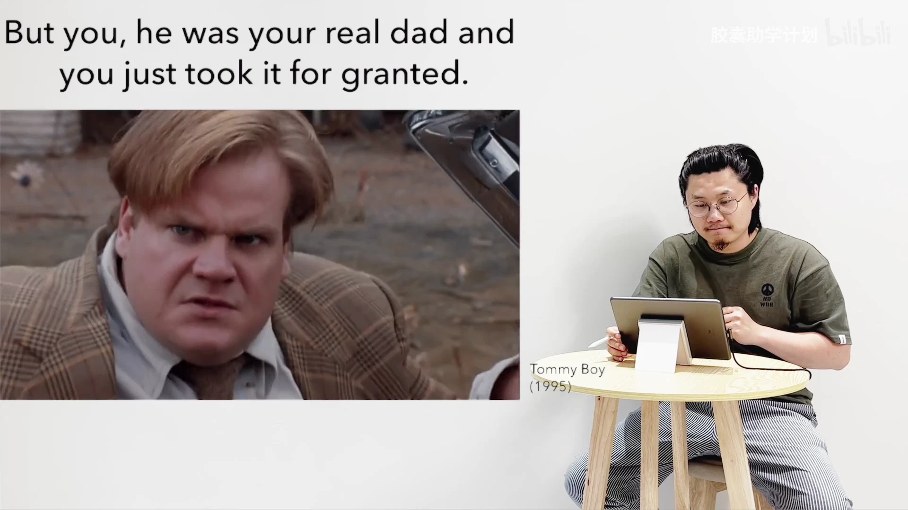

文字识别：But you, he was your real dad and / you just took it for granted. / WIR / ND / Tommy Boy / (1995)

### 画面 00:03:54

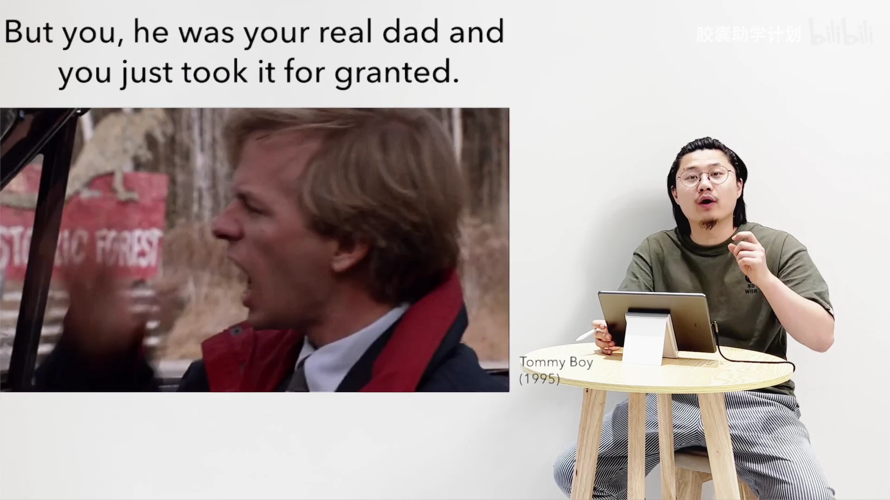

文字识别：But you, he was your real dad and / you just took it for granted. / IC FREST / Tommy Boy / (1995)

### 画面 00:03:56

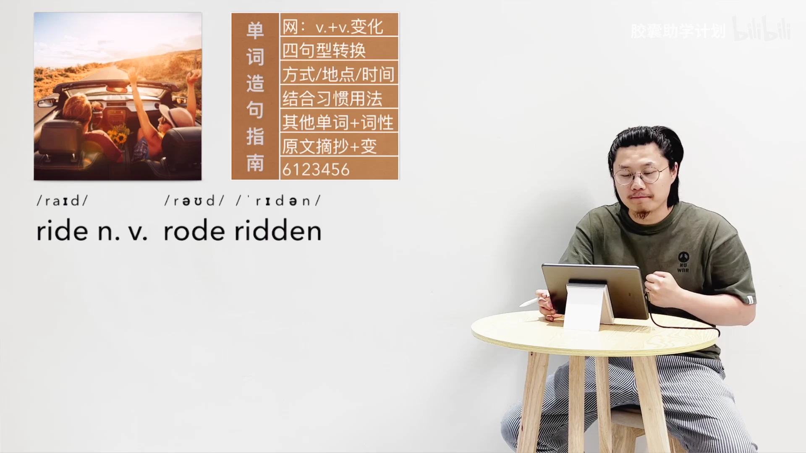

文字识别：单词造句指南 / 网：v.+v.变化 / 四句型转换 / 方式/地点/时间 / 结合习惯用法 / 其他单词+词性 / 原文摘抄+变 / 6123456 / /raid/ / /raud/ /'ridan/ / ride n. v. rode ridden / WIR / NU

### 画面 00:03:58

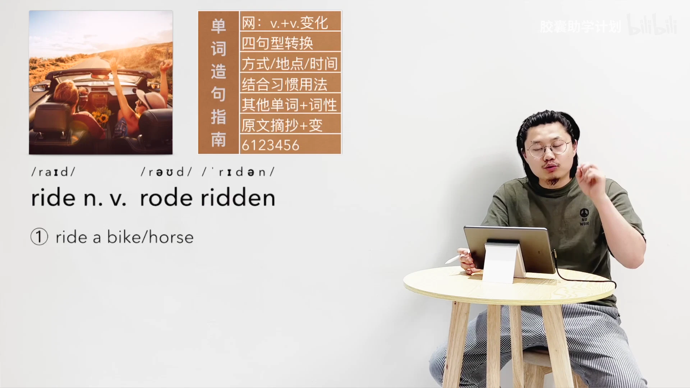

文字识别：单词造句指南 / 网：v.+v.变化 / 四句型转换 / 方式/地点/时间 / 结合习惯用法 / 其他单词+词性 / 原文摘抄+变 / 6123456 / /raid/ / /raud/ /'ridan/ / ride n. V. rode ridden / NO / ) ride a bike/horse

## 00:04:00–00:04:30

一个含义叫做 ride 动词啊，指的是骑，比如说 ride a bike, ride a horse，对吧？骑自行车或者骑马。想拿它去造句，其实各位就想一下这里，对不对？我现在骑已经有了，骑什么东西我已经给你了，无非你就是在加一点什么方式、地点、时间，再加个主语，对吧？也就是说，这句话我们想拿这个 ride a horse 或 ride a bike 想去造句的时候，我们可以优先先考

### 画面 00:04:00

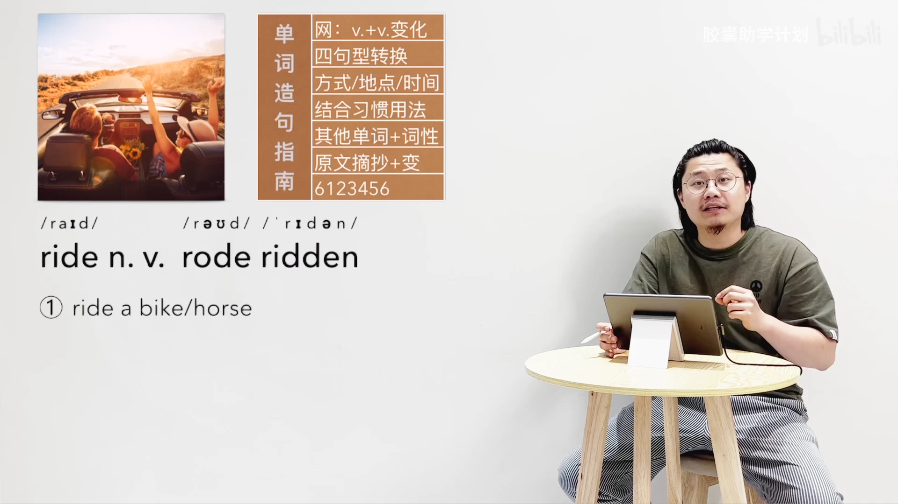

文字识别：单词造句指南 / 网：v.+v.变化 / 四句型转换 / 方式/地点/时间 / 结合习惯用法 / 其他单词+词性 / 原文摘抄+变 / 6123456 / /raid/ / /raud/ /'ridan/ / ride n. v. rode ridden / ① ride a bike/horse

### 画面 00:04:06

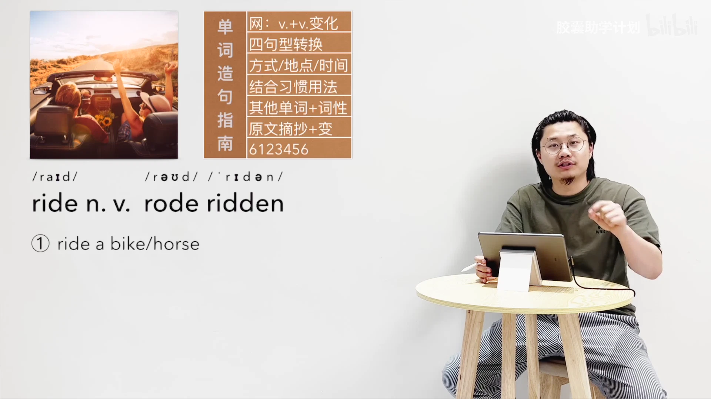

文字识别：单词造句指南 / 网：v.+v.变化 / 四句型转换 / 方式/地点/时间 / 结合习惯用法 / 其他单词+词性 / 原文摘抄+变 / 6123456 / /raid/ / /raud/ /'ridan/ / ride n. v. rode ridden / ① ride a bike/horse

### 画面 00:04:12

文字识别：单词造句指南 / 网：v.+v.变化 / 四句型转换 / 方式/地点/时间 / 结合习惯用法 / 其他单词+词性 / 原文摘抄+变 / 6123456 / /raid/ / /raud/ /'ridan/ / ride n. v. rode ridden / ) ride a bike/horse

### 画面 00:04:20

文字识别：单词造句指南 / 网：v.+v.变化 / 四句型转换 / 方式/地点/时间 / 结合习惯用法 / 其他单词+词性 / 原文摘抄+变 / 6123456 / /raid/ / /raud/ /'ridan/ / ride n. V. rode ridden / ① ride a bike/horse

### 画面 00:04:26

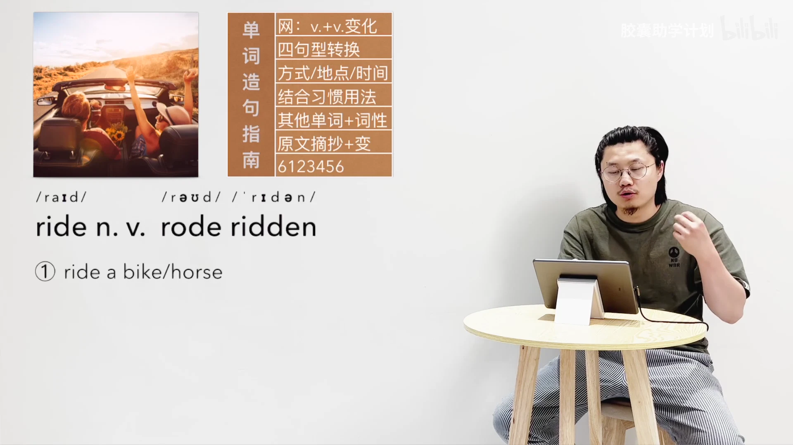

文字识别：单词造句指南 / 网：v.+v.变化 / 四句型转换 / 方式/地点/时间 / 结合习惯用法 / 其他单词+词性 / 原文摘抄+变 / 6123456 / /raid/ / /raud/ /'ridan/ / ride n. v. rode ridden / ① ride a bike/horse / WIR / NO

### 画面 00:04:28

文字识别：单词造句指南 / 网：v.+v.变化 / 四句型转换 / 方式/地点/时间 / 结合习惯用法 / 其他单词+词性 / 原文摘抄+变 / 6123456 / /raid/ / /raud/ /'ridan/ / ride n. v. rode ridden / ① ride a bike/horse

## 00:04:30–00:05:00

虑这两点。比如说，你看，我就造了一句话叫 Look, she is riding a horse. 我无非就多加了个 look 和 she 这两个单词，你一定认得，对不对？好，那你说，我举个例子啊，你还能不能把它再多添加一点方式啊、地点呢、时间？你看，时间不用了，因为现在进行时已经告诉你了，对不对？OK, very good. 接下来，口语当中还真的挺常用，但不过这句话我们早在新概念一册八十三到九十课就学过，第一

### 画面 00:04:32

文字识别：单词造句指南 / 网：v.+v.变化 / 四句型转换 / 方式/地点/时间 / 结合习惯用法 / 其他单词+词性 / 原文摘抄+变 / 6123456 / /raid/ / /raud/ /'ridan/ / ride n. v. rode ridden / ① ride a bike/horse / ② Look, she is riding a horse.

### 画面 00:04:37

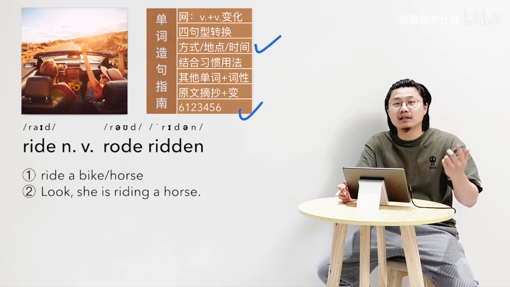

文字识别：单词造句指南 / 网：v.+v.变化 / 四句型转换 / 方式/地点/时间 / 结合习惯用法 / 其他单词+词性 / 原文摘抄+变 / 6123456 / /raid/ / /raud/ /'ridan/ / ride n. v. rode ridden / NU / ① ride a bike/horse / WIIR / ② Look, she is riding a horse.

### 画面 00:04:40

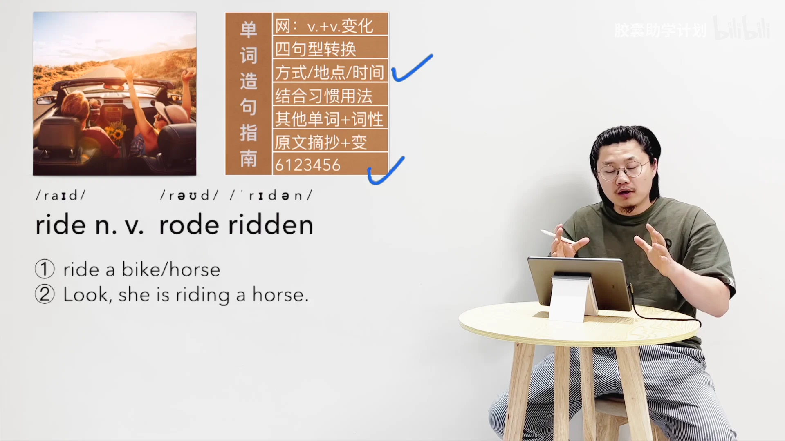

文字识别：单词造句指南 / 网：v.+v.变化 / 四句型转换 / 方式/地点/时间 / 结合习惯用法 / 其他单词+词性 / 原文摘抄+变 / 6123456 / /raid/ / /raud/ /'ridan/ / ride n. v. rode ridden / ① ride a bike/horse / ② Look, she is riding a horse.

### 画面 00:04:46

文字识别：单词造句指南 / 网：v.+v.变化 / 四句型转换 / 方式/地点/时间 / 结合习惯用法 / 其他单词+词性 / 原文摘抄+变 / 6123456 / /raid/ / /raud/ /'ridan/ / ride n. v. rode ridden / ① ride a bike/horse / WOH / ② Look, she is riding a horse.

### 画面 00:04:50

文字识别：单词造句指南 / 网：v.+v.变化 / 四句型转换 / 方式/地点/时间 / 结合习惯用法 / 其他单词+词性 / 原文摘抄+变 / 6123456 / /raid/ / /raud/ /'ridan/ / ride n. v. rode ridden / NU / ① ride a bike/horse / WnR /  Look, she is riding a horse. / Have you ever ridden a horse before?

### 画面 00:04:53

文字识别：单词造句指南 / 网：v.+v.变化 / 四句型转换 / 方式/地点/时间 / 结合习惯用法 / 其他单词+词性 / 原文摘抄+变 / 6123456 / /raid/ / /raud/ /'ridan/ / ride n. v. rode ridden / ① ride a bike/horse / ② Look, she is riding a horse. / Have you ever ridden a horse before?

### 画面 00:04:56

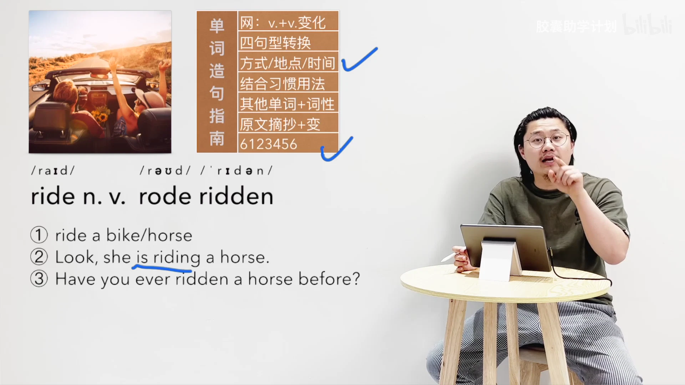

文字识别：单词造句指南 / 网：v.+v.变化 / 四句型转换 / 方式/地点/时间 / 结合习惯用法 / 其他单词+词性 / 原文摘抄+变 / 6123456 / /raid/ / /raud/ /'ridan/ / ride n. v. rode ridden / ① ride a bike/horse / ② Look, she is riding a horse. / 2） / Have you ever ridden a horse before?

## 00:05:00–00:05:30

次见现在完成时的时候，叫做 Have you ever ridden a horse before? 你以前骑过马吗？哎，口语当中完全可以用得到，叫你以前做过什么什么事情吗？叫 Have you ever done something before? Very good. 下一个单词，注意，它是名词，虽然它的意思好像特别像动词，对吧？远足啊，远郊对吧？出去玩是吧？旅游啊，它虽然这

### 画面 00:05:00

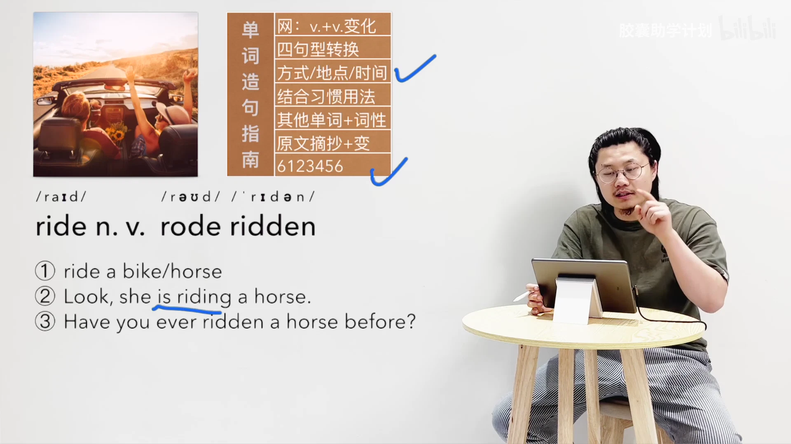

文字识别：单词造句指南 / 网：v.+v.变化 / 四句型转换 / 方式/地点/时间 / 结合习惯用法 / 其他单词+词性 / 原文摘抄+变 / 6123456 / /raid/ / /raud/ /'ridan/ / ride n. v. rode ridden /  ride a bike/horse / Look, she is riding a horse. / Have you ever ridden a horse before?

### 画面 00:05:10

文字识别：单词造句指南 / 网：v.+v.变化 / 四句型转换 / 方式/地点/时间 / 结合习惯用法 / 其他单词+词性 / 原文摘抄+变 / 6123456 / /raid/ / /raud/ /'ridan/ / ride n. v. rode ridden / NO / ① ride a bike/horse / WAR /  Look, she is riding a horse. / Have you ever ridden a horse before?

### 画面 00:05:15

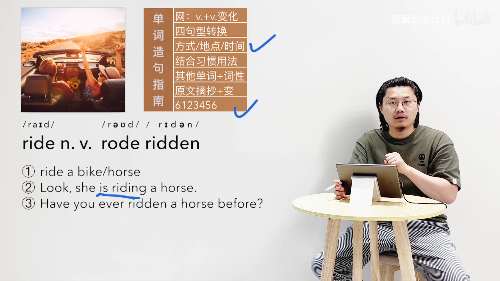

文字识别：单词造句指南 / 网：v.+v.变化 / 四句型转换 / 方式/地点/时间 / 结合习惯用法 / 其他单词+词性 / 原文摘抄+变 / 6123456 / /raid/ / /raud/ /'ridan/ / ride n. v. rode ridden / NU / ① ride a bike/horse / ) Look, she is riding a horse. / Have you ever ridden a horse before?

### 画面 00:05:17

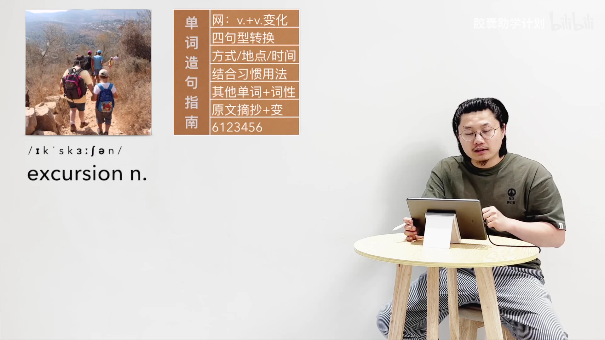

文字识别：单词造句指南 / 网：v.+v.变化 / 四句型转换 / 方式/地点/时间 / 结合习惯用法 / 其他单词+词性 / 原文摘抄+变 / 6123456 / /ik'sk3:∫an/ / excursion n. / NO / WnR

### 画面 00:05:20

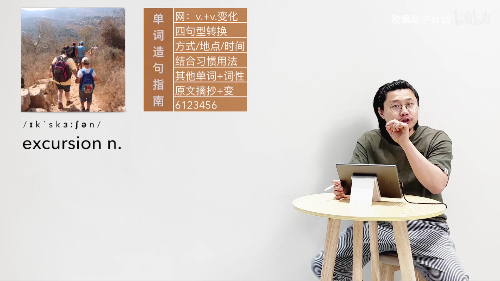

文字识别：单词造句指南 / 网：v.+v.变化 / 四句型转换 / 方式/地点/时间 / 结合习惯用法 / 其他单词+词性 / 原文摘抄+变 / 6123456 / /Ik'sk3:∫an/ / excursion n.

## 00:05:30–00:06:00

个含义很像动词，但它本身是个名词。看一下，叫做 excursion， excursion， excursion。 OK，文章当中出了一个短语，我们直接拿过来非常有用，叫做 go on an excursion。这篇文章学完了，excursion你不需要懂太多，你只需要把 go on an excursion 记起来就可以了，好吧？好，那拿它去造句，你想一下，比如说我在这里，我是这么去

### 画面 00:05:34

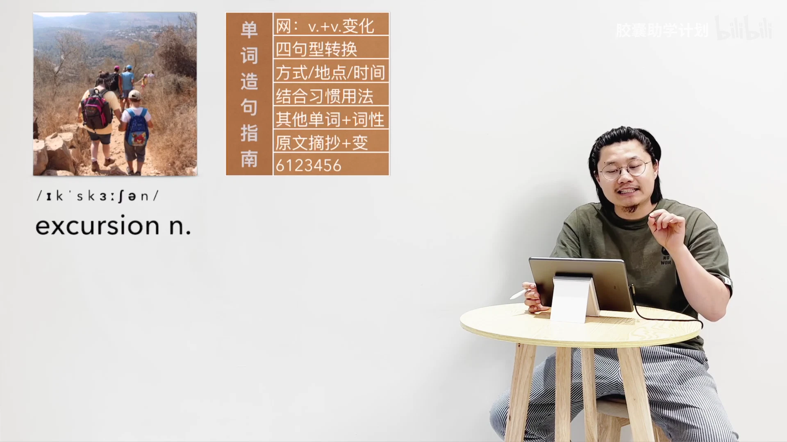

文字识别：单词造句指南 / 网：v.+v.变化 / 四句型转换 / 方式/地点/时间 / 结合习惯用法 / 其他单词+词性 / 原文摘抄+变 / 6123456 / /ik'sk3:∫an/ / excursion n. / NU / wnt

### 画面 00:05:40

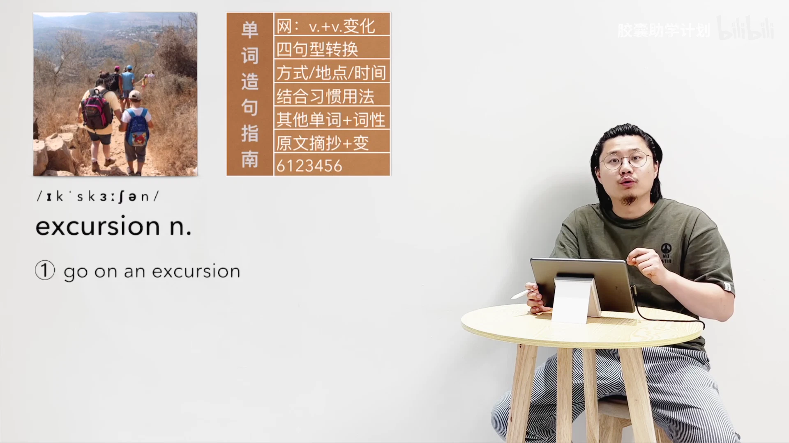

文字识别：单词造句指南 / 网：v.+v.变化 / 四句型转换 / 方式/地点/时间 / 结合习惯用法 / 其他单词+词性 / 原文摘抄+变 / 6123456 / /ik'sk3:∫an/ / excursion n. / NO / VNR / 1 / go on an excursion

### 画面 00:05:52

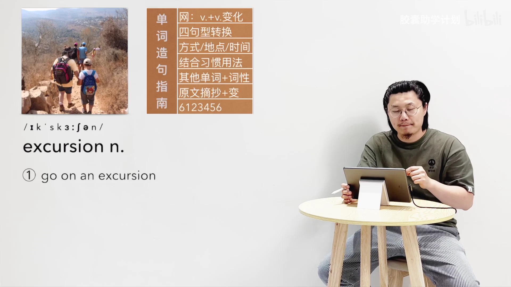

文字识别：单词造句指南 / 网：v.+v.变化 / 四句型转换 / 方式/地点/时间 / 结合习惯用法 / 其他单词+词性 / 原文摘抄+变 / 6123456 / /ik'sk3:∫an/ / excursion n. / NU / 1 / go on an excursion / WNR

### 画面 00:05:55

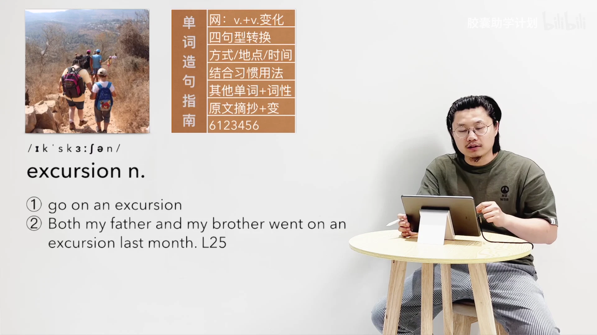

文字识别：单词造句指南 / 网：v.+v.变化 / 四句型转换 / 方式/地点/时间 / 结合习惯用法 / 其他单词+词性 / 原文摘抄+变 / 6123456 / /Ik'sk3:∫an/ / excursion n. / 1 / go on an excursion / WIR / ND / Both my father and my brother went on an / excursion last month. L25

### 画面 00:05:59

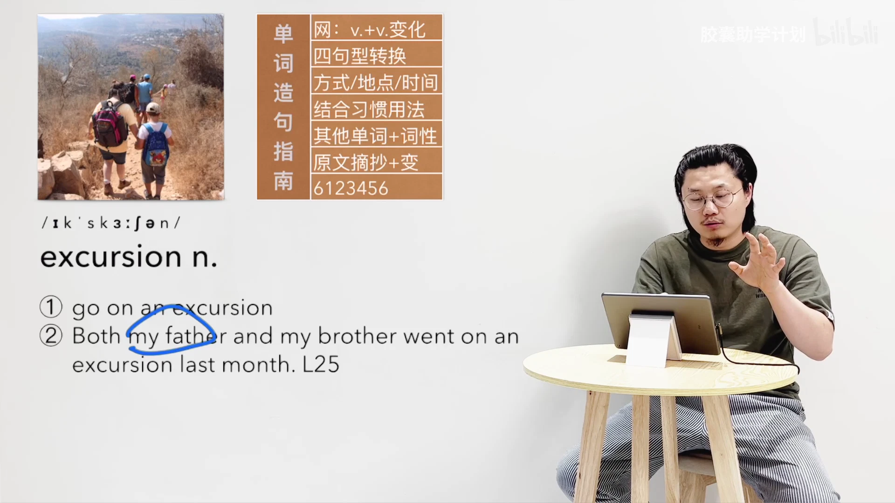

文字识别：单词造句指南 / 网：v.+v.变化 / 四句型转换 / 方式/地点/时间 / 结合习惯用法 / 其他单词+词性 / 原文摘抄+变 / 6123456 / /ik'sk3:∫an/ / excursion n. / 1 / go on anexcursion / Both my father and my brother went on an / excursion last month. L25

## 00:06:00–00:06:30

思考这个事儿的啊。Go on an excursion.首先你给我了，接下来我必须找主语。我为了要复习我之前学过的东西，那我灵机一动，我说我复习一下both A and B吧。二十五课咱们学过的连词，对吧？于是我就把它写成了both my father and my brother。然后接下来呢？那我想一下，他们什么时候去？是要去还是已经去过了呢？我想一下时态，我加个时间，对吧？你看加了个时间last month。那这里就不能用go了，就得

### 画面 00:06:01

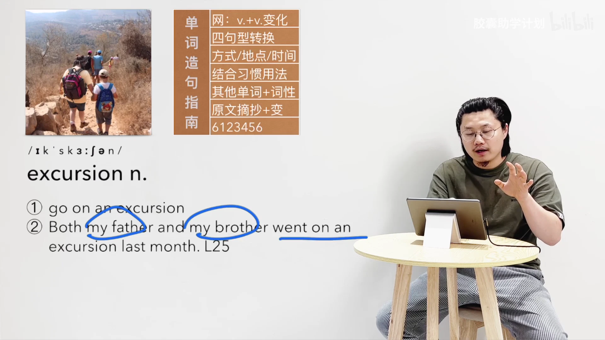

文字识别：单词造句指南 / 网：v.+v.变化 / 四句型转换 / 方式/地点/时间 / 结合习惯用法 / 其他单词+词性 / 原文摘抄+变 / 6123456 / /ik'sk3:∫an/ / excursion n. / へ / go on anexcursion / Both my father and my brother went on an / excursion Iast month. L25

### 画面 00:06:03

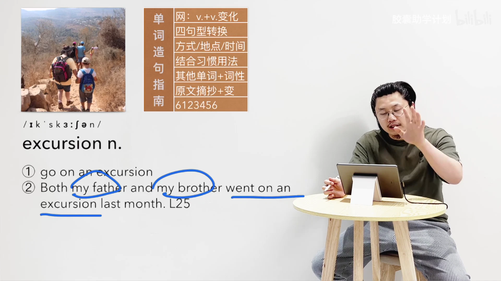

文字识别：单词造句指南 / 网：v.+v.变化 / 四句型转换 / 方式/地点/时间 / 结合习惯用法 / 其他单词+词性 / 原文摘抄+变 / 6123456 / /ik'sk3:∫an/ / excursion n. / go on an excursion / Both my father and my brother went on an / excursion Iast month. L25

### 画面 00:06:05

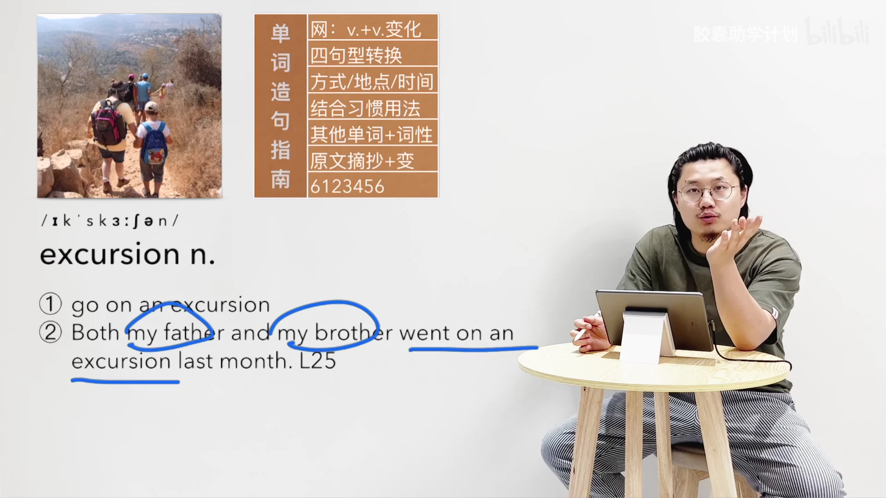

文字识别：单词造句指南 / 网：v.+v.变化 / 四句型转换 / 方式/地点/时间 / 结合习惯用法 / 其他单词+词性 / 原文摘抄+变 / 6123456 / /ik'sk3:∫an/ / excursion n. / 1 / go on anexcursion / Both my father and my brother went on an / excursion Iast month. L25

### 画面 00:06:08

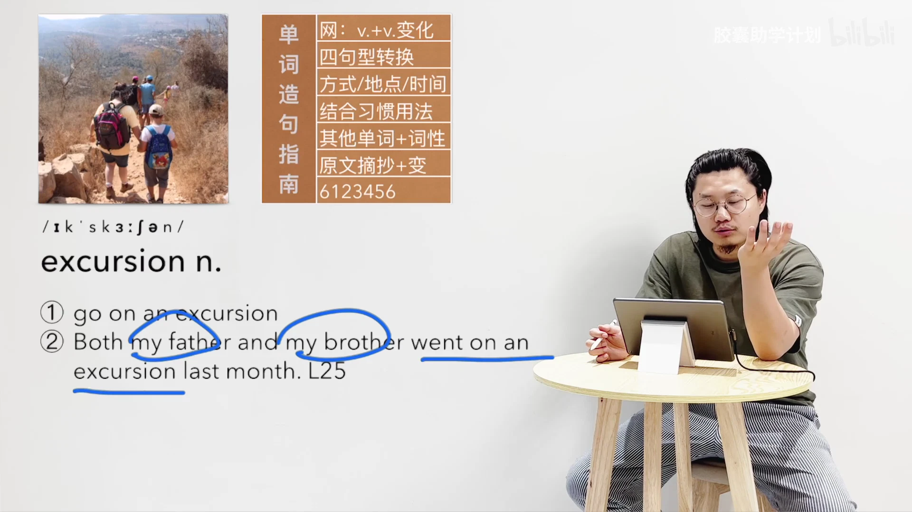

文字识别：单词造句指南 / 网：v.+v.变化 / 四句型转换 / 方式/地点/时间 / 结合习惯用法 / 其他单词+词性 / 原文摘抄+变 / 6123456 / /ik'sk3:∫an/ / excursion n. / 1 / go on anexcursion / Both my father and my brother went on an / excursion Iast month. L25

### 画面 00:06:12

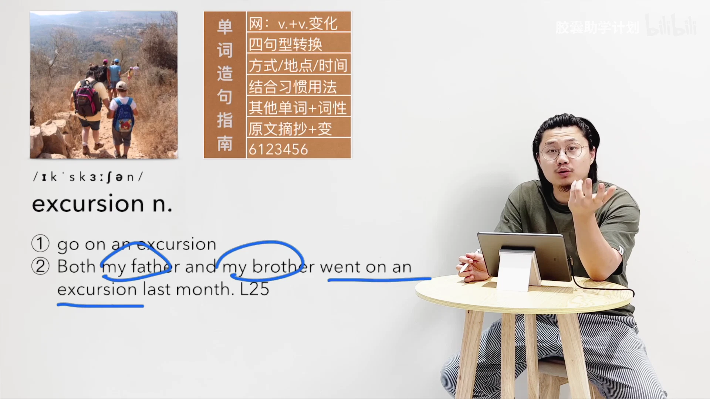

文字识别：单词造句指南 / 网：v.+v.变化 / 四句型转换 / 方式/地点/时间 / 结合习惯用法 / 其他单词+词性 / 原文摘抄+变 / 6123456 / /ik'sk3:∫an/ / excursion n. / へ / go on an excursion / Both my father and my brother went on an / excursion Iast month. L25

### 画面 00:06:19

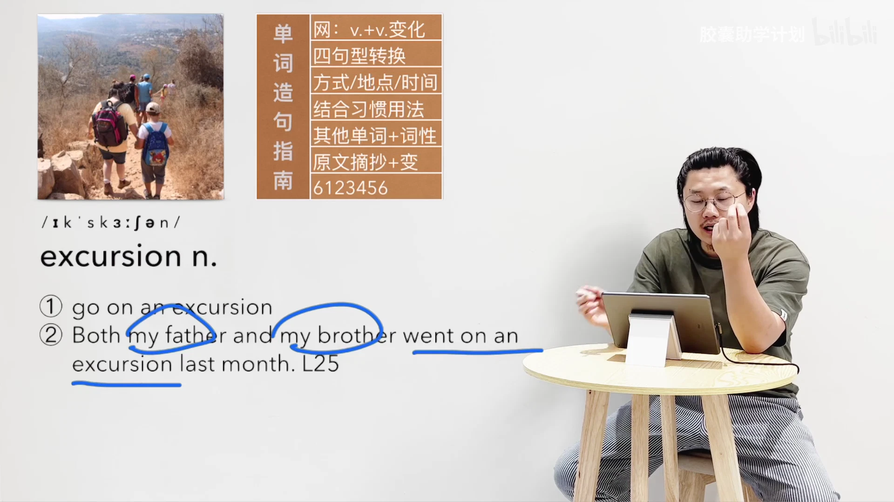

文字识别：单词造句指南 / 网：v.+v.变化 / 四句型转换 / 方式/地点/时间 / 结合习惯用法 / 其他单词+词性 / 原文摘抄+变 / 6123456 / /ik'sk3:∫an/ / excursion n. / 1 / go on anexcursion / Both my father and my brother went on an / excursion Iast month. L25

### 画面 00:06:25

文字识别：单词造句指南 / 网：v.+v.变化 / 四句型转换 / 方式/地点/时间 / 结合习惯用法 / 其他单词+词性 / 原文摘抄+变 / 6123456 / /ik'sk3:∫an/ / excursion n. / ～ / go on anexcursion / Both my father and my brother went on an / ast month L25 / excursion

## 00:06:30–00:07:00

用 went，所以这句话就出来了。这句话一旦出来，你去进行一些四句型的转换就很容易了，对不对？哎，各位要张嘴就能来啊！还是你可以暂停屏幕，口语做一个练习，也可以下课动笔把它写出来，当家庭作业没有问题啊。好，接下来你看我给它换了个时态，我们作为动词，动词的变化，你看现在是用一般过去时，那我给它变成将来时，叫做 next week we are going on an

### 画面 00:06:30

文字识别：单词造句指南 / 网：v.+v.变化 / 四句型转换 / 方式/地点/时间 / 结合习惯用法 / 其他单词+词性 / 原文摘抄+变 / 6123456 / /ik'sk3:∫an/ / excursion n. / 1 / go on anexcursion / Both my father and my brother went on an / ast month L25 / excursion

### 画面 00:06:34

文字识别：单词造句指南 / 网：v.+v.变化 / 四句型转换 / 方式/地点/时间 / 结合习惯用法 / 其他单词+词性 / 原文摘抄+变 / 6123456 / /ik'sk3:∫an/ / excursion n. / 1 / go on anexcursion / WIR / NO / Both my father and my brother went on an / ast month L25 / excursion

### 画面 00:06:36

文字识别：单词造句指南 / 网：v.+v.变化 / 四句型转换 / 方式/地点/时间 / 结合习惯用法 / 其他单词+词性 / 原文摘抄+变 / 6123456 / /ik'sk3:∫an / / excursion n. / 1 / go on ancxcursion / Both my father and my brother went on an / ast month L25 / excursion / did/who/wr

### 画面 00:06:38

文字识别：单词造句指南 / 网：v.+v.变化 / 四句型转换 / 方式/地点/时间 / 结合习惯用法 / 其他单词+词性 / 原文摘抄+变 / 6123456 / /Ik'sk3:∫an/ / excursion n. / ～ / go on ancxcursion / Both my father and my brother went on an / excursion Iast month. L25 / did/who/when...

### 画面 00:06:40

文字识别：单词造句指南 / 网：v.+v.变化 / 四句型转换 / 方式/地点/时间 / 结合习惯用法 / 其他单词+词性 / 原文摘抄+变 / 6123456 / /ik'sk3:∫an/ / excursion n. / 1 / ) go on an excursion / ) Both my father and my brother went on an / 2 / excursion last month. L25 / did/who/when...

### 画面 00:06:50

文字识别：单词造句指南 / 网：v.+v.变化 / 四句型转换 / 方式/地点/时间 / 结合习惯用法 / 其他单词+词性 / 原文摘抄+变 / 6123456 / /Ik'sk3:∫an/ / excursion n. / ① / ) go on an excursion / WIR / NO / ) Both my father and my brother went on an / 2) / excursion last month. L25 / did/who/when... / ) Next week we're going on an excursion.

### 画面 00:06:52

文字识别：单词造句指南 / 网！ / v.+v.变化 / 四句型转换 / 方式/地点/时间 / 结合习惯用法 / 其他单词+词性 / 原文摘抄+变 / 6123456 / /Ik'sk3:∫an/ / excursion n. / 1 / ) go on an excursion / wnt / NO / ) Both my father and my brother went on an / 2 / excursion last month. L25 / did/who/when... / ) Next week we're going on an excursion.

### 画面 00:06:54

文字识别：单词造句指南 / 网 / v.+v.变化 / 四句型转换 / 方式/地点/时间 / 结合习惯用法 / 其他单词+词性 / 原文摘抄+变 / 6123456 / /Ik'sk3:∫an/ / excursion n. / 1 / go on an excursion / WOR / ND / ) Both my father and my brother went on an / 2 / excursion last month. L25 / did/who/when... / ) Next week we're going on an excursion.

### 画面 00:06:56

文字识别：单词造句指南 / 网 / v.+v.变化 / 四句型转换 / 方式/地点/时间 / 结合习惯用法 / 其他单词+词性 / 原文摘抄+变 / 6123456 / /Ik'sk3:∫an/ / excursion n. / 1 / go on an excursion /  Both my father and my brother went on an / 2 / excursion last month. L25 / did/who/when... / ) Next week we're going on an excursion.

### 画面 00:06:59

文字识别：单词造句指南 / 网！ / v.+v.变化 / 四句型转换 / 方式/地点/时间 / 结合习惯用法 / 其他单词+词性 / 原文摘抄+变 / 6123456 / /Ik'sk3:∫an/ / excursion n. / ① /  go on an excursion / ) Both my father and my brother went on an / 2 / excursion last month. L25 / did/who/when... /  Next week we're going on an excursion.

## 00:07:00–00:07:30

excursion.这两句话你都会用得到，但你看本质上无非我就是把时间换了一下，从 last month 换到了 next week，对吧？接下来我把主语换了一下，啊，偷了个懒儿，没有用 both and b 了，直接就用 we 就可以了。你看这两句话本质上差别不大，发现了吧？OK，好。那同理啊，四句型的转换，对吧？同理四句型的转换啊，再读一遍这个单词 excursion excursion，啊，注意这里有一个小的浊化，对

### 画面 00:07:04

文字识别：单词造句指南 / 网 / v.+v.变化 / 四句型转换 / 方式/地点/时间 / 结合习惯用法 / 其他单词+词性 / 原文摘抄+变 / 6123456 / /Ik'sk3:∫an/ / excursion n. / ① / go on an excursion / WHR / NU / Both my father and my brother went on an / 2 / excursion last month. L25 / did/who/when... /  Next week we're going on an excursion.

### 画面 00:07:06

文字识别：单词造句指南 / 网 / v.+v.变化 / 四句型转换 / 方式/地点/时间 / 结合习惯用法 / 其他单词+词性 / 原文摘抄+变 / 6123456 / /ik'sk3:∫an/ / excursion n. / 1 / go on an excursion / Both my father and my brother went on an / excursion last month. L25 / did/who/when... / Next weekwe're going on an excursion.

### 画面 00:07:10

文字识别：单词造句指南 / 网 / v.+v.变化 / 四句型转换 / 方式/地点/时间 / 结合习惯用法 / 其他单词+词性 / 原文摘抄+变 / 6123456 / /ik'sk3:∫an/ / excursion n. / 1 / gaon an excursion / Both my father and my brother went on an / excursion last month. L25 / did/who/when... / Next weekwe're going on an excursion.

### 画面 00:07:12

文字识别：单词造句指南 / 网 / v.+v.变化 / 四句型转换 / 方式/地点/时间 / 结合习惯用法 / 其他单词+词性 / 原文摘抄+变 / 6123456 / /ik'sk3:∫an/ / excursion n. / gpon / Both my father and my brother went on an / excursion last month. L25 / did/who/when... / Next weekwe're going on an excursion.

### 画面 00:07:15

文字识别：单词造句指南 / 网 / v.+v.变化 / 四句型转换 / 方式/地点/时间 / 结合习惯用法 / 其他单词+词性 / 原文摘抄+变 / 6123456 / /ik'sk3:∫an / / excursion n. / goona / NO / Both my father and my brother went on an / excursion last month. L25 / did/who/when... / Next weekwe're going on an excursion.

### 画面 00:07:20

文字识别：单词造句指南 / 网 / v.+v.变化 / 四句型转换 / 方式/地点/时间 / 结合习惯用法 / 其他单词+词性 / 原文摘抄+变 / 6123456 / /ik'sk3:∫an / / excursion n. / NO / WIR / gpona / Both my father and my brother went on an / excursion last month. L25 / did/who/when... / Next weekwe're going on an excursion. / are/when/wno...

### 画面 00:07:22

文字识别：单词造句指南 / 网v.+v.变化 / 四句型转换 / 方式/地点/时间 / 结合习惯用法 / 其他单词+词性 / 原文摘抄+变 / 6123456 / /ik'sk3:∫an/ / excursion n. / ① go on an excursion / ② Both my father and my brother went on an / excursion last month. L25 / did/who/when... / ) Next week we're going on an excursion. / are/when/who... / 5

### 画面 00:07:24

文字识别：单词造句指南 / 网v.+v.变化 / 四句型转换 / 方式/地点/时间 / 结合习惯用法 / 其他单词+词性 / 原文摘抄+变 / 6123456 / /ik'sk3:∫an/ / excursion n. / ① go on an excursion / ② Both my father and my brother went on an / excursion last month. L25 / did/who/when... /  Next week we're going on an excursion. / are/when/who...

## 00:07:30–00:08:00

吧？啊，excursion，meridian。下一个单词还是啊，文章当中我们先读一下吧。来，叫做conductor，conductor啊，conductor。OK，注意最后边有一个儿化音啊，conductor，conductor这个单词呢，最常用的意思其实也并不是我们文章当中给的这个意思。文章当中给的意思指的是售票员，对吧？好，它比较常用的一个意思指的是这个，比如说这个做音乐的那

### 画面 00:07:32

文字识别：单词造句指南 / 网：v.+v.变化 / 四句型转换 / 方式/地点/时间 / 结合习惯用法 / 其他单词+词性 / 原文摘抄+变 / 6123456 / /kan'daktar/ / conductor n.指挥 / ND / WNR

### 画面 00:07:35

文字识别：单词造句指南 / 网：v.+v.变化 / 四句型转换 / 方式/地点/时间 / 结合习惯用法 / 其他单词+词性 / 原文摘抄+变 / 6123456 / /kan'dnktar/ / conductor n.指挥

### 画面 00:07:40

文字识别：单词造句指南 / 网：v.+v.变化 / 四句型转换 / 方式/地点/时间 / 结合习惯用法 / 其他单词+词性 / 原文摘抄+变 / 6123456 / /kan'daktar/ / conductor n.指挥

### 画面 00:07:46

文字识别：单词造句指南 / 网：v.+v.变化 / 四句型转换 / 方式/地点/时间 / 结合习惯用法 / 其他单词+词性 / 原文摘抄+变 / 6123456 / /kan'daktar/ / conductor n.指挥

## 00:08:00–00:08:30

个指挥啊，叫做 conductor， very good。那我们就按照他是这个售票员的角度去拿他造句。我们复习一下刚刚学过的一些东西，比如说， as soon as I got on the bus， the conductor asked me to buy a ticket。首先这句话当中，其实我最想让你复习的是 as soon as。虽然它是十四课出现的，但是在我们不久之前刚刚给大家总结的那个视频一到四十八总结

### 画面 00:08:00

文字识别：单词造句指南 / 网：v.+v.变化 / 四句型转换 / 方式/地点/时间 / 结合习惯用法 / 其他单词+词性 / 原文摘抄+变 / 6123456 / /kan'daktar/ / conductor n.指挥

### 画面 00:08:05

文字识别：单词造句指南 / 网：v.+v.变化 / 四句型转换 / 方式/地点/时间 / 结合习惯用法 / 其他单词+词性 / 原文摘抄+变 / 6123456 / /kan'daktar/ / conductor n.指挥

### 画面 00:08:09

文字识别：单词造句指南 / 网：v.+v.变化 / 四句型转换 / 方式/地点/时间 / 结合习惯用法 / 其他单词+词性 / 原文摘抄+变 / 6123456 / /kan'daktar/ / conductor n.指挥 / ① As soon as I got on the bus, the conductor / WNR / NO / asked me to buy a ticket. L14

### 画面 00:08:13

文字识别：单词造句指南 / 网：v.+v.变化 / 四句型转换 / 方式/地点/时间 / 结合习惯用法 / 其他单词+词性 / 原文摘抄+变 / 6123456 / / kan'dΛktar/ / conductor n.指挥 / ① As soon as I got on the bus, the conductor / asked me to buy a ticket. L14

### 画面 00:08:16

文字识别：单词造句指南 / 网：v.+v.变化 / 四句型转换 / 方式/地点/时间 / 结合习惯用法 / 其他单词+词性 / 原文摘抄+变 / 6123456 / / kan'dΛktar/ / conductor n.指挥 / ① As soon as I got on the bus, the conductor / asked me to buy a ticket. L14

### 画面 00:08:20

文字识别：单词造句指南 / 网：v.+v.变化 / 四句型转换 / 方式/地点/时间 / 结合习惯用法 / 其他单词+词性 / 原文摘抄+变 / 6123456 / / kan'dΛktar/ / conductor n.指挥 / ①As soon as I got on the bus, the conductor / asked me to buy a ticket. L14

### 画面 00:08:22

文字识别：单词造句指南 / 网：v.+v.变化 / 四句型转换 / 方式/地点/时间 / 结合习惯用法 / 其他单词+词性 / 原文摘抄+变 / 6123456 / /kan'daktar/ / conductor n.指挥 / ①As soon as / I got on the bus, the conductor / asked me to buy a ticket. L14

### 画面 00:08:24

文字识别：单词造句指南 / 网：v.+v.变化 / 四句型转换 / 方式/地点/时间 / 结合习惯用法 / 其他单词+词性 / 原文摘抄+变 / 6123456 / /kan'daktar/ / conductor n.指挥 / ①As soon as / I got on the bus, the conductor / asked me to buy a ticket. L14

### 画面 00:08:26

文字识别：单词造句指南 / 网：v.+v.变化 / 四句型转换 / 方式/地点/时间 / 结合习惯用法 / 其他单词+词性 / 原文摘抄+变 / 6123456 / /kan'daktar/ / conductor n.指挥 / ①As soon as / I got on the bus, the conductor / asked me to buy a ticket. L14

## 00:08:30–00:09:00

视频当中，我提到了它，一怎么怎么样就怎么怎么样，对吧？第二，我为什么把 I 和 the conductor 给你标加粗了一下呢？就是我想问你一个问题，这句话我能不能给它变成 getting on the bus？完全取决于四十九课你学的好不好，对吧？所以我要做的判断就是主语是否一致，一致我才能考虑分词作状语，不一致不行，不能变，就是这样，好吧？再来说，although

### 画面 00:08:30

文字识别：单词造句指南 / 网：v.+v.变化 / 四句型转换 / 方式/地点/时间 / 结合习惯用法 / 其他单词+词性 / 原文摘抄+变 / 6123456 / /kan'daktar/ / conductor n.指挥 / ①As soon as / I got on the bus, the conductor / asked me to buy a ticket. L14

### 画面 00:08:35

文字识别：单词造句指南 / 网：v.+v.变化 / 四句型转换 / 方式/地点/时间 / 结合习惯用法 / 其他单词+词性 / 原文摘抄+变 / 6123456 / /kan'daktar/ / conductor n.指挥 / ①As soon as / I got on the bus, the conductor / asked me to buy a ticket. L14

### 画面 00:08:38

文字识别：单词造句指南 / 网：v.+v.变化 / 四句型转换 / 方式/地点/时间 / 结合习惯用法 / 其他单词+词性 / 原文摘抄+变 / 6123456 / /kan'daktar/ / conductor n.指挥 / ①As soon as / I got on the bus, the conductor / asked me to buy a ticket. L14

### 画面 00:08:42

文字识别：单词造句指南 / 网：v.+v.变化 / 四句型转换 / 方式/地点/时间 / 结合习惯用法 / 其他单词+词性 / 原文摘抄+变 / 6123456 / /kan'daktar/ / conductor n.指挥 / ①As soon as / I got on the bus, the conductor / asked me to buy a ticket. L14

### 画面 00:08:48

文字识别：单词造句指南 / 网：v.+v.变化 / 四句型转换 / 方式/地点/时间 / 结合习惯用法 / 其他单词+词性 / 原文摘抄+变 / 6123456 / /kan'daktar/ / conductor n.指挥 / ①As soon as / I got on the bus, the conductor / asked me to buy a ticket. L14

### 画面 00:08:50

文字识别：单词造句指南 / 网：v.+v.变化 / 四句型转换 / 方式/地点/时间 / 结合习惯用法 / 其他单词+词性 / 原文摘抄+变 / 6123456 / /kan'daktar/ / conductor n.指挥 / ①As soon as / I got on the bus, the conductor / asked me to buy a ticket. L14

### 画面 00:08:55

文字识别：单词造句指南 / 网：v.+v.变化 / 四句型转换 / 方式/地点/时间 / 结合习惯用法 / 其他单词+词性 / 原文摘抄+变 / 6123456 / /kan'daktar/ / conductor n.指挥 / ①As soon as / I got on the bus, the conductor / asked me to buy a ticket. L14

### 画面 00:08:57

文字识别：单词造句指南 / 网：v.+v.变化 / 四句型转换 / 方式/地点/时间 / 结合习惯用法 / 其他单词+词性 / 原文摘抄+变 / 6123456 / /kan'daktar/ / conductor n.指挥 / ①As soon as / I got on the bus, the conductor / asked me to buy a ticket. L14 / Although the conductor asked me to buy a / ticket, I refused to do so.

## 00:09:00–00:09:30

the conductor asked me to buy a ticket, I refused to do so.说尽管他要求我这么去做了，我拒绝了。其实refuse to do和ask somebody to do something都是我们之前学过的，但是我不想标了，因为这里我的重点是告诉各位两个事儿。第一，一到四十八课总结视频当中，我提到了although, though, even though, even if等等一系列的连词，对吧？状语从句的连词，你就要开始用了。单词造句的时候，对吧？有意识的让自己造的句子从简单句

### 画面 00:09:05

文字识别：单词造句指南 / 网：v.+v.变化 / 四句型转换 / 方式/地点/时间 / 结合习惯用法 / 其他单词+词性 / 原文摘抄+变 / 6123456 / / kan'daktar/ / conductor n.指挥 / ①As soon ag / I got on the bus, the conductor / NU / WnR / asked me to buy a ticket. L14 / ) Although the conductor asked me to buy a / ticket, I refused to do so.

### 画面 00:09:08

文字识别：单词造句指南 / 网：v.+v.变化 / 四句型转换 / 方式/地点/时间 / 结合习惯用法 / 其他单词+词性 / 原文摘抄+变 / 6123456 / /kan'daktar/ / conductor n.指挥 / ①As soon as / I got on the bus, the conductor / asked me to buy a ticket. L14 / Although the conductor asked me to buy a / ticket, I refused to do so.

### 画面 00:09:14

文字识别：单词造句指南 / 网：v.+v.变化 / 四句型转换 / 方式/地点/时间 / 结合习惯用法 / 其他单词+词性 / 原文摘抄+变 / 6123456 / /kan'daktar/ / conductor n.指挥 / ①As soon as / I got on the bus, the conductor / asked me to buy a ticket. L14 / Although the conductor asked me to buy a / ticket, I refused to do so.

### 画面 00:09:16

文字识别：单词造句指南 / 网：v.+v.变化 / 四句型转换 / 方式/地点/时间 / 结合习惯用法 / 其他单词+词性 / 原文摘抄+变 / 6123456 / /kan'daktar/ / conductor n.指挥 / ①As soon as / I got on the bus, the conductor / asked me to buy a ticket. L14 / Althoughthe conductor asked me to buy a / ticket, I refused to do so.

### 画面 00:09:20

文字识别：单词造句指南 / 网：v.+v.变化 / 四句型转换 / 方式/地点/时间 / 结合习惯用法 / 其他单词+词性 / 原文摘抄+变 / 6123456 / /kan'daktar/ / conductor n.指挥 / ①As soon ay / I got on the bus, the conductor / asked me to buy a ticket. L14 / Althoughthe conductor asked me to buy a / ticket, I refused to do so.

### 画面 00:09:23

文字识别：单词造句指南 / 网：v.+v.变化 / 四句型转换 / 方式/地点/时间 / 结合习惯用法 / 其他单词+词性 / 原文摘抄+变 / 6123456 / /kan'daktar/ / conductor n.指挥 / ①As soon ay / I got on the bus, the conductor / asked me to buy a ticket. L14 / Althoughthe conductor asked me to buy a / ticket, I refused to do so.

### 画面 00:09:25

文字识别：单词造句指南 / 网：v.+v.变化 / 四句型转换 / 方式/地点/时间 / 结合习惯用法 / 其他单词+词性 / 原文摘抄+变 / 6123456 / /kan'daktar/ / conductor n.指挥 / ①As soon as / I got on the bus, the conductor / asked me to buy a ticket. L14 / Althoughthe conductor asked me to buy a / ticket, I refused to do so.

### 画面 00:09:29

文字识别：单词造句指南 / 网：v.+v.变化 / 四句型转换 / 方式/地点/时间 / 结合习惯用法 / 其他单词+词性 / 原文摘抄+变 / 6123456 / /kan'daktar/ / conductor n.指挥 / ①As soon as / I got on the bus, the conductor / asked me to buy a ticket. L14 / Althoughthe conductor asked me to buy a / ticket, I refused to do so.

## 00:09:30–00:10:00

逐渐变成复杂句，不管是并列句也好，还是主从复合句也好，你要逐渐去培养这个技能，不要说继续呃完全就只造简单句还是对吧？OK，其次呢，the conductor和I我又给你标粗了，能不能变？我刚才刚说完，能不能变成asking me to buy a ticket, I refuse to do so，对吧？你自己变过来，你试着翻译一下，我要求我去买张票，我

### 画面 00:09:44

文字识别：单词造句指南 / 网：v.+v.变化 / 四句型转换 / 方式/地点/时间 / 结合习惯用法 / 其他单词+词性 / 原文摘抄+变 / 6123456 / /kan'daktar/ / conductor n.指挥 / ①As soon as /  got on the bus, the conductor / WnR / asked me to buy a ticket. L14 / Althoughthe conduetor asked me to buy a / ticket, I refused to do so.

### 画面 00:09:55

文字识别：单词造句指南 / 网：v.+v.变化 / 四句型转换 / 方式/地点/时间 / 结合习惯用法 / 其他单词+词性 / 原文摘抄+变 / 6123456 / /kan'daktar/ / conductor n.指挥 / ①As soon as / I got on the bus, the conductor / asked me to buy a ticket. L14 / Althoughthe conductor asked me to buy a / ticket, I refused to do so.

## 00:10:00–00:10:30

拒绝了，就精神分裂了，是吧？Okay.好，第三个，As the conductor got tired of selling tickets, he quit his job last week.你看这里的got tired of，我们刚刚学的四十九，但依旧不是我最想在这个句子当中复习的点。复习的点是as，第一，因为，对吧？第二，前后主语是否一致？哇塞，一致意味着什么？Got tired of

### 画面 00:10:00

文字识别：单词造句指南 / 网：v.+v.变化 / 四句型转换 / 方式/地点/时间 / 结合习惯用法 / 其他单词+词性 / 原文摘抄+变 / 6123456 / /kan'daktar/ / conductor n.指挥 / ①As soon as / I got on the bus, the conductor / asked me to buy a ticket. L14 / Althoughthe conductor asked me to buy a / ticket, I refused to do so.

### 画面 00:10:03

文字识别：单词造句指南 / 网：v.+v.变化 / 四句型转换 / 方式/地点/时间 / 结合习惯用法 / 其他单词+词性 / 原文摘抄+变 / 6123456 / /kan'daktar/ / conductor n.指挥 / ①As soon as / I got on the bus, the conductor / asked me to buy a ticket. L14 / Althoughthe conductor asked me to buy a / ticket, I refused to do so. / As the conductor got tired of selling / tickets, he quitted his job last week.

### 画面 00:10:05

文字识别：单词造句指南 / 网：v.+v.变化 / 四句型转换 / 方式/地点/时间 / 结合习惯用法 / 其他单词+词性 / 原文摘抄+变 / 6123456 / /kan'daktar/ / conductor n.指挥 / ①As soon as / I got on the bus, the conductor / asked me to buy a ticket. L14 / Althoughthe conductor asked me to buy a / ticket, I refused to do so. / As the conductor got tired of selling / tickets, he quitted his job last week.

### 画面 00:10:07

文字识别：单词造句指南 / 网：v.+v.变化 / 四句型转换 / 方式/地点/时间 / 结合习惯用法 / 其他单词+词性 / 原文摘抄+变 / 6123456 / /kan'daktar/ / conductor n.指挥 / ①As soon as / I got on the bus, the conductor / asked me to buy a ticket. L14 / Althoughthe conductor asked me to buy a / ticket, I refused to do so. / As the conductor got tired of selling / tickets, he quitted his job last week.

### 画面 00:10:10

文字识别：单词造句指南 / 网：v.+v.变化 / 四句型转换 / 方式/地点/时间 / 结合习惯用法 / 其他单词+词性 / 原文摘抄+变 / 6123456 / /kan'daktar/ / conductor n.指挥 / ①As soon as / I got on the bus, the conductor / WHR / NO / asked me to buy a ticket. L14 / Althoughthe conductor asked me to buy a / ticket, I refused to do so. / As the conductor got tired of selling / tickets, he quitted his job last week.

### 画面 00:10:12

文字识别：单词造句指南 / 网：v.+v.变化 / 四句型转换 / 方式/地点/时间 / 结合习惯用法 / 其他单词+词性 / 原文摘抄+变 / 6123456 / / kan'daktar/ / conductor n.指挥 / ①As soon as / I got on the bus, the conductor / WIR / NU / asked me to buy a ticket. L14 / Althoughthe conductor asked me to buy a / ticket, I refused to do so. / As the conductor got tired of selling / tickets, he quitted his job last week.

### 画面 00:10:16

文字识别：单词造句指南 / 网：v.+v.变化 / 四句型转换 / 方式/地点/时间 / 结合习惯用法 / 其他单词+词性 / 原文摘抄+变 / 6123456 / /kan'daktar/ / conductor n.指挥 / ①As soon as / I got on the bus, the conductor / asked me to buy a ticket. L14 / Althoughthe conductor asked me to buy a / ticket, I refused to do so. / As the conductor got tired of sellina_ / tickets, he quitted his job last week.

### 画面 00:10:20

文字识别：单词造句指南 / 网：v.+v.变化 / 四句型转换 / 方式/地点/时间 / 结合习惯用法 / 其他单词+词性 / 原文摘抄+变 / 6123456 / /kan'daktar/ / conductor n.指挥 / ①As soon as / I got on the bus, the conductor / asked me to buy a ticket. L14 / Althoughthe conductor asked me to buy a / ticket, I refused to do so. / Asthe conductor got tired of sellina / TIckets, he quitted his job last week.

### 画面 00:10:24

文字识别：单词造句指南 / 网：v.+v.变化 / 四句型转换 / 方式/地点/时间 / 结合习惯用法 / 其他单词+词性 / 原文摘抄+变 / 6123456 / /kan'daktar/ / conductor n.指挥 / ①As soon as / I got on the bus, the conductor / asked me to buy a ticket. L14 / Althoughthe conductor asked me to buy a / ticket, I refused to do so. / Asthe conductor got tired of sellina / tIckets, he quitted his job last week.

### 画面 00:10:26

文字识别：单词造句指南 / 网：v.+v.变化 / 四句型转换 / 方式/地点/时间 / 结合习惯用法 / 其他单词+词性 / 原文摘抄+变 / 6123456 / /kan'daktar/ / conductor n.指挥 / ①As soon as / I got on the bus, the conductor / asked me to buy a ticket. L14 / Althoughthe conductor asked me to buy a / ticket, I refused to do so. / Asthe conductor got tired of sellina_ / tIckets, he quitted his job last week.

## 00:10:30–00:11:00

selling tickets. 直接给它变成 getting tired of selling tickets. Okay, very good. 啊，这是我们四十九课刚刚学的分词作状语。好，最后再读一遍这个单词吧，叫做 conductor. Conductor. Okay, 好。下一个单词跟我读一下，叫做 view. View. 好，这个单词的含义其实蛮多的啊，但我们今天只说它一个，就是美景，对吧？美景叫做 view. 原文给了一个很好的短语，叫做

### 画面 00:10:32

文字识别：单词造句指南 / 网：v.+v.变化 / 四句型转换 / 方式/地点/时间 / 结合习惯用法 / 其他单词+词性 / 原文摘抄+变 / 6123456 / / kan'daktar/ / conductor n.指挥 / NO / ①As soon as / I got on the bus, the conductor / WIR / asked me to buy a ticket. L14 / Althoughthe conductor asked me to buy a / ticket, I refused to do so. / Asthe conductor got tired of sellina_ / tIckets, he quitted his job last week.

### 画面 00:10:35

文字识别：单词造句指南 / 网：v.+v.变化 / 四句型转换 / 方式/地点/时间 / 结合习惯用法 / 其他单词+词性 / 原文摘抄+变 / 6123456 / /kan'daktar/ / conductor n.指挥 / ①As soon as / I got on the bus, the conductor / asked me to buy a ticket. L14 / Althoughthe conductor asked me to buy a / ticket, I refused to do so. / Asthe conductor got tired of sellina / tIckets, he quitted his job last week.

### 画面 00:10:38

文字识别：单词造句指南 / 网：v.+v.变化 / 四句型转换 / 方式/地点/时间 / 结合习惯用法 / 其他单词+词性 / 原文摘抄+变 / 6123456 / /kan'daktar/ / conductor n.指挥 / ①As soon as / I got on the bus, the conductor / asked me to buy a ticket. L14 / Althoughthe conductor asked me to buy a / ticket, I refused to do so. / Asthe conductor got tired of sellina_ / tIckets, he quitted his job last week.

### 画面 00:10:40

文字识别：单词造句指南 / 网：v.+v.变化 / 四句型转换 / 方式/地点/时间 / 结合习惯用法 / 其他单词+词性 / 原文摘抄+变 / 6123456 / /kan'daktar/ / conductor n.指挥 / ①As soon as /  got on the bus, the conductor / WOR / NO / asked me to buy a ticket. L14 / Althoughthe conduetor asked me to buy a / ticket, I refused to do so. / Asthe conductor got tired of sellina_ / tIckets, he quitted his job last week.

### 画面 00:10:45

文字识别：单词造句指南 / 网：v.+v.变化 / 四句型转换 / 方式/地点/时间 / 结合习惯用法 / 其他单词+词性 / 原文摘抄+变 / 6123456 / / kan'daktar/ / conductor n.指挥 / ①As soon as /  got on the bus, the conductor / WIR / ND / asked me to buy a ticket. L14 / Althoughthe conductor asked me to buy a / ticket, I refused to do so. / Asthe conductor got tired of sellina_ / tIckets, he quitted his job last week.

### 画面 00:10:47

文字识别：单词造句指南 / 网：v.+v.变化 / 四句型转换 / 方式/地点/时间 / 结合习惯用法 / 其他单词+词性 / 原文摘抄+变 / 6123456 / /vju:1 / view n.

### 画面 00:10:49

文字识别：单词造句指南 / 网：v.+v.变化 / 四句型转换 / 方式/地点/时间 / 结合习惯用法 / 其他单词+词性 / 原文摘抄+变 / 6123456 / /vju:/ / view n.

### 画面 00:10:51

文字识别：单词造句指南 / 网：v.+v.变化 / 四句型转换 / 方式/地点/时间 / 结合习惯用法 / 其他单词+词性 / 原文摘抄+变 / 6123456 / /vju:1 / view n.

### 画面 00:10:55

文字识别：单词造句指南 / 网：v.+v.变化 / 四句型转换 / 方式/地点/时间 / 结合习惯用法 / 其他单词+词性 / 原文摘抄+变 / 6123456 / /vju:/ / view n. / NU / WnR

### 画面 00:10:57

文字识别：单词造句指南 / 网：v.+v.变化 / 四句型转换 / 方式/地点/时间 / 结合习惯用法 / 其他单词+词性 / 原文摘抄+变 / 6123456 / /vju:/ / view n. / ① [Story]: get a good view of the countryside / NO / VnR

### 画面 00:10:59

文字识别：单词造句指南 / 网：v.+v.变化 / 四句型转换 / 方式/地点/时间 / 结合习惯用法 / 其他单词+词性 / 原文摘抄+变 / 6123456 / /vju:1 / view n. / ① [Story]: get a good view of the countryside

## 00:11:00–00:11:30

get a good view of the countryside. 好，首先我们先说 get a good view. Get 这个单词万能动词，放在句子当中去啊。虽然它最常用的意思是获得，但是它还有很多其他的意思。万能动词，怎么舒服怎么来。Get 那你看，我们就按获得的角度去说，获得了一个非常美丽的风景。什么样的风景呢？A of B 结构，由后往前翻译，乡村的风景，对吧？饱览了乡村

### 画面 00:11:01

文字识别：单词造句指南 / 网：v.+v.变化 / 四句型转换 / 方式/地点/时间 / 结合习惯用法 / 其他单词+词性 / 原文摘抄+变 / 6123456 / /vju:/ / view n. / ① [Story]: get a good view of the countryside

### 画面 00:11:03

文字识别：单词造句指南 / 网：v.+v.变化 / 四句型转换 / 方式/地点/时间 / 结合习惯用法 / 其他单词+词性 / 原文摘抄+变 / 6123456 / /vju:/ / view n. / ① [Story]: / get a good view of the countryside

### 画面 00:11:05

文字识别：单词造句指南 / 网：v.+v.变化 / 四句型转换 / 方式/地点/时间 / 结合习惯用法 / 其他单词+词性 / 原文摘抄+变 / 6123456 / /vju:1 / view n. / ① [Story]: / get a good viewof the countryside

### 画面 00:11:12

文字识别：单词造句指南 / 网：v.+v.变化 / 四句型转换 / 方式/地点/时间 / 结合习惯用法 / 其他单词+词性 / 原文摘抄+变 / 6123456 / /vju:/ / view n. / ① [Story]: / get a good viewof the countryside

### 画面 00:11:15

文字识别：单词造句指南 / 网：v.+v.变化 / 四句型转换 / 方式/地点/时间 / 结合习惯用法 / 其他单词+词性 / 原文摘抄+变 / 6123456 / /vju:/ / view n. / NU / Wn / ① [Story]: / get a good viewof the countryside

### 画面 00:11:17

文字识别：单词造句指南 / 网：v.+v.变化 / 四句型转换 / 方式/地点/时间 / 结合习惯用法 / 其他单词+词性 / 原文摘抄+变 / 6123456 / /vju:/ / view n. / ① [Story]: / get a good viewof the countryside

### 画面 00:11:20

文字识别：单词造句指南 / 网：v.+v.变化 / 四句型转换 / 方式/地点/时间 / 结合习惯用法 / 其他单词+词性 / 原文摘抄+变 / 6123456 / /vju:1 / view n. / ① [Story]: / get a good viewof the countryside

### 画面 00:11:22

文字识别：单词造句指南 / 网：v.+v.变化 / 四句型转换 / 方式/地点/时间 / 结合习惯用法 / 其他单词+词性 / 原文摘抄+变 / 6123456 / /vju:/ / view n. / ① [Story]: / get a good viewof the countryside

### 画面 00:11:25

文字识别：单词造句指南 / 网：v.+v.变化 / 四句型转换 / 方式/地点/时间 / 结合习惯用法 / 其他单词+词性 / 原文摘抄+变 / 6123456 / /vju:/ / view n. / ① [Story]: / get a good viewof the countryside

### 画面 00:11:27

文字识别：单词造句指南 / 网：v.+v.变化 / 四句型转换 / 方式/地点/时间 / 结合习惯用法 / 其他单词+词性 / 原文摘抄+变 / 6123456 / /vju:/ / view n. / ① [Story]: / get a good viewof the countryside / WnR / NO

### 画面 00:11:29

文字识别：单词造句指南 / 网：v.+v.变化 / 四句型转换 / 方式/地点/时间 / 结合习惯用法 / 其他单词+词性 / 原文摘抄+变 / 6123456 / /vju:/ / view n. / ① [Story]: / get a good viewof the countryside

## 00:11:30–00:12:00

的风景，对吧？哎，美不胜收，看到了，就这么简单，欣赏了啊，enjoy是吧？OK，那我现在想拿它去造句，我加个主语就完了呗，加个时间，We got a good view of the countryside。加个再加个时间，我这儿没加，你加一个，比如说 last week，对吧？Yesterday，随便。其次呢，没有人只说 the countryside 有美景吧？City 是不是也可以有美景？你再给它换一下呗。这个肯定语句一造出来，Did you get a good

### 画面 00:11:31

文字识别：单词造句指南 / 网：v.+v.变化 / 四句型转换 / 方式/地点/时间 / 结合习惯用法 / 其他单词+词性 / 原文摘抄+变 / 6123456 / /vju:1 / view n. / ND / ① [Story]: / get a good viewof the countryside

### 画面 00:11:35

文字识别：单词造句指南 / 网：v.+v.变化 / 四句型转换 / 方式/地点/时间 / 结合习惯用法 / 其他单词+词性 / 原文摘抄+变 / 6123456 / /vju:/ / view n. / ① [Story]: / get a good viewof the countryside

### 画面 00:11:38

文字识别：单词造句指南 / 网：v.+v.变化 / 四句型转换 / 方式/地点/时间 / 结合习惯用法 / 其他单词+词性 / 原文摘抄+变 / 6123456 / /vju:1 / view n. / [Story]: / get a good viewof the countryside / NO / We gotagood / view cfthe / countryside.(city)

### 画面 00:11:40

文字识别：单词造句指南 / 网：v.+v.变化 / 四句型转换 / 方式/地点/时间 / 结合习惯用法 / 其他单词+词性 / 原文摘抄+变 / 6123456 / /vju:1 / view n. / ① [Story]: get a good view of the countryside / WNR / NO / ) We got a good view of the countryside.(city)

### 画面 00:11:45

文字识别：单词造句指南 / 网：v.+v.变化 / 四句型转换 / 方式/地点/时间 / 结合习惯用法 / 其他单词+词性 / 原文摘抄+变 / 6123456 / /vju:/ / view n. / ① [Story]: get a good view of the countryside / ) We got a good view of the countryside.(city)

### 画面 00:11:50

文字识别：单词造句指南 / 网：v.+v.变化 / 四句型转换 / 方式/地点/时间 / 结合习惯用法 / 其他单词+词性 / 原文摘抄+变 / 6123456 / /vju:/ / view n. / ① [Story]: get a good view of the countryside / WnR / NO /  We got a good view of the countryside.(city)

### 画面 00:11:52

文字识别：单词造句指南 / 网：v.+v.变化 / 四句型转换 / 方式/地点/时间 / 结合习惯用法 / 其他单词+词性 / 原文摘抄+变 / 6123456 / /vju:/ / view n. / ① [Story]: get a good view of the countryside / ② We got a good view of the countryside.(city)

### 画面 00:11:54

文字识别：单词造句指南 / 网：v.+v.变化 / 四句型转换 / 方式/地点/时间 / 结合习惯用法 / 其他单词+词性 / 原文摘抄+变 / 6123456 / /vju:/ / view n. / ① [Story]: get a good view of the countryside / WIR / ND /  We got a good view of the countryside.(city)

### 画面 00:11:56

文字识别：单词造句指南 / 网：v.+v.变化 / 四句型转换 / 方式/地点/时间 / 结合习惯用法 / 其他单词+词性 / 原文摘抄+变 / 6123456 / /vju:/ / view n. / ① [Story]: get a good view of the countryside / ND / wnR /  We got a good view of the countryside.(city)

### 画面 00:11:59

文字识别：单词造句指南 / 网：v.+v.变化 / 四句型转换 / 方式/地点/时间 / 结合习惯用法 / 其他单词+词性 / 原文摘抄+变 / 6123456 / /vju:/ / view n. / NU / ① [Story]: get a good view of the countryside / WIR /  We got a good view of the countryside.(city) / 2） / Did you get a good view of the countryside?

## 00:12:00–00:12:30

view of the countryside? Okay, ah, how, why didn't?说为什么你没有好好的去看这个乡村的美景呢？什么事情在 trouble you, that bother you?啊，说在你让你分心，没有去看成吗？对吧？Why didn't you get a good view of the countryside? Who就不提了，都是一码事儿，对不对？啊，老习惯，这是各位最熟悉的四句型转换。继续, we will get a good view of

### 画面 00:12:01

文字识别：单词造句指南 / 网：v.+v.变化 / 四句型转换 / 方式/地点/时间 / 结合习惯用法 / 其他单词+词性 / 原文摘抄+变 / 6123456 / /vju:/ / view n. / ① [Story]: get a good view of the countryside /  We got a good view of the countryside.(city) / Did you get a good view of the countryside?

### 画面 00:12:03

文字识别：单词造句指南 / 网：v.+v.变化 / 四句型转换 / 方式/地点/时间 / 结合习惯用法 / 其他单词+词性 / 原文摘抄+变 / 6123456 / /vju:/ / view n. / ① [Story]: get a good view of the countryside / We got a good view of the countryside.(city) / 2 / Did you get a good view of the countryside? /  how/why didn't/who ..

### 画面 00:12:05

文字识别：单词造句指南 / 网：v.+v.变化 / 四句型转换 / 方式/地点/时间 / 结合习惯用法 / 其他单词+词性 / 原文摘抄+变 / 6123456 / /vju:/ / view n. / ① [Story]: get a good view of the countryside /  We got a good view of the countryside.(city) / 2 / Did you get a good view of the countryside? / ) how/why didn't/who ... / 4

### 画面 00:12:11

文字识别：单词造句指南 / 网：v.+v.变化 / 四句型转换 / 方式/地点/时间 / 结合习惯用法 / 其他单词+词性 / 原文摘抄+变 / 6123456 / /vju:1 / view n. / ① [Story]: get a good view of the countryside / We got a good view of the countryside.(city) / 2 / Did you get a good view of the countryside? / 3 / ) how/why didn't/who ...

### 画面 00:12:15

文字识别：单词造句指南 / 网：v.+v.变化 / 四句型转换 / 方式/地点/时间 / 结合习惯用法 / 其他单词+词性 / 原文摘抄+变 / 6123456 / /vju:/ / view n. / [Story]: get a good view of the countryside / We got a good view of the countryside.(city) / Did you get a good view of the countryside? /  how/why didn't/who ...

### 画面 00:12:20

文字识别：单词造句指南 / 网：v.+v.变化 / 四句型转换 / 方式/地点/时间 / 结合习惯用法 / 其他单词+词性 / 原文摘抄+变 / 6123456 / /vju:1 / view n. / ① [Story]: get a good view of the countryside / We got a good view of the countryside.(city) / Did you get a good view of the countryside? / 3 / how/why didn't/who ...

### 画面 00:12:23

文字识别：单词造句指南 / 网：v.+v.变化 / 四句型转换 / 方式/地点/时间 / 结合习惯用法 / 其他单词+词性 / 原文摘抄+变 / 6123456 / /vju:/ / view n. / ①「 /  [Story]: get a good view of the countryside / We got a good view of the countryside.(city) / Did you get a good view of the countryside? /  how/why didn't/who ..

### 画面 00:12:25

文字识别：单词造句指南 / 网：v.+v.变化 / 四句型转换 / 方式/地点/时间 / 结合习惯用法 / 其他单词+词性 / 原文摘抄+变 / 6123456 / /vju:/ / view n. / ① [Story]: get a good view of the countryside / We got a good view of the countryside.(city) / 2 / Did you get a good view of the countryside? / 3 / how/why didn't/who ... / We wil get a good view of the countryside.

### 画面 00:12:27

文字识别：单词造句指南 / 网：v.+v.变化 / 四句型转换 / 方式/地点/时间 / 结合习惯用法 / 其他单词+词性 / 原文摘抄+变 / 6123456 / /vju:/ / view n. / ① [Story]: get a good view of the countryside / We got a good view of the countryside.(city) / 2 / Did you get a good view of the countryside? / 3 / how/why didn't/who ... / We wil get a good view of the countryside.

### 画面 00:12:29

文字识别：单词造句指南 / 网：v.+v.变化 / 四句型转换 / 方式/地点/时间 / 结合习惯用法 / 其他单词+词性 / 原文摘抄+变 / 6123456 / /vju:/ / view n. / ① [Story]: get a good view of the countryside / 2 / We got a good view of the countryside.(city) / Did you get a good view of the countryside? / 3 / how/why didn't/who ... / ⑤ We will get a good view of the countryside.

## 00:12:30–00:13:00

the countryside. 各位看一下二和五，这就是我们中中级造句的偷这个偷鸡取巧的一个啊，所谓的偷鸡取巧的一个小秘方，就是你把动词动词变化给它变一变。肯定句我都不做词性转换，我刚才说的一般过去式，好，我给它变成一般将来式，对不对？这事儿就完了。这个本课除了单词重要以外，那接下来这些我认为也都很重要啊，尤其像第一个，Don't take it for granted，口语当中经常用得到，别认为这

### 画面 00:12:31

文字识别：单词造句指南 / 网：v.+v.变化 / 四句型转换 / 方式/地点/时间 / 结合习惯用法 / 其他单词+词性 / 原文摘抄+变 / 6123456 / /vju:/ / view n. / ① [Story]: get a good view of the countryside / We got a good view of the countryside.(city) / Did you get a good view of the countryside? / 3 / how/why didn't/who . / ⑤ We will get a good view of the countryside.

### 画面 00:12:34

文字识别：单词造句指南 / 网：v.+v.变化 / 四句型转换 / 方式/地点/时间 / 结合习惯用法 / 其他单词+词性 / 原文摘抄+变 / 6123456 / /vju:/ / view n. / WIR / ① [Story]: get a good view of the countryside / ② We got a good view of the countryside.(city) / Did you get a good view of the countryside? / 3 / how/why didn't/who ... /  We will get a good view of the countryside. / 5

### 画面 00:12:37

文字识别：单词造句指南 / 网：v.+v.变化 / 四句型转换 / 方式/地点/时间 / 结合习惯用法 / 其他单词+词性 / 原文摘抄+变 / 6123456 / /vju:/ / view n. / ① [Story]: get a good view of the countryside / ② We got a good view of the countryside.(city) / Did you get a good view of the countryside? / 3 / how/why didn't/who ... /  We will get a good view of the countryside. / 5

### 画面 00:12:39

文字识别：单词造句指南 / 网：v.+v.变化 / 四句型转换 / 方式/地点/时间 / 结合习惯用法 / 其他单词+词性 / 原文摘抄+变 / 6123456 / /vju:/ / view n. / ① [Story]: get a good view of the countryside / ② We got a good view of the countryside.(city) / Did you get a good view of the countryside? / 3 / how/why didn't/who ... /  We will get a good view of the countryside. / 5

### 画面 00:12:41

文字识别：单词造句指南 / 网：v.+v.变化 / 四句型转换 / 方式/地点/时间 / 结合习惯用法 / 其他单词+词性 / 原文摘抄+变 / 6123456 / /vju:/ / view n. / ① [Story]: get a good view of the countryside / ② We got a good view of the countryside.(city) / Did you get a good view of the countryside? / 3 / how/why didn't/who ... /  We will get a good view of the countryside. / 5)

### 画面 00:12:43

文字识别：单词造句指南 / 网：v.+v.变化 / 四句型转换 / 方式/地点/时间 / 结合习惯用法 / 其他单词+词性 / 原文摘抄+变 / 6123456 / /vju:/ / view n. / ① [Story]: get a good view of the countryside / ② We got a good view of the countryside.(city) / Did you get a good view of the countryside? / 3 / how/why didn't/who .. / 4 /  We will get a good view of the countryside.

### 画面 00:12:45

文字识别：单词造句指南 / 网：v.+v.变化 / 四句型转换 / 方式/地点/时间 / 结合习惯用法 / 其他单词+词性 / 原文摘抄+变 / 6123456 / /vju:/ / view n. / ① [Story]: get a good view of the countryside / ② We got a good view of the countryside.(city) / Did you get a good view of the countryside? / 3 / how/why didn't/who ... / 4 / We will get a good view of the countryside.

### 画面 00:12:48

文字识别：单词造句指南 / 网：v.+v.变化 / 四句型转换 / 方式/地点/时间 / 结合习惯用法 / 其他单词+词性 / 原文摘抄+变 / 6123456 / /vju:/ / view n. / ① [Story]: get a good view of the countryside / NU / VnR / ② We got a good view of the countryside.(city) / Did you get a good view of the countryside? / 3 / how/why didn't/who ... / 4 / We will get a good view of the countryside. / 5

### 画面 00:12:50

文字识别：Recap / Words / NIR / take it for granted / ride a bike/horse / Expression / go on an excursion / get a good view of sth.

### 画面 00:12:52

文字识别：Recap / Words / take it for granted / ride a bike/horse / Expression / go on an excursion / get a good view of sth.

### 画面 00:12:54

文字识别：Recap / Words / take it for granted / ride a bike/horse / Expression / go / on an excursion / get a good view of sth.

### 画面 00:12:56

文字识别：Recap / Words / take it for granted / ride a bike/horse / Expression / go / on an excursion / get a good view of sth.

### 画面 00:12:58

文字识别：Recap / Words / take it for granted / ride a bike/horse / Expression / go / on an excursion / get a good view of sth.

## 00:13:00–00:13:30

事儿是理所应当的，对不对？好，家庭作业呢？单词造句老习惯，我再强调一下，千万各位现在不要自己觉得，你现在各位的感觉可能是一瓶子不满半瓶子晃悠的时候，对吧？我们所谓的说这个最容易撞车的那批的人是以为自己开的很好的，最容易淹死的人是以为自己游的很好的，对吧？各位千万现在不要放弃使用单词造句指南啊，否则你一造一个错，一

### 画面 00:13:00

文字识别：Recap / Words / NU / take it for granted / WIR / ride a bike/horse / Expression / go on an excursion / get a good view of sth.

### 画面 00:13:02

文字识别：Recap / Words / take it for granted / ride a bike/horse / Expression / go / on an excursion / get a good view of sth.

### 画面 00:13:04

文字识别：1. / 单词造句/对话 / 【单词造句指南】 / 每个5句

### 画面 00:13:06

文字识别：单词造句/对话 / 1. / 【单词造句指南】 / 每个5句

### 画面 00:13:08

文字识别：单词造句/对话 / 1. / 【单词造句指南】 / 每个5句 / NO / WHR

### 画面 00:13:10

文字识别：单词造句/对话 / 1. / 【单词造句指南】 / 每个5句

### 画面 00:13:15

文字识别：1. / 单词造句/对话 / 【单词造句指南】 / 每个5句

### 画面 00:13:21

文字识别：单词造句/对话 / 1. / 【单词造句指南】 / 每个5句

### 画面 00:13:25

文字识别：单词造句/对话 / 1. / 【单词造句指南M / 每个5句

### 画面 00:13:27

文字识别：单词造句/对话 / 1. / 【单词造句指南】 / 每个5句

## 00:13:30–00:14:00

一个错，这个背后的原因有很多，以后我们慢慢说啊。但是你现在用这个造句指南，会大大的提升你单词造句的正确率啊！不要放弃它。五个句子老习惯，反复听电影片段，我们做一个小的听力练习，然后呢，做一个重复间隔训练，对吧？置顶留言可以找到这个练习，OK，练习的这个来源啊。那以上呢，就是本期视频的全部内容了。如果各位喜欢我们的课程呢，欢迎各位关注、

### 画面 00:13:30

文字识别：单词造句/对话 / 【单词造句指南】 / 每个5句 / NI / WNR

### 画面 00:13:35

文字识别：单词造句/对话 / 1. / 【单词造句指南 / 每个5句

### 画面 00:13:39

文字识别：单词造句/对话 / 【单词造句指南 / 每个5句

### 画面 00:13:41

文字识别：单词造句/对话 / 【单词造句指南N / 每个5句 / 反复听电影片段，直到能 / 听出关键短语/句子

### 画面 00:13:44

文字识别：单词造句/对话 / 【单词造句指南】 / 每个5句 / 反复听电影片段，直到能 / 听出关键短语/句子 / 3.重复间隔（置顶留言）

### 画面 00:13:46

文字识别：单词造句/对话 / 【单词造句指南 / 每个5句 / 反复听电影片段，直到能 / 听出关键短语/句子 / 3.重复间隔（置顶留言）

### 画面 00:13:50

文字识别：单词造句/对话 / 【单词造句指南】 / 每个5句 / 反复听电影片段，直到能 / 听出关键短语/句子 / 3.重复间隔（置顶留言） / WAR / NO

### 画面 00:13:53

文字识别：不

## 00:14:00–00:14:18

订阅、一键三连，分享给那些需要的朋友，来帮助我们快速成长。See you next time.

### 画面 00:14:06

### 画面 00:14:08

文字识别：CAPSULEACADEMY / 胶囊助学计划 / 小红书 / Lecturer / Leo / OE

### 画面 00:14:11

文字识别：CAPSULEACADEMY / 胶囊助学计划 / 『 / 小红书 / Edit / OE

### 画面 00:14:14

文字识别：CAPSULEACADEMY / 胶囊助学计划 / 小红书 / Creator / Leo & Berlin / OE

### 画面 00:14:16

文字识别：bilibili / 胶囊助学计划 / APSULEACA / 胶囊助学计划 / 小红书 / 正 / OE

### 画面 00:14:18

文字识别：bilibili / 胶囊助学计划

