# 050 语法

快速机器解析：语音为单模型转写，未进行独立交叉校对或人工复核；画面每秒采样并按变化选帧，短时文字和标记可能遗漏。截图时间约有 1 秒误差。图片有损压缩；遇到疑点请按时间查看 Google Drive 原视频。

## 00:00:00–00:00:30

Hello everyone, welcome to Capsule Academy. This is Lail. Today we're going to learn new concept in English book two lesson fifty grammar. Hope you gonna enjoy it.本课没有什么新的语法啊，呃，我们本课其实是第五十课嘛，第五十课是第三呃呃第三单元的第二课，对吧？呃，然后它其实语法跟第二单元第二课、第二十六课和第一单元第二课，也

### 画面 00:00:00

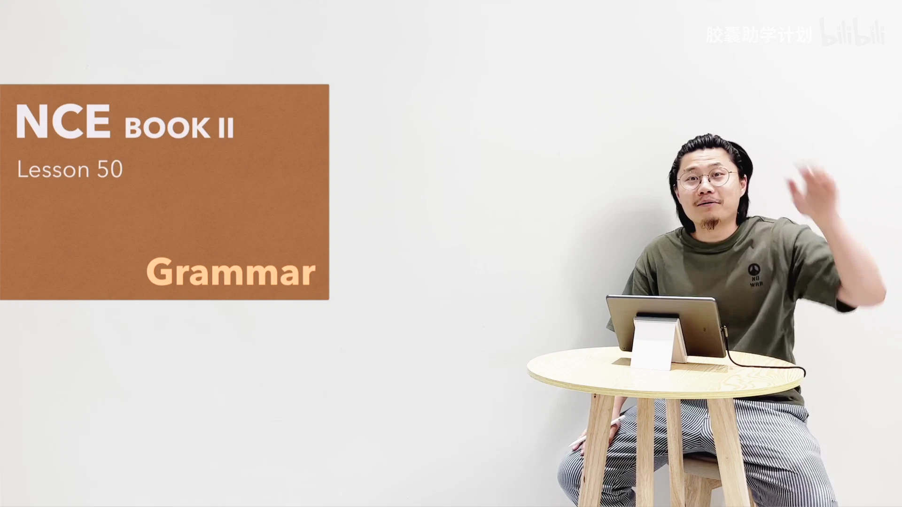

文字识别：NCE / BOOK"I / Lesson 50 / Grammar

### 画面 00:00:02

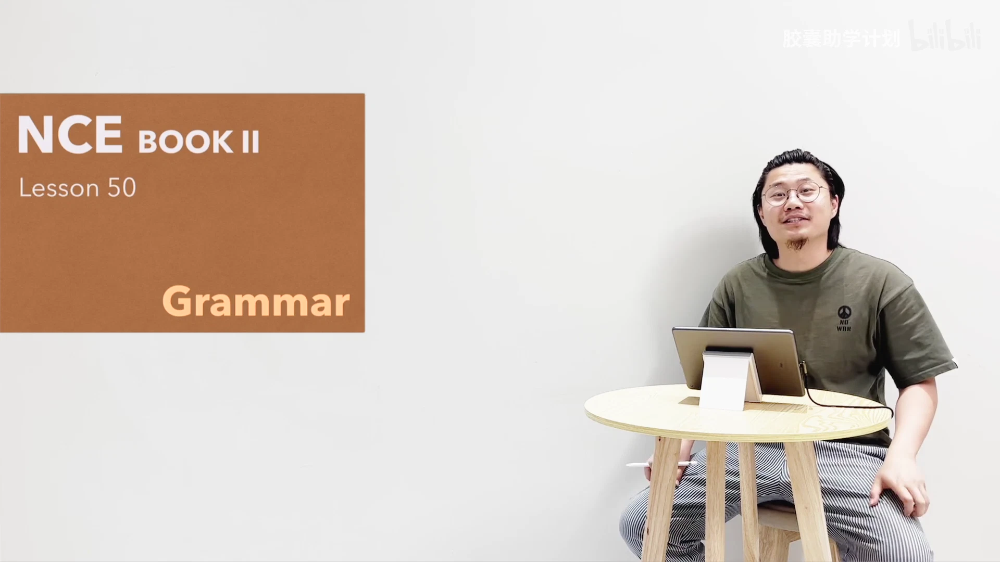

文字识别：NCE / BOOK I"I / Lesson 50 / Grammar / WIR / NO

### 画面 00:00:09

文字识别：胶囊助学计划bl出

### 画面 00:00:13

### 画面 00:00:15

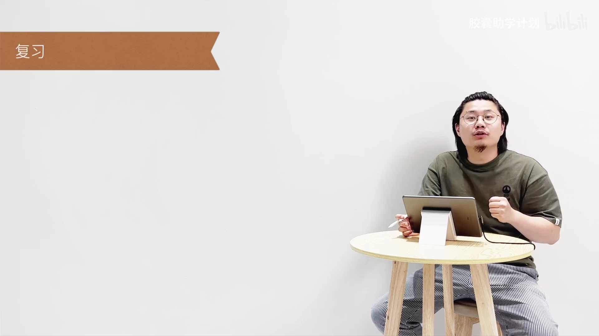

文字识别：复习

### 画面 00:00:19

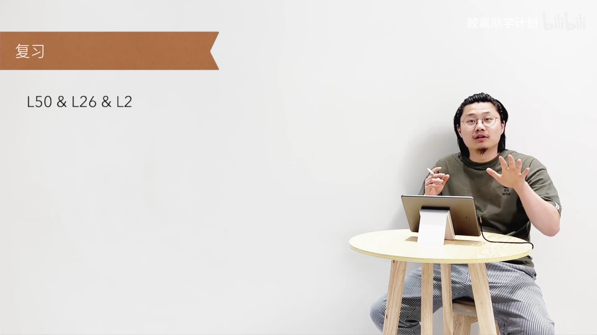

文字识别：复习 / L50 & L26 & L2 / NI / WnR

## 00:00:30–00:01:00

就是第二课是保持一致的，无非就是复习了两个语法，第一个叫一般现在时，第二个叫现在进行时。我们从新一学到今天，我觉得这两个语法各位应该是滚瓜烂熟了的，对吧？所以呢，我们就不再进行语法上更多的复习，我们直接进行什么呢？这个口语听力上的练习啊，然后又出现了这个网，无非就是告诉各位它属于是谓语这个地方的，对吧？好，我们直接进行 repetition drill 啊，口语听力练习，

### 画面 00:00:33

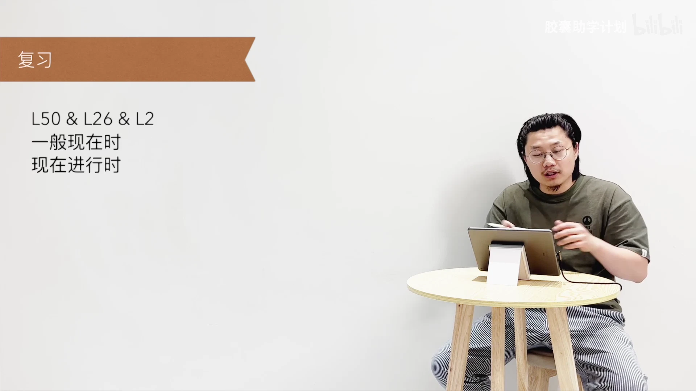

文字识别：复习 / L50 & L26 &L2 / 一般现在时 / 现在进行时

### 画面 00:00:47

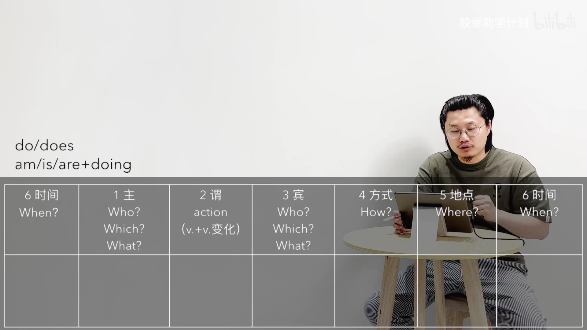

文字识别：do/does / am/is/are+doing / 6时间 / 1主 / 2谓 / 3宾 / 4方式 / 5地点 / 6时间 / When? / Who? / action / Who? / How? / Where? / When? / Which? / (v.+v.变化) / Which? / What? / What?

### 画面 00:00:53

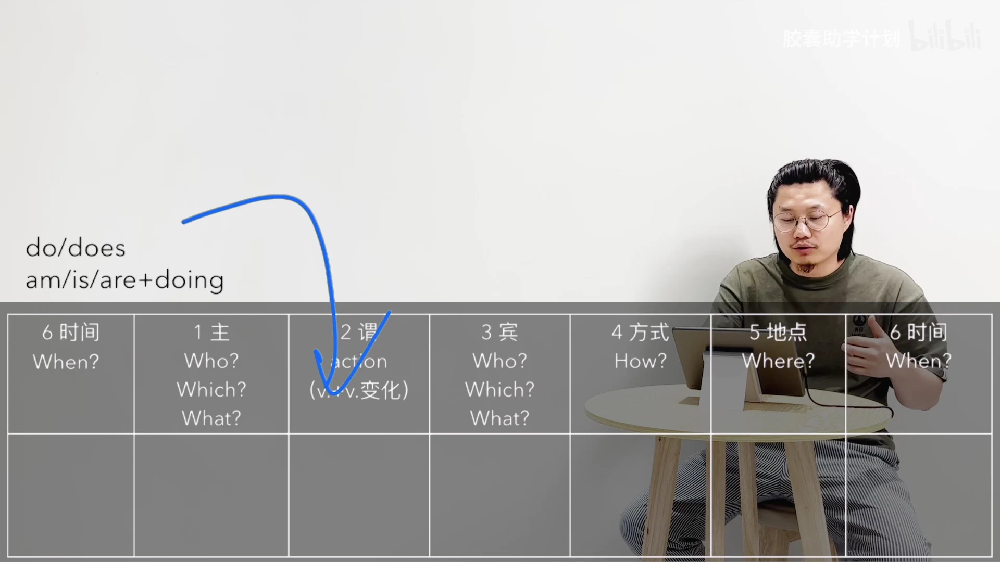

文字识别：do/does / am/is/are+doing / 6时间 / 1主 / 2谓 / 3宾 / 4方式 / 5地点 / 6时间 / When? / Who? / ict/on / Who? / How? / Where? / When? / Which? / (X.变化) / Which? / What? / What?

### 画面 00:00:56

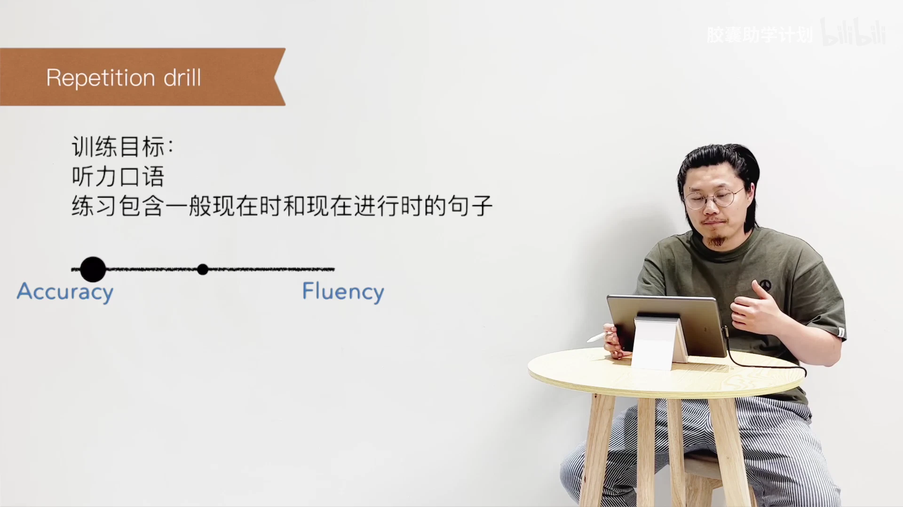

文字识别：Repetition drill / 训练目标： / 听力口语 / 练习包含一般现在时和现在进行时的句子 / Accuracy / Fluency

## 00:01:00–00:01:30

我问您答，反复进行跟读，啊，你如果初期觉得我问你答你答不出来怎么办呢？特别的简单，就是我问，你跟着我读，我答，你跟着我读，你就练了，对吧？我读的时候你练了听力，你跟读的时候你练了口语，就这么简单啊！这道练习就这么简单。来了，第一题，She usually wears her green hat.啊，因为都是我们以前会的单词，我就不特殊的

### 画面 00:01:18

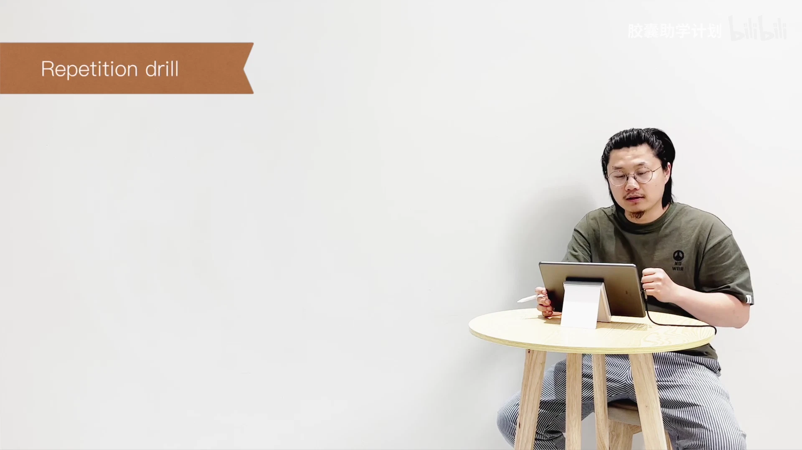

文字识别：Repetition drill / WIR

### 画面 00:01:20

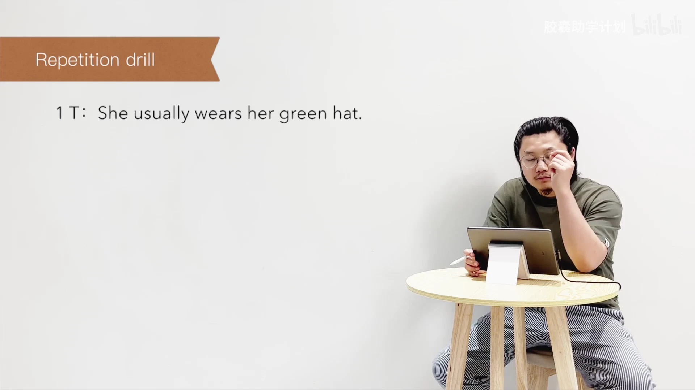

文字识别：Repetition drill / 1 T: She usually wears her green hat.

## 00:01:30–00:02:00

去挨个句子翻译了啊。各位张嘴做一个小的练习就行了，自己注意时态，对吧？But she isn't wearing it now. Next one. He usually means what he says, but he doesn't mean what's he saying. What he's saying now. Next one. I always need more money. Who doesn't? Okay. But you don't need more money

### 画面 00:01:35

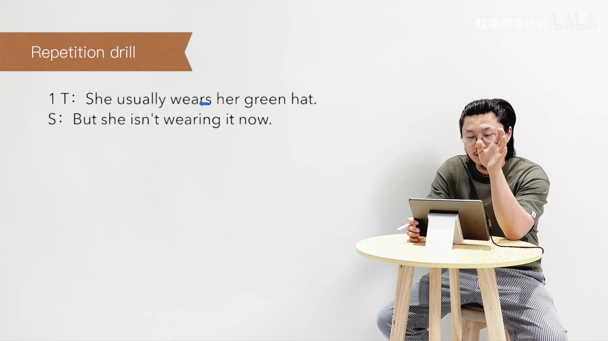

文字识别：Repetition drill / 1 T: She usually wears her green hat. / S: But she isn't wearing it now.

### 画面 00:01:44

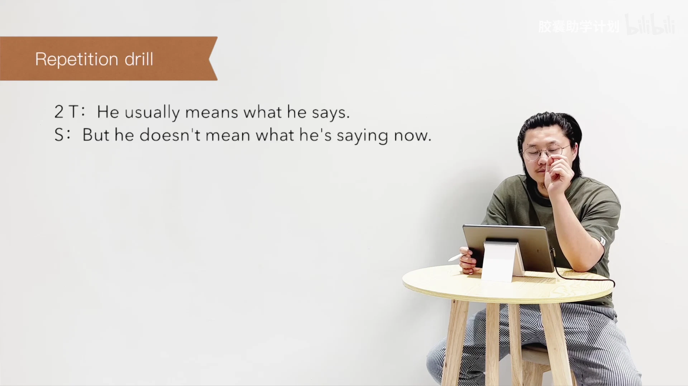

文字识别：Repetition drill / 2 T: He usually means what he says. / S: But he doesn't mean what he's saying now.

### 画面 00:01:53

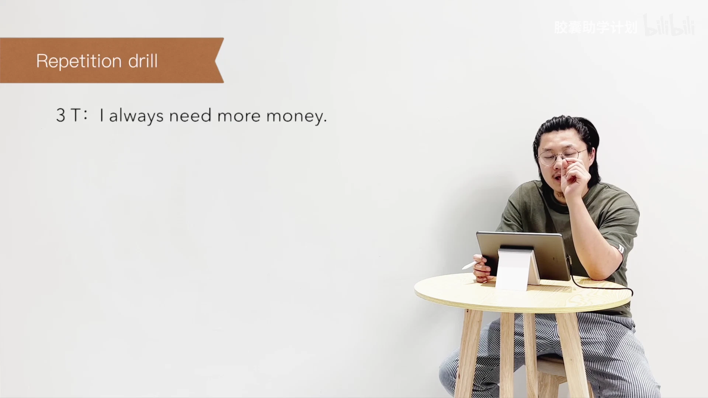

文字识别：Repetition drill / 3 T: I always need more money.

## 00:02:00–00:02:30

now.注意这里其实想告诉你一个很小的隐性的知识，但是这个知识各位脑海当中的概念就行了。就是并不是每一个动词都可以加ing或者都习惯加ing的，即使是用在现在，对吧？像need这样的单词，you don't need money now，对吧？它就不会说you are not needing money，是吧？就不会出现这样的句子啊。这其实更多的时候我们不用专门去背它，

### 画面 00:02:07

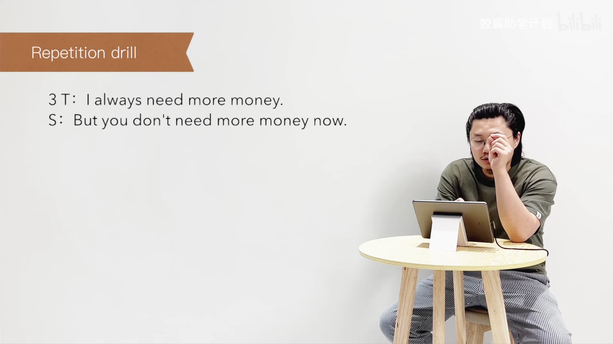

文字识别：Repetition drill / 3 T: I always need more money. / S: But you don't need more money now.

### 画面 00:02:11

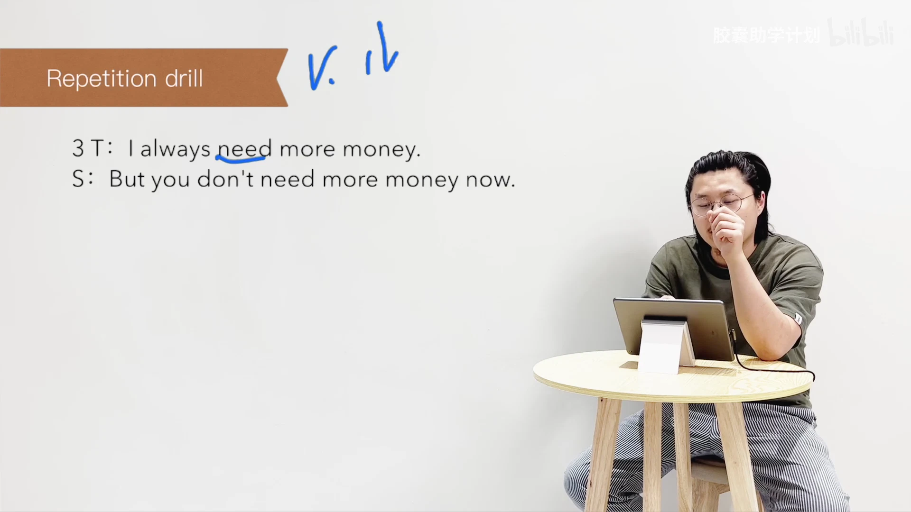

文字识别：ル / V. / Repetition drill / 3 T: Ialways peed more money. / S: But you don't need more money now.

### 画面 00:02:13

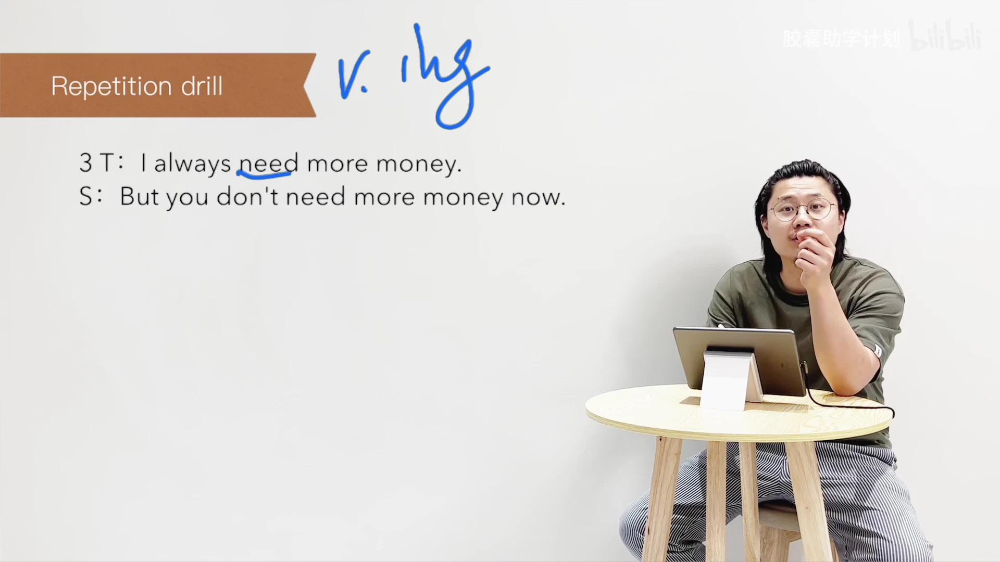

文字识别：V. / IW / Repetition drill / 3 T: I always peed more money. / S: But you don't need more money now.

### 画面 00:02:17

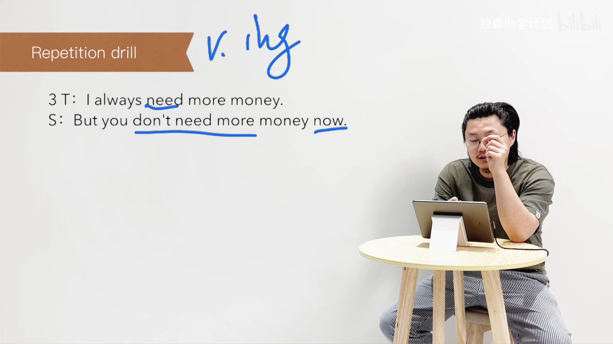

文字识别：V. / Repetition drill / 3 T: I always peed more money. / S: But you don't need more money now.

## 00:02:30–00:03:00

其实是各位英语输入正确的多了之后，你下意识的就会有一个印象了啊。这课的另一个讲法是什么呢？就是我给你罗列出来一堆动词啊，三五十个、五六十个、七八十个，给你个表格，告诉你说这些动词大部分情况下不会加ing，但是最恐怖的事情是，他们有的时候还可以加。所以你去想这个逻辑，如果我们这么去教，你的结果是什么？我给你列了五十个单词，告诉你这些单词大部分情况下不加ing，

### 画面 00:02:41

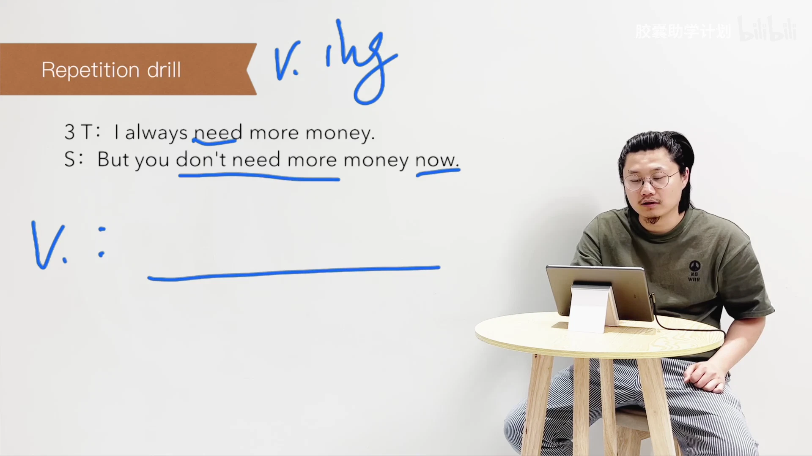

文字识别：V. / Repetition drill / 3 T: I always peed more money. / S: But you don't need more money r / now. / V. / WIR

### 画面 00:02:43

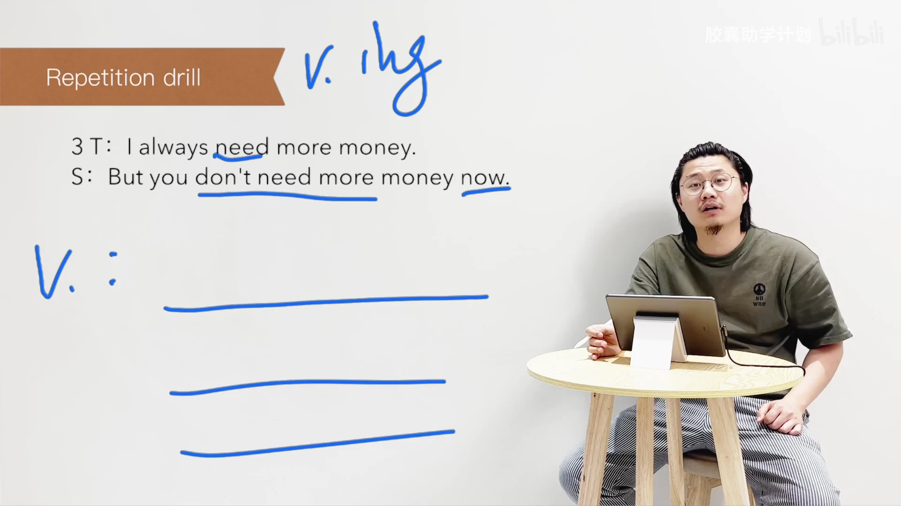

文字识别：V. / IW / Repetition drill / 3 T: I always peed more money. / S: But you don't need more money now. / V. / NU / WnR

### 画面 00:02:45

文字识别：V. / Repetition drill / 3 T: I always peed more money. / S: But you don't need more money r / now. / V / WnR / NU

### 画面 00:02:55

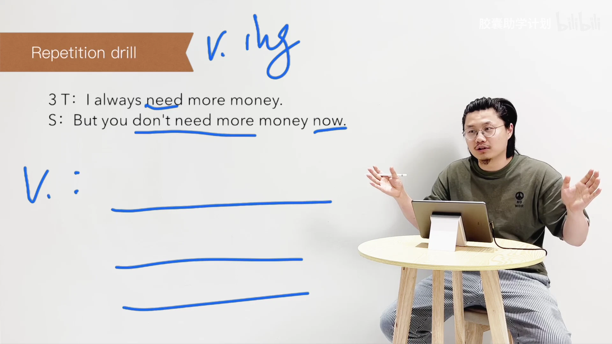

文字识别：V. / Repetition drill / 3 T: I always peed more money. / S: But you don't need more money now. / V. / WnR / ND

## 00:03:00–00:03:30

但有的时候他们可以加。这个对于你来说没有任何实际操作的，可就是这个呃呃，只只对对于你来说没有太多的帮助，对吧？只会让你不更崩溃，对吧？所以我们对于这样的零散的知识点学习方法，就是靠语感，大面积的输入，对吧？偶尔提一句就够了，不用专门去背，你也背不下来的啊。下一个，He always travels by train， but he isn't

### 画面 00:03:06

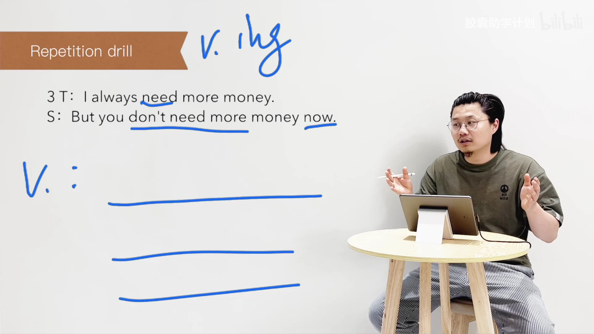

文字识别：V. / IW / Repetition drill / 3 T: I always peed more money. / S: But you don't need more money now. / V / ND / WnR

### 画面 00:03:21

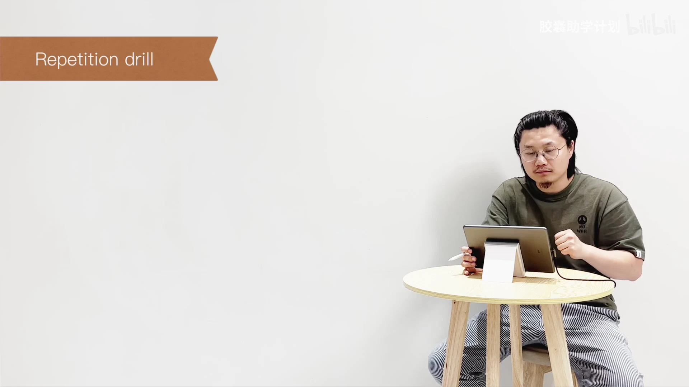

文字识别：Repetition drill / WIR / NU

### 画面 00:03:28

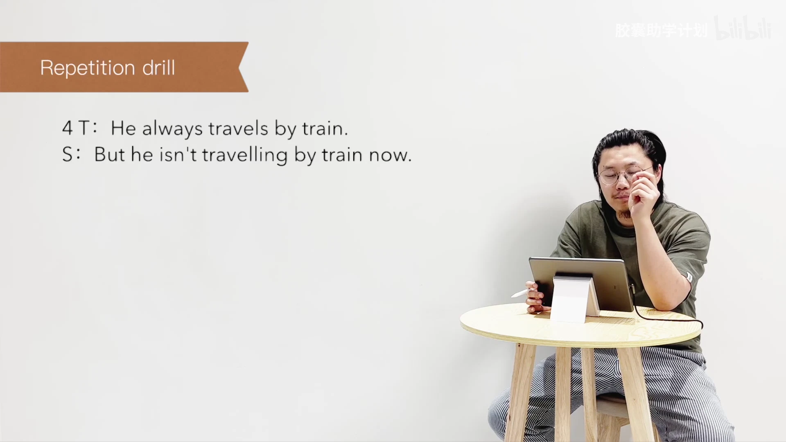

文字识别：Repetition drill / 4 T: He always travels by train. / S: But he isn't travelling by train now.

## 00:03:30–00:04:00

traveling by train now. Next one. He usually wants two boiled eggs, but he doesn't want two boiled eggs now. Yeah,你看啊，都是其实就这句话也是想告诉你啊，want即使用在现在一般也不会用wanting，对吧？不是说wanting不会出现，听见了吧？Okay. Next one. He usually sits at the front of the bus,

### 画面 00:03:39

文字识别：Repetition drill / 5 T: He usually wants two boiled eggs. / S: But he doesn't want two boiled eggs now.

### 画面 00:03:47

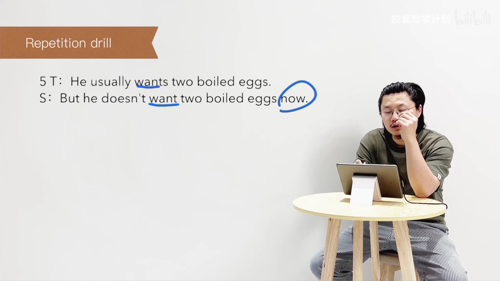

文字识别：Repetition drill / 5 T: He usually wants two boiled eggs. / S: But he doesn't want two boiled eggshow.

### 画面 00:03:54

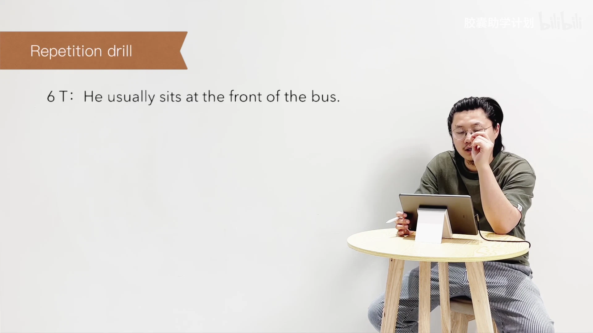

文字识别：Repetition drill / 6 T: He usually sits at the front of the bus.

## 00:04:00–00:04:30

but he isn't sitting at the front of the bus now.你看sit就各位来说，你很容易理解，对吧？这个建的输入的变数太多了。Next one, that vase usually contains flowers, but it doesn't contain flowers now.包含contain对吧？你看它不加ing是吧？She usually is his. It's oh sorry, she usually is

### 画面 00:04:08

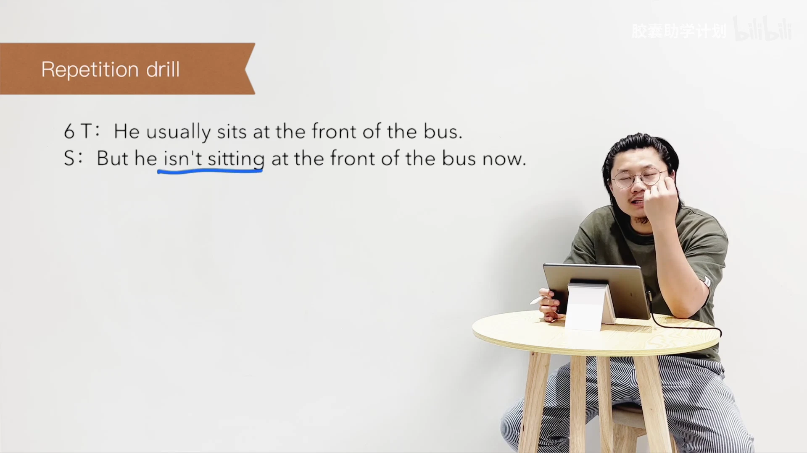

文字识别：Repetition drill / 6 T: He usually sits at the front of the bus. / S: But he isn't sitting at the front of the bus now.

### 画面 00:04:12

文字识别：Repetition drill / 7 T: That vase usually contains flowers.

## 00:04:30–00:05:00

at this restaurant, but she isn't eating at this restaurant now. Next one, I always prefer wine, but you don't prefer wine now. 告诉你还是啊，prefer一般后边不加ing对吧？其次，prefer这个单词叫更喜欢对吧？更愿意要什么东西？这是我们本课一个学习的重中之重。进入文章那个视频当中，我们再去讲，好吧？下一个，The waiter

### 画面 00:04:31

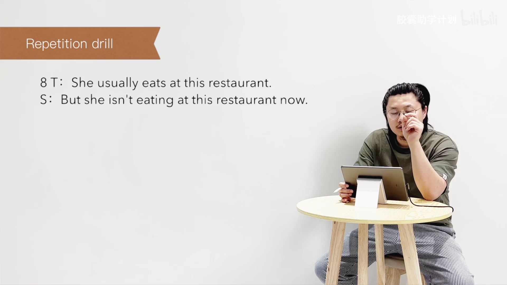

文字识别：Repetition drill / 8 T: She usually eats at this restaurant. / S: But she isn't eating at this restaurant now.

### 画面 00:04:36

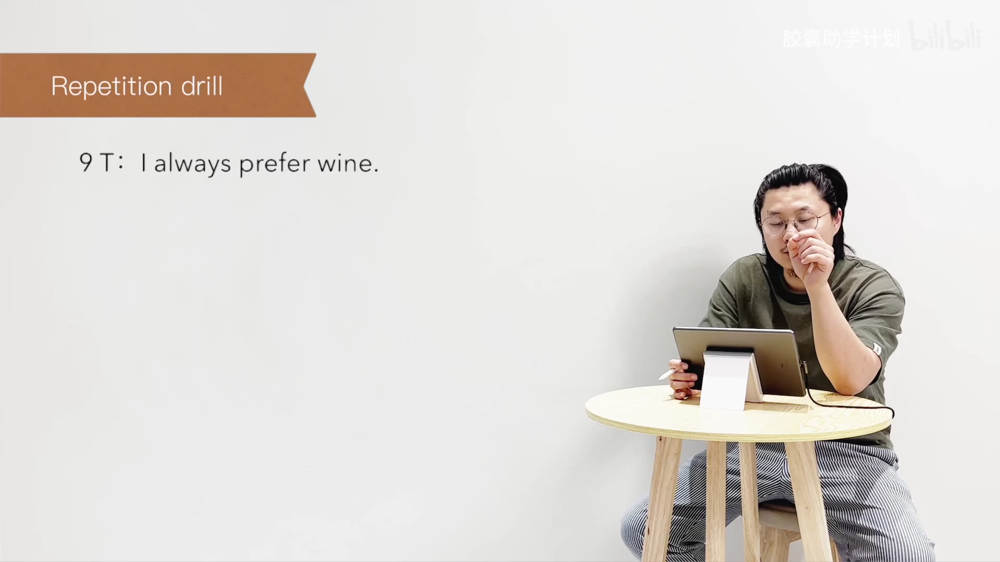

文字识别：Repetition drill / 9 T: I always prefer wine.

### 画面 00:04:47

文字识别：Repetition drill / 9 T: I alwaysprefer wine. / S: But you don't / orefe / wine now.

### 画面 00:04:49

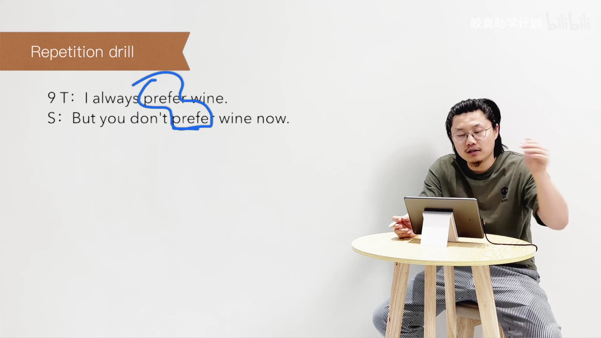

文字识别：Repetition drill / 9 T: I always preferwine. / S: But you don't / orefe / wine now.

### 画面 00:04:57

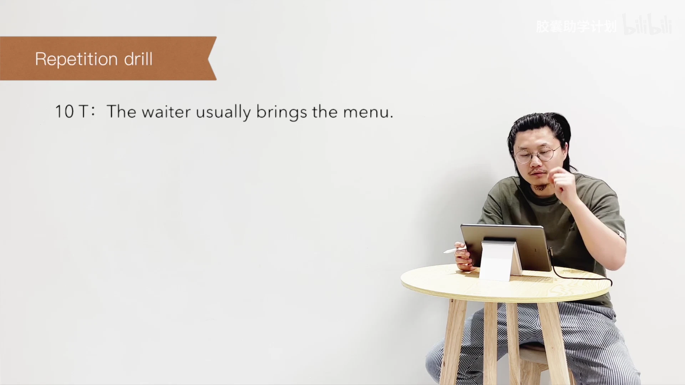

文字识别：Repetition drill / 10 T: The waiter usually brings the menu.

## 00:05:00–00:05:30

usually brings the menu, but he isn't bringing the menu now. 好，这题结束了。Pattern drill, pattern drill还是老习惯，对吧？我要做的事情就是告诉你这两句话是什么意思，要练的我们是什么语法或句型。然后你下课要做的事情是把这个往里面去带，对吧？哎，看着这儿怎么去带？你从这里往里去带啊。比如说，look at him, 瞧他, he's kicking the dog, 啊，他正在踢一条狗。注意，be doing 正在。I

### 画面 00:05:06

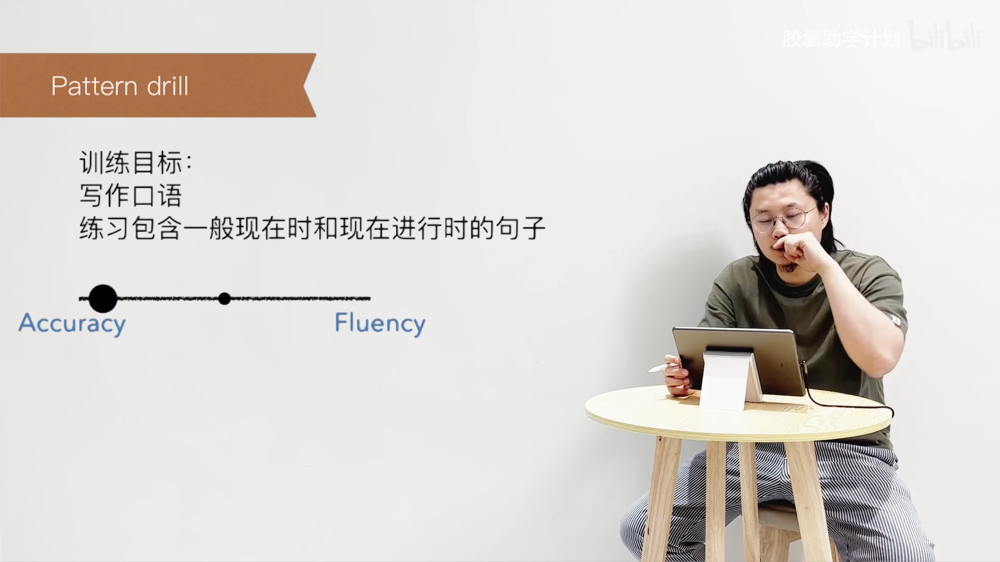

文字识别：Pattern drill / 训练目标： / 写作口语 / 练习包含一般现在时和现在进行时的句子 / Accuracy / Fluency

### 画面 00:05:09

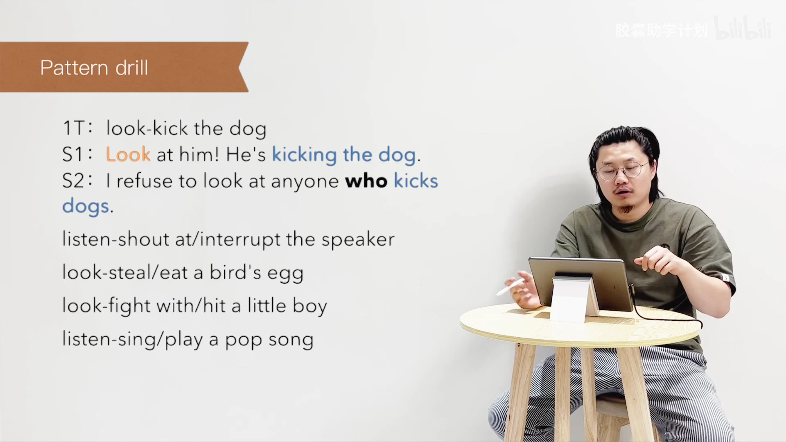

文字识别：Pattern drill / 1T:look-kick the dog / S1: Look at him! He's kicking the dog. / S2: I refuse to look at anyone who kicks / dogs. / listen-shout at/interrupt the speaker / look-steal/eat a bird's egg / look-fight with/hit a little boy / listen-sing/play a pop song

### 画面 00:05:23

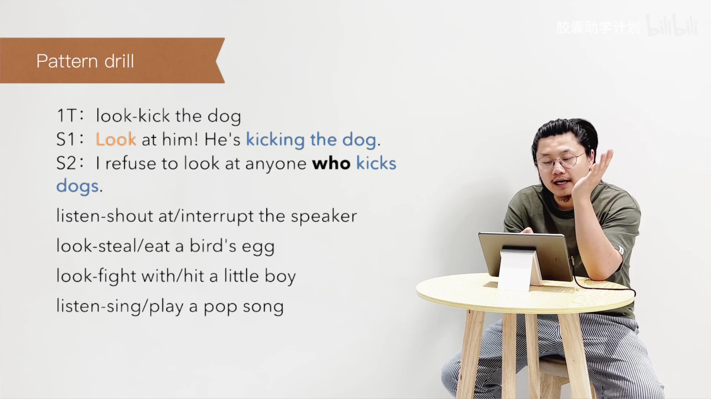

文字识别：Pattern drill / 1T: look-kick the dog / S1: Look at him! He's kicking the dog. / S2: I refuse to look at anyone who kicks / dogs. / listen-shout at/interrupt the speaker / look-steal/eat a bird's egg / look-fight with/hit a little boy / listen-sing/play a pop song

## 00:05:30–00:06:00

refuse to look at anyone. 我拒绝去看任何人. Who kicks dog? 你看这句话口语当中直接就给你加了个定语从句. 我拒绝去看任何人，什么样的人呢？踢狗的人。所以你看，踢狗的人，他其实用的就是一般现在时，陈述客观事实，对吧？OK，往里带啊。第二个. Why are you buying a Ford? 啊，说为什么你正在买Ford这辆车呢？这是一个车的名字啊，我就不

### 画面 00:05:52

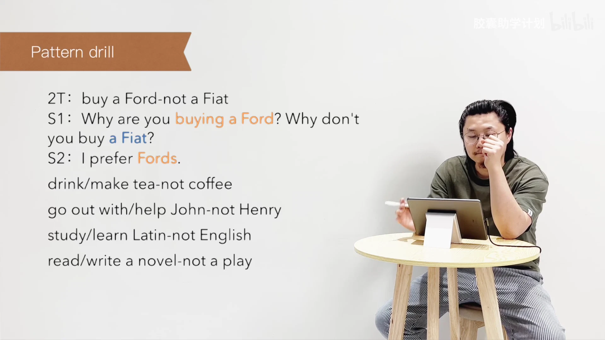

文字识别：Pattern drill / 2T: buy a Ford-not a Fiat / S1: / : Why / are you / buying a Ford? Why don't / you buy a Fiat? / S2:I prefer Fords. / drink/make tea-not coffee / go out with/help John-not Henry / study/learn Latin-not English / read/write a novel-not a play

## 00:06:00–00:06:30

提了，否则有可能打嫌打广告的嫌疑是吧？各位自己去查啊，这个我们新一也都学过。说你为什么正在买一辆 Ford 呢？Why don't you buy a Fiat？说你为什么不买一辆 Fiat 啊？I prefer Force 啊，我更喜欢 Force. Mary, good.好，Why on earth is she buying that hat？注意这里 on earth，其实跟 in the world 是一样，它是对于语气的一个强调，叫做究竟是吧？

### 画面 00:06:17

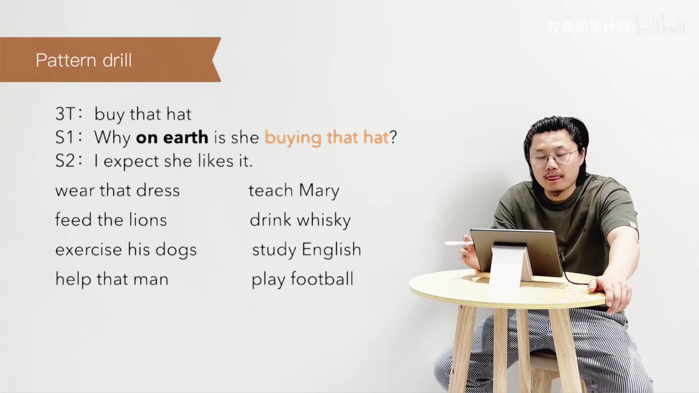

文字识别：Pattern drill / 3T: buy that hat / S1: Why on earth is she buying that hat? / S2: Iexpect she likes it. / wear that dress / teach Mary / feed the lions / drink whisky / exercise his dogs / study English / help that man / play football

## 00:06:30–00:07:00

说为什么就他究竟为什么他正在买那个帽子呢？I expect she likes it. 我预期，我猜想可能是她喜欢它，对吧？哎，所以这里边的那个 expect 类似于 I guess，有点像，不完全相同，或者可可以换成啊，往里面去带，对吧？最后一个，Hasn't she arrived yet? 他还没有到达吗？No, but I'm expecting her to arrive

### 画面 00:06:47

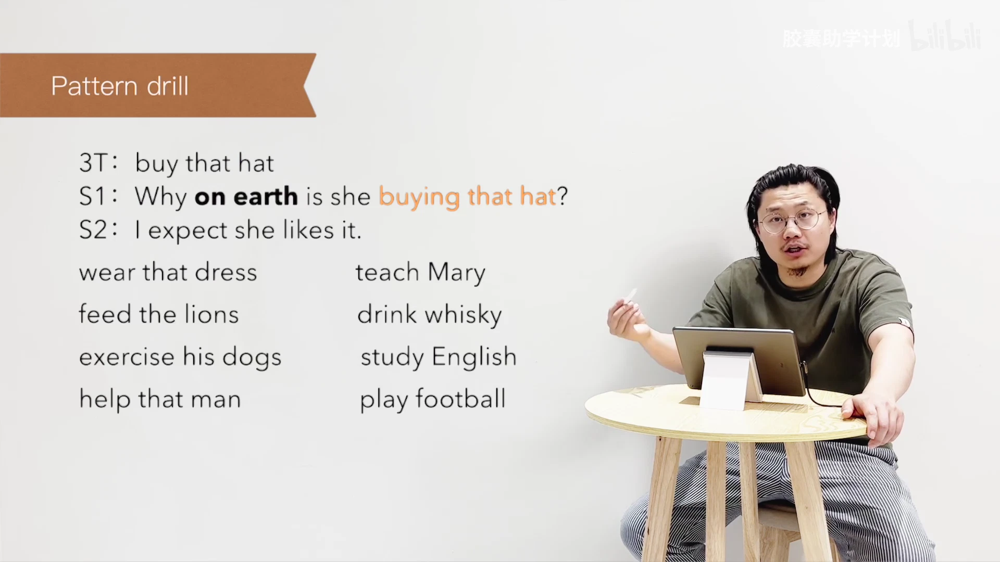

文字识别：Pattern drill / 3T:buy that hat / S1: Why on earth is she buying that hat? / S2: I expect she likes it. / wear that dress / teach Mary / feed the lions / drink whisky / exercise his dogs / study English / help that man / play football

### 画面 00:06:51

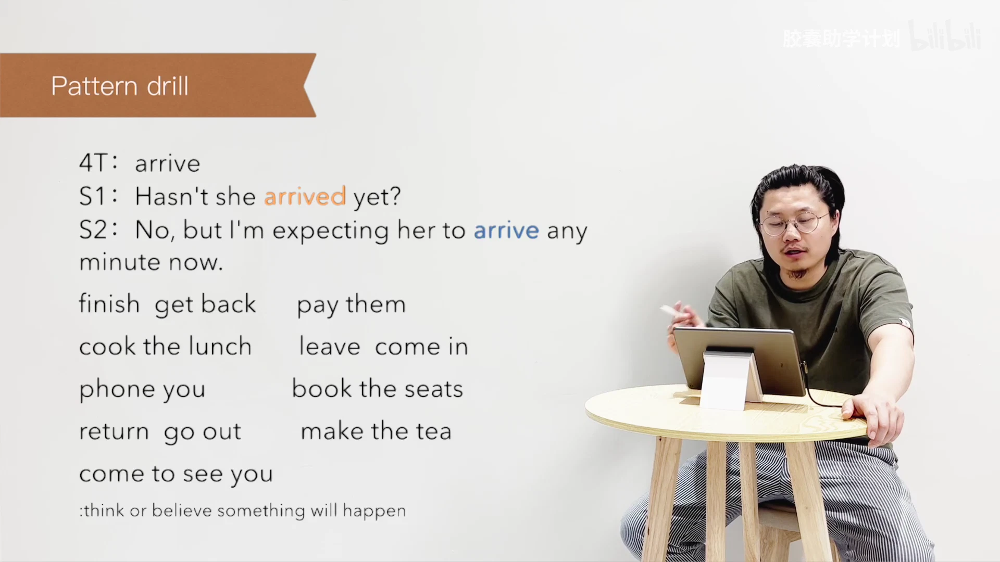

文字识别：Pattern drill / 4T:arrive / S1: Hasn't she arrived yet? / S2: No, but I'm expecting her to arrive any / minute now. / finish get back / pay them / cook the lunch / leave come in / phone you / book the seats / return go out / make the tea / come to see you / :think or believe something will happen

## 00:07:00–00:07:30

any minute now,但是我预计期待说呀会什么事情会发生呢？她随时会到 any minute now,就是随时会发生，对吧？Arrive就到达。注意这个点叫做 be expecting.其实我们第七课就学过这个单词，对吧？当时我就提到它两个常用的意思：期待等待的时期待等待的时候，对吧？啊，期待的时候往往不加ing，等待的时候往往加ing，对吧？这个地方呢，其实你

### 画面 00:07:21

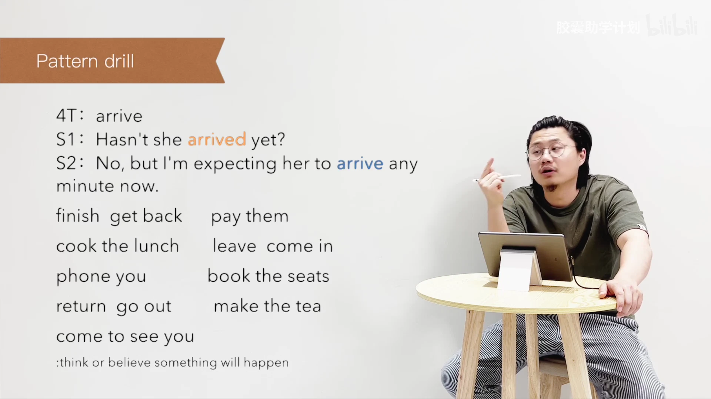

文字识别：Pattern drill / 4T:arrive / S1: Hasn't she arrived yet? / S2: No, but I'm expecting her to arrive any / minute now. / finish get back / pay them / cook the lunch / leave come in / phone you / book the seats / return go out / make the tea / come to see you / :think or believe something will happen

## 00:07:30–00:08:00

你可以把它当做我们直接给大家翻译了一下，对吧？叫做think or believe something will happen。你可以把它当做一个小的句型，叫做I'm expecting somebody to do something any minute now，对吧？我期待某人去做某件事情，随时都可能会做啊。对于未来的一个期待或等待。OK, very good.啊，think or believe something will happen，还是往里面去带这个事儿就结

### 画面 00:07:51

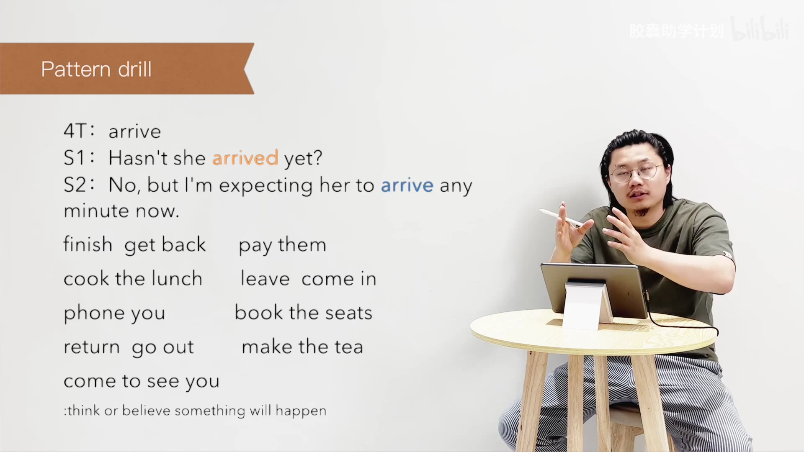

文字识别：Pattern drill / 4T:arrive / S1: Hasn't she arrived yet? / S2: No, but I'm expecting her to arrive any / minute now. / finish get back / pay them / cook the lunch / leave come in / phone you / book the seats / return go out / make the tea / come to see you / :think or believe something will happen

## 00:08:00–00:08:30

束了，好吧？好，呃，recap本课啊，我们没有再对语法进行进一步的复习，只是我们拿语法去进行了更多的练习，对吧？这也是我们学习英语最终的一个目的。OK，好，那家庭作业呢？Pattern Drill老习惯，你先写，然后再大声朗读。我们现在不要去专栏里面找了，直接看置顶的视啊，这个我们视频的置顶留言里面就有。OK，好，然后呢，尝试回

### 画面 00:08:01

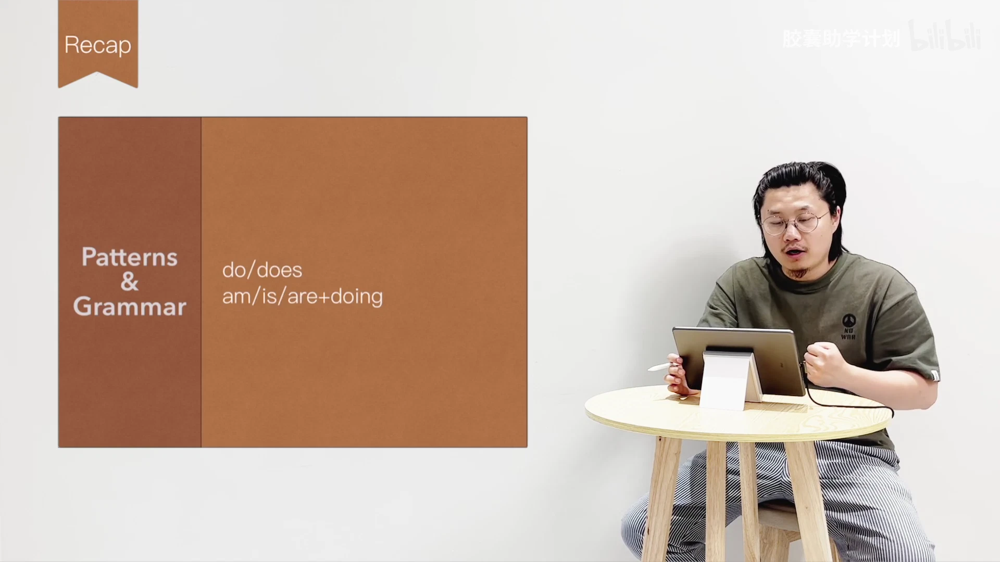

文字识别：Recap / Patterns / do/does / ＆ / am/is/are+doing / Grammar / WIR

### 画面 00:08:03

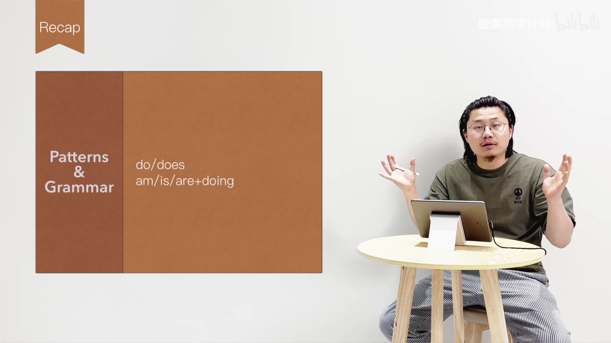

文字识别：Recap / Patterns / do/does / am/is/are+doing / Grammar / ND / WIR

### 画面 00:08:05

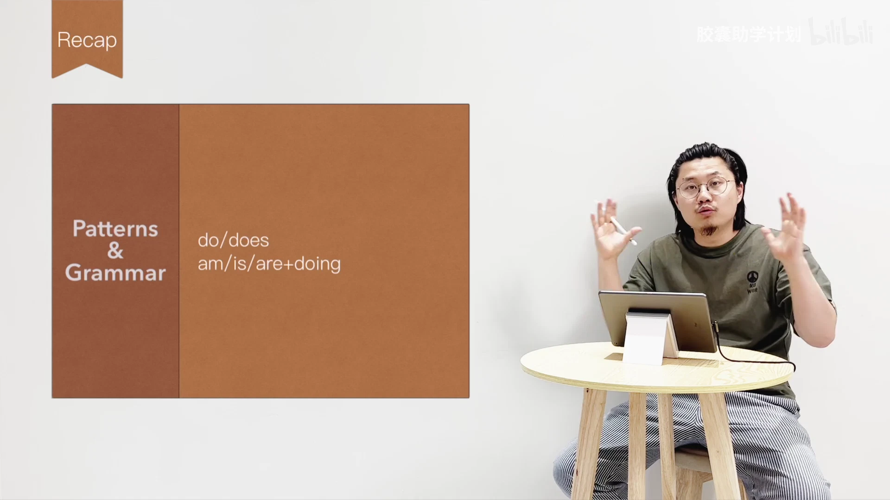

文字识别：Recap / Patterns / do/does / ＆ / am/is/are+doing / Grammar

### 画面 00:08:10

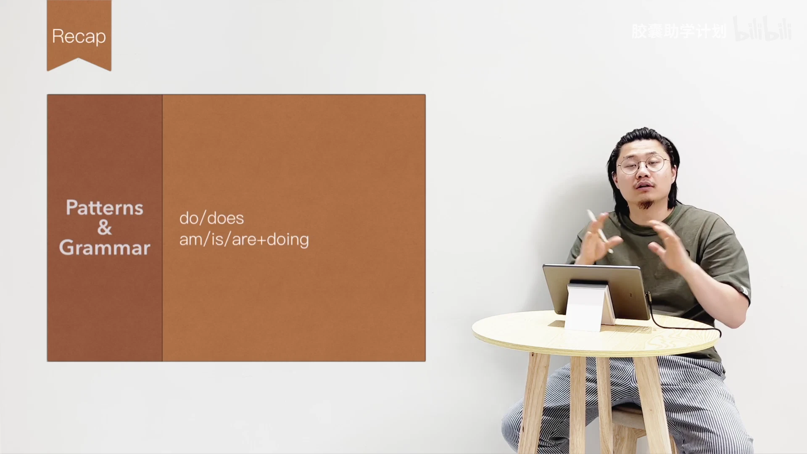

文字识别：Recap / Patterns / do/does / ＆ / am/is/are+doing / Grammar

### 画面 00:08:12

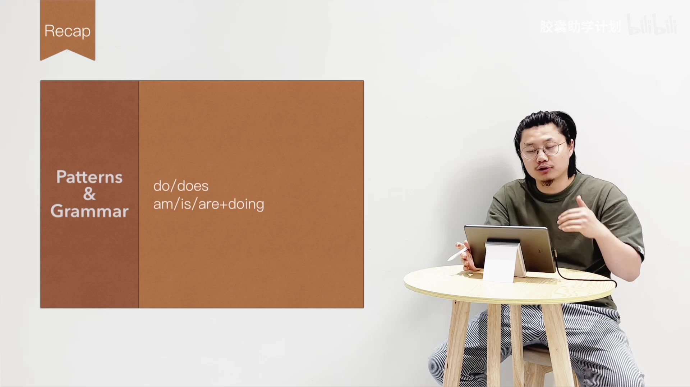

文字识别：Recap / Patterns / do/does / am/is/are+doing / Grammar

### 画面 00:08:15

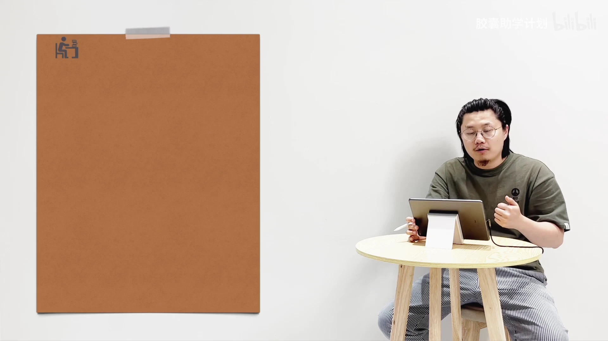

### 画面 00:08:17

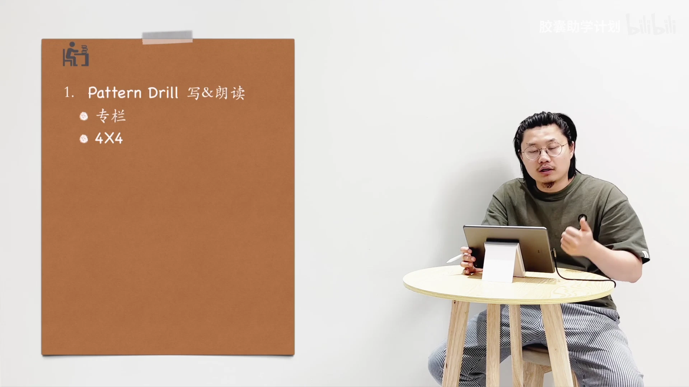

文字识别：1. / Pattern Drill写&朗读 / 专栏 / 4×4

### 画面 00:08:20

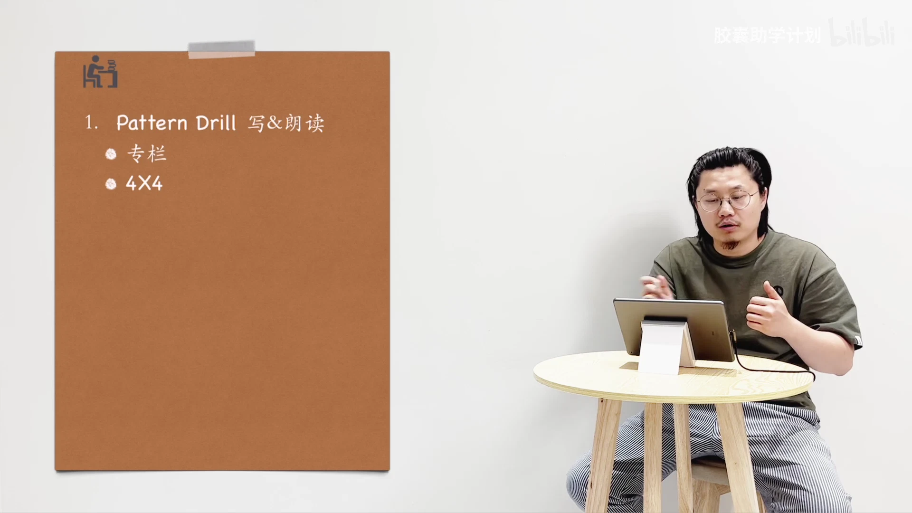

文字识别：1.f / Pattern Drill 写&朗读 / 专栏 / 4×4

### 画面 00:08:25

文字识别：1.f / Pattern Drill写&朗读 / 专栏 / 4×4

### 画面 00:08:28

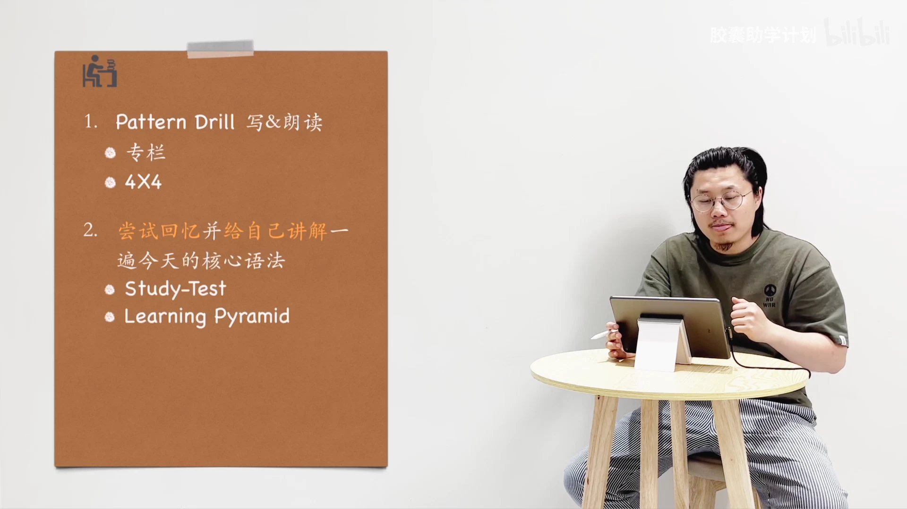

文字识别：Pattern Drill写&朗读 / 1. / 专栏 / 4×4 / 尝试回忆并给自己讲解一 / 遍今天的核心语法 / Study-Test / ND / Learning Pyramid / WNR

## 00:08:30–00:09:00

忆给自己讲解今天的核心语法。你不妨回忆一下这两个时态，给自己去讲一遍啊。我们已经学到了今天这两个时态，应该是各位烂熟于胸的了，对吧？好，接下来呢，尝试翻阅红皮书。如果您之前还没有开始写，在这个视频下，我认为红皮书你可以开始去写了啊。好，那以上呢就是本期视频的全部内容了。如果各位喜欢我们的课程呢，欢迎各位关注、订阅、一键三连，分享给那些需要的朋友，来帮

### 画面 00:08:30

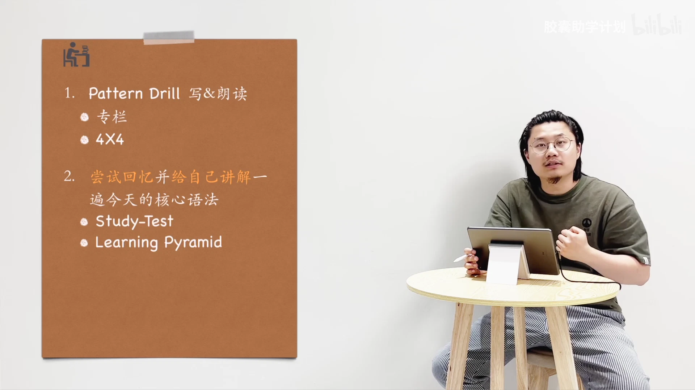

文字识别：1. f / Pattern Drill写&朗读 / 专栏 / 4×4 / 尝试回忆并给自己讲解一 / 遍今天的核心语法 / Study-Test / Learning Pyramid

### 画面 00:08:35

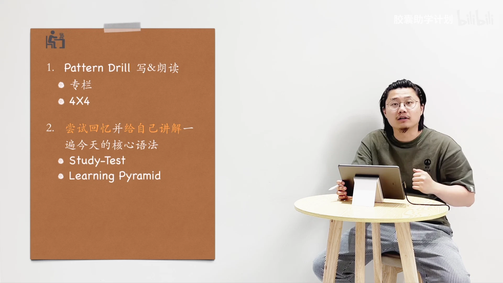

文字识别：Pattern Drill写&朗读 / 1. / 专栏 / 4×4 / 尝试回忆并给自己讲解一 / 遍今天的核心语法 / Study-Test / NO / Learning Pyramid

### 画面 00:08:40

文字识别：1. f / Pattern Drill写&朗读 / 专栏 / 4×4 / 尝试回忆并给自己讲解一 / 遍今天的核心语法 / Study-Test / Learning Pyramid / 尝试翻阅红皮书（中级） / 通过目录或索引(Index) / 查找到本课语法

### 画面 00:08:44

文字识别：1. ↑ / Pattern Drill 写&朗读 / 专栏 / 4×4 / 尝试回忆并给自己讲解一 / 遍今天的核心语法 / Study-Test / ND / Learning Pyramid / WnR / 尝试翻阅红皮书（中级） / 通过目录或索引(Index) / 查找到本课语法

### 画面 00:08:46

文字识别：1. f / Pattern Drill写&朗读 / 专栏 / 4×4 / 尝试回忆并给自己讲解一 / 遍今天的核心语法 / Study-Test / Learning Pyramid / 尝试翻阅红皮书（中级） / 通过目录或索引(Index) / 查找到本课语法

### 画面 00:08:50

文字识别：NI / WIR

## 00:09:00–00:09:15

助我们快速成长。See you next time.

### 画面 00:09:01

文字识别：Nn / QnR

### 画面 00:09:03

文字识别：CAPSULEACADEMY / 胶囊助学计划 / 『 / 小红书

### 画面 00:09:05

文字识别：CAPSULEACADEMY / 胶囊助学计划 / 『 / 小红书 / Leo

### 画面 00:09:11

文字识别：CAPSULEACADEMY / 胶囊助学计划 / 小红书 / Creator / Leo & Berlin / OE

### 画面 00:09:13

文字识别：bilibili / 胶囊助学计划

### 画面 00:09:14

文字识别：bilibili / 胶囊助学计划

