# 050 练习

快速机器解析：语音为单模型转写，未进行独立交叉校对或人工复核；画面每秒采样并按变化选帧，短时文字和标记可能遗漏。截图时间约有 1 秒误差。图片有损压缩；遇到疑点请按时间查看 Google Drive 原视频。

## 00:00:00–00:00:30

Hello, everyone. Welcome to Capsule Academy. This is Leo. Today we're going to learn New Concept English Book Two, Lesson Fifty Practices. That note:进行如下练习的唯一前提就是文章要跟读至熟读成诵，否则请勿开始。Hope you can enjoy it.那我们先看第一题啊。第一题锻炼大家能听懂一般疑问句和特殊疑问句的能力，对吧？我问，您答啊，就这么简单。第一题，

### 画面 00:00:00

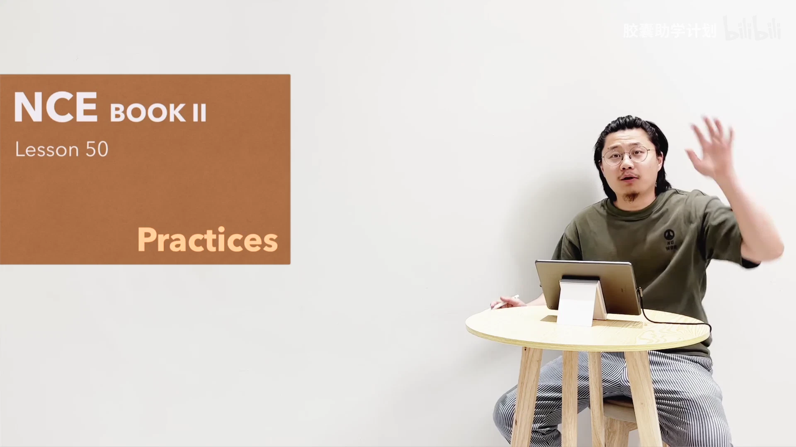

文字识别：NCE / BOOK II / Lesson 50 / Practices

### 画面 00:00:02

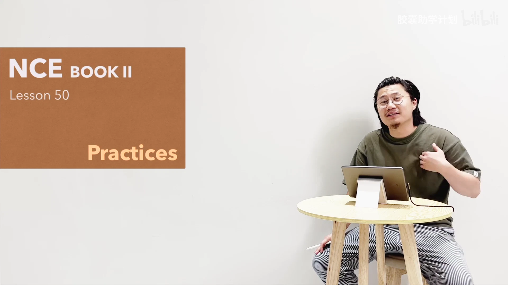

文字识别：NCE / BOOKII / Lesson 50 / Practices

### 画面 00:00:07

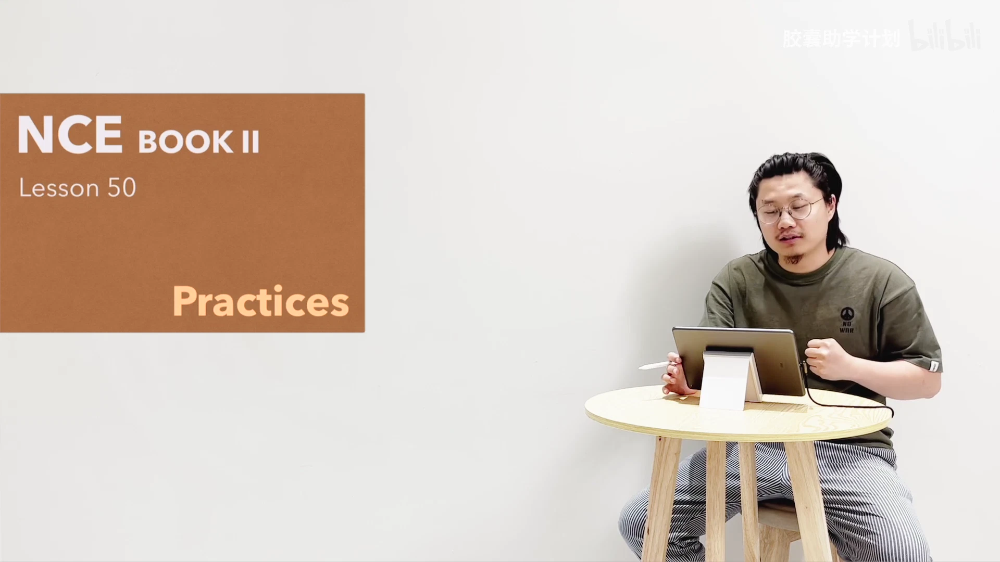

文字识别：NCE / BOOKI"I / Lesson 50 / Practices / NU / WAR

### 画面 00:00:09

文字识别：进行如下练习唯一前提 / 文章跟读至熟读成诵 / 否则请勿开始 / NU / WnR

### 画面 00:00:16

文字识别：胶囊助学计划 bilbl / •

### 画面 00:00:20

文字识别：胶囊助学计划

### 画面 00:00:22

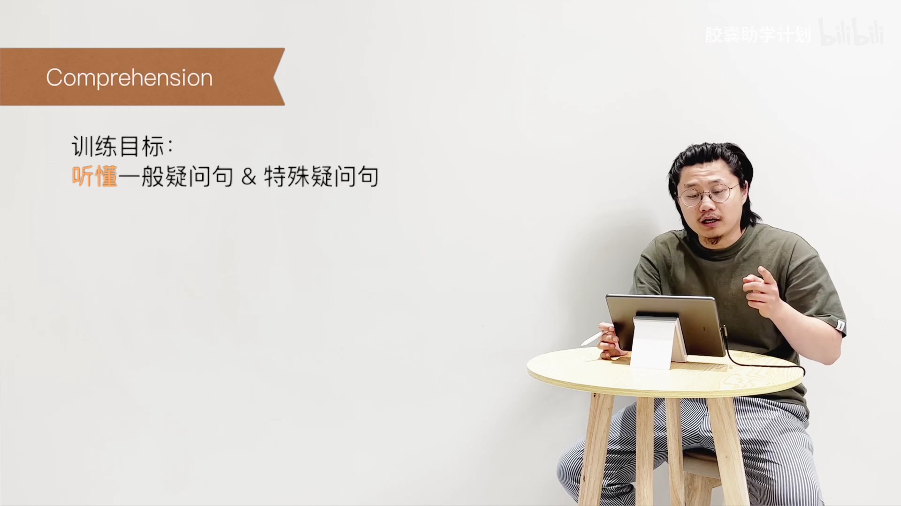

文字识别：Comprehension / 训练目标： / 听懂一般疑问句＆特殊疑问句

### 画面 00:00:29

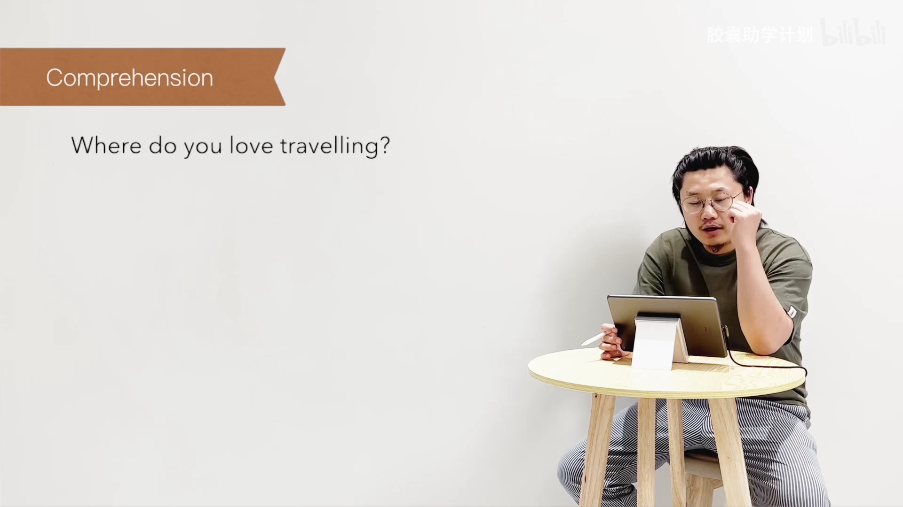

文字识别：Comprehension / Where do you love travelling?

## 00:00:30–00:01:00

Where do you love traveling? In the country. Next one. When did you go on an excursion? Recently. Next one. How long did your trip take you? Longer than I expected. Next one. Where were you going? To Woodford Green. Next one. How did you travel? By bus.

### 画面 00:00:46

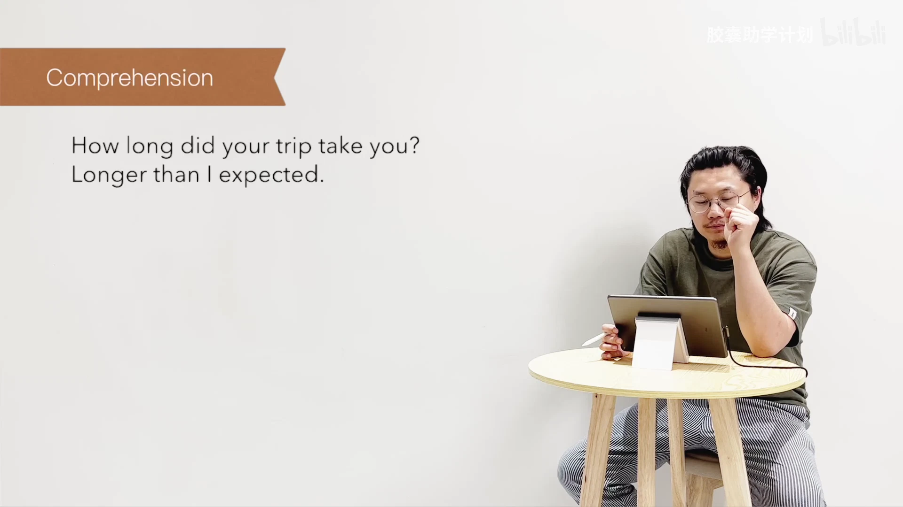

文字识别：Comprehension / How long did your trip take you? / Longer than I expected.

## 00:01:00–00:01:30

Next one, you didn't know where to get off, did you? No, I didn't. Did the conductor offer to tell you? Yes, he did. In what part of the bus did you sit? In the front of the bus. Why did you sit there? To get

### 画面 00:01:01

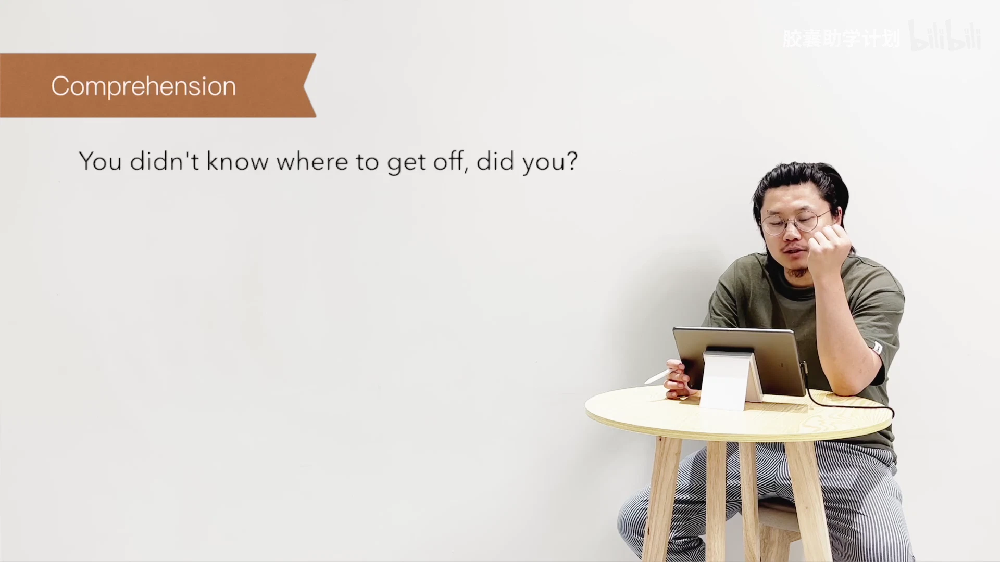

文字识别：Comprehension / You didn't know where to get off, did you?

## 00:01:30–00:02:00

a good view. When did the bus stop? After some time. Did you look round? Yes, I did. Why were you shocked? Because I realized that I was the only passenger left on the bus. What had the conductor forgotten? To put me

### 画面 00:01:31

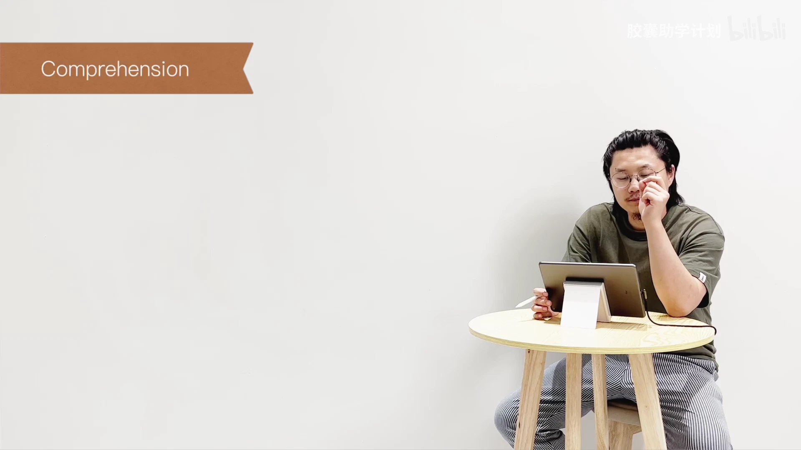

文字识别：Comprehension

### 画面 00:01:47

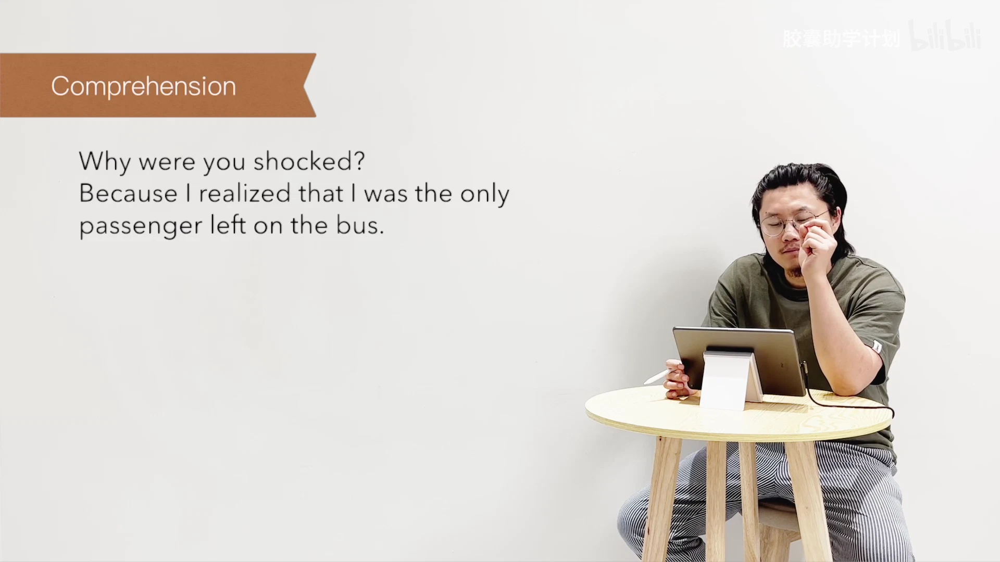

文字识别：Comprehension / Why were you shocked? / Because I realized that I was the only / passenger left on the bus.

### 画面 00:01:53

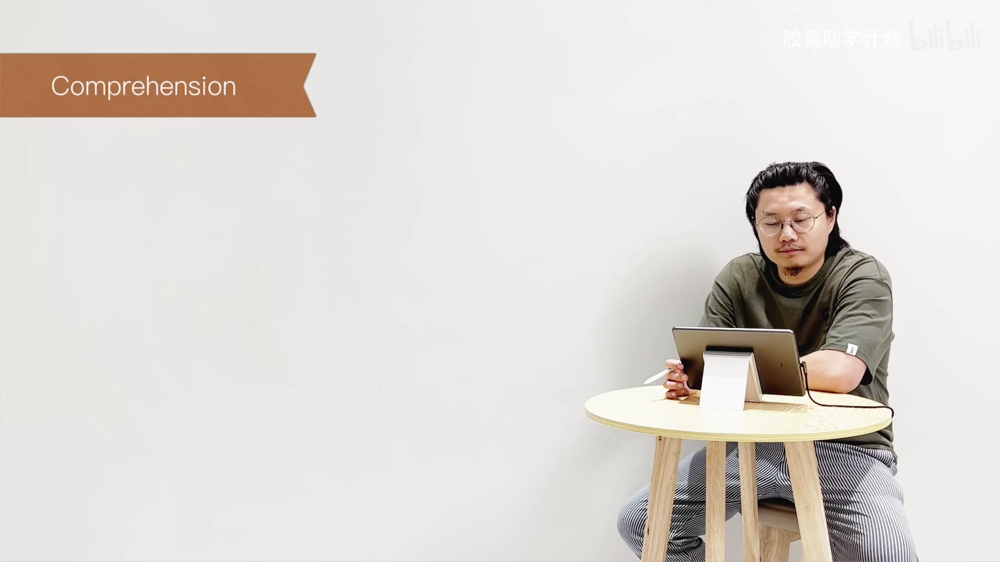

文字识别：Comprehension

## 00:02:00–00:02:30

off at Woodford Green. Were you angry with him? No, I wasn't.脾气很好啊。Asking questions,老习惯啊。练习我们能说出来一般疑问句和特殊疑问句的能力。I love traveling in the country.这肯定是杜题讲呗。Do you love traveling in the country? What? What do you love doing?当然你也可以直接就说What do you love?没有问题啊。What do you love doing?

### 画面 00:02:10

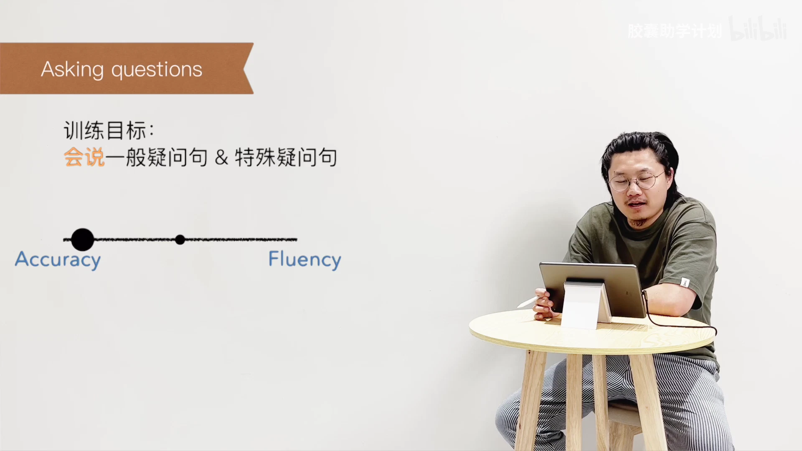

文字识别：Asking questions / 训练目标： / 会说一般疑问句＆特殊疑问句 / Accuracy / Fluency

### 画面 00:02:14

文字识别：Asking questions

### 画面 00:02:17

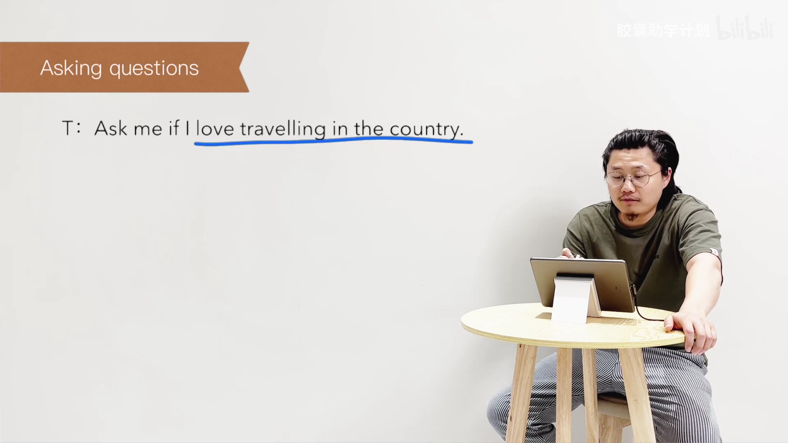

文字识别：Asking questions / T: Ask me if I love travelling in the country.

### 画面 00:02:22

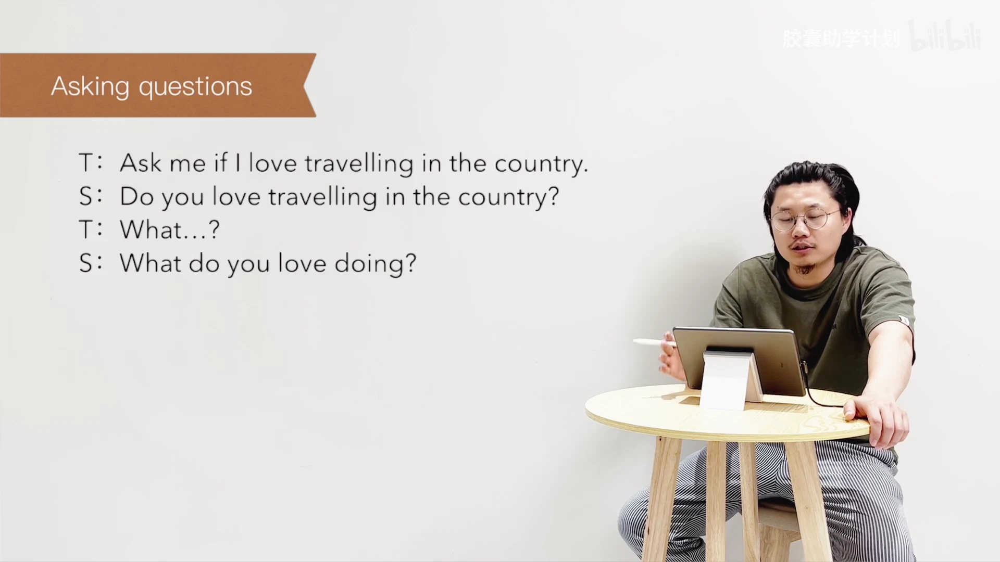

文字识别：Asking questions / T: Ask me if l love travelling in the country. / S: Do you love travelling in the country? / T: What...? / S: What do you love doing?

## 00:02:30–00:03:00

也可以啊。Okay. 呃，第二题，went did提前对吧？When就对recently提问啊。Went啊，did提前。How对by bus提问。Where加整句啊。My trip took me longer than I expected. 注意跟expected没关系，它是从句啊。你要用主句把did提前。How long？多长时间？答案就是

### 画面 00:02:31

文字识别：Asking questions

### 画面 00:02:34

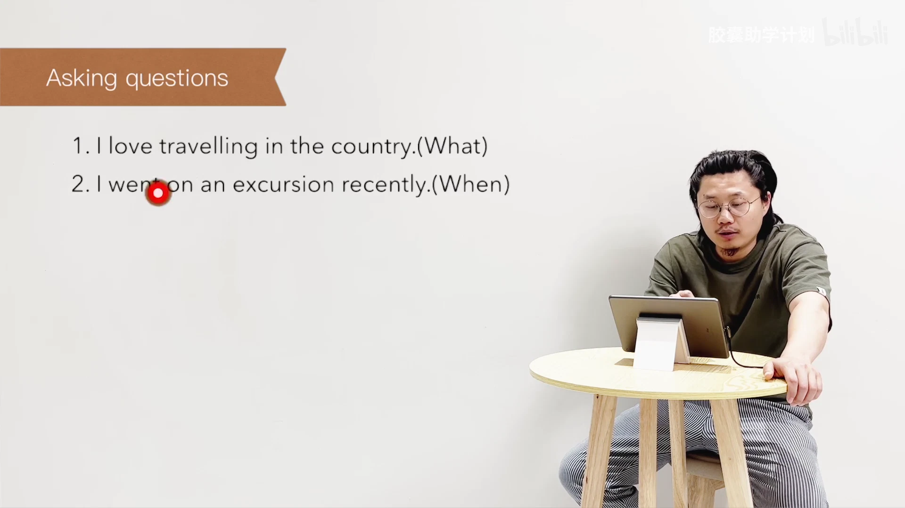

文字识别：Asking questions / 1.Ilove travelling in the country.(What) / 2.I wenoon an excursion recently.(When)

### 画面 00:02:44

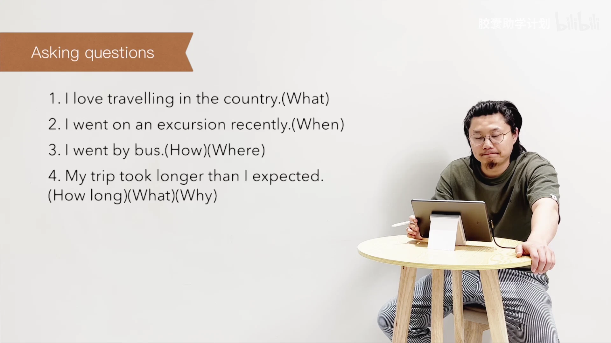

文字识别：Asking questions / 1.Ilove travelling in the country.(What) / 2.I went on an excursion recently.(When) / 3.I went by bus.(How)(Where) / 4. My trip took longer than I expected. / (How long)(What)(Why)

## 00:03:00–00:03:30

longer than I expected. How long did your trip take? What 对 my trip 提问，对吧？哎，然后你时态人称要注意变一下，对吧？就比如说 What took longer than you expected? 啊，Why 整句啊？I wanted to get off at Woodford Green. Did 提前啊？Did you want to get off at Woodford Green? Where 对 at Woodford Green 提问？Why 整句？Who 主语不用变一

### 画面 00:03:14

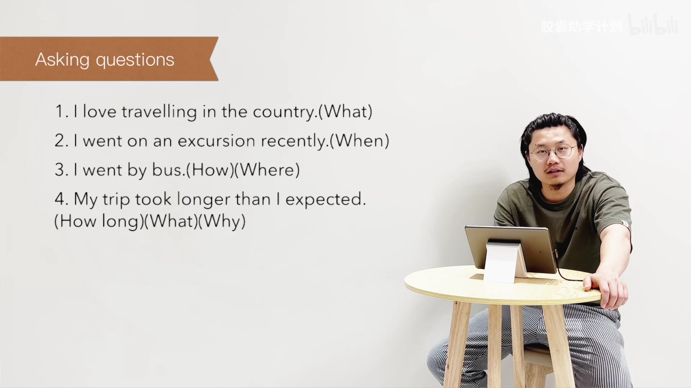

文字识别：Asking questions / 1.Ilove travelling in the country.(What) / 2.I went on an excursion recently.(When) / 3.I went by bus.(How)(Where) / 4. My trip took longer than Iexpected. / (How long)(What)(Why)

### 画面 00:03:22

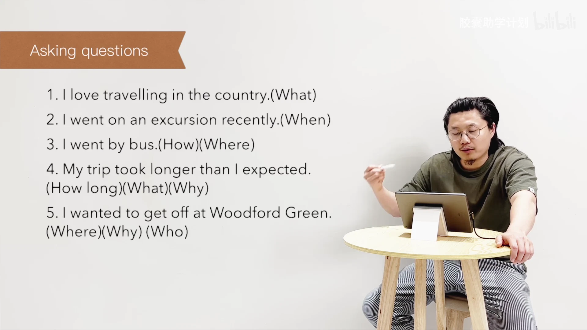

文字识别：Asking questions / 1.Ilove travelling in the country.(What) / 2.I went on an excursion recently.(When) / 3.I went by bus.(How)(Where) / 4. My trip took longer than I expected. / (How long)(What)(Why) / 5.I wanted to get of at Woodford Green. / (Where)(Why)(Who)

## 00:03:30–00:04:00

般疑问句。Who wanted to get off at Woodford Green?第六个，I told the conductor where I was going.啊，注意told did提前，对吧？不是was提前啊，这是从句，对吧？我们只看主句啊，不看从句的。Who可以对主语提问，不变一般疑问句。What？那就where I was going呗。What did you tell the conductor？你对他说了什么？He said，你看后边是个宾语从句，

### 画面 00:03:35

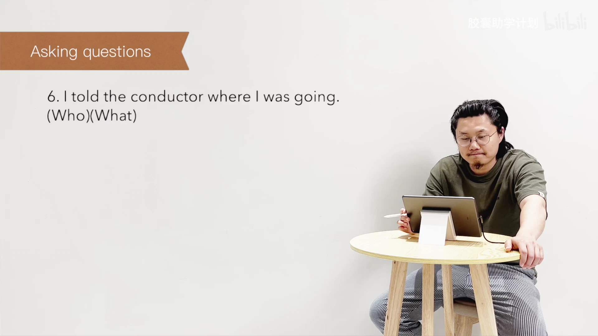

文字识别：Asking questions / 6.I told the conductor where I was going. / (Who)(What)

## 00:04:00–00:04:30

咱们不看后边，就看 did，对吧？ What 对宾语从句提问，What did he say？他说了什么呢？ Why？整句呗。 I sat in the front of the bus. Did 提前。 Where？ In the front of，对吧？你坐哪儿了？ Where did you sit？ I got a good view of the countryside. Did 提前，对吧？然后 what 点点 of？那 what 对 the countryside 呗？比如说 What did you get a good view of？

### 画面 00:04:05

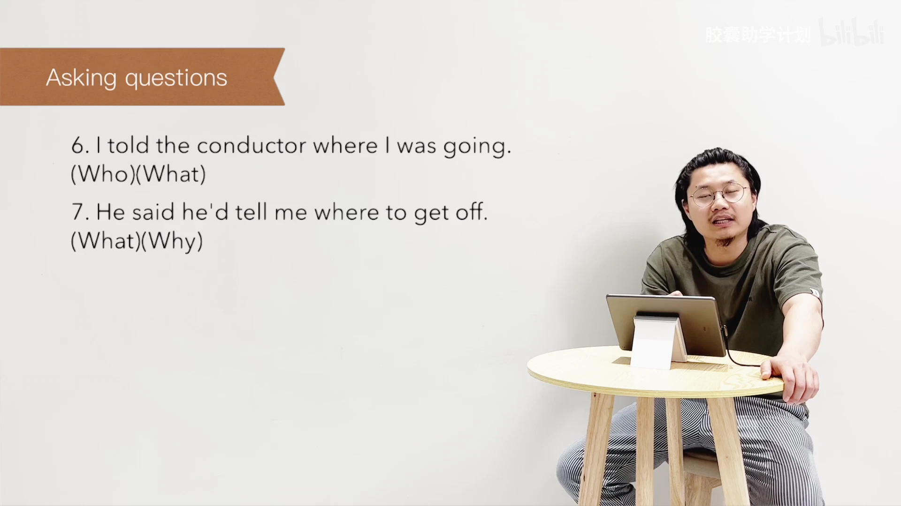

文字识别：Asking questions / 6.I told the conductor where I was going. / (Who)(What) / 7. He said he'd tell me where to get off. / (What)(Why)

### 画面 00:04:18

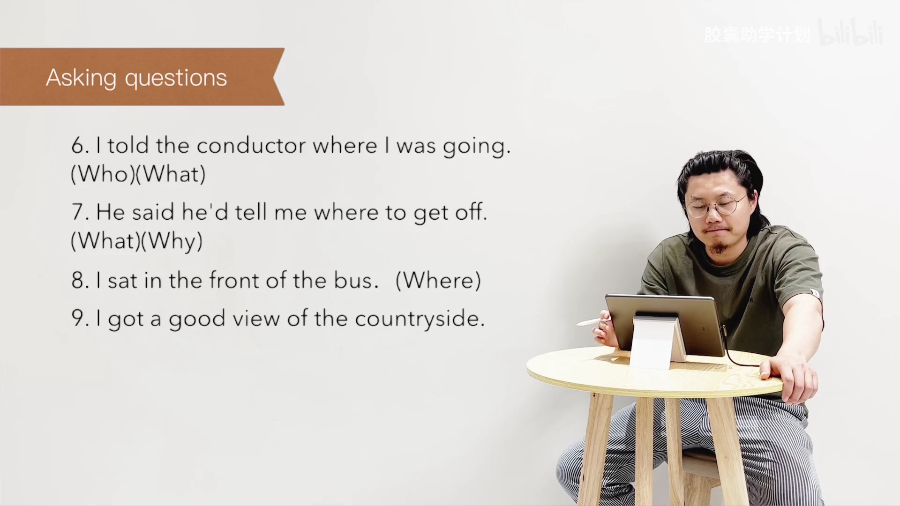

文字识别：Asking questions / 6.I told the conductor where I was going. / (Who)(What) / 7. He said he'd tell me where to get off. / (What)(Why) / 8.I sat in the front of the bus. (Where) / 9.I got a good view of the countryside.

## 00:04:30–00:05:00

ah, you saw the beautiful scenery of what? Ah, saw the beautiful scenery of what? Interrogative subject question, direct substitution. Um, tell the story. Oral recitation ability is very important. Read and recite, and then come here to practice. You can make a mistake, but not too slow, right? Ah, it's better than actually. We use this ability in TOEFL, IELTS, and real life. Ah, tell the story. You can rest assured to recite. Ah, then this lesson has an additional exercise called composition. Composition. Here, I only provide the answer. It is actually a

### 画面 00:04:35

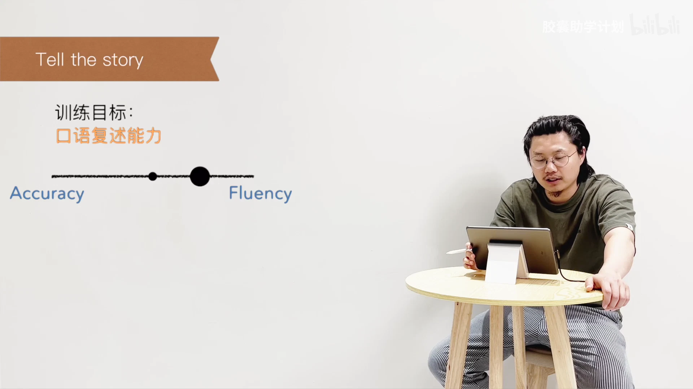

文字识别：Tell the story / 训练目标： / 口语复述能力 / Accuracy / Fluency

### 画面 00:04:45

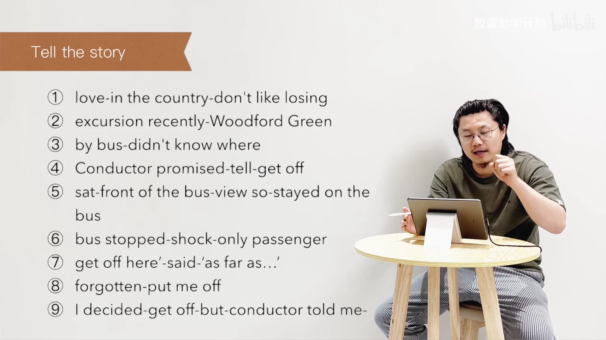

文字识别：Tell the story / ① love-in the country-don't like losing / excursion recently-Woodford Green / 2 / ③ by bus-didn't know where / 3 / Conductor promised-tell-get off / 4 / sat-front of the bus-view so-stayed on the / 5 / bus / ⑥ bus stopped-shock-only passenger / get off here'-said-'as far as... / forgotten-put me off / 8 / ⑨ I decided-get off-but-conductor told me-

### 画面 00:04:55

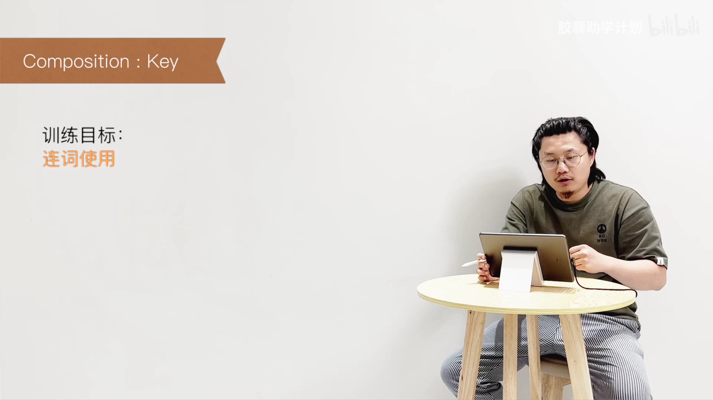

文字识别：Composition : Key / 训练目标： / 连词使用

## 00:05:00–00:05:30

我只提供答案。它其实是一些连词的使用。你在文章当中啊，在我们这个教材当中，你会看到这样几句话，比如说 I went into the kitchen, I turned on the light, it was dark.你去找到 composition，对吧？写作啊，然后它后边会给你一些连词，然后你要做的事情呢，用连词把这三个简单句给它连起来。我们在一到四十八的那个视频当中不是提过了吗？对吧？我们呃前面学的连词，从第三单元开始一直到第

### 画面 00:05:07

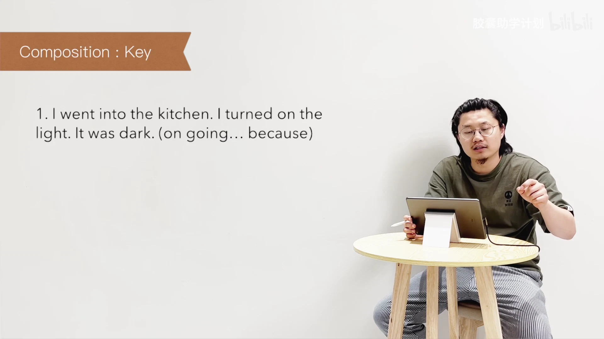

文字识别：Composition : Key / 1.I went into the kitchen.I turned on the / light. It was dark. (on going... because)

### 画面 00:05:17

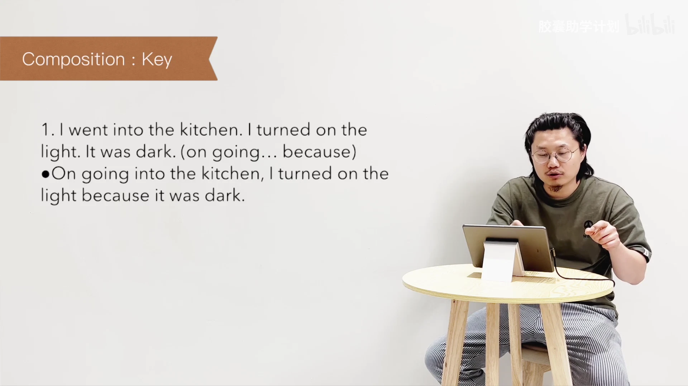

文字识别：Composition : Key / 1.I went into the kitchen.I turned on the / light. It was dark.(on going.. because) / ●On going into the kitchen, I turned on the / light because it was dark.

## 00:05:30–00:06:00

三册，对吧？学完我们要不停的去学习如何使用连词了。开始啊，所以这里我就是对一下答案啊，把答案放到这里。比如说问啊，叫做当然后which哦，这里面有两个单词，你要自己去查一下。第一个叫做film，第二个叫做developing。你要去想一下，它怎么能往到一块儿去串传到一起啊？这个两个单词的含义非常非常的多，你自己去找一下，看一下你的

### 画面 00:05:34

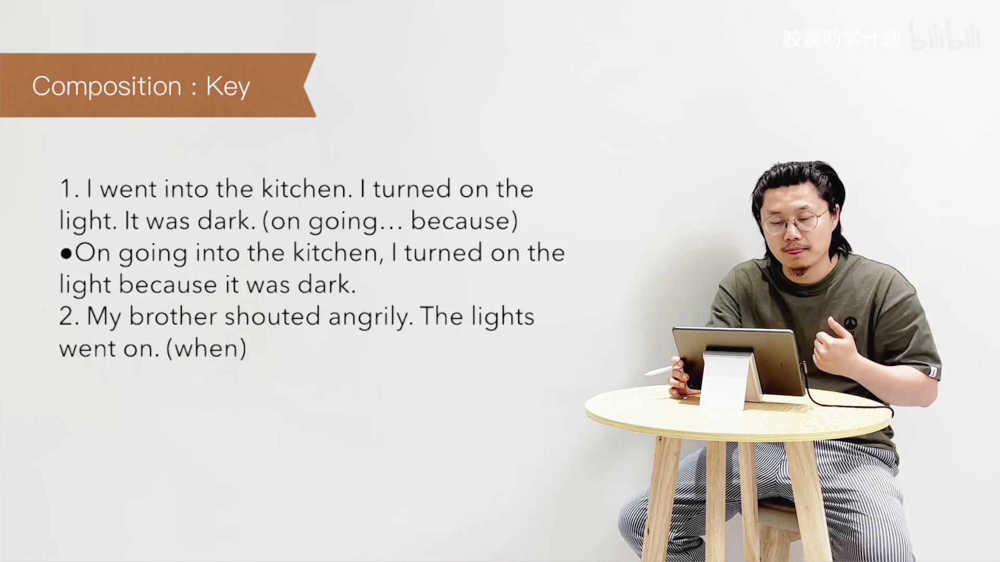

文字识别：Composition : Key / 1.I went into the kitchen.I turned on the / light. It was dark.(on going.. because) / ●On going into the kitchen, I turned on the / light because it was dark. / 2. My brother shouted angrily. The lights / went on.(when)

### 画面 00:05:37

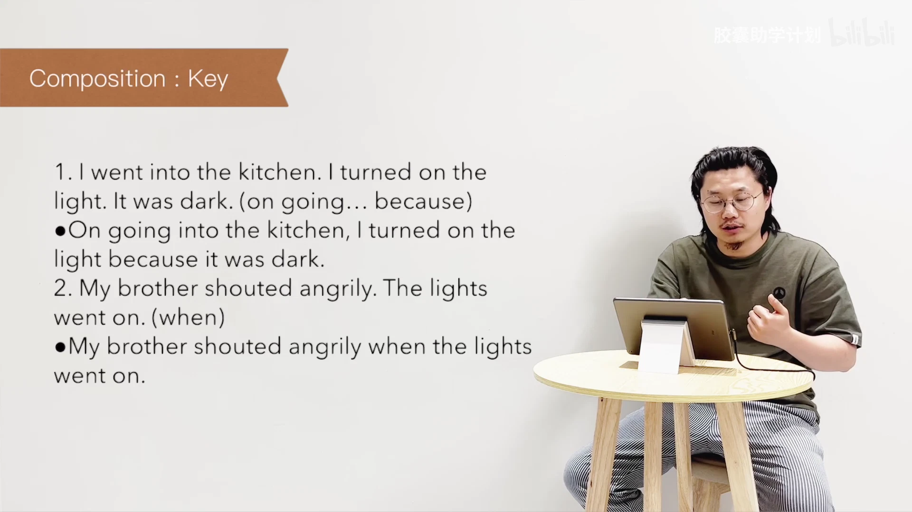

文字识别：Composition : Key / 1.I went into the kitchen.I turned on the / light. lt was dark. (on going... because) / ●On going into the kitchen, I turned on the / light because it was dark. / 2. My brother shouted angrily. The lights / went on.(when) / ●My brother shouted angrily when the lights / went on.

### 画面 00:05:42

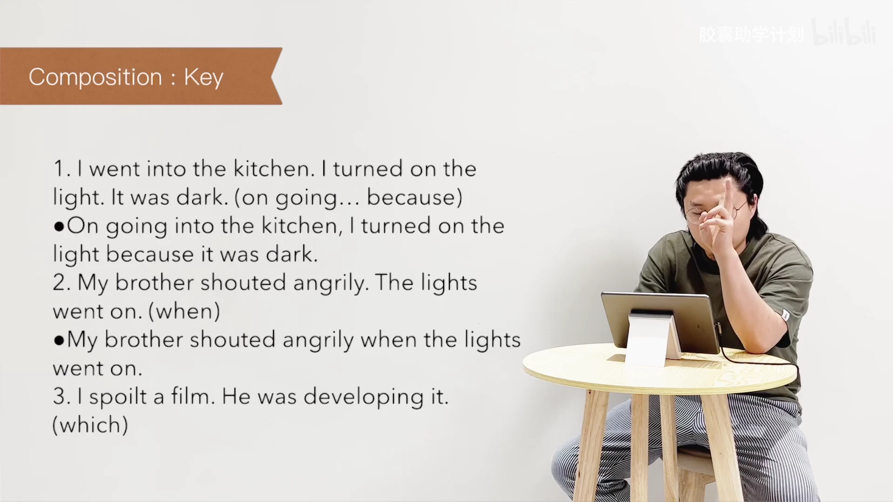

文字识别：Composition : Key / 1.I went into the kitchen.I turned on the / light. lt was dark. (on going... because) / ●On going into the kitchen, I turned on the / light because it was dark. / 2. My brother shouted angrily. The lights / went on.(when) / ●My brother shouted angrily when the lights / went on. / 3.I spoilt a film. He was developing it. / (which)

## 00:06:00–00:06:30

字典够不够用，正好，对吧？OK，呃，不多说了，这里其实就是带你练了一个定语从句啊，来这里对答案就行了。然后summary writing呢，我们也提了，我们说其实第二单元、第三单元开始，它多了一个叫连词使用的能力，对吧？你会发现journal写作的后面开始给你小括号了啊，开始让你去使用连词去连接两个简单句了，这个一定要去做。这个对于我们的考试的写作和实际应用，比如说你写一个邮件，

### 画面 00:06:03

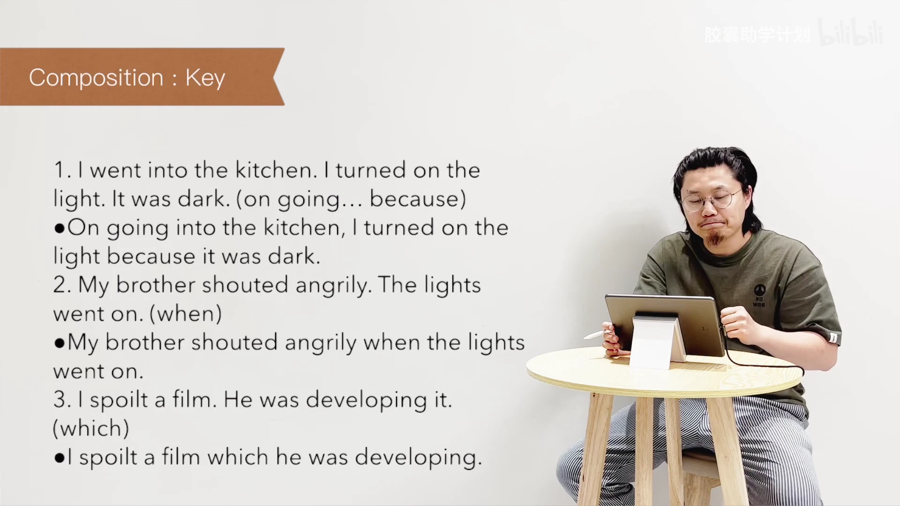

文字识别：Composition : Key / 1.I went into the kitchen.I turned on the / light. lt was dark. (on going... because) / ●On going into the kitchen, I turned on the / light because it was dark. / 2. My brother shouted angrily. The lights / went on.(when) / ●My brother shouted angrily when the lights / went on. / 3.I spoilt a film. He was developing it. / (which) / •I spoilt a film which he was developing.

### 画面 00:06:10

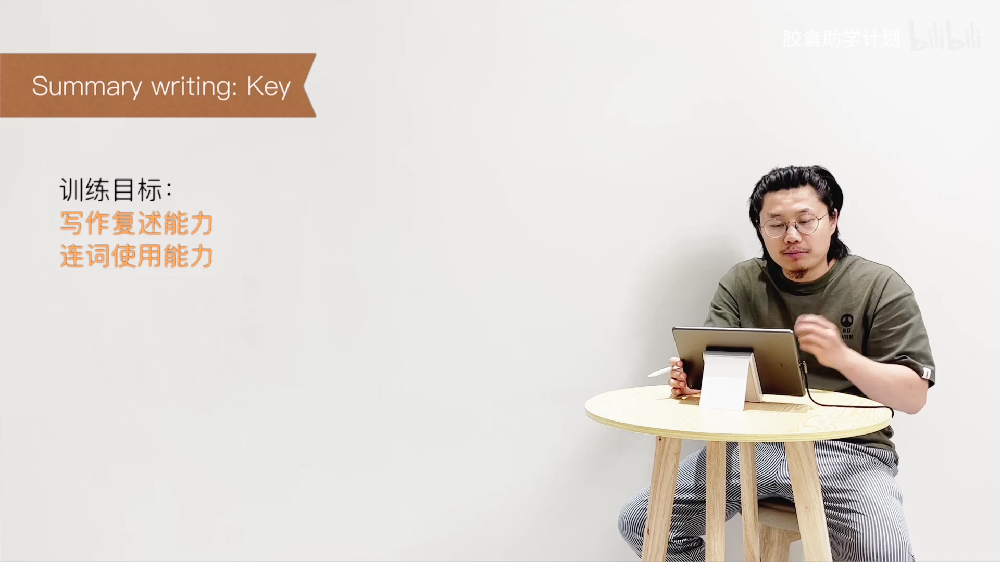

文字识别：Summary writing: Key / 训练目标： / 写作复述能力 / 连词使用能力 / ND / VOR

### 画面 00:06:19

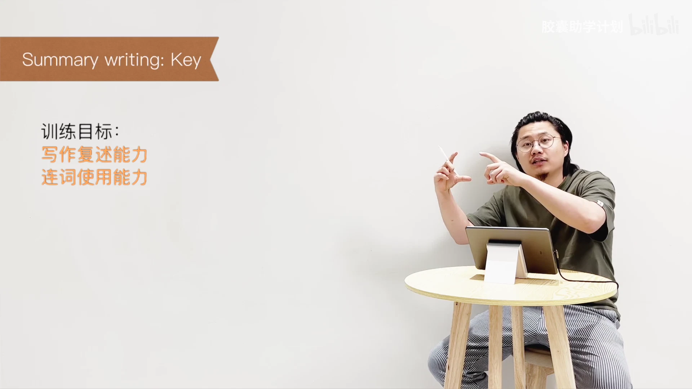

文字识别：Summary writing: Key / 训练目标： / 写作复述能力 / 连词使用能力

### 画面 00:06:24

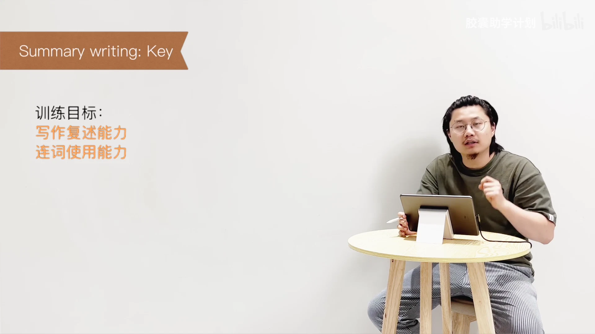

文字识别：Summary writing: Key / 训练目标： / 写作复述能力 / 连词使用能力

## 00:06:30–00:07:00

对吧？或者写一个更难的文章啊，什么都是非常有帮助的。写完来这里对答案，重点看单词，好吧？OK， topic for discussion，我只简单翻译一下。Have you ever lost your way? Tell us about it. 迷过路吗？给我们讲讲。Do you like traveling in the country? Well, why not? 喜不喜欢在乡村旅行？喜欢为什么喜欢？不喜欢为什么不喜欢？以及 What are the advantages and disadvantages of traveling

### 画面 00:06:33

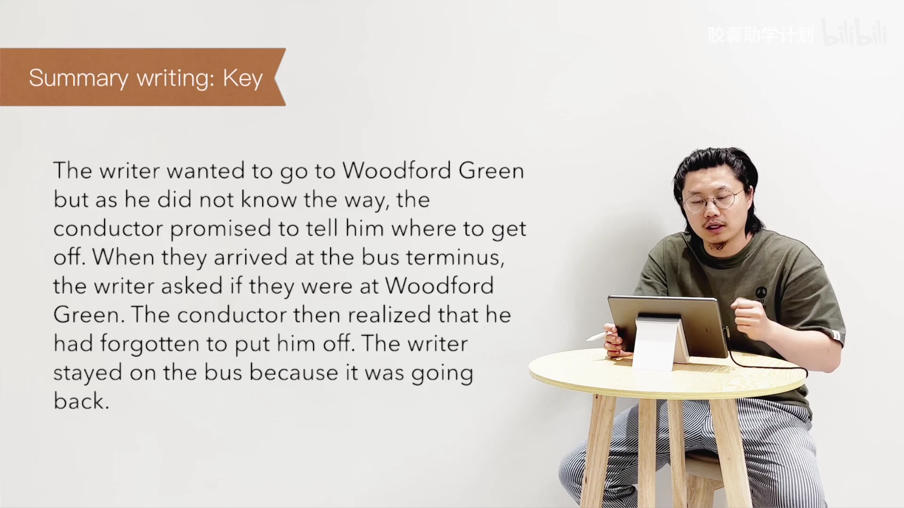

文字识别：Summary writing: Key / The writer wanted to go to Woodford Green / but as he did not know the way, the / conductor promised to tell him where to get / off. When they arrived at the bus terminus, / the writer asked if they were at Woodford / Green. The conductor then realized that he / had forgotten to put him off. The writer / stayed on the bus because it was going / back.

### 画面 00:06:38

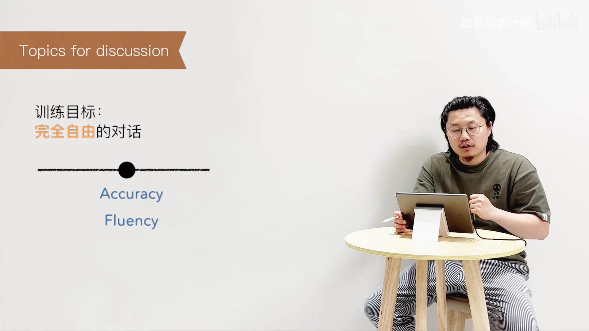

文字识别：Topics for discussion / 训练目标： / 完全自由的对话 / Accuracy / NU / WNR / Fluency

### 画面 00:06:40

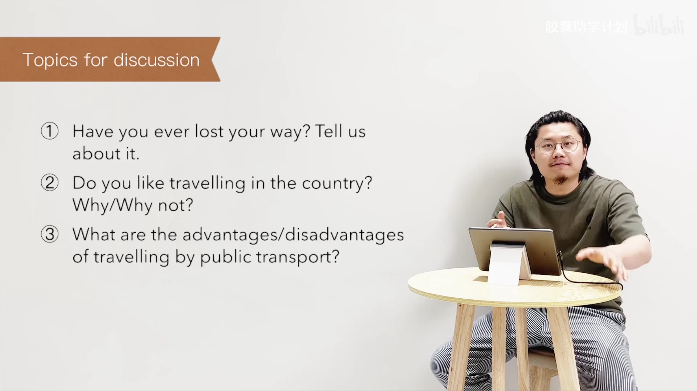

文字识别：Topics for discussion / Have you ever lost your way? Tell us / about it. / Do you like travelling in the country? / Why/Why not? / What are the advantages/disadvantages / of travelling by public transport?

## 00:07:00–00:07:30

by public transport. 公共交通的优点、缺点都是什么？Okay, 家庭作业的话呢？Ask me if先写保证是对的，然后大声朗读摘要写作先写，然后来这对答案。当然还有一个刚才我说的composition那三句话，对吧？然后tell the story呢？文章读熟了之后来这儿去练习我们的口语复述能力，还是刚才我提的雅思托福这样非常好的考试，以及现实

### 画面 00:07:06

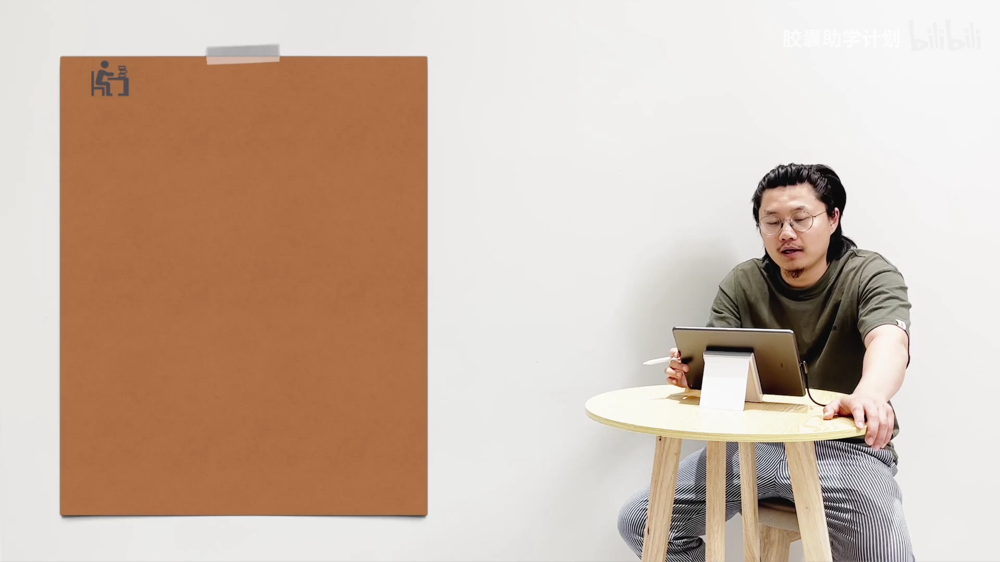

### 画面 00:07:08

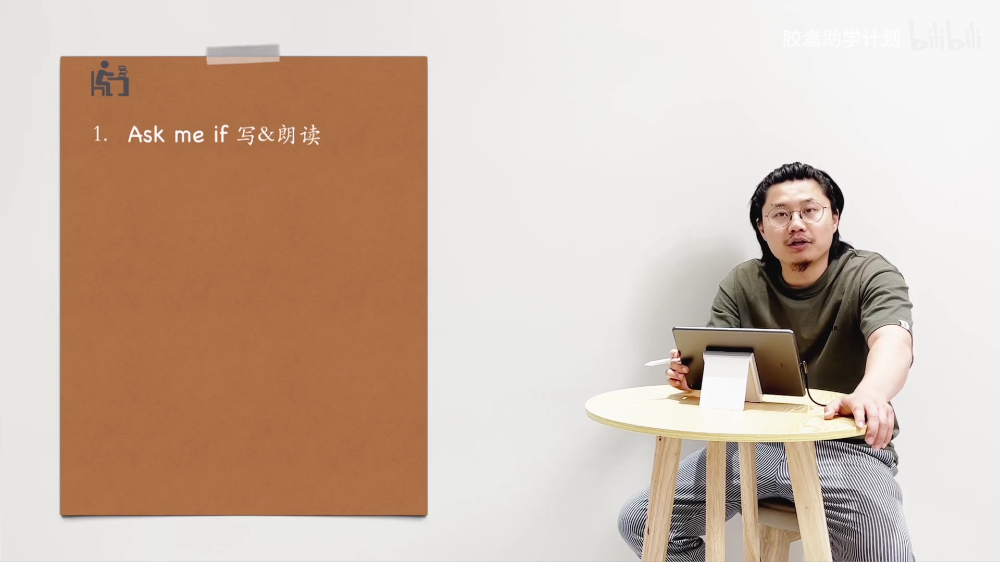

文字识别：1.Ask me if 写&朗读

### 画面 00:07:10

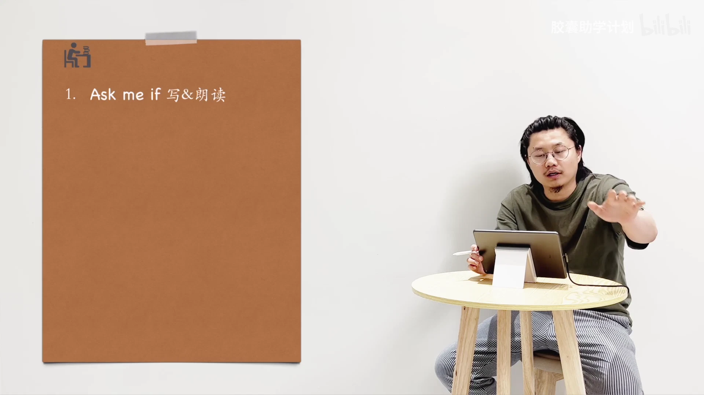

文字识别：1.Ask me if写&朗读

### 画面 00:07:12

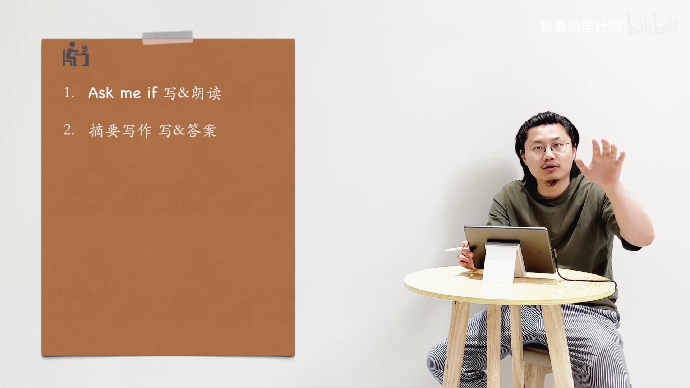

文字识别：1.Ask me if写&朗读 / 2. / 摘要写作写&答案

### 画面 00:07:15

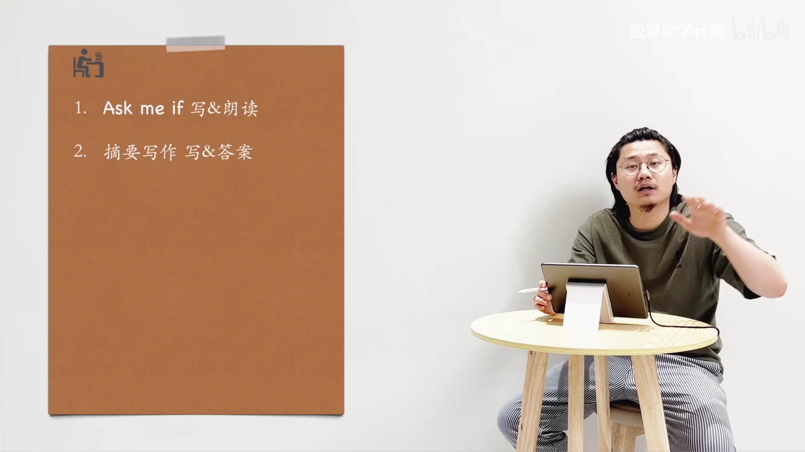

文字识别：1.Ask me if写&朗读 / 2.摘要写作写&答案

### 画面 00:07:18

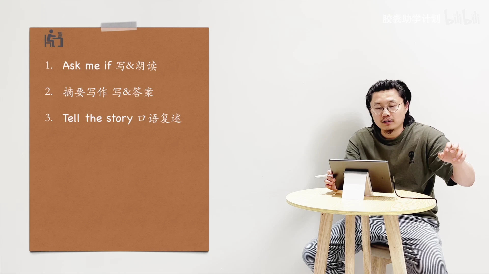

文字识别：1.Ask me if写&朗读 / 摘要写作写&答案 / 3.Tell the story 口语复述

### 画面 00:07:20

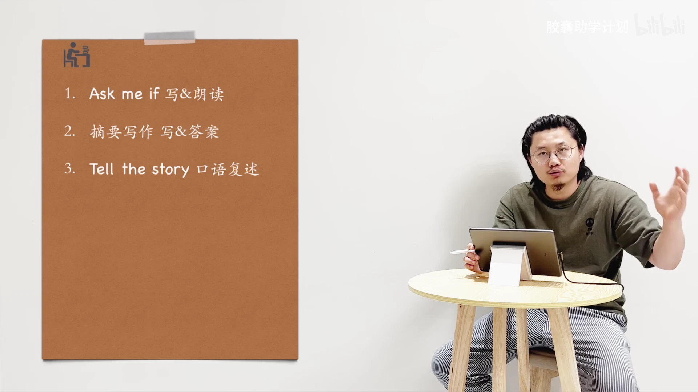

文字识别：1.Askme if写&朗读 / 摘要写作写&答案 / 3.Tell the story 口语复述

### 画面 00:07:29

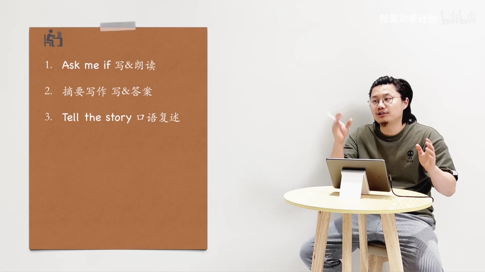

文字识别：1.Askme if写&朗读 / 摘要写作写&答案 / 3.Tell the story 口语复述 / NO / WIR

## 00:07:30–00:08:00

生活当中全需要用到口语复数，我们汉语也在每天用口语复数这些概念啊，然后重复间隔看置顶留言去找这个学习资料就行了，好吧？呃，那以上呢就是本期视频的全部内容了。如果各位喜欢我们的课程呢，欢迎各位关注、订阅、一键三连，分享给那些需要的朋友，来帮助我们快速成长。See you next time.

### 画面 00:07:31

文字识别：1.Ask me if写&朗读 / 摘要写作写&答案 / 3.Tell the story 口语复述 / NU

### 画面 00:07:35

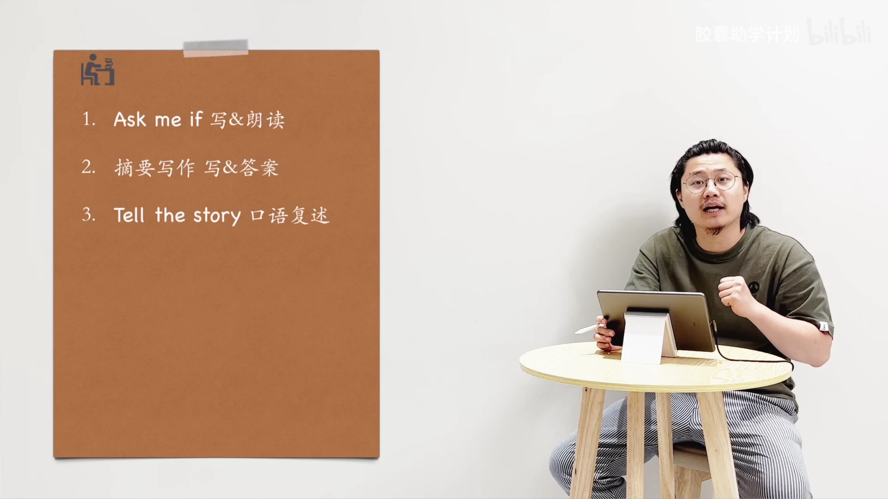

文字识别：1.Ask me if写&朗读 / 摘要写作写&答案 / 3.Tell the story 口语复述

### 画面 00:07:37

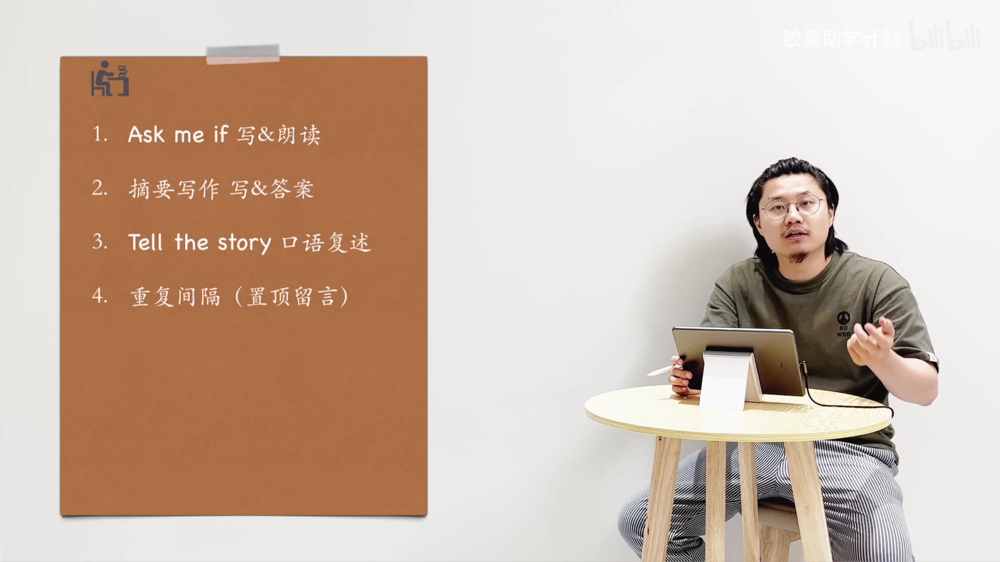

文字识别：1.Ask me if写&朗读 / 摘要写作写&答案 / 3.Tell the story 口语复述 / 4.重复间隔（置顶留言) / NU / WAR

### 画面 00:07:41

### 画面 00:07:45

### 画面 00:07:53

### 画面 00:07:55

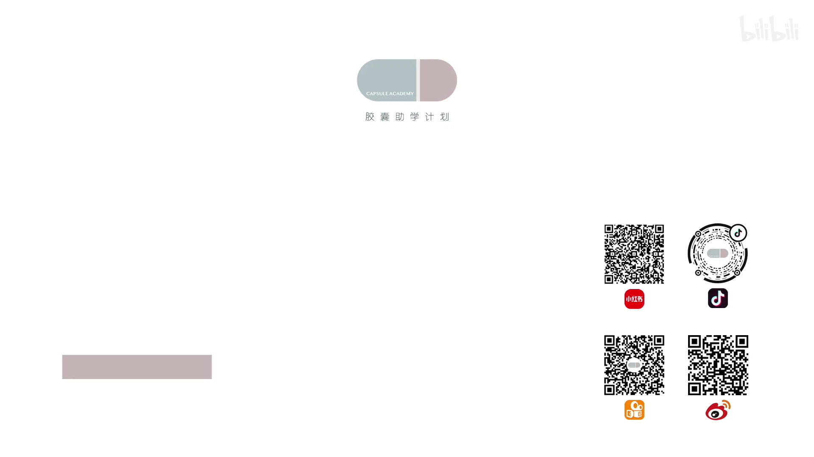

文字识别：CAPSULEACADEMY / 胶囊助学计划 / 『 / 小红书 / 品

### 画面 00:07:57

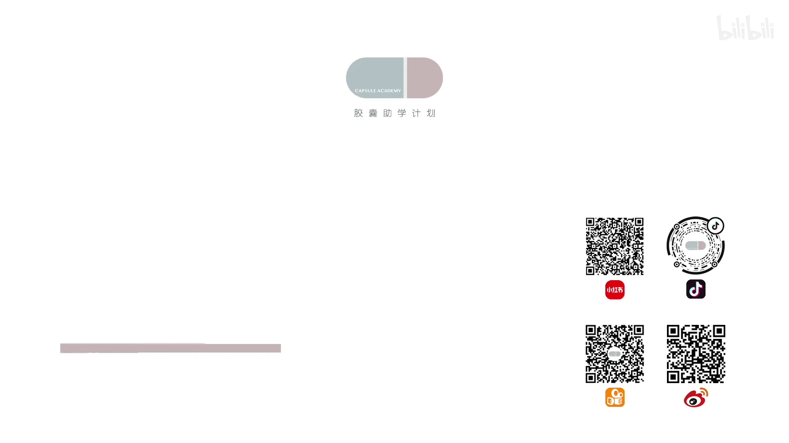

文字识别：CAPSULEACADEMY / 胶囊助学计划 / 『 / 小红书 / OE

## 00:08:00–00:08:07

### 画面 00:08:03

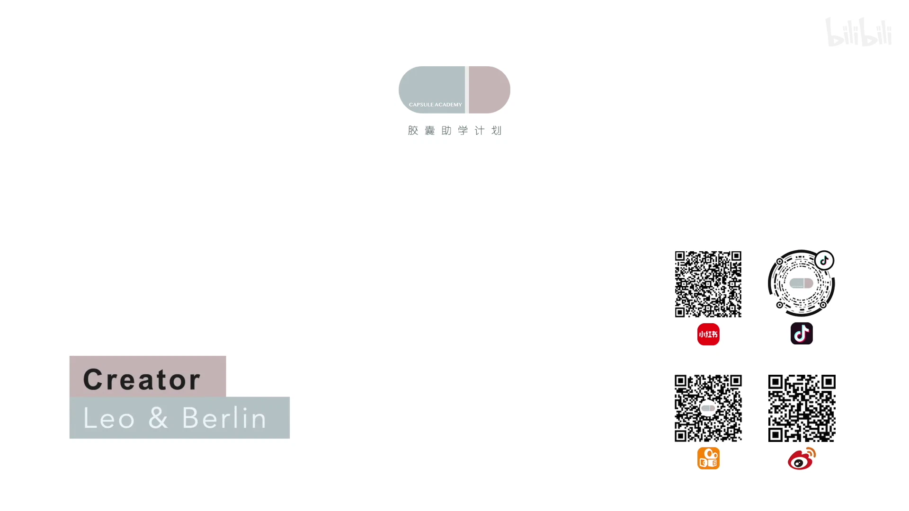

文字识别：CAPSULEACADEMY / 胶囊助学计划 / 小红书 / Creator / Leo & Berlin / OE

### 画面 00:08:05

文字识别：bilibili / 胶囊助学计划

### 画面 00:08:06

文字识别：bilibili / 胶囊助学计划

