# 051 单词

快速机器解析：语音为单模型转写，未进行独立交叉校对或人工复核；画面每秒采样并按变化选帧，短时文字和标记可能遗漏。截图时间约有 1 秒误差。图片有损压缩；遇到疑点请按时间查看 Google Drive 原视频。

## 00:00:00–00:00:30

Hello everyone, welcome to Capsule Academy. This is Leo. Today we're going to learn New Concept English Book Two, Lesson Fifty One Words. 那老习惯进入正式课程之前，咱们看几个小的问题。首先，如何表达给某人一个奖励？接下来，如何表达节食？最后一个问题，如何表达禁止某人做某事？那带着这三个问题，Hope you gonna enjoy. 好，

### 画面 00:00:00

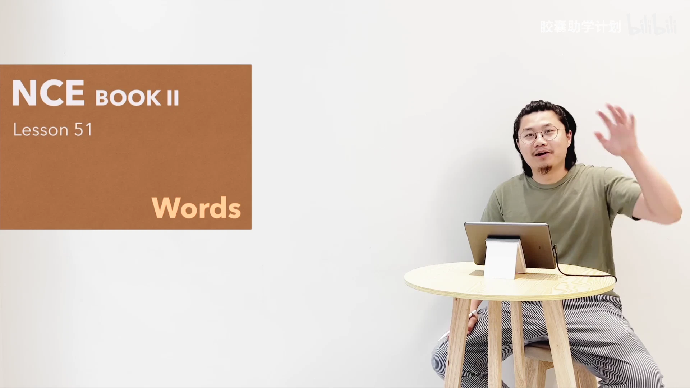

文字识别：NCE / BOOK"I / Lesson 51 / Words

### 画面 00:00:02

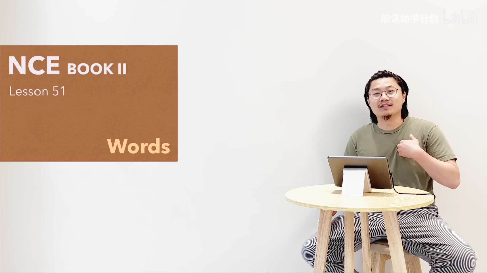

文字识别：NCE / BOOKII / Lesson 51 / Words

### 画面 00:00:04

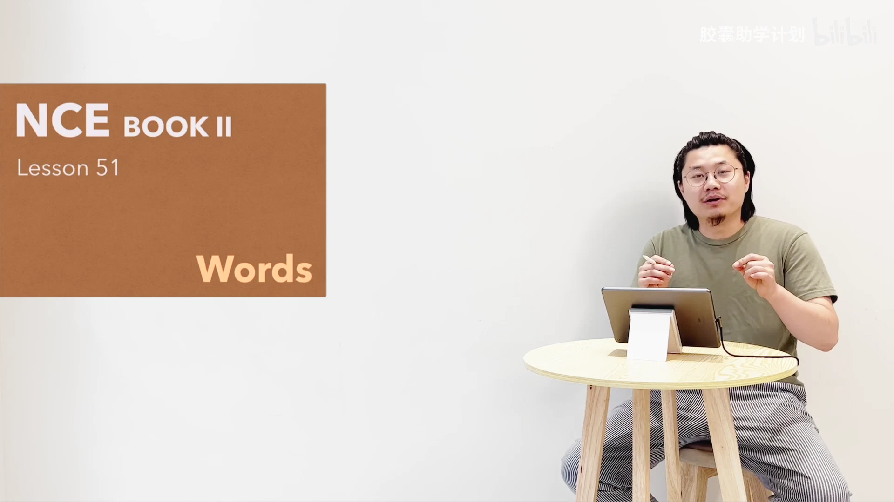

文字识别：NCE / BOOKⅡI / Lesson 51 / Words

### 画面 00:00:07

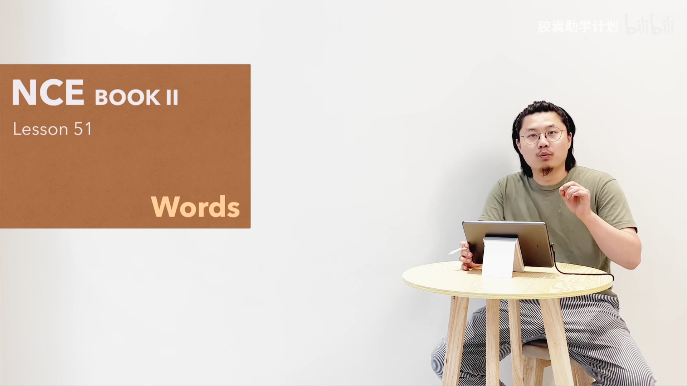

文字识别：NCE / BOOKII / Lesson 51 / Words

### 画面 00:00:09

### 画面 00:00:11

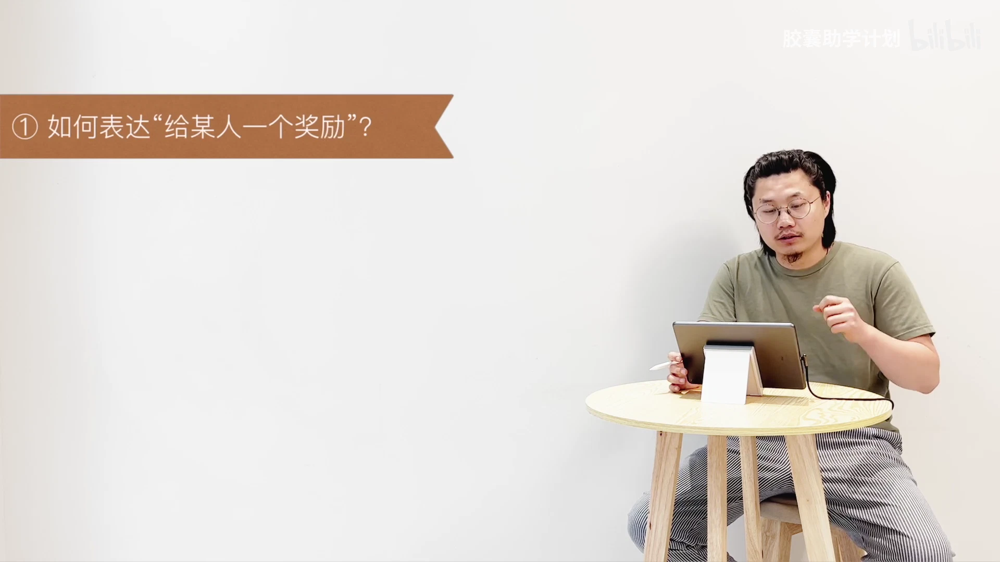

文字识别：① 如何表达“给某人一个奖励”？

### 画面 00:00:13

文字识别：① 如何表达“给某人一个奖励”？

### 画面 00:00:15

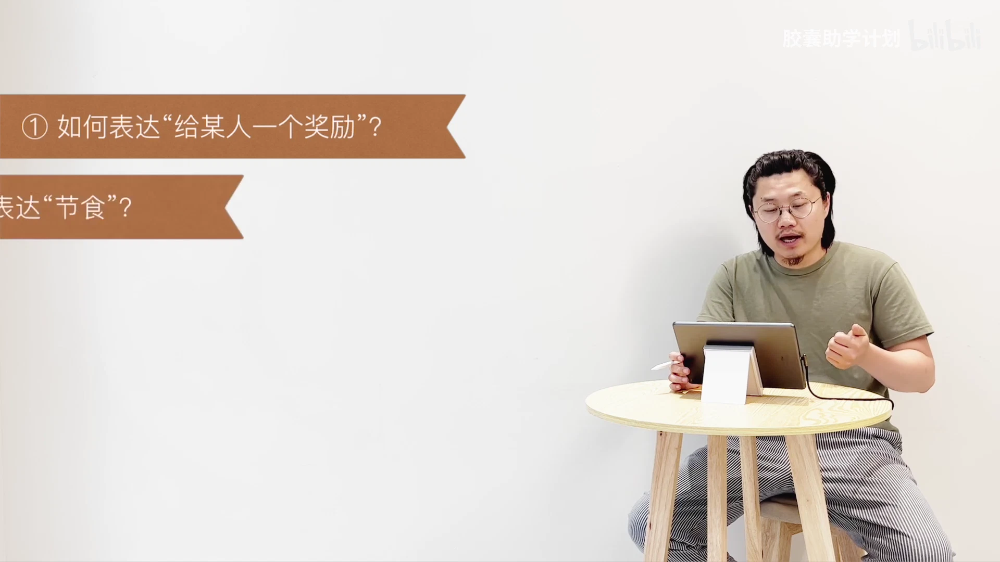

文字识别：① 如何表达“给某人一个奖励”? / 表达“节食”？

### 画面 00:00:17

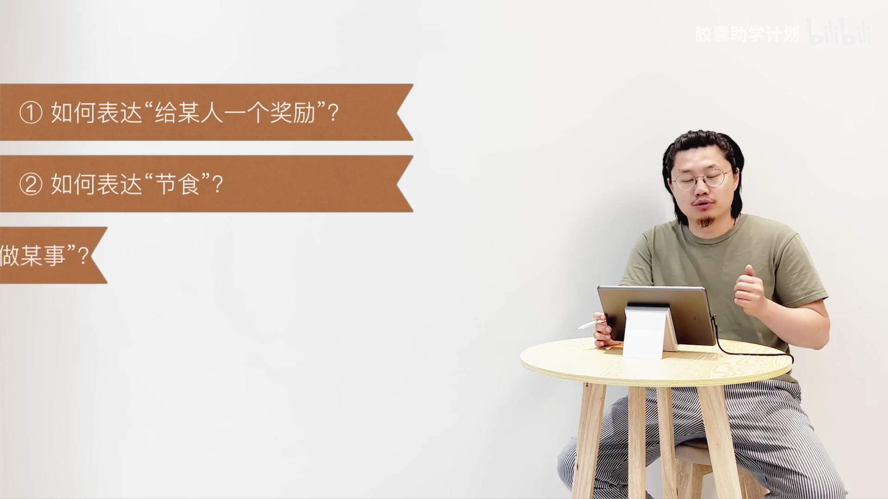

文字识别：① 如何表达“给某人一个奖励”？ / 如何表达“节食”？ / 做某事”？

### 画面 00:00:19

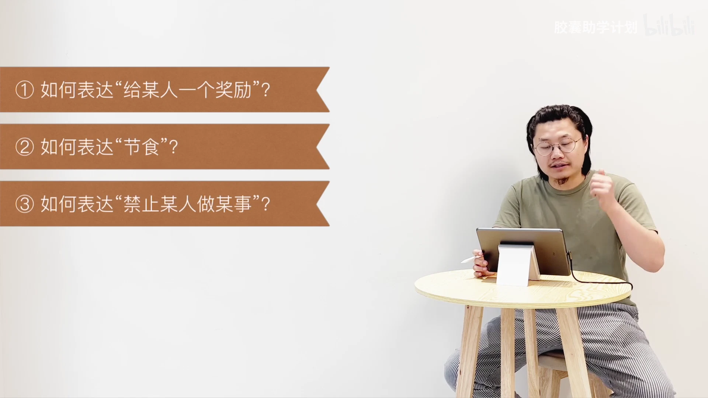

文字识别：① 如何表达“给某人一个奖励”？ / 如何表达“节食”？ / 如何表达“禁止某人做某事”?

### 画面 00:00:24

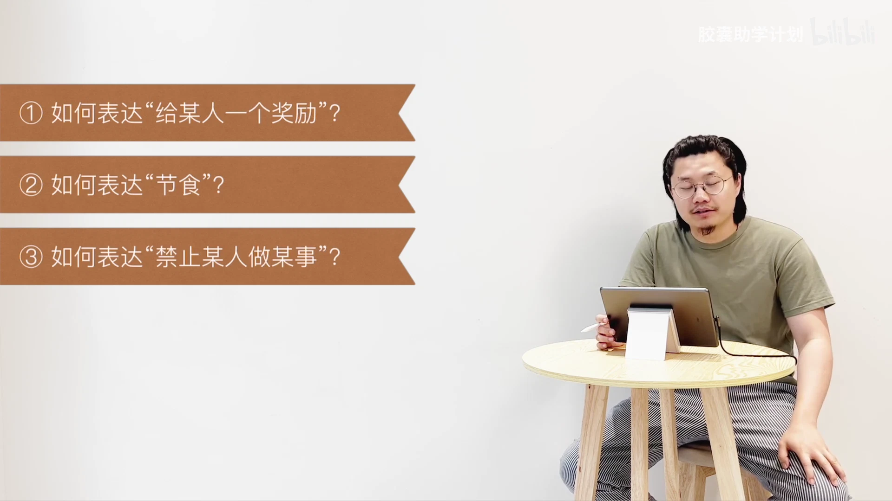

文字识别：① 如何表达“给某人一个奖励”? / 如何表达“节食”？ / 如何表达“禁止某人做某事”?

### 画面 00:00:26

文字识别：胶囊助学计划bill

### 画面 00:00:28

文字识别：胶囊助学计划 / 胶囊助学计划

## 00:00:30–00:01:00

那我们先看第一个小单词啊，看着音标一起读一下，叫做 reward，reward，OK。那 reward 这个单词在本课当中其实出现了两个词性，第一个是名词，第二个是动词，但其实意思是一样的，都是奖赏，对吧？因为咱们汉语当中其实大多数情况下在说话的时候呢，呃，不分什么名词、动词这些概念，对吧？所以就经常是混为一谈的。那英语呢，它要分一个最简单的原因就是各位回想一下，英语的动词是有各

### 画面 00:00:30

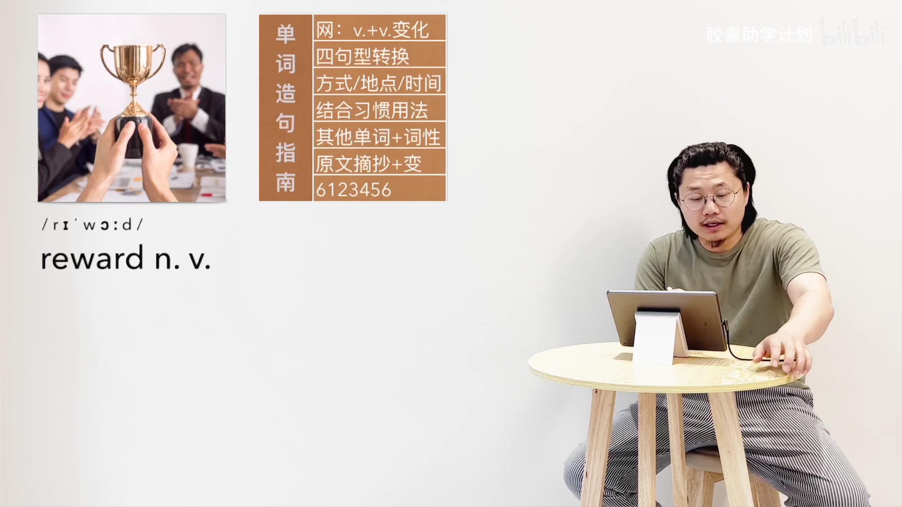

文字识别：单词造句指南 / 网：v.+v.变化 / 四句型转换 / 方式/地点/时间 / 结合习惯用法 / 其他单词+词性 / 原文摘抄+变 / 6123456 / /rI'wo:d/ / reward n. V.

### 画面 00:00:34

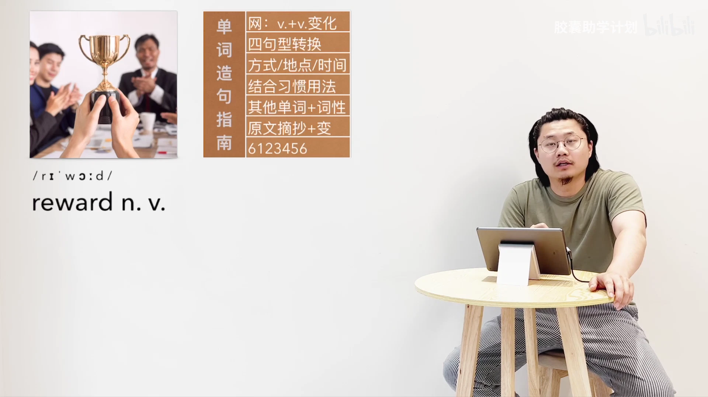

文字识别：单词造句指南 / 网：v.+v.变化 / 四句型转换 / 方式/地点/时间 / 结合习惯用法 / 其他单词+词性 / 原文摘抄+变 / 6123456 / /rI'wo:d/ / reward n. v.

### 画面 00:00:45

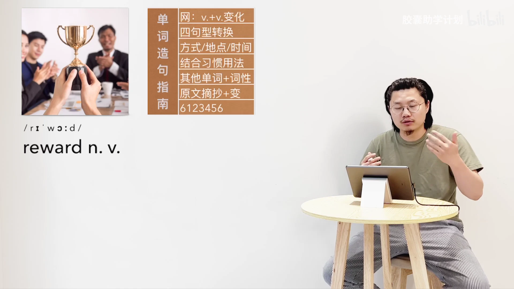

文字识别：单词造句指南 / 网：v.+v.变化 / 四句型转换 / 方式/地点/时间 / 结合习惯用法 / 其他单词+词性 / 原文摘抄+变 / 6123456 / /rI'wo:d/ / reward n. V.

## 00:01:00–00:01:30

种形式的，对吧？啊，就是可能是有三单的、过去式的、过去分词、现在分词等等，所以你还是要分一下啊，它的词性。那我们先说 reward，它做名词是实际上出现在咱们的这个标题当中，reward for virtue，对吧？OK，那 reward 做名词的时候，其实一个关键点就是词性，我有哪些动词跟它去搭配？这个各位千万不要自己去随便用汉语啊，比如说汉语你想到了一个动词，跟

### 画面 00:01:00

文字识别：单词造句指南 / 网：v.+v.变化 / 四句型转换 / 方式/地点/时间 / 结合习惯用法 / 其他单词+词性 / 原文摘抄+变 / 6123456 / /rI'wo:d/ / reward n. V.

### 画面 00:01:20

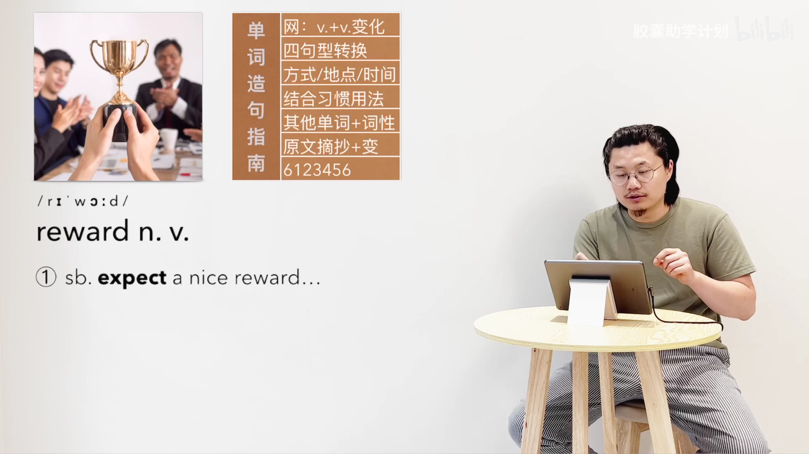

文字识别：单词造句指南 / 网：v.+v.变化 / 四句型转换 / 方式/地点/时间 / 结合习惯用法 / 其他单词+词性 / 原文摘抄+变 / 6123456 / /rI'wo:d/ / reward n. V. / ① sb. expect a nice reward..

### 画面 00:01:25

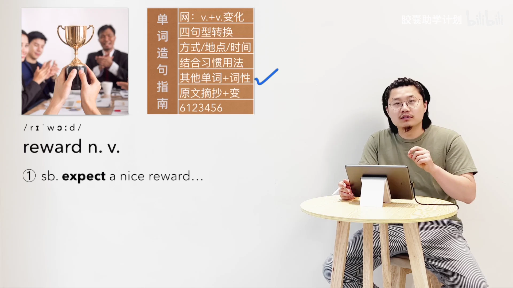

文字识别：单词造句指南 / 网：v.+v.变化 / 四句型转换 / 方式/地点/时间 / 结合习惯用法 / 其他单词+词性 / 原文摘抄+变 / 6123456 / /rI'wo:d/ / reward n. v. / ① sb. expect a nice reward..

## 00:01:30–00:02:00

汉语的这个奖赏是能放到一起的，对吧？然后呢，你就找这个字典啊，很多同学造句是这个思路，然后找字典开始找这个，你输入这个汉语的这个动词，然后呢，找到英文，你看底下有一堆动词，你随便挑一个拿过来之后跟 reward 连起来用一下，这样错误的概率非常的高啊，因为英汉它不是一一对应的语言，各位要记住，你这么去做的时候，潜台词这个或者说默认为的这个前提假设是英

### 画面 00:01:30

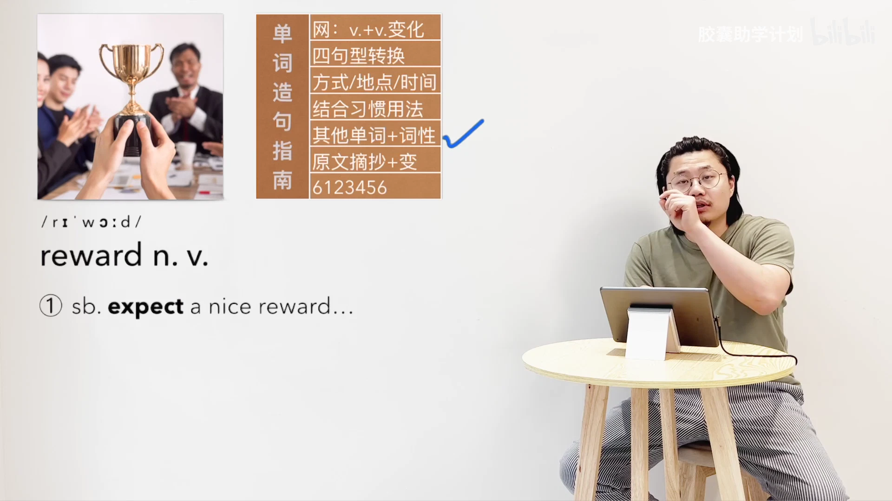

文字识别：单词造句指南 / 网：v.+v.变化 / 四句型转换 / 方式/地点/时间 / 结合习惯用法 / 其他单词+词性 / 原文摘抄+变 / 6123456 / /rI'wo:d/ / reward n. v. / ① sb.expect a nice reward..

### 画面 00:01:36

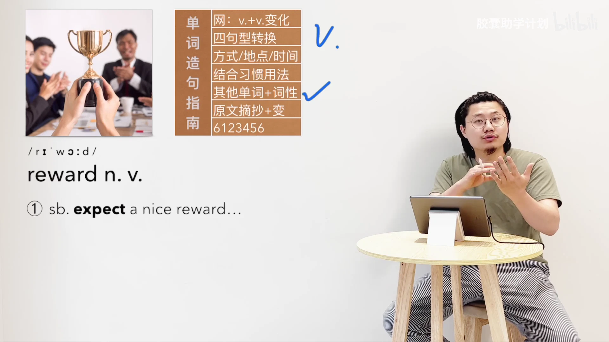

文字识别：单词造句指南 / 网：v.+v.变化 / V / 四句型转换 / 方式/地点/时间 / 结合习惯用法 / 其他单词+词性 / 原文摘抄+变 / 6123456 / /rI'wo:d/ / reward n. v. / ① sb.expect a nice reward..

### 画面 00:01:45

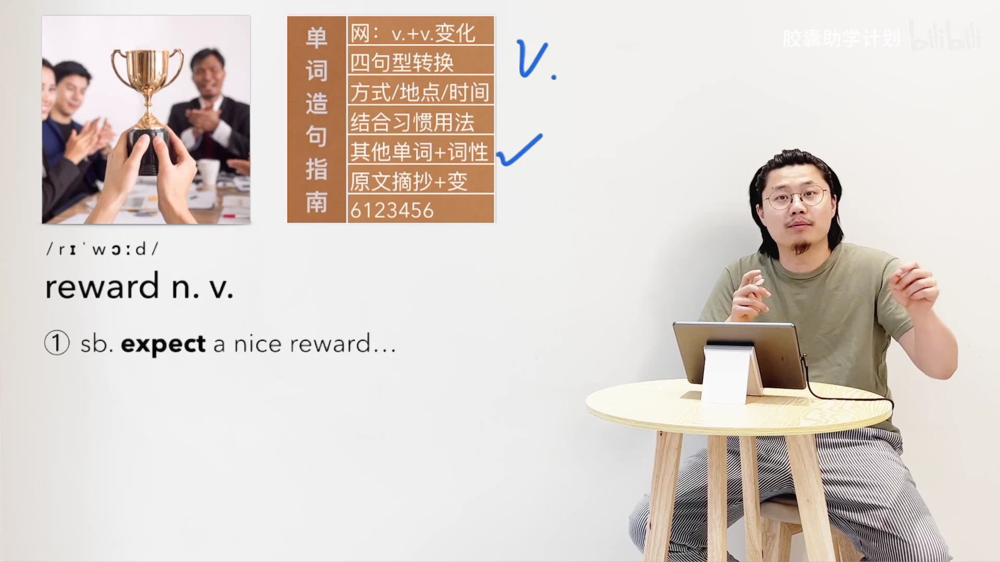

文字识别：单词造句指南 / 网：v.+v.变化 / V. / 四句型转换 / 方式/地点/时间 / 结合习惯用法 / 其他单词+词性 / 原文摘抄+变 / 6123456 / /rI'wo:d/ / reward n. v. / ① sb. expect a nice reward...

### 画面 00:01:55

文字识别：单词造句指南 / 网：v.+v.变化 / V / 四句型转换 / 方式/地点/时间 / 结合习惯用法 / 其他单词+词性 / 原文摘抄+变 / 6123456 / /rI'wo:d/ / reward n. V. / ① sb. expect a nice reward..

## 00:02:00–00:02:30

汉是一一对应的，但它不是一一对应的。所以像 reward 这个单词造句的时候呢，我实际上做了一件事情，是去语料库当中查了一下哪些动词经常跟 reward 这个名词连用到一起。比如说，我们先看第一个，叫 somebody expect a nice reward，特别好。expect 这个单词我们在第七个还学过，前两天又刚刚看到啊。比如说， after the kids had worked hard all day， they expected a nice reward from their parents。

### 画面 00:02:15

文字识别：单词造句指南 / 网：v.+v.变化 / V / 四句型转换 / 方式/地点/时间 / 结合习惯用法 / 其他单词+词性 / 原文摘抄+变 / 6123456 / /rI'wo:d/ / reward n. v. / ① sb. expect a nice reward..

### 画面 00:02:20

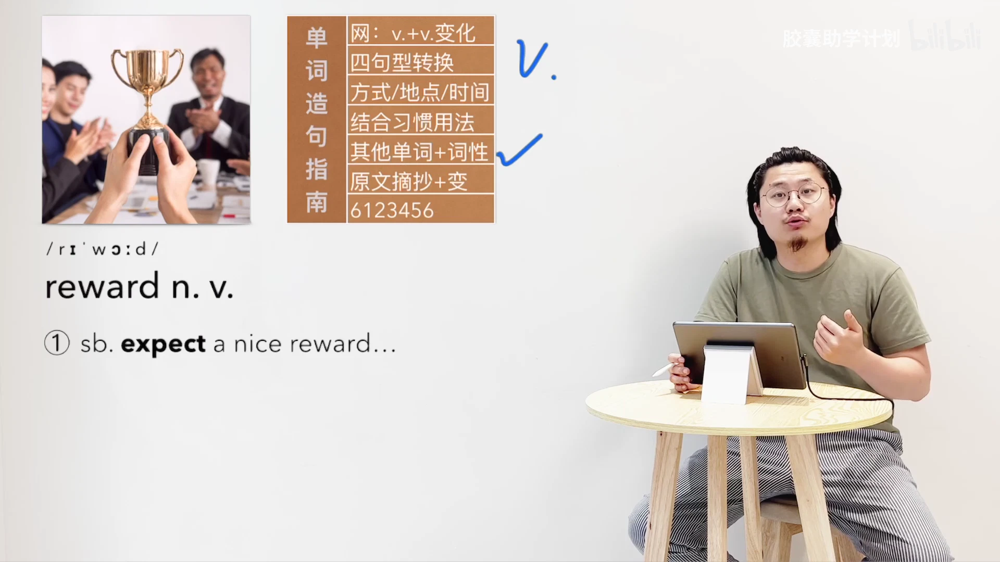

文字识别：单词造句指南 / 网：v.+v.变化 / V. / 四句型转换 / 方式/地点/时间 / 结合习惯用法 / 其他单词+词性 / 原文摘抄+变 / 6123456 / /rI'wo:d/ / reward n. v. / ① sb. expect a nice reward..

### 画面 00:02:22

文字识别：单词造句指南 / 网：v.+v.变化 / V / 四句型转换 / 方式/地点/时间 / 结合习惯用法 / 其他单词+词性 / 原文摘抄+变 / 6123456 / /rI'wo:d/ / reward n. v. / ① sb. expect a nice reward... / ② After the kids had worded hard all day, they / expected a nice reward from their parents.

## 00:02:30–00:03:00

你看，首先这句话其实用的是咱们十四课过去完成时，对吧？After A逗号B啊，孩子们努力工作一天之后，那他们就会期待说，在他们父母那个地方有一个特别好的奖赏，对吧？比如说给点零花钱，对吧？或者说给点好的礼物什么的啊。我们小的时候培养孩子做家务，有的时候是这个样子的。好，那像这句话我造出来之后呢，其实我最想做的事情是，我不知道各位能不能理解我想做

### 画面 00:02:35

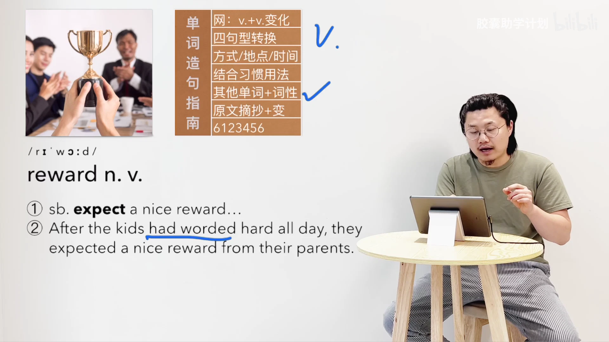

文字识别：单词造句指南 / 网：v.+v.变化 / V / 四句型转换 / 方式/地点/时间 / 结合习惯用法 / 其他单词+词性 / 原文摘抄+变 / 6123456 / /rI'wo:d/ / reward n. v. / ① sb. expect a nice reward... / ② After the kids had worded hard all day, they / expected a nice reward from their parents.

### 画面 00:02:38

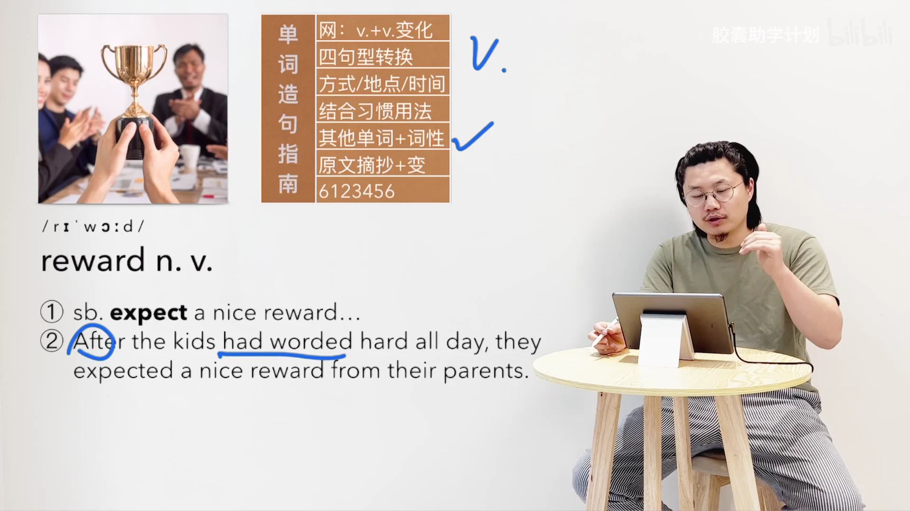

文字识别：单词造句指南 / 网：v.+v.变化 / V / 四句型转换 / 方式/地点/时间 / 结合习惯用法 / 其他单词+词性 / 原文摘抄+变 / 6123456 / /rI'wo:d/ / reward n. v. / ) sb. expect a nice reward.. / After the kids had worded hard all day, they / expected a nice reward from their parents.

### 画面 00:02:41

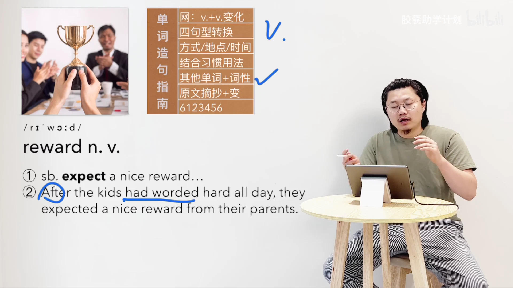

文字识别：单词造句指南 / 网：v.+v.变化 / V / 四句型转换 / 方式/地点/时间 / 结合习惯用法 / 其他单词+词性 / 原文摘抄+变 / 6123456 / /rI'wo:d/ / reward n. v. / sb. expect a nice reward.. / After the kids had worded hard all day, they / expected a nice reward from their parents.

### 画面 00:02:50

文字识别：单词造句指南 / 网：v.+v.变化 / V / 四句型转换 / 方式/地点/时间 / 结合习惯用法 / 其他单词+词性 / 原文摘抄+变 / 6123456 / /rI'wo:d/ / reward n. v. / ) sb. expect a nice reward... / After the kids had worded hard all day, they / expected a nice reward from their parents.

### 画面 00:02:57

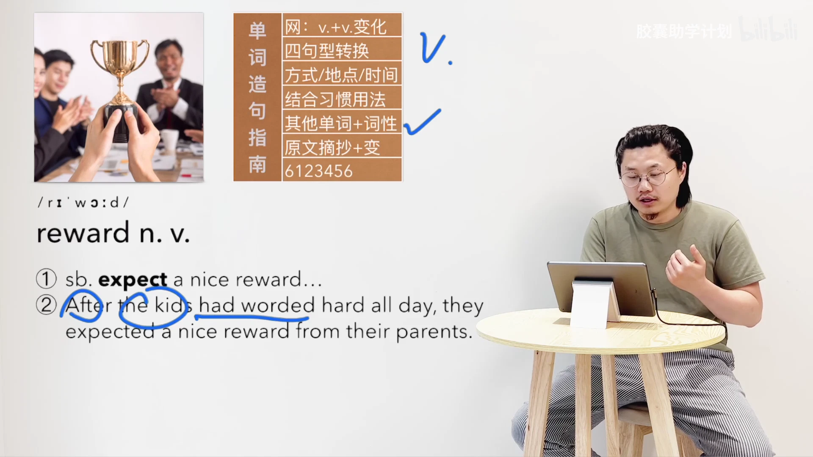

文字识别：单词造句指南 / 网：v.+v.变化 / V / 四句型转换 / 方式/地点/时间 / 结合习惯用法 / 其他单词+词性 / 原文摘抄+变 / 6123456 / /rI'wo:d/ / reward n. v. / ) sb. expect a nice reward... / After the kids had worded hard all day, they / expected a nice reward from their parents.

### 画面 00:02:59

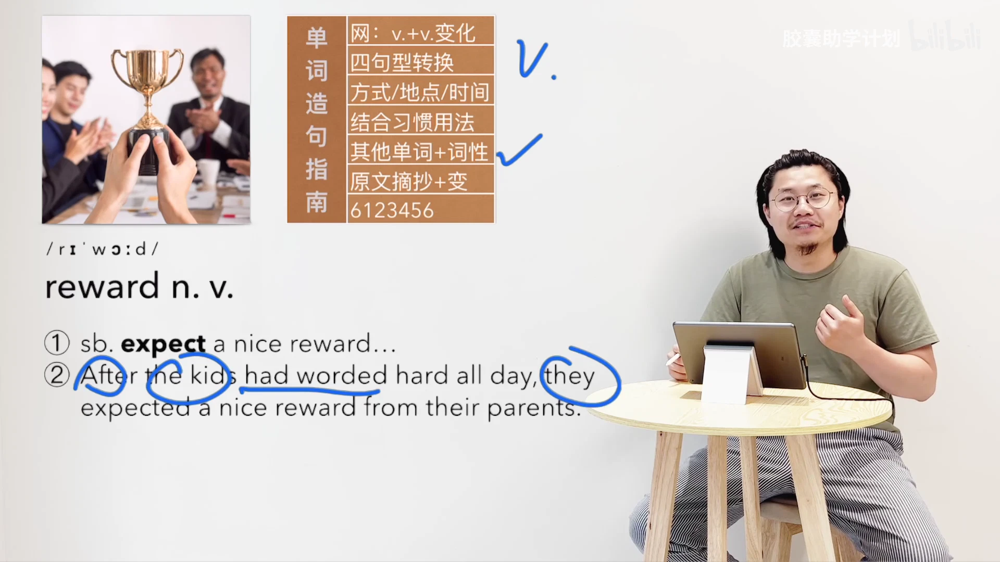

文字识别：单词造句指南 / 网：v.+v.变化 / V / 四句型转换 / 方式/地点/时间 / 结合习惯用法 / 其他单词+词性 / 原文摘抄+变 / 6123456 / /rI'wo:d/ / reward n. v. / sb. expect a nice reward... / After thne kids had worded hard all day,they / expected a nice reward from their parents.

## 00:03:00–00:03:30

什么，对吧？四十九课咱们刚学的最重要的，而且也不是很简单的这样一个语法，叫做分词做状语。我们学完它要不停的去回顾。第一个分词能不能做状语呢？首先你要想它得是个状语从句啊。其次呢，我怎么把它变成分词做状语呢？也很简单，看一下两句话啊，主句这句话和从句这句话的主语是否一致？这一看是一致的。孩子们工作了一天，孩子们期待什么什么什么事儿，对吧？不

### 画面 00:03:01

文字识别：单词造句指南 / 网：v.+v.变化 / V / 四句型转换 / 方式/地点/时间 / 结合习惯用法 / 其他单词+词性 / 原文摘抄+变 / 6123456 / /rI'wo:d/ / reward n. v. / sb. expect a nice reward.. / After thne kids had worded hard all day,they / expected a nice reward from their parents.

### 画面 00:03:03

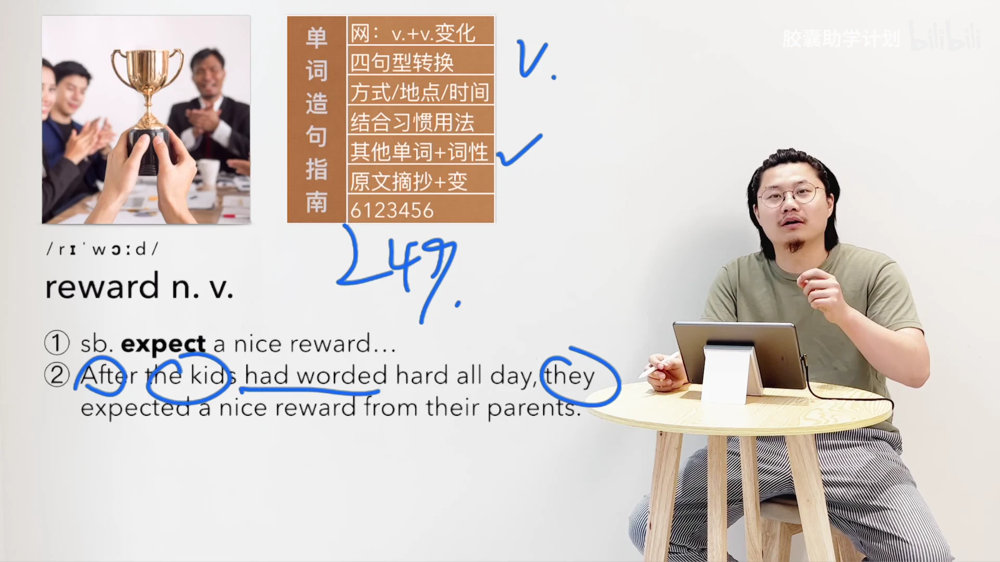

文字识别：单词造句指南 / 网：v.+v.变化 / V / 四句型转换 / 方式/地点/时间 / 结合习惯用法 / 其他单词+词性 / 原文摘抄+变 / 6123456 / 249 / /rI'wo:d/ / reward n. v. / sb.expect a nice reward... / After thne kids had worded hard allday, they / expected a nice reward from their parents.

### 画面 00:03:05

文字识别：单词造句指南 / 网：v.+v.变化 / 四句型转换 / 方式/地点/时间 / 结合习惯用法 / 其他单词+词性 / 原文摘抄+变 / 6123456 / 249 / /rI'wo:d/ / reward n. v. / sb. expect a nice reward... / After thne kids had worded hard allday, they / expected a nice reward from their parents.

### 画面 00:03:10

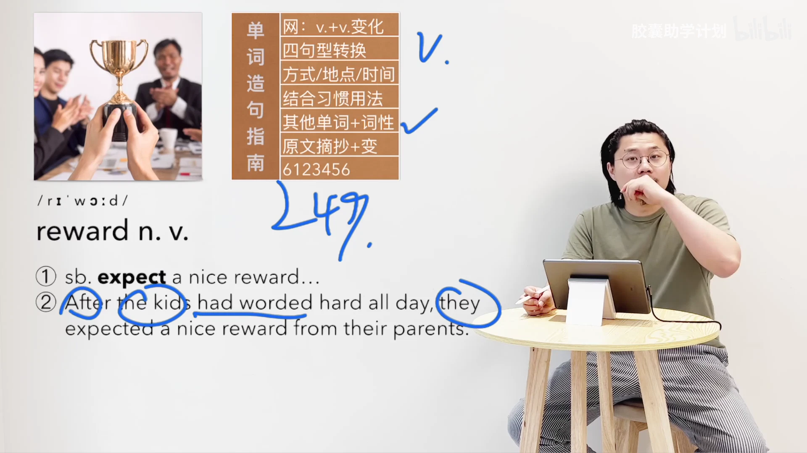

文字识别：单词造句指南 / 网：v.+v.变化 / V / 四句型转换 / 方式/地点/时间 / 结合习惯用法 / 其他单词+词性 / 原文摘抄+变 / 6123456 / 249 / /rI'wo:d/ / reward n. v. / sb. expect a nice reward... / Afterthe kids had worded hard all day,they / expected a nice reward from their parents.

### 画面 00:03:21

文字识别：单词造句指南 / 网：v.+v.变化 / V / 四句型转换 / 方式/地点/时间 / 结合习惯用法 / 其他单词+词性 / 原文摘抄+变 / 6123456 / 247 / /rI'wo:d/ / reward n. v. / sb. expect a nice reward... / After the kids had worded hard all day, / the / expected a nice reward from their parents.

### 画面 00:03:23

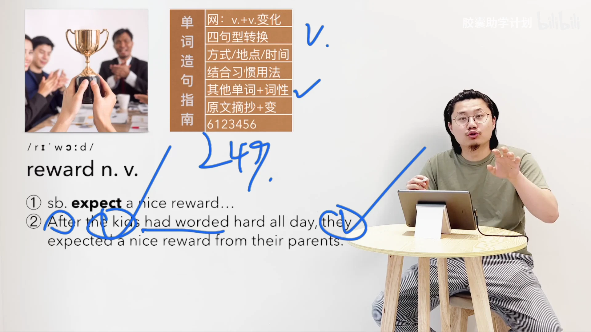

文字识别：单词造句指南 / 网：v.+v.变化 / V / 四句型转换 / 方式/地点/时间 / 结合习惯用法 / 其他单词+词性 / 原文摘抄+变 / 6123456 / 249 / /rI'wo:d/ / reward n. v. / sb.expect a lice reward... / Afte / r tn kidhad worded hard all day, / the / expected a nice reward from their parents.

## 00:03:30–00:04:00

拉巴拉巴拉，OK。所以，那你 after 和 the kid 都可以删掉，一看后边是 had worked 特殊形式 having done，所以这句话我们就直接口头上给大家变一下，叫做 having worked hard all day，巴拉巴拉巴拉巴拉，剩下照抄就可以了，对吧？这就轻松的变过去了。这是第一个，叫做 expect 啊，期待。接下来呢， receive 这个动词也是经常跟 reward 放到一起的，比如说 he received the reward yesterday，啊，他

### 画面 00:03:32

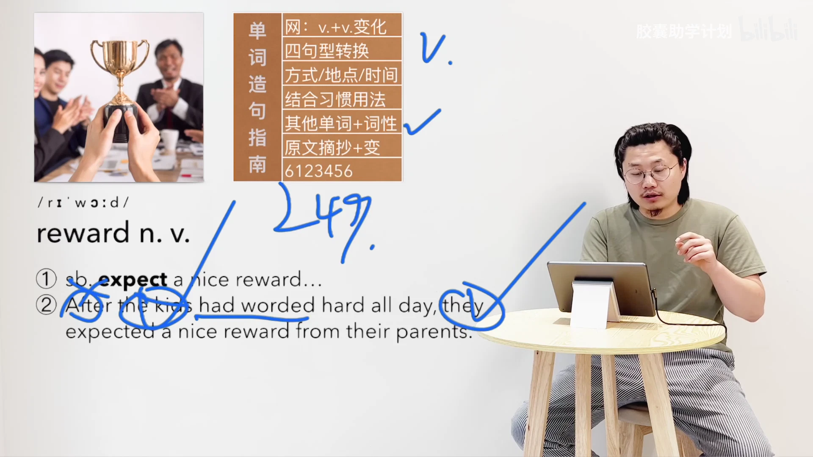

文字识别：单词造句指南 / 网：v.+v.变化 / V / 四句型转换 / 方式/地点/时间 / 结合习惯用法 / 其他单词+词性 / 原文摘抄+变 / 6123456 / 49 / /rI'wo:d/ / reward n. v. / sb.expect a hice reward... / Arter / tekihad worded hard all day, / the / expected a nice reward from their parents.

### 画面 00:03:35

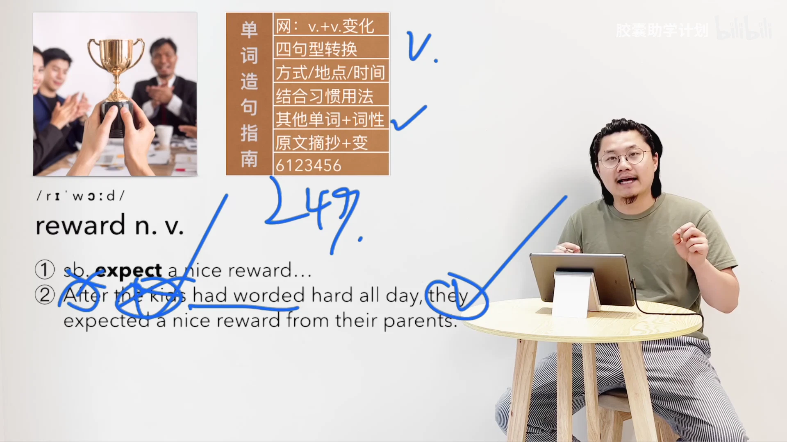

文字识别：单词造句指南 / 网：v.+v.变化 / V / 四句型转换 / 方式/地点/时间 / 结合习惯用法 / 其他单词+词性 / 原文摘抄+变 / 6123456 / 249 / /ri'wo:d/ / reward n. v. / sb.expect aLice reward... / Atrhad worded hard al day, / the / expected a nice reward from their parents.

### 画面 00:03:48

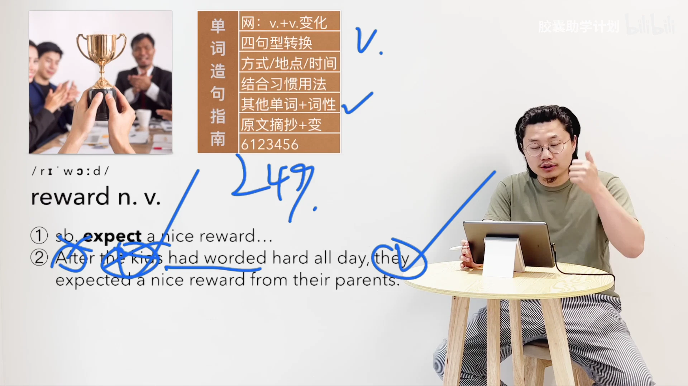

文字识别：单词造句指南 / 网：v.+v.变化 / V / 四句型转换 / 方式/地点/时间 / 结合习惯用法 / 其他单词+词性 / 原文摘抄+变 / 6123456 / 249 / /rI'w o:d/ / reward n. v. / b.expect aLice reward... / Atrhad worded hard allday / the / expected a nice reward from their parents.

### 画面 00:03:51

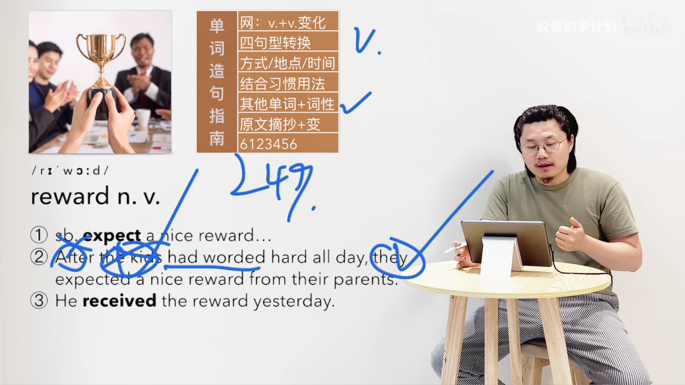

文字识别：单词造句指南 / 网：v.+v.变化 / V / 四句型转换 / 方式/地点/时间 / 结合习惯用法 / 其他单词+词性 / 原文摘抄+变 / 6123456 / 249 / /ri'wo:d/ / reward n. v. / sb.expect aice reward... / Atorhad worded hard all day. / the / expected a nice reward from their parents. / He received the reward yesterday.

### 画面 00:03:55

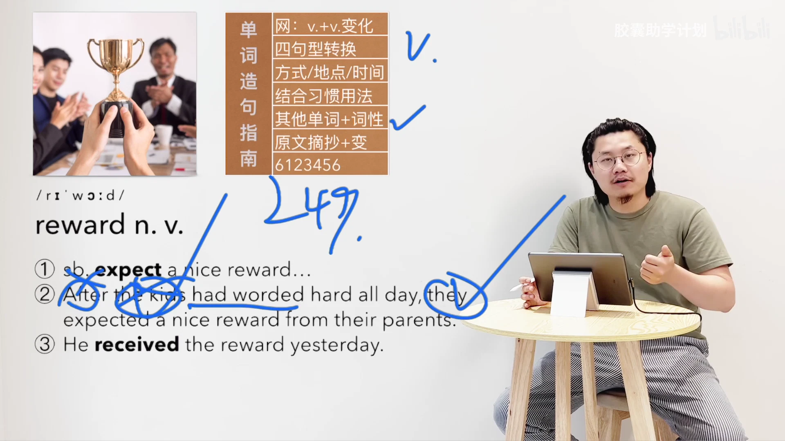

文字识别：单词造句指南 / 网：v.+v.变化 / V / 四句型转换 / 方式/地点/时间 / 结合习惯用法 / 其他单词+词性 / 原文摘抄+变 / 6123456 / 49 / /ri'wo:d/ / reward n. V. / sb.expect aLice reward... / Atrhad worded hard all day. / the / expected a nice reward from their parents. / He received the reward yesterday.

## 00:04:00–00:04:30

received this reward yesterday. Ah, OK. That affirmative sentence came out. Four-sentence conversion. Everyone, old saying, not much to say. Give is also very commonly used in spoken English. A sentence that connects with reward is called give you a reward, which means to give you a reward. Next, let's watch a movie clip. It just happened. I will give you. I will give you a reward. I will give you a reward. I will give you a reward. I will give you a reward. I will give you a reward. I will give you a reward. I will give you a reward. I will give you a reward. I will give you a reward. I will

### 画面 00:04:00

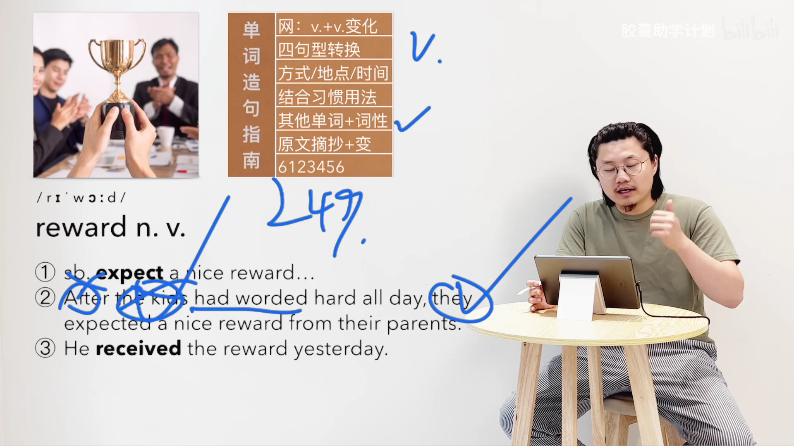

文字识别：单词造句指南 / 网：v.+v.变化 / V / 四句型转换 / 方式/地点/时间 / 结合习惯用法 / 其他单词+词性 / 原文摘抄+变 / 6123456 / 249 / /rI'wo:d/ / reward n. V. / sb.expect aLice reward... / Atrhad worded hard allday, / the / expected a nice reward from their parents. / He received the reward yesterday.

### 画面 00:04:05

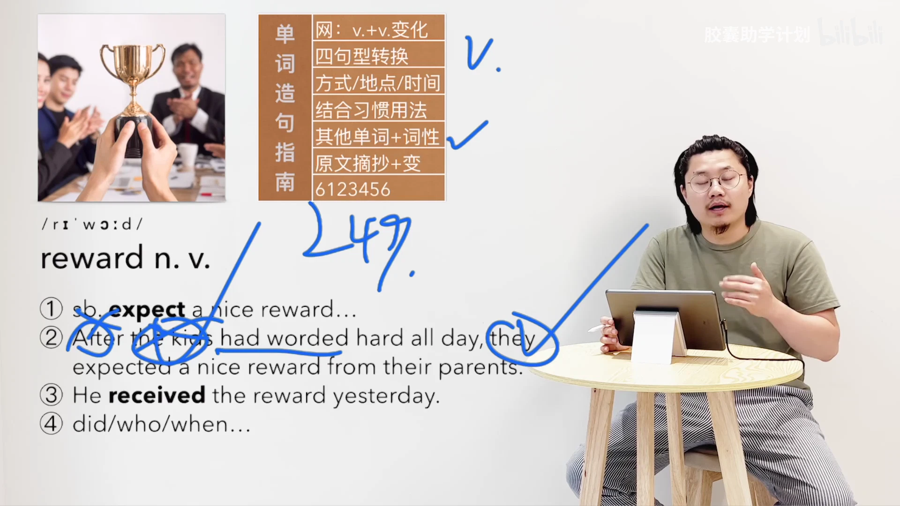

文字识别：单词造句指南 / 网：v.+v.变化 / V / 四句型转换 / 方式/地点/时间 / 结合习惯用法 / 其他单词+词性 / 原文摘抄+变 / 6123456 / 49 / /ri'wo:d/ / reward n. v. / sb.expect aLice reward... / Atrhad worded hard all day. / the / expected a nice reward from their parents. / He received the reward yesterday. / did/who/when...

### 画面 00:04:16

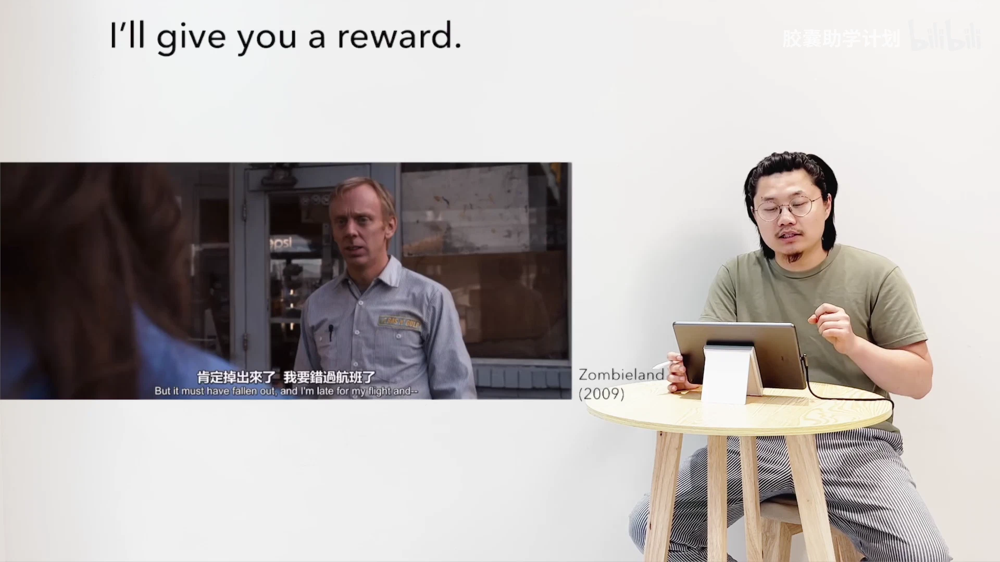

文字识别：I'll give you a reward. / psl / 肯定掉出來了我要错過航班了 / Zombieland / But it must have fallen out, and I'm late for my flight and- / (2009)

### 画面 00:04:29

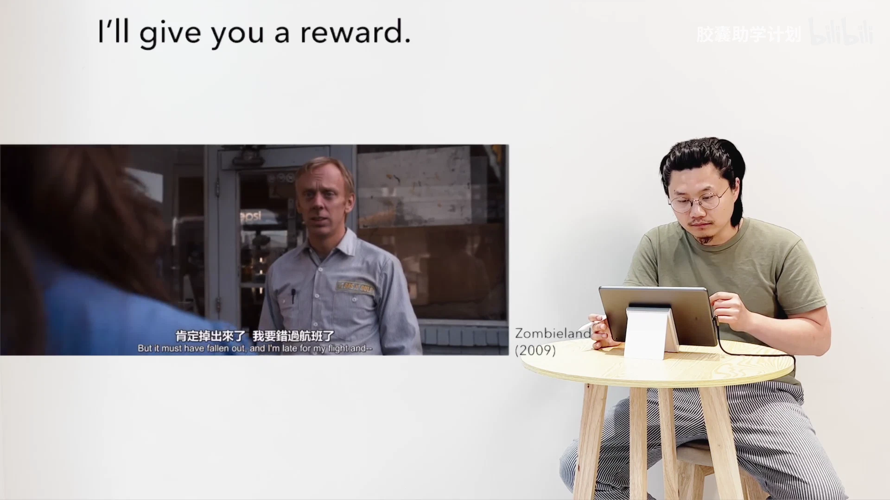

文字识别：I'll give you a reward. / osl / 肯定掉出來了我要錯過航班了 / Zombieland / But it must have fallen out, and I'm late for my flight and- / (2009)

## 00:04:30–00:05:00

and I'm late for my flight. And I'm listen the, I'll find your ring and and I'll FedEx it to you. I'll give you a reward. That still be silly. Three thousand dollars. It's worth more than my car. Just just give me your number. Okay, ah, I'll give you a reward. Ah,这个女主的这个戒指丢了，对吧？然后加油站这个小伙子说没事儿，我帮你找，然后我寄给你。然后女的说那我要得给你一点奖赏或酬劳，对吧？类似的意思，叫I'll

### 画面 00:04:31

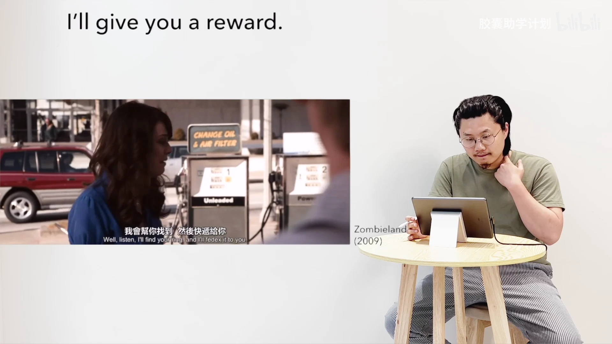

文字识别：I'll give you a reward. / CHANGE OIL /  AR FILTER / 我會幫你找到然後快遞給你 / Zombieland / Well listen, l findyour ng,and Hl fedex it toyou / (2009)

### 画面 00:04:33

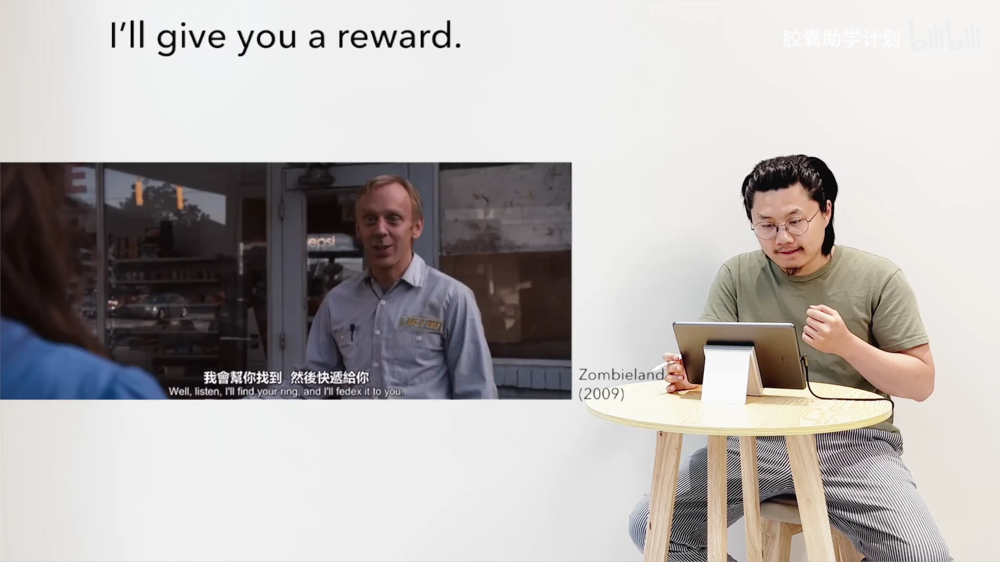

文字识别：I'll give you a reward. / eost / 我會幫你找到然後快遞給你 / Zombieland / Well, listen, Ilfind your ring, and ll fedex it toyou. / (2009)

### 画面 00:04:35

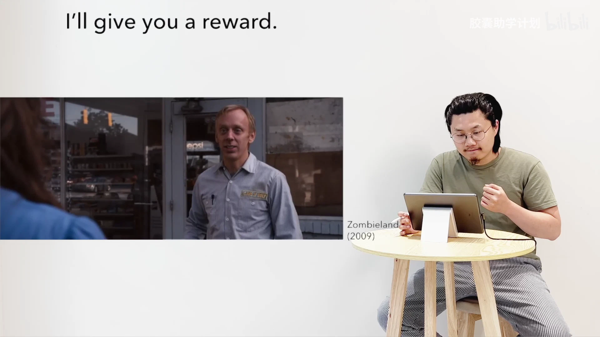

文字识别：I'Il give you a reward. / Zombieland / (2009)

### 画面 00:04:37

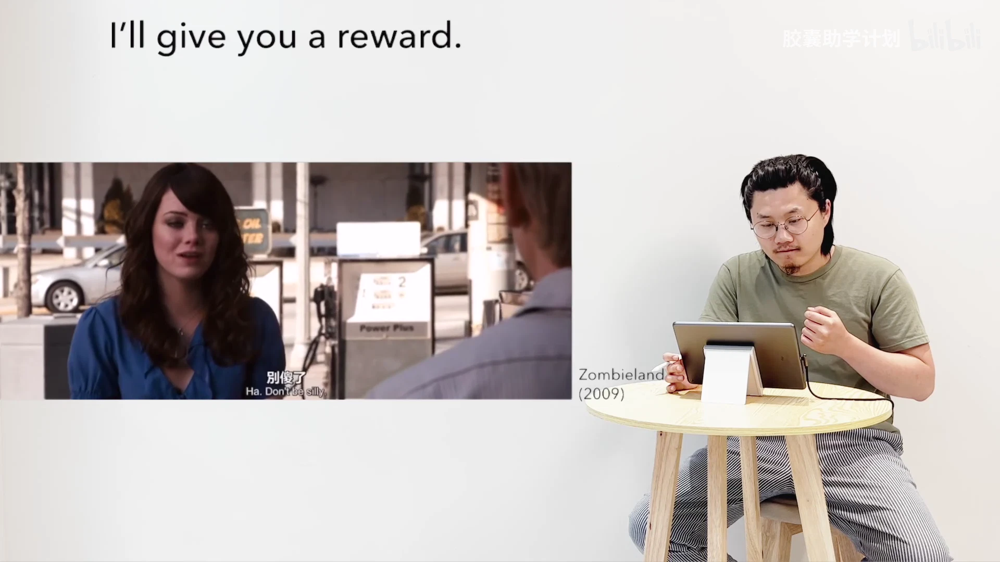

文字识别：I'll give you a reward. / 別傻了 / Zombieland / Ha. Dont be sily / (2009)

### 画面 00:04:39

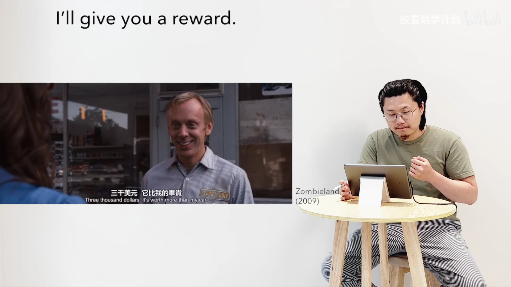

文字识别：I'll give you a reward. / 三千美元它比我的車貴 / GRISNGUIP / Zombieland / Three thousand dollars. It's worth more than my car / (2009)

### 画面 00:04:41

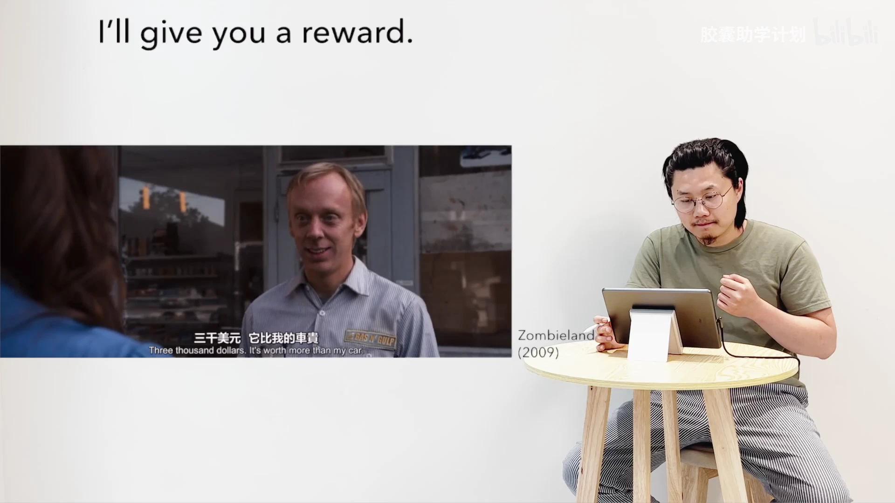

文字识别：I'll give you a reward. / 三千美元它比我的車貴 / EBISN'GULP / Zombieland / Three thousand dollars. It's worth more thian my car / (2009)

### 画面 00:04:43

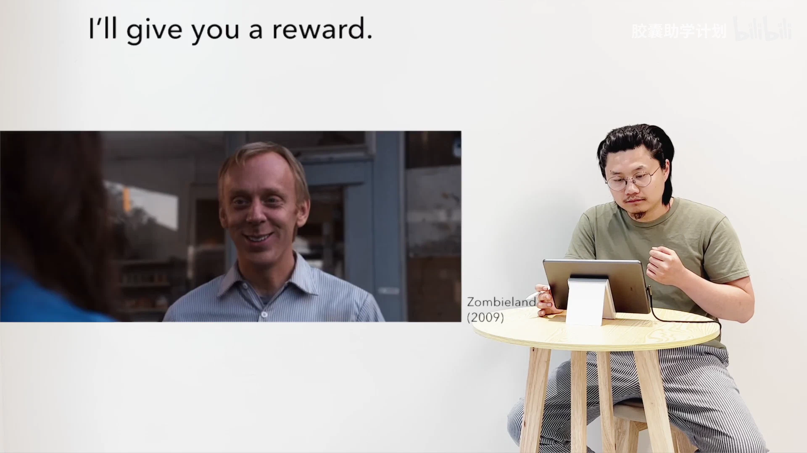

文字识别：I'll give you a reward. / Zombieland / (2009)

### 画面 00:04:45

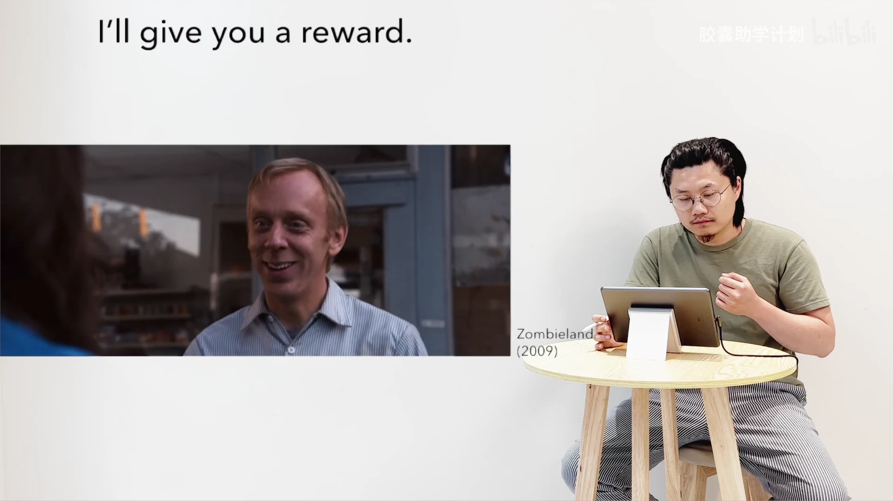

文字识别：I'll give you a reward. / Zombieland / (2009)

### 画面 00:04:49

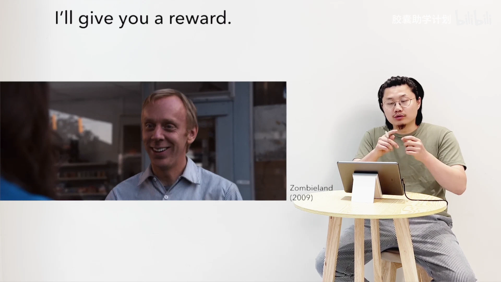

文字识别：I'll give you a reward. / Zombieland / (2009)

## 00:05:00–00:05:30

give you a reward. Very good.好，接下来呢？下一个单词也是咱们标题当中出现的，所以它在本课并不是一个非常重点的单词。但是这个单词呢，你还真的必须要记起来。它就是德行啊，品德、品质这个单词叫做 virtue. virtue. Okay.那我们直接就用一句话把它记下来，放到句子当中，对吧？这是我们学习单词的一个思路。能放在句子当中，绝不单独去记它。那叫做 patience is a virtue.

### 画面 00:05:02

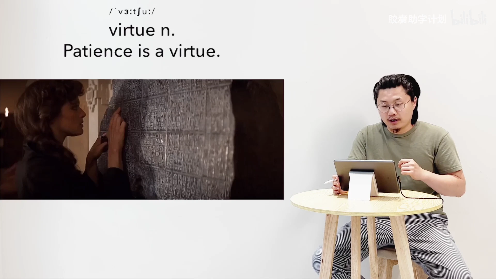

文字识别：/'v3:t∫u:/ / virtue n. / Patience is a virtue.

### 画面 00:05:20

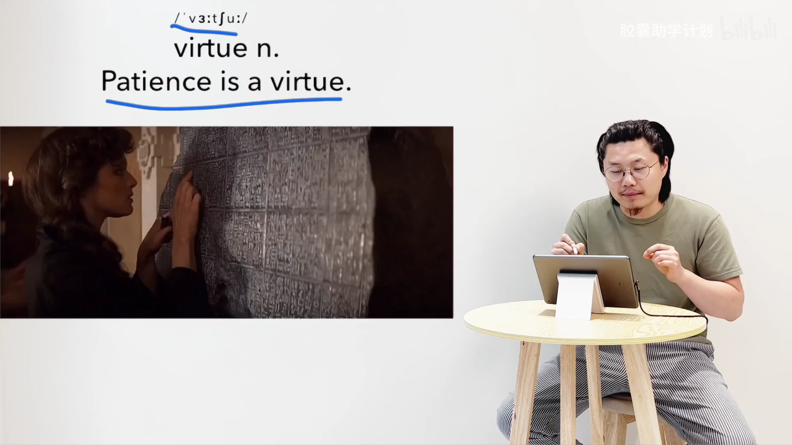

文字识别：/'v3:t∫u:/ / virtue n. / Patience is a virtue.

## 00:05:30–00:06:00

Okay, 叫做耐心或者说有耐心啊，是一个美德啊。我们注意力听一下，做一个听力练习。 Okay, patience is a virtue. Very good. 好，记住这个单词，再读一遍 virtue. Very good. 好，下一个单词，跟我一起读一下，叫做 diet. Diet. 好，diet 这个单词的意思呢，其实指的是节食啊，但是你注意它是一个名词，对吧？啊，不是我们那个

### 画面 00:05:39

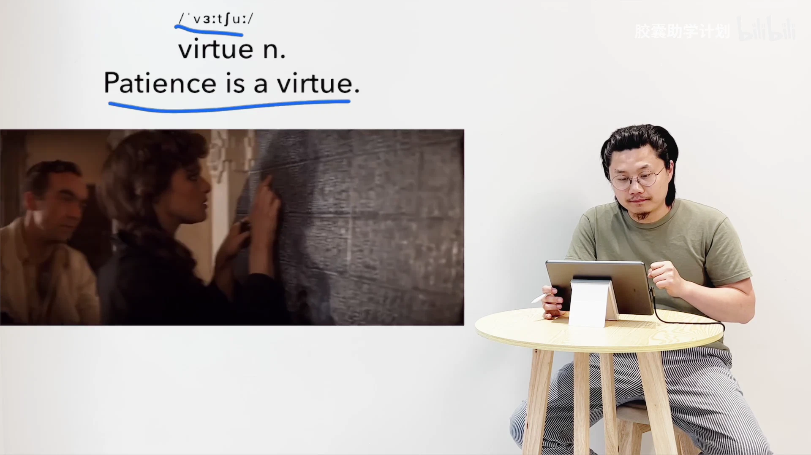

文字识别：/'v3:t∫u:/ / virtue n. / Patience is a virtue.

### 画面 00:05:41

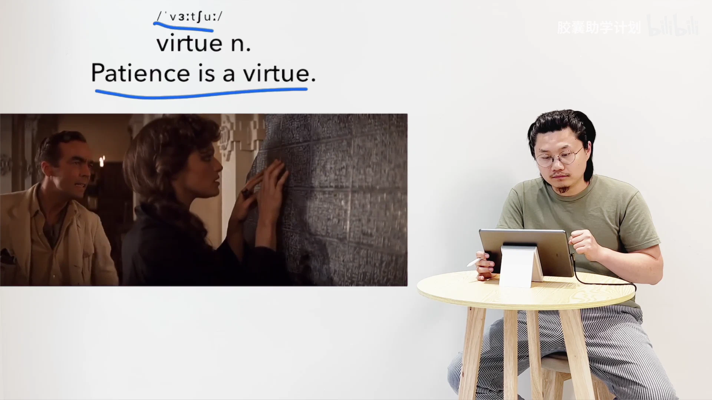

文字识别：/v3:t∫u:/ / virtue n. / Patience is a virtue.

### 画面 00:05:43

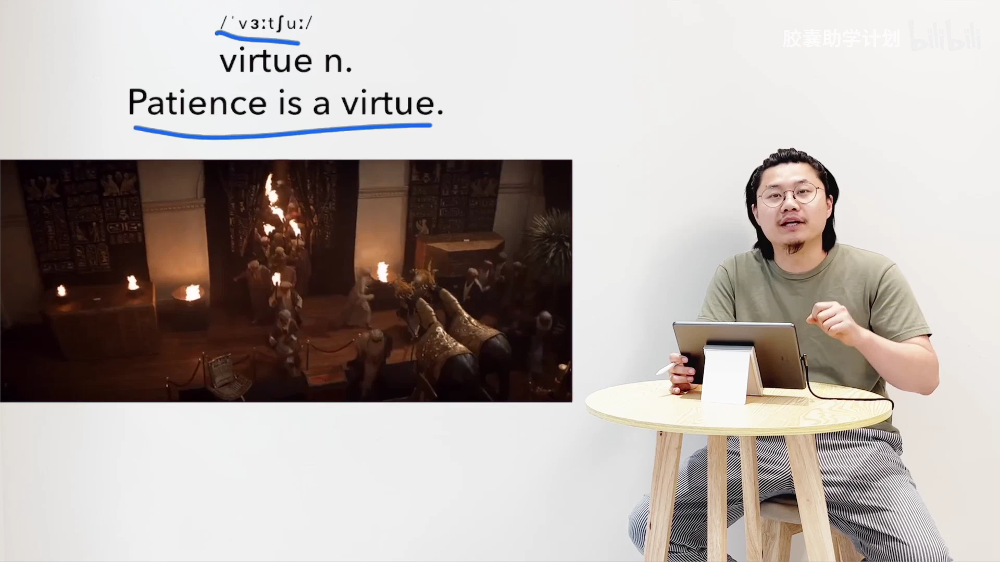

文字识别：/'v3:t∫u:/ / virtue n. / Patience is a virtue.

### 画面 00:05:48

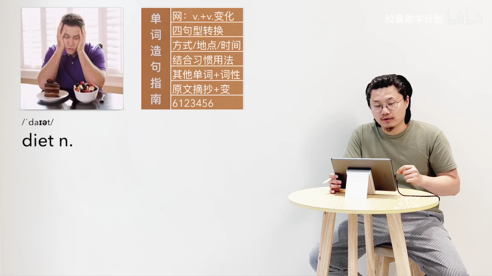

文字识别：单词造句指南 / 网：v.+v.变化 / 四句型转换 / 方式/地点/时间 / 结合习惯用法 / 其他单词+词性 / 原文摘抄+变 / 6123456 / /'darat/ / diet n.

### 画面 00:05:50

文字识别：单词造句指南 / 网：v.+v.变化 / 四句型转换 / 方式/地点/时间 / 结合习惯用法 / 其他单词+词性 / 原文摘抄+变 / 6123456 / /'darat/ / diet n.

### 画面 00:05:57

文字识别：单词造句指南 / 网：v.+v.变化 / 四句型转换 / 方式/地点/时间 / 结合习惯用法 / 其他单词+词性 / 原文摘抄+变 / 6123456 / /'darat/ / diet n.

## 00:06:00–00:06:30

肾结石的结石哈，这汉语博大精深。好，指的是我们这个减少食量的这个结石啊。呃，它常用的，你看它是一个名词，文章当中和课文注释当中恰好就给了我们两个它特别常用的短语啊。这是亚历山大编书的时候编的，真的好。他用的这些短语恰好真的就是我们口语听力当中最常出现的那些，叫做 go on a diet，或者等同于 be on a diet。比如说最简单，我在节食怎

### 画面 00:06:05

文字识别：单词造句指南 / 网：v.+v.变化 / 四句型转换 / 方式/地点/时间 / 结合习惯用法 / 其他单词+词性 / 原文摘抄+变 / 6123456 / /'darat/ / diet n.

### 画面 00:06:10

文字识别：单词造句指南 / 网：v.+v.变化 / 四句型转换 / 方式/地点/时间 / 结合习惯用法 / 其他单词+词性 / 原文摘抄+变 / 6123456 / /'darat/ / diet n. / go on a diet = be on a diet

### 画面 00:06:12

文字识别：单词造句指南 / 网：v.+v.变化 / 四句型转换 / 方式/地点/时间 / 结合习惯用法 / 其他单词+词性 / 原文摘抄+变 / 6123456 / /'darat/ / diet n. / go on a diet = be on a diet

### 画面 00:06:20

文字识别：单词造句指南 / 网：v.+v.变化 / 四句型转换 / 方式/地点/时间 / 结合习惯用法 / 其他单词+词性 / 原文摘抄+变 / 6123456 / /'darat/ / diet n. / go on a diet = be on a diet

### 画面 00:06:23

文字识别：单词造句指南 / 网：v.+v.变化 / 四句型转换 / 方式/地点/时间 / 结合习惯用法 / 其他单词+词性 / 原文摘抄+变 / 6123456 / /'darat/ / diet n. / go on a diet = be on a diet

### 画面 00:06:26

文字识别：单词造句指南 / 网：v.+v.变化 / 四句型转换 / 方式/地点/时间 / 结合习惯用法 / 其他单词+词性 / 原文摘抄+变 / 6123456 / /'darat/ / diet n. / go on a diet = be on a diet

### 画面 00:06:29

文字识别：单词造句指南 / 网：v.+v.变化 / 四句型转换 / 方式/地点/时间 / 结合习惯用法 / 其他单词+词性 / 原文摘抄+变 / 6123456 / /'darat/ / diet n. / go on a diet = be on a diet

## 00:06:30–00:07:00

么说？I go on a diet.啊，其实更常用的叫做I I am on a diet.连起来I'm on a diet. Okay, very good.那既然动词都有了，其实接下来再想去造句子，无非就是六一二三四五六或时间地点，你去换一换时态，这句话就出来了，对吧？比如说我们造了一句话，Most people prefer to go on a diet rather than go to a gym.啊，对吧？很多人是宁愿节食也不愿意去健身房

### 画面 00:06:36

文字识别：单词造句指南 / 网：v.+v.变化 / 四句型转换 / 方式/地点/时间 / 结合习惯用法 / 其他单词+词性 / 原文摘抄+变 / 6123456 / /'darat/ / diet n. / go on a diet = be on a diet

### 画面 00:06:45

文字识别：单词造句指南 / 网：v.+v.变化 / 四句型转换 / 方式/地点/时间 / 结合习惯用法 / 其他单词+词性 / 原文摘抄+变 / 6123456 / /'darat/ / diet n. / go on a diet = be on a diet

### 画面 00:06:49

文字识别：单词造句指南 / 网：v.+v.变化 / 四句型转换 / 方式/地点/时间 / 结合习惯用法 / 其他单词+词性 / 原文摘抄+变 / 6123456 / /'darat/ / diet n. / go on a diet = be on a diet / Most people prefer to go on a diet rather / than go to a gym. L50

### 画面 00:06:54

文字识别：单词造句指南 / 网：v.+v.变化 / 四句型转换 / 方式/地点/时间 / 结合习惯用法 / 其他单词+词性 / 原文摘抄+变 / 6123456 / /'darat/ / diet n. / go on a diet = be on a diet / Most people prefer to go on a diet rather / than go to a gym. L50

### 画面 00:06:57

文字识别：单词造句指南 / 网：v.+v.变化 / 四句型转换 / 方式/地点/时间 / 结合习惯用法 / 其他单词+词性 / 原文摘抄+变 / 6123456 / /'darat/ / diet n. / go on a diet = be on a diet / Most people prefer to go on a diet rather / than go to a gym. L50

## 00:07:00–00:07:30

撸铁的，对吧？或者说做有氧运动的啊，这是我们五十课刚刚学过的，叫 prefer to do something rather than do something. Okay, 我们立刻就用到了五十课这个讲 prefer 的时候，我也提到了它的结构太多了，而且太容易混了，所以我们接下来单词造句会要不停的用它啊. Continue, 说 because he was so fat at that time, he went on a diet. 说因为他在那个时候太胖了，所以他去节食了，特别的简单啊. Okay, 再来说 she

### 画面 00:07:02

文字识别：单词造句指南 / 网：v.+v.变化 / 四句型转换 / 方式/地点/时间 / 结合习惯用法 / 其他单词+词性 / 原文摘抄+变 / 6123456 / /'darat/ / diet n. / go on a diet = be on a diet / Most people prefer to go on a diet rather / than go to a gym. L50

### 画面 00:07:08

文字识别：单词造句指南 / 网：v.+v.变化 / 四句型转换 / 方式/地点/时间 / 结合习惯用法 / 其他单词+词性 / 原文摘抄+变 / 6123456 / /'darat/ / diet n. / go on a diet = be on a diet / Most people prefer to go on a diet rather / than go to a gym. L50

### 画面 00:07:11

文字识别：单词造句指南 / 网：v.+v.变化 / 四句型转换 / 方式/地点/时间 / 结合习惯用法 / 其他单词+词性 / 原文摘抄+变 / 6123456 / /'darat/ / diet n. / go on a diet = be on a diet / Most people prefer to go on a diet rather / than go to a gym. L50

### 画面 00:07:18

文字识别：单词造句指南 / 网：v.+v.变化 / 四句型转换 / 方式/地点/时间 / 结合习惯用法 / 其他单词+词性 / 原文摘抄+变 / 6123456 / /'darat/ / diet n. / go on a diet = be on a diet / 1 / Most people prefer to go on a diet rather / than go to a gym. L50 / Because he was so fat at that time, he went / on a diet.

### 画面 00:07:21

文字识别：单词造句指南 / 网：v.+v.变化 / 四句型转换 / 方式/地点/时间 / 结合习惯用法 / 其他单词+词性 / 原文摘抄+变 / 6123456 / /'darat/ / diet n. / go on a diet = be on a diet / Most people prefer to go on a diet rather / than go to a gym. L50 / Because he was so fat at that time, he went / on a diet.

### 画面 00:07:25

文字识别：单词造句指南 / 网：v.+v.变化 / 四句型转换 / 方式/地点/时间 / 结合习惯用法 / 其他单词+词性 / 原文摘抄+变 / 6123456 / /'darat/ / diet n. / go on a diet = be on a diet / Most people prefer to go on a diet rather / than go to a gym. L50 / Because he was so fat at that time, he went / on a diet.

### 画面 00:07:27

文字识别：单词造句指南 / 网：v.+v.变化 / 四句型转换 / 方式/地点/时间 / 结合习惯用法 / 其他单词+词性 / 原文摘抄+变 / 6123456 / /'darat/ / diet n. / go on a diet = be on a diet / Most people prefer to go on a diet rather / than go to a gym. L50 / Because he was so fat at that time, he went / on a diet.

## 00:07:30–00:08:00

loves going on a diet.你看，我在这里就结合了其他的习惯用法，love doing啊，这个人特别喜欢节食。OK啊，比如说他是呃维密的模特，对吧？She loves going on a diet. Very good. Next one，下一个单词，这个单词其实尤其是它的过去分词forbidden这个单词啊，各位其实你要仔细去看，至少在北京的地铁的很多地方都有这个英文单词叫做forbidden啊，各位注意力集中，

### 画面 00:07:32

文字识别：单词造句指南 / 网：v.+v.变化 / 四句型转换 / 方式/地点/时间 / 结合习惯用法 / 其他单词+词性 / 原文摘抄+变 / 6123456 / /'darat/ / diet n. / 1 / go on a diet = be on a diet / Most people prefer to go on a diet rather / than go to a gym. L50 / Because he was so fat at that time, he went / on a diet. / She Toves going on a diet. L50

### 画面 00:07:34

文字识别：单词造句指南 / 网：v.+v.变化 / 四句型转换 / 方式/地点/时间 / 结合习惯用法 / 其他单词+词性 / 原文摘抄+变 / 6123456 / /'darat/ / diet n. / 1 / go on a diet = be on a diet / Most people prefer to go on a diet rather / than go to a gym. L50 / Because he was so fat at that time, he went / on a diet. / She loves going on a diet. L50

### 画面 00:07:37

文字识别：单词造句指南 / 网：v.+v.变化 / 四句型转换 / 方式/地点/时间 / 结合习惯用法 / 其他单词+词性 / 原文摘抄+变 / 6123456 / /'darat/ / diet n. / go on a diet = be on a diet / 1 / Most people prefer to go on a diet rather / than go to a gym. L50 / Because he was so fat at that time, he went / on a diet. / She Toves going on a diet. L50

### 画面 00:07:41

文字识别：单词造句指南 / 网：v.+v.变化 / 四句型转换 / 方式/地点/时间 / 结合习惯用法 / 其他单词+词性 / 原文摘抄+变 / 6123456 / /'darat/ / diet n. / 1 / go on a diet = be on a diet / Most people prefer to go on a diet rather / than go to a gym. L50 / Because he was so fat at that time, he went / on a diet. / She Toves going on a diet. L50

### 画面 00:07:44

文字识别：单词造句指南 / 网：v.+v.变化 / 四句型转换 / S / 方式/地点/时间 / 结合习惯用法 / 其他单词+词性 / 原文摘抄+变 / 6123456 / /fa' brd/ / fa'bæd / / fa'brd an / / forbid forbade forbidden v.

### 画面 00:07:47

文字识别：单词造句指南 / 网：v.+v.变化 / 四句型转换 / S / 方式/地点/时间 / 结合习惯用法 / 其他单词+词性 / 原文摘抄+变 / 6123456 / /fa' bid/ / fa'bæd / / fa'brd an / / forbid forbade forbidden v.

### 画面 00:07:49

文字识别：单词造句指南 / 网：v.+v.变化 / 四句型转换 / S / 方式/地点/时间 / 结合习惯用法 / 其他单词+词性 / 原文摘抄+变 / 6123456 / /fa' bid/ / fa' bæ d / / fa'brd an / / forbid forbade forbidden v.

### 画面 00:07:51

文字识别：单词造句指南 / 网：v.+v.变化 / 四句型转换 / S / 方式/地点/时间 / 结合习惯用法 / 其他单词+词性 / 原文摘抄+变 / 6123456 / /fa' bid/ / fa'bæd / / fa'br d an / / forbid forbade forbidden v.

### 画面 00:07:57

文字识别：单词造句指南 / 网：v.+v.变化 / 四句型转换 / S / 方式/地点/时间 / 结合习惯用法 / 其他单词+词性 / 原文摘抄+变 / 6123456 / /fa' bid/ / fa' bæ d / / fa'brd an / / forbid forbade forbidden v.

## 00:08:00–00:08:30

你下回再坐地铁去看一下，你的城市当中的地铁或者很多的地方有没有 forbidden 这个单词啊，叫禁止啊。那 forbid 是原形，forbid 是过去式啊，它是个动词。它想去造句呢，首先我直接给你一个，这是比较常用的一句话，叫 smoking is forbidden here 啊，这里禁止吸烟。 OK，然后像这个动词呢，我们就要其实结合一个它的用法，叫做 forbid somebody

### 画面 00:08:08

文字识别：单词造句指南 / 网：v.+v.变化 / 四句型转换 / S / 方式/地点/时间 / 结合习惯用法 / 其他单词+词性 / 原文摘抄+变 / 6123456 / /fa' bid/ / fa'bæ d / / fa'brd an / / forbid forbade forbidden v.

### 画面 00:08:10

文字识别：单词造句指南 / 网：v.+v.变化 / 四句型转换 / 方式/地点/时间 / 结合习惯用法 / 其他单词+词性 / 原文摘抄+变 / 6123456 / /fa' bid / / fa'bæed / / fa'bid an / / forbid forbade_forbidden v.

### 画面 00:08:15

文字识别：单词造句指南 / 网：v.+v.变化 / 四句型转换 / S / 方式/地点/时间 / 结合习惯用法 / 其他单词+词性 / 原文摘抄+变 / 6123456 / /fa' bid/ / fa'bæ d / / fa'brd an / / forbid forbadeforbidden v. / ① Smoking is forbidden here.

### 画面 00:08:19

文字识别：单词造句指南 / 网：v.+v.变化 / 四句型转换 / S / 方式/地点/时间 / 结合习惯用法 / 其他单词+词性 / 原文摘抄+变 / 6123456 / /fa' bid/ / fa'bæ d / / fa'bid a n / / forbid forbadeforbidden v. / ① Smoking is forbidden here.

### 画面 00:08:25

文字识别：单词造句指南 / 网：v.+v.变化 / 四句型转换 / 方式/地点/时间 / 结合习惯用法 / 其他单词+词性 / 原文摘抄+变 / 6123456 / /fa' bid/ / fa'bæd / / fa'brd an / / forbid forbadeforbidden v. / ① Smoking is forbidden here. / ② forbid sb. to do sth.

### 画面 00:08:27

文字识别：单词造句指南 / 网：v.+v.变化 / 四句型转换 / 方式/地点/时间 / 结合习惯用法 / 其他单词+词性 / 原文摘抄+变 / 6123456 / /fa' bid/ / fa'bæd / / fa'bid an / / forbid forbadeforbidden v. / ① Smoking is forbidden here. / ) forbid sb. to do sth.

## 00:08:30–00:09:00

to do something.这里我想提一个小点，这地方我打一个问号，提一个小点。各位注意，并不啊，我们是这样的啊，就是我们学英文的时候呢，我一直提一句话叫做多模仿少创造，多模仿少创造，并不能因为 forbid 这个动词可以说 forbid somebody to do something，或者也可以说 want somebody to do something，啊 tell somebody to do something。于是你就能得出

### 画面 00:08:32

文字识别：单词造句指南 / 网：v.+v.变化 / 四句型转换 / S / 方式/地点/时间 / 结合习惯用法 / 其他单词+词性 / 原文摘抄+变 / 6123456 / /fa' bid/ / fa'bæ d / / fa'brd a n / / forbid forbade forbidden v. / ① Smoking is forbidden here. / )forbid sb. to do sth.

### 画面 00:08:34

文字识别：单词造句指南 / 网：v.+v.变化 / 四句型转换 / S / 方式/地点/时间 / 结合习惯用法 / 其他单词+词性 / 原文摘抄+变 / 6123456 / /fa' bid/ / fa'bæd / / fa'brd an / / forbid forbade forbidden v. / ① Smoking is forbidden here. / ) forbid sb. to do sth.

### 画面 00:08:41

文字识别：单词造句指南 / 网：v.+v.变化 / 四句型转换 / 方式/地点/时间 / 结合习惯用法 / 其他单词+词性 / 原文摘抄+变 / 6123456 / /fa' bid/ / fa'bæd / / fa'brd an / / forbid forbadeforbidden v. / ① Smoking is forbidden here. / ) forbid sb. to do sth.

### 画面 00:08:45

文字识别：单词造句指南 / 网：v.+v.变化 / 四句型转换 / S / 方式/地点/时间 / 结合习惯用法 / 其他单词+词性 / 原文摘抄+变 / 6123456 / /fa' bid/ / fa'bæd / / fa'bid an / / forbid forbade forbidden v. / ① Smoking is forbidden here. / ) forbid sb. to do sth.

### 画面 00:08:49

文字识别：单词造句指南 / 网：v.+v.变化 / 四句型转换 / S / 方式/地点/时间 / 结合习惯用法 / 其他单词+词性 / 原文摘抄+变 / 6123456 / /fa' bid/ / fa'bæ d / / fa'bid an / / forbid forbade forbidden v. / ① Smoking is forbidden here. / ) forbid sb. to do sth.

## 00:09:00–00:09:30

一个结论，叫是一个动词就可以叫做动词加 somebody to do something.然后你就讲了一个单词，那你说 suggest，我原来学过叫建议。那我说建议某人做某事儿，呃，做某事儿是吧？那 suggest somebody to do something 行不行呢？各位判断行不行的方式呢？其实对于各位初学者来说非常的简单啊。对于我来说不一样啊。我们判断标准对于初学者来说就是你见没见过，老师教过你，你见过，你确定你见

### 画面 00:09:07

文字识别：单词造句指南 / 网：v.+v.变化 / 四句型转换 / S / 方式/地点/时间 / 结合习惯用法 / 其他单词+词性 / 原文摘抄+变 / 6123456 / /fa' bid/ / fa'bæd / / fa'brd an / / forbid forbade forbidden v. / ① Smoking is forbidden here. / ) forbid sb. to do sth.

### 画面 00:09:15

文字识别：单词造句指南 / 网：v.+v.变化 / 四句型转换 / 方式/地点/时间 / 结合习惯用法 / 其他单词+词性 / 原文摘抄+变 / 6123456 / /fa' bid/ / fa'bæd / / fa'brdan / / forbid forbadeforbidden v. / ① Smoking is forbidden here. / )forbid sb. to do sth.

### 画面 00:09:17

文字识别：单词造句指南 / 网：v.+v.变化 / 四句型转换 / S / 方式/地点/时间 / 结合习惯用法 / 其他单词+词性 / 原文摘抄+变 / 6123456 / /fa' bid/ / fa'bæd / / fa'brd an / / forbid forbade forbidden v. / ① Smoking is forbidden here. / )forbid sb. to do sth.

### 画面 00:09:19

文字识别：单词造句指南 / 网：v.+v.变化 / 四句型转换 / S / 方式/地点/时间 / 结合习惯用法 / 其他单词+词性 / 原文摘抄+变 / 6123456 / /fa' bid/ / fa'bæd / / fa'brd an / / forbid forbadeforbidden v. / ① Smoking is forbidden here. /  forbid sb. to do sth. / 2)

### 画面 00:09:25

文字识别：单词造句指南 / 网：v.+v.变化 / 四句型转换 / S / 方式/地点/时间 / 结合习惯用法 / 其他单词+词性 / 原文摘抄+变 / 6123456 / /fa' bid/ / fa'bæd / / fa'brd an / / forbid forbade forbidden v. / ① Smoking is forbidden here. / ) forbid sb. to do sth.

## 00:09:30–00:10:00

过？你在用？你没见过？你说从来没有老师教过我 suggest somebody to do something，你就千万不要用，一用可能就会错，因为语言还是那句话，不完全符合逻辑。凭什么这个动词可以，那个动词就不行？我汉语明明就可以说建议某人做某事儿，为什么英文就不行？那很抱歉，英文就是这个语言习惯，这不是语法，这叫习惯约定俗成的习惯。你你去到人家地盘上，对吧？学习人家的语言，你就

### 画面 00:09:46

文字识别：单词造句指南 / 网：v.+v.变化 / 四句型转换 / S / 方式/地点/时间 / 结合习惯用法 / 其他单词+词性 / 原文摘抄+变 / 6123456 / /fa' bid/ / fa'bæd / / fa'brd an / / forbid forbadeforbidden v. / ① Smoking is forbidden here. / ) forbid sb. to do sth.

### 画面 00:09:49

文字识别：单词造句指南 / 网：v.+v.变化 / 四句型转换 / S / 方式/地点/时间 / 结合习惯用法 / 其他单词+词性 / 原文摘抄+变 / 6123456 / /fa' bid/ / f a'bæ d / / fa'brd a n / / forbid forbade forbidden v. / ① Smoking is forbidden here. / ) forbid sb. to do sth.

### 画面 00:09:54

文字识别：单词造句指南 / 网：v.+v.变化 / 四句型转换 / S / 方式/地点/时间 / 结合习惯用法 / 其他单词+词性 / 原文摘抄+变 / 6123456 / /fa' bid/ / fa'bæd / / fa'brd an / / forbid forbadeforbidden v. / ① Smoking is forbidden here. /  forbid sb. to do sth.

### 画面 00:09:59

文字识别：单词造句指南 / 网：v.+v.变化 / 四句型转换 / 方式/地点/时间 / 结合习惯用法 / 其他单词+词性 / 原文摘抄+变 / 6123456 / /fa' bid/ / f a'bæ d / / fa'brd a n / / forbid forbadeforbidden v. / ① Smoking is forbidden here. / ) forbid sb. to do sth.

## 00:10:00–00:10:30

要遵守人家的语言习惯。你像我原来经常举的例子，叫做为什么我们说警犬，但不说警狗，对吧？哎，犬狗不是一码事吗？为什么说警犬不说警狗？这是汉语的语言习惯，我们不用去问为什么，我们遵守就可以了。听见了吧？OK，所以呢，在这里我告诉你了啊，我给各位分享了，教了各位说 forbid somebody to do something，你就放心去用啊。我们实际上在去备课的时候，必须要去查它的这样的用法，通过语料

### 画面 00:10:08

文字识别：单词造句指南 / 网：v.+v.变化 / 四句型转换 / S / 方式/地点/时间 / 结合习惯用法 / 其他单词+词性 / 原文摘抄+变 / 6123456 / /fa' bid/ / fa'bæd / / fa'brd an / / forbid forbade forbidden v. / ① Smoking is forbidden here. / ) forbid sb. to do sth.

### 画面 00:10:11

文字识别：单词造句指南 / 网：v.+v.变化 / 四句型转换 / S / 方式/地点/时间 / 结合习惯用法 / 其他单词+词性 / 原文摘抄+变 / 6123456 / /fa' bid/ / fa'bæ d / / fa'br d a n / / forbid forbade forbidden v. / ① Smoking is forbidden here. / ) forbid sb. to do sth.

### 画面 00:10:15

文字识别：单词造句指南 / 网：v.+v.变化 / 四句型转换 / S / 方式/地点/时间 / 结合习惯用法 / 其他单词+词性 / 原文摘抄+变 / 6123456 / /fa' bid/ / fa'bæ d / / fa'brd an / / forbid forbade forbidden v. / ① Smoking is forbidden here. / ② forbid sb. to do sth.

### 画面 00:10:20

文字识别：单词造句指南 / 网：v.+v.变化 / 四句型转换 / S / 方式/地点/时间 / 结合习惯用法 / 其他单词+词性 / 原文摘抄+变 / 6123456 / /fa' bid/ / fa'bæd / / fabrd an / / forbid forbade forbidden v. / ① Smoking is forbidden here. /  forbid sb. to do sth.

## 00:10:30–00:11:00

库也好，还是通过现实的语境，各种各样的方式，这是我们备课自己有一套告诉你的，几乎一定是对的，就一定是在现实生活当中外国人也这么去用的，而你没见过的，千万不要自己去创造，听见了吧？OK，那就禁止某人做某事儿就很简单了。接下来造句子，比如说 They forbid us to talk about it。啊，他们禁止我们聊这件事儿啊。再来，比如说 My parents forbid me to come home

### 画面 00:10:36

文字识别：单词造句指南 / 网：v.+v.变化 / 四句型转换 / S / 方式/地点/时间 / 结合习惯用法 / 其他单词+词性 / 原文摘抄+变 / 6123456 / /fa' bid/ / fa'bæ d / / fa'brd a n / / forbid forbadeforbidden v. / ① Smoking is forbidden here. / ② forbid sb. to do sth.

### 画面 00:10:45

文字识别：单词造句指南 / 网：v.+v.变化 / 四句型转换 / SS / 方式/地点/时间 / 结合习惯用法 / 其他单词+词性 / 原文摘抄+变 / 6123456 / /fa' bid/ / fa'bæ d / / fa'brd a n / / forbid forbade forbidden v. / ① Smoking is forbidden here. / ) forbid sb. to do sth.

### 画面 00:10:50

文字识别：单词造句指南 / 网：v.+v.变化 / 四句型转换 / 方式/地点/时间 / 结合习惯用法 / 其他单词+词性 / 原文摘抄+变 / 6123456 / /fa' bid/ / fa'bæd / / fa'brd an / / forbid forbade forbidden v. / ① Smoking is forbidden here. / )forbid sb.to do sth. / ① They torbid us to talk about it.

### 画面 00:10:52

文字识别：单词造句指南 / 网：v.+v.变化 / 四句型转换 / 方式/地点/时间 / 结合习惯用法 / 其他单词+词性 / 原文摘抄+变 / 6123456 / /fa' bid/ / fa'bæd / / fa'brd an / / forbid forbade forbidden v. / ① Smoking is forbidden here. / ② forbid sb. to do sth. / ① They forbid us to talk about it.

### 画面 00:10:57

文字识别：单词造句指南 / 网：v.+v.变化 / 四句型转换 / 方式/地点/时间 / 结合习惯用法 / 其他单词+词性 / 原文摘抄+变 / 6123456 / /fa' bid/ / fa'bæ d / / fa'bd an / / forbid forbadeforbidden v. / ① Smoking is forbidden here. / ② forbid sb. to do sth. / ① They forbid us to talk about it. / 2 / My parents forbid me to come home late.

## 00:11:00–00:11:30

late.说，我父母呢禁止我晚回家。再来，比如说，You can't forbid me to go.说，你禁，你不能禁止我走，对吧？你不能禁止我离开这里啊。OK，所以这里边的关键点叫forbid somebody to do something。你需要掌握这个短语。那同时呢，刚才我说的那些思路，就是不要自己去乱创造这件事儿。你也需要牢牢记住，因为他就是不和你讲逻辑，不和你讲道理的。语

### 画面 00:11:00

文字识别：单词造句指南 / 网：v.+v.变化 / 四句型转换 / 方式/地点/时间 / 结合习惯用法 / 其他单词+词性 / 原文摘抄+变 / 6123456 / /fa'brd / / fa'bæd / /fa'brdan / / forbid forbadeforbidden v. / ① Smoking is forbidden here. / ② forbid sb. to do sth. / ① They forbid us to talk about it. / My parents forbid me to come home late. / 2)

### 画面 00:11:07

文字识别：单词造句指南 / 网：v.+v.变化 / 四句型转换 / 方式/地点/时间 / 结合习惯用法 / 其他单词+词性 / 原文摘抄+变 / 6123456 / /fa'bid / / fa'bæd / /fa'brdan / / forbid forbadeforbidden v. / ① Smoking is forbidden here. / ② forbid sb. to do sth. / ① They forbid us to talk about it. / ② / My parents forbid me to come home late. / You can't forbid me to go.

### 画面 00:11:10

文字识别：单词造句指南 / 网：v.+v.变化 / 四句型转换 / 方式/地点/时间 / 结合习惯用法 / 其他单词+词性 / 原文摘抄+变 / 6123456 / /fa' bid/ / fa'bæ d / / fa'bid an / / forbid forbadeforbidden v. / ① Smoking is forbidden here. / ② forbid sb. to do sth. / ① They forbid us to talk about it. / ② / My parents forbid me to come home late. / You can't forbid me to go. / ③

### 画面 00:11:13

文字识别：单词造句指南 / 网：v.+v.变化 / 四句型转换 / 方式/地点/时间 / 结合习惯用法 / 其他单词+词性 / 原文摘抄+变 / 6123456 / /fa'bid/ / fa'bæd / /fa'brdan / / forbid forbadeforbidden v. / ① Smoking is forbidden here. / forbid sb. to do sth. / ① They forbid us to talk about it. / ② / My parents forbid me to come home late. / ③ / You can't forbid me to go.

### 画面 00:11:19

文字识别：单词造句指南 / 网：v.+v.变化 / 四句型转换 / 方式/地点/时间 / 结合习惯用法 / 其他单词+词性 / 原文摘抄+变 / 6123456 / /fa'bid/ / fa'bæd / /fa'brdan / / forbid forbadeforbidden v. / ① Smoking is forbidden here. / forbid sb. to do sth. / ① They forbid us to talk about it. / ② / My parents forbid me to come home late. / You can't forbid me to go. / 3

### 画面 00:11:29

文字识别：单词造句指南 / 网：v.+v.变化 / 四句型转换 / 方式/地点/时间 / 结合习惯用法 / 其他单词+词性 / 原文摘抄+变 / 6123456 / /fa' bid/ / fa'bæ d / / fa'bi d a n / / forbid forbadeforbidden v. / ①_Smoking is forbidden here. / forbid sb. to do sth. / ① They forbid us to talk about it. / ② / My parents forbid me to come home late. / You can't forbid me to go.

## 00:11:30–00:12:00

言习惯是什么样的，我们就去遵守就好了，对吧？OK，好，下一个单词，下一个单词其实各位原来见过它的动词形式，跟我一起读，叫做 hurry 啊，你就说快点 hurry up，这新一就见过很多次了，不多提了。那后面这个单词是它的副词，叫 hurriedly 啊，就是迅速的，其实特别像 quickly 那个单词啊，特别像 quickly 那个单词，它是个副词。六一二三四五六当中，我想去造句子，基本上离不开它四嘛，对吧？

### 画面 00:11:34

文字识别：单词造句指南 / 网：v.+v.变化 / 四句型转换 / 方式/地点/时间 / 结合习惯用法 / 其他单词+词性 / 原文摘抄+变 / 6123456 / / 'h Λr i d l i / / hurriedly adv. hurry v.

### 画面 00:11:37

文字识别：单词造句指南 / 网：v.+v.变化 / 四句型转换 / 方式/地点/时间 / 结合习惯用法 / 其他单词+词性 / 原文摘抄+变 / 6123456 / /'hΛri d li / / hurriedly adv. hurry v.

### 画面 00:11:45

文字识别：单词造句指南 / 网：v.+v.变化 / 四句型转换 / 方式/地点/时间 / 结合习惯用法 / 其他单词+词性 / 原文摘抄+变 / 6123456 / / ' hΛr i d l i / / hurriedly adv. hurry v.

### 画面 00:11:50

文字识别：单词造句指南 / 网：v.+v.变化 / 四句型转换 / 方式/地点/时间 / 结合习惯用法 / 其他单词+词性 / 原文摘抄+变 / 6123456 / / ·h Λr i d l i / / hurriedly adv. hurry v.

### 画面 00:11:59

文字识别：单词造句指南 / 网：v.+v.变化 / 四句型转换 / 方式/地点/时间 / 结合习惯用法 / 其他单词+词性 / 原文摘抄+变 / 6123456 / / ' har i d l i / / hurriedly adv. hurry v. / ① quickly

## 00:12:00–00:12:30

我只有 hurriedly，那我想去造句，造句子必须还得有一和二，主语和谓语。那我就随便造点主语和谓语，然后连个 hurriedly 不就完了吗？比如说 hurriedly，你可以跟 shut the door， open the door 连起来，没有问题，对吧？也比如说，可以说 he walked hurriedly，没有问题。那这有一个小点，就是你看我这个 hurriedly 好像并没有放到后面去，而这个 hurriedly 是放到了后面去的，对吧？这个地方你可能就又有一点点小的懵，尤

### 画面 00:12:06

文字识别：单词造句指南 / 网：v.+v.变化 / 四句型转换 / 方式/地点/时间 / 结合习惯用法 / 其他单词+词性 / 原文摘抄+变 / 6123456 / / ' hΛr i d li / / hurriedly adv. hurry v. / ① quickly

### 画面 00:12:12

文字识别：单词造句指南 / 网：v.+v.变化 / 四句型转换 / 方式/地点/时间 / 结合习惯用法 / 其他单词+词性 / 原文摘抄+变 / 6123456 / / ' hΛridli / / hurriedly adv. hurry V. / ① quickly / ② ...hurriedly shut the door/opened the door...

### 画面 00:12:14

文字识别：单词造句指南 / 网：v.+v.变化 / 四句型转换 / 方式/地点/时间 / 结合习惯用法 / 其他单词+词性 / 原文摘抄+变 / 6123456 / / ' hΛr i d li / / hurriedly adv. hurry v. / ① quickly / ② ...hurriedly shut the door/opened the door..

### 画面 00:12:17

文字识别：单词造句指南 / 网：v.+v.变化 / 四句型转换 / 方式/地点/时间 / 结合习惯用法 / 其他单词+词性 / 原文摘抄+变 / 6123456 / / ' har i d l i / / hurriedly adv. hurry v. / ① quickly / ② ...hurriedly shut the door/opened the door.. / ③ ...he walked hurriedly...

### 画面 00:12:22

文字识别：单词造句指南 / 网：v.+v.变化 / 四句型转换 / 方式/地点/时间 / 结合习惯用法 / 其他单词+词性 / 原文摘抄+变 / 6123456 / /·hΛrid li / / hurriedly adv. hurry v. / quickly / 6urriedly shut the door/opened the door.. / ...he walked hurriedly...

### 画面 00:12:24

文字识别：单词造句指南 / 网：v.+v.变化 / 四句型转换 / 方式/地点/时间 / 结合习惯用法 / 其他单词+词性 / 原文摘抄+变 / 6123456 / / 'hΛri d li / / hurriedly adv. hurry v. / quickly / burriedly shut the door/opened the door.. / ...he walked hurriedly...

### 画面 00:12:26

文字识别：单词造句指南 / 网：v.+v.变化 / 四句型转换 / 方式/地点/时间 / 结合习惯用法 / 其他单词+词性 / 原文摘抄+变 / 6123456 / / 'hΛri d li / / hurriedly adv. hurry v. / quickly / furriedly shut the door/opened the door.. / ..he walked nurriedly.

## 00:12:30–00:13:00

其对于我们现在初学者来说啊，新二也是初学者啊。我们的六一二三四五六，在第一节课我就提过，它并不是金科玉律啊。这个地方各位要记住，很多语言在去使用的时候，不是像数学公式一样，或者说像初级数学公式一样，非常的死板，对吧？x加y等于几，是吧？x减y等于几，得出来的那个答案就只有一个，对吧？不，甚它甚至就不是二元的，对吧？就很简单啊，它不是这个样子的，

### 画面 00:12:30

文字识别：单词造句指南 / 网：v.+v.变化 / 四句型转换 / 方式/地点/时间 / 结合习惯用法 / 其他单词+词性 / 原文摘抄+变 / 6123456 / /' hΛr i d li / / hurriedly adv. hurry v. / quickly / burriedly shut the door/opened the door.. / ...he walked nurriedly.

### 画面 00:12:33

文字识别：单词造句指南 / 网：v.+v.变化 / 四句型转换 / 方式/地点/时间 / 结合习惯用法 / 其他单词+词性 / 原文摘抄+变 / 6123456 / /·hΛrid li / / hurriedly adv. hurry v. / quickly / burriedly shut the door/opened the door.. / ...he walked nurriedly.

### 画面 00:12:35

文字识别：单词造句指南 / 网：v.+v.变化 / 四句型转换 / 方式/地点/时间 / 结合习惯用法 / 其他单词+词性 / 原文摘抄+变 / 6123456 / / ·hΛrid li / / hurriedly adv. hurry v. / quickly / 1 / burriedly shut the door/opened the door.. / ...he walkednurriedly.

### 画面 00:12:39

文字识别：单词造句指南 / 网：v.+v.变化 / 四句型转换 / 方式/地点/时间 / 结合习惯用法 / 其他单词+词性 / 原文摘抄+变 / 6123456 / /  hΛrid l i / / hurriedly adv. hurry v. / quickly / burriedly shut the door/opened the door.. / ...he walked nurriedly.

### 画面 00:12:52

文字识别：单词造句指南 / 网：v.+v.变化 / 四句型转换 / 方式/地点/时间 / 结合习惯用法 / 其他单词+词性 / 原文摘抄+变 / 6123456 / / 'harid li / / hurriedly adv. hurry v. / quickly / furriedly shut the door/opened the door. / ...he walked nurriedly.

### 画面 00:12:54

文字识别：单词造句指南 / 网：v.+v.变化 / 四句型转换 / 方式/地点/时间 / 结合习惯用法 / 其他单词+词性 / 原文摘抄+变 / 6123456 / / ' hari d li / / hurriedly adv. hurry v. / quickly / burriedly shut the door/opened the door. / ...he walked nurriedly.

### 画面 00:12:59

文字识别：单词造句指南 / 网：v.+v.变化 / 四句型转换 / 方式/地点/时间 / 结合习惯用法 / 其他单词+词性 / 原文摘抄+变 / 6123456 / / ' hΛrid li / / hurriedly adv. hurry v. / quickly / burriedly shut the door/opened the door.. / ...he walked nurriedly.

## 00:13:00–00:13:30

它实际上是由语言习惯去决定的。大部分情况下，你可能会看到它在四这个位置，但是经常你也会看到例外。比如说 hurriedly shut the door. 啊，最简单，比如说他匆忙，昨天他匆忙的 yesterday he hurriedly shut the door. 你说 he shut the door hurriedly 行不行呢？也可以，听见了吧？OK，啊，好，接下来，比如说我们现在直接给他提到最前面去了，叫做 hurriedly he ordered his man to run to the forest. 你看啊，

### 画面 00:13:04

文字识别：单词造句指南 / 网：v.+v.变化 / 四句型转换 / 方式/地点/时间 / 结合习惯用法 / 其他单词+词性 / 原文摘抄+变 / 6123456 / / 'harid li / / hurriedly adv. hurry v. / quickly / furriedly shut the door/opened the door.. / ...he walked nurriedly.

### 画面 00:13:14

文字识别：单词造句指南 / 网：v.+v.变化 / 四句型转换 / 方式/地点/时间 / 结合习惯用法 / 其他单词+词性 / 原文摘抄+变 / 6123456 / /  hΛrid li/ / hurriedly adv. hurry V. / quickly / burriedly shut the door/opened the door.. / ...he walked nurriedly.

### 画面 00:13:19

文字识别：单词造句指南 / 网：v.+v.变化 / 四句型转换 / 方式/地点/时间 / 结合习惯用法 / 其他单词+词性 / 原文摘抄+变 / 6123456 / / 'harid li / / hurriedly adv. hurry v. / quickly / 6urriedly shut the door/opened the door. / ...he walked nurriedly.

### 画面 00:13:22

文字识别：单词造句指南 / 网：v.+v.变化 / 四句型转换 / 方式/地点/时间 / 结合习惯用法 / 其他单词+词性 / 原文摘抄+变 / 6123456 / / 'hΛri d li / / hurriedly adv. hurry v. / quickly / furriedly shut the door/opened the door. / ..he walked nurriedly. / Hurriedly, he Ordered his men to run to the / forest.

### 画面 00:13:24

文字识别：单词造句指南 / 网：v.+v.变化 / 四句型转换 / 方式/地点/时间 / 结合习惯用法 / 其他单词+词性 / 原文摘抄+变 / 6123456 / / ' h Λ r i d I i / / hurriedly adv. hurry v. / ① quickly / ② ...hurriedly shut the door/opened the door. / 2 / ③ ...he walked hurriedly... / ③ / Hurriedly, he ordered his men to run to the / forest.

### 画面 00:13:26

文字识别：单词造句指南 / 网：v.+v.变化 / 四句型转换 / 方式/地点/时间 / 结合习惯用法 / 其他单词+词性 / 原文摘抄+变 / 6123456 / / 'hΛrid li / / hurriedly adv. hurry v. / ① quickly / ② ...hurriedly shut the door/opened the door... / ③ ...he walked hurriedly... / Hurriedly, he ordered his men to run to the / forest.

## 00:13:30–00:14:00

an example. If I put hurriedly here, first, it's still the same sentence. There's no mistake. You can rest assured. Secondly, if I put it, for example, at the end, for example, he ordered his man to run hurriedly to the forest. There's a little difference. If you insist on saying it, it's because when you put hurriedly at the front, people's attention, you believe it, must have a head effect. It must be at the front, so there will be a little emphasis, a little emphasis. It's very quick, and it reacts very quickly.

### 画面 00:13:32

文字识别：单词造句指南 / 网：v.+v.变化 / 四句型转换 / 方式/地点/时间 / 结合习惯用法 / 其他单词+词性 / 原文摘抄+变 / 6123456 / / ' h Λ r i d I i / / hurriedly adv. hurry v. / ① quickly /  ...hurriedly shut the door/opened the door... / 2 / ...he walked hurriedly... / Aurriedly, he ordered his men to run to the / forest.

### 画面 00:13:38

文字识别：单词造句指南 / 网：v.+v.变化 / 四句型转换 / 方式/地点/时间 / 结合习惯用法 / 其他单词+词性 / 原文摘抄+变 / 6123456 / / ' h Λ r i d I i / / hurriedly adv. hurry v. / ① quickly / ) ...hurriedly shut the door/opened the door.. / 2 / ...he walked hurriedly... / Eurriedly, he ordered his men to run to the / forest.

### 画面 00:13:40

文字识别：单词造句指南 / 网：v.+v.变化 / 四句型转换 / 方式/地点/时间 / 结合习惯用法 / 其他单词+词性 / 原文摘抄+变 / 6123456 / / ' h Λ r i d I i / / hurriedly adv. hurry v. / ① quickly / ...hurriedly shut the door/opened the door.. / 2 / ...he walked hurriedly... / Aurriedly, he ordered his men to run to the / forest.

### 画面 00:13:50

文字识别：单词造句指南 / 网：v.+v.变化 / 四句型转换 / 方式/地点/时间 / 结合习惯用法 / 其他单词+词性 / 原文摘抄+变 / 6123456 / / ' h Λ r i d I i / / hurriedly adv. hurry v. / ① quickly / ) ..hurriedly shat the door/opened the door.. / 2 / ...he walked hurriedly... / Hurriedly, he ordered his men to run to the / forest.

### 画面 00:13:54

文字识别：单词造句指南 / 网：v.+v.变化 / 四句型转换 / 方式/地点/时间 / 结合习惯用法 / 其他单词+词性 / 原文摘抄+变 / 6123456 / / 'hΛrid l i / / hurriedly adv. hurry v. / ① quickly / ...hurriedly shut the door/opened the door.. / ...he walked hurriedly... / Eurriedly, he ordered his men to run to the / forest.

### 画面 00:13:57

文字识别：单词造句指南 / 网：v.+v.变化 / 四句型转换 / 方式/地点/时间 / 结合习惯用法 / 其他单词+词性 / 原文摘抄+变 / 6123456 / / ·hΛri d li / / hurriedly adv. hurry v. / ① quickly / ...hurriedly shut the door/opened the door... / ...he walked hurriedly... / Hurriedly, he ordered his men to run to the / forest.

### 画面 00:13:59

文字识别：单词造句指南 / 网：v.+v.变化 / 四句型转换 / 方式/地点/时间 / 结合习惯用法 / 其他单词+词性 / 原文摘抄+变 / 6123456 / / 'hΛrid li / / hurriedly adv. hurry v. / ① quickly / ...hurriedly shut the door/opened the door.. / ...he walked hurriedly... / Aurriedly, he ordered his men to run to the / forest.

## 00:14:00–00:14:30

迅速，立刻就命令他的手下往森林里跑，对吧？OK，那各种句型咱们不多提了啊，你要张嘴就来啊，比如说这个 how，其实就可以对 Harry 来提问嘛，对吧？如何啊？OK， continue 下一个单词，呃，这个单词其实在我们新概念一册一百四十一课见过了，对吧？叫做 embarrass， embarrass 口语当中还挺常用的，我

### 画面 00:14:01

文字识别：单词造句指南 / 网：v.+v.变化 / 四句型转换 / 方式/地点/时间 / 结合习惯用法 / 其他单词+词性 / 原文摘抄+变 / 6123456 / /'hΛrid li / / hurriedly adv. hurry v. / ① quickly / ...hurriedly shat the door/opened the door... / 2 / ...he walked hurriedly... / Hurriedly, he ordered his men to run to the / forest.

### 画面 00:14:04

文字识别：单词造句指南 / 网：v.+v.变化 / 四句型转换 / 方式/地点/时间 / 结合习惯用法 / 其他单词+词性 / 原文摘抄+变 / 6123456 / / ' h Λ r i d I i / / hurriedly adv. hurry v. / ① quickly / ) ..hurriedly shut the door/opened the door... / 2 / ...he walked hurriedly... / Hurriedily, he ordered his men to run to the / forest.

### 画面 00:14:08

文字识别：单词造句指南 / 网：v.+v.变化 / 四句型转换 / 方式/地点/时间 / 结合习惯用法 / 其他单词+词性 / 原文摘抄+变 / 6123456 / /'hΛrid li / / hurriedly adv. hurry v. / ① quickly / ② ...hurriedly shut the door/opened the door.. / 2 /  ..he walked hurriedly... / Hurriedly, he ordered his men to run to the / forest. / did/how/why/who...

### 画面 00:14:12

文字识别：单词造句指南 / 网：v.+v.变化 / 四句型转换 / 方式/地点/时间 / 结合习惯用法 / 其他单词+词性 / 原文摘抄+变 / 6123456 / / ' h Λ r i d I i / / hurriedly adv. hurry v. / ① quickly / ) ..hurriedly shut the door/opened the door. / 2 / ...he walked hurriedly... / Hurriedly, he ordered his men to run to the / forest. / did/how/why/who...

### 画面 00:14:14

文字识别：单词造句指南 / 网：v.+v.变化 / 四句型转换 / 方式/地点/时间 / 结合习惯用法 / 其他单词+词性 / 原文摘抄+变 / 6123456 / / ' h Λ r i d I i / / hurriedly adv. hurry v. / ① quickly /  ...hurriedly shut the door/opened the door... / 2 / ...he walked hurriedly... / Aurriedly, he ordered his men to run to the / forest. / did/how/why/who..

### 画面 00:14:16

文字识别：单词造句指南 / 网：v.+v.变化 / 四句型转换 / 方式/地点/时间 / 结合习惯用法 / 其他单词+词性 / 原文摘抄+变 / 6123456 / /īm'b æera s / / embarrass v.

### 画面 00:14:19

文字识别：单词造句指南 / 网：v.+v.变化 / 四句型转换 / 方式/地点/时间 / 结合习惯用法 / 其他单词+词性 / 原文摘抄+变 / 6123456 / /im'baæeras / / embarrass V.

### 画面 00:14:26

文字识别：单词造句指南 / 网：v.+v.变化 / 四句型转换 / 方式/地点/时间 / 结合习惯用法 / 其他单词+词性 / 原文摘抄+变 / 6123456 / /im'bæeras / / embarrass V.

### 画面 00:14:29

文字识别：单词造句指南 / 网：v.+v.变化 / 四句型转换 / 方式/地点/时间 / 结合习惯用法 / 其他单词+词性 / 原文摘抄+变 / 6123456 / /Ⅰ mb æer a s/ / embarrass v.

## 00:14:30–00:15:00

给大家补几个啊，比如说 don't embarrass me in front of my friends，这句话在口语当中是会用得到的啊，至少我跟这位说，在电影当中你经常可以看到它的变体叫 don't embarrass me，别使我尴尬，不要让我太尴尬，对吧？或者说 you are embarrassing me，说你现在正在让我很尴尬，或者 you are embarrassing yourself，你正在使你自己很难堪，很尴尬，对吧？再读一遍这个单

### 画面 00:14:33

文字识别：单词造句指南 / 网：v.+v.变化 / 四句型转换 / 方式/地点/时间 / 结合习惯用法 / 其他单词+词性 / 原文摘抄+变 / 6123456 / / Ⅰ m'b æe r a s / / embarrass v. / ① Don't embarrass me in front of my friends.

### 画面 00:14:35

文字识别：单词造句指南 / 网：v.+v.变化 / 四句型转换 / 方式/地点/时间 / 结合习惯用法 / 其他单词+词性 / 原文摘抄+变 / 6123456 / / Ⅰ m'b æer a s / / embarrass v. / ① Don't embarrass me in front of my friends.

### 画面 00:14:42

文字识别：单词造句指南 / 网：v.+v.变化 / 四句型转换 / 方式/地点/时间 / 结合习惯用法 / 其他单词+词性 / 原文摘抄+变 / 6123456 / / Ⅰ m'b æe r a s / / embarrass v. / ① Don't embarrass me in front of my friends.

### 画面 00:14:49

文字识别：单词造句指南 / 网：v.+v.变化 / 四句型转换 / 方式/地点/时间 / 结合习惯用法 / 其他单词+词性 / 原文摘抄+变 / 6123456 / / im 'b æeras / / embarrass v. / ① Don't embarrass me in front of my friends. / ) You are embarrassing me/yourself.

### 画面 00:14:55

文字识别：单词造句指南 / 网：v.+v.变化 / 四句型转换 / 方式/地点/时间 / 结合习惯用法 / 其他单词+词性 / 原文摘抄+变 / 6123456 / / Ⅰ m' b æe r a s / / embarrass v. / ① Don't embarrass me in front of my friends. / ) You are embarrassing me/yourself.

## 00:15:00–00:15:30

词叫 embarrass，动词啊。好，接下来我们看一个电影片段。电影片段当中，我直接把这个地方的字母去掉了，因为它不太多啊，就就两句话。Stop calling，对吧？然后 stop embarrassing yourself，啊，停止让你自己变得很尴尬这件事情，对吧？停止让你自己变得很难看。注意力集中，我们听一下。 So stop calling everyone. Stop embarrassing yourself. Okay，啊，非常的快。各位如果没听清

### 画面 00:15:03

文字识别：Stop embarrassing yourself.

### 画面 00:15:23

文字识别：Stop embarrassing yourself.

### 画面 00:15:26

文字识别：Stop embarrassing yourself.

## 00:15:30–00:16:00

呢，倒回去再听两遍，练习一下我们的听力。好，不多说，下一个单词，跟一起读一下。叫呃，我们先看它的这个形容词叫做 guilty，guilty，对吧？那然后它的副词无非就是变 y 为 i 加了 l y，对吧？这是我们新概念七十四课、七十三课就讲过的一个小的形容词变副词的一个小的构词这个方法啊。新概念一册就讲过。那我们一起读一下，叫做 guiltily，guiltily，它是个副词，

### 画面 00:15:33

文字识别：单词造句指南 / 网：v.+v.变化 / 四句型转换 / 方式/地点/时间 / 结合习惯用法 / 其他单词+词性 / 原文摘抄+变 / 6123456 / /'grltali/ / /'gilti/ / guiltily adv. guilty adj.

### 画面 00:15:35

文字识别：单词造句指南 / 网：v.+v.变化 / 四句型转换 / 方式/地点/时间 / 结合习惯用法 / 其他单词+词性 / 原文摘抄+变 / 6123456 / /'grltali/ / /'grlti/ / guiltily adv. guilty adj.

### 画面 00:15:38

文字识别：单词造句指南 / 网：v.+v.变化 / 四句型转换 / 方式/地点/时间 / 结合习惯用法 / 其他单词+词性 / 原文摘抄+变 / 6123456 / /'grltali/ / /'gilti/ / guiltily adv. guilty adj.

### 画面 00:15:40

文字识别：单词造句指南 / 网：v.+v.变化 / 四句型转换 / 方式/地点/时间 / 结合习惯用法 / 其他单词+词性 / 原文摘抄+变 / 6123456 / /'grltali/ / /'grlti/ / guiltily adv. guilty adj.

### 画面 00:15:44

文字识别：单词造句指南 / 网：v.+v.变化 / 四句型转换 / 方式/地点/时间 / 结合习惯用法 / 其他单词+词性 / 原文摘抄+变 / 6123456 / /'grltali/ / /'grlti/ / guiltily adv. guilty adj.

### 画面 00:15:47

文字识别：单词造句指南 / 网：v.+v.变化 / 四句型转换 / 方式/地点/时间 / 结合习惯用法 / 其他单词+词性 / 原文摘抄+变 / 6123456 / /'grltali/ / /'grlti/ / guiltily adv. guilty adj.

### 画面 00:15:49

文字识别：单词造句指南 / 网：v.+v.变化 / 四句型转换 / 方式/地点/时间 / 结合习惯用法 / 其他单词+词性 / 原文摘抄+变 / 6123456 / /'grltali/ / /'gilti/ / guiltily adv. guilty adj.

### 画面 00:15:57

文字识别：单词造句指南 / 网：v.+v.变化 / 四句型转换 / 方式/地点/时间 / 结合习惯用法 / 其他单词+词性 / 原文摘抄+变 / 6123456 / /'grltali/ / /'gilti/ / guiltily / adv. guilty adj.

### 画面 00:15:59

文字识别：单词造句指南 / 网：v.+v.变化 / 四句型转换 / 方式/地点/时间 / 结合习惯用法 / 其他单词+词性 / 原文摘抄+变 / 6123456 / /'grltali/ / /'gilti/ / guiltily / / adv. guilty adj.

## 00:16:00–00:16:30

right? Then you see this picture. I think this picture is quite exquisite. It's this dog. Look at you guiltily. The dog look at me guiltily, right? When I came home, I found it was like this. The dog seems to know he did something wrong. Then he looked at me guiltily, right? Full of guilt, little eyes, right? Okay. For example, he looked at his mother guiltily. Ah, for example, we just talked about a sentence. He forbade him to come home early, right? He forbade him to

### 画面 00:16:01

文字识别：单词造句指南 / 网：v.+v.变化 / 四句型转换 / 方式/地点/时间 / 结合习惯用法 / 其他单词+词性 / 原文摘抄+变 / 6123456 / /'giltali/ / /'gilti/ / guiltily /  adv. guilty adj.

### 画面 00:16:04

文字识别：单词造句指南 / 网：v.+v.变化 / 四句型转换 / 方式/地点/时间 / 结合习惯用法 / 其他单词+词性 / 原文摘抄+变 / 6123456 / /'grltali/ / /'grlti/ / guiltily /  adv. guilty adj.

### 画面 00:16:09

文字识别：单词造句指南 / 网：v.+v.变化 / 四句型转换 / 方式/地点/时间 / M / 结合习惯用法 / 其他单词+词性 / 原文摘抄+变 / 6123456 / /'giltali/ / /'gilti/ / guiltily / adv. guilty adj.

### 画面 00:16:14

文字识别：单词造句指南 / 网：v.+v.变化 / 四句型转换 / 方式/地点/时间 / 结合习惯用法 / 其他单词+词性 / 原文摘抄+变 / 6123456 / /'grltali/ / /'grlti/ / guiltily / adv. guilty adj.

### 画面 00:16:17

文字识别：单词造句指南 / 网：v.+v.变化 / 四句型转换 / 方式/地点/时间 / M / 结合习惯用法 / 其他单词+词性 / 原文摘抄+变 / 6123456 / /'grltali/ / /'grlti/ / guiltily /  adv. guilty adj.

### 画面 00:16:19

文字识别：单词造句指南 / 网：v.+v.变化 / 四句型转换 / 方式/地点/时间 / 结合习惯用法 / 其他单词+词性 / 原文摘抄+变 / 6123456 / /giltali/ / /'grlti/ / guiltily / y adv. guilty adj. / ① He looked at his mother guiltily.

### 画面 00:16:22

文字识别：单词造句指南 / 网：v.+v.变化 / 四句型转换 / 方式/地点/时间 / 结合习惯用法 / 其他单词+词性 / 原文摘抄+变 / 6123456 / /giltali/ / /'grlti/ / guiltily / y adv. guilty adj. / ① He looked at his mother guiltily.

### 画面 00:16:24

文字识别：单词造句指南 / 网：v.+v.变化 / 四句型转换 / 方式/地点/时间 / 结合习惯用法 / 其他单词+词性 / 原文摘抄+变 / 6123456 / /giltali/ / /'grlti/ / guiltily adv. guilty adj. / ① He looked at his mother guiltily.

## 00:16:30–00:17:00

### 画面 00:16:30

文字识别：单词造句指南 / 网：v.+v.变化 / 四句型转换 / 方式/地点/时间 / 结合习惯用法 / 其他单词+词性 / 原文摘抄+变 / 6123456 / /'giltali/ / /'grlti/ / guiltily adv. guilty adj. / ① He looked at his mother guiltily.

### 画面 00:16:34

文字识别：单词造句指南 / 网：v.+v.变化 / 四句型转换 / 方式/地点/时间 / 结合习惯用法 / 其他单词+词性 / 原文摘抄+变 / 6123456 / /'giltali/ / /'grlti/ / guiltily / / adv. guilty adj. / ① He looked at his mother guiltily.

### 画面 00:16:43

文字识别：单词造句指南 / 网：v.+v.变化 / 四句型转换 / 方式/地点/时间 / 结合习惯用法 / 其他单词+词性 / 原文摘抄+变 / 6123456 / /'giltali/ / /'grlti/ / guiltily / / adv. guilty adj. / ① He looked at his mother guiltily.

### 画面 00:16:48

文字识别：单词造句指南 / 网：v.+v.变化 / 四句型转换 / 方式/地点/时间 / 结合习惯用法 / 其他单词+词性 / 原文摘抄+变 / 6123456 / /grltali/ / /'grlti/ / guiltily / y adv. guilty adj. / ① He looked at his mother guiltily.

### 画面 00:16:51

文字识别：单词造句指南 / 网：v.+v.变化 / 四句型转换 / 方式/地点/时间 / 结合习惯用法 / 其他单词+词性 / 原文摘抄+变 / 6123456 / /grltali/ / /'grlti/ / guiltily adv. guilty adj. /  He looked at his mother guiltily. / did/who/how/why...

### 画面 00:16:54

文字识别：单词造句指南 / 网：v.+v.变化 / 四句型转换 / 方式/地点/时间 / 结合习惯用法 / 其他单词+词性 / 原文摘抄+变 / 6123456 / /'giltali/ / /'grlti/ / guiltily / adv. guilty adj. / He looked at his mother guiltily. / did/who/how/why...

### 画面 00:16:56

文字识别：单词造句指南 / 网：v.+v.变化 / 四句型转换 / 方式/地点/时间 / 结合习惯用法 / 其他单词+词性 / 原文摘抄+变 / 6123456 / /'giltali/ / /'grlti/ / guiltily /  adv. guilty adj. / He looked at his mother gyiltily. / did/who/how/why...

## 00:17:00–00:17:30

he look at his mother guiltily? 那就是刚才我说的那些原因嘛，比如他母亲身体不好，对吧？他因为贪玩晚回来了，看到母亲憔悴的脸庞，对吧？ Guiltily. Okay. 再来，比如说 I think my dog regretted doing this and look at me guiltily. 说我我个人感觉呀，我这个狗啊，应该是后悔做了途中这件事情，然后内疚的看着我。 Very good. 好，下一个说 She looked up

### 画面 00:17:00

文字识别：单词造句指南 / 网：v.+v.变化 / 四句型转换 / 方式/地点/时间 / 结合习惯用法 / 其他单词+词性 / 原文摘抄+变 / 6123456 / /'giltali/ / /'grlti/ / guiltily /  adv. guilty adj. / He looked at his mother gyiltily. / did/who/how/why...

### 画面 00:17:03

文字识别：单词造句指南 / 网：v.+v.变化 / 四句型转换 / 方式/地点/时间 / 结合习惯用法 / 其他单词+词性 / 原文摘抄+变 / 6123456 / /'giltali/ / /'grlti/ / guiltily / / adv. guilty adj. / He looked at his mother gyiltily. / did/who/how/why...

### 画面 00:17:07

文字识别：单词造句指南 / 网：v.+v.变化 / 四句型转换 / 方式/地点/时间 / 结合习惯用法 / 其他单词+词性 / 原文摘抄+变 / 6123456 / /giltali/ / /'grlti/ / guiltily /  adv. guilty adj. / He looked at his mother gyiltily. / did/who/how/why...

### 画面 00:17:09

文字识别：单词造句指南 / 网：v.+v.变化 / 四句型转换 / 方式/地点/时间 / 结合习惯用法 / 其他单词+词性 / 原文摘抄+变 / 6123456 / /'grltali/ / /'gilti/ / guiltily /  adv. guilty adj. / He looked at his mother guiltily. / did/who/how/why...

### 画面 00:17:12

文字识别：单词造句指南 / 网：v.+v.变化 / 四句型转换 / 方式/地点/时间 / 结合习惯用法 / 其他单词+词性 / 原文摘抄+变 / 6123456 / /'giltali/ / /'gilti/ / guiltily adv. guilty adj. / He looked at his mother gyiltily. / did/who/how/why... / I think my Tog regretted doing this and / looked at me guiltily.

### 画面 00:17:14

文字识别：单词造句指南 / 网：v.+v.变化 / 四句型转换 / 方式/地点/时间 / 结合习惯用法 / 其他单词+词性 / 原文摘抄+变 / 6123456 / /grltali/ / /'gilti/ / guiltily adv. guilty adj. /  He looked at his mother gyiltily. / did/who/how/why... / I think my Tog regretted doing this and / looked at me guiltily.

### 画面 00:17:19

文字识别：单词造句指南 / 网：v.+v.变化 / 四句型转换 / 方式/地点/时间 / 结合习惯用法 / 其他单词+词性 / 原文摘抄+变 / 6123456 / /'grltali/ / /'gilti/ / guiltily adv. guilty adj. / ) He looked at his mother gyiltily. / did/who/how/why... / I think my Tog regretted doing this and / looked at me guiltily.

### 画面 00:17:26

文字识别：单词造句指南 / 网：v.+v.变化 / 四句型转换 / 方式/地点/时间 / 结合习惯用法 / 其他单词+词性 / 原文摘抄+变 / 6123456 / /'giltali/ / /'gilti/ / guiltily adv. guilty adj. / ① He looked at his mother gyiltily. / did/who/how/why... / I think myTog regretted doing this and / looked at me guiltily. / She looked up guiltily as I came in. L15

### 画面 00:17:29

文字识别：单词造句指南 / 网：v.+v.变化 / 四句型转换 / 方式/地点/时间 / 结合习惯用法 / 其他单词+词性 / 原文摘抄+变 / 6123456 / /'giltali/ / /'gilti/ / guiltily adv. guilty adj. / ① He looked at his mother gyiltily. / did/who/how/why... / I think myTog regretted doing this and / looked at me guiltily. / She looked up guiltily as I came in. L15

## 00:17:30–00:18:00

guiltily as I came in. 我不知道各位看到这句话能不能回想起来十五课我们加薪那一刻，对吧？刚进去的时候以为自己要被裁员了，然后故事聊完了之后，发现自己加薪了那一刻啊，那一刻出现了一句和我现在造的这句话几乎类似的句子，对不对？ She 我我印象当中叫做 He did not even look up when I came in. 我把它做了一点点小的变化，对

### 画面 00:17:34

文字识别：单词造句指南 / 网：v.+v.变化 / 四句型转换 / 方式/地点/时间 / 结合习惯用法 / 其他单词+词性 / 原文摘抄+变 / 6123456 / /'giltali/ / /'gilti/ / guiltily adv. guilty adj. / ① He looked at his mother gyiltily. / did/who/how/why... / I think my Tog regretted doing this and / looked at me guiltily. / She looked up guiltily as I came in. L15

### 画面 00:17:36

文字识别：单词造句指南 / 网：v.+v.变化 / 四句型转换 / 方式/地点/时间 / 结合习惯用法 / 其他单词+词性 / 原文摘抄+变 / 6123456 / /grltali/ / /'gilti/ / guiltily adv. guilty adj. / ① He looked at his mother guiltily. / did/who/how/why... / I think my Tog regretted doing this and / looked at me guiltily. / She looked up guiltily as I came in. L15

### 画面 00:17:39

文字识别：单词造句指南 / 网：v.+v.变化 / 四句型转换 / 方式/地点/时间 / 结合习惯用法 / 其他单词+词性 / 原文摘抄+变 / 6123456 / /'giltali/ / /'grlti/ / guiltily adv. guilty adj. / ① He looked at his mother gyiltily. / did/who/how/why... / I think my Tog regretted doing this and / looked at me guiltily. / She looked up guiltily as I came in. L15

### 画面 00:17:54

文字识别：单词造句指南 / 网：v.+v.变化 / 四句型转换 / 方式/地点/时间 / 结合习惯用法 / 其他单词+词性 / 原文摘抄+变 / 6123456 / /grltali/ / /'gilti/ / guiltily adv. guilty adj. / ① He looked at his mother gyiltily. / did/who/how/why... / I think my Tog regretted doing this and / looked at me guiltily. / She looked up guiltily as I came in. L15

### 画面 00:17:58

文字识别：单词造句指南 / 网：v.+v.变化 / 四句型转换 / 方式/地点/时间 / 结合习惯用法 / 其他单词+词性 / 原文摘抄+变 / 6123456 / /grltali/ / /'gilti/ / guiltily adv. guilty adj. / ① He looked at his mother gyiltily. / did/who/how/why... / I think my Tog regretted doing this and / looked at me guiltily. / She looked up guiltily as I came in. L15

## 00:18:00–00:18:30

吧？啊，From his desk when I came in，对吧？我把when换成了as，然后加了一个guiltily，对不对？哎，这就是我们原来学过的东西。你学透了之后呢，其实后面去造句的时候总是用得到的啊。好，我们再来一句话，比如说guiltily realizing that she hadn't finished， Lucy worked all night。好，这句话首先各位读懂应该问题，我觉得不是特别大，都是我们原来学过的单词。我先翻译一下，叫做很内疚的意

### 画面 00:18:00

文字识别：单词造句指南 / 网：v.+v.变化 / 四句型转换 / 方式/地点/时间 / 结合习惯用法 / 其他单词+词性 / 原文摘抄+变 / 6123456 / /grltali/ / /'gilti/ / guiltily adv. guilty adj. / ① He looked at his mother guiltily. / did/who/how/why... / I think my Tog regretted doing this and / looked at me guiltily. / She looked up guiltily as I came in. L15

### 画面 00:18:05

文字识别：单词造句指南 / 网：v.+v.变化 / 四句型转换 / 方式/地点/时间 / 结合习惯用法 / 其他单词+词性 / 原文摘抄+变 / 6123456 / /'giltali/ / /'gilti/ / guiltily adv. guilty adj. / ① He looked at his mother gyiltily. / did/who/how/why... / I think my Tog regretted doing this and / looked at me guiltily. / She looked up guiltily as I came in. L15

### 画面 00:18:12

文字识别：单词造句指南 / 网：v.+v.变化 / 四句型转换 / 方式/地点/时间 / 结合习惯用法 / 其他单词+词性 / 原文摘抄+变 / 6123456 / / grltali/ / /'gilti/ / guiltily adv. guilty adj. / ① He looked at his mother gyiltily. / did/who/how/why... / I think my Tog regretted doing this and / 3 / looked at me guiltily. / She looked up guiltily as I came in. L15 / Guiltily realizing t / that she hadn't finished, / Lucy worked all night. L49

### 画面 00:18:15

文字识别：单词造句指南 / 网：v.+v.变化 / 四句型转换 / 方式/地点/时间 / 结合习惯用法 / 其他单词+词性 / 原文摘抄+变 / 6123456 / /'giltali/ / /'gilti/ / guiltily adv. guilty adj. / ① He looked at his mother gyiltily. / did/who/how/why... / I think my Tog regretted doing this and / looked at me guiltily. / She looked up guiltily as I came in. L15 / Guiltily realizing / that she hadn't finished, / Lucy worked all night. / .L49

### 画面 00:18:18

文字识别：单词造句指南 / 网：v.+v.变化 / 四句型转换 / 方式/地点/时间 / 结合习惯用法 / 其他单词+词性 / 原文摘抄+变 / 6123456 / /'giltali/ / /'gilti/ / guiltily / y adv. guilty adj. / ① He looked at his mother gyiltily. / did/who/how/why... / I think myTog regretted doing this and / looked at me guiltily. / She looked up guiltily as I came in. L15 / Guiltily realizing / that she hadn't finished, / Lucy worked all night. / .L49

### 画面 00:18:21

文字识别：单词造句指南 / 网：v.+v.变化 / 四句型转换 / 方式/地点/时间 / 结合习惯用法 / 其他单词+词性 / 原文摘抄+变 / 6123456 / /giltali/ / /'gilti/ / guiltily adv. guilty adj. / ① He looked at his mother gyiltily. / did/who/how/why... / I think my Tog regretted doing this and / 3 / looked at me guiltily. / She looked up guiltily as I came in. L15 / Guiltily realizing that she hadn't finished, / Lucy worked all night. / .L49

## 00:18:30–00:19:00

识到了一件事情，叫做他还没有完成，于是呢，他就工作了一整晚。好，这地方的重点其实是guiltly后边这个realizing怎么没有主语呢？这就是我们输入的思路了。不知道各位有没印象，主语Lucy，主动被动，主动，他意识，很内疚的意识到了，他工作了一整晚。四十九课分词作状语，对吧？复习啊，好，下一个单词别忘了着

### 画面 00:18:31

文字识别：单词造句指南 / 网：v.+v.变化 / 四句型转换 / 方式/地点/时间 / 结合习惯用法 / 其他单词+词性 / 原文摘抄+变 / 6123456 / /giltali/ / /'gilti/ / guiltily / y adv. guilty adj. /  He looked at his mother gyiltily. / ① / did/who/how/why... / I think my Tog regretted doing this and / looked at me guiltily. / She looked up guiltily as I came in. L15 / Guiltily realizing / that she hadn't finished / Lucy worked all night. / .L49

### 画面 00:18:33

文字识别：单词造句指南 / 网：v.+v.变化 / 四句型转换 / 方式/地点/时间 / 结合习惯用法 / 其他单词+词性 / 原文摘抄+变 / 6123456 / /giltali/ / /'gilti/ / guiltily / y adv. guilty adj. /  He looked at his mother gyiltily. / 1 / did/who/how/why... / I think my Tog regretted doing this and / looked at me guiltily. / She looked up guiltily as I came in. L15 / Guiltily realizing / that she hadn't finished, / Lucy worked all night. / . L49

### 画面 00:18:35

文字识别：单词造句指南 / 网：v.+v.变化 / 四句型转换 / 方式/地点/时间 / 结合习惯用法 / 其他单词+词性 / 原文摘抄+变 / 6123456 / /giltali/ / /'gilti/ / guiltily adv. guilty adj. / ) He looked at his mother gyiltily. / ① / did/who/how/why... / I think my Tog regretted doing this and / looked at me guiltily. / She looked up guiltily as I came in. L15 / Guiltily realizing / that she hadn't finished, / Lucy worked all night. / .L49

### 画面 00:18:40

文字识别：单词造句指南 / 网：v.+v.变化 / 四句型转换 / 方式/地点/时间 / 结合习惯用法 / 其他单词+词性 / 原文摘抄+变 / 6123456 / /'giltali/ / /'gilti/ / guiltily / y adv. guilty adj. / He looked at his mother gyiltily. / 1 / did/who/how/why... / I think my Tog regretted doing this and / 3 / looked at me guiltily. / She looked up guiltily as I came in. L15 / Guiltily realizing / that she / e hadn't finished, / Lucy worked all night. / .L49

### 画面 00:18:50

文字识别：单词造句指南 / 网：v.+v.变化 / 四句型转换 / 方式/地点/时间 / 结合习惯用法 / 其他单词+词性 / 原文摘抄+变 / 6123456 / /'giltali/ / /'gilti/ / guiltily adv. guilty adj. /  He looked at his mother gyiltily. / ① / did/who/how/why... / I think my Tog regretted doing this and / 3 / looked at me guiltily. / She looked up guiltily as I came in. L15 / Guiltily realizing / that she hadn't finished, / Lucy worked all night. / .L49

### 画面 00:18:55

文字识别：单词造句指南 / 网：v.+v.变化 / 四句型转换 / 方式/地点/时间 / 结合习惯用法 / 其他单词+词性 / 原文摘抄+变 / 6123456 / /'giltali/ / /'gilti/ / guiltily adv. guilty adj. / ① He looked at his mother gyiltily. / did/who/how/why.. / I think myTog regretted doing this and / 3 / looked at me guiltily. / She looked up guiltily as I came in. L15 / Guiltily realizing that she hadn't finished, / Lucy worked all night. L49

### 画面 00:18:57

文字识别：单词造句指南 / 网：v.+v.变化 / 四句型转换 / 方式/地点/时间 / 结合习惯用法 / 其他单词+词性 / 原文摘抄+变 / 6123456 / /strikt/ / strict adj.

### 画面 00:18:59

文字识别：单词造句指南 / 网：v.+v.变化 / 四句型转换 / 方式/地点/时间 / 结合习惯用法 / 其他单词+词性 / 原文摘抄+变 / 6123456 / /strikt/ / strict adj.

## 00:19:00–00:19:30

化，叫做不是 strict 啊， strict， strict， strict， very good，指的是非常严厉，非常的严厉，严格啊。比如说 she's on a very strict diet，那她就你不能这地方你不能翻译成严厉，对不对？一个很严厉的呃这个呃节食对吧？哎，不不不太翻译的通，就很严格啊。她现在在进行一个非常严格的节食啊，比如论课走啊，四句型转换。

### 画面 00:19:01

文字识别：单词造句指南 / 网：v.+v.变化 / 四句型转换 / 方式/地点/时间 / 结合习惯用法 / 其他单词+词性 / 原文摘抄+变 / 6123456 / /strikt/ / strict adj.

### 画面 00:19:05

文字识别：单词造句指南 / 网：v.+v.变化 / 四句型转换 / 方式/地点/时间 / 结合习惯用法 / 其他单词+词性 / 原文摘抄+变 / 6123456 / /strikt/ / strict adj.

### 画面 00:19:09

文字识别：单词造句指南 / 网：v.+v.变化 / 四句型转换 / 方式/地点/时间 / 结合习惯用法 / 其他单词+词性 / 原文摘抄+变 / 6123456 / /strikt/ / strict adj. / ) She's on a very strict diet.

### 画面 00:19:15

文字识别：单词造句指南 / 网：v.+v.变化 / 四句型转换 / 方式/地点/时间 / 结合习惯用法 / 其他单词+词性 / 原文摘抄+变 / 6123456 / /strikt/ / strict adj. / ) She's on a very strict diet.

### 画面 00:19:26

文字识别：单词造句指南 / 网：v.+v.变化 / 四句型转换 / 方式/地点/时间 / 结合习惯用法 / 其他单词+词性 / 原文摘抄+变 / 6123456 / /strikt/ / strict adj. / ) She's on a very strict diet. / 1

### 画面 00:19:29

文字识别：单词造句指南 / 网：v.+v.变化 / 四句型转换 / 方式/地点/时间 / 结合习惯用法 / 其他单词+词性 / 原文摘抄+变 / 6123456 / /strikt/ / strict adj. / ① She's on a very strict diet. / ) is/who/why...

## 00:19:30–00:20:00

接下来呢，给各位补一个，其实很很容易理解，但是我把它直接习惯用法化了，叫A，A是一个人也好，或者一个啊，一般都是一个人啊。B，I'm is was were对吧？Strict with B，这个B你可以说somebody对吧？某人就是A对B特别的严格或者严厉啊。其实这句话就是个with的用法啊。比如说She is very strict with her children啊，

### 画面 00:19:31

文字识别：单词造句指南 / 网：v.+v.变化 / 四句型转换 / 方式/地点/时间 / 结合习惯用法 / 其他单词+词性 / 原文摘抄+变 / 6123456 / /strikt/ / strict adj. / ① She's on a very strict diet. / ② is/who/why... / ③ a be strict with b

### 画面 00:19:33

文字识别：单词造句指南 / 网：v.+v.变化 / 四句型转换 / 方式/地点/时间 / 结合习惯用法 / 其他单词+词性 / 原文摘抄+变 / 6123456 / /strikt/ / strict adj. / ) She's on a very strict diet. / 1 / ② is/who/why... / 3 / a be strict with b

### 画面 00:19:35

文字识别：单词造句指南 / 网：v.+v.变化 / 四句型转换 / 方式/地点/时间 / 结合习惯用法 / 其他单词+词性 / 原文摘抄+变 / 6123456 / /strikt/ / strict adj. / She's on a very strict diet. / is/who/why... / a be strict with b

### 画面 00:19:40

文字识别：单词造句指南 / 网：v.+v.变化 / 四句型转换 / 方式/地点/时间 / 结合习惯用法 / 其他单词+词性 / 原文摘抄+变 / 6123456 / /strikt/ / strict adj. / ) She's on a very strict diet. / is/who/why... / a be strict with b

### 画面 00:19:47

文字识别：单词造句指南 / 网：v.+v.变化 / 四句型转换 / 方式/地点/时间 / 结合习惯用法 / 其他单词+词性 / 原文摘抄+变 / 6123456 / /strikt/ / strict adj. / She's on a very strict diet. / is/who/why... / a be strict with b

### 画面 00:19:50

文字识别：单词造句指南 / 网：v.+v.变化 / 四句型转换 / 方式/地点/时间 / 结合习惯用法 / 其他单词+词性 / 原文摘抄+变 / 6123456 / /strikt/ / strict adj. / ) She's on a very strict diet. / is/who/why... / a be strict with b

### 画面 00:19:55

文字识别：单词造句指南 / 网：v.+v.变化 / 四句型转换 / 方式/地点/时间 / 结合习惯用法 / 其他单词+词性 / 原文摘抄+变 / 6123456 / /strikt/ / strict adj. / ) She's on a very strict diet. / 1 / is/who/why... / a be strict with b / She's very strict with her children.

### 画面 00:19:58

文字识别：单词造句指南 / 网：v.+v.变化 / 四句型转换 / 方式/地点/时间 / 结合习惯用法 / 其他单词+词性 / 原文摘抄+变 / 6123456 / /strikt/ / strict adj. / ) She's on a very strict diet. / 1 / is/who/why.. / a be strict with b / She's very strict with her children.

## 00:20:00–00:20:30

he treats his children. Education method is very strict. For example, Leo is very strict with his students, right? Originally, I was very strict in the offline. Now, there is no way, right? Strict is not coming. For everyone, so you see this sentence, Leo is very strict with his students. Are be very strict with a in the left, b in the right, right? Everyone, more to make some sentences, you can open your mouth. For example, I want to ask a question now. Why are you always so strict with me?

### 画面 00:20:00

文字识别：单词造句指南 / 网：v.+v.变化 / 四句型转换 / 方式/地点/时间 / 结合习惯用法 / 其他单词+词性 / 原文摘抄+变 / 6123456 / /strikt/ / strict adj. / ) She's on a very strict diet. / 1 / is/who/why... / a be strict with b / She's very strict with her children.

### 画面 00:20:05

文字识别：单词造句指南 / 网：v.+v.变化 / 四句型转换 / 方式/地点/时间 / 结合习惯用法 / 其他单词+词性 / 原文摘抄+变 / 6123456 / /strikt/ / strict adj. / ) She's on a very strict diet. / 1 / is/who/why... / a be strict with b / She's very strict with her children. / Leo is very strict with his students.

### 画面 00:20:10

文字识别：单词造句指南 / 网：v.+v.变化 / 四句型转换 / 方式/地点/时间 / 结合习惯用法 / 其他单词+词性 / 原文摘抄+变 / 6123456 / /strikt/ / strict adj. / ) She's on a very strict diet. / 1 / is/who/why... / a be strict with b / She's very strict with her children. / Leo is very strict with his students.

### 画面 00:20:15

文字识别：单词造句指南 / 网：v.+v.变化 / 四句型转换 / 方式/地点/时间 / 结合习惯用法 / 其他单词+词性 / 原文摘抄+变 / 6123456 / /strikt/ / strict adj. / ① She's on a very strict diet. / is/who/why... / a be strict with b / She's very strict with her children. / Leo is very strict with his students.

### 画面 00:20:19

文字识别：单词造句指南 / 网：v.+v.变化 / 四句型转换 / 方式/地点/时间 / 结合习惯用法 / 其他单词+词性 / 原文摘抄+变 / 6123456 / /strikt/ / strict adj. / ) She's on a very strict diet. / 1 / is/who/why... / a be strict with b / She's very strict with her children. / Leo is very strict with his students.

### 画面 00:20:21

文字识别：单词造句指南 / 网：v.+v.变化 / 四句型转换 / 方式/地点/时间 / 结合习惯用法 / 其他单词+词性 / 原文摘抄+变 / 6123456 / /strikt/ / strict adj. / ) She's on a very strict diet. / 1 / is/who/why.. / a be strict with b / She's very strict with her children. / Leo is very strict with his students.

### 画面 00:20:25

文字识别：单词造句指南 / 网：v.+v.变化 / 四句型转换 / 方式/地点/时间 / 结合习惯用法 / 其他单词+词性 / 原文摘抄+变 / 6123456 / /strikt/ / strict adj. / ) She's on a very strict diet. / 1 / is/who/why.. / a be strict with b / She's very strict with her children. / Leo is very strict with his students.

### 画面 00:20:27

文字识别：单词造句指南 / 网：v.+v.变化 / 四句型转换 / 方式/地点/时间 / 结合习惯用法 / 其他单词+词性 / 原文摘抄+变 / 6123456 / /strikt/ / strict adj. / ) She's on a very strict diet. / 1 / is/who/why.. / a be strict with b / She's very strict with her children. / Leo is very strict with his students.

### 画面 00:20:29

文字识别：单词造句指南 / 网：v.+v.变化 / 四句型转换 / 方式/地点/时间 / 结合习惯用法 / 其他单词+词性 / 原文摘抄+变 / 6123456 / /strikt/ / strict adj. / ) She's on a very strict diet. / 1 / is/who/why... / a be strict with b / She's very strict with her children. / Leo is very strict with his students.

## 00:20:30–00:21:00

格呢？怎么说，对吧？Why are you always strict with me,对吧？哎，非常好，其实就是这句话变过来的嘛。You are always strict with me,对不对？Okay，接下看这儿啊。说Even though his diet is so strict, he was able to resist the temptation.好，你看这里说Even though叫做甚至啊，尽管啊，尽管不是甚至啊，尽管His diet is so strict.说

### 画面 00:20:32

文字识别：单词造句指南 / 网：v.+v.变化 / 四句型转换 / 方式/地点/时间 / 结合习惯用法 / 其他单词+词性 / 原文摘抄+变 / 6123456 / /strikt/ / strict adj. / ① She's on a very strict diet. / is/who/why... / a be strict with b / She's very strict with her children. / Leo is very strict with his students.

### 画面 00:20:35

文字识别：单词造句指南 / 网：v.+v.变化 / 四句型转换 / 方式/地点/时间 / 结合习惯用法 / 其他单词+词性 / 原文摘抄+变 / 6123456 / /strikt/ / strict adj. / ) She's on a very strict diet. / 1 / is/who/why.. / a be strict with b / She's very strict with her children. / Leo is very strict with his students.

### 画面 00:20:40

文字识别：单词造句指南 / 网：v.+v.变化 / 四句型转换 / 方式/地点/时间 / 结合习惯用法 / 其他单词+词性 / 原文摘抄+变 / 6123456 / /strikt/ / strict adj. / ) She's on a very strict diet. / 1 / is/who/why... / a be strict with b / She's very strict with her children. / Leo is very strict with his students.

### 画面 00:20:42

文字识别：单词造句指南 / 网：v.+v.变化 / 四句型转换 / 方式/地点/时间 / 结合习惯用法 / 其他单词+词性 / 原文摘抄+变 / 6123456 / /strikt/ / strict adj. / ① She's on a very strict diet. / is/who/why... / a be strict with b / She's very strict with her children. / Leo is very strict with his students. / Even though his diet is so strict, he was / able to resist the temptation. L43 L32

### 画面 00:20:45

文字识别：单词造句指南 / 网：v.+v.变化 / 四句型转换 / 方式/地点/时间 / 结合习惯用法 / 其他单词+词性 / 原文摘抄+变 / 6123456 / /strikt/ / strict adj. / ① She's on a very strict diet. / is/who/why... / a be strict with b / She's very strict with her children. / Leo is very strict with his students. / Even though his diet is so strict, he was / able to resist the temptation. L43 L32

### 画面 00:20:48

文字识别：单词造句指南 / 网：v.+v.变化 / 四句型转换 / 方式/地点/时间 / 结合习惯用法 / 其他单词+词性 / 原文摘抄+变 / 6123456 / /strikt/ / strict adj. / ① She's on a very strict diet. / is/who/why.. / a be strict with b / She's very strict with her children. / Leo is very strict with his students. / Even though his diet is so strict, he was / 6 / able to resist the temptation. L43 L32

### 画面 00:20:51

文字识别：单词造句指南 / 网：v.+v.变化 / 四句型转换 / 方式/地点/时间 / 结合习惯用法 / 其他单词+词性 / 原文摘抄+变 / 6123456 / /strikt/ / strict adj. / ① She's on a very strict diet. / is/who/why... / a be strict with b / She's very strict with her children. / Leo is very strict with his students. / Even though his diet is so strict, he was / able to resist the temptation. L43 L32

### 画面 00:20:55

文字识别：单词造句指南 / 网：v.+v.变化 / 四句型转换 / 方式/地点/时间 / 结合习惯用法 / 其他单词+词性 / 原文摘抄+变 / 6123456 / /strikt/ / strict adj. / ① She's on a very strict diet. / is/who/why... / a be strict with b / She's very strict with her children. / Leo is very strict with his students. / Even though his diet is so strict, he was / able to resist the temptation. L43 L32

## 00:21:00–00:21:30

他的这个节食是如此的严厉，尽管是如此的严厉，怎么样呢？He was able to resist the temptation.你看，这就是我们分别在四十三和三十二以前学过的语法和习惯用法，对吧？他还是能够抵抗这个诱惑。OK，那这里我想问的问题又是了。你一看，even though后边是状从，状从我就想能不能分词做状语。His diet和he是不是一码事儿？

### 画面 00:21:02

文字识别：单词造句指南 / 网：v.+v.变化 / 四句型转换 / 方式/地点/时间 / 结合习惯用法 / 其他单词+词性 / 原文摘抄+变 / 6123456 / /strikt/ / strict adj. / ① She's on a very strict diet. / is/who/why... / a be strict with b / She's very strict with her children. / Leo is very strict with his students. / Even though his diet is so strict, he was / able to resist the temptation. L43 L32

### 画面 00:21:06

文字识别：单词造句指南 / 网：v.+v.变化 / 四句型转换 / 方式/地点/时间 / 结合习惯用法 / 其他单词+词性 / 原文摘抄+变 / 6123456 / /strikt/ / strict adj. / ① She's on a very strict diet. / is/who/why... / a be strict with b / She's very strict with her children. / Leo is very strict with his students. / Even though his diet is so strict, he was / able to resist the temptation. L43 L32

### 画面 00:21:10

文字识别：单词造句指南 / 网：v.+v.变化 / 四句型转换 / 方式/地点/时间 / 结合习惯用法 / 其他单词+词性 / 原文摘抄+变 / 6123456 / /strikt/ / strict adj. / ① She's on a very strict diet. / is/who/why... / a be strict with b / She's very strict with her children. / Leo is very strict with his students. / Even though his diet is so strict, he was / able to resist the temptation. L43 L32

### 画面 00:21:18

文字识别：单词造句指南 / 网：v.+v.变化 / 四句型转换 / 方式/地点/时间 / 结合习惯用法 / 其他单词+词性 / 原文摘抄+变 / 6123456 / /strikt/ / strict adj. / ① She's on a very strict diet. / is/who/why... / a be strict with b / She's very strict with her children. / Leo is very strict with his students. / Even though his diet is so strict, he was / able to resist the temptation. L43 L32

### 画面 00:21:21

文字识别：单词造句指南 / 网：v.+v.变化 / 四句型转换 / 方式/地点/时间 / 结合习惯用法 / 其他单词+词性 / 原文摘抄+变 / 6123456 / /strikt/ / strict adj. / ① She's on a very strict diet. / is/who/why... / a be strict with b / She's very strict with her children. / Leo is very strict with his students. / Even though his diet is so strict, he was / able to resist the temptation. L43 L32

### 画面 00:21:25

文字识别：单词造句指南 / 网：v.+v.变化 / 四句型转换 / 方式/地点/时间 / 结合习惯用法 / 其他单词+词性 / 原文摘抄+变 / 6123456 / /strikt/ / strict adj. / ① She's on a very strict diet. / is/who/why... / a be strict with b / She's very strict with her children. / Leo is very strict with his students. / Even though his diet is so strict, he was / able to resist the temptation. L43 L32

## 00:21:30–00:22:00

不是，不能变成分词作状语，不要忘掉，好吧？OK，最后一个单词，跟我一起读一下，叫做 occasionally，occasionally。其实 on this occasion 这个单词各位见过，在 Greenwood Boys 绿林少年那一课咱们见过，对吧？只不过现在是副词，叫做 occasionally，occasionally，啊，它是时不时地啊。比如说，我们拿它造个句子啊，说 occasionally they watch a musical

### 画面 00:21:34

文字识别：单词造句指南 / 网：v.+v.变化 / 四句型转换 / 方式/地点/时间 / 结合习惯用法 / 其他单词+词性 / 原文摘抄+变 / 6123456 / /a'kel3anali/ / Occasionally adv.

### 画面 00:21:38

文字识别：单词造句指南 / 网：v.+v.变化 / 四句型转换 / 方式/地点/时间 / 结合习惯用法 / 其他单词+词性 / 原文摘抄+变 / 6123456 / /a'kel3anali/ / occasionally adv.

### 画面 00:21:40

文字识别：单词造句指南 / 网：v.+v.变化 / 四句型转换 / 方式/地点/时间 / 结合习惯用法 / 其他单词+词性 / 原文摘抄+变 / 6123456 / /a'kｅl3anali/ / occasiōnally adv.

### 画面 00:21:45

文字识别：单词造句指南 / 网：v.+v.变化 / 四句型转换 / 方式/地点/时间 / 结合习惯用法 / 其他单词+词性 / 原文摘抄+变 / 6123456 / /a'kｅl3aｎali/ / occasionally adv.

### 画面 00:21:50

文字识别：单词造句指南 / 网：v.+v.变化 / 四句型转换 / 方式/地点/时间 / 结合习惯用法 / 其他单词+词性 / 原文摘抄+变 / 6123456 / /a'kｅl3anali/ / occasionally adv.

### 画面 00:21:54

文字识别：单词造句指南 / 网：v.+v.变化 / 四句型转换 / 方式/地点/时间 / 结合习惯用法 / 其他单词+词性 / 原文摘抄+变 / 6123456 / /a'kel3anali / / occasionally adv. / ① Occasionally, they watched a musical in the / theatre.L42

### 画面 00:21:56

文字识别：单词造句指南 / 网：v.+v.变化 / 四句型转换 / 方式/地点/时间 / 结合习惯用法 / 其他单词+词性 / 原文摘抄+变 / 6123456 / /a'kel3anali / / occasionally adv. / ① Occasionally, they watched a musical in the / theatre. L42

### 画面 00:21:58

文字识别：单词造句指南 / 网：v.+v.变化 / 四句型转换 / 方式/地点/时间 / 结合习惯用法 / 其他单词+词性 / 原文摘抄+变 / 6123456 / /a'kel3anali / / occasionally adv. / ① Occasionally, they watched a musical in the / theatre. L42

## 00:22:00–00:22:30

in the theater.你看，in the theater是咱第一科学的，watch a musical是四十二科学的。Occasionally,我直接给它放到句首去了，对吧？我选择给它放到句首去了，就时不时的他们会去看一个音乐剧啊。再来，比如说，we occasionally meet for a drink after work.哎，口语当中很常见，叫做我们时不时的就会见一见for a drink，喝喝点酒after work工作之后，对吧？哎，酒友。再来，

### 画面 00:22:00

文字识别：单词造句指南 / 网：v.+v.变化 / 四句型转换 / 方式/地点/时间 / 结合习惯用法 / 其他单词+词性 / 原文摘抄+变 / 6123456 / /a'kel3anali / / occasionally adv. / ① Occasionally, they watched a musical in the / theatre.L42

### 画面 00:22:02

文字识别：单词造句指南 / 网：v.+v.变化 / 四句型转换 / 方式/地点/时间 / 结合习惯用法 / 其他单词+词性 / 原文摘抄+变 / 6123456 / /a'kel3anali / / occasionally adv. / ① Occasionally, they watched a musical in the / theatre. L42

### 画面 00:22:05

文字识别：单词造句指南 / 网：v.+v.变化 / 四句型转换 / 方式/地点/时间 / 结合习惯用法 / 其他单词+词性 / 原文摘抄+变 / 6123456 / /a'kel3anali/ / occasionally adv. / ① Occasionally, they watched a musical in the / theatre.L42

### 画面 00:22:07

文字识别：单词造句指南 / 网：v.+v.变化 / 四句型转换 / 方式/地点/时间 / 结合习惯用法 / 其他单词+词性 / 原文摘抄+变 / 6123456 / /ａ'kel3aｎali/ / occasionally adv. / Qccasionally,t / they watched a musical in the / theatre. L42

### 画面 00:22:09

文字识别：单词造句指南 / 网：v.+v.变化 / 四句型转换 / 方式/地点/时间 / 结合习惯用法 / 其他单词+词性 / 原文摘抄+变 / 6123456 / /ａ'kel3aｎali/ / occasionally adv. / Qccasionally, t / they watched a musical in the / theatre. L42

### 画面 00:22:11

文字识别：单词造句指南 / 网：v.+v.变化 / 四句型转换 / 方式/地点/时间 / 结合习惯用法 / 其他单词+词性 / 原文摘抄+变 / 6123456 / /a'kｅl3aｎali/ / occasionally adv. / Qccasionally, / they watched a musical in the / theatre. L42

### 画面 00:22:13

文字识别：单词造句指南 / 网：v.+v.变化 / 四句型转换 / 方式/地点/时间 / 结合习惯用法 / 其他单词+词性 / 原文摘抄+变 / 6123456 / /ａ'kｅl3ａｎali/ / occasionally adv. / Qccasionally, t / they watched a musical in the / theatre. L42

### 画面 00:22:15

文字识别：单词造句指南 / 网：v.+v.变化 / 四句型转换 / 方式/地点/时间 / 结合习惯用法 / 其他单词+词性 / 原文摘抄+变 / 6123456 / /ａ'kel3ａｎali/ / occasionally adv. / Qccasionally, t / , they watched a musical in the / theatre.L42 / We occasionally meet for a drink after work.

### 画面 00:22:20

文字识别：单词造句指南 / 网：v.+v.变化 / 四句型转换 / 方式/地点/时间 / 结合习惯用法 / 其他单词+词性 / 原文摘抄+变 / 6123456 / /a'kel3anali/ / occasionally adv. / Qccasionally, t / , they watched a musical in the / theatre.L42 / We occasionally meet for a drink after work.

### 画面 00:22:24

文字识别：单词造句指南 / 网：v.+v.变化 / 四句型转换 / 方式/地点/时间 / 结合习惯用法 / 其他单词+词性 / 原文摘抄+变 / 6123456 / /a'kel3anali / / occasionally adv. / Qccasionally, they watched a musical in the / theatre.L42 / We occasionally meet for a drink after work.

### 画面 00:22:26

文字识别：单词造句指南 / 网：v.+v.变化 / 四句型转换 / 方式/地点/时间 / 结合习惯用法 / 其他单词+词性 / 原文摘抄+变 / 6123456 / /a'kel3anali/ / occasionally adv. / Qccasionally, t / , they watched a musical in the / theatre.L42 / We occasionally meet for a drink after work.

### 画面 00:22:29

文字识别：单词造句指南 / 网：v.+v.变化 / 四句型转换 / 方式/地点/时间 / 结合习惯用法 / 其他单词+词性 / 原文摘抄+变 / 6123456 / /a'kel3anali/ / occasionally adv. / Occasionally, they watched a musical in the / theatre.L42 / We occasionally meet for a drink after work. / It occurred to him that they occasionally / have a picnic together. L46 L44

## 00:22:30–00:23:00

呃，这是咱们之前刚刚学过的四十六课，叫做 It occurred to somebody that 就某人突然间想到了一件事情。你看这句话叫做 It occurred to him that 他突然间意识到，突然间想到啊， Suddenly realize. They occasionally have a picnic together. 他突然间意识到，他们时不时的是在一起会野这个野这个野炊的是吧？在一起就是吃点东西啊，对吧？野餐啊。

### 画面 00:22:32

文字识别：单词造句指南 / 网：v.+v.变化 / 四句型转换 / 方式/地点/时间 / 结合习惯用法 / 其他单词+词性 / 原文摘抄+变 / 6123456 / /a'kel3anali/ / occasionally adv. / Occasionally, they watched a musical in the / theatre.L42 / We occasionally meet for a drink after work. / It occurred to him that they occasionally / have a picnic together. L46 L44

### 画面 00:22:35

文字识别：单词造句指南 / 网：v.+v.变化 / 四句型转换 / 方式/地点/时间 / 结合习惯用法 / 其他单词+词性 / 原文摘抄+变 / 6123456 / /a'kel3anali/ / occasionally adv. / Qccasionally, they watched a musical in the / theatre.L42 / We occasionally meet for a drink after work. / It occurred to him that they occasionally / have a picnic together. L46 L44

### 画面 00:22:38

文字识别：单词造句指南 / 网：v.+v.变化 / 四句型转换 / 方式/地点/时间 / 结合习惯用法 / 其他单词+词性 / 原文摘抄+变 / 6123456 / /a'kel3anali/ / occasionally adv. / Qccasionally, they watched a musical in the / theatre.L42 / We occasionally meet for a drink after work. / It occurred to him that they occasionally / have a picnic together. L46 L44

### 画面 00:22:40

文字识别：单词造句指南 / 网：v.+v.变化 / 四句型转换 / 方式/地点/时间 / 结合习惯用法 / 其他单词+词性 / 原文摘抄+变 / 6123456 / /a'kel3anali/ / occasionally adv. / Qccasionally, they watched a musical in the / theatre.L42 / We occasionally meet for a drink after work. / It occurred to him that they occasionally / have a picnic together. L46 L44

### 画面 00:22:45

文字识别：单词造句指南 / 网：v.+v.变化 / 四句型转换 / 方式/地点/时间 / 结合习惯用法 / 其他单词+词性 / 原文摘抄+变 / 6123456 / /a'kel3anali/ / occasionally adv. / Qccasionally, they watched a musical in the / theatre.L42 / We occasionally meet for a drink after work. / It occurred to him that they occasionally / have a picnic together. L46 L44

### 画面 00:22:50

文字识别：单词造句指南 / 网：v.+v.变化 / 四句型转换 / 方式/地点/时间 / 结合习惯用法 / 其他单词+词性 / 原文摘抄+变 / 6123456 / /a'kel3anali/ / occasionally adv. / Qccasionally, they watched a musical in the / theatre.L42 / We occasionally meet for a drink after work. / It occurred to him that they occasionally / have a picnic together. L46 L44

### 画面 00:22:55

文字识别：单词造句指南 / 网：v.+v.变化 / 四句型转换 / 方式/地点/时间 / 结合习惯用法 / 其他单词+词性 / 原文摘抄+变 / 6123456 / /a'kel3anali/ / occasionally adv. / Occasionally, they watched a musical in the / theatre.L42 / We occasionally meet for a drink after work. / It occurred to him that they occasionally / have a picnic together. L46 L44

## 00:23:00–00:23:30

四十四课 have a picnic，very good。本课还是除了每个单词都很重要以外，还有这些习惯用法，各位要牢牢记住。怎么记呢？通过单词造句的方式，还是您多去用我已经给各位的，比如说 reward，你千万不要自己去随便用汉语想一下，想完了之后查一下这个这个动词对应的英文单词是啥，然后愣往里去造，

### 画面 00:23:00

文字识别：单词造句指南 / 网：v.+v.变化 / 四句型转换 / 方式/地点/时间 / 结合习惯用法 / 其他单词+词性 / 原文摘抄+变 / 6123456 / /a'kｅl3aｎali/ / Occasionally adv. / Qccasionally, t / , they watched a musical in the / theatre.L42 / We occasionally meet for a drink after work. / It occurred to him that they occasionally / have a picnic together. L46 L44

### 画面 00:23:02

文字识别：Recap / Words / expect/receive/give + reward / go on a diet = be on a diet / Expression / forbid sb. to do sth. / a be strict with b

### 画面 00:23:04

文字识别：Recap / Words / expect/receive/give + reward / go on a diet = be on a diet / Expression / forbid sb. to do sth. / a be strict with b

### 画面 00:23:06

文字识别：Recap / Words / expect/receive/give + reward / go on a diet = be on a diet / Expression / forbid sb. to do sth. / a be strict with b

### 画面 00:23:08

文字识别：Recap / Words / expect/receive/give + reward / go on a diet = be on a diet / Expression / forbid sb. to do sth. / a be strict with b

### 画面 00:23:10

文字识别：Recap / Words / expect/receive/give + reward / go on a diet = be on a diet / Expression / forbid sb. to do sth. / be strict with b / a

### 画面 00:23:12

文字识别：单词造句/对话 / 1. / 【单词造句指南】 / 每个5句

### 画面 00:23:15

文字识别：单词造句/对话 / 1. / 【单词造句指南】 / 每个5句

### 画面 00:23:20

文字识别：单词造句/对话 / 1. / 【单词造句指南】 / 每个5句

## 00:23:30–00:24:00

老外很可能看不懂，是吧？英语为母语的人很可能看不懂啊啊！不是这么学的，多模仿，少创造啊。OK，越往后学越这样啊。就我们现在正处于一瓶的不满，半瓶的晃悠的状态，对吧？啊，千万不要犯这样的错误。反复听电影片段，咱们进行一个小的听力练习。然后呢，在置顶留言当中，各位可以找到帮助各位去做重复间隔这个练习的材料。OK，好，那以上呢就是本期

### 画面 00:23:39

文字识别：单词造句/对话 / 1. / 【单词造句指南】 / 每个5句 / 2.反复听电影片段，直到能 / 听出关键短语/句子

### 画面 00:23:41

文字识别：单词造句/对话 / 1. / 【单词造句指南】 / 每个5句 / 反复听电影片段，直到能 / 听出关键短语/句子

### 画面 00:23:45

文字识别：单词造句/对话 / 1. / 【单词造句指南】 / 每个5句 / ·反复听电影片段，直到能 / 听出关键短语/句子

### 画面 00:23:49

文字识别：单词造句/对话 / 【单词造句指南】 / 每个5句 / 2.反复听电影片段，直到能 / 听出关键短语/句子 / 3.重复间隔（置顶留言）

### 画面 00:23:51

文字识别：单词造句/对话 / 【单词造句指南】 / 每个5句 / 反复听电影片段，直到能 / 听出关键短语/句子 / 3.重复间隔（置顶留言）

### 画面 00:23:55

文字识别：单词造句/对话 / 【单词造句指南】 / 每个5句 / 反复听电影片段，直到能 / 听出关键短语/句子 / 3.重复间隔（置顶留言）

### 画面 00:23:58

文字识别：不

## 00:24:00–00:24:22

视频的全部内容了。如果各位喜欢我们的课程呢，欢迎各位关注、订阅、一键三连，分享给那些需要的朋友，来帮助我们快速成长。See you next time.

### 画面 00:24:10

### 画面 00:24:12

文字识别：CAPSULEACADEMY / 胶囊助学计划 / 小红书 / Lecturer / Leo / OE

### 画面 00:24:15

文字识别：CAPSULEACADEMY / 胶囊助学计划 / 小红书 / Edit-.

### 画面 00:24:18

文字识别：CAPSULEACADEMY / 胶囊助学计划 / 小红书 / Creator / Leo & Berlin

### 画面 00:24:20

文字识别：bilibili / 胶囊助学计划 / APSULEACADEM / 胶囊助学计划 / 小红书 / OE

### 画面 00:24:22

文字识别：bilibili / 胶囊助学计划

