# 051 语法 复习一般过去时

快速机器解析：语音为单模型转写，未进行独立交叉校对或人工复核；画面每秒采样并按变化选帧，短时文字和标记可能遗漏。截图时间约有 1 秒误差。图片有损压缩；遇到疑点请按时间查看 Google Drive 原视频。

## 00:00:00–00:00:30

Hello everyone, welcome to Capsule Academy. This is Leo. Today we're going to learn New Concept English Book Two Lesson Fifty One Grammar. Hope you gonna enjoy it.好，本课啊是五十一课，五十一课是第三单元的第三课啊，第一单元第三课，第二单元第三课，第三单元第三课处理的语法是一致的，都是一般过去时，也就是 did 和 was were。

### 画面 00:00:00

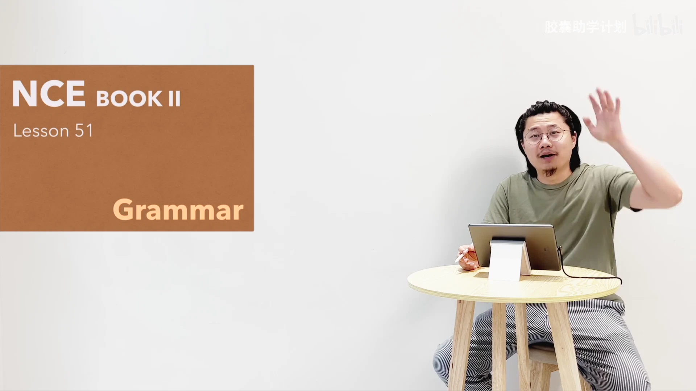

文字识别：NCE / BOOKII / Lesson 51 / Grammar

### 画面 00:00:02

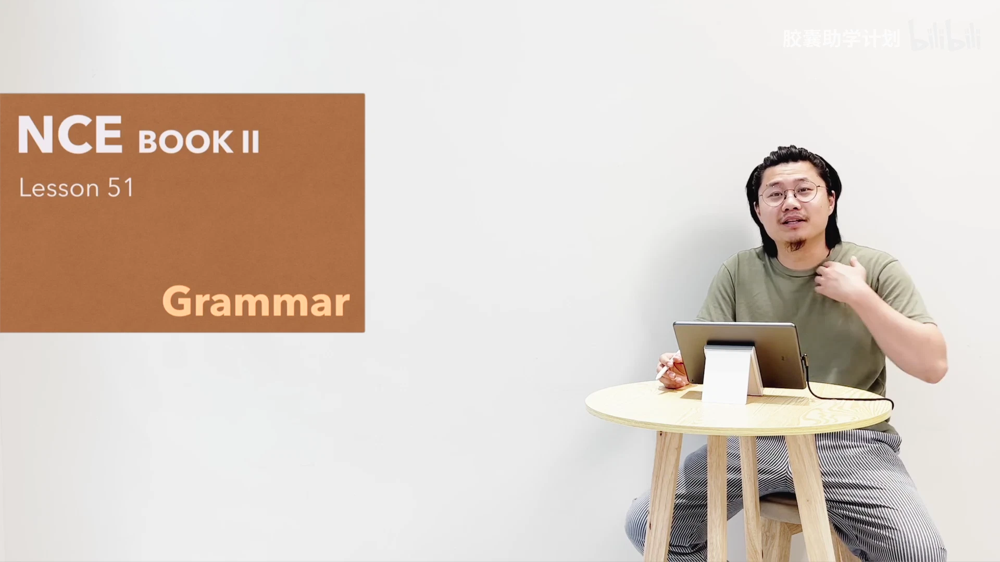

文字识别：NCE / BOOKII / Lesson 51 / Grammar

### 画面 00:00:06

文字识别：NCE / BOOKⅡI / Lesson 51 / Grammar

### 画面 00:00:09

文字识别：胶囊助学计划bill / •

### 画面 00:00:13

文字识别：胶囊助学计划

### 画面 00:00:15

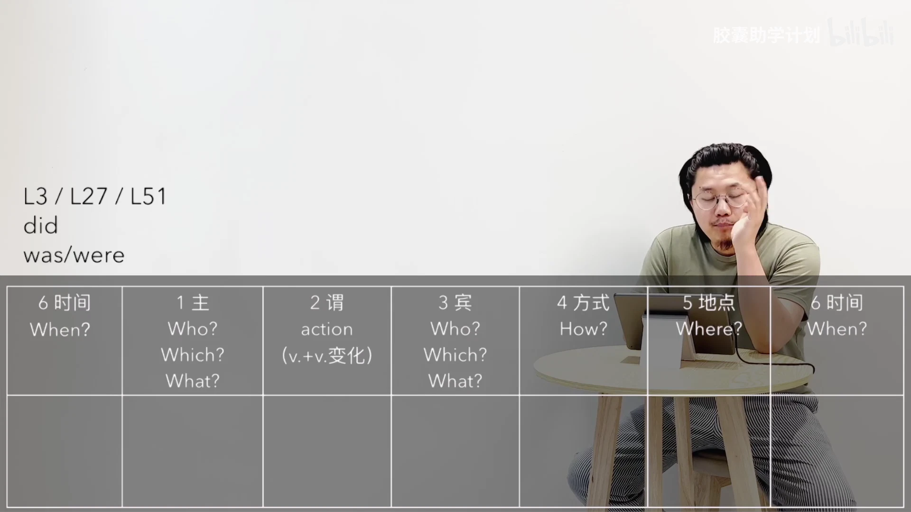

文字识别：L3 /L27/L51 / did / was/were / 6时间 / 1主 / 2谓 / 3宾 / 4方式 / 5地点 / 6时间 / When? / Who? / action / Who? / How? / Where? / When? / Which? / (v.+v.变化) / Which? / What? / What?

## 00:00:30–00:01:00

这个时态对于各位来说太熟悉了。我们从新概念一册六十七课开始学，一直学到了今天。我们在这个地方就不去做复习了，对吧？ OK，我们直接拿练习去做复习。接下来咱们 pattern drill 去练习一些包含一般过去时的句子。好，来了啊，这个练习是老习惯的，我把 sesr 跟各位说清楚，然后各位下课往里面去带。做到的事情实际上是把这些句型

### 画面 00:00:41

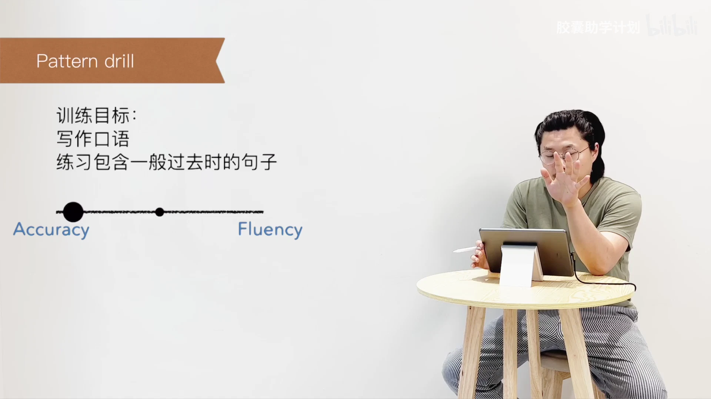

文字识别：Pattern drill / 训练目标： / 写作口语 / 练习包含一般过去时的句子 / Accuracy / Fluency

### 画面 00:00:49

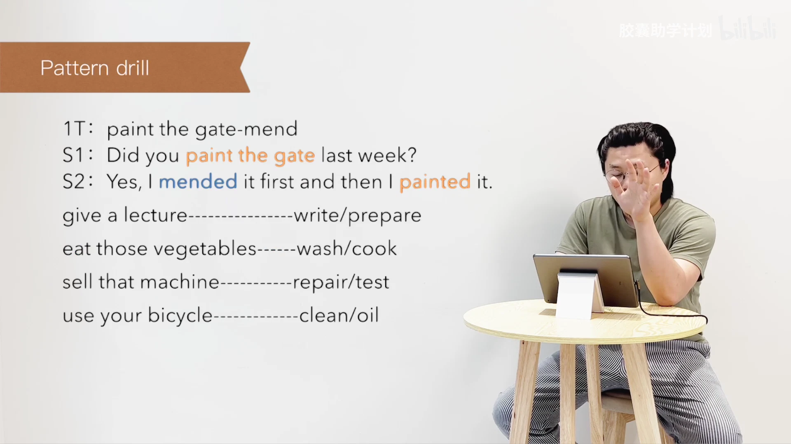

文字识别：Pattern drill / 1T:paint the gate-mend / S1: Did you paint the gate last week? / S2: Yes, I mended it first and then I painted it. / give a lecture-- / -write/prepare / eat those vegetables---wash/cook / sell that machine--repair/test / use your bicycle-- / -----clean/oil

## 00:01:00–00:01:30

练清楚。比如说上周你做什么了吗？张嘴你就说出来。Did you blah blah last week？听见了吧？blah blah就是你要添的东西。比如说，Did you paint the gate last week？说你上周把大门上漆了吗？Yes, I mended it first.我先把它修理好了。And then，然后I painted it。然后我再去把它上了漆。各位要做的事情是把底下的这些往上面去带。

### 画面 00:01:19

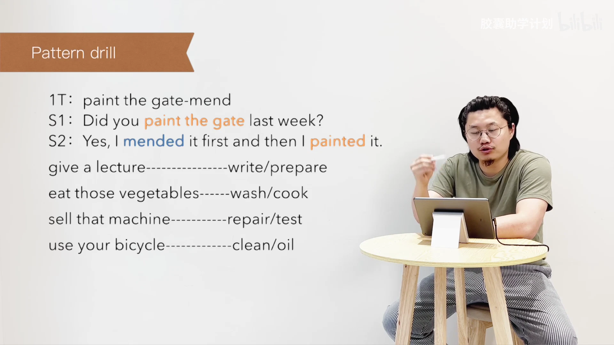

文字识别：Pattern drill / 1T:paint the gate-mend / S1: Did you paint the gate last week? / S2: Yes, I mended it first and then I painted it. / give a lecture--- / ---write/prepare / eat those vegetables---wash/cook / sell that machine--repair/test / use your bicycle-- / -----clean/oil

## 00:01:30–00:02:00

你带了之后，你其实在不停的练一般过去时，一般过去时，一般过去时，对吧？OK，这是第一题。好，那咱们看第二题。He went on a diet once, didn't he？说啊，他 once 曾经啊，他曾经节食过，didn't he？新一咱们就学过，对吧？哎，就等于 right，对吧？Yes, he did.是的。His wife begged him to说他妻子求着他

### 画面 00:01:40

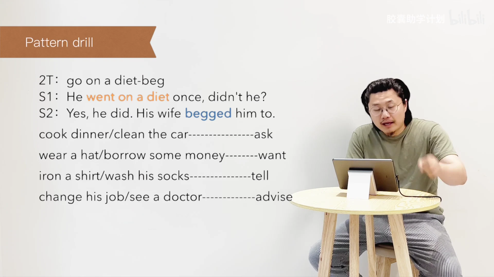

文字识别：Pattern drill / 2T: go on a diet-beg / S1: He went on a diet once, didn't he? / S2: Yes, he did. His wife begged him to. / cook dinner/clean the car---- / -----s / wear a hat/borrow some money-----want / ironashirt/wash his socks-----tell / change hisjob/seea doctor---advise

## 00:02:00–00:02:30

去做的，是吧？太胖了。OK，往里去带啊。这是呃第二个，第三个说，When did she find the body?啊，他什么时候发现的这个？你看啊，body，各位在脑海当中常见的意思叫身体，在这句话当中，我一读我就能意识到，他指的是不是身体，指的是尸体啊。She found it.他发现了他。When she returned home.你看这里过去时，过去时，过去时，对吧？哎，顺便你还复习了when，

### 画面 00:02:05

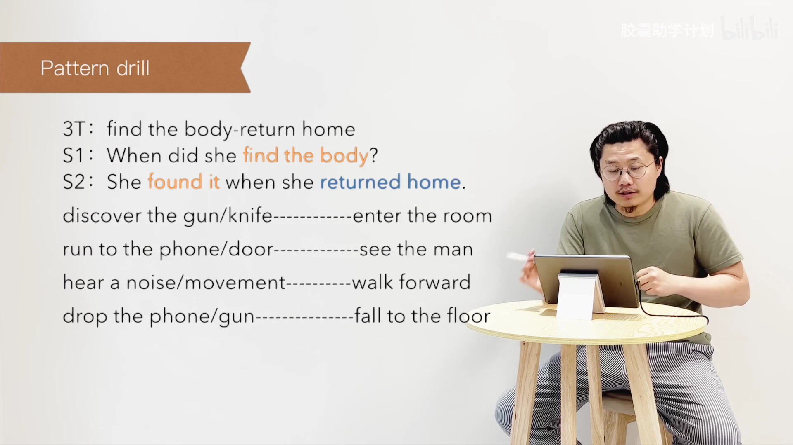

文字识别：Pattern drill / 3T: find the body-return home / S1: When did she find the body? / S2: She found it when she returned home. / discover the gun/knife- / ----enter the room / run to thephone/door----see theman / hear a noise/movement----walk forward / drop the phone/gun--. / --fall to the floor

## 00:02:30–00:03:00

第七课咱们学过的时间状语从句。当他回家的时候，往里面去带。OK。第四个，Are they going to give a party this month？说他们哎这个月要去举办一个 party 吗？举办一个聚会吗？I don't expect. 我并不有这样的期待。They gave one last month.哎，这地方其实是把两个时态作为对话当中放到一起去用了，对吧？一个是下个月他们会去吗？不会，因为他们上个月刚

### 画面 00:02:35

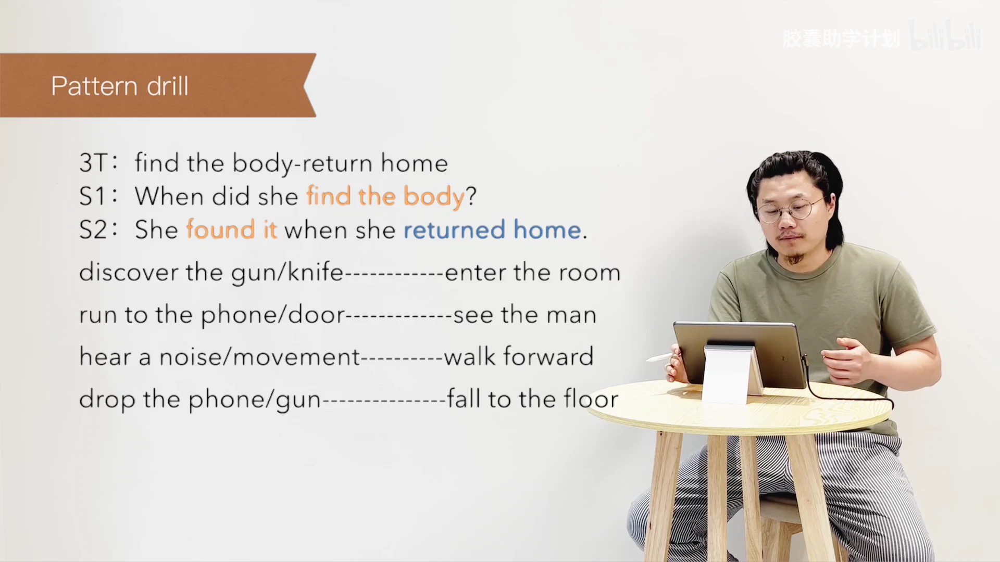

文字识别：Pattern drill / 3T: find the body-return home / S1: When did she find the body? / S2: She found it when she returned home. / discover the gun/knife-- / ---enter the room / run to the phone/door----see the man / heara noise/movement-----walk forward / drop the phone/gun--. / --fall to thefloor

### 画面 00:02:37

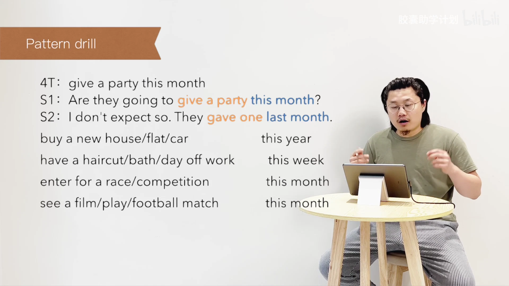

文字识别：Pattern drill / 4T: give a party this month / S1: Are they going to give a party this month? / S2: I don't expect so. They gave one last month. / buy a new house/flat/car / this year / have a haircut/bath/day off work / this week / enter for a race/competition / this month / see a film/play/football match / this month

## 00:03:00–00:03:30

刚举办了一场，对吧？OK，把这里边往里去带就可以了啊。OK，呃，recap没有太多可说的，各位去认真把Pattern Drill做一下就可以了。家庭作业呢，Pattern Drill肯定是老习惯，回忆一遍，依旧是各位到了今天，你可以给自己回忆一遍各种一般过去时的这个肯定句、否定句、一般疑问句啊这些东西啊，因为我们之前复习了太多遍了，今天就不多提了。然后呢，我个人认为到现在这个地方

### 画面 00:03:05

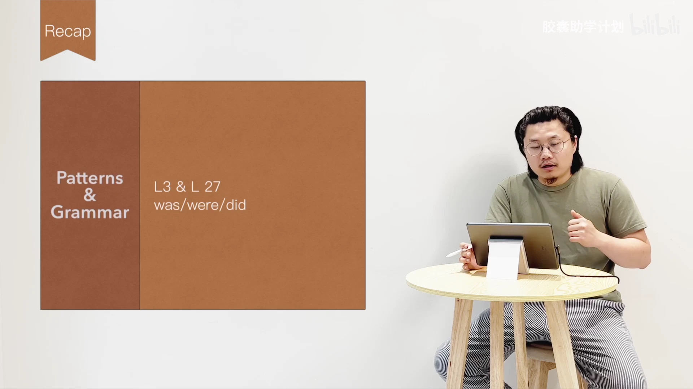

文字识别：Recap / Patterns / L3&L27 / ＆ / was/were/did / Grammar

### 画面 00:03:07

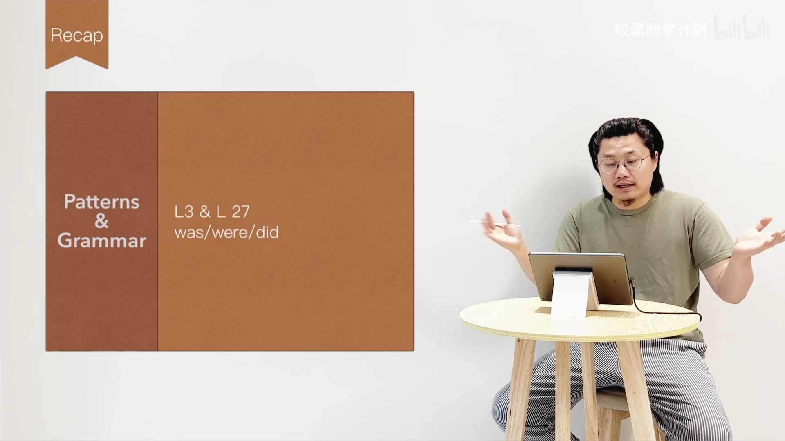

文字识别：Recap / Patterns / L3 &L27 / ＆ / was/were/did / Grammar

### 画面 00:03:10

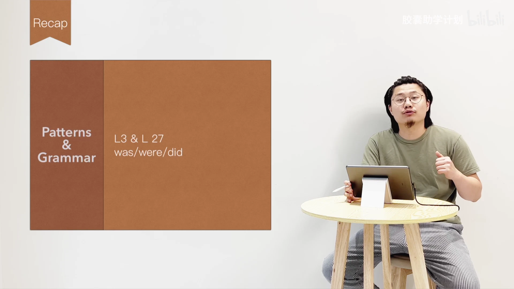

文字识别：Recap / Patterns / L3&L27 / ＆ / was/were/did / Grammar

### 画面 00:03:12

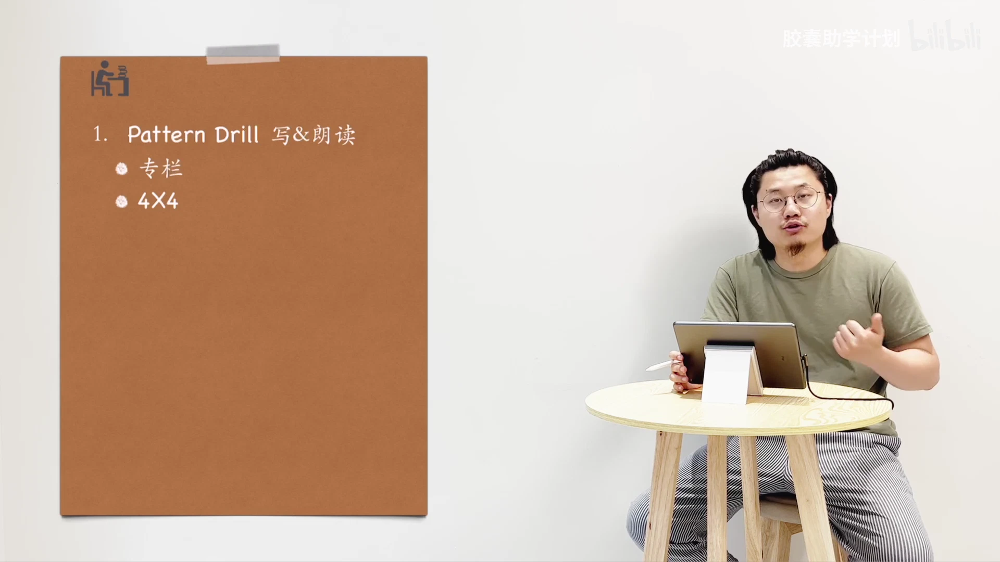

文字识别：1.f / Pattern Drill 写&朗读 / 专栏 / 4×4

### 画面 00:03:14

文字识别：Pattern Drill写&朗读 / 1. / 专栏 / 4X4 / 尝试回忆并给自己讲解一 / 遍今天的核心语法 / Study-Test /  Learning Pyramid

### 画面 00:03:16

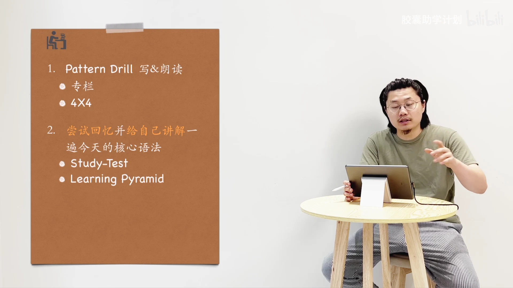

文字识别：1. / Pattern Drill写&朗读 / 专栏 / 4×4 / 尝试回忆并给自己讲解一 / 遍今天的核心语法 / Study-Test / Learning Pyramid

### 画面 00:03:20

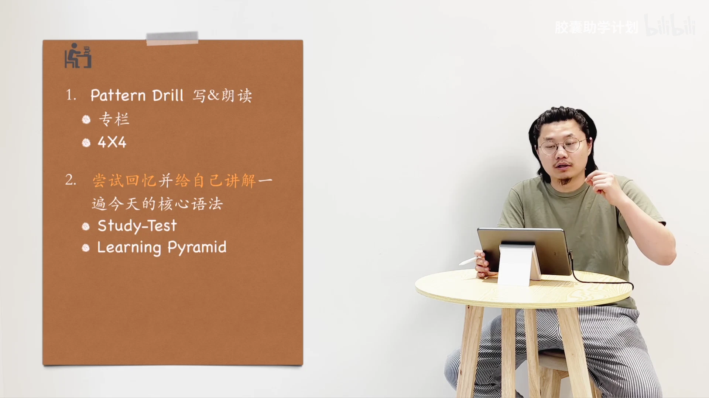

文字识别：1. / Pattern Drill写&朗读 / 专栏 / 4×4 / 尝试回忆并给自己讲解一 / 遍今天的核心语法 / Study-Test / Learning Pyramid

### 画面 00:03:25

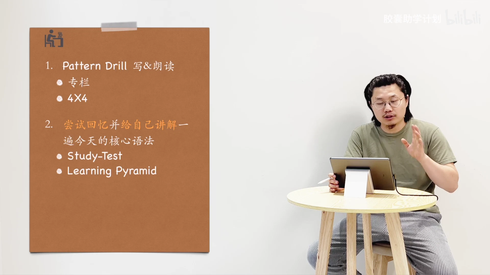

文字识别：1. / Pattern Drill写&朗读 / 专栏 / 4×4 / 尝试回忆并给自己讲解一 / 遍今天的核心语法 / Study-Test / Learning Pyramid

### 画面 00:03:27

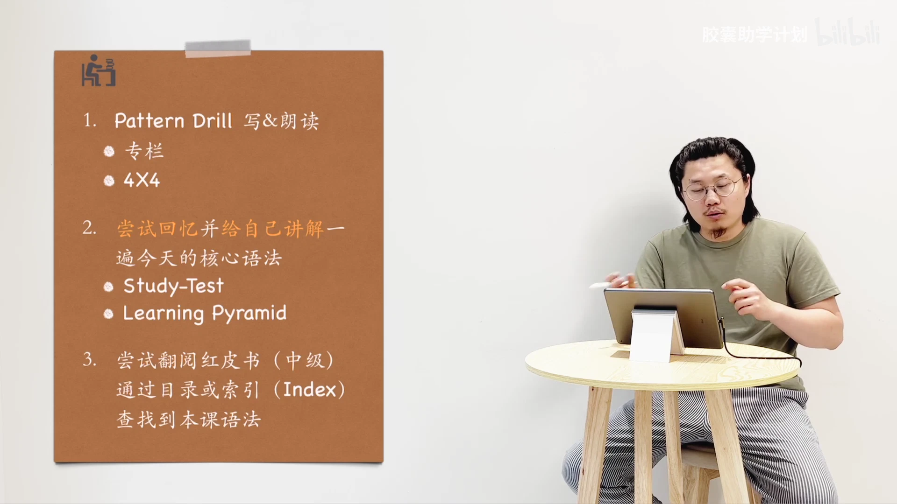

文字识别：1.Pattern Drill 写&朗读 / 专栏 / 4×4 / 尝试回忆并给自己讲解一 / 遍今天的核心语法 / Study-Test / Learning Pyramid / 尝试翻阅红皮书（中级） / 通过目录或索引(Index) / 查找到本课语法

## 00:03:30–00:04:00

啊，学到今天这一课，如果红皮书的一般过去时，各位还没有开始写，今天你应该开始写了，是吧？OK，好，那以上呢就是本视频的全部内容了。如果各位喜欢我们的课程呢，欢迎各位关注、订阅、一键三连，分享给那些需要的朋友，来帮助我们快速成长。See you next time.

### 画面 00:03:30

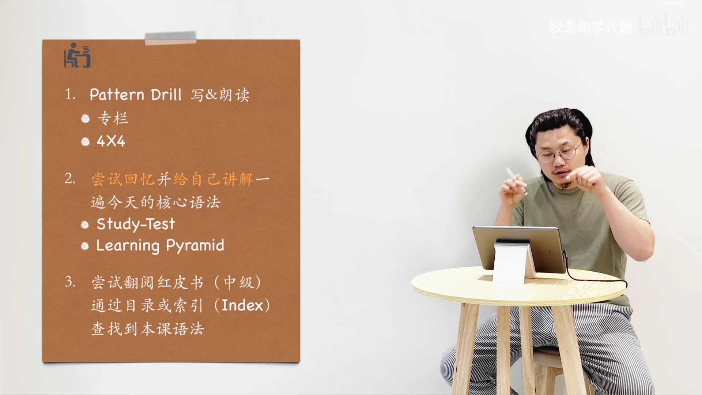

文字识别：1. f / Pattern Drill写&朗读 / 专栏 / 4×4 / 尝试回忆并给自己讲解一 / 遍今天的核心语法 / Study-Test / Learning Pyramid / 尝试翻阅红皮书（中级） / 通过目录或索引(Index) / 查找到本课语法

### 画面 00:03:38

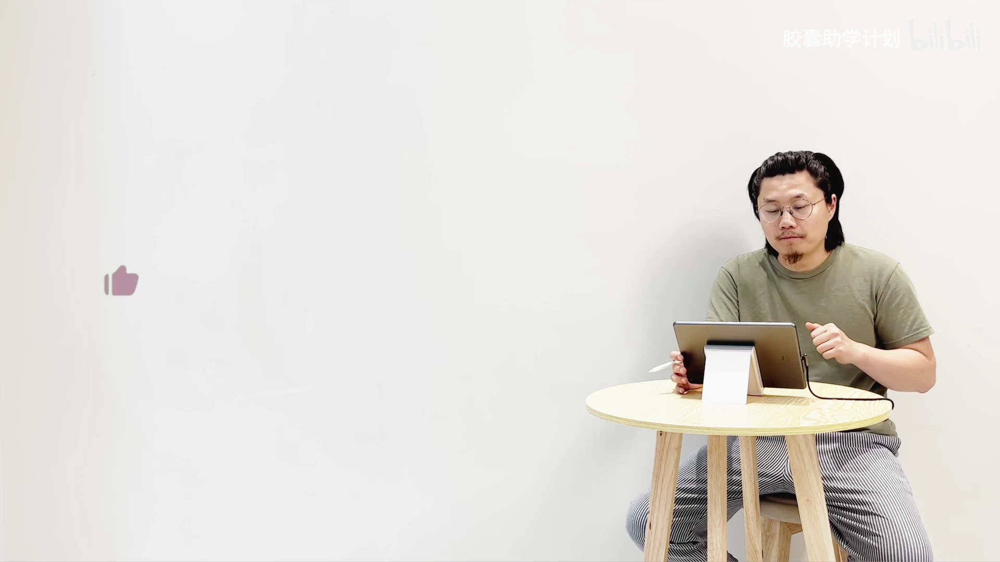

### 画面 00:03:51

### 画面 00:03:53

文字识别：CAPSULEACADEMY / 胶囊助学计划 / 小红书 / Lecturer / □ / 口 / Leo / OE

### 画面 00:03:55

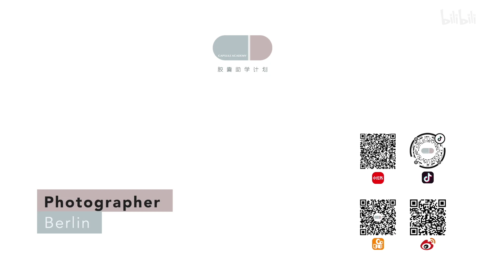

文字识别：CAPSULEACADEMY / 胶囊助学计划 / 小红书 / Photographer / □ / Berlin / OE

### 画面 00:03:57

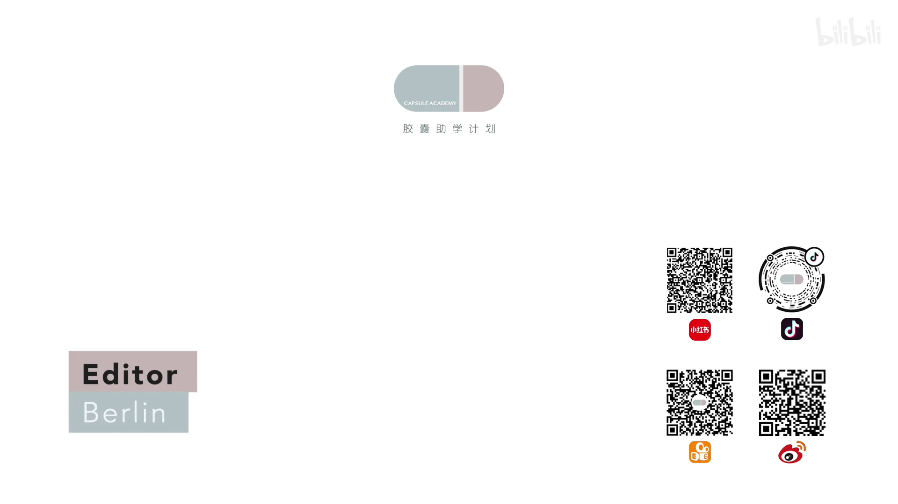

文字识别：CAPSULEACADEMY / 胶囊助学计划 / 小红书 / Editor / □ / 口 / Berlin / OE

## 00:04:00–00:04:03

### 画面 00:04:00

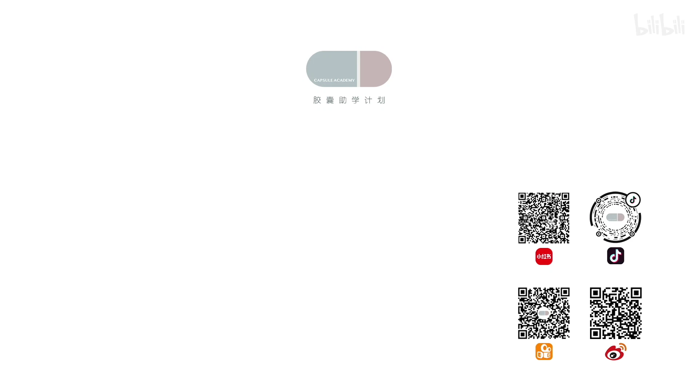

文字识别：CAPSULEACADEMY / 胶囊助学计划 / 小红书 / 品

### 画面 00:04:02

文字识别：bilibili / 胶囊助学计划

