# 051 文章

快速机器解析：语音为单模型转写，未进行独立交叉校对或人工复核；画面每秒采样并按变化选帧，短时文字和标记可能遗漏。截图时间约有 1 秒误差。图片有损压缩；遇到疑点请按时间查看 Google Drive 原视频。

## 00:00:00–00:00:30

Hello everyone, welcome to Capsule Academy. This is Leo. Today we're going to learn New Concept English Book Two Lesson Fifty One Story. Hope you guys enjoy it.好，那我们上来先看一下它的标题啊，亚历山大特别的损，我觉得是吧？Reward for virtue，叫做对美德的奖赏。如果各位以前看过这篇文章，你就可能明白它为什么特别的损。在我感觉是吧？好，对

### 画面 00:00:00

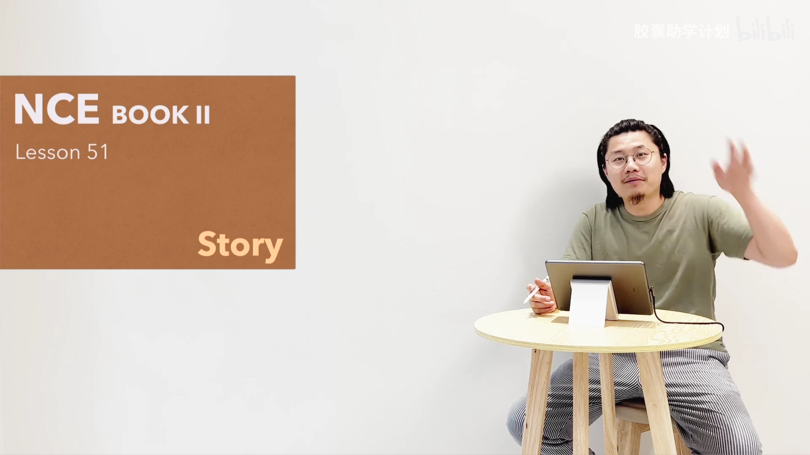

文字识别：NCE / BOOKII / Lesson 51 / Story

### 画面 00:00:02

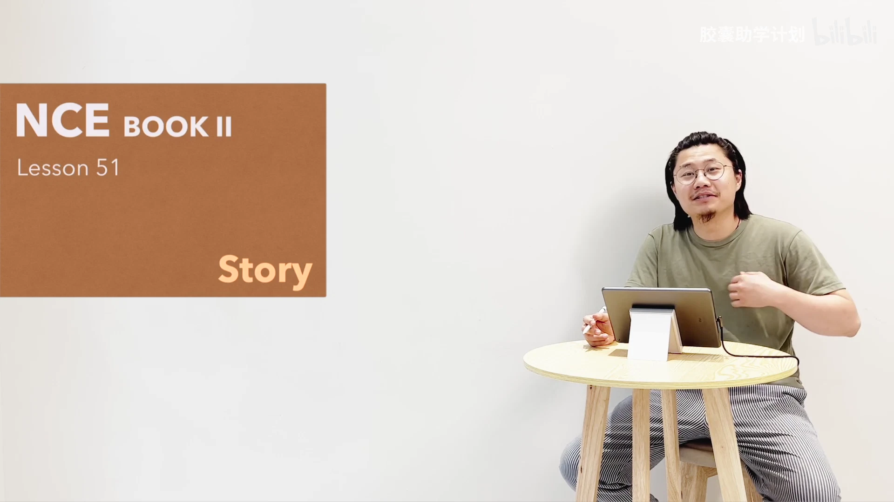

文字识别：NCE / BOOKII / Lesson 51 / Story

### 画面 00:00:06

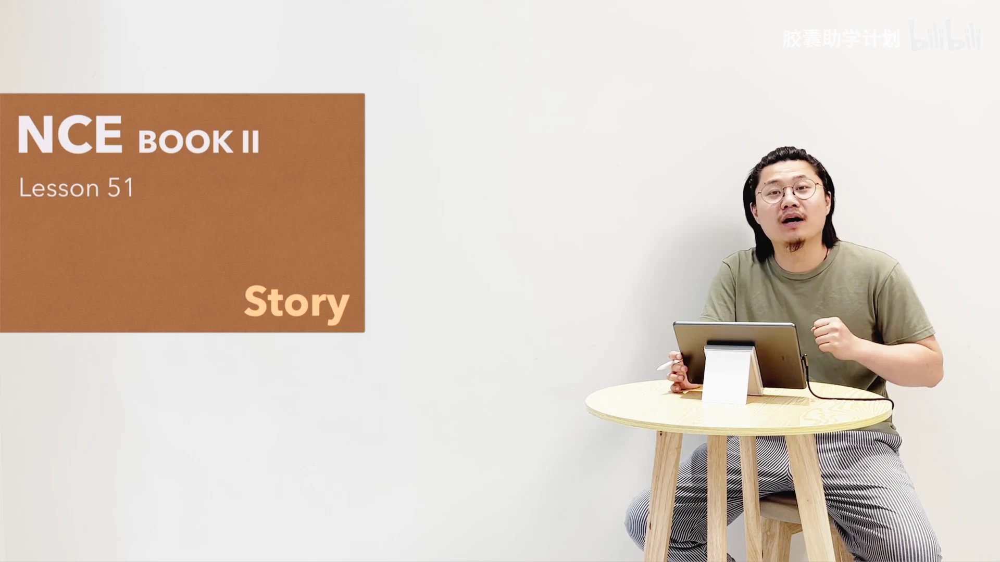

文字识别：NCE / BOOKII / Lesson 51 / Story

### 画面 00:00:09

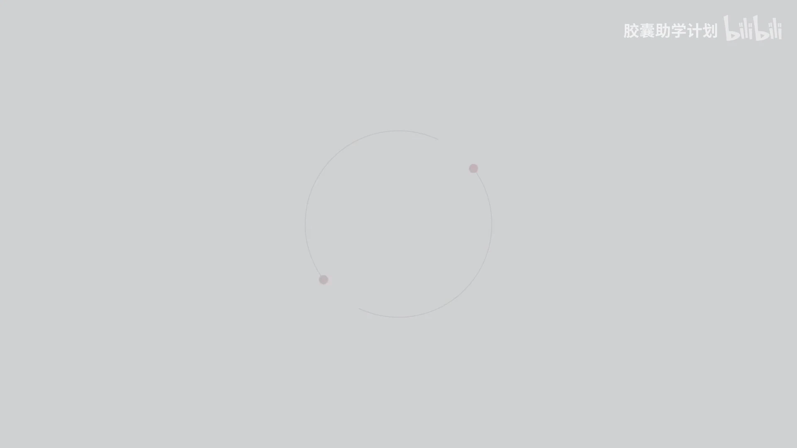

文字识别：胶囊助学计划 bilbl / •

### 画面 00:00:13

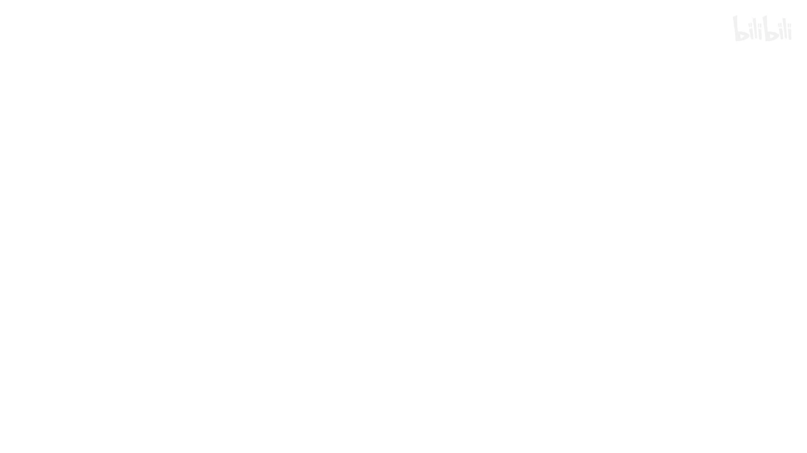

### 画面 00:00:15

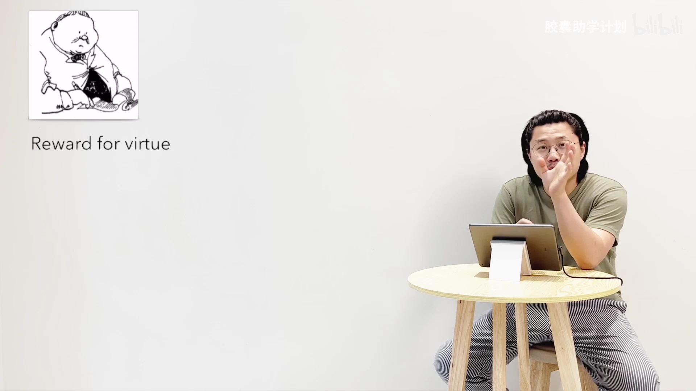

文字识别：Reward for virtue

## 00:00:30–00:01:00

美德的奖赏，我们一起看一下这篇文章，为什么我说它特损是吧？好，说 My friend Hugh，好，首先同位语，四十六课在四十六课之前，当然我们就见过很多次同位语了，对不对？那四十六课咱们又讲了同位语从句，今天你又一次见到了同位语，叫 My friend Hugh，这俩是一码事儿，叫同位语，对吧？OK， has always been fat，这小词用的太讲究了，always经常 fat 啊总是 fat 叫胖，但是 has

### 画面 00:00:34

文字识别：My friend, Hugh, has always been fat, but things / got so bad recently that he decided to go on a / diet. He began his diet a week ago. First of all, / he wrote out a long list of all the foods (which / were forbidden). The list included most of the / things (Hugh loves): butter, potatoes, rice, beer, / milk, chocolate; and sweets. / all the forbidden foods

## 00:01:00–00:01:30

been 是啥？现在完成时对吧？现在完成时有两个用法，回顾一下，过去对现在的影响和从过去持续到现在。 been 是个状态， been fat 是个状态，就是胖这个状态，这个状态一直都在持续。 has been 现在完成时，从过去可能是从我认识他， he 对吧？一直持续到了现在，一直都是胖的，对吧？

### 画面 00:01:04

文字识别：My friend, Hugh, has always been fat, but things / got so bad recently that he decided to go on a / diet. He began his diet a week ago. First of all, / he wrote out a long list of all the foods (which / were forbidden). The list included most of the / things (Hugh loves): butter, potatoes, rice, beer, / milk, chocolate; and sweets. / all the forbidden foods

## 00:01:30–00:02:00

强调这种持续性啊，就中途没瘦过。But但是，But啊，But像这样的连词对于我们有什么用呢？就是为了将来的长难句的拆解做准备，你要对它特别熟悉，看见它，哎，呃，就就意识到哦，第一句话结束了，对吧？但是，Things got so bad recently that说so点点点that三十五课咱们学的如此以至于，对吧？

### 画面 00:01:34

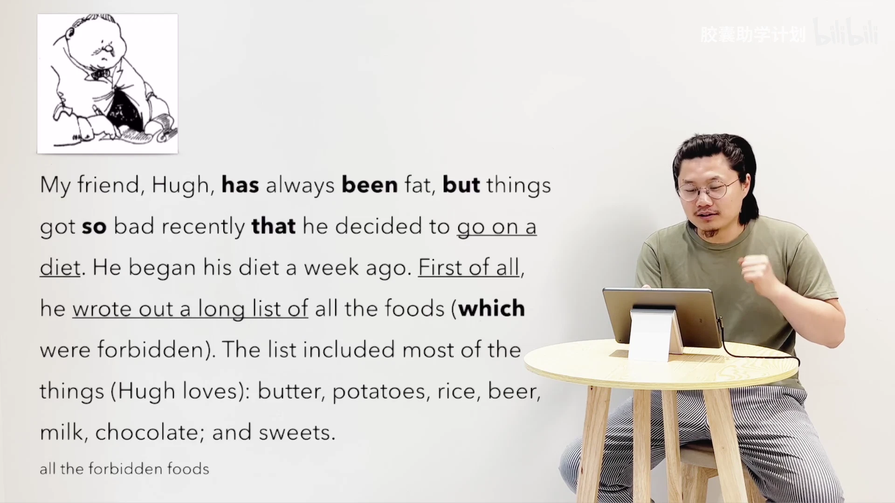

文字识别：My friend, Hugh, has always been fat, but things / got so bad recently that he decided to go on a / diet. He began his diet a week ago. First of all, / he wrote out a long list of all the foods (which / were forbidden). The list included most of the / things (Hugh loves): butter, potatoes, rice, beer, / milk, chocolate; and sweets. / all the forbidden foods

## 00:02:00–00:02:30

事情如此的糟糕。Recently，最近 got，我故意没翻译。你看，我不翻译 got，事情如此的糟糕。最近你汉语完全能理解，无非就是缺了可能一两个小字儿，但并不影响你理解。got 这个单词我们说过，万能动词，常见的几个意思有获得的意思，也有变得的意思。这里的 got 就是变得啊，变得如此的糟糕。最近以至于 so 加点点 that，如

### 画面 00:02:04

文字识别：My friend, Hugh, has always been fat, but things / got so bad recently that he decided to go on a / diet. He began his diet a week ago. First of all, / he wrote out a long list of all the foods (which / were forbidden). The list included most of the / things (Hugh loves): butter, potatoes, rice, beer, / milk, chocolate; and sweets. / all the forbidden foods

## 00:02:30–00:03:00

此以至于以至于什么样呢？He decided to go on a diet。这里其实有两个小的习惯用法，叫decide to do something和go on a diet。一个是我们很久之前就讲过啊，对于今天的你来说，我认为你多少应该已经有印象了，对吧？而且我不停的拿它去造句。然后go on a diet是我们在单词部分讲过的，就不多说了。但是这句话的意思是如此的糟糕，最近他以至于他决定去节食了。

### 画面 00:02:34

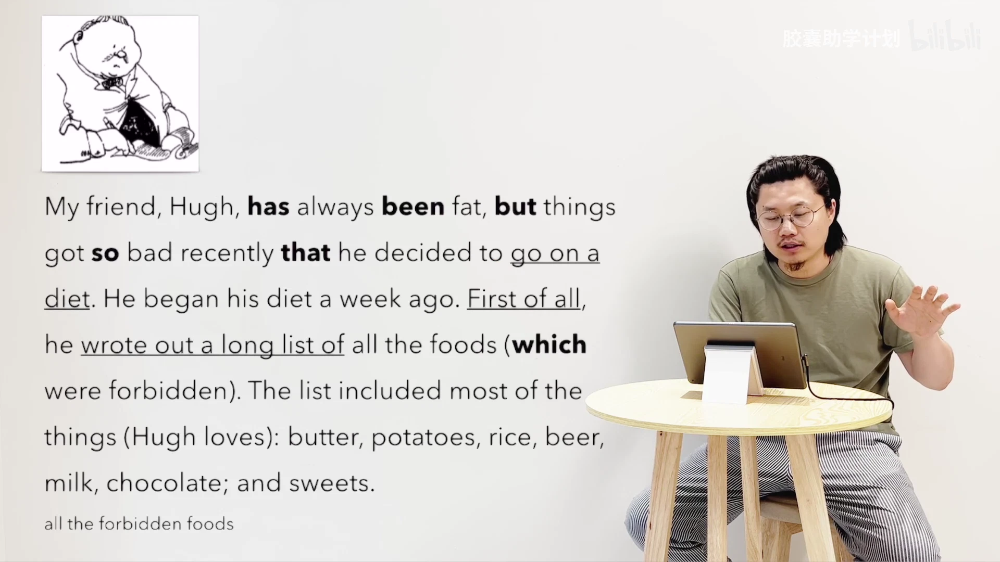

文字识别：My friend, Hugh, has always been fat, but things / got so bad recently that he decided to go on a / diet. He began his diet a week ago. First of all, / he wrote out a long list of all the foods (which / were forbidden). The list included most of the / things (Hugh loves): butter, potatoes, rice, beer, / milk, chocolate; and sweets. / all the forbidden foods

### 画面 00:02:37

文字识别：My friend, Hugh, has always been fat, but things / got so bad recently that he decided to go on a / diet. He began his diet a week ago. First of all, / he wrote out a long list of all the foods (which / were forbidden). The list included most of the / things (Hugh loves): butter, potatoes, rice, beer, / milk, chocolate; and sweets. / all the forbidden foods

### 画面 00:02:42

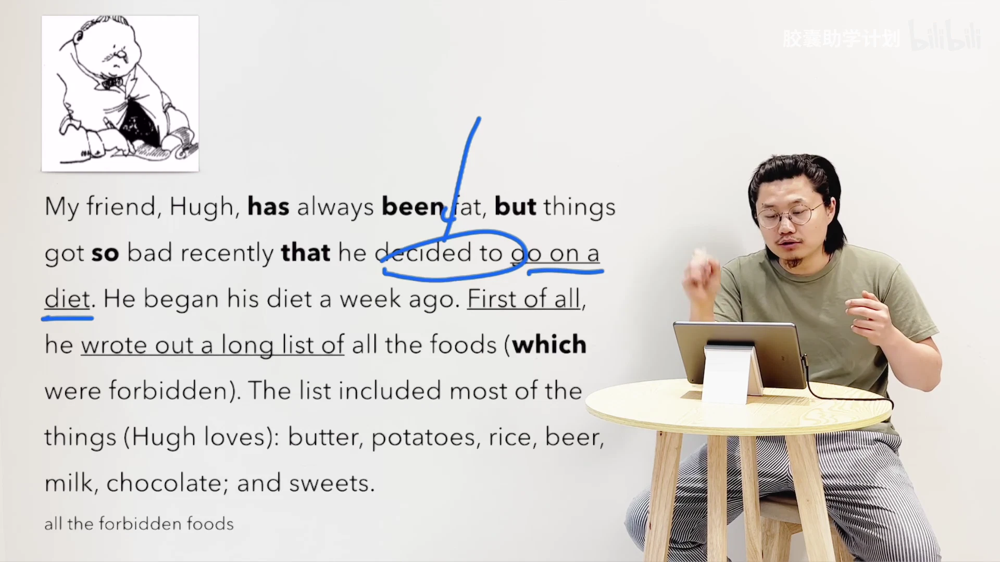

文字识别：My friend, Hugh, has always beenfat, but things / got so bad recently that he decided to go on a / diet. He began his diet a week ago. First of all, / he wrote out a long list of all the foods (which / were forbidden). The list included most of the / things (Hugh loves): butter, potatoes, rice, beer, / milk, chocolate; and sweets. / all the forbidden foods

### 画面 00:02:48

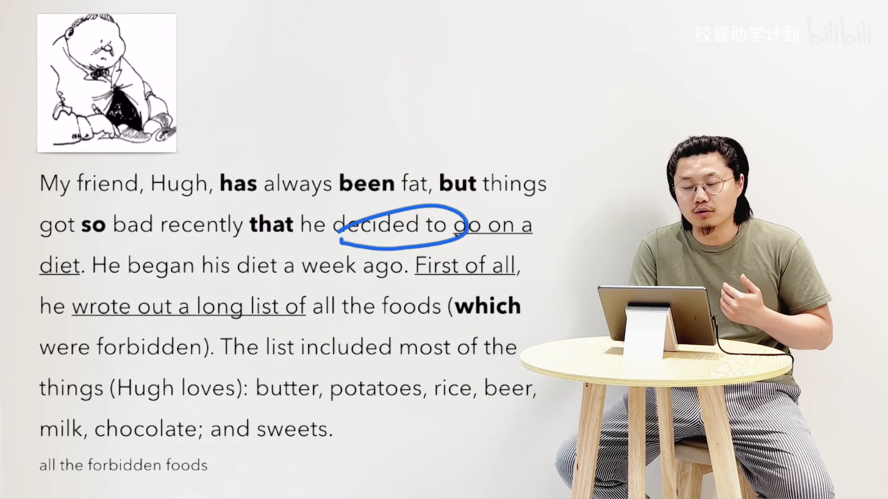

文字识别：My friend, Hugh, has always been fat, but things / got so bad recently that he decided to go on a / diet. He began his diet a week ago. First of all, / he wrote out a long list of all the foods (which / were forbidden). The list included most of the / things (Hugh loves): butter, potatoes, rice, beer, / milk, chocolate; and sweets. / all the forbidden foods

### 画面 00:02:50

文字识别：My friend, Hugh, has always been fat, but things / got so bad recently that he decided to go on a / diet. He began his diet a week ago. First of all, / he wrote out a long list of all the foods (which / were forbidden). The list included most of the / things (Hugh loves): butter, potatoes, rice, beer, / milk, chocolate; and sweets. / all the forbidden foods

## 00:03:00–00:03:30

diet. Continuing, he began his week. Ah, began his diet a week ago. You see, began,一般过去时，对吧？一周之前开始的。First of all,哎，这个是一个各位值得好好记下来的小短语。口语如果是比较相对正式一点的演讲，你要给别人讲清楚一系列的事情。First of all，首先，或者是你在写作，对吧？雅思托福四六级、高考、考研的写作当

### 画面 00:03:04

文字识别：My friend, Hugh, has always been fat, but things / got so bad recently that he decided to go on a / diet. He began his dieta week ago First of all, / he wrote out a long list of all the foods (which / were forbidden). The list included most of the / things (Hugh loves): butter, potatoes, rice, beer, / milk, chocolate; and sweets. / all the forbidden foods

### 画面 00:03:12

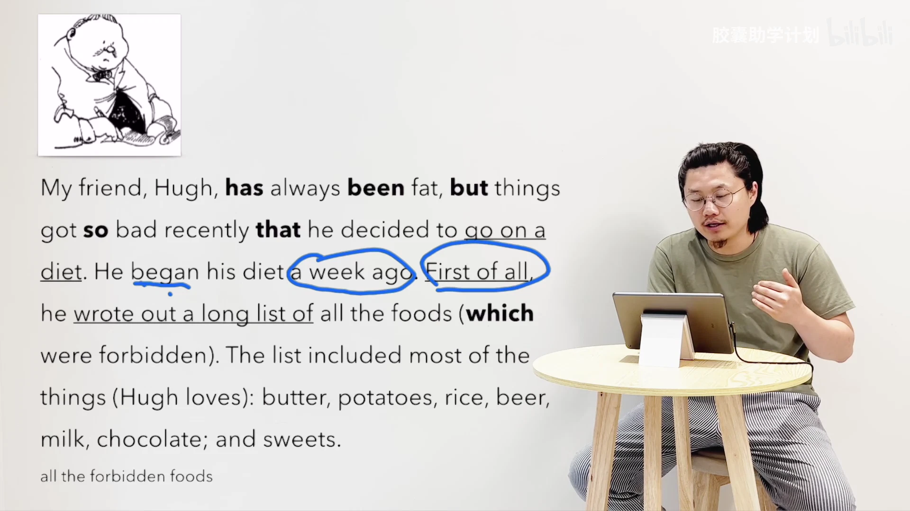

文字识别：My friend, Hugh, has always been fat, but things / got so bad recently that he decided to go on a / diet. He began his dieta week ago First of all, / he wrote out a long list of all the foods (which / were forbidden). The list included most of the / things (Hugh loves): butter, potatoes, rice, beer, / milk, chocolate; and sweets. / all the forbidden foods

### 画面 00:03:14

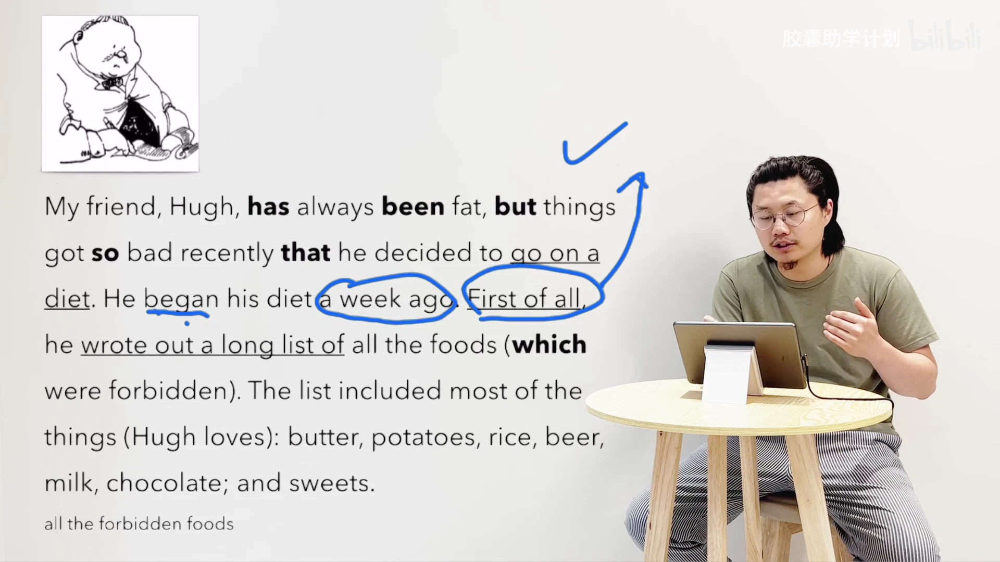

文字识别：My friend, Hugh, has always been fat, but things / got so bad recently that he decided to go on a / diet. He began his dieta week ago First of all, / he wrote out a long list of all the foods (which / were forbidden). The list included most of the / things (Hugh loves): butter, potatoes, rice, beer, / milk, chocolate; and sweets. / all the forbidden foods

## 00:03:30–00:04:00

中，first of all都是一个比较好的开始的词，对吧？OK，当然了，还有更多的什么，firstly等等等等，那个很多很多，我们一点一点积累。First of all，各位先拿到啊。首先，he wrote out他写出了一个什么呢？A long list of一个长长的单子，什么的长长的单子，A of B结构，all the foods。先不往后看了，

### 画面 00:03:44

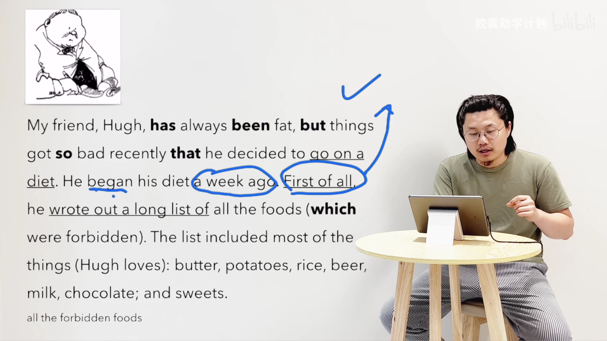

文字识别：My friend, Hugh, has always been fat, but things / got so bad recently that he decided to go on a / diet. He began his dieta week ago First of all, / he wrote out a long list of all the foods (which / were forbidden). The list included most of the / things (Hugh loves): butter, potatoes, rice, beer, / milk, chocolate; and sweets. / all the forbidden foods

## 00:04:00–00:04:30

所有食物的长长的单子，其实它写出来的就一个东西，叫什么？叫单子，list，long，修饰list，all the foods修饰list，它写出了一个单子。什么样的单子呢？有哪些特点呢？第一个特点长，第二个特点包含了所有食物的单子，对吧？写的不是什么明星单子，对吧？写的不是什么房产单

### 画面 00:04:06

文字识别：My friend, Hugh, has always been fat, but things / got so bad recently that he decided to go on a / diet. He began his diet a week ago. First of all, / he wrote out a long list of all the foods (which / were forbidden). The list included most of the / things (Hugh loves): butter, potatoes, rice, beer, / milk, chocolate; and sweets. / all the forbidden foods

### 画面 00:04:09

文字识别：My friend, Hugh, has always been fat, but things / got so bad recently that he decided to go on a / diet. He began his dieta week ago. First of all, / he wrote out a longlistof all the foods (which / were forbidden). The list included most of the / things (Hugh loves): butter, potatoes, rice, beer, / milk, chocolate; and sweets. / all the forbidden foods

### 画面 00:04:15

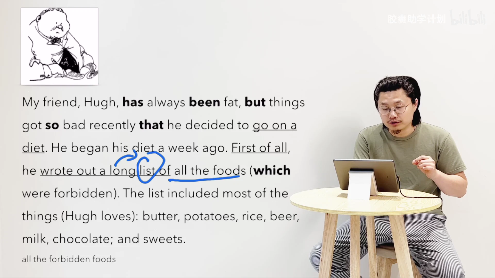

文字识别：My friend, Hugh, has always been fat, but things / got so bad recently that he decided to go on a / diet. He began his gieta week ago. First of all, / he wrote out a long listof all the foods (which / were forbidden). The list included most of the / things (Hugh loves): butter, potatoes, rice, beer, / milk, chocolate; and sweets. / all the forbidden foods

### 画面 00:04:19

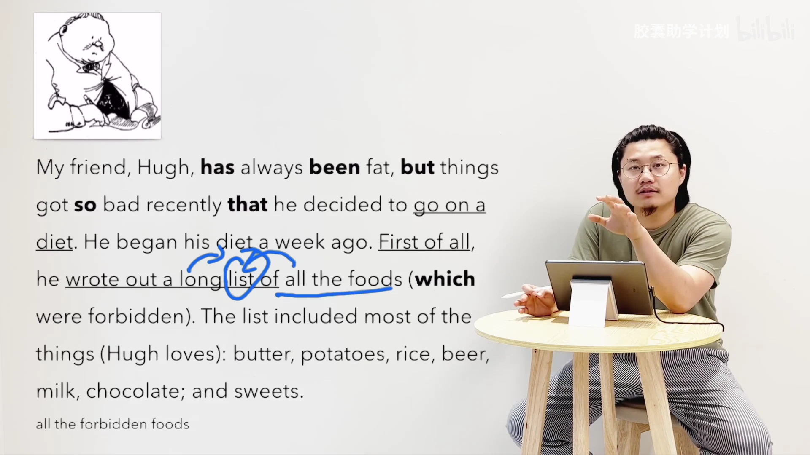

文字识别：My friend, Hugh, has always been fat, but things / got so bad recently that he decided to go on a / diet. He began his glieta week ago. First of all, / he wrote out a l ong lis f al the fods (which / were forbidden). The list included most of the / things (Hugh loves): butter, potatoes, rice, beer, / milk, chocolate; and sweets. / all the forbidden foods

### 画面 00:04:21

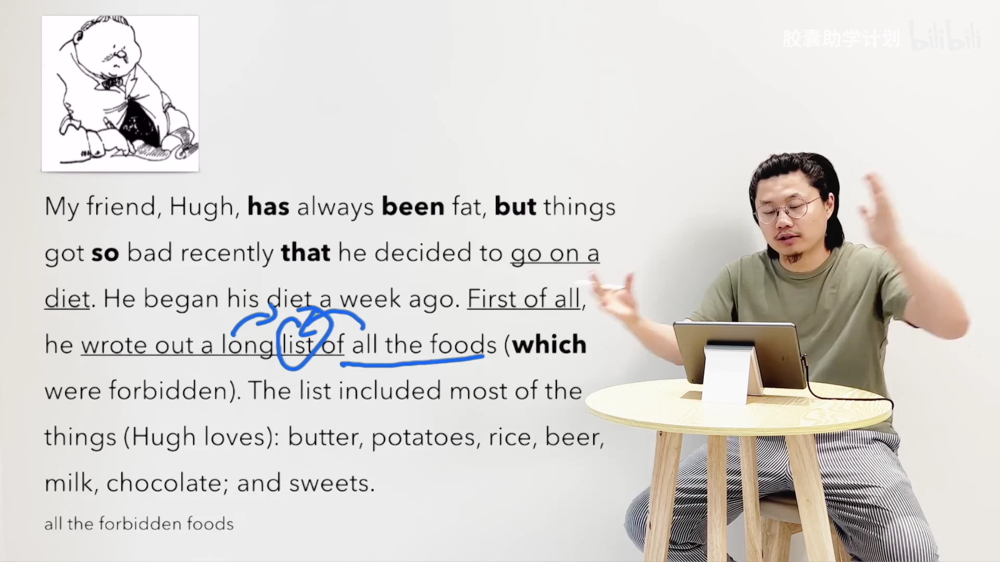

文字识别：My friend, Hugh, has always been fat, but things / got so bad recently that he decided to go on a / diet. He began his giet a week ago. First of all, / he wrote out a long listf all the foods (which / were forbidden). The list included most of the / things (Hugh loves): butter, potatoes, rice, beer, / milk, chocolate; and sweets. / all the forbidden foods

## 00:04:30–00:05:00

子啊，鞋的单子是实物的单子。好，这里呢一会儿我们给大家能总结出来一个习惯用法啊，就是类似于其实句子的仿写，叫写出了一个长长的关于什么的单子啊。一会儿我们进入这个咱们老这个习惯用法造句的时候，我们再说，先不管它，现在能读懂就可以了。后面 which were forbidden， which 一出来，按照各位今天的水平，看到它知道是定语从句，应该不费劲了，对吧？ Which

### 画面 00:04:35

文字识别：My friend, Hugh, has always been fat, but things / got so bad recently that he decided to go on a / diet. He began his dieta week ago. First of all, / he wrote out a long listof allthe foods (which / were forbidden). The list included most of the / things (Hugh loves): butter, potatoes, rice, beer, / milk, chocolate; and sweets. / all the forbidden foods

### 画面 00:04:38

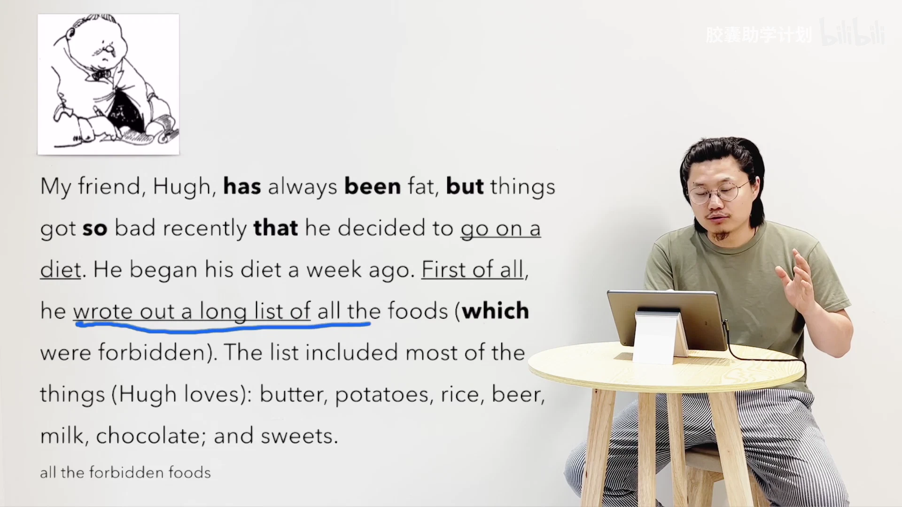

文字识别：My friend, Hugh, has always been fat, but things / got so bad recently that he decided to go on a / diet. He began his diet a week ago. First of all, / he wrote out a long list of allthe foods (which / were forbidden). The list included most of the / things (Hugh loves): butter, potatoes, rice, beer, / milk, chocolate; and sweets. / all the forbidden foods

### 画面 00:04:45

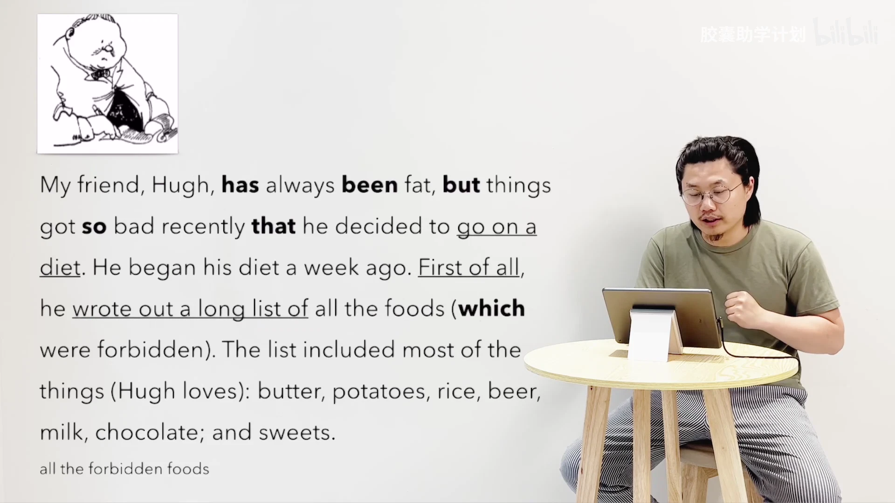

文字识别：My friend, Hugh, has always been fat, but things / got so bad recently that he decided to go on a / diet. He began his diet a week ago. First of all, / he wrote out a long list of all the foods (which / were forbidden). The list included most of the / things (Hugh loves): butter, potatoes, rice, beer, / milk, chocolate; and sweets. / all the forbidden foods

### 画面 00:04:54

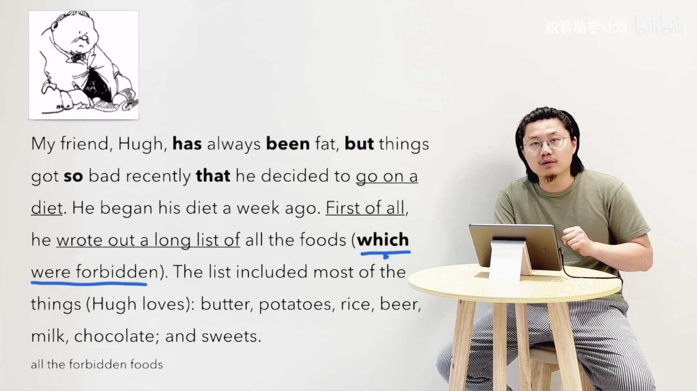

文字识别：My friend, Hugh, has always been fat, but things / got so bad recently that he decided to go on a / diet. He began his diet a week ago. First of all, / he wrote out a long list of all the foods (which / were forbidden). The list included most of the / things (Hugh loves): butter, potatoes, rice, beer, / milk, chocolate; and sweets. / all the forbidden foods

## 00:05:00–00:05:30

说的就是all the foods，对吧？All the foods怎么样呢？Were forbidden，叫被禁止了。注意不是list被禁止了啊，是所有的食物啊，就是foods，对吧？Were forbidden叫做被禁止了。定语从句很好，继续。The list included most of the things he loves。说这个单子呀，包括了大多数的东西事物。He loves

### 画面 00:05:00

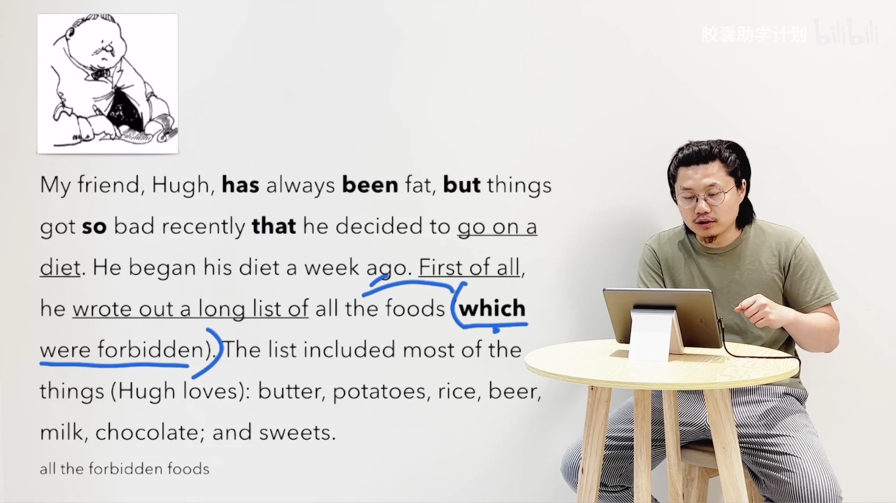

文字识别：My friend, Hugh, has always been fat, but things / got so bad recently that he decided to go on a / diet. He began his diet a week ago. First of all, / he wrote out a long list of allthe foods / swhich / were forbidden))The list included most of the / things (Hugh loves): butter, potatoes, rice, beer, / milk, chocolate; and sweets. / all the forbidden foods

### 画面 00:05:05

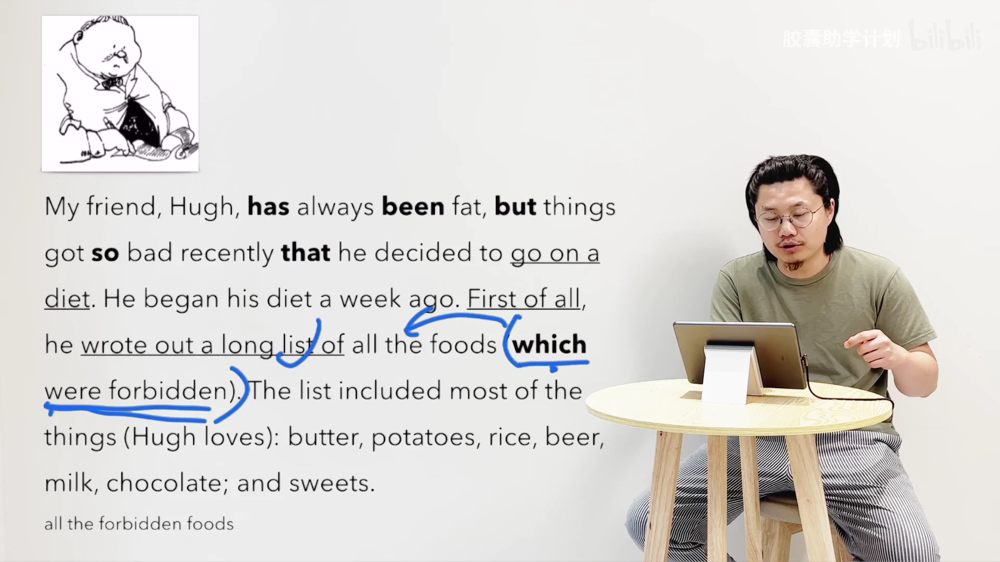

文字识别：My friend, Hugh, has always been fat, but things / got so bad recently that he decided to go on a / diet. He began his diet a week ago. First of all, / he wrote out a long list of all the foods / swhich / were forbidden)The list included most of the / things (Hugh loves): butter, potatoes, rice, beer, / milk, chocolate; and sweets. / all the forbidden foods

### 画面 00:05:11

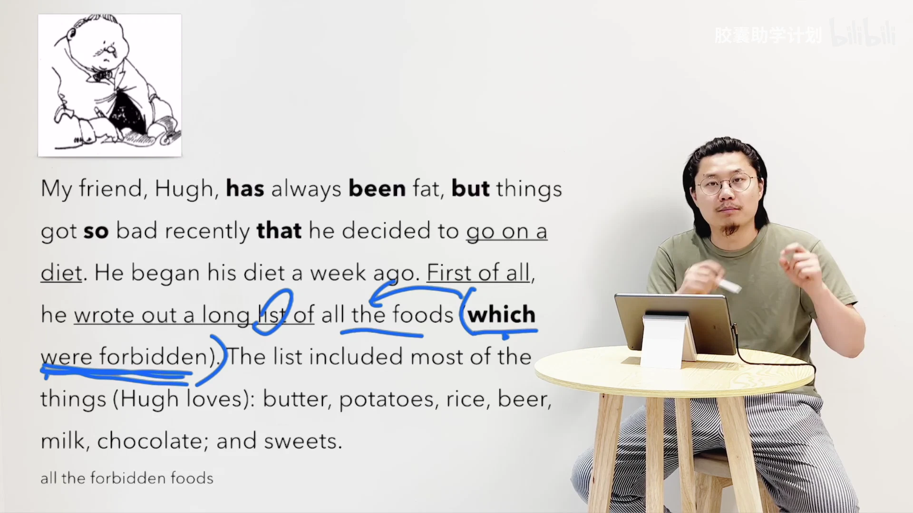

文字识别：My friend, Hugh, has always been fat, but things / got so bad recently that he decided to go on a / diet. He began his diet a week ago. First of all, / he wrote out a long Istof all the foods / s(which / were forbidden)The list included most of the / things (Hugh loves): butter, potatoes, rice, beer, / milk, chocolate; and sweets. / all the forbidden foods

### 画面 00:05:13

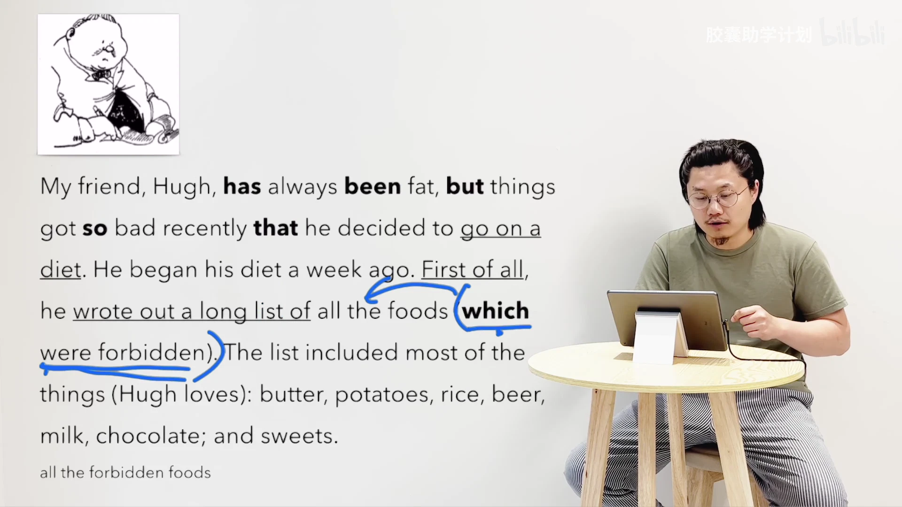

文字识别：My friend, Hugh, has always been fat, but things / got so bad recently that he decided to go on a / diet. He began his diet a week ago. First of all, / he wrote out a long list of allthe foods / swhich / were forbidden))The list included most of the / things (Hugh loves): butter, potatoes, rice, beer, / milk, chocolate; and sweets. / all the forbidden foods

### 画面 00:05:15

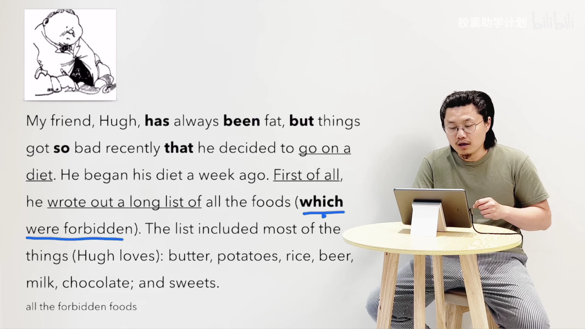

文字识别：My friend, Hugh, has always been fat, but things / got so bad recently that he decided to go on a / diet. He began his diet a week ago. First of all, / he wrote out a long list of allthe foods (which / were forbidden). The list included most of the / things (Hugh loves): butter, potatoes, rice, beer, / milk, chocolate; and sweets. / all the forbidden foods

## 00:05:30–00:06:00

loves? 这儿怎么单独出来了一个主谓结构，一个主一个谓是吧？一个一个一一个二怎么会单独出来这儿？因为前面已经有一个一和一个二了。那我原来跟各位多少提过对吧？我们主从当中有两套啊，一和二，要么有连词并列连词，要么有主从连词，或者这些您都不太清楚呢？这就是我们硬看语法基础，就是这儿其实缺了一个 that 嘛，对吧？哎， that 指的是 things。那后边呢？第一句话叫 the list included

### 画面 00:05:44

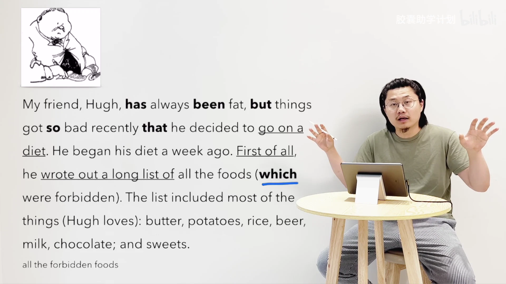

文字识别：My friend, Hugh, has always been fat, but things / got so bad recently that he decided to go on a / diet. He began his diet a week ago. First of all, / he wrote out a long list of all the foods (which / were forbidden). The list included most of the / things (Hugh loves): butter, potatoes, rice, beer, / milk, chocolate; and sweets. / all the forbidden foods

### 画面 00:05:52

文字识别：My friend, Hugh, has always been fat, but things / got so bad recently that he decided to go on a / diet. He began his diet a week ago. First of all, / he wrote out a long list of all the foods (which / were forbidden). The list included most of the / thingsHugh loves): butter, potatoes, rice, beer, / milk, chocolate; and sweets. / all the forbidden foods

### 画面 00:05:56

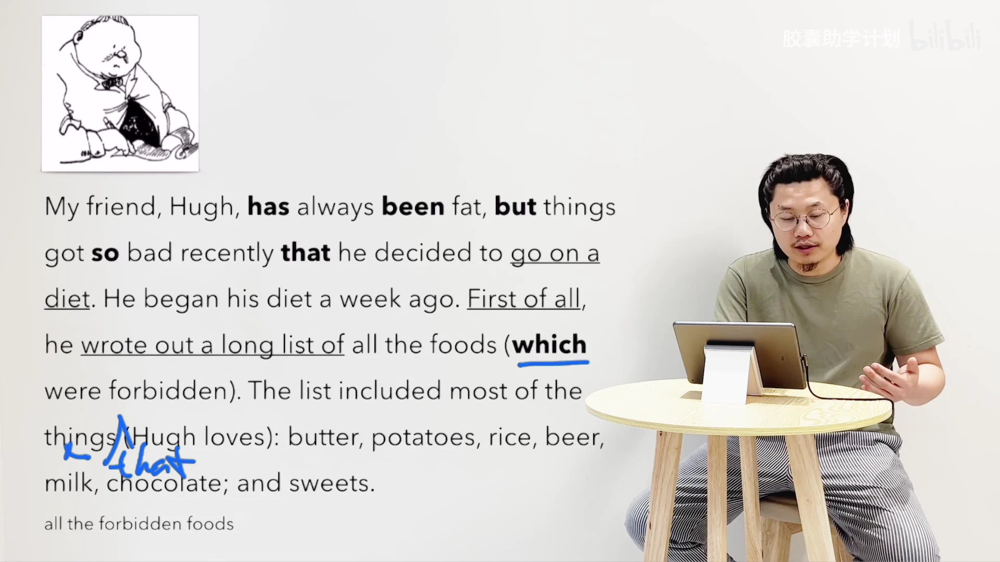

文字识别：My friend, Hugh, has always been fat, but things / got so bad recently that he decided to go on a / diet. He began his diet a week ago. First of all, / he wrote out a long list of all the foods (which / were forbidden). The list included most of the / milk, chocolate; and sweets. / all the forbidden foods

## 00:06:00–00:06:30

most of the things. 第二句话叫做 he loves these things, 对吧？哎，这个单子包含了大多数的东西。然后第二句话叫 he loves these things, 喜欢吃这些东西，对不对？典型的定语从句叫 that he loves. 啊，看他喜欢吃啥吧： butter, potatoes, rice, beer, milk, chocolate, and sweets. 黄油，土豆，米，啤酒，

### 画面 00:06:26

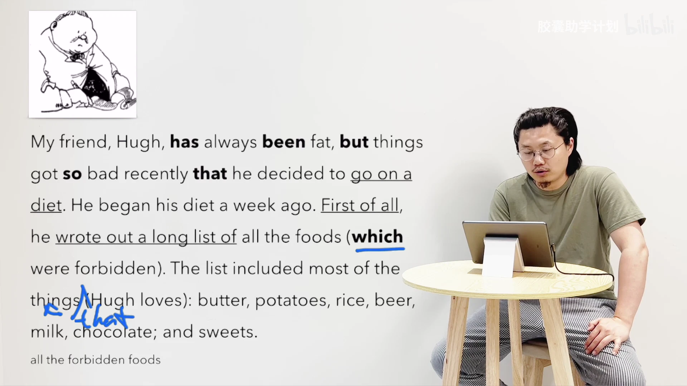

文字识别：My friend, Hugh, has always been fat, but things / got so bad recently that he decided to go on a / diet. He began his diet a week ago. First of all, / he wrote out a long list of all the foods (which / were forbidden). The list included most of the / milk, chocolate; and sweets. / all the forbidden foods

## 00:06:30–00:07:00

牛奶、巧克力和 sweets，sweets 这个单词我觉得你能猜出来，虽然也许你从来没见过，至少新概念当中这应该是第一次出现。我们新概念以前出现的叫 sweet 形容词，你看现在后边加了 s，并且前面全是名词，对吧？在这肯定是个名词啊，不是个形容词。那 sweet 指的是甜的，sweets 甜的东西呗，肯定就是糖果啊，糖果。OK， continue。

### 画面 00:06:34

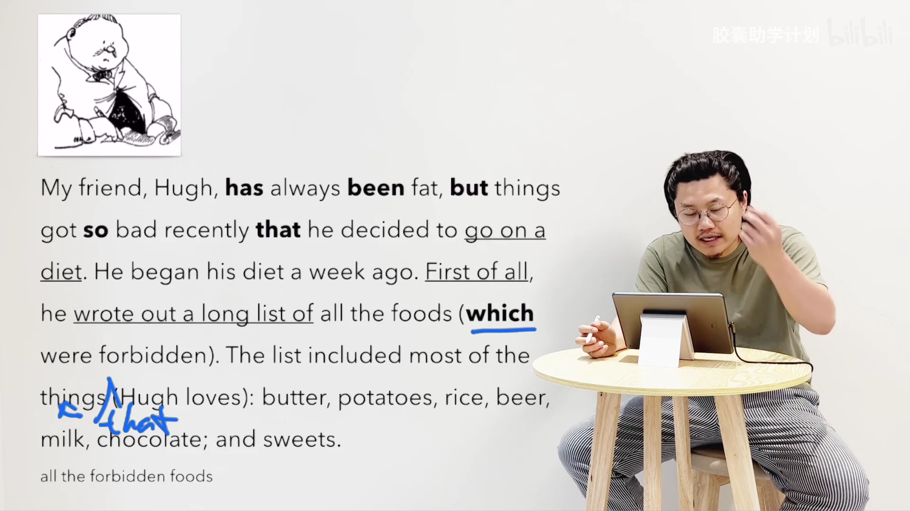

文字识别：My friend, Hugh, has always been fat, but things / got so bad recently that he decided to go on a / diet. He began his diet a week ago. First of all, / he wrote out a long list of all the foods (which / were forbidden). The list included most of the / milk, chocolate; and sweets. / all the forbidden foods

### 画面 00:06:37

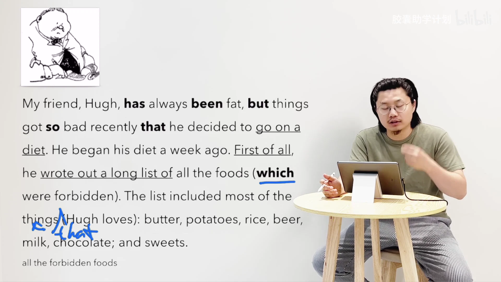

文字识别：My friend, Hugh, has always been fat, but things / got so bad recently that he decided to go on a / diet. He began his diet a week ago. First of all, / he wrote out a long list of all the foods (which / were forbidden). The list included most of the / milk, chocolate; and sweets. / all the forbidden foods

### 画面 00:06:59

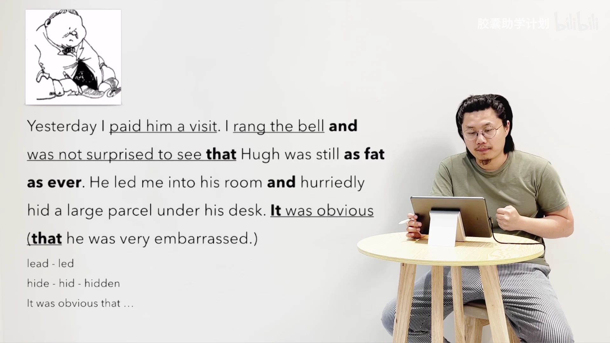

文字识别：Yesterday I paid him a visit.I rang the bell and / Was not surprised to see that Hugh was still as fat / as ever. He led me into his room and hurriedly / hid a large parcel under his desk.It was obvious / (that he Was very embarrassed.) / lead - led / hide - hid - hidden / It was obvious that ...

## 00:07:00–00:07:30

Yesterday, oh,回去还有一个小点，还有一个小点，这个地方我们要回去再讲一下啊。这个地方，看这儿，叫做 which were forbidden, which were forbidden. 那个 which 指的是 foods, 对吧？是重复的。直接我们某种程度上呢，可以把它变成叫做 all the forbidden foods, 所有那些被禁止的食物。这个实际

### 画面 00:07:02

文字识别：My friend, Hugh, has always been fat, but things / got so bad recently that he decided to go on a / diet. He began his diet a week ago. First of all, / he wrote out a long list of all the foods (which / were forbidden). The list included most of the / milk, chocolate; and sweets. / all the forbidden foods

### 画面 00:07:13

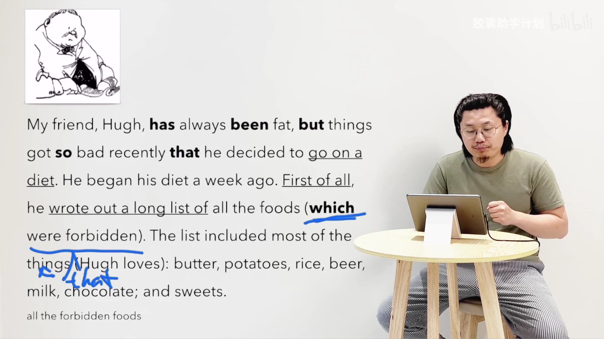

文字识别：My friend, Hugh, has always been fat, but things / got so bad recently that he decided to go on a / diet. He began his diet a week ago. First of all, / he wrote out a long list of all the foods (which / were forbidden). The list included most of the / milk, chocolate; and sweets. / all the forbidden foods

### 画面 00:07:24

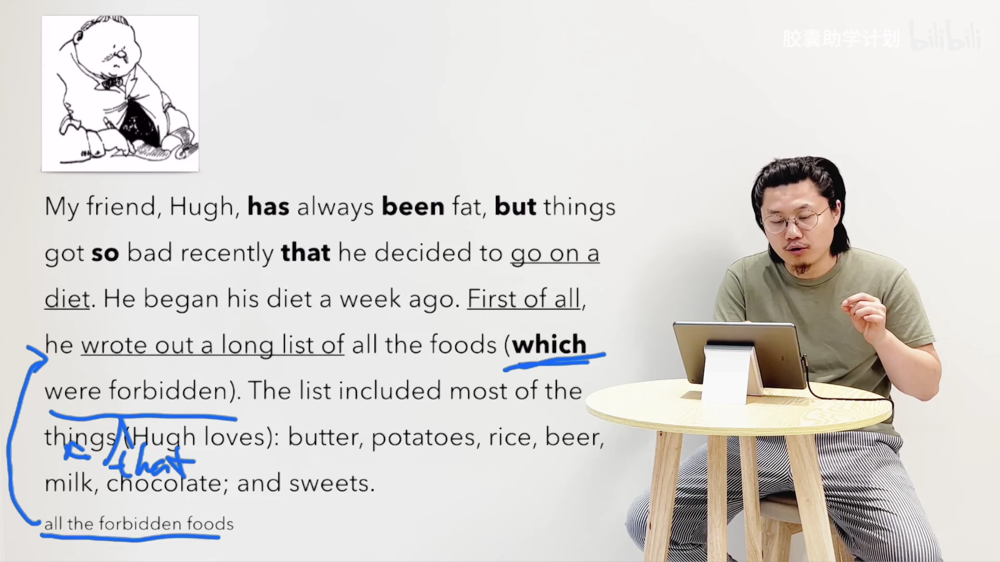

文字识别：My friend, Hugh, has always been fat, but things / got so bad recently that he decided to go on a / diet. He began his diet a week ago. First of all, / he wrote out a long list of all the foods (which / were forbidden). The list included most of the / milk, chocolate; and sweets. / all the forbidden foods

## 00:07:30–00:08:00

上是咱们二十九三十的时候学分词做定语那个地方去学过的。但是我们当时讲分词做定语的时候呢，还没有开始教各位一件事情，没有教各位如何把定语从句简化成分词做定语。但是四十九课咱们学分词做状语的时候呢，咱们学习了如何把这个呃状语从句简化成分词做状语，对吧？哎，我们在这个地方呢一点一点的去渗透，我们会专门找时间给大家去讲

### 画面 00:07:31

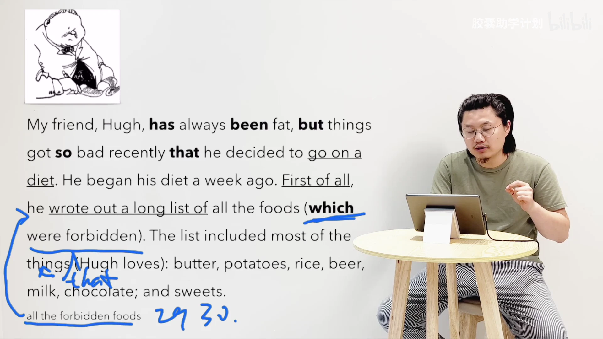

文字识别：My friend, Hugh, has always been fat, but things / got so bad recently that he decided to go on a / diet. He began his diet a week ago. First of all / he wrote out a long list of all the foods (which / were forbidden). The list included most of the / milk, chocolate; and sweets. / 93. / all the forbidden foods

## 00:08:00–00:08:30

啊，不多说了，接着往下走。Yesterday，昨天，I paid him a visit。注意这个paid就是P A Y的过去式啊，就是支付那个单词的过去式啊。比如说啊，就是这个单词啊，pay啊，就是支付啊，这个单词的过去式。但是paid him a visit是一个短语，叫pay somebody a visit。一会儿我们会拿它去造句，其实就是visit somebody，拜访某人啊。昨天呢，我拜访了他。

### 画面 00:08:00

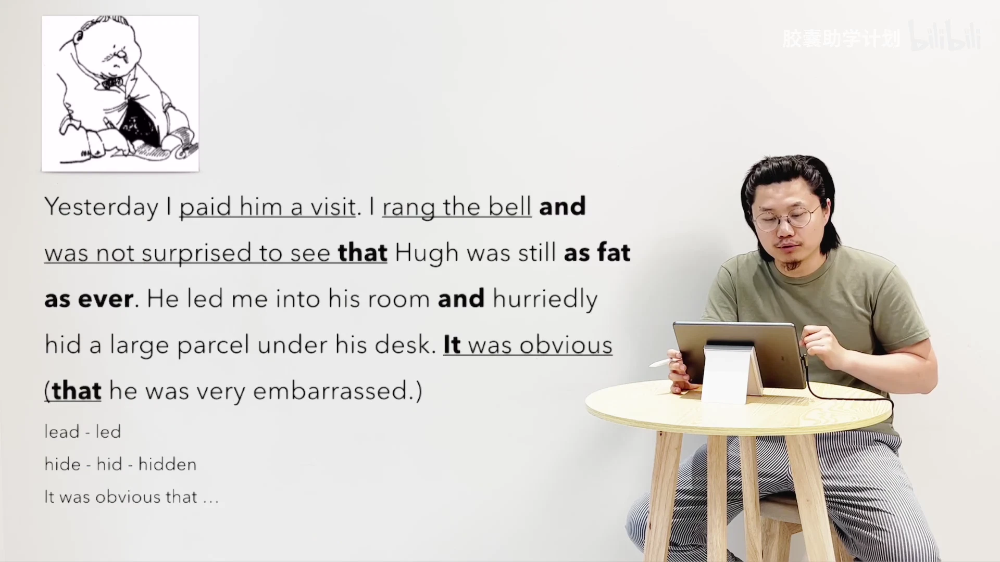

文字识别：Yesterday I paid him a visit.I rang the bell and / Was not surprised to see that Hugh was still as fat / as ever. He led me into his room and hurriedly / hid a large parcel under his desk. It was obvious / (that he Was very embarrassed.) / lead - led / hide - hid - hidden / It was obvious that ...

### 画面 00:08:14

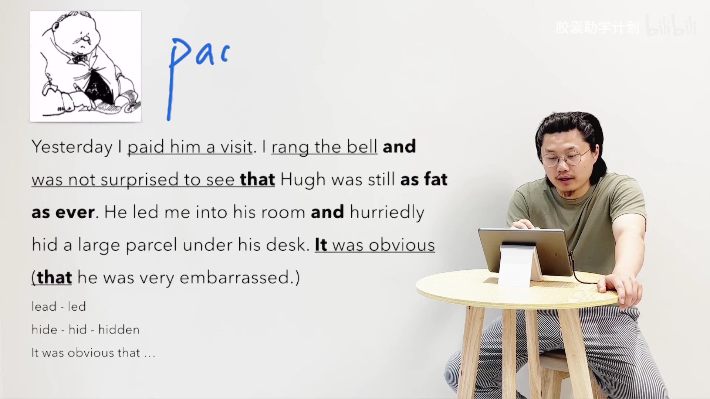

文字识别：Dac / Yesterday I paid him a visit.I rang the bell and / Was not surprised to see that Hugh was still as fat / as ever. He led me into his room and hurriedly / hid a large parcel under his desk. It was obvious / (that he was very embarrassed.) / lead - led / hide - hid - hidden / It was obvious that ...

### 画面 00:08:16

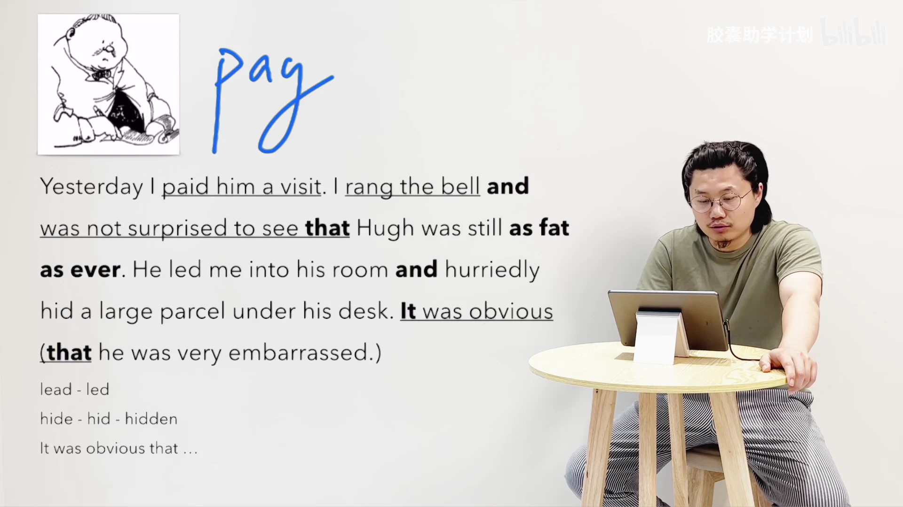

文字识别：Daり / Yesterday I paid him a visit.I rang the bell and / Was not surprised to see that Hugh was still as fat / as ever. He led me into his room and hurriedly / hid a large parcel under his desk. It was obvious / (that he Was very embarrassed.) / lead - led / hide - hid - hidden / It was obvious that ...

## 00:08:30–00:09:00

I rang the bell. 你看过去式，过去式，因为是 yesterday嘛，对吧？我按了门铃， and was not surprised to see that. 注意，你看这句话，我们一个单词一个单词翻译，叫做不是很惊讶去看到 that 后边加了一句话，看见了吧？加了一句话，不是很惊讶去看到一件事情，所以，我们把它直接当习惯用法摘出来，叫做 was not surprised to see

### 画面 00:08:46

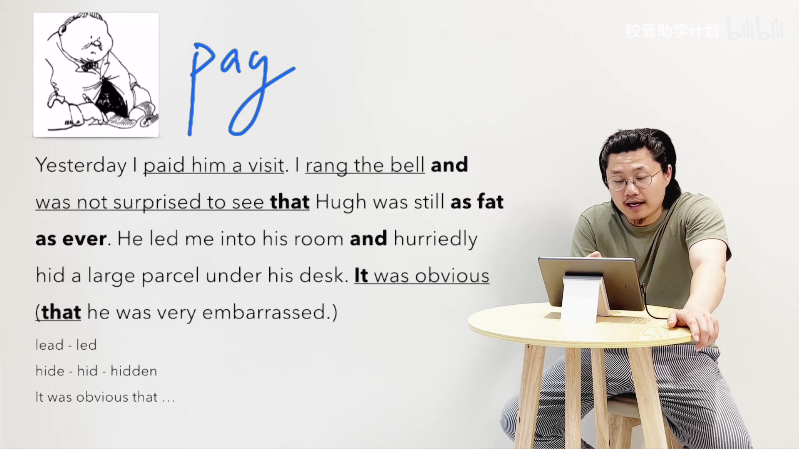

文字识别：Daり / Yesterday I paid him a visit.I rang the bell and / Was not surprised to see that Hugh was still as fat / as ever. He led me into his room and hurriedly / hid a large parcel under his desk. It was obvious / (that he was very embarrassed.) / lead - led / hide - hid - hidden / It was obvious that ...

## 00:09:00–00:09:30

that. 加一句话叫做看到这句话这件事情，并没有感觉到很惊讶。一会儿习惯用法造句，我们再说。现在能读懂就好。很惊讶，什么事情呢？看到什么事情并不是很惊讶呢？叫做 Hugh was still as fat as ever. 说 Hugh 啊，依旧是哎，跟各位这么去说 as as 结构，在大部分学员的脑海当中去见到它，都会

### 画面 00:09:16

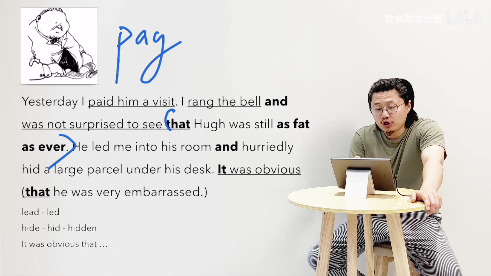

文字识别：Daり / Yesterday I paid him a visit.I rang the bell and / Was not surprised to see that Hugh was still as fat / as ever._He led me into his room and hurriedly / hid a Targe parcel under his desk. It was obvious / (that he Was very embarrassed.) / lead - led / hide - hid - hidden / It was obvious that ...

## 00:09:30–00:10:00

有一点点愁，到底如何去翻译这件事儿，对吧？好，那我们其实一个是要多多见它，第二个是老师带着大家去做，做多了，慢慢你就有处理的经验了啊。其实很简单，就是 he 是同依旧是同样的胖，像 ever 叫以往任何时候。这句话我觉得我翻译到这儿，你应该能懂了。还不懂，我觉得是可能和汉语自己的语感有点问题。说 he 依旧是同样的胖，

### 画面 00:09:46

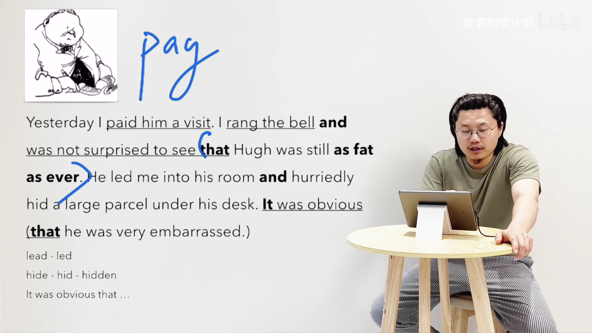

文字识别：Dag / Yesterday I paid him a visit. I rang the bell and / was not surprised to see that Hugh was still as fat / as ever.He led me into his room and hurriedly / hid a Targe parcel under his desk. It was obvious / (that he was very embarrassed.) / lead - led / hide - hid - hidden / It was obvious that ...

## 00:10:00–00:10:30

像以往任何时候，就是跟他的意思，就是他和以往任何时候都是同样的胖，对吧？三十二课咱学过 as as 这个结构嘛，对不对？只不过它有非常多的变体啊。 Okay，好，我们把这句话从头到尾再看一遍啊。这句话也挺长的。昨天我拜访了一下他，我按了门铃，然后呢，并不是很惊讶，看到 Hill 啊和以前一样胖，是吧？没瘦。接下来 he let me into his room

### 画面 00:10:16

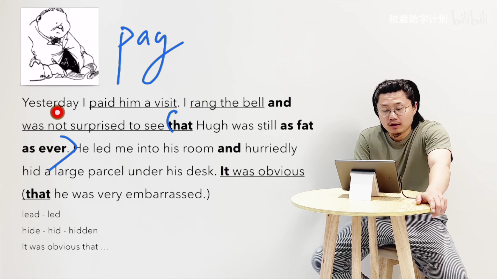

文字识别：Daり / Yesterday I paid him a visit.I rang the bell and / was not surprised to see that Hugh was still as fat / as ever.He led me into his room and hurriedly / hid a Targe parcel under his desk. It was obvious / (that he Was very embarrassed.) / lead - led / hide - hid - hidden / It was obvious that ...

## 00:10:30–00:11:00

and.不往后看了。他 led 这个单词是 lead 这个单词的过去式。这个单词用的在在这个地方，我觉得还挺精髓的。指的是什么呢？就是引领着，引领着必然有一个特点，就是你要走前面，你引领别人，你不能走后面对吧？所以他走在我的前面，其实就是就是引领 lead 这个单词或者 led 这个单词提供了一个画面感。这胖子走前面，你走

### 画面 00:10:38

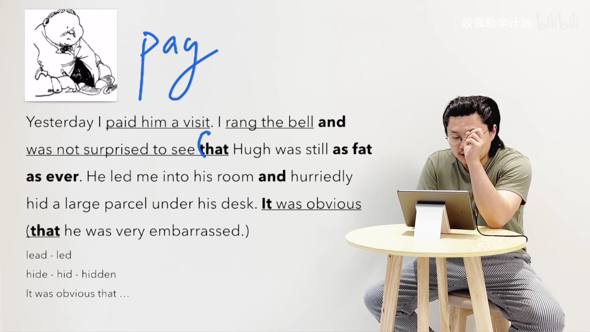

文字识别：Daり / Yesterday I paid him a visit.I rang the bell and / was not surprised to see that Hugh was still as fat / as ever. He led me into his room and hurriedly / hid a large parcel under his desk. It was obvious / (that he was very embarrassed.) / lead - led / hide - hid - hidden / It was obvious that ...

### 画面 00:10:41

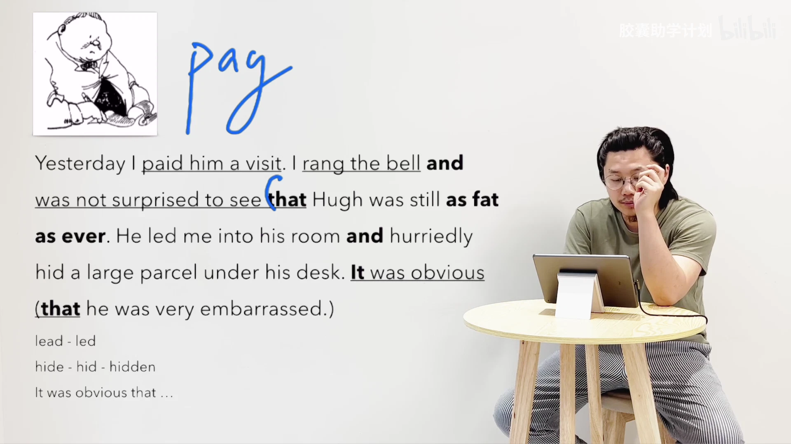

文字识别：Daり / Yesterday I paid him a visit. I rang the bell and / was not surprised to see that Hugh was still as fat / as ever. He led me into his room and hurriedly / hid a large parcel under his desk. It was obvious / (that he was very embarrassed.) / lead - led / hide - hid - hidden / It was obvious that ...

### 画面 00:10:58

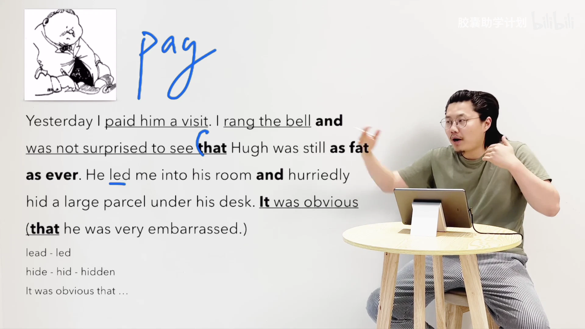

文字识别：Daり / Yesterday I paid him a visit. I rang the bell and / was not surprised to see that Hugh was still as fat / as ever. He led me into his room and hurriedly / hid a large parcel under his desk. It was obvious / (that he was very embarrassed.) / lead - led / hide - hid - hidden / It was obvious that ...

## 00:11:00–00:11:30

后面对吧？我们看为什么这个画面感很重要啊？带着我进入他的房间，and你看这个late和hurriedly和hid都是有关系的。hurriedly就是迅速的，怎么样呢？hid hide hid hidden啊，就藏了。A large parcel under his desk。你看，我觉得这些单词啊，我现在给你画圈的这些单词都是有联系的。首先，他走在

### 画面 00:11:03

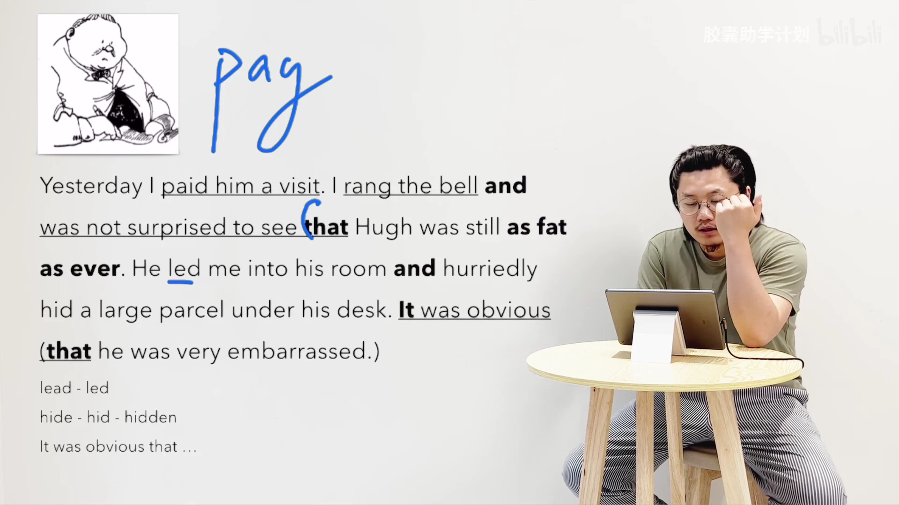

文字识别：Daり / Yesterday I paid him a visit.I rang the bell and / was not surprised to see that Hugh was still as fat / as ever. He led me into his room and hurriedly / hid a large parcel under his desk. It was obvious / (that he was very embarrassed.) / lead - led / hide - hid - hidden / It was obvious that ...

### 画面 00:11:07

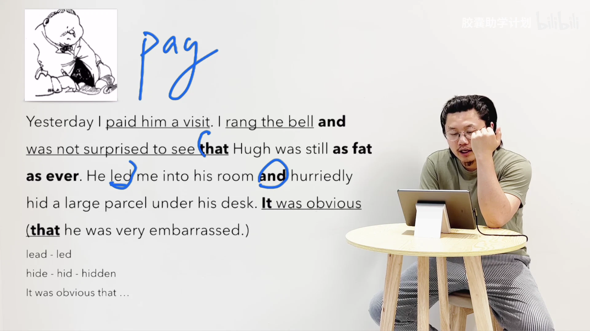

文字识别：Dan / Yesterday I paid him a visit. I rang the bell and / was not surprised to see that Hugh was still as fat / as ever. He ledme into his room and h / hurriedly / hid a large parcel under his desk. It was obvious / (that he was very embarrassed.) / lead- led / hide - hid - hidden / It was obvious that ...

### 画面 00:11:09

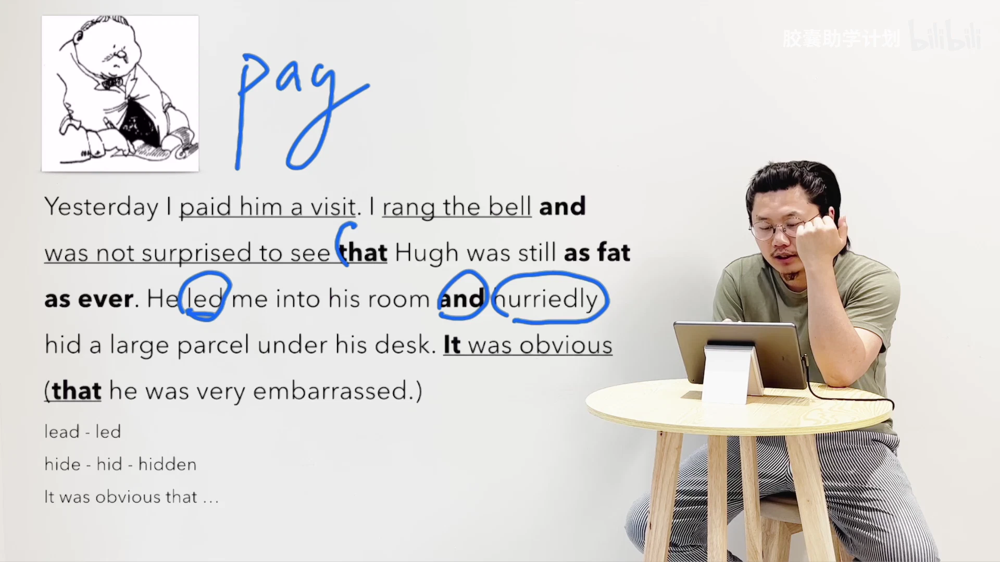

文字识别：Daり / Yesterday I paid him a visit. I rang the bell and / was not surprised to see that Hugh was still as fat / as ever. Heled me into his room and6urriedly / hid a large parcel under his desk. It was obvious / (that he was very embarrassed.) / lead - led / hide - hid - hidden / It was obvious that ...

### 画面 00:11:20

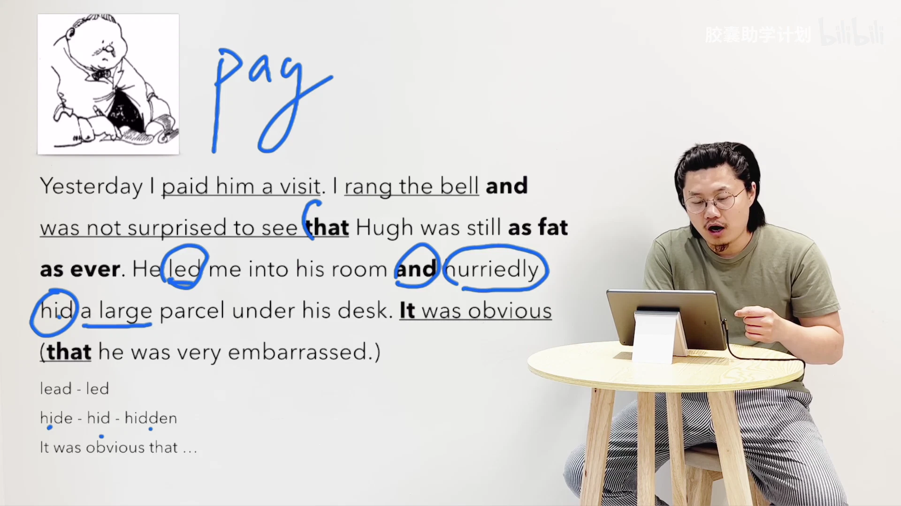

文字识别：Dag / Yesterday I paid him a visit. I rang the bell and / was not surprised to see that Hugh was still as fat / as ever. Heledme into his room and6urriedly / a large parcel under his desk. It was obvious / hid / (that he was very embarrassed.) / lead- led / hide - hid - hidden / It was obvious that ..

### 画面 00:11:22

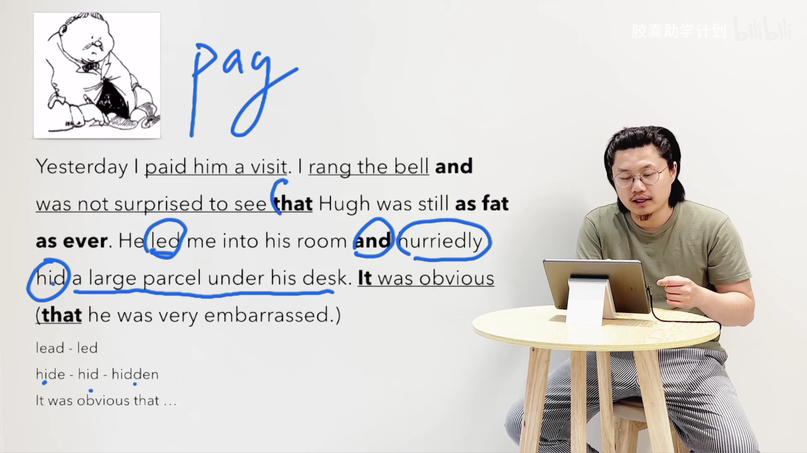

文字识别：Dag / Yesterday I paid him a visit. I rang the bell and / was not surprised to see that Hugh was still as fat / as ever. Heledme into his room and6urriedly / a large parcel under his desk. It was obvious / hid / (that he was very embarrassed.) / lead- led / hide - hid - hidden / It was obvious that ...

### 画面 00:11:25

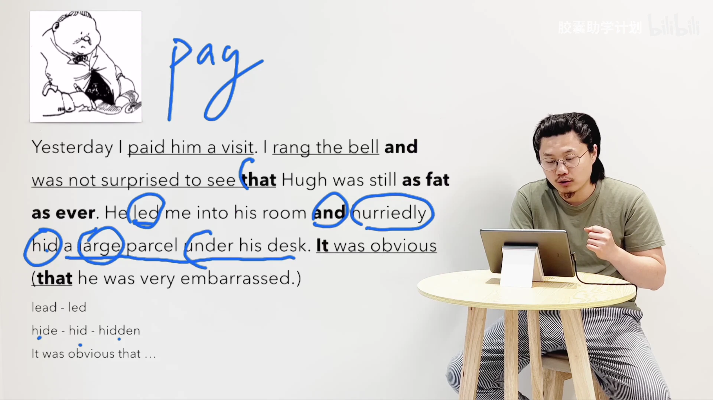

文字识别：Dan / Yesterday I paid him a visit. I rang the bell and / was not surprised to see that Hugh was still as fat / as ever. Heled me into his room and6urriedly / argeparcel ander his desk. It was obvious / hid / a / (that he was very embarrassed.) / lead- led / hide - hid - hidden / It was obvious that ...

### 画面 00:11:27

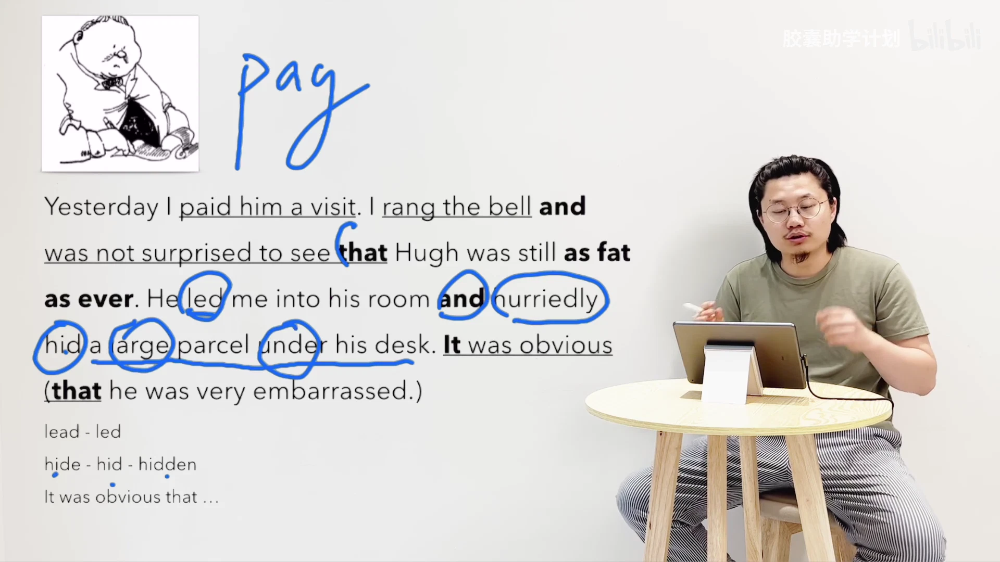

文字识别：Dag / Yesterday I paid him a visit.I rang the bell and / was not surprised to see that Hugh was still as fat / as ever. He(led me into his room and6urriedly / argeparcel ander his desk. It was obvious / hid / a / (that he was very embarrassed.) / lead- led / hide - hid - hidden / It was obvious that ...

### 画面 00:11:29

文字识别：Dag / Yesterday I paid him a visit. I rang the bell and / Was not surprised to see that Hugh was still as fat / as ever. He(ledme into his room / nanddurriedly / argeparcel ander his desk. It was obvious / hid / a / (that he was very embarrassed.) / lead- led / hide - hid - hidden / It was obvious that ...

## 00:11:30–00:12:00

我前面，引领着我进入他房间。为什么呢？因为他心里有事儿。他一进房间就立刻藏了一大包东西在他的桌子底下。你看，这都是一气呵成的。不管是介词对吧，还是这个副词，还是动词啊，他们起到的整个一个作用，就是给你形成了一个特别强烈的画面感。你读完这句话，闭上眼睛了之后，就会有一种

### 画面 00:11:40

文字识别：Dan / Yesterday I paid him a visit. I rang the bell and / Was not surprised to see that Hugh was stillas fat / as ever. Heledme into his room and6 / hurriedly / argeparcel ander his desk. It was obvious / hid / a / (that he was very embarrassed.) / lead- led / hide - hid - hidden / It was obvious that ...

### 画面 00:11:42

文字识别：Dan / Yesterday I paid him a visit. I rang the bell and / Was not surprised to see that Hugh was still as fat / as ever. Heledme into his room / nanddurriedly / argeparcel ander his desk. It was obvious / hid / a / (that he was very embarrassed.) / lead- led / hide - hid - hidden / It was obvious that ...

## 00:12:00–00:12:30

活灵活现的感觉。一个大胖子满头大汗给你开开门，一看是你，哎呦，他说来来进屋进屋，但是他又不好意思转头直接走，他就走在前面，赶紧多快走几步进屋呢，对吧？哎，他就赶紧把那个东西藏到底下去了。这种画面感特别的强，靠的就是这几个副词、动词和介词啊。再来，It was obvious，说他呀是特别明确的，

### 画面 00:12:10

文字识别：Dan / Yesterday I paid him a visit. I rang the bell and / was not surprised to see that Hugh was still as fat / as ever. He(led me into his room and6urriedly / argeparcel ander his desk. It was obvious / hid / a / (that he was very embarrassed.) / lead- led / hide - hid - hidden / It was obvious that ...

### 画面 00:12:16

文字识别：Dan / Yesterday I paid him a visit. I rang the bell and / was not surprised to see that Hugh was still as fat / as ever. Heledme into his room / nandourriedly / argeparcel ander his desk. It was obvious / hid / a / (that he was very embarrassed.) / lead- led / hide - hid - hidden / It was obvious that ...

## 00:12:30–00:13:00

特别明显的。That he was very embarrassed。你看，一来一个that后边还有一句话，我相信你不自觉的就会有这样一个感受，叫做这是不是个什么从句啊？你说的对，这确实是个从句。但我们稍安勿躁，先不管它是不是从句，我们先把这句话读懂。他是很明显的。如果只看这个三个单词，作为拥有基本语感的一个人类，你必定会问

### 画面 00:12:38

文字识别：Dag / Yesterday I paid him a visit. I rang the bell and / Was not surprised to see that Hugh was still as fat / as ever. Heledme into his room and6urriedly / a large parcel under his desk. It was obvious / hid / (that he was very embarrassed.) / lead- led / hide - hid - hidden / It was obvious that ..

### 画面 00:12:40

文字识别：Daり / Yesterday I paid him a visit. I rang the bell and / Was not surprised to see that Hugh was still as fat / as ever. He led me into his room and hurriedly / hid a large parcel under his desk. It was obvious / (that he Was very embarrassed.) / lead - led / hide - hid - hidden / It was obvious that ...

## 00:13:00–00:13:30

我一个问题，它指代的是什么？然后我们去找它指代什么的时候，如果是在文本中只有两个方向，要么往前，要么往后，对吧？啊，上下文去找它指代的是什么？上文找完没有？那就找下文，叫做 that he was very embarrassed。 that 往往不翻译，叫做他特别的尴尬。那我现在问你什么是很明显的？你自然就回答我，叫做 he was very

### 画面 00:13:10

文字识别：Daり / Yesterday I paid him a visit. I rang the bell and / was not surprised to see that Hpgh was stillas fat / as ever. He led me into his roon and hurriedly / hid a large parcel under his desk.It was obvious / (that he was very embarrassed.) / lead - led / hide - hid - hidden / It was obvious that ...

### 画面 00:13:19

文字识别：Daり / Yesterday I paid him a visit.I rang the bell and / was not surprised to see that Hgh was stil as fat / as ever. He led me into his roon and hurriedly / hid a large parcel under his desk.It was obvious / (that he was very embarrassed.) / lead - led / hide - hid - hidden / It was obvious that ...

## 00:13:30–00:14:00

embarrassed. That he was very embarrassed was obvious. 所以这句话起到了 It 和 It 是可以互换的。那我们就开始回顾一个知识点，这个在一到四十八总结我提过，对吧？哎，在之前 It seemed certain that 那句话当中啊，飞越南极的那一刻我也提过。我们有两对待这样的从句，我们有两种学法。这个从句叫什么？一个句子

### 画面 00:13:38

文字识别：Daり / Yesterday I paid him a visit. I rang the bell and / was not surprised to see that Hpgh was stil as fat / as ever. He led me into his roon and hurriedly / hid a large parcel under his desk. It was obvious / (that he was very embarrassed.) / lead- led / hide - hid - hidden / It was obvious that ...

## 00:14:00–00:14:30

做主语，主语从句。有两个学法，第一个就像刚才那样，我拿语法给你过一遍。第二个更简单粗暴，对于各位来说学习效果完全不差，甚至可能更好的学习学习思路就是直接高难语法习惯用法化，叫做 It was obvious that 加一句话，这事儿结束了。因为对于各位来说，将来你需要张嘴给人说出来的是 It was obvious that，而不是张嘴说出来叫做

### 画面 00:14:07

文字识别：Daり / Yesterday I paid him a visit.I rang the bell and / was not surprised to see that Hgh was stil as fat / as ever. He led me into his roon and hurriedly / hid a large parcel under his desk.It was obvious / (that he was very embarrassed.) / lead - led / hide - hid - hidden / It was obvious that ...

### 画面 00:14:09

文字识别：Daり / Yesterday I paid him a visit.I rang the bell and / was not surprised to see that Hugh was still as fat / as ever. He led me into his room and hurriedly / hid a large parcel under his desk. It was obvious / (that he Was very embarrassed.) / lead - led / hide - hid - hidden / It was obvious that ...

### 画面 00:14:15

文字识别：Daり / Yesterday I paid him a visit.I rang the bell and / Was not surprised to see that Hugh was still as fat / as ever. He led me into his room and hurriedly / hid a large parcel under his desk. It was obvious / (that he was very embarrassed.) / lead - led / hide - hid - hidden / It was obvious that ...

### 画面 00:14:17

文字识别：Daり / Yesterday I paid him a visit.I rang the bell and / Was not surprised to see that Hugh was still as fat / as ever. He led me into his room and hurriedly / hid a large parcel under his desk. It was obvious / (that he was very embarrassed.) / lead - led / hide - hid - hidden / It was obvious that ...

### 画面 00:14:21

文字识别：Daり / Yesterday I paid him a visit.I rang the bell and / Was not surprised to see that Hugh was still as fat / as ever. He led me into his room and hurriedly / hid a large parcel under his desk. It was obvious / (that he was very embarrassed.) / lead - led / hide - hid - hidden / It was obvious that ...

## 00:14:30–00:15:00

这句话是主语从句，听见了吧？没有任何考试考的是这句话是什么从句，是吧？至少我没见过啊。所以大部分时间它的要求是需要你能张嘴或者说动笔写出来。It was obvious that，或者 It is obvious that，对吧？后边加一句话。所以我们如何去记它呢？你知道它是主语从句就够了，对吧？这不是最重要的，一遍一遍去分析。你是要把这句话 It was obvious that 加一句话造十句话，每句话

### 画面 00:14:42

文字识别：Daり / Yesterday I paid him a visit.I rang the bell and / Was not surprised to see that Hugh was still as fat / as ever. He led me into his room and hurriedly / hid a large parcel under his desk. It was obvious / (that he was very embarrassed.) / lead - led / hide - hid - hidden / It was obvious that ...

### 画面 00:14:51

文字识别：Dag / Yesterday I paid him a visit.I rang the bell and / Was not surprised to see that Hugh was still as fat / as ever. He led me into his room and hurriedly / hid a large parcel under his desk. It was obvious / (that he was very embarrassed.) / lead - led / hide - hid - hidden / It was obvious that ...

## 00:15:00–00:15:30

前面都是It was obvious that，对吧？或者It is obvious that。然后当你说了十遍二十遍了之后，对吧？今天我写完了十个句子，明天我看一遍，大后天我再看一遍。以后我想说，这不是明显的吗？It is obvious that。哎，你会发现你张嘴就来了。这是我们第二个，我更推崇各位去学习的思路，对吧？哎，就语法差不多就够了啊。所以这句话我说清楚了啊，很明显他非常的尴尬。When I ask him问连词，当我

### 画面 00:15:21

文字识别：Daり / Yesterday I paid him a visit.I rang the bell and / Was not surprised to see that Hugh was still as fat / as ever. He led me into his room and hurriedly / hid a large parcel under his desk. It was obvious / (that he was very embarrassed.) / lead - led / hide - hid - hidden / It was obvious that ...

### 画面 00:15:25

文字识别：When I asked him what he was doing, he / smiled guiltily and then put the parcel on the / desk. He explained (that his diet was so strict / [that he had to reward himself occasionally]). / Then he showed me the contents of the / parcel. It contained five large bars of / chocolate and three bags of sweets!

## 00:15:30–00:16:00

问他 what he was doing，一个非常典型特殊疑问句做宾语从句，后边是 what he was doing，而不是 what was he doing，对吧？这个语法如果各位还不太会，新概念一册一百三十九课，新概念二册三十九课，咱们讲过啊。He smiled guiltily. 哎，这个逗号其实呢，我也给加粗了。为什么？因为逗号是一个天然的分隔，告诉你第一个句子可能结束了，对吧？他内疚的笑了笑。

### 画面 00:15:34

文字识别：what he was doing / When I asked him / ,he / smiled guiltily and then put the parcel on the / desk. He explained (that his diet was so strict / [that he had to reward himself occasionally]). / Then he showed me the contents of the / parcel.Ilt contained five large bars of / chocolate and three bags of sweets!

### 画面 00:15:37

文字识别：what he was doing / When I asked him / ,he / smiled guiltily and then put the parcel on the / desk. He explained (that his diet was so strict / [that he had to reward himself occasionally]). / Then he showed me the contents of the / parcel. It contained five large bars of / chocolate and three bags of sweets!

### 画面 00:15:46

文字识别：what he was doing / WhenI asked him / ,he / smiled guiltily and then put the parcel on the / desk. He explained (that his diet was so strict / [that he had to reward himself occasionally]). / Then he showed me the contents of the / parcel.Ilt contained five large bars of / chocolate and three bags of sweets!

### 画面 00:15:54

文字识别：what he was doing / WhenI asked him / ,he / smiled guiltily and then put the parcel on the / desk. He explained (that his diet was so strict / [that he had to reward himself occasionally]). / Then he showed me the contents of the / parcel. It contained five large bars of / chocolate and three bags of sweets!

## 00:16:00–00:16:30

and做了一件事儿，put the parcel on the desk.你看这里全是过去式asked，过去啊，当然可能不是一般过去时，可能还有过去进行时smiled，put对吧？然后呢，他就put the parcel on the desk. parcel我们以前学过第七课嘛，diamond那一课对吧？好，他把这个parcel包裹就放到了这个桌子上。He explained

### 画面 00:16:00

文字识别：what he was doing / When I asked him / ,he / smiled guiltily / then put the parcel on the / and / desk. He explained (that his diet was so strict / [that he had to reward himself occasionally]). / Then he showed me the contents of the / parcel. It contained five large bars of / chocolate and three bags of sweets!

### 画面 00:16:22

文字识别：what he was doing / When I asked him / he / smiled guiltily / then put the parcel on the / ano / desk. He explained (that his diet was so strict / [that he had to reward himself occasionally]). / Then he showed me the contents of the / parcel. It contained five large bars of / chocolate and three bags of sweets!

## 00:16:30–00:17:00

that.你一看主谓后边b是宾了，基本上对吧？整个这个宾语呢，这句话就有一点点复杂了。是从这个这个括号到这个括号，看见了啊？这个宾语从句当中还嵌套了一个从句，这是我们长难句的一个必须要研究清楚的东西啊。说His diet was so strict.说他的这个呃这个节食计划是如此的严厉that以至于so点

### 画面 00:16:30

文字识别：what he was doing / When I asked him / he / smiled guiltily / then put the parcel on the / and / desk. He explained (that his diet was so strict / [that he had to reward himself occasionally]). / Then he showed me the contents of the / parcel. It contained five large bars of / chocolate and three bags of sweets!

## 00:17:00–00:17:30

点儿that对吧？哎，如此的严厉以至于以至于，其实这地方又是一个从句，以至于什么呢？He had to reward himself occasionally，说他不得不奖励他自己一下，occasionally叫时不时的。哎，你看这里其实就是我说为什么我说这个标题特别损，对吧？Reward for virtue是吧？什么呢？你看这里边是一个特别好玩的悖论，他说叫做对美德的奖励，美德是什么呢？美

### 画面 00:17:00

文字识别：what he was doing / When I asked himl / ,he / smiled guiltily / then put the parcel on the / and / desk. He explained(that his diet was so strict / [that he had to reward himself occasionally] / Then he showed me the contents of the / parcel. It contained five large bars of / chocolate and three bags of sweets!

### 画面 00:17:19

文字识别：what he was doing / When I asked him / ,he / smiled guiltily / and / then put the parcel on the / desk. He explained(that his diet was so strict / [that he had to reward himself occasionally] / Then he showed me the contents of the / parcel. It contained five large bars of / chocolate and three bags of sweets!

### 画面 00:17:21

文字识别：what he was doing / When I asked him / he / smiled guiltily / ano / then put the parcel on the / desk. He explained(that his diet was so strict / [that he had to reward himself occasionally] / Then he showed me the contents of the / parcel. It contained five large bars of / chocolate and three bags of sweets!

## 00:17:30–00:18:00

德是他在减肥的时候呢，执行设置的这个计划呢，或者说他定的这个节食计划呢，非常非常的严厉。哎，这是在清教徒式的国家一个非常好的这个美德。然后呢，因为他这个过于严厉了呢，他又不得不得奖励他自己一下，对吧？时不时的奖励他自己一下，用什么奖励呢？我们接下来看很有意思啊。Then he showed me the contents of the parcel.你看，show somebody something这个就不多说了，以前见过很多次，

### 画面 00:17:51

文字识别：what he was doing / When I asked him / ,he / smiled guiltily / and / then put the parcel on the / desk. He explained(that his diet was so strict / [that he had to reward himself occasionally] / Then he showed me the contents of the / parcel. It contained five large bars of / chocolate and three bags of sweets!

## 00:18:00–00:18:30

展示给我看了 the contents of the parcel. 四十四课咱们见过 the contents of the bag, 对吧？好，那由后往前翻译就可以了。说这个 parcel 的 contents, 说这个包裹的内容啊，这包裹里边有什么东西？有什么东西呢？ It contained 它包含了 five large bars of chocolate, 五大块巧克力, and three bags of sweets 和三

### 画面 00:18:19

文字识别：what he was doing / When I asked himl / he / smiled guiltily / and / then put the parcel on the / desk. He explained(that his diet was so strict / [that he had to reward himself occasionally] / Then he showed me the contents of the / parcel. It contained five large bars of / chocolate and three bags of sweets!

### 画面 00:18:26

文字识别：what he was doing / When I asked him / ,he / smiled guiltily / then put the parcel on the / and / desk. He explained(that his diet was so strict / [that he had to reward himself occasionallyl] / Then he showed me the contents of the / parcel. It contained five large bars of / chocolate and three bags of sweets!

## 00:18:30–00:19:00

big bags of sugar, right? This is very magical, right? You think my diet, this feeling is very similar to the absurdity of eating until you are full before you can lose weight, right? Ah, it's because I'm following a very strict diet, so I have to reward myself. The way to reward myself is not to eat a little bit, right? Eating a little bit is no problem. We have a day called cheating day in fitness, right? Ah, cheat day, ah, cheat day,

### 画面 00:18:33

文字识别：what he was doing / When I asked him / ,he / smiled guiltily / then put the parcel on the / and / desk. He explained(that his diet was so strict / [that he had to reward himself occasionally] / Then he showed me the contents of the / parcel. It contained five large bars of / chocolate and three bags of sweets!

## 00:19:00–00:19:30

你多吃点乱七八糟你想吃的东西，没事儿，但只能吃那一点。他呢，时不时的给自己来点高热量食品，所以 was still as fat as ever，是吧？和以往任何时候同样的胖。OK，那文章讲完了，我们今天把 repetition drill 呢放到了这里去进行训练。注意不要把它跟那个 ask me if，也就是我们在下一个视频当中会出现的那个练习混起来。这个练习很简单，各位张嘴跟我读就行了。但它也是基于文章的，所以

### 画面 00:19:03

文字识别：what he was doing / When I asked him / ,he / smiled guiltily / and / then put the parcel on the / desk. He explained(that his diet was so strict / [that he had to reward himself occasionally] / Then he showed me the contents of the / parcel. It contained five large bars of / chocolate and three bags of sweets!

### 画面 00:19:13

文字识别：Repetition drill / 训练目标： / 听力口语 / 练习一般过去时的句子 / Accuracy / Fluency

### 画面 00:19:26

文字识别：Repetition drill / 1 T: Did Hugh decide to go on a diet? / S: Yes, he decided to go on a diet.

## 00:19:30–00:20:00

我把他从语法那个视频呢，哎，暂时性的拉到这里来了啊！各位张嘴跟我读就行啊！来了，Did he decide to go on a diet?你读哎，然后Yes, he decided to go on a diet.所以这里其实重点我们在练的是一般过去式嘛，对吧？OK，剩下都是一样的，各位不用根据文章找答案，跟我看着读就行了。来跟读啊，跟读训练。Did he begin

### 画面 00:19:35

文字识别：Repetition drill / 1 T: Did Hugh decide to go on a diet? / S: Yes, he decided to go on a diet.

### 画面 00:19:37

文字识别：Repetition drill / 1 T: Did Hugh decide to go on a diet? / S: Yes, he decided to go on a diet.

### 画面 00:19:48

文字识别：Repetition drill / 1 T: Did Hugh decide to go on a diet? / S: Yes, he decided to go on a diet.

### 画面 00:19:50

文字识别：Repetition drill / 1 T:Dio / Hugh decide to go on a diet? / S: Yes, he decided to go on a diet.

### 画面 00:19:52

文字识别：Repetition drill

## 00:20:00–00:20:30

his diet a week ago? Yes, he began his diet a week ago. Next one. Did he write out a long list of forbidden foods? Yes, he wrote out a long list of forbidden foods. Next one. Did the list include a lot of things? Yes, the list included a lot of things. Ah,你看，注意啊，这里其实提醒我们的还是啊，

### 画面 00:20:11

文字识别：Repetition drill / 3 T: Did he write out a long list of forbidden foods? / S: Yes, he wrote out a long list of forbidden foods.

### 画面 00:20:17

文字识别：Repetition drill / 4T: Did the list include a lot of things?

### 画面 00:20:28

文字识别：Repetition drill / 4 T: Didthe list include a lot of things? / S: Yes, the list included a lot of things.

## 00:20:30–00:21:00

你肯定句变一般疑问句，did提前了之后，这个动词换回原形啊。Next one, did you pay him a visit? Yes, I paid him a visit. Next one, did you ring the bell? Yes, I rang the bell. Next one, did he lead you into his room? Yes, he led me into his room. Did he hide the parcel under his desk? Yes, he hid

### 画面 00:20:31

文字识别：Repetition drill / 4 T: / Did / )the list include a lot of things? / S: Yes, the list included a lot of things.

### 画面 00:20:33

文字识别：Repetition drill / 4 T: / Didthe listnclude / lot of things? / S: Yes, the list included / a lot of things.

### 画面 00:20:35

文字识别：Repetition drill / 5 T: Did you pay him a visit?

### 画面 00:20:38

文字识别：Repetition drill / 5 T: Did you pay him a visit? / S: Yes, I paid him a visit.

### 画面 00:20:41

文字识别：Repetition drill

### 画面 00:20:58

文字识别：Repetition drill / 8 T: Did he hide the parcel under his desk? / S: Yes, he hid the parcel under his desk.

## 00:21:00–00:21:30

the parcel under his desk. Next one, did you ask him what he was doing? Yes, I asked him what he was doing. Next one, did he put the parcel on the desk? Yes, he put the parcel on the desk. Okay. Have did he show you the contents of the parcel? Yes, he showed me the contents of the parcel.

### 画面 00:21:03

文字识别：Repetition drill / 9 T: Did you ask him what he was doing?

### 画面 00:21:15

文字识别：Repetition drill / 10 T: Did Hugh put the parcel on the desk? / S: Yes, he put the parcel on the desk.

### 画面 00:21:20

文字识别：Repetition drill / 11 T: Did he show you the contents of the parcel?

## 00:21:30–00:22:00

Did the parcel contain sweets and chocolate? Yes, the parcel contained sweets and chocolate. 好，又到了这个环节，习惯用法造句啊，这些习惯用法咱们一一去进行一个造句。哎，第一个，first of all，叫首先，首先其实它不是一个句子，你放到任何句子的前面都可以。比如说，first of all, I want you to know that I prefer swimming to running. Prefer，

### 画面 00:21:33

文字识别：Repetition drill / 12 T: Did the parcel contain sweets and chocolate? / S: Yes, the parcel contained sweets and chocolate.

### 画面 00:21:37

文字识别：习惯用法造句 / First of all, / write out a long list of / pay sb. a visit / ring the bell / was not surprised to see that.. / It was obvious that

### 画面 00:21:39

文字识别：习惯用法造句 / First of all, / write out a long list of / pay sb.a visit / ring the bell / was not surprised to see that.. / It was obvious that

### 画面 00:21:41

文字识别：习惯用法造句 / First of all,. / write out a long list of / pay sb. a visit / ring the bell / was not surprised to see that.. / It was obvious that

### 画面 00:21:43

文字识别：习惯用法造句 / First of all,. / write out a long list of / pay sb.a visit / ring the bell / was not surprised to see that.. / It was obvious that

### 画面 00:21:45

文字识别：网：v.+v.变化 / 习惯用法造句指南 / 四句型转换 / 方式/地点/时间 / 其他习惯用法 / 其他单词+词性 / 原文摘抄+变 / 6123456 / First of all,

### 画面 00:21:50

文字识别：网：v.+v.变化 / 习惯用法造句指南 / 四句型转换 / 方式/地点/时间 / 其他习惯用法 / 其他单词+词性 / 原文摘抄+变 / 6123456 / First of all,

### 画面 00:21:53

文字识别：网：v.+v.变化 / 习惯用法造句指南 / 四句型转换 / 方式/地点/时间 / 其他习惯用法 / 其他单词+词性 / 原文摘抄+变 / 6123456 / First of all, / First of all, I want you to know that I prefer / swimming to running. L50

### 画面 00:21:55

文字识别：网：v.+v.变化 / 习惯用法造句指南 / 四句型转换 / 方式/地点/时间 / 其他习惯用法 / 其他单词+词性 / 原文摘抄+变 / 6123456 / First of all, / First of all, I want you to know that I prefer / swimming to running. L50

## 00:22:00–00:22:30

其实，在这里我这个有点私心，想让你复习一下 prefer doing A to doing B，是吧？Okay，接下来说 first of all, I love swimming.啊，首先我热爱游泳。再来 first of all, I'd prefer to go to sleep early. Would prefer to do something.哎，这三句话全是五十课我们刚刚这个学过的，对吧？呃，这里呢，我个人觉得是这样的啊，就还是那句话，授人以鱼不如授人以渔，是吧？红鲤

### 画面 00:22:00

文字识别：网：v.+v.变化 / 习惯用法造句指南 / 四句型转换 / 方式/地点/时间 / 其他习惯用法 / 其他单词+词性 / 原文摘抄+变 / 6123456 / First of all, / First of all, I want you to know that I prefer / swimming to running. L50

### 画面 00:22:02

文字识别：网：v.+v.变化 / 习惯用法造句指南 / 四句型转换 / 方式/地点/时间 / 其他习惯用法 / 其他单词+词性 / 原文摘抄+变 / 6123456 / First of all, / First of all, I want you to know that I prefer / swimming to running. L50

### 画面 00:22:05

文字识别：网：v.+v.变化 / 习惯用法造句指南 / 四句型转换 / 方式/地点/时间 / 其他习惯用法 / 其他单词+词性 / 原文摘抄+变 / 6123456 / First of all, / First of all, I want you to know that I prefer / swimming to running. L50

### 画面 00:22:10

文字识别：网：v.+v.变化 / 习惯用法造句指南 / 四句型转换 / 方式/地点/时间 / 其他习惯用法 / 其他单词+词性 / 原文摘抄+变 / 6123456 / First of all, / First of all, I want you to know that I prefer / swimming to running. L50 / First of all, Ilove swimming. L50

### 画面 00:22:14

文字识别：网：v.+v.变化 / 习惯用法造句指南 / 四句型转换 / 方式/地点/时间 / 其他习惯用法 / 其他单词+词性 / 原文摘抄+变 / 6123456 / First of all, / First of all, I want you to know that I prefer / swimming to running. L50 / First of all, I love swimming. L50 / First of all, I'd prefer to go to sleep early. L50

### 画面 00:22:16

文字识别：网：v.+v.变化 / 习惯用法造句指南 / 四句型转换 / 方式/地点/时间 / 其他习惯用法 / 其他单词+词性 / 原文摘抄+变 / 6123456 / First of all, / First of all, I want you to know that I prefer / swimming to running. L50 / First of all, I love swimming. L50 / First of all, I'd prefer to go to sleep early. L50

### 画面 00:22:19

文字识别：网：v.+v.变化 / 习惯用法造句指南 / 四句型转换 / 方式/地点/时间 / 其他习惯用法 / 其他单词+词性 / 原文摘抄+变 / 6123456 / First of all, / First of all, I want you to know that I prefer / swimming to running. / L50 / First of all, I love swimming. L50 / First of all, 'd prefer to go to sleep early L50

### 画面 00:22:21

文字识别：网：v.+v.变化 / 习惯用法造句指南 / 四句型转换 / 方式/地点/时间 / 其他习惯用法 / 其他单词+词性 / 原文摘抄+变 / 6123456 / First of all, / First of all, I want you to know that I prefer / swimming to running. / L50 / First of all, Ilove swimming. L50 / First of all, 'd prefer to go to sleep early L50

### 画面 00:22:25

文字识别：网：v.+v.变化 / 习惯用法造句指南 / 四句型转换 / 方式/地点/时间 / 其他习惯用法 / 其他单词+词性 / 原文摘抄+变 / 6123456 / First of all, / First of all, I want you to know that I prefer / swimming to running. / L50 / First of all,I love swimming. 50 / First of all,I'd prefer to go to sleep early L50

## 00:22:30–00:23:00

鱼、绿鲤鱼啊，大概是这个意思。就是这些句子对于各位来说，你真的去背它意义不太大。你明白我是如何造出来的这些句子，意义是更大的。然后在这里呢，看这些句子还有什么意义呢？就复习了一下，很简单，复习了一下我刚学过的短语习惯用法呗，对吧？见的变数越多，重复的变数越多，效果一定越好啊。下一个，write out a long list of something that 加一个

### 画面 00:22:30

文字识别：网：v.+v.变化 / 习惯用法造句指南 / 四句型转换 / 方式/地点/时间 / 其他习惯用法 / 其他单词+词性 / 原文摘抄+变 / 6123456 / First of all, / First of all, I want you to kpow that I prefer / swimming to running. / L50 / First of all,Ilove swimming. 50 / First of all,I'd prefer to go to sleep early L50

### 画面 00:22:39

文字识别：网：v.+v.变化 / 习惯用法造句指南 / 四句型转换 / 方式/地点/时间 / 其他习惯用法 / 其他单词+词性 / 原文摘抄+变 / 6123456 / First of all, / First of all, I want you to kpow that I prefer / swimming to running. / L50 / First of all, Ilove swimming. L50 / First of all, 'd prefer to go to sleep early L50

### 画面 00:22:43

文字识别：网：v.+v.变化 / 习惯用法造句指南 / 四句型转换 / 方式/地点/时间 / 其他习惯用法 / 其他单词+词性 / 原文摘抄+变 / 6123456 / First of all, / First of all I want you to kpow that I prefer / swimming to running. / L50 / First of all, Ilove swimming. L50 / First of all,I'd prefer to go to sleep early L50

### 画面 00:22:45

文字识别：网：v.+v.变化 / 习惯用法造句指南 / 四句型转换 / 方式/地点/时间 / 其他习惯用法 / 其他单词+词性 / 原文摘抄+变 / 6123456 / First of all, / First of all I want you to kpow that I prefer / swimming to running. / L50 / First of all,I love swimming. 50 / First of all, 'd prefer to go to sleep early L50

### 画面 00:22:48

文字识别：网：v.+v.变化 / 习惯用法造句指南 / 四句型转换 / 方式/地点/时间 / 其他习惯用法 / 其他单词+词性 / 原文摘抄+变 / 6123456 / First of all, / First of all, I want you to kpow that I prefer / swimming to running. / L50 / First of all, I love swimming. L50 / First of all,I'd prefer to go to sleep early L50

### 画面 00:22:50

文字识别：网：v.+v.变化 / 习惯用法造句指南 / 四句型转换 / 方式/地点/时间 / 其他习惯用法 / 其他单词+词性 / 原文摘抄+变 / 6123456 / First of all, / First of all, I want you to kpow that I prefer / swimming to running. / L50 / First of all,I love swimming. 50 / First of all,I'd prefer to go to sleep early L50

### 画面 00:22:53

文字识别：网：v.+v.变化 / 习惯用法造句指南 / 四句型转换 / 方式/地点/时间 / 其他习惯用法 / 其他单词+词性 / 原文摘抄+变 / 6123456 / write out a long list of sth. (that ...)

### 画面 00:22:55

文字识别：网：v.+v.变化 / 习惯用法造句指南 / 四句型转换 / 方式/地点/时间 / 其他习惯用法 / 其他单词+词性 / 原文摘抄+变 / 6123456 / write out a long list of sth. (that ...)

## 00:23:00–00:23:30

定语从句。我举个例子。First of all,你看我又用上了。He wrote out a long list of all the cars that he owns.我不知道各位注没注意到，这其实我已经开始做一个小的仿写了。他写出了一个长长的单子，他拥有的所有车辆的长长的单子，对吧？富豪。再来说，Leo wrote out a long list of all the books that he loves reading.啊，sorry，

### 画面 00:23:00

文字识别：网：v.+v.变化 / 习惯用法造句指南 / 四句型转换 / 方式/地点/时间 / 其他习惯用法 / 其他单词+词性 / 原文摘抄+变 / 6123456 / write out a long list of sth.(that ...)

### 画面 00:23:02

文字识别：网：v.+v.变化 / 习惯用法造句指南 / 四句型转换 / 方式/地点/时间 / 其他习惯用法 / 其他单词+词性 / 原文摘抄+变 / 6123456 / write out a long list of sth.(that ...) / First of all, he wrote out a long list of all the cars that / he owns.

### 画面 00:23:05

文字识别：网：v.+v.变化 / 习惯用法造句指南 / 四句型转换 / 方式/地点/时间 / 其他习惯用法 / 其他单词+词性 / 原文摘抄+变 / 6123456 / write out a long list of sth.(that ...) / First of all, he wrote out a long list of all the cars that / he owns.

### 画面 00:23:07

文字识别：网：v.+v.变化 / 习惯用法造句指南 / 四句型转换 / 方式/地点/时间 / 其他习惯用法 / 其他单词+词性 / 原文摘抄+变 / 6123456 / write out a long list of sth.(that ...) / First of all, he wrote out a long list of all the cars that / he owns.

### 画面 00:23:09

文字识别：网：v.+v.变化 / 习惯用法造句指南 / 四句型转换 / 方式/地点/时间 / 其他习惯用法 / 其他单词+词性 / 原文摘抄+变 / 6123456 / write out a long list of sth.(that ...) / First of all, he wrote out a long list of all the/carsthat / he owns.

### 画面 00:23:11

文字识别：网：v.+v.变化 / 习惯用法造句指南 / 四句型转换 / 方式/地点/时间 / 其他习惯用法 / 其他单词+词性 / 原文摘抄+变 / 6123456 / write out a long list of sth.(that ...) / First of all, he wrote out a long list of all the/carsthat / he owns.

### 画面 00:23:14

文字识别：网：v.+v.变化 / 习惯用法造句指南 / 四句型转换 / 方式/地点/时间 / 其他习惯用法 / 其他单词+词性 / 原文摘抄+变 / 6123456 / write out a long list of sth. (that ...) / First of all, he wrote out a long list of all the/carsthat / he owns.

### 画面 00:23:16

文字识别：网：v.+v.变化 / 习惯用法造句指南 / 四句型转换 / 方式/地点/时间 / 其他习惯用法 / 其他单词+词性 / 原文摘抄+变 / 6123456 / write out a long list of sth.(that ...) / First of all, he wrote out a long list of all the/carsthat / he owns.

### 画面 00:23:20

文字识别：网：v.+v.变化 / 习惯用法造句指南 / 四句型转换 / 方式/地点/时间 / 其他习惯用法 / 其他单词+词性 / 原文摘抄+变 / 6123456 / write out a long list of sth.(that ...) / First of all, he wrote out a long list of all the/carsthat / he owns.

### 画面 00:23:22

文字识别：网：v.+v.变化 / 习惯用法造句指南 / 四句型转换 / 方式/地点/时间 / 其他习惯用法 / 其他单词+词性 / 原文摘抄+变 / 6123456 / write out a long list of sth. (that ...) / First of all, he wrote out a long list of all the/carsthat / he owns. / Leo wrote out a long list of all the books that he love / reading. L50

### 画面 00:23:24

文字识别：网：v.+v.变化 / 习惯用法造句指南 / 四句型转换 / 方式/地点/时间 / 其他习惯用法 / 其他单词+词性 / 原文摘抄+变 / 6123456 / write out a long list of sth. (that ...) / First of all, he wrote out a long list of all the/carsthat / he owns. / Leo wrote out a long list of all the books that he lovei / reading. L50

### 画面 00:23:26

文字识别：网：v.+v.变化 / 习惯用法造句指南 / 四句型转换 / 方式/地点/时间 / 其他习惯用法 / 其他单词+词性 / 原文摘抄+变 / 6123456 / write out a long list of sth. (that ...) / First of all, he wrote out a long list of all the/carsthat / he owns. / Leo wrote out a long list of all the books that he lovei / reading. L50

## 00:23:30–00:24:00

this place should be he loves reading.一个小的table. Ah,说他呀写出了一个长长的书单。什么样的书单呢？他热爱阅读的书单。啊，他爱读这些书，对吧？他喜欢读的书的书单。再来，那一个女性说，She wrote out a long list of all the shoes she likes.对吧？她列出了一个长长的单子，所有鞋，她喜欢的鞋的长长的单子。啊，各位不知道有没有发现，这三句

### 画面 00:23:30

文字识别：网：v.+v.变化 / 习惯用法造句指南 / 四句型转换 / 方式/地点/时间 / 其他习惯用法 / 其他单词+词性 / 原文摘抄+变 / 6123456 / write out a long list of sth. (that ...) / First of all, he wrote out a long list of all the/carsthat / he owns. / Leo wrote out a long list of all the books that he lovel / reading. L50

### 画面 00:23:33

文字识别：网：v.+v.变化 / 习惯用法造句指南 / 四句型转换 / 方式/地点/时间 / 其他习惯用法 / 其他单词+词性 / 原文摘抄+变 / 6123456 / write out a long list of sth. (that ...) / First of all, he wrote out a long list of all the/carsthat / he owns. / Leo wrote out a long list of all the books that he loves / reading. L50

### 画面 00:23:35

文字识别：网：v.+v.变化 / 习惯用法造句指南 / 四句型转换 / 方式/地点/时间 / 其他习惯用法 / 其他单词+词性 / 原文摘抄+变 / 6123456 / write out a long list of sth. (that ...) / First of all, he wrote out a long list of all the/carsthat / he owns. / Leo wrote out a long list of all the books that he loves / reading. L50

### 画面 00:23:40

文字识别：网：v.+v.变化 / 习惯用法造句指南 / 四句型转换 / 方式/地点/时间 / 其他习惯用法 / 其他单词+词性 / 原文摘抄+变 / 6123456 / write out a long list of sth. (that ...) / First of all, he wrote out a long list of all the/carsthat / he owns. / Leo wrote out a long list of all the books that he loves / reading. L50

### 画面 00:23:44

文字识别：网：v.+v.变化 / 习惯用法造句指南 / 四句型转换 / 方式/地点/时间 / 其他习惯用法 / 其他单词+词性 / 原文摘抄+变 / 6123456 / write out a long list of sth. (that ...) / First of all, he wrote out a long list of all thecarsthat / he owns. / Leo wrote out a long list of all the books that he loves / reading. L50 / She wrote out a long list of all the shoes she likes.

### 画面 00:23:46

文字识别：网：v.+v.变化 / 习惯用法造句指南 / 四句型转换 / 方式/地点/时间 / 其他习惯用法 / 其他单词+词性 / 原文摘抄+变 / 6123456 / write out a long list of sth. (that ...) / First of all, he wrote out a long list of all the/cars that / he owns. / Leo wrote out a long list of all the books that he loves / reading. L50 / She wrote out a long list of all the shoes she likes.

### 画面 00:23:50

文字识别：网：v.+v.变化 / 习惯用法造句指南 / 四句型转换 / 方式/地点/时间 / 其他习惯用法 / 其他单词+词性 / 原文摘抄+变 / 6123456 / write out a long list of sth. (that ...) / First of all, he wrote out a long list of all the/carsthat / he owns. / Leo wrote out a long list of all the books that he loves / reading. L50 / She wrote out a long list of all the shoes she likes.

### 画面 00:23:55

文字识别：网：v.+v.变化 / 习惯用法造句指南 / 四句型转换 / 方式/地点/时间 / 其他习惯用法 / 其他单词+词性 / 原文摘抄+变 / 6123456 / write out a long list of sth. (that ...) / First of all, he wrote out a long list of all the/carsthat / he owns. / Leo wrote out a long list of all the books that he loves / reading. L50 / She wrote out a long list of all the shoes she likes.

### 画面 00:23:58

文字识别：网：v.+v.变化 / 习惯用法造句指南 / 四句型转换 / 方式/地点/时间 / 其他习惯用法 / 其他单词+词性 / 原文摘抄+变 / 6123456 / write out a long list of sth. (that ...) / First of all, he wrote out a long list of all the/carsthat / he owns. / Leo wrote out a long list of all the books that he loves / reading. L50 / She wrote out a long list of all the shoes she likes.

## 00:24:00–00:24:30

话其实都是对于原文的一种仿写，对吧？Okay,接下来 pay somebody a visit 和 pay a visit 都可以表达叫做拜访某人啊。比如说 I paid him a visit last night. 这句话很简单，我只不过在这里加了个时间，对不对？然后你给它变一般疑问句、特殊疑问句。各位张嘴就来，大声朗读这些句子啊！来跟我读，Did you pay him a visit last night?

### 画面 00:24:00

文字识别：网：v.+v.变化 / 习惯用法造句指南 / 四句型转换 / 方式/地点/时间 / 其他习惯用法 / 其他单词+词性 / 原文摘抄+变 / 6123456 / write out a long list of sth. (that ...) / First of all, he wrote out a long list of all the/carsthat / he owns. / Leo wrote out a long list of all the books that he loves / reading. L50 / She wrote out a long list of all the shoes she likes.

### 画面 00:24:02

文字识别：网：v.+v.变化 / 习惯用法造句指南 / 四句型转换 / 方式/地点/时间 / 其他习惯用法 / 其他单词+词性 / 原文摘抄+变 / 6123456 / write out a long list of sth. (that ...) / First of all, he wrote out a long list of all the/carsthat / he owns. / Leo wrote out a long list of all the books that he loves / reading. L50 / She wrote out a long list of all the shoes she likes.

### 画面 00:24:05

文字识别：网：v.+v.变化 / 习惯用法造句指南 / 四句型转换 / 方式/地点/时间 / 其他习惯用法 / 其他单词+词性 / 原文摘抄+变 / 6123456 / write out a long list of sth.(that ...) / First of all, he wrote out a long list of all the/carsthat / he owns. / Leo wrote out a long list of all the books that he loves / reading. L50 / She wrote out a long list of all the shoes she likes.

### 画面 00:24:07

文字识别：网：v.+v.变化 / 习惯用法造句指南 / 四句型转换 / 方式/地点/时间 / 其他习惯用法 / 其他单词+词性 / 原文摘抄+变 / 6123456 / pay sb.a visit / pay a visit

### 画面 00:24:10

文字识别：网：v.+v.变化 / 习惯用法造句指南 / 四句型转换 / 方式/地点/时间 / 其他习惯用法 / 其他单词+词性 / 原文摘抄+变 / 6123456 / pay sb.a visit / pay a visit

### 画面 00:24:15

文字识别：网：v.+v.变化 / 习惯用法造句指南 / 四句型转换 / 方式/地点/时间 / 其他习惯用法 / 其他单词+词性 / 原文摘抄+变 / 6123456 / pay sb.a visit / pay a visit / I paid him a visit last night.

### 画面 00:24:19

文字识别：网：v.+v.变化 / 习惯用法造句指南 / 四句型转换 / 方式/地点/ / 付间 / 其他习惯用法 / 其他单词+词性 / 原文摘抄+变 / 6123456 / pay sb.a visit / pay a visit / I paid him a visit last night.

### 画面 00:24:21

文字识别：网：v.+v.变化 / 习惯用法造句指南 / 四句型转换 / 方式/地点/ / 付间 / 其他习惯用法 / 其他单词+词性 / 原文摘抄+变 / 6123456 / pay sb.a visit / pay a visit / I paid him a visit last night. / Did you pay him a visit last night? / When did you pay him a visit?

### 画面 00:24:25

文字识别：网：v.+v.变化 / 习惯用法造句指南 / 四句型转换 / 方式/地点/ / 付间 / 其他习惯用法 / 其他单词+词性 / 原文摘抄+变 / 6123456 / pay sb.a visit / pay a visit / I paid him a visit last night. / Did you pay him a visit last night? / When did you pay him a visit?

## 00:24:30–00:25:00

When did you pay him a visit? Okay,再来说, although she didn't like his house, she paid him a visit yesterday morning.这句话各位看懂现在问题不大。我现在其实重点是让你想这样几个事儿，自己去变啊，或者说你留言告诉我啊。尽管although我们复习了一下，第二前后主语一致，你试试你接下来能干啥是吧？我就不多说了啊。这个我们刚刚学过，偶尔也得让各位自

### 画面 00:24:30

文字识别：网：v.+v.变化 / 习惯用法造句指南 / 四句型转换 / 方式/地点/时间 / 其他习惯用法 / 其他单词+词性 / 原文摘抄+变 / 6123456 / pay sb.a visit / pay a visit / I paid him a visit last night. / Did you pay him a visit last night? / When did you pay him a visit?

### 画面 00:24:32

文字识别：网：v.+v.变化 / 习惯用法造句指南 / 四句型转换 / 方式/地点/时间 / 其他习惯用法 / 其他单词+词性 / 原文摘抄+变 / 6123456 / pay sb.a visit/ pay a visit / I paid him a visit last night. / Did you pay him a visit last night? / When did you pay him a visit? / Although she didn't like his house, she paid / him a visit yesterday morning.

### 画面 00:24:35

文字识别：网：v.+v.变化 / 习惯 / 四句型转换 / 用法 / 方式/地点/时间 / 么造句指南 / 其他习惯用法 / 其他单词+词性 / 原文摘抄+变 / 6123456 / pay sb.a visit/ pay a visit / I paid him a visit last night. / Did you pay him a visit last night? / When did you pay him a visit? / Although she didn't like his house, she paid / him a visit yesterday morning.

### 画面 00:24:40

文字识别：网：v.+v.变化 / 习惯用法造句指南 / 四句型转换 / 方式/地点/时间 / 其他习惯用法 / 其他单词+词性 / 原文摘抄+变 / 6123456 / pay sb.a visit/ pay a visit / I paid him a visit last night. / Did you pay him a visit last night? / When did you pay him a visit? / Although she didn't like his house, she paid / him a visit yesterday morning.

### 画面 00:24:42

文字识别：网：v.+v.变化 / 习惯用法造句指南 / 四句型转换 / 方式/地点/ / 付间 / 其他习惯用法 / 其他单词+词性 / 原文摘抄+变 / 6123456 / pay sb.a visit / pay a visit / I paid him a visit last night. / Did you pay him a visit last night? / When did you pay him a visit? / Althouabshe didn't like his house, she paid / him a visit yesterday morning.

### 画面 00:24:45

文字识别：网：v.+v.变化 / 习惯用法造句指南 / 四句型转换 / 方式/地点/ / 付间 / 其他习惯用法 / 其他单词+词性 / 原文摘抄+变 / 6123456 / pay sb.a visit / pay a visit / I paid him a visit last night. / Did you pay h / him a visit last night? / When-did you pay him a visit? / Althouabshe didn't like his house, she paid / him a visit yesterday morning.

### 画面 00:24:50

文字识别：网：v.+v.变化 / 习惯用法造句指南 / 四句型转换 / 方式/地点/时间 / 其他习惯用法 / 其他单词+词性 / 原文摘抄+变 / 6123456 / pay sb. a visit/ pay a visit / I paid him a visit last night. / Did you pay h / him a visit last night? / When-did you pay him a visit? / Althouabs / )she didn't like his house, she paid / him a visit yesterday morning.

### 画面 00:24:55

文字识别：网：v.+v.变化 / 习惯用法造句指南 / 四句型转换 / 方式/地点/ / 付间 / 其他习惯用法 / 其他单词+词性 / 原文摘抄+变 / 6123456 / pay sb.a visit/ pay a visit / I paid him a visit last night. / Did you pay / him a visit last night? / When-did you pay him a visit? / Althouabs / )she didn't like his house, she paid / him a visit yesterday morning.

### 画面 00:24:58

文字识别：网：v.+v.变化 / 习惯用法造句指南 / 四句型转换 / 方式/地点/ / 付间 / 其他习惯用法 / 其他单词+词性 / 原文摘抄+变 / 6123456 / pay sb.a visit / pay a visit / I paid him a visit last night. / Did you pay I / him a visit last night? / When-did you pay him a visit? / Althouab she didn't like his house, she paid / him a visit yesterday morning.

## 00:25:00–00:25:30

己试一下，全说答案对各位效果是不好的。接下来我们看一个电影片段啊，这个电影片段当中啊出现了这样一句话，叫 You didn't happen to pay a visit to the dentist today, did you? Okay, 听一下他说的那个节奏很好，我觉得. You didn't happen to pay a visit to the dentist today, did you? Okay, very good. 啊，还是比较快，比较短，各位可以反复过去多听几遍啊。

### 画面 00:25:00

文字识别：网：v.+v.变化 / 习惯用法造句指南 / 四句型转换 / 方式/地点/ / 付间 / 其他习惯用法 / 其他单词+词性 / 原文摘抄+变 / 6123456 / pay sb. a visit/ pay a visit / I paid him a visit last night. / Did you pay I / him a visit last night? / When-did you pay him a visit? / Althouabshe didn't like his house, she paid / him a visit yesterday morning.

### 画面 00:25:03

文字识别：You didn't happen to pay a visit / to the dentist today, did you? / Three Billboards / Outside Ebbip / Missouri / (2017)

### 画面 00:25:09

文字识别：You didn't happen to pay a visit / to the dentist today, did you? / Three Billboards / Outside Ebbing, / Missouri / (2017)

### 画面 00:25:11

文字识别：You didn't happen to pay a visit / to the dentist today, did you? / Three Billboards / Outside Ebbing, / Missouri / (2017)

### 画面 00:25:14

文字识别：You didn't happen to pay a visit / to the dentist today, did you? / Three Billboak / Outside Ebbi / Missouri / (2017)

### 画面 00:25:17

文字识别：You didn't happen to pay a visit / to the dentist today, did you? / Three Billboards / Outside Ebbino / Missouri / (2017)

### 画面 00:25:20

文字识别：You didn't happen to pay a visit / to the dentist today, did you? / Three Billboards / Outside Ebbin / Missouri / (2017)

### 画面 00:25:22

文字识别：You didn't happen to pay a visit / to the dentist today, did you? / Three Billboards / Outside Ebbin / Missouri / (2017)

### 画面 00:25:24

文字识别：You didn't happen to pay a visit / to the dentist today, did you? / Three Billboards / Outside Ebbin / Missouri / (2017)

## 00:25:30–00:26:00

下一个习惯用法叫 ring the bell啊，ring the bell就按门铃嘛，这也很简单了。比如说，I prefer I prefer ringing the bell to knocking on the door. 好，比如说 after he had run the bell, he realized with a shock that nobody was in. 啊，说在他按完门铃之后，他震惊的意识到竟然里边没有人啊！注意 after

### 画面 00:25:30

文字识别：网：v.+v.变化 / 习惯用法造句指南 / 四句型转换 / 方式/地点/时间 / 其他习惯用法 / 其他单词+词性 / 原文摘抄+变 / 6123456 / ring the bell

### 画面 00:25:32

文字识别：网：v.+v.变化 / 习惯用法造句指南 / 四句型转换 / 方式/地点/时间 / 其他习惯用法 / 其他单词+词性 / 原文摘抄+变 / 6123456 / ring the bell

### 画面 00:25:35

文字识别：网：v.+v.变化 / 习惯用法造句指南 / 四句型转换 / 方式/地点/时间 / 其他习惯用法 / 其他单词+词性 / 原文摘抄+变 / 6123456 / ring the bell / I prefer ringing the bell to knocking on the / door. L50

### 画面 00:25:37

文字识别：网：v.+v.变化 / 习惯用法造句指南 / 四句型转换 / 方式/地点/时间 / 其他习惯用法 / 其他单词+词性 / 原文摘抄+变 / 6123456 / ring the bell / I prefer ringing the bell to knocking on the / door. L50

### 画面 00:25:39

文字识别：网：v.+v.变化 / 习惯用法造句指南 / 四句型转换 / 方式/地点/时间 / 其他习惯用法 / 其他单词+词性 / 原文摘抄+变 / 6123456 / ring the bell / Iprefer rinaing the bel / knocking on the / to / door. L50

### 画面 00:25:41

文字识别：网：v.+v.变化 / 习惯用法造句指南 / 四句型转换 / 方式/地点/时间 / 其他习惯用法 / 其他单词+词性 / 原文摘抄+变 / 6123456 / ring the bell / I prefer rinaing the bel / to / knocking on the / door. L50

### 画面 00:25:43

文字识别：网：v.+v.变化 / 习惯用法造句指南 / 四句型转换 / 方式/地点/时间 / 其他习惯用法 / 其他单词+词性 / 原文摘抄+变 / 6123456 / ring the bell / Iprefer rinaing the bel / knocking on the_ / to / door. L50 / After he had rung the bell, he realized with a / shock that nobody was in. L50

### 画面 00:25:45

文字识别：网：v.+v.变化 / 习惯用法造句指南 / 四句型转换 / 方式/地点/时间 / 其他习惯用法 / 其他单词+词性 / 原文摘抄+变 / 6123456 / ring the bell / Iprefer rinaina the bel / knocking on the_ / to / door. L50 / After he had rung the bell, he realized with a / shock that nobody was in. L50

### 画面 00:25:47

文字识别：网：v.+v.变化 / 习惯用法造句指南 / 四句型转换 / 方式/地点/时间 / 其他习惯用法 / 其他单词+词性 / 原文摘抄+变 / 6123456 / ring the bell / Iprefer rinaing the bel / knocking on the_ / to / door. L50 / After he had rung the bell, he realized with a / shock that nobody was in. L50

### 画面 00:25:50

文字识别：网：v.+v.变化 / 习惯用法造句指南 / 四句型转换 / 方式/地点/时间 / 其他习惯用法 / 其他单词+词性 / 原文摘抄+变 / 6123456 / ring the bell / I prefer rinaing the bel / knocking on the_ / to / door. L50 / After he had rung the bell, he realized with a / shock that nobody was in. L50

### 画面 00:25:55

文字识别：网：v.+v.变化 / 习惯用法造句指南 / 四句型转换 / 方式/地点/时间 / 其他习惯用法 / 其他单词+词性 / 原文摘抄+变 / 6123456 / ring the bell / I prefer rinaing the bel / knocking on the / to / door. L50 / After he had rung the bell, he realized with a / shock that nobody was in. L50

### 画面 00:25:57

文字识别：网：v.+v.变化 / 习惯用法造句指南 / 四句型转换 / 方式/地点/时间 / 其他习惯用法 / 其他单词+词性 / 原文摘抄+变 / 6123456 / ring the bell / I prefer ringing the bell to knocking on the / door. L50 / After he had rung the bell, he realized with a / shock that nobody was in. L50

### 画面 00:25:59

文字识别：网：v.+v.变化 / 习惯用法造句指南 / 四句型转换 / 方式/地点/时间 / 其他习惯用法 / 其他单词+词性 / 原文摘抄+变 / 6123456 / ring the bell / I prefer ringing the bell to knocking on the / door. L50 / After / t he had rung the bell he realized with a / shock that nobody was in. L50

## 00:26:00–00:26:30

he he having done had run having done having rang having run the bell, he realized with a shock that nobody was in四十九课对吧？当然 realize with a shock 是咱五十课刚学的习惯用法。再来，I prefer to ring the bell first. 我我宁愿先敲先按一下门铃对吧？或者说 I prefer

### 画面 00:26:01

文字识别：网：v.+v.变化 / 习惯用法造句指南 / 四句型转换 / 方式/地点/时间 / 其他习惯用法 / 其他单词+词性 / 原文摘抄+变 / 6123456 / ring the bell / I prefer ringing the bell to knocking on the / door. L50 / After / hehad rung the bellheealized with a / shock that nobody was in. L50

### 画面 00:26:05

文字识别：网：v.+v.变化 / 习惯用法造句指南 / 四句型转换 / 方式/地点/时间 / 其他习惯用法 / 其他单词+词性 / 原文摘抄+变 / 6123456 / ring the bell / I prefer ringing the bell to knocking on the / door. L50 / Afte / nad rung the bellheealized with a / he / shock that nobody was in. L50

### 画面 00:26:10

文字识别：网：v.+v.变化 / 习惯用法造句指南 / 四句型转换 / 方式/地点/时间 / 其他习惯用法 / 其他单词+词性 / 原文摘抄+变 / 6123456 / ring the bell / I prefer ringing the bell to knocking on the / door. L50 / Afte / nad rung the bell(heealized with a / he / shock that nobody was in. L50

### 画面 00:26:13

文字识别：网：v.+v.变化 / 习惯用法造句指南 / 四句型转换 / 方式/地点/时间 / 其他习惯用法 / 其他单词+词性 / 原文摘抄+变 / 6123456 / ring the bell / I prefer ringing the bell to knocking on the / door. L50 / Afte / nad rung the bell(heealized with a / he / shock that nobody was in. L50

### 画面 00:26:15

文字识别：网：v.+v.变化 / 习惯用法造句指南 / 四句型转换 / 方式/地点/时间 / 其他习惯用法 / 其他单词+词性 / 原文摘抄+变 / 6123456 / ring the bell / I prefer ringing the bell to knocking on the / door. L50 / Afte / nad rung the bell(heealized with a / he / shock that nobody was in. L50

### 画面 00:26:17

文字识别：网：v.+v.变化 / 习惯用法造句指南 / 四句型转换 / 方式/地点/时间 / 其他习惯用法 / 其他单词+词性 / 原文摘抄+变 / 6123456 / ring the bell / I prefer ringing the bell to knocking on the / door. L50 / Afte / nad rung the bell(heealized with a / he / shock that nobody was in. L50

### 画面 00:26:19

文字识别：网：v.+v.变化 / 习惯用法造句指南 / 四句型转换 / 方式/地点/时间 / 其他习惯用法 / 其他单词+词性 / 原文摘抄+变 / 6123456 / ring the bell / I prefer ringing the bell to knocking on the / door. L50 / Afte / nad rung the bellheealized with a / he / shock that nobody was in. L50 / I prefer to ring the bell first. = I prefer ringing / the bell first. L50

### 画面 00:26:21

文字识别：网：v.+v.变化 / 习惯用法造句指南 / 四句型转换 / 方式/地点/时间 / 其他习惯用法 / 其他单词+词性 / 原文摘抄+变 / 6123456 / ring the bell / I prefer ringing the bell to knocking on the / door. L50 / Afte / nad rung the bell(heealized with a / he / shock that nobody was in. L50 / I prefer to ring the bell first. = I prefer ringing / the bell first. L50

### 画面 00:26:23

文字识别：网：v.+v.变化 / 习惯用法造句指南 / 四句型转换 / 方式/地点/时间 / 其他习惯用法 / 其他单词+词性 / 原文摘抄+变 / 6123456 / ring the bell / I prefer ringing the bell to knocking on the / door. L50 / Afte / nad rung the bellheealized with a / he / shock that nobody was in. L50 / I prefer to ring the bell first. = I prefer ringing / the bell first. L50

### 画面 00:26:25

文字识别：网：v.+v.变化 / 习惯用法造句指南 / 四句型转换 / 方式/地点/时间 / 其他习惯用法 / 其他单词+词性 / 原文摘抄+变 / 6123456 / ring the bell / I prefer ringing the bell to knocking on the / door. L50 / Afte / nad rung the bellheealized with a / he / shock that nobody was in. L50 / I prefer to ring the bell first. = I prefer ringing / the bell first. L50

## 00:26:30–00:27:00

ringing the bell first. Prefer to do something等于prefer doing something. 复习，复习，再复习啊！再来，was not surprised to see that. 这个就很简单了，它的逻辑非常简单粗暴，因为它后边是加一个句子，你只需要任意造出来一个句子，并且这些句子能和前面逻辑上能联系起来就行了。比如说，我并不震惊看到这样一件事情，叫他把一切厨房里的一切都砸成了碎片，对吧？四十九课咱学的，或者他们在

### 画面 00:26:30

文字识别：网：v.+v.变化 / 习惯用法造句指南 / 四句型转换 / 方式/地点/时间 / 其他习惯用法 / 其他单词+词性 / 原文摘抄+变 / 6123456 / ring the bell / I prefer ringing the bell to knocking on the / door. L50 / After / nad rung the bell(heealized with a / he / shock that nobody was in. L50 / I prefer to ring the bell first. = I prefer ringing / the bell first. L50

### 画面 00:26:35

文字识别：网：v.+v.变化 / 习惯用法造句指南 / 四句型转换 / 方式/地点/时间 / 其他习惯用法 / 其他单词+词性 / 原文摘抄+变 / 6123456 / was not surprised to see that...

### 画面 00:26:38

文字识别：网：v.+v.变化 / 习惯用法造句指南 / 四句型转换 / 方式/地点/时间 / 其他习惯用法 / 其他单词+词性 / 原文摘抄+变 / 6123456 / was not surprised to see that... / I was not surprised to see that

### 画面 00:26:40

文字识别：网：v.+v.变化 / 习惯用法造句指南 / 四句型转换 / 方式/地点/时间 / 其他习惯用法 / 其他单词+词性 / 原文摘抄+变 / 6123456 / was not surprised to see that... / I was not surprised to see that

### 画面 00:26:42

文字识别：网：v.+v.变化 / 习惯用法造句指南 / 四句型转换 / 方式/地点/时间 / 其他习惯用法 / 其他单词+词性 / 原文摘抄+变 / 6123456 / was not surprised to see that. / I was not surprised to see that

### 画面 00:26:44

文字识别：网：v.+v.变化 / 习惯 / 四句型转换 / 伙用法造句指南 / 方式/地点/时间 / 其他习惯用法 / 其他单词+词性 / 原文摘抄+变 / 6123456 / I was not surprised to see that / ●he had smashed everything in the kitchen / to pieces. L49 / they were having a picnic at the edge of a / forest. L44 / ●he was busy working. L40

### 画面 00:26:46

文字识别：网：v.+v.变化 / 习惯 / 四句型转换 / 用 / 方式/地点/时间 / 法 / 么造句指南 / 其他习惯用法 / 其他单词+词性 / 原文摘抄+变 / 6123456 / I was not surprised to see that / phe had smashed everything in the kitchen / to pieces. L49 / they were having a picnic at the edge of a / forest. L44 / ●he was busy working. L40

### 画面 00:26:48

文字识别：网：v.+v.变化 / 习惯用法 / 四句型转换 / 方式/地点/时间 / 么造句指南 / 其他习惯用法 / 其他单词+词性 / 原文摘抄+变 / 6123456 / was not surprised to see that. / was not surprised to see that / phe had smashed everything in the kitchen / to pieces. L49 / they were having a picnic at the edge of a / forest. L44 / ●he was busy working. L40

### 画面 00:26:50

文字识别：网：v.+v.变化 / 习惯用法 / 四句型转换 / 方式/地点/时间 / 么造句指南 / 其他习惯用法 / 其他单词+词性 / 原文摘抄+变 / 6123456 / was not surprised to see that. / Lwas not surprised to see that / phe had smashed everything in the kitchen / to pieces. L49 / they were having a picnic at the edge of a / forest. L44 / ●he was busy working. L40

### 画面 00:26:54

文字识别：网：v.+v.变化 / 习惯用法造句指南 / 四句型转换 / 方式/地点/时间 / 其他习惯用法 / 其他单词+词性 / 原文摘抄+变 / 6123456 / was not surprised to see that. / L was not surprised to see that / he had smashed everything in the kitchen / to pieces. L49 / they were having a picnic at the edge of a / forest. L44 / ●he was busy working. L40

### 画面 00:26:56

文字识别：网：v.+v.变化 / 习惯用法造句指南 / 四句型转换 / 方式/地点/时间 / 其他习惯用法 / 其他单词+词性 / 原文摘抄+变 / 6123456 / was not surprised to see that.. / L was not surprised to see that / he had smashed everything in the kitchen / to pieces. L49 / they were having a picnic at the edge of a / forest. L44 / ●he was busy working. L40

### 画面 00:26:59

文字识别：网：v.+v.变化 / 习惯用法造句指南 / 四句型转换 / 方式/地点/时间 / 其他习惯用法 / 其他单词+词性 / 原文摘抄+变 / 6123456 / was not surprised to see that.. / L was not surprised to see that / he had smashed everything in the kitchen / to pieces. L49 / they were having a picnic at the edge of a / forest. L44 / ●he was busy working. L40

## 00:27:00–00:27:30

森林边缘正在野餐，或者是 He was busy working. 他正在忙于工作啊。看到这样的事情，我并不是感到很震惊。那我很震惊看到这样的事情怎么说？各位能不能反应过来？很简单，我把 not 去掉不就完了吗？ I'm surprised to see that. 是不是啊？各位举一反三的能力啊。好，接下来 It was obvious that 我们两种学习方式，一种学习方式就你都要结合啊，别完全不用。

### 画面 00:27:01

文字识别：网：v.+v.变化 / 习惯用法造句指南 / 四句型转换 / 方式/地点/时间 / 其他习惯用法 / 其他单词+词性 / 原文摘抄+变 / 6123456 / was not surprised to see that. / Lwas not surprised to see that / he had smashed everything in the kitchen / to pieces. L49 / they were having a picnic at the edge of a / forest. L44 / ●he was busy working. L40

### 画面 00:27:03

文字识别：网：v.+v.变化 / 习惯用法造句指南 / 四句型转换 / 方式/地点/时间 / 其他习惯用法 / 其他单词+词性 / 原文摘抄+变 / 6123456 / was not surprised to see that. / Lwas not surprised to see that / he had smashed everything in the kitchen / to pieces. L49 / they were having a picnic at the edge of a / forest. L44 / he was busy working. L40

### 画面 00:27:05

文字识别：网：v.+v.变化 / 习惯用法造句指南 / 四句型转换 / 方式/地点/时间 / 其他习惯用法 / 其他单词+词性 / 原文摘抄+变 / 6123456 / was not surprised to see that. / Lwas not surprised to see that / he had smashed everything in the kitchen / to pieces. L49 / they were having a picnic at the edge of a / forest. L44 / ●he was busy working. L40

### 画面 00:27:07

文字识别：网：v.+v.变化 / 习惯 / 四句型转换 / 用法 / 方式/地点/时间 / 么造句指南 / 其他习惯用法 / 其他单词+词性 / 原文摘抄+变 / 6123456 / was not surprised to see that. / I was not surprised to see that / ●he had smashed everything in the kitchen / to pieces. L49 / they were having a picnic at the edge of a / forest. L44 / ●he was busy working. L40

### 画面 00:27:10

文字识别：网：v.+v.变化 / 习惯用法造句指南 / 四句型转换 / 方式/地点/时间 / 其他习惯用法 / 其他单词+词性 / 原文摘抄+变 / 6123456 / I was not surprised to see that / ●he had smashed everything in the kitchen / to pieces. L49 / they were having a picnic at the edge of a / forest. L44 / ●he was busy working. L40

### 画面 00:27:12

文字识别：网：v.+v.变化 / 习惯 / 四句型转换 / 用 / 方式/地点/时间 / 法 / 么造句指南 / 其他习惯用法 / 其他单词+词性 / 原文摘抄+变 / 6123456 / was not surprised to see that.. / I was not surprised to see that / ●he had smashed everything in the kitchen / to pieces. L49 / they were having a picnic at the edge of a / forest. L44 / ●he was busy working. L40

### 画面 00:27:15

文字识别：网：v.+v.变化 / 习惯 / 四句型转换 / 用 / 方式/地点/时间 / 法 / 么造句指南 / 其他习惯用法 / 其他单词+词性 / 原文摘抄+变 / 6123456 / I was not surprised to see that / ●he had smashed everything in the kitchen / to pieces. L49 / they were having a picnic at the edge of a / forest. L44 / ●he was busy working. L40

### 画面 00:27:17

文字识别：网：v.+v.变化 / 习惯用 / 四句型转换 / 方式/地点/时间 / 法 / 么造句指南 / 其他习惯用法 / 其他单词+词性 / 原文摘抄+变 / 6123456 / I was not surprised to see that / ●he had smashed everything in the kitchen / to pieces. L49 / they were having a picnic at the edge of a / forest. L44 / ●he was busy working. L40

### 画面 00:27:21

文字识别：网：v.+v.变化 / 习惯用法造句指南 / 四句型转换 / 方式/地点/时间 / 其他习惯用法 / 其他单词+词性 / 原文摘抄+变 / 6123456 / was / I was not surprised to see that / ●he had smashed everything in the kitchen / to pieces. L49 / they were having a picnic at the edge of a / forest. L44 / ●he was busy working. L40

### 画面 00:27:23

文字识别：网：v.+v.变化 / 习惯用法造句指南 / 四句型转换 / 方式/地点/时间 / 其他习惯用法 / 其他单词+词性 / 原文摘抄+变 / 6123456 / It was obvious that ...

### 画面 00:27:25

文字识别：网：v.+v.变化 / 习惯用法造句指南 / 四句型转换 / 方式/地点/时间 / 其他习惯用法 / 其他单词+词性 / 原文摘抄+变 / 6123456 / It was obvious that ...

### 画面 00:27:29

文字识别：网：v.+v.变化 / 习惯用法造句指南 / 四句型转换 / 方式/地点/时间 / 其他习惯用法 / 其他单词+词性 / 原文摘抄+变 / 6123456 / It was obvious that ...

## 00:27:30–00:28:00

第一种方式是我大概明白了它的语法结构，对吧？但这对于我来说不是最重要的，我一定要明白。我最重要的是将来能张嘴说出来这样的东西，叫做 It was obvious that she preferred to stay here. It was obvious that she didn't know what to do，对吧？What to do？你看刚学的，哎，prefer to do something，刚学的，哎，be tired of doing something，刚学的是吧？It was obvious that she was tired of cooking every day。啊，她每天都做饭，很明显，你看着她就很厌

### 画面 00:27:31

文字识别：网：v.+v.变化 / 习惯用法造句指南 / 四句型转换 / 方式/地点/时间 / 其他习惯用法 / 其他单词+词性 / 原文摘抄+变 / 6123456 / It was obvious that ...

### 画面 00:27:35

文字识别：网：v.+v.变化 / 习惯用法造句指南 / 四句型转换 / 方式/地点/时间 / 其他习惯用法 / 其他单词+词性 / 原文摘抄+变 / 6123456 / It was obvious that ...

### 画面 00:27:38

文字识别：网：v.+v.变化 / 习惯用法造句指南 / 四句型转换 / 方式/地点/时间 / 其他习惯用法 / 其他单词+词性 / 原文摘抄+变 / 6123456 / It was obvious that ... / It was obvious that / • she preferred to stay here. L50 / • she didn't know what to do. L50 / • she was tired of cooking everyday. L49

### 画面 00:27:40

文字识别：网：v.+v.变化 / 习惯用法造句指南 / 四句型转换 / 方式/地点/时间 / 其他习惯用法 / 其他单词+词性 / 原文摘抄+变 / 6123456 / It was obvious that ... / It was obvious that / • she preferred to stay here. L50 / • she didn't know what to do. L50 / • she was tired of cooking everyday. L49

### 画面 00:27:45

文字识别：网：v.+v.变化 / 习惯用法造句指南 / 四句型转换 / 方式/地点/时间 / 其他习惯用法 / 其他单词+词性 / 原文摘抄+变 / 6123456 / It was obvious that ... / It was obvious that / • she preferred to stay here. L50 / • she didn't know what to do. L50 / • she was tired of cooking everyday. L49

### 画面 00:27:48

文字识别：网：v.+v.变化 / 习惯用法造句指南 / 四句型转换 / 方式/地点/时间 / 其他习惯用法 / 其他单词+词性 / 原文摘抄+变 / 6123456 / It was obvious that ... / It was obvious that / • she preferred to stay here. L50 / • she didn't know what to do. L50 / • she was tired of cooking everyday. L49

### 画面 00:27:50

文字识别：网：v.+v.变化 / 习惯用法造句指南 / 四句型转换 / 方式/地点/时间 / 其他习惯用法 / 其他单词+词性 / 原文摘抄+变 / 6123456 / It was obvious that ... / It was obvious that / • she preferred to stay here. L50 / • she didn't know what to do. L50 / • she was tired of cooking everyday. L49

### 画面 00:27:52

文字识别：网：v.+v.变化 / 习惯用法造句指南 / 四句型转换 / 方式/地点/时间 / 其他习惯用法 / 其他单词+词性 / 原文摘抄+变 / 6123456 / It was obvious that ... / It was obvious that / • she preferred to stay here. L50 / • she didn't know what to do. L50 / • she was tired of cooking everyday. L49

### 画面 00:27:55

文字识别：网：v.+v.变化 / 习惯用法造句指南 / 四句型转换 / 方式/地点/时间 / 其他习惯用法 / 其他单词+词性 / 原文摘抄+变 / 6123456 / It was obvious that ... / It was obvious that / • she preferred to stay here. L50 / • she didn't know what to do. L50 / • she was tired of cooking everyday. L49

## 00:28:00–00:28:30

倦于这件事情了，对不对？好，还是那句话，各位下课。It was obvious that 口语写作非常常用。你再给他来五个句子，然后把 It was obvious that 都加到前面读起来，对吧？哎，下课各位写答案的时候，写作业的时候不要像我这样写啊，我这是地儿不够导致的，是吧？你写作业的时候不要说只像我这样 It was obvious that，然后底下来五个不同的句子，让各位练的就是 It was obvious that，是吧？好，呃，

### 画面 00:28:00

文字识别：网：v.+v.变化 / 习惯用法造句指南 / 四句型转换 / 方式/地点/时间 / 其他习惯用法 / 其他单词+词性 / 原文摘抄+变 / 6123456 / It was obvious that ... / It was obvious that / • she preferred to stay here. L50 / • she didn't know what to do. L50 / • she was tired of cooking everyday. L49

### 画面 00:28:04

文字识别：网：v.+v.变化 / 习惯用法造句指南 / 四句型转换 / 方式/地点/时间 / 其他习惯用法 / 其他单词+词性 / 原文摘抄+变 / 6123456 / It was obvious that ... / It was obvious that / • she preferred to stay here. L50 / • she didn't know what to do. L50 / • she was tired of cooking everyday. L49

### 画面 00:28:06

文字识别：网：v.+v.变化 / 习惯用法造句指南 / 四句型转换 / 方式/地点/时间 / 其他习惯用法 / 其他单词+词性 / 原文摘抄+变 / 6123456 / It was obvious that ... / It was obvious that / she preferred to stay here. L50 / • she didn't know what to do. L50 / • she was tired of cooking everyday. L49

### 画面 00:28:09

文字识别：网：v.+v.变化 / 习惯用法造句指南 / 四句型转换 / 方式/地点/时间 / 其他习惯用法 / 其他单词+词性 / 原文摘抄+变 / 6123456 / It was obvious that ... / It was obvious that / she preferred to stay here. L50 / • she didn't know what to do. L50 / • she was tired of cooking everyday. L49

### 画面 00:28:11

文字识别：网：v.+v.变化 / 习惯用法造句指南 / 四句型转换 / 方式/地点/时间 / 其他习惯用法 / 其他单词+词性 / 原文摘抄+变 / 6123456 / It was obvious that ... / It was obvious that / she preferred to stay here. L50 / • she didn't know what to do. L50 /  she was tired of cooking everyday. L49

### 画面 00:28:15

文字识别：网：v.+v.变化 / 习惯用法造句指南 / 四句型转换 / 方式/地点/时间 / 其他习惯用法 / 其他单词+词性 / 原文摘抄+变 / 6123456 / It was obvious that ... / It was obvious that / she preferred to stay here. L50 / • she didn't know what to do. L50 / • she was tired of cooking everyday. L49

### 画面 00:28:17

文字识别：网：v.+v.变化 / 习惯用法造句指南 / 四句型转换 / 方式/地点/时间 / 其他习惯用法 / 其他单词+词性 / 原文摘抄+变 / 6123456 / It was obvious that ... / It was obvious that / she preferred to stay here. L50 / she didn't know what to do. L50 / she was tired of cooking everyday. L49

### 画面 00:28:19

文字识别：网：v.+v.变化 / 习惯用法造句指南 / 四句型转换 / 方式/地点/时间 / 其他习惯用法 / 其他单词+词性 / 原文摘抄+变 / 6123456 / It was obvious that ... / It was obvious that / she preferred to stay here. L50 / she didn't know what to do. L50 / she was tired of cookina everyday L49

### 画面 00:28:21

文字识别：网：v.+v.变化 / 习惯用法造句指南 / 四句型转换 / 方式/地点/时间 / 其他习惯用法 / 其他单词+词性 / 原文摘抄+变 / 6123456 / It was obvious that ... / It was obvious that / • she preferred to stay here. L50 / • she didn't know what to do. L50 / • she was tired of cooking everyday. L49

### 画面 00:28:23

文字识别：网：v.+v.变化 / 习惯用法造句指南 / 四句型转换 / 方式/地点/时间 / 其他习惯用法 / 其他单词+词性 / 原文摘抄+变 / 6123456 / It was obvious that ... / It was obvious t / • she preferred to stay here. L50 / • she didn't know what to do. L50 / • she was tired of cooking everyday. L49

### 画面 00:28:25

文字识别：网：v.+v.变化 / 习惯用法造句指南 / 四句型转换 / 方式/地点/时间 / 其他习惯用法 / 其他单词+词性 / 原文摘抄+变 / 6123456 / It was obvious that ... / It was obvious t / 'she preferred to stay here. L50 / she didn't know what to do. L50 / she was tired of cooking everyday. L49

### 画面 00:28:27

文字识别：网：v.+v.变化 / 习惯用法造句指南 / 四句型转换 / 方式/地点/时间 / 其他习惯用法 / 其他单词+词性 / 原文摘抄+变 / 6123456 / It was obvious that ... / TIt was obvious th / 'she preferred to stay here. L50 / she didn't know what to do. L50 / she was tired of cooking everyday. L49

### 画面 00:28:29

文字识别：Recap / First of all,. / write out a long list of / pay sb.a visit / Expression / was not surprised to see that.. / It was obvious that / ring the bell

## 00:28:30–00:29:00

recap 文章以外习惯用法很重要，对吧？OK，今天作业呢，老习惯习惯用法造句，文章跟读，重复间隔，自己去找置顶留言，然后去找这个练习，对吧？啊，这个在正在更新中啊，一点一点来。以上呢就是本期视频的全部内容了。如果各位喜欢我们的课程呢，欢迎各位关注、订阅、一键三连，分享给那些需要的朋友。See you next time.

### 画面 00:28:31

文字识别：Recap / First of all,. / write out a long list of / pay sb. a visit / Expression / was not surprised to see that.. / It was obvious that / ring the bell

### 画面 00:28:33

### 画面 00:28:35

文字识别：1. / 习惯用法造句/对话 / 【习惯用法造句指南】 / 每个5句 / 文章跟读至熟读成诵 / 内化单词+语法+习惯用法 / 听力+口语+写作练习

### 画面 00:28:37

文字识别：1. / 习惯用法造句/对话 / 【习惯用法造句指南】 / 每个5句 / 文章跟读至熟读成诵 / 内化单词+语法+习惯用法 / 听力+口语+写作练习 / 重复间隔（置顶留言）

### 画面 00:28:40

文字识别：1. / 习惯用法造句/对话 / 【习惯用法造句指南】 / 每个5句 / 文章跟读至熟读成诵 / 内化单词+语法+习惯用法 / 听力+口语+写作练习 / 重复间隔（置顶留言） / 3.

### 画面 00:28:44

### 画面 00:28:55

文字识别：CAPSULEACADEMY / 胶囊助学计划 / 小红书 / OE

### 画面 00:28:57

文字识别：CAPSULEACADEMY / 胶囊助学计划 / 小红书 / OE

## 00:29:00–00:29:07

### 画面 00:29:03

文字识别：CAPSULEACADEMY / 胶囊助学计划 / 小红书 / Creator / Leo & Berlin

### 画面 00:29:05

文字识别：bilibili / 胶囊助学计划

### 画面 00:29:06

文字识别：bilibili / 胶囊助学计划

