# 051 练习

快速机器解析：语音为单模型转写，未进行独立交叉校对或人工复核；画面每秒采样并按变化选帧，短时文字和标记可能遗漏。截图时间约有 1 秒误差。图片有损压缩；遇到疑点请按时间查看 Google Drive 原视频。

## 00:00:00–00:00:30

Hello everyone, welcome to Capsule Academy. This is Leo. Today we're going to learn new concept in English Book Two, Lesson Fifty One Practices. 那注意，进行如下练习的唯一前提就是文章要跟读至熟读成诵，否则请勿开始。 Hope you can enjoy it. 我们先看第一题 Comprehension，对吧？练习我们听懂一般疑问句、特殊疑问句的能力。我问，您答，对吧？你听听完了之后，

### 画面 00:00:00

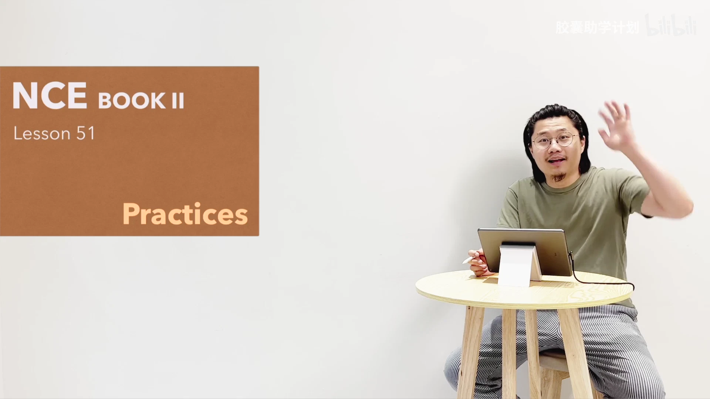

文字识别：NCE / BOOKII / Lesson 51 / Practices

### 画面 00:00:02

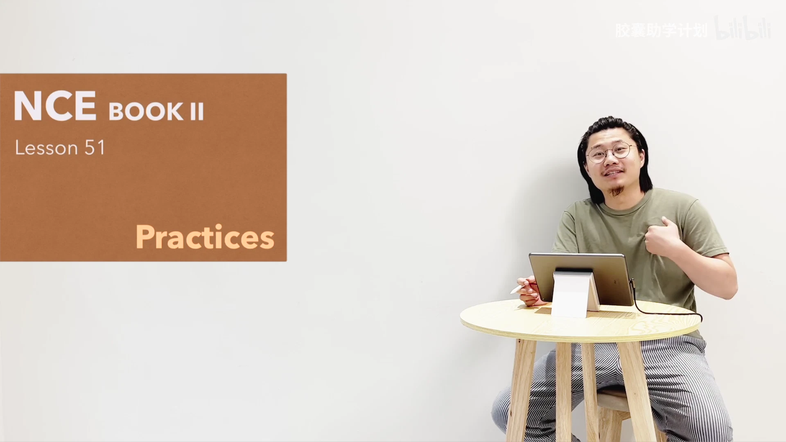

文字识别：NCE / BOOKII / Lesson 51 / Practices

### 画面 00:00:04

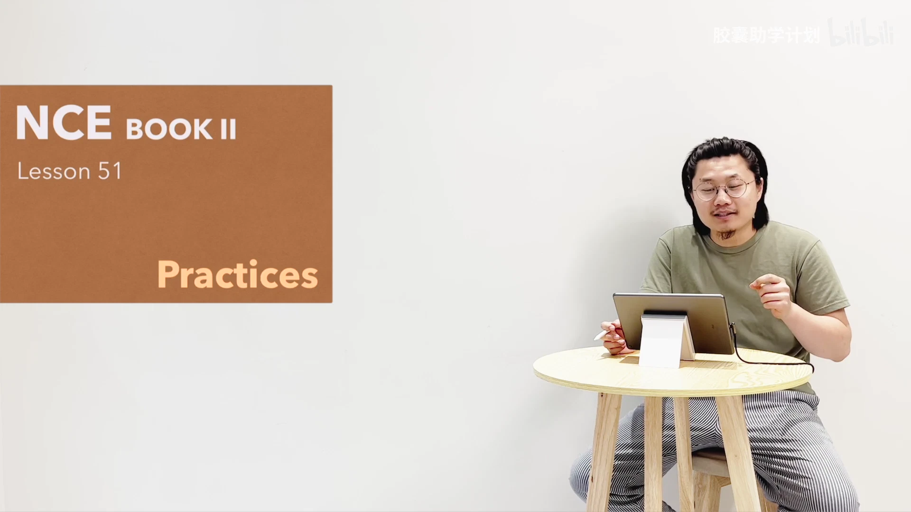

文字识别：NCE / BOOKII / Lesson 51 / Practices

### 画面 00:00:06

文字识别：NCE / BOOKII / Lesson 51 / Practices

### 画面 00:00:08

文字识别：进行如下练习唯一前提 / 文章跟读至熟读成诵 / 否则请勿开始

### 画面 00:00:14

文字识别：进行如下练习唯一前提 / 文章跟读至熟读成诵 / 否则请勿开始 / Ca

### 画面 00:00:17

文字识别：胶囊助学计划 bilbl

### 画面 00:00:21

### 画面 00:00:23

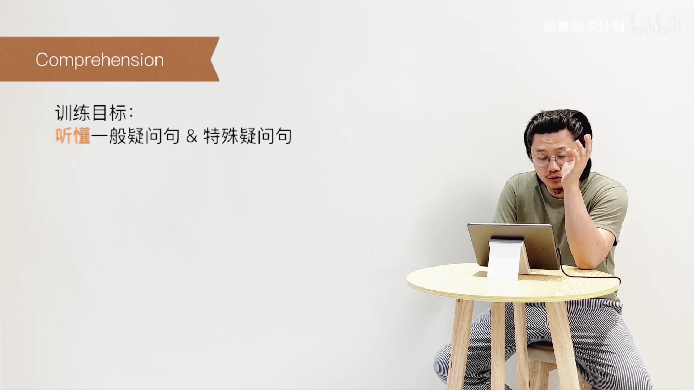

文字识别：Comprehension / 训练目标： / 听懂一般疑问句＆特殊疑问句

### 画面 00:00:26

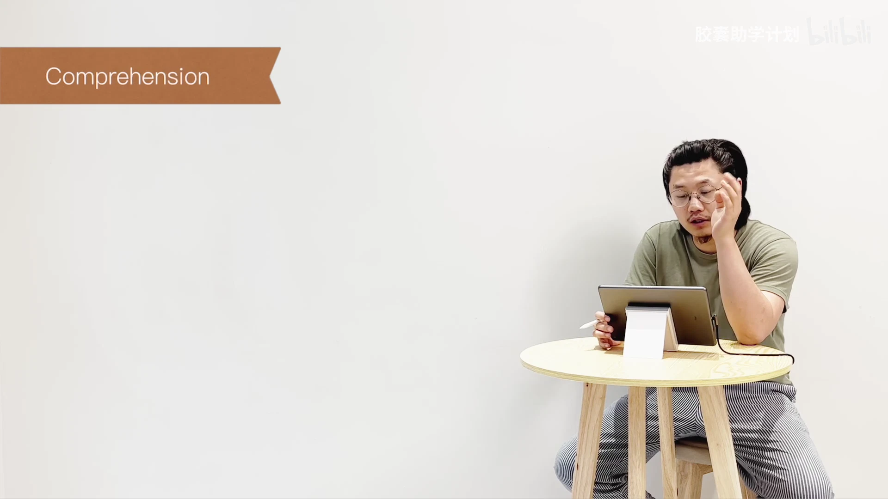

文字识别：Comprehension

## 00:00:30–00:01:00

呃，你可以去文章里找答案，也可以直接就由自己的记忆去回答我啊。来，第一个叫 What's your friend called? Hugh. Next one. What did he recently decide to? To go on a diet. Next one. When did he begin his diet? A week ago. Next one. What did he do first of all? He wrote out a long list of all the foods

### 画面 00:00:56

文字识别：Comprehension / What did he do first of all? / He wrote out a long list of all the foods that / were forbidden.

### 画面 00:00:58

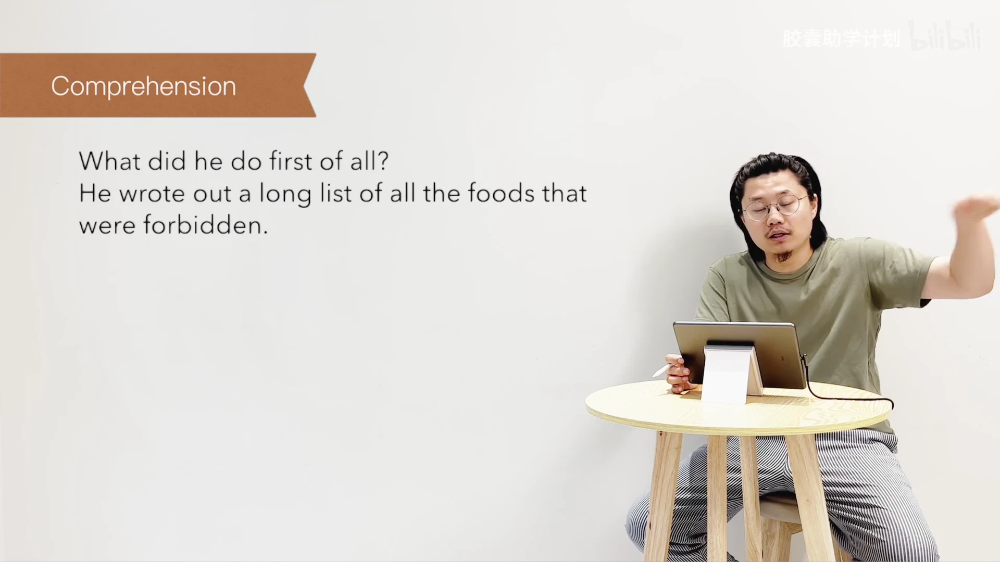

文字识别：Comprehension / What did he do first of all? / He wrote out a long list of all the foods that / were forbidden.

## 00:01:00–00:01:30

that were forbidden. Next one, which foods were on the list? Ah, this one, maybe I can't remember. Most of the things he loves. Ah, there are a lot more. Next one, say, what are the foods he loves? Ah, pay attention to this part. Butter, potatoes, rice, beer, milk, chocolate, and sweets. This one is hard to memorize. When did

### 画面 00:01:01

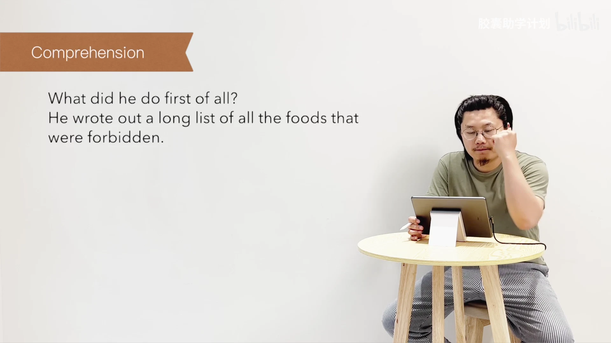

文字识别：Comprehension / What did he do first of all? / He wrote out a long list of all the foods that / were forbidden.

### 画面 00:01:03

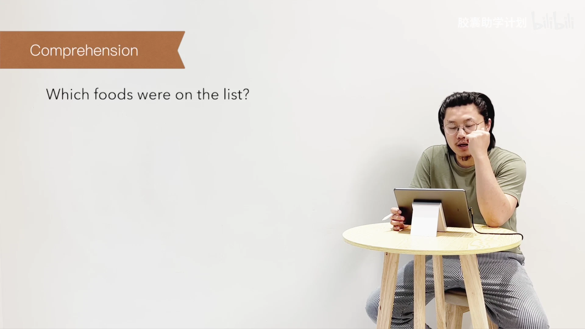

文字识别：Comprehension / Which foods were on the list?

### 画面 00:01:19

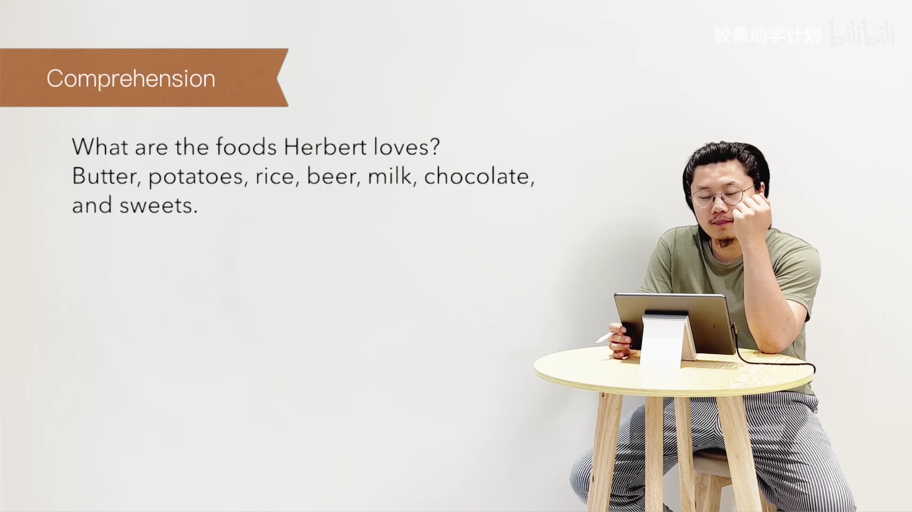

文字识别：Comprehension / What are the foods Herbert loves? / Butter, potatoes, rice, beer, milk, chocolate, / and sweets.

### 画面 00:01:27

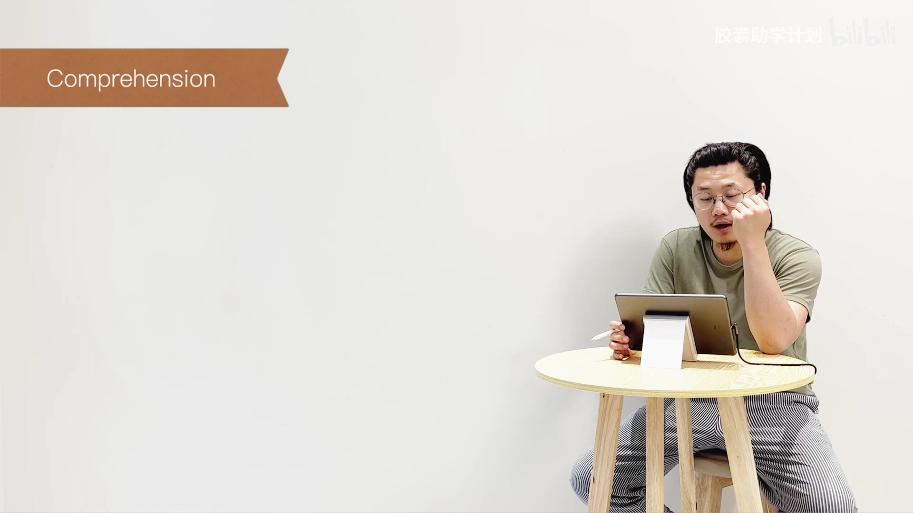

文字识别：Comprehension

## 00:01:30–00:02:00

you visit him? Yesterday. Next one. Were you surprised? No, I wasn't.说明以前可能讲过很多次了，是吧？He hadn't got any thinner, had he? Thinner,更瘦，是吧？No, he hadn't. Where did he lead you? Into his room. What did he do then? He hid a large parcel

### 画面 00:01:35

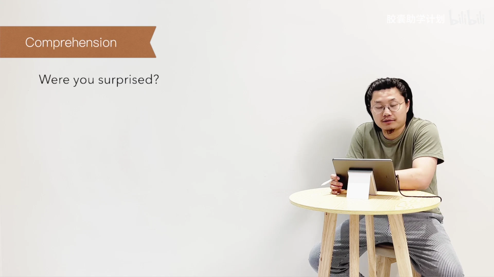

文字识别：Comprehension / Were you surprised?

### 画面 00:01:40

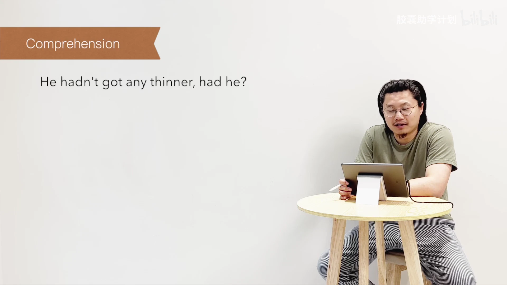

文字识别：Comprehension / He hadn't got any thinner, had he?

### 画面 00:01:57

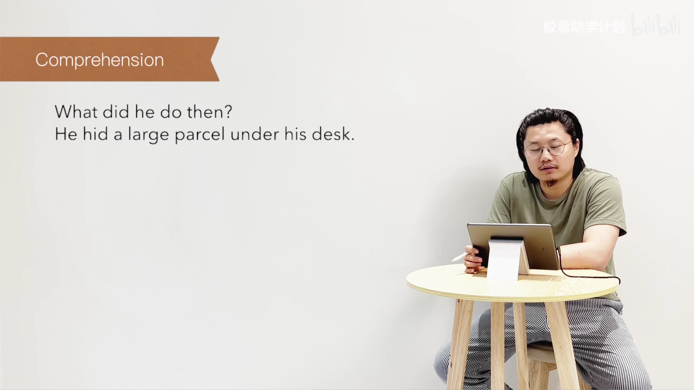

文字识别：Comprehension / What did he do then? / He hid a large parcel under his desk.

## 00:02:00–00:02:30

under his desk. Next one, how did he look? Embarrassed. What did you ask him? What he was doing? Asking questions.练咱们一般疑问句、特殊疑问句的能力，对吧？我们能问啊，发问的能力。老习惯，先看一个，叫My friend is called Hugh.啊，B旦是吧？B提前，然后What对Hugh提问呗？What is your friend called?啊，

### 画面 00:02:13

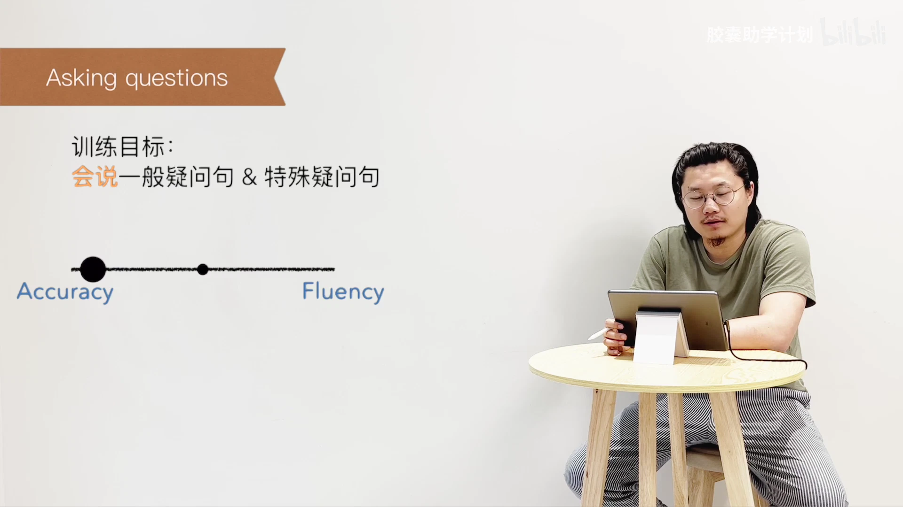

文字识别：Asking questions / 训练目标： / 会说一般疑问句＆特殊疑问句 / Accuracy / Fluency

### 画面 00:02:20

文字识别：Asking questions

### 画面 00:02:26

文字识别：Asking questions / T: Ask me if my friend is called Hugh. / S: Is your friend called Hugh? / T: What...?

## 00:02:30–00:03:00

第一题刚才说了，我们看第二题。注意这里的 P S 和 been 一配合，再加上文章 has，对吧？Has 提前。How long? How long has he been fat? 理论上来说，其实并不是对 always 提问啊。呃，但是这里加上 always 就会有感觉有点怪，叫 How long has he always been fat? 没有问题啊，也没有问题啊，就一说出来就没有问题了，也可以啊。所以加加整句就

### 画面 00:02:30

文字识别：Asking questions / 1. My friend is called Hugh.(What) / 2. He's always been fat.(How long)(Who)

## 00:03:00–00:03:30

可以了。然后互对主语提问不用变了，一般疑问句。He decided to grow a菜，一般过去时，did did提前，动词换原形，互对主语直接去掉啊，直不用变一般疑问句，外加整个一般疑问句。He began his diet a week ago. did did提前，when对a week ago提问，对吧？叫做When did he begin his diet? He wrote out a list. did提前，what对a list提问，when对整句话提问啊？答案就是When did he

### 画面 00:03:00

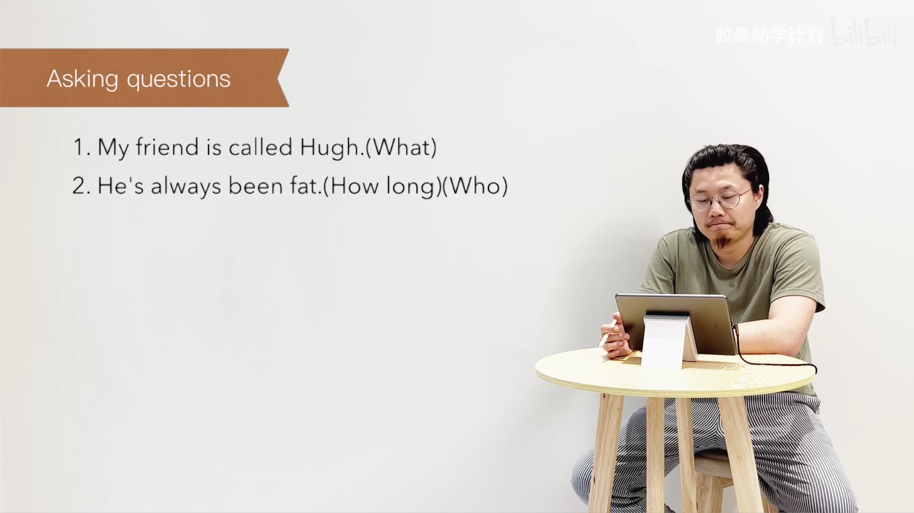

文字识别：Asking questions / 1. My friend is called Hugh.(What) / 2. He's always been fat.(How long)(Who)

### 画面 00:03:04

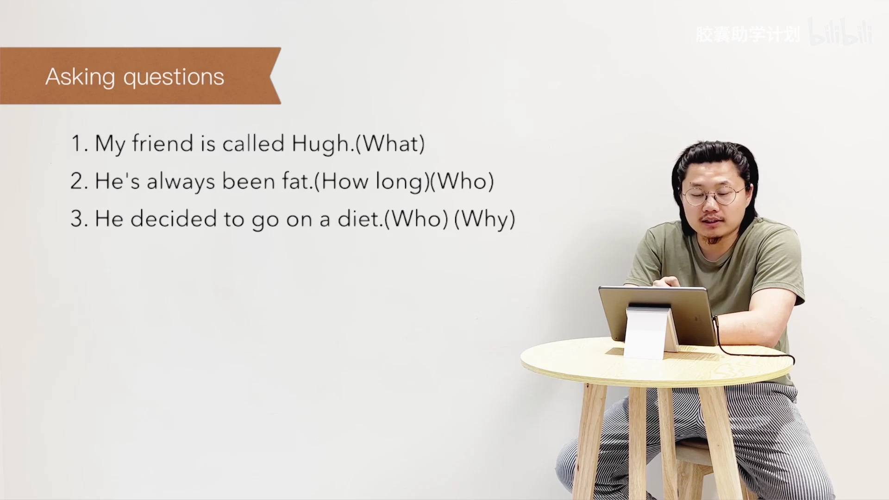

文字识别：Asking questions / 1. My friend is called Hugh.(What) / 2. He's always been fat.(How long)(Who) / 3. He decided to go on a diet.(Who) (Why)

### 画面 00:03:22

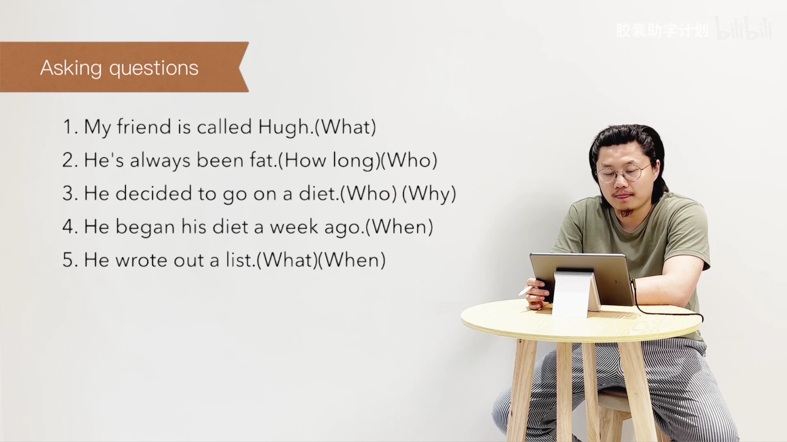

文字识别：Asking questions / 1. My friend is called Hugh.(What) / 2. He's always been fat.(How long)(Who) / 3. He decided to go on a diet.(Who) (Why) / 4. He began his diet a week ago.(When) / 5. He wrote out a list.(What)(When)

## 00:03:30–00:04:00

write out a list? It included all the foods he loves. 注意一个小点，这是定语从句。我们去变一般疑问句的时候，不看从句，只看主句。所以 included did 提前，What 对 all the foods he loves，其实就很简单了。 What did it include? 第七个，I paid him a visit yesterday. Yesterday 和 paid 告诉你 did 提前，动词换原形，went 对 yesterday 提问，中规中矩，没什么太多

### 画面 00:03:34

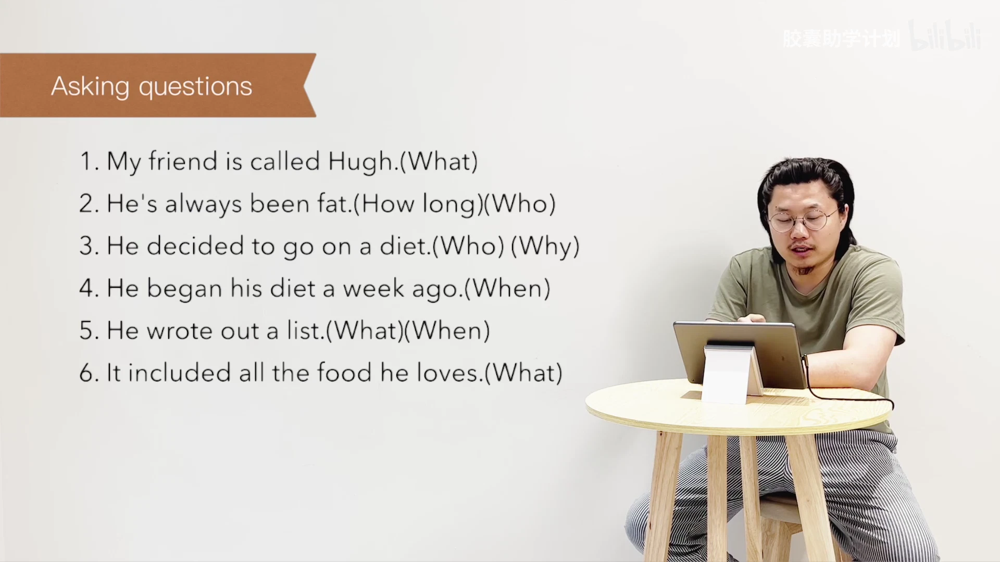

文字识别：Asking questions / 1. My friend is called Hugh.(What) / 2. He's always been fat.(How long)(Who) / 3. He decided to go on a diet.(Who) (Why) / 4. He began his diet a week ago.(When) / 5. He wrote out a list.(What)(When) / 6. lt included all the food he loves.(What)

### 画面 00:03:50

文字识别：Asking questions

### 画面 00:03:53

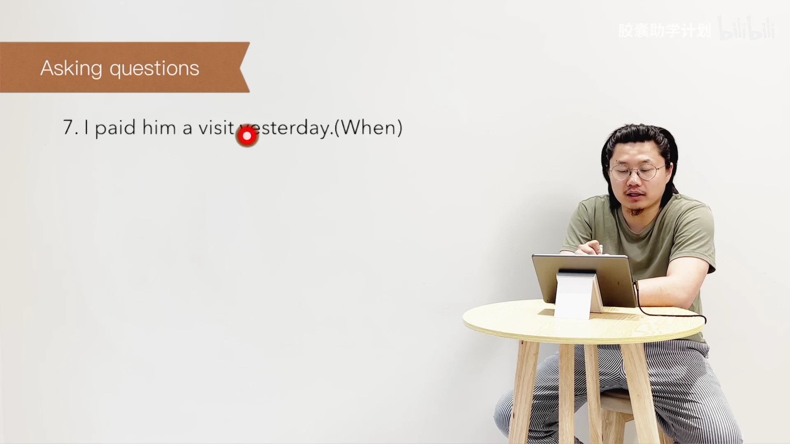

文字识别：Asking questions / 7.I paid him a visit / t。sterday.(When)

## 00:04:00–00:04:30

说的。I rang the bell. Did提前，What did I do? 标准答案 What did you do? He was still. I was as fat as ever. Was提前，Who对Hugh提问，对吧？He led me into his room. 一般过去式啊，一般过去时啊，是这个时态。Did提前，Where对into his room提问。He hid a large parcel under his desk. 你看，hid Did提前，对不对？

### 画面 00:04:04

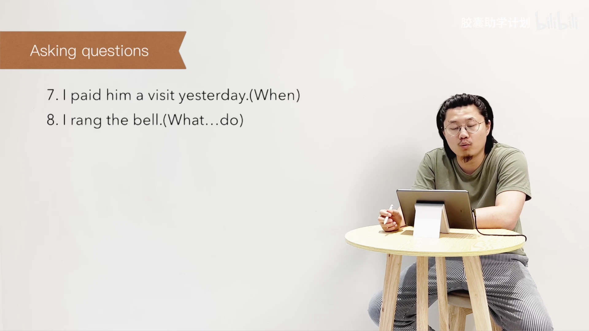

文字识别：Asking questions / 7.I paid him a visit yesterday.(When) / 8.I rang the bell.(What...do)

### 画面 00:04:10

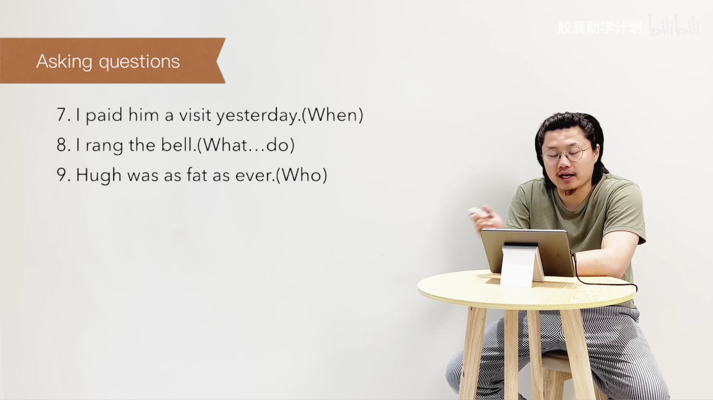

文字识别：Asking questions / 7.I paid him a visit yesterday.(When) / 8.I rang the bell.(What...do) / 9.Hugh v /  was as fat as ever.(Who)

### 画面 00:04:23

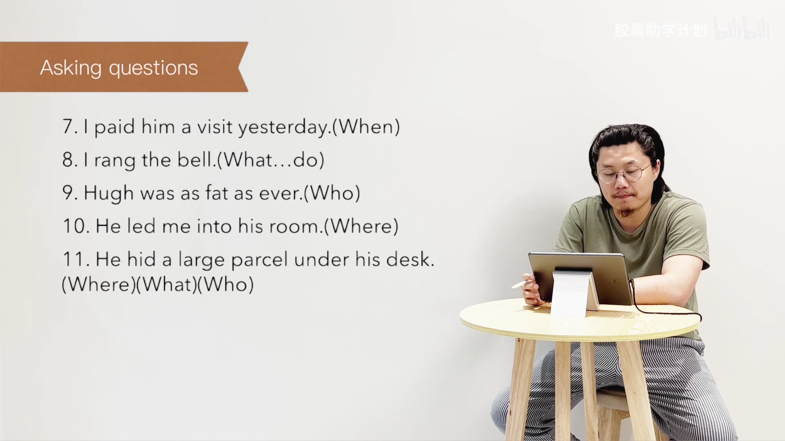

文字识别：Asking questions / 7.I paid him a visit yesterday.(When) / 8.I rang the bell.(What...do) / 9. Hugh was as fat as ever.(Who) / 10. He led me into his room.(Where) / 11. He hid a large parcel under his desk. / (Where)(What)(Who)

## 00:04:30–00:05:00

Where对under his desk提问, what对a large parcel提问, who对he提问,区别是对主语提问的时候,任何特殊疑问词不变一般疑问句。新概念一册三十一课咱们就学过啊,千万不要忘. He was very embarrassed. or对主语提问,外加整个一般疑问句. Why was he very embarrassed? Okay, tell the story. 文章读到很熟,可以有一点点错误,各位注意,

### 画面 00:04:46

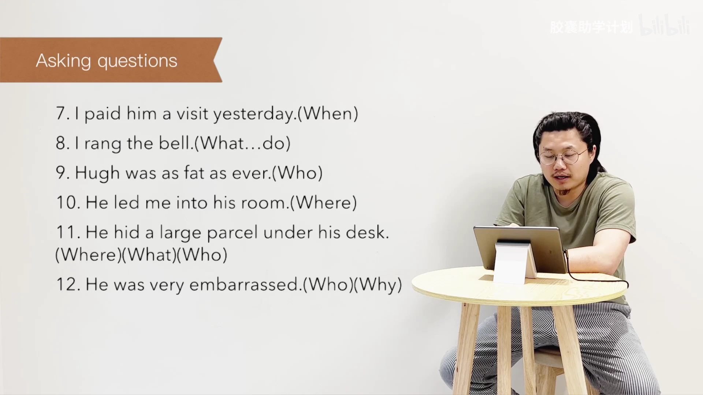

文字识别：Asking questions / 7.I paid him a visit yesterday.(When) / 8.I rang the bell.(What...do) / 9. Hugh was as fat as ever.(Who) / 10. He led me into his room.(Where) / 11. He hid a large parcel under his desk. / (Where)(What)(Who) / 12. He was very embarrassed.(Who)(Why)

### 画面 00:04:53

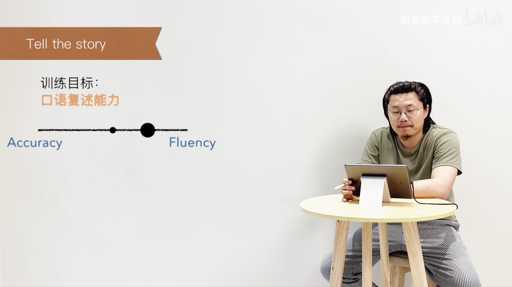

文字识别：Tell the story / 训练目标： / □语复述能力 / Accuracy / Fluency

## 00:05:00–00:05:30

不能不流利啊！练的就是我们口语，看着他哗哗哗把文章复述一遍，对吧？不要担心细枝末节，把整个故事讲清楚即可。好，summary writing呢，写作复述能力在这里，各位直接对一下答案就可以了。不懂的留言问我，好吧？好，这都是标准答案了啊，没什么可说的。那topic for discussion呢？我们还是老习惯，就看一下啊。Have you ever tried to give us something you like?

### 画面 00:05:02

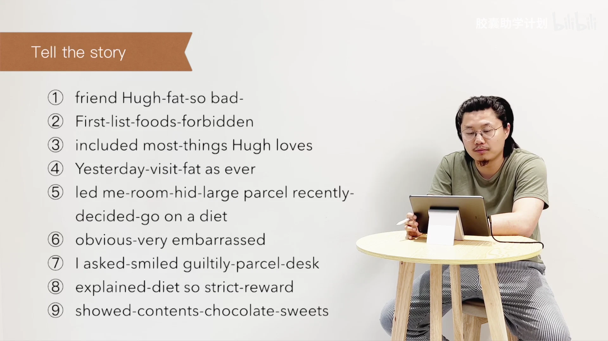

文字识别：Tell the story / friend Hugh-fat-so bad- / First-list-foods-forbidden / included most-things Hugh loves / Yesterday-visit-fat as ever /  led me-room-hid-large parcel recently- / 5 / decided-go on a diet / ⑥ obvious-very embarrassed /  I asked-smiled guiltily-parcel-desk / explained-diet so strict-reward / showed-contents-chocolate-sweets / 9

### 画面 00:05:11

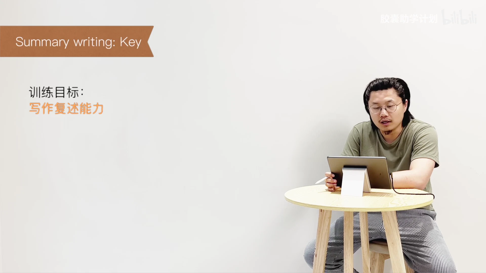

文字识别：Summary writing: Key / 训练目标： / 写作复述能力

### 画面 00:05:13

文字识别：Summary writing: Key / Hugh is so fat that he has gone on a diet. / He has forbidden himself all the foods he / likes but he has not lost weight. When the / writer visited him yesterday, he hid a large / parcel under his desk. The parcel contained / chocolates and sweets. Hugh said that he / had to reward himself occasionally because / his diet was so strict.

### 画面 00:05:20

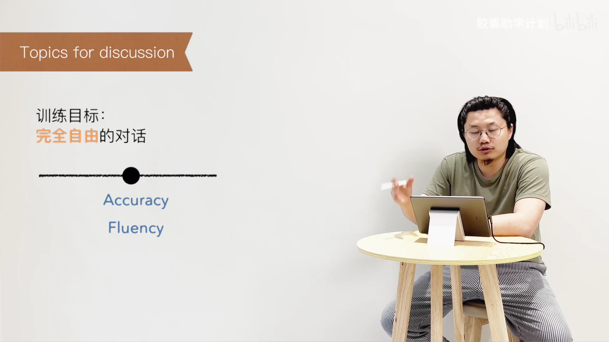

文字识别：Topics for discussion / 训练目标： / 完全自由的对话 / Accuracy / Fluency

### 画面 00:05:24

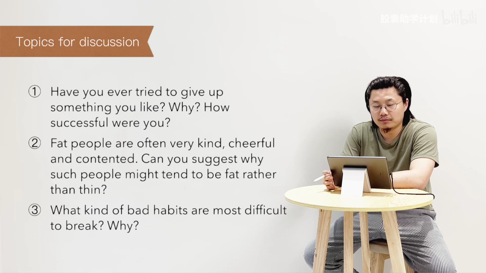

文字识别：Topics for discussion / Have you ever tried to give up / something you like? Why? How / successful were you? / Fat people are often very kind, cheerful / and contented. Can you suggest why / such people might tend to be fat rather / than thin? / What kind of bad habits are most difficult / to break? Why?

## 00:05:30–00:06:00

Why? How successful you are? Ah, you have tried to give up some things you like. Why? How successful you are? Ah, you have tried to give up some things you like. Why? How successful you are? Ah, you have tried to give up some things you like. Why? How successful you are? Ah, you have tried to give up some things you like. Why? How successful you are? Ah, you have tried to give up some things you like. Why? How successful you are? Ah, you have tried to give up some things you like. Why? How successful you are? Ah, you have tried to give up some things you like. Why? How successful you are? Ah, you have tried to give up some things you like.

### 画面 00:05:54

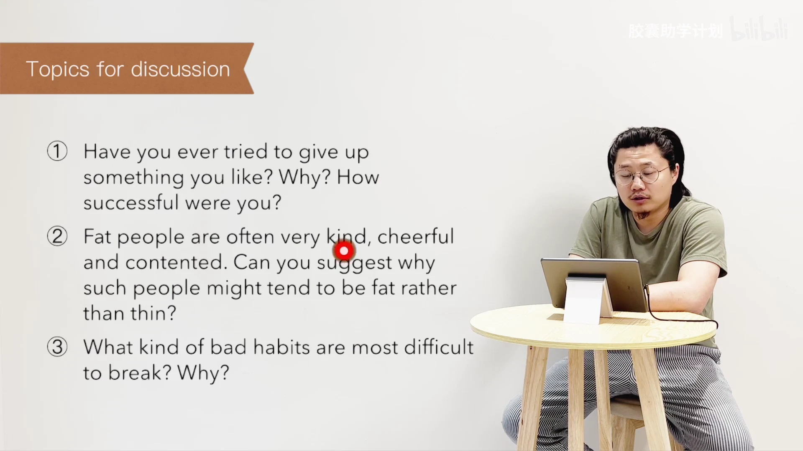

文字识别：Topics for discussion / Have you ever tried to give up / something you like? Why? How / successful were you? / Fat people are often very kind, cheerful / and contented. Can you suggest why / such people might tend to be fat rather / than thin? / What kind of bad habits are most difficult / to break? Why?

### 画面 00:05:57

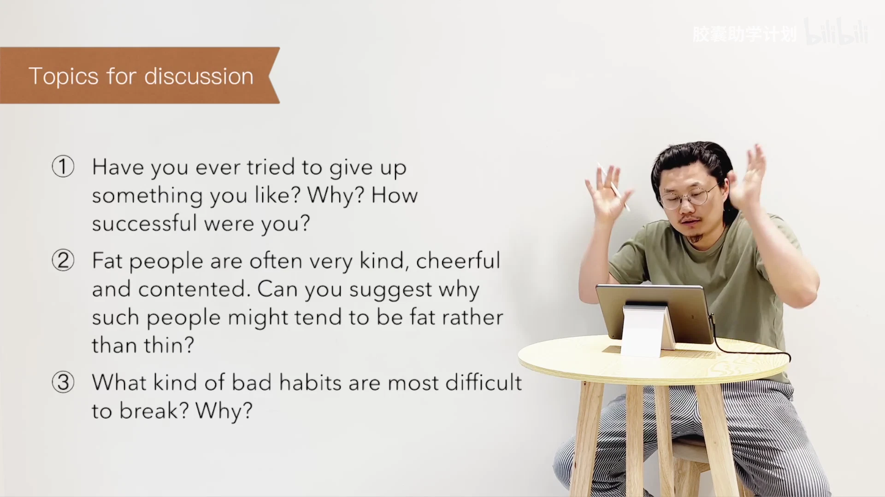

文字识别：Topics for discussion / Have you ever tried to give up / something you like? Why? How / successful were you? / Fat people are often very kind, cheerful / and contented. Can you suggest why / such people might tend to be fat rather / than thin? / What kind of bad habits are most difficult / to break? Why?

### 画面 00:05:59

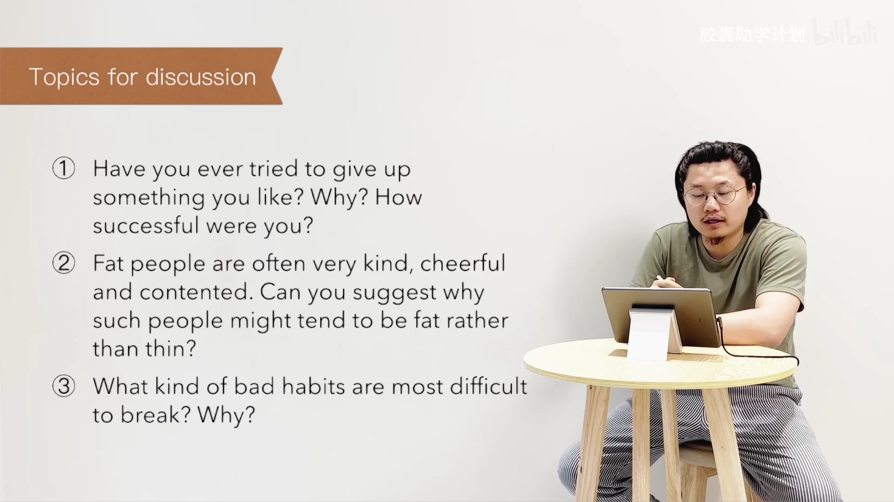

文字识别：Topics for discussion / Have you ever tried to give up / something you like? Why? How / successful were you? / Fat people are often very kind, cheerful / and contented. Can you suggest why / such people might tend to be fat rather / than thin? / What kind of bad habits are most difficult / to break? Why?

## 00:06:00–00:06:30

说一下为什么这种人一般偏胖而不是瘦吗？是吧？啊，我就不太同意，是吧？我就不太同意啊！但是你可以自己去从这个角度去想一想，说一说，对吧？说What kind of bad habits are most difficult to break? Why？说为什么大多数的这个旧习惯啊、老习惯是吧？这个很难去被打破，或者很难去被改变？为什么啊？OK啊，这脑神经学了是吧？一听啊，好，呃，

### 画面 00:06:27

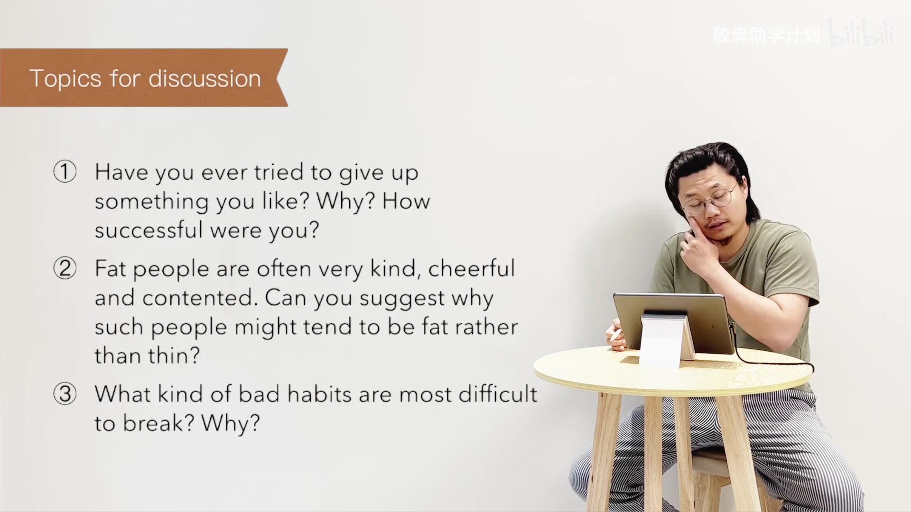

文字识别：Topics for discussion / Have you ever tried to give up / something you like? Why? How / successful were you? / Fat people are often very kind, cheerful / and contented. Can you suggest why / such people might tend to be fat rather / than thin? / What kind of bad habits are most difficult / to break? Why?

### 画面 00:06:29

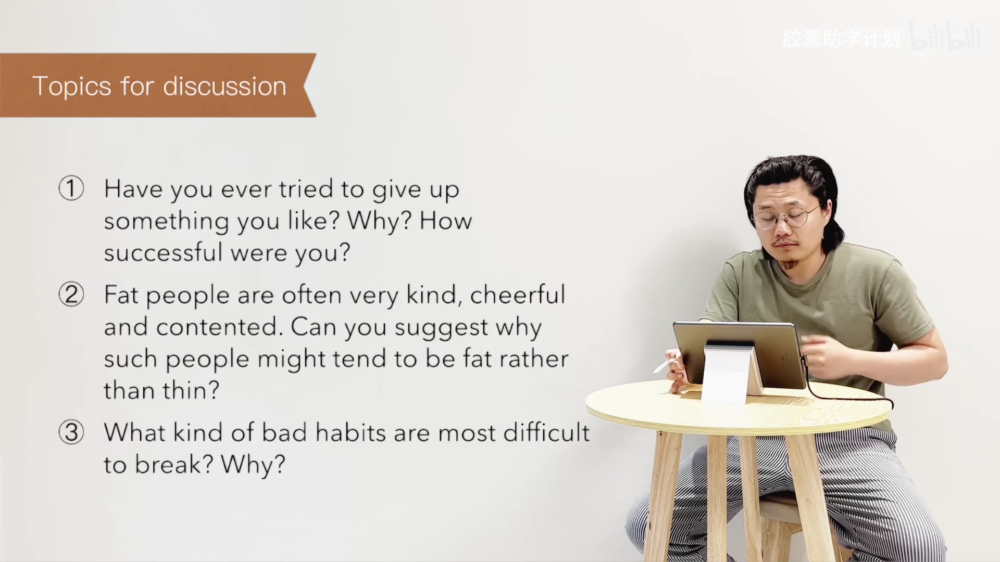

文字识别：Topics for discussion / Have you ever tried to give up / something you like? Why? How / successful were you? / Fat people are often very kind, cheerful / and contented. Can you suggest why / such people might tend to be fat rather / than thin? / What kind of bad habits are most difficult / to break? Why?

## 00:06:30–00:07:00

不多说了。那家庭作业呢？ Ask me if。这要写作， tell the story，置顶留言，间隔重复，这都是老习惯的。OK，那以上就是本期视频的全部内容了。如果各位喜欢我们的课程呢，欢迎各位关注、订阅、一键三连，分享给那些需要的朋友，来帮助我们快速成长。See you next time.

### 画面 00:06:31

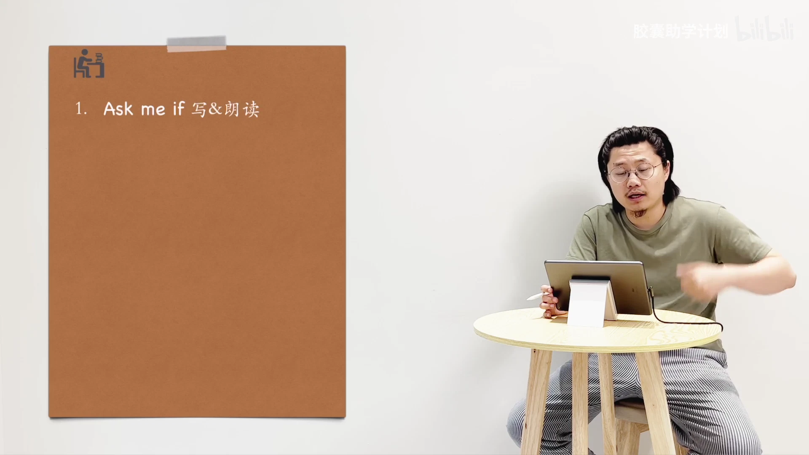

文字识别：1.Ask me if写&朗读

### 画面 00:06:33

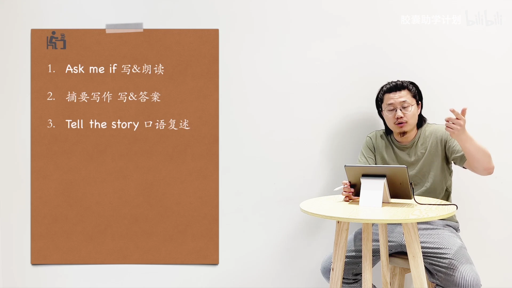

文字识别：1.Ask me if写&朗读 / 摘要写作写&答案 / 3.Tell the story 口语复述

### 画面 00:06:35

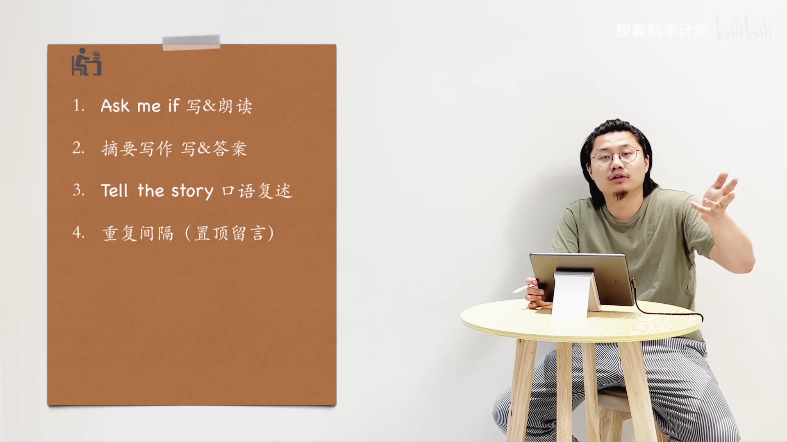

文字识别：1.Ask me if写&朗读 / 摘要写作写&答案 / 3.Tell the story 口语复述 / 4.重复间隔（置顶留言）

### 画面 00:06:38

文字识别：不

### 画面 00:06:41

文字识别：不

### 画面 00:06:43

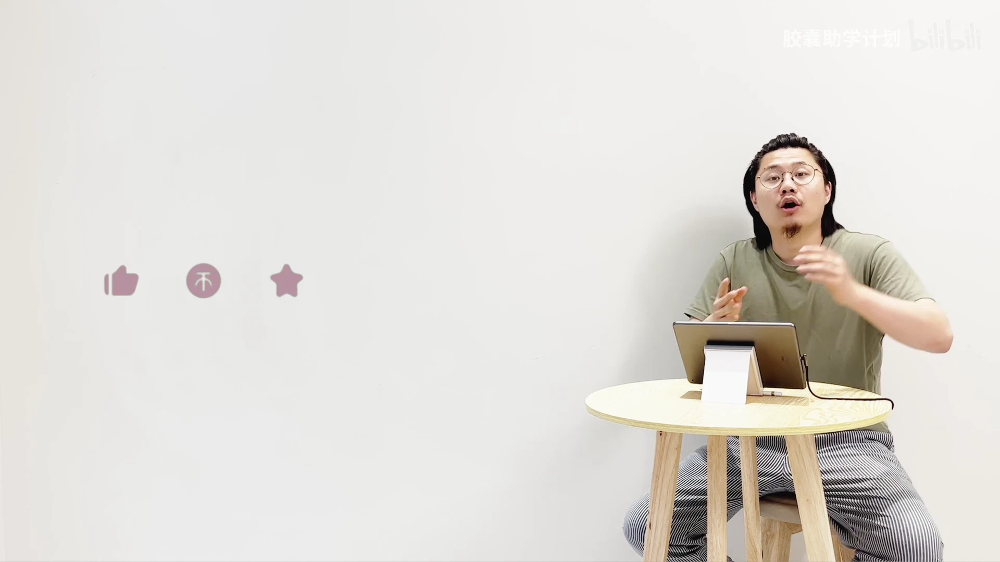

### 画面 00:06:46

文字识别：不 / ￥

### 画面 00:06:48

### 画面 00:06:51

### 画面 00:06:53

文字识别：CAPSULEACADEMY / 胶囊助学计划 / 『 / 小红书 / Lecturer / □ / Leo / OE

### 画面 00:06:56

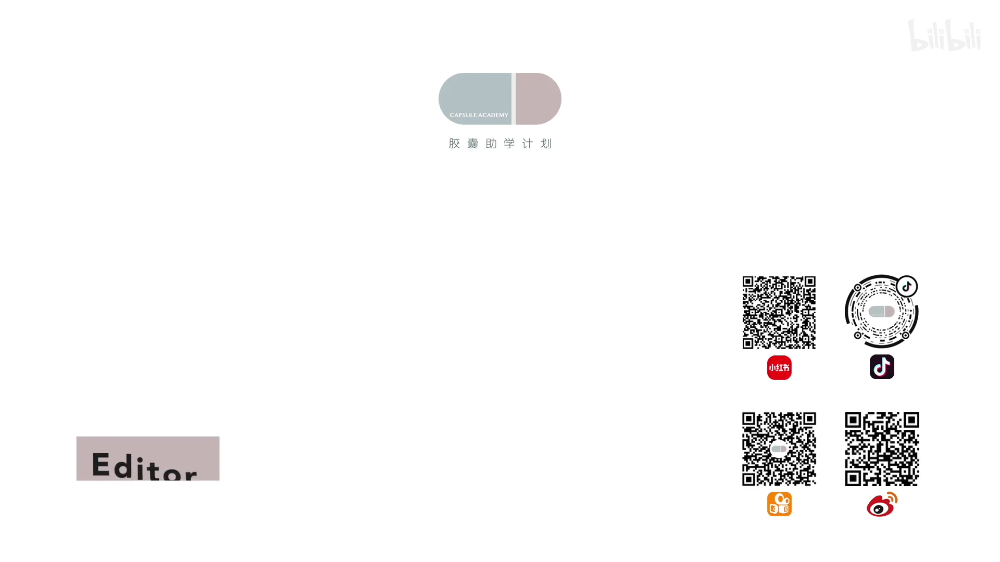

文字识别：CAPSULEACADEMY / 胶囊助学计划 / 小红书 / □ / 口 / Editor / OE

### 画面 00:06:59

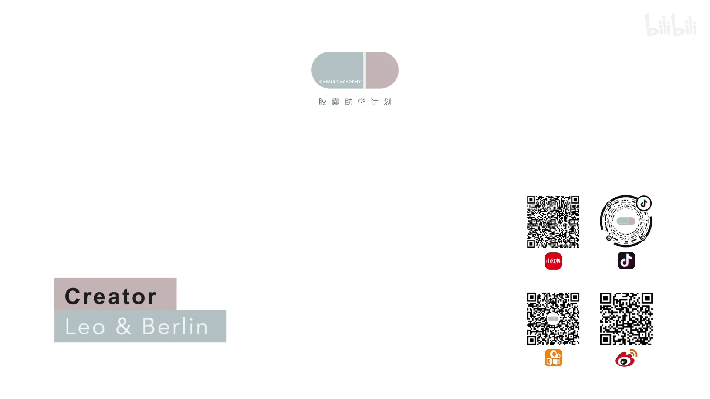

文字识别：CAPSULEACADEMY / 胶囊助学计划 / 小红书 / Creator / Leo & Berlin

## 00:07:00–00:07:03

### 画面 00:07:01

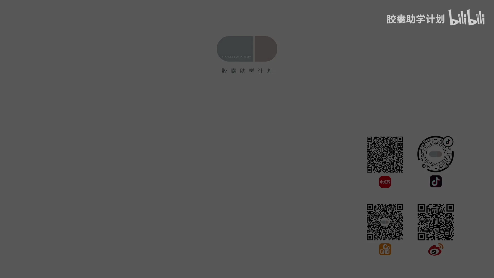

文字识别：bilibili / 胶囊助学计划 / 胶囊助学计划 / 小红书 / OE

### 画面 00:07:03

文字识别：bilibili / 胶囊助学计划

