# 052 单词

快速机器解析：语音为单模型转写，未进行独立交叉校对或人工复核；画面每秒采样并按变化选帧，短时文字和标记可能遗漏。截图时间约有 1 秒误差。图片有损压缩；遇到疑点请按时间查看 Google Drive 原视频。

## 00:00:00–00:00:30

Hello everyone, welcome to Capsule Academy. This is Leo. Today we are going to learn new concept English Book Two Lesson Fifty Two Words. 那老习惯进入正式课程之前，咱们先看几个小的问题啊。首先第一个，如何表达某个物体的或者某个东西的每一寸啊？比如说每一寸土地这样的表达，我们如何去说？接下来呢，如何去表达实际上？OK，那带着这两个问题，Hope you gonna enjoy it.

### 画面 00:00:00

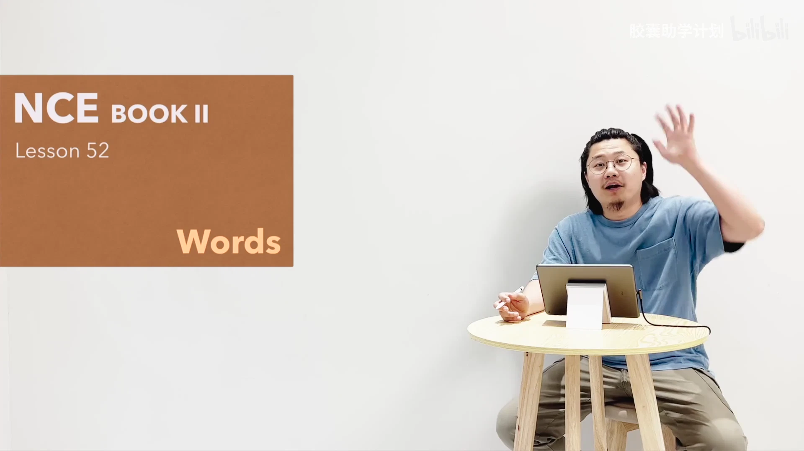

文字识别：NCE / BOOKII / Lesson 52 / Words

### 画面 00:00:03

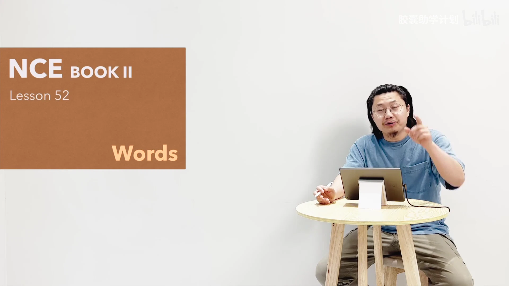

文字识别：NCE / BOOK"I / Lesson 52 / Words

### 画面 00:00:05

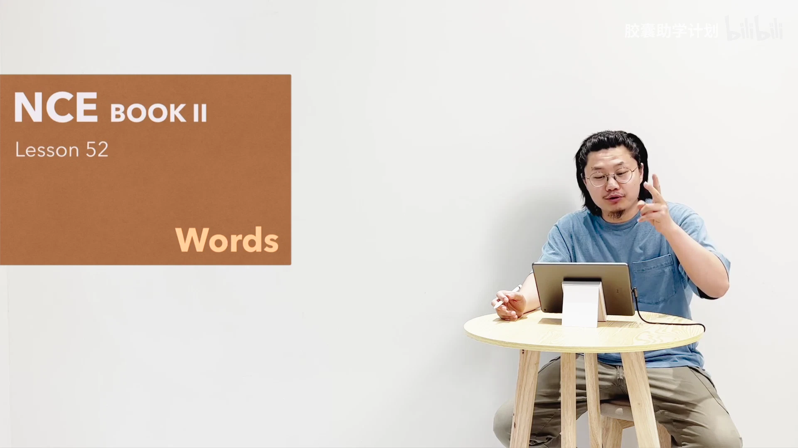

文字识别：NCE / BOOKII / Lesson 52 / Words

### 画面 00:00:09

### 画面 00:00:11

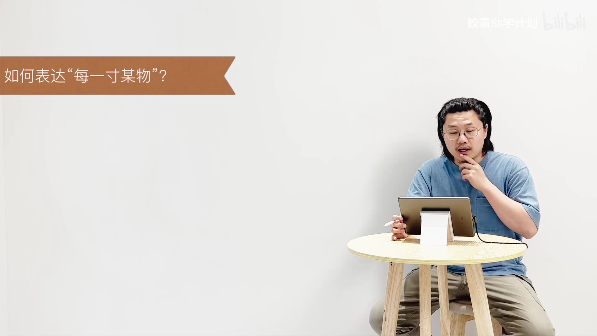

文字识别：如何表达“每一寸某物”？

### 画面 00:00:13

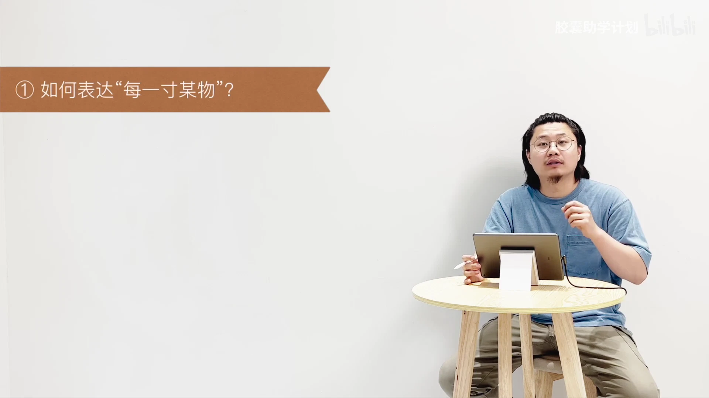

文字识别：① 如何表达“每一寸某物”？

### 画面 00:00:21

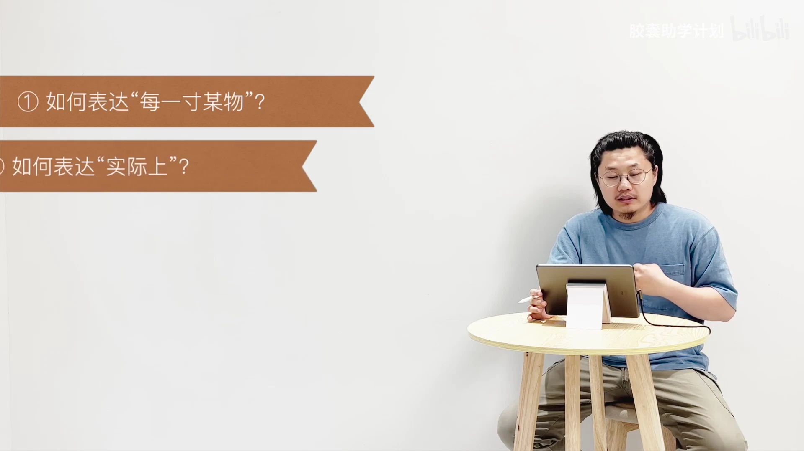

文字识别：①如何表达“每一寸某物”？ / 如何表达“实际上”?

### 画面 00:00:23

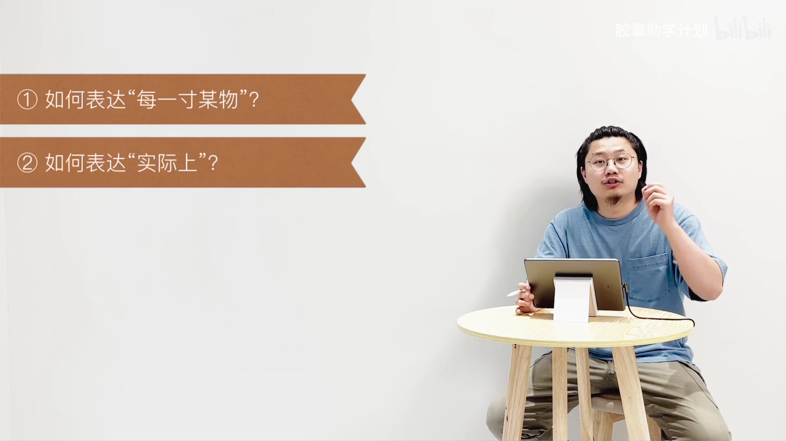

文字识别：①如何表达“每一寸某物”？ / 如何表达“实际上”?

### 画面 00:00:28

文字识别：胶囊助学计划bill

## 00:00:30–00:01:00

好，我们先看第一个小的单词啊，先跟我读一下，叫做 temporarily 啊 temporarily 啊，这个地方后面实际上还应该再加一个 ly 啊，因为它是一个副词啊， temporary 实际上是一个形容词。好，我们把它连起来读，叫做 temporarily 啊 temporarily， OK， temporarily 它自己本身是一个副词，这个副词在实际生活当中还挺常见的，比如说

### 画面 00:00:31

文字识别：胶囊助学计划 / 胶囊助学计划

### 画面 00:00:33

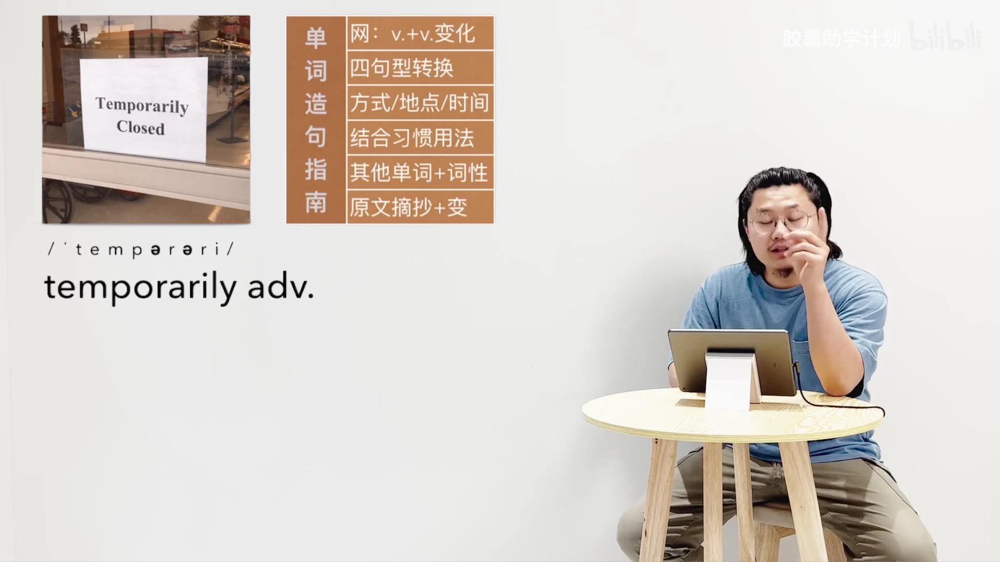

文字识别：单词造句指南 / 网：v.+v.变化 / 四句型转换 / Temporarily / 方式/地点/时间 / Closed / 结合习惯用法 / 其他单词+词性 / 原文摘抄+变 / /'temparari / / temporarily adv.

### 画面 00:00:35

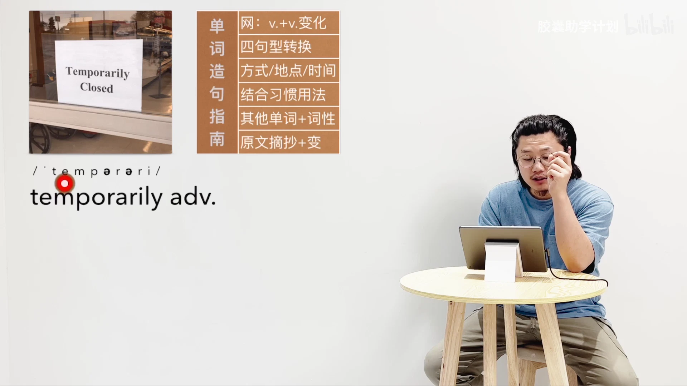

文字识别：单词造句指南 / 网：v.+v.变化 / 四句型转换 / Temporarily / 方式/地点/时间 / Closed / 结合习惯用法 / 其他单词+词性 / 原文摘抄+变 / 'temparari/ / temporarily adv.

### 画面 00:00:40

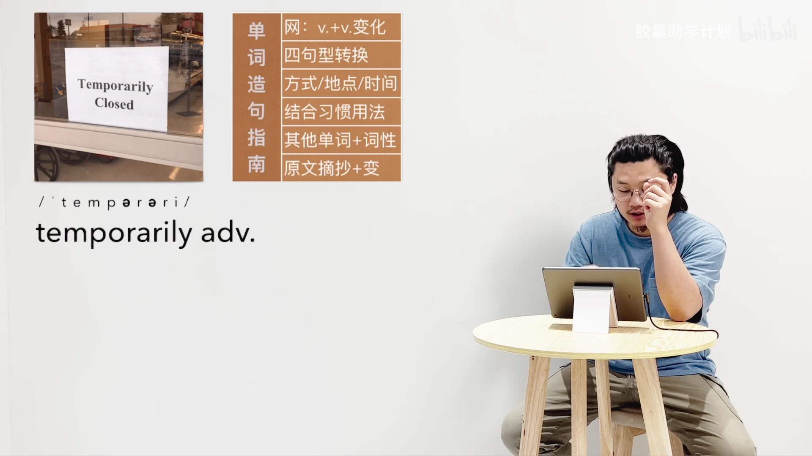

文字识别：单词造句指南 / 网：v.+v.变化 / 四句型转换 / Temporarily / 方式/地点/时间 / Closed / 结合习惯用法 / 其他单词+词性 / 原文摘抄+变 / /'temparari/ / temporarily adv.

### 画面 00:00:45

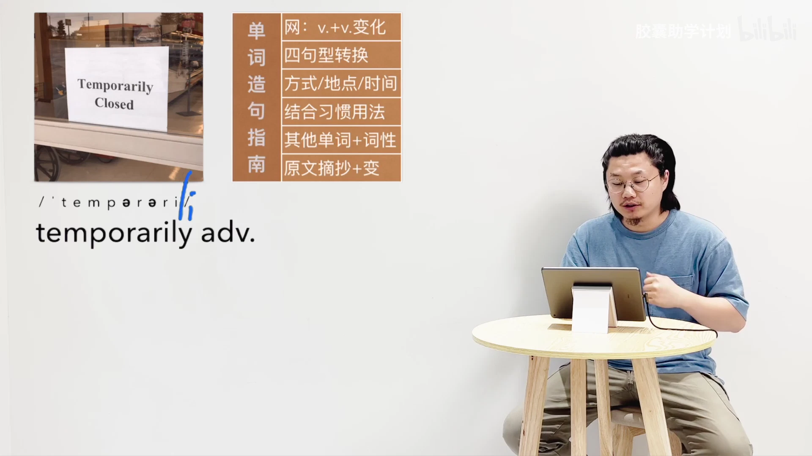

文字识别：单词造句指南 / 网：v.+v.变化 / 四句型转换 / Temporarily / 方式/地点/时间 / Closed / 结合习惯用法 / 其他单词+词性 / 原文摘抄+变 / /'temparar / temporarily adv.

### 画面 00:00:50

文字识别：单词造句指南 / 网：v.+v.变化 / 四句型转换 / Temporarily / 方式/地点/时间 / Closed / 结合习惯用法 / 其他单词+词性 / 原文摘抄+变 / /'temparar / temporarily adv.

### 画面 00:00:55

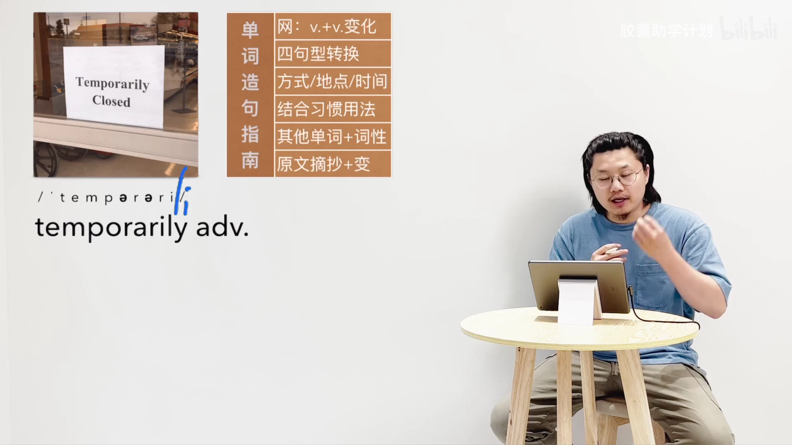

文字识别：单词造句指南 / 网：v.+v.变化 / 四句型转换 / Temporarily / 方式/地点/时间 / Closed / 结合习惯用法 / 其他单词+词性 / 原文摘抄+变 / /'temｐarａr / temporarily adv.

## 00:01:00–00:01:30

啊，我在留学期间经常会看到一些门店上面突然间就来这么一个东西，叫做 temporarily closed。如果只说 close，那就是我现在关店了。那 temporarily closed 就是我现在暂时性的关店了。比如说，他可能还会在后面写上，比如说叫做 back 啊，然后 in fifteen minutes 啊，就是十五分钟之后我回来，或者 back in half an hour，对吧？啊， back in thirty minutes。 Okay，所以这个单词还是挺常

### 画面 00:01:00

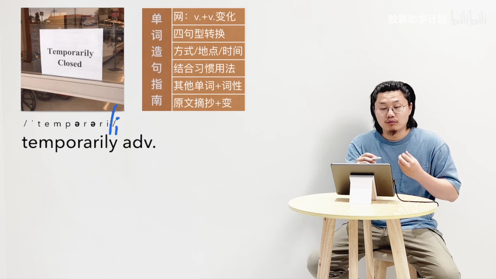

文字识别：单词造句指南 / 网：v.+v.变化 / 四句型转换 / Temporarily / 方式/地点/时间 / Closed / 结合习惯用法 / 其他单词+词性 / 原文摘抄+变 / /'temｐarar / temporarily adv.

### 画面 00:01:06

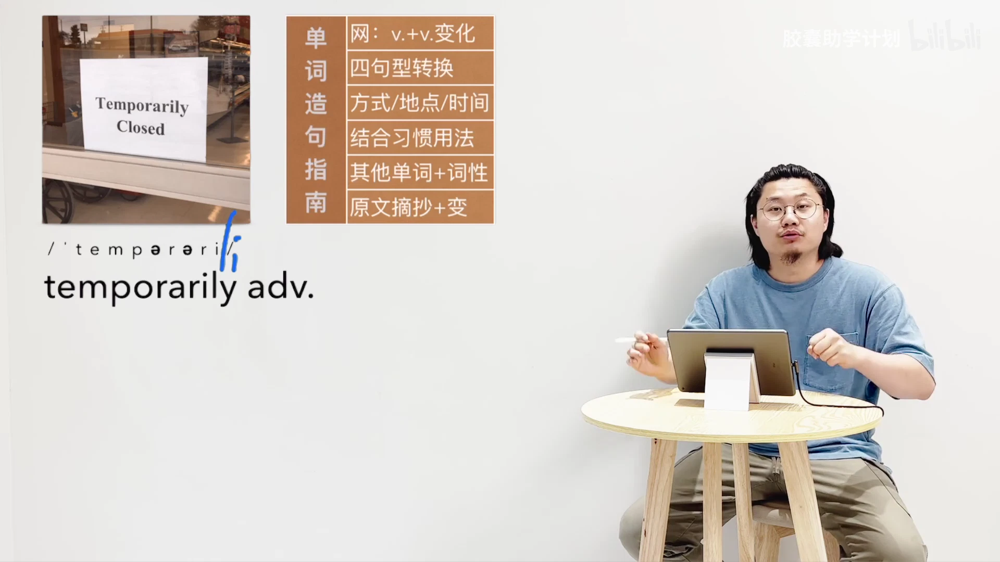

文字识别：单词造句指南 / 网：v.+v.变化 / 四句型转换 / Temporarily / 方式/地点/时间 / Closed / 结合习惯用法 / 其他单词+词性 / 原文摘抄+变 / /'temｐarar / temporarily adv.

### 画面 00:01:08

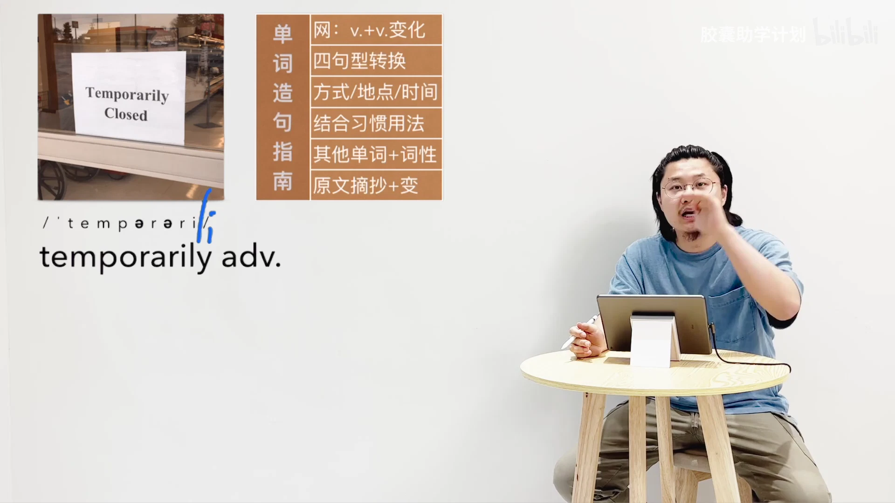

文字识别：单词造句指南 / 网：v.+v.变化 / 四句型转换 / Temporarily / 方式/地点/时间 / Closed / 结合习惯用法 / 其他单词+词性 / 原文摘抄+变 / /'temparar / temporarily adv.

### 画面 00:01:11

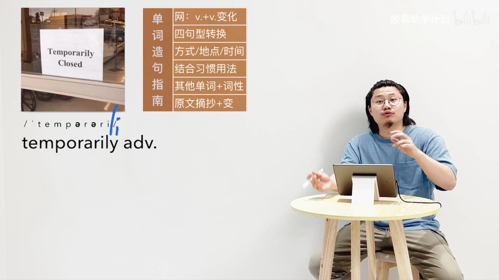

文字识别：单词造句指南 / 网：v.+v.变化 / 四句型转换 / Temporarily / 方式/地点/时间 / Closed / 结合习惯用法 / 其他单词+词性 / 原文摘抄+变 / /'temｐarａr / temporarily adv.

### 画面 00:01:19

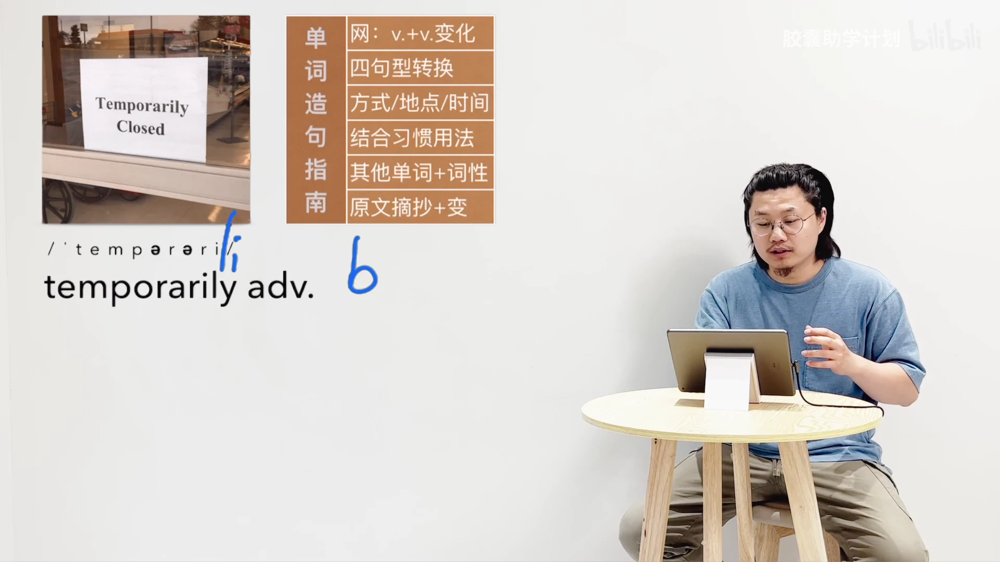

文字识别：单词造句指南 / 网：v.+v.变化 / 四句型转换 / Temporarily / 方式/地点/时间 / Closed / 结合习惯用法 / 其他单词+词性 / 原文摘抄+变 / /'temｐarar / temporarily adv. / b

### 画面 00:01:21

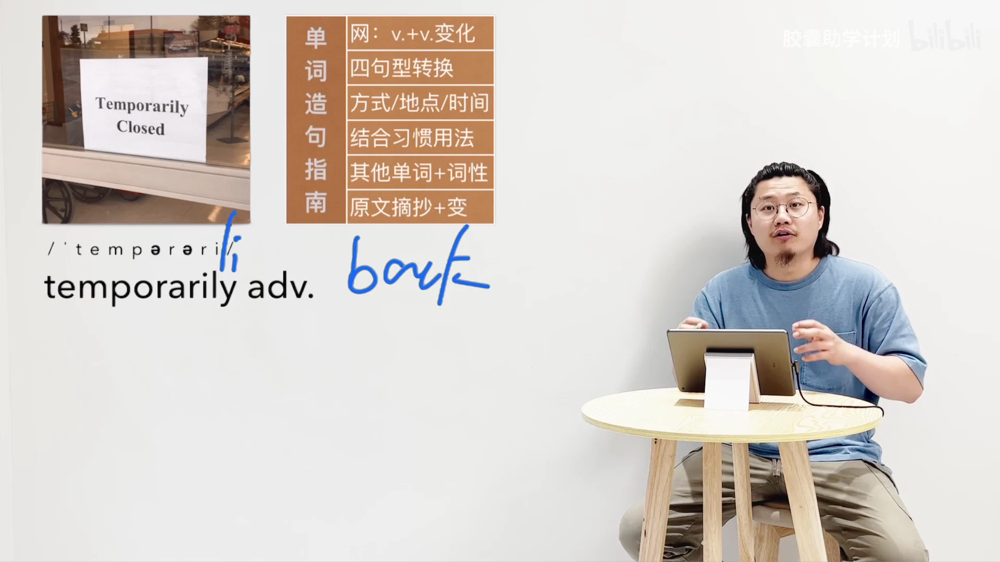

文字识别：单词造句指南 / 网：v.+v.变化 / 四句型转换 / Temporarily / 方式/地点/时间 / Closed / 结合习惯用法 / 其他单词+词性 / 原文摘抄+变 / bof / /'temｐarａr / temporarily adv.

### 画面 00:01:25

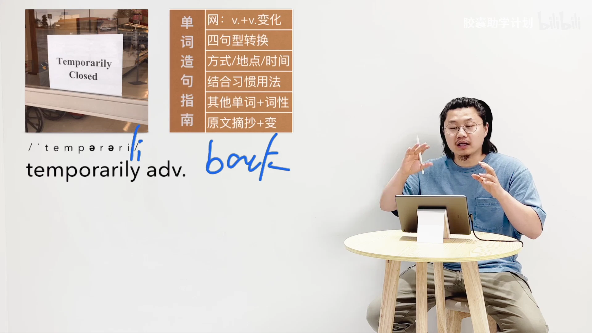

文字识别：单词造句指南 / 网：v.+v.变化 / 四句型转换 / Temporarily / 方式/地点/时间 / Closed / 结合习惯用法 / 其他单词+词性 / 原文摘抄+变 / baf / /'temｐarar / temporarily adv.

## 00:01:30–00:02:00

common. Ah, let me read it again. It's called temporarily. Ah, I forgot to omit this l. Ah, I didn't write it. Okay, let me read it again. Temporarily. Okay, it's temporary. Okay, let's make a few sentences. First, let's make a sentence. When we use a word like adverb, it's not easy to make a sentence, right? Because you don't give me the subject and the object. I make a sentence, and you only give me an adverb. I can't make a sentence. How can I make a sentence? We need to combine the sentence with the text. For example, the text gives us a sentence: I have temporarily

### 画面 00:01:30

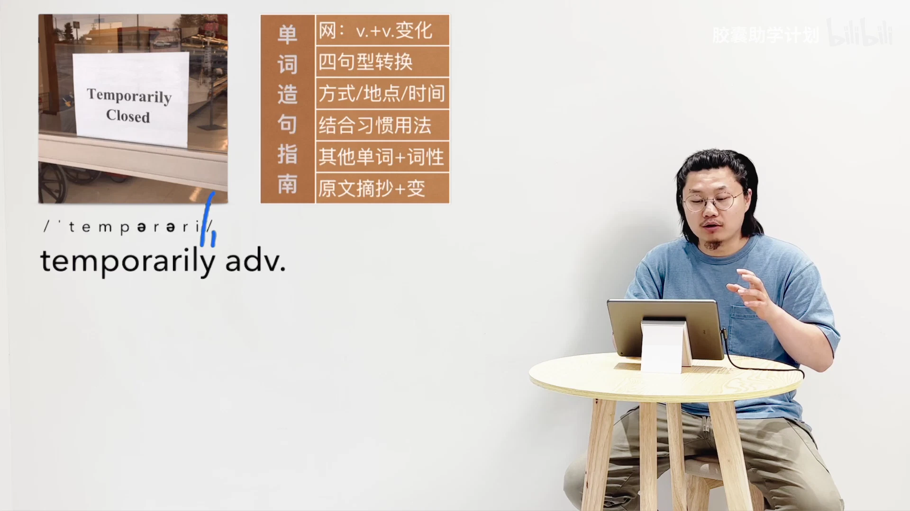

文字识别：单词造句指南 / 网：v.+v.变化 / 四句型转换 / Temporarily / 方式/地点/时间 / Closed / 结合习惯用法 / 其他单词+词性 / 原文摘抄+变 / /'temparar / temporarily adv.

### 画面 00:01:35

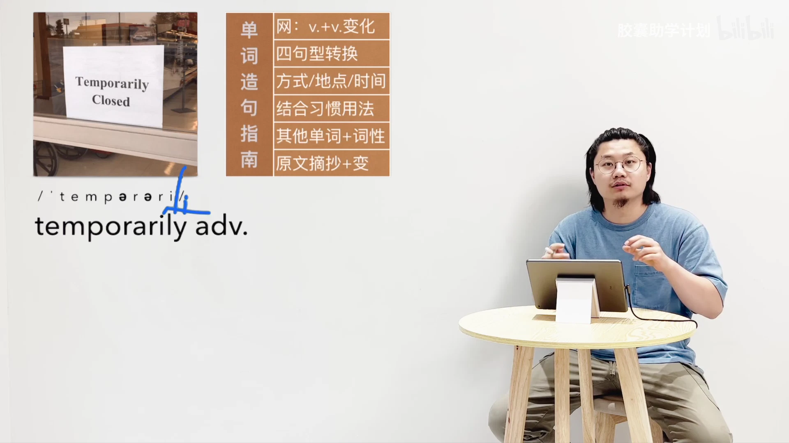

文字识别：单词造句指南 / 网：v.+v.变化 / 四句型转换 / Temporarily / 方式/地点/时间 / Closed / 结合习惯用法 / 其他单词+词性 / 原文摘抄+变 / /'temparar / temporarily adv.

### 画面 00:01:40

文字识别：单词造句指南 / 网：v.+v.变化 / 四句型转换 / Temporarily / 方式/地点/时间 / Closed / 结合习惯用法 / 其他单词+词性 / 原文摘抄+变 / /'temparar / temporarily adv. / ① [Story]: I have temporarily put my books on / the floor.

### 画面 00:01:45

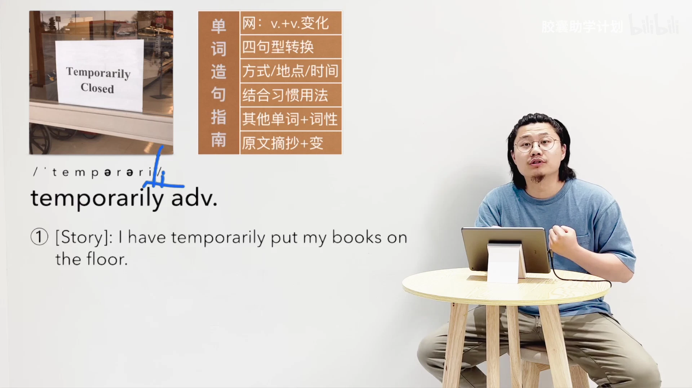

文字识别：单词造句指南 / 网：v.+v.变化 / 四句型转换 / Temporarily / 方式/地点/时间 / Closed / 结合习惯用法 / 其他单词+词性 / 原文摘抄+变 / /'temparari / temporarily adv. / ① [Story]: I have temporarily put my books on / the floor.

### 画面 00:01:50

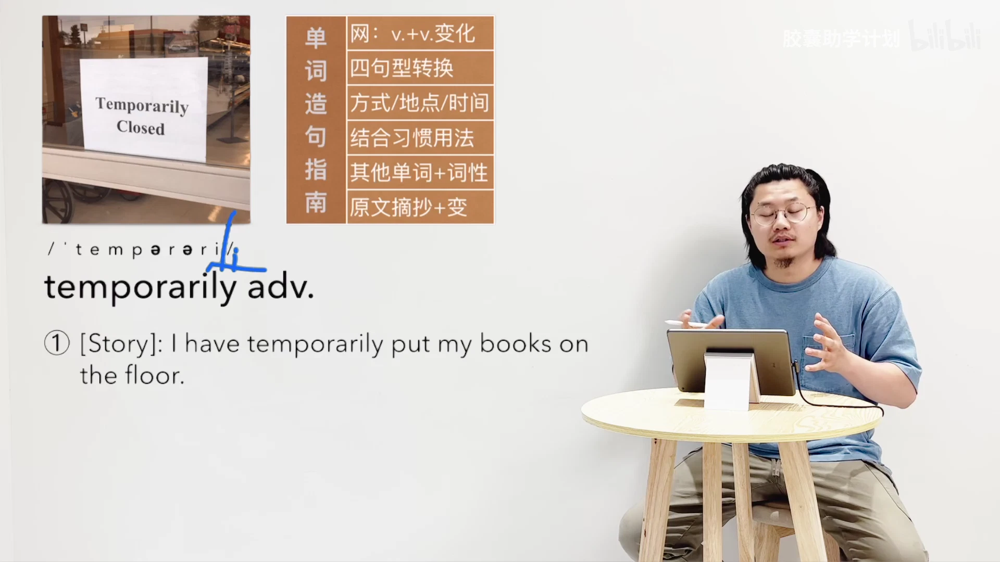

文字识别：单词造句指南 / 网：v.+v.变化 / 四句型转换 / Temporarily / 方式/地点/时间 / Closed / 结合习惯用法 / 其他单词+词性 / 原文摘抄+变 / /'temparar / temporarily adv. / ① [Story]: I have temporarily put my books on / the floor.

### 画面 00:01:55

文字识别：单词造句指南 / 网：v.+v.变化 / 四句型转换 / Temporarily / 方式/地点/时间 / Closed / 结合习惯用法 / 其他单词+词性 / 原文摘抄+变 / /'temparar / temporarily adv. / ① [Story]: I have temporarily put my books on / the floor.

## 00:02:00–00:02:30

put my books on the floor.说，我暂时性的把我的书放到了地板上。OK，你看，其实这地方我如果我们不加temporarily，就是说I have put my books on the floor，就是告诉你一个信息，叫做我把书放到了地地板上，对吧？那多了一个temporarily，其实就是多了一点信息，告诉你暂时性的。OK，好，那我们拿它去造句的时候，怎么去模仿它呢？我们说原文摘抄加变，对吧？怎么去进行变呢？也很简单，你拆解一下这个句

### 画面 00:02:06

文字识别：单词造句指南 / 网：v.+v.变化 / 四句型转换 / Temporarily / 方式/地点/时间 / Closed / 结合习惯用法 / 其他单词+词性 / 原文摘抄+变 / /'temparar / temporarily adv. / ① [Story]: I have temporarily put my books on / the floor.

### 画面 00:02:10

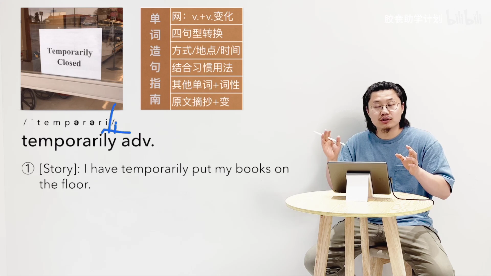

文字识别：单词造句指南 / 网：v.+v.变化 / 四句型转换 / Temporarily / 方式/地点/时间 / Closed / 结合习惯用法 / 其他单词+词性 / 原文摘抄+变 / /'temрarar / temporarily adv. / ① [Story]: I have temporarily put my books on / the floor.

### 画面 00:02:15

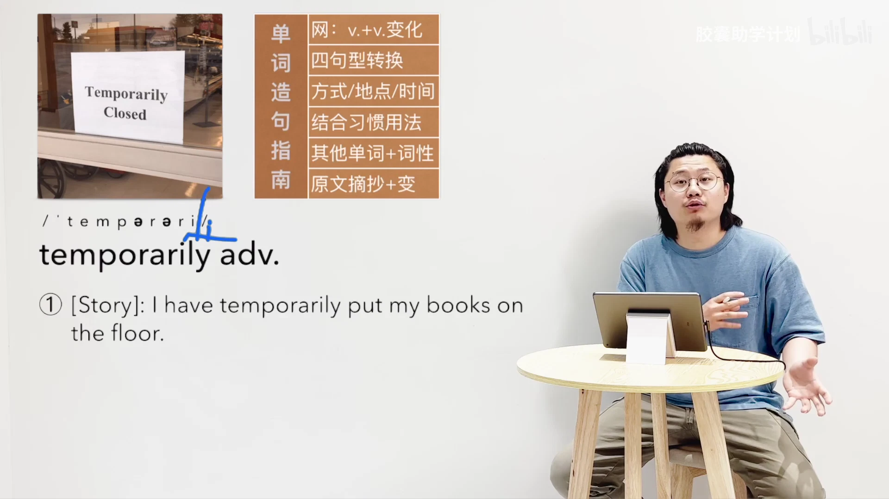

文字识别：单词造句指南 / 网：v.+v.变化 / 四句型转换 / Temporarily / 方式/地点/时间 / Closed / 结合习惯用法 / 其他单词+词性 / 原文摘抄+变 / /'temрarar / temporarily adv. / ① [Story]: I have temporarily put my books on / the floor.

### 画面 00:02:20

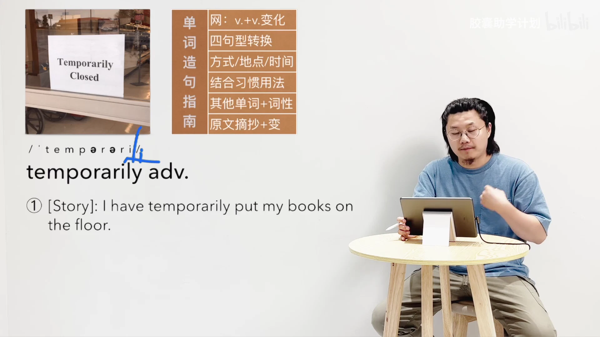

文字识别：单词造句指南 / 网：v.+v.变化 / 四句型转换 / Temporarily / 方式/地点/时间 / Closed / 结合习惯用法 / 其他单词+词性 / 原文摘抄+变 / /'temparar / temporarily adv. / ① [Story]: I have temporarily put my books on / the floor.

### 画面 00:02:25

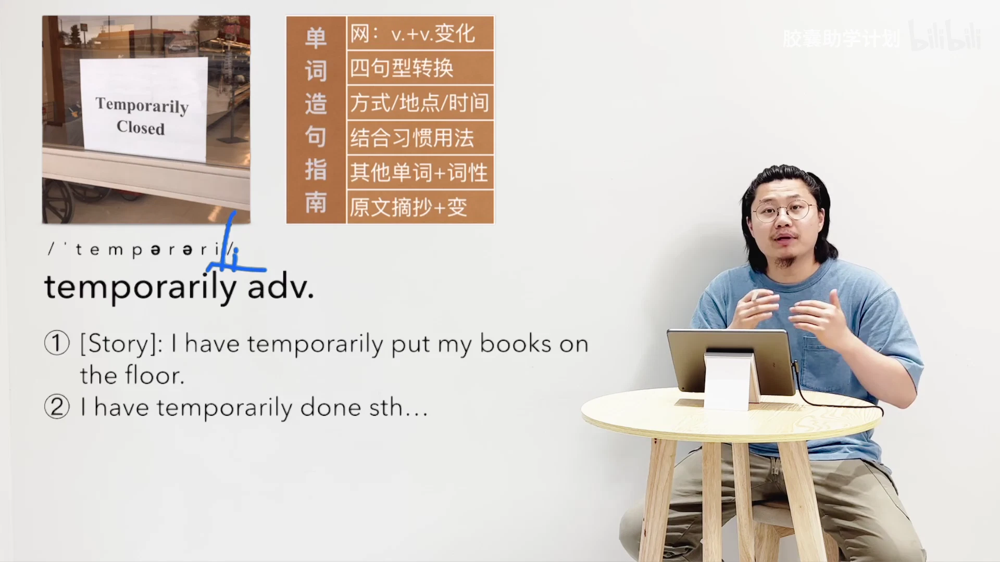

文字识别：单词造句指南 / 网：v.+v.变化 / 四句型转换 / Temporarily / 方式/地点/时间 / Closed / 结合习惯用法 / 其他单词+词性 / 原文摘抄+变 / /'temparari / temporarily adv. / ① [Story]: I have temporarily put my books on / the floor. / ) I have temporarily done sth...

## 00:02:30–00:03:00

子，看里面哪些东西可以被变。比如说，我们就把它，我现在给它拆成了叫 I have temporarily done something，对吧？那 put my books on the floor 是一件事儿嘛，对吧？我暂时性的做了这件事儿。比如说，我造了一句话叫 I have temporarily wrapped up this in newspaper，是吧？哎，我暂时性的怎么样呢？把这些东西给它呃，这个打包好了，OK，然后用这个报纸，OK， wrapped

### 画面 00:02:30

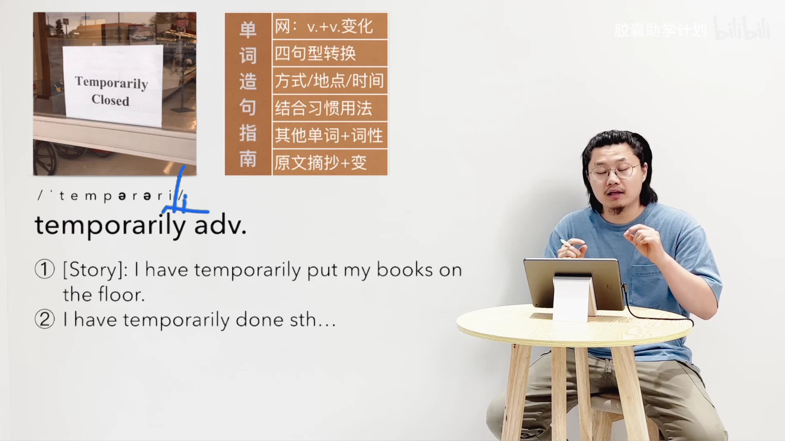

文字识别：单词造句指南 / 网：v.+v.变化 / 四句型转换 / Temporarily / 方式/地点/时间 / Closed / 结合习惯用法 / 其他单词+词性 / 原文摘抄+变 / /'temparari / temporarily adv. / ① [Story]: I have temporarily put my books on / the floor. /  I have temporarily done sth...

### 画面 00:02:40

文字识别：单词造句指南 / 网：v.+v.变化 / 四句型转换 / Temporarily / 方式/地点/时间 / Closed / 结合习惯用法 / 其他单词+词性 / 原文摘抄+变 / /'temparar / temporarily adv. / ① [Story]: I have temporarily put my books on / the floor. / ) I have temporarily done sth...

### 画面 00:02:43

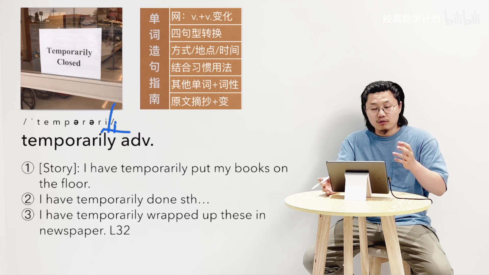

文字识别：单词造句指南 / 网：v.+v.变化 / 四句型转换 / Temporarily / 方式/地点/时间 / Closed / 结合习惯用法 / 其他单词+词性 / 原文摘抄+变 / / 'temparar i / temporarily adv. / ① [Story]: I have temporarily put my books on / the floor. / I have temporarily done sth... /  I have temporarily wrapped up these in / newspaper. L32

### 画面 00:02:45

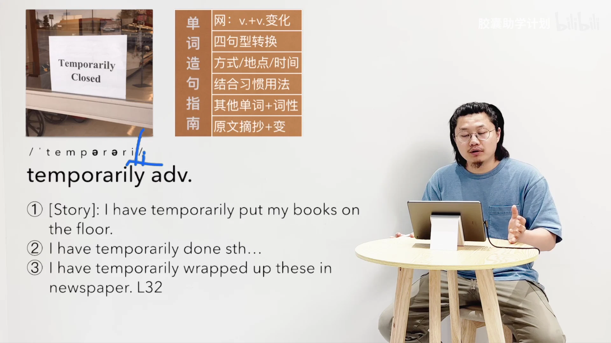

文字识别：单词造句指南 / 网：v.+v.变化 / 四句型转换 / Temporarily / 方式/地点/时间 / Closed / 结合习惯用法 / 其他单词+词性 / 原文摘抄+变 / / 't e mparar i / temporarily adv. / ① [Story]: I have temporarily put my books on / the floor. / ) I have temporarily done sth... / ) I have temporarily wrapped up these in / newspaper. L32

### 画面 00:02:57

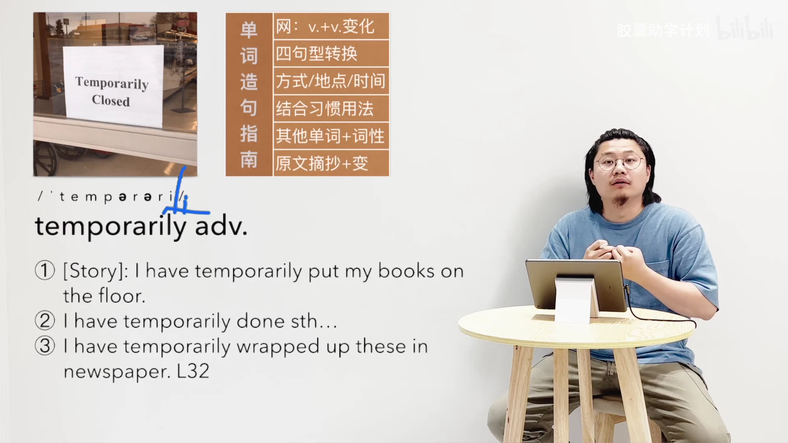

文字识别：单词造句指南 / 网：v.+v.变化 / 四句型转换 / Temporarily / 方式/地点/时间 / Closed / 结合习惯用法 / 其他单词+词性 / 原文摘抄+变 / / 't e mparar i / temporarily adv. / ① [Story]: I have temporarily put my books on / the floor. /  I have temporarily done sth... / ) I have temporarily wrapped up these in / newspaper. L32

## 00:03:00–00:03:30

up,呃, something.这是咱们三十二课学的一个习惯用法。剩下对于各位来说，就是你在模仿着尝试去做一些小的变化，把这个and啊换一些别的动词试一试，对吧？尤其我们之前学过的动词或习惯用法。OK，呃，那接下来呢，我们看一个小电影片段。这个电影片段当中就出现了叫做temporarily，非常简单一句话，简单啊，叫I borrowed it temporarily. OK，注意了，I borrowed it temporarily.

### 画面 00:03:00

文字识别：单词造句指南 / 网：v.+v.变化 / 四句型转换 / Temporarily / 方式/地点/时间 / Closed / 结合习惯用法 / 其他单词+词性 / 原文摘抄+变 / / 'temparar i / temporarily adv. / ① [Story]: I have temporarily put my books on / the floor. /  I have temporarily done sth... / ) I have temporarily wrapped up these in / newspaper. L32

### 画面 00:03:05

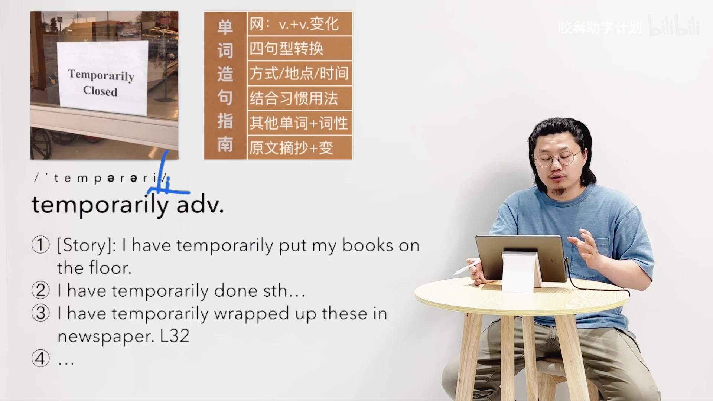

文字识别：单词造句指南 / 网：v.+v.变化 / 四句型转换 / Temporarily / 方式/地点/时间 / Closed / 结合习惯用法 / 其他单词+词性 / 原文摘抄+变 / / 't e mparar i / temporarily adv. / ① [Story]: I have temporarily put my books on / the floor. /  I have temporarily done sth... / ) I have temporarily wrapped up these in / newspaper. L32

### 画面 00:03:11

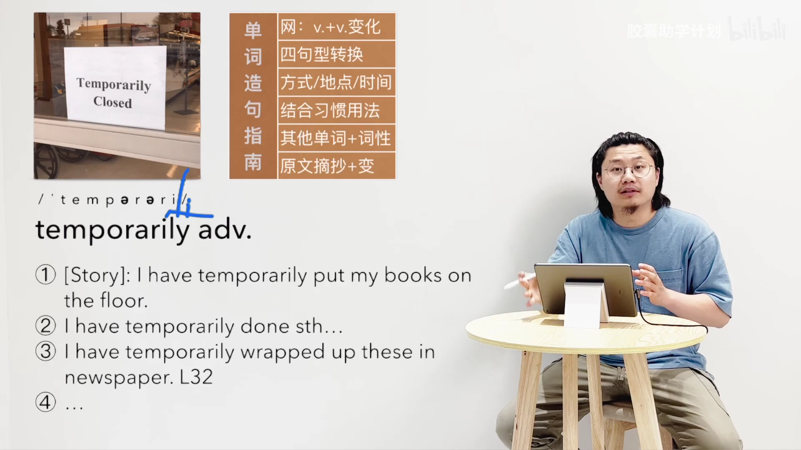

文字识别：单词造句指南 / 网：v.+v.变化 / 四句型转换 / Temporarily / 方式/地点/时间 / Closed / 结合习惯用法 / 其他单词+词性 / 原文摘抄+变 / / 'te mparari / temporarily adv. / ① [Story]: I have temporarily put my books on / the floor. / ) I have temporarily done sth... / ) I have temporarily wrapped up these in / newspaper. L32

### 画面 00:03:15

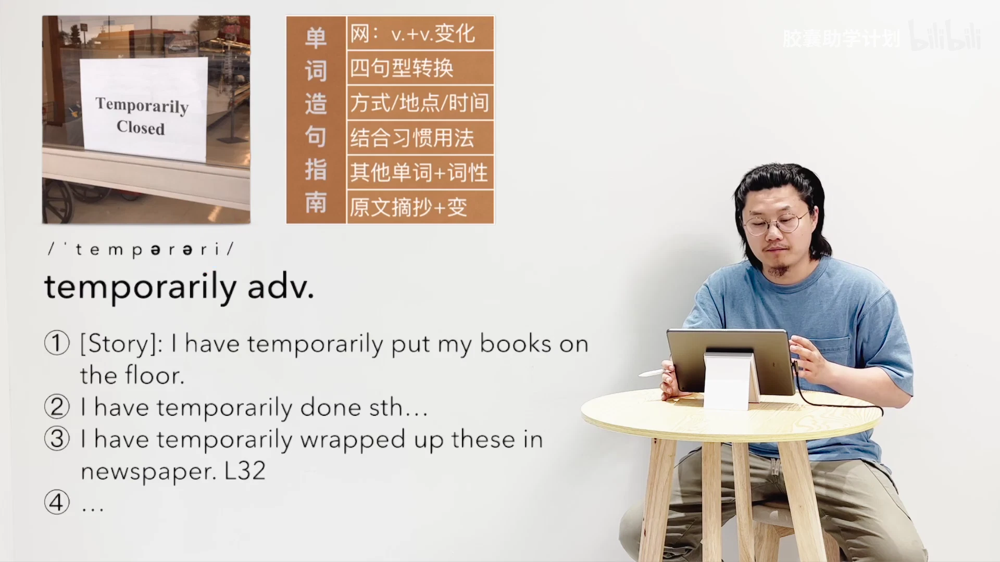

文字识别：单词造句指南 / 网：v.+v.变化 / 四句型转换 / Temporarily / 方式/地点/时间 / Closed / 结合习惯用法 / 其他单词+词性 / 原文摘抄+变 / / 't e mparar i / / temporarily adv. / ① [Story]: I have temporarily put my books on / the floor. / ) I have temporarily done sth... / ) I have temporarily wrapped up these in / newspaper. L32

### 画面 00:03:17

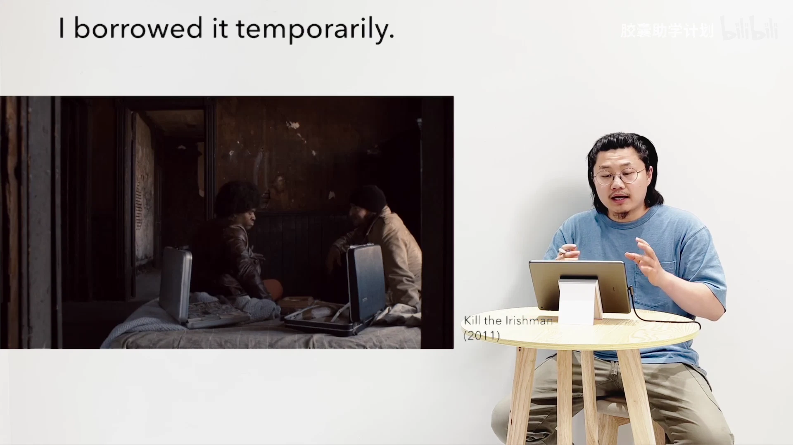

文字识别：I borrowed it temporarily. / Kill the Irishman / (2011)

## 00:03:30–00:04:00

Okay, very good. 接下来又一个电影片段叫 temporarily. Yes, I'm sleeping here. Okay, 说暂时性，我最近一段时间都住在这里。这实际上是 be doing 一个不是那么常见的用法，对吧？最近一段时间，这我们在第二课的时候其实讲过。那各位听一下， temporarily. Yes, I am sleeping here. Okay. Okay, 好，下一个单词啊，跟我一起读一下，叫做 inch, inch. 啊，这个它

### 画面 00:03:32

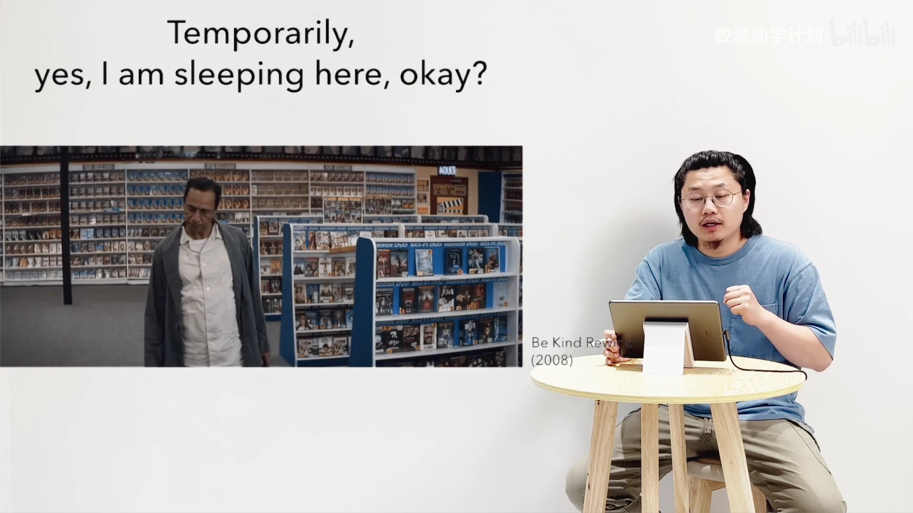

文字识别：Temporarily, / yes, I am sleeping here, okay? / Be Kind Rewi / (2008)

### 画面 00:03:52

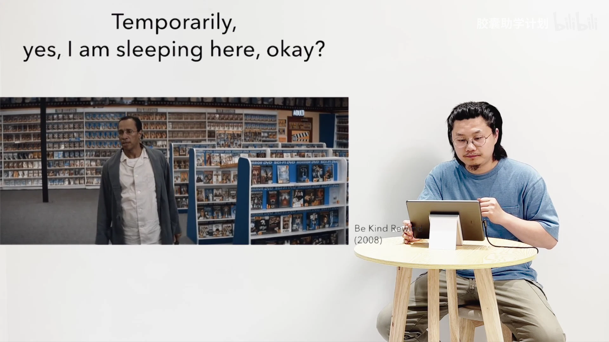

文字识别：Temporarily, / yes, I am sleeping here, okay? / Be Kind Rewi / (2008)

### 画面 00:03:54

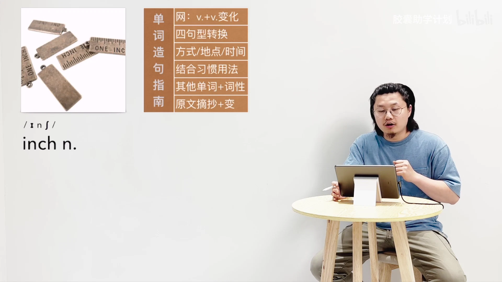

文字识别：单词造句指南 / 网：v.+v.变化 / 四句型转换 / HON NO / ONE INC / 方式/地点/时间 / HONI / 结合习惯用法 / 其他单词+词性 / 原文摘抄+变 / /In∫1 / inch n.

### 画面 00:03:56

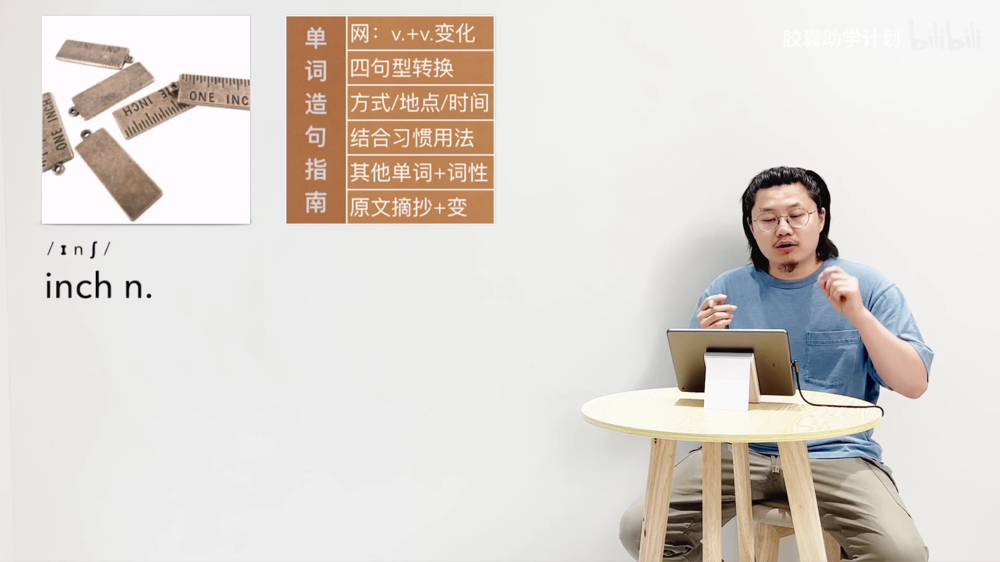

文字识别：单词造句指南 / 网：v.+v.变化 / 四句型转换 / pm / HON 3NO / ONE INC / 方式/地点/时间 / HONI / 结合习惯用法 / 其他单词+词性 / 原文摘抄+变 / /In∫1 / inch n.

## 00:04:00–00:04:30

枪抬高一寸的那个一寸对吧？英寸叫做inch，OK，就是英国自己的一个长度上的度量单位。那它可能比较常见的是这样一个习惯用法，叫做every inch of something，叫做每一寸啊。比如说我们汉语叫每一寸土地啊，英文叫做every inch of something。这个something呢，常见的我给各位后面写了一些，比如说body啊，身体，ground地面，house房子，wall墙，

### 画面 00:04:00

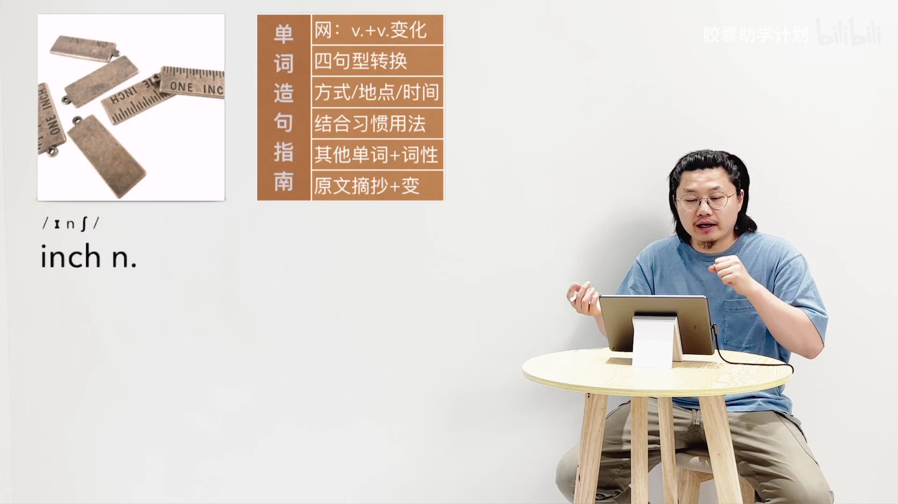

文字识别：单词造句指南 / 网：v.+v.变化 / 四句型转换 / ppm / HON NO / ONE INC / 方式/地点/时间 / HONI / 结合习惯用法 / 其他单词+词性 / 原文摘抄+变 / /In∫/ / inch n.

### 画面 00:04:05

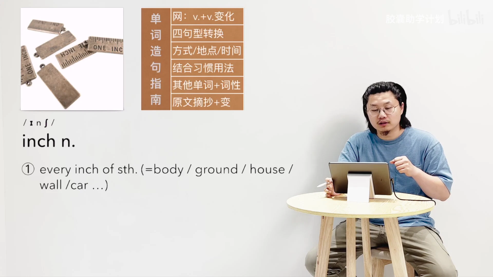

文字识别：单词造句指南 / 网：v.+v.变化 / 四句型转换 / pm / HON NO / ONE INC / 方式/地点/时间 / HONI / 结合习惯用法 / 其他单词+词性 / 原文摘抄+变 / /In∫1 / inch n. / every inch of sth.(=body / ground / house / / wall /car ...)

### 画面 00:04:07

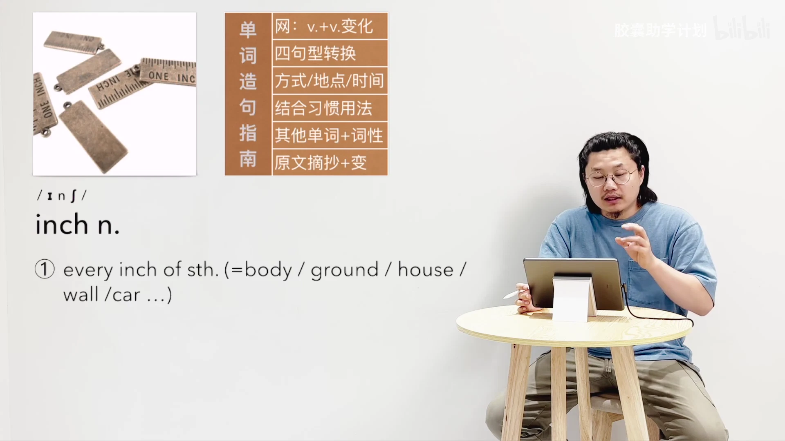

文字识别：单词造句指南 / 网：v.+v.变化 / 四句型转换 / HON NO / ONE INC / 方式/地点/时间 / HONI / 结合习惯用法 / 其他单词+词性 / 原文摘抄+变 / /In∫1 / inch n. / every inch of sth.(=body / ground / house / / wall /car ...)

### 画面 00:04:10

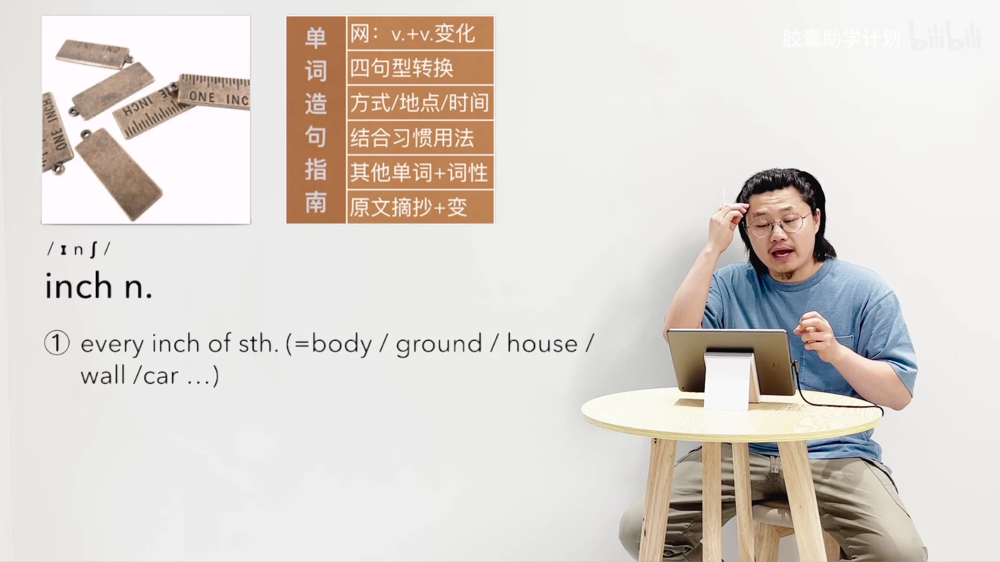

文字识别：单词造句指南 / 网：v.+v.变化 / 四句型转换 / HON NO / ONE INC / 方式/地点/时间 / HONI / 结合习惯用法 / 其他单词+词性 / 原文摘抄+变 / /In∫1 / inch n. / every inch of sth.(=body / ground / house / / 1 / wall /car ...)

### 画面 00:04:15

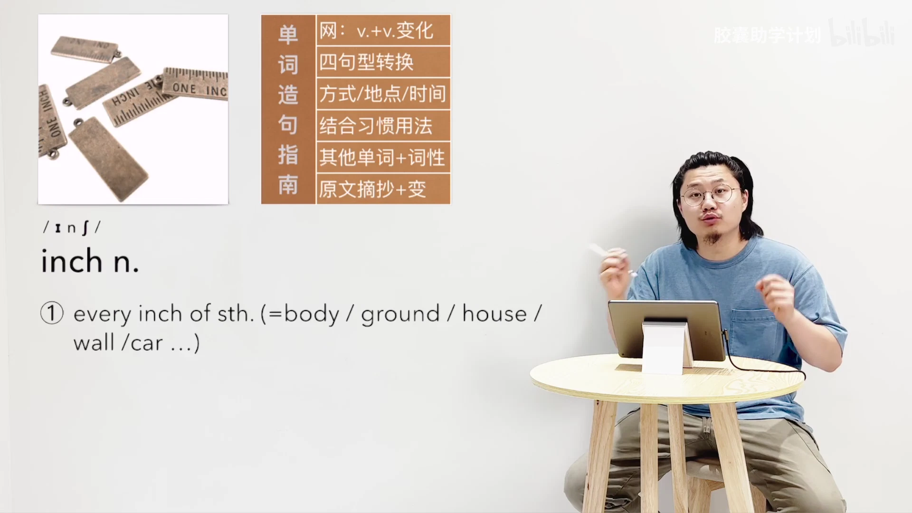

文字识别：单词造句指南 / 网：v.+v.变化 / 四句型转换 / mpm / HON- NO / ONE INC / 方式/地点/时间 / HONI / 结合习惯用法 / 其他单词+词性 / 原文摘抄+变 / /In∫/ / inch n. / ) every inch of sth.(=body / ground / house / / 1 / wall /car ...)

### 画面 00:04:25

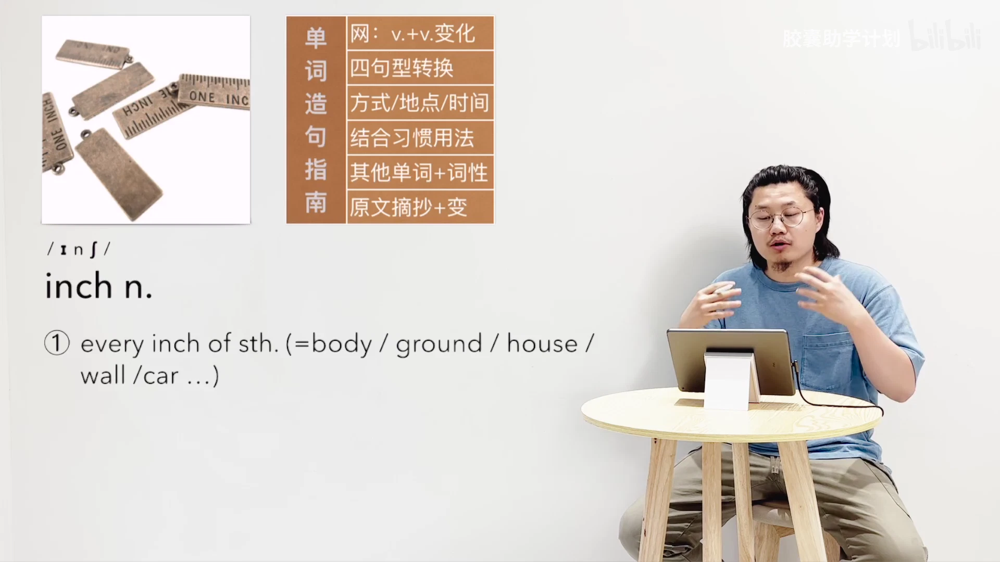

文字识别：单词造句指南 / 网：v.+v.变化 / 四句型转换 / ppm / HON 3NO / ONE INC / 方式/地点/时间 / HONI / 结合习惯用法 / 其他单词+词性 / 原文摘抄+变 / /In∫/ / inch n. / every inch of sth.(=body / ground / house / / 1 / Wall /car ...)

## 00:04:30–00:05:00

car车啊。我们造一句话，说The doctor examined every inch of his body啊。这个医生啊，仔细检查了他身体的每一寸啊，其实就是全面检查了一下。各位好理解对吧？Next one，比如说She cleaned every inch of the house last night。好，你看像这句话，我们造句就比较简单。看，我都啊，我们说第三句怎么来的？我们想一下，对于我们来说，其实我们要

### 画面 00:04:30

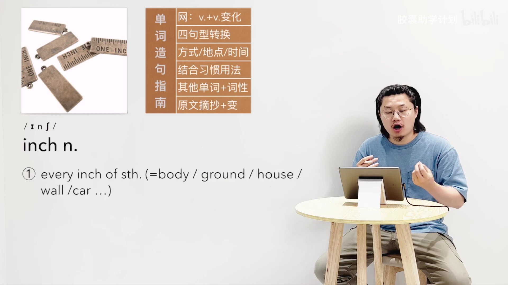

文字识别：单词造句指南 / 网：v.+v.变化 / 四句型转换 / mm / HON NO / ONE INC / 方式/地点/时间 / HONI / 结合习惯用法 / 其他单词+词性 / 原文摘抄+变 / /In∫/ / inch n. / ) every inch of sth.(=body/ ground / house / / 1 / wall /car ...)

### 画面 00:04:35

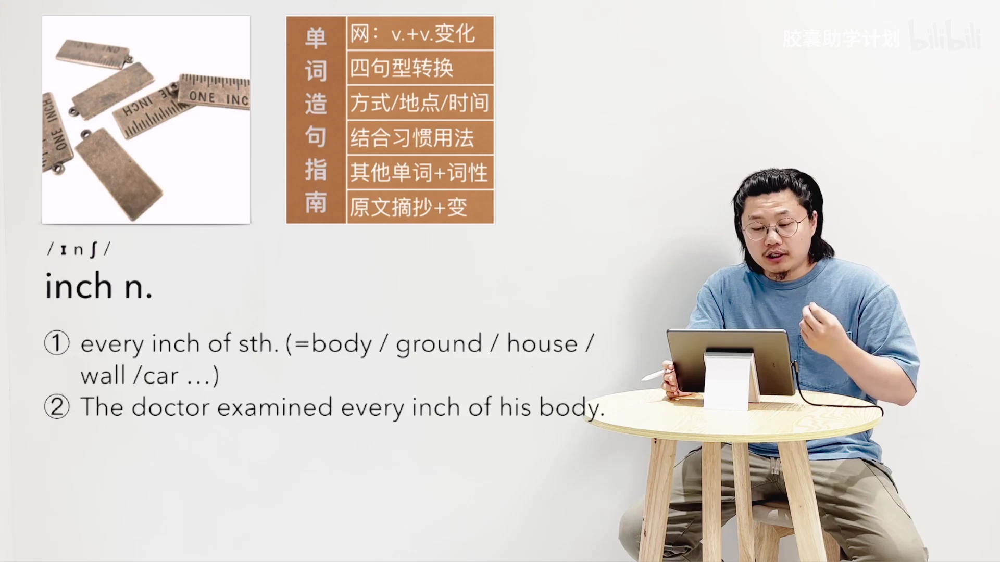

文字识别：单词造句指南 / 网：v.+v.变化 / 四句型转换 / HON NO / ONE INC / 方式/地点/时间 / HONI / 结合习惯用法 / 其他单词+词性 / 原文摘抄+变 / /In∫1 / inch n. / ① every inch of sth.(=body / ground / house / / wall /car ...) / The doctor examined every inch of his body.

### 画面 00:04:45

文字识别：单词造句指南 / 网：v.+v.变化 / 四句型转换 / ppm / HON NO / ONE INC / 方式/地点/时间 / HONI / Halhlml / 结合习惯用法 / 其他单词+词性 / 原文摘抄+变 / /In∫1 / inch n. / ① every inch of sth.(=body / ground / house / / wall /car …..) / The doctor examined every inch of his body.

### 画面 00:04:55

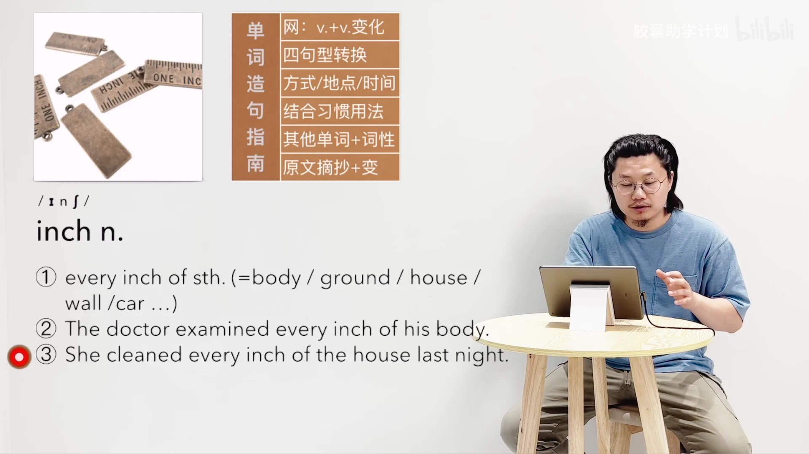

文字识别：单词造句指南 / 网：v.+v.变化 / 四句型转换 / mpm / HIN 3NO / ONE INC / 方式/地点/时间 / HONI / 结合习惯用法 / 其他单词+词性 / 原文摘抄+变 / /In∫1 / inch n. / ① every inch of sth.(=body / ground / house / / wall /car ...) / The doctor examined every inch of his body. / ③ She cleaned every inch of the house last night.

## 00:05:00–00:05:30

先选 every inch of something，对吧？一选到了后面的这个 something 名词，其实前面的动词我就可以去做一个配合了。我先选到了 the house，那 every inch of the house 就已经放到这儿了。那对于我来说，我想去想哪个动词跟 house 可以连起来，比如说 clean，非常常用，对吧？然后我自己再去加一点主语，加一点时间，一句话很轻松就被我造出来了。OK，那像这两个都是肯定句，四句型转换，您自

### 画面 00:05:03

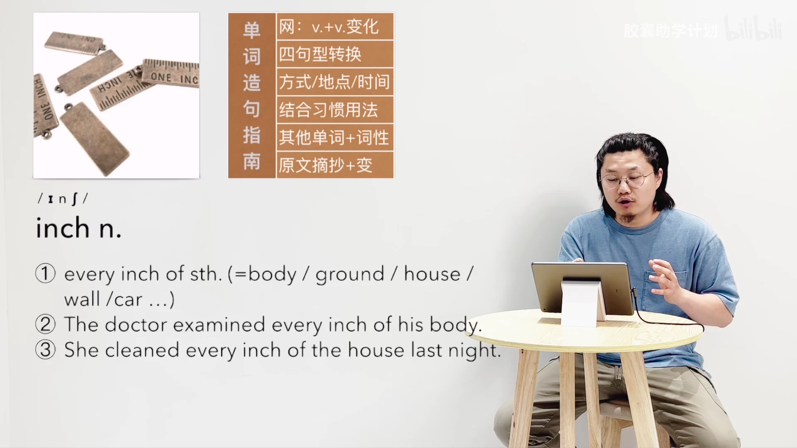

文字识别：单词造句指南 / 网：v.+v.变化 / 四句型转换 / HONI 3NO / ONE INC / 方式/地点/时间 / HONI / 结合习惯用法 / 其他单词+词性 / 原文摘抄+变 / /In∫1 / inch n. / ① every inch of sth.(=body / ground / house / / wall /car …..) / The doctor examined every inch of his body. / ③ She cleaned every inch of the house last night.

### 画面 00:05:10

文字识别：单词造句指南 / 网：v.+v.变化 / 四句型转换 / mpm / HONI 3NO / ONE INC / 方式/地点/时间 / HONI / 结合习惯用法 / 其他单词+词性 / 原文摘抄+变 / /In∫1 / inch n. / ① every inch of sth.(=body/ ground / house / / Wall /car ...) / The doctor examined every inch of his body. / ③ She cleaned every inch of the house / last night.

### 画面 00:05:13

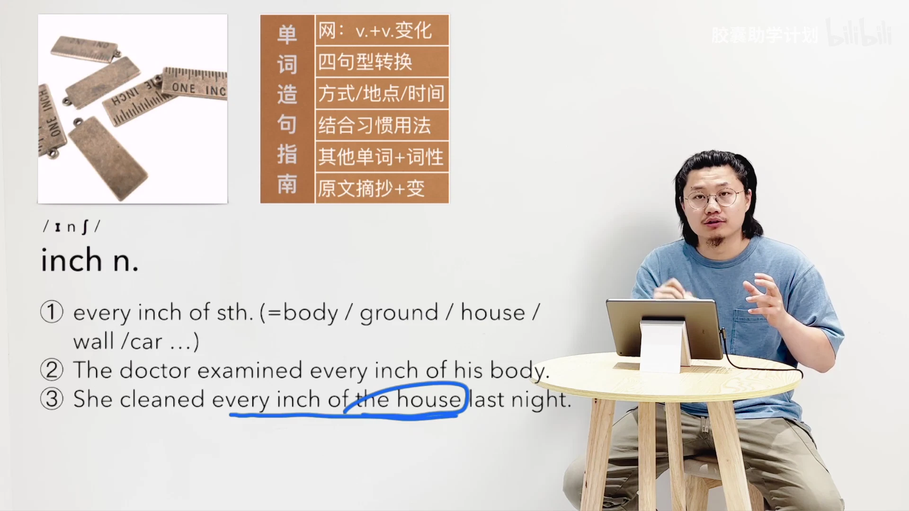

文字识别：单词造句指南 / 网：v.+v.变化 / 四句型转换 / pm / HON GNO / ONE INC / 方式/地点/时间 / HONI / 结合习惯用法 / 其他单词+词性 / 原文摘抄+变 / /In∫1 / inch n. / ① every inch of sth.(=body / ground / house / / Wall /car ...) / The doctor examined every inch of his body. / ③ She cleaned every inch of the house / last night.

### 画面 00:05:15

文字识别：单词造句指南 / 网：v.+v.变化 / 四句型转换 / HON INO / ONE INC / 方式/地点/时间 / HONI / 结合习惯用法 / 其他单词+词性 / 原文摘抄+变 / /In∫1 / inch n. / ① every inch of sth.(=body/ ground / house / / Wall /car ...) / The doctor examined every inch of his body. / ③ She cleaned every inch of the house / last night. / 3）

### 画面 00:05:19

文字识别：单词造句指南 / 网：v.+v.变化 / 四句型转换 / mppm / HON NO / ONE INC / 方式/地点/时间 / HONI / 结合习惯用法 / 其他单词+词性 / 原文摘抄+变 / /In∫1 / inch n. / ① every inch of sth.(=body / ground / house / / Wall /car ...) / The doctor examined every inch of his body. /  She cleaned every inch of the house / last night. / 3

### 画面 00:05:22

文字识别：单词造句指南 / 网：v.+v.变化 / 四句型转换 / HON NO / ONE INC / 方式/地点/时间 / HONI / 结合习惯用法 / 其他单词+词性 / 原文摘抄+变 / /In∫1 / inch n. / ① every inch of sth.(=body / ground / house / / Wall /car ...) / The doctor examined every inch of his body. / 3 / She Lleaned every inch of the house / last night.

### 画面 00:05:24

文字识别：单词造句指南 / 网：v.+v.变化 / 四句型转换 / HON 3NO / ONE INC / 方式/地点/时间 / HONI / 结合习惯用法 / 其他单词+词性 / 原文摘抄+变 / /In∫1 / inch n. / ① every inch of sth.(=body/ ground / house / / Wall /car ...) / The doctor examined every inch of his body. / ③ She cleaned every inch of the house last night.

### 画面 00:05:26

文字识别：单词造句指南 / 网：v.+v.变化 / 四句型转换 / HONI 3NOO / ONE INC / 方式/地点/时间 / HONI / 结合习惯用法 / 其他单词+词性 / 原文摘抄+变 / /In∫1 / inch n. / ① every inch of sth.(=body / ground / house / / Wall /car ...) / The doctor examined every inch of his body. / ③ She cleaned every inch of the house last night.

### 画面 00:05:29

文字识别：单词造句指南 / 网：v.+v.变化 / 四句型转换 / HON NO / ONE INC / 方式/地点/时间 / HONI / 结合习惯用法 / 其他单词+词性 / 原文摘抄+变 / /In∫1 / inch n. / ① every inch of sth.(=body / ground / house / / wall /car …..) / The doctor examined every inch of his body. / ③ She cleaned every inch of the house last night.

## 00:05:30–00:06:00

己别忘了去做啊。比如说 When did she clean every inch of the house? Ah, what did she clean every inch of? 对吧？ Okay, 哎，我其实就 What did she clean? 就行了啊。 Okay, last night. Next one, 再接下来，哎，我造了这样一句话，叫做 Every inch of her bedroom wall is covered with photos of pop stars. 那你刘这个青春期的小姑娘对吧？说什么的每一寸呢？ Her bedroom wall, 她卧室

### 画面 00:05:31

文字识别：单词造句指南 / 网：v.+v.变化 / 四句型转换 / HON NO / ONE INC / 方式/地点/时间 / HONI / 结合习惯用法 / 其他单词+词性 / 原文摘抄+变 / /In∫1 / inch n. / ① every inch of sth.(=body / ground / house / / wall /car …..) / The doctor examined every inch of his body. / ③ She cleaned every inch of the house last night.

### 画面 00:05:40

文字识别：单词造句指南 / 网：v.+v.变化 / 四句型转换 / ppm / HON 3NO / ONE INC / 方式/地点/时间 / HONI / 结合习惯用法 / 其他单词+词性 / 原文摘抄+变 / /In∫1 / inch n. / ① every inch of sth.(=body / ground / house / / wall /car ...) / The doctor examined every inch of his body. / ③ She cleaned every inch of the house last night. / ④ Every inch of her bedroom wall is covered with / photos of pop stars. NCE1 L143

### 画面 00:05:45

文字识别：单词造 / 网：v.+v.变化 / 四句型转换 / HONI 3NO / ONE INC / 方式/地点/时间 / HONI / 旭句指 / 结合习惯用法 / 其他单词+词性 / 南 / 原文摘抄+变 / /In∫1 / inch n. / ① every inch of sth.(=body / ground / house / / wall /car .. / The doctor examined every inch of his body. / ③ She cleaned every inch of the house last night. / ④ Every inch of her bedroom wall is covered with / photos of pop stars. NCE1 L143

### 画面 00:05:50

文字识别：单词造 / 网：v.+v.变化 / 四句型转换 / HON 3NO / ONE INC / 方式/地点/时间 / HONI / 句 / 结合习惯用法 / 指 / 其他单词+词性 / 南 / 原文摘抄+变 / /In∫1 / inch n. / ① every inch of sth.(=body / ground / house / / wall /car …..) / The doctor examined every inch of his body. / ③ She cleaned every inch of the house last night. / ) Every inch of her bedroom wall is covered with / photos of pop stars. NCE1 L143

### 画面 00:05:56

文字识别：单词造 / 网：v.+v.变化 / 四句型转换 / HON NO / ONE INC / 方式/地点/时间 / HONI / 旭句指 / 结合习惯用法 / 其他单词+词性 / 南 / 原文摘抄+变 / /In∫1 / inch n. / ① every inch of sth.(=body / ground / house / / wall /car .. / The doctor examined every inch of his body. / ③ She cleaned every inch of the house last night. / ④Every inch of her bedroom wall is covered with / photos of pop stars. NCE1 L143

### 画面 00:05:58

文字识别：单词造 / 网：v.+v.变化 / 四句型转换 / m / HON 3NO / ONE INC / 方式/地点/时间 / HONI / 旭句指 / 结合习惯用法 / 其他单词+词性 / 南 / 原文摘抄+变 / /In∫1 / inch n. / ① every inch of sth.(=body / ground / house / / wall /car ...) / The doctor examined every inch of his body. / ③ She cleaned every inch of the house last night. / ④ Every inch of her bedroom wall is covered with / photos of pop stars. NCE1 L143

## 00:06:00–00:06:30

the wall.

### 画面 00:06:00

文字识别：单词造 / 网：v.+v.变化 / 四句型转换 / HON 3NO / ONE INC / 方式/地点/时间 / HONI / 旭句指 / 结合习惯用法 / 其他单词+词性 / 南 / 原文摘抄+变 / /In∫1 / inch n. / ① every inch of sth.(=body / ground / house / / wall /car ...) / The doctor examined every inch of his body. / ③ She cleaned every inch of the house last night. / ④Every inch of her bedroom wall is covered with / photos of pop stars. NCE1 L143

### 画面 00:06:15

文字识别：单词造 / 网：v.+v.变化 / 四句型转换 / HON NO / ONE INC / 方式/地点/时间 / HONI / 句 / 结合习惯用法 / 指 / 其他单词+词性 / 南 / 原文摘抄+变 / /In∫1 / inch n. / ① every inch of sth.(=body / ground / house / / wall /car …..) / The doctor examined every inch of his body. / ③ She cleaned every inch of the house last night. / ④ Every inch of her bedroom wall is covered with / photos of pop stars. NCE1 L143

### 画面 00:06:18

文字识别：No, I checked every inch of / the car. / Unforgettable / (2017)

## 00:06:30–00:07:00

查了一遍这个车, very good. 注意力开始了. Now I checked every inch of the car. 好啊, I checked every inch of the car. Very good. Continue, 下一个小单词跟我读一下, 叫做, 别忘了浊化, 对吧?变不, 来读 space, space. Very good. 那 space 这个单词, 其实我们在往后学的时候还会再见到一次, 那它指的是外太空或者太空, 比如说 outer space, 对吧? 那 space 在本课呢, 其实就指

### 画面 00:06:34

文字识别：No, I checked every inch of / the car. / Unforgettable / (2017)

### 画面 00:06:36

文字识别：No, I checked every inch of / the car. / Unforgettable / (2017)

### 画面 00:06:41

文字识别：单词造句指南 / 网：v.+v.变化 / 四句型转换 / 方式/地点/时间 / 结合习惯用法 / 其他单词+词性 / 原文摘抄+变 / /sρeis/ / space n.

### 画面 00:06:43

文字识别：单词造句指南 / 网：v.+v.变化 / 四句型转换 / 方式/地点/时间 / 结合习惯用法 / 其他单词+词性 / 原文摘抄+变 / /speis/ / space n.

### 画面 00:06:45

文字识别：单词造句指南 / 网：v.+v.变化 / 四句型转换 / 方式/地点/时间 / 结合习惯用法 / 其他单词+词性 / 原文摘抄+变 / /speIs/ / space n.

### 画面 00:06:50

文字识别：单词造句指南 / 网：v.+v.变化 / 四句型转换 / 方式/地点/时间 / 结合习惯用法 / 其他单词+词性 / 原文摘抄+变 / /sｐels/ / space n.

### 画面 00:06:55

文字识别：单词造句指南 / 网：v.+v.变化 / 四句型转换 / 方式/地点/时间 / 结合习惯用法 / 其他单词+词性 / 原文摘抄+变 / /speIs/ / space n.

## 00:07:00–00:07:30

的是一个空间啊。它在本课其实那个呃呃自己本身的那个含义并不是特别浓。比如说原文给了一句话叫 At the moment now, 对吧？They cover every inch of floor space. Okay, 注意 every inch of floor 其实就够了。它只不过在这个基础之上又多加了一个小单词，对吧？叫做 space 啊，这个地面上的空间啊，在本课它出现的这个呃呃含义啊不

### 画面 00:07:01

文字识别：单词造句指南 / 网：v.+v.变化 / 四句型转换 / 方式/地点/时间 / 结合习惯用法 / 其他单词+词性 / 原文摘抄+变 / /sｐeIs/ / space n.

### 画面 00:07:04

文字识别：单词造句指南 / 网：v.+v.变化 / 四句型转换 / 方式/地点/时间 / 结合习惯用法 / 其他单词+词性 / 原文摘抄+变 / /speIs/ / space n. / ① [Story]: At the moment, they cover every / inch of floor space.

### 画面 00:07:10

文字识别：单词造句指南 / 网：v.+v.变化 / 四句型转换 / 方式/地点/时间 / 结合习惯用法 / 其他单词+词性 / 原文摘抄+变 / /speIs/ / space n. / ① [Story]: At the moment, they cover every / inch of floor space.

### 画面 00:07:16

文字识别：单词造句指南 / 网：v.+v.变化 / 四句型转换 / 方式/地点/时间 / 结合习惯用法 / 其他单词+词性 / 原文摘抄+变 / /sｐeIs/ / space n. / ① [Story]: At the moment, they cover every / inch of floor space.

### 画面 00:07:20

文字识别：单词造句指南 / 网：v.+v.变化 / 四句型转换 / 方式/地点/时间 / 结合习惯用法 / 其他单词+词性 / 原文摘抄+变 / /speIs/ / space n. / ① [Story]: At the moment, they cover every / inch of floor space.

### 画面 00:07:25

文字识别：单词造句指南 / 网：v.+v.变化 / 四句型转换 / 方式/地点/时间 / 结合习惯用法 / 其他单词+词性 / 原文摘抄+变 / /sｐeIs/ / space n. / ① [Story]: At the moment, they cover every / inch of floor space.

## 00:07:30–00:08:00

是那么的强。然后我们给它做四句型转换就可以了。OK，好。然后我又做了一个句子，比如说 I paid him a visit。五十一课咱们学的对吧？哎，我去拜访了一下他。然后哎，这是我们下半册造句的时候，比上半册对吧？就呃四十九到九十六造句的时候和一到四十八有一点不同，就我们开始去造一些所谓叫长难句，或者说所谓的叫做呃这个要么主从复合句，要么并列复合句啊。比如说我在这用了 and

### 画面 00:07:30

文字识别：单词造句指南 / 网：v.+v.变化 / 四句型转换 / 方式/地点/时间 / 结合习惯用法 / 其他单词+词性 / 原文摘抄+变 / /sｐeis/ / space n. / ① [Story]: At the moment, they cover every / inch of floor space. / do/what/why...

### 画面 00:07:34

文字识别：单词造句指南 / 网：v.+v.变化 / 四句型转换 / 方式/地点/时间 / 结合习惯用法 / 其他单词+词性 / 原文摘抄+变 / /speIs/ / space n. / ① [Story]: At the moment, they cover every / inch of floor space. / do/what/why... / I paid him a visit and found out that the / books covered every inch of floor space. / L51

### 画面 00:07:36

文字识别：单词造句指南 / 网：v.+v.变化 / 四句型转换 / 方式/地点/时间 / 结合习惯用法 / 其他单词+词性 / 原文摘抄+变 / /speIsl / space n. / ① [Story]: At the moment, they cover every / inch of floor space. / do/what/why... / I paid him a visit and found out that the / 3 / books covered every inch of floor space. / L51

### 画面 00:07:41

文字识别：单词造句指南 / 网：v.+v.变化 / 四句型转换 / 方式/地点/时间 / 结合习惯用法 / 其他单词+词性 / 原文摘抄+变 / /spels/ / space n. / ① [Story]: At the moment, they cover every / inch of floor space. / do/what/why... / I paid him a visit and found out that the / books covered every inch of floor space. / L51

### 画面 00:07:44

文字识别：单词造句指南 / 网：v.+v.变化 / 四句型转换 / 方式/地点/时间 / 结合习惯用法 / 其他单词+词性 / 原文摘抄+变 / /spels/ / space n. / ① [Story]: At the moment, they cover every / inch of floor space. / do/what/why... / I paid him a visitandound out that the / books covered every inch of floor space. / L51

### 画面 00:07:48

文字识别：单词造句指南 / 网：v.+v.变化 / 四句型转换 / 方式/地点/时间 / 结合习惯用法 / 其他单词+词性 / 原文摘抄+变 / /speIs/ / space n. / ① [Story]: At the moment, they cover every / inch of floor space. / do/what/why... / I paid him a visitandound out that the / books covered every inch of floor space. / L51

### 画面 00:07:52

文字识别：单词造句指南 / 网：v.+v.变化 / 四句型转换 / 方式/地点/时间 / 结合习惯用法 / 其他单词+词性 / 原文摘抄+变 / /speIs/ / space n. / ① [Story]: At the moment, they cover every / inch of floor space. / do/what/why... / I paid him a visitandound out that the / books covered every inch of floor space. / L51

### 画面 00:07:58

文字识别：单词造句指南 / 网：v.+v.变化 / 四句型转换 / 方式/地点/时间 / 结合习惯用法 / 其他单词+词性 / 原文摘抄+变 / /speIs/ / space n. / ① [Story]: At the moment, they cover every / inch of floor space. / do/what/why... / I paid him a visitandound out that the / books covered every inch of floor space. / L51

## 00:08:00–00:08:30

对吧？两个句子连起来叫我去拜访了一下他，然后呢，我发现 the books covered every inch of floor space。啊，书铺满了地面的每一寸土啊，满这这个这个这个啊，每一寸对吧？铺面铺满了每一寸啊。OK，very good。最后一个小单词，跟我读一下，叫做 actually。actually 口语当中特别常用的一个小单词叫做实际上对吧？I

### 画面 00:08:01

文字识别：单词造句指南 / 网：v.+v.变化 / 四句型转换 / 方式/地点/时间 / 结合习惯用法 / 其他单词+词性 / 原文摘抄+变 / /speIs/ / space n. / ① [Story]: At the moment, they cover every / inch of floor space. / do/what/why.. / I paid him a visitand ound out that the / 3 / books covered every inch of floor space. / L51

### 画面 00:08:06

文字识别：单词造句指南 / 网：v.+v.变化 / 四句型转换 / 方式/地点/时间 / 结合习惯用法 / 其他单词+词性 / 原文摘抄+变 / /speIs/ / space n. / ① [Story]: At the moment, they cover every / inch of floor space. / do/what/why... / I paid him a visitandound out that the / books covered every inch of floor space. / L51

### 画面 00:08:11

文字识别：单词造句指南 / 网：v.+v.变化 / 四句型转换 / 方式/地点/时间 / 结合习惯用法 / 其他单词+词性 / 原文摘抄+变 / /speIs/ / space n. / ① [Story]: At the moment, they cover every / inch of floor space. / do/what/why... / I paid him a visitand jound out that the / books covered every inch of floor space. / L51

### 画面 00:08:15

文字识别：单词造句指南 / 网：v.+v.变化 / 四句型转换 / 方式/地点/时间 / 结合习惯用法 / 其他单词+词性 / 原文摘抄+变 / /speIs/ / space n. / ① [Story]: At the moment, they cover every / inch of floor space. / do/what/why... / I paid him a visitandound out that the / books covered every inch of floor space. / L51

### 画面 00:08:18

文字识别：单词造句指南 / 网：v.+v.变化 / 四句型转换 / 方式/地点/时间 / 结合习惯用法 / 其他单词+词性 / 原文摘抄+变 / /'ækt∫uali/ / actually adv.

### 画面 00:08:20

文字识别：单词造句指南 / 网：v.+v.变化 / 四句型转换 / 方式/地点/时间 / 结合习惯用法 / 其他单词+词性 / 原文摘抄+变 / /'ækt∫uali/ / actually adv.

## 00:08:30–00:09:00

actually, OK.好，比如说，在这是我们，在口语当中很常见的句子，像这样的句子就不是造句了，就各位就必须把它记下来了啊，硬给它记下来。叫做 That's actually a good idea.你看，我们新一就学过叫 That's a good idea.那我们在这儿多加一个 actually，这实际上口语当中很常用，叫 That's actually a good idea.啊，这实际上还是一个很好的主意啊。再来，比如说，Sir, I have more money. Actually，这个也是电影当中的句子，但是为什么我选了这

### 画面 00:08:31

文字识别：单词造句指南 / 网：v.+v.变化 / 四句型转换 / 方式/地点/时间 / 结合习惯用法 / 其他单词+词性 / 原文摘抄+变 / /'ækt∫uali/ / actually adv. / ) That's actually a good idea.

### 画面 00:08:35

文字识别：单词造句指南 / 网：v.+v.变化 / 四句型转换 / 方式/地点/时间 / 结合习惯用法 / 其他单词+词性 / 原文摘抄+变 / /'ækt∫uali/ / actually adv. / ) That's actually a good idea.

### 画面 00:08:50

文字识别：单词造句指南 / 网：v.+v.变化 / 四句型转换 / 方式/地点/时间 / 结合习惯用法 / 其他单词+词性 / 原文摘抄+变 / /'ækt∫uali/ / actually adv. / ) That's actually a good idea.

### 画面 00:08:54

文字识别：单词造句指南 / 网：v.+v.变化 / 四句型转换 / 方式/地点/时间 / 结合习惯用法 / 其他单词+词性 / 原文摘抄+变 / /'ækt∫uali/ / actually adv. / ) That's actually a good idea. / ) Sir, I have more money actually.

### 画面 00:08:56

文字识别：单词造句指南 / 网：v.+v.变化 / 四句型转换 / 方式/地点/时间 / 结合习惯用法 / 其他单词+词性 / 原文摘抄+变 / /'ækt∫uali/ / actually adv. / ) That's actually a good idea. / ) Sir, I have more money actually.

## 00:09:00–00:09:30

两个东西呢？各位可以注意一下，actually 它的位置啊，actually 它的位置，哎，实际上，actually，actually 这个单词呢，它的位置特别的不固定，没有一个必然要放在哪儿。你给它放到句首也可以，比如说 actually that's a good idea，对吧？比如说 that's actually good idea，或者说 that that's a good idea actually 也没有任何问题。各位记住这句话，好吧？没有任何问题

### 画面 00:09:00

文字识别：单词造句指南 / 网：v.+v.变化 / 四句型转换 / 方式/地点/时间 / 结合习惯用法 / 其他单词+词性 / 原文摘抄+变 / /'ækt∫uali/ / actually adv. / ) That's actually a good idea. / ) Sir, I have more money actually.

### 画面 00:09:02

文字识别：单词造句指南 / 网：v.+v.变化 / 四句型转换 / 方式/地点/时间 / 结合习惯用法 / 其他单词+词性 / 原文摘抄+变 / /'ækt∫uali/ / actually adv. / ) That's / actually / a good idea. / Sir, I have more money / actually

### 画面 00:09:05

文字识别：单词造句指南 / 网：v.+v.变化 / 四句型转换 / 方式/地点/时间 / 结合习惯用法 / 其他单词+词性 / 原文摘抄+变 / /'ækt∫uali/ / actually adv. / ) That's / actually / a good idea. / Sir, I have more money / actually

### 画面 00:09:11

文字识别：单词造句指南 / 网：v.+v.变化 / 四句型转换 / 方式/地点/时间 / 结合习惯用法 / 其他单词+词性 / 原文摘抄+变 / /'ækt∫uali/ / actually adv. / That's / actually / a good idea. / Sir, I have more money / actually

### 画面 00:09:15

文字识别：单词造句指南 / 网：v.+v.变化 / 四句型转换 / 方式/地点/时间 / 结合习惯用法 / 其他单词+词性 / 原文摘抄+变 / /'ækt∫uali/ / actually adv. / That's / actuall / a good idea. / Sir, I have more money / actually

### 画面 00:09:21

文字识别：单词造句指南 / 网：v.+v.变化 / 四句型转换 / 方式/地点/时间 / 结合习惯用法 / 其他单词+词性 / 原文摘抄+变 / /'ækt∫uali/ / actually adv. / That's / actually / a good idea. / Sir, I have more money / actually

### 画面 00:09:25

文字识别：单词造句指南 / 网：v.+v.变化 / 四句型转换 / 方式/地点/时间 / 结合习惯用法 / 其他单词+词性 / 原文摘抄+变 / /'ækt∫uali/ / actually adv. / That's / actually / a good idea. / Sir, I have more money / actually

## 00:09:30–00:10:00

啊，放心的去用。再来，说 I prefer to stay here. Actually, 这我就是结合了，哎，怎么造的这句话？结合了五十课 prefer，各位记得吧？一大堆的那些公式，对吧？哎，挺挺难，完全都背下来的，所以没有办法，那我们就一个一个去练 prefer to do something. 啊，哎，我更愿意，实际上我更愿意在这儿待着。再来，接下来电影小的片段啊，去听一下. That's actually a good idea. 他说的特别的快，而

### 画面 00:09:32

文字识别：单词造句指 / 网：v.+v.变化 / 四句型转换 / 方式/地点/时间 / 结合习惯用法 / 其他单词+词性 / 南 / 原文摘抄+变 / /'ækt∫uali/ / actually adv. / That's / actuall / a good idea. / Sir, I have more moneyactually, / I prefer to stay here actually.L50 / 3

### 画面 00:09:35

文字识别：单词造 / 网：v.+v.变化 / 四句型转换 / 方式/地点/时间 / 旭句指 / 结合习惯用法 / 其他单词+词性 / 南 / 原文摘抄+变 / /'ækt∫uali/ / actually adv. / That's / actually / a good idea. / Sir, I have more moneyactually, / I prefer to stay here actually.L50 / 3

### 画面 00:09:37

文字识别：单词造句指 / 网：v.+v.变化 / 四句型转换 / 方式/地点/时间 / 结合习惯用法 / 其他单词+词性 / 南 / 原文摘抄+变 / /'ækt∫uali/ / actually adv. / )That's / actually / a good idea. /  Sir, I have more money actually. / 2) / 3 / ) I prefer to stay here actually. [50

### 画面 00:09:40

文字识别：单词造句指 / 网：v.+v.变化 / 四句型转换 / 方式/地点/时间 / 结合习惯用法 / 其他单词+词性 / 南 / 原文摘抄+变 / /'ækt∫uali/ / actually adv. / That's actuall / a good idea. / ② Sir, I have more money actually. / ③ I prefer to stay here actually. L50 / 3

### 画面 00:09:45

文字识别：单词造句指 / 网：v.+v.变化 / 四句型转换 / 方式/地点/时间 / 结合习惯用法 / 其他单词+词性 / 南 / 原文摘抄+变 / /'ækt∫uali/ / actually adv. / That's / actuall / a good idea. /  Sir, I have more money actually. / 2) / ③ I prefer to stay here actually. L50 / 3

### 画面 00:09:50

文字识别：单词造句指 / 网：v.+v.变化 / 四句型转换 / 方式/地点/时间 / 结合习惯用法 / 其他单词+词性 / 南 / 原文摘抄+变 / /'ækt∫uali/ / actually adv. /  That'sactually / a good idea. / ) Sir, I have more money actually. / 2) /  I prefer to stay here actually. L50 / 3

### 画面 00:09:53

文字识别：That's actually a good idea. / The Female / (2017)

## 00:10:00–00:10:30

嘴实际上并没有完全张开，对吧？所以这个地方其实我们要，我尝试选了这个不太清楚而没有选择更清楚的片段的原因是什么呢？我提一个小点，我们很多同学在学英语的时候会有一些迷思，对吧？就我们老师去教的时候，初期也会这样去教，说，呃，这个英美人发音的时候呢，这个嘴啊张的要比汉语更大一点点，对吧？要更夸张一点，读的更饱满一点，但是不是必然

### 画面 00:10:23

文字识别：That's actually a good idea. / The Female Brain / (2017)

## 00:10:30–00:11:00

是这样呢？现实生活和我们教学永远要比它其实要更丰富。比如说，你接下来听这名女子去说话的时候，她几乎就是没有张嘴在读这句话，但是读的完全没有错。各位能理解吧？哎，其实你仔细去想，中国人也是，有的人说话嘴可能这个动作变化大一点啊，然后这个有的人说话动作变化可能小一点。OK，这并不影响各位啊。我们尝试用这个小的视频去感受一下，来了。

### 画面 00:10:53

文字识别：That's actually a good idea. / The Female Brain / (2017)

## 00:11:00–00:11:30

It's actually a good idea. 你看，整个这个过程，他的嘴几乎没怎么动啊。 That's actually a good idea, 对吧？ OK, very good. 而且他说的语速很快，各位不妨可以倒过去多听那么一两遍。 OK，好，接下来呢，下一个他的嘴型其实变化就是比较正常的一个状态了啊。叫 Sir, I actually have I have more money actually. 来了。 Sir, I have more money actually. OK，好，

### 画面 00:11:00

文字识别：That's actually a good idea. / The FemaleB / (2017)

### 画面 00:11:02

文字识别：That's actually a good idea. / The Female / (2017)

### 画面 00:11:14

文字识别：Sir, I have more money actually. / Hotel Rwane / (2004)

### 画面 00:11:25

文字识别：Sir, I have more money actually. / Hotel Rwang / (2004)

### 画面 00:11:27

文字识别：Sir, I have more money actually. / Hotel Rwand / (2004)

### 画面 00:11:29

文字识别：Sir, I have more money actually. / Hotel Rwang / (2004)

## 00:11:30–00:12:00

不多说。Recap,本课的单词并不多，习惯用法也很少，叫做Every inch of something和口语当中非常常用的一个小的习惯用法，叫做That's actually a good idea, very good.好，家庭作业呢，单词造句，对吧？还是啊，各位为了尽可能保证各位的正确率，你要尽可能贴着单词造句指南去做啊。好，接下来反复去听刚才这几个电影片段，直到你能听出来为止。Okay,好，

### 画面 00:11:31

文字识别：Recap / Words / every inch of sth. / Expression / That's actually a good idea.

### 画面 00:11:33

文字识别：Recap / Words / every inch of sth. / Expression / That's actually a good idea.

### 画面 00:11:35

文字识别：Recap / Words / every inch of sth. / Expression / That's actually a good idea.

### 画面 00:11:39

文字识别：Recap / Words / every inch of sth. / Expression / That's actually a good idea.

### 画面 00:11:41

文字识别：Recap / Words / every inch of sth. / Expression / That's actually a good idea.

### 画面 00:11:43

文字识别：单词造句/对话 / 1. / 【单词造句指南】 / 每个5句

### 画面 00:11:45

文字识别：单词造句/对话 / 1. / 【单词造句指南】 / 每个5句

### 画面 00:11:47

文字识别：单词造句/对话 / 1. / 【单词造句指南】 / 每个5句

### 画面 00:11:50

文字识别：单词造句/对话 / 1. / 【单词造句指南】 / 每个5句

### 画面 00:11:53

文字识别：单词造句/对话 / 【单词造句指南】 / 每个5句 / 反复听电影片段，直到能 / 听出关键短语/句子

### 画面 00:11:55

文字识别：单词造句/对话 / 【单词造句指南】 / 每个5句 / 反复听电影片段，直到能 / 听出关键短语/句子

### 画面 00:11:59

文字识别：单词造句/对话 / 【单词造句指南】 / 每个5句 / 2.反复听电影片段，直到能 / 听出关键短语/句子 / 3.重复间隔（置顶留言）

## 00:12:00–00:12:30

那然后最后一个就是各位去看置顶留言啊，找到配合的学习材料，OK，那以上呢就是本期视频的全部内容了。如果各位喜欢我们的课程呢，欢迎各位关注、订阅、一键三连，分享给那些需要的朋友啊。OK， see you next time。

### 画面 00:12:01

文字识别：单词造句/对话 / 1. / 【单词造句指南】 / 每个5句 / 反复听电影片段，直到能 / 听出关键短语/句子 / 3.重复间隔（置顶留言）

### 画面 00:12:06

### 画面 00:12:18

### 画面 00:12:20

文字识别：CAPSULEACADEMY / 胶囊助学计划 / 小红书 / Lecturer / Leo / OE

### 画面 00:12:23

文字识别：CAPSULEACADEMY / 胶囊助学计划 / 小红书 / Edita.

### 画面 00:12:26

文字识别：CAPSULEACADEMY / 胶囊助学计划 / 小红书 / Creator / Leo & Berlin / OE

### 画面 00:12:28

文字识别：bilibili / 胶囊助学计划 / CAPSULEACADEMY / 胶囊助学计划 / 小红书 / OE

## 00:12:30–00:12:30

### 画面 00:12:30

文字识别：bilibili / 胶囊助学计划

