# 053 单词

快速机器解析：语音为单模型转写，未进行独立交叉校对或人工复核；画面每秒采样并按变化选帧，短时文字和标记可能遗漏。截图时间约有 1 秒误差。图片有损压缩；遇到疑点请按时间查看 Google Drive 原视频。

## 00:00:00–00:00:30

Hello everyone, welcome to Capsule Academy. This is Leo. Today we are going to learn New Concept English Book Two Lesson Fifty Three Words. 那老习惯，进入正式课程之前，咱们看几个小的问题啊。首先，如何表达电线？接下来呢，如何表达解决问题？最后一个叫做如何表达，仍然是个谜。OK，那带着这三个问题，后边呢，Enjoy. 好，那我们

### 画面 00:00:00

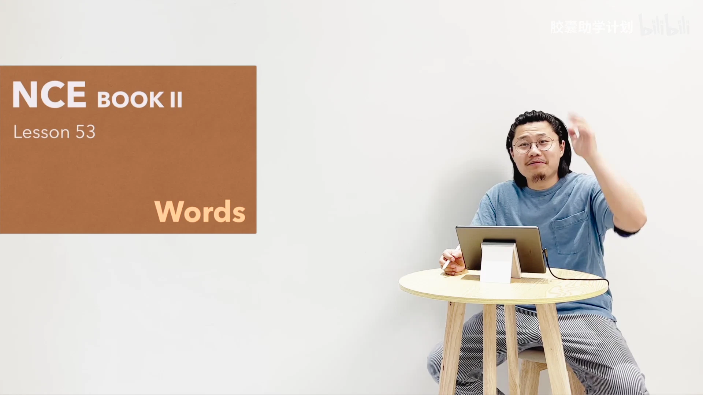

文字识别：NCE / BOOKII / Lesson 53 / Words

### 画面 00:00:02

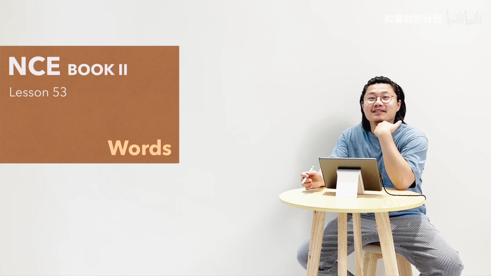

文字识别：NCE / BOOKII / Lesson 53 / Words

### 画面 00:00:05

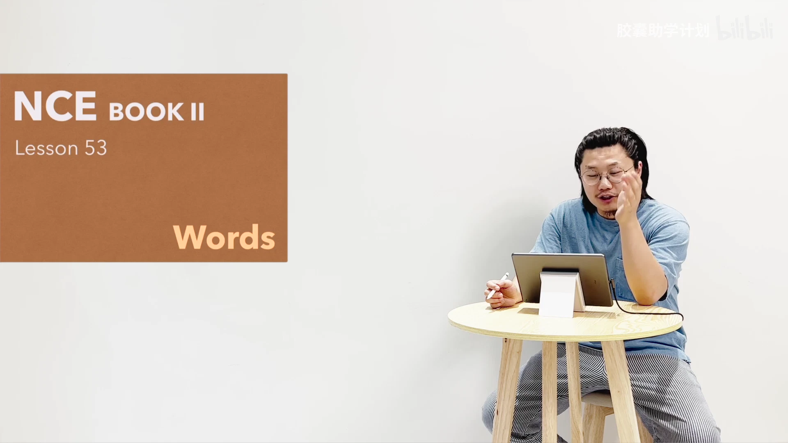

文字识别：NCE / BOOK"I / Lesson 53 / Words

### 画面 00:00:08

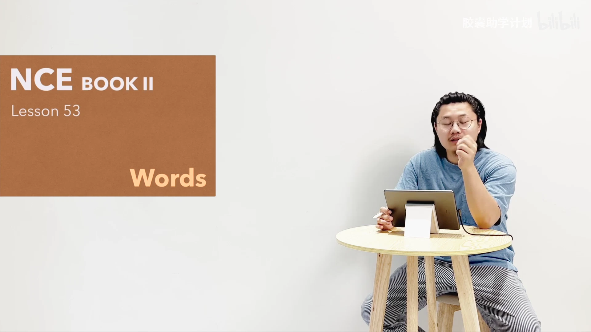

文字识别：NCE / BOOKⅡI / Lesson 53 / Words

### 画面 00:00:10

### 画面 00:00:12

文字识别：①如何表达“电线”？

### 画面 00:00:14

文字识别：①如何表达“电线”？ / 页”？

### 画面 00:00:16

文字识别：①如何表达“电线”？ / 如何表达“解决问题”

### 画面 00:00:18

文字识别：①如何表达“电线”？ / 如何表达“解决问题 / 如何表达“仍然是个迷”

### 画面 00:00:20

文字识别：①如何表达“电线”？ / 如何表达“解决问题” / 如何表达“仍然是个迷”?

### 画面 00:00:24

文字识别：胶囊助学计划bill / ••

### 画面 00:00:28

文字识别：胶囊助学计划

## 00:00:30–00:01:00

先看前两个单词啊，我把这两个单词放到一起去讲了。第一个叫做 hot，那也可以读成 hot，对吧？英式发音、美式发音都可以啊，都我们都要去学 hot or hot，OK。然后呢，它其实我们原来最熟悉的它的意思叫做热，对吧？现在夏天到了，那我们说 hot 啊，OK。然后呢，后边这个单词呢叫做 wire，wire 其实是线啊，比如说各种各样的电线啊、铁丝线都可

### 画面 00:00:30

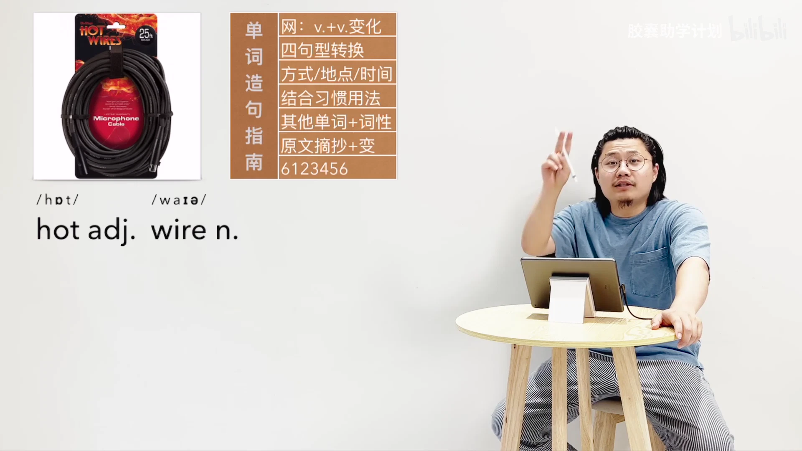

文字识别：HOT / 单词造句指南 / 网：v.+v.变化 / 25 / WIRES / 四句型转换 / 方式/地点/时间 / 结合习惯用法 / Microphone / 其他单词+词性 / Cable / 原文摘抄+变 / 6123456 / /hot/ / /waia/ / hot adj. / wire n.

### 画面 00:00:35

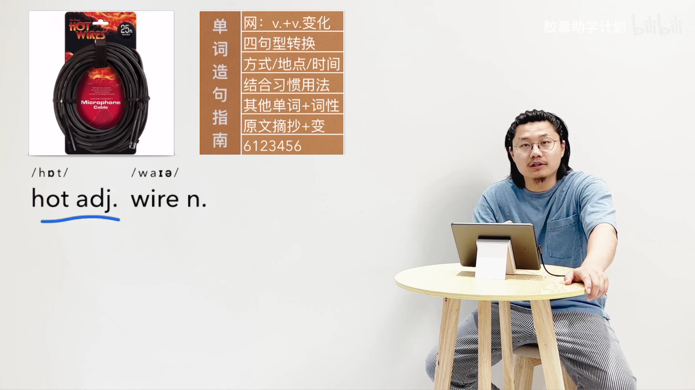

文字识别：HOT / 单词造句指南 / 网：v.+v.变化 / 25 / WIRES / 四句型转换 / 方式/地点/时间 / 结合习惯用法 / Microphone / 其他单词+词性 / Cablo / 原文摘抄+变 / 6123456 / /hot/ / /waia/ / hot adj. / wire n.

### 画面 00:00:40

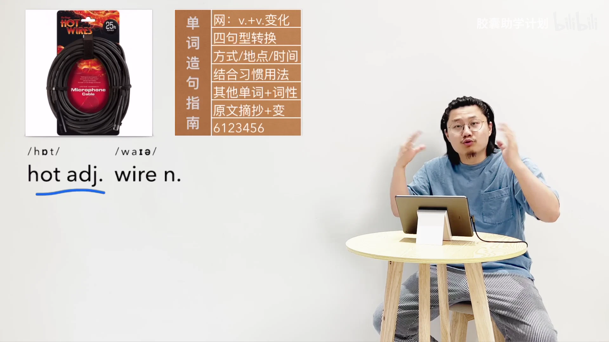

文字识别：单词造句指南 / 网：v.+v.变化 / 25 / WIRES / 四句型转换 / 方式/地点/时间 / 结合习惯用法 / Microphone / 其他单词+词性 / Cablo / 原文摘抄+变 / 6123456 / /hpt/ / /waia/ / hot adj. / wire n.

### 画面 00:00:53

文字识别：HOT / 单词造句指南 / 网：v.+v.变化 / 25 / WIRES / 四句型转换 / 方式/地点/时间 / 结合习惯用法 / Microphone / 其他单词+词性 / Cablo / 原文摘抄+变 / 6123456 / /hpt/ / /waia/ / hot adj. / wire n.

### 画面 00:00:55

文字识别：HOT / 单词造句指南 / 网：v.+v.变化 / 25n / WIRES / 四句型转换 / 方式/地点/时间 / 结合习惯用法 / Microphone / 其他单词+词性 / Cablo / 原文摘抄+变 / 6123456 / /hpt/ / /waia/ / hot adj. / wire n.

## 00:01:00–00:01:30

以叫做 wire。那为什么我把 hot 跟 wire 放到一起了呢？这个要看咱们本课的标题了，对吧？ Hot snake。它这里面的 hot 其实有几个呃有点双关的感觉，对吧？这个蛇如果各位看了文章，提前预习了的话，您可能知道被电熟了就很烫，对吧？很热。其次呢， hot 还有一个不是很常见的用法，表示的叫带电的啊。那 hot wire 啊，各位看这个给各位找的这个图，对吧？就指的是这

### 画面 00:01:00

文字识别：HOT / 单词造句指南 / 网：v.+v.变化 / 25 / WIRES / 四句型转换 / 方式/地点/时间 / 结合习惯用法 / Microphone / 其他单词+词性 / Cablo / 原文摘抄+变 / 6123456 / /hot/ / /waia/ / hot adj. / wire n.

### 画面 00:01:10

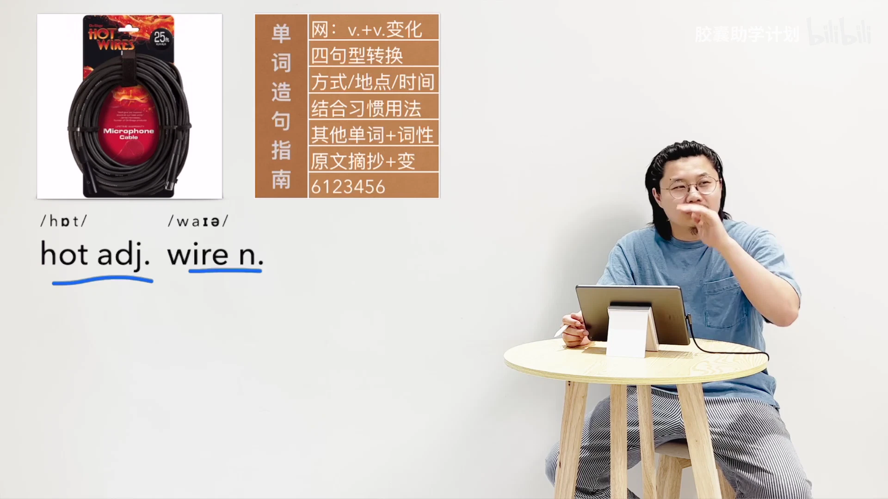

文字识别：HOT / 单词造句指南 / 网：v.+v.变化 / 25n / WIRES / 四句型转换 / 方式/地点/时间 / 结合习惯用法 / Microphone / 其他单词+词性 / Cablo / 原文摘抄+变 / 6123456 / /hpt/ / /waia/ / hot adj. / wire n.

### 画面 00:01:26

文字识别：HOT / 单词造句指南 / 网：v.+v.变化 / 25 / WIRES / 四句型转换 / 方式/地点/时间 / 结合习惯用法 / Microphone / 其他单词+词性 / Cablo / 原文摘抄+变 / 6123456 / /hpt/ / /waia/ / hot adj. / wire n.

## 00:01:30–00:02:00

样带电的这种电线，对不对？OK，那其实它并不是特别常用，比它更常用的是这两个单词，叫 electrical or electric。啊，原文给的叫做 electric wire。这 electric 这个单词还是咱们新一二十五课学的单词呢，对吧？那 electrical 就是它的形容词啊， electrical wire 和 electric wire 都可以。我们如果现在想拿它们去造句，那你看，其实不管是

### 画面 00:01:31

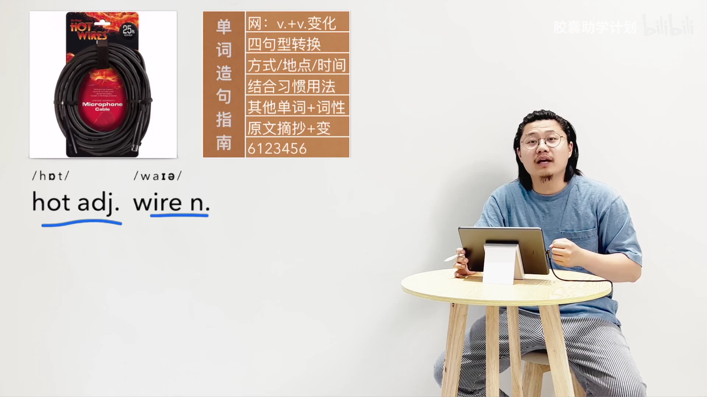

文字识别：HOT / 单词造句指南 / 网：v.+v.变化 / 25 / WIRES / 四句型转换 / 方式/地点/时间 / 结合习惯用法 / Microphone / 其他单词+词性 / Cablo / 原文摘抄+变 / 6123456 / /hot/ / /waia/ / hot adj. / wire n.

### 画面 00:01:37

文字识别：HOT / 单词造句指南 / 网：v.+v.变化 / 25 / WIRES / 四句型转换 / 方式/地点/时间 / 结合习惯用法 / Microphone / 其他单词+词性 / Cablo / 原文摘抄+变 / 6123456 / /hot/ / /wala/ / hot adj. wire n. / 1 / ) a hot wire... / ) electrical wire / electric wire / 2)

### 画面 00:01:39

文字识别：HOTA / 单词造句指南 / 网：v.+v.变化 / 25 / WIRES / 四句型转换 / 方式/地点/时间 / 结合习惯用法 / Microphone / 其他单词+词性 / Cablo / 原文摘抄+变 / 6123456 / /hot/ / /wala/ / hot adj. wire n. / 1 / a hot wire... / electrical wire / electric wire

### 画面 00:01:44

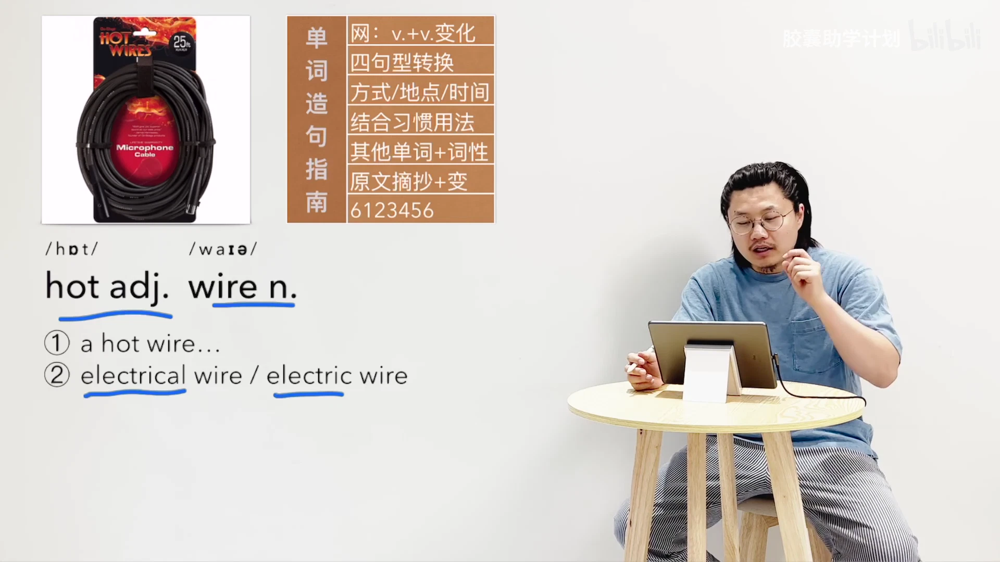

文字识别：HOT / 单词造句指南 / 网：v.+v.变化 / 25 / WIRES / 四句型转换 / 方式/地点/时间 / 结合习惯用法 / Microphone / 其他单词+词性 / Cablo / 原文摘抄+变 / 6123456 / /hot/ / /wala/ / hot adj. v / wire n. / 1 / a hot wire... / electrical wire / electric wire

### 画面 00:01:54

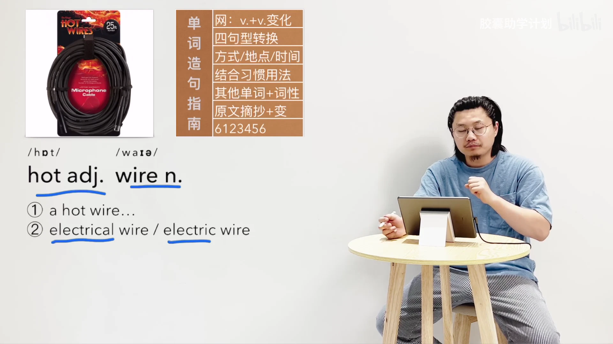

文字识别：HOT / 单词造句指南 / 网：v.+v.变化 / 25 / WIRES / 四句型转换 / 方式/地点/时间 / 结合习惯用法 / Microphone / 其他单词+词性 / Cablo / 原文摘抄+变 / 6123456 / /hot/ / /wala/ / hot adj. wire n. / 1 / a hot wire... / electrical wire / electric wire

## 00:02:00–00:02:30

hot wire、 electrical wire 还是 electric wire，它的核心都是名词。于是，其实就涉及到了这个地方，叫我们单词造句的时候要结合其他的单词加词性，对不对？也就是说，我们接下来要找的是各种各样的动词。这个地方呢，我专门留一个家庭作业。我总说让各位去找，然后每次我都给各位把找好的放到这儿。你可能从来也没有动手自己去找过啊。所以今天呢，我们我不造句了啊，我专

### 画面 00:02:00

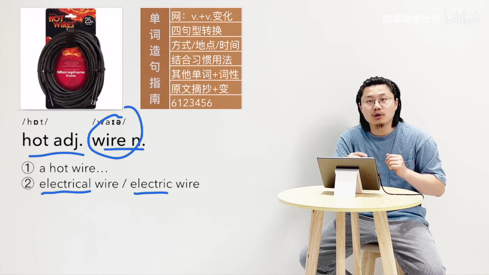

文字识别：HOT / 单词造句指南 / 网：v.+v.变化 / 25 / WIRES / 四句型转换 / 方式/地点/时间 / 结合习惯用法 / Microphone / 其他单词+词性 / Cablo / 原文摘抄+变 / 6123456 / /hot/ / laia/ / hot adj. / wire n / a hot wire... / 1 / electrical wire / electric wire

### 画面 00:02:07

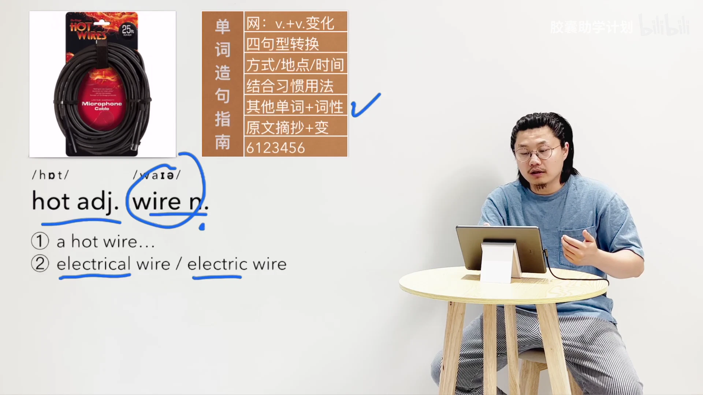

文字识别：HOT / 单词造句指南 / 网：v.+v.变化 / 25 / WIRES / 四句型转换 / 方式/地点/时间 / 结合习惯用法 / Microphone / 其他单词+词性 / Cablo / 原文摘抄+变 / 6123456 / /hot/ / laial / hot adj. / wire n / a hot wire... / 1 / electrical wire / electric wire

### 画面 00:02:10

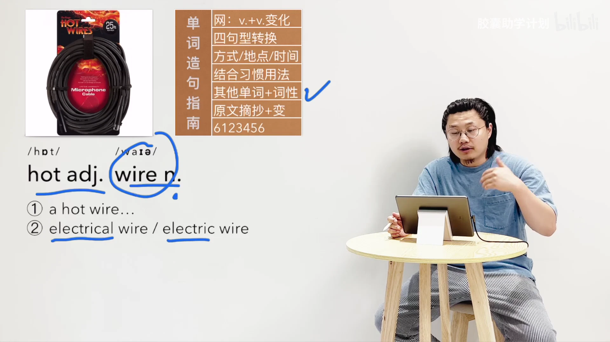

文字识别：HOT / 单词造句指南 / 网：v.+v.变化 / 25 / WIRES / 四句型转换 / 方式/地点/时间 / 结合习惯用法 / Microphone / 其他单词+词性 / Cablo / 原文摘抄+变 / 6123456 / /hot/ / laial / hot adj. / wire n / a hot wire... / 1 / electrical wire / electric wire

### 画面 00:02:13

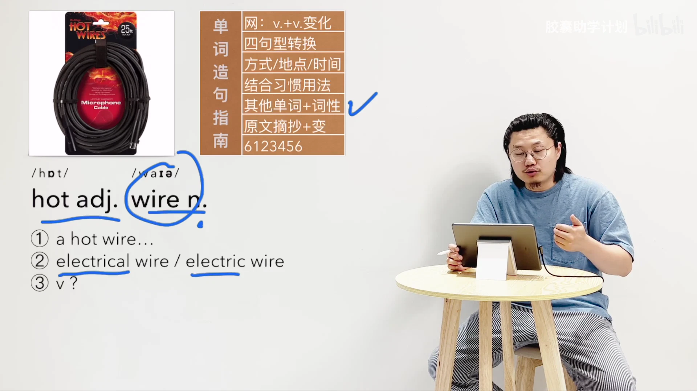

文字识别：HOT / 单词造句指南 / 网：v.+v.变化 / 25 / WIRES / 四句型转换 / 方式/地点/时间 / 结合习惯用法 / Microphone / 其他单词+词性 / Cablo / 原文摘抄+变 / 6123456 / /hot/ / laral / hot adj. / wire n / a hot wire... / 1 / electrical wire / electric wire

### 画面 00:02:16

文字识别：HOT / 单词造句指南 / 网：v.+v.变化 / 25 / WIRES / 四句型转换 / 方式/地点/时间 / 结合习惯用法 / Microphone / 其他单词+词性 / Cablo / 原文摘抄+变 / 6123456 / /hot/ / lyaial / hot adj. / wire n / 1 / a hot wire... / electrical wire / electric wire

### 画面 00:02:20

文字识别：HOT / 单词造句指南 / 网：v.+v.变化 / 25 / WIRES / 四句型转换 / 方式/地点/时间 / 结合习惯用法 / Microphone / 其他单词+词性 / Cablo / 原文摘抄+变 / 6123456 / /hot/ / laral / hot adj. / wire n / 1 / a hot wire... / electrical wire / electric wire

### 画面 00:02:23

文字识别：HOT / 25 / 单词造句指南 / 网：v.+v.变化 / WIRES / 四句型转换 / 方式/地点/时间 / 结合习惯用法 / Microphone / 其他单词+词性 / Cablo / 原文摘抄+变 / 6123456 / /hot/ / laral / hot adj. / wire n / 1 / a hot wire... / electrical wire / electric wire

## 00:02:30–00:03:00

门的留到这个地方，当做各位的家作业啊。各位怎么去找？不要拿不不好的一个思路是，你先去想汉语，然后想哪个汉语经常跟它去连，或者说不那么好，对吧？然后你去查一下这个汉语的英文单词，很可能那个英文单词和它不一定能连起来用。但有一些特别简单的，比如说 buy 啊，是很可能是能连起来用。比如说你汉语想是买，对吧？英文是 buy 啊，很可能是能连起来用的。但

### 画面 00:02:30

文字识别：HOT / 单词造句指南 / 网：v.+v.变化 / 25 / WIRES / 四句型转换 / 方式/地点/时间 / 结合习惯用法 / Microphone / 其他单词+词性 / Cablo / 原文摘抄+变 / 6123456 / /hot/ / laral / hot adj. / wire n / 1 / a hot wire... / electrical wire / electric wire

## 00:03:00–00:03:30

是这样错误率特别高。我们呢，其实现在单词造句的时候有一个非常重要的思路，就是连着之前我们学过的，对吧？所以那您就往前翻，往新概念二册前五十二课，对吧？以及整个新一那本书，你去翻着找，看哪些动词，对不对？以及哪些哎，以动词为主的习惯用法能和它连起来，对吧？比如说 needn't have bought，我印象当中这是我们四十一课学的，

### 画面 00:03:00

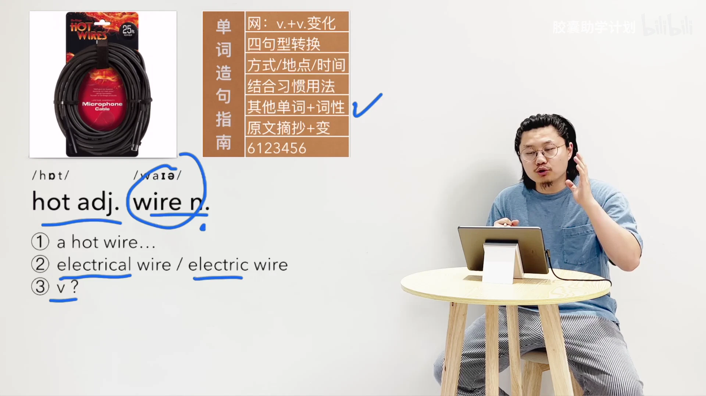

文字识别：HOT / 单词造句指南 / 网：v.+v.变化 / 25 / WIRES / 四句型转换 / 方式/地点/时间 / 结合习惯用法 / Microphone / 其他单词+词性 / Cablo / 原文摘抄+变 / 6123456 / /hot/ / laial / hot adj. / wire n / 1 / a hot wire... / electrical wire / electric wire

### 画面 00:03:18

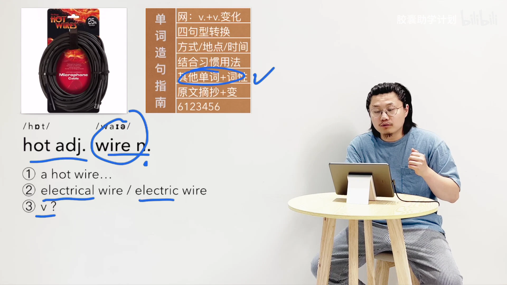

文字识别：HOT / 25 / 单词造句指南 / 网：v.+v.变化 / WIRES / 四句型转换 / 方式/地点/时间 / 结合习惯用法 / Microphone / 他单词+词社 / Cablo / 原文摘抄+变 / 6123456 / /hot/ / lvaia/ / hot adj. / wire n / a hot wire... / electrical wire / electric wire

### 画面 00:03:20

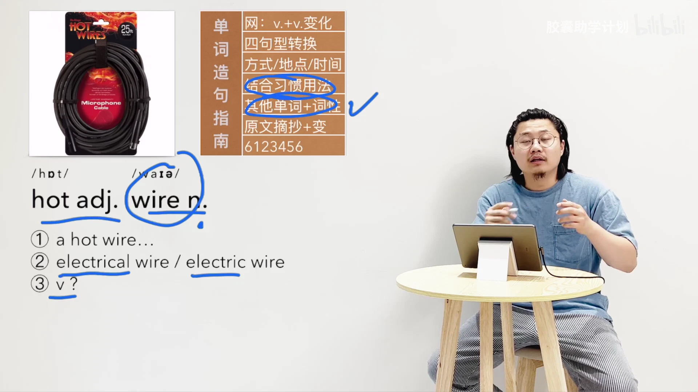

文字识别：HOT / 25r / 单词造句指南 / 网：v.+v.变化 / WIRES / 四句型转换 / 方式/地点/时间 / 后合习惯用法 / Microphone / 他单词+词 / Cablo / 原文摘抄+变 / 6123456 / /hot/ / lyaral / hot adj. / wire n / a hot wire... / electrical wire / electric wire

## 00:03:30–00:04:00

本不必买，哎，是不是就可以跟它连起来，对吧？所以这算是咱们一个小的家庭作业，不多说了啊。好，下一个单词很有意思啊，Superman啊，Spiderman对吧？啊，这个Batman都是各种超人啊。然后呢，Fireman他不是指的是火超人了，是吧？他指的是什么呢？就是我们图中的这个消防员，叫做Fire，再加上一个Man。但是呢，这个是很有意思的啊。这个实际上在美国的文化当中啊，

### 画面 00:03:33

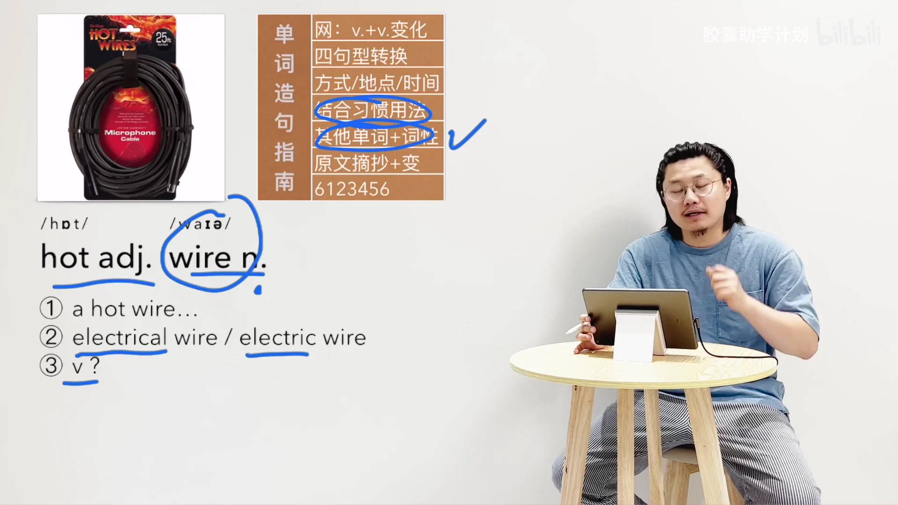

文字识别：HOT / 单词造句指南 / 网：v.+v.变化 / 25 / WIRES / 四句型转换 / 方式/地点/时间 / 后合习惯用法 / Microphone / 他单词+词性 / Cablo / 原文摘抄+变 / 6123456 / /hot/ / laral / hot adj. / wire n / a hot wire... / electrical wire / electric wire

### 画面 00:03:36

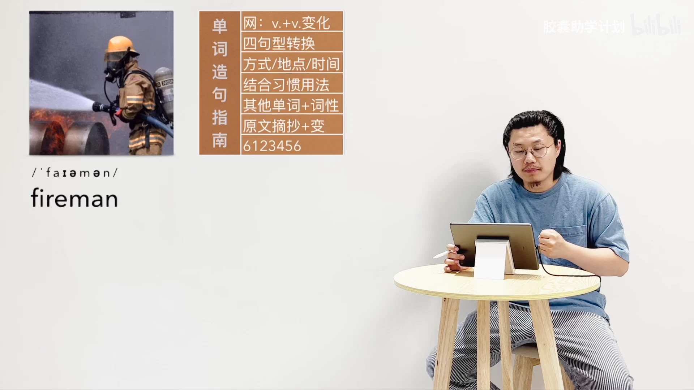

文字识别：单词造句指南 / 网：v.+v.变化 / 四句型转换 / 方式/地点/时间 / 结合习惯用法 / 其他单词+词性 / 原文摘抄+变 / 6123456 / / 'faiaman/ / fireman

### 画面 00:03:39

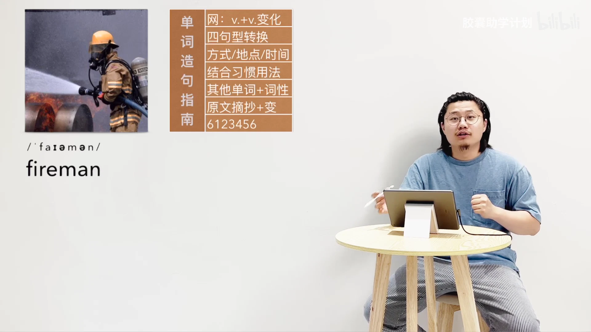

文字识别：单词造句指南 / 网：v.+v.变化 / 四句型转换 / 方式/地点/时间 / 结合习惯用法 / 其他单词+词性 / 原文摘抄+变 / 6123456 / / 'faiaman/ / fireman

### 画面 00:03:41

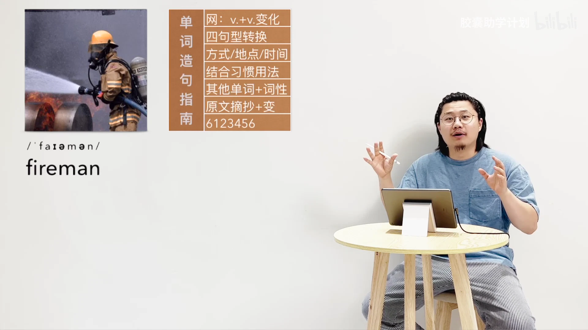

文字识别：单词造句指南 / 网：v.+v.变化 / 四句型转换 / 方式/地点/时间 / 结合习惯用法 / 其他单词+词性 / 原文摘抄+变 / 6123456 / / 'faiaman/ / fireman

### 画面 00:03:47

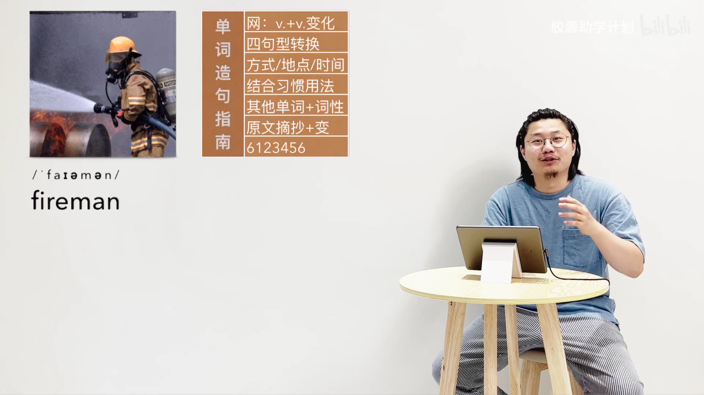

文字识别：单词造句指南 / 网：v.+v.变化 / 四句型转换 / 方式/地点/时间 / 结合习惯用法 / 其他单词+词性 / 原文摘抄+变 / 6123456 / / 'faiaman/ / fireman

### 画面 00:03:52

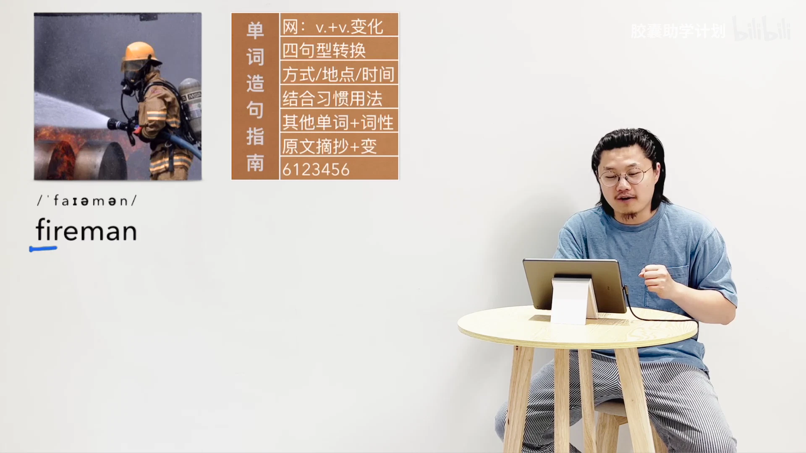

文字识别：单词造句指南 / 网：v.+v.变化 / 四句型转换 / 方式/地点/时间 / 结合习惯用法 / 其他单词+词性 / 原文摘抄+变 / 6123456 / / 'faiaman/ / fireman

## 00:04:00–00:04:30

比如说如果你有机会去看一些美剧，你重点去看，比如说《欲望都市》Sex and City，对吧？哎，我印象当中特别深，里面就会去解释，就会把 Fireman，他们是很崇拜 Fireman，尤其女性啊， Fireman浑身大肌肉块又很帅，对吧？哎，他们很崇拜这些人，很愿意和这些人去 date，所谓的叫约会啊，这很有意思，它的构词法也很好玩，对吧？火人啊，然后又像超人的那些构词法一样， Fireman，消防

### 画面 00:04:03

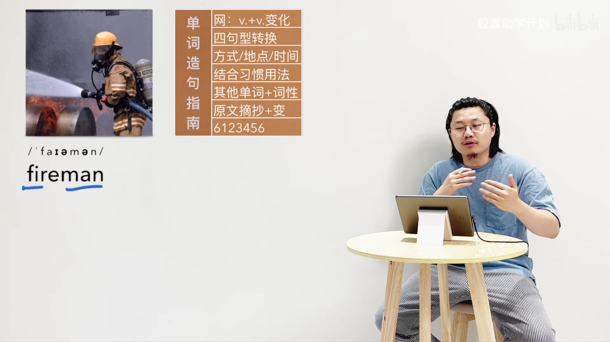

文字识别：单词造句指南 / 网：v.+v.变化 / 四句型转换 / 方式/地点/时间 / 结合习惯用法 / 其他单词+词性 / 原文摘抄+变 / 6123456 / / 'faiaman/ / fireman

### 画面 00:04:06

文字识别：单词造句指南 / 网：v.+v.变化 / 四句型转换 / 方式/地点/时间 / 结合习惯用法 / 其他单词+词性 / 原文摘抄+变 / 6123456 / / 'faiaman/ / fireman

### 画面 00:04:10

文字识别：单词造句指南 / 网：v.+v.变化 / 四句型转换 / 方式/地点/时间 / 结合习惯用法 / 其他单词+词性 / 原文摘抄+变 / 6123456 / / 'faiaman/ / fireman

### 画面 00:04:12

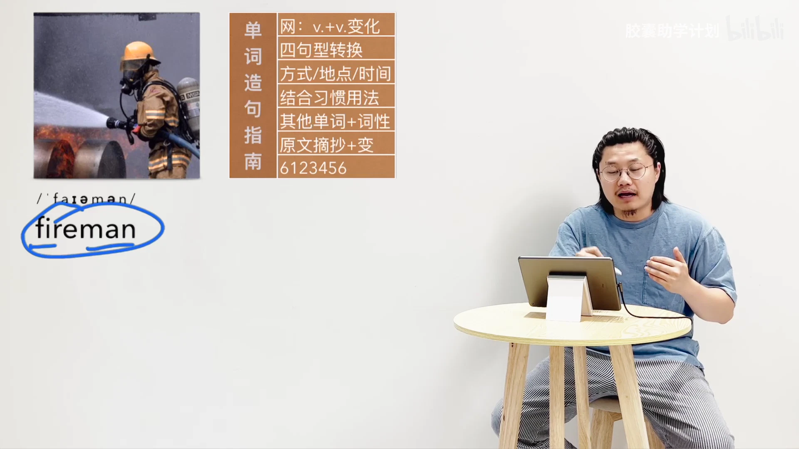

文字识别：单词造句指南 / 网：v.+v.变化 / 四句型转换 / 方式/地点/时间 / 结合习惯用法 / 其他单词+词性 / 原文摘抄+变 / 6123456 / /'faiaman/ / fireman

### 画面 00:04:15

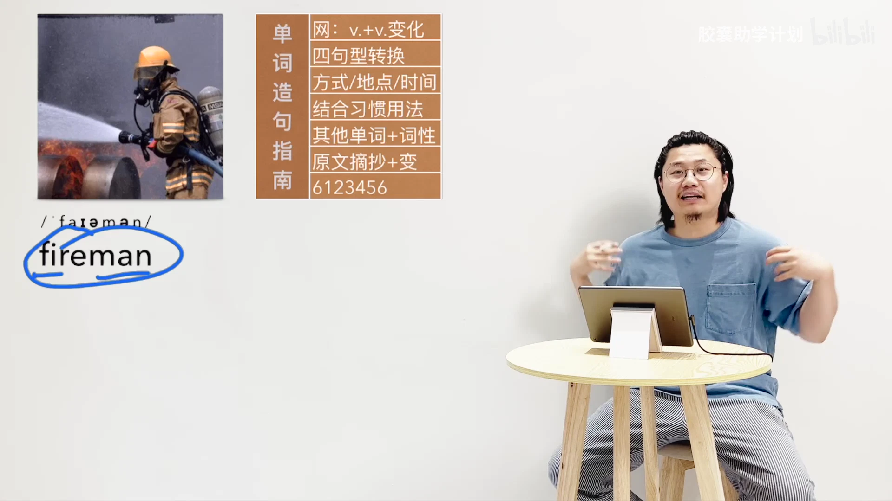

文字识别：单词造句指南 / 网：v.+v.变化 / 四句型转换 / 方式/地点/时间 / 结合习惯用法 / 其他单词+词性 / 原文摘抄+变 / 6123456 / /'faiaman/ / fireman

### 画面 00:04:27

文字识别：单词造句指南 / 网：v.+v.变化 / 四句型转换 / 方式/地点/时间 / 结合习惯用法 / 其他单词+词性 / 原文摘抄+变 / 6123456 / /'faiaman/ / fireman

## 00:04:30–00:05:00

员。那它的复数啊，这地方简单提一句，就是我们在文章当中也会见到，就是把a这个字母变成e啊，跟man人man或者男人变复数的方式是一样的。它本身是个名词，是一个职业，跟我们原来学过的什么captain对吧，detective这都是第一单元咱们就学过的单词了，本质上没什么太大区别。所以拿它去造句还是比较容易的。比如说，Why is that fireman out

### 画面 00:04:30

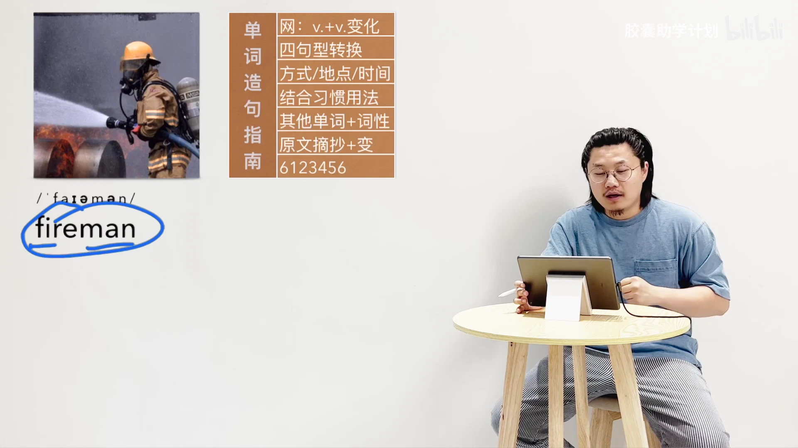

文字识别：单词造句指南 / 网：v.+v.变化 / 四句型转换 / 方式/地点/时间 / 结合习惯用法 / 其他单词+词性 / 原文摘抄+变 / 6123456 / /'faiaman/ / fireman

### 画面 00:04:34

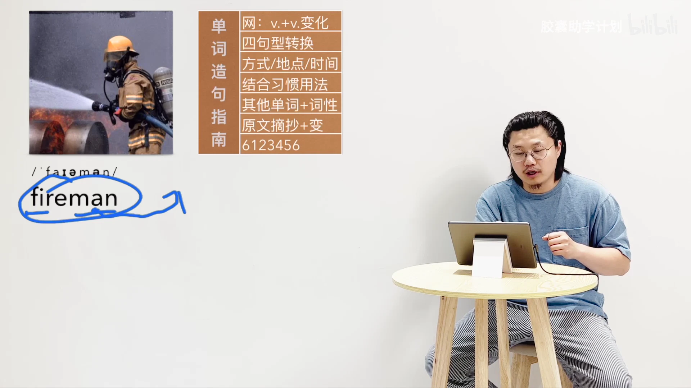

文字识别：单词造句指南 / 网：v.+v.变化 / 四句型转换 / 方式/地点/时间 / 结合习惯用法 / 其他单词+词性 / 原文摘抄+变 / 6123456 / /'faiaman/ / fireman / 入

### 画面 00:04:38

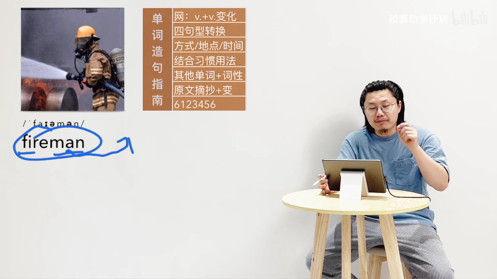

文字识别：单词造句指南 / 网：v.+v.变化 / 四句型转换 / 方式/地点/时间 / 结合习惯用法 / 其他单词+词性 / 原文摘抄+变 / 6123456 / /'faiaman/ / fireman

### 画面 00:04:40

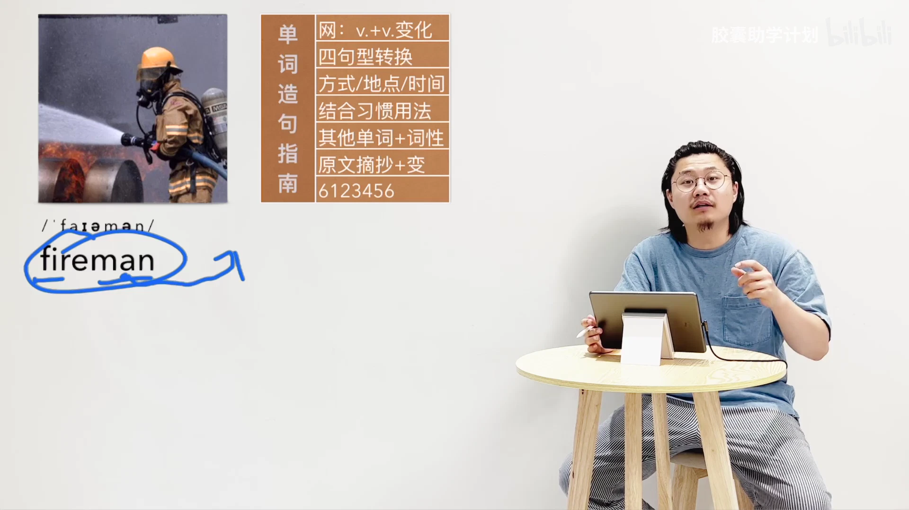

文字识别：单词造句指南 / 网：v.+v.变化 / 四句型转换 / 方式/地点/时间 / 结合习惯用法 / 其他单词+词性 / 原文摘抄+变 / 6123456 / /'faiaman/ / fireman

### 画面 00:04:55

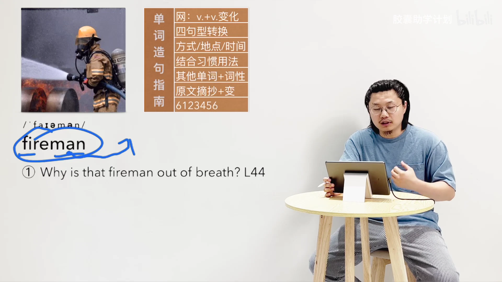

文字识别：单词造句指南 / 网：v.+v.变化 / 四句型转换 / 方式/地点/时间 / 结合习惯用法 / 其他单词+词性 / 原文摘抄+变 / 6123456 / /'faiaman/ / fireman / 入 / ) Why is that fireman out of breath? L44

## 00:05:00–00:05:30

of breath?啊，他为什么上气不接下气的呢？四十四课咱们学的习惯用法，我把这两个两句话正好一问一答结合到了一起，叫做That fireman has been running，说那个消防员之前一直在跑步。注意，在说话的这一刻，他其实已经不跑步了。这是五十二课咱们刚刚学过的语法，现在完成进行时，对吧？哎，第一个用法，过去一直在进行，然后呢，结束了，对现

### 画面 00:05:01

文字识别：单词造句指南 / 网：v.+v.变化 / 四句型转换 / 方式/地点/时间 / 结合习惯用法 / 其他单词+词性 / 原文摘抄+变 / 6123456 / /'faiaman/ / fireman / 入 / ) Why is that fireman out of breath? L44

### 画面 00:05:05

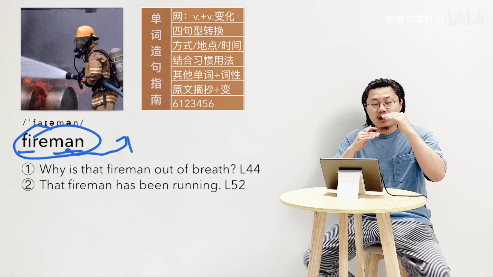

文字识别：单词造句指南 / 网：v.+v.变化 / 四句型转换 / 方式/地点/时间 / 结合习惯用法 / 其他单词+词性 / 原文摘抄+变 / 6123456 / /'faiaman/ / fireman / 入 / Why is that fireman out of breath? L44 / That fireman has been running. L52

## 00:05:30–00:06:00

在产生了一个影响，对不对？哎，他之前一直在跑步，现在他不跑了，并且他现在上气不接下气。再读一遍这个单词，fireman. Okay,好，我们再造一个句子，叫做We can help that fireman to get his room in order.啊，get this room in order.啊，读错了this啊. Okay,那注意这个地方，其实用了两个习惯用法，help somebody to do something，帮助某人做某事儿，和get something in order，把什么什

### 画面 00:05:35

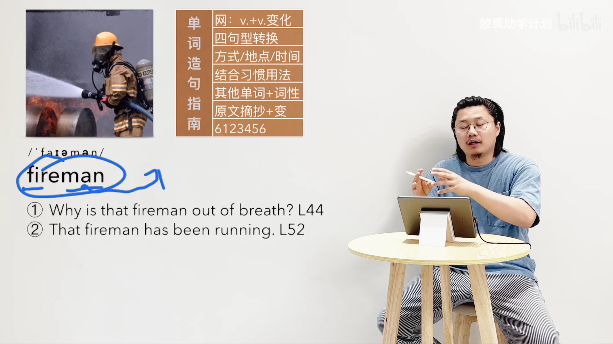

文字识别：单词造句指南 / 网：v.+v.变化 / 四句型转换 / 方式/地点/时间 / 结合习惯用法 / 其他单词+词性 / 原文摘抄+变 / 6123456 / /'faiaman/ / fireman / 入 / Why is that fireman out of breath? L44 / That fireman has been running. L52

### 画面 00:05:40

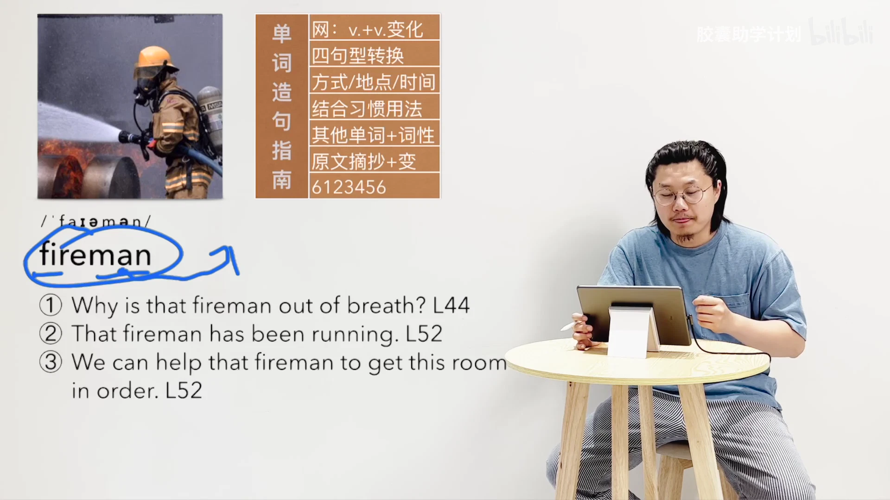

文字识别：单词造句指南 / 网：v.+v.变化 / 四句型转换 / 方式/地点/时间 / 结合习惯用法 / 其他单词+词性 / 原文摘抄+变 / 6123456 / / 'faiaman/ / fireman / Why is that fireman out of breath? L44 / That fireman has been running. L52 / We can help that fireman to get this room / in order. L52

### 画面 00:05:45

文字识别：单词造句指南 / 网：v.+v.变化 / 四句型转换 / 方式/地点/时间 / 结合习惯用法 / 其他单词+词性 / 原文摘抄+变 / 6123456 / /'faiaman/ / fireman / Why is that fireman out of breath? L44 / That fireman has been running. L52 / We can help that fireman to get this room / in order. L52

### 画面 00:05:48

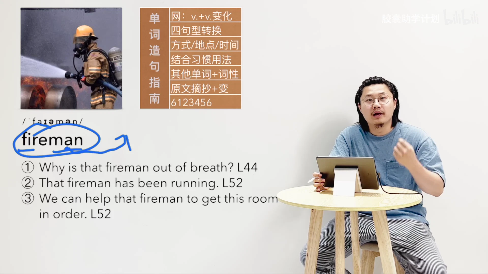

文字识别：单词造句指南 / 网：v.+v.变化 / 四句型转换 / 方式/地点/时间 / 结合习惯用法 / 其他单词+词性 / 原文摘抄+变 / 6123456 / /'faiaman/ / fireman / 入 / Why is that fireman out of breath? L44 / 1 / That fireman has been running. L52 / We can help that fireman to get this room / in order. L52

### 画面 00:05:51

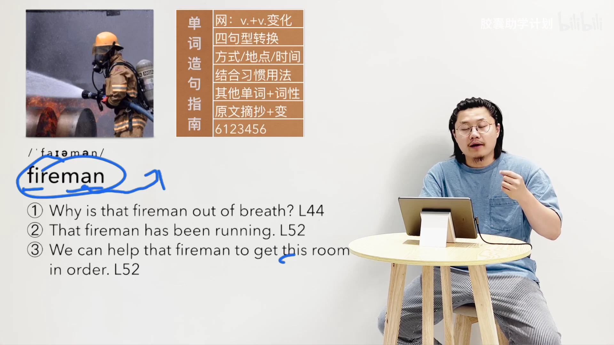

文字识别：单词造句指南 / 网：v.+v.变化 / 四句型转换 / 方式/地点/时间 / 结合习惯用法 / 其他单词+词性 / 原文摘抄+变 / 6123456 / /'faiaman/ / fireman / Why is that fireman out of breath? L44 / That fireman has been running. L52 / We can help that fireman to get this room / in order. L52

### 画面 00:05:58

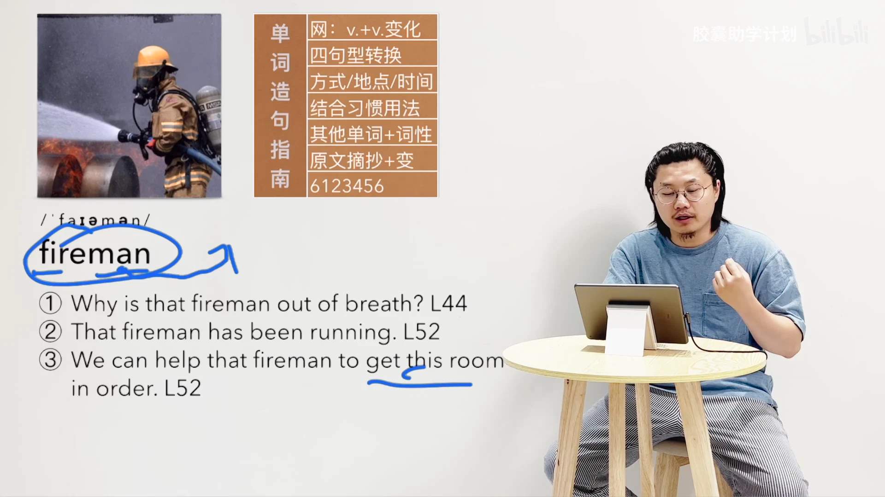

文字识别：单词造句指南 / 网：v.+v.变化 / 四句型转换 / 方式/地点/时间 / 结合习惯用法 / 其他单词+词性 / 原文摘抄+变 / 6123456 / / 'faiaman/ / fireman / 入 / Why is that fireman out of breath? L44 / That fireman has been running. L52 / We can help that fireman to get this room / in order. L52

## 00:06:00–00:06:30

么整理好，对吧？OK，这是五十二课刚刚用到的两个习惯用法，学过的两个习惯用法。Continue, next one，下一个单词跟我读一下，叫做cause, cause. OK, very good.本课呢，它其实既出现了动词的用法，又出现了名词的用法。它的动词指的是引发、引起、导致；它的名词有点像reason啊，就是原因啊。OK，那我们造句，比如说

### 画面 00:06:00

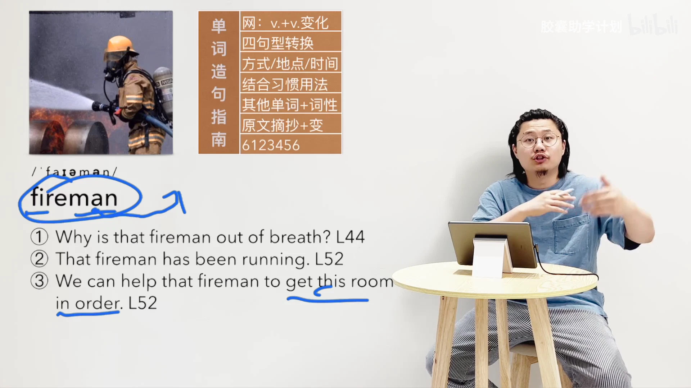

文字识别：单词造句指南 / 网：v.+v.变化 / 四句型转换 / 方式/地点/时间 / 结合习惯用法 / 其他单词+词性 / 原文摘抄+变 / 6123456 / /'faiaman/ / fireman / 入 / Why is that fireman out of breath? L44 / That fireman has been running. L52 / We can help that fireman to get this room / in order. L52

### 画面 00:06:04

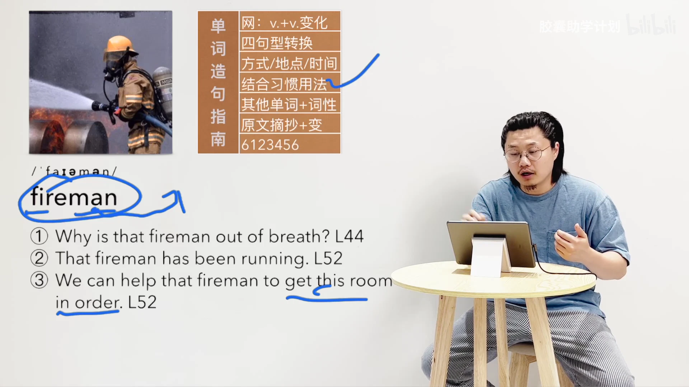

文字识别：单词造句指南 / 网：v.+v.变化 / 四句型转换 / 方式/地点/时间 / 结合习惯用法 / 其他单词+词性 / 原文摘抄+变 / 6123456 / /'faiaman/ / fireman / 入 / Why is that fireman out of breath? L44 / That fireman has been running. L52 / We can help that fireman to get this room / in order. L52

### 画面 00:06:06

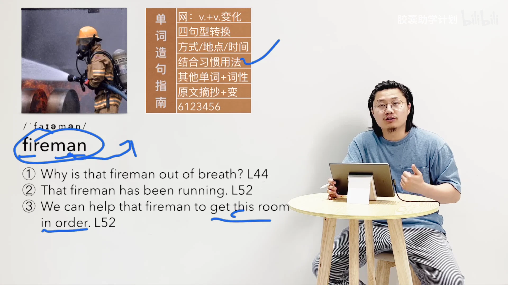

文字识别：单词造句指南 / 网：v.+v.变化 / 四句型转换 / 方式/地点/时间 / 结合习惯用法 / 其他单词+词性 / 原文摘抄+变 / 6123456 / / 'faiaman/ / fireman / 入 / Why is that fireman out of breath? L44 / That fireman has been running. L52 / We can help that fireman to get this room / in order. L52

### 画面 00:06:08

文字识别：单词造句指南 / 网：v.+v.变化 / 四句型转换 / 方式/地点/时间 / 结合习惯用法 / 其他单词+词性 / 原文摘抄+变 / 6123456 / / k 3 :z / / cause v. n.

### 画面 00:06:11

文字识别：单词造句指南 / 网：v.+v.变化 / 四句型转换 / 方式/地点/时间 / 结合习惯用法 / 其他单词+词性 / 原文摘抄+变 / 6123456 / / k 3 :z / / cause v. n.

### 画面 00:06:24

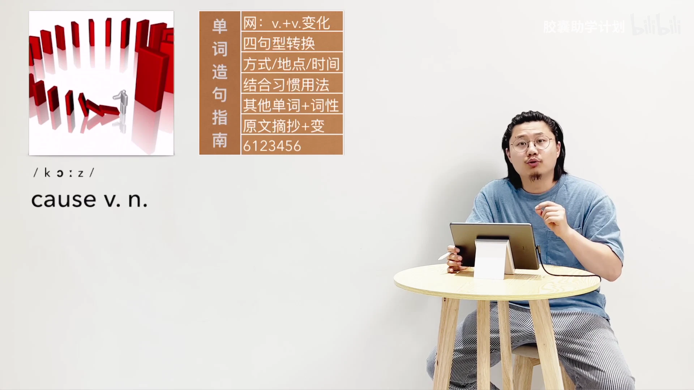

文字识别：单词造句指南 / 网：v.+v.变化 / 四句型转换 / 方式/地点/时间 / 三 / 结合习惯用法 / 其他单词+词性 / 原文摘抄+变 / 6123456 / / k 3:z / / cause v. n.

## 00:06:30–00:07:00

文章的标题啊的下面给了一句话叫 What caused the fire? Okay,说什么引起了这场火灾呢? Okay, very good. 接下来原文给了一句话叫做 Forest fires are often caused by broken glass. 我们就截了一部分，对吧？说森林大火经常是被什么引起的呢？被破碎的这个玻璃啊，这个咱们小的时候学过，我不知道各位有没有印象，拿放大镜，很

### 画面 00:06:30

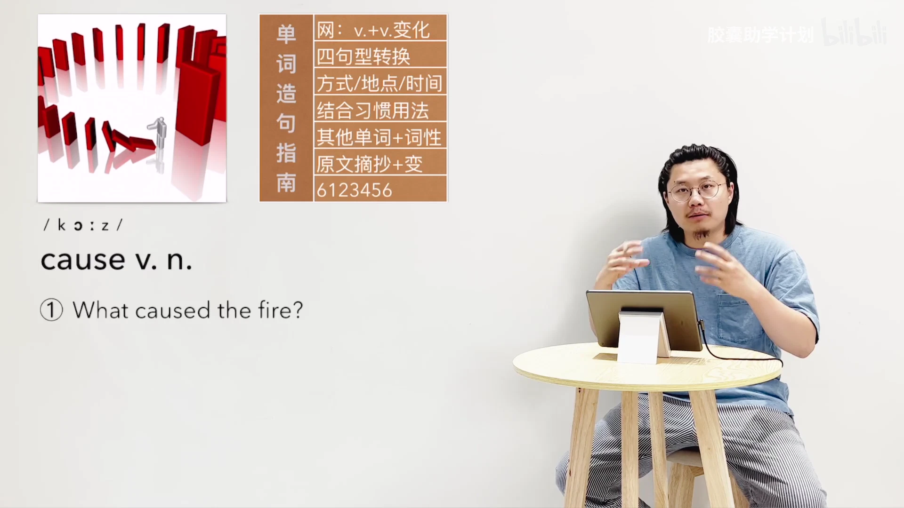

文字识别：单词造句指南 / 网：v.+v.变化 / 四句型转换 / 方式/地点/时间 / 结合习惯用法 / 其他单词+词性 / 原文摘抄+变 / 6123456 / / k o :z / / cause v. n. / What caused the fire?

### 画面 00:06:38

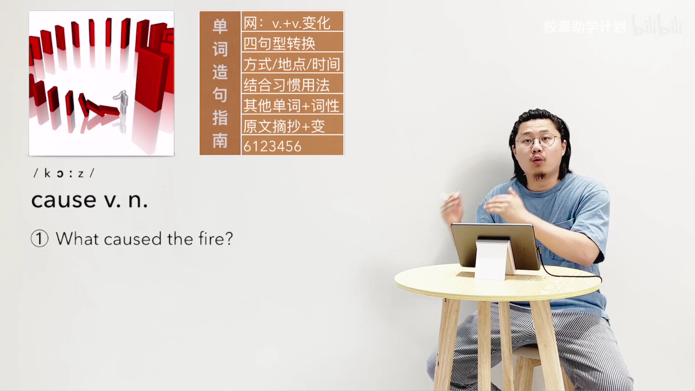

文字识别：单词造句指南 / 网：v.+v.变化 / 四句型转换 / 方式/地点/时间 / 结合习惯用法 / 其他单词+词性 / 原文摘抄+变 / 6123456 / / k 3:z / / cause v. n. / What caused the fire?

### 画面 00:06:41

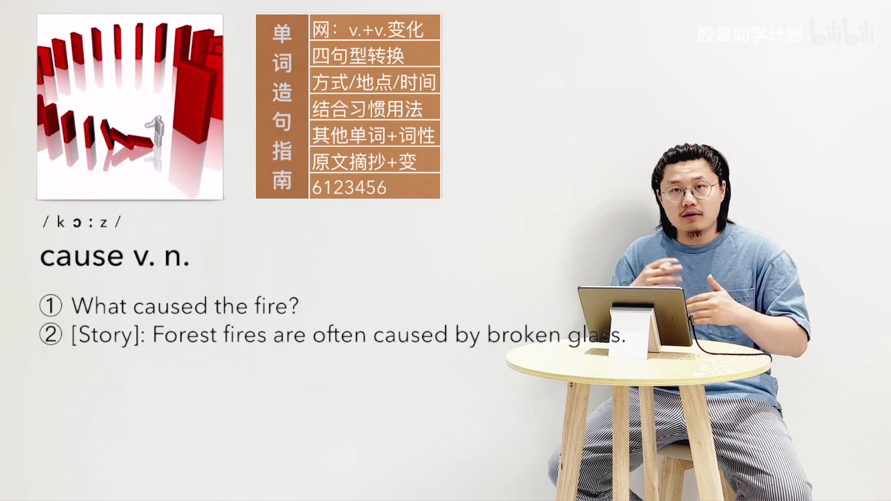

文字识别：单词造句指南 / 网：v.+v.变化 / 四句型转换 / 方式/地点/时间 / 结合习惯用法 / 其他单词+词性 / 原文摘抄+变 / 6123456 / / ko:z / / cause v. n. / ) What caused the fire? / ) [Story]: Forest fires are often caused by broken glass.

### 画面 00:06:45

文字识别：单词造句指南 / 网：v.+v.变化 / 四句型转换 / 方式/地点/时间 / 结合习惯用法 / 其他单词+词性 / 原文摘抄+变 / 6123456 / /ko:z 1 / cause v. n. / ) What caused the fire? / ) [Story]: Forest fires are often caused by broken glass.

## 00:07:00–00:07:30

小很小的时候拿放大镜，对吧？哎，去点火啊，由太阳去用放大镜点火，其实跟这个思路是一样的啊。OK，好，那我们把它变一般疑问句，叫做 Are forest fires often caused by broken glass？OK，接下来变成各种特殊疑问句，要么您暂停屏幕，对吧？要么您课下的时候去把它写出来，要么是口语练习，要么写作练习，您自己决定。反正这个家庭作业是您自己的，对吧？

### 画面 00:07:03

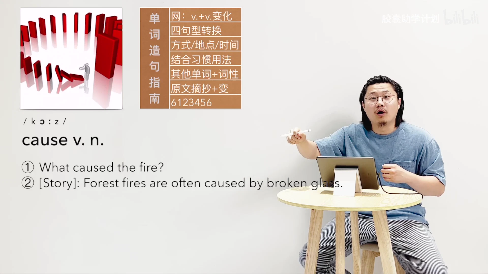

文字识别：单词造句指南 / 网：v.+v.变化 / 四句型转换 / 方式/地点/时间 / 结合习惯用法 / 其他单词+词性 / 原文摘抄+变 / 6123456 / /ko:z1 / cause v. n. / ) What caused the fire? / ) [Story]: Forest fires are often caused by broken glass. / 2

### 画面 00:07:08

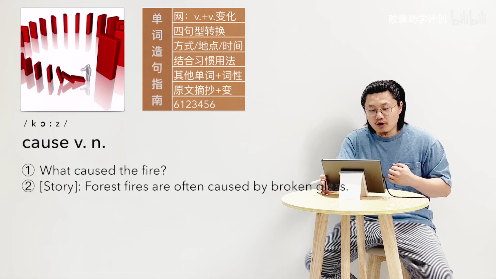

文字识别：单词造句指南 / 网：v.+v.变化 / 四句型转换 / 方式/地点/时间 / 结合习惯用法 / 其他单词+词性 / 原文摘抄+变 / 6123456 / / ko:z 1 / cause v. n. /  What caused the fire? / ) [Story]: Forest fires are often caused by broken gass. / 2

### 画面 00:07:13

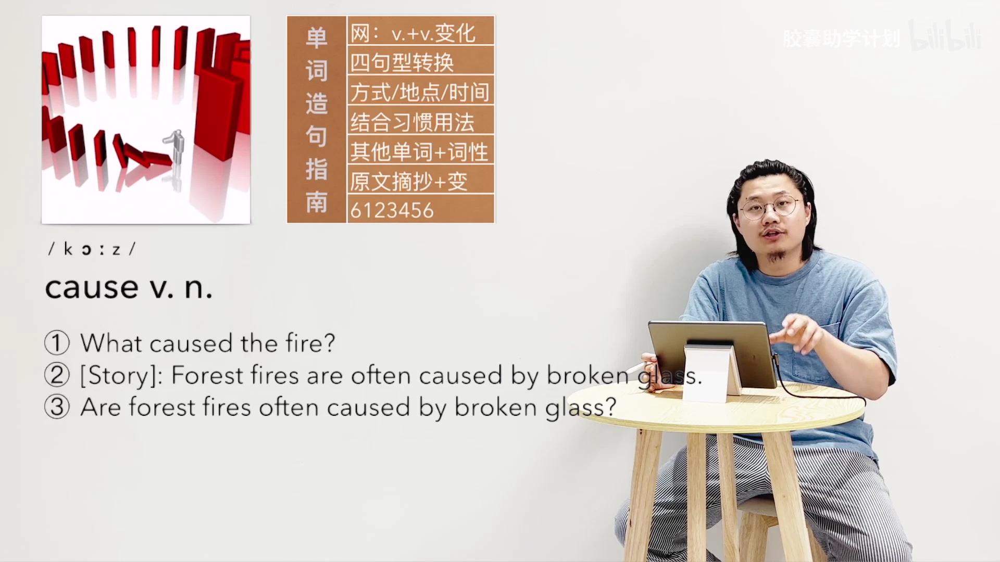

文字识别：单词造句指南 / 网：v.+v.变化 / 四句型转换 / 方式/地点/时间 / 结合习惯用法 / 其他单词+词性 / 原文摘抄+变 / 6123456 / / k o:z 1 / cause v. n. / ) What caused the fire? / ② [Story]: Forest fires are often caused by broken / SS. / ③ Are forest fires often caused by broken glass?

### 画面 00:07:15

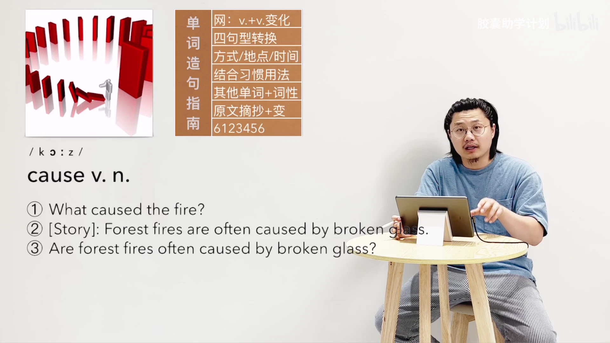

文字识别：单词造句指南 / 网：v.+v.变化 / 四句型转换 / 方式/地点/时间 / 结合习惯用法 / 其他单词+词性 / 原文摘抄+变 / 6123456 / / k o:z 1 / cause v. n. / ) What caused the fire? / ② [Story]: Forest fires are often caused by broken / ass. / ③ Are forest fires often caused by broken glass?

### 画面 00:07:20

文字识别：单词造句指南 / 网：v.+v.变化 / 四句型转换 / 方式/地点/时间 / 结合习惯用法 / 其他单词+词性 / 原文摘抄+变 / 6123456 / / k o:z 1 / cause v. n. / ) What caused the fire? / [Story]: Forest fires are often caused by broken] / 2） / ass. / ③ Are forest fires often caused by broken glass? / 3 / why/what/how often... / 4

### 画面 00:07:28

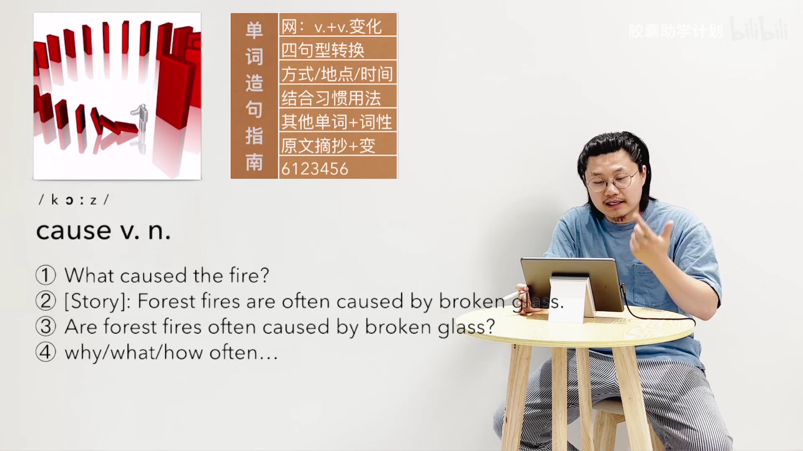

文字识别：单词造句指南 / 网：v.+v.变化 / 四句型转换 / 方式/地点/时间 / 结合习惯用法 / 其他单词+词性 / 原文摘抄+变 / 6123456 / / k o:z 1 / cause v. n. /  What caused the fire? / 1 / [Story]: Forest fires are often caused by broken glass. / 2） / ③ Are forest fires often caused by broken glass? / 3 / why/what/how often... / 4

## 00:07:30–00:08:00

接下来，呃，如果哎这里叫做引起导致，这是个动词，明显能看出来是被动，对不对？好，然后如果你把它当做名词呢，就是说这个原因，对吧？OK，那你前面就要加动词。原文给了一个还不错的动词，叫做 discover，对吧？叫做发现。比如说，呃，fireman discovered the cause yesterday。哎，一个消防员昨天发现了这个原因啊。OK，

### 画面 00:07:31

文字识别：单词造句指南 / 网：v.+v.变化 / 四句型转换 / 方式/地点/时间 / 结合习惯用法 / 其他单词+词性 / 原文摘抄+变 / 6123456 / / k o:z 1 / cause v. n. / ) What caused the fire? / 1 / [Story]: Forest fires are often caused by broken glass. / 2) / Are forest fires often caused by broken glass? / 3 / why/what/how often... / discover + cause

### 画面 00:07:33

文字识别：单词造句指南 / 网：v.+v.变化 / 四句型转换 / 方式/地点/时间 / 结合习惯用法 / 其他单词+词性 / 原文摘抄+变 / 6123456 / / k o:z 1 / cause v. n. /  What caused the fire? / [Story]: Forest fires are often caused by broken glass. / 2） / Are forest fires often caused by broken glass? / 3 / why/what/how often... / discover + cause

### 画面 00:07:36

文字识别：单词造句指南 / 网：v.+v.变化 / 四句型转换 / 方式/地点/时间 / 结合习惯用法 / 其他单词+词性 / 原文摘抄+变 / 6123456 / / k o:z 1 / cause v. n. / V. / ) What caused the fire? / [Story]: Forest firesare often caused by broken glass. / 2 / Are forest fires often caused by broken glass? / 3 / why/what/how often... / discover + cause

### 画面 00:07:38

文字识别：单词造句指南 / 网：v.+v.变化 / 四句型转换 / 方式/地点/时间 / 结合习惯用法 / 其他单词+词性 / 原文摘抄+变 / 6123456 / / k o :z 1 / cause v. n. / V. / What caused the fire? / [Story]: Forest firesare often caused by broken glass. / 2 / Are forest fires often caused by broken glass? / why/what/how often... / discover + cause

### 画面 00:07:40

文字识别：单词造句指南 / 网：v.+v.变化 / 四句型转换 / 方式/地点/时间 / 结合习惯用法 / 其他单词+词性 / 原文摘抄+变 / 6123456 / / k o:z 1 / cause v. n. / V. / What caused the fire? / [Story]: Forest firesare often caused by broken glass. / 2 / Are forest fires often caused by broken glass? / why/what/how often... / discover + cause

### 画面 00:07:45

文字识别：单词造句指南 / 网：v.+v.变化 / 四句型转换 / 方式/地点/时间 / 结合习惯用法 / 其他单词+词性 / 原文摘抄+变 / 6123456 / / ko:z 1 / cause v. n. / V. / What caused the fire? / 1 / [Story]: Forest firesare often caused by broken glass. / 2 / Are forest fires often caused by broken glass? / 3 / why/what/how often... / V. / discover + cause

### 画面 00:07:49

文字识别：单词造句指南 / 网：v.+v.变化 / 四句型转换 / 方式/地点/时间 / 结合习惯用法 / 其他单词+词性 / 原文摘抄+变 / 6123456 / / k o:z 1 / cause v. n. / V. /  What caused the fire? / 1 / [Story]: Forest fires are often caused by broken glass. / 2） / Are forest fires often caused by broken glass? / 3 / why/what/how often... / V. / discover + cause / ⑥ A fireman discovered the cause yesterday.

### 画面 00:07:52

文字识别：单词造句指南 / 网：v.+v.变化 / 四句型转换 / 方式/地点/时间 / 结合习惯用法 / 其他单词+词性 / 原文摘抄+变 / 6123456 / / k o:z 1 / cause v. n. / V / 1 / What caused the fire? / [Story]: Forest fires are often caused by broken glass. / 2 / Are forest fires often caused by broken glass? / 3 / why/what/how often... / V. / discover + cause / n / ⑥ A fireman discovered the cause yesterday.

### 画面 00:07:55

文字识别：单词造句指南 / 网：v.+v.变化 / 四句型转换 / 方式/地点/时间 / 结合习惯用法 / 其他单词+词性 / 原文摘抄+变 / 6123456 / / k o:z 1 / cause v. n. / V. / What caused the fire? / [Story]: Forest firesare often caused by broken glass. / Are forest fires often caused by broken glass? / 3 / why/what/how often... / V. / discover + cause / ⑥ A fireman discovered the cause yesterday.

## 00:08:00–00:08:30

那你注意，我们其实单词造句还有一个思路，就是结合之前刚刚学过的单词，拿它一块儿去造句，对不对？好，然后四句型转换我们就不再多说了啊。再读一遍这个单词，cause，OK，continue，下一个单词跟我读一下，叫做，ex，examine，examine，examine。好，examine首先是一个动词的意思，它指的是检查啊。然后呢，你想，那动

### 画面 00:08:00

文字识别：单词造句指南 / 网：v.+v.变化 / 四句型转换 / 方式/地点/时间 / 结合习惯用法 / 其他单词+词性 / 原文摘抄+变 / 6123456 / / k o:z 1 / cause v. n. / V. / What caused the fire? / [Story]: Forest firesare often caused by broken glass. / 2） / Are forest fires often caused by broken glass? / 3 / why/what/how often... / V. / discover + cause / ⑥ A fireman discovered the cause yesterday.

### 画面 00:08:02

文字识别：单词造句指南 / 网：v.+v.变化 / 四句型转换 / 方式/地点/时间 / 结合习惯用法 / 其他单词+词性 / 原文摘抄+变 / 6123456 / / k o:z 1 / cause v. n. / V. / What caused the fire? / [Story]: Forest fires are often caused by broken glass. / 2 / Are forest fires often caused by broken glass? / why/what/how often... / V. / discover + cause / ⑥ A fireman discovered the cause yesterday.

### 画面 00:08:06

文字识别：单词造句指南 / 网：v.+v.变化 / 四句型转换 / 方式/地点/时间 / 结合习惯用法 / 其他单词+词性 / 原文摘抄+变 / 6123456 / / k o:z 1 / cause v. n. / V. / What caused the fire? / [Story]: Forest firesare often caused by broken glass. / Are forest fires often caused by broken glass? / why/what/how often... / V. / discover + cause / ⑥ A fireman discovered the cause yesterday.

### 画面 00:08:11

文字识别：单词造句指南 / 网：v.+v.变化 / 四句型转换 / 方式/地点/时间 / 结合习惯用法 / 其他单词+词性 / 原文摘抄+变 / 6123456 / / k o:z 1 / cause v. n. / V / What caused the fire? / [Story]: Forest firesare often caused by broken glass. / Are forest fires often caused by broken glass? / why/what/how often... / V. / discover + cause / A fireman discovered the cause yesterday. / 6 / did/how/why/who/when...

### 画面 00:08:15

文字识别：单词造句指南 / 网：v.+v.变化 / 四句型转换 / 方式/地点/时间 / 结合习惯用法 / 其他单词+词性 / 原文摘抄+变 / 6123456 / /Ig'zæmin/ / examine v. + n.

### 画面 00:08:19

文字识别：单词造句指南 / 网：v.+v.变化 / 四句型转换 / 方式/地点/时间 / 结合习惯用法 / 其他单词+词性 / 原文摘抄+变 / 6123456 / /Ig'zæmin/ / examine v. + n.

### 画面 00:08:21

文字识别：单词造句指南 / 网：v.+v.变化 / 四句型转换 / 方式/地点/时间 / 结合习惯用法 / 其他单词+词性 / 原文摘抄+变 / 6123456 / /ig'zæmIn/ / examine v. + n.

### 画面 00:08:25

文字识别：单词造句指南 / 网：v.+v.变化 / 四句型转换 / 方式/地点/时间 / 结合习惯用法 / 其他单词+词性 / 原文摘抄+变 / 6123456 / /Ig'zæmIn/ / examine v. + n.

### 画面 00:08:28

文字识别：单词造句指南 / 网：v.+v.变化 / 四句型转换 / 方式/地点/时间 / 结合习惯用法 / 其他单词+词性 / 原文摘抄+变 / 6123456 / /Ig'zæmIn/ / examine v. + n.

## 00:08:30–00:09:00

词往往肯定是跟名词连到一起嘛，对不对？好，那 examine 都可以和，比如说都可以用来表示检查什么呢？我可以说检查这个房间啊，没有问题。你看五十五课，我们很快就会见到这个用法啊，检查一个洞，山洞啊。其次呢，我说医生对你做检查也可以用 examine。像这个图里面呢，比如说你自己养了一个猫，像我们这样养猫了，然后你可以拿着猫猫，对吧？去医生那个地方，每年让医生

### 画面 00:08:30

文字识别：单词造句指南 / 网：v.+v.变化 / 四句型转换 / 方式/地点/时间 / 结合习惯用法 / 其他单词+词性 / 原文摘抄+变 / 6123456 / /ig'zæmIn/ / examine v. + n.

### 画面 00:08:33

文字识别：单词造句指南 / 网：v.+v.变化 / 四句型转换 / 方式/地点/时间 / 结合习惯用法 / 其他单词+词性 / 原文摘抄+变 / 6123456 / /ig'zæmIn/ / ēxamine v. + n.

### 画面 00:08:35

文字识别：单词造句指南 / 网：v.+v.变化 / 四句型转换 / 方式/地点/时间 / 结合习惯用法 / 其他单词+词性 / 原文摘抄+变 / 6123456 / /ig'zæmIn/ / examine v. + n.

### 画面 00:08:46

文字识别：单词造句指南 / 网：v.+v.变化 / 四句型转换 / 方式/地点/时间 / 结合习惯用法 / 其他单词+词性 / 原文摘抄+变 / 6123456 / /ig'zæmIn/ / examine v. + n.

### 画面 00:08:51

文字识别：单词造句指南 / 网：v.+v.变化 / 四句型转换 / 方式/地点/时间 / 结合习惯用法 / 其他单词+词性 / 原文摘抄+变 / 6123456 / /Ig'zæmIn/ / ēxamine v. + n.

## 00:09:00–00:09:30

给这个猫猫去做一个身体上类似于体检上的事情，也叫做 examine 检查啊，它是动词。我们造个句子，比如说，The police emptied her bag.你看，这都是新意的单词，对吧？And examined the contents. Contents实际上就是我们四十四课学的一个单词，叫 the contents of the bag.我们四十四课学的是这个短语，对吧？好，那 contents 就是内容啊，这个包里面的内容。好，你看，这就是警察把

### 画面 00:09:05

文字识别：单词造句指南 / 网：v.+v.变化 / 四句型转换 / 方式/地点/时间 / 结合习惯用法 / 其他单词+词性 / 原文摘抄+变 / 6123456 / /ig'zæmIn/ / examine v. + n.

### 画面 00:09:09

文字识别：单词造句指南 / 网：v.+v.变化 / 四句型转换 / 方式/地点/时间 / 结合习惯用法 / 其他单词+词性 / 原文摘抄+变 / 6123456 / /īg'zæmⅠn/ / ēxamine v. + n. / ① The police emptied her bag and examined the / contents.L44

### 画面 00:09:12

文字识别：单词造句指南 / 网：v.+v.变化 / 四句型转换 / 方式/地点/时间 / 结合习惯用法 / 其他单词+词性 / 原文摘抄+变 / 6123456 / /Ig'zæmIn/ / ēxamine v. + n. / ① The police emptied her bag and examined the / contents.L44

### 画面 00:09:15

文字识别：单词造句指南 / 网：v.+v.变化 / 四句型转换 / 方式/地点/时间 / 结合习惯用法 / 其他单词+词性 / 原文摘抄+变 / 6123456 / /Ig'z æmIn/ / ēxamine v. + n. / ① The police emptied her bag and examined the / contents.L44

### 画面 00:09:19

文字识别：单词造句指南 / 网：v.+v.变化 / 四句型转换 / 方式/地点/时间 / 结合习惯用法 / 其他单词+词性 / 原文摘抄+变 / 6123456 / /Ig'zæmIn/ / ēxamine v. + n. / ① The police emptied her bag and examined the / Contents. L44

### 画面 00:09:26

文字识别：单词造句指南 / 网：v.+v.变化 / 四句型转换 / 方式/地点/时间 / 结合习惯用法 / 其他单词+词性 / 原文摘抄+变 / 6123456 / /Ig'zæmⅠn/ / ēxamine v. + n. / ① The police emptied her bag and examined the / Contents.L44

## 00:09:30–00:10:00

他的包倒倒空了，然后检查里面的内容东西，对不对？好，next one，原文呢，我们没有。你看，我现在又给它变得稍微活了一点点。原来我们是直接在原文当中把整个句子摘出来。今天我们会出现更多像这样的事情，叫做你既然告诉我 examine 要加名词，我看一下原文的 examine 加的是什么名词，加的是 ground，叫做地面。好，那我就自己造一个句子，叫做 this

### 画面 00:09:34

文字识别：单词造句指南 / 网：v.+v.变化 / 四句型转换 / 方式/地点/时间 / 结合习惯用法 / 其他单词+词性 / 原文摘抄+变 / 6123456 / /g'zæmIn/ / ēxamine v. + n. / ① The police emptied her bag and examined the / contents.L44

### 画面 00:09:37

文字识别：单词造句指南 / 网：v.+v.变化 / 四句型转换 / 方式/地点/时间 / 结合习惯用法 / 其他单词+词性 / 原文摘抄+变 / 6123456 / /Ig'zæmIn/ / ēxamine v. + n. / ① The police emptied her bag and examined the / contents. L44 / [Story]: examine + ground

### 画面 00:09:40

文字识别：单词造句指南 / 网：v.+v.变化 / 四句型转换 / 方式/地点/时间 / 结合习惯用法 / 其他单词+词性 / 原文摘抄+变 / 6123456 / /Ig'zæmin/ / ēxamine v. + n. / ① The police emptied her bag and examined the / contents. L44 / [Story]: examine + ground

### 画面 00:09:46

文字识别：单词造句指南 / 网：v.+v.变化 / 四句型转换 / 方式/地点/时间 / 结合习惯用法 / 其他单词+词性 / 原文摘抄+变 / 6123456 / /Ig'zæmIn/ / ēxamine v. + n. / ① The police emptied her bag and examined the / contents. L44 / [Story]: examine + ground

### 画面 00:09:55

文字识别：单词造句指南 / 网：v.+v.变化 / 四句型转换 / 方式/地点/时间 / 结合习惯用法 / 其他单词+词性 / 原文摘抄+变 / 6123456 / /Ig'zæmIn/ / ēxamine v. + n. / ① The police emptied her bag and examined the / contents. L44 / [Story]: examine + ground

## 00:10:00–00:10:30

fireman examined the ground last night. 说他昨晚检查了这个地面，很好的一个肯定句，对吧？你看啊，examine the ground，其实我上面原文已经给您了，这是我们从原文摘抄出来的。至于主语是谁，时间是什么，您自己决定。你说我不想用 last night，我想用 last year，我想用呃 yesterday morning，都可以。这样的肯定句造出来，四句型转换就是咱逃脱不了的事儿了，对吧？比如说我

### 画面 00:10:00

文字识别：单词造句指南 / 网：v.+v.变化 / 四句型转换 / 方式/地点/时间 / 结合习惯用法 / 其他单词+词性 / 原文摘抄+变 / 6123456 / /Ig'zæmin/ / ēxamine v. + n. / ① The police emptied her bag and examined the / contents. L44 / [Story]: examine + ground / This fireman examined the ground last night.

### 画面 00:10:05

文字识别：单词造句指南 / 网：v.+v.变化 / 四句型转换 / 方式/地点/时间 / 结合习惯用法 / 其他单词+词性 / 原文摘抄+变 / 6123456 / /Ig'zæmIn/ / ēxamine v. + n. / ① The police emptied her bag and examined the / contents. L44 / [Story]: examine + ground / This fireman examined the ground last night.

### 画面 00:10:09

文字识别：单词造句指南 / 网：v.+v.变化 / 四句型转换 / 方式/地点/时间 / 结合习惯用法 / 其他单词+词性 / 原文摘抄+变 / 6123456 / /Ig'zæmIn/ / ēxamine v. + n. / ① The police emptied her bag and examined the / contents. L44 / [Story]: examine + ground / This fireman examined the ground last night.

### 画面 00:10:14

文字识别：单词造句指南 / 网：v.+v.变化 / 四句型转换 / 方式/地点/时间 / 结合习惯用法 / 其他单词+词性 / 原文摘抄+变 / 6123456 / /Ig'zæmIn/ / ēxamine v. + n. / ① The police emptied her bag and examined the / contents. L44 / [Story]: examine + ground / This fireman examined the ground last night.

### 画面 00:10:16

文字识别：单词造句指南 / 网：v.+v.变化 / 四句型转换 / 方式/地点/时间 / 结合习惯用法 / 其他单词+词性 / 原文摘抄+变 / 6123456 / /Ig'zæmIn/ / ēxamine v. + n. / ① The police emptied her bag and examined the / contents. L44 / [Story]: examine + ground / This tireman examined the ground ast night.

### 画面 00:10:20

文字识别：单词造句指南 / 网：v.+v.变化 / 四句型转换 / 方式/地点/时间 / 结合习惯用法 / 其他单词+词性 / 原文摘抄+变 / 6123456 / /Ig'zæmIn/ / examine v. + n. / ① The police emptied her bag and examined the / contents. L44 / [Story]: examine + ground / This fireman examined the ground ast night

### 画面 00:10:26

文字识别：单词造句指南 / 网：v.+v.变化 / 四句型转换 / 方式/地点/时间 / 结合习惯用法 / 其他单词+词性 / 原文摘抄+变 / 6123456 / /Ig'zæmīn/ / examine v. + n. / ① The police emptied her bag and examined the / contents. L44 / [Story]: examine + ground / This tireman examined the ground ast night / ny7when..

### 画面 00:10:28

文字识别：单词造句指南 / 网：v.+v.变化 / 四句型转换 / 方式/地点/时间 / 结合习惯用法 / 其他单词+词性 / 原文摘抄+变 / 6123456 / /Ig'zæmin/ / ēxamine v. + n. / ① The police emptied her bag and examined the / contents. L44 / [Story]: examine + ground / This fireman examined the ground last night. / did/who/why/when...

## 00:10:30–00:11:00

们现在张嘴，各位可以做一下听力练习。当然，这个看着也可以，没有问题啊。您不看了也行。比如说，Did this fireman examine the ground last night? When did this fireman examine the ground? Why did the fireman this fireman examine the ground last night? 对吧？你看，叫张嘴就来，各位要练到这个地步啊。Continue，我们结合图，再结合第六课咱学过的一个习惯用法，造一个句子。Your cat's

### 画面 00:10:31

文字识别：单词造句指南 / 网：v.+v.变化 / 四句型转换 / 方式/地点/时间 / 结合习惯用法 / 其他单词+词性 / 原文摘抄+变 / 6123456 / /Ig'zæmIn/ / ēxamine v. + n. / ① The police emptied her bag and examined the / contents. L44 / [Story]: examine + ground / This fireman examined the ground last night. / did/who/why/when...

### 画面 00:10:34

文字识别：单词造句指南 / 网：v.+v.变化 / 四句型转换 / 方式/地点/时间 / 结合习惯用法 / 其他单词+词性 / 原文摘抄+变 / 6123456 / /Ig'zæmin/ / ēxamine v. + n. / ① The police emptied her bag and examined the / contents. L44 / [Story]: examine + ground / This fireman examined the ground last night. / did/who/why/when...

### 画面 00:10:40

文字识别：单词造句指南 / 网：v.+v.变化 / 四句型转换 / 方式/地点/时间 / 结合习惯用法 / 其他单词+词性 / 原文摘抄+变 / 6123456 / /Ig'zæmin/ / ēxamine v. + n. / ① The police emptied her bag and examined the / contents. L44 / [Story]: examine + ground / This fireman examined the ground last night. / did/who/why/when...

### 画面 00:10:48

文字识别：单词造句指南 / 网：v.+v.变化 / 四句型转换 / 方式/地点/时间 / 结合习惯用法 / 其他单词+词性 / 原文摘抄+变 / 6123456 / /Ig'zæmin/ / ēxamine v. + n. / ① The police emptied her bag and examined the / contents. L44 / [Story]: examine + ground / This fireman examined the ground last night. / did/who/why/when...

### 画面 00:10:51

文字识别：单词造句指南 / 网：v.+v.变化 / 四句型转换 / 方式/地点/时间 / 结合习惯用法 / 其他单词+词性 / 原文摘抄+变 / 6123456 / /Ig'zæmIn/ / ēxamine v. + n. / ① The police emptied her bag and examined the / contents. L44 / [Story]: examine + ground / This fireman examined the ground last night. / did/who/why/when... / ⑤ Your cat's teeth must be examined once a yearL

### 画面 00:10:55

文字识别：单词造句指南 / 网：v.+v.变化 / 四句型转换 / 方式/地点/时间 / 结合习惯用法 / 其他单词+词性 / 原文摘抄+变 / 6123456 / /Ig'zæmIn/ / ēxamine v. + n. / ① The police emptied her bag and examined the / contents. L44 / [Story]: examine + ground / This fireman examined the ground last night. / did/who/why/when... / ⑤ Your cat's teeth must be examined once a ye

## 00:11:00–00:11:30

teeth must be examined once a year.说叫做你这个猫猫的牙齿啊，这个很简单对吧？猫猫的牙齿 must be examined，必须要被检查。二十一课学过的语法，once a year。第六课乞丐那一课我们学过的叫做 once a month，对吧？哎，我们把它变成叫 once a year， once a month 一个月一次，

### 画面 00:11:02

文字识别：单词造句指南 / 网：v.+v.变化 / 四句型转换 / 方式/地点/时间 / 结合习惯用法 / 其他单词+词性 / 原文摘抄+变 / 6123456 / /Ig'zæmIn/ / ēxamine v. + n. / ① The police emptied her bag and examined the / contents. L44 / [Story]: examine + ground / This fireman examined the ground last night. / did/who/why/when... /  Your cat's teeth must be examined once a yearL

### 画面 00:11:06

文字识别：单词造句指南 / 网：v.+v.变化 / 四句型转换 / 方式/地点/时间 / 结合习惯用法 / 其他单词+词性 / 原文摘抄+变 / 6123456 / /Ig'zæmin/ / ēxamine v. + n. / ① The police emptied her bag and examined the / contents. L44 / [Story]: examine + ground / This fireman examined the ground last night. / did/who/why/when... /  Your cat's teeth must be examined once a yearL / 5

### 画面 00:11:08

文字识别：单词造句指南 / 网：v.+v.变化 / 四句型转换 / 方式/地点/时间 / 结合习惯用法 / 其他单词+词性 / 原文摘抄+变 / 6123456 / /Ig'zæmin/ / ēxamine v. + n. / ① The police emptied her bag and examined the / contents. L44 / [Story]: examine + ground / This fireman examined the ground last night. / did/who/why/when... / Your cat's teeth must be examined once a yearL / 5

### 画面 00:11:11

文字识别：单词造句指南 / 网：v.+v.变化 / 四句型转换 / 方式/地点/时间 / 结合习惯用法 / 其他单词+词性 / 原文摘抄+变 / 6123456 / /Ig'zæmin/ / ēxamine v. + n. / ① The police emptied her bag and examined the / contents. L44 / [Story]: examine + ground / This fireman examined the ground last night. / did/who/why/when... / Your cat's teeth must be examined once a yearL / 5

### 画面 00:11:15

文字识别：单词造句指南 / 网：v.+v.变化 / 四句型转换 / 方式/地点/时间 / 结合习惯用法 / 其他单词+词性 / 原文摘抄+变 / 6123456 / /Ig'zæmin/ / ēxamine v. + n. / ① The police emptied her bag and examined the / contents. L44 / [Story]: examine + ground / This fireman examined the ground last night. / did/who/why/when... / Your cat's teeth must be examined once a yearL

### 画面 00:11:23

文字识别：单词造句指南 / 网：v.+v.变化 / 四句型转换 / 方式/地点/时间 / 结合习惯用法 / 其他单词+词性 / 原文摘抄+变 / 6123456 / /Ig'zæmIn/ / ēxamine v. + n. / ① The police emptied her bag and examined the / contents. L44 / [Story]: examine + ground / This fireman examined the ground last night. / did/who/why/when... / Your cat's teeth must be examined once a yearL / 5

### 画面 00:11:27

文字识别：单词造句指南 / 网：v.+v.变化 / 四句型转换 / 方式/地点/时间 / 结合习惯用法 / 其他单词+词性 / 原文摘抄+变 / 6123456 / /Ig'zæmin/ / ēxamine v. + n. / ① The police emptied her bag and examined the / contents. L44 / [Story]: examine + ground / This fireman examined the ground last night. / did/who/why/when... / Your cat's teeth must be examined once a yearL / 5

## 00:11:30–00:12:00

Once a year,一年一次。Continue,接下来我们听几个电影片段，各位锻炼我们的听力。第一个叫May I examine you?叫做我能检查一下你吗？来了，May I examine you?好，非常快，对吧？啊，各位如果没听清，不妨哎倒过去，重新再多听几遍啊啊，包括进行跟读。Next one,下一个，读一下这个单词叫做accidentally

### 画面 00:11:30

文字识别：单词造句指南 / 网：v.+v.变化 / 四句型转换 / 方式/地点/时间 / 结合习惯用法 / 其他单词+词性 / 原文摘抄+变 / 6123456 / /Ig'zæmin/ / ēxamine v. + n. / ① The police emptied her bag and examined the / contents. L44 / [Story]: examine + ground / This fireman examined the ground last night. / did/who/why/when... / Your cat's teeth must be examined once a yearL / 5

### 画面 00:11:32

文字识别：May I examine you? / Phantom Thread / (2017)

### 画面 00:11:44

文字识别：May I examine you? / Phantom Thread / (2017)

### 画面 00:11:54

文字识别：单词造句指南 / 网：v.+v.变化 / 四句型转换 / 方式/地点/时间 / 结合习惯用法 / 其他单词+词性 / 原文摘抄+变 / 6123456 / /æksi'dentali/ / accidentally adv.

### 画面 00:11:58

文字识别：单词造句指南 / 网：v.+v.变化 / 四句型转换 / 方式/地点/时间 / 结合习惯用法 / 其他单词+词性 / 原文摘抄+变 / 6123456 / /æksl'dentali/ / accidentally adv.

## 00:12:00–00:12:30

ah, accidentally, accidentally. Okay, that accidentally is what it means. It's called accidental, coincidental, right? Hey, accidentally, you notice it's a副词.副词在六一二三四五六当中往往做的是四这个位置。我想拿它去造句，基本上我自己必须要做出来一二三。也就是说，相对而言，我自己的灵活度还是比较大的啊。比如说，我举个例子，To make matters

### 画面 00:12:00

文字识别：单词造句指南 / 网：v.+v.变化 / 四句型转换 / 方式/地点/时间 / 结合习惯用法 / 其他单词+词性 / 原文摘抄+变 / 6123456 / /æksI'dentali/ / accidentally adv.

### 画面 00:12:20

文字识别：单词造句指南 / 网：v.+v.变化 / 四句型转换 / 方式/地点/时间 / 结合习惯用法 / 其他单词+词性 / 原文摘抄+变 / 6123456 / /æksi'dentali/ / accidentally adv.

### 画面 00:12:26

文字识别：单词造句指南 / 网：v.+v.变化 / 四句型转换 / 方式/地点/时间 / 结合习惯用法 / 其他单词+词性 / 原文摘抄+变 / 6123456 / /æksI'dentali/ / accidentally adv.

### 画面 00:12:28

文字识别：单词造句指南 / 网：v.+v.变化 / 四句型转换 / 方式/地点/时间 / 结合习惯用法 / 其他单词+词性 / 原文摘抄+变 / 6123456 / / æ k sI' d en t ali / / accidentally adv. / ① To make matters worse, he accidentally / rang the bell. L51&52

## 00:12:30–00:13:00

worse, he accidentally rang the bell,是吧？使事情变得更糟糕的事情是他不小心的就按到了这个门铃。好，你注意，我们分别用到了五十一课和五十二课咱们学过的习惯用法，to make matters worse和ring the bell。注意一小下叫accidentally的位置。注意啊，我们按说六一二三四五六，它应该是这样去造的句子，叫做he rang the bell

### 画面 00:12:30

文字识别：单词造句指南 / 网：v.+v.变化 / 四句型转换 / 方式/地点/时间 / 结合习惯用法 / 其他单词+词性 / 原文摘抄+变 / 6123456 / / æ k sI' d e ntali/ / accidentally adv. / ① To make matters worse, he accidentally / rang the bell. L51&52

### 画面 00:12:35

文字识别：单词造句指南 / 网：v.+v.变化 / 四句型转换 / 方式/地点/时间 / 结合习惯用法 / 其他单词+词性 / 原文摘抄+变 / 6123456 / / æ ksI ' d enta li/ / accidentally adv. / ① To make matters worse, he accidentally / rang the bell. L51&52

### 画面 00:12:50

文字识别：单词造句指南 / 网：v.+v.变化 / 四句型转换 / 方式/地点/时间 / 结合习惯用法 / 其他单词+词性 / 原文摘抄+变 / 6123456 / / æ ksI ' d enta li/ / accidentally adv. / ① To make matters worse, heaccidentally / rang the bell. L51&52

## 00:13:00–00:13:30

对不对？好，我们在第一课就说过了，这个东西不是金科玉律，是可以被打破的，是由人们，呃，语言习惯去决定的。Accidentally，根据我的这个大量的这个语料的输入，一般来说放在两个位置比较多。第一个叫做句尾，第二个就是主谓的中间啊。一会儿我们看，是吧？好，再来一个句子叫 I cut myself accidentally。各位能看到我在

### 画面 00:13:05

文字识别：单词造句指南 / 网：v.+v.变化 / 四句型转换 / 方式/地点/时间 / 结合习惯用法 / 其他单词+词性 / 原文摘抄+变 / 6123456 / / æksI ' d enta li/ / accidentally adv. / ① To make matters worse, heaccidentally / rang the bell. L51&52

### 画面 00:13:19

文字识别：单词造句指南 / 网：v.+v.变化 / 四句型转换 / 方式/地点/时间 / 结合习惯用法 / 其他单词+词性 / 原文摘抄+变 / 6123456 / / æ ksI ' d enta li/ / accidentally adv. / ① To make matters worse, heaccidentally / rang the bell. L51&52

### 画面 00:13:21

文字识别：单词造句指南 / 网：v.+v.变化 / 四句型转换 / 方式/地点/时间 / 结合习惯用法 / 其他单词+词性 / 原文摘抄+变 / 6123456 / /æ ksI'd e ntali/ / accidentally adv. / ① To_make matters worse, / accidentally / rang the bell. L51&52

### 画面 00:13:23

文字识别：单词造句指南 / 网：v.+v.变化 / 四句型转换 / 方式/地点/时间 / 结合习惯用法 / 其他单词+词性 / 原文摘抄+变 / 6123456 / /æksI'dentali/ / accidentally adv. / ① To make matters worse / accidentally / rangthe bell. L51&52

### 画面 00:13:26

文字识别：单词造句指南 / 网：v.+v.变化 / 四句型转换 / 方式/地点/时间 / 结合习惯用法 / 其他单词+词性 / 原文摘抄+变 / 6123456 / /æksI'dent ali/ / accidentally adv. / ① To make matters worse, / accidentally / rangthe bell. L51&52 / I cut myself accidentaTly.

### 画面 00:13:28

文字识别：单词造句指南 / 网：v.+v.变化 / 四句型转换 / 方式/地点/时间 / 结合习惯用法 / 其他单词+词性 / 原文摘抄+变 / 6123456 / /æk sI' d entali/ / accidentally adv. / ① To make matters worse, he accidentally / rang the bell. L51&52 / ② I cut myself accidentally.

## 00:13:30–00:14:00

cup 底下加了个下划线。我想问的问题是，如果我让各位去造一般疑问句，这地方你是把 do 提前还是把 did 提前？那比它更深层次的一个问题叫，这里到底是一般现在时还是一般过去时？各位要自己去想，对吧？你不妨发弹幕或者留言，哎，告诉我和包括告诉其他的学员，这里到底是一个什

### 画面 00:13:31

文字识别：单词造句指南 / 网：v.+v.变化 / 四句型转换 / 方式/地点/时间 / 结合习惯用法 / 其他单词+词性 / 原文摘抄+变 / 6123456 / /æ ksI'dentali/ / accidentally adv. / ① To make matters worse, he accidentally / rang the bell. L51&52 / ② I cut myself accidentally.

### 画面 00:13:35

文字识别：单词造句指南 / 网：v.+v.变化 / 四句型转换 / 方式/地点/时间 / 结合习惯用法 / 其他单词+词性 / 原文摘抄+变 / 6123456 / /æksi' dentali/ / accidentally adv. / ① To make matters worse, he accidentally / rang the bell. L51&52 / ② I cut myself accidentally.

## 00:14:00–00:14:30

么时态？这个由各位前面时态学的越好，你越能理解它到底应该是个什么时态。二选一，一般现在时还是一般过去时？包括四句型转换，各位自己去处理啊。OK，接下来呢，我们听一些小的电影片段，好吧？注意力集中来了。No, I mean yes, I I saw that guy accidentally. 好，各位能看到这里的 accidentally 就放到了最

### 画面 00:14:00

文字识别：单词造句指南 / 网：v.+v.变化 / 四句型转换 / 方式/地点/时间 / 结合习惯用法 / 其他单词+词性 / 原文摘抄+变 / 6123456 / /æk sI' d entali / / accidentally adv. / ① To make matters worse, he accidentally / rang the bell. L51&52 / ② I cut myself accidentally.

### 画面 00:14:04

文字识别：单词造句指南 / 网：v.+v.变化 / 四句型转换 / 方式/地点/时间 / 结合习惯用法 / 其他单词+词性 / 原文摘抄+变 / 6123456 / /æk si' d entali/ / accidentally adv. / ① To make matters worse, he accidentally / rang the bell. L51&52 / ② I cut myself accidentally.

### 画面 00:14:10

文字识别：单词造句指南 / 网：v.+v.变化 / 四句型转换 / 方式/地点/时间 / 结合习惯用法 / 其他单词+词性 / 原文摘抄+变 / 6123456 / /æk si' d entali / / accidentally adv. / ① To make matters worse, he accidentally / rang the bell. L51&52 / ② I cut myself accidentally.

### 画面 00:14:12

文字识别：单词造句指南 / 网：v.+v.变化 / 四句型转换 / 方式/地点/时间 / 结合习惯用法 / 其他单词+词性 / 原文摘抄+变 / 6123456 / /æksi' d entali / / accidentally adv. / ① To make matters worse, he accidentally / rang the bell. L51&52 / ② | cut myself accidentally.

### 画面 00:14:14

文字识别：No.I mean, yes, / I saw that guy / accidentally. / God Bless / America (2011)

### 画面 00:14:21

文字识别：No.I mean, yes, / I saw that guy / accidentally. / God Bless / America(2011)

### 画面 00:14:24

文字识别：No.I mean, yes, / I saw that guy / accidentally. / God Bless / America (2011)

## 00:14:30–00:15:00

后，叫 I saw that guy accidentally，对吧？完全可以变成叫 I accidentally saw that guy。那有一些，比如说比较较真的学员，学习很认真的学员，可能就问了，那我为什么这句话没有把 accidentally，他为什么没有放到 I 跟 saw 中间呢？因为他就没想到，对吧？他就其实同理，当他如果把 accidentally 放到 I 跟 saw 中间的时候呢，你又会问另一个问题，accidentally 为什么没有放到句尾，对吧？好，都

### 画面 00:14:39

文字识别：No.I mean, yes, / I saw that guy / accidentally. / God Bless / America(2011)

### 画面 00:14:53

文字识别：No.I mean, yes, / I saw that guy / accidentally. / God Bless / America (2011)

## 00:15:00–00:15:30

可以啊，都可以。Continue，下一个叫 I accidentally sent an email to the wrong person。好，注意力集中来了。I accidentally sent an email to the wrong person。好，他的语速一定是比我快的啊。我故意没有说那么快，就是为了让你听清楚。那你要慢慢跟上他的语速，你就要把你的语速提升到他的那个水平，对吧？哎，多听几遍，多跟读几遍。好，下一个，看这个单词，跟我一起读一下，叫做

### 画面 00:15:02

文字识别：Iaccidentally / sent an email to the wrong person / The Interr / rn / (2015)

### 画面 00:15:11

文字识别：I accidentally / sent an email to the wrong person / The Intern / (2015)

### 画面 00:15:13

文字识别：I accidentally / sent an email to the wrong person / The Intern / (2015)

### 画面 00:15:26

文字识别：单词造句指南 / 网：v.+v.变化 / 四句型转换 / 方式/地点/时间 / 结合习惯用法 / 其他单词+词性 / 原文摘抄+变 / 6123456 / /ri'meinz/ / remains n.

### 画面 00:15:28

文字识别：单词造句指南 / 网：v.+v.变化 / 四句型转换 / 方式/地点/时间 / 结合习惯用法 / 其他单词+词性 / 原文摘抄+变 / 6123456 / /rl'meinz/ / remains n.

## 00:15:30–00:16:00

remains remains。好，remain。如果把 s 那个字母去掉，动词各位特别熟悉，对吧？哎，新一的六十三课、六十五课，我们多少都见过，叫 remain in bed，对吧？哎，保持停留在这个床上待着，对吧？他那个 have a bad cold，嘛，对吧？啊，那课他感冒了。那注意在这里的 remains remain 这个单词加了 s 之后变成了名词，或者说你不用去管它，它

### 画面 00:15:31

文字识别：单词造句指南 / 网：v.+v.变化 / 四句型转换 / 方式/地点/时间 / 结合习惯用法 / 其他单词+词性 / 原文摘抄+变 / 6123456 / /rl'meinz/ / remains n.

### 画面 00:15:34

文字识别：单词造句指南 / 网：v.+v.变化 / 四句型转换 / 方式/地点/时间 / 结合习惯用法 / 其他单词+词性 / 原文摘抄+变 / 6123456 / /ri'meinz/ / remains n.

### 画面 00:15:41

文字识别：单词造句指南 / 网：v.+v.变化 / 四句型转换 / 方式/地点/时间 / 结合习惯用法 / 其他单词+词性 / 原文摘抄+变 / 6123456 / /ri'meinz/ / remains n.

### 画面 00:15:44

文字识别：单词造句指南 / 网：v.+v.变化 / 四句型转换 / 方式/地点/时间 / 结合习惯用法 / 其他单词+词性 / 原文摘抄+变 / 6123456 / /rl'meinz/ / remains n.

### 画面 00:15:54

文字识别：单词造句指南 / 网：v.+v.变化 / 四句型转换 / 方式/地点/时间 / 结合习惯用法 / 其他单词+词性 / 原文摘抄+变 / 6123456 / /ri'meinz/ / remains n.

## 00:16:00–00:16:30

就是 remains 这个单词啊，跟 remain 你当没有关系，好吧？ remains 它指的是残骸、遗骸，它可以指的是人、动物啊，这个植物的尸体啊，然后呢变成那样骨头啊这样的残骸、遗骸，也可以指的是比如说一个城市，呃，一栋楼啊，然后的残骸、遗骸也可以叫 remains， OK，留下的那些剩余的部分。原文呢给了我们一个

### 画面 00:16:04

文字识别：单词造句指南 / 网：v.+v.变化 / 四句型转换 / 方式/地点/时间 / 结合习惯用法 / 其他单词+词性 / 原文摘抄+变 / 6123456 / /rl'meinz/ / remains n.

### 画面 00:16:07

文字识别：单词造句指南 / 网：v.+v.变化 / 四句型转换 / 方式/地点/时间 / 结合习惯用法 / 其他单词+词性 / 原文摘抄+变 / 6123456 / /rl'meinz/ / remains n.

### 画面 00:16:17

文字识别：单词造句指南 / 网：v.+v.变化 / 四句型转换 / 方式/地点/时间 / 结合习惯用法 / 其他单词+词性 / 原文摘抄+变 / 6123456 / /rl'meinz/ / remains n.

### 画面 00:16:28

文字识别：单词造句指南 / 网：v.+v.变化 / 四句型转换 / 方式/地点/时间 / 结合习惯用法 / 其他单词+词性 / 原文摘抄+变 / 6123456 / /rI'meinz/ / remains n. / ① [Story]: the remains of a snake + v.

## 00:16:30–00:17:00

小的短语叫 the remains of a snake，叫做一个蛇的尸体或者蛇的残骸。那你看它其实本质上是一个名词短语嘛，你就要去找各种动词跟它去做一个配合。我们造句子啊，比如说 she accidentally glanced at the remains of a snake. Glance at 四十九课学的，扫到了，对不对？好，然后你看我们在这造句的

### 画面 00:16:34

文字识别：单词造句指南 / 网：v.+v.变化 / 四句型转换 / 方式/地点/时间 / 结合习惯用法 / 其他单词+词性 / 原文摘抄+变 / 6123456 / /rI'meInz/ / remains n. / ① [Story]: the remains of a snake + v.

### 画面 00:16:39

文字识别：单词造句指南 / 网：v.+v.变化 / 四句型转换 / 方式/地点/时间 / 结合习惯用法 / 其他单词+词性 / 原文摘抄+变 / 6123456 / /rI'meInz/ / remains n. / ① [Story]: the remains of a snake + v.

### 画面 00:16:42

文字识别：单词造句指南 / 网：v.+v.变化 / 四句型转换 / 方式/地点/时间 / 结合习惯用法 / 其他单词+词性 / 原文摘抄+变 / 6123456 / /rI'meinz/ / remains n. / ① [Story]: the remains of a snake

### 画面 00:16:45

文字识别：单词造句指南 / 网：v.+v.变化 / 四句型转换 / 方式/地点/时间 / 结合习惯用法 / 其他单词+词性 / 原文摘抄+变 / 6123456 / /rI'meinz/ / remains n. / ① [Story]: the remains of a snake / V

### 画面 00:16:47

文字识别：单词造句指南 / 网：v.+v.变化 / 四句型转换 / 方式/地点/时间 / 结合习惯用法 / 其他单词+词性 / 原文摘抄+变 / 6123456 / /rI'meinz/ / remains n. / [Story]: the remains of a snake + v. / She accidentally glanced atthe remains of / a snake. L49

### 画面 00:16:49

文字识别：单词造句指南 / 网：v.+v.变化 / 四句型转换 / 方式/地点/时间 / 结合习惯用法 / 其他单词+词性 / 原文摘抄+变 / 6123456 / /rI'meinz/ / remains n. / ① [Story]: the remains of a snake + v. / ② She accidentally glanced at the remains of / a snake. L49

### 画面 00:16:55

文字识别：单词造句指南 / 网：v.+v.变化 / 四句型转换 / 方式/地点/时间 / 结合习惯用法 / 其他单词+词性 / 原文摘抄+变 / 6123456 / /rI'meinz/ / remains n. / ① [Story]: the remains of a snake + v. /  She accidentally glanced at the remains of / 2) / a snake. L49

## 00:17:00–00:17:30

时候，又把刚刚学过的 accidentally 立刻就连到一起，这也是各位造句的一个思路，对吧？然后包括你说 she 我不用 she 了，我用 the fireman 行不行？当然可以了啊， the firewoman，对吧？ Okay，啊， firewoman 好像还真的不是特别多啊。 Next one，说 she gazed at the remains of a snake， gazed at 五十二课学的，对吧？盯着看。接下来说， Can you help me to move the remains of a snake or

### 画面 00:17:01

文字识别：单词造句指南 / 网：v.+v.变化 / 四句型转换 / 方式/地点/时间 / 结合习惯用法 / 其他单词+词性 / 原文摘抄+变 / 6123456 / /rI'meInz/ / remains n. / ① [Story]: the remains of a snake + v. / ) Sheaccidentally glanced at the remains of / a snake.L49

### 画面 00:17:04

文字识别：单词造句指南 / 网：v.+v.变化 / 四句型转换 / 方式/地点/时间 / 结合习惯用法 / 其他单词+词性 / 原文摘抄+变 / 6123456 / /rI'meinz/ / remains n. / ① [Story]: the remains of a snake + v. / Sheaccidentallyglanced at the remains of / a snake.L49

### 画面 00:17:10

文字识别：单词造句指南 / 网：v.+v.变化 / 四句型转换 / 方式/地点/时间 / 结合习惯用法 / 其他单词+词性 / 原文摘抄+变 / 6123456 / /rI'meInz/ / remains n. / ① [Story]: the remains of a snake + v. / Sheaccidentallyglanced at the remains of / a snake.L49

### 画面 00:17:14

文字识别：单词造句指南 / 网：v.+v.变化 / 四句型转换 / 方式/地点/时间 / 结合习惯用法 / 其他单词+词性 / 原文摘抄+变 / 6123456 / /rI'meinz/ / remains n. / ① [Story]: the remains of a snake + v. /  Sheaccidentallyglanced at the remains of / 2) / a snake.L49 / ) She gazed at the remains of a snake. L52

### 画面 00:17:21

文字识别：单词造句指南 / 网：v.+v.变化 / 四句型转换 / 方式/地点/时间 / 结合习惯用法 / 其他单词+词性 / 原文摘抄+变 / 6123456 / /rI'meinz/ / remains n. / ① [Story]: the remains of a snake + v. / 2 /  Sheaccidentallyglanced at the remains of / a snake.L49 / ) She gazed at the remains of a snake. L52

### 画面 00:17:24

文字识别：单词造句指南 / 网：v.+v.变化 / 四句型转换 / 方式/地点/时间 / 结合习惯用法 / 其他单词+词性 / 原文摘抄+变 / 6123456 / /rI'meinz/ / remains n. / ① [Story]: the remains of a snake + v. / ② Sheaccidentallyglanced at the remains of / a snake.L49 / ③ She gazed at the remains of a snake. L52 / 3) / ④ Can you help me to move the remains of a / snake? L52

### 画面 00:17:29

文字识别：单词造句指南 / 网：v.+v.变化 / 四句型转换 / 方式/地点/时间 / 结合习惯用法 / 其他单词+词性 / 原文摘抄+变 / 6123456 / /rI'meinz/ / remains n. / ① [Story]: the remains of a snake + v. / ② Sheaccidentallyglanced at the remains of / a snake.L49 / ③ She gazed at the remains of a snake. L52 / 3 / ④ Can you help me to move the remains of a / snake? L52

## 00:17:30–00:18:00

this snake,都可以啊。我只是在这选了 a snake. Help somebody to do something. Move,移动，好吧。再读一遍这个单词。Remains，在这儿各位学到的一个小的思路叫什么呢？叫做其实我从原文不一定非要摘整个句子出来，我可以摘一部分，没有问题啊。Continue下一个单词啊，读一下叫做 vote 啊 vote。为什么配了这个 Pikachu 是吧？皮这个皮卡丘

### 画面 00:17:35

文字识别：单词造句指南 / 网：v.+v.变化 / 四句型转换 / 方式/地点/时间 / 结合习惯用法 / 其他单词+词性 / 原文摘抄+变 / 6123456 / /rI'meinz/ / remains n. / ① [Story]: the remains of a snake + v. / ② Sheaccidentallyglanced at the remains of / a snake.L49 / 3 / ③ She gazed at the remains of a snake. L52 / ④ Can you help me to move the remains of a / snake? L52

### 画面 00:17:40

文字识别：单词造句指南 / 网：v.+v.变化 / 四句型转换 / 方式/地点/时间 / 结合习惯用法 / 其他单词+词性 / 原文摘抄+变 / 6123456 / /rI'meinz/ / remains n. / ① [Story]: the remains of a snake + v. / ② Sheaccidentallyglanced at the remains of / a snake.L49 / ) She gazed at the remains of a snake. L52 / 3 / ④ Can you help me to move the remains of a / snake? L52

### 画面 00:17:42

文字识别：单词造句指南 / 网：v.+v.变化 / 四句型转换 / 方式/地点/时间 / 结合习惯用法 / 其他单词+词性 / 原文摘抄+变 / 6123456 / /rI'meinz/ / remains n. / ① [Story]: the remains of a snake + v. / ② Sheaccidentallyglanced at the remains of / a snake.L49 / ) She gazed at the remains of a snake. L52 / 3 / ④ Can you help me to move the remains of a / snake? L52

### 画面 00:17:45

文字识别：单词造句指南 / 网：v.+v.变化 / 四句型转换 / 方式/地点/时间 / 结合习惯用法 / 其他单词+词性 / 原文摘抄+变 / 6123456 / /rI'meinz/ / remains n. / ① [Story]: the remains of a snake + v. / ② Sheaccidentallyglanced at the remains of / a snake.L49 /  She gazed at the remains of a snake. L52 / 3 / ④ Can you help me to move the remains of a / snake? L52

### 画面 00:17:47

文字识别：单词造句指南 / 网：v.+v.变化 / 四句型转换 / 方式/地点/时间 / 结合习惯用法 / 其他单词+词性 / 原文摘抄+变 / 6123456 / /rI'meInz/ / remains n. / ① [Story]the remains of a snake + v. /  Sheaccidentally glanced at the remains of / 2 / a snake.L49 / She gazed at the remains of a snake. L52 / 3 / ) Can you help me to move the remains of a / 1 / snake? L52

### 画面 00:17:50

文字识别：单词造句指南 / 网：v.+v.变化 / 四句型转换 / 方式/地点/时间 / 结合习惯用法 / 其他单词+词性 / 原文摘抄+变 / 6123456 / /rI'meinz/ / remains n. / ① [Story]the remains of a snake + v. / ② Sheaccidentally glanced at the remains of / a snake.L49 / She gazed at the remains of a snake. L52 / 3 / ) Can you help me to move the remains of a / snake? L52

### 画面 00:17:52

文字识别：单词造句指南 / 网：v.+v.变化 / 四句型转换 / 方式/地点/时间 / 结合习惯用法 / 其他单词+词性 / 原文摘抄+变 / 6123456 / /vault/ / volt n.

### 画面 00:17:54

文字识别：单词造句指南 / 网：v.+v.变化 / 四句型转换 / 方式/地点/时间 / 结合习惯用法 / 其他单词+词性 / 原文摘抄+变 / 6123456 / /vault/ / 7 / volt n.

## 00:18:00–00:18:30

的那个图呢？Volt不就是这个呃十万伏特是吧？就是这个福特叫做Volt这个单词一般不太用于造句啊。我拿它去造句的时候，其实也想了一些。然后呢，我突然间想到了一个各位可能还真的有点用的一个东西，叫I want to buy a啊two to old啊或者two hundred and twenty volt transformer。如果你出出国旅游过，你一定知道，你其实要买那个呃外接口。

### 画面 00:18:12

文字识别：单词造句指南 / 网：v.+v.变化 / 四句型转换 / 方式/地点/时间 / 结合习惯用法 / 其他单词+词性 / 原文摘抄+变 / 6123456 / /vault/ / volt n. / ① I want to buy a 220 volt transformer.

### 画面 00:18:14

文字识别：单词造句指南 / 网：v.+v.变化 / 四句型转换 / 方式/地点/时间 / 结合习惯用法 / 其他单词+词性 / 原文摘抄+变 / 6123456 / /vault/ / volt n. / ① I want to buy a 220 volt transformer.

### 画面 00:18:20

文字识别：单词造句指南 / 网：v.+v.变化 / 四句型转换 / 方式/地点/时间 / 结合习惯用法 / 其他单词+词性 / 原文摘抄+变 / 6123456 / /vault/ / volt n. / ① I want to buy a 220 volt transformer.

### 画面 00:18:23

文字识别：单词造句指南 / 网：v.+v.变化 / 四句型转换 / 方式/地点/时间 / 结合习惯用法 / 其他单词+词性 / 原文摘抄+变 / 6123456 / /vault/ / volt n. / ① I want to buy a 220 volttransformer,

### 画面 00:18:25

文字识别：单词造句指南 / 网：v.+v.变化 / 四句型转换 / 方式/地点/时间 / 结合习惯用法 / 其他单词+词性 / 原文摘抄+变 / 6123456 / /vault/ / volt n. / DI want to buy a 220 volttransformer.

## 00:18:30–00:19:00

我也不知道它的这个汉语名字应该叫什么。就是你比如说你去欧洲旅游或者去日本旅游，他们的那个呃电伏啊电压跟咱们是不一样的。我们要买那个转接头，对吧？然后我们才可以把我们国内买的这些东西啊到那儿才能充电啊。这个东西叫做transformer，是吧？哎，我想买这么一个东西。好，这一般你是在国内买的，一般你可能不是去国外买啊。当然国外也有卖的啊。好，四极型转换，咱们就顺便练一下这个单词，

### 画面 00:18:33

文字识别：单词造句指南 / 网：v.+v.变化 / 四句型转换 / 方式/地点/时间 / 结合习惯用法 / 其他单词+词性 / 原文摘抄+变 / 6123456 / /vault/ / volt n. / ① I want to buy a 220 volttransformer.

### 画面 00:18:36

文字识别：单词造句指南 / 网：v.+v.变化 / 四句型转换 / 方式/地点/时间 / 结合习惯用法 / 其他单词+词性 / 原文摘抄+变 / 6123456 / /vault/ / volt n. / ① I want to buy a 220 volttransformer.

### 画面 00:18:39

文字识别：单词造句指南 / 网：v.+v.变化 / 四句型转换 / 方式/地点/时间 / 结合习惯用法 / 其他单词+词性 / 原文摘抄+变 / 6123456 / /vault/ / volt n. / ① I want to buy a 220 volttransformer.

### 画面 00:18:44

文字识别：单词造句指南 / 网：v.+v.变化 / 四句型转换 / 方式/地点/时间 / 结合习惯用法 / 其他单词+词性 / 原文摘抄+变 / 6123456 / /vault/ / volt n. / ① I want to buy a 220 volttransformer.

### 画面 00:18:49

文字识别：单词造句指南 / 网：v.+v.变化 / 四句型转换 / 方式/地点/时间 / 结合习惯用法 / 其他单词+词性 / 原文摘抄+变 / 6123456 / /vault/ / volt n. /  I want to buy a 220 volttransformer.

### 画面 00:18:54

文字识别：单词造句指南 / 网：v.+v.变化 / 四句型转换 / 方式/地点/时间 / 结合习惯用法 / 其他单词+词性 / 原文摘抄+变 / 6123456 / /vault/ / volt n. / ① I want to buy a 220 volttransformer.

## 00:19:00–00:19:30

再跟我读一下，叫做 vote vote 啊啊 Why do you want to buy a two hundred twenty volt transformer? Very good. 好，下一个单词其实是两个单词放到一起了。第一个单词叫做 power power，其实有能量、力量的意思。那 line 是什么意思呢？叫做线 power line 电线，对吧？ Power line 好，来，比如说，呃，原文给了这样一个小的短语叫做

### 画面 00:19:00

文字识别：单词造句指南 / 网：v.+v.变化 / 四句型转换 / 方式/地点/时间 / 结合习惯用法 / 其他单词+词性 / 原文摘抄+变 / 6123456 / /vault/ / volt n. / ① I want to buy a 220 volttransformer, / do/what/why...

### 画面 00:19:08

文字识别：单词造句指南 / 网：v.+v.变化 / 四句型转换 / 方式/地点/时间 / 结合习惯用法 / 其他单词+词性 / 原文摘抄+变 / 6123456 / /paua/ /lain/ / power line

### 画面 00:19:10

文字识别：单词造句指南 / 网：v.+v.变化 / 四句型转换 / 方式/地点/时间 / 结合习惯用法 / 其他单词+词性 / 原文摘抄+变 / 6123456 / /ρaua/ /lain/ / power line

### 画面 00:19:12

文字识别：单词造句指南 / 网：v.+v.变化 / 四句型转换 / 方式/地点/时间 / 结合习惯用法 / 其他单词+词性 / 原文摘抄+变 / 6123456 / /ρaua/ /lain/ / power line

### 画面 00:19:14

文字识别：单词造句指南 / 网：v.+v.变化 / 四句型转换 / 方式/地点/时间 / 结合习惯用法 / 其他单词+词性 / 原文摘抄+变 / 6123456 / /paua/ /lain/ / power line

### 画面 00:19:18

文字识别：单词造句指南 / 网：v.+v.变化 / 四句型转换 / 方式/地点/时间 / 结合习惯用法 / 其他单词+词性 / 原文摘抄+变 / 6123456 / /paua/ /lain/ / power line

### 画面 00:19:20

文字识别：单词造句指南 / 网：v.+v.变化 / 四句型转换 / 方式/地点/时间 / 结合习惯用法 / 其他单词+词性 / 原文摘抄+变 / 6123456 / /paua/ /lain/ / power line

### 画面 00:19:24

文字识别：单词造句指南 / 网：v.+v.变化 / 四句型转换 / 方式/地点/时间 / 结合习惯用法 / 其他单词+词性 / 原文摘抄+变 / 6123456 / /paua/ /lain/ / power line / ① [Story]: the electric wires of a 16,000-volt / power line

### 画面 00:19:27

文字识别：单词造句指南 / 网：v.+v.变化 / 四句型转换 / 方式/地点/时间 / 结合习惯用法 / 其他单词+词性 / 原文摘抄+变 / 6123456 / /ρaua/ /lain/ / power line / ① [Story]: the electric wires of a 16,000-volt / power line

### 画面 00:19:29

文字识别：单词造句指南 / 网：v.+v.变化 / 四句型转换 / 方式/地点/时间 / 结合习惯用法 / 其他单词+词性 / 原文摘抄+变 / 6123456 / /paua/ /lain/ / power line / ① [Story]: the electric wires of a 16,000-volt / power line

## 00:19:30–00:20:00

electric wires of a sixteen thousand volt power line啊，这样的高压电线。好，好，比如说我们可以这样说，叫 Don't touch the power line，好吧？也可以怎么说，叫 Stay away from the power line。这个都是口语当中比较常见的一些小的起始句。那我们想给它造个句子，我们就用到五十一课学的一个习惯用法吧，硬硬的复习一下，叫做 forbid somebody to do something，

### 画面 00:19:31

文字识别：单词造句指南 / 网：v.+v.变化 / 四句型转换 / 方式/地点/时间 / 结合习惯用法 / 其他单词+词性 / 原文摘抄+变 / 6123456 / /paua/ /lain/ / power line / ① [Story]: the electric wires of a 16,000-volt / power line

### 画面 00:19:34

文字识别：单词造句指南 / 网：v.+v.变化 / 四句型转换 / 方式/地点/时间 / 结合习惯用法 / 其他单词+词性 / 原文摘抄+变 / 6123456 / /paua/ /lain/ / power line / ① [Story]: the electric wires of a 16,000-volt / power line

### 画面 00:19:37

文字识别：单词造句指南 / 网：v.+v.变化 / 四句型转换 / 方式/地点/时间 / 结合习惯用法 / 其他单词+词性 / 原文摘抄+变 / 6123456 / /paua/ /lain/ / power line / ① [Story]: the electric wires of a 16,000-volt / power line

### 画面 00:19:39

文字识别：单词造句指南 / 网：v.+v.变化 / 四句型转换 / 方式/地点/时间 / 结合习惯用法 / 其他单词+词性 / 原文摘抄+变 / 6123456 / /paua/ /lain/ / power line / ① [Story]: the electric wires of a 16,000-volt / power line / Dor'ttouch the power line.

### 画面 00:19:41

文字识别：单词造句指南 / 网：v.+v.变化 / 四句型转换 / 方式/地点/时间 / 结合习惯用法 / 其他单词+词性 / 原文摘抄+变 / 6123456 / /ρaua/ /lain/ / power line / ① [Story]: the electric wires of a 16,000-volt / power line / Don't touch the power line.

### 画面 00:19:44

文字识别：单词造句指南 / 网：v.+v.变化 / 四句型转换 / 方式/地点/时间 / 结合习惯用法 / 其他单词+词性 / 原文摘抄+变 / 6123456 / /paua/ /lain/ / power line / ① [Story]: the electric wires of a 16,000-volt / power line / ) Don't touch the power line. / ③ Stay away from the power line.

### 画面 00:19:47

文字识别：单词造句指南 / 网：v.+v.变化 / 四句型转换 / 方式/地点/时间 / 结合习惯用法 / 其他单词+词性 / 原文摘抄+变 / 6123456 / /p aua / /lain/ / power line / ① [Story]: the electric wires of a 16,000-volt / power line / Don't touch the power line. / ) Stay away from the power line. / 3

### 画面 00:19:49

文字识别：单词造句指南 / 网：v.+v.变化 / 四句型转换 / 方式/地点/时间 / 结合习惯用法 / 其他单词+词性 / 原文摘抄+变 / 6123456 / /paua/ /lain/ / power line / ① [Story]: the electric wires of a 16,000-volt / power line / Don't touch he power line. / Stay away from the power line.

### 画面 00:19:51

文字识别：单词造句指南 / 网：v.+v.变化 / 四句型转换 / 方式/地点/时间 / 结合习惯用法 / 其他单词+词性 / 原文摘抄+变 / 6123456 / /paua/ /lain/ / power line / ① [Story]: the electric wires of a 16,000-volt / power line / Don't touch he power line. / Stay away fromthe power line.

### 画面 00:19:53

文字识别：单词造句指南 / 网：v.+v.变化 / 四句型转换 / 方式/地点/时间 / 结合习惯用法 / 其他单词+词性 / 原文摘抄+变 / 6123456 / /p aua / /lain/ / power line / ① [Story]: the electric wires of a 16,000-volt / power line / Don't touchhe power line. / Stay away from the power line. / We are forbidden to walk near the power / line. L51

### 画面 00:19:55

文字识别：单词造句指南 / 网：v.+v.变化 / 四句型转换 / 方式/地点/时间 / 结合习惯用法 / 其他单词+词性 / 原文摘抄+变 / 6123456 / /paua/ /lain/ / power line / ① [Story]: the electric wires of a 16,000-volt / power line / Don't touchhe power line. / Stay away from the power line. / We are forbidden to walk near the power / line. L51

### 画面 00:19:59

文字识别：单词造句指南 / 网：v.+v.变化 / 四句型转换 / 方式/地点/时间 / 结合习惯用法 / 其他单词+词性 / 原文摘抄+变 / 6123456 / /p aua / /lain/ / power line / ① [Story]: the electric wires of a 16,000-volt / power line / Don't touchhe power line. / Stay away from the power line. / We are forbidden to walk near the power / line. L51

## 00:20:00–00:20:30

禁止某人去做某事儿。咱给它变成被动。We are forbidden to walk near the power line.说我们被禁止走进这个power line啊，输电线，对吧？OK，玩一个，再读一遍power line。OK，好。接下来下一个小单词默读一下，叫做solve solve，叫做解决。那一说解决，你是不是就想到了问题，

### 画面 00:20:06

文字识别：单词造句指南 / 网：v.+v.变化 / 四句型转换 / 方式/地点/时间 / 结合习惯用法 / 其他单词+词性 / 原文摘抄+变 / 6123456 / /paua/ /lain/ / power line / ① [Story]: the electric wires of a 16,000-volt / power line / Don't touch he power line. / Stay away from the power line. / We are forbidden to walk near the power / line. L51

### 画面 00:20:10

文字识别：单词造句指南 / 网：v.+v.变化 / 四句型转换 / 方式/地点/时间 / 结合习惯用法 / 其他单词+词性 / 原文摘抄+变 / 6123456 / /paua/ /lain/ / power line / ① [Story]: the electric wires of a 16,000-volt / power line / Don't touchhe power line. / Stay away from the power line. / We are forbidden to walk near the power / line. L51

### 画面 00:20:15

文字识别：单词造句指南 / 网：v.+v.变化 / 四句型转换 / 方式/地点/时间 / 结合习惯用法 / 其他单词+词性 / 原文摘抄+变 / 6123456 / /paua/ /lain/ / power line / ① [Story]: the electric wires of a 16,000-volt / power line / Don't touchhe power line. / Stay away from the power line. / We are forbidden to walk near the power / line. L51

### 画面 00:20:20

文字识别：单词造句指南 / 网：v.+v.变化 / 四句型转换 / 方式/地点/时间 / 8 / 结合习惯用法 / 其他单词+词性 / 原文摘抄+变 / 6123456 / /sD lv / / solve v.

### 画面 00:20:23

文字识别：单词造句指南 / 网：v.+v.变化 / 四句型转换 / 方式/地点/时间 / 结合习惯用法 / 其他单词+词性 / 原文摘抄+变 / 6123456 / /sD lv / / solve v.

### 画面 00:20:25

文字识别：单词造句指南 / 网：v.+v.变化 / 四句型转换 / 方式/地点/时间 / 8 / 结合习惯用法 / 其他单词+词性 / 原文摘抄+变 / 6123456 / /sD lv / / solve v.

## 00:20:30–00:21:00

对吧？还真是英文跟汉语在这儿是一样的，都是解决问题，叫做 solve the problem，或者 solve the mystery。 mystery 是下一个单词啊，叫做这个谜啊，解解谜啊，也可以用。那我们先说 problem。好，比如说 in the end he was able to solve that problem. In the end，第一课学的叫最后，那 was able to 四十三课咱们学的叫做能，对吧？说最后呢，他能

### 画面 00:20:30

文字识别：单词造句指南 / 网：v.+v.变化 / 四句型转换 / 方式/地点/时间 / 8 / 结合习惯用法 / 其他单词+词性 / 原文摘抄+变 / 6123456 / / sD l v / / solve v. / ) solve + problem/mystery

### 画面 00:20:35

文字识别：单词造句指南 / 网：v.+v.变化 / 四句型转换 / 方式/地点/时间 / 8 / 结合习惯用法 / 其他单词+词性 / 原文摘抄+变 / 6123456 / /sD lv / / solve v. / ) solve + problem/mystery

### 画面 00:20:40

文字识别：单词造句指南 / 网：v.+v.变化 / 四句型转换 / 方式/地点/时间 / 8 / 结合习惯用法 / 其他单词+词性 / 原文摘抄+变 / 6123456 / / sD lv / / solve v. /  solve + problem/mystery

### 画面 00:20:46

文字识别：单词造句指南 / 网：v.+v.变化 / 四句型转换 / 方式/地点/时间 / 8 / 结合习惯用法 / 其他单词+词性 / 原文摘抄+变 / 6123456 / / sD l v / / solve v. / ① solve + problem/mystery / ② In the end, he was able to solve that / problem. L1 & L43

### 画面 00:20:49

文字识别：单词造句指南 / 网：v.+v.变化 / 四句型转换 / 方式/地点/时间 / 8 / 结合习惯用法 / 其他单词+词性 / 原文摘抄+变 / 6123456 / /sＤ lv / / solve v. / ① solve + problem/mystery / ② In the end, he was able to solve that / problem. L1 & L43

### 画面 00:20:53

文字识别：单词造句指南 / 网：v.+v.变化 / 四句型转换 / 方式/地点/时间 / 结合习惯用法 / 其他单词+词性 / 原文摘抄+变 / 6123456 / / sD l v / / solve v. / solve + problem/mystery / 1 / In the end, he was able to solve that / problem. L1 & L43

### 画面 00:20:55

文字识别：单词造句指南 / 网：v.+v.变化 / 四句型转换 / 方式/地点/时间 / 8 / 结合习惯用法 / 其他单词+词性 / 原文摘抄+变 / 6123456 / / sD l v / / solve v. / solve + problem/mystery / 1 / In the end, he was able to solve that / problem. L1 & L43

### 画面 00:20:57

文字识别：单词造句指南 / 网：v.+v.变化 / 四句型转换 / 方式/地点/时间 / 8 / 结合习惯用法 / 其他单词+词性 / 原文摘抄+变 / 6123456 / / sD I v / / solve v. / solve + problem/mystery / 1 / In the end, he was able to solve that / problem. L1 & L43

## 00:21:00–00:21:30

成功的解决了那个问题。那was able to如果用在具体事件当中，表示的是成功的啊，successfully. Okay.再接下来，so we are trying to solve the problem here.说我们正在尝试去解决这个问题。您看，这既是我用第七课try to do something造的句子，也是口语当中非常常用的一个小的句子，是吧？一会儿我们就能听到啊。好，接下来

### 画面 00:21:00

文字识别：单词造句指南 / 网：v.+v.变化 / 四句型转换 / 方式/地点/时间 / 结合习惯用法 / 其他单词+词性 / 原文摘抄+变 / 6123456 / / sD |v / / solve v. / solve + problem/mystery / In the end, he was able to solve that / problem. L1 & L43

### 画面 00:21:05

文字识别：单词造句指南 / 网：v.+v.变化 / 四句型转换 / 方式/地点/时间 / 8 / 结合习惯用法 / 其他单词+词性 / 原文摘抄+变 / 6123456 / / sD |v / / solve v. / solve + problem/mystery / 1 / In the end, he was able to solve that / problem. L1 & L43

### 画面 00:21:09

文字识别：单词造句指南 / 网：v.+v.变化 / 四句型转换 / 方式/地点/时间 / 结合习惯用法 / 其他单词+词性 / 原文摘抄+变 / 6123456 / / sD lv / / solve v. / ① solve + problem/mystery / In the end, he was able to solve that / problem. L1 & L43 / We're trying to solve the problem here. L7

### 画面 00:21:15

文字识别：单词造句指南 / 网：v.+v.变化 / 四句型转换 / 方式/地点/时间 / 8 / 结合习惯用法 / 其他单词+词性 / 原文摘抄+变 / 6123456 / / sD lv / / solve v. / ① solve + problem/mystery / In the end, he was able to solve that / problem. L1 & L43 / We're trying to solve the problem here. L7

### 画面 00:21:17

文字识别：单词造句指南 / 网：v.+v.变化 / 四句型转换 / 方式/地点/时间 / 结合习惯用法 / 其他单词+词性 / 原文摘抄+变 / 6123456 / / sD lv / / solve v. / ① solve + problem/mystery / In the end, he was able to solve that / problem. L1 & L43 / We're trying to solve the problem here. L7

### 画面 00:21:20

文字识别：单词造句指南 / 网：v.+v.变化 / 四句型转换 / 方式/地点/时间 / 结合习惯用法 / 其他单词+词性 / 原文摘抄+变 / 6123456 / solve v. / solve + problem/mystery / In the end, he was able to solve that / problem. L1 & L43 / We're trying to solve the problem here. L7

### 画面 00:21:22

文字识别：单词造句指南 / 网：v.+v.变化 / 四句型转换 / 方式/地点/时间 / 结合习惯用法 / 其他单词+词性 / 原文摘抄+变 / 6123456 / /sＤ lv/ / solve v. / ① / solve + problem/mystery / In the end, he was able to solve that / problem. L1 & L43 / We're trying to solve the problem here. L7

### 画面 00:21:25

文字识别：单词造句指南 / 网：v.+v.变化 / 四句型转换 / 方式/地点/时间 / 结合习惯用法 / 其他单词+词性 / 原文摘抄+变 / 6123456 / /sＤ lv/ / solve v. / ① solve + problem/mystery / In the end, he was able to solve that / problem. L1 & L43 / We're trying to solve the problem here. L7

### 画面 00:21:28

文字识别：Well, 'm here to help you solve / that problem. / Valentine's Day / (2010)

## 00:21:30–00:22:00

电影片段第一个叫做 Well, I'm here to help you solve that problem. 说我在这里就是为了帮助你去解决那个问题的。来了啊， Well, I'm here to help you solve that problem. 啊， I'm here to help you solve that problem. Next one, 说 All you can do in life is to try to solve the problem in front of you. 说你在你这个生命当中能做的所有事情就是尝试

### 画面 00:21:42

文字识别：Well, 'm here to help you solve / that problem. / Valentine's Day / (2010)

### 画面 00:21:44

文字识别：Well, 'm here to help you solve / that problem. / Valentine's Day / (2010)

### 画面 00:21:46

文字识别：Well, 'm here to help you solve / that problem. / ) / ）（ / )) / Valentine's Day / (2010)

### 画面 00:21:48

文字识别：AIll you can do in life is try to solve / the problem in front of you. / IGH / Mean Girls / (2004)

## 00:22:00–00:22:30

着去解决出现在你面前的那些问题 in front of you，对吧？注意力集中，听一下。 All you can do in life is try to solve the problem in front of you. Okay，好，第三个叫 we're trying to solve the problem here， Bill. I believe. Okay， where are you? We're trying to solve the problem here, Bill. 好，还是啊，如果刚才那些他的语速肯定比我要快很多。您第一遍乍一听没跟上，反过去再听，多多听几遍，好吧？下

### 画面 00:22:06

文字识别：All you can do in life is try to solve / the problem in front of you. / Mean Girls / (2004)

### 画面 00:22:08

文字识别：All you can do in life is try to solve / the problem in front of you. / NORTH SHORE / Mean Girls / (2004)

### 画面 00:22:10

文字识别：We're trying to solve the problem / here, Billy. / The 84th Annual / Academy Awards / (2012)

### 画面 00:22:18

文字识别：We're trying to solve the problem / here, Billy. / The 84th Annual / Academy Awards / (2012)

### 画面 00:22:20

文字识别：We're trying to solve the problem / here, Billy. / The 84th Annual / Academy Awards / (2012)

### 画面 00:22:22

文字识别：单词造句指南 / 网：v.+v.变化 / 四句型转换 / 方式/地点/时间 / 结合习惯用法 / 其他单词+词性 / 原文摘抄+变 / 6123456 / /'mistari/ / mystery n.

### 画面 00:22:25

文字识别：单词造句指南 / 网：v.+v.变化 / 四句型转换 / 方式/地点/时间 / 结合习惯用法 / 其他单词+词性 / 原文摘抄+变 / 6123456 / /'mistari/ / mystery n.

## 00:22:30–00:23:00

一个单词看一下，叫做 mystery， mystery 啊，谜啊，谜啊，就是这个谜底的那个谜啊，谜案的这个谜。比如说跟这个名词经常连到一起，我们去查一下语料库，会发现有两个小的动词经常跟它连到一起。第一个叫做 solve，第二个叫做 remain。好，那 solve 叫解决，刚才我们已经提到了 solve the problem，对吧？是这课刚学的。remain 呢，其实是我们之前很

### 画面 00:22:30

文字识别：单词造句指南 / 网：v.+v.变化 / 四句型转换 / 方式/地点/时间 / 结合习惯用法 / 其他单词+词性 / 原文摘抄+变 / 6123456 / /'mistari/ / mystery n.

### 画面 00:22:42

文字识别：单词造句指南 / 网：v.+v.变化 / 四句型转换 / 方式/地点/时间 / 结合习惯用法 / 其他单词+词性 / 原文摘抄+变 / 6123456 / / 'mIstari/ / mystery n. /  solve/remain + mystery

### 画面 00:22:46

文字识别：单词造句指南 / 网：v.+v.变化 / 四句型转换 / 方式/地点/时间 / 结合习惯用法 / 其他单词+词性 / 原文摘抄+变 / 6123456 / / 'mistari/ / mystery n. / solve/remain + mystery

### 画面 00:22:51

文字识别：单词造句指南 / 网：v.+v.变化 / 四句型转换 / 方式/地点/时间 / 结合习惯用法 / 其他单词+词性 / 原文摘抄+变 / 6123456 / / 'mistari/ / mystery n. / solve/remain + mystery

### 画面 00:22:55

文字识别：单词造句指南 / 网：v.+v.变化 / 四句型转换 / 方式/地点/时间 / 结合习惯用法 / 其他单词+词性 / 原文摘抄+变 / 6123456 / /'mistari/ / mystery n. / solve/remain + mystery

## 00:23:00–00:23:30

久以前就学过的一个单词。今天又见到了跟它类似的remains，对吧？OK，叫做残骸、遗骸。Remain a mystery是什么意思呢？一会儿我们已经见到啊。比如说啊，这是我找了个电影片段啊，他给的一个台词叫“What happened next remains a mystery.”好，接下来发生的那件事情remains a mystery是什么意思呢？叫做到现在为止啊，它仍然

### 画面 00:23:00

文字识别：单词造句指南 / 网：v.+v.变化 / 四句型转换 / 方式/地点/时间 / 结合习惯用法 / 其他单词+词性 / 原文摘抄+变 / 6123456 / / 'mIstari/ / mystery n. / solve/remain + mystery

### 画面 00:23:05

文字识别：单词造句指南 / 网：v.+v.变化 / 四句型转换 / 方式/地点/时间 / 结合习惯用法 / 其他单词+词性 / 原文摘抄+变 / 6123456 / /'mistari/ / mystery n. / solve/remain + mystery

### 画面 00:23:10

文字识别：单词造句指南 / 网：v.+v.变化 / 四句型转换 / 方式/地点/时间 / 结合习惯用法 / 其他单词+词性 / 原文摘抄+变 / 6123456 / /'mIstari/ / mystery n. / solve/remain + mystery

### 画面 00:23:13

文字识别：单词造句指南 / 网：v.+v.变化 / 四句型转换 / 方式/地点/时间 / 结合习惯用法 / 其他单词+词性 / 原文摘抄+变 / 6123456 / /'mIstari/ / mystery n. / solve/remain + mystery / What happened next remains a mystery. / The lllusionist (2006)

### 画面 00:23:15

文字识别：单词造句指南 / 网：v.+v.变化 / 四句型转换 / 方式/地点/时间 / 结合习惯用法 / 其他单词+词性 / 原文摘抄+变 / 6123456 / /'mistari/ / mystery n. / solve/remain + mystery / What happened next remains a mystery. / The lllusionist (2006)

### 画面 00:23:17

文字识别：单词造句指南 / 网：v.+v.变化 / 四句型转换 / 方式/地点/时间 / 结合习惯用法 / 其他单词+词性 / 原文摘抄+变 / 6123456 / /'mistari/ / mystery n. / solve/remain + mystery / What happened next remains a mystery. / The lllusionist (2006)

### 画面 00:23:20

文字识别：单词造句指南 / 网：v.+v.变化 / 四句型转换 / 方式/地点/时间 / 结合习惯用法 / 其他单词+词性 / 原文摘抄+变 / 6123456 / /'mistari/ / mystery n. / solve/remain + mystery / What happened next remains a mystery. / The llusionist (2006)

### 画面 00:23:22

文字识别：单词造句指南 / 网：v.+v.变化 / 四句型转换 / 方式/地点/时间 / 结合习惯用法 / 其他单词+词性 / 原文摘抄+变 / 6123456 / /'mistari/ / mystery n. / solve/remain± mystery / What happened next remains a mystery. / The Illusionist (2006)

### 画面 00:23:25

文字识别：单词造句指南 / 网：v.+v.变化 / 四句型转换 / 方式/地点/时间 / 结合习惯用法 / 其他单词+词性 / 原文摘抄+变 / 6123456 / /'mistari/ / mystery n. / solve/remain ± mystery / What happened next remains a mystery. / The lllusionist (2006)

## 00:23:30–00:24:00

是一个谜啊，就是我们在最开始问大家三个问题的第三个问题，叫做仍然是一个谜啊，仍然保持的是一个谜题的这样的状态。OK，我们造句子。To make matters worse，又复习了一遍刚刚学过的五十二课，对吧？哎，使事情变得更糟糕的事情呢，叫做The fireman couldn't solve the mystery，他没有办法解决这个问题。你看，咱们在这里用到了全

### 画面 00:23:30

文字识别：单词造句指南 / 网：v.+v.变化 / 四句型转换 / 方式/地点/时间 / 结合习惯用法 / 其他单词+词性 / 原文摘抄+变 / 6123456 / /'mistari/ / mystery n. / solve/remain ± mystery / What happened next remains a mystery. / The lllusionist (2006)

### 画面 00:23:34

文字识别：单词造句指南 / 网：v.+v.变化 / 四句型转换 / 方式/地点/时间 / 结合习惯用法 / 其他单词+词性 / 原文摘抄+变 / 6123456 / / 'mistari/ / mystery n. / solve/remain ± mystery / What happened next remains a mystery. / The lllusionist (2006)

### 画面 00:23:36

文字识别：单词造句指南 / 网：v.+v.变化 / 四句型转换 / 方式/地点/时间 / 结合习惯用法 / 其他单词+词性 / 原文摘抄+变 / 6123456 / /'mistari/ / mystery n. / solve/remain ± mystery / What happened next remains a mystery. / The lllusionist (2006)

### 画面 00:23:42

文字识别：单词造句指南 / 网：v.+v.变化 / 四句型转换 / 方式/地点/时间 / 结合习惯用法 / 其他单词+词性 / 原文摘抄+变 / 6123456 / / 'mistari/ / mystery n. / solve/remain ± mystery / What happened next remains a mystery. / The lllusionist (2006) / To make matters worse, the fireman / couldn't solve the mystery. L52

### 画面 00:23:45

文字识别：单词造句指南 / 网：v.+v.变化 / 四句型转换 / 方式/地点/时间 / 结合习惯用法 / 其他单词+词性 / 原文摘抄+变 / 6123456 / / 'mIstari/ / mystery n. / solve/remain ± mystery / What happened next remains a mystery. / The llusionist (2006) / To make matters worse, the fireman / couldn't solve the mystery. L52

### 画面 00:23:50

文字识别：单词造句指南 / 网：v.+v.变化 / 四句型转换 / 方式/地点/时间 / 结合习惯用法 / 其他单词+词性 / 原文摘抄+变 / 6123456 / /'mistari/ / mystery n. / solve/remain ± mystery / 1 / What happened next remains a mystery. / The Ilusionist (2006) / To make matters worse, the fireman / couldn't solve the mystery. L52

### 画面 00:23:57

文字识别：单词造句指南 / 网：v.+v.变化 / 四句型转换 / 方式/地点/时间 / 结合习惯用法 / 其他单词+词性 / 原文摘抄+变 / 6123456 / / 'mIstari/ / mystery n. / solve/remain ± mystery / What happened next remains a mystery. / The lllusionist (2006) / To make matters worse, the fireman / couldn't solve the mystery. L52

## 00:24:00–00:24:30

是之前刚刚学过的单词，是不是？好，呃，下一个单词读一下，叫做 snatch，snatch，啊，就各位看这个图，这个鸟把这个蛇啊，水蛇从水里边抓起来的这个过程啊，就叫做 snatch 这个动作 snatch，OK，我们造句子，说 the bird snatched the snake from the sea，啊，说这个鸟啊抓起了这个蛇从海里面，

### 画面 00:24:00

文字识别：单词造句指南 / 网：v.+v.变化 / 四句型转换 / 方式/地点/时间 / 结合习惯用法 / 其他单词+词性 / 原文摘抄+变 / 6123456 / /'mistari/ / mystery n. / solve/remain ± mystery / What happened next remains a mystery. / The llusionist (2006) / To make matters worse, the / fireman / couldn't solve the mystery. L52

### 画面 00:24:03

文字识别：单词造句指南 / 网：v.+v.变化 / 四句型转换 / 方式/地点/时间 / 结合习惯用法 / 其他单词+词性 / 原文摘抄+变 / 6123456 / /'mistari/ / mystery n. / ① solve/remain + mystery / What happened next remains a mystery. / The lllusionist (2006) / To make matters worse, the fireman / couldn't solve the mystery. L52

### 画面 00:24:05

文字识别：单词造句指南 / 网：v.+v.变化 / 四句型转换 / 方式/地点/时间 / 结合习惯用法 / 其他单词+词性 / 原文摘抄+变 / 6123456 / I s n æ t ∫ / / snatch v.

### 画面 00:24:09

文字识别：单词造句指南 / 网：v.+v.变化 / 四句型转换 / 方式/地点/时间 / 结合习惯用法 / 其他单词+词性 / 原文摘抄+变 / 6123456 / / s n æ t ∫ / / snatch v.

### 画面 00:24:12

文字识别：单词造句指南 / 网：v.+v.变化 / 四句型转换 / 方式/地点/时间 / 结合习惯用法 / 其他单词+词性 / 原文摘抄+变 / 6123456 / / s n æ t ∫ / / snatch v.

### 画面 00:24:14

文字识别：单词造句指南 / 网：v.+v.变化 / 四句型转换 / 方式/地点/时间 / 结合习惯用法 / 其他单词+词性 / 原文摘抄+变 / 6123456 / / s n æ t ∫ / / snatch v.

### 画面 00:24:16

文字识别：单词造句指南 / 网：v.+v.变化 / 四句型转换 / 方式/地点/时间 / 结合习惯用法 / 其他单词+词性 / 原文摘抄+变 / 6123456 / / s n æ t ∫ / / snatch v.

### 画面 00:24:19

文字识别：单词造句指南 / 网：v.+v.变化 / 四句型转换 / 方式/地点/时间 / 结合习惯用法 / 其他单词+词性 / 原文摘抄+变 / 6123456 / / s n æ t ∫ / / snatch v.

### 画面 00:24:21

文字识别：单词造句指南 / 网：v.+v.变化 / 四句型转换 / 方式/地点/时间 / 结合习惯用法 / 其他单词+词性 / 原文摘抄+变 / 6123456 / / s n æ t ∫ / / snatch v. / ① The bird snatched the snake from the sea.

### 画面 00:24:24

文字识别：单词造句指南 / 网：v.+v.变化 / 四句型转换 / 方式/地点/时间 / 结合习惯用法 / 其他单词+词性 / 原文摘抄+变 / 6123456 / / s n æ t ∫ / / snatch v. / ① The bird snatched the snake from the sea.

### 画面 00:24:28

文字识别：单词造句指南 / 网：v.+v.变化 / 四句型转换 / 方式/地点/时间 / 结合习惯用法 / 其他单词+词性 / 原文摘抄+变 / 6123456 / / s n æ t ∫ 1 / snatch v. / ① The bird snatched the snake from the sea.

## 00:24:30–00:25:00

四句型转化一定逃不了，对吧？好，再来，比如说 she snatched an apple and ran out of the house，说她抓了一个苹果，然后就跑出了这个房子。OK，那儿一个下一个单词，别忘了浊化，不是 spark 啊，读一下叫做 spark spark 火花啊，火花。好，比如说 a cigarette spark started the forest fire，说一个烟火

### 画面 00:24:30

文字识别：单词造句指南 / 网：v.+v.变化 / 四句型转换 / 方式/地点/时间 / 结合习惯用法 / 其他单词+词性 / 原文摘抄+变 / 6123456 / / s n æ t ∫ / / snatch v. / ① The bird snatched the snake from the sea. / did/what/when/why...

### 画面 00:24:33

文字识别：单词造句指南 / 网：v.+v.变化 / 四句型转换 / 方式/地点/时间 / 结合习惯用法 / 其他单词+词性 / 原文摘抄+变 / 6123456 / / s n æ t ∫ / / snatch v. / D The bird snatched the snake from the sea. / ) did/what/when/why... / She snatched an apple and ran out of the / 3 / house.

### 画面 00:24:35

文字识别：单词造句指南 / 网：v.+v.变化 / 四句型转换 / 方式/地点/时间 / 结合习惯用法 / 其他单词+词性 / 原文摘抄+变 / 6123456 / / s n æ t ∫ / / snatch v. / ① The bird snatched the snake from the sea. /  did/what/when/why... / She snatched an apple and ran out of the / house.

### 画面 00:24:43

文字识别：单词造句指南 / 网：v.+v.变化 / 四句型转换 / 方式/地点/时间 / 结合习惯用法 / 其他单词+词性 / 原文摘抄+变 / 6123456 / /spa:k/ / spark n.

### 画面 00:24:46

文字识别：单词造句指南 / 网：v.+v.变化 / 四句型转换 / 方式/地点/时间 / 结合习惯用法 / 其他单词+词性 / 原文摘抄+变 / 6123456 / /spa:k/ / spark n.

### 画面 00:24:50

文字识别：单词造句指南 / 网：v.+v.变化 / 四句型转换 / 方式/地点/时间 / 结合习惯用法 / 其他单词+词性 / 原文摘抄+变 / 6123456 / /spa:k/ / spark n.

### 画面 00:24:55

文字识别：单词造句指南 / 网：v.+v.变化 / 四句型转换 / 方式/地点/时间 / 结合习惯用法 / 其他单词+词性 / 原文摘抄+变 / 6123456 / /spa:k/ / spark n. / ① A cigarette spark started the forest fire.

### 画面 00:24:59

文字识别：单词造句指南 / 网：v.+v.变化 / 四句型转换 / 方式/地点/时间 / 结合习惯用法 / 其他单词+词性 / 原文摘抄+变 / 6123456 / /spa:k/ / spark n. / ① A cigarette spark started the forest fire.

## 00:25:00–00:25:30

花啊，然后引起了这场森林大火。这是我直接给各位的肯定句。您把它在做四句型转换，spark，你就至少练了一二三四四次，对吧？哎，基本就达标了。原文呢给了一句话叫做 It sent sparks down to the ground。这个 send 特别像四十九课咱们学的那个 send。原来咱们学的 send 就是类似于刚才咱们刚刚看到电影

### 画面 00:25:02

文字识别：单词造句指南 / 网：v.+v.变化 / 四句型转换 / 方式/地点/时间 / 结合习惯用法 / 其他单词+词性 / 原文摘抄+变 / 6123456 / /spa:k/ / spark n. / ① A cigarette sparkstarted the forest fire.

### 画面 00:25:04

文字识别：单词造句指南 / 网：v.+v.变化 / 四句型转换 / 方式/地点/时间 / 结合习惯用法 / 其他单词+词性 / 原文摘抄+变 / 6123456 / /spa:k/ / spark n. / ① A cigarette spark started the forest fire.

### 画面 00:25:06

文字识别：单词造句指南 / 网：v.+v.变化 / 四句型转换 / 方式/地点/时间 / 结合习惯用法 / 其他单词+词性 / 原文摘抄+变 / 6123456 / /spa:k/ / spark n. / ① A cigarette spark started the forest fire.

### 画面 00:25:10

文字识别：单词造句指南 / 网：v.+v.变化 / 四句型转换 / 方式/地点/时间 / 结合习惯用法 / 其他单词+词性 / 原文摘抄+变 / 6123456 / /spa:k/ / spark n. / ① A cigarette spark started the forest fire. / ) did/what/how/when...

### 画面 00:25:13

文字识别：单词造句指南 / 网：v.+v.变化 / 四句型转换 / 方式/地点/时间 / 结合习惯用法 / 其他单词+词性 / 原文摘抄+变 / 6123456 / /spa:k/ / spark n. / ① A cigarette spark started the forest fire. / ②did/what/how/when...

### 画面 00:25:19

文字识别：单词造句指南 / 网：v.+v.变化 / 四句型转换 / 方式/地点/时间 / 结合习惯用法 / 其他单词+词性 / 原文摘抄+变 / 6123456 / /spa:k/ / spark n. / ① A cigarette spark started the forest fire. / ②_did/what/how/when... / ③ [Story]: It sent sparks down to the ground.

### 画面 00:25:21

文字识别：单词造句指南 / 网：v.+v.变化 / 四句型转换 / 方式/地点/时间 / 结合习惯用法 / 其他单词+词性 / 原文摘抄+变 / 6123456 / /spa:k/ / spark n. / ① A cigarette spark started the forest fire. / ②did/what/how/when... / ③ [Story]: It sent sparks down to the ground.

### 画面 00:25:25

文字识别：单词造句指南 / 网：v.+v.变化 / 四句型转换 / 方式/地点/时间 / 结合习惯用法 / 其他单词+词性 / 原文摘抄+变 / 6123456 / /spa:k/ / spark n. / ① A cigarette spark started the forest fire. / ②did/what/how/when... / ③ [Story]: It sent sparks down to the ground.

## 00:25:30–00:26:00

那个对吧？发送寄送啊，把这个邮件寄错人了啊，发送寄送。而这个地方的 send 呢，哎，稍有不同，但非常像四十九课说这个 send bed off the roof 对吧？把这个一阵风啊，把这个床从呃屋顶上面给送下去了对吧？OK 好，四字形转换对吧？这是我们原文摘抄再加变的一个造句方式，好吧？啊，再读一遍这个单词

### 画面 00:25:35

文字识别：单词造句指南 / 网：v.+v.变化 / 四句型转换 / 方式/地点/时间 / 结合习惯用法 / 其他单词+词性 / 原文摘抄+变 / 6123456 / /spa:k/ / spark n. / ① A cigarette spark started the forest fire. / ②did/what/how/when... / ③ [Story]: It sent sparks down to the ground.

### 画面 00:25:50

文字识别：单词造句指南 / 网：v.+v.变化 / 四句型转换 / 方式/地点/时间 / 结合习惯用法 / 其他单词+词性 / 原文摘抄+变 / 6123456 / /spa:k/ / spark n. / ① A cigarette spark started the forest fire. / ②did/what/how/when... / ③ [Story]: It sent sparks down to the ground.

### 画面 00:25:56

文字识别：单词造句指南 / 网：v.+v.变化 / 四句型转换 / 方式/地点/时间 / 结合习惯用法 / 其他单词+词性 / 原文摘抄+变 / 6123456 / /spa:k/ / spark n. / ① A cigarette spark started the forest fire. / ②did/what/how/when... / ) [Story]: It sent sparks down to the ground. / 3 / did/what/when...

## 00:26:00–00:26:30

叫做 spark，玩一个 recap。本课除了单词以外，我们加到了这些小的短语也好，习惯用法也好，各位一定要记得去造句啊。加上作业，单词造句，反复听这些电影片段，然后呢，看置顶留言，可以找到帮助各位进行重复间隔练习的这些文章。好吧，好，那以上呢就是本期视频的全部内容了。如果

### 画面 00:26:00

文字识别：单词造句指南 / 网：v.+v.变化 / 四句型转换 / 方式/地点/时间 / 结合习惯用法 / 其他单词+词性 / 原文摘抄+变 / 6123456 / /spa:k/ / spark n. / ① A cigarette spark started the forest fire. / ②did/what/how/when... / ) [Story]: It sent sparks down to the ground. / 3 / did/what/when...

### 画面 00:26:02

文字识别：Recap / Words / electrical / wire/electric / wire / discover + / cause / Expression / the remains of a snake / solve + problem/mystery / solve/remain + mystery

### 画面 00:26:04

文字识别：Recap / Words / electrical / wire/electric / wire / discover + cause / Expression / the remains of a snake / solve + problem/mystery / solve/remain + mystery

### 画面 00:26:06

文字识别：Recap / Words / electrical / wire / electric / wire / discover+ / cause / Expression / the / remains of a snake / solve- /  + problem/mystery / solve/remain + mystery

### 画面 00:26:08

文字识别：Recap / Words / electrical / wire / electric / wire / discover + / cause / Expression / the / remains of a snake / solve + problem/mystery / solve/remain + mystery

### 画面 00:26:10

文字识别：Recap / Words / electrical / wire / electric wire / discover+ / cause / Expression / the remains of a snake / solve + problem/mystery / solve/remain + mystery

### 画面 00:26:13

文字识别：单词造句/对话 / 1. / 【单词造句指南】 / 每个5句

### 画面 00:26:15

文字识别：单词造句/对话 / 【单词造句指南】 / 每个5句 / 反复听电影片段，直到能 / 听出关键短语/句子

### 画面 00:26:17

文字识别：单词造句/对话 / 【单词造句指南】 / 每个5句 / 反复听电影片段，直到能 / 听出关键短语/句子 / 3.重复间隔（置顶留言）

### 画面 00:26:20

文字识别：单词造句/对话 / 【单词造句指南】 / 每个5句 / 反复听电影片段，直到能 / 听出关键短语/句子 / 3.重复间隔（置顶留言）

### 画面 00:26:25

文字识别：👍

## 00:26:30–00:26:51

各位喜欢我们的课程呢，欢迎各位关注、订阅、一键三连啊，分享给更多的朋友，来帮助我们快速成长。See you next time.

### 画面 00:26:32

文字识别：餐

### 画面 00:26:35

### 画面 00:26:38

### 画面 00:26:40

文字识别：CAPSULEACADEMY / 胶囊助学计划 / 『 / 小红书 / Lecturer / □ / Leo / OE

### 画面 00:26:43

文字识别：CAPSULEACADEMY / 胶囊助学计划 / 『 / 小红书 / Berlin / pner

### 画面 00:26:46

文字识别：CAPSULEACADEMY / 胶囊助学计划 / 小红书 / Creator / 回 / Leo & Berlin / OE

### 画面 00:26:49

文字识别：bilibili / 胶囊助学计划

### 画面 00:26:50

文字识别：bilibili / 胶囊助学计划

