# 053 语法

快速机器解析：语音为单模型转写，未进行独立交叉校对或人工复核；画面每秒采样并按变化选帧，短时文字和标记可能遗漏。截图时间约有 1 秒误差。图片有损压缩；遇到疑点请按时间查看 Google Drive 原视频。

## 00:00:00–00:00:30

Hello everyone, welcome to Capsule Academy. This is Leo. Today we're going to learn New Concept English Book Two Lesson Fifty Three Grammar. Hope you gonna enjoy it.本课的语法呢，我们实际上没有新的，就是复习一下，以练习的方式去复习一下一般过去时、现在完成时和五十二课我们刚刚学过的现在完成进行时，对吧？哎，所以这没有什么可说的啊。

### 画面 00:00:00

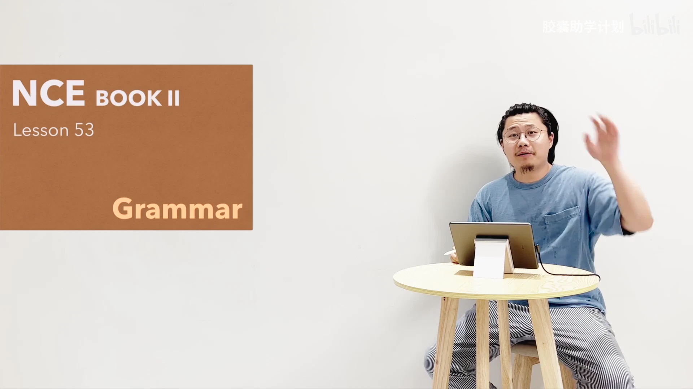

文字识别：NCE / BOOKII / Lesson 53 / Grammar

### 画面 00:00:08

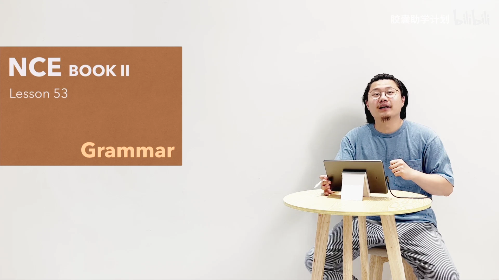

文字识别：NCE / BOOKII / Lesson 53 / Grammar

### 画面 00:00:10

文字识别：胶囊助学计划bilbl

### 画面 00:00:13

文字识别：胶囊助学计划

### 画面 00:00:15

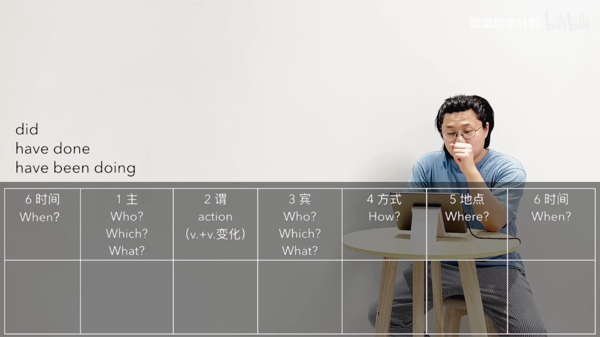

文字识别：did / have / done / have / been doing / 6时间 / 1主 / 2谓 / 3宾 / 4方式 / 5地点 / 6时间 / When? / Who? / action / Who? / How? / Where? / When? / Which? / (v.+v.变化) / Which? / What? / What?

### 画面 00:00:23

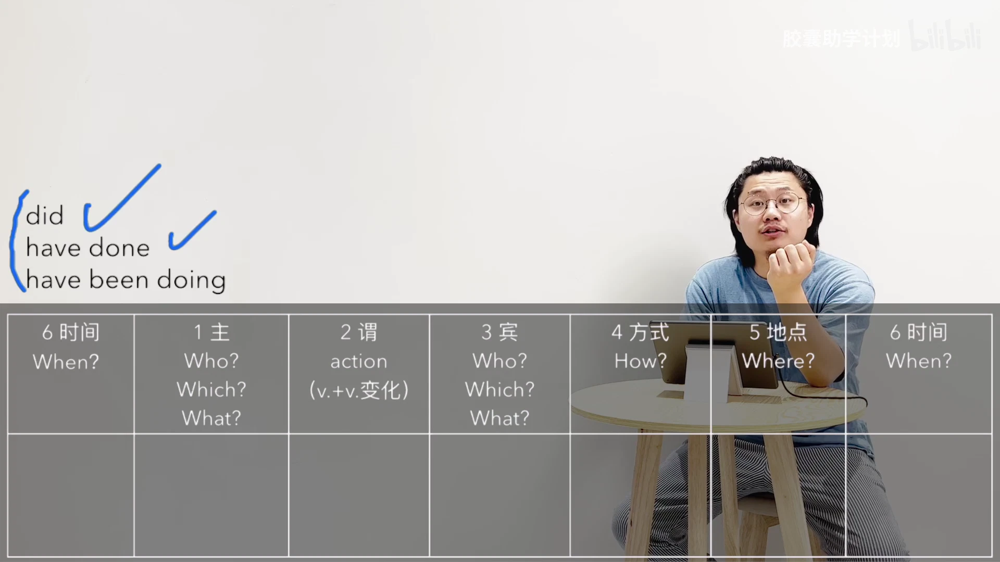

文字识别：did / have / done / have / been doing / 6时间 / 1主 / 2谓 / 3宾 / 4方式 / 5地点 / 6时间 / When? / Who? / action / Who? / How? / Where? / When? / Which? / (v.+v.变化) / Which? / What? / What?

## 00:00:30–00:01:00

这个呃，一般过去时，现在完成时，我们之前从新一开始到现在已经复习过太多遍了。现在完成进行时呢，又是我们在上一个呃五十二课刚刚学过的啊。我们就不做太多的复习了，我们就以练代讲，对吧？哎，以练代讲，各位，接下来我读，各位大声张开嘴跟我朗读就可以了啊。第一个，Has he tried to telephone her today?

### 画面 00:00:45

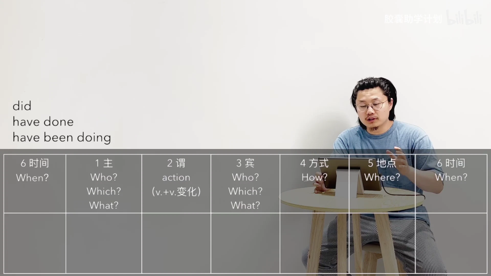

文字识别：did / have / done / have l / been doing / 6时间 / 1主 / 2谓 / 3宾 / 4方式 / 5地点 / 6时间 / When? / Who? / action / Who? / How? / Where? / When? / Which? / (v.+v.变化) / Which? / What? / What?

### 画面 00:00:47

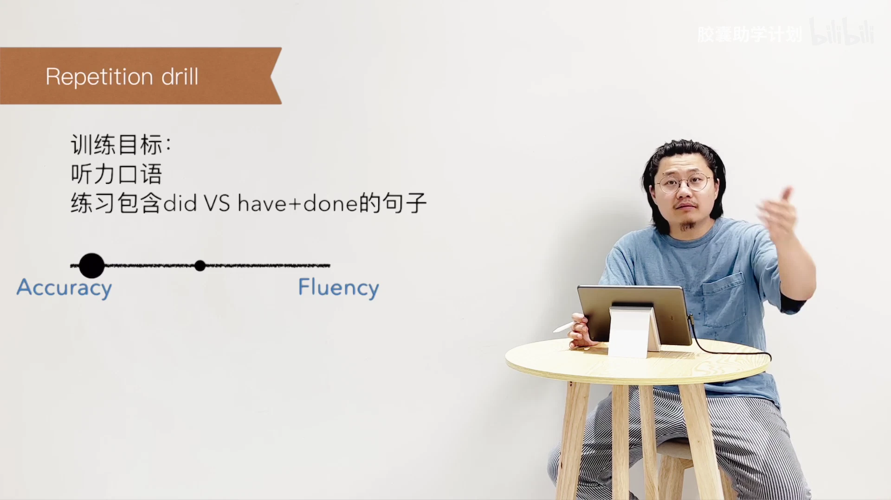

文字识别：Repetition drill / 训练目标： / 听力口语 / 练习包含did VS have+done的句子 / Accuracy / Fluency

### 画面 00:00:50

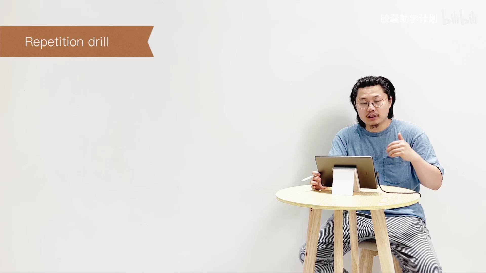

文字识别：Repetition drill

### 画面 00:00:56

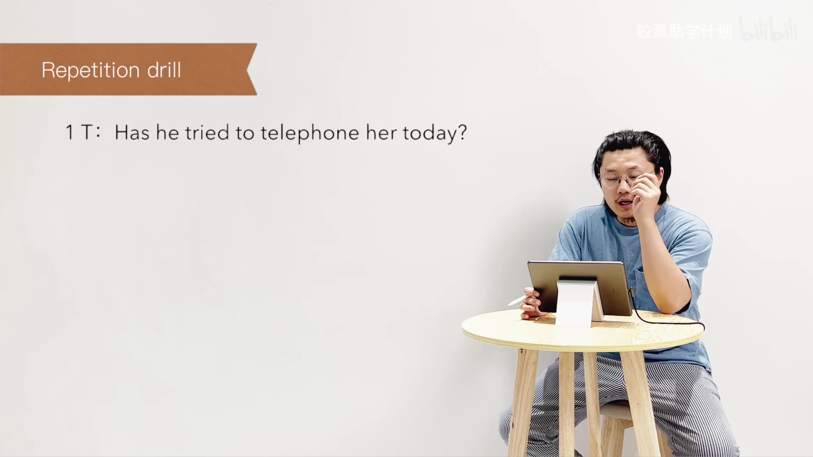

文字识别：Repetition drill / 1 T: Has he tried to telephone her today?

## 00:01:00–00:01:30

Yes, he's tried to telephone her several times today, but he didn't try yesterday. 好，注意这个地方叫做 P.S. 和 didn't try. 各位能看到，其实是练习的现在完成时和一般过去时，对吧？ Yesterday is didn't try. 然后呢， several times today 就今天已经数次了，今天是没结束的，呃，到现在已经数次

### 画面 00:01:00

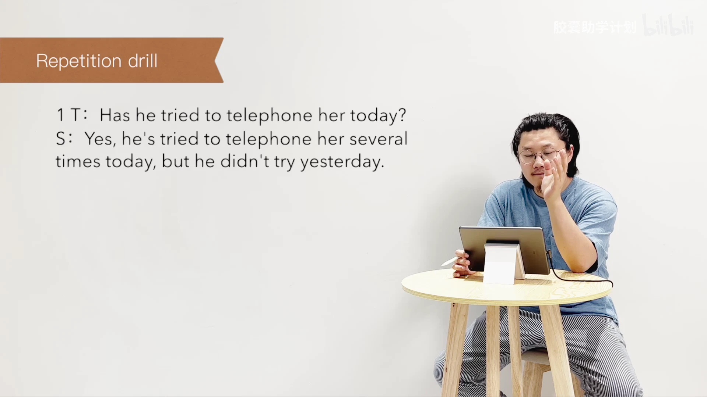

文字识别：Repetition drill / 1 T: Has he tried to telephone her today? / S: Yes, he's tried to telephone her several / times today, but he didn't try yesterday.

### 画面 00:01:11

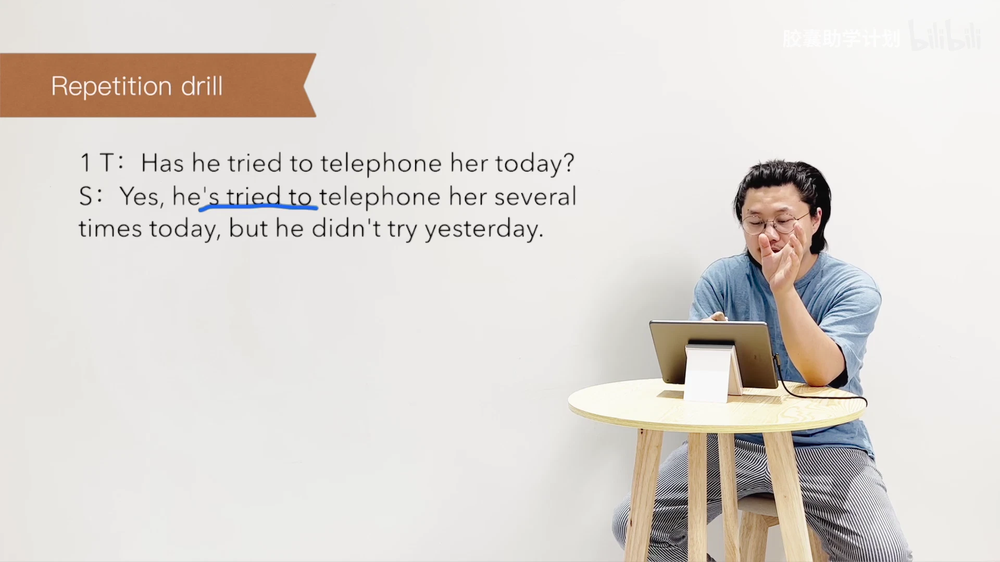

文字识别：Repetition drill / 1 T: Has he tried to telephone her today? / S: Yes, he's tried to telephone her several / times today, but he didn't try yesterday.

### 画面 00:01:14

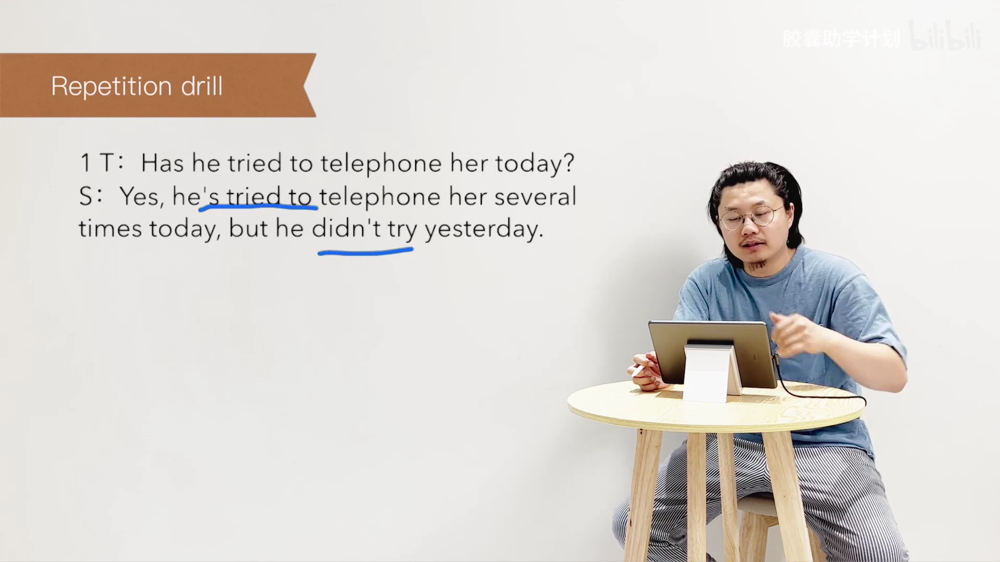

文字识别：Repetition drill / 1 T: Has he tried to telephone her today? / S: Yes, he's tried to telephone her several / times today, but he didn't try yesterday.

## 00:01:30–00:02:00

了，重复了很多次，对吧？一个动作或状态从过去重复或持续到现在，现在完成时的一个非常典型的用法。第二个用法，对不对？新概念一册八十九课咱讲过，新概念二册三四五咱又复习了一下，尤其是第四课第五课，对吧？OK，不多说了，接下来全是这个套路，大声张嘴跟我读就行了啊。第二个，Have you driven your car today? Yes, I've driven my car several times today, but I didn't

### 画面 00:01:44

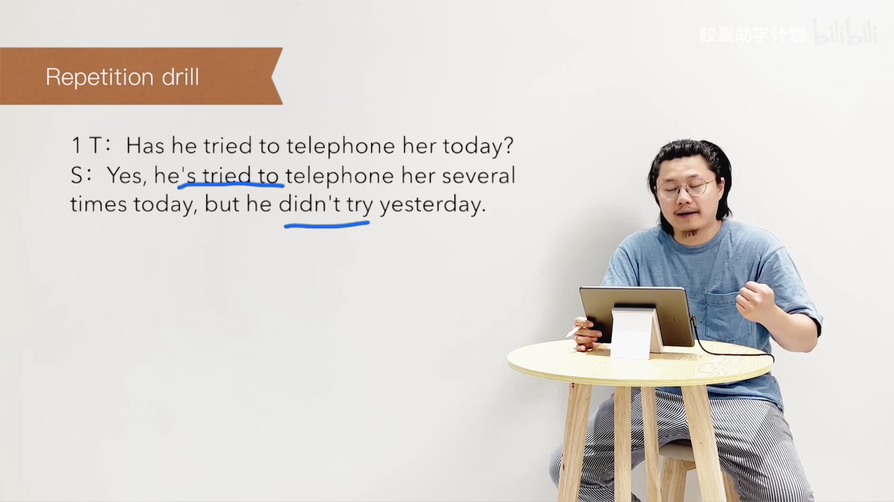

文字识别：Repetition drill / 1 T: Has he tried to telephone her today? / S: Yes, he's tried to telephone her several / times today, but he didn't try yesterday.

### 画面 00:01:49

文字识别：Repetition drill / 2 T: Have you driven your car today?

### 画面 00:01:54

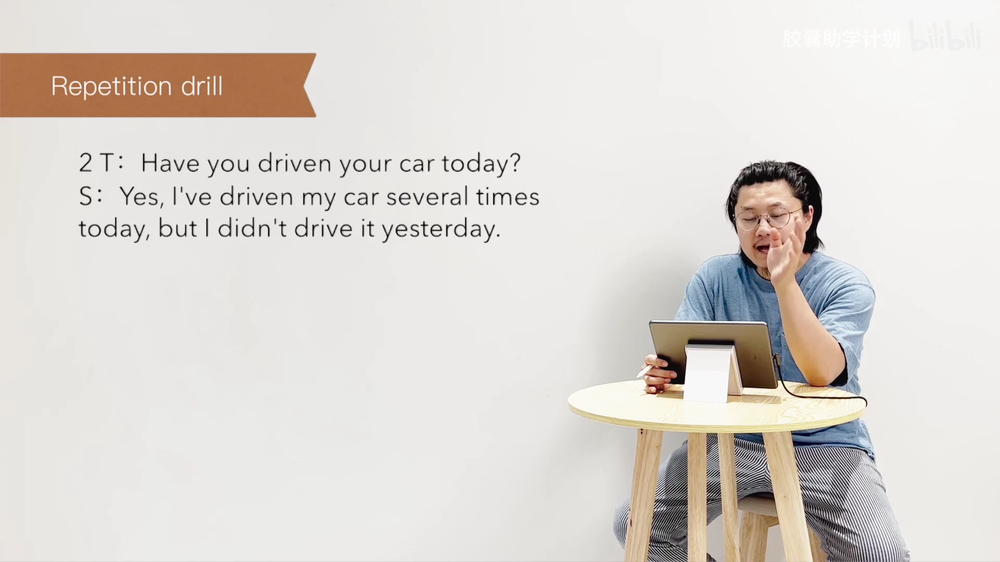

文字识别：Repetition drill / 2 T: Have you driven your car today? / S: Yes, I've driven my car several times / today, but I didn't drive it yesterday.

## 00:02:00–00:02:30

drive it yesterday. 好，就重点看我划线的这些地方啊。 Next one. Have they listened to the radio today? Yes, they've listened to the radio several times today, but they didn't listen to it yesterday. Next one. Have you seen George today? Yes, I've seen George several times today, but I didn't see him yesterday.

### 画面 00:02:01

文字识别：Repetition drill / 2 T: Have you driven your car today? / S: Yes, lve / driven my / car several times / today, but I didn't drive it yesterday.

### 画面 00:02:05

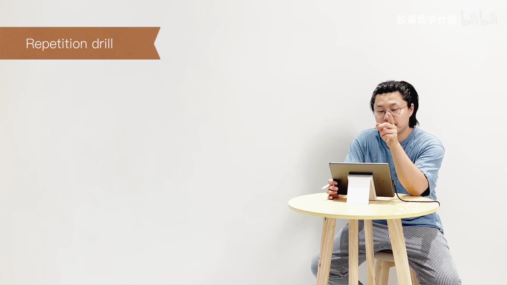

文字识别：Repetition drill

### 画面 00:02:10

文字识别：Repetition drill / 3 T: Have they listened to the radio today? / S: Yes, they've listened to the radio several times / today, but they didn't listen to it yesterday.

### 画面 00:02:19

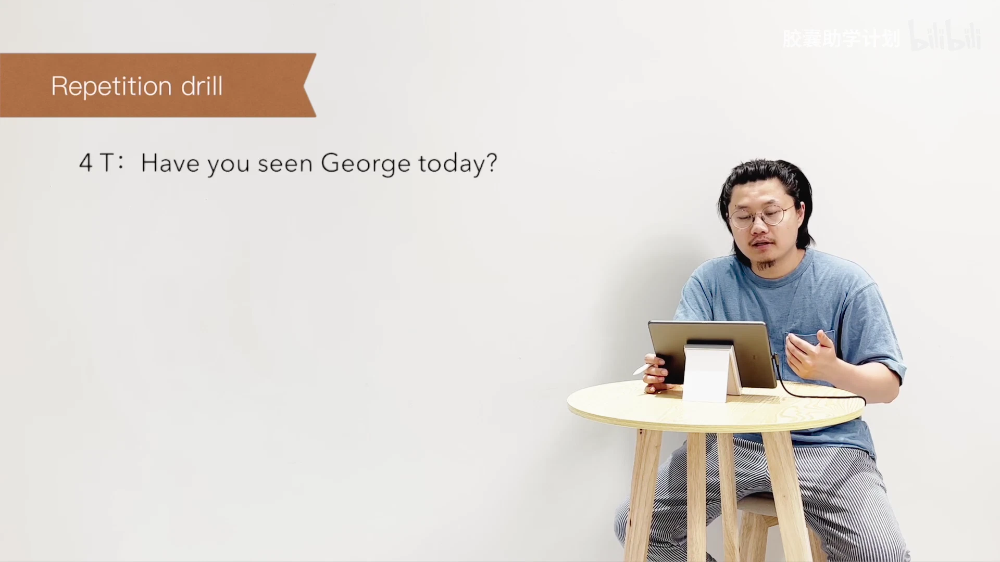

文字识别：Repetition drill / 4T: Have you seen George today?

## 00:02:30–00:03:00

Next one, has Mary spoken to Tom today? Yes, she's spoken to Tom several times today, but she didn't speak to him yesterday. Good. Have the children hidden in the garden today? Yes, they've hidden in the garden several times today, but they didn't hide in it yesterday. Next one, have you

### 画面 00:02:35

文字识别：Repetition drill / 5 T: Has Mary spoken to Tom today? / S: Yes, she's spoken to Tom several times / today, but she didn't speak to him yesterday.

### 画面 00:02:44

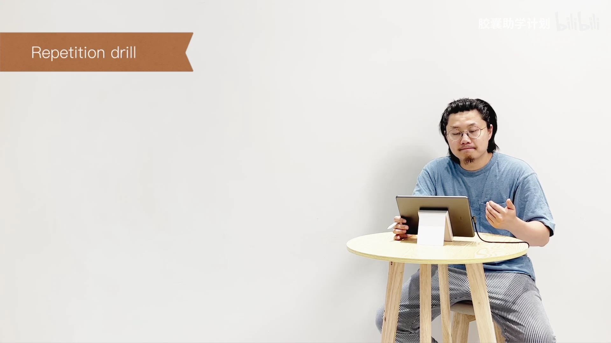

文字识别：Repetition drill

### 画面 00:02:49

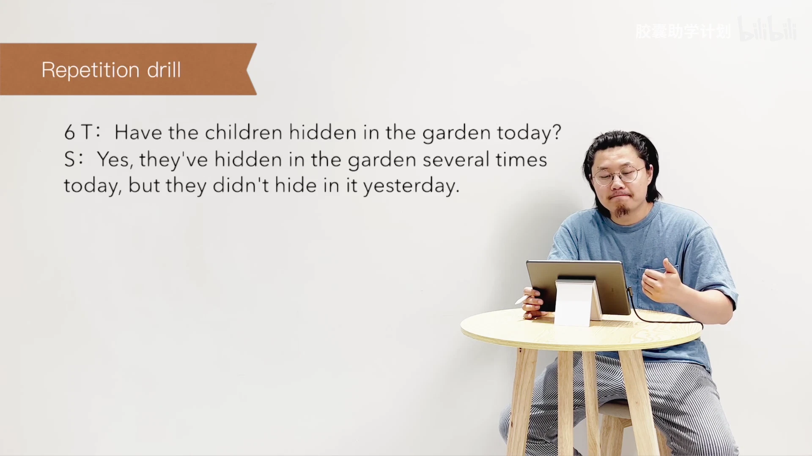

文字识别：Repetition drill / 6 T: Have the children hidden in the garden today? / S: Yes, they've hidden in the garden several times / today, but they didn't hide in it yesterday.

### 画面 00:02:58

文字识别：Repetition drill / 7 T: Have you looked at a newspaper today?

## 00:03:00–00:03:30

looked at a newspaper today? Yes, I've looked at a newspaper several times today, but I didn't look at look at it yesterday. 啊，这有一个小的连读啊，就是两个连读 look at it, look at it. 啊，一般不读成 look at it, 变成 look at it. 啊, look at it. Next one, has he drunk any whiskey today?

### 画面 00:03:03

文字识别：Repetition drill / 7 T: Have you looked at a newspaper today? / S: Yes, I've looked at a newspaper several times / today, but I didn't look at it yesterday.

### 画面 00:03:24

文字识别：Repetition drill / 8 T: Has he drunk any whisky today?

### 画面 00:03:29

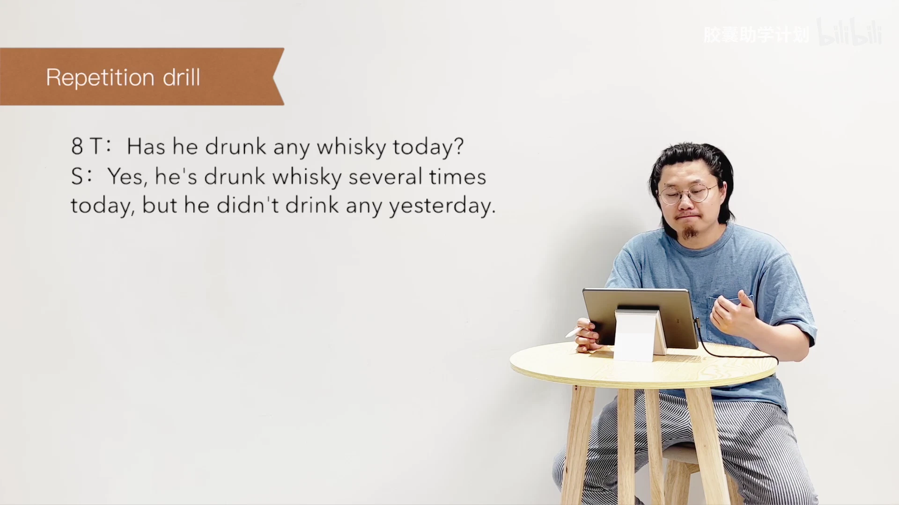

文字识别：Repetition drill / 8 T: Has he drunk any whisky today? / S: Yes, he's drunk whisky several times / today, but he didn't drink any yesterday.

## 00:03:30–00:04:00

Yes, he's drunk whisky several times today, but he didn't drink any yesterday. Next one, have you opened this window today? Yes, I've opened this window several times today, but I didn't open it yesterday.有一个小的连读 open it. Next one, has she answered the telephone today? Yes, she's answered the telephone several times today,

### 画面 00:03:37

文字识别：Repetition drill / 9 T: Have you opened this window today?

### 画面 00:03:40

文字识别：Repetition drill / 9 T: Have you opened this window today? / S: Yes, I've opened this window several / times today, but I didn't open it yesterday.

### 画面 00:03:51

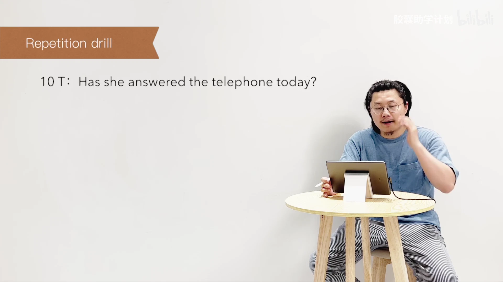

文字识别：Repetition drill / 10 T: Has she answered the telephone today?

### 画面 00:03:55

文字识别：Repetition drill / 10 T: Has she answered the telephone today? / S: Yes, she's answered the telephone several / times today, but she didn't answer it yesterday.

## 00:04:00–00:04:30

today, but she didn't answer it yesterday.好，repetition drill结束了，对吧？Pattern drill接下来练的是一般过去时、过去呃呃现在完成时和现在完成进行时都有啊。第一题叫 How long have you been a shoemaker？说你作为一个做鞋子人已经多长时间了？现在完成时，对吧？说 I've been making shoes. 现在完成进行时，我做鞋已经很长

### 画面 00:04:04

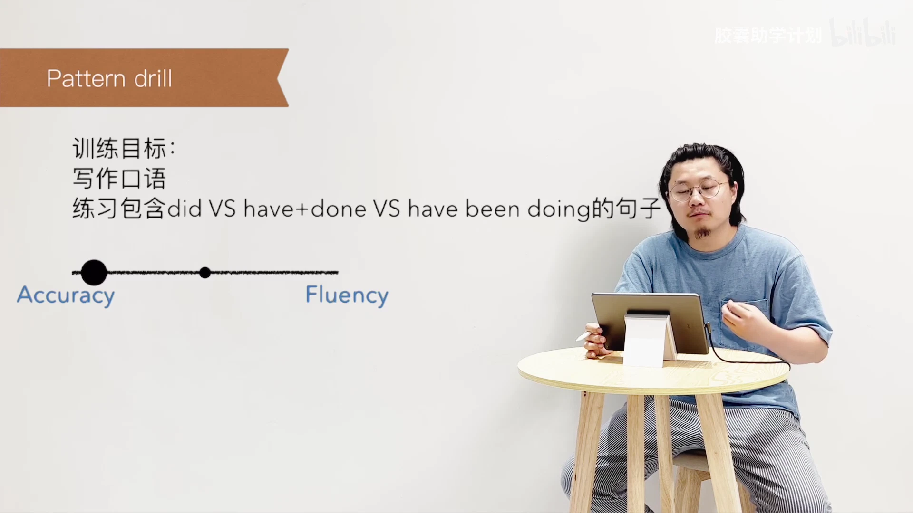

文字识别：Pattern drill / 训练目标： / 写作口语 / 练习包含did VS have+done VS have been doing的句子 / Accuracy / Fluency

### 画面 00:04:09

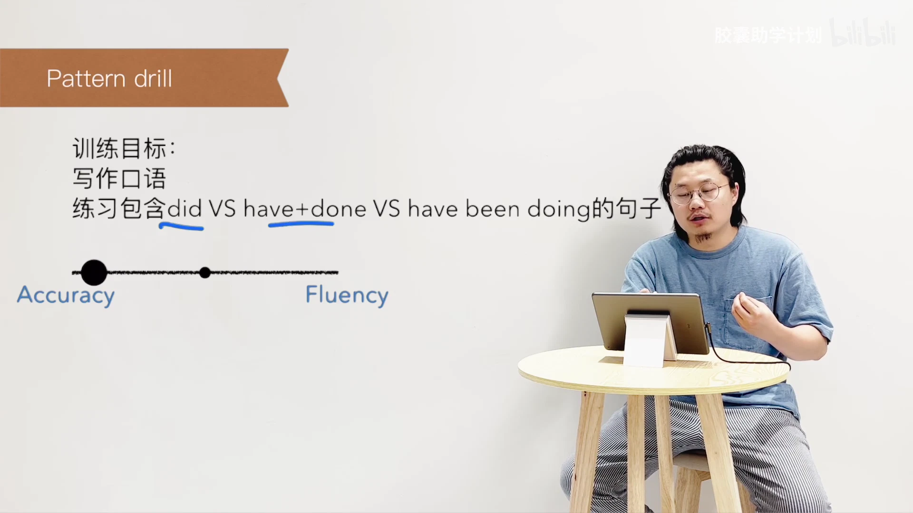

文字识别：Pattern drill / 训练目标： / 写作口语 / 练习包含did VS have+done VS have been doing的句子 / Accuracy / Fluency

### 画面 00:04:13

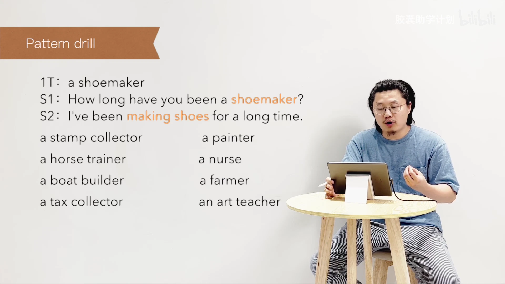

文字识别：Pattern drill / 1T:a shoemaker / S1: How long have you been a shoemaker? / S2: I've been making shoes for a long time. / a stamp collector / a painter / a horse trainer / a nurse / a boat builder / a farmer / a tax collector / an art teacher

### 画面 00:04:15

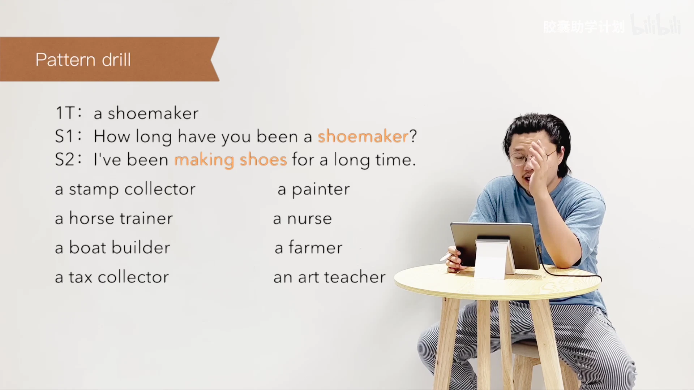

文字识别：Pattern drill / 1T:a shoemaker / S1: How long have you been a shoemaker? / S2: I've been making shoes for a long time. / a stamp collector / a painter / a horse trainer / a nurse / a boat builder / a farmer / a tax collector / an art teacher

### 画面 00:04:21

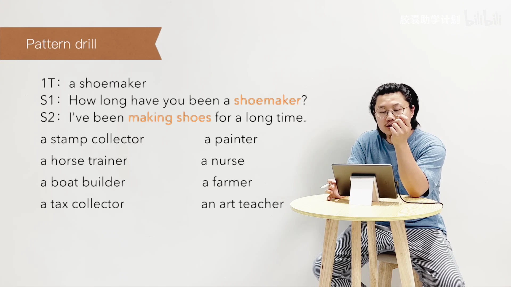

文字识别：Pattern drill / 1T:a shoemaker / S1: How long have you been a shoemaker? / S2: I've been making shoes for a long time. / a stamp collector / a painter / a horse trainer / a nurse / a boat builder / a farmer / a tax collector / an art teacher

### 画面 00:04:25

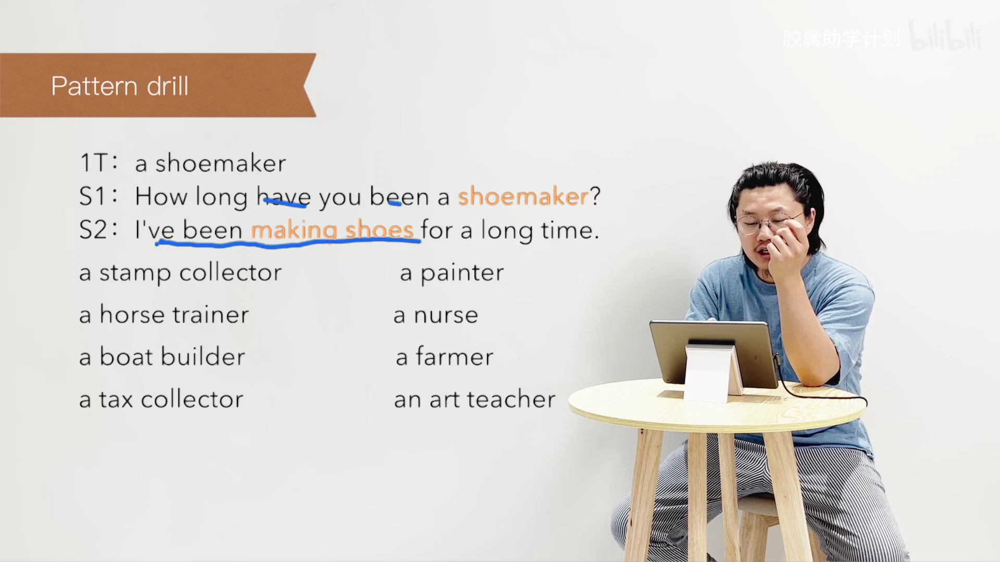

文字识别：Pattern drill / 1T: a shoemaker / S1: How long / have you been a / shoemaker? / S2:l've / been / makina shoes for a long time. / a stamp / collector / a painter / a horse / trainer / a nurse / a boat builder / a farmer / a tax collector / an art teacher

## 00:04:30–00:05:00

一段时间了，各位往里面去带，对吧？那这有一个小的点是什么点呢？给的其实都是名词，你看底下全是名词，对吧？Art teacher，那你要往里去带的时候，你这儿肯定要变成动词，就不是teacher了，就是teach，就是做这个动作的人，对不对？好，这是一个小点，各位注意一下啊。第二题说，He didn't teach there for long, did he？他没有在那儿教了很长时间，对吧？No, he

### 画面 00:04:50

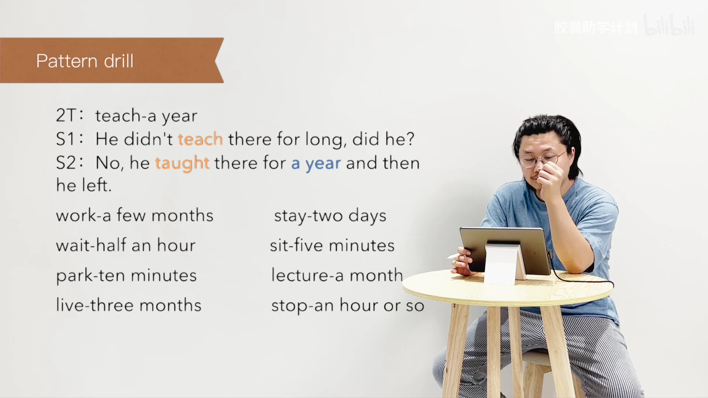

文字识别：Pattern drill / 2T: teach-a year / S1: He didn't teach there for ong, did he? / S2: No, he taught there for a year and then / he left. / work-a few months / stay-two days / wait-half an hour / sit-five minutes / park-ten minutes / lecture-a month / live-three months / stop-an hour or so

## 00:05:00–00:05:30

taught there for a year and then he left.啊，不啊，他呢在那儿教了一年，然后他离开了。一般过去时，对吧？整句话都是一般过去时啊，往里面去带，对吧？第三个是Could you lend me your dictionary? I'm sorry, I lent it to Tom last week and he hasn't returned it yet.说他还没有把它还回来。哎，我上个礼拜借给他了，他还

### 画面 00:05:14

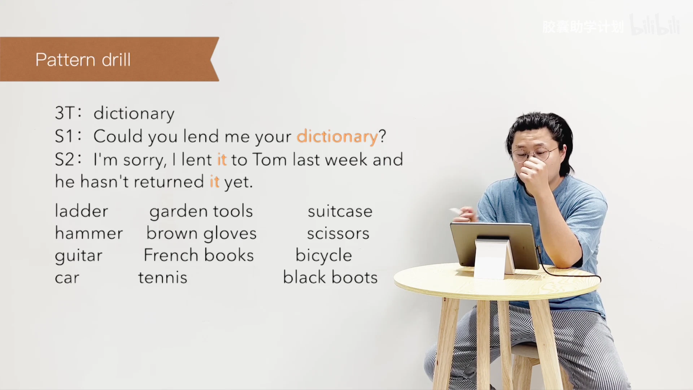

文字识别：Pattern drill / 3T：dictionary / S1: Could you lend me your dictionary? / S2: I'm sorry, I lent it to Tom last week and / he hasn't returned it yet. / ladder / garden tools / suitcase / hammer / brown gloves / scissors / guitar / French books / bicycle / car / tennis / black boots

## 00:05:30–00:06:00

没有还回来。现在完成时，对吧？一般过去时啊，上周借的，截止到现在还没有还回来。现在完成时，各位把底下往里面去带啊，就这三道题。那本课呢，recap无非就是这三个时态，我们就不多说了。我们是以练代讲了，好吧？好，家庭作业呢，pattern drill老习惯，尝试回忆自己讲解。各位今天特别好，你可以去专门花一个时间，拿一张纸，然后呢把这三个时态写在那儿，想

### 画面 00:05:39

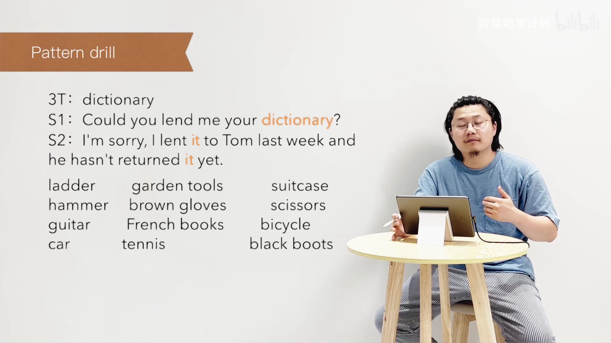

文字识别：Pattern drill / 3T：dictionary / S1: Could you lend me your dictionary? / S2: I'm sorry, I lent it to Tom last week and / he hasn't returned it yet. / ladder / garden tools / suitcase / hammer / brown gloves / scissors / guitar / French books / bicycle / car / tennis / black boots

### 画面 00:05:41

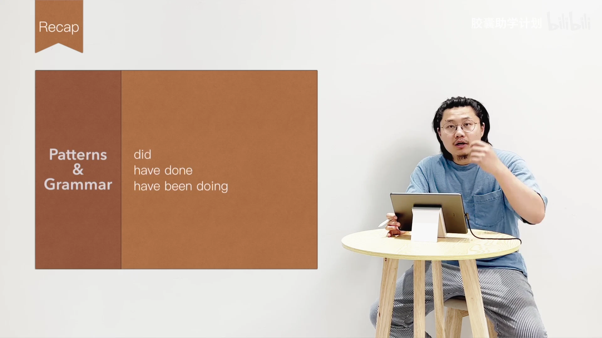

文字识别：Recap / Patterns / did / have done / Grammar / have been doing

### 画面 00:05:45

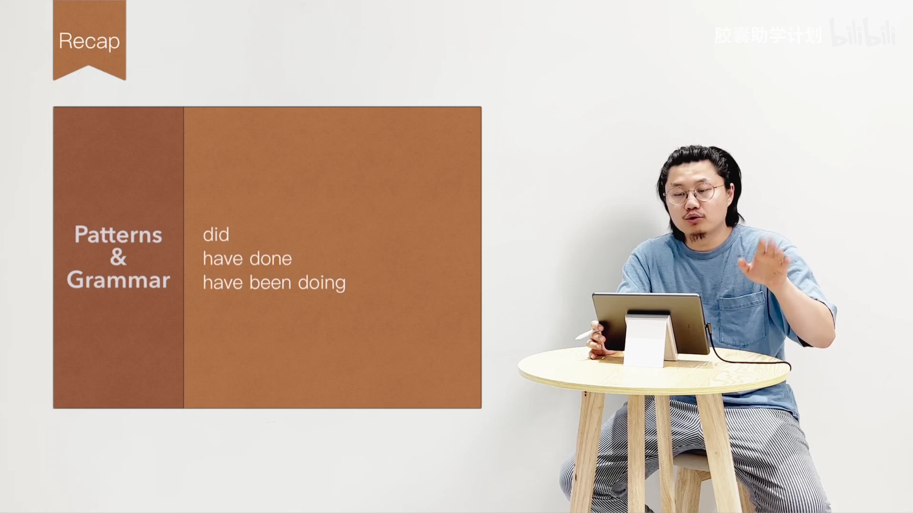

文字识别：Recap / Patterns / did / ＆ / have done / Grammar / have been doing

### 画面 00:05:48

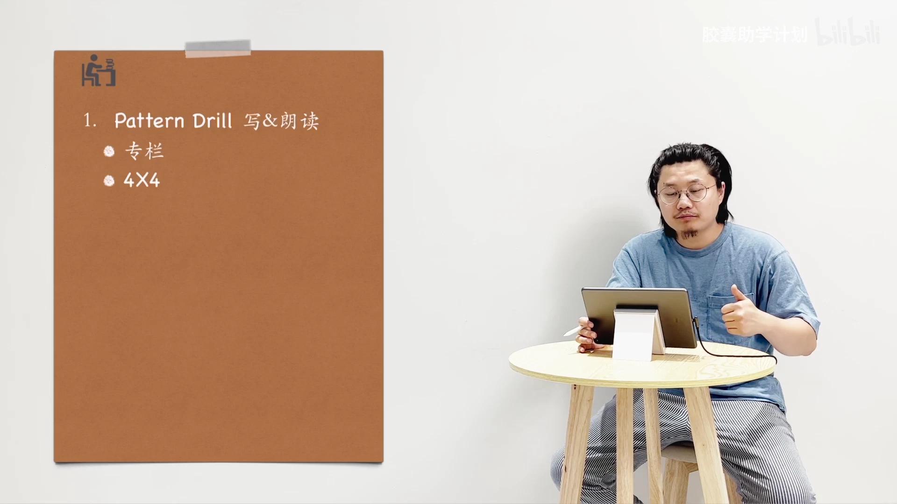

文字识别：1.f / Pattern Drill写&朗读 / 专栏 / 4×4 / P

### 画面 00:05:50

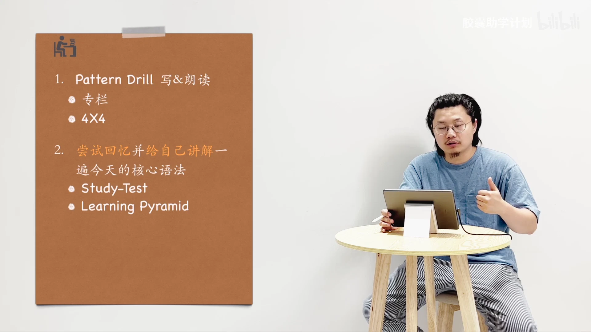

文字识别：1. f / Pattern Drill 写&朗读 / 专栏 / 4×4 / 尝试回忆并给自己讲解一 / 遍今天的核心语法 / Study-Test / Learning Pyramid

### 画面 00:05:52

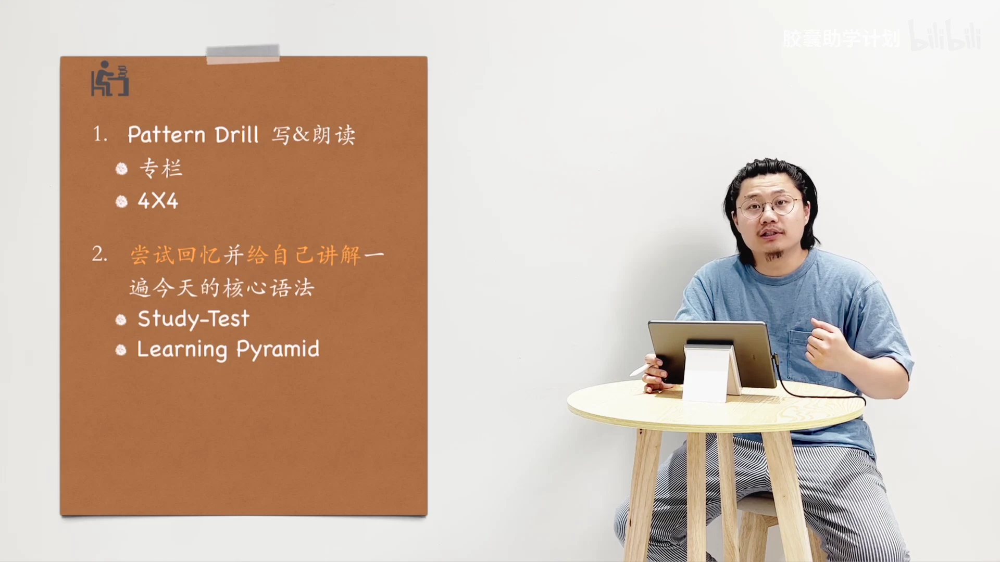

文字识别：Pattern Drill写&朗读 / 1. / 专栏 / 4×4 / 尝试回忆并给自己讲解一 / 遍今天的核心语法 / Study-Test / Learning Pyramid

### 画面 00:05:55

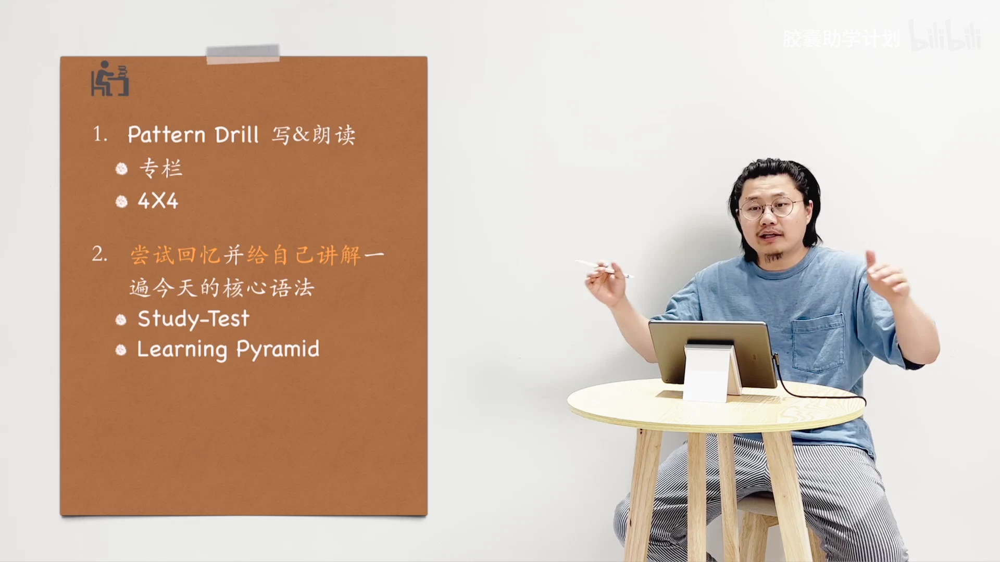

文字识别：Pattern Drill写&朗读 / 专栏 / 4×4 / 尝试回忆并给自己讲解一 / 遍今天的核心语法 / Study-Test / Learning Pyramid

### 画面 00:05:57

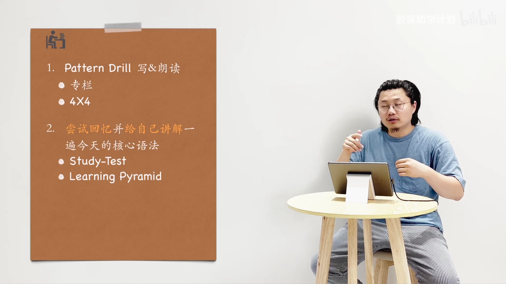

文字识别：Pattern Drill写&朗读 / 1. / 专栏 / 4×4 / 尝试回忆并给自己讲解一 / 遍今天的核心语法 / Study-Test / Learning Pyramid

## 00:06:00–00:06:30

一想有哪些用法，想一想能写出来什么例句，对吧？肯定句、否定句、一般疑问句、特殊疑问句等等。OK，好。然后呢，可以去找红皮书啊。如果到今天您还没有开始写，这三个部分都可以开始写了，好吧？OK，那以上呢就是本期视频的全部内容了。如果各位喜欢我们的课程呢，欢欢迎各位关注、订阅、一键三连，分享给更多的朋友啊，来帮助我们快速成长。See you next time.

### 画面 00:06:00

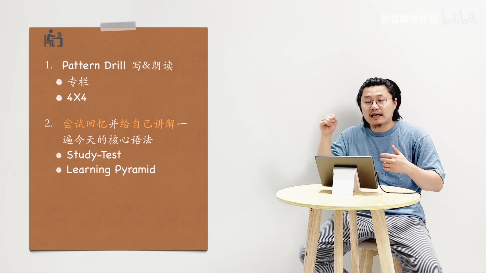

文字识别：Pattern Drill写&朗读 / 1. / 专栏 / 4×4 / 尝试回忆并给自己讲解一 / 遍今天的核心语法 / Study-Test / Learning Pyramid

### 画面 00:06:05

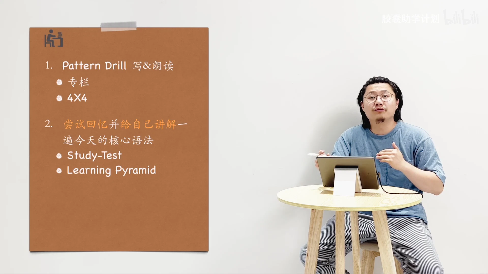

文字识别：Pattern Drill写&朗读 / 1. / 专栏 / 4×4 / 尝试回忆并给自己讲解一 / 遍今天的核心语法 / Study-Test / Learning Pyramid

### 画面 00:06:07

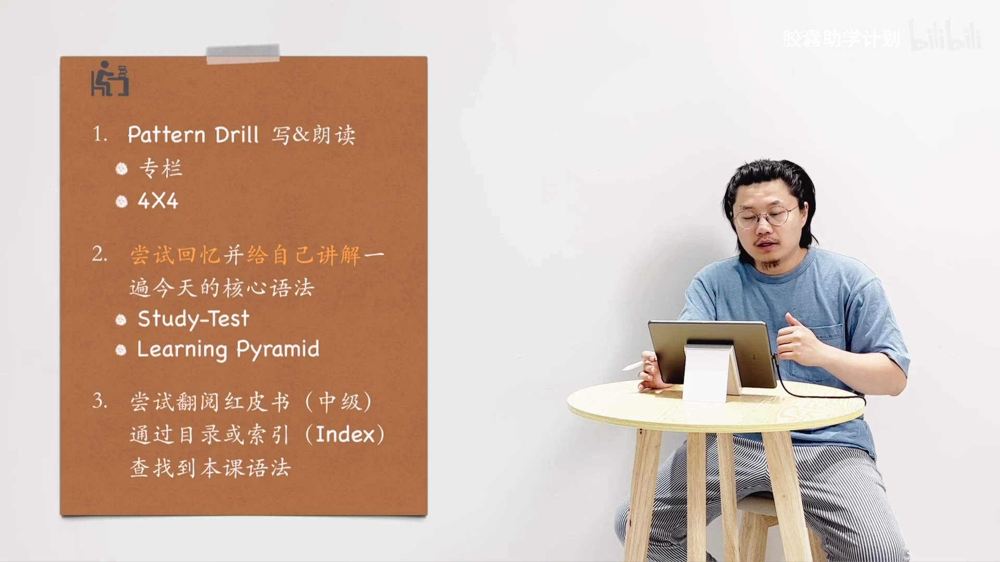

文字识别：1. f / Pattern Drill写&朗读 / 专栏 / 4×4 / 尝试回忆并给自己讲解一 / 遍今天的核心语法 / Study-Test / Learning Pyramid / 尝试翻阅红皮书（中级） / 通过目录或索引(Index) / 查找到本课语法

### 画面 00:06:10

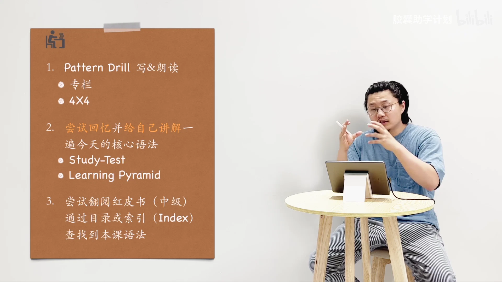

文字识别：Pattern Drill写&朗读 / 1. / 专栏 / 4×4 / 尝试回忆并给自己讲解一 / 遍今天的核心语法 / Study-Test / Learning Pyramid / 尝试翻阅红皮书（中级） / 通过目录或索引(Index) / 查找到本课语法

### 画面 00:06:15

文字识别：E

### 画面 00:06:22

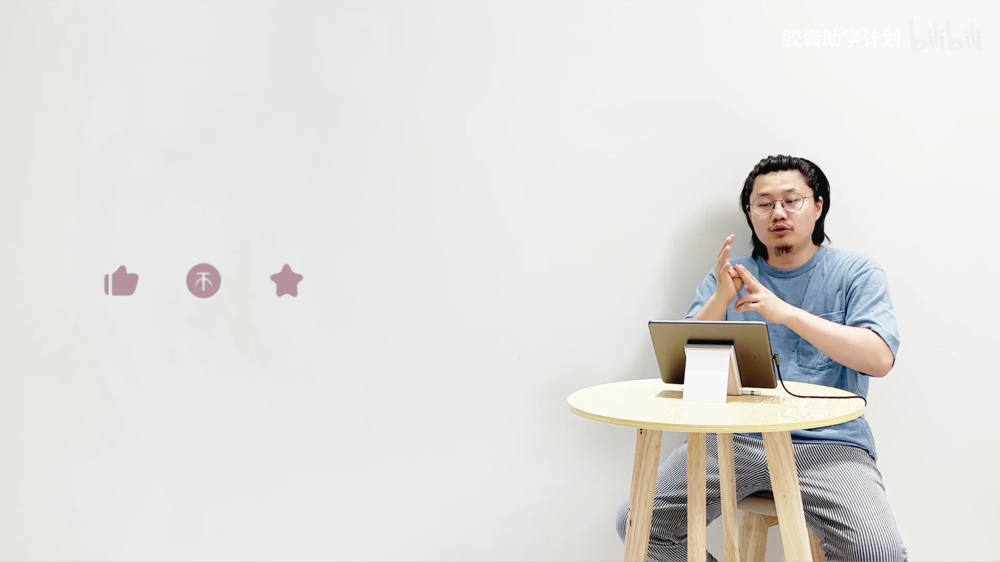

## 00:06:30–00:06:42

### 画面 00:06:30

### 画面 00:06:32

文字识别：CAPSULEACADEMY / 胶囊助学计划 / 小红书 / Lecturer / Leo / OE

### 画面 00:06:34

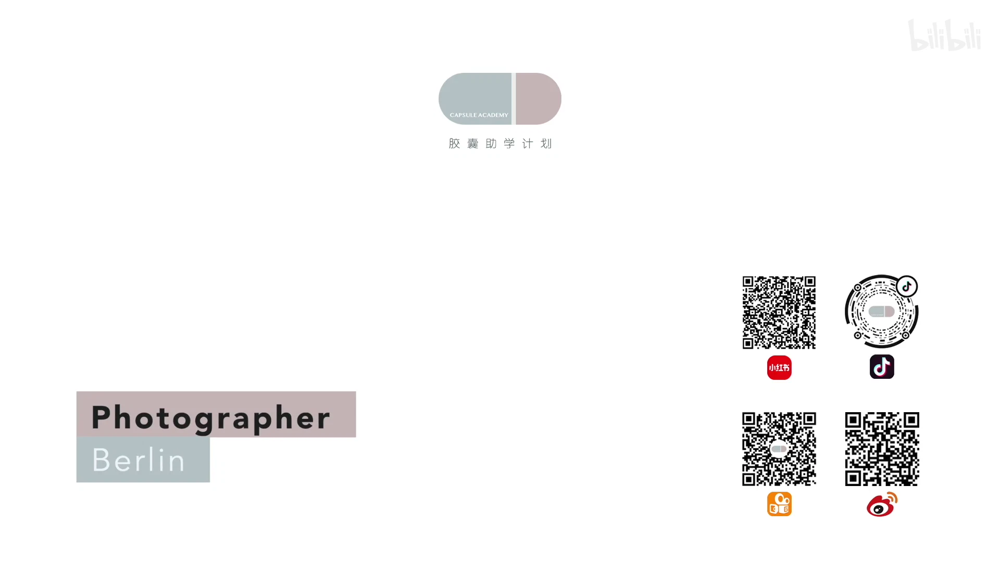

文字识别：CAPSULEACADEMY / 胶囊助学计划 / 小红书 / Photographer / 口 / Berlin / OE

### 画面 00:06:36

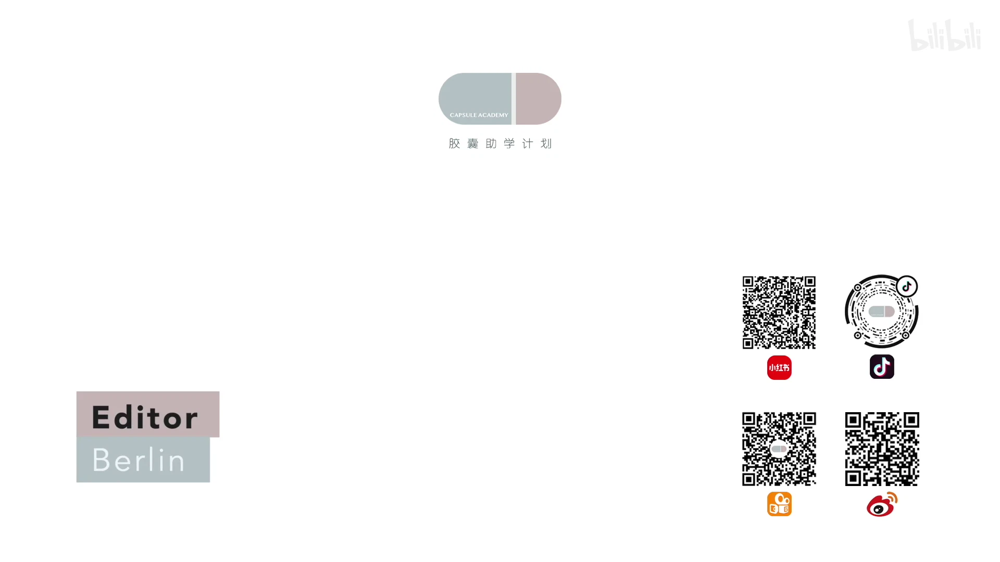

文字识别：CAPSULEACADEMY / 胶囊助学计划 / 『 / 小红书 / Editor / Berlin / OE

### 画面 00:06:39

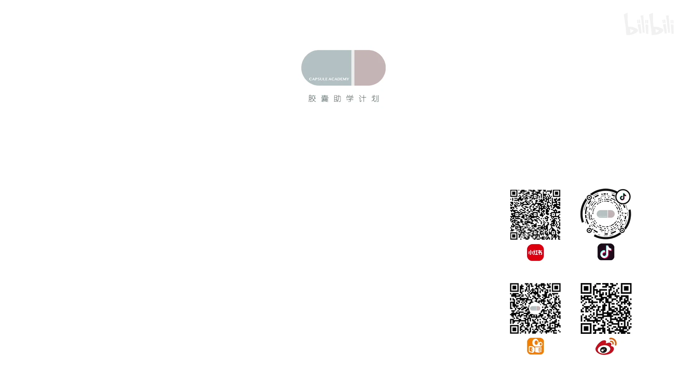

文字识别：CAPSULEACADEMY / 胶囊助学计划 / 小红书 / 品

### 画面 00:06:41

文字识别：bilibili / 胶囊助学计划

