# 053 文章

快速机器解析：语音为单模型转写，未进行独立交叉校对或人工复核；画面每秒采样并按变化选帧，短时文字和标记可能遗漏。截图时间约有 1 秒误差。图片有损压缩；遇到疑点请按时间查看 Google Drive 原视频。

## 00:00:00–00:00:30

Hello everyone, welcome to Capsule Academy. This is Leo. Today we're going to learn New Concept English Book Two, Lesson Fifty Three, Story. Hope you gonna enjoy it.好，那我们先看一下标题啊，叫做 Hot Snake，是吧？我们在单词部分已经讲过了啊，它其实有两层意思，一个就是你想它带电烧焦了，肯定就很热，对吧？另外一个就是带电啊，都可以双层双层意

### 画面 00:00:00

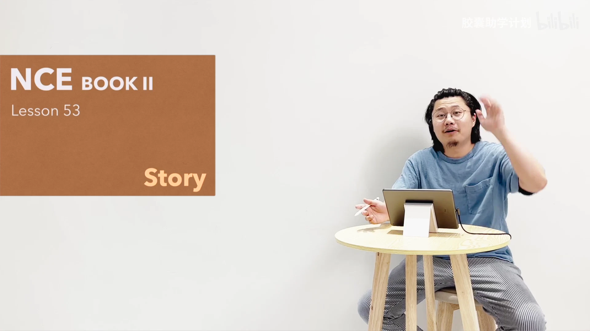

文字识别：NCE / BOOKⅡI / Lesson 53 / Story

### 画面 00:00:02

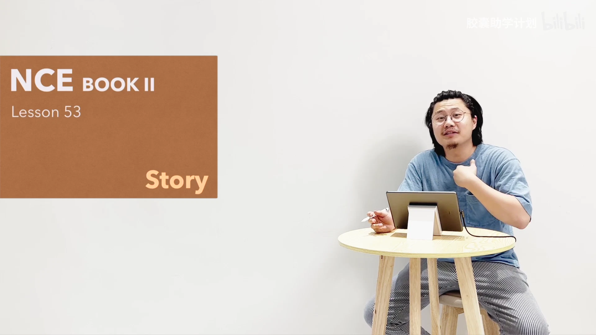

文字识别：NCE / BOOKⅡI / Lesson 53 / Story

### 画面 00:00:05

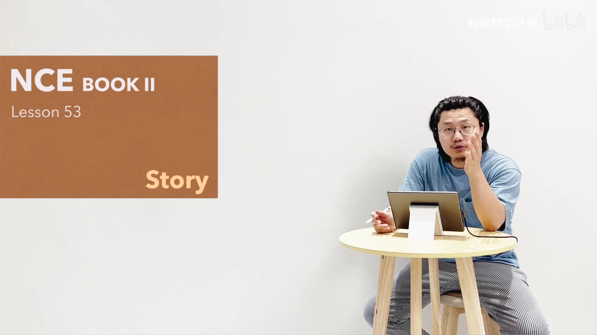

文字识别：NCE / BOOKⅡI / Lesson 53 / Story

### 画面 00:00:09

文字识别：胶囊助学计划bill / •

### 画面 00:00:13

文字识别：胶囊助学计划

### 画面 00:00:15

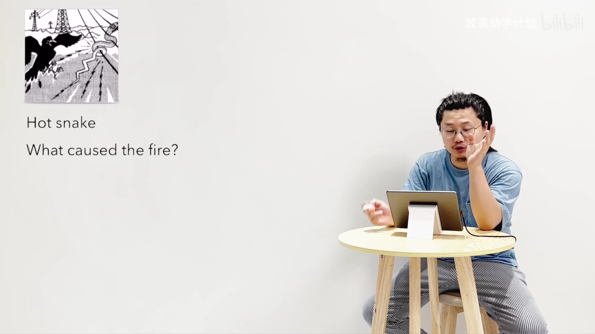

文字识别：Hot snake / What caused the fire?

## 00:00:30–00:01:00

思。然后问的问题叫What caused the fire?什么引起了这场火灾？看图其实已经有答案了，就蛇，对吧？好，那我们进入文章一起看一下。At last, at last，跟第一课学的in the end一个意思，就最后，对吧？第一课咱们就学过in the end，今天造句正好又用到了。说firemen，注意复数了，看见了吗？复数了啊。Have put out a big

### 画面 00:00:34

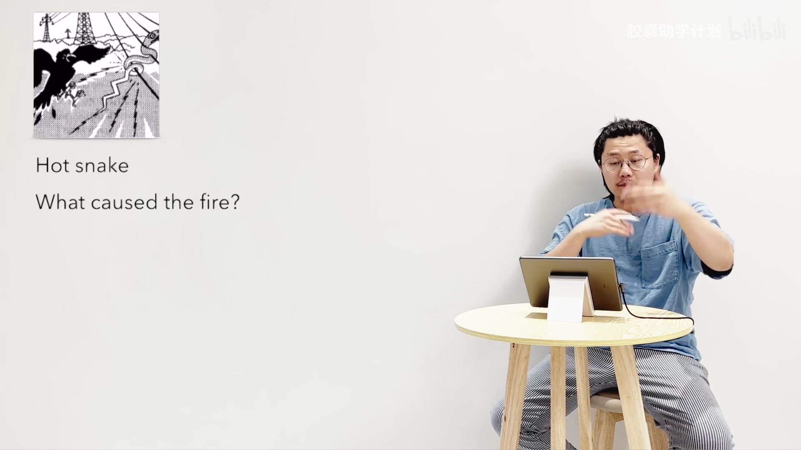

文字识别：Hot snake / What caused the fire?

### 画面 00:00:38

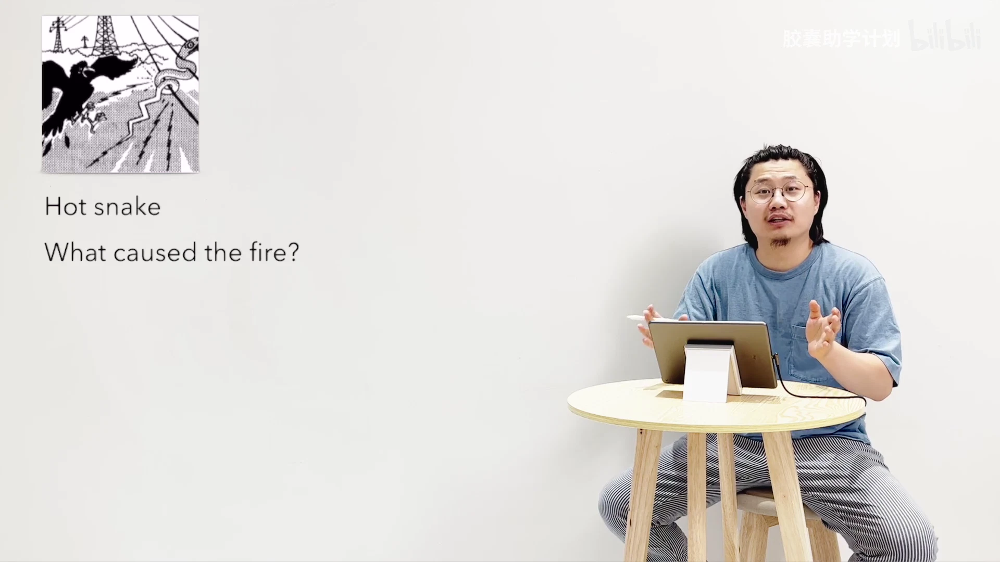

文字识别：Hot snake / What caused the fire?

### 画面 00:00:40

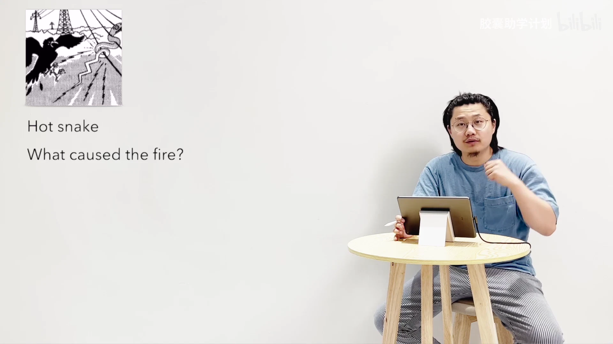

文字识别：Hot snake / What caused the fire?

### 画面 00:00:42

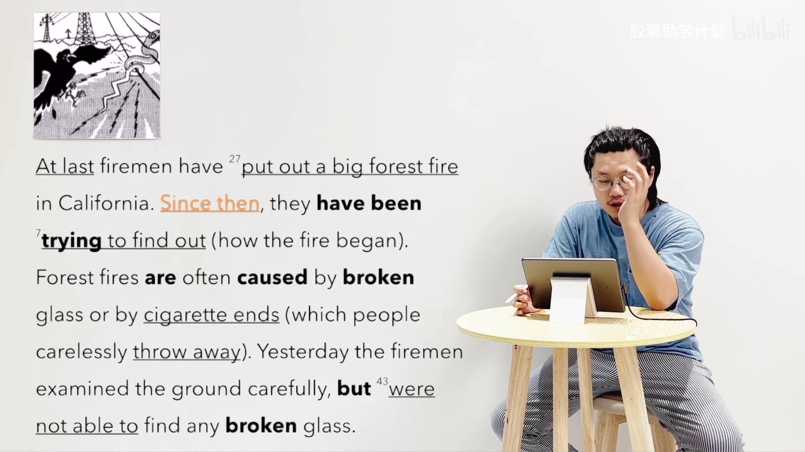

文字识别：At last firemen have ²"put out a big forest fire / in California. Since then, they have been / 'trying to find out (how the fire began). / Forest fires are often caused by broken / glass or by cigarette ends (which people / carelessly throw away). Yesterday the firemen / examined the ground carefully, but / 4³were / 43 / not able to find any broken glass.

## 00:01:00–00:01:30

forest fire in California.好，这篇文章写的很有意思。只要一说 in California，就很有意思了。为什么？加州几乎年年都有森林大火，是吧？我记得去年新闻还有一个加州森林大火严重到很多居民都搬家了，是吧？Okay，然后这个 put out a big forest fire呢？我们其实，在二十七课一帮小孩露营的那一课我们就学过，对吧？他们晚上又唱又跳，然后 put out the fire，然

### 画面 00:01:12

文字识别：At last firemen have ²put out a big forest fire / in California. Since then, they have been / 'trying to find out (how the fire began). / Forest fires are often caused by broken / glass or by cigarette ends (which people / carelessly throw away). Yesterday the firemen / examined the ground carefully, but / 4³were / 43 / not able to find any broken glass.

## 00:01:30–00:02:00

后钻进了他们的帐篷, 怎么怎么样的, 对吧? 那一课学过的叫 put out the fire, 叫做扑灭这个大火。说他们刚刚扑灭了一场森林大火在加利福尼亚, 对吧? Since then, 这个呃, 各位要记下来, 这两个单词虽然很简单, 但是经常跟这个时态连到一起, 叫从那个时候开始, 从哪个时候, 从刚刚扑灭森林大火开始, 对吧? 怎么样呢? They have been

### 画面 00:01:42

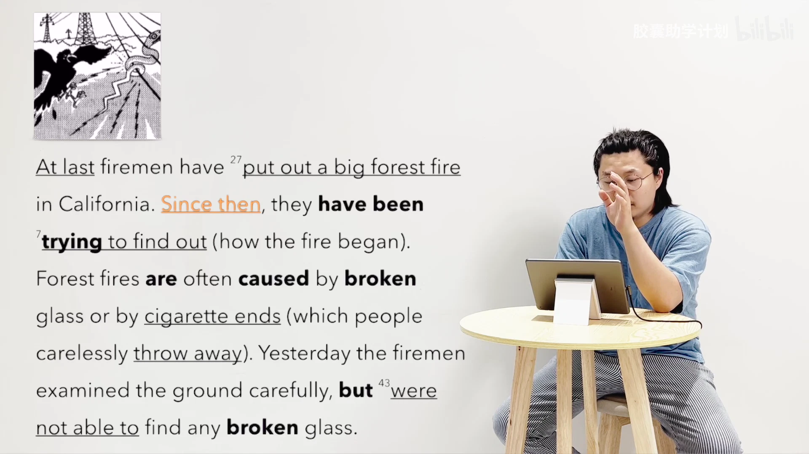

文字识别：At last firemen have ²put out a big forest fire / in California. Since then, they have been / 'trying to find out (how the fire began). / Forest fires are often caused by broken / glass or by cigarette ends (which people / carelessly throw away). Yesterday the firemen / examined the ground carefully, but / 43 / ³were / not able to find any broken glass.

## 00:02:00–00:02:30

trying to find out how the fire began.说自从那个时候开始，他们就 have been trying。好，五十二课刚学的现在完成进行时，从那个时候开始一直到现在都在做这个尝试，对吧？哎，从过去持续到现在。Try to do something是咱们第七课学的一个习惯用法，一直都在尝试着去干什么呢？Find out，呃，弄明白、发现、找出，这是本课的习惯用法啊。

### 画面 00:02:12

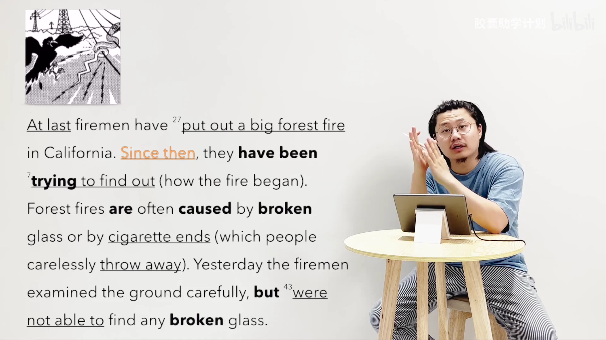

文字识别：At last firemen have ²"put out a big forest fire / in California. Since then, they have been / 'trying to find out (how the fire began). / Forest fires are often caused by broken / glass or by cigarette ends (which people / carelessly throw away). Yesterday the firemen / t 4³were / examined the ground carefully, but / not able to find any broken glass.

## 00:02:30–00:03:00

啊！弄明白，发现，找出什么呢？How the fire began?火是怎么开始的？Forest fires are often caused by broken glass or by cigarette ends.一到which不管它了，先看前面。森林大火呀，经常被引起，引发被什么呢？Broken glass，破碎的玻璃。你看这个broken是什

### 画面 00:02:42

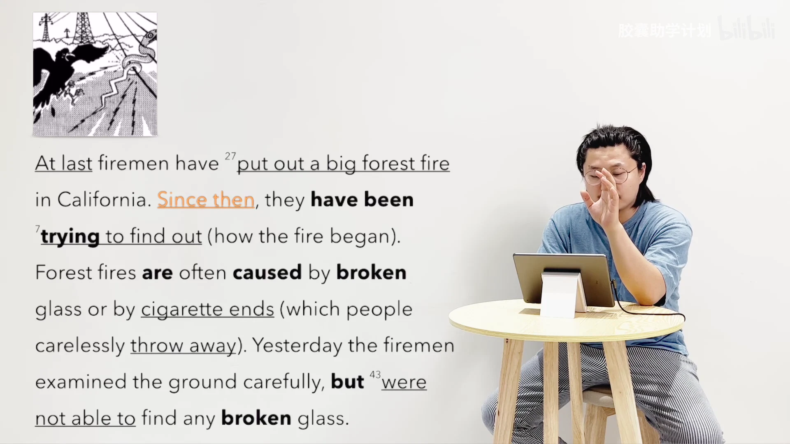

文字识别：At last firemen have ²put out a big forest fire / in California. Since then, they have been / 'trying to find out (how the fire began). / Forest fires are often caused by broken / glass or by cigarette ends (which people / carelessly throw away). Yesterday the firemen / examined the ground carefully, but / 43 / ³were / not able to find any broken glass.

## 00:03:00–00:03:30

么？二十八、二十九、三十，对吧？咱们学定语的那非常重要的三课，从二十八课定语从句讲到二十九、三十分词做定语，对吧？这是分词做定语啊。破碎的玻璃，或者是什么呢？ cigarette ends，哎，这个就很有意思了，特别像汉语的那个表达啊，都有点类似。 cigarette 叫做烟 ends 叫结尾的地方，汉语咱们翻译成叫汉语有这个叫做烟蒂，对吧？或者叫烟屁股啊，一个

### 画面 00:03:12

文字识别：At last firemen have ²"put out a big forest fire / in California. Since then, they have been / 'trying to find out (how the fire began). / Forest fires are often caused by broken / glass or by cigarette ends (which people / carelessly throw away). Yesterday the firemen / t 4³were / examined the ground carefully, but / not able to find any broken glass.

## 00:03:30–00:04:00

比较这个口语化的说法啊。那 cigarette ends 就是刚才我们说的这个东西啊。好， cigarette ends 什么样的 cigarette ends 呢？后边跟了个定语从句， which people carelessly throw away。 cigarette ends 对吧？they 啊，说 people carelessly throw them away。哎，我们就把定语从句还原成了一个独立的句子，说人们呀

### 画面 00:03:42

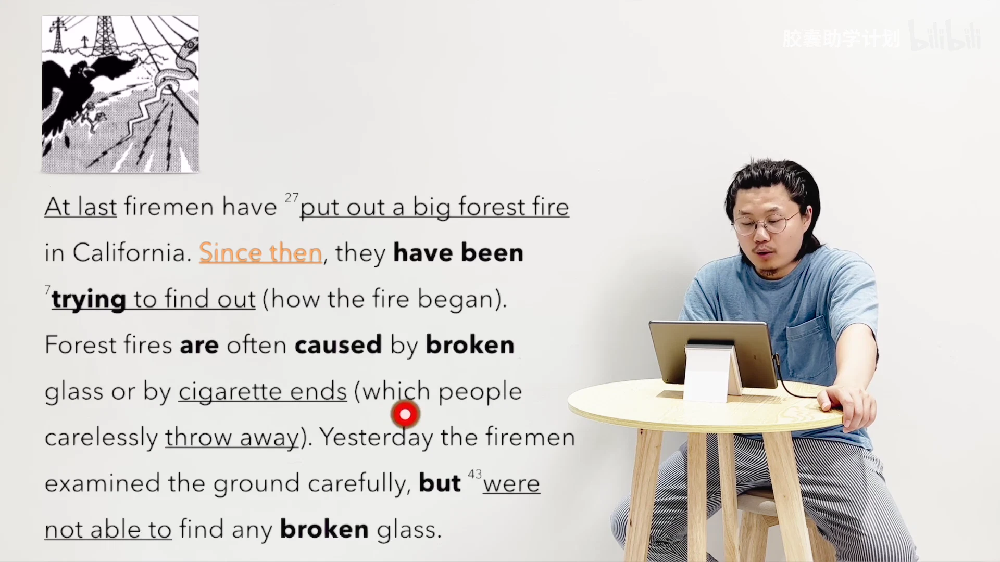

文字识别：At last firemen have ²put out a big forest fire / in California. Since then, they have been / 'trying to find out (how the fire began). / Forest fires are often caused by broken / glass or by cigarette ends (which people / carelessly throw away). Yesterday the firemen / examined the ground carefully, but / 43 / ³were / not able to find any broken glass.

## 00:04:00–00:04:30

carelessly这个单词，如果你不是很熟的话，那careful, carefully你肯定是很熟的，叫做很仔细的。那carelessly，其实咱们之前学过一个叫endless，在那课我就多少讲过，对吧？应该是四十三课啊，endless white plain，飞越南极、北极的那一刻，探险家，对吧？哎，无尽的end叫做结束的，endless叫做没有结束，无尽的白色的平原，endless white plain。那

### 画面 00:04:12

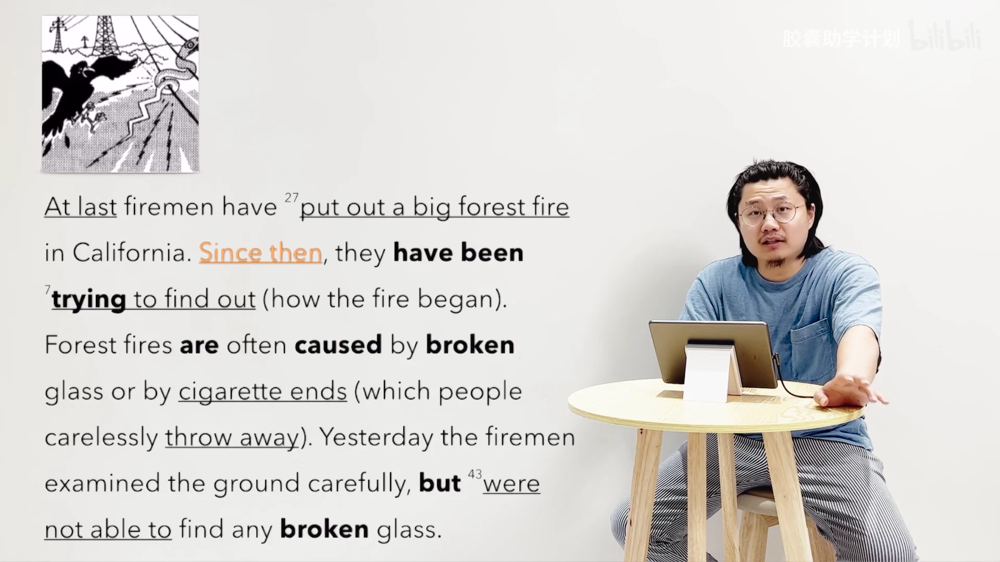

文字识别：At last firemen have ²"put out a big forest fire / in California. Since then, they have been / 'trying to find out (how the fire began). / Forest fires are often caused by broken / glass or by cigarette ends (which people / carelessly throw away). Yesterday the firemen / examined the ground carefully, but / 43 / ³3were / not able to find any broken glass.

## 00:04:30–00:05:00

That care叫关心, care啊很关心很操心, carelessly不关心不操心, carelessly不关心地不操心地,呃类似就是其实就是随手不经意的，不是很仔细的啊。OK，很粗心大意的，throw away扔掉的，这个是我们本课的习惯用法啊。我们一会儿造句。Yesterday昨天，the fireman examined the ground carefully.你看carefully出现了对吧？But一到这儿，

### 画面 00:04:42

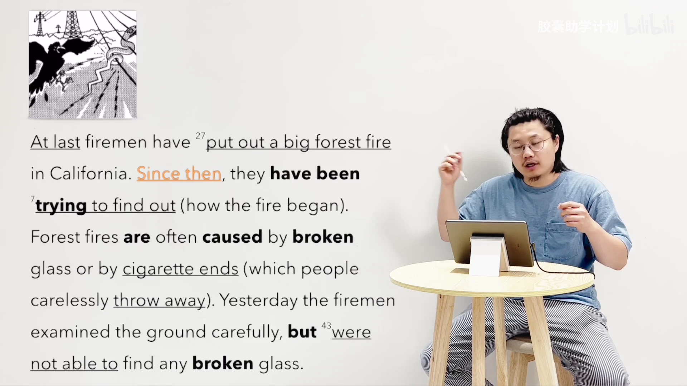

文字识别：At last firemen have ²put out a big forest fire / in California. Since then, they have been / 'trying to find out (how the fire began). / Forest fires are often caused by broken / glass or by cigarette ends (which people / carelessly throw away). Yesterday the firemen / t 4³were / examined the ground carefully, but / not able to find any broken glass.

### 画面 00:04:52

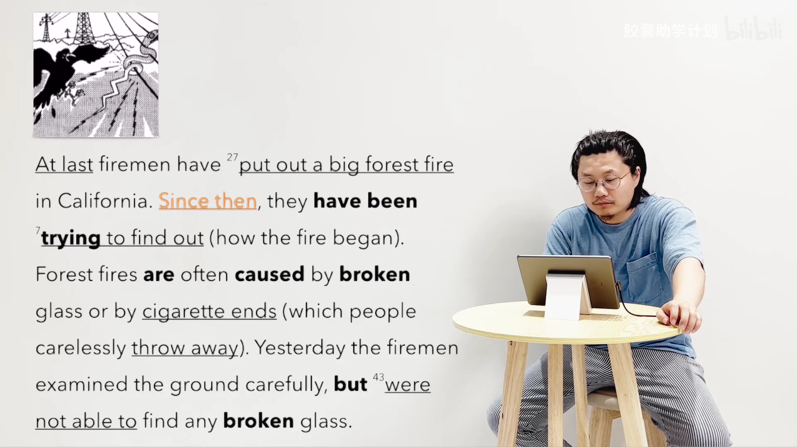

文字识别：At last firemen have ²"put out a big forest fire / in California. Since then, they have been / 'trying to find out (how the fire began). / Forest fires are often caused by broken / glass or by cigarette ends (which people / carelessly throw away). Yesterday the firemen / examined the ground carefully, but / 43 / ³3were / not able to find any broken glass.

## 00:05:00–00:05:30

告诉你第二句话，不用着急往下读。这也是我们进入二册下半册和三册重点要做的一件事情，就是长难句的拆解。当然，这句话很简单的长难句，是吧？嗯，这些消防员呢，昨天这些消防员呢，仔细的检查了一下这个地面。你看，它还是挺符合六一二三四五六的，是吧？你看六一二三四，是不是六一二三四五六，对吧？还是很符合的。But但是呢，

### 画面 00:05:22

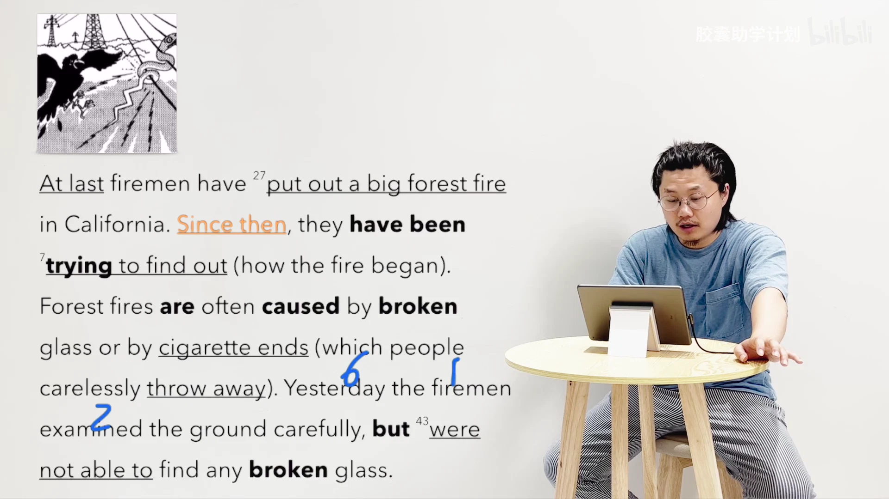

文字识别：At last firemen have ²put out a big forest fire / in California. Since then, they have been / 'trying to find out (how the fire began). / Forest fires are often caused by broken / glass or by cigarette ends (which people / carelessly throw away). YesterPay the firemen / exanmed the ground carefully, but4 / 4³were / 43 / not able to find any broken glass.

### 画面 00:05:28

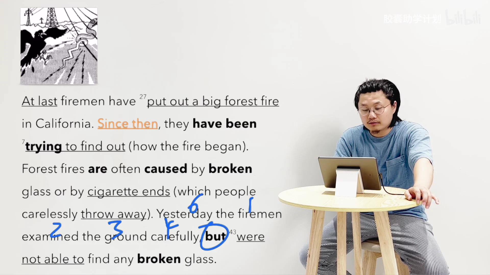

文字识别：At last firemen have ²”put out a big forest fire / in California. Since then, they have been / 'trying to find out (how the fire began). / Forest fires are often caused by broken / glass or by cigarette ends (which people / carelessly throw away). Yesterday the firemen / exanmed the ground canefully7 / /but / 43 / were / not able to find any broken glass.

## 00:05:30–00:06:00

were not able to没有办法，没有能怎么样呢？Find any broken glass，没有能找到任何破碎的玻璃。这个were not able to，你注意啊。But如果后边主语省略了，默认它的主语一定是前面这个，叫做the fireman，就是这帮消防员们没有能找到任何破碎的玻璃，好吧？Continue，they

### 画面 00:05:58

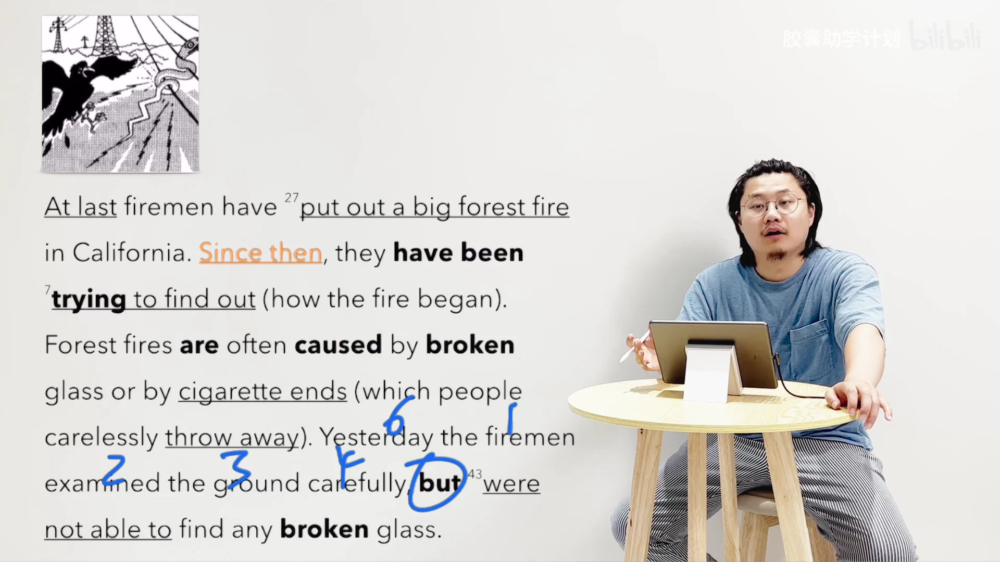

文字识别：At last firemen have ²"put out a big forest fire / in California. Since then, they have been / 'trying to find out (how the fire began). / Forest fires are often caused by broken / glass or by cigarette ends (which people / carelessly throw away). YesterPay the firemen / exanmed the ground canefulyy / /but / 43 / were / not able to find any broken glass.

## 00:06:00–00:06:30

They were also quite sure.他们也同也是怎么样呢？Quite sure.如果只用sure，就是他们也很确定，对吧？Quite就是相当啊。他们也相当的确信。确信的是一件事情，一个小的从句。That a cigarette end did not start the fire.说一个烟屁股，这个屁股啊，说这个烟蒂啊，did not

### 画面 00:06:00

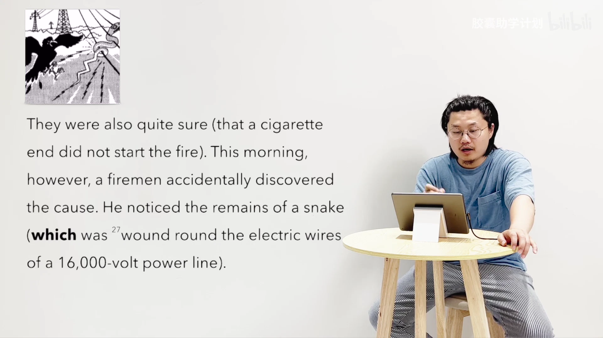

文字识别：They were also quite sure (that a cigarette / end did not start the fire). This morning, / however, a firemen accidentally discovered / the cause. He noticed the remains of a snake / (which was ²wound round the electric wires / of a 16,000-volt power line).

## 00:06:30–00:07:00

start the fire,并没有引起这个火. This morning, however,说今天早上，然而呢, a fireman accidentally注意这里就不能是e了，应该是a了啊，单数了. A fireman accidentally discovered the cause.好，说他不经意的发现了这个原因，导致这场森林大火的原因. He noticed the remains of

### 画面 00:06:30

文字识别：They were also quite sure (that a cigarette / end did not start the fire). This morning, / however, a firemen accidentally discovered / the cause. He noticed the remains of a snake / (which was ²wound round the electric wires / of a 16,000-volt power line).

## 00:07:00–00:07:30

a snake. 说他注意到了 the remains of a snake. 咱们之前学过了，叫做一个蛇的残骸，对吧？或者尸体。 Which 哎，指的就是这条蛇的尸体，对吧？这个蛇的尸体怎么样呢？ Was wound around the electric wires of a sixteen thousand volt power line. 这个地方稍微有一点点不是特别容易读懂，我们稍微慢一点。说这个蛇的尸体怎么样呢？被蜿蜒

### 画面 00:07:00

文字识别：They were also quite sure (that a cigarette / end did not start the fire). This morning, / however, a firem en accidentally discovered / the cause. He noticed the remains of a snake / (which was ²"wound round the electric wires / of a 16,000-volt power line).

## 00:07:30–00:08:00

着啊，哎，被蜿蜒着，围绕着什么呢？注意这个 wind 实际上是 wind 二十七课咱们学过，说那个晚上下雨了，对吧？然后这个小溪呢蜿蜒着流过了这片地，然后在他们的帐篷底下穿了过去。wind 对吧？哎，wind is way 对吧？OK，那这里呢叫做被蜿蜒着，但其实汉语不用说被

### 画面 00:07:30

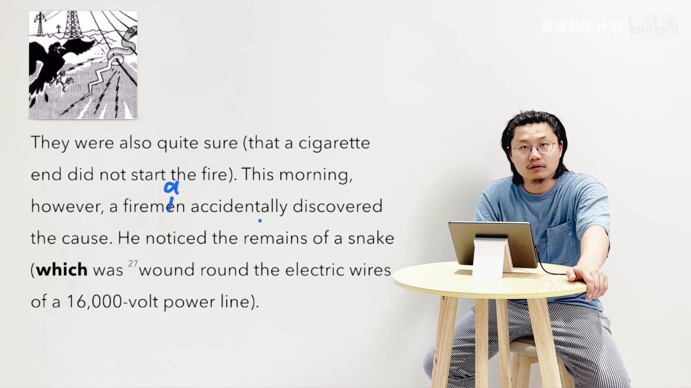

文字识别：They were also quite sure (that a cigarette / end did not start the fire). This morning, / however, a firem en accidentally discovered / the cause. He noticed the remains of a snake / (which was ²wound round the electric wires / of a 16,000-volt power line).

### 画面 00:07:43

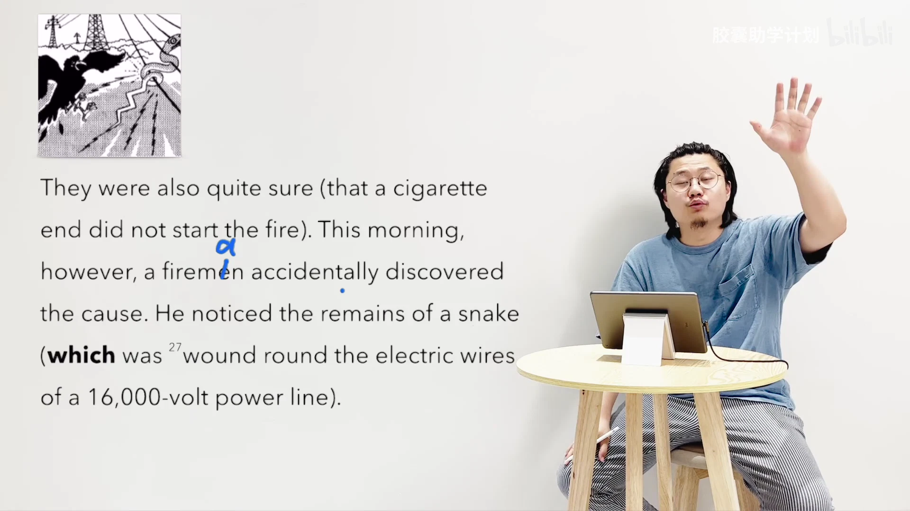

文字识别：They were also quite sure (that a cigarette / end did not start the fire). This morning, / however, a firem en accidentally discovered / • / the cause. He noticed the remains of a snake / (which was ²wound round the electric wires / of a 16,000-volt power line).

### 画面 00:07:48

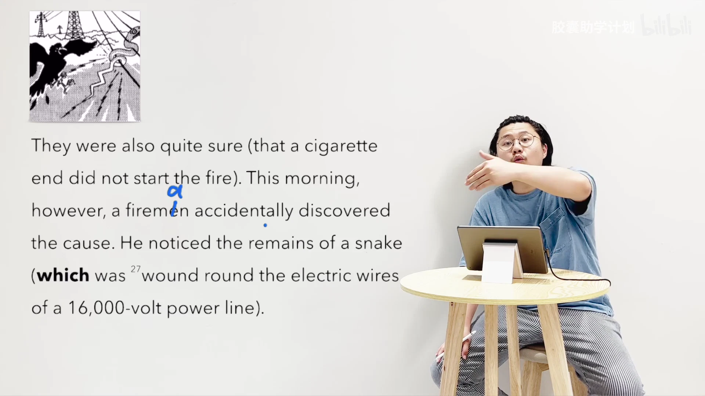

文字识别：They were also quite sure (that a cigarette / end did not start the fire). This morning, / however, a firem en accidentally discovered / • / the cause. He noticed the remains of a snake / (which was ²wound round the electric wires / of a 16,000-volt power line).

### 画面 00:07:57

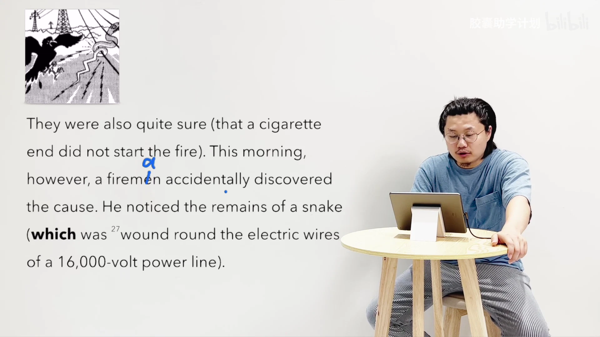

文字识别：They were also quite sure (that a cigarette / end did not start the fire). This morning, / however, a firem en accidentally discovered / the cause. He noticed the remains of a snake / (which was ²wound round the electric wires / of a 16,000-volt power line).

## 00:08:00–00:08:30

动啊。英文在这只是呃呃用了被动啊。蜿蜒着这个 round 也是绕着啊，也是绕着。其实两个东西合起来翻译成蜿蜒着或者绕着就可以啊。 One round electric wires 就指的是这个电线，什么样的电线呢？看后边啊，其实它俩是一码事儿，是一个一万六千伏特的输电线啊的这个电线，对吧？就它俩是一码事儿。其实所以整个后边

### 画面 00:08:27

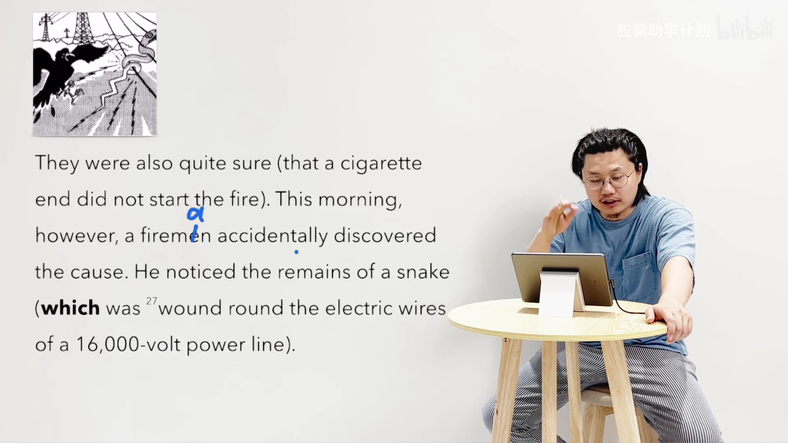

文字识别：They were also quite sure (that a cigarette / end did not start the fire). This morning, / however, a firem en accidentally discovered / the cause. He noticed the remains of a snake / (which was ²wound round the electric wires / of a 16,000-volt power line).

## 00:08:30–00:09:00

翻译过来就是啊，electric wires of a sixteen thousand volt power line指的就是一万六千伏特的电线。Power line跟electric wires在这是类似于同义词的。OK，哎，所以这句话呢，两个点各位非常容易搞不明白，叫做one round，合起来其实就是蜿蜒的意思。只不过英文呢，他说的是蜿蜒着，蜿蜒着绕着谁呢？绕着是这个电线，所

### 画面 00:08:57

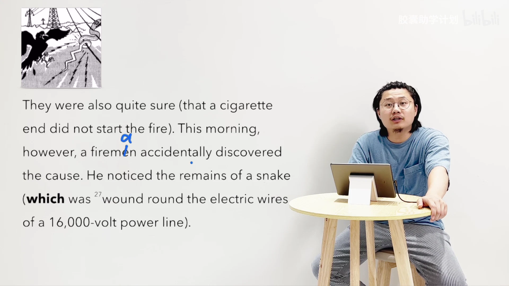

文字识别：They were also quite sure (that a cigarette / end did not start the fire). This morning, / however, a firem en accidentally discovered / the cause. He noticed the remains of a snake / (which was ²wound round the electric wires / of a 16,000-volt power line).

## 00:09:00–00:09:30

以这个绕着是这个 round 啊，是有点这样的一个感觉啊。 Okay, continue. In this way, 第五课咱们学的，对吧？哎，说以这样的一种方式，他搭建起来了他自己的 private telephone service，对吧？鸽子那一课， he was able to 四十三课咱们学，他成功的 solved the mystery. 好，他成功的解决了这个谜题啊。注意这个单词其实有两个类似的发

### 画面 00:09:05

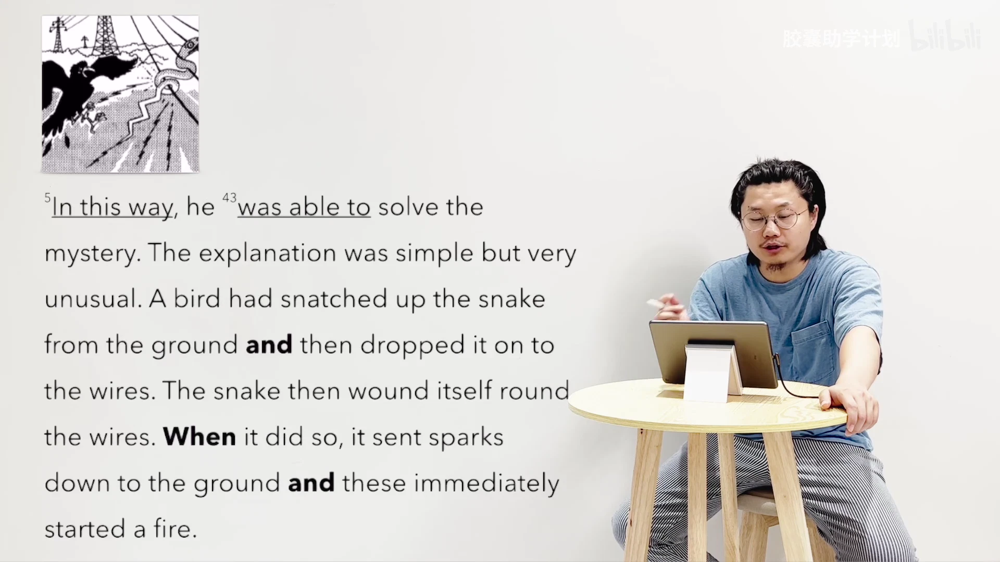

文字识别：5In this way, he 4³was able to solve the / mystery. The explanation was simple but very / unusual. A bird had snatched up the snake / from the ground and then dropped it on to / the wires. The snake then wound itself round / the wires. When it did so, it sent sparks / down to the ground and these immediately / started a fire.

## 00:09:30–00:10:00

音，你们由英美音听的不同呢，可能会有一点不同的感觉。Mystery和Mystery都是对的，我读的很夸张啊，真正去读不会这么夸张，但我为了让能听清楚啊，都是对的，没有问题，放心去读啊。The explanation was simple but very unusual。你看这里有好几个单词很重要，Explanation，Explanation你可能不认得，但是你要知道你应该可能认识，Explain叫做解释，Explain

### 画面 00:09:35

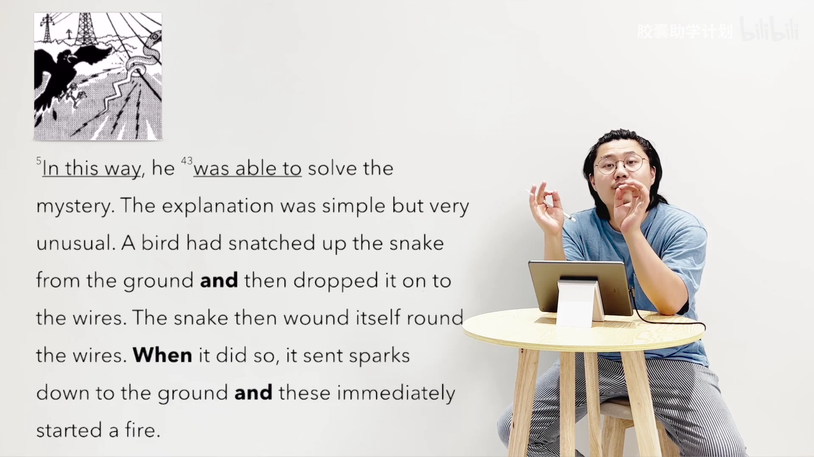

文字识别：5In this way, he 4³was able to solve the / mystery. The explanation was simple but very / unusual. A bird had snatched up the snake / from the ground and then dropped it on to / the wires. The snake then wound itself round / the wires. When it did so, it sent sparks / down to the ground and these immediately / started a fire.

## 00:10:00–00:10:30

something to somebody，对吧？解释，tion往往是名词词缀，原来的explain是动词，explanation就是名词。说这个解释非常的简单，但是呢，非常的unusual。usual是寻常的、普遍的，unusual就是不寻常、不普遍的。un做前缀表否定，对吧？哎，你看我们在这儿其实连续学到了两个类似于词根词缀的东西。A

### 画面 00:10:05

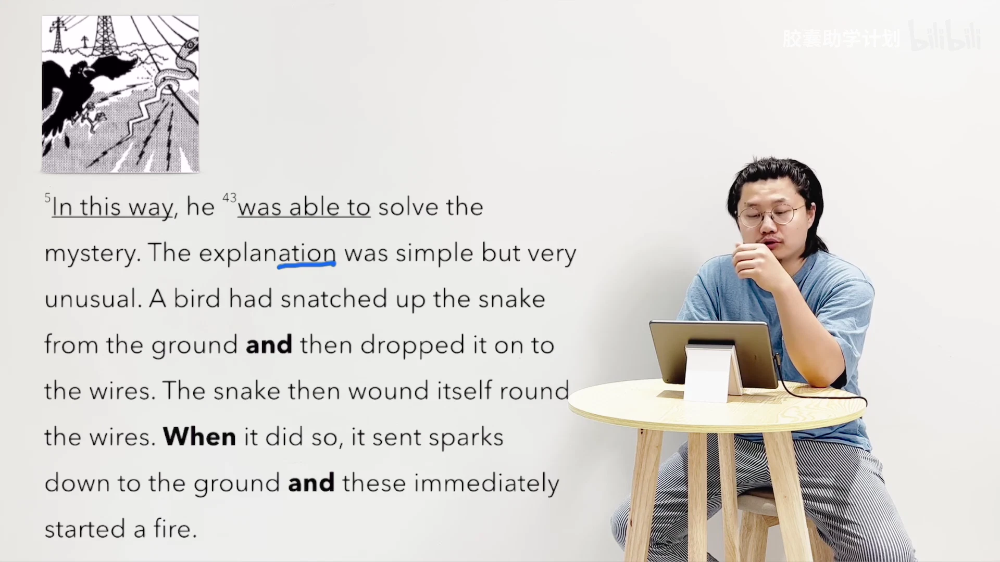

文字识别：5In this way, he 4³was able to solve the / mystery. The explanation was simple but very / unusual. A bird had snatched up the snake / from the ground and then dropped it on to / the wires. The snake then wound itself round / the wires. When it did so, it sent sparks / down to the ground and these immediately / started a fire.

### 画面 00:10:17

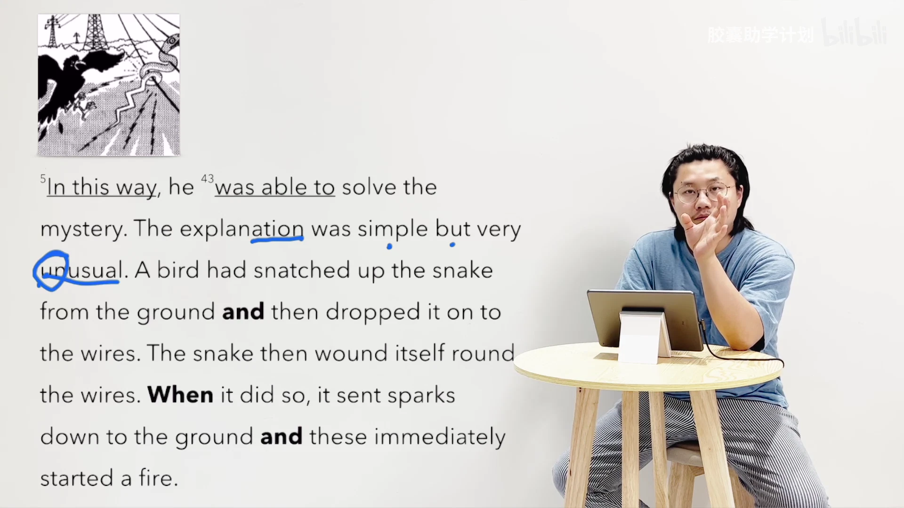

文字识别：5In this way, he 4³was able to solve the / mystery. The explanation was simple but very / usual. A bird had snatched up the snake / from the ground and then dropped it on to / the wires. The snake then wound itself round / the wires. When it did so, it sent sparks / down to the ground and these immediately / started a fire.

### 画面 00:10:27

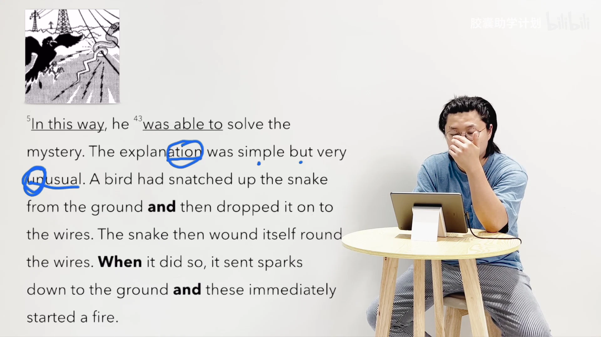

文字识别：5In this way, he 4³was able to solve the / mystery. The explanation / was simple but very / usual. A bird had snatched up the snake / from the ground and then dropped it on to / the wires. The snake then wound itself round / the wires. When it did so, it sent sparks / down to the ground and these immediately / started a fire.

## 00:10:30–00:11:00

A bird说一个鸟had snatched up the snake from the ground and不往后看了。说一个鸟啊，抓起了这个蛇从地面上。它先，你看为什么用了had加and？首先，它不用是没有问题的啊。它用是为了强调先后顺序。各位还记得吧？十四课咱们学过的had加and对吧？After A逗号B啊，什么Before B逗号A啊那些东西啊。它先抓起了这

### 画面 00:10:45

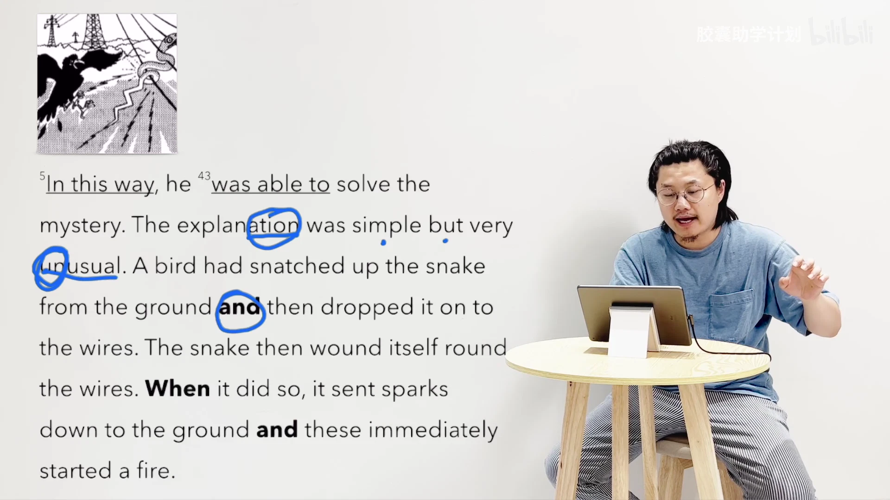

文字识别： In this way, he 4³was able to solve the / mystery. The explanation / was simple but very / usual. A bird had snatched up the snake / from the groundanat / )then dropped it on to / the wires. The snake then wound itself round / the wires. When it did so, it sent sparks / down to the ground and these immediately / started a fire.

## 00:11:00–00:11:30

个蛇从地面上，然后 dropped it onto the wires. Ah, drop,扔，对吧？你看，这就用的是一般过去时了。这儿用的是过去完成时，对吧？还是那句话，你可以不用过去完成时，在这里可以用一般过去时是没有问题的，对吧？而且大多数人读完这句话也不会有一个疑惑，叫做哪个动作先发生，哪个动作后发生？哎，这是人类的基本常识。它一定是鸟先把这个蛇抓起

### 画面 00:11:15

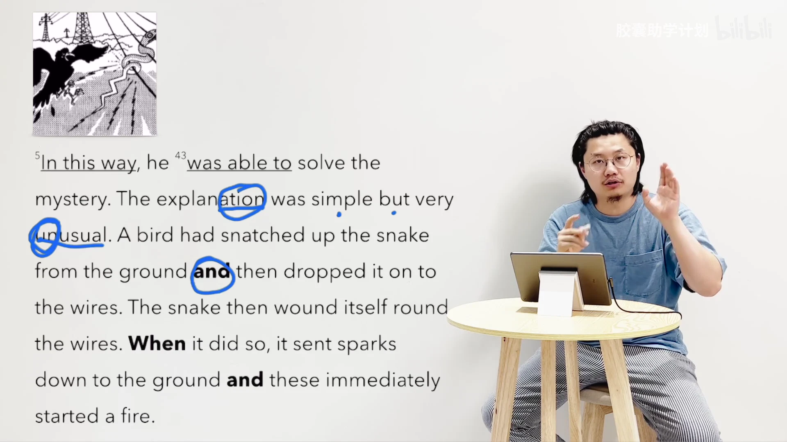

文字识别：5In this way, he 4³was able to solve the / mystery. The explanation / was simple but very / usual. A bird had snatched up the snake / from the groundanat / then dropped it on to / the wires. The snake then wound itself round / the wires. When it did so, it sent sparks / down to the ground and these immediately / started a fire.

## 00:11:30–00:12:00

来了，才能扔到这个电线上，对吧？OK啊，一定是有这个先后顺序的。但是为了强调一下，它选择用了had done。然后呢，扔它扔它指的是蛇onto四十九课咱们刚学的分开连着都可以，对吧？这个onto啊，就是到了什么什么上面，什么上面呢？The wires这个电线的上面。The snake then wound itself，说这个蛇然后呢就缠绕着

### 画面 00:11:45

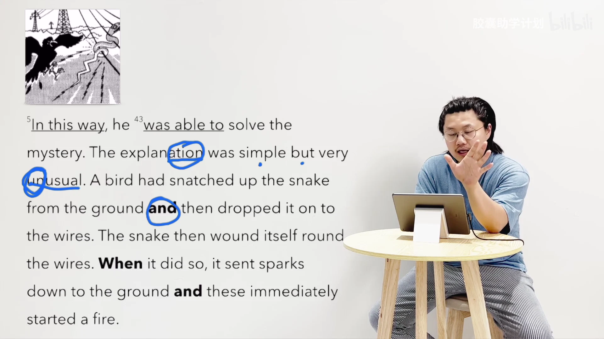

文字识别：'In this way, he 4³was able to solve the / mystery. The explanation / was simple but very / usual. A bird had snatched up the snake / from the groundanat / then dropped it on to / the wires. The snake then wound itself round / the wires. When it did so, it sent sparks / down to the ground and these immediately / started a fire.

## 00:12:00–00:12:30

它自己，round the wires，说围绕着这个电线去进行了一个盘旋的缠绕啊，就把它自己缠到这个电线上去了。When it did so，说当它，这它指的就是这个 snake，就是这个蛇，对吧？这个蛇自己主动的，哎，把它自己缠到了这个电线上。当这个蛇 did so， so我们新一就学过，think so，

### 画面 00:12:15

文字识别：5In this way, he 4³was able to solve the / mystery. The explanation / was simple but very / usual. A bird had snatched up the snake / from the groundanat / then dropped it on to / the wires. The snake then wound itself round / the wires. When it did so, it sent sparks / down to the ground and these immediately / started a fire.

## 00:12:30–00:13:00

I don't think so, so这样对吧？说当他这样去做的时候，做了这样的事情了之后，it sent sparks down to the ground。说他呀就发送出了啊，就弄出了一些。我们这个弄啊，其实是为了这个让它翻译成汉语更舒服。如果不是为了更舒服，就是可以你理解为就是送出了一些，对吧？或者说弄出了一些。这个sparks指的是什

### 画面 00:12:45

文字识别：5In this way, he 4³was able to solve the / mystery. The explanation / was simple but very / usual. A bird had snatched up the snake / from the ground anat / then dropped it on to / the wires. The snake then wound itself round / the wires. When it did so, it sent sparks / down to the ground and these immediately / started a fire.

## 00:13:00–00:13:30

么呢？就是这个火花，电火花 down to the ground 往下走到了地面上，and 然后呢，this immediately started a fire，说这些火花迅速的就引起了一场火灾。OK，好，本课习惯用法就两个 find out 和 throw away 啊，很快啊，很容易学 find out 发现对吧？弄明白，找到都可以。比如说 I need

### 画面 00:13:15

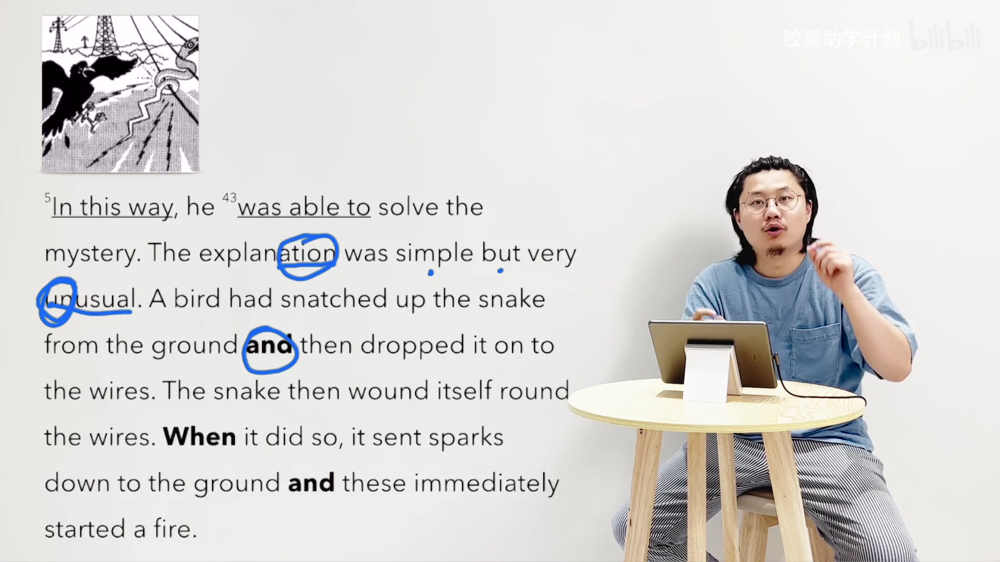

文字识别：5In this way, he 4³was able to solve the / mystery. The explanation / was simple but very / usual. A bird had snatched up the snake / from the groundana t / then dropped it on to / the wires. The snake then wound itself round / the wires. When it did so, it sent sparks / down to the ground and these immediately / started a fire.

### 画面 00:13:17

文字识别：习惯用法造句 / find out / throw away..

### 画面 00:13:19

文字识别：习惯用法造句 / find out / throw away..

### 画面 00:13:21

文字识别：网：v.+v.变化 / 习惯用法造句指南 / 四句型转换 / 方式/地点/时间 / 其他习惯用法 / 其他单词+词性 / 原文摘抄+变 / 6123456 / find out

### 画面 00:13:23

文字识别：网：v.+v.变化 / 习惯用法造句指南 / 四句型转换 / 方式/地点/时间 / 其他习惯用法 / 其他单词+词性 / 原文摘抄+变 / 6123456 / find out

### 画面 00:13:25

文字识别：网：v.+v.变化 / 习惯用法造句指南 / 四句型转换 / 方式/地点/时间 / 其他习惯用法 / 其他单词+词性 / 原文摘抄+变 / 6123456 / find out

### 画面 00:13:29

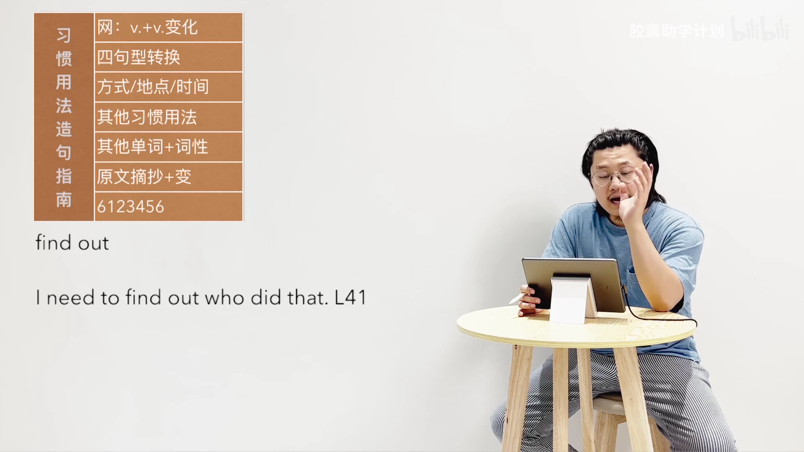

文字识别：网：v.+v.变化 / 习惯用法造句指南 / 四句型转换 / 方式/地点/时间 / 其他习惯用法 / 其他单词+词性 / 原文摘抄+变 / 6123456 / find out / I need to find out who did that. L41

## 00:13:30–00:14:00

to find out who did that.说，我必须要，我需要去弄明白，找出来说谁干的这件事儿。四十一课，need to do something。再来，说，How did you find out about that?口语当中非常常用，叫做，哎，你你是怎么弄明白这件事情的？你是怎么发现这件事情的？对吧？OK，比如说，再来结合四十课，If I were you,如果我是你，I

### 画面 00:13:42

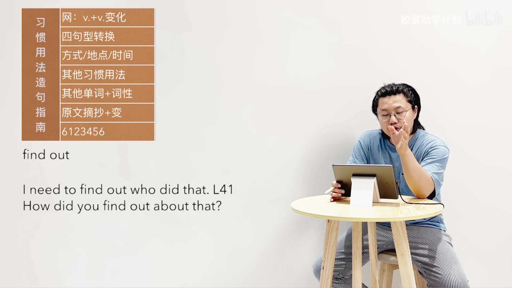

文字识别：网：v.+v.变化 / 习惯用法造句指南 / 四句型转换 / 方式/地点/时间 / 其他习惯用法 / 其他单词+词性 / 原文摘抄+变 / 6123456 / find out / I need to find out who did that. L41 / How did you find out about that?

### 画面 00:13:44

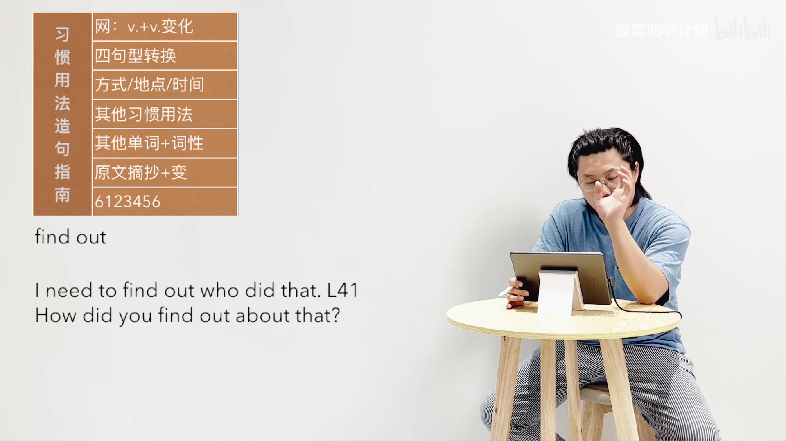

文字识别：网：v.+v.变化 / 习惯用法造句指南 / 四句型转换 / 方式/地点/时间 / 其他习惯用法 / 其他单词+词性 / 原文摘抄+变 / 6123456 / find out / I need to find out who did that. L41 / How did you find out about that?

### 画面 00:13:48

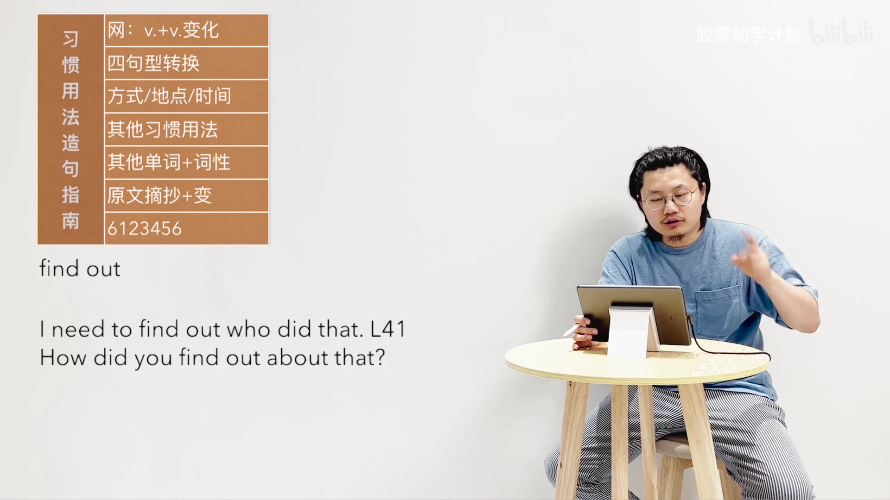

文字识别：网：v.+v.变化 / 习惯用法造句指南 / 四句型转换 / 方式/地点/时间 / 其他习惯用法 / 其他单词+词性 / 原文摘抄+变 / 6123456 / find out / I need to find out who did that. L41 / How did you find out about that?

### 画面 00:13:50

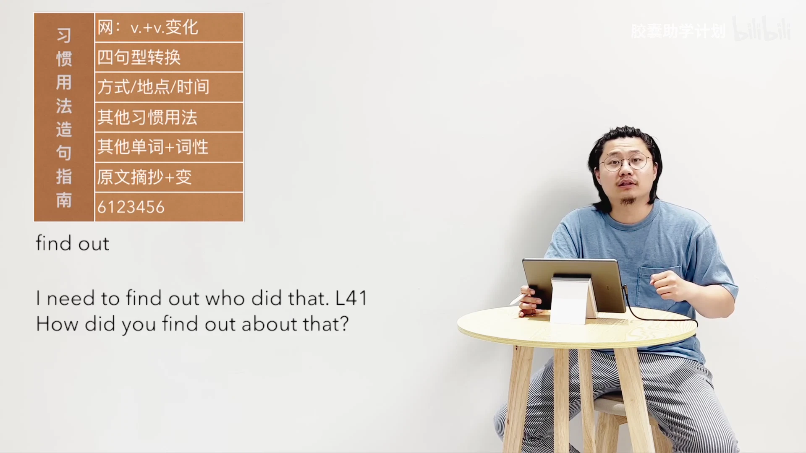

文字识别：网：v.+v.变化 / 习惯用法造句指南 / 四句型转换 / 方式/地点/时间 / 其他习惯用法 / 其他单词+词性 / 原文摘抄+变 / 6123456 / find out / I need to find out who did that. L41 / How did you find out about that?

### 画面 00:13:53

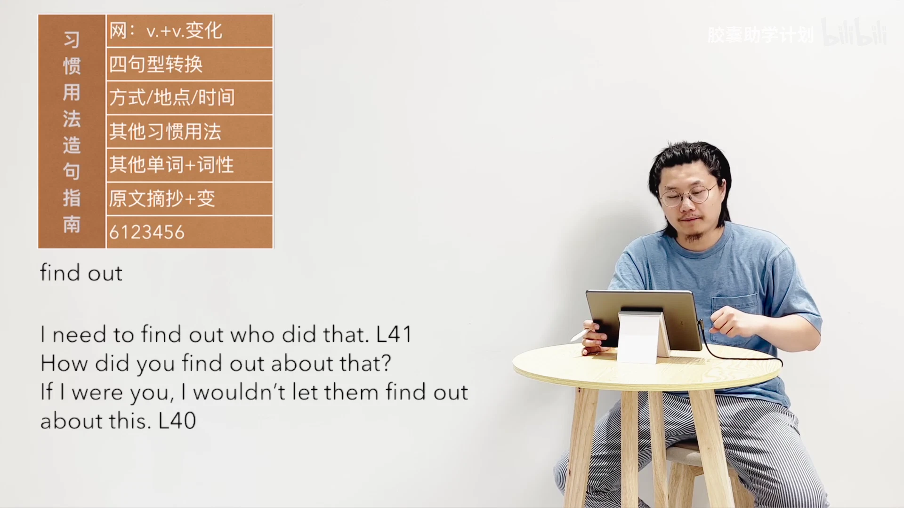

文字识别：网：v.+v.变化 / 习惯用法造句指南 / 四句型转换 / 方式/地点/时间 / 其他习惯用法 / 其他单词+词性 / 原文摘抄+变 / 6123456 / find out / I need to find out who did that. L41 / How did you find out about that? / If I were you, I wouldn't let them find out / about this. L40

### 画面 00:13:55

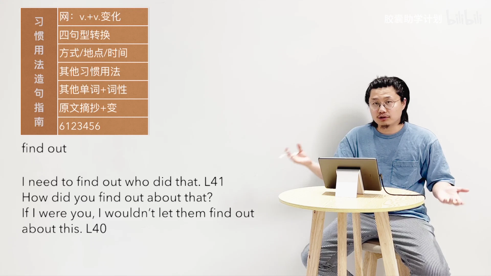

文字识别：网：v.+v.变化 / 习惯用法造句指南 / 四句型转换 / 方式/地点/时间 / 其他习惯用法 / 其他单词+词性 / 原文摘抄+变 / 6123456 / find out / I need to find out who did that. L41 / How did you find out about that? / If I were you, I wouldn't let them find out / about this. L40

### 画面 00:13:57

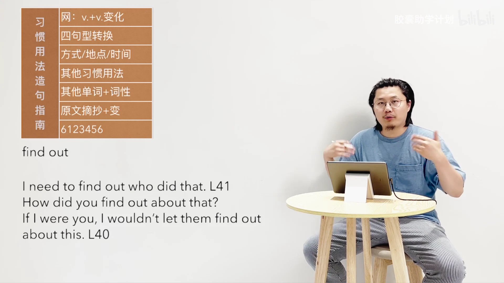

文字识别：网：v.+v.变化 / 习惯用法造句指南 / 四句型转换 / 方式/地点/时间 / 其他习惯用法 / 其他单词+词性 / 原文摘抄+变 / 6123456 / find out / I need to find out who did that. L41 / How did you find out about that? / If I were you, I wouldn't let them find out / about this. L40

### 画面 00:13:59

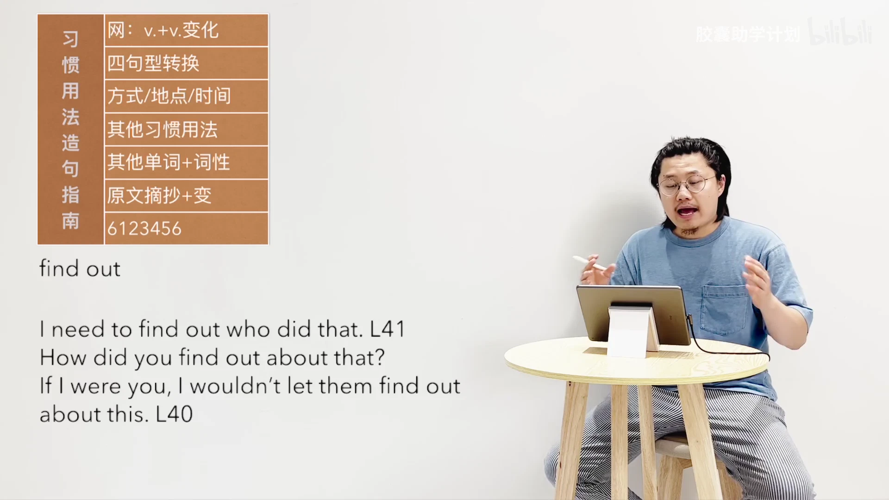

文字识别：网：v.+v.变化 / 习惯用法造句指南 / 四句型转换 / 方式/地点/时间 / 其他习惯用法 / 其他单词+词性 / 原文摘抄+变 / 6123456 / find out / I need to find out who did that. L41 / How did you find out about that? / If I were you, I wouldn't let them find out / about this. L40

## 00:14:00–00:14:30

wouldn't let them find out about this.说，我不会让他们发现这件事情的。哎，那好，虚拟语气吧，四十课咱学的，对吧？接下来电影片段啊，注意力集中了，开始听。Oh, you mean when they find out that you've helped us, they're going to kill you? Okay, very good.好啊，还是啊，如果太快，倒回去多听几遍。好，接下来下一个叫做throw,

### 画面 00:14:01

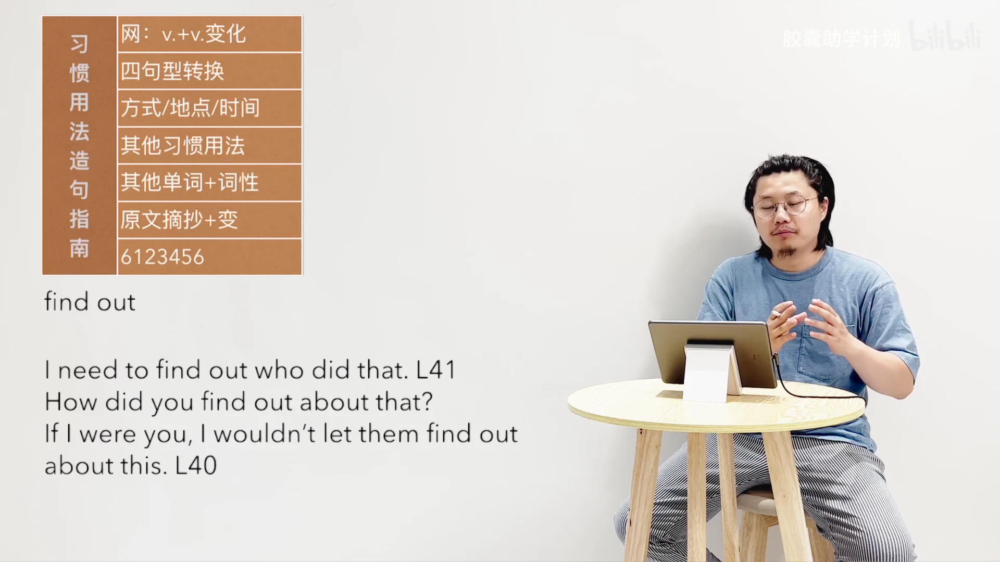

文字识别：网：v.+v.变化 / 习惯用法造句指南 / 四句型转换 / 方式/地点/时间 / 其他习惯用法 / 其他单词+词性 / 原文摘抄+变 / 6123456 / find out / I need to find out who did that. L41 / How did you find out about that? / If I were you, I wouldn't let them find out / about this. L40

### 画面 00:14:04

文字识别：网：v.+v.变化 / 习惯用法造句指南 / 四句型转换 / 方式/地点/时间 / 其他习惯用法 / 其他单词+词性 / 原文摘抄+变 / 6123456 / find out / I need to find out who did that. L41 / How did you find out about that? / If I were you, I wouldn't let them find out / about this. L40

### 画面 00:14:11

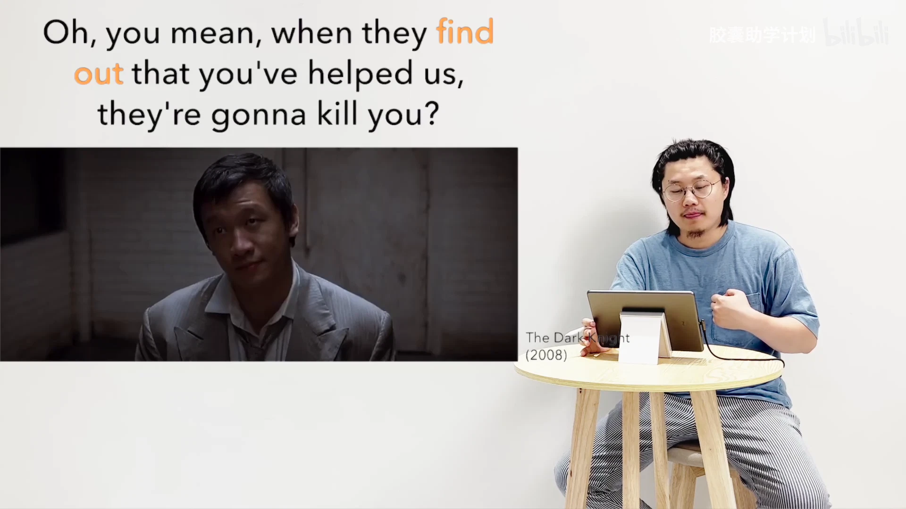

文字识别：Oh, you mean, when they / find / out that you've helped us, / they're gonna kill you? / The DarkK / ht / (2008)

### 画面 00:14:16

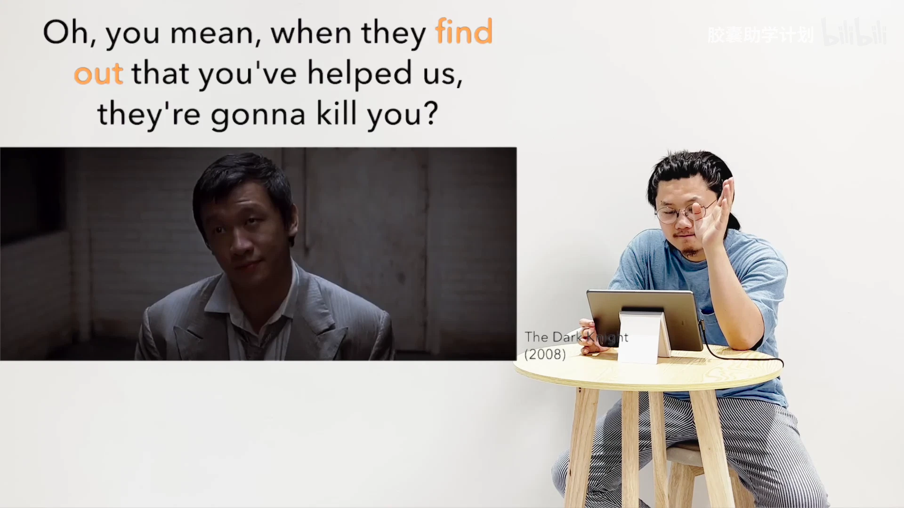

文字识别：Oh, you mean, when they / find / t that you've helped us, / out / they're / gonna / a kill you? / The DarkK / nignt / (2008)

### 画面 00:14:18

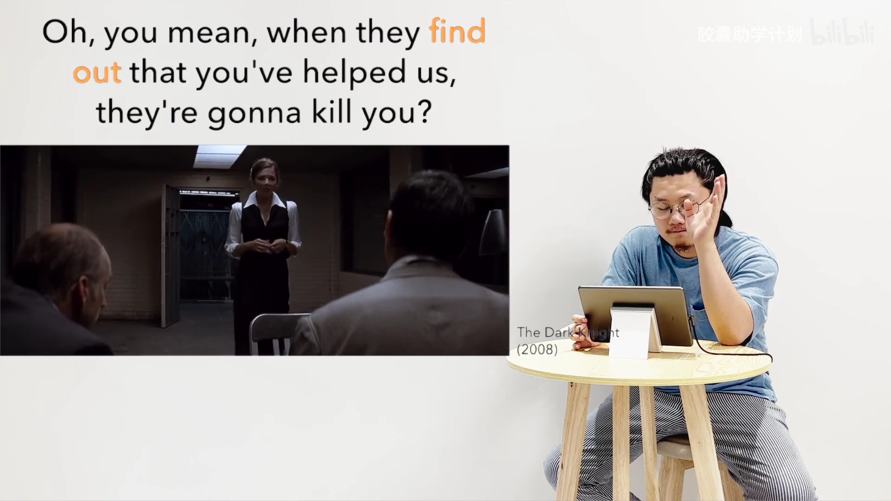

文字识别：Oh, you mean, when they / find / out that you've helped us, / they're gonna kill you? / The DarkK / ngnt / (2008)

### 画面 00:14:20

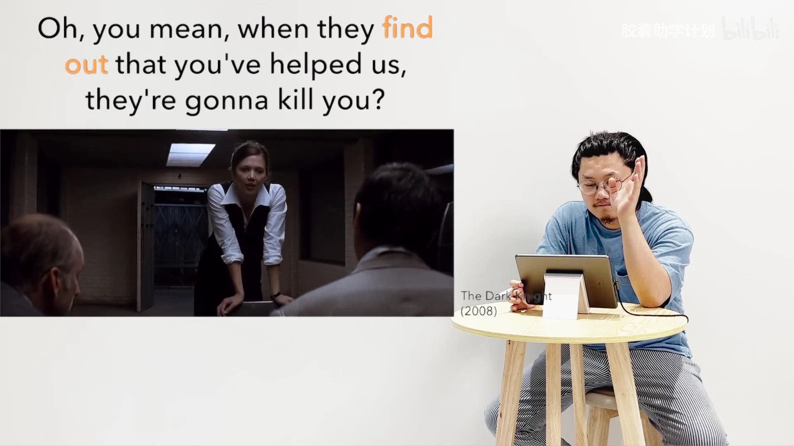

文字识别：Oh, you mean, when they / find / out that you've helped us, / they're g / gonna / a killyou? / The DarkK / nvgnt / (2008)

### 画面 00:14:23

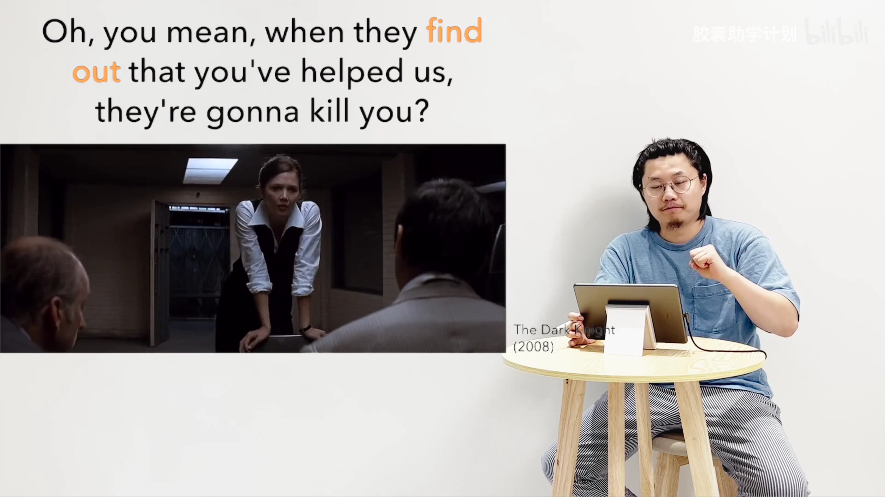

文字识别：Oh, you mean, when they / find / out that you've helped us, / they're gonna kill you? / The DarkKn / nignt / (2008)

### 画面 00:14:26

文字识别：网：v.+v.变化 / 习惯用法造句指南 / 四句型转换 / 方式/地点/时间 / 其他习惯用法 / 其他单词+词性 / 原文摘抄+变 / 6123456 / /θraul / throw away

### 画面 00:14:28

文字识别：网：v.+v.变化 / 习惯用法造句指南 / 四句型转换 / 方式/地点/时间 / 其他习惯用法 / 其他单词+词性 / 原文摘抄+变 / 6123456 / 1θraul / throw away

## 00:14:30–00:15:00

throw away,扔掉啊，比如说 I threw it away last night.顺便学一下它的过去式，对吧？哎，我昨天晚上把它扔掉了。注意，如果是代词的话，一般是放在 throw away 的中间啊，threw it away 啊。好，再来，比如说 Did you threw it away last night? 四句型转换，continue 四句型转换不多说。We needn't have thrown it away. 它就是 throw

### 画面 00:14:30

文字识别：网：v.+v.变化 / 习惯用法造句指南 / 四句型转换 / 方式/地点/时间 / 其他习惯用法 / 其他单词+词性 / 原文摘抄+变 / 6123456 / /θraul / throw away

### 画面 00:14:34

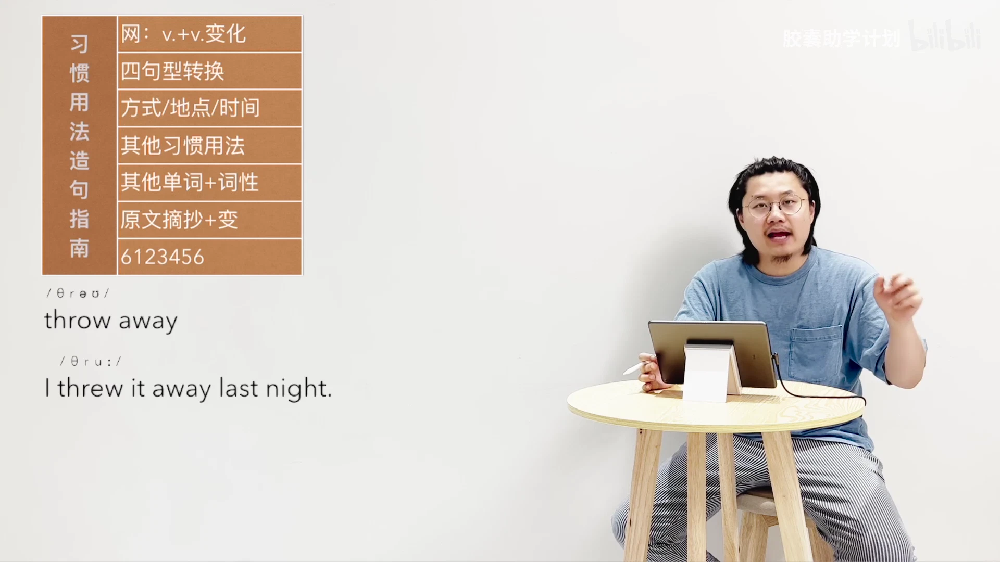

文字识别：网：v.+v.变化 / 习惯用法造句指南 / 四句型转换 / 方式/地点/时间 / 其他习惯用法 / 其他单词+词性 / 原文摘抄+变 / 6123456 / 1θrau/ / throw away / 1θru:1 / I threw it away last night.

### 画面 00:14:36

文字识别：网：v.+v.变化 / 习惯用法造句指南 / 四句型转换 / 方式/地点/时间 / 其他习惯用法 / 其他单词+词性 / 原文摘抄+变 / 6123456 / 1θraul / throw away / 1θru:1 / I threw it away last night.

### 画面 00:14:39

文字识别：网：v.+v.变化 / 习惯用法造句指南 / 四句型转换 / 方式/地点/时间 / 其他习惯用法 / 其他单词+词性 / 原文摘抄+变 / 6123456 / 1θrau/ / throw away / 1θru:1 / I threw it away last night.

### 画面 00:14:43

文字识别：网：v.+v.变化 / 习惯用法造句指南 / 四句型转换 / 方式/地点/时间 / 其他习惯用法 / 其他单词+词性 / 原文摘抄+变 / 6123456 / 1θraul / throw away / 1θru:1 / I threw it away last night.

### 画面 00:14:45

文字识别：网：v.+v.变化 / 习惯用法造句指南 / 四句型转换 / 方式/地点/时间 / 其他习惯用法 / 其他单词+词性 / 原文摘抄+变 / 6123456 / /θrau/ / throw away / 1θru:1 / I threw it away last night.

### 画面 00:14:48

文字识别：网：v.+v.变化 / 习惯用法造句指南 / 四句型转换 / 方式/地点/时间 / 其他习惯用法 / 其他单词+词性 / 原文摘抄+变 / 6123456 / 1θrau/ / throw away / 1θru:/ / I threw it away last night. / Did you throw it away last night?

### 画面 00:14:50

文字识别：网：v.+v.变化 / 习惯用法造句指南 / 四句型转换 / 方式/地点/时间 / 其他习惯用法 / 其他单词+词性 / 原文摘抄+变 / 6123456 / 1θrau/ / throw away / 1θru:/ / I threw it away last night. / Did you throw it away last night?

### 画面 00:14:54

文字识别：网：v.+v.变化 / 习惯用法造句指南 / 四句型转换 / 方式/地点/时间 / 其他习惯用法 / 其他单词+词性 / 原文摘抄+变 / 6123456 / 1θraul / throw away / 1θru:l / I threw it away last night. / Did you throw it away last night? / when/why/who/what... / We needn't have thrown it away. L41

### 画面 00:14:59

文字识别：网：v.+v.变化 / 习惯用法造句指南 / 四句型转换 / 方式/地点/时间 / 其他习惯用法 / 其他单词+词性 / 原文摘抄+变 / 6123456 / /θraul / throw away / 1θru:1 / I threw it away last night. / Did you throw it away last night? / when/why/who/what... / We needn't have thrown it away. L41

## 00:15:00–00:15:30

后边加了一个嗯，所以叫 thrown. Okay, we needn't have thrown it away. 说我们本不必四十一课咱们学的 needn't have done 本不必把它给扔掉的. Okay, 注意力集中，电影片段听力练习啊。第一个, said you can throw it away. Okay, 第二个, you didn't throw it away, did you? Okay, 这个我们在新二

### 画面 00:15:04

文字识别：网：v.+v.变化 / 习惯用法造句指南 / 四句型转换 / 方式/地点/时间 / 其他习惯用法 / 其他单词+词性 / 原文摘抄+变 / 6123456 / 1θraul / throw away / 1θru:/ / I threw it away last night. / Did you throw it away last night? / when/why/who/what... / We needn't have thrown it away. L41

### 画面 00:15:09

文字识别：网：v.+v.变化 / 习惯用法造句指南 / 四句型转换 / 方式/地点/时间 / 其他习惯用法 / 其他单词+词性 / 原文摘抄+变 / 6123456 / 1θraul / throw away / 1θru:/ / I threw it away last night. / Did you throw it away last night? / when/why/who/what... / We needn't have thrown it away. L41

### 画面 00:15:13

文字识别：I said / you can throw it away. / pane / LA / I+E C05(0) / vdy / dt / Hidden / JreS / (2016)

### 画面 00:15:19

文字识别：I said / I you can throw it away. / lt / 1+E (0s() / vly / At / Hidden / (2016)

### 画面 00:15:21

文字识别：I said you can throw it away. / Hidden / (2016)

### 画面 00:15:23

文字识别：You didn't throw it away, did you? / Haunt / (2014)

### 画面 00:15:29

文字识别：You didn't throw it away, did you? / Haunt / (2014)

## 00:15:30–00:16:00

didn't teach this grammar called didn't you? Ah, first, if you have learned our new one, solidly learned this, you will definitely. If you haven't solidly learned, what should you do? Turn back to the new concept one volume, our video one hundred and three lessons to see, right? Hey, French math that lesson, ah, is about two and enough that lesson to see. That lesson we talked about this thing didn't you? Okay, here we go. Um, recap two small habits. Except for the article,

### 画面 00:15:50

文字识别：You didn't throw it away, did you? / Haunt / (2014)

### 画面 00:15:55

文字识别：Recap / find out / Expression / throw away.

### 画面 00:15:57

文字识别：Recap / find out / Expression / throw away.

### 画面 00:15:59

文字识别：Recap / find out / Expression / throw away.

## 00:16:00–00:16:30

外啊，对吧？从文章当中摘出来两个小的习惯用法，讲作业习惯用法造句，文章跟读，对吧？文章跟读有，首先第一个它的用处叫做帮助我们内化单词、语法、习惯用法。当你文章读到特别熟的时候，你单词甚至不用专门花时间去背了，对吧？OK，然后重复间隔看置顶留言，能找到对应的练习，好吧？OK，呃，那以上就是本期视频的全部内容了。如果各位喜欢我们的课程

### 画面 00:16:01

文字识别：Recap / find out / Expression / throw away.

### 画面 00:16:03

文字识别：1. / 习惯用法造句/对话 / 【习惯用法造句指南】 / 每个5句

### 画面 00:16:05

文字识别：习惯用法造句/对话 / 【习惯用法造句指南】 / 每个5句 / 文章跟读至熟读成诵 / 内化单词+语法+习惯用法 / 听力+口语+写作练习

### 画面 00:16:07

文字识别：习惯用法造句/对话 / 【习惯用法造句指南】 / 每个5句 / 文章跟读至熟读成诵 / 内化单词+语法+习惯用法 / 听力+口语+写作练习

### 画面 00:16:09

文字识别：习惯用法造句/对话 / 【习惯用法造句指南】 / 每个5句 / 文章跟读至熟读成诵 / 内化单词+语法+习惯用法 / 听力+口语+写作练习

### 画面 00:16:17

文字识别：习惯用法造句/对话 / 【习惯用法造句指南】 / 每个5句 / 文章跟读至熟读成诵 / 内化单词+语法+习惯用法 / 听力+口语+写作练习 / 重复间隔（置顶留言）

### 画面 00:16:19

文字识别：习惯用法造句/对话 / 【习惯用法造句指南】 / 每个5句 / 文章跟读至熟读成诵 / 内化单词+语法+习惯用法 / 听力+口语+写作练习 / 重复间隔（置顶留言） / 3.

### 画面 00:16:22

文字识别：习惯用法造句/对话 / 【习惯用法造句指南】 / 每个5句 / 文章跟读至熟读成诵 / 内化单词+语法+习惯用法 / 听力+口语+写作练习 / 重复间隔（置顶留言） / 3.

### 画面 00:16:24

## 00:16:30–00:16:49

呢，欢迎各位关注、订阅、一键三连，分享给那些需要的朋友，来帮助我们快速成长。See you next time.

### 画面 00:16:32

### 画面 00:16:37

### 画面 00:16:39

文字识别：CAPSULEACADEMY / 胶囊助学计划 / 小红书 / Lecturer / □ / Leo / OE

### 画面 00:16:42

文字识别：CAPSULEACADEMY / 胶囊助学计划 / 『 / 小红书 / Fdi-

### 画面 00:16:45

文字识别：CAPSULEACADEMY / 胶囊助学计划 / 小红书 / Creator / □ / Leo & Berlin

### 画面 00:16:47

文字识别：bilibili / 胶囊助学计划 / CAPSULEACADEMY / 胶囊助学计划 / 小红书 / OE

### 画面 00:16:49

文字识别：bilibili / 胶囊助学计划

