# 053 练习

快速机器解析：语音为单模型转写，未进行独立交叉校对或人工复核；画面每秒采样并按变化选帧，短时文字和标记可能遗漏。截图时间约有 1 秒误差。图片有损压缩；遇到疑点请按时间查看 Google Drive 原视频。

## 00:00:00–00:00:30

Hello, everyone. Welcome to Capsule Academy. This is Leo. Today, we're going to learn New Concept English Book Two Lesson Fifty Three Practices. That注意进行如下练习，唯一的前提就是文章要跟读至熟读成诵，否则请勿开始。后边干了，enjoyed. 第一题 comprehension练习，我们能听懂别人问问题的能力，对吧？好了啊，第一个，

### 画面 00:00:00

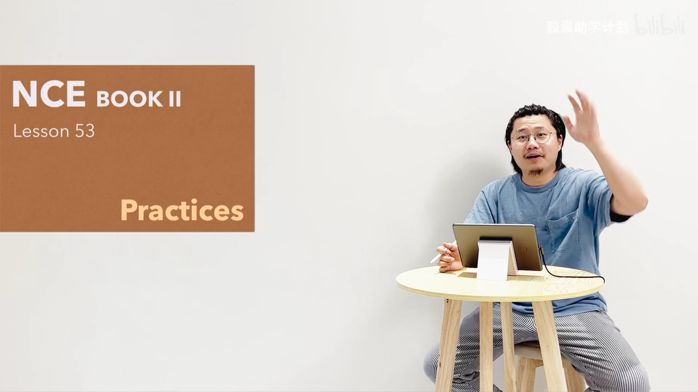

文字识别：NCE / BOOKII / Lesson 53 / Practices

### 画面 00:00:02

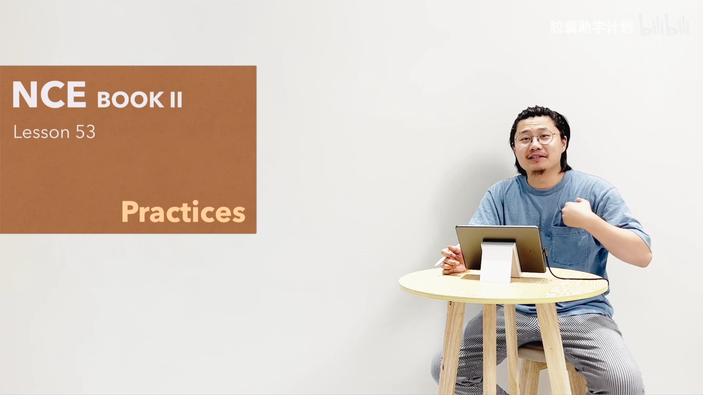

文字识别：NCE / BOOKII / Lesson 53 / Practices

### 画面 00:00:05

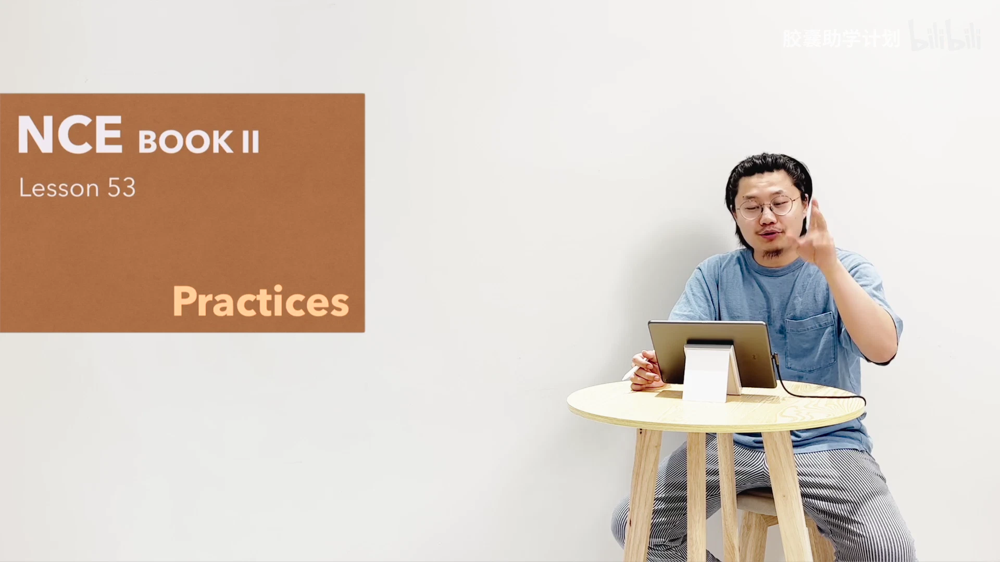

文字识别：NCE / BOOKII / Lesson 53 / Practices

### 画面 00:00:08

文字识别：进行如下练习唯一前提 / 文章跟读至熟读成诵 / 否则请勿开始

### 画面 00:00:17

文字识别：胶囊助学计划bll / •

### 画面 00:00:21

### 画面 00:00:23

文字识别：Comprehension / 训练目标： / 听懂一般疑问句＆特殊疑问句

### 画面 00:00:28

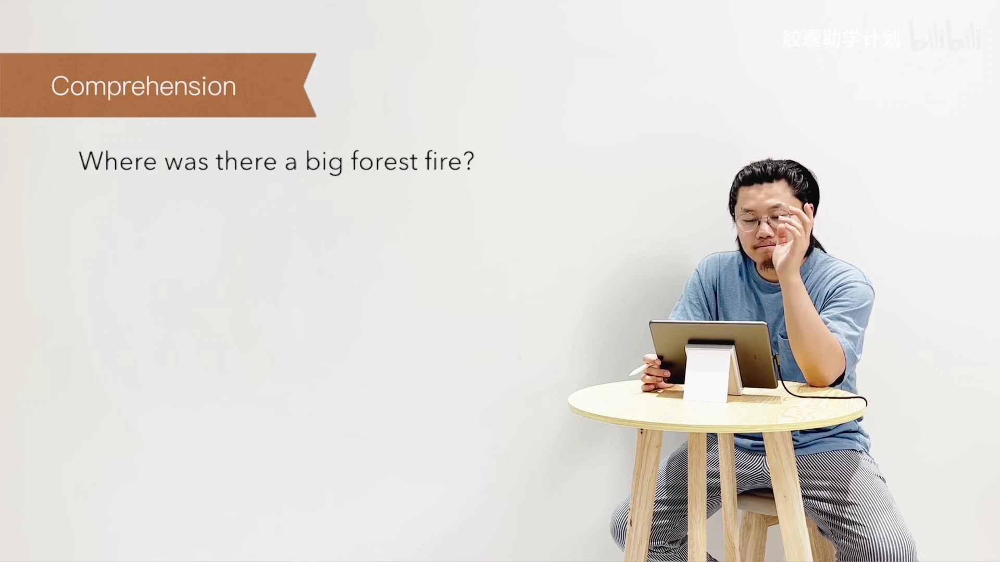

文字识别：Comprehension / Where was there a big forest fire?

## 00:00:30–00:01:00

Where was there a big forest fire? Ah, in California. Next one. Have firemen put it out? Yes, they have. Next one. What have they been trying to find out since then? How the fire began. Next one. What are forest fires often caused by? Broken glass

### 画面 00:00:49

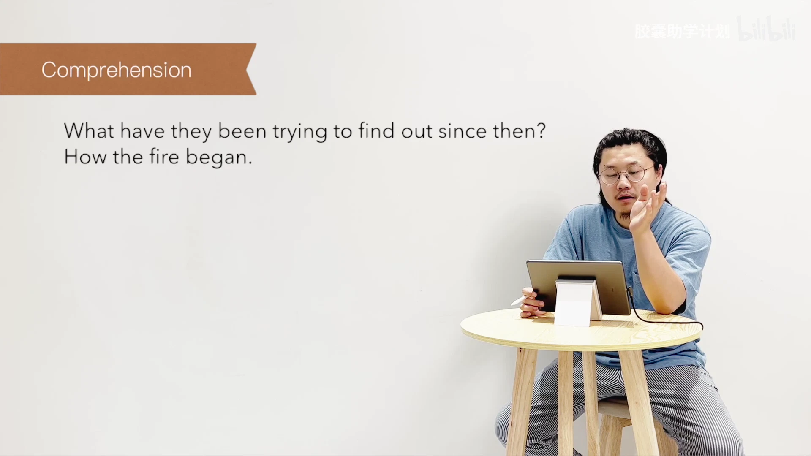

文字识别：Comprehension / What have they been trying to find out since then? / How the fire began.

### 画面 00:00:52

文字识别：Comprehension / What are forest fires often caused by?

## 00:01:00–00:01:30

or cigarette ends. Next one, people are careless, aren't they? Yes, they are. Next one, when did the fireman examine the ground? Yesterday. Next one, did they find any broken glass? No, they didn't. Next one, did they think a cigarette end started the fire?

### 画面 00:01:22

文字识别：Comprehension / Did they find any broken glass? / No, they didn't.

### 画面 00:01:28

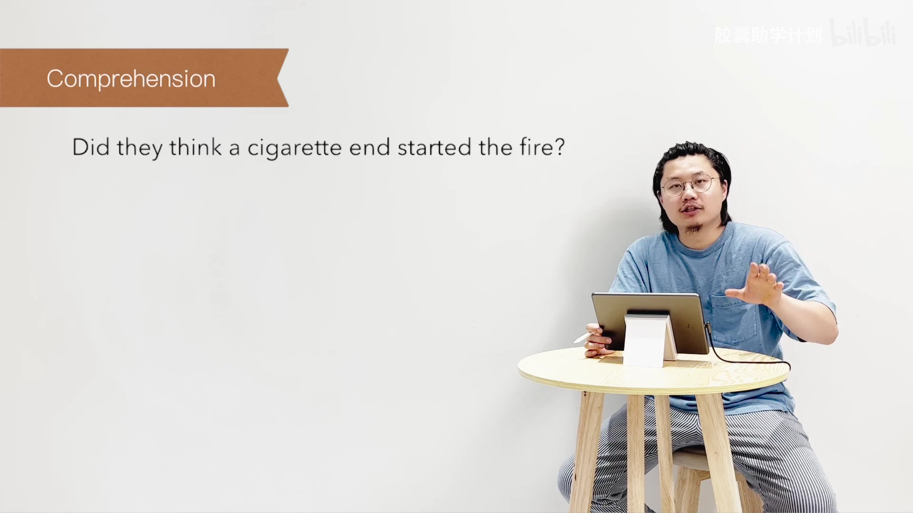

文字识别：Comprehension / Did they think a cigarette end started the fire?

## 00:01:30–00:02:00

No, they don't. Continue. They were quite sure it didn't, weren't they? Yes, they were. Next one. When was the cause discovered? Become passive. This morning. Next one. Who discovered it? A fireman did. Next one. Was it what he was

### 画面 00:01:32

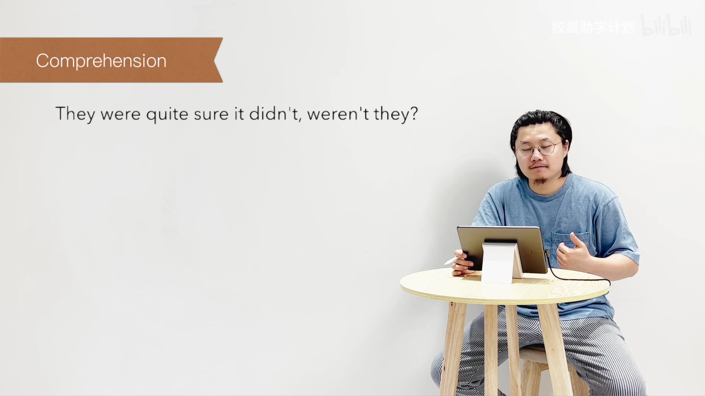

文字识别：Comprehension / They were quite sure it didn't, weren't they?

### 画面 00:01:47

文字识别：Comprehension / When was the cause discovered? / This morning.

## 00:02:00–00:02:30

looking for? No, it wasn't. Next one, what did he notice? The remains of a snake, which was wound around the electric wires of a sixteen thousand volt power line. 好, asking questions, 对吧? 练习我们发问的能力, OK? 那一个, 第一个, ask me if, 做一个练这个示范啊. There's

### 画面 00:02:08

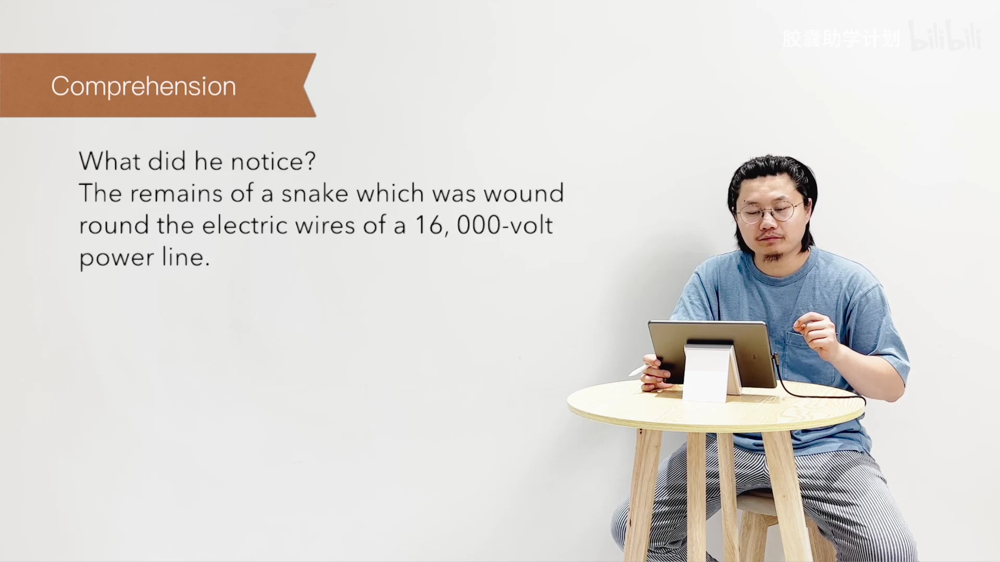

文字识别：Comprehension / What did he notice? / The remains of a snake which was wound / round the electric wires of a 16, 000-volt / power line.

### 画面 00:02:19

文字识别：Asking questions / 训练目标： / 会说一般疑问句＆特殊疑问句 / Accuracy / Fluency

### 画面 00:02:24

文字识别：Asking questions

### 画面 00:02:26

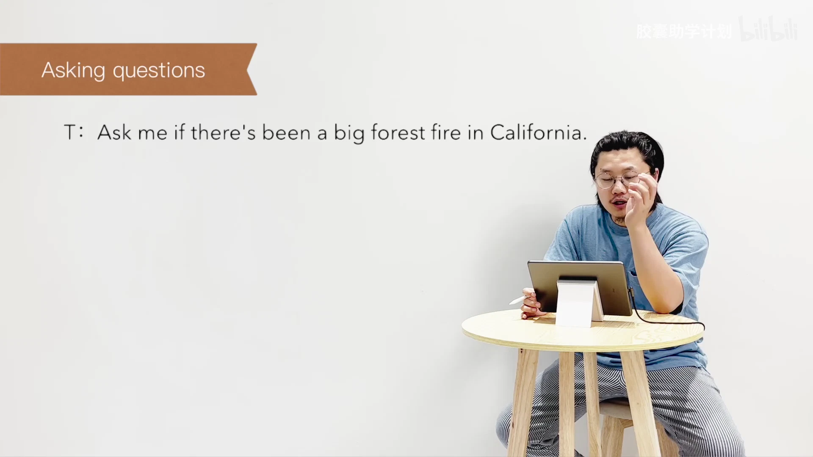

文字识别：Asking questions / T: Ask me if there's been a big forest fire in California.

## 00:02:30–00:03:00

There's been a big forest fire in California. 注意这个 P S 是 has，所以你把 has 提前，对吧？然后 where 答案叫 where has been a big forest fire. Okay. 好，那第一题不多说了。第二个，我们只说思路，对吧？哎，就我们之前从新一练到新二很多遍了，我们只提思路了啊。Have put it out. 现在完成时 have 往前提 what？哎，你就其实这里只有 it 能提问，对吧？啊， who 对主语提问啊，不用变一般

### 画面 00:02:36

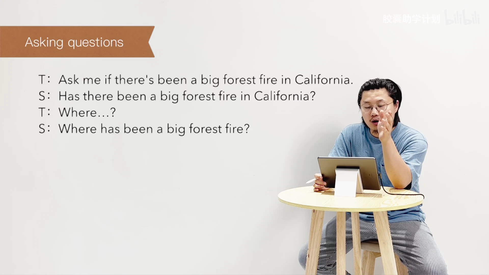

文字识别：Asking questions / T: Ask me if there's been a big forest fire in California. / S: Has there been a big forest fire in California? / T: Where...? / S: Where has been a big forest fire?

### 画面 00:02:40

文字识别：Asking questions

### 画面 00:02:43

文字识别：Asking questions / 1.There's been a big forest fire in California. / (Where) / 2. Firemen have put it out. (What)(Who)

### 画面 00:02:48

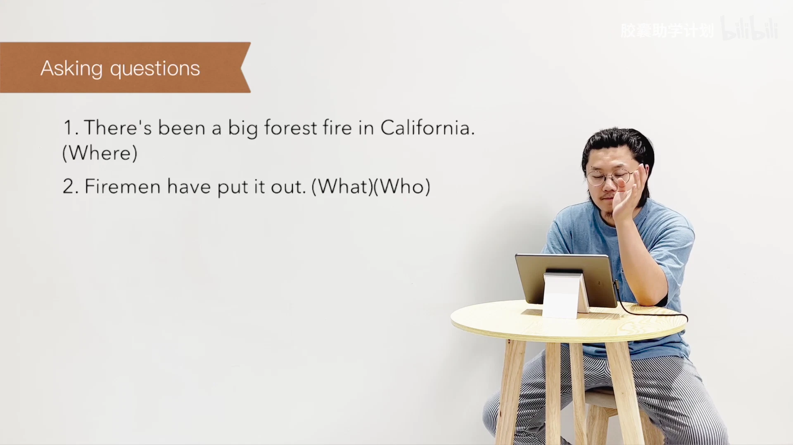

文字识别：Asking questions / 1.There's been a big forest fire in California. / (Where) / 2. Firemen have put it out. (What)(Who)

## 00:03:00–00:03:30

问句，就 Who have put it out 啊？ Who have put out the fire？或者你给他换一下啊。呃，They have been trying to discover the cause。呃，现在完成进行时，have往前提，对吧？What对 the cause提问啊？啊，或对主语提问。呃，fires are often caused by broken glass。那你看被动嘛，一般现在时的被动，are往前一提，What还给你了点点点 by，那你 What 就是对 broken glass 提问嘛？How 呢？How

### 画面 00:03:16

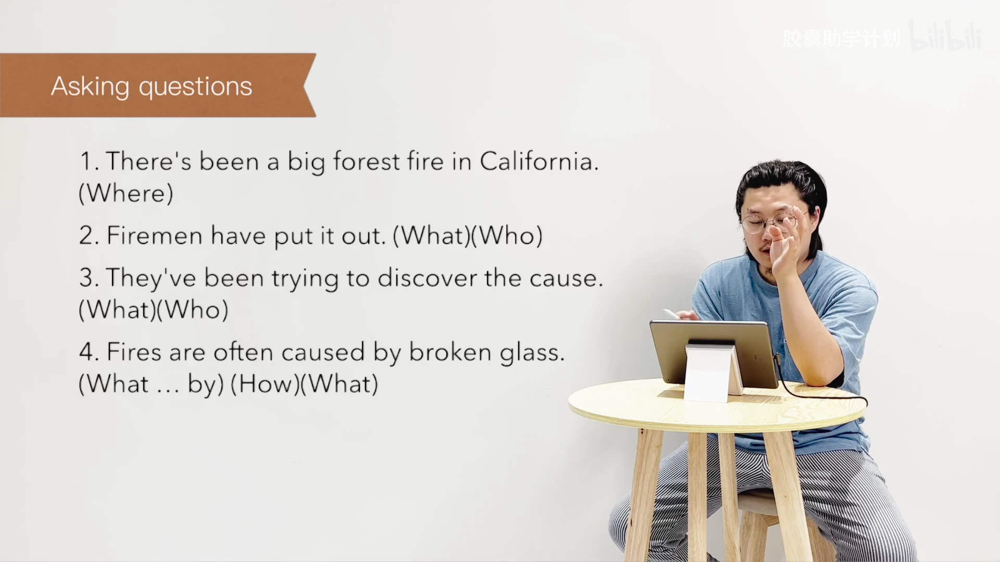

文字识别：Asking questions / 1.There's been a big forest fire in California. / (Where) / 2. Firemen have put it out. (What)(Who) / 3. They've been trying to discover the cause. / (What)(Who) / 4. Fires are often caused by broken glass. / (What ... by) (How)(What)

## 00:03:30–00:04:00

其实是对by broken glass提问。What点儿点儿by是对broken glass提问啊。然后what那就是fires呗，是吧？第五个说they are also caused by cigarette ends。二往前提，What else？你把also去掉对吧？啊呃by cigarette ends嘛是吧？你就可以说What else are they caused by？啊

### 画面 00:03:41

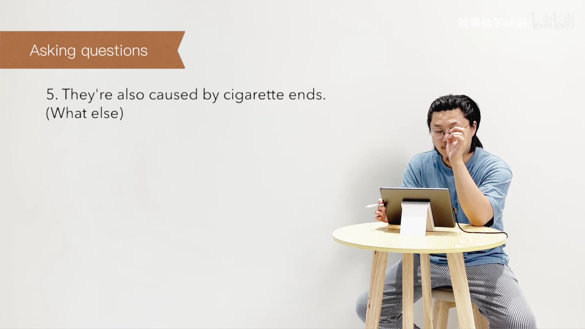

文字识别：Asking questions / 5. They're also caused by cigarette ends. / (What else)

## 00:04:00–00:04:30

or what else are they also caused by? Ah, uh,好像also也是可以留着的，没有问题啊。呃，The fireman examined the ground yesterday. Ah, did提前对吧？然后呢？When对yesterday提问，What对the ground提问？What did the fireman examine? Ah, ah yesterday. Ah, who对fireman提问？啊，呃，They looked for broken glass. Did往前提？What对broken glass提问？

### 画面 00:04:08

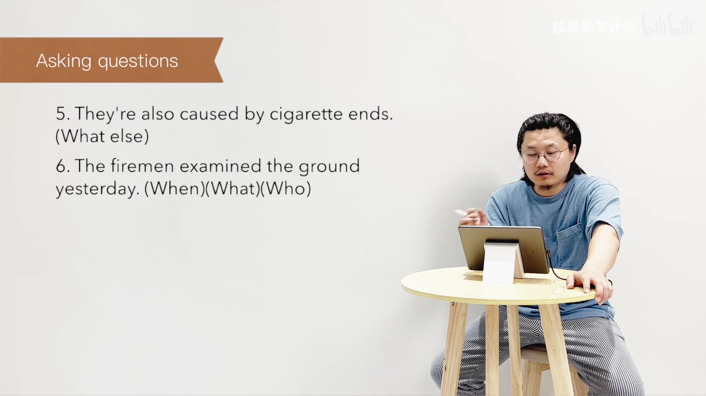

文字识别：Asking questions / 5. They're also caused by cigarette ends. / (What else) / 6. The firemen examined the ground / yesterday. (When)(What)(Who)

### 画面 00:04:29

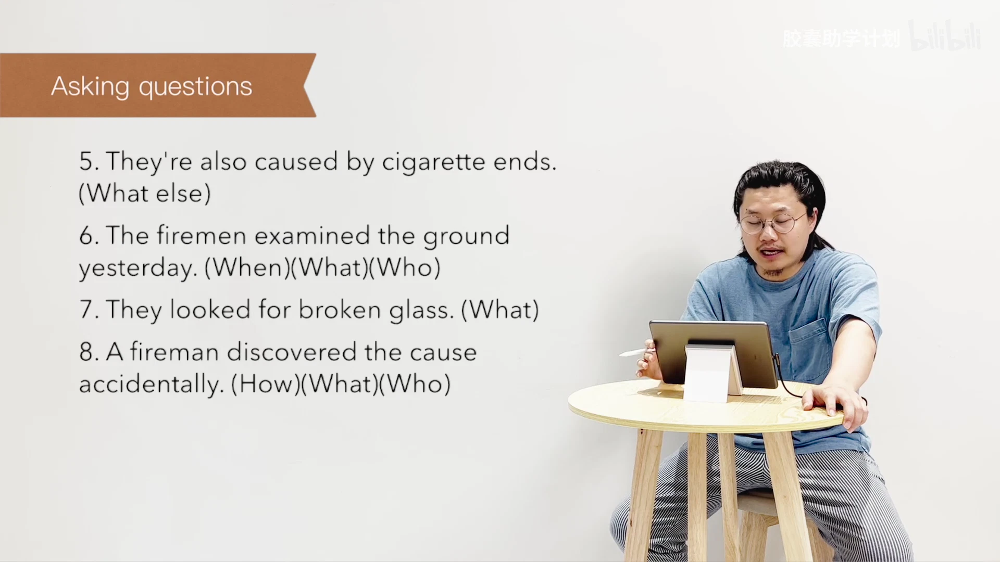

文字识别：Asking questions / 5. They're also caused by cigarette ends. / (What else) / 6. The firemen examined the ground / yesterday. (When)(What)(Who) / 7. They looked for broken glass. (What) / 8. A fireman discovered the cause / accidentally.(How)(What)(Who)

## 00:04:30–00:05:00

A fireman discovered the cause accidentally.你看这个accidentally就被放到句尾去了，对吧？一般过去式did往前提。呃，How对accidentally提问？What对cause提问？Who对fireman提问？啊，Tell the story.第一单元我做了很多的示范了，各位自己去看，对吧？哎，你现在要做的事情就是把文章读熟，来到这里啊，去进行看着这些单词去尝试复述这个文

### 画面 00:04:46

文字识别：Tell the story / 训练目标： / 口语复述能力 / Accuracy / Fluency

### 画面 00:04:50

文字识别：Tell the story / 训练目标： / 口语复述能力 / Accuracy / Fluency

### 画面 00:04:52

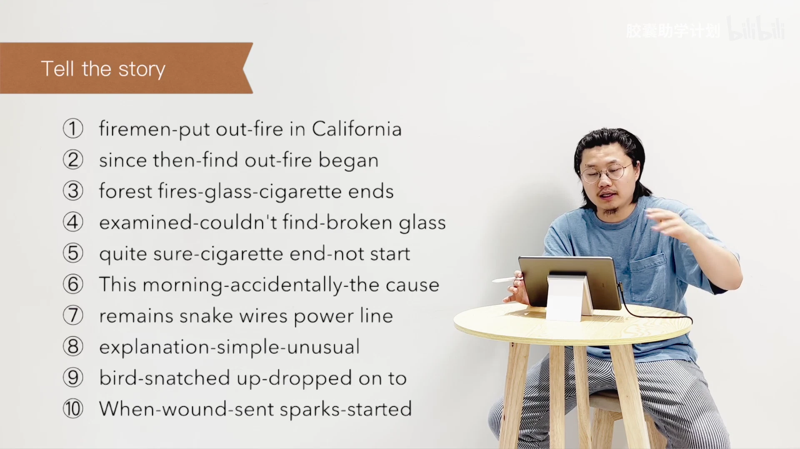

文字识别：Tell the story / firemen-put out-fire in California / 1 / since then-find out-fire began / forest fires-glass-cigarette ends / examined-couldn't find-broken glass / quite sure-cigarette end-not start / This morning-accidentally-the cause / remains snake wires power line / explanation-simple-unusual / 8 / bird-snatched up-dropped on to / 9 / ① When-wound-sent sparks-started

## 00:05:00–00:05:30

章就行了。然后我再提醒一点，就是这个题更多的练的是 fluency，而不是 accuracy。我们纯考试的时候考的一般都是，注意是国内的考试啊，考的都是 accuracy，对吧？呃，而国外的考试呢，比如说雅思、托福这样的考试，它是 accuracy 和 fluency 都考的。但我们国内一般不练 fluency，fluency 就是流利性，对吧？练的很少，所以这道题帮助各位呢，就是你多去练一练流利性，甚至可以错一点点，不要太担心，是吧？

### 画面 00:05:01

文字识别：Tell the story / 训练目标： / 口语复述能力 / Accuracy / Fluency

### 画面 00:05:23

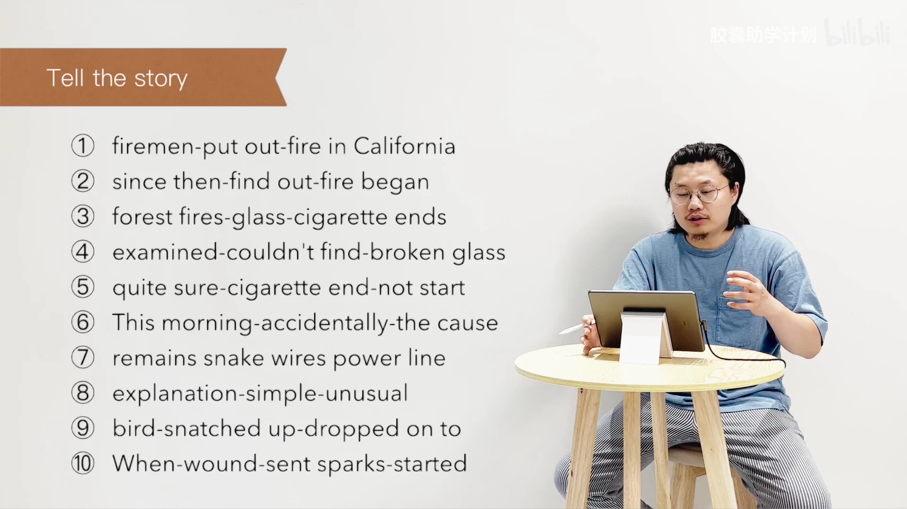

文字识别：Tell the story / firemen-put out-fire in California / 1 / since then-find out-fire began / forest fires-glass-cigarette ends / examined-couldn't find-broken glass / quite sure-cigarette end-not start / This morning-accidentally-the cause / remains snake wires power line / explanation-simple-unusual / 8 / bird-snatched up-dropped on to / 9 / ① When-wound-sent sparks-started

## 00:05:30–00:06:00

Summer writing, just写作，写完了来这对答案就行了，没什么太多可说的啊。呃，topic for discussion，完全自由的对话，基本上完你最好的完美的对话呢，就是accuracy和fluency，呃，完美的结合，对吧？这个我们要一点一点来了。我现在还是那句话，我只说题啊。第一题叫Describe a fire you've seen or heard about。嗯，聊一聊你看过的一场大火或听

### 画面 00:05:30

文字识别：Summary writing: Key / 训练目标： / 写作复述能力

### 画面 00:05:34

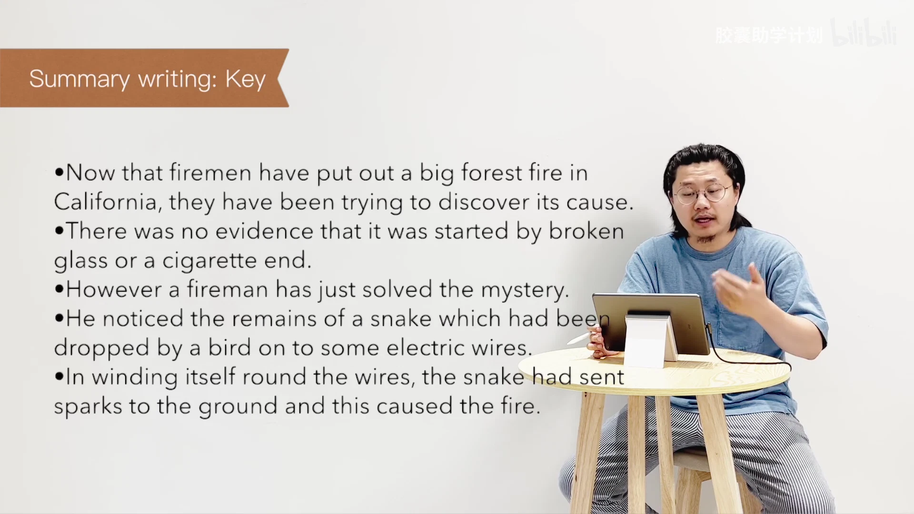

文字识别：Summary writing: Key / •Now that firemen have put out a big forest fire in / California, they have been trying to discover its cause. / •There was no evidence that it was started by broken / glass or a cigarette end. / •However a fireman has just solved the mystery. / •He noticed the remains of a snake which had beer / dropped by a bird on to some electric wires. / •In winding itself round the wires, the snake had sent / sparks to the ground and this caused the fire.

### 画面 00:05:37

文字识别：Topics for discussion / 训练目标： / 完全自由的对话 / Accuracy / Fluency

### 画面 00:05:49

文字识别：Topics for discussion

### 画面 00:05:52

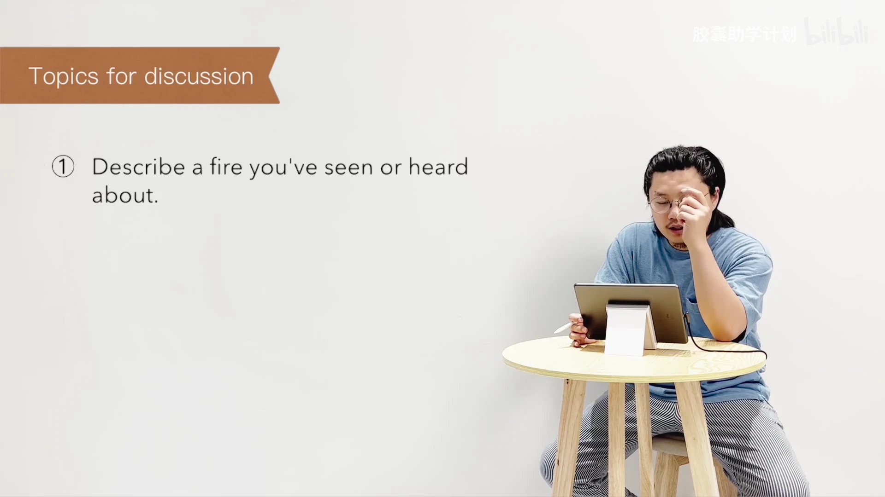

文字识别：Topics for discussion / Describe a fire you've seen or heard / about.

## 00:06:00–00:06:30

过的，啊，小时候放过火吗？就聊聊这个就可以啊。说 What are the most common causes of fires in towns or houses? How can ordinary people help to prevent them?说最常见的引起城镇啊或者房子起火的原因有哪些呢？我们普通人如何帮助啊？如何去这个防止这些火灾的发生呢？对吧？第三个说 In what ways can modern technology endanger

### 画面 00:06:01

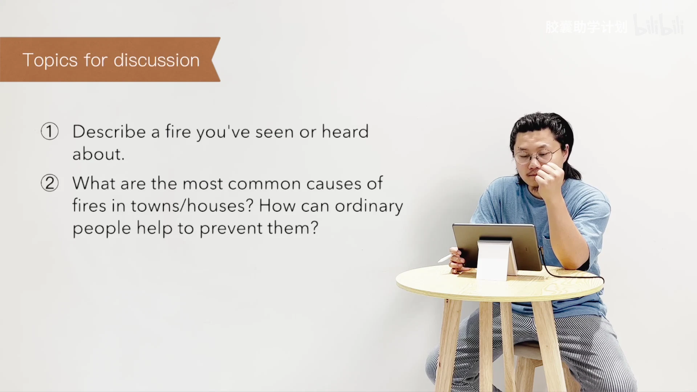

文字识别：Topics for discussion / Describe a fire you've seen or heard / about. / What are the most common causes of / fires in towns/houses? How can ordinary / people help to prevent them?

## 00:06:30–00:07:00

can endanger wildlife. Say this: Modern technology can endanger wildlife. Say this: Modern technology can endanger wildlife. Say this: Modern technology can endanger wildlife. Say this: Modern technology can endanger wildlife. Say this:

### 画面 00:06:31

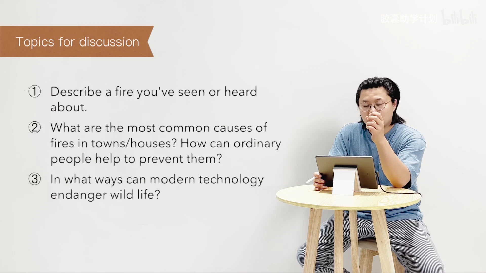

文字识别：Topics for discussion / Describe a fire you've seen or heard / about. / What are the most common causes of / fires in towns/houses? How can ordinary / people help to prevent them? / In what ways can modern technology / endanger wild life?

### 画面 00:06:41

文字识别：1.Ask me if写&朗读

### 画面 00:06:44

文字识别：1.Ask me if写&朗读

### 画面 00:06:46

文字识别：1.Ask me if写&朗读 / 2.摘要写作写&答案

### 画面 00:06:48

文字识别：1.Ask me if写&朗读 / 摘要写作写&答案 / 3.Tell the story 口语复述

### 画面 00:06:50

文字识别：1.Askme if写&朗读 / 摘要写作写&答案 / 3.Tell the story 口语复述 / 4.摘要写作

### 画面 00:06:53

文字识别：1.Askme if写&朗读 / 摘要写作写&答案 / 3.Tell the story 口语复述 / 4.摘要写作 / 5.重复间隔（置顶留言）

### 画面 00:06:55

文字识别：1.Ask me if写&朗读 / 摘要写作写&答案 / 3.Tell the story 口语复述 / 4.摘安写作 / 5.重复间隔（置顶留言）

### 画面 00:06:57

文字识别：1.Ask me if写&朗读 / 摘要写作写&答案 / 3.Tell the story 口语复述 / 5.重复间隔（置顶留言）

### 画面 00:06:59

文字识别：1.Ask me if写&朗读 / 摘要写作写&答案 / Tell the story 口语复述 / 5.重复间隔（置顶留言）

## 00:07:00–00:07:30

重复间隔啊，置顶留言可以找得到这些这个练习题和课下练习啊。好，那以上呢就是本期视频的全部内容了。如果各位喜欢我们的课程呢，欢迎各位关注、订阅、一键三连、分享给那些需要的朋友，来帮助我们快速成长。See you next time.

### 画面 00:07:01

文字识别：1.Ask me if写&朗读 / 摘要写作写&答案 / Tell the story 口语复述 / 3. / 5.重复间隔（置顶留言）

### 画面 00:07:05

文字识别：1.Ask me if写&朗读 / 摘要写作写&答案 / Tell the story 口语复述 / 5.重复间隔（置顶留言）

### 画面 00:07:07

### 画面 00:07:11

### 画面 00:07:17

### 画面 00:07:19

文字识别：CAPSULEACADEMY / 胶囊助学计划 / 小红书

### 画面 00:07:21

文字识别：CAPSULEACADEMY / 胶囊助学计划 / 小红书 / Leo / OE

### 画面 00:07:27

文字识别：CAPSULEACADEMY / 胶囊助学计划 / 小红书 / Creator / Leo & Berlin / OE

### 画面 00:07:29

文字识别：bilibili / 胶囊助学计划

## 00:07:30–00:07:31

### 画面 00:07:30

文字识别：bilibili / 胶囊助学计划

