# 054 单词

快速机器解析：语音为单模型转写，未进行独立交叉校对或人工复核；画面每秒采样并按变化选帧，短时文字和标记可能遗漏。截图时间约有 1 秒误差。图片有损压缩；遇到疑点请按时间查看 Google Drive 原视频。

## 00:00:00–00:00:30

Hello everyone, welcome to Capsule Academy. This is Leo. Today we are going to learn New Concept English Book Two Lesson Fifty Four Words. 那老习惯，咱们进入正式课程之前，还是先看几个问题啊。那首先，如何表达坚持这个计划啊？接下来呢，如何表达说劝说某人做某件事情？那最后一个问题，如何表达在这里签字？OK，那带着这三个问题，会不会干呢？Enjoy it.

### 画面 00:00:00

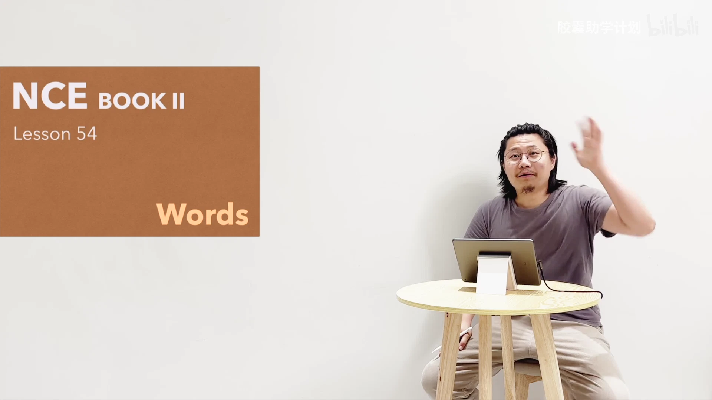

文字识别：NCE / BOOK"I / Lesson 54 / Words

### 画面 00:00:02

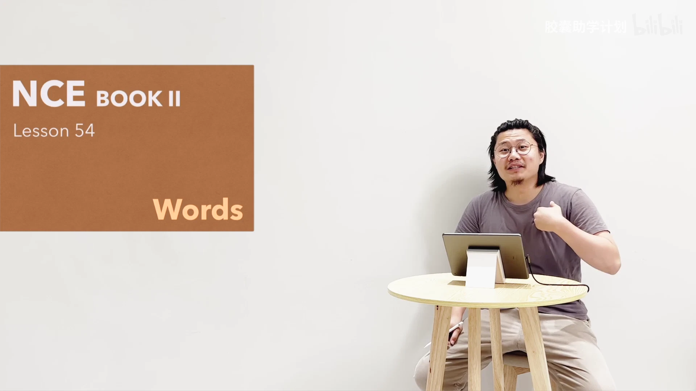

文字识别：NCE / BOOKⅡI / Lesson 54 / Words

### 画面 00:00:10

### 画面 00:00:12

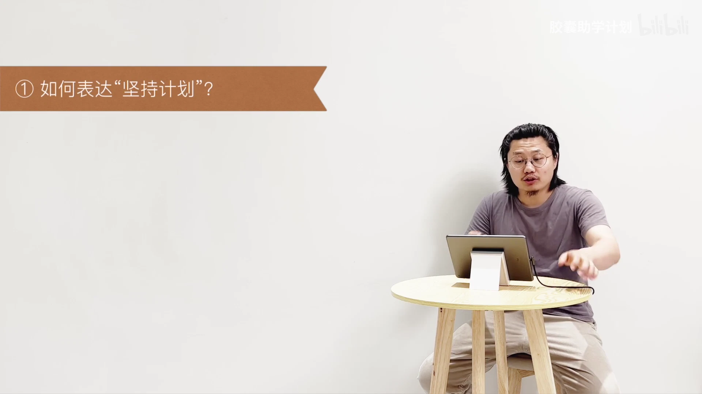

文字识别：①如何表达“坚持计划”？

### 画面 00:00:16

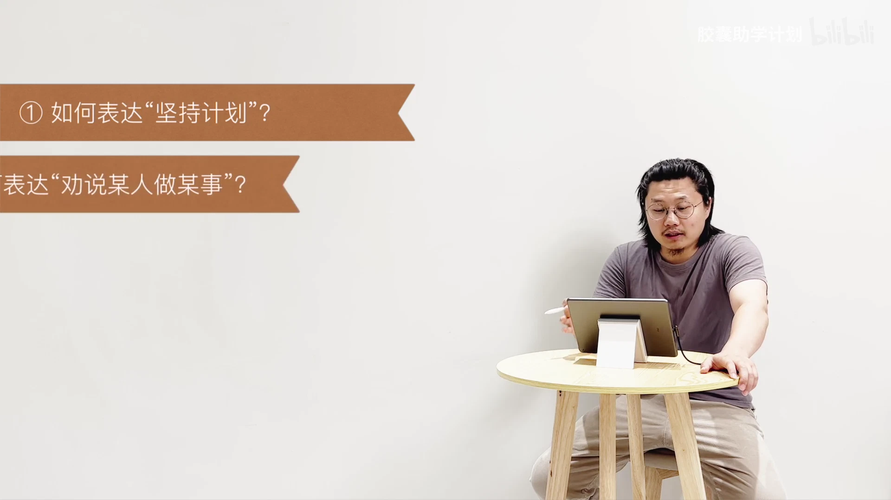

文字识别：①如何表达“坚持计划”？ / 表达“劝说某人做某事”?

### 画面 00:00:18

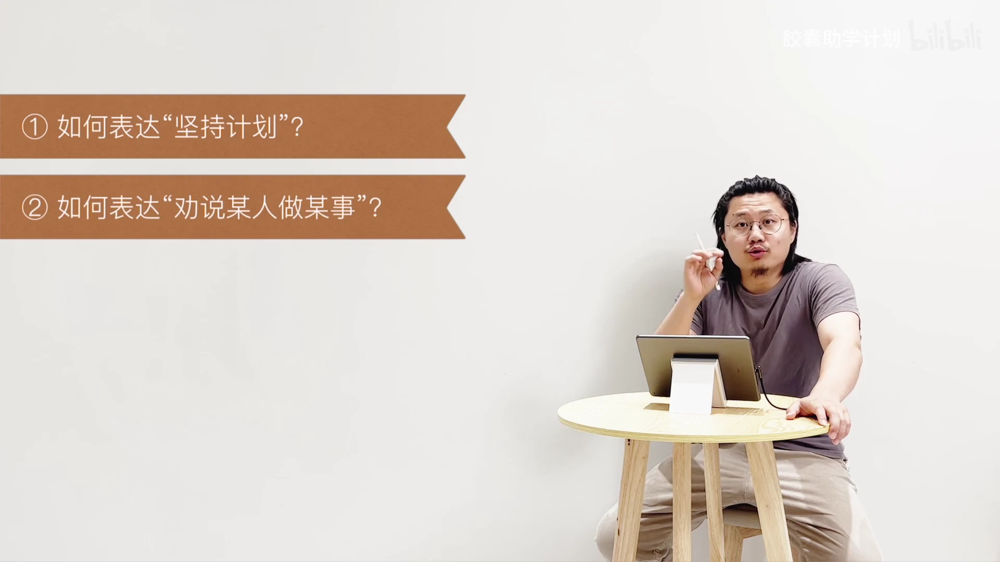

文字识别：①如何表达“坚持计划”？ / 如何表达“劝说某人做某事”?

### 画面 00:00:20

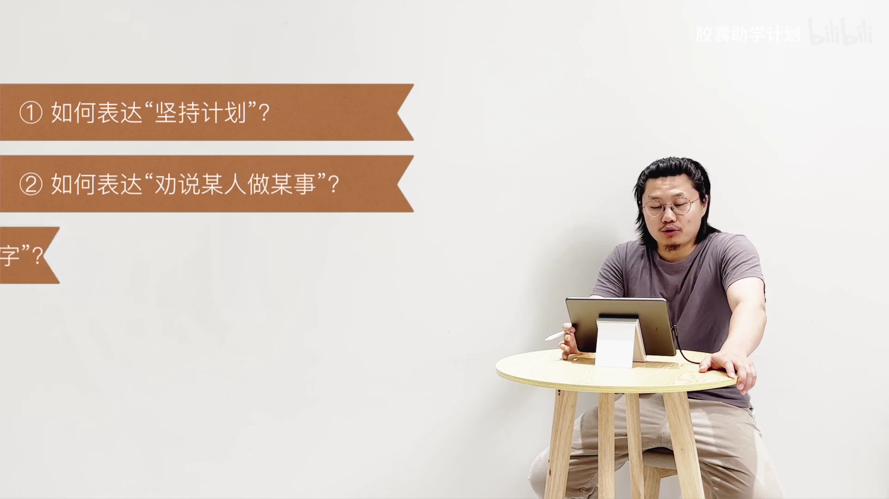

文字识别：①如何表达“坚持计划”？ / 如何表达“劝说某人做某事”? / 字”?

### 画面 00:00:22

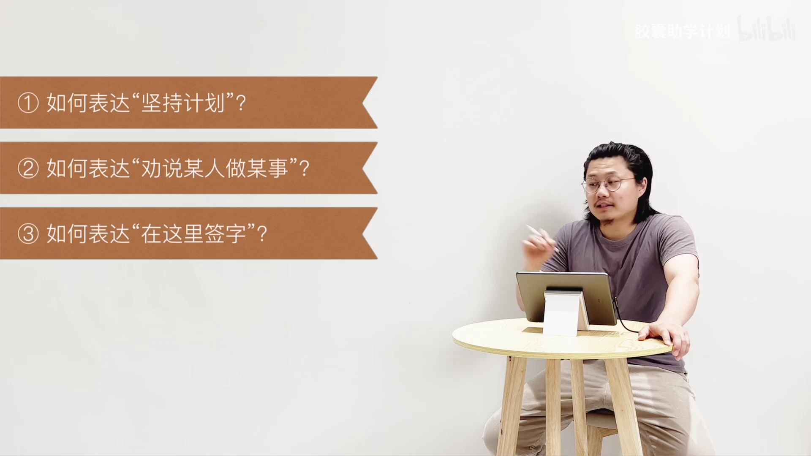

文字识别：①如何表达“坚持计划”？ / 如何表达“劝说某人做某事”? / 如何表达“在这里签字”?

### 画面 00:00:25

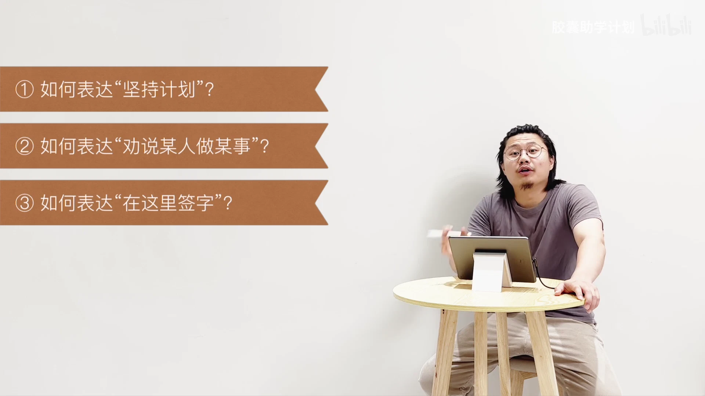

文字识别：①如何表达“坚持计划”？ / 如何表达“劝说某人做某事”? / 如何表达“在这里签字”?

### 画面 00:00:27

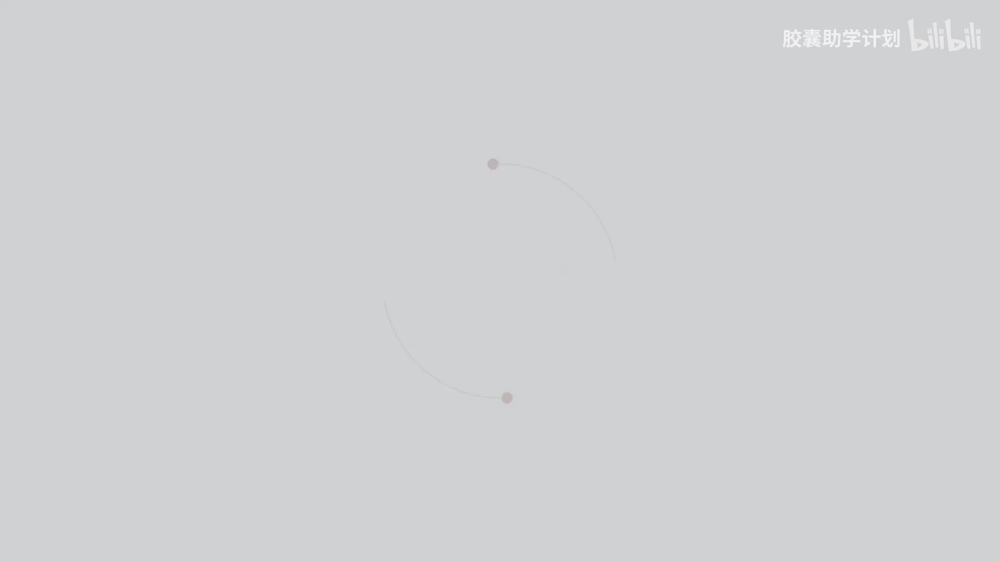

文字识别：胶囊助学计划bil出

## 00:00:30–00:01:00

好，上来我们先看两个单词，这两个单词在文章的标题 title 部分都出现了啊。那我们看一下，第一个单词叫做 sticky， sticky，别忘了这个地方有一个小的浊化，对吧？ sticky 啊，就指的是黏黏糊糊的，比如说你揉面的那个手或者这个面，它本身就是 sticky 啊这样的一个感觉，它是个形容词，对吧？然后呢， sticky finger 啊，那 finger 就是我们的这个手指头，对

### 画面 00:00:31

### 画面 00:00:33

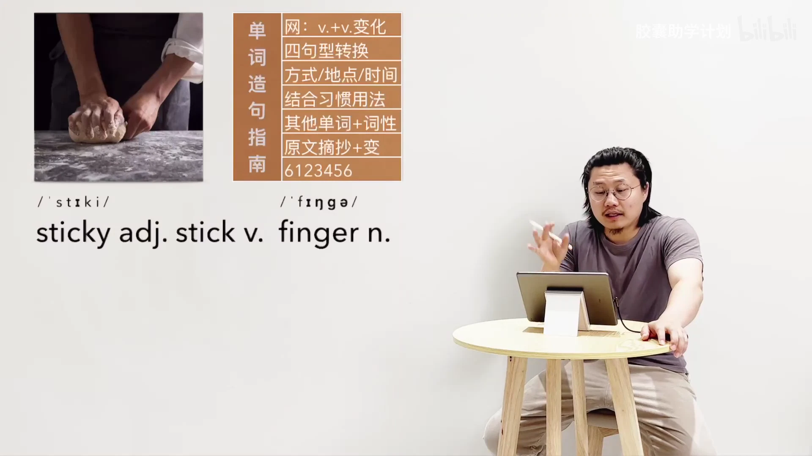

文字识别：单词造句指南 / 网：v.+v.变化 / 四句型转换 / 方式/地点/时间 / 结合习惯用法 / 其他单词+词性 / 原文摘抄+变 / 6123456 / /'stiki/ / /finga/ / sticky adj. stick v. finger n.

### 画面 00:00:35

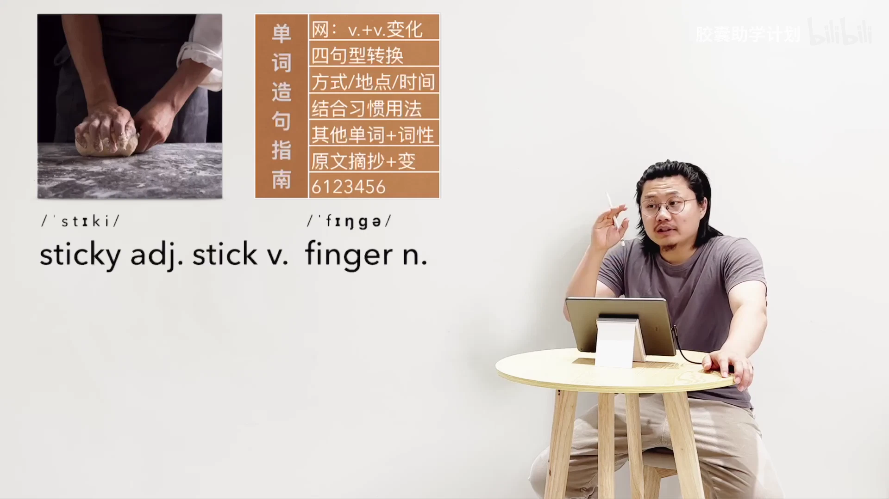

文字识别：单词造句指南 / 网：v.+v.变化 / 四句型转换 / 方式/地点/时间 / 结合习惯用法 / 其他单词+词性 / 原文摘抄+变 / 6123456 / /'stiki/ / /'finga/ / sticky adj. stick v. finger n.

### 画面 00:00:40

文字识别：单词造句指南 / 网：v.+v.变化 / 四句型转换 / 方式/地点/时间 / 结合习惯用法 / 其他单词+词性 / 原文摘抄+变 / 6123456 / /'stiki/ / /finga/ / sticky adj. stick v. finger n.

### 画面 00:00:45

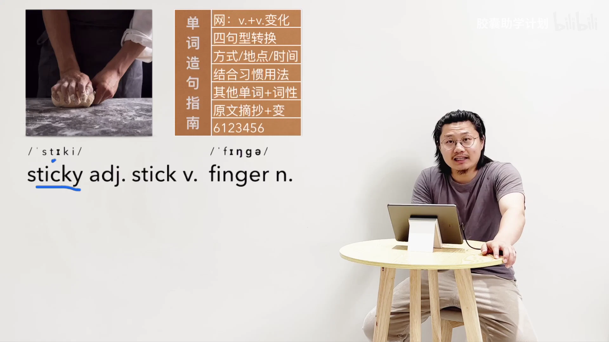

文字识别：单词造句指南 / 网：v.+v.变化 / 四句型转换 / 方式/地点/时间 / 结合习惯用法 / 其他单词+词性 / 原文摘抄+变 / 6123456 / /stiki/ / /finga/ / sticky adj. stick v. finger n.

### 画面 00:00:47

文字识别：单词造句指南 / 网：v.+v.变化 / 四句型转换 / 方式/地点/时间 / 结合习惯用法 / 其他单词+词性 / 原文摘抄+变 / 6123456 / /'stiki/ / /finga/ / sticky adj. stick v. finger n.

### 画面 00:00:51

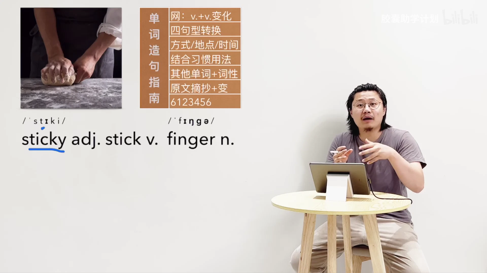

文字识别：单词造句指南 / 网：v.+v.变化 / 四句型转换 / 方式/地点/时间 / 结合习惯用法 / 其他单词+词性 / 原文摘抄+变 / 6123456 / /stiki/ / /'finga/ / sticky adj. stick v. finger n.

### 画面 00:00:58

文字识别：单词造句指南 / 网：v.+v.变化 / 四句型转换 / 方式/地点/时间 / 结合习惯用法 / 其他单词+词性 / 原文摘抄+变 / 6123456 / /'stiki/ / /finga/ / sticky adj. stick v. finger n.

## 00:01:00–00:01:30

吧？啊，叫做finger，sticky finger。Sticky这个单词呢，其实它跟它类似的啊，就是粘粘的这个动作叫做stick啊。一会儿我们也会讲到啊，因为这两个单词，你看唯一的差别就是后边多了个字母y，对不对？OK，它其实是由stick变成的sticky啊，所以它的含义呢也是类似的。好，那我们接下来先造一句话，特别简单，叫There is some sticky stuff in your hair。OK，这

### 画面 00:01:00

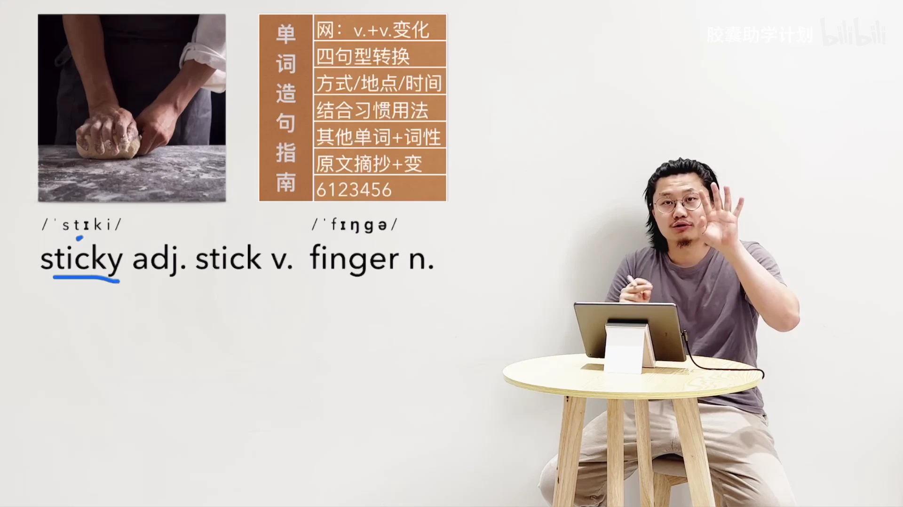

文字识别：单词造句指南 / 网：v.+v.变化 / 四句型转换 / 方式/地点/时间 / 结合习惯用法 / 其他单词+词性 / 原文摘抄+变 / 6123456 / /'stiki/ / /finga/ / sticky adj. stick v. finger n.

### 画面 00:01:03

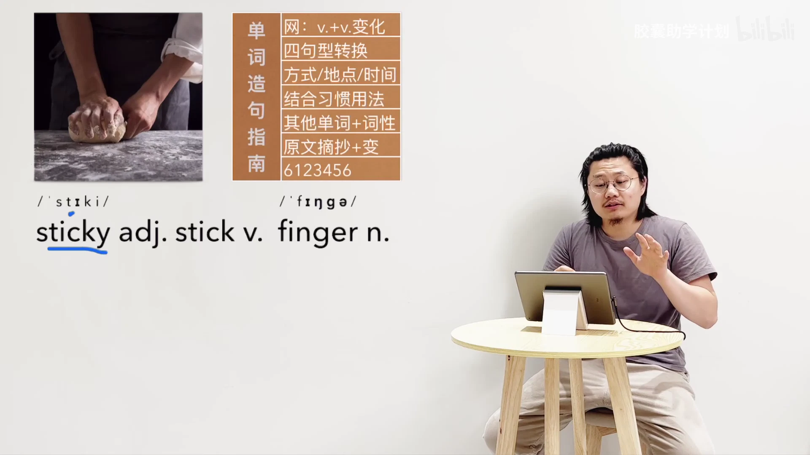

文字识别：单词造句指南 / 网：v.+v.变化 / 四句型转换 / 方式/地点/时间 / 结合习惯用法 / 其他单词+词性 / 原文摘抄+变 / 6123456 / /'stiki/ / /'finga/ / sticky adj. stick v. finger n.

### 画面 00:01:05

文字识别：单词造句指南 / 网：v.+v.变化 / 四句型转换 / 方式/地点/时间 / 结合习惯用法 / 其他单词+词性 / 原文摘抄+变 / 6123456 / /'stiki/ / /finga/ / sticky adj. stick v. finger n.

### 画面 00:01:10

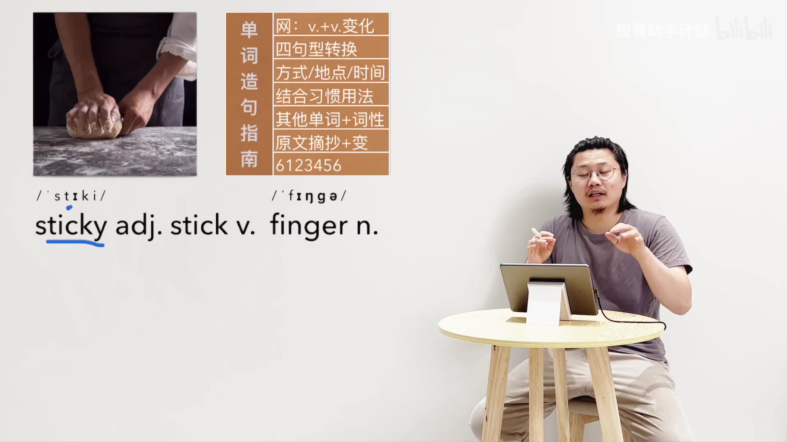

文字识别：单词造句指南 / 网：v.+v.变化 / 四句型转换 / 方式/地点/时间 / 结合习惯用法 / 其他单词+词性 / 原文摘抄+变 / 6123456 / /'stiki/ / /finga/ / sticky adj. stick v. finger n.

### 画面 00:01:13

文字识别：单词造句指南 / 网：v.+v.变化 / 四句型转换 / 方式/地点/时间 / 结合习惯用法 / 其他单词+词性 / 原文摘抄+变 / 6123456 / /'stiki/ / /'finga/ / sticky adj. stick v. finger n.

### 画面 00:01:16

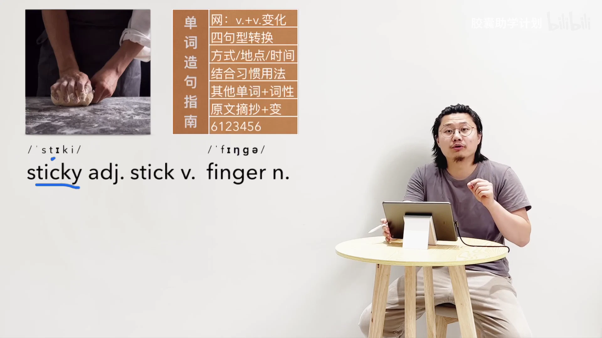

文字识别：单词造句指南 / 网：v.+v.变化 / 四句型转换 / 方式/地点/时间 / 结合习惯用法 / 其他单词+词性 / 原文摘抄+变 / 6123456 / /'stiki/ / /finga/ / sticky adj. stick v. finger n.

### 画面 00:01:23

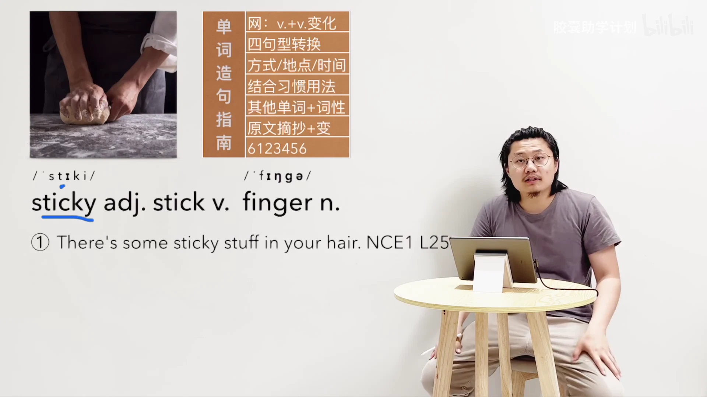

文字识别：单词造句指南 / 网：v.+v.变化 / 四句型转换 / 方式/地点/时间 / 结合习惯用法 / 其他单词+词性 / 原文摘抄+变 / 6123456 / /stiki/ / / finga/ / sticky adj. stick v. finger n. /  There's some sticky stuff in your hair. NCE1 L25

### 画面 00:01:26

文字识别：单词造句指南 / 网：v.+v.变化 / 四句型转换 / 方式/地点/时间 / 结合习惯用法 / 其他单词+词性 / 原文摘抄+变 / 6123456 / /stiki/ / /'finga/ / sticky adj. stick v. finger n. /  There's some sticky stuff in your hair. NCE1 L25

## 00:01:30–00:02:00

句话的语法无比的简单，是咱们新概念一册二十五课学的。但是呢，新概念二册呢还真没有哪篇文章说专门去学习了一下there be句型。所以呢，我就放到这个地方。如果您学到了，对吧？二册的这里there be句型您还不是特别熟，没事儿，您去看一下我们新概念一册二十五课的视频，对吧？二五二六二七二八，您把这四课的视频迅速的看一遍，然后做一下练习there be句

### 画面 00:01:36

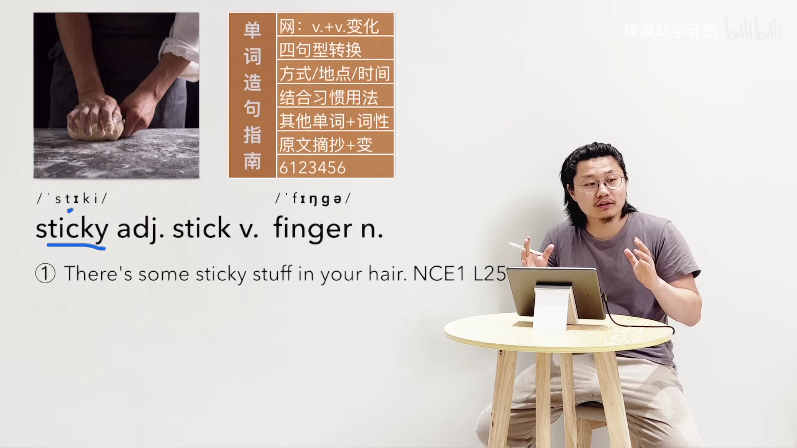

文字识别：单词造句指南 / 网：v.+v.变化 / 四句型转换 / 方式/地点/时间 / 结合习惯用法 / 其他单词+词性 / 原文摘抄+变 / 6123456 / /'stiki/ / /finga/ / sticky adj. stick v. finger n. / ① There's some sticky stuff in your hair. NCE1 L25

### 画面 00:01:45

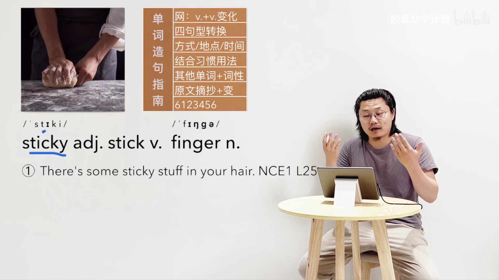

文字识别：单词造句指南 / 网：v.+v.变化 / 四句型转换 / 方式/地点/时间 / 结合习惯用法 / 其他单词+词性 / 原文摘抄+变 / 6123456 / /'stiki/ / /'finga/ / sticky adj. stick v. finger n. /  There's some sticky stuff in your hair. NCE1 L25

## 00:02:00–00:02:30

型，您很快就可以搞定了，对吧？叫指的是在你头发里啊有一些黏黏糊糊的东西，哎，就大概是这样。这个stuff就是一些东西，类似于thing啊，t h i n g。OK，接下来呢，这个stick，它这个动词经常会用到一个口语当中很常用的短语，叫stick to the plan。a plan叫计划，对吧？那stick to the plan指的就是粘着这个计划，其实不是，是吧？但是你可以类似这么去理解，其实最终的意

### 画面 00:02:10

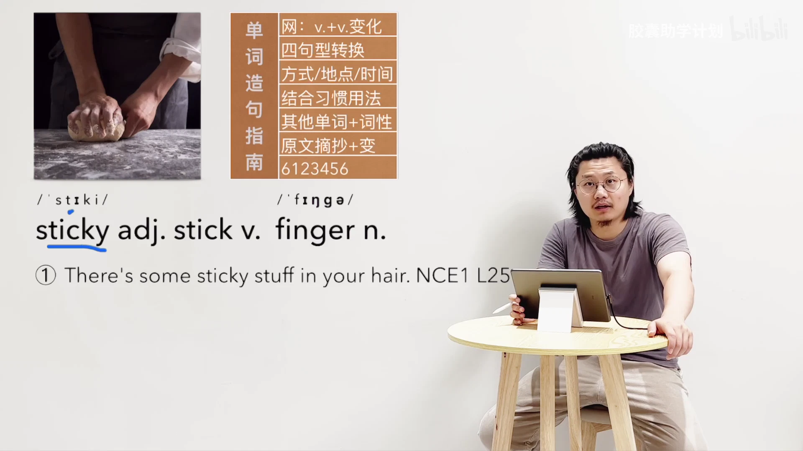

文字识别：单词造句指南 / 网：v.+v.变化 / 四句型转换 / 方式/地点/时间 / 结合习惯用法 / 其他单词+词性 / 原文摘抄+变 / 6123456 / /'stiki/ / /finga/ / sticky adj. stick v. finger n. /  There's some sticky stuff in your hair. NCE1 L25

### 画面 00:02:23

文字识别：单词造句指南 / 网：v.+v.变化 / 四句型转换 / 方式/地点/时间 / 结合习惯用法 / 其他单词+词性 / 原文摘抄+变 / 6123456 / /'stiki/ / /finga/ / sticky adj. stick v. finger n. / D There's some sticky stuff in your hair. NCE1 L25 / stick to the plan...

### 画面 00:02:25

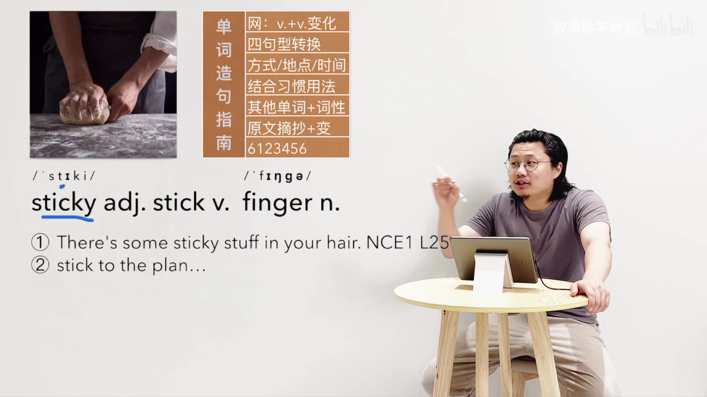

文字识别：单词造句指南 / 网：v.+v.变化 / 四句型转换 / 方式/地点/时间 / 结合习惯用法 / 其他单词+词性 / 原文摘抄+变 / 6123456 / /stiki/ / /finga/ / sticky adj. stick v. finger n. / ① There's some sticky stuff in your hair. NCE1 L25 / stick to the plan...

## 00:02:30–00:03:00

思就是坚持这个计划啊，就是说计划不变，坚持这么去用。OK，好，比如说，哎，我们接下来还是找了一些电影当中的台词，这句话就不是我造的了，但是口语当中用得到啊，叫做 Let's just stick to the plan。啊，后边这个是电影的名称啊， Let's just stick to the plan。OK，我给大家标了一个出处。比如说再来一个啊，叫 Absolutely not，是绝对不可以的。We have to stick to

### 画面 00:02:35

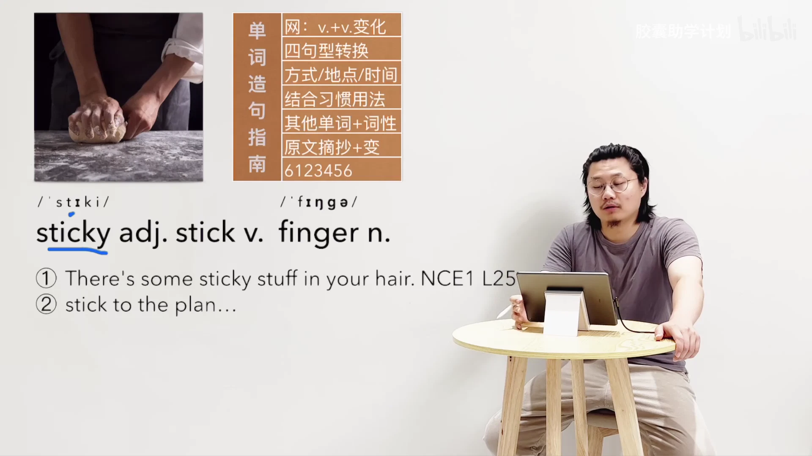

文字识别：单词造句指南 / 网：v.+v.变化 / 四句型转换 / 方式/地点/时间 / 结合习惯用法 / 其他单词+词性 / 原文摘抄+变 / 6123456 / /'stiki/ / /finga/ / sticky adj. stick v. finger n. / ① There's some sticky stuff in your hair. NCE1 L25 / ) stick to the plan...

### 画面 00:02:40

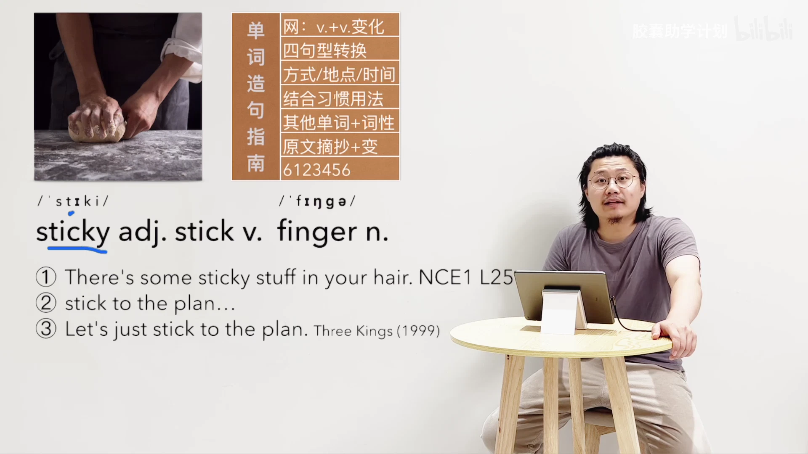

文字识别：单词造句指南 / 网：v.+v.变化 / 四句型转换 / 方式/地点/时间 / 结合习惯用法 / 其他单词+词性 / 原文摘抄+变 / 6123456 / /'stiki/ / /finga/ / sticky adj. stick v. finger n. /  There's some sticky stuff in your hair. NCE1 L25 / stick to the plan... / ③ Let's just stick to the plan. Three Kings (1999)

### 画面 00:02:55

文字识别：单词造句指南 / 网：v.+v.变化 / 四句型转换 / 方式/地点/时间 / 结合习惯用法 / 其他单词+词性 / 原文摘抄+变 / 6123456 / /'stiki/ / /finga/ / sticky adj. stick v. finger n. / ① There's some sticky stuff in your hair. NCE1 L25 /  stick to the plan... / ③ Let's just stick to the plan. Three Kings (1999) / D Absolutely not. We have to stick to the plan. Satety / Not Guaranteed (2012)

## 00:03:00–00:03:30

the plan.啊，这个也是我们想讲的。你看，在电影当中的台词，它有没有用到语法呢？最简单，新概念一册一百二十五课，新概念二册十七、十八、十九。哎，尤其是十八讲到了have to，对吧？We have to stick to the plan.我们必须要哎坚守这个计划啊，坚定这个计划，坚持这个计划。OK, continue. Finger这个单词，呃，它其实不是特别的难。首先，你看它是个名词，我想去造

### 画面 00:03:08

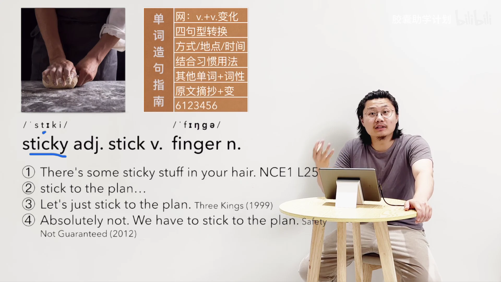

文字识别：单词造句指南 / 网：v.+v.变化 / 四句型转换 / 方式/地点/时间 / 结合习惯用法 / 其他单词+词性 / 原文摘抄+变 / 6123456 / /'stiki/ / /finga/ / sticky adj. stick v. finger n. / D There's some sticky stuff in your hair. NCE1 L25 / 1 / stick to the plan... / ③ / ③ Let's just stick to the plan. Three Kings (1999) /  Absolutely not. We have to stick to the plan. Satety / Not Guaranteed (2012)

### 画面 00:03:24

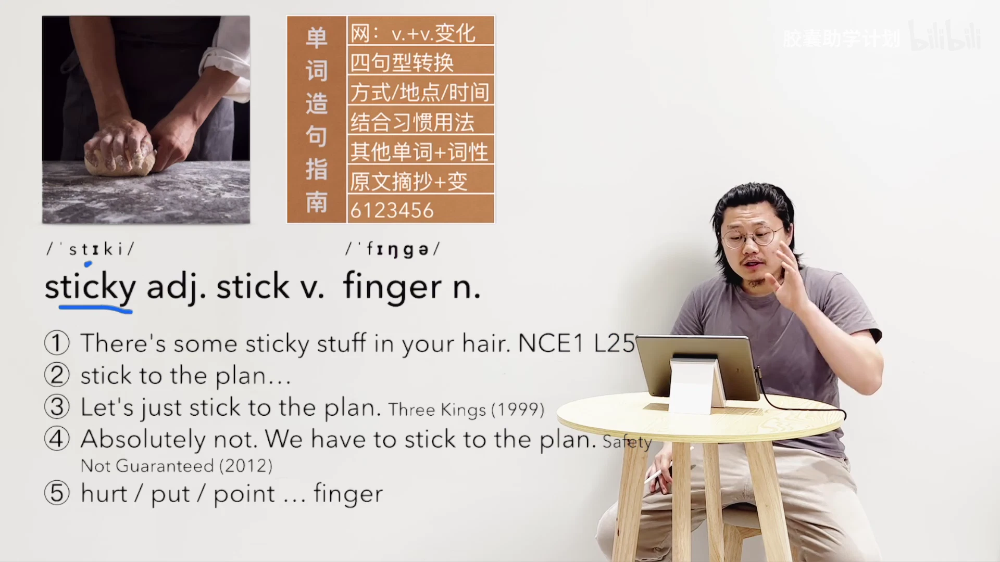

文字识别：单词造句指南 / 网：v.+v.变化 / 四句型转换 / 方式/地点/时间 / 结合习惯用法 / 其他单词+词性 / 原文摘抄+变 / 6123456 / /'stiki/ / /finga/ / sticky adj. stick v. finger n. / ① There's some sticky stuff in your hair. NCE1 L25 / stick to the plan... / ③ Let's just stick to the plan. Three Kings (1999) /  Absolutely not. We have to stick to the plan. Satety / 4 / Not Guaranteed (2012) / ⑤ hurt / put/ point ...finger

## 00:03:30–00:04:00

句的时候，哎，我就要去看这里，叫我要去结合一下其他的词性啊，哎，其他的一些单词啊，尤其是要找动词，对吧？哎，我们从语料库当中啊，这个语料库当中发现说，跟它最finger这个单词最常用的一些动词有哪些呢？Hurt，这个很好理解，伤害到了我的手指，对吧？那put就是放置啊，比如说别把你手指头放那儿，汉语当中你能想到这个是可能比较常用的，或者把你的手指头放在这里，

### 画面 00:03:54

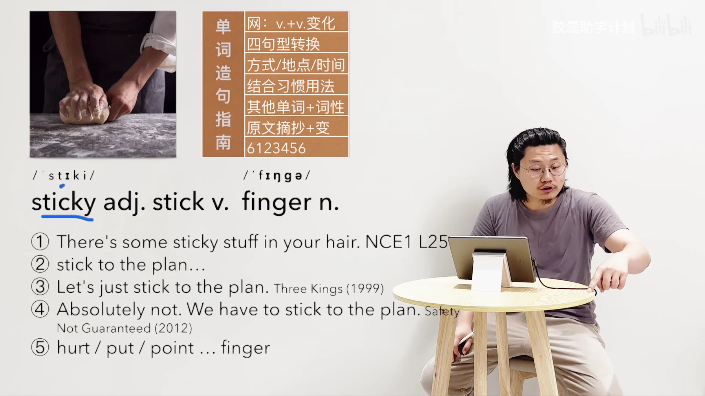

文字识别：单词造句指南 / 网：v.+v.变化 / 四句型转换 / 方式/地点/时间 / 结合习惯用法 / 其他单词+词性 / 原文摘抄+变 / 6123456 / /'stiki/ / /finga/ / sticky adj. stick v. finger n. / ① There's some sticky stuff in your hair. NCE1 L25 / stick to the plan... / ③ Let's just stick to the plan. Three Kings (1999) / D Absolutely not. We have to stick to the plan. Satety / 4 / Not Guaranteed (2012) / ⑤ hurt / put / point ...finger

## 00:04:00–00:04:30

对吧？哎，put point是什么意思呢？就是指啊，不要把你的手指头指着我啊。Don't point your finger. Okay, don't point your finger at me,对吧？Okay，这都是很常用的。那接下来呢，我们直接进入一些小的电影片段，由电影片段去告诉各位说这些东西怎么去用，它不还能结合一个场景嘛，对吧？比如说我们看第一句话啊，注意力集中，听一下。Put your finger right there.好，我们从这个视频当中你能看

### 画面 00:04:13

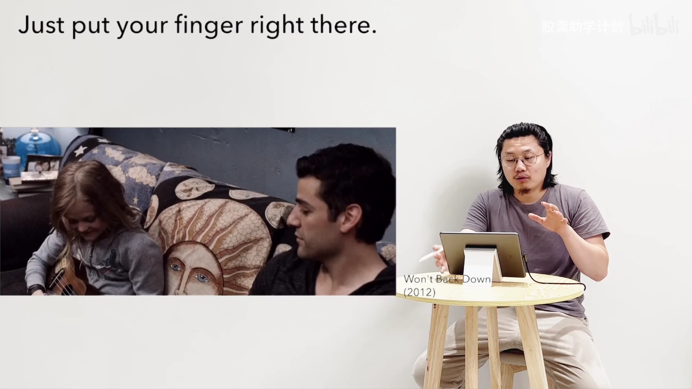

文字识别：Just put your finger right there. / Won't Back Down / (2012)

### 画面 00:04:25

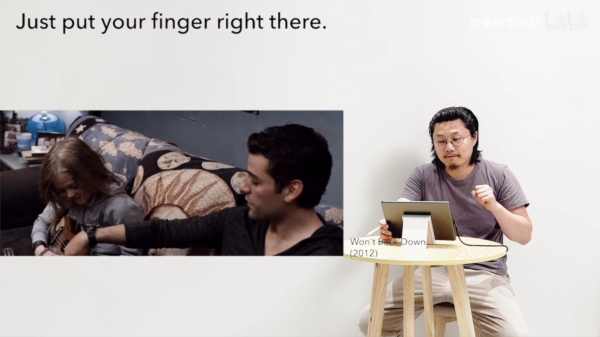

文字识别：Just put your finger right there. / Won't BaekDown / (2012)

### 画面 00:04:27

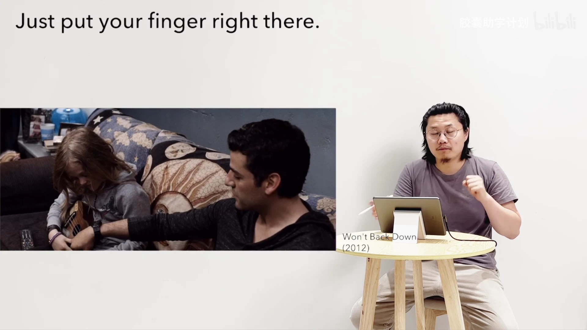

文字识别：Just put your finger right there. / Won't BackDown / (2012)

## 00:04:30–00:05:00

到他是有这个弹这个 guitar，是吧？小的一个吉他，哎，他教他说，just put your finger right there，是吧？把你的这个手指头，哎，就放在那个地方，就放在那个地方，对吧？哎，他可能语速比较的快，各位不妨倒过去，可以再多听几遍啊。好，接下来下一个叫 I could never put my finger on it， but something that just wasn't right。 Okay，这个地方我要发挥一下你的主观能动性了，对吧？我们一直在提叫学习越主动

### 画面 00:04:47

文字识别：I could never put my finger on it, / but something just wasn't right. / Cambridg / Clerks. / (1994)

## 00:05:00–00:05:30

效果越好，我直接告诉你的和你自己查出来的，你印象会差别特别的大。如果我们看字面意思叫 put my finger on it，叫把我的手指头放在那个上面，那这句话的直译叫我从来也没有能把我的手指头放在上面，但是有一些事情就是不对。这句话听上去就特别的诡异，对吧？所以今天留一个作业，您要么发一下弹幕，要么留一个言，对吧？告诉我你去查一下，我不管你

### 画面 00:05:17

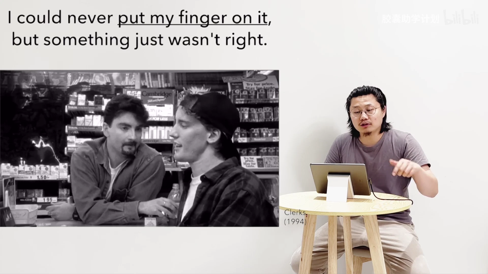

文字识别：I could never put my finger on it, / but something just wasn't right. / Clerks. / (1994)

## 00:05:30–00:06:00

在哪儿查，但你去查一下，看你能不能解决。叫 put my finger on it，这个短语到底是什么意思？我先告诉各位，它不能字面意思去理解。那我们先听一下啊，来了。 I can never put my finger on it, but something just wasn't right. 哎， but something just wasn't right. 啊，典型的美腔。好，再下一个，刚才说了 put ah my finger on it，接下来又来了一个叫 I guess we'll know who to put the a point

### 画面 00:05:44

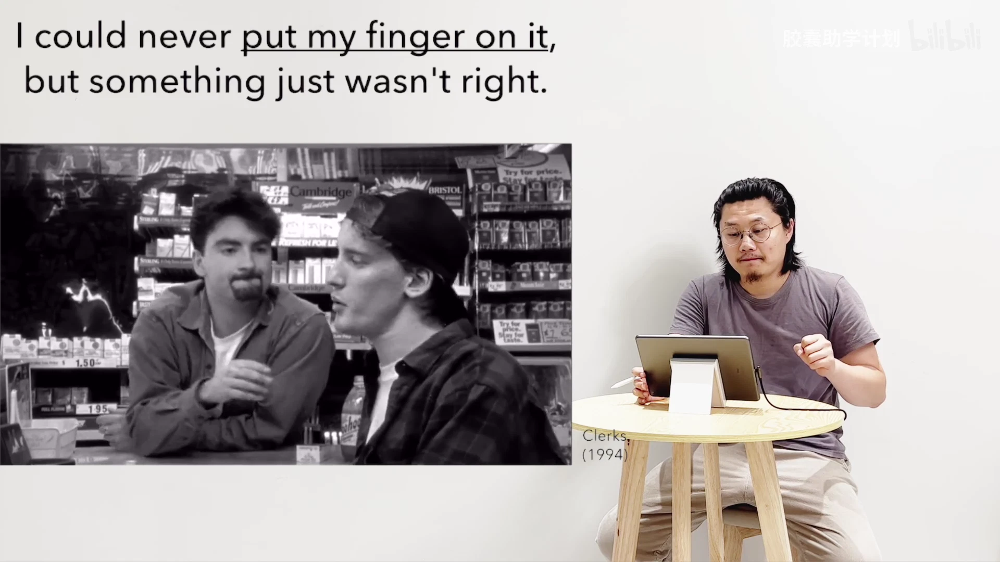

文字识别：I could never put my finger on it, / but something just wasn't right. / Clerks, / (1994)

### 画面 00:05:46

文字识别：I could never put my finger on it, / but something just wasn't right. / Clerks: / (1994)

### 画面 00:05:48

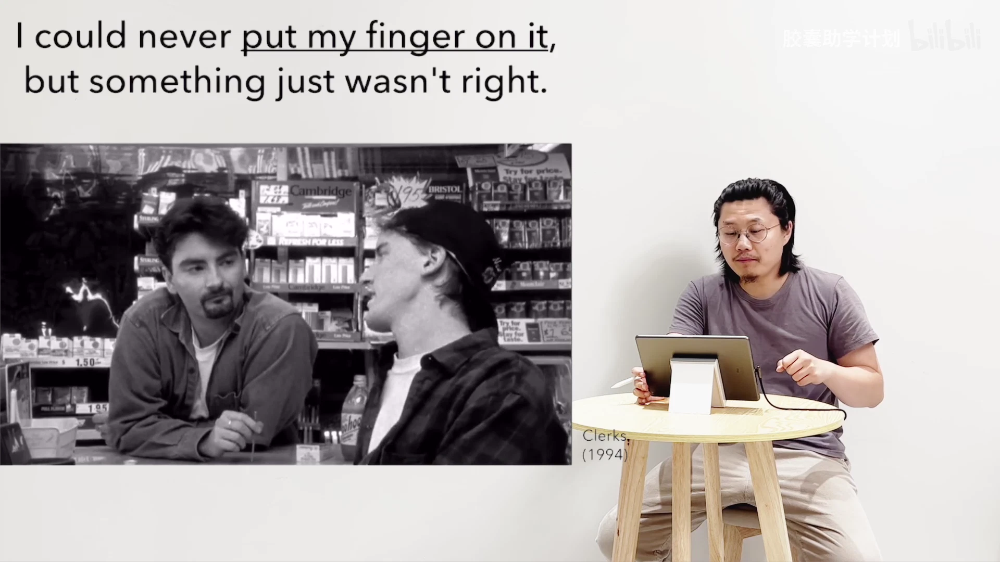

文字识别：I could never put my finger on it, / but something just wasn't right. / Clerks: / (1994)

### 画面 00:05:51

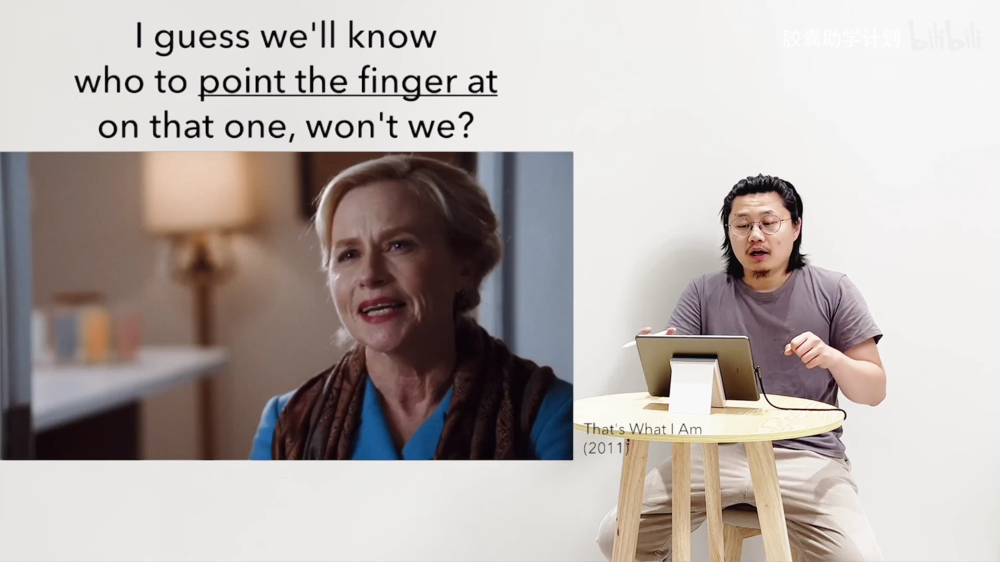

文字识别：I guess we'll know / who to point the finger at / on that one, won't we? / That's WhatI Am / (2011)

## 00:06:00–00:06:30

point the finger at? Point the finger at. 字面意思叫手指向谁，对吧？接下来说 on that one one way，对吧？啊，那同理，这里你不能从字面意思去理解，跟刚才的处理是一样的。我还是不告诉你答案。你但凡有点主观能动性，对吧？在互联网这么发达的今天，查到它到底是什么意思，绝对不难。你如果太懒了，要么你就放弃学习它，对吧？要么你就等，等到有人说答案为

### 画面 00:06:21

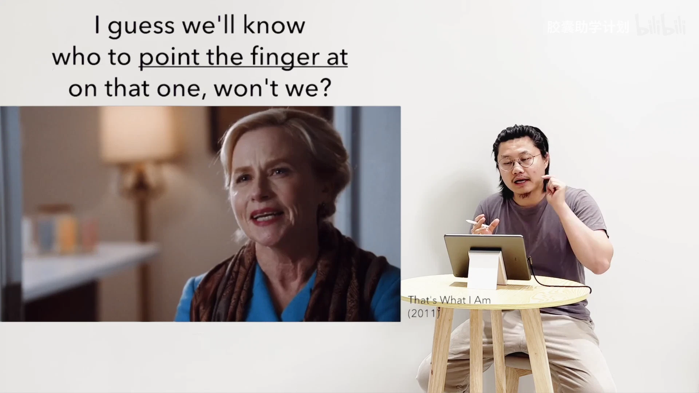

文字识别：I guess we'll know / who to point the finger at / on that one, won't we? / That's What I Am / (2011)

## 00:06:30–00:07:00

为止，好吧，OK，注意力集中，听一下。I guess we'll know who to point the finger at on that one, won't we? OK, very good. 那不多说了，接下来下一个小单词，这个单词我觉得都跟汉语差不多了，叫做 pie，对吧？馅儿饼啊，pie，OK，你像各种当劳啊，各种德基一样，对吧？哎，都卖 pie 这个玩意儿，对吧？对于各位来说就跟汉语是一样的了，pie，OK。那我们拿它造句其实就很简单了，你无非找一些动词，找一些

### 画面 00:06:34

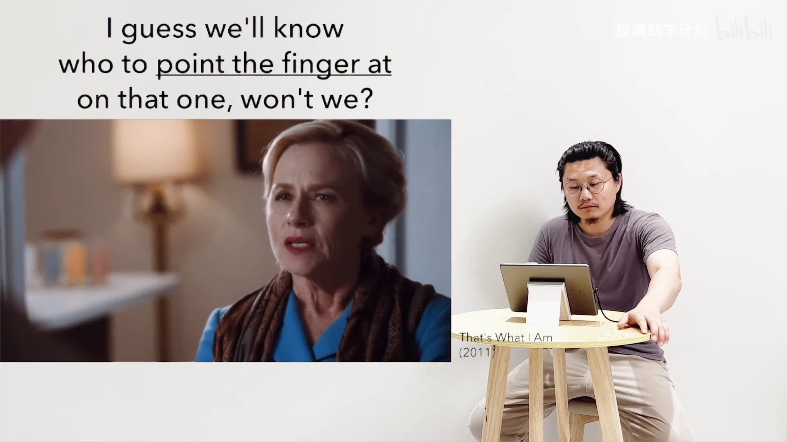

文字识别：I guess we'll know / who to point the finger at / on that one, won't we? / That's WhatI Am / (2011)

### 画面 00:06:36

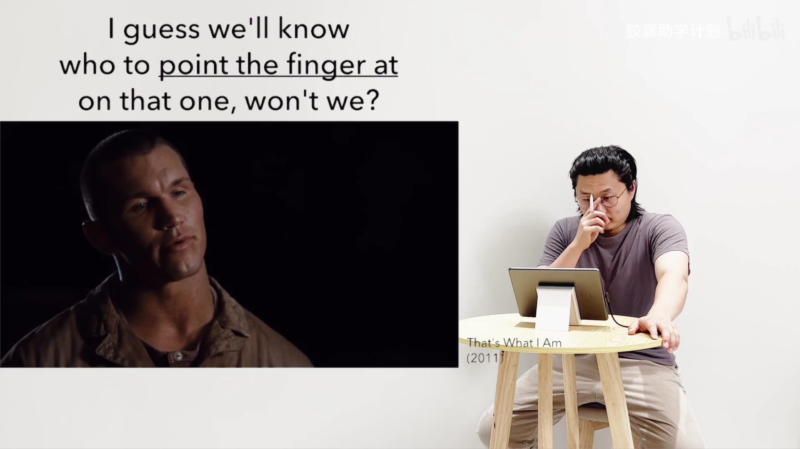

文字识别：I guess we'll know / who to point the finger at / on that one, won't we? / That's WhatIAm / (2011)

### 画面 00:06:39

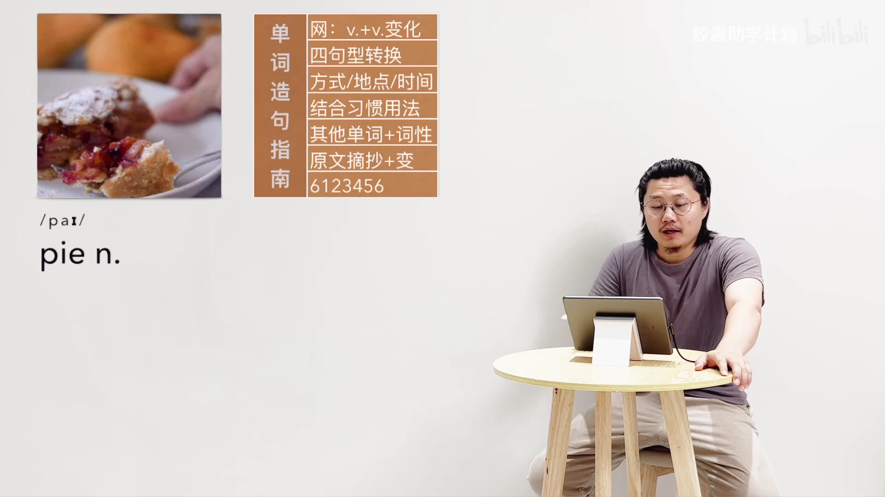

文字识别：单词造句指南 / 网：v.+v.变化 / 四句型转换 / 方式/地点/时间 / 结合习惯用法 / 其他单词+词性 / 原文摘抄+变 / 6123456 / /pai/ / pie n.

### 画面 00:06:41

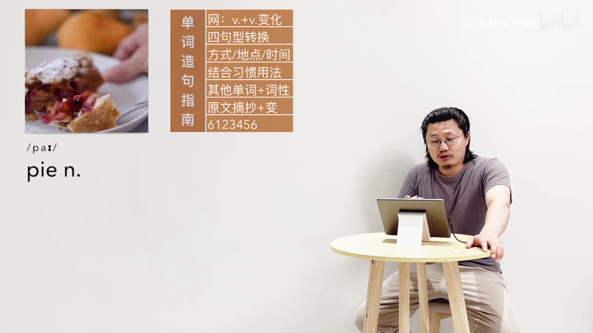

文字识别：单词造句指南 / 网：v.+v.变化 / 四句型转换 / 方式/地点/时间 / 结合习惯用法 / 其他单词+词性 / 原文摘抄+变 / 6123456 / /pai/ / pie n.

### 画面 00:06:55

文字识别：单词造句指南 / 网：v.+v.变化 / 四句型转换 / 方式/地点/时间 / 结合习惯用法 / 其他单词+词性 / 原文摘抄+变 / 6123456 / /par/ / pie n. / ① It took me three hours to make this pie. L50

### 画面 00:06:58

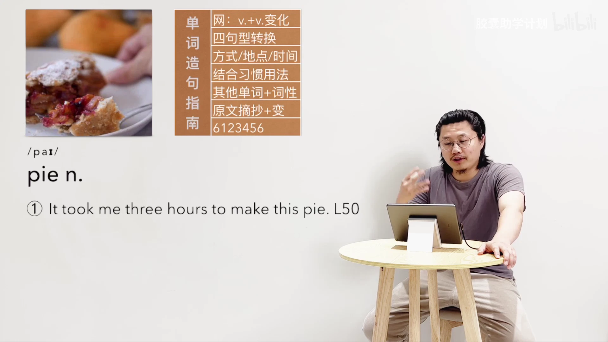

文字识别：单词造句指南 / 网：v.+v.变化 / 四句型转换 / 方式/地点/时间 / 结合习惯用法 / 其他单词+词性 / 原文摘抄+变 / 6123456 / /par/ / pie n. / ① It took me three hours to make this pie. L50

## 00:07:00–00:07:30

其他的习惯用法。比如说，我们五十课刚刚学过的 take somebody some time to do something，正好我们这篇文章也出现了。我们复习一下，叫做 It took me three hours to make this pie。说花了我三个小时的时间去做这个 pie，对吧？哎，好，下一个，比如说 After making this pie， I had a bath upstairs。那 had a bath 都是新概念一册八十一课学的了啊。那这个 after 加 making 四

### 画面 00:07:00

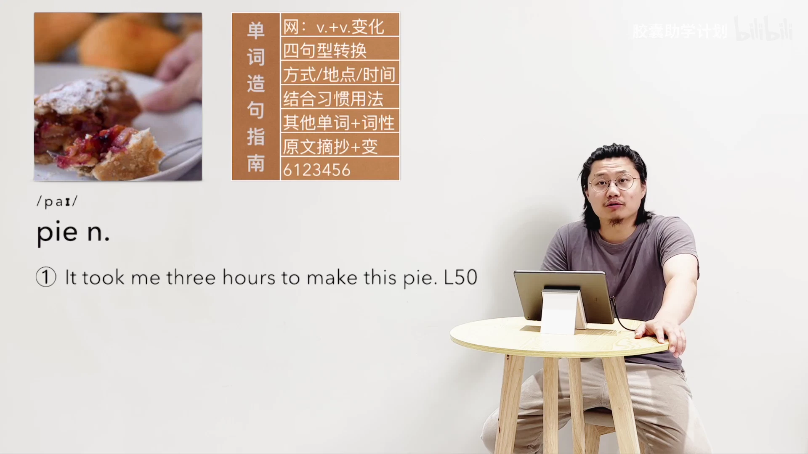

文字识别：单词造句指南 / 网：v.+v.变化 / 四句型转换 / 方式/地点/时间 / 结合习惯用法 / 其他单词+词性 / 原文摘抄+变 / 6123456 / /pal/ / pie n. / ① It took me three hours to make this pie. L50

### 画面 00:07:06

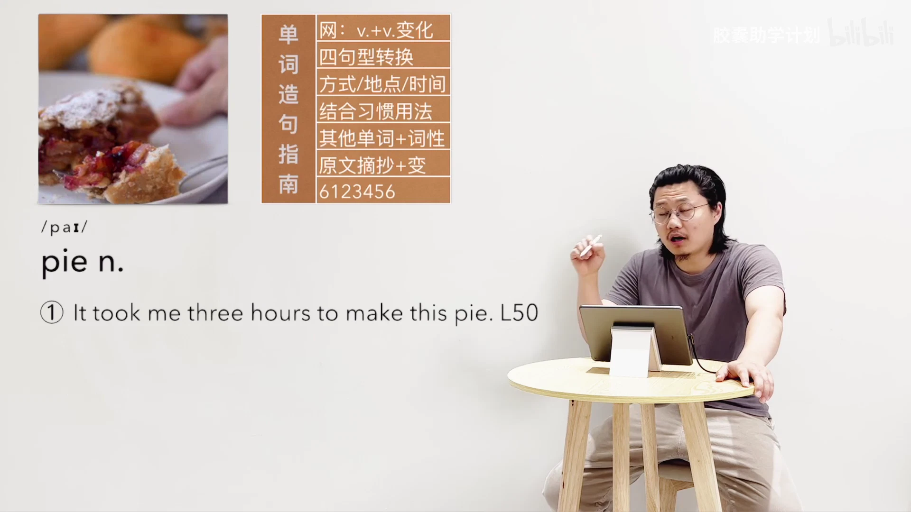

文字识别：单词造句指南 / 网：v.+v.变化 / 四句型转换 / 方式/地点/时间 / 结合习惯用法 / 其他单词+词性 / 原文摘抄+变 / 6123456 / /pal/ / pie n. / ① It took me three hours to make this pie. L50

### 画面 00:07:10

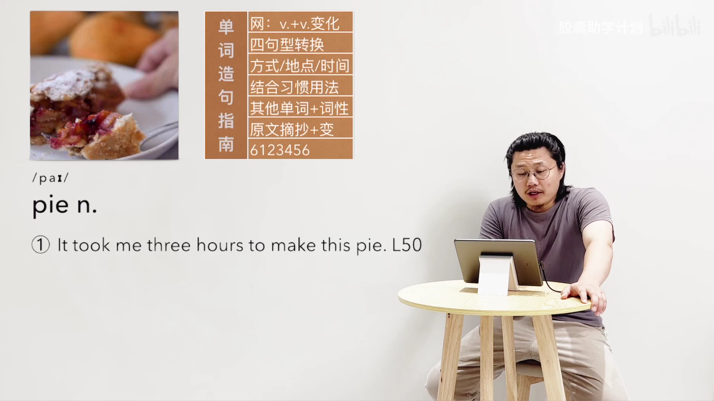

文字识别：单词造句指南 / 网：v.+v.变化 / 四句型转换 / 方式/地点/时间 / 结合习惯用法 / 其他单词+词性 / 原文摘抄+变 / 6123456 / /pal/ / pie n. / ① It took me three hours to make this pie. L50

### 画面 00:07:15

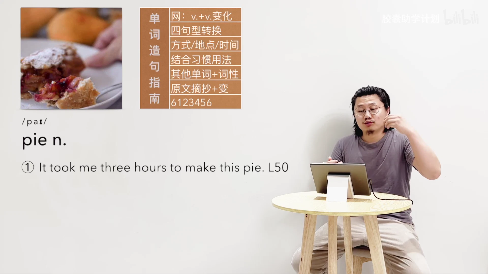

文字识别：单词造句指南 / 网：v.+v.变化 / 四句型转换 / 方式/地点/时间 / 结合习惯用法 / 其他单词+词性 / 原文摘抄+变 / 6123456 / /par/ / pie n. / ① It took me three hours to make this pie. L50

### 画面 00:07:19

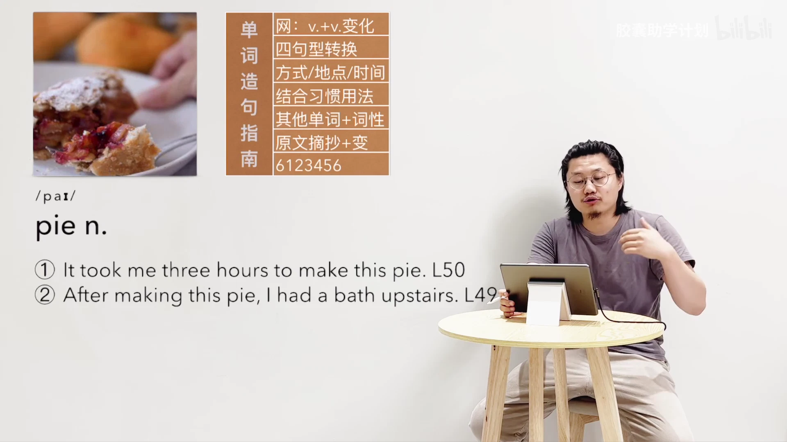

文字识别：单词造句指南 / 网：v.+v.变化 / 四句型转换 / 方式/地点/时间 / 结合习惯用法 / 其他单词+词性 / 原文摘抄+变 / 6123456 / /pai/ / pie n. / ① It took me three hours to make this pie. L50 / ② After making this pie, I had a bath upstairs. L49

### 画面 00:07:26

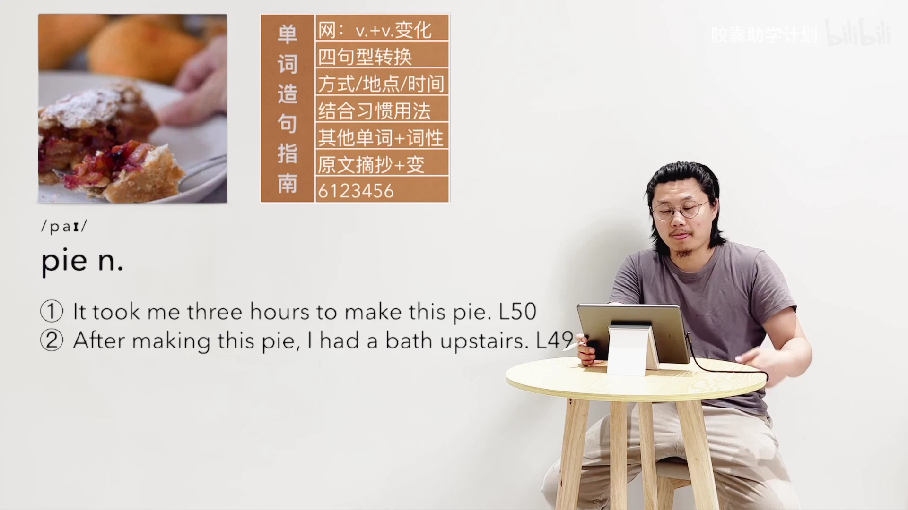

文字识别：单词造句指南 / 网：v.+v.变化 / 四句型转换 / 方式/地点/时间 / 结合习惯用法 / 其他单词+词性 / 原文摘抄+变 / 6123456 / /pal/ / pie n. / ① It took me three hours to make this pie. L50 / ② After making this pie, I had a bath upstairs. L49

## 00:07:30–00:08:00

十九课分词做状语非常重要的一个语法，我们又复习了一下。Continue，说I'd prefer to eat this pie with you rather than have a steak alone.好，你看这里的意思叫，其实五十课咱们学的prefer啊，prefer是吧？这个单词我们实际上当时给了很多用法，这是其中之一个，叫做我宁愿和你一起吃这个pie，而不是一个人去吃牛排。那我们一般理解为

### 画面 00:07:31

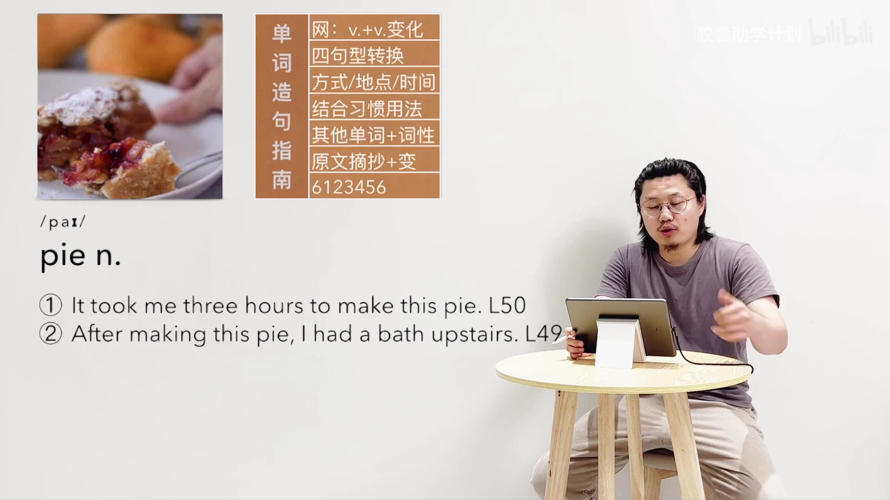

文字识别：单词造句指南 / 网：v.+v.变化 / 四句型转换 / 方式/地点/时间 / 结合习惯用法 / 其他单词+词性 / 原文摘抄+变 / 6123456 / /pal/ / pie n. / ① It took me three hours to make this pie. L50 / ② After making this pie, I had a bath upstairs. L49

### 画面 00:07:34

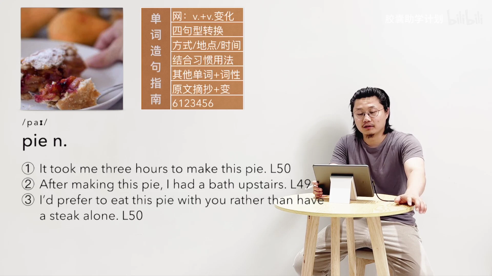

文字识别：单词造句指南 / 网：v.+v.变化 / 四句型转换 / 方式/地点/时间 / 结合习惯用法 / 其他单词+词性 / 原文摘抄+变 / 6123456 / /pal/ / pie n. / ① It took me three hours to make this pie. L50 / ② After making this pie, I had a bath upstairs. L49 / ③ I'd prefer to eat this pie with you rather than have / 3 / a steak alone. L50

### 画面 00:07:37

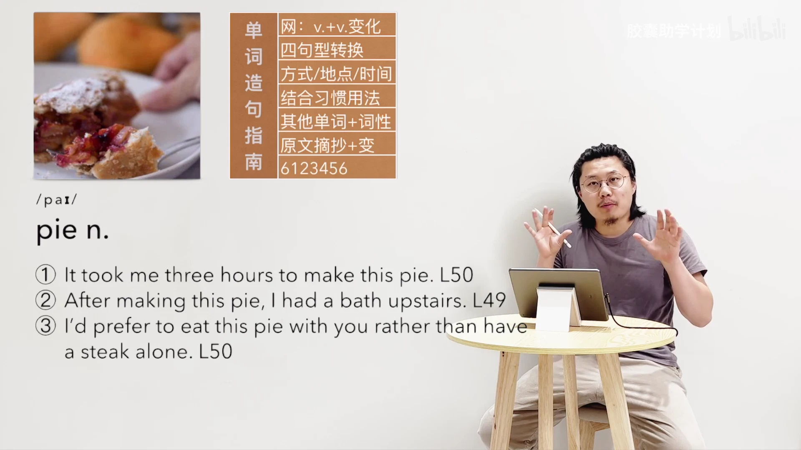

文字识别：单词造句指南 / 网：v.+v.变化 / 四句型转换 / 方式/地点/时间 / 结合习惯用法 / 其他单词+词性 / 原文摘抄+变 / 6123456 / /pal/ / pie n. / ① It took me three hours to make this pie. L50 / ② After making this pie, I had a bath upstairs. L49 / ③ I'd prefer to eat this pie with you rather than have / a steak alone. L50

### 画面 00:07:40

文字识别：单词造句指南 / 网：v.+v.变化 / 四句型转换 / 方式/地点/时间 / 结合习惯用法 / 其他单词+词性 / 原文摘抄+变 / 6123456 / /pal/ / pie n. / ① It took me three hours to make this pie. L50 / ② After making this pie, I had a bath upstairs. L49 / ③ I'd prefer to eat this pie with you rather than have / a steak alone. L50

### 画面 00:07:45

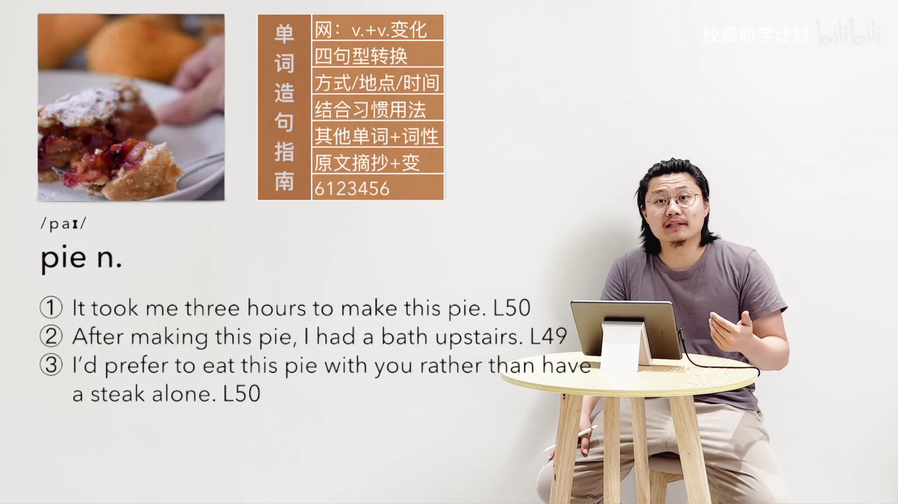

文字识别：单词造句指南 / 网：v.+v.变化 / 四句型转换 / 方式/地点/时间 / 结合习惯用法 / 其他单词+词性 / 原文摘抄+变 / 6123456 / /pai/ / pie n. / ① It took me three hours to make this pie. L50 / ② After making this pie, I had a bath upstairs. L49 / ③ I'd prefer to eat this pie with you rather than have / a steak alone. L50

### 画面 00:07:59

文字识别：单词造句指南 / 网：v.+v.变化 / 四句型转换 / 方式/地点/时间 / 结合习惯用法 / 其他单词+词性 / 原文摘抄+变 / 6123456 / /pal/ / pie n. / ① It took me three hours to make this pie. L50 / ② After making this pie, I had a bath upstairs. L49 / ③ I'd prefer to eat this pie with you rather than have / a steak alone. L50

## 00:08:00–00:08:30

可能牛排要比派更好吃一点，但是我更愿意和你去分享这个派，而不是自己去吃牛排，对吧？叫做 I'd rather I I I I I'd prefer to eat this pie with you rather than have a steak alone. Okay, very good.五十课咱们学的，你忘了怎么办？五十课你虽然学了，对吧？哎，它从来都不是你的，那是我教给你了。你怎么把它变成你的呢？对吧？我们所谓就是偷师学艺，对吧？你怎么把它偷过来变成你自己的呢？

### 画面 00:08:04

文字识别：单词造句指南 / 网：v.+v.变化 / 四句型转换 / 方式/地点/时间 / 结合习惯用法 / 其他单词+词性 / 原文摘抄+变 / 6123456 / /pal/ / pie n. / ① It took me three hours to make this pie. L50 / ② After making this pie, I had a bath upstairs. L49 / ③ I'd prefer to eat this pie with you rather than have / a steak alone. L50

### 画面 00:08:25

文字识别：单词造句指南 / 网：v.+v.变化 / 四句型转换 / 方式/地点/时间 / 结合习惯用法 / 其他单词+词性 / 原文摘抄+变 / 6123456 / /pai/ / pie n. / ① It took me three hours to make this pie. L50 / ② After making this pie, I had a bath upstairs. L49 / ) I'd prefer to eat this pie with you rather than have / 3 / a steak alone. L50

## 00:08:30–00:09:00

造句，造句，再造句，练习，练习，再练习啊！不多说了，下一个单词，接下来是两个单词，它是同一个东西的不同状态。首先，这个单词其实，在单词表上都没出现，但文章当中出现了。跟我读一下，叫做 flower，flower。哎，你如果你基础特别的好，你会发现这个单词好像跟我之前学的某个单词发音一样，叫花，对吧？哎，花儿的花是吧？叫做 flower，叫面粉的意思。

### 画面 00:08:30

文字识别：单词造句指南 / 网：v.+v.变化 / 四句型转换 / 方式/地点/时间 / 结合习惯用法 / 其他单词+词性 / 原文摘抄+变 / 6123456 / /pal/ / pie n. / ① It took me three hours to make this pie. L50 / ② After making this pie, I had a bath upstairs. L49 / ③ I'd prefer to eat this pie with you rather than have / a steak alone. L50

### 画面 00:08:34

文字识别：单词造句指南 / 网：v.+v.变化 / 四句型转换 / 方式/地点/时间 / 结合习惯用法 / 其他单词+词性 / 原文摘抄+变 / 6123456 / /'peIstri/ / /fl aua/ / flour / pastry n.

### 画面 00:08:37

文字识别：单词造句指南 / 网：v.+v.变化 / 四句型转换 / 方式/地点/时间 / 结合习惯用法 / 其他单词+词性 / 原文摘抄+变 / 6123456 / /'peIstri/ / /fl aua/ / flour / pastry n.

### 画面 00:08:39

文字识别：单词造句指南 / 网：v.+v.变化 / 四句型转换 / 方式/地点/时间 / 结合习惯用法 / 其他单词+词性 / 原文摘抄+变 / 6123456 / /'peIstri/ / /flaua/ / flour / pastry n.

### 画面 00:08:51

文字识别：单词造句指南 / 网：v.+v.变化 / 四句型转换 / 方式/地点/时间 / 结合习惯用法 / 其他单词+词性 / 原文摘抄+变 / 6123456 / /'peIstri/ / /flaua/ / flour / pastry n.

### 画面 00:08:59

文字识别：单词造句指南 / 网：v.+v.变化 / 四句型转换 / 方式/地点/时间 / 结合习惯用法 / 其他单词+词性 / 原文摘抄+变 / 6123456 / /'peIstri/ / /flaua/ / flour / pastry n.

## 00:09:00–00:09:30

那这个单词呢？文章当中给了一个意思，并不是它最常用的意思。一会儿我们会说啊，它最常用的意思。这个这个用法有一点点过时了，叫做pastry pastry。OK pastry这个单词的意思在文章当中给的是这种面糊，对吧？你你比如和面啊，面没有完全和好的这个过程当中是有点稀、有点粘手的这个东西，对吧？管它叫pastry。Very good。那它还有一个常用的意思是什么呢？一会儿我们讲啊，

### 画面 00:09:04

文字识别：单词造句指南 / 网：v.+v.变化 / 四句型转换 / 方式/地点/时间 / 结合习惯用法 / 其他单词+词性 / 原文摘抄+变 / 6123456 / /'peIstri/ / /flaua/ / flour / pastry n.

### 画面 00:09:15

文字识别：单词造句指南 / 网：v.+v.变化 / 四句型转换 / 方式/地点/时间 / 结合习惯用法 / 其他单词+词性 / 原文摘抄+变 / 6123456 / /'peIstri/ / /flaua/ / flour / pastry n.

### 画面 00:09:18

文字识别：单词造句指南 / 网：v.+v.变化 / 四句型转换 / 方式/地点/时间 / 结合习惯用法 / 其他单词+词性 / 原文摘抄+变 / 6123456 / /'peistri/ / /fl aua/ / flour / pastry n.

### 画面 00:09:20

文字识别：单词造句指南 / 网：v.+v.变化 / 四句型转换 / 方式/地点/时间 / 结合习惯用法 / 其他单词+词性 / 原文摘抄+变 / 6123456 / /'peIstri/ / /fl aua/ / flour / pastry n.

### 画面 00:09:24

文字识别：单词造句指南 / 网：v.+v.变化 / 四句型转换 / 方式/地点/时间 / 结合习惯用法 / 其他单词+词性 / 原文摘抄+变 / 6123456 / /'peIstri/ / /fl aua/ / flour / pastry n.

### 画面 00:09:29

文字识别：单词造句指南 / 网：v.+v.变化 / 四句型转换 / 方式/地点/时间 / 结合习惯用法 / 其他单词+词性 / 原文摘抄+变 / 6123456 / /'peIstri/ / /fl aua/ / flour / pastry n.

## 00:09:30–00:10:00

马上我们先看一下原文。我们想造句怎么办？说 My hands were soon covered with sticky pastry. 这是原文的一句话，叫我的双手 hands 复数，很快的就被覆盖上了黏黏糊糊的这些面糊糊。 OK，首先这个 be covered with 是咱们新概念一册一百四十三课文章当中学过的啊。如果您忘了，可以回去看一下。然后呢，我们最简单粗暴的

### 画面 00:09:31

文字识别：单词造句指南 / 网：v.+v.变化 / 四句型转换 / 方式/地点/时间 / 结合习惯用法 / 其他单词+词性 / 原文摘抄+变 / 6123456 / /'peIstri/ / /flaua/ / flour / pastry n. / ① [Story]: My hands were soon covered with sticky pastry.

### 画面 00:09:34

文字识别：单词造句指南 / 网：v.+v.变化 / 四句型转换 / 方式/地点/时间 / 结合习惯用法 / 其他单词+词性 / 原文摘抄+变 / 6123456 / /'peIstri/ / / flaua/ / flour / pastry n. / ① [Story]: My hands were soon covered with sticky pastry.

### 画面 00:09:41

文字识别：单词造句指南 / 网：v.+v.变化 / 四句型转换 / 方式/地点/时间 / 结合习惯用法 / 其他单词+词性 / 原文摘抄+变 / 6123456 / /'peIstri/ / /flaua/ / flour / pastry n. / ① [Story]: My hands were soon covered with sticky pastry.

### 画面 00:09:44

文字识别：单词造句指南 / 网：v.+v.变化 / 四句型转换 / 方式/地点/时间 / 结合习惯用法 / 其他单词+词性 / 原文摘抄+变 / 6123456 / /'peistri/ / / flaua/ / flour / pastry n. / ① [Story]: My hands were soon covered with sticky pastry.

### 画面 00:09:49

文字识别：单词造句指南 / 网：v.+v.变化 / 四句型转换 / 方式/地点/时间 / 结合习惯用法 / 其他单词+词性 / 原文摘抄+变 / 6123456 / /'peIstri/ / /flaua/ / flour / pastry n. / ① [Story]: My hands were soon covered with sticky pastry.

### 画面 00:09:54

文字识别：单词造句指南 / 网：v.+v.变化 / 四句型转换 / 方式/地点/时间 / 结合习惯用法 / 其他单词+词性 / 原文摘抄+变 / 6123456 / /'peistri/ / /flaua/ / flour / pastry n. / ① [Story]: My hands were soon covered with sticky pastry.

### 画面 00:09:59

文字识别：单词造句指南 / 网：v.+v.变化 / 四句型转换 / 方式/地点/时间 / 结合习惯用法 / 其他单词+词性 / 原文摘抄+变 / 6123456 / /'peistri/ / / flaua/ / flour / pastry n. / ① [Story]: My hands were soon covered with sticky pastry. / were/why/what/how soon... / Thanks for the pastry. The Secret Life of Walter Mitty(2013)

## 00:10:00–00:10:30

一个思路就是我们直接来个四句型转换，对吧？这我就不多说了啊。各位到今天应该是很容易理解了。那我们看一句电影台词啊，Secret Life of Walter Mitty啊。这个电影当中有这么一个东西叫Thanks for the pastry。你想一下，如果这个使用场景叫感谢你给我提供的面糊，是不是感觉好像不太对？隐约的觉得 pastry 这个单词可能有其他别的意思。如果你恰好看那个单词，你会发现

### 画面 00:10:04

文字识别：单词造句指南 / 网：v.+v.变化 / 四句型转换 / 方式/地点/时间 / 结合习惯用法 / 其他单词+词性 / 原文摘抄+变 / 6123456 / /'peistri/ / /flaua/ / flour / pastry n. / ① [Story]: My hands were soon covered with sticky pastry. / were/why/what/how soon... / Thanks for the pastry. The Secret Life of Walter Mitty (2013)

### 画面 00:10:09

文字识别：单词造句指南 / 网：v.+v.变化 / 四句型转换 / 方式/地点/时间 / 结合习惯用法 / 其他单词+词性 / 原文摘抄+变 / 6123456 / /'peistri/ / /flaua/ / flour / pastry n. / were/why/what/how soon... / Thanks for the pastry. The Secret Life of Walter Mitty (2013)

### 画面 00:10:14

文字识别：单词造句指南 / 网：v.+v.变化 / 四句型转换 / 方式/地点/时间 / 结合习惯用法 / 其他单词+词性 / 原文摘抄+变 / 6123456 / /'peistri/ / /flaua/ / flour / pastry n. / ① [Story]: My hands were soon covered with sticky pastry. / were/why/what/how soon... / Thanks for the pastry. The Secret Life of Walter Mitty (2013)

### 画面 00:10:18

文字识别：单词造句指南 / 网：v.+v.变化 / 四句型转换 / 方式/地点/时间 / 结合习惯用法 / 其他单词+词性 / 原文摘抄+变 / 6123456 / /'peistri/ / /flaua/ / flour / pastry n. / ① [Story]: My hands were soon covered with sticky pastry. / were/why/what/how soon... / Thanks for the pastry. The Secret Life of Walter Mitty (2013)

### 画面 00:10:20

文字识别：单词造句指南 / 网：v.+v.变化 / 四句型转换 / 方式/地点/时间 / 结合习惯用法 / 其他单词+词性 / 原文摘抄+变 / 6123456 / /'peistri/ / /flaua/ / flour / pastry n. / ① [Story]: My hands were soon covered with sticky pastry. / were/why/what/how soon... / Thanks for the pastry. The Secret Life of Walter Mitty (2013)

### 画面 00:10:29

文字识别：单词造句指南 / 网：v.+v.变化 / 四句型转换 / 方式/地点/时间 / 结合习惯用法 / 其他单词+词性 / 原文摘抄+变 / 6123456 / /'peistri/ / / flaua/ / flour / pastry n. / ① [Story]: My hands were soon covered with sticky pastry. / were/why/what/how soon... / Thanks for the pastry. The Secret Life of Walter Mitty (2013)

## 00:10:30–00:11:00

其中一个人，对吧？刚刚吃完了一部分，哎，一些糕点啊，你呃，什么特拉米特提拉米苏啊，等等那些，对吧？各各式各样的糕点，哎，它都可以叫做 pastry。所以这里想说的不是感谢面糊糊，是吧？是感谢你的这些糕点。所以这是它其实本身最常用的意思啊。文章当中并没有用这个意思。Continuing, Man Fire这个电影当中又给了一个there be句型，叫There

### 画面 00:10:36

文字识别：单词造句指南 / 网：v.+v.变化 / 四句型转换 / 方式/地点/时间 / 结合习惯用法 / 其他单词+词性 / 原文摘抄+变 / 6123456 / /'peistri/ / /flaua/ / flour / pastry n. / ① [Story]: My hands were soon covered with sticky pastry. / were/why/what/how soon... / Thanks for the pastry. The Secret Life of Walter Mitty (2013)

### 画面 00:10:39

文字识别：单词造句指南 / 网：v.+v.变化 / 四句型转换 / 方式/地点/时间 / 结合习惯用法 / 其他单词+词性 / 原文摘抄+变 / 6123456 / /'peistri/ / /flaua/ / flour / pastry n. / ① [Story]: My hands were soon covered with sticky pastry. / were/why/what/how soon... / Thanks for the pastry. The Secret Life of Walter Mitty (2013)

### 画面 00:10:45

文字识别：单词造句指南 / 网：v.+v.变化 / 四句型转换 / 方式/地点/时间 / 结合习惯用法 / 其他单词+词性 / 原文摘抄+变 / 6123456 / /'peistri/ / /flaua/ / flour / pastry n. / ① [Story]: My hands were soon covered with sticky pastry. / were/why/what/how soon... / Thanks for the pastry. The Secret Life of Walter Mitty (2013)

### 画面 00:10:49

文字识别：单词造句指南 / 网：v.+v.变化 / 四句型转换 / 方式/地点/时间 / 结合习惯用法 / 其他单词+词性 / 原文摘抄+变 / 6123456 / /'peistri/ / / flaua/ / flour / pastry n. / ① [Story]: My hands were soon covered with sticky pastry. / were/why/what/how soon... / Thanks for the pastry. The Secret Life of Walter Mitty (2013)

### 画面 00:10:54

文字识别：单词造句指南 / 网：v.+v.变化 / 四句型转换 / 方式/地点/时间 / 结合习惯用法 / 其他单词+词性 / 原文摘抄+变 / 6123456 / /'peistri/ / /flaua/ / flour / pastry n. / ① [Story]: My hands were soon covered with sticky pastry. / were/why/what/how soon... / Thanks for the pastry. The Secret Life of Walter Mitty (2013) / There is a pastry shop nearby. Man on Fire (2004)

### 画面 00:10:58

文字识别：单词造句指南 / 网：v.+v.变化 / 四句型转换 / 方式/地点/时间 / 结合习惯用法 / 其他单词+词性 / 原文摘抄+变 / 6123456 / /'peistri/ / /flaua/ / flour / pastry n. / ① [Story]: My hands were soon covered with sticky pastry. / were/why/what/how soon... / Thanks for the pastry. The Secret Life of Walter Mitty (2013) / There is a pastry shop nearby. Man on Fire (2004)

## 00:11:00–00:11:30

is a pastry shop nearby。说附近是有一个什么商店呢？糕点店，对吧？哎，这个甜品店、糕点店叫 pastry shop。玩一遍。好，flour。你看一下，叫做 I need flour。这个地方又涉及到新概念一册四十一课，咱们当时说的名词可数不可数这件事儿，在大多数情况下，哪怕是考试，各位他所占的分值也非常非常的少啊，你不用太担心。

### 画面 00:11:00

文字识别：单词造句指南 / 网：v.+v.变化 / 四句型转换 / 方式/地点/时间 / 结合习惯用法 / 其他单词+词性 / 原文摘抄+变 / 6123456 / /'peistri/ / /flaua/ / flour / pastry n. / ① [Story]: My hands were soon covered with sticky pastry. / were/why/what/how soon... / Thanks for the pastry. The Secret Life of Walter Mitty (2013) / There is a pastry shop nearby. Man on Fire (2004)

### 画面 00:11:04

文字识别：单词造句指南 / 网：v.+v.变化 / 四句型转换 / 方式/地点/时间 / 结合习惯用法 / 其他单词+词性 / 原文摘抄+变 / 6123456 / /'peistri/ / /flaua/ / flour / pastry n. / ① [Story]: My hands were soon covered with sticky pastry. / were/why/what/how soon... / Thanks for the pastry. The Secret Life of Walter Mitty (2013) / There is a pastry shop nearby. Man on Fire (2004)

### 画面 00:11:09

文字识别：单词造句指南 / 网：v.+v.变化 / 四句型转换 / 方式/地点/时间 / 结合习惯用法 / 其他单词+词性 / 原文摘抄+变 / 6123456 / /'peistri/ / /flaua/ / flour / pastry n. / ① [Story]: My hands were soon covered with sticky pastry. / were/why/what/how soon... / Thanks for the pastry. The Secret Life of Walter Mitt (2013) / There is a pastry shop nearby. Man on Fire (2004)

### 画面 00:11:12

文字识别：单词造句指南 / 网：v.+v.变化 / 四句型转换 / 方式/地点/时间 / 结合习惯用法 / 其他单词+词性 / 原文摘抄+变 / 6123456 / /'peistri/ / /flaua/ / flour / pastry n. / ① [Story]: My hands were soon covered with sticky pastry. / were/why/what/how soon... / Thanks for the pastry. The Secret Life of Walter Mitty (2013) / There is a pastry shop nearby. Man on Fire (2004) / ⑤ I need flour. Give me two bags of flour. Hotel Rwanda (2004)

### 画面 00:11:14

文字识别：单词造句指南 / 网：v.+v.变化 / 四句型转换 / 方式/地点/时间 / 结合习惯用法 / 其他单词+词性 / 原文摘抄+变 / 6123456 / /'peistri/ / /flaua/ / flour / pastry n. / ① [Story]: My hands were soon covered with sticky pastry. / were/why/what/how soon... / Thanks for the pastry. The Secret Life of Walter Mitty (2013) / There is a pastry shop nearby. Man on Fire (2004) / ⑤ I need flour. Give me two bags of flour. Hotel Rwand2004)

### 画面 00:11:19

文字识别：单词造句指南 / 网：v.+v.变化 / 四句型转换 / 方式/地点/时间 / 结合习惯用法 / 其他单词+词性 / 原文摘抄+变 / 6123456 / /'peistri/ / /flaua/ / flour / pastry n. / ① [Story]: My hands were soon covered with sticky pastry. / were/why/what/how soon... / 2) / Thanks for the pastry. The Secret Life of Walter Mitty (2013) / There is a pastry shop nearby. Man on Fire (2004) / ⑤ I need flour. Give me two bags of flour. Hotel Rwand 2004)

### 画面 00:11:24

文字识别：单词造句指南 / 网：v.+v.变化 / 四句型转换 / 方式/地点/时间 / 结合习惯用法 / 其他单词+词性 / 原文摘抄+变 / 6123456 / /'peistri/ / /flaua/ / flour / pastry n. / ① [Story]: My hands were soon covered with sticky pastry. / were/why/what/how soon... / Thanks for the pastry. The Secret Life of Walter Mitty (2013) / There is a pastry shop nearby. Man on Fire (2004) / ⑤ I need flour. Give me two bags of flour. Hotel Rwanda (2o04)

### 画面 00:11:29

文字识别：单词造句指南 / 网：v.+v.变化 / 四句型转换 / 方式/地点/时间 / 结合习惯用法 / 其他单词+词性 / 原文摘抄+变 / 6123456 / /'peistri/ / /flaua/ / flour / pastry n. / ① [Story]: My hands were soon covered with sticky pastry. / were/why/what/how soon... / 2) / Thanks for the pastry. The Secret Life of Walter Mitty (2013) / There is a pastry shop nearby. Man on Fire (2004) / ⑤ I need flour. Give me two bags of flour. Hotel Rwandj(2004)

## 00:11:30–00:12:00

但是大家多少有一个规则，就是像这种对吧？它的颗粒过于的小，你根本没法数的，一般往往都是不可数。所以那你可以先凭这个规则去猜一下它可数不可数，你再看例句也能猜出来，对不对？其次呢，我们从新一开始就要求各位，包括新二，包括我们的新三，要求各位去配一个手机字典，你自己去查一下，看它可数不可数。叫 flour，对吧？说 I need flour，我需要一些面粉。 Give me two

### 画面 00:11:34

文字识别：单词造句指南 / 网：v.+v.变化 / 四句型转换 / 方式/地点/时间 / 结合习惯用法 / 其他单词+词性 / 原文摘抄+变 / 6123456 / /'peistri/ / /flaua/ / flour / pastry n. / ① [Story]: My hands were soon covered with sticky pastry. / were/why/what/how soon... / Thanks for the pastry. The Secret Life of Walter Mitty (2013) / There is a pastry shop nearby. Man on Fire (2004) / ⑤ I need flour. Give me two bags of flour. Hotel Rwand-(2004)

### 画面 00:11:39

文字识别：单词造句指南 / 网：v.+v.变化 / 四句型转换 / 方式/地点/时间 / 结合习惯用法 / 其他单词+词性 / 原文摘抄+变 / 6123456 / /'peistri/ / /flaua/ / flour / pastry n. / ① [Story]: My hands were soon covered with sticky pastry. / were/why/what/how soon... / Thanks for the pastry. The Secret Life of Walter Mitty (2013) / There is a pastry shop nearby. Man on Fire (2004) / ⑤ I need flour. Give me two bags of flour. Hotel Rwand(2004)

### 画面 00:11:44

文字识别：单词造句指南 / 网：v.+v.变化 / 四句型转换 / 方式/地点/时间 / 结合习惯用法 / 其他单词+词性 / 原文摘抄+变 / 6123456 / /'peistri/ / /flaua/ / flour / pastry n. / ① [Story]: My hands were soon covered with sticky pastry. / were/why/what/how soon... / Thanks for the pastry. The Secret Life of Walter Mitty (2013) / There is a pastry shop nearby. Man on Fire (2004) / ⑤ I need flour. Give me two bags of flour. Hotel Rwand(2004)

### 画面 00:11:49

文字识别：单词造句指南 / 网：v.+v.变化 / 四句型转换 / 方式/地点/时间 / 结合习惯用法 / 其他单词+词性 / 原文摘抄+变 / 6123456 / /'peistri/ / /flaua/ / flour / pastry n. / ① [Story]: My hands were soon covered with sticky pastry. / were/why/what/how soon... / Thanks for the pastry. The Secret Life of Walter Mitty (2013) / There is a pastry shop nearby. Man on Fire (2004) / ⑤ I need flour. Give me two bags of flour. Hotel Rwanda (2004)

### 画面 00:11:54

文字识别：单词造句指南 / 网：v.+v.变化 / 四句型转换 / 方式/地点/时间 / 结合习惯用法 / 其他单词+词性 / 原文摘抄+变 / 6123456 / /'peistri/ / /flaua/ / flour / pastry n. / ① [Story]: My hands were soon covered with sticky pastry. / were/why/what/how soon... / Thanks for the pastry. The Secret Life of Walter Mitty (2013) / There is a pastry shop nearby. Man on Fire (2004) / ⑤ I need flour. Give me two bags of flour. Hotel Rwanda (2004)

### 画面 00:11:59

文字识别：单词造句指南 / 网：v.+v.变化 / 四句型转换 / 方式/地点/时间 / 结合习惯用法 / 其他单词+词性 / 原文摘抄+变 / 6123456 / /'peistri/ / /flaua/ / flour / pastry n. / ① [Story]: My hands were soon covered with sticky pastry. / were/why/what/how soon... / Thanks for the pastry. The Secret Life of Walter Mitty(2013) / There is a pastry shop nearby. Man on Fire (2004) / 4 / ⑤ I need flour. Give me two bags of flour. Hotel Rwanda (2004)

## 00:12:00–00:12:30

bags of flour. 给我两袋面粉。你看，它是这个卢旺达饭店是吧？讲这个呃非洲的一个大屠杀的事情，对吧？OK，那你看在这个电影当中就出现了这样两句台词。哎，你看他用的是不是都是我们甚至新一就学过的单词和语法？比如说，give me two bags of flour。这个实际上就是新一二十一课、二十二课、二十三课、二十四课学的，叫give somebody something，

### 画面 00:12:06

文字识别：单词造句指南 / 网：v.+v.变化 / 四句型转换 / 方式/地点/时间 / 结合习惯用法 / 其他单词+词性 / 原文摘抄+变 / 6123456 / /'peistri/ / /flaua/ / flour / pastry n. / ① [Story]: My hands were soon covered with sticky pastry. / were/why/what/how soon... / Thanks for the pastry. The Secret Life of Walter Mitty(2013) / There is a pastry shop nearby. Man on Fire (2004) / ⑤ I need flour. Give me two bags of flour. Hotel Rwanda (2004)

### 画面 00:12:09

文字识别：单词造句指南 / 网：v.+v.变化 / 四句型转换 / 方式/地点/时间 / 结合习惯用法 / 其他单词+词性 / 原文摘抄+变 / 6123456 / /'peistri/ / /flaua/ / flour / pastry n. / ① [Story]: My hands were soon covered with sticky pastry. / were/why/what/how soon... / Thanks for the pastry. The Secret Life of Walter Mitty(2013) / There is a pastry shop nearby. Man on Fire (2004) / ⑤ I need flour. Give me two bags of flour. Hotel Rwanda (2004)

### 画面 00:12:14

文字识别：单词造句指南 / 网：v.+v.变化 / 四句型转换 / 方式/地点/时间 / 结合习惯用法 / 其他单词+词性 / 原文摘抄+变 / 6123456 / /'peistri/ / /flaua/ / flour / pastry n. / ① [Story]: My hands were soon covered with sticky pastry. / were/why/what/how soon... / Thanks for the pastry. The Secret Life of Walter Mitty (2013) / There is a pastry shop nearby. Man on Fire (2004) / ⑤ I need flour. Give me two bags of flour. Hotel Rwanda (2004)

### 画面 00:12:19

文字识别：单词造句指南 / 网：v.+v.变化 / 四句型转换 / 方式/地点/时间 / 结合习惯用法 / 其他单词+词性 / 原文摘抄+变 / 6123456 / /'peistri/ / /flaua/ / flour / pastry n. / ① [Story]: My hands were soon covered with sticky pastry. / were/why/what/how soon... / Thanks for the pastry. The Secret Life of Walter Mitty(2013) / There is a pastry shop nearby. Man on Fire (2004) / ⑤ I need flour. Give me two bags of flour. Hotel Rwanda (2004)

### 画面 00:12:26

文字识别：单词造句指南 / 网：v.+v.变化 / 四句型转换 / 方式/地点/时间 / 结合习惯用法 / 其他单词+词性 / 原文摘抄+变 / 6123456 / /'peistri/ / /flaua/ / flour / pastry n. / ① [Story]: My hands were soon covered with sticky pastry. / were/why/what/how soon... / Thanks for the pastry. The Secret Life of Walter Mitty (2013) / There is a pastry shop nearby. Man on Fire (2004) / ⑤ I need flour. Give me two bags of flour. Hotel Rwanda (2004)

## 00:12:30–00:13:00

对吧？很简单的一个呃口语很常用的短语，对吧？OK，好，next one，接下来我们自己去造一个句子，用到第十课弹古钢琴那一课叫 be allowed to do something。我给它多加了一个 never。我们看一下这句话叫被允许去做某件事情，叫做 we are never allowed to play with flour in mom's kitchen。啊，这个是我小时候一个个人体验，对吧？我给它造成

### 画面 00:12:30

文字识别：单词造句指南 / 网：v.+v.变化 / 四句型转换 / 方式/地点/时间 / 结合习惯用法 / 其他单词+词性 / 原文摘抄+变 / 6123456 / /'peistri/ / /flaua/ / flour / pastry n. / ① [Story]: My hands were soon covered with sticky pastry. / were/why/what/how soon... / Thanks for the pastry. The Secret Life of Walter Mitty(2013) / There is a pastry shop nearby. Man on Fire (2004) / 4 / ⑤ I need flour. Give me two bags of flour. Hotel Rwanda (2004)

### 画面 00:12:36

文字识别：单词造句指南 / 网：v.+v.变化 / 四句型转换 / 方式/地点/时间 / 结合习惯用法 / 其他单词+词性 / 原文摘抄+变 / 6123456 / /'peIstri/ / /flaua/ / flour / pastry n. / ① [Story]: My hands were soon covered with sticky pastry. / ② / were/why/what/how soon... / Thanks for the pastry. The Secret Life of Walter Mitty (2013) / There is a pastry shop nearby. Man on Fire (2004) / 4 / ) I need flour. Give me two bags of flour. Hotel Rwanda (2o04) / 5 / 6 / We're never allowed to play with flour in mom'skitche / L10

### 画面 00:12:39

文字识别：单词造句指南 / 网：v.+v.变化 / 四句型转换 / 方式/地点/时间 / 结合习惯用法 / 其他单词+词性 / 原文摘抄+变 / 6123456 / /'peistri/ / /flaua/ / flour / pastry n. / ① [Story]: My hands were soon covered with sticky pastry. / ② / were/why/what/how soon... / Thanks for the pastry. The Secret Life of Walter Mitty (2013) / There is a pastry shop nearby. Man on Fire (2004) / 4 / ) I need flour. Give me two bags of flour. Hotel Rwanda (2004) / 5 / 6 / We're never allowed to play with flour in mom'skitche / L10

### 画面 00:12:55

文字识别：单词造句指南 / 网：v.+v.变化 / 四句型转换 / 方式/地点/时间 / 结合习惯用法 / 其他单词+词性 / 原文摘抄+变 / 6123456 / /'peistri/ / /flaua/ / flour / pastry n. / ① [Story]: My hands were soon covered with sticky pastry. / ② / were/why/what/how soon.. / Thanks for the pastry. The Secret Life of Walter Mitty(2013) / There is a pastry shop nearby. Man on Fire (2004) / 4 / ) I need flour. Give me two bags of flour. Hotel Rwanda(2004) / 5 / 6 /  We're never allowed to play with flour in mom's kitche / L10

### 画面 00:12:59

文字识别：单词造句指南 / 网：v.+v.变化 / 四句型转换 / 方式/地点/时间 / 结合习惯用法 / 其他单词+词性 / 原文摘抄+变 / 6123456 / /'peistri/ / /flaua/ / flour / pastry n. / ① [Story]: My hands were soon covered with sticky pastry. / ② / were/why/what/how soon... / Thanks for the pastry. The Secret Life of Walter Mitty (2013) / There is a pastry shop nearby. Man on Fire (2004) / 4 / ) I need flour. Give me two bags of flour. Hotel Rwanda (2004) / 5 / 6 / We're never allowed to play with flour in mom's kitche / L10

## 00:13:00–00:13:30

了一个句子，叫做“我们从来都不被允许玩什么呢？玩面粉，在这个妈妈的厨房里面啊，in mom's kitchen啊，这个这mom's kitchen其实是很多外国饭店的名字啊，就是类似于妈妈的味道是吧？啊，妈妈的厨房啊，让你回想起来小时候妈妈给你做的那些饭啊。那我在这儿就给他变成叫mom's kitchen没有问题啊。说你看，哎，不允许你去玩这个面粉，对吧？

### 画面 00:13:05

文字识别：单词造句指南 / 网：v.+v.变化 / 四句型转换 / 方式/地点/时间 / 结合习惯用法 / 其他单词+词性 / 原文摘抄+变 / 6123456 / /'peistri/ / /flaua/ / flour / pastry n. / ① [Story]: My hands were soon covered with sticky pastry. / ② / were/why/what/how soon... / Thanks for the pastry. The Secret Life of Walter Mitty (2013) / There is a pastry shop nearby. Man on Fire (2004) / 4 /  I need flour. Give me two bags of flour. Hotel Rwanda (2004) / 5 / 6 /  We're never allowed to play with flour in mom's kitche / L10

### 画面 00:13:09

文字识别：单词造句指南 / 网：v.+v.变化 / 四句型转换 / 方式/地点/时间 / 结合习惯用法 / 其他单词+词性 / 原文摘抄+变 / 6123456 / /'peistri/ / /flaua/ / flour / pastry n. / ① [Story]: My hands were soon covered with sticky pastry. / ② /  were/why/what/how soon... / Thanks for the pastry. The Secret Life of Walter Mitty (2013) / There is a pastry shop nearby. Man on Fire (2004) / 4 /  I need flour. Give me two bags of flour. Hotel Rwanda (2004) / 5 / 6 /  We're never allowed to play with flour in mom'skitche / L10

### 画面 00:13:15

文字识别：单词造句指南 / 网：v.+v.变化 / 四句型转换 / 方式/地点/时间 / 结合习惯用法 / 其他单词+词性 / 原文摘抄+变 / 6123456 / /'peistri/ / /flaua/ / flour / pastry n. / ① [Story]: My hands were soon covered with sticky pastry. / ② / were/why/what/how soon... / Thanks for the pastry. The Secret Life of Walter Mitty (2013) / There is a pastry shop nearby. Man on Fire (2004) / 4 / ) I need flour. Give me two bags of flour. Hotel Rwanda (2004) / 5 / 6 /  We're never allowed to play with flour in mom'skitce / L10

### 画面 00:13:19

文字识别：单词造句指南 / 网：v.+v.变化 / 四句型转换 / 方式/地点/时间 / 结合习惯用法 / 其他单词+词性 / 原文摘抄+变 / 6123456 / /'peistri/ / /flaua/ / flour / pastry n. / ① [Story]: My hands were soon covered with sticky pastry. / ② / were/why/what/how soon... / Thanks for the pastry. The Secret Life of Walter Mitty (2013) / There is a pastry shop nearby. Man on Fire (2004) / 4 / ) I need flour. Give me two bags of flour. Hotel Rwanda(2004) / 5 / 6 /  We're never allowed to play with flour in mom'skitce / L10

### 画面 00:13:25

文字识别：单词造句指南 / 网：v.+v.变化 / 四句型转换 / 方式/地点/时间 / 结合习惯用法 / 其他单词+词性 / 原文摘抄+变 / 6123456 / /'peistri/ / /flaua/ / flour / pastry n. / ① [Story]: My hands were soon covered with sticky pastry. / 2 / were/why/what/how soon... / Thanks for the pastry. The Secret Life of Walter Mitty (2013) / There is a pastry shop nearby. Man on Fire (2004) /  I need flour. Give me two bags of flour. Hotel Rwanda(2004) / 5 / 6 /  We're never allowed to play with flour in mom's kitche / L10

### 画面 00:13:29

文字识别：单词造句指南 / 网：v.+v.变化 / 四句型转换 / 方式/地点/时间 / 结合习惯用法 / 其他单词+词性 / 原文摘抄+变 / 6123456 / /'peistri/ / /flaua/ / flour / pastry n. / ① [Story]: My hands were soon covered with sticky pastry. / ② / were/why/what/how soon... / Thanks for the pastry. The Secret Life of Walter Mitty (2013) / There is a pastry shop nearby. Man on Fire (2004) / ) I need flour. Give me two bags of flour. Hotel Rwanda (2004) / 5 / 6 /  We're never allowed to play with flour in mom's kitche / L10

## 00:13:30–00:14:00

你看，还是造这句话的思路是，哎，我先找了找我之前教过的习惯用法。我一看第十课有一个叫 be allowed to do something，然后我再一想，那面粉跟 be allowed to do something，对吧？哎，单词造句的思路啊，这个要认真听。怎么结合起来呢？想一句汉语，嘣，一句话出来了，对吧？OK，接下来电影片段叫做 I'm just trying to enjoy a pastry here。你注意他手里边这个人手里边的东西和

### 画面 00:13:39

文字识别：单词造句指南 / 网：v.+v.变化 / 四句型转换 / 方式/地点/时间 / 结合习惯用法 / 其他单词+词性 / 原文摘抄+变 / 6123456 / /'peIstri/ / /flaua/ / flour / pastry n. / ① [Story]: My hands were soon covered with sticky pastry. / ② / were/why/what/how soon... / Thanks for the pastry. The Secret Life of Walter Mitty (2013) / There is a pastry shop nearby. Man on Fire (2004) / ) I need flour. Give me two bags of flour. Hotel Rwanda(2004) / 5 / 6 /  We're never allowed to play with flour in mom's kitche / L10

### 画面 00:13:47

文字识别：单词造句指南 / 网：v.+v.变化 / 四句型转换 / 方式/地点/时间 / 结合习惯用法 / 其他单词+词性 / 原文摘抄+变 / 6123456 / /'peistri/ / /flaua/ / flour / pastry n. / ① [Story]: My hands were soon covered with sticky pastry. / ② / were/why/what/how soon... / Thanks for the pastry. The Secret Life of Walter Mitty (2013) / There is a pastry shop nearby. Man on Fire (2004) / 4 / ) I need flour. Give me two bags of flour. Hotel Rwanda(2o04) / 5 / 6 /  We're never allowed to play with flour in mom's kitche / L10

### 画面 00:13:49

文字识别：单词造句指南 / 网：v.+v.变化 / 四句型转换 / 方式/地点/时间 / 结合习惯用法 / 其他单词+词性 / 原文摘抄+变 / 6123456 / /'peistri/ / /flaua/ / flour / pastry n. / ① [Story]: My hands were soon covered with sticky pastry. / ② / were/why/what/how soon.. / Thanks for the pastry. The Secret Life of Walter Mitty (2013) / There is a pastry shop nearby. Man on Fire (2004) / 4 / ) I need flour. Give me two bags of flour. Hotel Rwanda (2004) / 5 / 6 /  We're never allowed to play with flour in mom's kitche / L10

### 画面 00:13:51

文字识别：I'm just trying / to / enjoy a pastry here. / Hall Pass (2011)

## 00:14:00–00:14:30

这个人手里边的东西就是糕点啊，注意看一下，我说蛋糕啊都可以。Okay, very good. 叫做 I'm just trying to enjoy a pastry here，对吧？Okay, very good. Continue，下一个单词我们管它叫 mix，mix。好，mix 的意思是什么呢？叫做给它搅拌到一起，混合到一起，它本身是一个动作，对吧？比如说你去和面的时候，你要把黄

### 画面 00:14:06

文字识别：I'm just trying / to / enjoy a pastry here. / Hall Pass (2011)

### 画面 00:14:08

文字识别：I'm just trying / to / enjoy a pastry here. / Hall Pass (2011)

### 画面 00:14:15

文字识别：单词造句指南 / 网：v.+v.变化 / 四句型转换 / 方式/地点/时间 / 结合习惯用法 / 其他单词+词性 / 原文摘抄+变 / 6123456 / /miks/ / mix V.

### 画面 00:14:20

文字识别：单词造句指南 / 网：v.+v.变化 / 四句型转换 / 方式/地点/时间 / 结合习惯用法 / 其他单词+词性 / 原文摘抄+变 / 6123456 / /miks/ / mix V.

## 00:14:30–00:15:00

油、鸡蛋、面粉给它 mix them together，啊，给他们混合到一起。OK，好，那接下来原文其实给了一个就和 mix 放到一起的一个句子，叫做 busy doing something。这个咱们在四十课学过了啊。我只是在这提一句，叫做忙于做某件事情。好，一会儿我们用它啊。我们先说这个，比如说 don't mix beer and wine ever。说永远啊，从来都不要啊，就是不要在任

### 画面 00:14:30

文字识别：单词造句指南 / 网：v.+v.变化 / 四句型转换 / 方式/地点/时间 / 结合习惯用法 / 其他单词+词性 / 原文摘抄+变 / 6123456 / /miks/ / mix v.

### 画面 00:14:35

文字识别：单词造句指南 / 网：v.+v.变化 / 四句型转换 / 方式/地点/时间 / 结合习惯用法 / 其他单词+词性 / 原文摘抄+变 / 6123456 / /miks/ / mix V.

### 画面 00:14:40

文字识别：单词造句指南 / 网：v.+v.变化 / 四句型转换 / 方式/地点/时间 / 结合习惯用法 / 其他单词+词性 / 原文摘抄+变 / 6123456 / /miks/ / mix v. / ① be busy doing sth. L40

### 画面 00:14:45

文字识别：单词造句指南 / 网：v.+v.变化 / 四句型转换 / 方式/地点/时间 / 结合习惯用法 / 其他单词+词性 / 原文摘抄+变 / 6123456 / /miks/ / mix v. / ① be busy doing sth. L40

### 画面 00:14:49

文字识别：单词造句指南 / 网：v.+v.变化 / 四句型转换 / 方式/地点/时间 / 结合习惯用法 / 其他单词+词性 / 原文摘抄+变 / 6123456 / /miks/ / mix V. / ① be busy doing sth. L40 / Don't mix beer and wine, ever! Groundhog Day / (1993)

## 00:15:00–00:15:30

何时候去做一件事情，叫做把啤的和白的混到一起啊。这个呃，如果您是这个十八岁以下的未成年，对吧？呃，当然这个以后十八岁之后，也许你可能会喝酒，对吧？你也要记住啊。如果你是十八岁以下，请不要喝酒啊。如果你是十八岁成人学以上的成人学员呢，这句话忠告要记住啊，这是别把啤的和白的混到一块儿喝，对吧？哎，我们原来汉语会说，现在

### 画面 00:15:05

文字识别：单词造句指南 / 网：v.+v.变化 / 四句型转换 / 方式/地点/时间 / 结合习惯用法 / 其他单词+词性 / 原文摘抄+变 / 6123456 / /miks/ / mix V. / ① be busy doing sth. L40 / Don't mix beer and wine, ever! Groundhog Day / (1993)

### 画面 00:15:10

文字识别：单词造句指南 / 网：v.+v.变化 / 四句型转换 / 方式/地点/时间 / 结合习惯用法 / 其他单词+词性 / 原文摘抄+变 / 6123456 / /miks/ / mix V. / ① be busy doing sth. L40 / Don't mix beer and wine, ever! Groundhog Day / (1993)

### 画面 00:15:20

文字识别：单词造句指南 / 网：v.+v.变化 / 四句型转换 / 方式/地点/时间 / 结合习惯用法 / 其他单词+词性 / 原文摘抄+变 / 6123456 / /miks/ / mix V. / ① be busy doing sth. L40 / Don't mix beer and wine, ever! Groundhog Day / (1993)

## 00:15:30–00:16:00

在英文您也会了，叫 Don't mix beer and wine ever. Okay, there you go. 接下来我们原文给了一句话，叫 I was busy mixing butter and flour. Okay，说我正忙着去把两个东西混到搅拌混合到一起，对吧？用的呃是 butter 黄油和 flour 叫做面粉。 Continue 四句型转换，这个我们就不多说了，您自己家庭作业。要么现在暂停屏幕。下一个单词跟我

### 画面 00:15:36

文字识别：单词造句指南 / 网：v.+v.变化 / 四句型转换 / 方式/地点/时间 / 结合习惯用法 / 其他单词+词性 / 原文摘抄+变 / 6123456 / /miks/ / mix V. / ① be busy doing sth. L40 / Don't mix beer and wine, ever! Groundhog Day / (1993) / [Story]: I was busy mixing butter and flour.

### 画面 00:15:55

文字识别：单词造句指南 / 网：v.+v.变化 / 四句型转换 / 方式/地点/时间 / 结合习惯用法 / 其他单词+词性 / 原文摘抄+变 / 6123456 / /anɔīīn/ / annoying adj.

## 00:16:00–00:16:30

读一下，叫做 annoying, annoying, annoying, annoying 的意思就是招人烦啊，令人很烦躁啊，特别的这个心烦啊，就是这样。整体上就其实就一个字儿，招人烦啊，烦。OK，比如说我们看一句电影台词，叫 Yeah, that could be annoying. 说是啊，那可以是让人很烦的一件事情，好吧？再来，比如说 I find it

### 画面 00:16:00

文字识别：单词造句指南 / 网：v.+v.变化 / 四句型转换 / 方式/地点/时间 / 结合习惯用法 / 其他单词+词性 / 原文摘抄+变 / 6123456 / /a'noīīn/ / annoying adj.

### 画面 00:16:06

文字识别：单词造句指南 / 网：v.+v.变化 / 四句型转换 / 方式/地点/时间 / 结合习惯用法 / 其他单词+词性 / 原文摘抄+变 / 6123456 / /anɔīn/ / annoying adj.

### 画面 00:16:12

文字识别：单词造句指南 / 网：v.+v.变化 / 四句型转换 / 方式/地点/时间 / 结合习惯用法 / 其他单词+词性 / 原文摘抄+变 / 6123456 / /anɔīn / annoying adj.

### 画面 00:16:15

文字识别：单词造句指南 / 网：v.+v.变化 / 四句型转换 / 方式/地点/时间 / 结合习惯用法 / 其他单词+词性 / 原文摘抄+变 / 6123456 / /a'nɔīīη/ / annoying adj.

### 画面 00:16:20

文字识别：单词造句指南 / 网：v.+v.变化 / 四句型转换 / 方式/地点/时间 / 结合习惯用法 / 其他单词+词性 / 原文摘抄+变 / 6123456 / /a'n3īīn / / annoying adj. / ① Yeah, that could be annoying. Avengers: Infinity War / (2018)

### 画面 00:16:27

文字识别：单词造句指南 / 网：v.+v.变化 / 四句型转换 / 方式/地点/时间 / 结合习惯用法 / 其他单词+词性 / 原文摘抄+变 / 6123456 / annoying adj. / ① Yeah, that could be annoying. Avengers: Infinity War / (2018) / ) I find it annoying when people eat smelly foods / on public transport. L4

## 00:16:30–00:17:00

annoying when people eat smelly foods on public transport.好了，这里注意有几个小的点。第一个，find something形容词，第四课咱们就学过，虽然后面也出现了很多啊。好，说当人们去吃一些smelly，smell这个单词您认的对吧？smell，smell叫闻起来，那smelly呢，就是闻起来很有异味的，比如说榴莲、臭豆腐、韭

### 画面 00:16:30

文字识别：单词造句指南 / 网：v.+v.变化 / 四句型转换 / 方式/地点/时间 / 结合习惯用法 / 其他单词+词性 / 原文摘抄+变 / 6123456 / annoying adj. / ① Yeah, that could be annoying. Avengers: Infinity War / (2018) / ) I find it annoying when people eat smelly foods / on public transport. L4

### 画面 00:16:35

文字识别：单词造句指南 / 网：v.+v.变化 / 四句型转换 / 方式/地点/时间 / 结合习惯用法 / 其他单词+词性 / 原文摘抄+变 / 6123456 / annoying adj. / ① Yeah, that could be annoying. Avengers: Infinity War / (2018) / ) I find it annoying when people eat smelly foods / on public transport. L4

### 画面 00:16:44

文字识别：单词造句指南 / 网：v.+v.变化 / 四句型转换 / 方式/地点/时间 / 结合习惯用法 / 其他单词+词性 / 原文摘抄+变 / 6123456 / annoying adj. / ① Yeah, that could be annoying. Avengers: Infinity War / (2018) /  I find it annoying when people eat smelly foods / on public transport. L4

### 画面 00:16:46

文字识别：单词造句指南 / 网：v.+v.变化 / 四句型转换 / 方式/地点/时间 / 结合习惯用法 / 其他单词+词性 / 原文摘抄+变 / 6123456 / annoying adj. / ① Yeah, that could be annoying. Avengers: Infinity War / (2018) / ) I find it annoying when people eat smelly foods / on public transport. L4

## 00:17:00–00:17:30

菜馅儿包子，对吧？你想一下，如果你在啊，public transport什么意思呢？public就是公共的啊，这个transport就是交通啊，就公共交通。你设想一下，你在北京地铁里面，对吧？哎，早早早上的时候，大家人挤人啊，你你左手拿出来了一罐臭豆腐，对吧？哎，右手拿拿出来了一个韭菜馅儿包子，对吧？然后拿了一个臭豆腐加到韭菜馅儿包子里边，咣咣开始吃，吃完了之后呢，又从背包里边拿

### 画面 00:17:15

文字识别：单词造句指南 / 网：v.+v.变化 / 四句型转换 / 方式/地点/时间 / 结合习惯用法 / 其他单词+词性 / 原文摘抄+变 / 6123456 / annoying adj. / ① Yeah, that could be annoying. Avengers: Infinity War / (2018) /  I find it annoying when people eat smelly foods / on public transport. L4

### 画面 00:17:19

文字识别：单词造句指南 / 网：v.+v.变化 / 四句型转换 / 方式/地点/时间 / 结合习惯用法 / 其他单词+词性 / 原文摘抄+变 / 6123456 / annoying adj. / ① Yeah, that could be annoying. Avengers: Infinity War / (2018) /  I find it annoying when people eat smelly foods / on public transport. L4

## 00:17:30–00:18:00

出来一块榴莲，咔咔开始吃。你想那个车厢就待不下去了，对吧？Okay, so I find it annoying when people eat smelly foods on public transport. Okay, very good. 接下来下一个说 it was annoying. 说这个事儿啊，特别的令人心烦。 He talked about you so much. 说他聊你聊的太多了。 Talk about 这个咱们之前也学过这个短语，对吧？好，你看又是一句电影台词。

### 画面 00:17:39

文字识别：单词造句指南 / 网：v.+v.变化 / 四句型转换 / 方式/地点/时间 / 结合习惯用法 / 其他单词+词性 / 原文摘抄+变 / 6123456 / annoying adj. / ① Yeah, that could be annoying. Avengers: Infinity War / (2018) /  I find it annoying when people eat smelly foods / on public transport. L4

### 画面 00:17:42

文字识别：单词造句指南 / 网：v.+v.变化 / 四句型转换 / 方式/地点/时间 / 结合习惯用法 / 其他单词+词性 / 原文摘抄+变 / 6123456 / annoying adj. / ① Yeah, that could be annoying. Avengers: Infinity War / (2018) / ) I find it annoying when people eat smelly foods / 2 / on public transport. L4 / It was annoying. He talked about you so much!The / Fault in Our Stars (2014)

### 画面 00:17:45

文字识别：单词造句指南 / 网：v.+v.变化 / 四句型转换 / 方式/地点/时间 / 结合习惯用法 / 其他单词+词性 / 原文摘抄+变 / 6123456 / annoying adj. / ① Yeah, that could be annoying. Avengers: Infinity War / (2018) / ) I find it annoying when people eat smelly foods / on public transport. L4 / It was annoying. He talked about you so much.The / Fault in Our Stars (2014)

### 画面 00:17:50

文字识别：单词造句指南 / 网：v.+v.变化 / 四句型转换 / 方式/地点/时间 / 结合习惯用法 / 其他单词+词性 / 原文摘抄+变 / 6123456 / annoying adj. / ① Yeah, that could be annoying. Avengers: Infinity War / (2018) / ) I find it annoying when people eat smelly foods / on public transport. L4 / It was annoying. He talked about you so much.The / Fault in Our Stars (2014)

## 00:18:00–00:18:30

我们开始逐渐加入这些电影台词呢，是想告诉各位，其实你去学的这个单词啊，听说读写，大多数情况下，尤其是像新一、新二、新三这种基础的教材，是全用得到的，对吧？OK啊，我们就从多角度开花嘛。OK，好，再来一句话叫做 I'm sure that must be very annoying。你看这句话其实不是我造的，这句话是 Super 8 这个电影当中

### 画面 00:18:08

文字识别：单词造句指南 / 网：v.+v.变化 / 四句型转换 / 方式/地点/时间 / 结合习惯用法 / 其他单词+词性 / 原文摘抄+变 / 6123456 / annoying adj. / ① Yeah, that could be annoying. Avengers: Infinity War / (2018) / ) I find it annoying when people eat smelly foods / 2 / on public transport. L4 / It was annoying. He talked about you so much.The / Fault in Our Stars (2014)

### 画面 00:18:11

文字识别：单词造句指南 / 网：v.+v.变化 / 四句型转换 / 方式/地点/时间 / 结合习惯用法 / 其他单词+词性 / 原文摘抄+变 / 6123456 / annoying adj. / ① Yeah, that could be annoying. Avengers: Infinity War / (2018) / ) I find it annoying when people eat smelly foods / on public transport. L4 / It was annoying. He talked about you so much.The / Fault in Our Stars (2014)

### 画面 00:18:15

文字识别：单词造句指南 / 网：v.+v.变化 / 四句型转换 / 方式/地点/时间 / 结合习惯用法 / 其他单词+词性 / 原文摘抄+变 / 6123456 / annoying adj. / ① Yeah, that could be annoying. Avengers: Infinity War / (2018) / ) I find it annoying when people eat smelly foods / on public transport. L4 / It was annoying. He talked about you so muchThe / Fault in Our Stars (2014)

### 画面 00:18:19

文字识别：单词造句指南 / 网：v.+v.变化 / 四句型转换 / 方式/地点/时间 / 结合习惯用法 / 其他单词+词性 / 原文摘抄+变 / 6123456 / annoying adj. / ① Yeah, that could be annoying. Avengers: Infinity War / (2018) / ) I find it annoying when people eat smelly foods / 2 / on public transport. L4 / It was annoying. He talked about you so much.The / Fault in Our Stars (2014) / I'm sure that must be very annoying.L17 super8 / (2011)

### 画面 00:18:21

文字识别：单词造句指南 / 网：v.+v.变化 / 四句型转换 / 方式/地点/时间 / 结合习惯用法 / 其他单词+词性 / 原文摘抄+变 / 6123456 / annoying adj. / ① Yeah, that could be annoying. Avengers: Infinity War / (2018) / ) I find it annoying when people eat smelly foods / 2 / on public transport. L4 / It was annoying. He talked about you so much.The / Fault in Our Stars (2014) / I'm sure that must be very annoying.L17 super8 / (2011)

## 00:18:30–00:19:00

出现的一句话，叫“我很确信”，说那一定是特别令人烦啊的一件事情，对吧？特别令人心烦的一件事情。你看啊，首先它就是电影台词，同时它非常的满足了两个语法，咱们都学过。第一个叫“must be”，新概念十七课二册十七课，一定是，对吧？后边加形容词。其次呢，“I'm sure that”我很确定这样一件事情，从新概念一册九十九课，对吧？甚至更靠前的课程，

### 画面 00:18:42

文字识别：单词造句指南 / 网：v.+v.变化 / 四句型转换 / 方式/地点/时间 / 结合习惯用法 / 其他单词+词性 / 原文摘抄+变 / 6123456 / annoying adj. / ① Yeah, that could be annoying. Avengers: Infinity War / (2018) / ) I find it annoying when people eat smelly foods / 2 / on public transport. L4 / It was annoying. He talked about you so muchThe / Fault in Our Stars (2014) / I'm sure that must be very annoying.L17 super8 / (2011)

### 画面 00:18:45

文字识别：单词造句指南 / 网：v.+v.变化 / 四句型转换 / 方式/地点/时间 / 结合习惯用法 / 其他单词+词性 / 原文摘抄+变 / 6123456 / annoying adj. / ① Yeah, that could be annoying. Avengers: Infinity War / (2018) / ) I find it annoying when people eat smelly foods / 2 / on public transport. L4 / It was annoying. He talked about you so much.The / Fault in Our Stars (2014) / I'm sure that must be very annoying.L17 super8 / (2011)

### 画面 00:18:53

文字识别：单词造句指南 / 网：v.+v.变化 / 四句型转换 / 方式/地点/时间 / 结合习惯用法 / 其他单词+词性 / 原文摘抄+变 / 6123456 / annoying adj. / ① Yeah, that could be annoying. Avengers: Infinity War / (2018) / ) I find it annoying when people eat smelly foods / 2 / on public transport. L4 / It was annoying. He talked about you so muchThe / Fault in Our Stars (2014) / I'm sure that must be very annoying.L17 super8 / (2011)

## 00:19:00–00:19:30

一直到现在，我们已经见了无数次了，对吧？OK，接下来呢，咱们看一个电影片段，很简单，叫Oh my God, she's so annoying。说啊，我的天哪，她太招人烦了。注意力集中来了。Oh my God, she's so annoying。好啊，再看下一个，一个小朋友说的叫He can be pretty annoying, but he's a good person。说他呀，哎，可以特别的令人心烦，但是

### 画面 00:19:03

文字识别：单词造句指南 / 网：v.+v.变化 / 四句型转换 / 方式/地点/时间 / 结合习惯用法 / 其他单词+词性 / 原文摘抄+变 / 6123456 / annoying adj. / ① Yeah, that could be annoying. Avengers: Infinity War / (2018) /  I find it annoying when people eat smell foods / 2 / on public transport. L4 / It was annoying. He talked about you so much.The / Fault in Our Stars (2014) / I'm sure that must be very annoying.L17 super8 / (2011)

### 画面 00:19:05

文字识别：Oh, my God, she's so annoying. / Mean Girls / (2004)

### 画面 00:19:14

文字识别：Oh, my God, she's so annoying. / Mean Girls / (2004）

### 画面 00:19:16

文字识别：Oh, my God, she's so annoying. / Mean Girls / (2004）

### 画面 00:19:18

文字识别：He can be pretty a / annoying.. / but he's a good person. / Gifted

## 00:19:30–00:20:00

呢，他还是个好人，对吧？注意力集中，听一下。 He can be pretty annoying, but he's a good person. Okay, very good. 啊，好，你看这个，其实我有的时候我更愿意去找一些小朋友啊，他们的这个呃电影片段啊，几个原因想跟各位分享。第一个，其实他语速相对慢一点啊。第二个呢，就是想通过这个视频刺激一下各位。所谓什么叫刺激一下各位，就是你看这么大点的孩

### 画面 00:19:38

文字识别：He can be pretty annoying… / but he's a good person. / Gifted

### 画面 00:19:40

文字识别：He can be pretty a / annoying.. / but he's a good person. / Gifted

## 00:20:00–00:20:30

子都知道张嘴就能说出来，annoying，就说明这个单词绝对不难。但凡稍微难点，理论上他不应该能说出来，他张嘴就能说出来。你想一下，是不是这个单词应该证明不太难，对吧？OK，接下来下一个单词，receiver，receiver，receiver，看图就能明白了，对吧？就是我们电话的那个接电话的这个东西，对吧？这个现在很少有人用了，因为咱们现在都是这个手机就可以了，对吧？没有这个台式

### 画面 00:20:10

文字识别：He can be pretty / annoying... / but he's a good person. / Gifted

### 画面 00:20:15

文字识别：单词造句指南 / 网：v.+v.变化 / 四句型转换 / 方式/地点/时间 / 结合习惯用法 / 其他单词+词性 / 原文摘抄+变 / 6123456 / /rI'si:val / receiver n.

### 画面 00:20:25

文字识别：单词造句指南 / 网：v.+v.变化 / 四句型转换 / 方式/地点/时间 / 结合习惯用法 / 其他单词+词性 / 原文摘抄+变 / 6123456 / /rI'si:va/ / receiver n.

## 00:20:30–00:21:00

的了。那 receiver 这个单词，其实你很快应该能学会的原因是 receive 叫做接收，对吧？哎， receiver 就是这个电话的听筒啊。好，从原文我们会发现有两个词组跟它连在一起，紧密相连。 Pick up, hang up, 对吧？OK, pick up, pick up，捡起来啊，其实就是拿起来。那 hang up，放下去就是挂断电话啊。

### 画面 00:20:43

文字识别：单词造句指南 / 网：v.+v.变化 / 四句型转换 / 方式/地点/时间 / 结合习惯用法 / 其他单词+词性 / 原文摘抄+变 / 6123456 / / rⅠ'si:va/ / receiver n. / ① [Story]: pick up / hang up + receiver

### 画面 00:20:47

文字识别：单词造句指南 / 网：v.+v.变化 / 四句型转换 / 方式/地点/时间 / 结合习惯用法 / 其他单词+词性 / 原文摘抄+变 / 6123456 / / rⅠ's i:v a / / receiver n. / ① [Story]: pick up / hang up + receiver

### 画面 00:20:53

文字识别：单词造句指南 / 网：v.+v.变化 / 四句型转换 / 方式/地点/时间 / 结合习惯用法 / 其他单词+词性 / 原文摘抄+变 / 6123456 / / rⅠ'si:va/ / receiver n. / ① [Story]: pick up / hang up + receiver

## 00:21:00–00:21:30

OK，好，那我们接着往下走，造一句话。As soon as I pick up the receiver, someone rang the bell.说，我一拿起来这个听筒，对吧？电话有人打电话吗？哎，有人就按了门铃。分别用到了十四课的as soon as和五十一课的ring the bell，对吧？OK， continue。口语当中可以用到，比如说Please don't hang up the receiver.说不要挂

### 画面 00:21:01

文字识别：单词造句指南 / 网：v.+v.变化 / 四句型转换 / 方式/地点/时间 / 结合习惯用法 / 其他单词+词性 / 原文摘抄+变 / 6123456 / / rI'si:va / / receiver n. / ① [Story]: pick up / hang up + receiver / As soon as I picked up the receiver, / someone rang the bell. L14 & L51

### 画面 00:21:05

文字识别：单词造句指南 / 网：v.+v.变化 / 四句型转换 / 方式/地点/时间 / 结合习惯用法 / 其他单词+词性 / 原文摘抄+变 / 6123456 / / ri'si:va / / receiver n. / ① [Story]: pick up / hang up + receiver / As soon as I picked up the receiver, / someone rang the bell. L14 & L51

### 画面 00:21:20

文字识别：单词造句指南 / 网：v.+v.变化 / 四句型转换 / 方式/地点/时间 / 结合习惯用法 / 其他单词+词性 / 原文摘抄+变 / 6123456 / /rI's i:va / / receiver n. / ① [Story]: pick up / hang up + receiver / AS / pon as I picked up the receiver, / someone rang the bell. L14 & L51

### 画面 00:21:25

文字识别：单词造句指南 / 网：v.+v.变化 / 四句型转换 / 方式/地点/时间 / 结合习惯用法 / 其他单词+词性 / 原文摘抄+变 / 6123456 / /rI^si:va / / receiver n. / ① [Story]: pick up / hang up + receiver /  As soon as I picked up the receiver, / someone rang the bell. L14 & L51 / Please, don't hang up the receiver.

## 00:21:30–00:22:00

### 画面 00:21:31

文字识别：单词造句指南 / 网：v.+v.变化 / 四句型转换 / 方式/地点/时间 / 结合习惯用法 / 其他单词+词性 / 原文摘抄+变 / 6123456 / /rI^si:va / / receiver n. / ① [Story]: pick up / hang up + receiver /  As soon as I picked up the receiver, / someone rang the bell. L14 & L51 / Please, don't hang up the receiver.

### 画面 00:21:35

文字识别：单词造句指南 / 网：v.+v.变化 / 四句型转换 / 方式/地点/时间 / 结合习惯用法 / 其他单词+词性 / 原文摘抄+变 / 6123456 / /rI'si:va/ / receiver n. / ① [Story]: pick up / hang up + receiver / ) As soon as I picked up the receiver, / 2 / someone rang the bell. L14 & L51 / Please, don't hang up the receiver. / D He hung up the receiver and went / out. L25

### 画面 00:21:50

文字识别：单词造句指南 / 网：v.+v.变化 / 四句型转换 / 方式/地点/时间 / 结合习惯用法 / 其他单词+词性 / 原文摘抄+变 / 6123456 / /dI'smeI/ / dismay V. :a feeling of unhappiness and disappointment

## 00:22:00–00:22:30

实这个两个我都见过啊，叫 dismay 啊，dismay 啊，它发音没有区别啊。Dismay 的意思呢，就我们看一下，我逐渐给各位引入一些，因为我觉得这个还比较简单，叫做 a feeling of unhappiness and disappointment。什么意思呢？叫做不太幸福或有一些失望的一种感觉，哎，就是沮丧、懊恼的感觉，叫 dismay 啊。它经常出现的一个小的短语叫

### 画面 00:22:08

文字识别：单词造句指南 / 网：v.+v.变化 / 四句型转换 / 方式/地点/时间 / 结合习惯用法 / 其他单词+词性 / 原文摘抄+变 / 6123456 / /dI'smeI/ / dismay V. :afeeling of unhappiness and disappointment

## 00:22:30–00:23:00

be dismayed to do something. 哎，比如说，我们看一句话，I was dismayed to learn that she had failed again. 叫做我感觉到非常沮丧，去了解到这里的 learn 就是意识到了解到啊，不是学习的意思，意识到这样一件事情，叫他又一次的失败了。换成咱们汉语比较舒服

### 画面 00:22:33

文字识别：单词造句指南 / 网：v.+v.变化 / 四句型转换 / 方式/地点/时间 / 结合习惯用法 / 其他单词+词性 / 原文摘抄+变 / 6123456 / /dI'smei/ / dismay V. :a feeling of unhappiness and disappointment / ① be dismayed to do sth.

## 00:23:00–00:23:30

的这个表达呢，就是他我知当我知道他又一次失败了这件事情的时候，我感觉还是有点沮丧的，对吧？听到他又失败了，我很沮丧。OK，再来，比如说，They were dismayed to find that the ferry had already left. 好，说他们很沮丧的发现，很懊恼的发现了一件事情，叫做 ferry 已经离开了。Ferry 有一点点超纲，

### 画面 00:23:03

文字识别：单词造句指南 / 网：v.+v.变化 / 四句型转换 / 方式/地点/时间 / 结合习惯用法 / 其他单词+词性 / 原文摘抄+变 / 6123456 / /dI'smeI/ / dismay V. :a feling of unhappiness and disappointment / ① be dismayed to do sth. / ② I was dismayed to learn that she had failed / again.

### 画面 00:23:12

文字识别：单词造句指南 / 网：v.+v.变化 / 四句型转换 / 方式/地点/时间 / 结合习惯用法 / 其他单词+词性 / 原文摘抄+变 / 6123456 / /dI'smei/ / dismay V. :a feling of unhappiness and disappointment / ① be dismayed to do sth. / ② I was dismayed to learn that she had failed / again. / They were dismayed to find that the ferry / had already left. L14

## 00:23:30–00:24:00

但多少以后你也要学，对吧？也是新二的单词。 ferry 呢，就是我呃渡轮啊。比如说你如果去纽约想去呃纽约啊上岛，或者比如说我去重庆的时候，我印象当中没有渡轮了，只有上边的那个索道了，是吧？我可能也许没意识到，但是在奥克兰的时候，奥克兰这个城市有很多的渡轮，对吧？就类似于其实就是公共交通啊，你花点钱买个渡轮上渡轮，然后它开着船

### 画面 00:23:35

文字识别：单词造句指南 / 网：v.+v.变化 / 四句型转换 / 方式/地点/时间 / 结合习惯用法 / 其他单词+词性 / 原文摘抄+变 / 6123456 / /di'smei/ / dismay V. :a feeling of unhappiness and disappointment / ① be dismayed to do sth. / ② I was dismayed to learn that she had failed / again. / They were dismayed to find that the ferry / had already left. L14

## 00:24:00–00:24:30

从这边给你运送到那边，就叫做 ferry 这个东西啊。OK，好，不多说，下一个单词，新一就见过，今天我们再看一遍，叫 recognize。 recognize 有识别的意思，对吧？认出的意思。那其实原文给了这样一个小的短语叫 recognize the voice，那你就不是认出这个声音。其实汉语说认出一个声音也不完全算错，你听出来

### 画面 00:24:05

文字识别：单词造句指南 / 网：v.+v.变化 / 四句型转换 / 方式/地点/时间 / 结合习惯用法 / 其他单词+词性 / 原文摘抄+变 / 6123456 / /'rekagnaīz/ / recognize v.

## 00:24:30–00:25:00

了，识别出来了，认出了，对吧？某一个声音、嗓音 of somebody 叫某人的声音。我们造个句子，加了个主语 he，他 recognized the voice of the old man。我们到这儿这个句子，其实我认为应该所有人都能造出来，叫做他意识他他识别出了这个老先生的嗓音或者声音，对吧？好，只不过这个老先生是谁呢？我

### 画面 00:24:33

文字识别：单词造句指南 / 网：v.+v.变化 / 四句型转换 / 方式/地点/时间 / Ch / 结合习惯用法 / 其他单词+词性 / 原文摘抄+变 / 6123456 / /'rekagnaiz/ / recognize v. / ① recognize the voice (of sb.)

### 画面 00:24:39

文字识别：单词造句指南 / 网：v.+v.变化 / 四句型转换 / 方式/地点/时间 / 结合习惯用法 / 其他单词+词性 / 原文摘抄+变 / 6123456 / /'rekagnaiz/ / recognize V. / ① recognize the voice (of sb.) / He recognized the voice of the old man / who 'used to work for the / L28, / L37 / government.

### 画面 00:24:41

文字识别：单词造句指南 / 网：v.+v.变化 / 四句型转换 / 方式/地点/时间 / 结合习惯用法 / 其他单词+词性 / 原文摘抄+变 / 6123456 / /rekagnaiz/ / recognize v. / ① recognize the voice (of sb.) / He recognized the voice of the old man / who ³used toworkfor the / L28, / L37 / government.

## 00:25:00–00:25:30

又选择加了个定语从句。二十八课咱学的定语从句叫 who used to work for the government。你看这里几乎的每一个语法、单词、习惯用法全是我们之前学过的。看一下 who 二十八课咱们学的定语从句 used to do something。三十一课咱们学过的叫过去常常怎么样，对吧？过去怎么样？Work for 第四课咱们学过的叫做

### 画面 00:25:11

文字识别：单词造句指南 / 网：v.+v.变化 / 四句型转换 / 方式/地点/时间 / 结合习惯用法 / 其他单词+词性 / 原文摘抄+变 / 6123456 / /'rekagnaiz/ / recognize v. / recognize the voice (of sb.) / He recognized the voice of the old man / who ³used toworkfor the / L28, / L37 / government.

## 00:25:30–00:26:00

为什么什么而工作，而 government 这个单词是三十七课奥林匹克运动会那课咱们学过的，对吧？叫政府啊，所以这句话就被拆成了两句话。他认出了这名老先生的嗓音。第二句话叫做这位老先生过去为政府工作，对吧？ Continue，再下一句话说 Leo recognized the voice of that girl。到这儿我觉得对于各位来说很好造，无非就是把主语的 he 变成了 Leo，

### 画面 00:25:41

文字识别：单词造句指南 / 网：v.+v.变化 / 四句型转换 / 方式/地点/时间 / 结合习惯用法 / 其他单词+词性 / 原文摘抄+变 / 6123456 / /'rekagnaiz/ / recognize v. / recognize the voice (of sb.) / He recognized the voice of the old man / who 'used to work for the / L28. / L37 / government.

### 画面 00:25:49

文字识别：单词造句指南 / 网：v.+v.变化 / 四句型转换 / 方式/地点/时间 / 结合习惯用法 / 其他单词+词性 / 原文摘抄+变 / 6123456 / /'rekagnaiz/ / recognize v. / ① recognize the voice (of sb.) / He recognized the voice of the old man /  ho used to"work for the {3g / L28, / 'government. /  Leo recognized the voice of that girl (who / lived across the street). L28

### 画面 00:25:57

文字识别：单词造句指南 / 网：v.+v.变化 / 四句型转换 / 方式/地点/时间 / 结合习惯用法 / 其他单词+词性 / 原文摘抄+变 / 6123456 / /'rｅkagnaīz/ / recognize v. / ① recognize the voice (of sb.) / He recognized the voice of the old man /  ho used towork for the 3government. / L28, / ) Leo recognized the voice of that girl (who / lived across the street). L28

## 00:26:00–00:26:30

对不对？然后把 old man 换成了 that girl，对吧？哎，说他听出了、识别出了这名姑娘的嗓音，什么嗓音呢？ Who lived across the street？其实后边就加了个定语从句嘛，叫做住在马路对面啊。要么比如说总跟她男朋友吵架，要么总唱歌。哎，我一听我还识别出来了，今儿又是她在吵架，或者今儿又是她在唱歌，对不对？ OK，那很

### 画面 00:26:17

文字识别：单词造句指南 / 网：v.+v.变化 / 四句型转换 / 方式/地点/时间 / 结合习惯用法 / 其他单词+词性 / 原文摘抄+变 / 6123456 / /'rekagnaiz/ / recognize v. / ① recognize the voice (of sb.) / He recognized the voice of the old man /  ho used towork for thegovernment. / L28, / ) Leo recognized the voice of that girl (who / 人 / lived across the street). L28

### 画面 00:26:28

文字识别：单词造句指南 / 网：v.+v.变化 / 四句型转换 / 方式/地点/时间 / 结合习惯用法 / 其他单词+词性 / 原文摘抄+变 / 6123456 / /rekagnaiz/ / recognize v. / ① recognize the voice (of sb.) / He recognized the voice of the old man /  housed to"work for the 3g / L28, / 'government. / ) Leo recognized the voice of that girl (who / lived across the street). L28 / ④ Can you recognize my voice?

## 00:26:30–00:27:00

简单，口语很常用的一句话，当然这也是语法。新概念一册，呃，这个四十三课 can 对吧？那对于各位来说，可能你都意识不到了，叫 can you recognize my voice？你打个电话，说你能听出我是谁吗？Can you recognize my voice？ OK，好。接下来电影片段，注意力集中来了。 I think he was just afraid that I would recognize his voice. OK，第二个电影片段，注意力集中。 Well, I might know the guy, recognize his voice.

### 画面 00:26:46

文字识别：I think he was just afraid that / I would recognize his voice. / Gone(2012)

### 画面 00:26:50

文字识别：I think he was just afraid that / I would recognize his voice. / Gone(2012)

### 画面 00:26:52

文字识别：I think he was just afraid that / I would recognize his voice. / Gone(2012)

### 画面 00:26:54

文字识别：Well, I might know the guy, / recognize his voice. / Life of Crime / (2013)

### 画面 00:26:58

文字识别：Well, I might know the guy, / recognize his voice. / Life of Csime / (2013)

## 00:27:00–00:27:30

good. 下一个单词跟我一起读，叫做 persuade，可以加个儿化音，对吧？ Persuade, persuade，注意重音在后面，这不有个重音符号吗？跟我一起读叫 persuade, persuade, persuade，叫做劝说啊，劝告，劝说。它常用的短语在文章当中也出现了，叫 persuade somebody to do something。那劝说某人去做某件事情，劝说某人不要去做某件事情，叫 persuade somebody

### 画面 00:27:00

文字识别：单词造句指南 / 网：v.+v.变化 / 四句型转换 / 方式/地点/时间 / 结合习惯用法 / 其他单词+词性 / 原文摘抄+变 / 6123456 / /ｐa'swｅid/ / persuade v.

### 画面 00:27:04

文字识别：单词造句指南 / 网：v.+v.变化 / 四句型转换 / 方式/地点/时间 / 结合习惯用法 / 其他单词+词性 / 原文摘抄+变 / 6123456 / /ｐａ'swｅid/ / persuade v.

### 画面 00:27:09

文字识别：单词造句指南 / 网：v.+v.变化 / 四句型转换 / 方式/地点/时间 / 结合习惯用法 / 其他单词+词性 / 原文摘抄+变 / 6123456 / /ｐａ'swｅId/ / persuade v.

### 画面 00:27:19

文字识别：单词造句指南 / 网：v.+v.变化 / 四句型转换 / 方式/地点/时间 / 结合习惯用法 / 其他单词+词性 / 原文摘抄+变 / 6123456 / /ｐa'swei d / / persuade v. / persuade sb.(not) to do sth.

## 00:27:30–00:28:00

not to do something，很简单，对吧？哎，那我们看一下造句子啊，比如说 I don't think I will persuade you at all，没有用到这个短语，但是口语当中你完全能想到，很呃绝对能用得到。叫我不认为我会哪怕劝你一点儿点儿，我认为我完全不会劝你，not at all，一点也不，对吧？我认为我不认为我会哎，哪怕一点点的去劝你，就我我绝

### 画面 00:27:33

文字识别：单词造句指南 / 网：v.+v.变化 / 四句型转换 / 方式/地点/时间 / 结合习惯用法 / 其他单词+词性 / 原文摘抄+变 / 6123456 / / ρa's w eⅠd / / persuade v. / persuade sb.(not) to do sth. / ② I don't think I'll persuade you at all. Manhunter (1986)

### 画面 00:27:45

文字识别：单词造句指南 / 网：v.+v.变化 / 四句型转换 / 方式/地点/时间 / 结合习惯用法 / 其他单词+词性 / 原文摘抄+变 / 6123456 / /ｐa'swei d / / persuade v. / persuade sb.(not) to do sth. / 1 / ② I don't think I'll persuade you at all. Manhunter (1986)

## 00:28:00–00:28:30

对不会劝你啊，就是大白话，好吧。再来，比如说， he's trying to persuade him to stay and help him. 啊，第七课咱们学的 try to do something，说他正尝试着劝说他留下来，然后帮助他，对吧？ Continue. Next one，电影当中给的口语叫 Do you really think you can persuade him？说你真的认为你能劝得了他吗？好，你看这里每一个单词，我觉得你应该都是认得的，对

### 画面 00:28:02

文字识别：单词造句指南 / 网：v.+v.变化 / 四句型转换 / 方式/地点/时间 / 结合习惯用法 / 其他单词+词性 / 原文摘抄+变 / 6123456 / /ｐa'swei d / / persuade v. / persuade sb.(not) to do sth. / 1 / ② I don't think I'll persuade you at all. Manhunter (198%) / ) He's trying to persuade him to stay and help him.L7

### 画面 00:28:14

文字识别：单词造句指南 / 网：v.+v.变化 / 四句型转换 / 方式/地点/时间 / 结合习惯用法 / 其他单词+词性 / 原文摘抄+变 / 6123456 / /ｐa's wei d / / persuade v. / persuade sb.(not) to do sth. / 1 / ② I don't think I'll persuade you at all. Manhunter(1986) / ) He's trying to persuade him to stay and help him.L7

## 00:28:30–00:29:00

吧？所以你就多读这句话。将来你真的在电影当中看到类似的话的时候，你自然而然就能听懂了，对不对？好，OK。那接下来我们看电影片段，叫 How did you persuade him to keep your secret？这里边其实有两个小短语。第一个是我们刚刚讲过的，叫 persuade somebody to do something。第二个叫 keep your secret，保护好你的秘密，是吧？哎，帮你保守秘密啊，不是保护啊。注意力集中。How did you persuade him to keep your secret？OK，

### 画面 00:28:37

文字识别：How did you persuade / him to keep your secret? / Star Trek(2009)

### 画面 00:28:58

文字识别：How did you persuade / him to keep your secret? / Star Trek(2009)

## 00:29:00–00:29:30

Okay, very good.接下来下一句话比较长，但其实也是，就是每个单词你应该都认的啊。这里边也用的叫 persuade somebody to do something，对吧？Persuade my son to come home，劝我儿子回家。注意力集中来了。If you would go to Italy, persuade my son to come home. I pay you a thousand dollars.哎，这个电影还是挺有意思的啊，天才 Ripley 是吧？哎，The Talented Rip, Mr. Ripley.

### 画面 00:29:00

文字识别：If you would go to ltaly, / persuade my son to come home, / I'd pay you a thousand dollars. / The Talented Mr.Ripley / (1999)

### 画面 00:29:03

文字识别：If you would go to ltaly, / persuade my son to come home, / I'd pay you a thousand dollars. / The TalentedMr. Ripley / (1999)

### 画面 00:29:17

文字识别：If you would go to ltaly, / persuade my son to come home, / I'd pay you a thousand dollars. / The Talented Mr.Ripley / (1999)

### 画面 00:29:19

文字识别：If you would go to ltaly, / persuade my son to come home, / I'd pay you a thousand dollars. / The Talented Mr.Ripley / (1999)

### 画面 00:29:21

文字识别：If you would go to ltaly, / persuade my son to come home, / I'd pay you a thousand dollars. / The Talented Mr.Ripley / (1999)

### 画面 00:29:23

文字识别：If you would go to ltaly, / persuade my son to come home, / I'd pay you a thousand dollars. / The Talented Mr.Ripley / (1999)

### 画面 00:29:25

文字识别：If you would go to Italy, / persuade my son to come home, / I'd pay you a thousand dollars. / The Talented Mr. Ripley / (1999)

### 画面 00:29:29

文字识别：If you would go to Italy, / persuade my son to come home, / I'd pay you a thousand dollars. / The Talented Mr. Ripley / (1999)

## 00:29:30–00:30:00

Okay, so if you would go to Italy, say if you're愿意去意大利, persuade my son to come home,劝我的儿子回家. I'd pay you a thousand dollars.我愿意支付你一千美元啊！你现在听上去一千美元不多，你要考虑到电影的年代，对吧？考他讲述的年代啊。Continue下一个单词mass mass这个单词新一就见过，但是出现频率太低了啊！我们今天

### 画面 00:29:33

文字识别：If you would go to ltaly, / persuade my son to come home, / I'd pay you a thousand dollars. / The Talented Mr. Ripley / (1999)

### 画面 00:29:35

文字识别：If you would go to ltaly, / persuade my son to come home, / I'd pay you a thousand dollars. / The Talented Mr.Ripley / (1999)

### 画面 00:29:39

文字识别：If you would go to ltaly, / persuade my son to come home, / I'd pay you a thousand dollars. / The Talented Mr.Ripley / (1999)

### 画面 00:29:49

文字识别：If you would go to ltaly, / persuade my son to come home, / I'd pay you a thousand dollars. / The Talented Mr. Ripley / (1999)

### 画面 00:29:51

文字识别：单词造句指南 / 网：v.+v.变化 / 四句型转换 / 方式/地点/时间 / 结合习惯用法 / 其他单词+词性 / 原文摘抄+变 / 6123456 / /me s / / mess n.

### 画面 00:29:54

文字识别：单词造句指南 / 网：v.+v.变化 / 四句型转换 / 方式/地点/时间 / 结合习惯用法 / 其他单词+词性 / 原文摘抄+变 / 6123456 / /mes / / mess n.

## 00:30:00–00:30:30

多来几个短语。首先，第一个原文就出现了，叫What a mess! Mess是什么意思呢？你看图就是杂乱的，对吧？混乱的、凌乱的、一团糟，对吧？Mess.那What a mess就是哇，好乱呐！What a mess，对吧？感叹句啊。呃，还有一个很常用的短语叫Such a mess. Such a mess就是直译成叫一团糟就可以了，非常简单，对吧？好，比如说我们看一个电影台词，叫Because

### 画面 00:30:24

文字识别：单词造句指南 / 网：v.+v.变化 / 四句型转换 / 方式/地点/时间 / 结合习惯用法 / 其他单词+词性 / 原文摘抄+变 / 6123456 / /m e s / / mess n. / What a mess! / such a mess..

## 00:30:30–00:31:00

### 画面 00:30:49

文字识别：单词造句指南 / 网：v.+v.变化 / 四句型转换 / 方式/地点/时间 / 结合习惯用法 / 其他单词+词性 / 原文摘抄+变 / 6123456 / /mes / / mess n. / ① /  What a mess! / such a mess.. / Because our yard is such a mess. Flipped (2010) / That's why the company's such a mess. The / Girl with the Dragon Tattoo (2011)

### 画面 00:30:54

文字识别：单词造句指南 / 网：v.+v.变化 / 四句型转换 / 方式/地点/时间 / 结合习惯用法 / 其他单词+词性 / 原文摘抄+变 / 6123456 / / m es / / mess n. / ) What a mess! / such a mess.. / Because our yard is such a mess. Flipped (2010) / That's why the company's such a mess. The / Girl with the Dragon Tattoo (2011)

## 00:31:00–00:31:30

### 画面 00:31:17

文字识别：单词造句指南 / 网：v.+v.变化 / 四句型转换 / 方式/地点/时间 / 结合习惯用法 / 其他单词+词性 / 原文摘抄+变 / 6123456 / / m es / / mess n. / ① What a mess! / such a mess.. / 2 / Because our yard is such a mess. Flipped (2010) / That's why the company's such a mess. The / Girl with the Dragon Tattoo (2011) / I'm sorry I caused such a mess. L53 Fletch Lives / (1989)

### 画面 00:31:24

文字识别：单词造句指南 / 网：v.+v.变化 / 四句型转换 / 方式/地点/时间 / 结合习惯用法 / 其他单词+词性 / 原文摘抄+变 / 6123456 / / mes / / mess n. / ① What a mess! / 2 / such a mess.. / Because our yard is such a mess. Flipped (2010) / That's why the company's such a mess. The / Girl with the Dragon Tattoo (2011) / I'm sorry I caused such a mess. L53 Fletch Lives / (1989)

## 00:31:30–00:32:00

团糟啊！ Continue，电影片段，注意力集中，开听了。 Oh, what a mess! This is the middle of the office. 哎，你看这个电影片段，我当时选的时候，我觉得就特别好，恰好给了你一个场景啊！你想想， in the middle of the office，办公室的正中央是这个样子的，是不是？ What a mess！场景无比的好啊！好，呃，接下来就是听力训练了，注意力集中，来了啊！ This whole

### 画面 00:31:31

文字识别：Oh, what a mess. / This is the middle of the office. / The Intern / (2015)

### 画面 00:31:35

文字识别：Oh, what a mess. / This is the middle of the office. / The Intern / (2015)

### 画面 00:31:37

文字识别：Oh, what a mess. / This is the middle of the office. / The Intern / (2015)

### 画面 00:31:39

文字识别：Oh, what a mess. / This is the middle of the office. / The Intern / (2015)

### 画面 00:31:53

文字识别：This whole thing is just / such a mess. / Undispu / (2002)

## 00:32:00–00:32:30

thing is just such a mess. 整个这件事儿就是一团糟啊，乱七八糟的啊。 Okay, 下一个单词很简单，读一下，叫做 door knob. Door knob. 好，我先告诉你 door 的意思，你认得对吧？ Door knob 的意思就是这个。 那我现在留一个小家作业，你回去查一下 knob 有哪些意思啊。 这个单词很常用的啊。 好，那 door knob 就是门把手，对吧？拿它造句就比较简单了。 比如说， I hit my head

### 画面 00:32:06

文字识别：单词造句指南 / 网：v.+v.变化 / 四句型转换 / 方式/地点/时间 / 结合习惯用法 / 其他单词+词性 / 原文摘抄+变 / 6123456 / / 'doinDb / / doorknob n.

### 画面 00:32:09

文字识别：单词造句指南 / 网：v.+v.变化 / 四句型转换 / 方式/地点/时间 / 结合习惯用法 / 其他单词+词性 / 原文摘抄+变 / 6123456 / /'doinDb/ / doorknob n.

## 00:32:30–00:33:00

on a doorknob. 说我头啊撞在了一个这个门把手上。好，四句型转换，对吧？我们再来，比如说, in his spare time，五十二课咱刚学的，叫做在他的业余时间呢。 He likes to collect doorknobs. 他喜欢去收集这些什么呢？哎，这些这个这个门把手，对吧？哎，喜欢收集的各种东西的人很多啊。再来，比如说，哎，又到了五十课，prefer这个单词的用法

### 画面 00:32:37

文字识别：单词造句指南 / 网：v.+v.变化 / 四句型转换 / 方式/地点/时间 / 结合习惯用法 / 其他单词+词性 / 原文摘抄+变 / 6123456 / /.doinｐb / / doorknob n. / ① I hit my head on a doorknob. / ② did/how/who... / ) In his spare time, he likes to collect / doorknobs. L52

### 画面 00:32:56

文字识别：单词造句指南 / 网：v.+v.变化 / 四句型转换 / 方式/地点/时间 / 结合习惯用法 / 其他单词+词性 / 原文摘抄+变 / 6123456 / /  d o ：n D b / / doorknob n. / ① I hit my head on a doorknob. / ② did/how/who... / ③ In his spare time, he likes to collect / 3 / doorknobs. L52 / ) I prefer buying this doorknob to using that / old one. L50

## 00:33:00–00:33:30

了，叫I prefer buying this doorknob. 哎，我更愿意去买这个门把手，to using that old one. 和什么比起来呢？和继续去使用原来那个旧的相比，我更愿意去买新的。叫prefer doing A to doing B. 注意这里的to后边要加的是doing，而不是to do，对吧？它是个介词啊。OK，下一个单词，口语当中非常常用，

### 画面 00:33:26

文字识别：单词造句指南 / 网：v.+v.变化 / 四句型转换 / 方式/地点/时间 / 结合习惯用法 / 其他单词+词性 / 原文摘抄+变 / Signature / 6123456 / /sain/ / sign v.

### 画面 00:33:29

文字识别：单词造句指南 / 网：v.+v.变化 / 四句型转换 / 方式/地点/时间 / 结合习惯用法 / 其他单词+词性 / 原文摘抄+变 / Signature / 6123456 / /sain/ / sign v.

## 00:33:30–00:34:00

新一的一百四十三课咱也学过，当时见它的时候是个名词，叫做标志，对吧？哎，就是路标，叫做 sign，对吧？Street signs。这里呢变了，变成签名、签字的意思了。比如说口语当中很常用的一句话，这个我在新西兰去签收一些邮件的时候，也别人跟我说过，叫 sign here。最多再跟你来个 please，啊，sign here please，啊，或者直接就 sign here，在这儿签字，

### 画面 00:33:39

文字识别：单词造句指南 / 网：v.+v.变化 / 四句型转换 / 方式/地点/时间 / 结合习惯用法 / 其他单词+词性 / 原文摘抄+变 / Signature / 6123456 / /sain/ / sign v.

### 画面 00:33:46

文字识别：单词造句指南 / 网：v.+v.变化 / 四句型转换 / 方式/地点/时间 / 结合习惯用法 / 其他单词+词性 / 原文摘抄+变 / Signature / 6123456 / /sain/ / sign v. / ① Sign here.

## 00:34:00–00:34:30

对吧？好，那 sign for something 是我们原文给的一个短语啊，叫做签收某个东西。比如说，Will you sign for this？叫做你能签收一个签收一下这个东西吗？啊，OK，再来，比如说，He needs you to sign for it. 他需要你去签收一个这个东西。电影当中 Wall Street 里边的一句台词，Need somebody to do something？我觉得这就不用再说是第几课出

### 画面 00:34:07

文字识别：单词造句指南 / 网：v.+v.变化 / 四句型转换 / 方式/地点/时间 / 结合习惯用法 / 其他单词+词性 / 原文摘抄+变 / Signature / 6123456 / /sain/ / sign v. / ① Sign here. / sign for sth. / 2）

### 画面 00:34:10

文字识别：单词造句指南 / 网：v.+v.变化 / 四句型转换 / 方式/地点/时间 / 结合习惯用法 / 其他单词+词性 / 原文摘抄+变 / Signature / 6123456 / /sain/ / sign v. / ① Sign here. / sign for sth. / Will you sign for this?

### 画面 00:34:29

文字识别：单词造句指南 / 网：v.+v.变化 / 四句型转换 / 方式/地点/时间 / 结合习惯用法 / 其他单词+词性 / 原文摘抄+变 / Signature / 6123456 / /sain/ / sign v. / ① Sign here. / sign for sth. / Will you sign for this? / 3 /  He needs you to sign for it. Wall Street(1987)

## 00:34:30–00:35:00

现的了，对吧？啊，其实新一一百零五课咱就学过啊。再来说，The postman asked me to sign for the parcel. 好，ask somebody to do something，十一课咱们学的要求某人去做某件事情。那parcel呢？包裹，第七课 detective那课咱们学过的，对吧？哎，叫做这个包裹啊。OK，好，不多说了。电影片段，注意力集中。第一个特别的简单，配合场景，signed here来了，signed here。

### 画面 00:34:33

文字识别：单词造句指南 / 网：v.+v.变化 / 四句型转换 / 方式/地点/时间 / 结合习惯用法 / 其他单词+词性 / 原文摘抄+变 / Signature / 6123456 / /sain/ / sign v. / ① Sign here. / sign for sth. / 2 / Will you sign for this? / 3 / He needs you to sign for it. Wall treet(1987) / 4 / The postman asked me to sign for the / 5 / parcel. L11& L7

### 画面 00:34:53

文字识别：Sign here. / OLET STATE / The Blues Brothers / BLUES,IAKE / JOLIET STATE FR / 7474505：8 / 1215 / 7424505-0 / BLUES.LAKE / (1980)

### 画面 00:34:59

文字识别：Sign here. / CLET STATE / The Blues Brothers / BLUES,IAKE / JOLIET STATE PR / 7474505：8 / 1215 / 747450S：8 / HLUES.JAXE / (1980)

## 00:35:00–00:35:30

哎，你看一个东西拿过去，sign here，对吧？好，接下来呢是一个电影当中连续出现的三个地方啊。呃，这个视频只讲到了这里，对吧？叫做No, that's okay. You can just sign for this. All right，注意力集中，先停一下。Um, no, that's okay. You can just sign for this, all right?你看给他送了个快递，叫做You can just sign for this.你签收一下，对吧？好，第二个

### 画面 00:35:01

文字识别：Sign here. / The Blues Brothers / (1980)

### 画面 00:35:04

文字识别：No, that's okay. / You can just sign for this, all right? / But if I sign for it, you'll leave. / 歪小子斯科特对 / 抗全世界 / Scott Pilgrim vs. / the Wörld / (2010)

### 画面 00:35:21

文字识别：No, that's okay. / You can just sign for this, all right? / But if I sign for it, you'll leave. / 歪小子斯科维特对 / 抗全世界 / Scott Pilgrim vs. / the Wörld / (2010)

### 画面 00:35:23

文字识别：No, that's okay. / You can just sign for this, all right? / But if I sign for it, you'll leave. / 歪小子斯科生特对 / 抗全世界 / Scott Pilgrim vs. / the Wörld / (2010)

### 画面 00:35:29

文字识别：No, that's okay. / You can just sign for this, all right? / But if sign for it, you'll leave. / 歪小子斯科特对 / 抗全世界 / Scott Pilgrim vs / the World / (2010)

## 00:35:30–00:36:00

视频说的是后半句，叫做 But if I sign for it, you will leave. 他喜欢这个姑娘是吧？啊，呃，看一下啊。 But if I sign for it, you'll leave. Yeah, but if I sign for it, you'll leave, 是吧？但如果我签收了，你就会走，对吧？然后第三个视频呢，还是他说的话啊，这个女的说的话，她说 You know, you just sign for this, whatever this is. 说你就把这个我签了，是吧？来了啊。 You know, you need to sign for this, whatever this is. 我觉得这个场景就应该，就

### 画面 00:35:39

文字识别：No, that's okay. / You can just sign for this, all right? / But if I sign for it, you'll leave. / 歪小子斯科特对 / 抗全世界 / Scott Pilgrim vs / the World / (2010)

### 画面 00:35:41

文字识别：No, that's okay. / You can just sign for this, all right? / But if I sign for it, you'll leave. / 歪小子斯科特对 / 抗全世界 / Scott Pilgrim vs / the World / (2010)

### 画面 00:35:46

文字识别：You know, you just sign for / this, whatever this is. / 歪小子斯科特对 / 抗全世界 / Scott PilgrimVs. / the World / (2010):

### 画面 00:35:55

文字识别：You know, you just sign for / this, whatever this is. / 歪小子斯科特对 / 抗全世界 / Scott Pilgimvs. / the World / (2010):

### 画面 00:35:57

文字识别：You know, you just sign for / this, whatever this is. / 歪小子斯科特对 / 抗全世界 / Scott Pilgimvs. / the World / (2010)

### 画面 00:35:59

文字识别：You know, you just sign for / this, whatever this is. / 歪小子斯科特对 / 抗全世界 / Scott Pilgrimvs. / the World / (2010):

## 00:36:00–00:36:30

就是这个电影片段，我自己觉得还是挺满意的，非常的这个具有情景化了，对吧？一个手拿着笔，一个手拿着快递，You just sign for this. OK, there we go. 下一个单词，register, register, register呢？在本课其实是给了一个类似于动词的过去分词做定语的这样一个用法，叫a registered letter

### 画面 00:36:11

文字识别：You know, you just sign for / this, whatever this is. / 歪小子斯科特对 / 抗全世界 / Scott Pilgrimvs. / the World / (2010):

### 画面 00:36:13

文字识别：单词造句指南 / 网：v.+v.变化 / 四句型转换 / 方式/地点/时间 / 结合习惯用法 / 其他单词+词性 / 原文摘抄+变 / 6123456 / /'red3ista/ / register v.

## 00:36:30–00:37:00

啊，咱们其实可以直接把它当成一个短语，叫做挂号信，这事儿就结了，对吧？那你想一下， a registered letter，其实我想造句的时候，我的核心实际上是去找这个 letter 这个名词，对不对？好，那我看啊，比如说刚刚学过了 sign for，那我就 sign for a registered letter 也可以。你说 receive a registered letter 也可以，对吧？啊，我们选择了 sign for，

### 画面 00:36:42

文字识别：单词造句指南 / 网：v.+v.变化 / 四句型转换 / 方式/地点/时间 / 结合习惯用法 / 其他单词+词性 / 原文摘抄+变 / 6123456 / /'redzista/ / register v. / ①a registeredletter

### 画面 00:36:45

文字识别：单词造句指南 / 网：v.+v.变化 / 四句型转换 / 方式/地点/时间 / 结合习惯用法 / 其他单词+词性 / 原文摘抄+变 / 6123456 / /'red3ista/ / register V. / ① / a registeredTetter

### 画面 00:36:51

文字识别：单词造句指南 / 网：v.+v.变化 / 四句型转换 / 方式/地点/时间 / 结合习惯用法 / 其他单词+词性 / 原文摘抄+变 / 6123456 / /'red3ista/ / register v. / ① a registeredletter / sign for a registered letter...

### 画面 00:36:59

文字识别：单词造句指南 / 网：v.+v.变化 / 四句型转换 / 方式/地点/时间 / 结合习惯用法 / 其他单词+词性 / 原文摘抄+变 / 6123456 / /'red3ista/ / register v. / ① a registeredletter / sign for a registered letter.. / 2

## 00:37:00–00:37:30

再来，而原文给了一句话叫 He wanted me to sign for a registered letter。他想让我去签收一个挂号信，就这么简单，对吧？好了，好四句型转换啊，我就不多说了。OK， recap。注意啊，有学员问我，那我再说一下，除了本课单词非常重要以外，这些东西也很重要，它们同等重要。

### 画面 00:37:11

文字识别：单词造句指南 / 网：v.+v.变化 / 四句型转换 / 方式/地点/时间 / 结合习惯用法 / 其他单词+词性 / 原文摘抄+变 / 6123456 / /'red3ista/ / register v. / ① a registeredletter / 2 / sign for a registered letter.... / [Story]: He wanted me to sign for a / registered letter. / did/who/what/when...

### 画面 00:37:15

文字识别：Recap / Words / stick to / the / plan / put my / finger / on it / point the / finger / at / be / dismayed to / do / sth. / recognize / the / voice / (ofsb.) / Expression / persuade / sb.(not)t / to / do / sth. / What / a / mess! / such / a / mess / Sign / here. / sign / for / sth. / a registered / letter

### 画面 00:37:17

文字识别：Recap / Words / stick to / the / plan / put my / finger / on it / point the / finger / at / be / dismayed to / do / sth. / recognize / the / voice / (ofsb.) / Expression / persuade / sb.(not)t / to / do / sth. / Whata / a / mess! / such / a / mess / Sign / here. / sign / for / sth. / a registered / letter

### 画面 00:37:19

文字识别：Recap / Words / stick to / the / plan / put my / fingerc / on it / point the / finger: / at / be / dismayed to / do / sth. / recognize / the / voice / (ofsb.) / Expression / persuade / sb.(not)t / to / do / sth. / What / a / mess! / such / a / mess / Sign / here. / sign / for / sth. / a registered / letter

### 画面 00:37:21

文字识别：Recap / Words / stick to / the / plan / put my / finger / on it / point the / finger a / at / be / dismayed to / do / sth. / recognize / the / voice / (of sb.) / Expression / persuade / sb.(not)t / to / do / sth. / What / a / mess! / such / a / mess / Sign / here. / sign / for / r sth. / a registered / letter

### 画面 00:37:23

文字识别：Recap / Words / stick to / the / plan / put my / finger / on it / point the / finger / at / be / dismayed to / do / sth. / recognize / the / voice / (of sb.) / Expression / persuade / sb.(not)t / to / do / sth. / What / a / mess! / such / a / mess / Sign / here. / sign / for / r sth. / a registered / letter

### 画面 00:37:25

文字识别：Recap / Words / sick to / the / plan / put my / finger / on it / point the / finger: / at / be / dismayed to / do / sth. / recognize / the / voice / (of sb.) / Expression / persuade / sb.(not)t / to / do / sth. / What / a / mess! / such / a / mess / Sign / here. / sign / for / sth. / a registered letter

### 画面 00:37:27

文字识别：Recap / Words / sckto / the / plam / put / my / fingerc / on it / point the / finger a / at / be / dismayed to / do / sth. / recognize / the / voice / (ofs / D.) / Expression / persuade / sb.(not)t / to / do / sth. / What / a / mess! / such / a / mess / Sign / here. / ign / for / sth. / a registered letter

### 画面 00:37:29

文字识别：Recap / Words / sickto / the / plam / put / my / finger on it / pointt / tthe / finger / at / be / dismayed to / do / sth. / recognize / the / voice / (ofs / D.) / Expression / persuade / sb.(not)t / to / do / sth. / What / a / mess! / such / a / mess / Sign / here. / ign / for / sth. / a registered letter

## 00:37:30–00:38:00

听见了啊？这是第一个。第二个是在家庭作业、单词造句的时候，各位单词和单词包含的啊，和包含这些单词的习惯用法，在造句的时候能造，您尽量都给它造上去。比如说像 sign here 这个，其实就不是可能不一定那么好再造句了，对吧？那你就不造句了。但是 sign 这个单词，比如说 sign for 这个短语，我给你总结出来了。在拿这个单词

### 画面 00:37:33

文字识别：1. / 单词造句/对话 / 【单词造句指南】 / 每个5句

### 画面 00:37:35

文字识别：单词造句/对话 / 【单词造句指南】 / 每个5句

### 画面 00:37:39

文字识别：单词造句/对话 / 1. / 【单词造句指南】 / 每个5句

### 画面 00:37:44

文字识别：单词造句/对话 / 【单词造句指南】 / 每个5句

### 画面 00:37:49

文字识别：单词造句/对话 / 1. / 【单词造句指南】 / 每个5句

### 画面 00:37:54

文字识别：单词造句/对话 / 【单词造句指南】 / 每个5句

### 画面 00:37:59

文字识别：单词造句/对话 / 1 / 【单词造句指南】 / 每个5句

## 00:38:00–00:38:30

造句的时候，你就用 sign for 这个短语去造句，对吧？它们同等重要啊，都要用，听见了吧？这都是您这节课学的啊。因为有学员问我，再说一遍，呃，反复听电影片段，对吧？您倒回去有一些电影，多听几遍，直到能磨到能听出来为止。它有的语速特别的快啊。好，然后置顶留言，对吧？您去找这个对应的这些练习材料啊，在这个视频的下方就有啊。OK，那以上

### 画面 00:38:05

文字识别：单词造句/对话 / 【单词造句指南】 / 每个5句

### 画面 00:38:10

文字识别：单词造句/对话 / 【单词造句指南】 / 每个5句 / 反复听电影片段，直到能 / 2. / 听出关键短语/句子

### 画面 00:38:12

文字识别：单词造句/对话 / 【单词造句指南】 / 每个5句 / 反复听电影片段，直到能 / 听出关键短语/句子

### 画面 00:38:15

文字识别：单词造句/对话 / 【单词造句指南】 / 每个5句 / 反复听电影片段，直到能 / 听出关键短语/句子

### 画面 00:38:20

文字识别：单词造句/对话 / 【单词造句指南】 / 每个5句 / 反复听电影片段，直到能 / 听出关键短语/句子 / 3.重复间隔（置顶留言）

### 画面 00:38:25

文字识别：单词造句/对话 / 【单词造句指南】 / 每个5句 / 2.反复听电影片段，直到能 / 听出关键短语/句子 / 3.重复间隔（置顶留言）

### 画面 00:38:29

## 00:38:30–00:38:53

呢就是本期视频的全部内容了。如果各位喜欢我们的课程呢，欢迎各位关注、订阅、一键三连、分享给那些需要的朋友，来帮助我们快速成长。See you next time.

### 画面 00:38:34

### 画面 00:38:41

### 画面 00:38:43

文字识别：CAPSULEACADEMY / 胶囊助学计划 / 小红书 / Lecturer / □ / Leo / OE

### 画面 00:38:45

文字识别：CAPSULEACADEMY / 胶囊助学计划 / 小红书 / Photographer / Berlin / OE

### 画面 00:38:47

文字识别：CAPSULEACADEMY / 胶囊助学计划 / 小红书 / Editor / Berlin

### 画面 00:38:50

文字识别：CAPSULEACADEMY / 胶囊助学计划 / 小红书

### 画面 00:38:52

文字识别：bilibili / 胶囊助学计划

