# 054 练习

快速机器解析：语音为单模型转写，未进行独立交叉校对或人工复核；画面每秒采样并按变化选帧，短时文字和标记可能遗漏。截图时间约有 1 秒误差。图片有损压缩；遇到疑点请按时间查看 Google Drive 原视频。

## 00:00:00–00:00:30

Hello everyone, welcome to Capsule Academy. This is Leo. Today we're going to learn New Concept English Book Two Lesson Fifty Four Practices. 那注意，进行如下练习唯一的前提叫做文章一定要跟读至熟读成诵，否则请勿开始。 Hope you gonna enjoy it. 第一题是咱们老生常谈的 comprehension，对吧？训练的目标叫听懂别人发问的能力，对吧？听懂别人问

### 画面 00:00:00

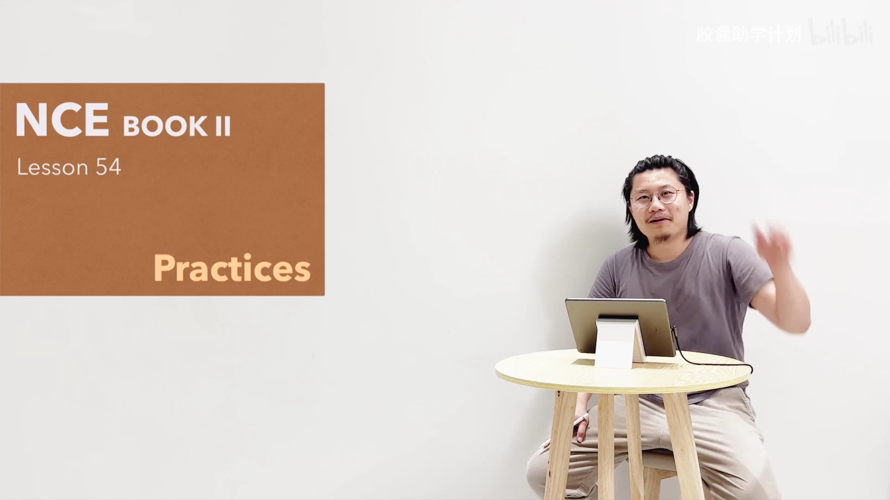

文字识别：NCE / BOOKII / Lesson 54 / Practices

### 画面 00:00:02

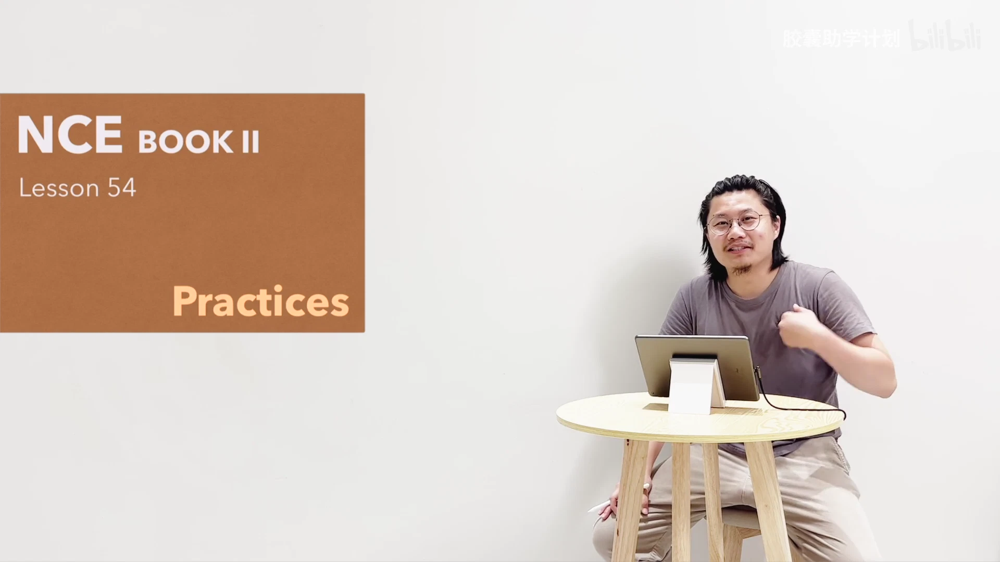

文字识别：NCE / BOOKII / Lesson 54 / Practices

### 画面 00:00:05

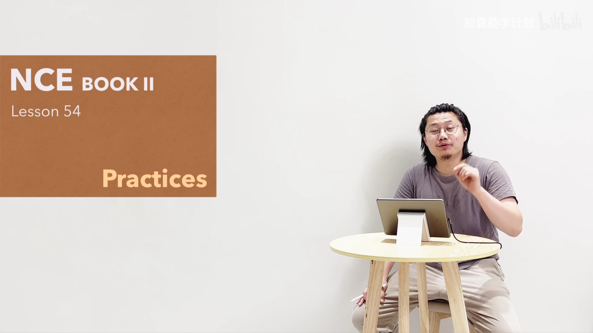

文字识别：NCE / BOOKII / Lesson 54 / Practices

### 画面 00:00:09

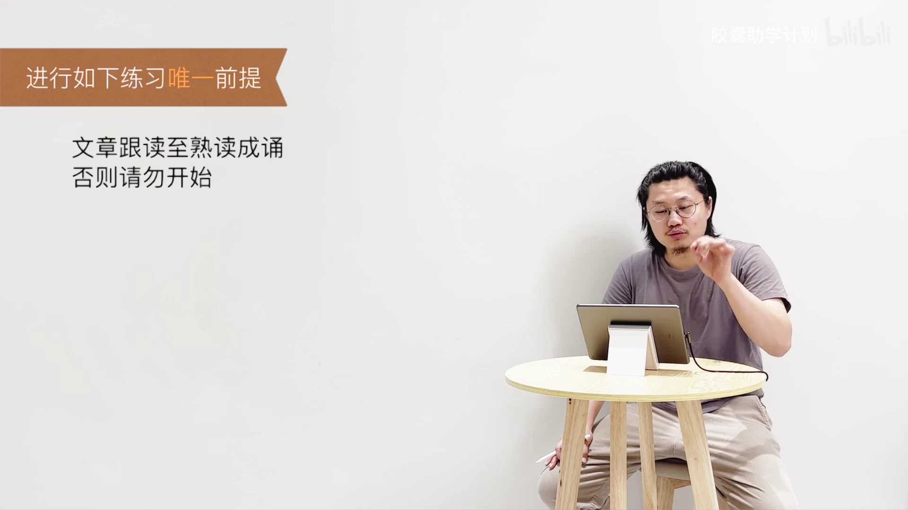

文字识别：进行如下练习唯一前提 / 文章跟读至熟读成诵 / 否则请勿开始

### 画面 00:00:15

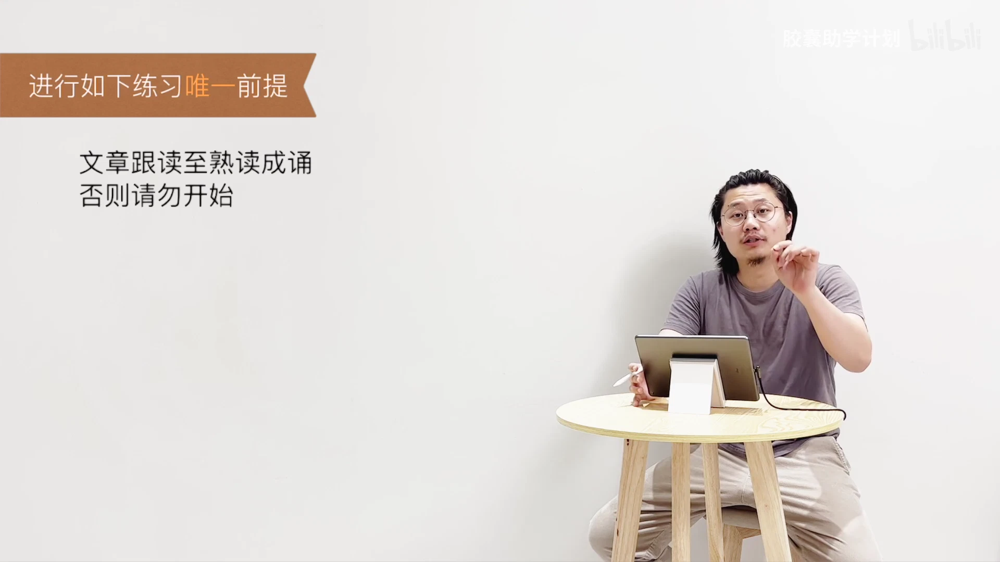

文字识别：进行如下练习唯一前提 / 文章跟读至熟读成诵 / 否则请勿开始

### 画面 00:00:18

文字识别：胶囊助学计划 bilbl / •

### 画面 00:00:22

### 画面 00:00:24

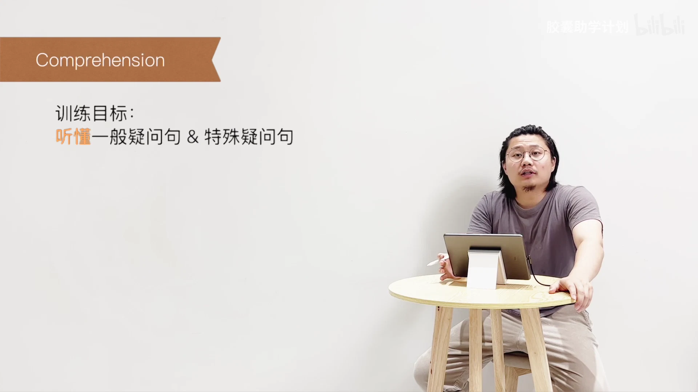

文字识别：Comprehension / 训练目标： / 听懂一般疑问句＆特殊疑问句

## 00:00:30–00:01:00

问题啊，呃，我问您答来了啊。听力口语练习五，您听，然后用口语回答我。可以看着原文找啊。来了第一题，Where did you send the children？答案To school。Next one，Had you all had breakfast？Yes，we had。Next one，Where did you go then？To the shops。Next

### 画面 00:00:31

文字识别：Comprehension / Where did you send the children?

### 画面 00:00:59

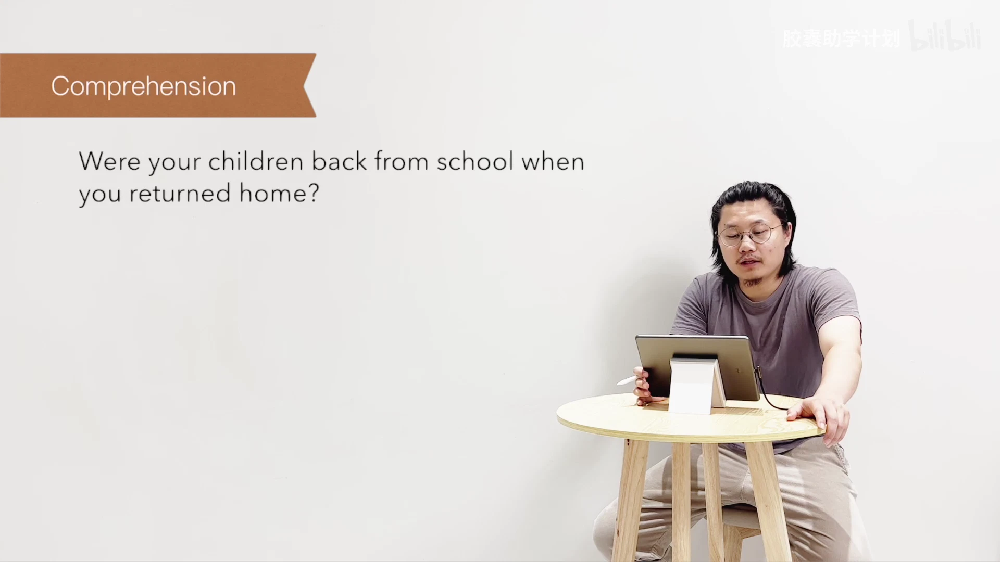

文字识别：Comprehension / Were your children back from school when / you returned home?

## 00:01:00–00:01:30

were your children back from school when you returned home? No, they weren't. Next one, where was your husband at work? Next one, the house was quiet, wasn't it? Wasn't it? Yes, it was. Next one, what did you decide to do? To make some meat pies.

### 画面 00:01:08

文字识别：Comprehension / Where was your husband?

## 00:01:30–00:02:00

Next one, what were you soon busy doing? Mixing butter and flour. Next one, when did the phone ring? When my hands were covered with sticky pastry. Next one, were you hands clean or sticky? Sticky. Next one, who was on the phone?

### 画面 00:01:38

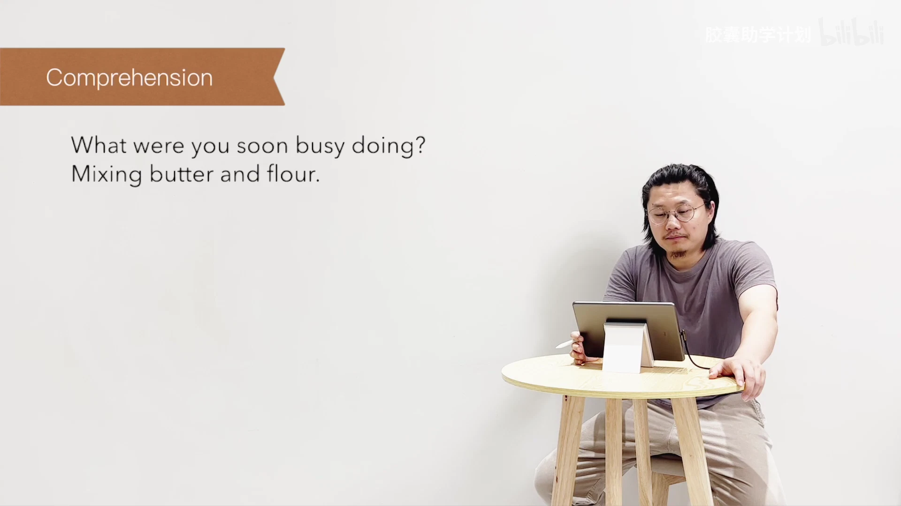

文字识别：Comprehension / What were you soon busy doing? / Mixing butter and flour.

### 画面 00:01:43

文字识别：Comprehension / When did the phone ring? / When my hands were covered with sticky pastry.

### 画面 00:01:49

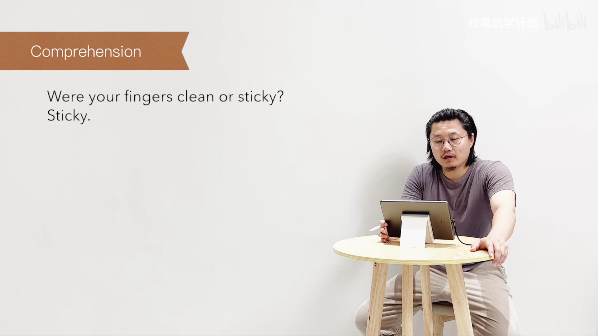

文字识别：Comprehension / Were your fingers clean or sticky? / Sticky.

## 00:02:00–00:02:30

Helen Bates. Next one, were you pleased to hear her voice? No, I wasn't. Next one, how long did it take you to persuade her to ring back? Ten minutes. Next one, why was there a mess? There was pastry on my fingers

### 画面 00:02:19

文字识别：Comprehension / How long did it take you to persuade her to ring back?

### 画面 00:02:26

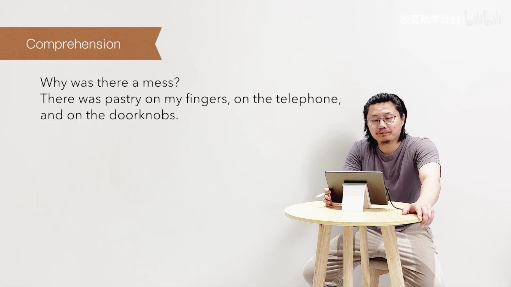

文字识别：Comprehension / Why was there a mess? / There was pastry on my fingers, on the telephone, / and on the doorknobs.

## 00:02:30–00:03:00

on the telephone, and on the door knobs. Asking questions, 对吧？练习的我们叫做会说一般疑问句和特殊疑问句的能力啊。OK，这个准确度非常重要，流利性慢慢来啊。所以这道题，我们先看说 I sent the children to school after breakfast. 肯定是 D 的题，先动词换回原形，对吧？然后问呢，那肯定对 after breakfast 提问，然后 When did you send the children to

### 画面 00:02:34

文字识别：Asking questions

### 画面 00:02:38

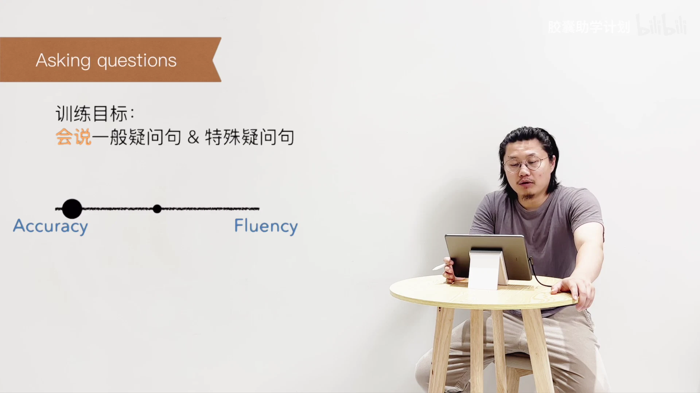

文字识别：Asking questions / 训练目标： / 会说一般疑问句＆特殊疑问句 / Accuracy / Fluency

### 画面 00:02:48

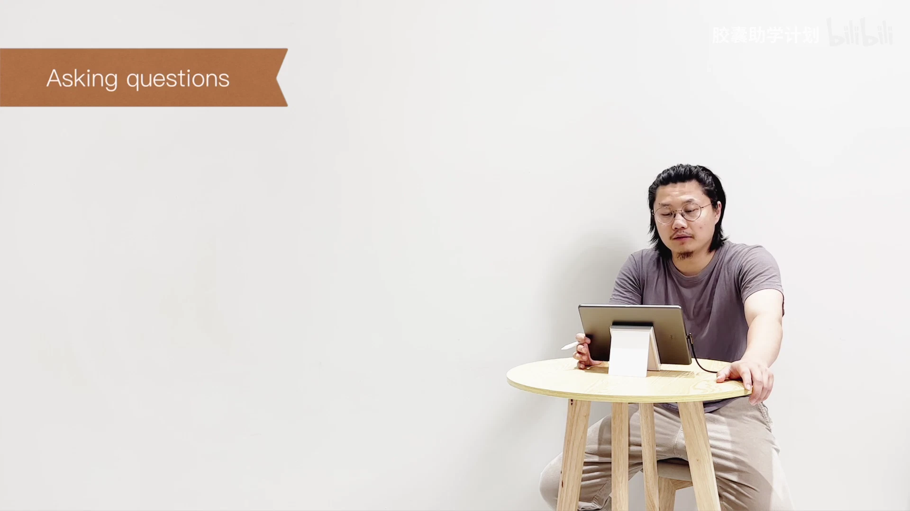

文字识别：Asking questions

### 画面 00:02:51

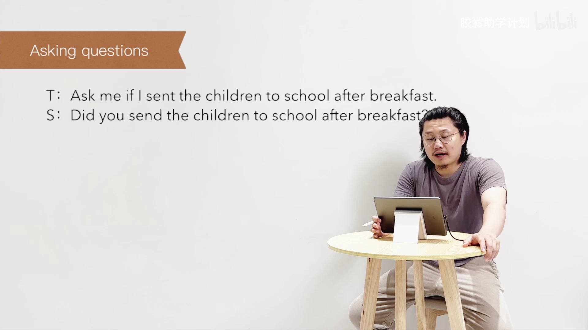

文字识别：Asking questions / T: Ask me if I sent the children to school after breakfast. / S: Did you send the children to school after breakfast2

## 00:03:00–00:03:30

school? 啊，好，那我们看 where where 肯定是对 to school 提问，对吧？好，说 I went to the shops, did 提前 where 对 to the shops 提问，然后 when 呢对整句话提问，那就是说呃 when did you go to the shops? Okay, 下一个 it was too early when I returned home. 注意这里貌似好像是可以提 was 也可以提 did，对吧？但是注意我们不提从句的 when I returned home 是从句时间状语从句，对吧？我

### 画面 00:03:01

文字识别：Asking questions / 1.I sent the children to school after breakfast. / (When)(Where)

### 画面 00:03:16

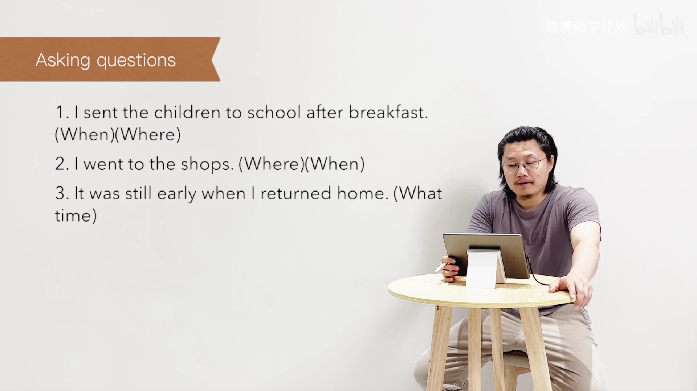

文字识别：Asking questions / 1.I sent the children to school after breakfast. / (When)(Where) / 2.I went to the shops.(Where)(When) / 3. It was still early when I returned home. (What / time)

## 00:03:30–00:04:00

们只提主句的，所以这句话的答案叫 Was it still early when you returned home? Okay. That what time? 什么时候？你想一下，这里谁是什么时候？对吧？Okay. My children were at school. Were提前，who对主语提问，where对at school提问，对吧？Where were you, children? 呃，下一道题跟这道题一模一样了。My husband was at work. 没区别啊。

### 画面 00:03:46

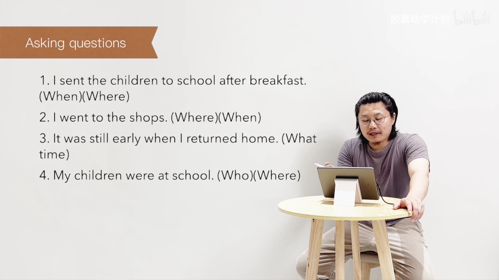

文字识别：Asking questions / 1.I sent the children to school after breakfast. / (When)(Where) / 2.I went to the shops. (Where)(When) / 3. It was still early when I returned home. (What / time) / 4. My children were at school. (Who)(Where)

### 画面 00:03:59

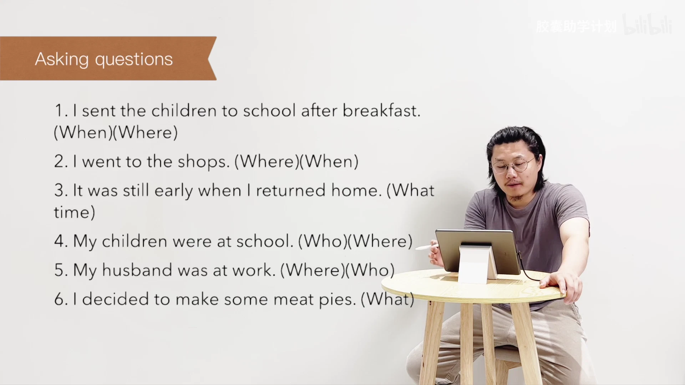

文字识别：Asking questions / 1.I sent the children to school after breakfast. / (When)(Where) / 2.I went to the shops.(Where)(When) / 3. It was still early when I returned home.(What / time) / 4. My children were at school. (Who)(Where) / 5. My husband was at work. (Where)(Who) / 6.I decided to make some meat pies. (What)

## 00:04:00–00:04:30

I decided to make some meat pies. Did的提前, what对some meat pies提问,对吧?你准备做点什么呢? Some meat pies. What did you decide to do? I mixed some butter and flour. Did的提前, what,对吧?对这儿提问啊. What did you mix?八. My hands were soon covered with sticky pastry. Were往前一提,被动嘛,对吧?那

### 画面 00:04:09

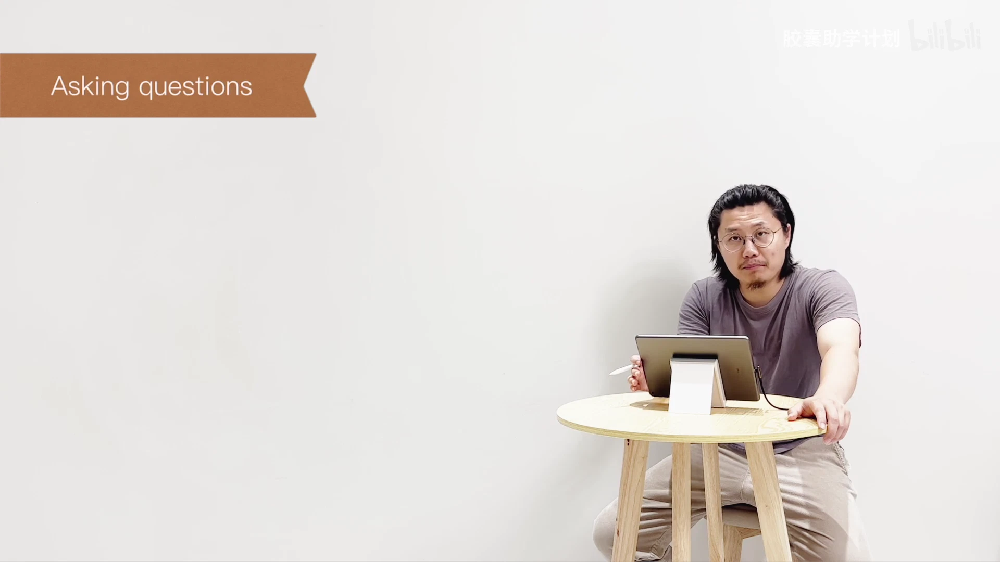

文字识别：Asking questions

### 画面 00:04:20

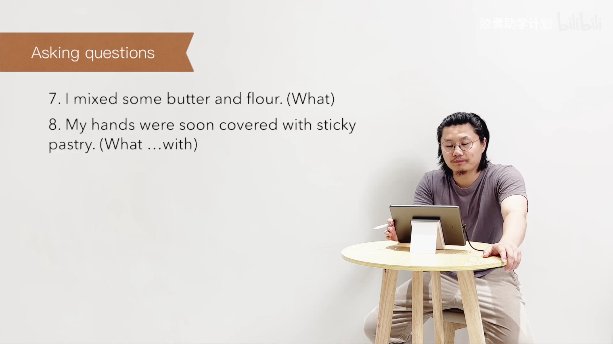

文字识别：Asking questions / 7.I mixed some butter and flour. (What) / 8. My hands were soon covered with sticky / pastry. (What ...with)

## 00:04:30–00:05:00

what 点点 with，其实 what 对就对 sticky pastry 提问就行了。所以答案是 what were your hands soon covered with？啊， what were your hands soon covered with？ There you go. The telephone rang just then. Did 提前动词换原形？ When 对 just then 提问。你看 just then the telephone rang。你有没有印象这句话我们在哪一课学过？第二课是吧？ Okay, I felt extremely

### 画面 00:04:45

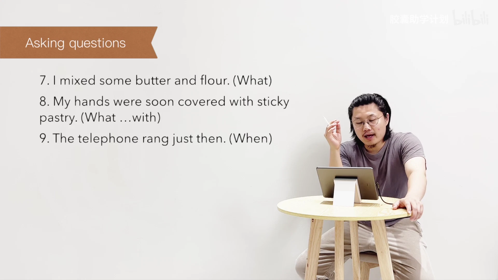

文字识别：Asking questions / 7.I mixed some butter and flour. (What) / 8. My hands were soon covered with sticky / pastry. (What ...with) / 9. The telephone rang just then. (When)

### 画面 00:04:58

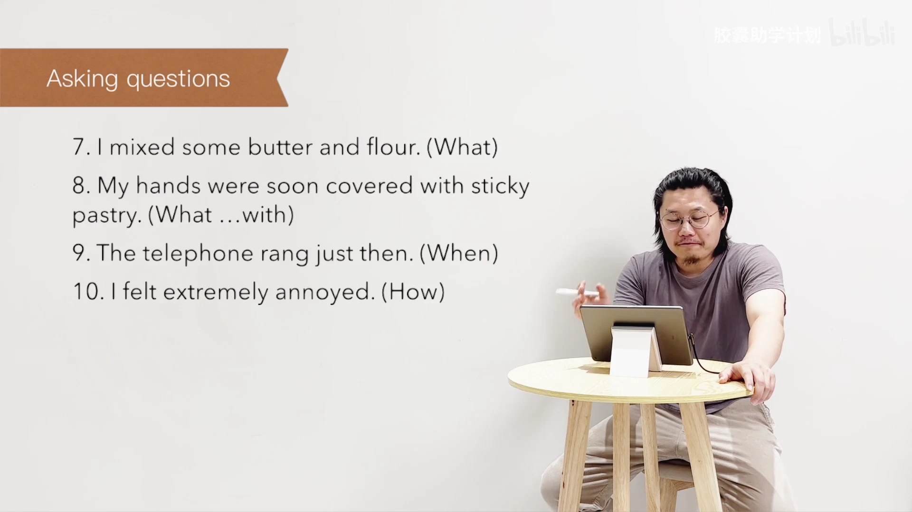

文字识别：Asking questions / 7.I mixed some butter and flour. (What) / 8. My hands were soon covered with sticky / pastry. (What ..with) / 9. The telephone rang just then. (When) / 10.I felt extremely annoyed.(How)

## 00:05:00–00:05:30

annoyed. 我感到极端的烦恼，对吧？哎，很沮丧。Did提前？How对extremely annoyed提问啊？It was Helen Bates. Was提前啊？Who was it？啊，对，你这个跟呃，我刚才说开门的那个是一样的，对吧？在我不确定对方是谁的时候，电话里也是Who is it？对吧？OK，啊，或者Who is this？Tell the story练的咱是口语复述能力，

### 画面 00:05:19

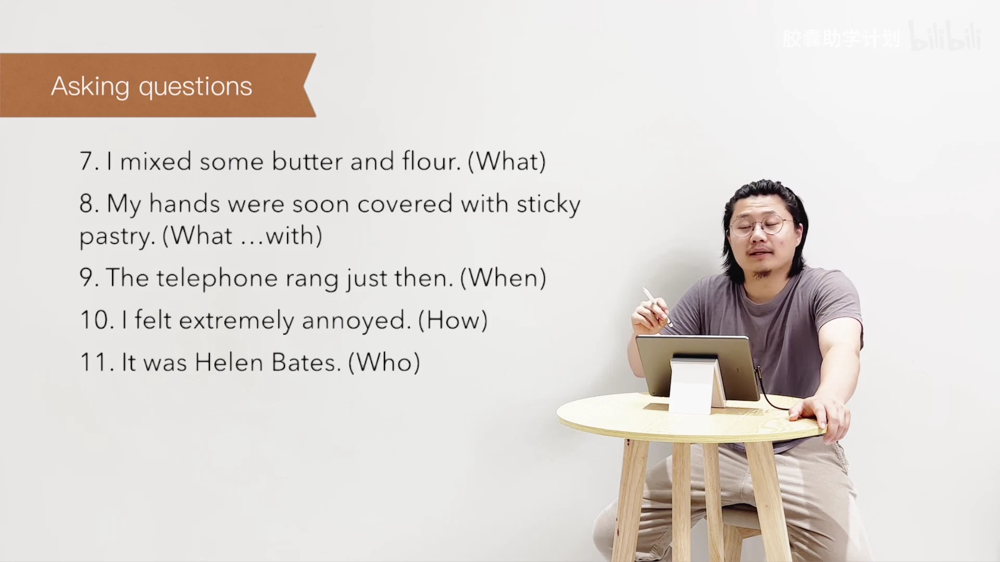

文字识别：Asking questions / 7.I mixed some butter and flour. (What) / 8. My hands were soon covered with sticky / pastry. (What ...with) / 9. The telephone rang just then.(When) / 10.I felt extremely annoyed.(How) / 11. It was Helen Bates. (Who)

### 画面 00:05:25

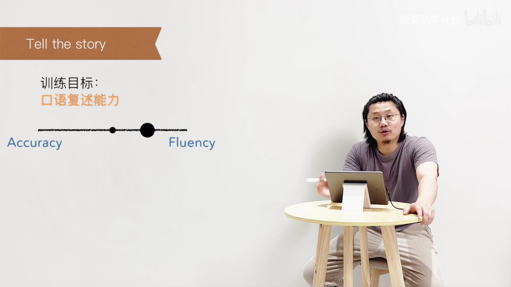

文字识别：Tell the story / 训练目标： / 口语复述能力 / Accuracy / Fluency

## 00:05:30–00:06:00

不多提。第一单元我给大家做了很多的示范，我们不挨个示范了。这一题最重要练的是fluency，看着它去做练习就好了啊。这个对于我们口语的练习帮助非常大。After breakfast, he trudged to school,是吧？等等等等。Composition是一个新的，它练习我们是连词使用的能力。您翻到教材当中会看到这道题啊，自己去仔细找一下。这是原题，叫I put the cake in the oven. I forgot

### 画面 00:05:37

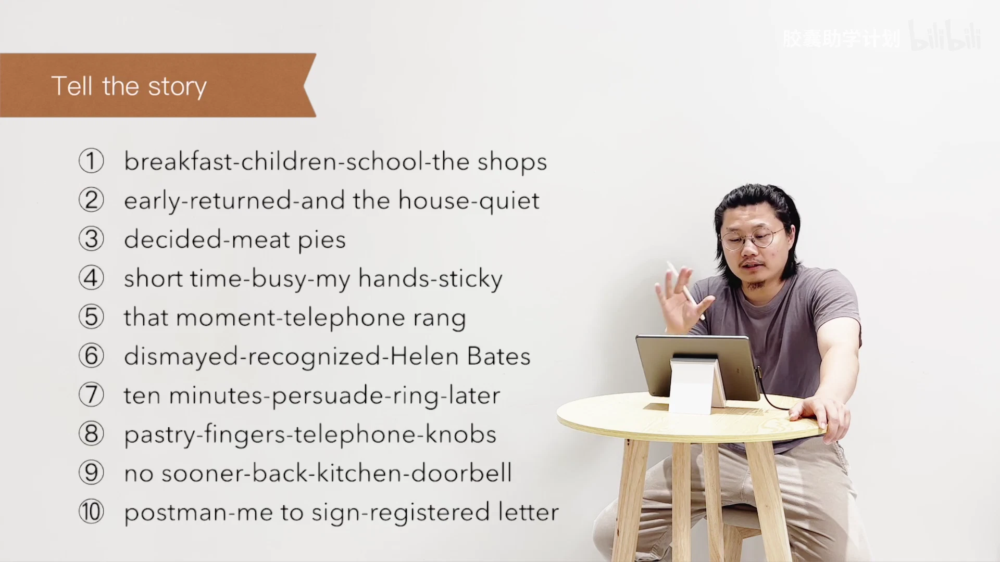

文字识别：Tell the story / ① breakfast-children-school-the shops / early-returned-and the house-quiet / 2） / decided-meat pies / short time-busy-my hands-sticky / that moment-telephone rang / dismayed-recognized-Helen Bates / ten minutes-persuade-ring-later / pastry-fingers-telephone-knobs / ) no sooner-back-kitchen-doorbell / 9 / ① postman-me to sign-registered letter

### 画面 00:05:45

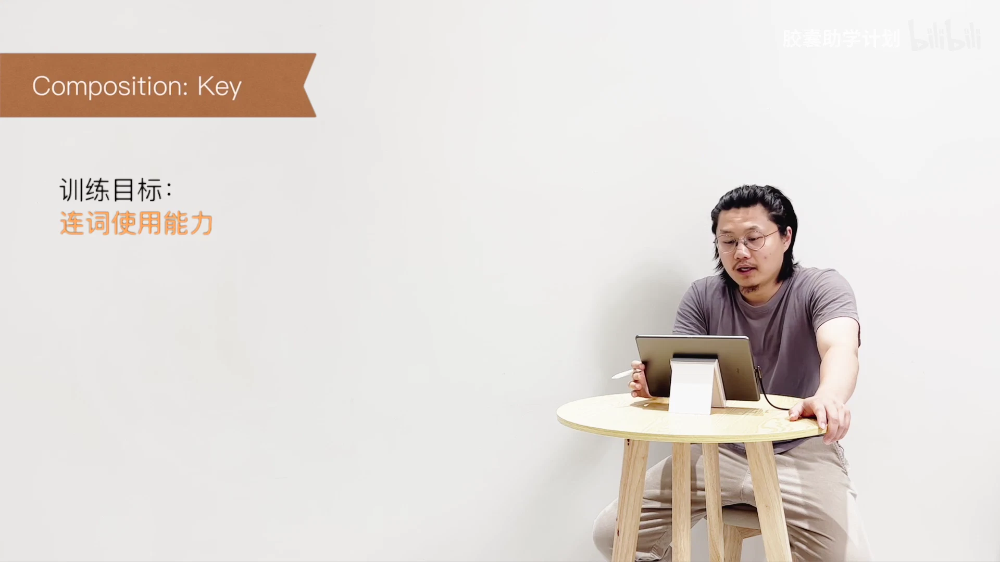

文字识别：Composition: Key / 训练目标： / 连词使用能力

### 画面 00:05:55

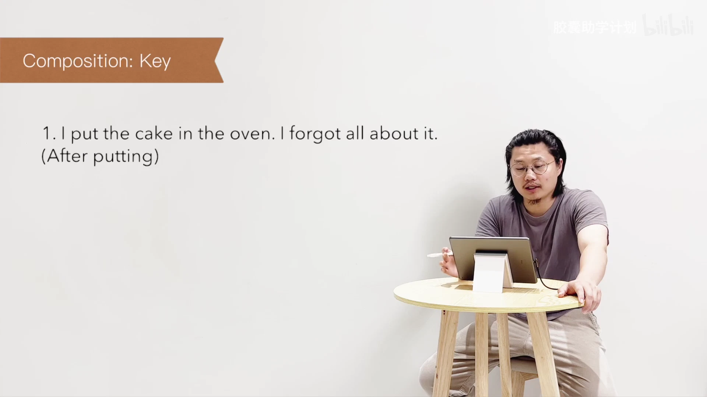

文字识别：Composition: Key / 1.I put the cake in the oven.I forgot all about it. / (After putting)

## 00:06:00–00:06:30

all about it.我把它这个面这个蛋糕放到了烤箱里面，完全给忘掉了。他想让你把这两句话看见了吧？用 after putting 给连起来。这不就是四十九课咱学的吗？我在这儿就只对一下答案，叫 after putting the cake in the oven. I forget. I forgot all about it. Okay.那这地方其实有一个前提，带你回顾一下，叫做前后主语必须要一致。

### 画面 00:06:15

文字识别：Composition: Key / 1.I put the cake in the oven.I forgot all about it. / (After puting) / After putting the cake in the oven, I forgot all / about it.

## 00:06:30–00:07:00

Two hours had passed. I smelled something burning.好了，注意when直接放在前面就特别简单了，对吧？哎，为什么选择前面呢？这是had加蛋啊。OK，再来说，I went into the kitchen. I found it full of smoke.我印象当中这是咱们三十三课一个姑娘游了一宿才上岸的那一刻学的，叫und doing something，就类似于as soon as，对吧？所以on

### 画面 00:06:31

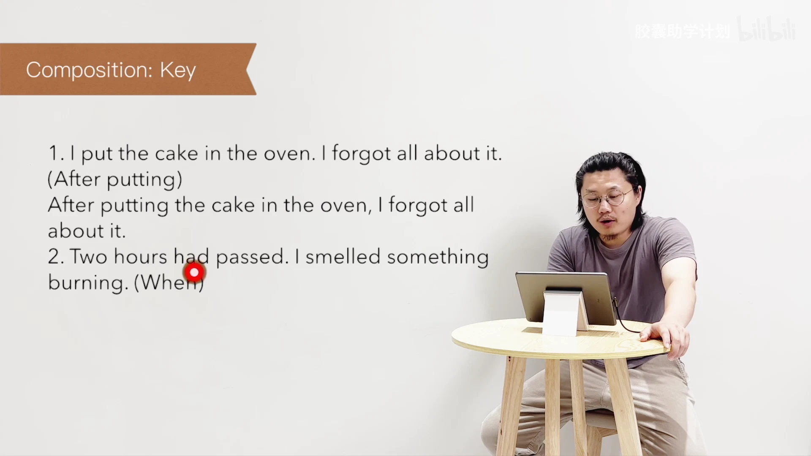

文字识别：Composition: Key / 1.I put the cake in the oven.I forgot all about it. / (After puting) / After putting the cake in the oven, I forgot all / about it. / 2. Two hours had passed.I smelled something / burning. (Whem)

### 画面 00:06:37

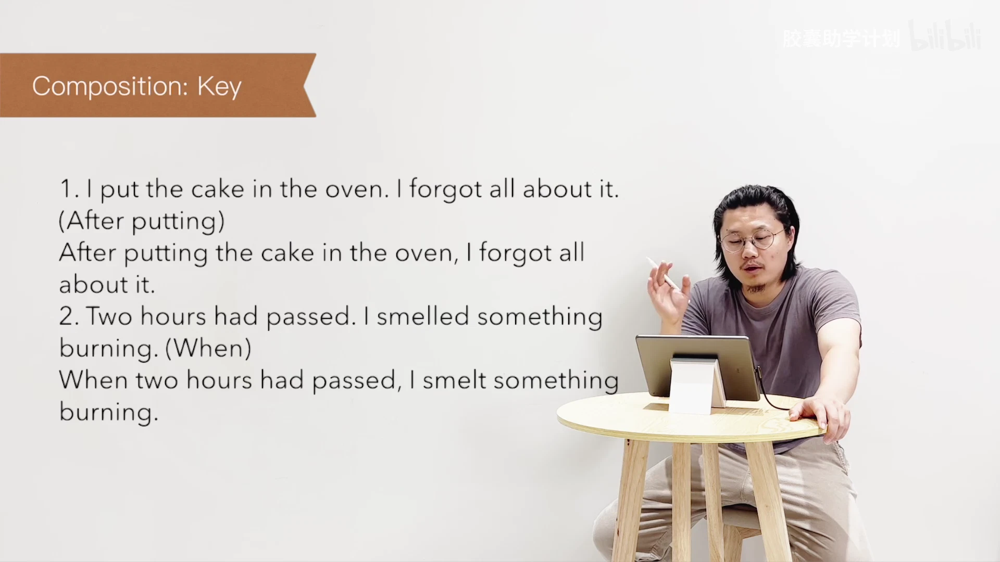

文字识别：Composition: Key / 1.I put the cake in the oven.I forgot all about it. / (After putting) / After putting the cake in the oven, I forgot all / about it. / 2. Two hours had passed.I smelled something / burning.(When) / When two hours had passed, I smelt something / burning.

### 画面 00:06:59

文字识别：Composition: Key / 1.I put the cake in the oven.I forgot all about it. / (After putting) / After putting the cake in the oven, I forgot all / about it. / 2. Two hours had passed.I smelled something / burning.(When) / When two hours had passed, I smelt something / burning. / 3.I went into the kitchen.I found it full of smoke.! / (On going) / On going into the kitchen, I found it full of smoke

## 00:07:00–00:07:30

going into the kitchen, I found it full of smoke.说,我一进入这个厨房就发现里面全是烟。再说一遍,这道题啊,这个题在我们的教材里边能找得到答案,是我给您的,对吧？OK啊,在这道题一定要去练一下啊,练的是我们连词的使用能力。Summary writing就没什么说的了,写完来这对答案啊。呃,我们进入第三单元了之后,会有越来越多的你能看到

### 画面 00:07:20

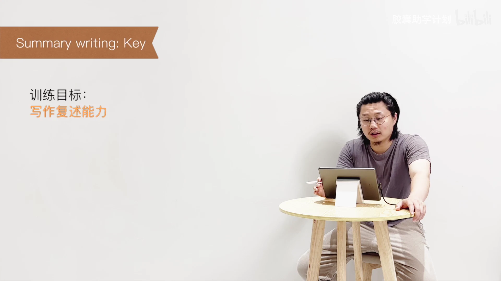

文字识别：Summary writing: Key / 训练目标： / 写作复述能力

### 画面 00:07:23

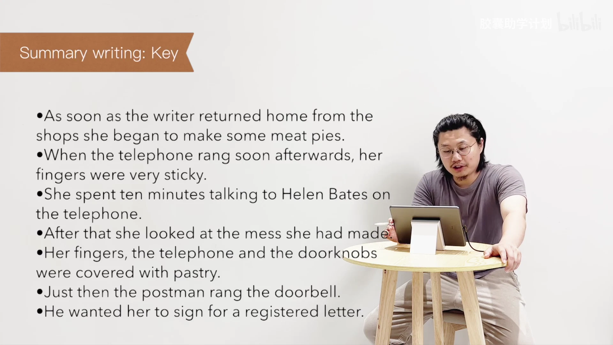

文字识别：Summary writing: Key / •As soon as the writer returned home from the / shops she began to make some meat pies. / •When the telephone rang soon afterwards, her / fingers were very sticky. / •She spent ten minutes talking to Helen Bates on / the telephone. / •After that she looked at the mess she had made / •Her fingers, the telephone and the doorknobs / were covered with pastry. / •Just then the postman rang the doorbell. / •He wanted her to sign for a registered letter.

## 00:07:30–00:08:00

这样的连词，对吧？越来越多的这样的一些啊呃，当然这不是连词啊，越来越多的一些连词出来，对吧？好，topic for discussion. 我们老习惯，我只说题，你有能力就可以随时开始了。Describe how you would bake a cake, make one of your favorite dishes. 你描述一下如何，比如说这个烤个面包，烤个蛋糕啊，或者做你最喜欢的菜，

### 画面 00:07:38

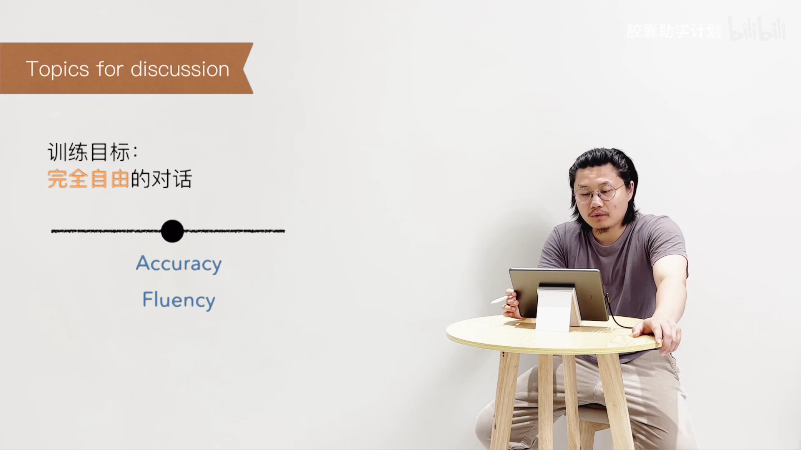

文字识别：Topics for discussion / 训练目标： / 完全自由的对话 / Accuracy / Fluency

### 画面 00:07:41

文字识别：Topics for discussion / Describe how you would bake a cake/ / make one of your favourite dishes. / Do you enjoy visiting the shops? / Describe a typical shopping day. / It is possible that in future we shall be / 3 / able to see, as well as hear people when / we use the telephone. Do you think this / is a good idea? Why/Why not?

## 00:08:00–00:08:30

描述一下怎么做，是吧？说 Do you enjoy visiting the shops? Describe a typical shopping day. 说你喜欢逛商店吗？描述一个特别典型的购物日。 It is possible that in future we shall be able to see as well as hear people when we used telephone. Do you think this is a good idea? Why? Why not? 我们已经 in the future 了，对吧？哈，他说在未来说，我们去打电话的时候，

### 画面 00:08:08

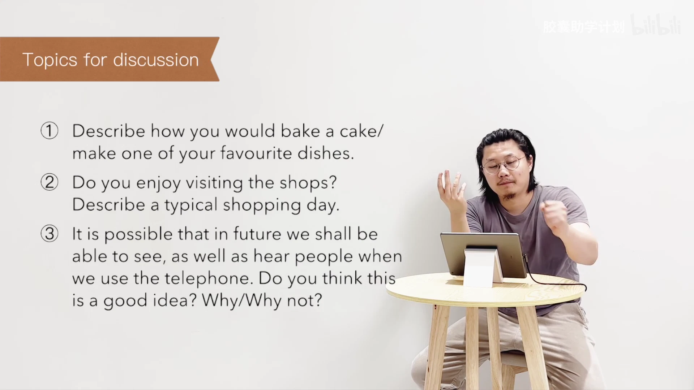

文字识别：Topics for discussion / Describe how you would bake a cake/ / make one of your favourite dishes. / Do you enjoy visiting the shops? / Describe a typical shopping day. / It is possible that in future we shall be / 3 / able to see, as well as hear people when / we use the telephone. Do you think this / is a good idea? Why/Why not?

### 画面 00:08:10

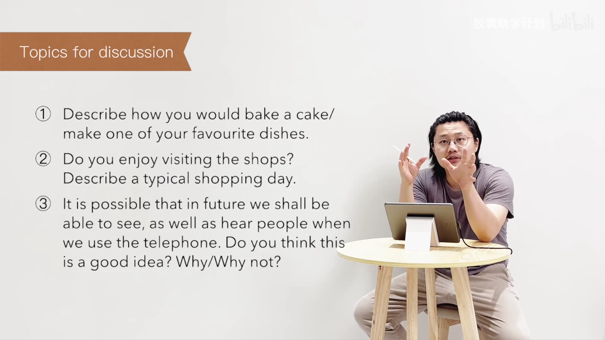

文字识别：Topics for discussion / Describe how you would bake a cake/ / make one of your favourite dishes. / Do you enjoy visiting the shops? / Describe a typical shopping day. / It is possible that in future we shall be / 3 / able to see, as well as hear people when / we use the telephone. Do you think this / is a good idea? Why/Why not?

### 画面 00:08:13

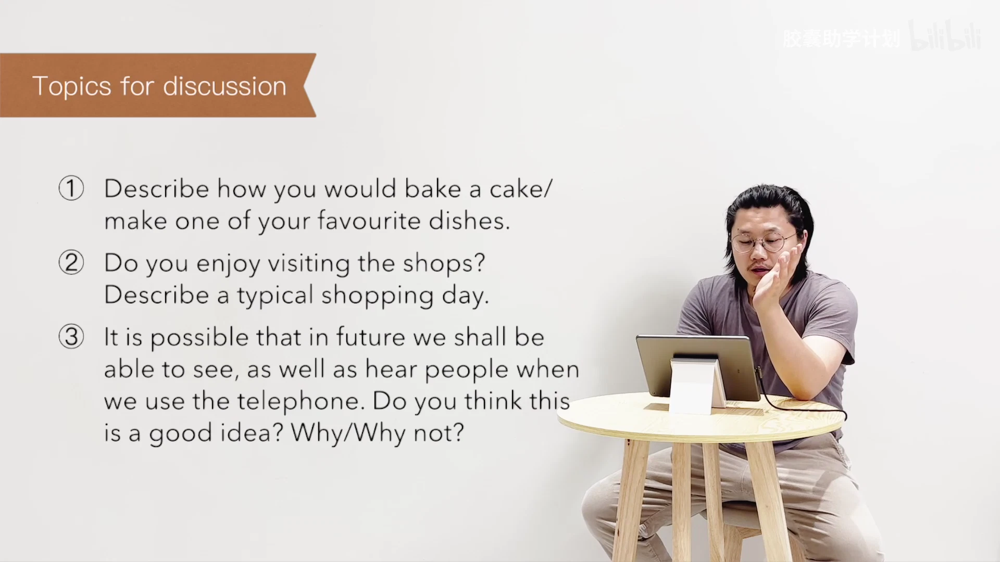

文字识别：Topics for discussion / Describe how you would bake a cake/ / make one of your favourite dishes. / Do you enjoy visiting the shops? / Describe a typical shopping day. / It is possible that in future we shall be / 3 / able to see, as well as hear people when / we use the telephone. Do you think this / is a good idea? Why/Why not?

### 画面 00:08:15

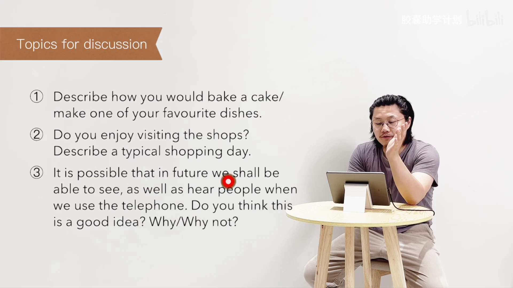

文字识别：Topics for discussion / Describe how you would bake a cake/ / make one of your favourite dishes. / Do you enjoy visiting the shops? / Describe a typical shopping day. / It is possible that in future we shall be / 3 / able to see, as well as hear people when / we use the telephone. Do you think this / is a good idea? Why/Why not?

## 00:08:30–00:09:00

可能不仅能看到对方啊，能看到对方，也能听到对方，对吧？这个我们现在已经实现了，对不对？打电话的时候，你认为这是个好主意吗？好还是不好？OK，好，不多说了。家庭作业：Ask me if，先写，保证正确，大声朗读。Journal写作，写完对答案。Tell the story，口语复述。Composition练习连词的写法。最后一个，看置顶留言，能找到重复间隔这

### 画面 00:08:43

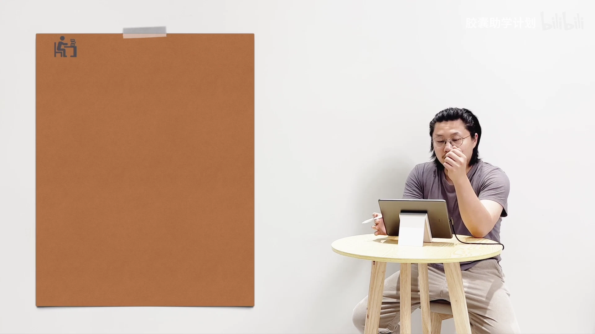

### 画面 00:08:45

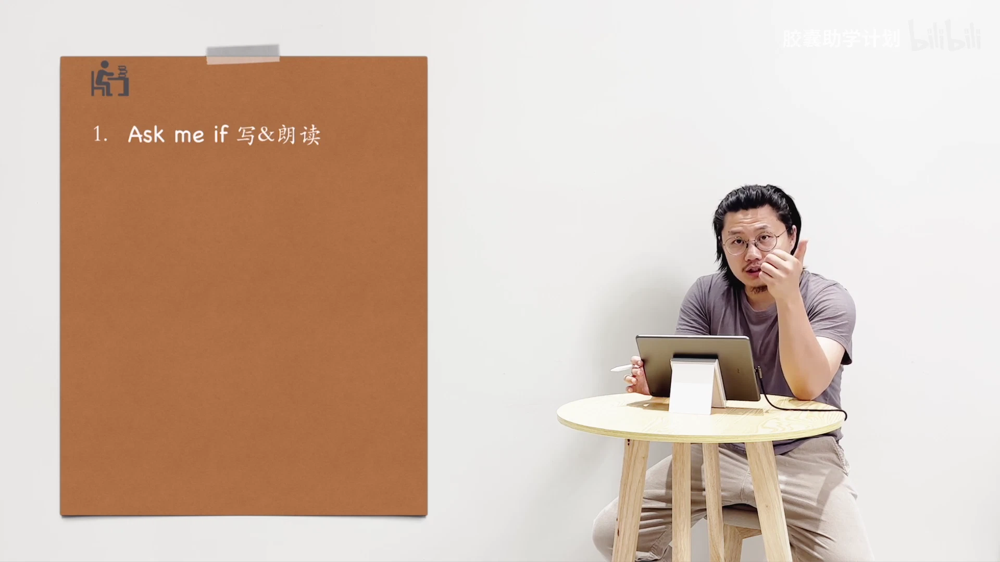

文字识别：1.Ask me if写&朗读

### 画面 00:08:47

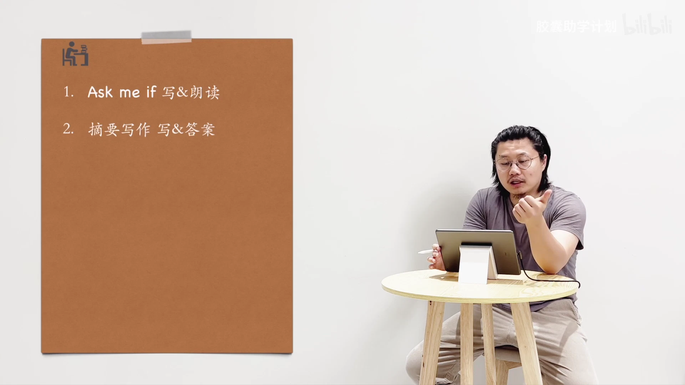

文字识别：1.Ask me if写&朗读 / 2. / 摘要写作写&答案

### 画面 00:08:50

文字识别：1.Ask me if写&朗读 / 摘要写作写&答案 / 3.Tell the story 口语复述

### 画面 00:08:52

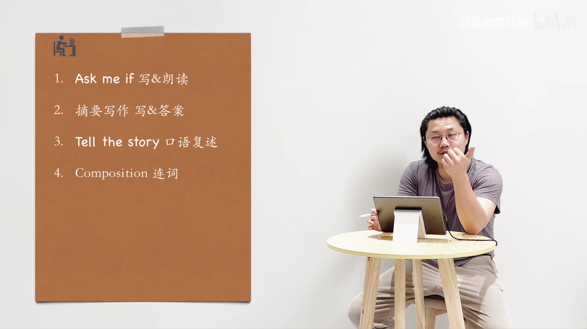

文字识别：1.Ask me if写&朗读 / 摘要写作写&答案 / 3.Tell the story 口语复述 / Composition连词 / 4.

### 画面 00:08:55

文字识别：1.Ask me if写&朗读 / 摘要写作写&答案 / 3.Tell the story 口语复述 / Composition连词 / 5.重复间隔（置顶留言）

### 画面 00:08:57

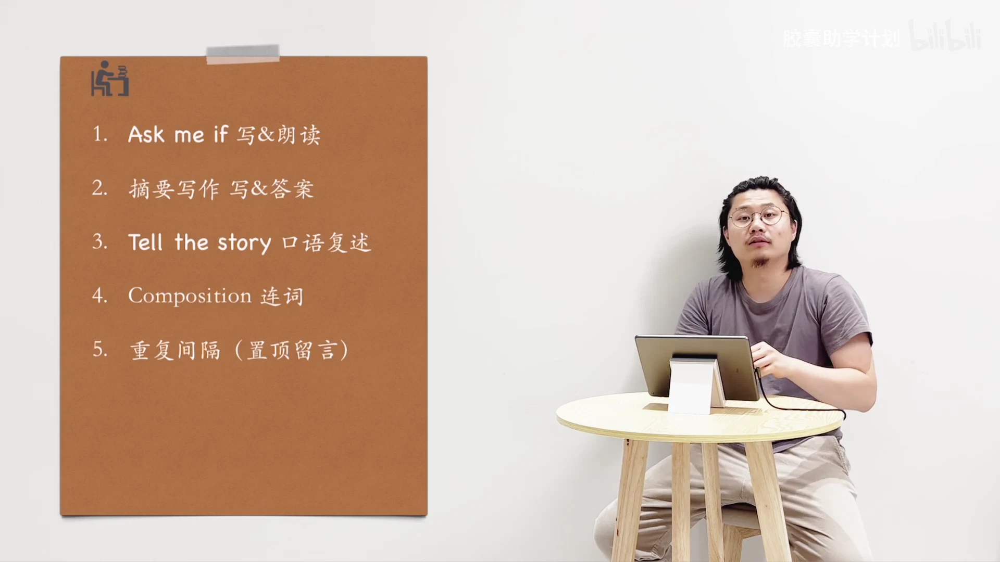

文字识别：1.Ask me if写&朗读 / 摘要写作写&答案 / 3.Tell the story 口语复述 / Composition连词 / 5.重复间隔（置顶留言）

### 画面 00:08:59

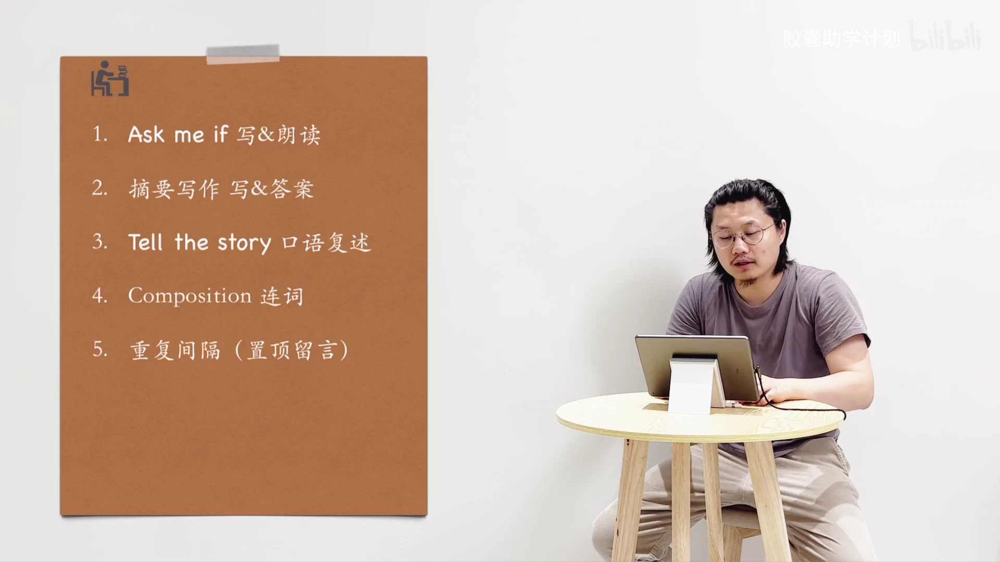

文字识别：1.Ask me if写&朗读 / 摘要写作写&答案 / 3.Tell the story 口语复述 / Composition连词 / 4. / 5.重复间隔（置顶留言）

## 00:09:00–00:09:28

些练习的内容。OK，那以上呢就是本期视频的全部内容了。如果各位喜欢我们的课程呢，欢迎各位关注、订阅、一键三连、分享给更多的朋友来帮助我们快速成长。See you next time.

### 画面 00:09:01

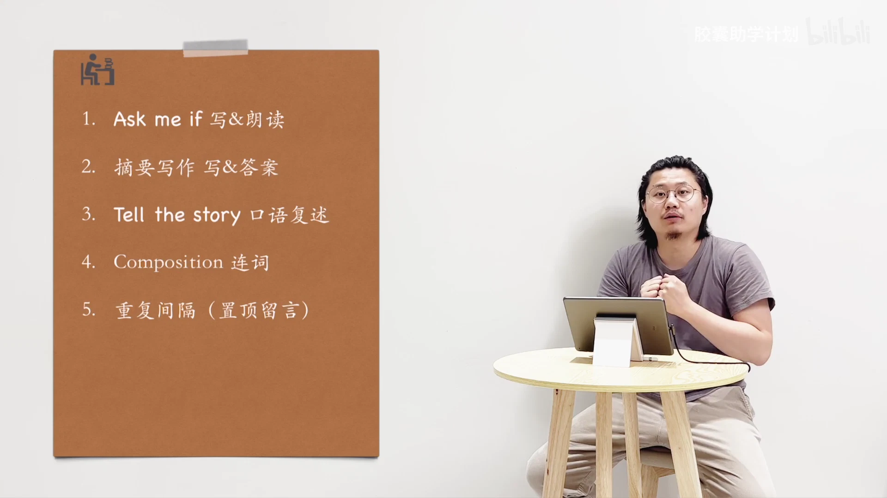

文字识别：1.Ask me if写&朗读 / 摘要写作写&答案 / 3.Tell the story 口语复述 / Composition连词 / 4. / 5.重复间隔（置顶留言）

### 画面 00:09:03

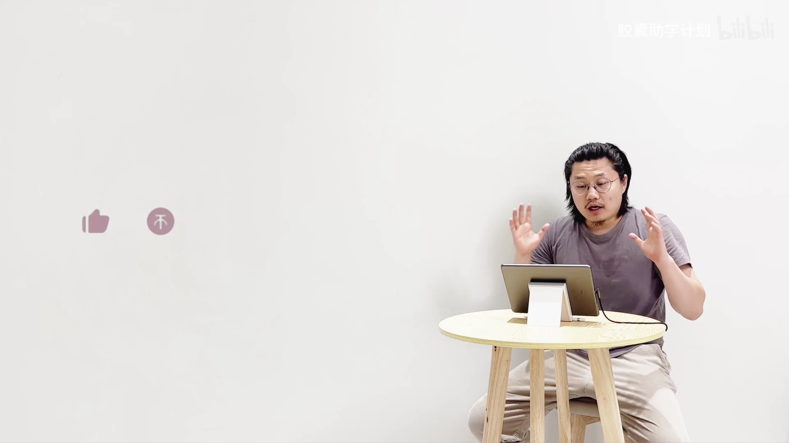

### 画面 00:09:10

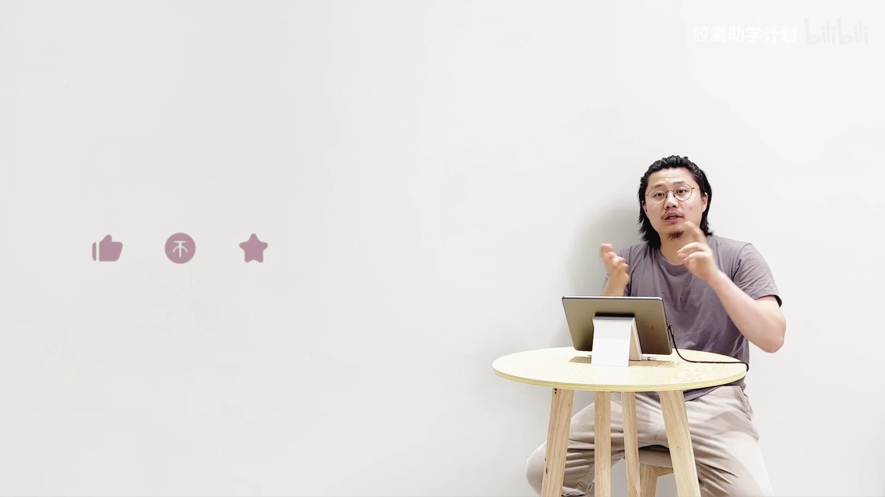

文字识别：不 / 餐

### 画面 00:09:13

### 画面 00:09:16

### 画面 00:09:18

文字识别：CAPSULEACADEMY / 胶囊助学计划 / 小红书 / Lecturer / Leo / OE

### 画面 00:09:20

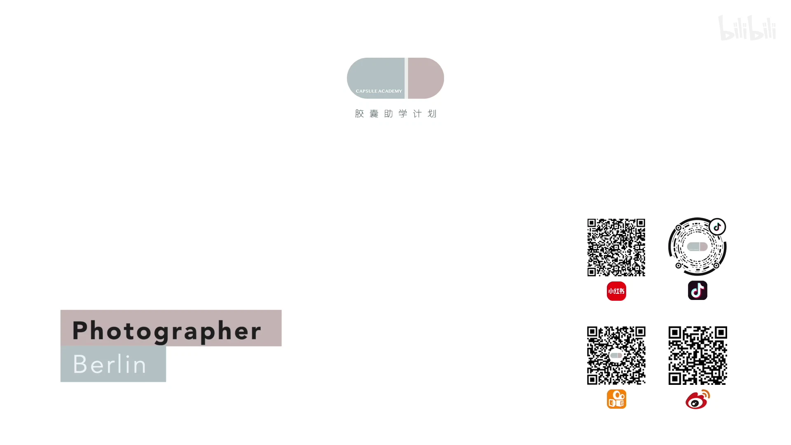

文字识别：CAPSULEACADEMY / 胶囊助学计划 / 『 / 小红书 / Photographer / Berlin / OE

### 画面 00:09:22

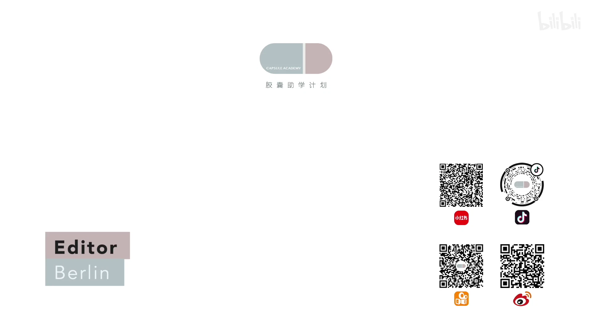

文字识别：CAPSULEACADEMY / 胶囊助学计划 / 『 / 小红书 / Editor / Berlin / OE

### 画面 00:09:25

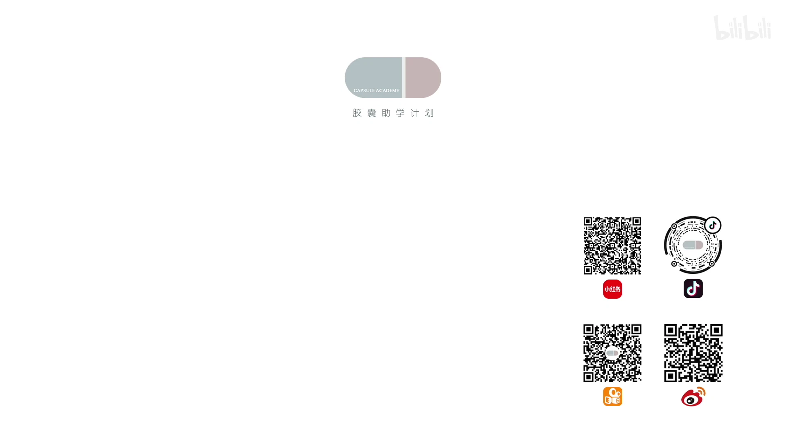

文字识别：CAPSULEACADEMY / 胶囊助学计划 / 小红书

### 画面 00:09:27

文字识别：bilibili / 胶囊助学计划

