# 055 单词

快速机器解析：语音为单模型转写，未进行独立交叉校对或人工复核；画面每秒采样并按变化选帧，短时文字和标记可能遗漏。截图时间约有 1 秒误差。图片有损压缩；遇到疑点请按时间查看 Google Drive 原视频。

## 00:00:00–00:00:30

Hello everyone, welcome to Capsule Academy. This is Leo. Today we're going to learn New Concept English Book Two Lesson Fifty Five Words. 那老习惯，咱进入正式课程之前，先看几个小的问题啊。首先，如何表达家里有矿？接下来，如何表达藏宝图？对吧？最后一个问题，如何表达错过了入口？ OK，带着这三个问题， hope you gonna enjoy it. 好，

### 画面 00:00:00

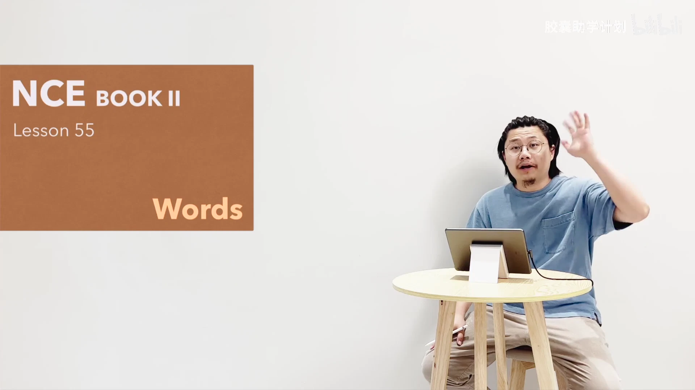

文字识别：NCE / BOOKII / Lesson 55 / Words

### 画面 00:00:02

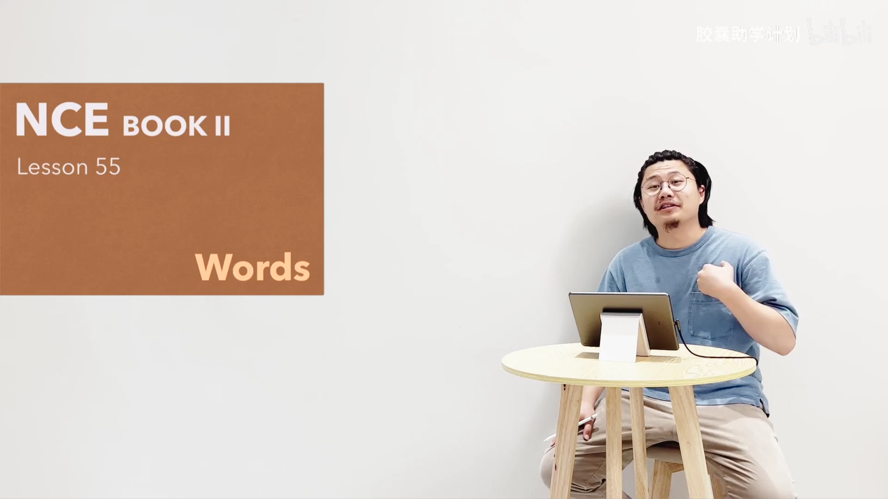

文字识别：学计划 / NCE / BOOKⅡI / Lesson 55 / Words

### 画面 00:00:04

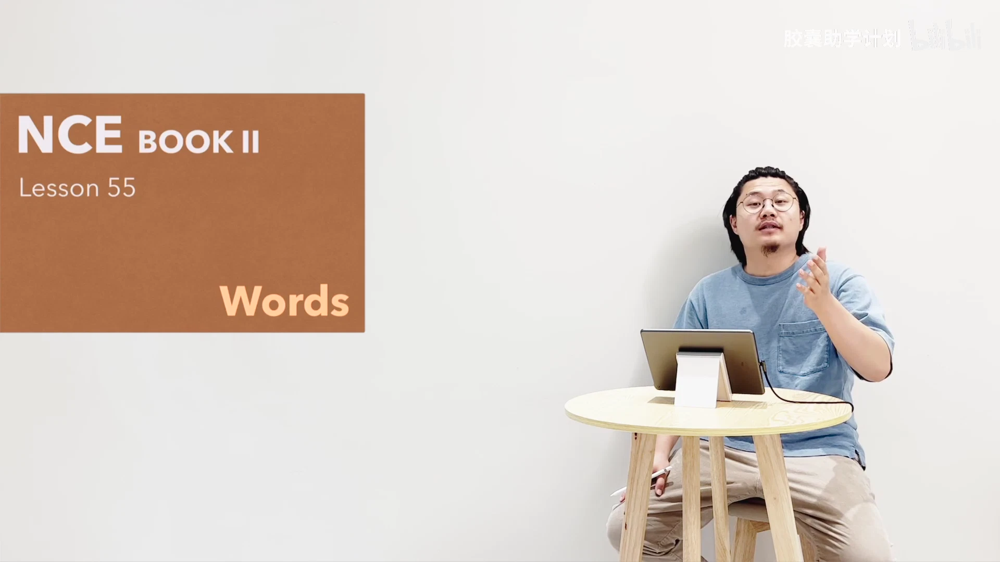

文字识别：NCE / BOOKⅡI / Lesson 55 / Words

### 画面 00:00:06

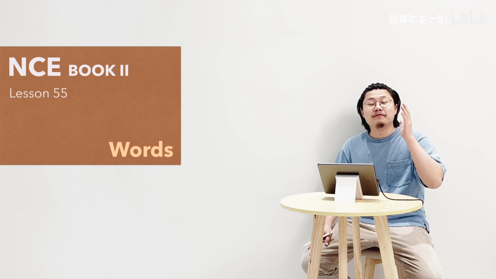

文字识别：学计划 / NCE / BOOK"I / Lesson 55 / Words

### 画面 00:00:08

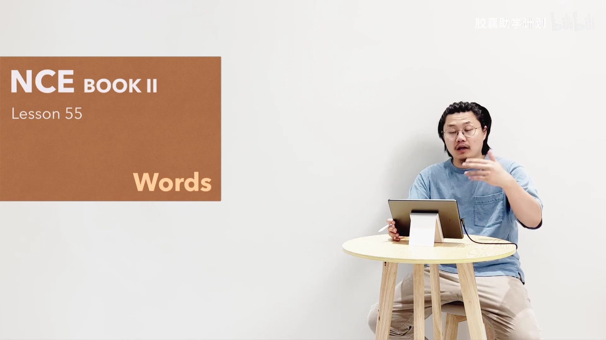

文字识别：NCE / BOOK"I / Lesson 55 / Words

### 画面 00:00:10

文字识别：助学计划一州

### 画面 00:00:12

文字识别：①如何表达“家里有矿”？

### 画面 00:00:14

文字识别：①如何表达“家里有矿”？

### 画面 00:00:16

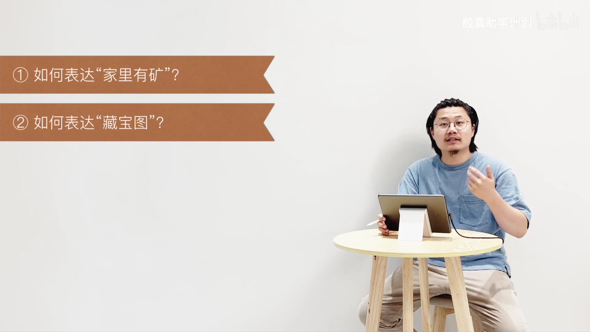

文字识别：学计划 / ①如何表达“家里有矿”？ / 如何表达“藏宝图”?

### 画面 00:00:18

文字识别：①如何表达“家里有矿”？ / 如何表达“藏宝图”? / 如何表达“错过入口”?

### 画面 00:00:20

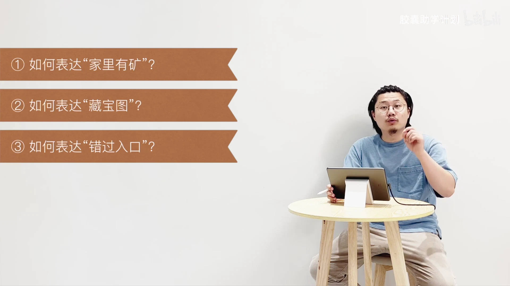

文字识别：①如何表达“家里有矿”？ / 如何表达“藏宝图 / 如何表达“错过入口”?

### 画面 00:00:22

文字识别：①如何表达“家里有矿”？ / 如何表达“藏宝图 / 如何表达“错过入口”?

### 画面 00:00:24

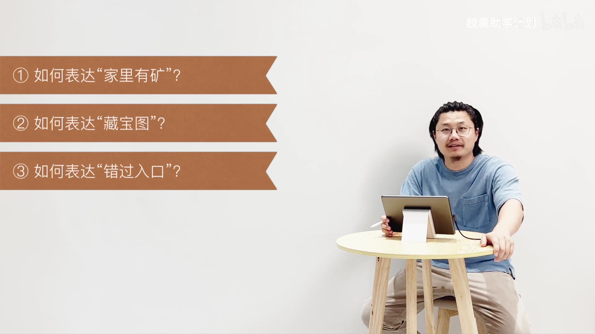

文字识别：①如何表达“家里有矿”？ / 如何表达“藏宝图 / 如何表达“错过入口”?

### 画面 00:00:26

文字识别：胶囊助学计划bil

### 画面 00:00:28

文字识别：胶囊助学计划il鼎 / 胶囊助学计划

## 00:00:30–00:01:00

我们先看两个小的单词啊，在标题当中都出现了。我们先看一下音标，第一个叫做 gold，OK，那 gold 金子啊，金子、银子的金子，OK，好，然后下一个单词叫做 mine，这个单词我们在新一就见过。您想一下，它另一个意思是什么啊？我就不多提了，各位学到今天应该是一定认识的。那在这里呢，这个 mine 它的意思指的是这个矿啊，那 gold mine 合

### 画面 00:00:30

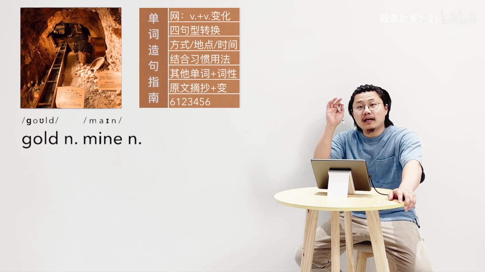

文字识别：单词造句指南 / 网：v.+v.变化 / 助学计划州 / 四句型转换 / 方式/地点/时间 / 结合习惯用法 / 其他单词+词性 / 原文摘抄+变 / 6123456 / /gould/ / /maIn/ / gold n. mine n.

### 画面 00:00:33

文字识别：单词造句指南 / 网：v.+v.变化 / 助学计划一 / 四句型转换 / 方式/地点/时间 / 结合习惯用法 / 其他单词+词性 / 原文摘抄+变 / 6123456 / /gould/ / /maIn/ / gold n. mine n.

### 画面 00:00:35

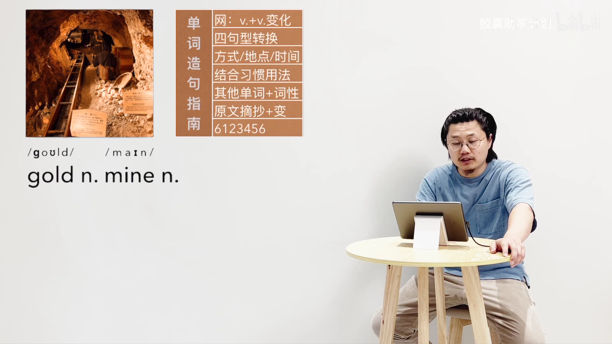

文字识别：单词造句指南 / 网：v.+v.变化 / 加学计划 / 四句型转换 / 方式/地点/时间 / 结合习惯用法 / 其他单词+词性 / 原文摘抄+变 / 6123456 / /gould/ / /maIn/ / gold n. mine n.

### 画面 00:00:40

文字识别：单词造句指南 / 网：v.+v.变化 / 学计划 / 四句型转换 / 方式/地点/时间 / 结合习惯用法 / 其他单词+词性 / 原文摘抄+变 / 6123456 / /gould/ / /maIn/ / gold n. mine n.

### 画面 00:00:44

文字识别：单词造句指南 / 网：v.+v.变化 / 功学计划 / 心 / 四句型转换 / 方式/地点/时间 / 结合习惯用法 / 其他单词+词性 / 原文摘抄+变 / 6123456 / /gould/ / /maIn/ / gold n. mine n.

### 画面 00:00:46

文字识别：单词造句指南 / 网：v.+v.变化 / 助学计划 / 四句型转换 / 方式/地点/时间 / 结合习惯用法 / 其他单词+词性 / 原文摘抄+变 / 6123456 / /gould/ / /maIn/ / gold n. mine n.

### 画面 00:00:50

文字识别：单词造句指南 / 网：v.+v.变化 / 助学计划一 / 四句型转换 / 方式/地点/时间 / 结合习惯用法 / 其他单词+词性 / 原文摘抄+变 / 6123456 / /gould/ / /maIn/ / gold n. mine n.

### 画面 00:00:53

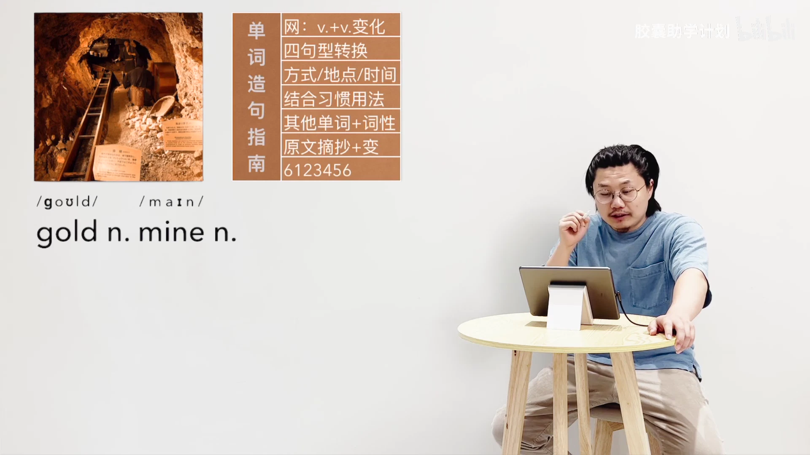

文字识别：单词造句指南 / 网：v.+v.变化 / 助学计划！ / 四句型转换 / 方式/地点/时间 / 结合习惯用法 / 其他单词+词性 / 原文摘抄+变 / 6123456 / /gould/ / /maIn/ / gold n. mine n.

### 画面 00:00:55

文字识别：单词造句指南 / 网：v.+v.变化 / 助学计划 / 四句型转换 / 方式/地点/时间 / 结合习惯用法 / 其他单词+词性 / 原文摘抄+变 / 6123456 / /gould/ / /maIn/ / gold n. mine n.

## 00:01:00–00:01:30

起来的意思就是金矿啊。我们所谓家里有矿的那个矿已经出来了，叫做 gold mine. Okay. 好，那接下来我跟它比较常见的搭配啊，这个是我们在学习过程当中必须要学会的，叫做 own，对吧？Okay. 啊，什么动词经常跟这个哎两个名词放到一起的这个小的短语在一起用呢？叫做 own，叫做拥有。好，比如说说 they love money. 啊，这是泰坦尼克号里边我印象特别深

### 画面 00:01:00

文字识别：单词造句指南 / 网：v.+v.变化 / 功学计划 / 四句型转换 / 方式/地点/时间 / 结合习惯用法 / 其他单词+词性 / 原文摘抄+变 / 6123456 / /gould/ / /maIn/ / gold n. mine n.

### 画面 00:01:05

文字识别：单词造句指南 / 网：v.+v.变化 / 助学计划一州 / 四句型转换 / 方式/地点/时间 / 结合习惯用法 / 其他单词+词性 / 原文摘抄+变 / 6123456 / /gould/ / /maIn/ / gold n. mine n.

### 画面 00:01:10

文字识别：单词造句指南 / 网：v.+v.变化 / 助学计划一州 / 四句型转换 / 方式/地点/时间 / 结合习惯用法 / 其他单词+词性 / 原文摘抄+变 / 6123456 / /gould/ / /maIn/ / gold n. mine n. / ① own + a gold mine

### 画面 00:01:16

文字识别：单词造句指南 / 网：v.+v.变化 / 助学计划 / 四句型转换 / 方式/地点/时间 / 结合习惯用法 / 其他单词+词性 / 原文摘抄+变 / 6123456 / /gould/ / /maIn/ / gold n. mine n. / ① own + a gold mine

### 画面 00:01:19

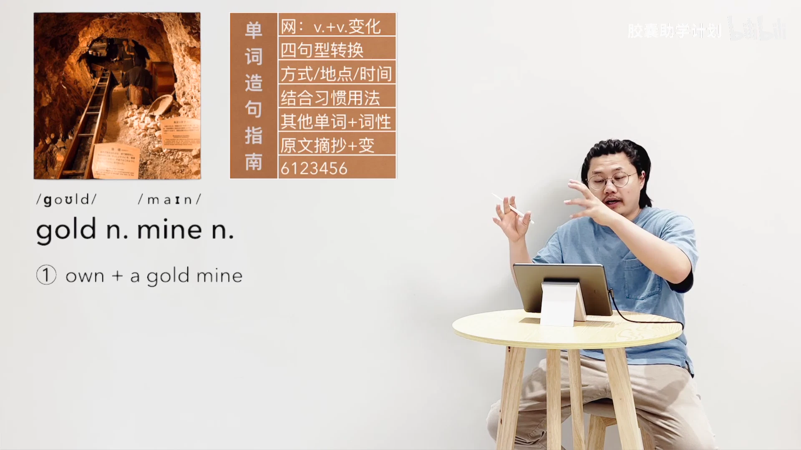

文字识别：单词造句指南 / 网：v.+v.变化 / 功学计划 / 四句型转换 / 方式/地点/时间 / 结合习惯用法 / 其他单词+词性 / 原文摘抄+变 / 6123456 / /gould/ / /maIn/ / gold n. mine n. / ① own + a gold mine

### 画面 00:01:21

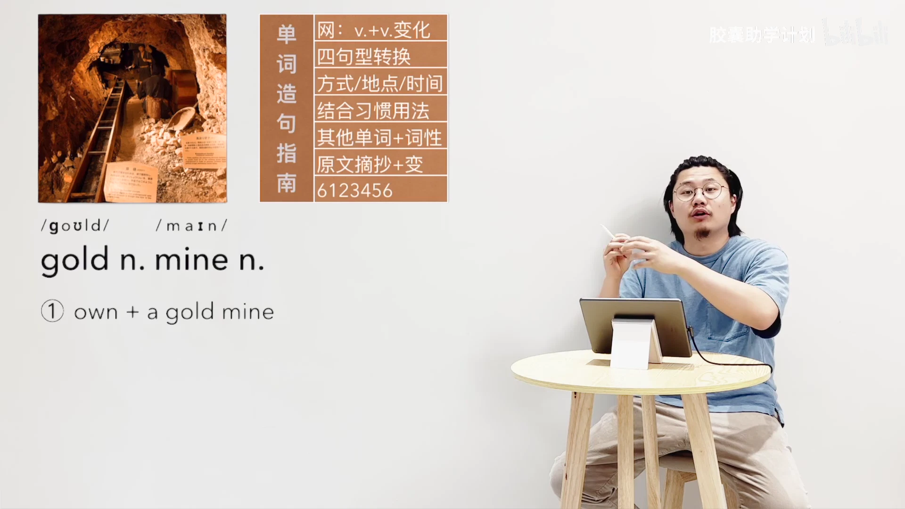

文字识别：单词造句指南 / 网：v.+v.变化 / 功学计划 / 四句型转换 / 方式/地点/时间 / 结合习惯用法 / 其他单词+词性 / 原文摘抄+变 / 6123456 / /gould/ / /maIn/ / gold n. mine n. / ① / own + a gold mine

### 画面 00:01:25

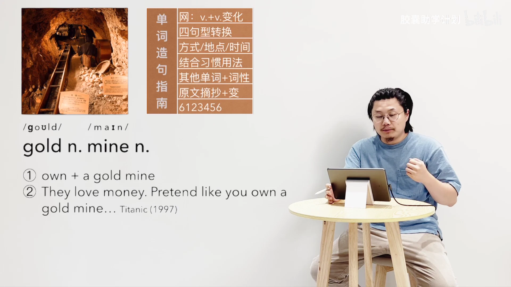

文字识别：单词造句指南 / 网：v.+v.变化 / 幼学计划 / 四句型转换 / 方式/地点/时间 / 结合习惯用法 / 其他单词+词性 / 原文摘抄+变 / 6123456 / /gould/ / /maIn/ / gold n. mine n. / ① own + a gold mine / They love money. Pretend like you own a / 2 / gold mine... Titanic(1997)

### 画面 00:01:27

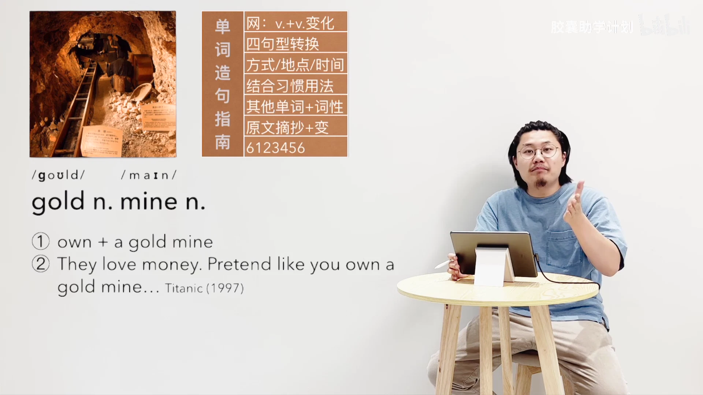

文字识别：单词造句指南 / 网：v.+v.变化 / 加学计划 / 四句型转换 / 方式/地点/时间 / 结合习惯用法 / 其他单词+词性 / 原文摘抄+变 / 6123456 / /gould/ / /maIn/ / gold n. mine n. / ① own + a gold mine / They love money. Pretend like you own a / 2） / gold mine... Titanic(1997)

## 00:01:30–00:02:00

深的一句台词，找来正好给大家看一下，叫做 They love money. 啊，说他们爱钱。 Pretend like you own a gold mine. 说假，哎，就是你要装作啊，表现的就像是什么呢？你拥有一个金矿一样。哎，所以告诉各位，这个 own 和 gold mine 是可以连到一起去用的啊。接下来呢，咱们造一个特别简单的句子，叫 I own a gold mine，就所谓家里有矿啊的一个很朴

### 画面 00:01:30

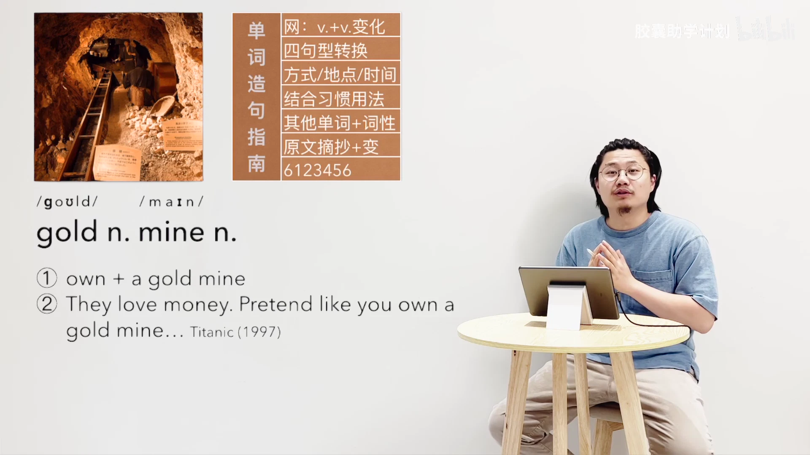

文字识别：单词造句指南 / 网：v.+v.变化 / 幼学计划 / 四句型转换 / 方式/地点/时间 / 结合习惯用法 / 其他单词+词性 / 原文摘抄+变 / 6123456 / /gould/ / /maIn/ / gold n. mine n. / ① own + a gold mine / They love money. Pretend like you own a / gold mine... Titanic(1997)

### 画面 00:01:35

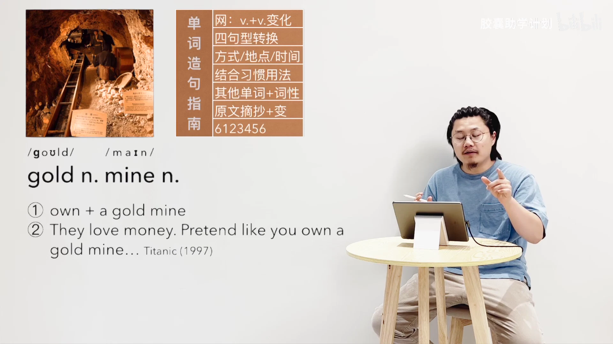

文字识别：单词造句指南 / 网：v.+v.变化 / 助学计划 / 四句型转换 / 方式/地点/时间 / 结合习惯用法 / 其他单词+词性 / 原文摘抄+变 / 6123456 / /gould/ / /main/ / gold n. mine n. / ① own + a gold mine / They love money. Pretend like you own a / gold mine... Titanic(1997)

### 画面 00:01:40

文字识别：单词造句指南 / 网：v.+v.变化 / 助学计划 / 四句型转换 / 方式/地点/时间 / 结合习惯用法 / 其他单词+词性 / 原文摘抄+变 / 6123456 / /gould/ / /maIn/ / gold n. mine n. / ① own + a gold mine / They love money. Pretend like you own a / gold mine... Titanic(1997)

### 画面 00:01:43

文字识别：单词造句指南 / 网：v.+v.变化 / 助学计划 / 四句型转换 / 方式/地点/时间 / 结合习惯用法 / 其他单词+词性 / 原文摘抄+变 / 6123456 / /gould/ / /maIn/ / gold n. mine n. / ① own + a gold mine / They love money. Pretend like you own a / gold mine... Titanic(1997)

### 画面 00:01:45

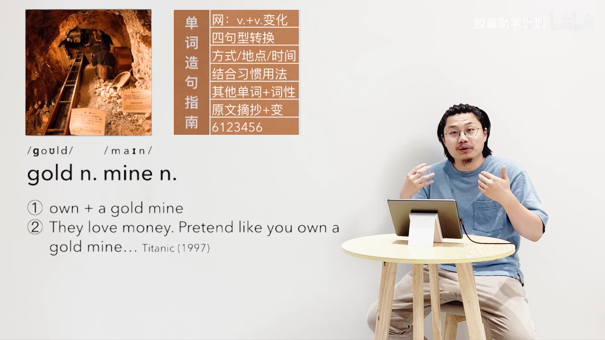

文字识别：单词造句指南 / 网：v.+v.变化 / 助学计划 / 四句型转换 / 方式/地点/时间 / 结合习惯用法 / 其他单词+词性 / 原文摘抄+变 / 6123456 / /gould/ / /main/ / gold n. mine n. / ① own + a gold mine / They love money. Pretend like you own a / gold mine... Titanic(1997)

### 画面 00:01:49

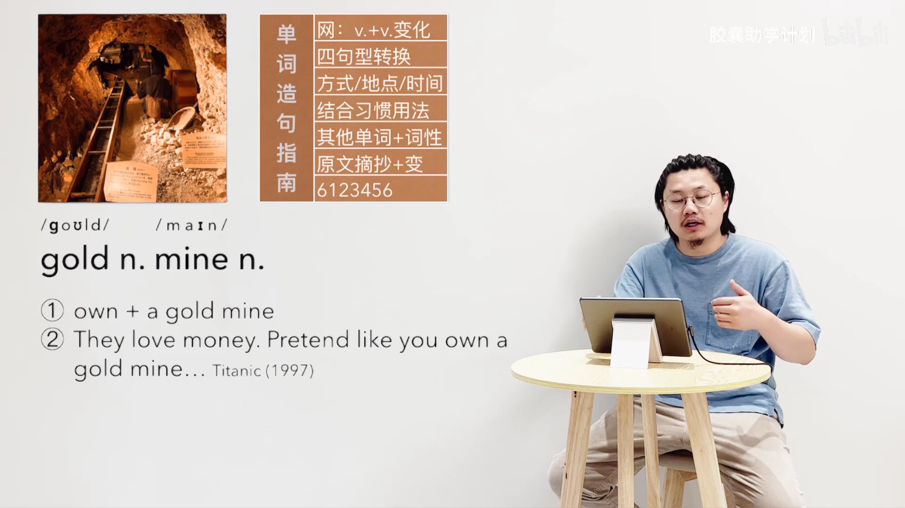

文字识别：单词造句指南 / 网：v.+v.变化 / 幼学计划 / 四句型转换 / 方式/地点/时间 / 结合习惯用法 / 其他单词+词性 / 原文摘抄+变 / 6123456 / /gould/ / /maIn/ / gold n. mine n. / ① own + a gold mine / They love money. Pretend like you own a / gold mine... Titanic(1997)

### 画面 00:01:52

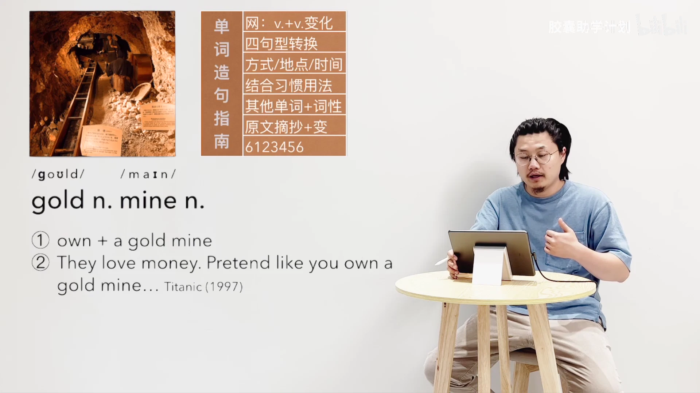

文字识别：单词造句指南 / 网：v.+v.变化 / 助学计划 / 四句型转换 / 方式/地点/时间 / 结合习惯用法 / 其他单词+词性 / 原文摘抄+变 / 6123456 / /gould/ / /maIn/ / gold n. mine n. / ① own + a gold mine / They love money. Pretend like you own a / gold mine... Titanic(1997)

### 画面 00:01:55

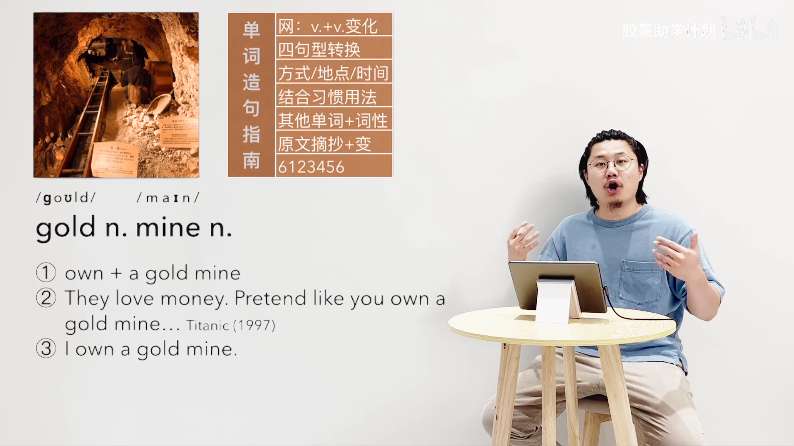

文字识别：单词造句指南 / 网：v.+v.变化 / 助字计划 / 四句型转换 / 方式/地点/时间 / 结合习惯用法 / 其他单词+词性 / 原文摘抄+变 / 6123456 / /gould/ / /maIn/ / gold n. mine n. / ① own + a gold mine / They love money. Pretend like you own a / gold mine... Titanic(1997) / ③ I own a gold mine.

## 00:02:00–00:02:30

素的表达叫做 I own a gold mine. I is literally, is吧，是真正字面意思上，就我真的家里有一个金矿。那我们把它做一个小的改变，叫 Do you own a gold mine? 就很简单，叫做你有金矿吗？对吧？OK。其次，你是不是还可以做一些四句型的转换啊？那在这里我们主要是四句型的转换，单词造句。OK，好，这个地方要记住。再读一遍这个单词 gold mine. Very good.

### 画面 00:02:01

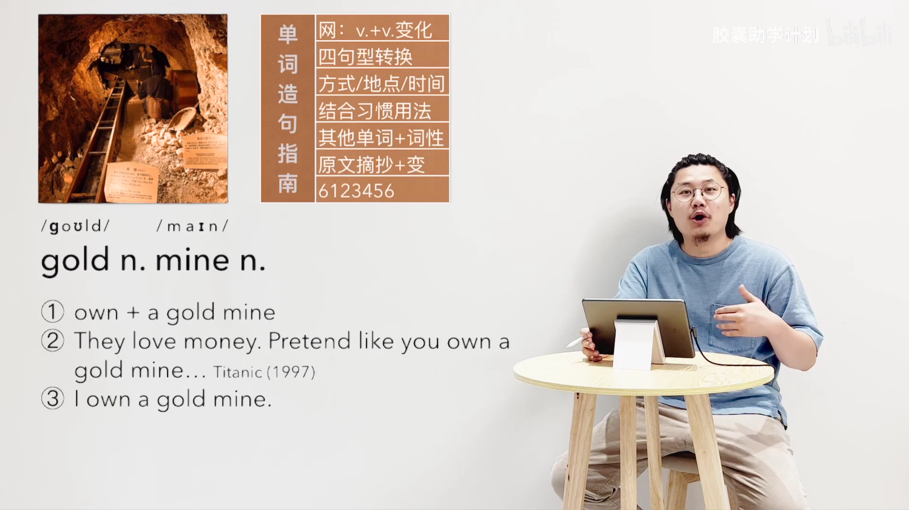

文字识别：单词造句指南 / 网：v.+v.变化 / 力字计划 / 四句型转换 / 方式/地点/时间 / 结合习惯用法 / 其他单词+词性 / 原文摘抄+变 / 6123456 / /gould/ / /maIn/ / gold n. mine n. / ① own + a gold mine / They love money. Pretend like you own a / gold mine... Titanic(1997) / ③ Iown a gold mine.

### 画面 00:02:05

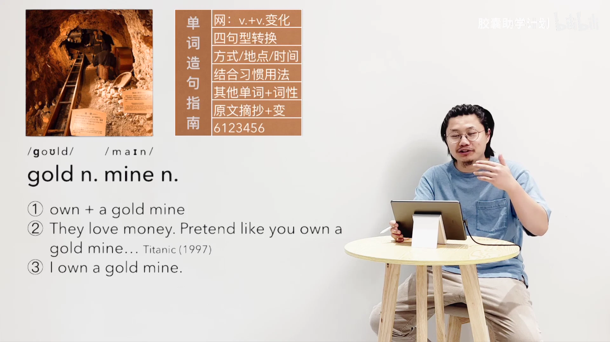

文字识别：单词造句指南 / 网：v.+v.变化 / 助学计划 / 四句型转换 / 方式/地点/时间 / 结合习惯用法 / 其他单词+词性 / 原文摘抄+变 / 6123456 / /gould/ / /maIn/ / gold n. mine n. / ① own + a gold mine / They love money. Pretend like you own a / gold mine... Titanic(1997) / ③ Iown a gold mine.

### 画面 00:02:08

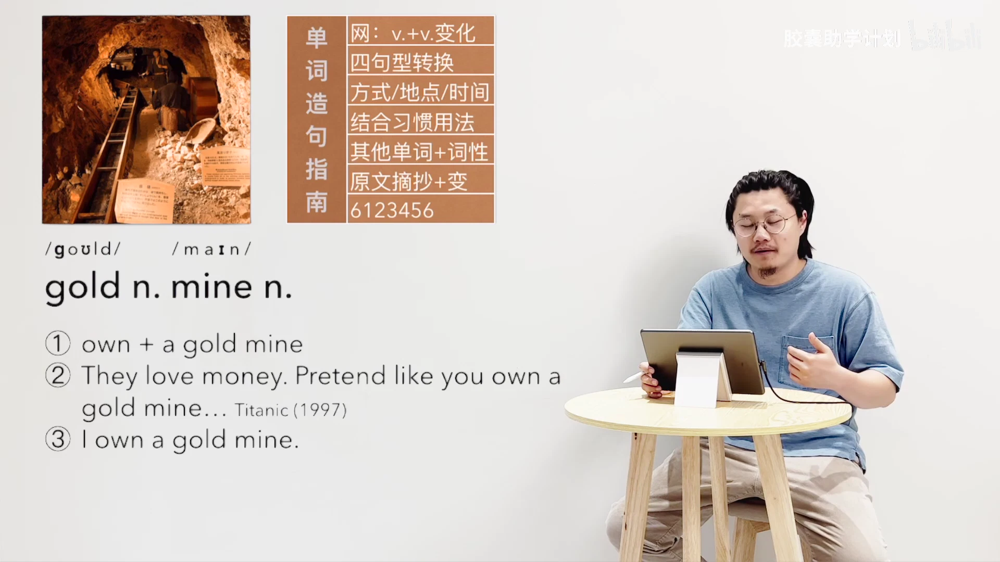

文字识别：单词造句指南 / 网：v.+v.变化 / 助学计划 / 四句型转换 / 方式/地点/时间 / 结合习惯用法 / 其他单词+词性 / 原文摘抄+变 / 6123456 / /gould/ / /maIn/ / gold n. mine n. / ① own + a gold mine / They love money. Pretend like you own a / 2 / gold mine... Titanic(1997) / ③ Iown a gold mine.

### 画面 00:02:10

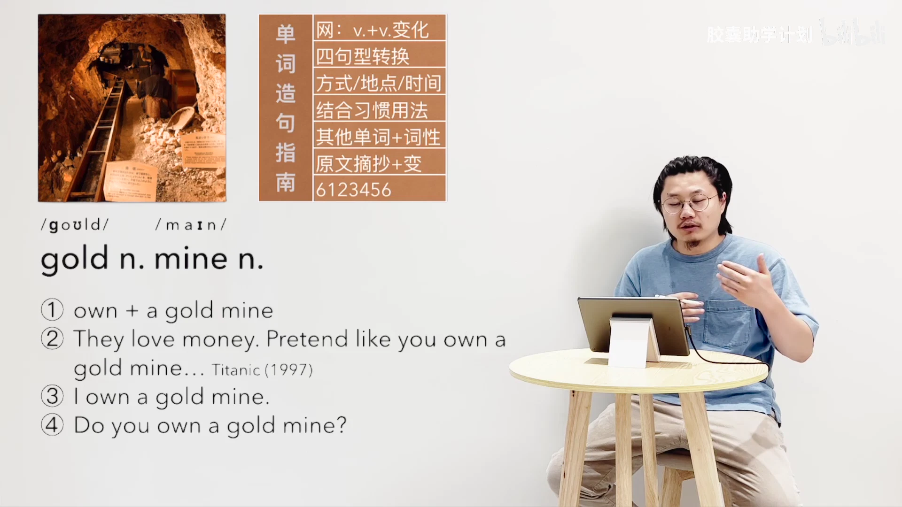

文字识别：单词造句指南 / 网：v.+v.变化 / 功学计划 / 四句型转换 / 方式/地点/时间 / 结合习惯用法 / 其他单词+词性 / 原文摘抄+变 / 6123456 / /gould/ / /maIn/ / gold n. mine n. / ① own + a gold mine / They love money. Pretend like you own a / 2 / gold mine..Titanic(1997) / ③ I own a gold mine. / ④ Do you own a gold mine?

### 画面 00:02:14

文字识别：单词造句指南 / 网：v.+v.变化 / 助学计划！ / 四句型转换 / 方式/地点/时间 / 结合习惯用法 / 其他单词+词性 / 原文摘抄+变 / 6123456 / /gould/ / /maIn/ / gold n. mine n. / ① own + a gold mine / They love money. Pretend like you own a / 2 / gold mine... Titanic(1997) / ③ I own a gold mine. / ④ Do you own a gold mine?

### 画面 00:02:16

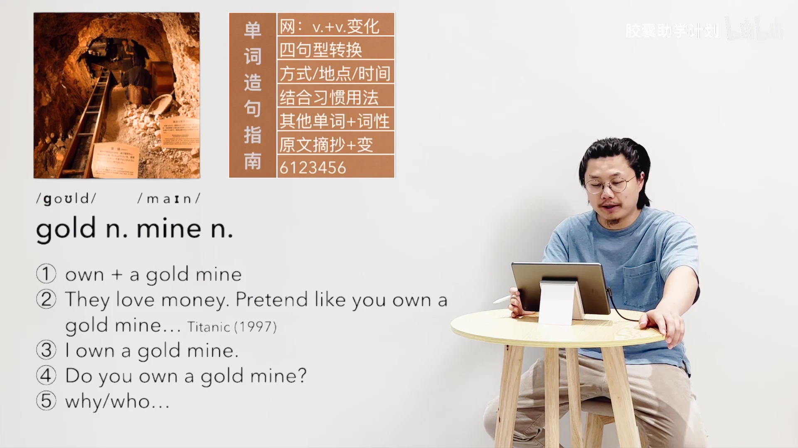

文字识别：单词造句指南 / 网：v.+v.变化 / 功学计划 / 四句型转换 / 方式/地点/时间 / 结合习惯用法 / 其他单词+词性 / 原文摘抄+变 / 6123456 / /gould/ / /main/ / gold n. mine n. / ① own + a gold mine / 2 / They love money. Pretend like you own a / gold mine..Titanic(1997) / ③ Iown a gold mine. / ④ Do you own a gold mine? / ⑤ why/who...

### 画面 00:02:18

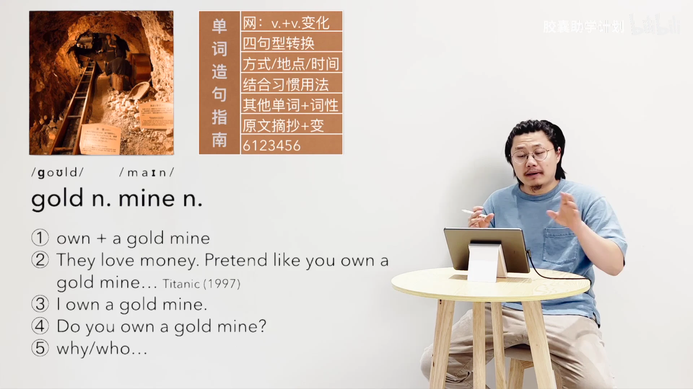

文字识别：单词造句指南 / 网：v.+v.变化 / 功学计划 / 四句型转换 / 方式/地点/时间 / 结合习惯用法 / 其他单词+词性 / 原文摘抄+变 / 6123456 / /gould/ / /main/ / gold n. mine n. / ① own + a gold mine / They love money. Pretend like you own a / 2 / gold mine..Titanic(1997) / ③ I own a gold mine. / ④ Do you own a gold mine? / ⑤ why/who...

### 画面 00:02:20

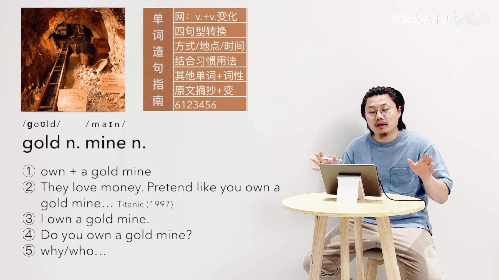

文字识别：单词造句指南 / 网：v.+v.变化 / 助学计划 / 心 / 四句型转换 / 方式/地点/时间 / 结合习惯用法 / 其他单词+词性 / 原文摘抄+变 / 6123456 / /gould/ / /maIn/ / gold n. mine n. / ① own + a gold mine / They love money. Pretend like you own a / gold mine... Titanic(1997) / ③ Iown a gold mine. / ④ Do you own a gold mine? / ⑤ why/who...

### 画面 00:02:22

文字识别：单词造句指南 / 网：v.+v.变化 / 助学计划 / 四句型转换 / 方式/地点/时间 / 结合习惯用法 / 其他单词+词性 / 原文摘抄+变 / 6123456 / /gould/ / /main/ / gold n. mine n. / ① own + a gold mine / They love money. Pretend like you own a / 2 / gold mine..Titanic(1997) / ③ I own a gold mine. / ④ Do you own a gold mine? / ⑤ why/who...

### 画面 00:02:25

文字识别：单词造句指南 / 网：v.+v.变化 / 助学计划 / 四句型转换 / 方式/地点/时间 / 结合习惯用法 / 其他单词+词性 / 原文摘抄+变 / 6123456 / /gould/ / /main/ / gold n. mine n. / ① own + a gold mine / They love money. Pretend like you own a / 2 / gold mine... Titanic(1997) / ③ I own a gold mine. / ④ Do you own a gold mine? / ⑤ why/who...

### 画面 00:02:28

文字识别：单词造句指南 / 网：v.+v.变化 / 力学计划 / 四句型转换 / 方式/地点/时间 / 结合习惯用法 / 其他单词+词性 / 原文摘抄+变 / 6123456 / /gould/ / /main/ / gold n. mine n. / ① own + a gold mine / They love money. Pretend like you own a / 2 / gold mine..Titanic(1997) / ③ Iown a gold mine. / ④ Do you own a gold mine? / ⑤ why/who...

## 00:02:30–00:03:00

接下来，那 gold mine 还有一个小的引申含义啊。我们在很多电影当中、口语当中都会出现。举个例子，比如说看这个电影当中的一句台词叫 "He's like a gold mine." 注意这个 "p s" 是 "is"，所以这里的 "like" 就不是动词，对吧？是一个小的介词，叫像。所以这句汉语，我们这句英文啊，我们直接给它翻译成汉语叫它就像一个金矿一样。其实我们汉语也有类似的表达，我相信各位一

### 画面 00:02:30

文字识别：单词造句指南 / 网：v.+v.变化 / 助学计划 / 四句型转换 / 方式/地点/时间 / 结合习惯用法 / 其他单词+词性 / 原文摘抄+变 / 6123456 / /gould/ / /main/ / gold n. mine n. / ① own + a gold mine / They love money. Pretend like you own a / 2 / gold mine... Titanic(1997) / ③ Iown a gold mine. / ④ Do you own a gold mine? / why/who... / 5 / He's like a gold mine. Spun (2002)

### 画面 00:02:35

文字识别：单词造句指南 / 网：v.+v.变化 / 助学计划 / 四句型转换 / 方式/地点/时间 / 结合习惯用法 / 其他单词+词性 / 原文摘抄+变 / 6123456 / /gould/ / /main/ / gold n. mine n. / ① own + a gold mine / They love money. Pretend like you own a / 2 / gold mine... Titanic(1997) / ③ I own a gold mine. / ④ Do you own a gold mine? / why/who... / 5 / ) He's like a gold mine. Spun (2002)

### 画面 00:02:40

文字识别：单词造句指南 / 网：v.+v.变化 / 助学计划 / 四句型转换 / 方式/地点/时间 / 结合习惯用法 / 其他单词+词性 / 原文摘抄+变 / 6123456 / /gould/ / /main/ / gold n. mine n. / ① own + a gold mine / They love money. Pretend like you own a / 2 / gold mine.. Titanic(1997) / ③ Iown a gold mine. / ④ Do you own a gold mine? / why/who... / 5 / He's like a gold mine. Spun (2002)

### 画面 00:02:46

文字识别：单词造句指南 / 网：v.+v.变化 / 助学计划 / 四句型转换 / 方式/地点/时间 / 结合习惯用法 / 其他单词+词性 / 原文摘抄+变 / 6123456 / /gould/ / /main/ / gold n. mine n. / ① own + a gold mine / They love money. Pretend like you own a / 2 / gold mine..Titanic(1997) / ③ Iown a gold mine. / ④ Do you own a gold mine? / why/who... / 5 / ) He's like a gold mine. Spun (2002)

### 画面 00:02:50

文字识别：单词造句指南 / 网：v.+v.变化 / 助学计划 / 四句型转换 / 方式/地点/时间 / 结合习惯用法 / 其他单词+词性 / 原文摘抄+变 / 6123456 / /gould/ / /main/ / gold n. mine n. / ① own + a gold mine / They love money. Pretend like you own a / 2 / gold mine... Titanic(1997) / ③ Iown a gold mine. / ④ Do you own a gold mine? / why/who... / 5 / He's like a gold mine. Spun (2002)

### 画面 00:02:58

文字识别：单词造句指南 / 网：v.+v.变化 / 幼学计划 / 四句型转换 / 方式/地点/时间 / 结合习惯用法 / 其他单词+词性 / 原文摘抄+变 / 6123456 / /gould/ / /main/ / gold n. mine n. / ① own + a gold mine / They love money. Pretend like you own a / 2 / gold mine... Titanic(1997) / ③ Iown a gold mine. / ④ Do you own a gold mine? / why/who... / 5 / ) He's like a gold mine. Spun (2002)

## 00:03:00–00:03:30

定能通过这个汉语意思猜测出来，对吧？那他的意思就是这个人啊，可以深挖很多的东西啊。他不仅会教英文啊，他还会这个会那会这会这，就像一个金矿一样。你会发现啊，他会好多好多东西啊。 He's like a gold mine, 对吧？ OK，比如说我们看一个小的电影片段，这里呢就变成了叫 This place is a gold mine，说这个地方就是个金矿。那它实际上是类似于一个小的比喻。注

### 画面 00:03:01

文字识别：单词造句指南 / 网：v.+v.变化 / 助学计划 / 四句型转换 / 方式/地点/时间 / 结合习惯用法 / 其他单词+词性 / 原文摘抄+变 / 6123456 / /gould/ / /main/ / gold n. mine n. / ① own + a gold mine / They love money. Pretend like you own a / 2 / gold mine... Titanic(1997) / ③ I own a gold mine. / ④ Do you own a gold mine? / why/who... / 5 / ) He's like a gold mine. Spun (2002)

### 画面 00:03:05

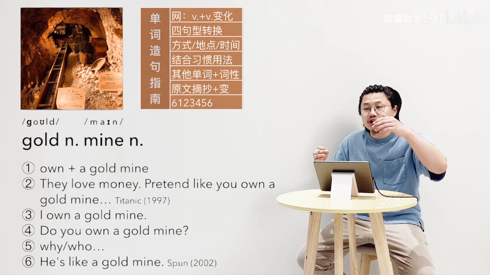

文字识别：单词造句指南 / 网：v.+v.变化 / 学计划 / 四句型转换 / 方式/地点/时间 / 结合习惯用法 / 其他单词+词性 / 原文摘抄+变 / 6123456 / /gould/ / /main/ / gold n. mine n. / ① own + a gold mine / They love money. Pretend like you own a / 2 / gold mine... Titanic(1997) / ③ Iown a gold mine. / ④ Do you own a gold mine? / why/who... / 5 / ) He's like a gold mine. Spun (2002)

### 画面 00:03:08

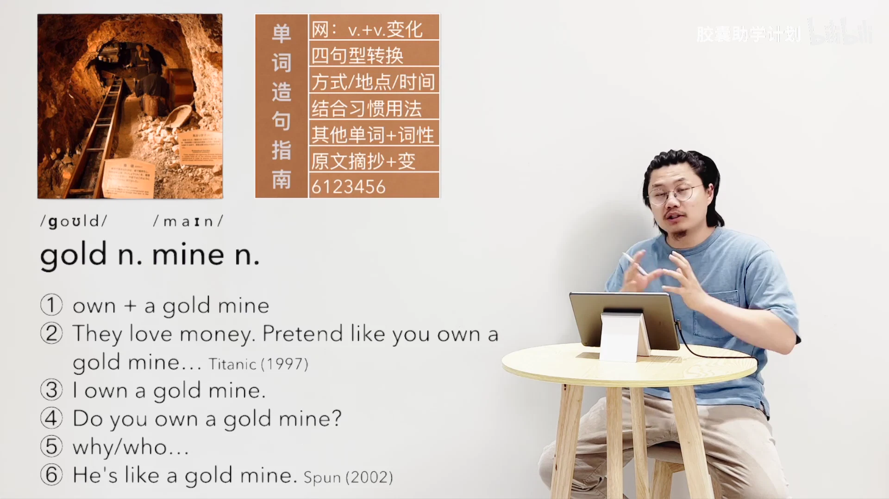

文字识别：单词造句指南 / 网：v.+v.变化 / 助学计划 / 心 / 四句型转换 / 方式/地点/时间 / 结合习惯用法 / 其他单词+词性 / 原文摘抄+变 / 6123456 / /gould/ / /main/ / gold n. mine n. / ① own + a gold mine / They love money. Pretend like you own a / 2 / gold mine... Titanic(1997) / ③ I own a gold mine. / ④ Do you own a gold mine? / why/who... / 5 / He's like a gold mine. Spun (2002)

### 画面 00:03:10

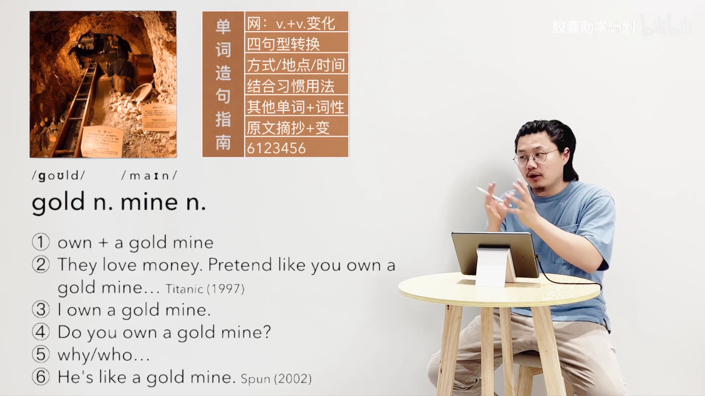

文字识别：单词造句指南 / 网：v.+v.变化 / 助学计划 / 四句型转换 / 方式/地点/时间 / 结合习惯用法 / 其他单词+词性 / 原文摘抄+变 / 6123456 / /gould/ / /main/ / gold n. mine n. / ① own + a gold mine / They love money. Pretend like you own a / 2 / gold mine... Titanic(1997) / ③ I own a gold mine. / ④ Do you own a gold mine? / why/who... / 5 / He's like a gold mine. Spun (2002)

### 画面 00:03:15

文字识别：单词造句指南 / 网：v.+v.变化 / 助学计划 / 四句型转换 / 方式/地点/时间 / 结合习惯用法 / 其他单词+词性 / 原文摘抄+变 / 6123456 / /gould/ / /main/ / gold n. mine n. / ① own + a gold mine / They love money. Pretend like you own a / 2 / gold mine... Titanic(1997) / ③ Iown a gold mine. / ④ Do you own a gold mine? / why/who... / 5 / He's like a gold mine. Spun (2002)

### 画面 00:03:19

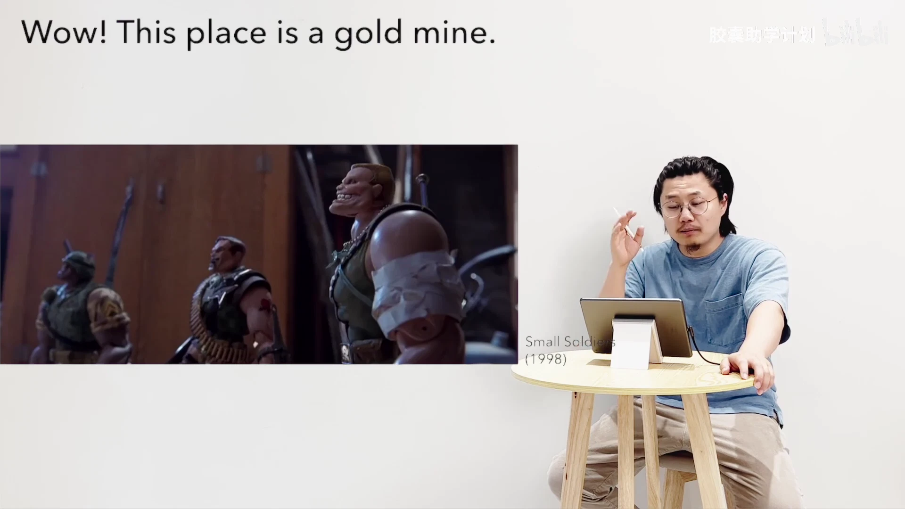

文字识别：Wow! This place is a gold mine. / Small Sold / (1998)

## 00:03:30–00:04:00

意力集中，我们听一下。Wow, this place is a gold mine.啊，对吧？说Wow, this place is a gold mine，对吧？Okay, very good.好，你比如说，其实同理嘛。我跟你讲，我电脑里面就存着非常非常多的书，对吧？哎，我自己读的书。然后呢，这个各个领域都有，那我就可以说啊，It's like a gold mine，对吧？哎，这个文件夹就像一个金矿一样。Very good. Continue.下一个单词叫做treasure,

### 画面 00:03:33

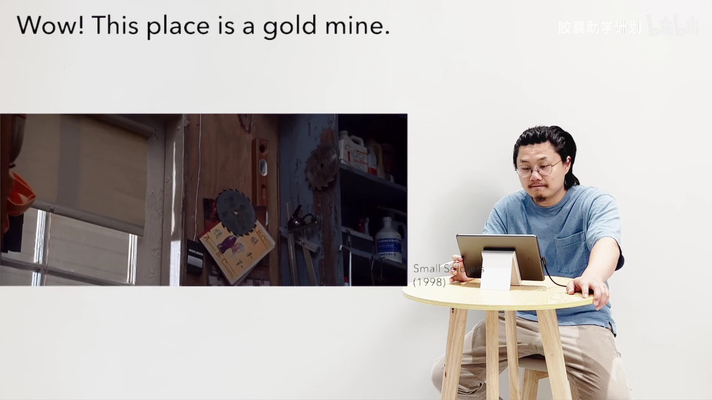

文字识别：Wow! This place is a gold mine. / Smallsei / (1998)

### 画面 00:03:35

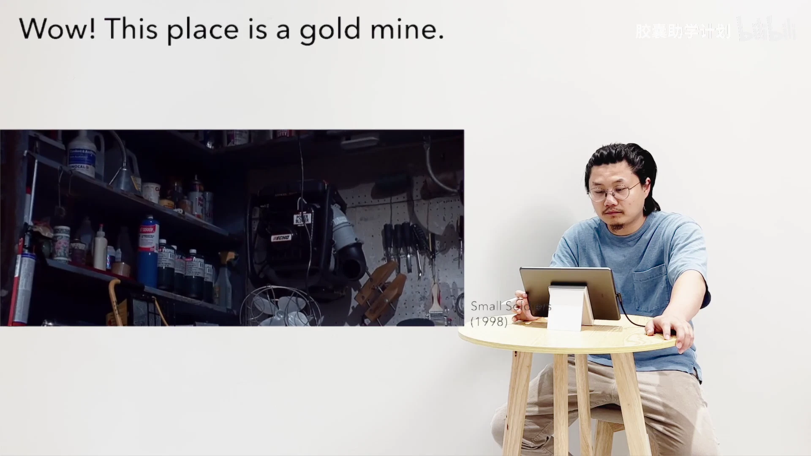

文字识别：Wow! This place is a gold mine. / Smalrsego / (1998)

### 画面 00:03:37

文字识别：Wow! This place is a gold mine. / Small Sold / (1998)

### 画面 00:03:43

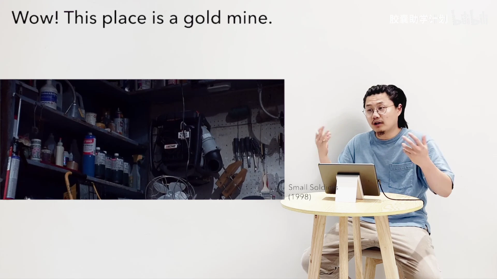

文字识别：Wow! This place is a gold mine. / 通一 / Small Sold / (1998)

### 画面 00:03:55

文字识别：Wow! This place is a gold mine. / 通 / SmallSoto / (1998)

### 画面 00:03:57

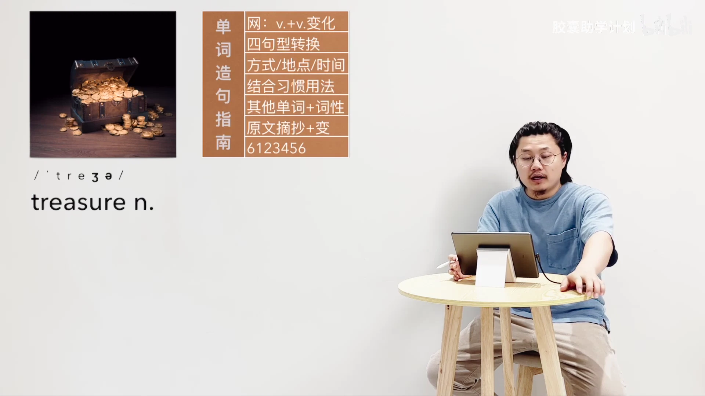

文字识别：单词造句指南 / 网：v.+v.变化 / 助学计划 / 四句型转换 / 方式/地点/时间 / 结合习惯用法 / 其他单词+词性 / 原文摘抄+变 / 6123456 / /'tre3a/ / treasure n.

## 00:04:00–00:04:30

treasure. Okay, 后边这个音啊, r啊，这个音标是各位最容易忘掉的 r 和 a, 对吧？连起来 r 啊。 Okay, treasure. 那 treasure 实际上本身就是宝藏的意思，对吧？ Okay, 那藏宝图，哎，a treasure map，对吧？哎，一个地图，什么样的地图呢？标记好了一个红叉，对吧？这是我们在电影当中最常出现的一个红色的叉子，表示这个地方有宝藏啊。 A

### 画面 00:04:00

文字识别：单词造句指南 / 网：v.+v.变化 / 囊助学计划州 / 四句型转换 / 方式/地点/时间 / 结合习惯用法 / 其他单词+词性 / 原文摘抄+变 / 6123456 / /'tre3a/ / treasure n.

## 00:04:30–00:05:00

treasure map. 接下来，其实我们如果我给大家拓展到这个地方，其实也没有拓展，多加了个 map，对吧？那你其实接下来要思考的问题就是，如果我只讲到这里，那你大脑就要去想的事情叫做，我一定得添加其他的单词才能造一个句子。这个短语现在缺的核心单词一定是动词，对不对？那，哎，我就去想这个地图藏宝地图是吧？哎，这个宝图，那什么动词跟

### 画面 00:04:30

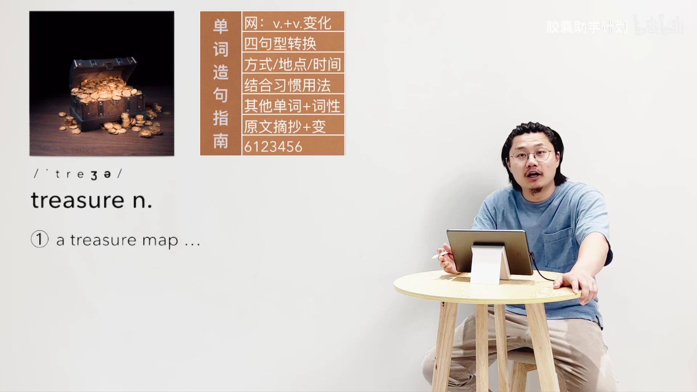

文字识别：单词造句指南 / 网：v.+v.变化 / 助学计划 / 四句型转换 / 方式/地点/时间 / 结合习惯用法 / 其他单词+词性 / 原文摘抄+变 / 6123456 / /'tre3ａ/ / treasure n. / a treasure map

### 画面 00:04:48

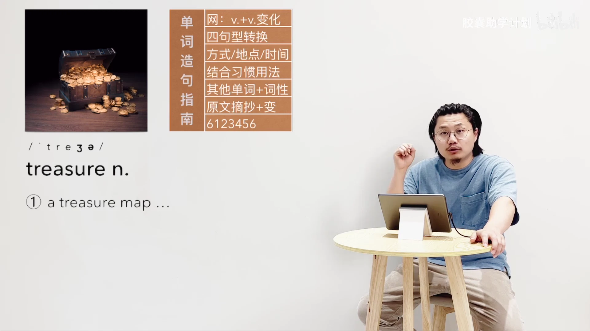

文字识别：单词造句指南 / 网：v.+v.变化 / 助学计划调 / 四句型转换 / 方式/地点/时间 / 结合习惯用法 / 其他单词+词性 / 原文摘抄+变 / 6123456 / /'tre3ａ / / treasure n. / a treasure map

## 00:05:00–00:05:30

它常连用呢？好，这个一方面是各位自己去往前翻，另一方面是我上课也会告诉各位。比如说，He drew a treasure map so he could find them again. Stand by me,啊，非常棒的一个电影当中，还来这么一句话，说他画了一个藏宝图，所以目的啊，所以对吧？哎，这个是我们新概念二册二十五课刚刚学过的连词，对吧？哎，所以怎么样呢？他就能再一次找到这些宝藏了。Okay, very good.好，接

### 画面 00:05:01

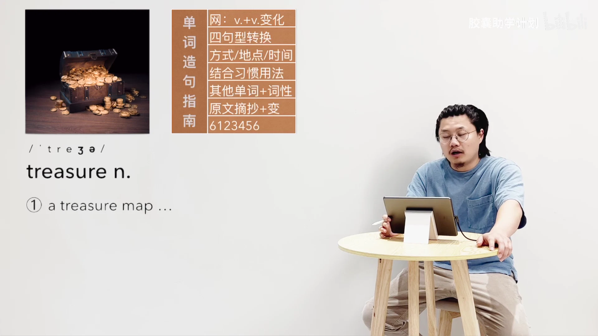

文字识别：单词造句指南 / 网：v.+v.变化 / 学计划 / 四句型转换 / 方式/地点/时间 / 结合习惯用法 / 其他单词+词性 / 原文摘抄+变 / 6123456 / /'tre3ａ / / treasure n. / a treasure map

### 画面 00:05:03

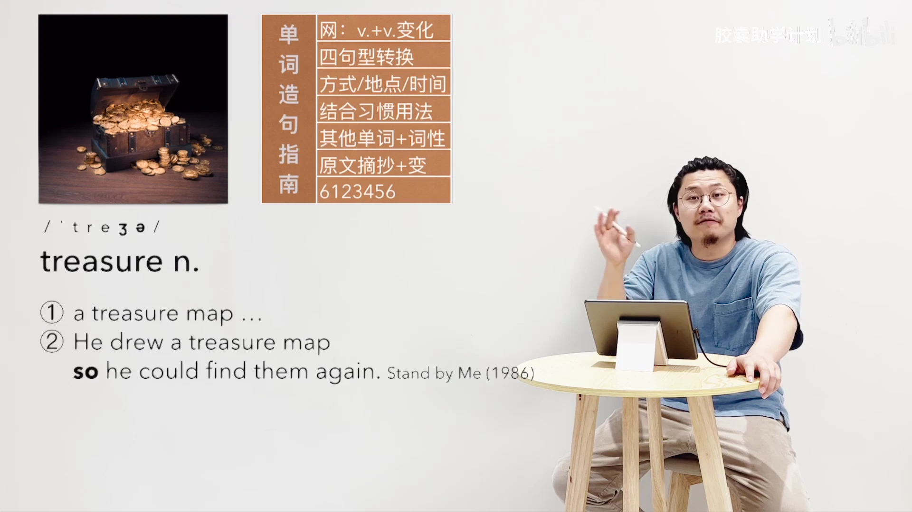

文字识别：单词造句指南 / 网：v.+v.变化 / 学计划 / 四句型转换 / 方式/地点/时间 / 结合习惯用法 / 其他单词+词性 / 原文摘抄+变 / 6123456 / /'tre3ａ/ / treasure n. / 1 / ) a treasure map / He drew a treasure map / so he could find them again. Stand by Me(1986)

### 画面 00:05:06

文字识别：单词造句指南 / 网：v.+v.变化 / 学辻划 / 四句型转换 / 方式/地点/时间 / 结合习惯用法 / 其他单词+词性 / 原文摘抄+变 / 6123456 / /'tre3ａ/ / treasure n. / ) a treasure map / He drew a treasure map / so he could find them again. Stand by Me(1986)

### 画面 00:05:11

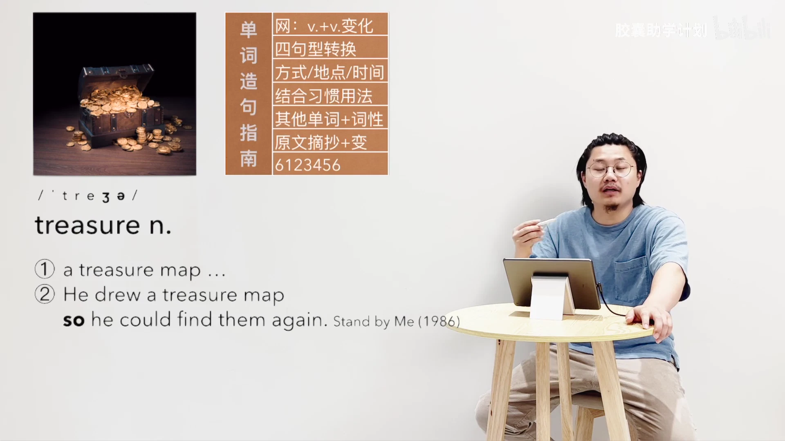

文字识别：单词造句指南 / 网：v.+v.变化 / 学计划 / 四句型转换 / 方式/地点/时间 / 结合习惯用法 / 其他单词+词性 / 原文摘抄+变 / 6123456 / /'tre3ａl / treasure n. / ) a treasure map / He drew a treasure map / so he could find them again. Stand by Me(1986)

### 画面 00:05:15

文字识别：单词造句指南 / 网：v.+v.变化 / 学计划 / 四句型转换 / 方式/地点/时间 / 结合习惯用法 / 其他单词+词性 / 原文摘抄+变 / 6123456 / /'tre3a/ / treasure n. / ) a treasure map / He drew a treasure map / so he could find them again. Stand by Me(1986)

### 画面 00:05:25

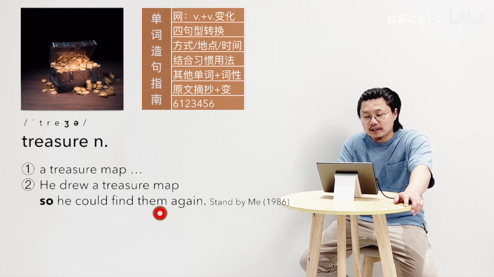

文字识别：单词造句指南 / 网：v.+v.变化 / 功学计划 / 四句型转换 / 方式/地点/时间 / 结合习惯用法 / 其他单词+词性 / 原文摘抄+变 / 6123456 / /'tre3a/ / treasure n. / ) a treasure map / He drew a treasure map / so he could find them again. Stand by Me(1986)

## 00:05:30–00:06:00

着往下走。那我们单说treasure，有哪些动词能跟它连在一起呢？哎，一方面我自己去想了一想，另一方面我去查了一下语料库，发现接下来前面这些动词跟treasure都是非常常见的。巧了，大多数几乎咱们全见过。就算有一个还真没见过，bury也是这课咱们要学的，叫做埋，对吧？Hide藏啊，我不一一提了，都放到这里。各位单词造句的时候记得用上。但是因为呢，咱

### 画面 00:05:31

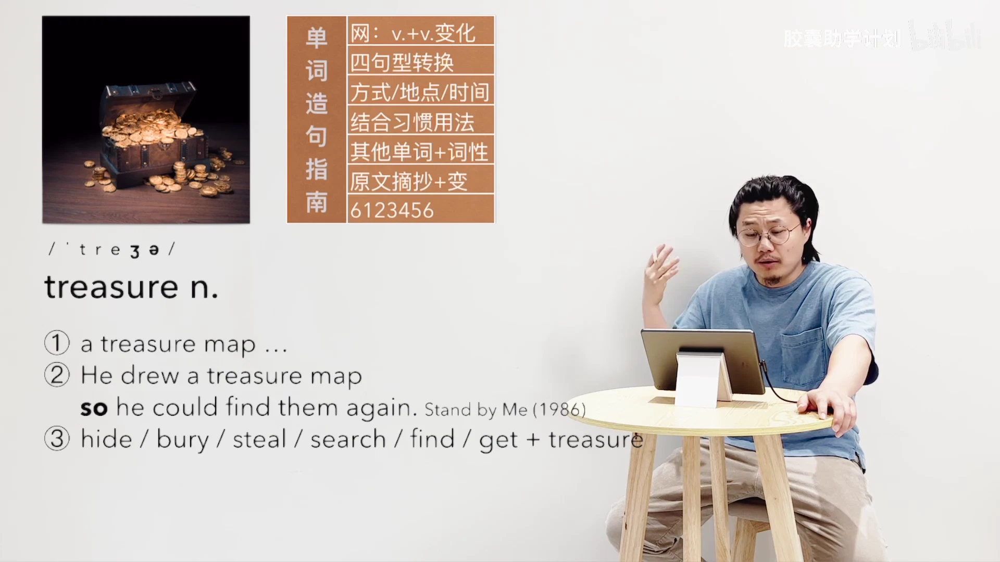

文字识别：单词造句指南 / 网：v.+v.变化 / 学计划 / 四句型转换 / 方式/地点/时间 / 结合习惯用法 / 其他单词+词性 / 原文摘抄+变 / 6123456 / /'tre3al / treasure n. / ① a treasure map / He drew a treasure map / so he could find them again. Stand by Me (1986) / ) hide / bury / steal / search / find / get + treasure

### 画面 00:05:36

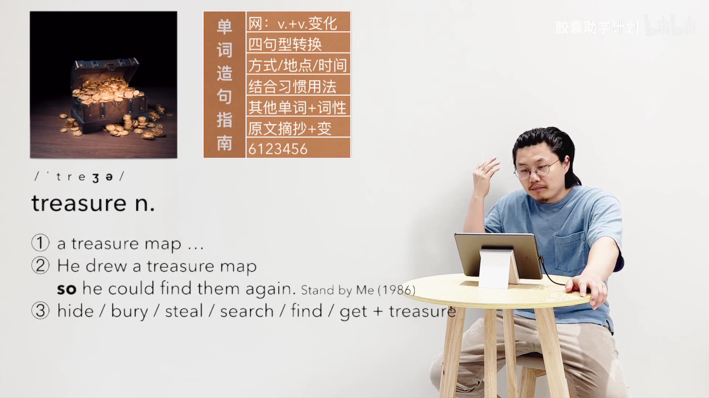

文字识别：单词造句指南 / 网：v.+v.变化 / 学计划 / 四句型转换 / 方式/地点/时间 / 结合习惯用法 / 其他单词+词性 / 原文摘抄+变 / 6123456 / /'tre3al / treasure n. / ① a treasure map / He drew a treasure map / so he could find them again. Stand by Me (1986) / ) hide / bury / steal / search / find / get + treasure

### 画面 00:05:42

文字识别：单词造句指南 / 网：v.+v.变化 / 学计划 / 四句型转换 / 方式/地点/时间 / 结合习惯用法 / 其他单词+词性 / 原文摘抄+变 / 6123456 / /'tre3a/ / treasure n. / ① a treasure map / He drew a treasure map / so he could find them again. Stand by Me(1986) / ) hide / bury / steal / search / find / get + treasure

### 画面 00:05:45

文字识别：单词造句指南 / 网：v.+v.变化 / 学计划 / 四句型转换 / 方式/地点/时间 / 结合习惯用法 / 其他单词+词性 / 原文摘抄+变 / 6123456 / /'tre3a / / treasure n. / ① a treasure map / ) He drew a treasure map / so he could find them again. Stand by Me (1986) / ) hide / bury / steal / search / find / get + treasure

### 画面 00:05:50

文字识别：单词造句指南 / 网：v.+v.变化 / 学计划 / 四句型转换 / 方式/地点/时间 / 结合习惯用法 / 其他单词+词性 / 原文摘抄+变 / 6123456 / /'tre3a/ / treasure n. / ① a treasure map / ) He drew a treasure map / so he could find them again. Stand by Me(1986) / ) hide / bury / steal / search / find / get + treasure

## 00:06:00–00:06:30

们上课时间有限，我不可能一个一个给大家造，对吧？下课自己去造。我们来几个，比如说，Let's stick to the plan and find the treasure. Stick to the plan，刚刚学过的，对吧？哎，坚持这个计划，然后找到这些，哎，宝贝啊，宝藏。继续，比如说，I want to know where the treasure is. 你注意这里，实际上我用了三十九课，其实新一也学过宾语从句，只不过是一个特殊疑问句做宾语从句，这也是各位最容易遗忘的

### 画面 00:06:00

文字识别：单词造句指南 / 网：v.+v.变化 / 学计划 / 四句型转换 / 方式/地点/时间 / 结合习惯用法 / 其他单词+词性 / 原文摘抄+变 / 6123456 / /'tre3a / / treasure n. / ① a treasure map / ) He drew a treasure map / so he could find them again. Stand by Me(1986) / ) hide / bury / steal / search / find / get + treasure

### 画面 00:06:05

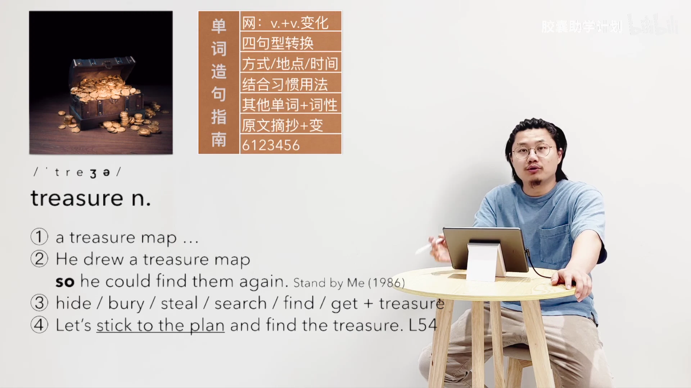

文字识别：单词造句指南 / 网：v.+v.变化 / 学计划 / 四句型转换 / 方式/地点/时间 / 结合习惯用法 / 其他单词+词性 / 原文摘抄+变 / 6123456 / /tre3a/ / treasure n. / ① a treasure map / ) He drew a treasure map / so he could find them again. Stand by Me(1986) / ③ hide / bury / steal / search / find / get + treasure / ④ Let's stick to the plan and find the treasure. L54

### 画面 00:06:12

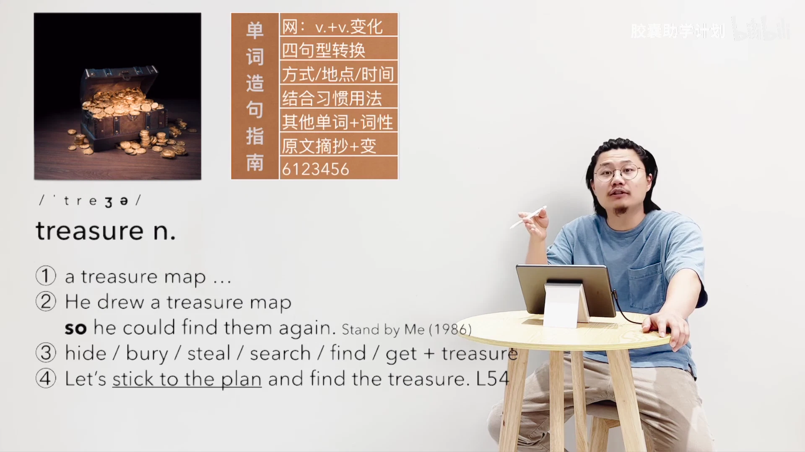

文字识别：单词造句指南 / 网：v.+v.变化 / 学计划 / 四句型转换 / 方式/地点/时间 / 结合习惯用法 / 其他单词+词性 / 原文摘抄+变 / 6123456 / /'tre3al / treasure n. / ① a treasure map / ) He drew a treasure map / so he could find them again. Stand by Me(1986) / ) hide / bury / steal / search / find / get + treasure / 人 / ④ Let's stick to the plan and find the treasure. L54

### 画面 00:06:15

文字识别：单词造句指南 / 网：v.+v.变化 / 加学计划 / 四句型转换 / 方式/地点/时间 / 结合习惯用法 / 其他单词+词性 / 原文摘抄+变 / 6123456 / /'tre3al / treasure n. / ① a treasure map / ) He drew a treasure map / so he could find them again. Stand by Me(1986) / ③ hide / bury / steal / search / find / get + treasure / 3 / ④ Let's stick to the plan and find the treasure. L54

### 画面 00:06:18

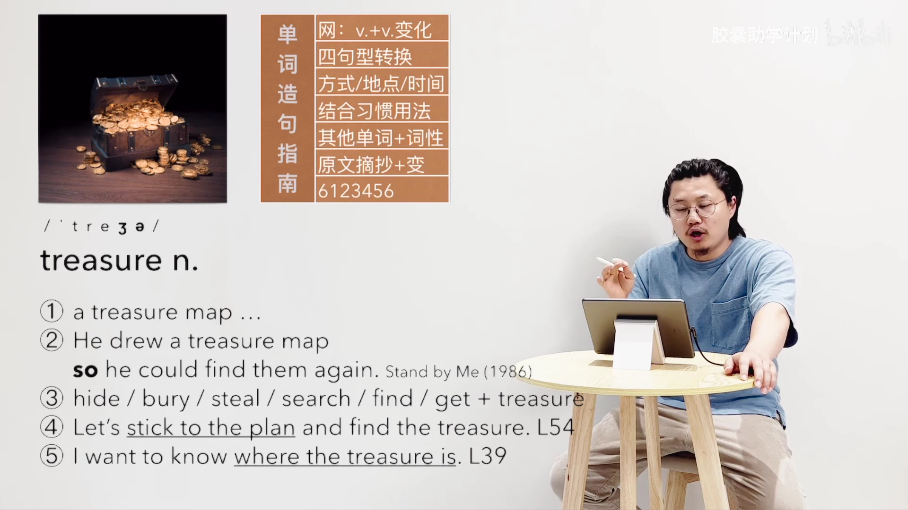

文字识别：单词造句指南 / 网：v.+v.变化 / 加学计划 / 四句型转换 / 方式/地点/时间 / 结合习惯用法 / 其他单词+词性 / 原文摘抄+变 / 6123456 / / 'tre3al / treasure n. / ① a treasure map /  He drew a treasure map / so he could find them again. Stand by Me(1986) / ③ hide / bury / steal / search / find / get + treasure / 3 / ④ Let's stick to the plan and find the treasure. L54 / ⑤ I want to know where the treasure is. L39

### 画面 00:06:20

文字识别：单词造句指南 / 网：v.+v.变化 / 学计划 / 四句型转换 / 方式/地点/时间 / 结合习惯用法 / 其他单词+词性 / 原文摘抄+变 / 6123456 / /'tre3a/ / treasure n. / ① a treasure map / ② He drew a treasure map / so he could find them again. Stand by Me(1986) / ③ hide / bury / steal / search / find / get + treasure / 3） / ④ Let's stick to the plan and find the treasure. L54 / ⑤ I want to know where the treasure is. L39

### 画面 00:06:25

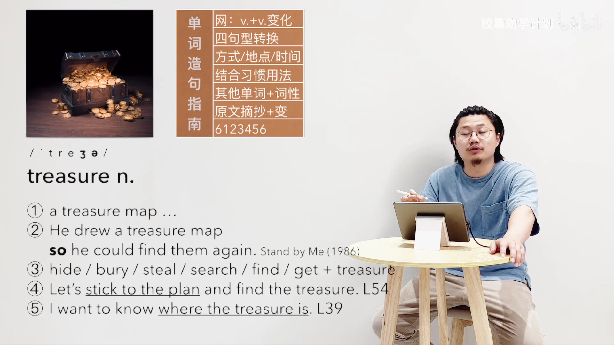

文字识别：单词造句指南 / 网：v.+v.变化 / 字计划 / 四句型转换 / 方式/地点/时间 / 结合习惯用法 / 其他单词+词性 / 原文摘抄+变 / 6123456 / /·tre3a/ / treasure n. / ① a treasure map / ② He drew a treasure map / so he could find them again. Stand by Me(1986) / ③ hide / bury / steal / search / find / get + treasure / 3 / ④ Let's stick to the plan and find the treasure. L54 / ⑤ I want to know where the treasure is. L39

## 00:06:30–00:07:00

特殊疑问句做宾语从句的时候，不要忘了主谓，而不是谓主，对吧？不是一个倒装顺序啊，是一个正序陈述句的语序啊。Where the treasure is，如果您忘了一定要回去再复习一下。我们新二这本书，包括我的课程啊，一个最大的特点就是不停的复习，复习，复习啊，才能让各位对抗这个遗忘。OK，好，continue。接下来咱们听一个小的听力片段，叫Do you want to see my treasure box？其

### 画面 00:06:31

文字识别：单词造句指南 / 网：v.+v.变化 / 助学计划 / 四句型转换 / 方式/地点/时间 / 结合习惯用法 / 其他单词+词性 / 原文摘抄+变 / 6123456 / /'tre3al / treasure n. / ① a treasure map /  He drew a treasure map / so he could find them again. Stand by Me(1986) / ③ hide / bury / steal / search / find / get + treasure / 3 / ④ Let's stick to the plan and find the treasure. L54 / ⑤ I want to know where the treasure is. L39

### 画面 00:06:35

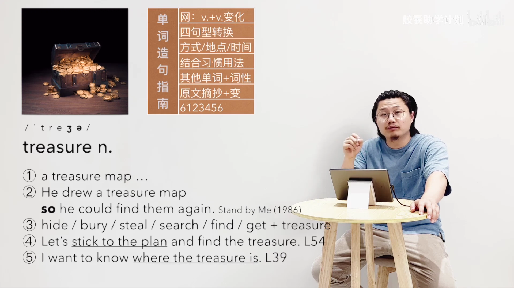

文字识别：单词造句指南 / 网：v.+v.变化 / 学计划 / 四句型转换 / 方式/地点/时间 / 结合习惯用法 / 其他单词+词性 / 原文摘抄+变 / 6123456 / /'tre3a/ / treasure n. / ① a treasure map / ② He drew a treasure map / so he could find them again. Stand by Me(1986) / ③ hide / bury / steal / search / find / get + treasure / 3 / ④ Let's stick to the plan and find the treasure. L54 / ⑤ I want to know where the treasure is. L39

### 画面 00:06:40

文字识别：单词造句指南 / 网：v.+v.变化 / 力学计划 / 四句型转换 / 方式/地点/时间 / 结合习惯用法 / 其他单词+词性 / 原文摘抄+变 / 6123456 / /'tre3a/ / treasure n. / ① a treasure map / ② He drew a treasure map / so he could find them again. Stand by Me(1986) / ③ hide / bury / steal / search / find / get + treasure / 3） / ④ Let's stick to the plan and find the treasure. L54 / ⑤ I want to know where the treasure is. L39

### 画面 00:06:53

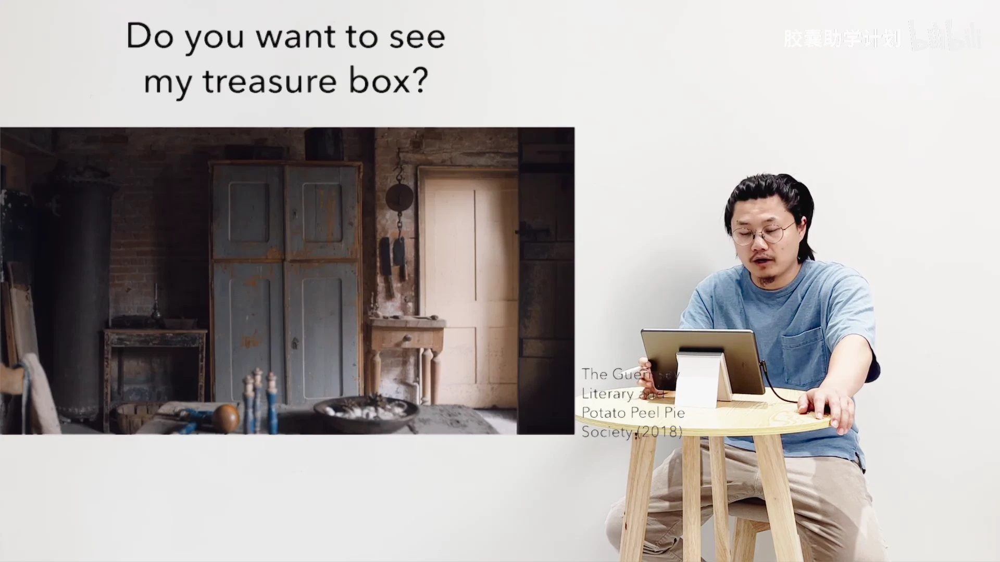

文字识别：Do you want to see / my treasure box? / The Gue / Literary aer / Potato Peel Pie / Society(2018)

## 00:07:00–00:07:30

实就是，比如说各位，我不知道各位小的时候有没有过。我小的时候干过这样的事儿啊。哎，反正就是出去去去外边。小男孩手也也调皮，手也欠，对吧？反正得什么呢？也不怕脏。哎，从哪儿？反正弄一个小石头，弄块小木叉，对吧？比如说这个是一个Y型的，将来我能做弹弓，我就把它拿回来。然后呢，小的时候吃点心，有那种大的铁皮盒子，对吧？哎，马口铁，我印象当中铁皮盒子。然后你给它打开，把这些东西都塞进去。哎，你一看，

### 画面 00:07:01

文字识别：Do you want to see / my treasure box? / The Guernse / Literary and / Potato Peel Pie / Society(2018)

## 00:07:30–00:08:00

其实里边乱七八糟的，没有一个值钱的东西。但是对于孩子来说，那可就是 treasure box 了。我不知道各位能不能理解了啊？哎，听一下。 Do you want to see my treasure box? Okay, 啊，就是这个叫 treasure box. Play again. 好，接下来下一个单词，下一个单词原文给的这个单词叫做 revealer. 啊，是 reveal 这个单词后边加了个 er，叫干这件事儿的东西或者人。那

### 画面 00:07:31

文字识别：Do you want to see / my treasure box? / The Guernse / Literary and / Potato Peel Pie / Society:(2018)

### 画面 00:07:42

文字识别：Do you want to see / my treasure box? / The Guerl / Literarye / Potato Peel Pie / Society:(2018)

### 画面 00:07:44

文字识别：Do you want to see / my treasure box? / The Gurerl / Literaryaact / Potato Peel Pie / Society(2018)

### 画面 00:07:47

文字识别：单词造句指南 / 网：v.+v.变化 / 学计划 / 四句型转换 / 方式/地点/时间 / 结合习惯用法 / 其他单词+词性 / 原文摘抄+变 / 6123456 / /ri' vi:1/ / revealer n. reveal v.

### 画面 00:07:50

文字识别：单词造句指南 / 网：v.+v.变化 / 学计划、 / 四句型转换 / 方式/地点/时间 / 结合习惯用法 / 其他单词+词性 / 原文摘抄+变 / 6123456 / /rI'vi:1/ / revealer n. reveal v.

### 画面 00:07:55

文字识别：单词造句指南 / 网：v.+v.变化 / 学计划调 / 四句型转换 / 方式/地点/时间 / 0.00 / 结合习惯用法 / 其他单词+词性 / 原文摘抄+变 / 6123456 / /rI'vi:1/ / revealer n. reveal v.

## 00:08:00–00:08:30

reveler就是一个探测器啊。那reveal其实在本课也出现了，而且reveal它出现的频率要远远高于reveler。实话实说，讲新二之前我都没见过reveler这个单词，但reveal这个单词可出现非常非常多了。reveal它有一个含义就是把一个什么东西给它揭露出来、显现出来。reveler就变成了一个探测器，对吧？哎，你探测东西就是为了把一个东西给它弄出来，对吧？

### 画面 00:08:00

文字识别：单词造句指南 / 网：v.+v.变化 / 学计划 / 四句型转换 / 方式/地点/时间 / 结合习惯用法 / 其他单词+词性 / 原文摘抄+变 / 6123456 / /rI'vi:1/ / revealer n. reveal v.

### 画面 00:08:06

文字识别：单词造句指南 / 网：v.+v.变化 / 四句型转换 / 方式/地点/时间 / 0.000 / 结合习惯用法 / 其他单词+词性 / 原文摘抄+变 / 6123456 / /rI' vi:11 / revealer n. reveal v.

### 画面 00:08:20

文字识别：单词造句指南 / 网：v.+v.变化 / 学计划 / 四句型转换 / 方式/地点/时间 / 0.000 / 结合习惯用法 / 其他单词+词性 / 原文摘抄+变 / 6123456 / /rI' vi:1/ / revealer n. reveal v.

### 画面 00:08:25

文字识别：单词造句指南 / 网：v.+v.变化 / 助学计划一州 / 四句型转换 / 方式/地点/时间 / 0.000 / 结合习惯用法 / 其他单词+词性 / 原文摘抄+变 / 6123456 / /rI'vi:1/ / revealer n. reveal v.

## 00:08:30–00:09:00

拿出来，找到它，揭露它，对吧？OK，那reveler想造句就很容易了，比如说，It is called a revealer。被动，第十课咱们学的，一般现在是被动，对吧？Continue，你变一般疑问句，Is it called a revealer？Very good。Continue，四句型转换，各位可下做啊，加上作业。再来一个，比如说，Leo persuaded me not to buy that revealer。他劝我说不要买那个

### 画面 00:08:34

文字识别：单词造句指南 / 网：v.+v.变化 / 力学计划调 / 四句型转换 / 方式/地点/时间 / 结合习惯用法 / 其他单词+词性 / 原文摘抄+变 / 6123456 / /rI'vi:l/ / revealer n. reveal v. / ① It is called a revealer. L10

### 画面 00:08:38

文字识别：单词造句指南 / 网：v.+v.变化 / 学计划 / 四句型转换 / 方式/地点/时间 / 0.000 / 结合习惯用法 / 其他单词+词性 / 原文摘抄+变 / 6123456 / /rI' vi:l/ / revealer n. reveal v. / ① It is called a revealer. L10

### 画面 00:08:48

文字识别：单词造句指南 / 网：v.+v.变化 / 学计划 / 四句型转换 / 方式/地点/时间 / 结合习惯用法 / 其他单词+词性 / 原文摘抄+变 / 6123456 / /rI' vi:11 / revealer n. reveal v. / ① It is called a revealer. L10 / ② Is it called a revealer? / ③ why/what...

### 画面 00:08:52

文字识别：单词造句指南 / 网：v.+v.变化 / 学计划一 / 四句型转换 / 方式/地点/时间 / 0.000 / 结合习惯用法 / 其他单词+词性 / 原文摘抄+变 / 6123456 / /ri'vi:1/ / revealer n. reveal v. / ① It is called a revealer. L10 / ② Is it called a revealer? / ③ why/what... / ④ Leo persuaded me not to buy that revealer. L54

## 00:09:00–00:09:30

revealer 智商税是吧？哎，这个 revealer 是没有用的，那是骗人的，对吧？Okay，啊，就是说，哎，这个至少这个 revealer 是骗那些想快速致富的人的，对吧？哎，你不要去做给人让别人快速致富的那个人啊，叫 persuaded me now to buy that revealer。Very good，啊，五十四个咱刚学的。Continue，比如说可以说，那你没听劝，你还是买了，对吧？叫做 please sign for this revealer，啊，请你去

### 画面 00:09:00

文字识别：单词造句指南 / 网：v.+v.变化 / 学计划一州 / 四句型转换 / 方式/地点/时间 / 0.000 / 结合习惯用法 / 其他单词+词性 / 原文摘抄+变 / 6123456 / /ri'vi:1/ / revealer n. reveal v. / ① It is called a revealer. L10 / ② Is it called a revealer? / ③ why/what... / ④ Leo persuaded me not to buy that revealer. L54

## 00:09:30–00:10:00

签收这个探测器。OK，好，不多说了。接下来下一个单词，我们把两个单词给大家放到一起去学。第一个叫做invent，是本课出现的单词。invent叫做发明创造，注意它是个动词。而后边这个单词，你看其实是tion结尾的，这个其实就我们所谓的词根词缀啊这些东西。比如说副词很多是以ly结尾的，对吧？很多名词、动词变名词都是以tion

### 画面 00:09:30

文字识别：单词造句指南 / 网：v.+v.变化 / 学辻划 / 四句型转换 / 方式/地点/时间 / 0.000 / 结合习惯用法 / 其他单词+词性 / 原文摘抄+变 / 6123456 / /ri' vi:1/ / revealer n. reveal v. / ① It is called a revealer. L10 / ② Is it called a revealer? / ③ why/what... / ④ Leo persuaded me not to buy that revealer. L54 / ⑤ Please, sign for this revealer. L54

### 画面 00:09:33

文字识别：单词造句指南 / 网：v.+v.变化 / 计划 / 四句型转换 / 方式/地点/时间 / 结合习惯用法 / 其他单词+词性 / 原文摘抄+变 / 6123456 / /in'vent/ / invent v. invention n.

### 画面 00:09:35

文字识别：单词造句指南 / 网：v.+v.变化 / 加学计划 / 四句型转换 / 方式/地点/时间 / 结合习惯用法 / 其他单词+词性 / 原文摘抄+变 / 6123456 / /In'vent/ / invent v. invention n.

### 画面 00:09:40

文字识别：单词造句指南 / 网：v.+v.变化 / 学计划 / 四句型转换 / 方式/地点/时间 / 结合习惯用法 / 其他单词+词性 / 原文摘抄+变 / 6123456 / /In'vent/ / invent v. i / invention n.

### 画面 00:09:44

文字识别：单词造句指南 / 网：v.+v.变化 / 四句型转换 / 方式/地点/时间 / 结合习惯用法 / 其他单词+词性 / 原文摘抄+变 / 6123456 / /In'vent/ / invent v. i / invention n.

### 画面 00:09:46

文字识别：单词造句指南 / 网：v.+v.变化 / 学计划 / 四句型转换 / 方式/地点/时间 / 结合习惯用法 / 其他单词+词性 / 原文摘抄+变 / 6123456 / /in'vent/ / invent v. invention n.

### 画面 00:09:50

文字识别：单词造句指南 / 网：v.+v.变化 / 学计划 / 四句型转换 / 方式/地点/时间 / 结合习惯用法 / 其他单词+词性 / 原文摘抄+变 / 6123456 / /in'vent/ / invent v. invention n.

### 画面 00:09:52

文字识别：单词造句指南 / 网：v.+v.变化 / 学计划 / 四句型转换 / 方式/地点/时间 / 结合习惯用法 / 其他单词+词性 / 原文摘抄+变 / 6123456 / /in'vent/ / invent v. invention n.

### 画面 00:09:55

文字识别：单词造句指南 / 网：v.+v.变化 / 学计划 / 四句型转换 / 方式/地点/时间 / 结合习惯用法 / 其他单词+词性 / 原文摘抄+变 / 6123456 / /in'vent/ / invent v. invention n.

### 画面 00:09:57

文字识别：单词造句指南 / 网：v.+v.变化 / 学计划 / 四句型转换 / 方式/地点/时间 / 结合习惯用法 / 其他单词+词性 / 原文摘抄+变 / 6123456 / /in'vent/ / invent v. invention n.

## 00:10:00–00:10:30

结尾或 son 结尾，我们之前也见过啊。我们不用统一去给大家整理，这个没有必要。呃，我们见一个提一个就可以了。好，invent 如果是发明创造，invention 其实还是发明创造，无非它就是变成了名词，对吧？好，那我们造句子啊，比如说 the revealer was invented many years ago。好，一般过去时的被动 was were 加蛋，对吧？很多年前被创造了。记住啊，张开

### 画面 00:10:00

文字识别：单词造句指南 / 网：v.+v.变化 / 学计划 / 四句型转换 / 方式/地点/时间 / 结合习惯用法 / 其他单词+词性 / 原文摘抄+变 / 6123456 / /In'vent/ / invent v. i / invention n.

### 画面 00:10:09

文字识别：单词造句指南 / 网：v.+v.变化 / 学计划 / 四句型转换 / 方式/地点/时间 / 结合习惯用法 / 其他单词+词性 / 原文摘抄+变 / 6123456 / /in'vent/ / invent v. invention n.

### 画面 00:10:17

文字识别：单词造句指南 / 网：v.+v.变化 / 学计划 / 四句型转换 / 方式/地点/时间 / 结合习惯用法 / 其他单词+词性 / 原文摘抄+变 / 6123456 / /in'vent/ / invent v. invention n. / ① The"Revealer"' was invented many years / ago.L10

### 画面 00:10:21

文字识别：单词造句指南 / 网：v.+v.变化 / 学计划 / 四句型转换 / 方式/地点/时间 / 结合习惯用法 / 其他单词+词性 / 原文摘抄+变 / 6123456 / /In'vent/ / invent v. invention n. / ① The"Revealer'was invented many years / ago.L10

### 画面 00:10:26

文字识别：单词造句指南 / 网：v.+v.变化 / 学计划 / 四句型转换 / 方式/地点/时间 / 结合习惯用法 / 其他单词+词性 / 原文摘抄+变 / 6123456 / /In'vent/ / invent v. invention n. / ① The"Revealer"was invented many years / ago.L10

## 00:10:30–00:11:00

嘴还是要跟我去读啊。好，The revealer was invented many years ago. 如果我这个语速比较快啊，各位怎么办呢？可能有的时候哎，注意没注意给各位这个留跟读的时间？您就我们是录录屏课程嘛，您就暂停一下视频，对吧？跟着去读一遍。OK啊，好，下一个，你可以变成各种各样的四句型转换，不要忘了张开嘴大声朗读一下，给自己变一下，对不对？好，

### 画面 00:10:30

文字识别：单词造句指南 / 网：v.+v.变化 / 学计划 / 四句型转换 / 方式/地点/时间 / 结合习惯用法 / 其他单词+词性 / 原文摘抄+变 / 6123456 / /in'vent/ / invent v. invention n. / ① The"Revealer"was invented many years / ago.L10

### 画面 00:10:35

文字识别：单词造句指南 / 网：v.+v.变化 / 学计划 / 四句型转换 / 方式/地点/时间 / 结合习惯用法 / 其他单词+词性 / 原文摘抄+变 / 6123456 / /In'vent/ / invent v. invention n. / ① The"Revealer"was invented many years / ago.L10

### 画面 00:10:37

文字识别：单词造句指南 / 网：v.+v.变化 / 学计划 / 四句型转换 / 方式/地点/时间 / 结合习惯用法 / 其他单词+词性 / 原文摘抄+变 / 6123456 / /In'vent/ / invent v. invention n. / ① The"Revealer"was invented many years / ago.L10

### 画面 00:10:40

文字识别：单词造句指南 / 网：v.+v.变化 / 学计划 / 四句型转换 / 方式/地点/时间 / 结合习惯用法 / 其他单词+词性 / 原文摘抄+变 / 6123456 / /in'vent/ / invent v. invention n. / ① The"Revealer"was invented many years / ago.L10

### 画面 00:10:50

文字识别：单词造句指南 / 网：v.+v.变化 / 学计划 / 四句型转换 / 方式/地点/时间 / 结合习惯用法 / 其他单词+词性 / 原文摘抄+变 / 6123456 / /In'vent/ / invent v. invention n. / ① The"Revealer"was invented many years / ago.L10

### 画面 00:10:53

文字识别：单词造句指南 / 网：v.+v.变化 / 学计划 / 四句型转换 / 方式/地点/时间 / 结合习惯用法 / 其他单词+词性 / 原文摘抄+变 / 6123456 / /in'vent/ / invent v. invention n. / ① The"Revealer"was invented many years / ago.L10 / was/how long ago/when/what/how...

### 画面 00:10:59

文字识别：单词造句指南 / 网：v.+v.变化 / 学计划 / 四句型转换 / 方式/地点/时间 / 结合习惯用法 / 其他单词+词性 / 原文摘抄+变 / 6123456 / /in'vent/ / invent v. invention n. / ① The"Revealer"was invented many years / ago.L10 / was/how long ago/when/what/how... / The"Revealer" must have been invented by / 人 / Leo many years ago. L21

## 00:11:00–00:11:30

continue，再来说，The Revealor must have been invented by Leo many years ago.往我自己脸上贴个金吧。哎，这个是各位非常容易遗忘的，叫must have been that。二十一课咱们学叫当时一定是被啊，我不能完全确定，但我认为当时一定是被Leo研对研发出来的，对吧？发明创造出来的。Very good.而口语当中，你比如说很容易这个造的句子叫Who

### 画面 00:11:02

文字识别：单词造句指南 / 网：v.+v.变化 / 学计划 / 四句型转换 / 方式/地点/时间 / 结合习惯用法 / 其他单词+词性 / 原文摘抄+变 / 6123456 / /In'vent/ / invent v. invention n. / ① The"Revealer"was invented many years / ago.L10 / was/how long ago/when/what/how... / The"Revealer" must have been invented by / 人 / Leo many years ago. L21

### 画面 00:11:06

文字识别：单词造句指南 / 网：v.+v.变化 / 学计划 / 四句型转换 / 方式/地点/时间 / 结合习惯用法 / 其他单词+词性 / 原文摘抄+变 / 6123456 / /in'vent/ / invent v. invention n. / ① The"Revealer" was invented many years / ago.L10 / was/how long ago/when/what/how... / The"Revealer'must have been invented by / 人 / Leo many years ago. L21

### 画面 00:11:10

文字识别：单词造句指南 / 网：v.+v.变化 / 学计划 / 四句型转换 / 方式/地点/时间 / 结合习惯用法 / 其他单词+词性 / 原文摘抄+变 / 6123456 / /in'vent/ / invent v. invention n. / ① The"Revealer" was invented many years / ago.L10 / was/how long ago/when/what/how... / The"Revealer" must have been invented by / 人 / Leo many years ago. L21

### 画面 00:11:15

文字识别：单词造句指南 / 网：v.+v.变化 / 学计划 / 四句型转换 / 方式/地点/时间 / 结合习惯用法 / 其他单词+词性 / 原文摘抄+变 / 6123456 / /In'vent/ / invent v. invention n. / ① The"Revealer" was invented many years / ago.L10 / was/how long ago/when/what/how... / The"Revealer" must have been invented by / 人 / Leo many years ago. L21

## 00:11:30–00:12:00

invented this? 以及 Did you invent this? 哎，你创造的这个吗？啊，你看，这也是我们从电影当中摘出来的，对吧？我们加入这个环节，就是实际上逐渐想告诉各位，我们在新概念当中学过的单词、语法、习惯用法，全是在口语当中换一个形式就用得到的啊。好，那咱们接下来看一个电影片段啊， Back to the Future 啊，很棒的一个电影，我印象当中的汉语名字叫《回到未来》啊。我们就看这样

### 画面 00:11:30

文字识别：单词造句指南 / 网：v.+v.变化 / 学计划 / 四句型转换 / 方式/地点/时间 / 结合习惯用法 / 其他单词+词性 / 原文摘抄+变 / 6123456 / /In'vent/ / invent v. invention n. / ① The"Revealer"'was invented many years / ago.L10 / was/how long ago/when/what/how... / The"Revealer"must have been invented by / 3 / Leo many years ago. L21 / ④ Who invented this?

### 画面 00:11:35

文字识别：单词造句指南 / 网：v.+v.变化 / 学计划 / 四句型转换 / 方式/地点/时间 / 结合习惯用法 / 其他单词+词性 / 原文摘抄+变 / 6123456 / /in'vent/ / invent v. invention n. / ① The"Revealer" was invented many years / ago.L10 / was/how long ago/when/what/how... / The"Revealer" must have been invented by / 3 / Leo many years ago. L21 / ④ Who invented this? / ⑤ Did you invent this? Van Helsing (2004)

### 画面 00:11:40

文字识别：单词造句指南 / 网：v.+v.变化 / 学计划 / 四句型转换 / 方式/地点/时间 / 结合习惯用法 / 其他单词+词性 / 原文摘抄+变 / 6123456 / /in'vent/ / invent v. invention n. / ① The"Revealer" was invented many years / ago.L10 / was/how long ago/when/what/how... / The"Revealer" must have been invented by / 3 / Leo many years ago. L21 / ④ Who invented this? / ⑤ Did you invent this? Van Helsing(2004)

### 画面 00:11:51

文字识别：I finally invent something / that works! / • / Back to.the / Future(1985)

## 00:12:00–00:12:30

一句话，它正好说的叫 I finally invent something that works。说我终于 finally at last 啊，我终于发明了一些东西，这些东西是可以注意，它不是工作啊，是能办成这个事儿的啊，它是这样一句，就是能成事儿的，对吧？哎，好来了啊，注意力集中听一下。 I finally invent something that works. 哎，OK 啊， I finally invent

### 画面 00:12:21

文字识别：I finally invent something / that works! / Back to.the / Future(1985)

### 画面 00:12:25

文字识别：I finally invent something / that works! / Back to.the / Future(1985)

### 画面 00:12:27

文字识别：I finally invent something / that works! / Back to.the / Future(1985)

## 00:12:30–00:13:00

something that works.这个that works，我再多提一点点。这个单词各位认的啊？呃，刚才那样能成事儿的还不是特别好理解。我给你举一个例子，比如说我们说爱迪生当年发明这个灯泡的时候，对吧？也发明了研究了很多这个灯泡里边这个丝嘛，到底用什么，对吧？灯丝到底用什么？那他最后终于发现了用某一个东西可以让它持续发光，并且不熔断，对吧？那其实就是I finally invent something that works，

### 画面 00:12:35

文字识别：I finally invent something / that works! / Back to.the / Future(1985)

## 00:13:00–00:13:30

终于成功的研发出来了，能顺利完成这个任务的东西，对吧？OK，好。再来，哎，这句台词很有意思。小孩问的叫做Did God invent money?啊，是上帝？这个注意G大写的时候，是我们所谓叫基督教或者新教当中，哎，他们认为的这个上帝啊，G是要大写的啊，一神教嘛。然后呢，他问的是上帝发明的钱吗？注意，李琦中，我们听一下。Mom,

### 画面 00:13:02

文字识别：I finally invent something / that works! / Back to the / Future(1985)

### 画面 00:13:07

文字识别：Mom? Did God invent money? / 1 Buck (2017）

## 00:13:30–00:14:00

did God invent money? OK，好，接下来下一个小单词，跟我一起读，叫做 detect detect。那 detect 实际上指的是什么呢？就像这个图中一样，如果您不知道它什么意思，你回想一下我们第七课就学过的 detective 这个单词， detective 叫侦探，detect 是什么意思啊？好，比如说我们看一个句子吧，原文给了一句话，叫做 the revealer has been used to detect gold，

### 画面 00:13:31

文字识别：Mom? Did God inyent money? / S / 1 Buck (2017)

### 画面 00:13:33

文字识别：??? / 单词造句指南 / 网：v.+v.变化 / 学计划 / 四句型转换 / 方式/地点/时间 / 结合习惯用法 / 其他单词+词性 / 原文摘抄+变 / 6123456 / /dr'tekt/ / detect v. detective n.

### 画面 00:13:35

文字识别：??2 / 单词造句指南 / 网：v.+v.变化 / 学计划 / 四句型转换 / 方式/地点/时间 / 结合习惯用法 / 其他单词+词性 / 原文摘抄+变 / 6123456 / /dr'tekt/ / detect v. detective n.

### 画面 00:13:37

文字识别：单词造句指南 / 网：v.+v.变化 / 学计划 / 四句型转换 / 方式/地点/时间 / 结合习惯用法 / 其他单词+词性 / 原文摘抄+变 / 6123456 / /dr'tekt/ / detect v. detective n.

### 画面 00:13:40

文字识别：?? / 单词造句指南 / 网：v.+v.变化 / 学计划 / 四句型转换 / 方式/地点/时间 / 结合习惯用法 / 其他单词+词性 / 原文摘抄+变 / 6123456 / /di'tekt/ / detect v. detective n.

### 画面 00:13:45

文字识别：单词造句指南 / 网：v.+v.变化 / 学计划 / 四句型转换 / 方式/地点/时间 / 结合习惯用法 / 其他单词+词性 / 原文摘抄+变 / 6123456 / /dr'tekt/ / detect v. detective n.

### 画面 00:13:50

文字识别：??2 / 单词造句指南 / 网：v.+v.变化 / 助学计划 / 四句型转换 / 方式/地点/时间 / 结合习惯用法 / 其他单词+词性 / 原文摘抄+变 / 6123456 / /di'tekt/ / detect v. detective n.

### 画面 00:13:54

文字识别：单词造句指南 / 网：v.+v.变化 / 学计划 / 四句型转换 / 方式/地点/时间 / 结合习惯用法 / 其他单词+词性 / 原文摘抄+变 / 6123456 / /dr'tekt/ / detect v. detective n. / ① [Story]: The"Revealer" has been used to / detect gold.

## 00:14:00–00:14:30

说这个探测器已经被使用来去什么金子啊？其实探测器被用来其实就是去探测金子，去找金子，对吧？哎，detect就是这个意思。OK，very good。那四句型转换，这是咱们老生常谈的事情。接下来我们结合四十九课saved up for years啊，张嘴跟着读啊。比如说he saved up for years to buy this revealer。注意后边我加了

### 画面 00:14:00

文字识别：单词造句指南 / 网：v.+v.变化 / 学计划 / 四句型转换 / 方式/地点/时间 / 结合习惯用法 / 其他单词+词性 / 原文摘抄+变 / 6123456 / /dr'tekt/ / detect v. detective n. / ① [Story]: The"Revealer" has been used to / detect gold.

### 画面 00:14:03

文字识别：?? / 单词造句指南 / 网：v.+v.变化 / 学计划 / 四句型转换 / 方式/地点/时间 / 结合习惯用法 / 其他单词+词性 / 原文摘抄+变 / 6123456 / /dr'tekt/ / detect v. detective n. / ① [Story]: The"Revealer" has been used to / detect gold.

### 画面 00:14:05

文字识别：单词造句指南 / 网：v.+v.变化 / 字计划 / 四句型转换 / 方式/地点/时间 / 结合习惯用法 / 其他单词+词性 / 原文摘抄+变 / 6123456 / /dr'tekt/ / detect v. detective n. / ① [Story]: The"Revealer"nas been used to / detect gold.

### 画面 00:14:08

文字识别：单词造句指南 / 网：v.+v.变化 / 学计划 / 四句型转换 / 方式/地点/时间 / 结合习惯用法 / 其他单词+词性 / 原文摘抄+变 / 6123456 / /dr'tekt/ / detect v. detective n. / ① [Story]: The"Revealer'has been used to / detect gold.

### 画面 00:14:10

文字识别：单词造句指南 / 网：v.+v.变化 / 学计划 / 四句型转换 / 方式/地点/时间 / 结合习惯用法 / 其他单词+词性 / 原文摘抄+变 / 6123456 / /dr'tekt/ / detect v. detective n. / ① [Story]: The "Revealer"nas been used to / detect gold.

### 画面 00:14:17

文字识别：??2 / 单词造句指南 / 网：v.+v.变化 / 四句型转换 / 方式/地点/时间 / 结合习惯用法 / 其他单词+词性 / 原文摘抄+变 / 6123456 / /dr'tekt/ / detect v. detective n. / ① [Story]: The"Revealer"has been used to / detect gold. /  has/what/why..

### 画面 00:14:19

文字识别：?? / 单词造句指南 / 网：v.+v.变化 / 学计划 / 四句型转换 / 方式/地点/时间 / 结合习惯用法 / 其他单词+词性 / 原文摘抄+变 / 6123456 / /dr'tekt/ / detect v. detective n. / ① [Story]: The"Revealer" has been used to / detect gold. / has/what/why... / He saved up for years to buy this "Revealer" / that can detect gold. L49

### 画面 00:14:26

文字识别：?? / 单词造句指南 / 网：v.+v.变化 / 学计划 / 四句型转换 / 方式/地点/时间 / 结合习惯用法 / 其他单词+词性 / 原文摘抄+变 / 6123456 / /dr'tekt/ / detect v. detective n. / ① [Story]: The"Revealer" has been used to / detect gold. / ) has/what/why... / He saved up for years to buy this "Revealer" / that can detect gold. L49

## 00:14:30–00:15:00

个定语从句叫做that can detect gold.他存了很多年钱，买了这么一个revealer。这个revealer可以干什么呢？可以去找到金子，对吧？探测到金子啊！希望不是智商税，希望是真的啊。Continue，下一个单词共一起读叫做bury，bury。好，bury是一个动词，叫做埋啊。你把一个什么东西埋到地里边去，这个

### 画面 00:14:37

文字识别：?? / 单词造句指南 / 网：v.+v.变化 / 学计划 / 四句型转换 / 方式/地点/时间 / 结合习惯用法 / 其他单词+词性 / 原文摘抄+变 / 6123456 / /dr'tekt/ / detect v. detective n. / ① [Story]: The"Revealer" has been used to / detect gold. / has/what/why... / He saved up for years to buy this "Revealer" / that can detect gold. L49

### 画面 00:14:40

文字识别：??? / 单词造句指南 / 网：v.+v.变化 / 学计划 / 四句型转换 / 方式/地点/时间 / 结合习惯用法 / 其他单词+词性 / 原文摘抄+变 / 6123456 / /dr'tekt/ / detect v. detective n. / ① [Story]: The"Revealer" has been used to / detect gold. / ) has/what/why... / He saved up for years to buy this "Revealer" / that can detect gold. L49

### 画面 00:14:49

文字识别：单词造句指南 / 网：v.+v.变化 / 力学计划 / EU5004 / 四句型转换 / ROTTLE / OGT2007 / 方式/地点/时间 / 结合习惯用法 / 其他单词+词性 / 原文摘抄+变 / 6123456 / /'beri/ / bury V.

### 画面 00:14:51

文字识别：单词造句指南 / 网：v.+v.变化 / 助学计划 / EU5004 / 四句型转换 / RONLE / OGT 82007 / 方式/地点/时间 / 结合习惯用法 / 其他单词+词性 / 原文摘抄+变 / 6123456 / /'beri/ / bury v.

### 画面 00:14:55

文字识别：单词造句指南 / 网：v.+v.变化 / 学針划 / EU5004 / 四句型转换 / PORLE / OET 82007 / 方式/地点/时间 / 结合习惯用法 / 其他单词+词性 / 原文摘抄+变 / 6123456 / /'beri/ / bury V.

## 00:15:00–00:15:30

动作就叫做 bury. Okay. 好，比如说我们造一句话，He buried her. She buried her dog in the garden last month. 哎，She buried her dog in the garden last month. Very good. 张嘴跟着读啊。好，注意这里面是为什么我标了个一呢？是一个非常典型的六一二三四五六的句子啊。好，你看主语位于宾语五。第一点，last month

### 画面 00:15:00

文字识别：单词造句指南 / 网：v.+v.变化 / EU5004 / 四句型转换 / PORLE / OGT 2007 / 方式/地点/时间 / 结合习惯用法 / 其他单词+词性 / 原文摘抄+变 / 6123456 / /'beri/ / bury V.

### 画面 00:15:03

文字识别：单词造句指南 / 网：v.+v.变化 / 学计划 / U5004 / 四句型转换 / ROMTLE / OGT  2001 / 方式/地点/时间 / 结合习惯用法 / 其他单词+词性 / 原文摘抄+变 / 6123456 / /'beri/ / bury V. / ① She buried her dog in the garden last / month. L1

### 画面 00:15:05

文字识别：单词造句指南 / 网：v.+v.变化 / EU50D4 / 四句型转换 / ROMILE / CGT82007 / 方式/地点/时间 / 结合习惯用法 / 其他单词+词性 / 原文摘抄+变 / 6123456 / /'beri/ / bury v. / ① She buried her dog in the garden last / month. L1

### 画面 00:15:10

文字识别：单词造句指南 / 网：v.+v.变化 / 学计划 / EU5004 / 四句型转换 / OMLE / OGT 8 2001 / 方式/地点/时间 / 结合习惯用法 / 其他单词+词性 / 原文摘抄+变 / 6123456 / /'beri/ / bury V. / ① She buried her dog in the garden last / month. L1

### 画面 00:15:20

文字识别：单词造句指南 / 网：v.+v.变化 / 学计划 / E05004 / 四句型转换 / ORLE / OCT  2001 / 方式/地点/时间 / 结合习惯用法 / 其他单词+词性 / 原文摘抄+变 / 6123456 / /'beri/ / bury V. / ① She buried her dog in the garden last / month. L1

### 画面 00:15:22

文字识别：单词造句指南 / 网：v.+v.变化 / 学计划 / E05004 / 四句型转换 / ROTTLE / OGT8 200T / 方式/地点/时间 / 结合习惯用法 / 其他单词+词性 / 原文摘抄+变 / 6123456 / /'beri/ / bury v. / ① She buried her dog in the garden last / month.L1

### 画面 00:15:25

文字识别：单词造句指南 / 网：v.+v.变化 / EU5004 / 四句型转换 / OTLE / OCT2001 / 方式/地点/时间 / 结合习惯用法 / 其他单词+词性 / 原文摘抄+变 / 16123456 / /'beri/ / bury V. / She buried her dog in the garden last / month.L1

### 画面 00:15:27

文字识别：单词造句指南 / 网：v.+v.变化 / EU5004 / 四句型转换 / ROTILE / OET 8 2007 / 方式/地点/时间 / 结合习惯用法 / 其他单词+词性 / 原文摘抄+变 / 6123456 / /'beri/ / bury V. / She buried her dog in the garden last / month. L1

### 画面 00:15:29

文字识别：单词造句指南 / 网：v.+v.变化 / 学计划 / 8U5004 / 四句型转换 / RONLE / OGT 82007 / 方式/地点/时间 / 结合习惯用法 / 其他单词+词性 / 原文摘抄+变 / 6123456 / /'beri/ / bury V. / 5 / She buried her dog in the garden last / month.L1

## 00:15:30–00:16:00

六时间，这么完整的一个句子不做六一二三四五六简直就可惜了。要么暂停屏幕，要么课下您记着去写啊。Continue叫做 instead of throwing it away, she buried it in the ground.说替代把它给扔了这件事情，他没有做这件事情，他是怎么做的呢？他把它给埋在地里面去了。Instead of doing something and throw something away or throw

### 画面 00:15:31

文字识别：单词造句指南 / 网：v.+v.变化 / 学針划 / EU5004 / 四句型转换 / RORTLE / OET 8 2007 / 方式/地点/时间 / 结合习惯用法 / 其他单词+词性 / 原文摘抄+变 / 6123456 / /'beri/ / bury V. / She buried her dog in the garden last / month.L1

### 画面 00:15:35

文字识别：单词造句指南 / 网：v.+v.变化 / 学針划 / C05004 / 四句型转换 / ROTTLE / 0CT  2007 / 方式/地点/时间 / 结合习惯用法 / 其他单词+词性 / 原文摘抄+变 / 6123456 / /'beri/ / bury V. / 5、0 / She buried her dog in the garden last / month.L1 / did/who/what/where/when...

### 画面 00:15:39

文字识别：单词造句指南 / 网：v.+v.变化 / 学辻划 / EU5004 / 四句型转换 / ROTTLE / CCT 82007 / 方式/地点/时间 / 结合习惯用法 / 其他单词+词性 / 原文摘抄+变 / 6123456 / /'beri/ / bury V. / 5 / ① She buried her dog in the garden last / month.L1 / did/who/what/where/when... / Instead of throwing it away, she buried it in / the ground. L20 L53

### 画面 00:15:46

文字识别：单词造句指南 / 网：v.+v.变化 / 学计划 / C05004 / 四句型转换 / ROTTLE / OET  2007 / 方式/地点/时间 / 结合习惯用法 / 其他单词+词性 / 原文摘抄+变 / 16123456 / /'beri/ / bury v. / 5 / D She buried her dog in the garden last / 1 / month.L1 / did/who/what/where/when... / Instead of throwing it away, she buried it in / the ground. L20 L53

## 00:16:00–00:16:30

away something, 对吧？Okay, 把某个东西给扔掉。Continue. Her boyfriend helped her to bury the dog in the ground. 五十二课咱们学的，对吧？五十二课刚刚学搬家拿搬书柜的那一课啊。Help somebody to do something. Okay. 好，那注意力集中，咱们先听一下这句话啊。来了。Yeah, maybe you'll find some buried treasure too.

### 画面 00:16:03

文字识别：单词造句指南 / 网：v.+v.变化 / E05004 / 四句型转换 / NORTLE / OET 8 2007 / 方式/地点/时间 / 结合习惯用法 / 其他单词+词性 / 原文摘抄+变 / 16123456 / /'beri/ / bury v. / 5 / ① She buried her dog in the garden last / month.L1 / did/who/what/where/when... / Instead of throwing it away, she buried it in / the ground. L20 L53

### 画面 00:16:05

文字识别：单词造句指南 / 网：v.+v.变化 / 学计划 / EU5004 / 四句型转换 / ROTILE / OET 8 2007 / 方式/地点/时间 / 结合习惯用法 / 其他单词+词性 / 原文摘抄+变 / 16123456 / /'beri/ / bury v. / 5 / ① She buried her dog in the garden last / month.L1 / did/who/what/where/when... / Instead of throwing it away, she buried it in / 3 / the ground. L20 L53 / Her boyfriend helped her to bury the dog / in the ground. L52

### 画面 00:16:10

文字识别：单词造句指南 / 网：v.+v.变化 / 学计划 / EU5004 / 四句型转换 / ROMILE / OET  2007 / 方式/地点/时间 / 结合习惯用法 / 其他单词+词性 / 原文摘抄+变 / 6123456 / /'beri/ / bury V. / 5 / 0 / ① She buried her dog in the garden last / month.L1 / did/who/what/where/when... / Instead of throwing it away, she buried it in / 3 / the ground. L20 L53 / Her boyfriend helped her to bury the dog / in the ground. L52

### 画面 00:16:20

文字识别：单词造句指南 / 网：v.+v.变化 / 学计划 / EU5004 / 四句型转换 / ROTILE / OeT 2007 / 方式/地点/时间 / 结合习惯用法 / 其他单词+词性 / 原文摘抄+变 / 16123456 / /'beri/ / bury v. / 5 / ① She buried her dog in the garden last / month.L1 / did/who/what/where/when... / Instead of throwing it away, she buried it in / 3 / the ground. L20 L53 / Her boyfriend helped her to bury the dog / in the ground. L52

### 画面 00:16:22

文字识别：Yeah, maybe you'll find some / buried treasure, too. / Moon (2002)

### 画面 00:16:28

文字识别：Yeah, maybe you'll find some / buried treasure, too. / Moon (2002)

## 00:16:30–00:17:00

Okay,好，这里的bury啊，它还真不是一个纯动词了。你看一下，前面加个some，后边加个名词，这个bury的位置怎么看怎么像个形容词吧？新概念英语二册三十课咱们学过，这叫什么？分词作定语啊，其实也是非谓语的一类，对吧？我们目前还没有大面积去讲啊，我们内容都提了，只是没有提非谓语这个概念啊。说一些被

### 画面 00:16:32

文字识别：Yeah, maybe you'll find some / buried treasure, too. / Moon(200%)

### 画面 00:16:34

文字识别：Yeah, maybe you'll find some / buriedtreasure, too. / Moon(200%)

### 画面 00:16:38

文字识别：Yeah, maybe you'll find some / buriedtreasure, too. / Moon(200%)

### 画面 00:16:41

文字识别：Yeah, maybe you'll find some / buriedtreasure, too. / Moon(200%)

## 00:17:00–00:17:30

埋好了的这个宝藏啊。Continue，下一个单词跟我读一下，叫做 cave，cave，叫做山洞。那你其实想下这个单词，我想去造句，毕竟是个句子，就要结合新概念二册第一课六一二三四五六这个东西，对吧？那它在这个里面很容易做的位置，无非就是五这个地方，叫做 in a cave，或者 in that cave，in the cave，in this cave 都可以。好，

### 画面 00:17:03

文字识别：单词造句指南 / 网：v.+v.变化 / 助学计划 / 四句型转换 / 方式/地点/时间 / 结合习惯用法 / 其他单词+词性 / 原文摘抄+变 / 6123456 / /kelvl / cave n.

### 画面 00:17:05

文字识别：单词造句指南 / 网：v.+v.变化 / 四句型转换 / 方式/地点/时间 / 结合习惯用法 / 其他单词+词性 / 原文摘抄+变 / 6123456 / /kelvl / cave n.

### 画面 00:17:14

文字识别：单词造句指南 / 网：v.+v.变化 / 学计划 / 四句型转换 / 方式/地点/时间 / 结合习惯用法 / 其他单词+词性 / 原文摘抄+变 / 6123456 / /kelvl / cave n.

### 画面 00:17:16

文字识别：单词造句指南 / 网：v.+v.变化 / 学计划 / 四句型转换 / 方式/地点/时间 / 结合习惯用法 / 其他单词+词性 / 原文摘抄+变 / 6123456 / /kelvl / cave n.

### 画面 00:17:20

文字识别：单词造句指南 / 网：v.+v.变化 / 学计划 / 四句型转换 / 方式/地点/时间 / 结合习惯用法 / 其他单词+词性 / 原文摘抄+变 / 6123456 / /kelvl / cave n.

## 00:17:30–00:18:00

也就是做五这个地方。那拿它去造句，你就自己要去想一二三。好，我们先造一个很简单的句子，新概念。Eat二十五克的there be句型，说There is some buried treasure in that cave，是吧？哎，在那个山洞里边有一些被怎么样埋好的宝藏。张嘴还是要跟着去读啊。好，再来说We gonna live in this cave for a long time.哎，We don't know why，

### 画面 00:17:37

文字识别：单词造句指南 / 网：v.+v.变化 / 四句型转换 / 方式/地点/时间 / 结合习惯用法 / 其他单词+词性 / 原文摘抄+变 / 6123456 / /kelvl / cave n. / in a cave... / There is some buried treasure in that cave.

### 画面 00:17:40

文字识别：单词造句指南 / 网：v.+v.变化 / 学计划 / 四句型转换 / 方式/地点/时间 / 结合习惯用法 / 其他单词+词性 / 原文摘抄+变 / 6123456 / /kelvl / cave n. / in a cave.. / There is some buried treasure in that cave.

### 画面 00:17:51

文字识别：单词造句指南 / 网：v.+v.变化 / 学计划 / 四句型转换 / 方式/地点/时间 / 结合习惯用法 / 其他单词+词性 / 原文摘抄+变 / 6123456 / /kelvl / cave n. / in a cave.. / There is some buried treasure in that cave.

### 画面 00:17:54

文字识别：单词造句指南 / 网：v.+v.变化 / 学计划 / 四句型转换 / 方式/地点/时间 / 结合习惯用法 / 其他单词+词性 / 原文摘抄+变 / 6123456 / /kelvl / cave n. / 1 / ) in a cave... / There is some buried treasure in that cave. / We're gonna live in this cave for a long time, so / maybe we should get it in order. L52

## 00:18:00–00:18:30

但是这是事实对吧？我们要在这个地方住很长时间，so maybe we should get it in order.这里面其实so我也没标二十五课连词对吧？那get something in order五十二课咱们学的continue. It takes him three days to get out of the cave.好，花了他三天的时间去走出啊，从这个山洞里面出来get out of the cave. Very

### 画面 00:18:00

文字识别：单词造句指南 / 网：v.+v.变化 / 学计划 / 四句型转换 / 方式/地点/时间 / 结合习惯用法 / 其他单词+词性 / 原文摘抄+变 / 6123456 / /kelvl / cave n. / in a cave... / There is some buried treasure in that cave. / We're gonna live in this cave for a long time, so / maybe we should get it in order. L52

### 画面 00:18:05

文字识别：单词造句指南 / 网：v.+v.变化 / 学计划 / 四句型转换 / 方式/地点/时间 / 结合习惯用法 / 其他单词+词性 / 原文摘抄+变 / 6123456 / /kelvl / cave n. / ) in a cave... / There is some buried treasure in that cave. / We're gonna live in this cave for a long time, so / maybe we should get it in order. L52

### 画面 00:18:10

文字识别：单词造句指南 / 网：v.+v.变化 / 学針划 / 四句型转换 / 方式/地点/时间 / 结合习惯用法 / 其他单词+词性 / 原文摘抄+变 / 6123456 / /keIvl / cave n. / ) in a cave... / There is some buried treasure in that cave. / We're gonna live in this cave for a long time / SC / maybe we should get it in order. L52

### 画面 00:18:15

文字识别：单词造句指南 / 网：v.+v.变化 / 学计划 / 四句型转换 / 方式/地点/时间 / 结合习惯用法 / 其他单词+词性 / 原文摘抄+变 / 6123456 / /keIvl / cave n. / 1 / ) in a cave... / There is some buried treasure in that cave. / We're gonna live in this cave for a long time / sO / maybe we should get it in order. L52 / It takes him three days to get out of the cave. L50

### 画面 00:18:20

文字识别：单词造句指南 / 网：v.+v.变化 / 宇计划 / 四句型转换 / 方式/地点/时间 / 结合习惯用法 / 其他单词+词性 / 原文摘抄+变 / 6123456 / /kelvl / cave n. / ① / ) in a cave... / There is some buried treasure in that cave. / We're gonna live in this cave for a long time / SO / maybe we should get itin order. L52 / It takes him three days to get out of the cave. L50

### 画面 00:18:25

文字识别：单词造句指南 / 网：v.+v.变化 / 学计划 / 四句型转换 / 方式/地点/时间 / 结合习惯用法 / 其他单词+词性 / 原文摘抄+变 / 6123456 / /kelvl / cave n. / 1 / ) in a cave... / There is some buried treasure in that cave. / We're gonna live in this cave for a long time / SO / maybe we should get itin order. L52 / It takes him three days to get out of the cave. L50

## 00:18:30–00:19:00

good. 好了啊，五十课咱们学了，花费某人多长时间去做某件事情，不多说。再读一遍这个单词，cave, very good. 电影片段，注意力集中，听一下。 You lived in a cave for thirty six days. Yes, sir. 好，那我们呢，逐渐引入了一些口语当中啊，其实不是标准的语法，但是呢，大家确实会这样用啊，而且出现频率也很高。你注意，

### 画面 00:18:31

文字识别：单词造句指南 / 网：v.+v.变化 / 学计划 / 四句型转换 / 方式/地点/时间 / 结合习惯用法 / 其他单词+词性 / 原文摘抄+变 / 6123456 / /kelvl / cave n. / 1 / ) in a cave... / There is some buried treasure in that cave. / We're gonna live in this cave for a long time / SO / maybe we should get it in order. L52 / It takes him three days to get out of the cave. L50

### 画面 00:18:35

文字识别：单词造句指南 / 网：v.+v.变化 / 学计划 / 四句型转换 / 方式/地点/时间 / 结合习惯用法 / 其他单词+词性 / 原文摘抄+变 / 6123456 / /keIvl / cave n. / 1 / ) in a cave... / There is some buried treasure in that cave. / We're gonna live in this cave for a long time / SO / maybe we should get itin order. L52 / It takes him three days to get out of the cave. L50

### 画面 00:18:39

文字识别：You lived in a cave / for thirty six days? Yes, sir. / Into thew / (2007)

### 画面 00:18:41

文字识别：You lived in a cave / for thirty six days? Yes, sir. / Into thety / (2007)

### 画面 00:18:44

文字识别：You lived in a cave / for thirty six days? Yes, sir. / Into theew / (2007)

### 画面 00:18:46

文字识别：You lived in a cave / for thirty six days? Yes, sir. / Into theaw / (2007)

### 画面 00:18:49

文字识别：You lived in a cave / for thirty six days? Yes, sir. / Into the Wild / (2007)

### 画面 00:18:53

文字识别：You lived in a cave / for thirty six days? Yes, sir. / Into the Wild / (2007)

## 00:19:00–00:19:30

你看这句话后面是一个问号，并且你如果仔细回放刚才那个视频，你会听到它是疑问，明显的疑问。它不是说 you lived in a cave for thirty six days，不是一个下降，不是一个陈述，而是说 you lived in a cave for thirty eight days，啊， thirty six days，是吧？是一个上扬的。你注意到，但是它好像是个肯定句，它没有变成 did you live in a cave for thirty six days？注意，从比较严

### 画面 00:19:23

文字识别：You lived in a cave / for thirty six days? Yes, sir. / Into the Wild / (2007)

## 00:19:30–00:20:00

格的语法角度来说，还是要变成 did you leave? 我们目前还是要学习比较严格的语法，但随之呢，我也会逐渐给大家加入一些口语当中比较常用的、不完全符合语法的一些东西。其实我们在新概念一册第一课我就提过，对吧？哎， is this your handbag? Handbag? 可以，我也可以说 this is your handbag，对吧？我直接用肯定句，但是声调上扬。希望各位还记得啊，是没有问题的

### 画面 00:19:53

文字识别：You lived in a cave / for thirty six days? Yes, sir. / Into the Wild / (2007)

## 00:20:00–00:20:30

啊，好，下一个单词跟我一起读，叫做 seashore seashore。好，seashore 这个单词是 sea 加上 shore，我觉得这个单词就很容易理解了，岸边对吧？那你想，它其实也是做地点比较多一点，比如说 near the seashore 或者 to the seashore 都可以啊。那我们造一个句子，比如说 there is a cave near the seashore。第一，用了新概念一册二十五课语法；第二，你看我刚刚学过

### 画面 00:20:01

文字识别：单词造句指南 / 网：v.+v.变化 / 学计划 / 四句型转换 / 方式/地点/时间 / 结合习惯用法 / 其他单词+词性 / 原文摘抄+变 / 6123456 / / ' s i : ∫ o : / / seashore n.

### 画面 00:20:03

文字识别：单词造句指南 / 网：v.+v.变化 / 学计划 / 四句型转换 / 方式/地点/时间 / 结合习惯用法 / 其他单词+词性 / 原文摘抄+变 / 6123456 / / ' s i : ∫ o : / / seashore n.

### 画面 00:20:05

文字识别：单词造句指南 / 网：v.+v.变化 / 学计划 / 四句型转换 / 方式/地点/时间 / 结合习惯用法 / 其他单词+词性 / 原文摘抄+变 / 6123456 / / 's i : ∫ 3 : / / seashore n.

### 画面 00:20:10

文字识别：单词造句指南 / 网：v.+v.变化 / 助学计划！ / 四句型转换 / 方式/地点/时间 / 结合习惯用法 / 其他单词+词性 / 原文摘抄+变 / 6123456 / / 's i : ∫ o : / / seashore n.

### 画面 00:20:15

文字识别：单词造句指南 / 网：v.+v.变化 / 学计划 / 四句型转换 / 方式/地点/时间 / 结合习惯用法 / 其他单词+词性 / 原文摘抄+变 / 6123456 / / ' s i : ∫ 3 : / / seashore n. / ① near the seashore...

### 画面 00:20:22

文字识别：单词造句指南 / 网：v.+v.变化 / 学计划 / 四句型转换 / 方式/地点/时间 / 结合习惯用法 / 其他单词+词性 / 原文摘抄+变 / 6123456 / / ' s i : ∫ o : / / seashore n. / ① near the seashore... / There is a cave near the seashore. NCE1 L25

### 画面 00:20:25

文字识别：单词造句指南 / 网：v.+v.变化 / 学计划 / 四句型转换 / 方式/地点/时间 / 结合习惯用法 / 其他单词+词性 / 原文摘抄+变 / 6123456 / / ' s i : ∫ o : / / seashore n. / ① near the seashore... / There is a cave near the seashore. NCE1 L25

### 画面 00:20:29

文字识别：单词造句指南 / 网：v.+v.变化 / 学计划 / 四句型转换 / 方式/地点/时间 / 结合习惯用法 / 其他单词+词性 / 原文摘抄+变 / 6123456 / / ' s i : ∫ o : / / seashore n. / ) near the seashore... / There is a / cave / near the seashore. NCE1 L25

## 00:20:30–00:21:00

了 cave 这个单词，我就拿过来跟他去连到一起造句，对吧？多花一点功夫，你又复习了一遍 cave 啊，当然是我多花了一点功夫。当然，你也可以在私底下多花一点功夫造句的时候，对不对？再来，We used to go to the seashore every summer. 三十一课也是本课要复习的一个语法重点，对吧？你注意啊，三十三十一课咱们学的叫做 used to do something，好，个过去

### 画面 00:20:32

文字识别：单词造句指南 / 网：v.+v.变化 / 学计划 / 四句型转换 / 方式/地点/时间 / 结合习惯用法 / 其他单词+词性 / 原文摘抄+变 / 6123456 / / ' s i : ∫ o : / / seashore n. /  near the seashore... / There is a / cave / )near the seashore. NCE1 L25

### 画面 00:20:35

文字识别：单词造句指南 / 网：v.+v.变化 / 学计划 / 四句型转换 / 方式/地点/时间 / 结合习惯用法 / 其他单词+词性 / 原文摘抄+变 / 6123456 / / ' s i : ∫ o : / / seashore n. / ① near the seashore... / There is a / cave / near the seashore. NCE1 L25

### 画面 00:20:40

文字识别：单词造句指南 / 网：v.+v.变化 / 宇计划 / 四句型转换 / 方式/地点/时间 / 结合习惯用法 / 其他单词+词性 / 原文摘抄+变 / 6123456 / / ' s i : ∫ o : / / seashore n. / ① near the seashore... / There is a / Eavenear the seashore. NCE1 L25 / We used to go to the seashore every summer. / L31

### 画面 00:20:45

文字识别：单词造句指南 / 网：v.+v.变化 / 学计划 / 四句型转换 / 方式/地点/时间 / 结合习惯用法 / 其他单词+词性 / 原文摘抄+变 / 6123456 / / 's i :∫ 3 ： / / seashore n. / ① near the seashore... / There is a / Eavenear the seashore. NCE1 L25 / We used to go to the seashore every summer. / L31

### 画面 00:20:48

文字识别：单词造句指南 / 网：v.+v.变化 / 学计划 / 四句型转换 / 方式/地点/时间 / 结合习惯用法 / 其他单词+词性 / 原文摘抄+变 / 6123456 / / 's i : ∫ 3 ： / / seashore n. / ① near the seashore... / There is a / Eavenear the seashore. NCE1 L25 / We used to go to the seashore every summer. / L31

### 画面 00:20:54

文字识别：单词造句指南 / 网：v.+v.变化 / 学计划 / 四句型转换 / 方式/地点/时间 / 结合习惯用法 / 其他单词+词性 / 原文摘抄+变 / 6123456 / / 's i :∫ 3 ： / / seashore n. / ① near the seashore.. / There is a / Eavenear the seashore.NCE1 L25 / We used to go to the seashore every summer. / L31

### 画面 00:20:57

文字识别：单词造句指南 / 网：v.+v.变化 / 学计划 / 四句型转换 / 方式/地点/时间 / 结合习惯用法 / 其他单词+词性 / 原文摘抄+变 / 6123456 / / ' s i : ∫ o ： / / seashore n. / ① near the seashore... / There is a / cave / near the seashore. NCE1 L25 / We ysed to go to the seashore every summer. / L31

## 00:21:00–00:21:30

常常，现在不这个样子了，对吧？原来夏天每天都去啊，每个夏天都去。再来，说 Let's go to the seashore and have a nice weekend. 咱去海边儿，哎，好好度过一下这个周末。 Have a nice weekend. 口语当中很常用，不多提了。接下来咱们注意力集中听一个电影片段来了。 When I was a kid, my mother took me to the seashore. 啊，这个这个老头是吧？ Woody Allen. 啊，口口语这个语速太快了，是吧？话痨，语速

### 画面 00:21:00

文字识别：单词造句指南 / 网：v.+v.变化 / 学计划 / 四句型转换 / 方式/地点/时间 / 结合习惯用法 / 其他单词+词性 / 原文摘抄+变 / 6123456 / / 's i ： ∫ o : / / seashore n. / ① near the seashore... / There is a / Eavenear the seashore.NCE1 L25 / We ysed to qo to the seashore every summer. / L31

### 画面 00:21:05

文字识别：单词造句指南 / 网：v.+v.变化 / 学计划 / 四句型转换 / 方式/地点/时间 / 结合习惯用法 / 其他单词+词性 / 原文摘抄+变 / 6123456 / / 's i : ∫ o ： / / seashore n. / ① near the seashore... / There is a / Eavenear the seashore.NCE1 L25 / We used to qo to the seashore every summer. / L31 / D Let's go to the seashore and have a nice / weekend.

### 画面 00:21:10

文字识别：单词造句指南 / 网：v.+v.变化 / 学计划 / 四句型转换 / 方式/地点/时间 / 结合习惯用法 / 其他单词+词性 / 原文摘抄+变 / 6123456 / / 's i :∫ 3 ： / / seashore n. / ① near the seashore... / There is a / Eavenear the seashore. NCE1 L25 / We used to qo to the seashore every summer. / L31 / D Let's go to the seashore and have a nice / weekend.

### 画面 00:21:16

文字识别：When I was a kid, my mother / took me to the seashore. / Stardust / Memories / (1980)

### 画面 00:21:21

文字识别：When I was a kid, my mother / took me to the seashore. / Stardust / Memories / (1980)

### 画面 00:21:23

文字识别：When I was a kid, my mother / took me to the seashore. / 询 / Stardust / Memories / (1980)

### 画面 00:21:25

文字识别：When I was a kid, my mother / took me to the seashore. / Stardust / Memories / (1980)

### 画面 00:21:27

文字识别：When I was a kid, my mother / took me to the seashore. / Stardust / Memories / (1980)

## 00:21:30–00:22:00

并且快。呃，非常著名的纽约的导演，你看啊，他说说 When I was a kid, my mother took me to the seashore，是吧？我妈妈就会带我去哪个地方呢？海岸边上，对不对？好，很好。下一个单词，pirate，pirate。好，那 pirate 这个单词的意思就是像图中展示的这样。如果您是电影发烧友啊，尤其如果你是 Johnny Depp 的发烧友，那你一定看过这个电影啊，Johnny Depp。当然，这个图是高

### 画面 00:21:43

文字识别：单词造句指南 / 网：v.+v.变化 / 四句型转换 / 方式/地点/时间 / 结合习惯用法 / 其他单词+词性 / 原文摘抄+变 / 6123456 / /'pairat/ / pirate n.

### 画面 00:21:45

文字识别：单词造句指南 / 网：v.+v.变化 / 学辻划 / 四句型转换 / 方式/地点/时间 / 结合习惯用法 / 其他单词+词性 / 原文摘抄+变 / 6123456 / /'pairat/ / pirate n.

### 画面 00:21:50

文字识别：单词造句指南 / 网：v.+v.变化 / 学计划 / 四句型转换 / 方式/地点/时间 / 结合习惯用法 / 其他单词+词性 / 原文摘抄+变 / 6123456 / /'pairat/ / pirate n.

## 00:22:00–00:22:30

仿啊，我没有用他的。呃，pirate海盗啊。那好，我们看，比如说很简单的句子，说I don't like pirate stories.这是我们从电影当中来出来的一个句子。说我不喜欢海盗的故事。非常的好，否定句给你了，你自己就有造句的能力了。叫I like pirate stories. Do you like pirate stories? There you go.以及Leo loves

### 画面 00:22:05

文字识别：单词造句指南 / 网：v.+v.变化 / 学计划 / 四句型转换 / 方式/地点/时间 / 结合习惯用法 / 其他单词+词性 / 原文摘抄+变 / 6123456 / /'pairat/ / pirate n. / ① But | don't like pirate stories. The Fall(2006)

### 画面 00:22:10

文字识别：单词造句指南 / 网：v.+v.变化 / 学计划 / 四句型转换 / 方式/地点/时间 / 结合习惯用法 / 其他单词+词性 / 原文摘抄+变 / 6123456 / /pairat/ / pirate n. / ① But | don't like pirate stories. The Fall(2006)

### 画面 00:22:15

文字识别：单词造句指南 / 网：v.+v.变化 / 学计划 / 四句型转换 / 方式/地点/时间 / 结合习惯用法 / 其他单词+词性 / 原文摘抄+变 / 6123456 / /'pairat/ / pirate n. / ① But | don't like pirate stories. The Fall(2006)

### 画面 00:22:20

文字识别：单词造句指南 / 网：v.+v.变化 / 学计划 / 四句型转换 / 方式/地点/时间 / 结合习惯用法 / 其他单词+词性 / 原文摘抄+变 / 6123456 / /'pairat/ / pirate n. / ① But | don't like pirate stories. The Fall(2006) / ② I like pirate stories.

### 画面 00:22:24

文字识别：单词造句指南 / 网：v.+v.变化 / 学计划 / 四句型转换 / 方式/地点/时间 / 结合习惯用法 / 其他单词+词性 / 原文摘抄+变 / 6123456 / /pairat/ / pirate n. / ① But I don't like pirate stories. The Fall (2006) / ② I like pirate stories. / ③ Do you like pirate stories?

### 画面 00:22:27

文字识别：单词造句指南 / 网：v.+v.变化 / 学计划 / 四句型转换 / 方式/地点/时间 / 结合习惯用法 / 其他单词+词性 / 原文摘抄+变 / 6123456 / /'pairat/ / pirate n. / ① But I don't like pirate stories. The Fall (2006) / ② I like pirate stories. / ③ Do you like pirate stories? / ④ Leo loves reading pirate stories.

## 00:22:30–00:23:00

reading parrot stories. That love doing something is also something we just learned in lesson 52, right? Well, love doing something means loving to do something. Okay, let's do a sentence transformation. We need to be able to speak fluently. We won't go into detail. This is something you should do. Pay attention. Next, we'll listen to a short movie clip. Before listening, we'll look at this sentence. I just wanted to know if your

### 画面 00:22:30

文字识别：单词造句指南 / 网：v.+v.变化 / 学计划 / 四句型转换 / 方式/地点/时间 / 结合习惯用法 / 其他单词+词性 / 原文摘抄+变 / 6123456 / /'pairat/ / pirate n. / ① But I don't like pirate stories. The Fall (2006) / ② I like pirate stories. / ③ Do you like pirate stories? / ④ Leo loves reading pirate stories.

### 画面 00:22:33

文字识别：单词造句指南 / 网：v.+v.变化 / 学计划 / 四句型转换 / 方式/地点/时间 / 结合习惯用法 / 其他单词+词性 / 原文摘抄+变 / 6123456 / /'pairat/ / pirate n. / ① But I don't like pirate stories. The Fall(2006) / ② I like pirate stories. / ③ Do you like pirate stories? / ④ Leo loves reading pirate stories.

### 画面 00:22:36

文字识别：单词造句指南 / 网：v.+v.变化 / 学计划 / 四句型转换 / 方式/地点/时间 / 结合习惯用法 / 其他单词+词性 / 原文摘抄+变 / 6123456 / /'pairat/ / pirate n. / ① ButI don't like pirate stories. The Fall(2006) / ② I like pirate stories. / ③ Do you like pirate stories? / ④ Leo loves reading pirate stories.

### 画面 00:22:40

文字识别：单词造句指南 / 网：v.+v.变化 / 学计划 / 四句型转换 / 方式/地点/时间 / 结合习惯用法 / 其他单词+词性 / 原文摘抄+变 / 6123456 / /'pairat/ / pirate n. / ① But I don't like pirate stories. The Fall (2006) / ② I like pirate stories. / ③ Do you like pirate stories? / ④ Leo loves reading pirate stories.

### 画面 00:22:42

文字识别：单词造句指南 / 网：v.+v.变化 / 计划 / 四句型转换 / 方式/地点/时间 / 结合习惯用法 / 其他单词+词性 / 原文摘抄+变 / 6123456 / /'pairat/ / pirate n. / ① But | don't like pirate stories. The Fall(2006) / ② I like pirate stories. / ③ Do you like pirate stories? / ④ Leo loves reading pirate stories. / ⑤ does/why/who/what...

### 画面 00:22:46

文字识别：单词造句指南 / 网：v.+v.变化 / 学计划 / 四句型转换 / 方式/地点/时间 / 结合习惯用法 / 其他单词+词性 / 原文摘抄+变 / 6123456 / /'pairat/ / pirate n. / ① But | don't like pirate stories. The Fall(2006) / ② I like pirate stories. / ③ Do you like pirate stories? / ④ Leo loves reading pirate stories. / ⑤ does/why/who/what...

### 画面 00:22:49

文字识别：I just wanted to know if your / friend was a pirate. / 006000007 / The Fall(2006)

## 00:23:00–00:23:30

friend was a pirate,说我就是想知道说是否你的朋友是一个海盗。这当然这是个小朋友问的啊。好，你注意这里的if是不是咱们三十九课包括新一的宾语从句讲过，一般疑问句做宾语从句的时候要用if，对吧？是否啊？注意力集中。I just wanted to know if your friend was was a pirate.好，下一个单词，这个单词从新二一直到新三我们会不停的见到啊。先

### 画面 00:23:10

文字识别：I just wanted to knowifyour / friend was a pirate. / 20000000 / The Fal(2006)

### 画面 00:23:20

文字识别：I just wanted to knowifyour / friend was a pirate. / 8600000 / The Fal (2006)

### 画面 00:23:23

文字识别：单词造句指南 / 网：v.+v.变化 / 学计划 / 四句型转换 / 方式/地点/时间 / 结合习惯用法 / 其他单词+词性 / 原文摘抄+变 / 6123456 / /a:m/ / arm V.: arm sb./sth.with sth.= sb. be armed with sth.

### 画面 00:23:25

文字识别：单词造句指南 / 网：v.+v.变化 / 学计划 / 四句型转换 / 方式/地点/时间 / 结合习惯用法 / 其他单词+词性 / 原文摘抄+变 / 6123456 / /a:m/ / arm V.: arm sb./sth. with sth.= sb. be armed with sth.

## 00:23:30–00:24:00

读一下这个单词，叫做 arm，arm，arm 这个单词，如果是名词，是各位不能再简单不能再简单的单词了，是恨不得我们非常小的时候就学的单词，对吧？这个部分吧，对不对？好，那 arm 在这个地方如果做动词讲的时候，它往往就指的是装备着某个东西，对吧？比如说我现在上课装备着这根笔啊，或者说呢我装备着像图中这个样

### 画面 00:23:30

文字识别：单词造句指南 / 网：v.+v.变化 / 学计划 / 四句型转换 / 方式/地点/时间 / 结合习惯用法 / 其他单词+词性 / 原文摘抄+变 / 6123456 / /a:mL / arm V.: arm sb./sth.with sth.= sb. be armed with sth.

### 画面 00:23:33

文字识别：单词造句指南 / 网：v.+v.变化 / 学计划 / 四句型转换 / 方式/地点/时间 / 结合习惯用法 / 其他单词+词性 / 原文摘抄+变 / 6123456 / /a:mL / arm V.: arm sb./sth.with sth.= sb. be armed with sth.

### 画面 00:23:35

文字识别：单词造句指南 / 网：v.+v.变化 / 学计划 / 四句型转换 / 方式/地点/时间 / 结合习惯用法 / 其他单词+词性 / 原文摘抄+变 / 6123456 / /a:mL / arm V.: arm sb./sth.with sth.= sb. be armed with sth.

### 画面 00:23:40

文字识别：单词造句指南 / 网：v.+v.变化 / 学计划 / 四句型转换 / 方式/地点/时间 / 结合习惯用法 / 其他单词+词性 / 原文摘抄+变 / 6123456 / /a:mL / arm V.: arm sb./sth.with sth.= sb. be armed with sth.

### 画面 00:23:43

文字识别：单词造句指南 / 网：v.+v.变化 / 学计划 / 四句型转换 / 方式/地点/时间 / 结合习惯用法 / 其他单词+词性 / 原文摘抄+变 / 6123456 / /a:mL / arm V.: arm sb./sth.with sth.= sb. be armed with sth.

### 画面 00:23:45

文字识别：单词造句指南 / 网：v.+v.变化 / 学计划 / 四句型转换 / 方式/地点/时间 / 结合习惯用法 / 其他单词+词性 / 原文摘抄+变 / 6123456 / /a:mL / arm V.: arm sb./sth.with sth.= sb. be armed with sth.

### 画面 00:23:48

文字识别：单词造句指南 / 网：v.+v.变化 / 学计划 / 四句型转换 / 方式/地点/时间 / 结合习惯用法 / 其他单词+词性 / 原文摘抄+变 / 6123456 / /a:mL / arm V.: arm sb./sth.with sth.= sb. be armed with sth.

### 画面 00:23:50

文字识别：单词造句指南 / 网：v.+v.变化 / 学计划 / 四句型转换 / 方式/地点/时间 / 结合习惯用法 / 其他单词+词性 / 原文摘抄+变 / 6123456 / /a:mL / arm V.: arm sb./sth.with sth.= sb. be armed with sth.

### 画面 00:23:52

文字识别：单词造句指南 / 网：v.+v.变化 / 学计划 / 四句型转换 / 方式/地点/时间 / 结合习惯用法 / 其他单词+词性 / 原文摘抄+变 / 6123456 / /a:mL / arm V.: arm sb./sth.with sth.= sb. be armed with sth.

### 画面 00:23:54

文字识别：单词造句指南 / 网：v.+v.变化 / 学计划 / 四句型转换 / 方式/地点/时间 / 结合习惯用法 / 其他单词+词性 / 原文摘抄+变 / 6123456 / /a:mL / arm V.: arm sb./sth.with sth.= sb. be armed with sth.

### 画面 00:23:56

文字识别：单词造句指南 / 网：v.+v.变化 / 学计划 / 四句型转换 / 方式/地点/时间 / 结合习惯用法 / 其他单词+词性 / 原文摘抄+变 / 6123456 / /a:mL / arm V.: arm sb./sth.with sth.= sb. be armed with sth.

## 00:24:00–00:24:30

子啊，装备着一个火炬、火把，也可以指的是武装啊，武装的那个装备，比如说这个军队装备着什么样的武器，对不对？哎，arm，它比较常见的原文也隐性出现了啊，不是很显性的出现，出现了一半儿啊，两个短语叫 arm somebody with something，或者是 somebody be armed with something。细心的同学一定已经发现了，后边儿无非就

### 画面 00:24:00

文字识别：单词造句指南 / 网：v.+v.变化 / 学计划 / 四句型转换 / 方式/地点/时间 / 结合习惯用法 / 其他单词+词性 / 原文摘抄+变 / 6123456 / /a:mL / arm V.: arm sb./sth.with sth.= sb. be armed with sth.

### 画面 00:24:05

文字识别：单词造句指南 / 网：v.+v.变化 / 学计划 / 四句型转换 / 方式/地点/时间 / 结合习惯用法 / 其他单词+词性 / 原文摘抄+变 / 6123456 / /a:mL / arm V.: arm sb./sth.with sth.= sb. be armed with sth.

### 画面 00:24:11

文字识别：单词造句指南 / 网：v.+v.变化 / 字计划 / 四句型转换 / 方式/地点/时间 / 结合习惯用法 / 其他单词+词性 / 原文摘抄+变 / 6123456 / /a:mL / arm V.: arm sb./sth.with sth.= sb. be armed with sth.

### 画面 00:24:13

文字识别：单词造句指南 / 网：v.+v.变化 / 字计划 / 四句型转换 / 方式/地点/时间 / 结合习惯用法 / 其他单词+词性 / 原文摘抄+变 / 6123456 / /a:mL / arm V.: arm sb./sth.with sth.= sb. be armed with sth.

### 画面 00:24:15

文字识别：单词造句指南 / 网：v.+v.变化 / 学计划 / 四句型转换 / 方式/地点/时间 / 结合习惯用法 / 其他单词+词性 / 原文摘抄+变 / 6123456 / /a:mL / arm V.: arm sb./sth.with sth.= sb. be armed with sth.

### 画面 00:24:20

文字识别：单词造句指南 / 网：v.+v.变化 / 学计划 / 四句型转换 / 方式/地点/时间 / 结合习惯用法 / 其他单词+词性 / 原文摘抄+变 / 6123456 / /a:mL / arm V.: arm sb./sth.with sth.= sb. be armed with sth.

### 画面 00:24:23

文字识别：单词造句指南 / 网：v.+v.变化 / 学计划 / 四句型转换 / 方式/地点/时间 / 结合习惯用法 / 其他单词+词性 / 原文摘抄+变 / 6123456 / /a:mL / arm V.: arm sb./sth.with sth.= sb. be armed with sth.

### 画面 00:24:25

文字识别：单词造句指南 / 网：v.+v.变化 / 字计划 / 四句型转换 / 方式/地点/时间 / 结合习惯用法 / 其他单词+词性 / 原文摘抄+变 / 6123456 / /a:mL / arm V.: arm sb./sth.with sth.= sb. be armed with sth.

## 00:24:30–00:25:00

是前边儿的被动啊，无非就是把 somebody 提到前面去了或者 something 对吧？那我们看一些小的句子吧。首先说，armed with a bucket and a mop， I started washing the floor。好了，首先你看这句话啊，叫做 armed with a bucket and a mop 这两个单词，怕万一各位不认的，告诉各位啊，就桶和墩布啊。我开

### 画面 00:24:30

文字识别：单词造句指南 / 网：v.+v.变化 / 学计划 / 四句型转换 / 方式/地点/时间 / 结合习惯用法 / 其他单词+词性 / 原文摘抄+变 / 6123456 / /a:mL / arm V.: arm sb./sth.with sth.= sb. be armed with sth.

### 画面 00:24:35

文字识别：单词造句指南 / 网：v.+v.变化 / 学计划 / 四句型转换 / 方式/地点/时间 / 结合习惯用法 / 其他单词+词性 / 原文摘抄+变 / 6123456 / /a:mL / arm V.: arm sb./sth.with sth. = sb. be armed with sth.

### 画面 00:24:37

文字识别：单词造句指南 / 网：v.+v.变化 / 学计划 / 四句型转换 / 方式/地点/时间 / 结合习惯用法 / 其他单词+词性 / 原文摘抄+变 / 6123456 / /a:mL / arm V.. arm sb./sth.with sth. = sb. be armed with sth. / ① Armed with a bucket and a mop, I / started washing the floor. L49

### 画面 00:24:40

文字识别：单词造句指南 / 网：v.+v.变化 / 计划 / 四句型转换 / 方式/地点/时间 / 结合习惯用法 / 其他单词+词性 / 原文摘抄+变 / 6123456 / /a:mL / arm V.: arm sb./sth.with sth. = sb. be armed with sth. / ① Armed with a bucket and a mop, I / started washing the floor. L49

### 画面 00:24:51

文字识别：单词造句指南 / 网：v.+v.变化 / 学计划 / 四句型转换 / 方式/地点/时间 / 结合习惯用法 / 其他单词+词性 / 原文摘抄+变 / 6123456 / /a:mL / arm V.: arm sb./sth.with sth. = sb. be armed with sth. / ① Armed with a bucket and a mop, I / started washing the floor. L49

### 画面 00:24:55

文字识别：单词造句指南 / 网：v.+v.变化 / 四句型转换 / 方式/地点/时间 / 结合习惯用法 / 其他单词+词性 / 原文摘抄+变 / 6123456 / /a:mL / arm /  V.: arm sb./sth.with sth. = sb. be armed with sth. / bucket and a mog / D Armed with / started washing the floor. L49

## 00:25:00–00:25:30

始怎么样呢？哎，这个蹲地其实就是 washing the floor 啊，开始擦这个地啊。好，注意你看这里的 armed，首先前面就没有主语，这就会很让你很快的想起来，我也给你标上了。四十九课咱们说的所谓叫分词做状语的这个用法，对不对？其实它前面叫做 be armed with，对不对？好啊，但是它给省略了嘛，主语所以就是 I。主动被动呢，在这儿已经提过了，

### 画面 00:25:00

文字识别：单词造句指南 / 网：v.+v.变化 / 四句型转换 / 方式/地点/时间 / 结合习惯用法 / 其他单词+词性 / 原文摘抄+变 / 6123456 / /a:mL / arm / V.: arm sb./sth.with sth.= sb. be armed with sth. / bucket and a mop / D Armed with / 1 / started v / washing the floor. L49

### 画面 00:25:02

文字识别：单词造句指南 / 网：v.+v.变化 / 四句型转换 / 方式/地点/时间 / 结合习惯用法 / 其他单词+词性 / 原文摘抄+变 / 6123456 / /a:mL / arm / V.: arm sb./sth. with sth. = sb. be armed with sth. /  bucket and a mog / D Armed with / 1 / started washing the floor. L49

### 画面 00:25:05

文字识别：单词造句指南 / 网：v.+v.变化 / 四句型转换 / 方式/地点/时间 / 结合习惯用法 / 其他单词+词性 / 原文摘抄+变 / 6123456 / /a:mL / arm / V.: arm sb./sth. with sth. = sb. be armed with sth. /  bucket and a mog / ① Armed with / started washing the floor. L49

### 画面 00:25:15

文字识别：单词造句指南 / 网：v.+v.变化 / 四句型转换 / 方式/地点/时间 / 结合习惯用法 / 其他单词+词性 / 原文摘抄+变 / 6123456 / /a:mL / arm / 1 V.: arm sb./sth. with sth. = sb. be armed with sth. / ① Armed with / a bucket and a mop, I / started washing the floor. L49

### 画面 00:25:17

文字识别：单词造句指南 / 网：v.+v.变化 / 字计划 / 四句型转换 / 方式/地点/时间 / 结合习惯用法 / 其他单词+词性 / 原文摘抄+变 / 6123456 / /a:mL / arm V.: arm sb./sth.with sth.= sb. be armed with sth. / ① Armed with a bucket and a mop, I / started washing the floor. L49

### 画面 00:25:21

文字识别：单词造句指南 / 网：v.+v.变化 / 学计划 / 四句型转换 / 方式/地点/时间 / 结合习惯用法 / 其他单词+词性 / 原文摘抄+变 / 6123456 / /a:mL / arm V.: arm sb./sth.with sth.= sb. be armed with sth. / Armed with a bucket and a mop,I / started washing the floor. L49

### 画面 00:25:24

文字识别：单词造句指南 / 网：v.+v.变化 / 字计划 / 四句型转换 / 方式/地点/时间 / 结合习惯用法 / 其他单词+词性 / 原文摘抄+变 / 6123456 / /a:mL / arm V.: arm sb./sth. with sth. = sb. be armed with sth. / ① Armed with a bucket and a mop, I / started washing the floor. L49

### 画面 00:25:26

文字识别：单词造句指南 / 网：v.+v.变化 / 学计划 / 四句型转换 / 方式/地点/时间 / 结合习惯用法 / 其他单词+词性 / 原文摘抄+变 / 6123456 / /a:mL / arm V.: arm sb./sth. with sth. = sb. be armed with sth. / ① Armed with a bucket and a mop,! / started washing the floor. L49

## 00:25:30–00:26:00

了，它是一个被动，所以这你可以理解为就是过去分词，对吧？哎，它装备着，被装备上了这两个东西啊。然后呢，我就它就开始做什么样的事情了，对不对？好，接下来比如说我们再来原文给的一句话，叫做 armed。原文这句话还写格外的好，你看我给你点点点了，对吧？点点点后边的东西也很好。我们进入文章再说啊，说 armed with the new machine，装备着这个新的机

### 画面 00:25:30

文字识别：单词造句指南 / 网：v.+v.变化 / 字计划 / 四句型转换 / 方式/地点/时间 / 结合习惯用法 / 其他单词+词性 / 原文摘抄+变 / 6123456 / /a:mL / arm V.: arm sb./sth.with sth.= / sb. be armec / with sth. / ① Armed with a bucket and a mop,! / started washing the floor. L49

### 画面 00:25:35

文字识别：单词造句指南 / 网：v.+v.变化 / 四句型转换 / 方式/地点/时间 / 结合习惯用法 / 其他单词+词性 / 原文摘抄+变 / 6123456 / /a:mL / arm V.: arm sb./sth.with sth.= / sb. be armeo / with sth. / Armed with a bucket and a mop,! / started washing the floor. L49

### 画面 00:25:37

文字识别：单词造句指南 / 网：v.+v.变化 / 四句型转换 / 方式/地点/时间 / 结合习惯用法 / 其他单词+词性 / 原文摘抄+变 / 6123456 / /a:mL / arm V.: arm sb./sth.with sth.= / sb. be armeo / with sth. / Armed with a bucket and a mop, / started washing the floor. L49

### 画面 00:25:39

文字识别：单词造句指南 / 网：v.+v.变化 / 四句型转换 / 方式/地点/时间 / 结合习惯用法 / 其他单词+词性 / 原文摘抄+变 / 6123456 / /a:mL / arm V.: arm sb./sth.with sth.= / sb. be armeo / with sth. / Armed with a bucket and a mop? / started washing the floor. L49

### 画面 00:25:41

文字识别：单词造句指南 / 网：v.+v.变化 / 四句型转换 / 方式/地点/时间 / 结合习惯用法 / 其他单词+词性 / 原文摘抄+变 / 6123456 / /a:mL / arm V.:arm sb./sth.with sth.= / sb. be armec / with sth. / Armed with a bucket and a mop, / started washing the floor. L49

### 画面 00:25:43

文字识别：单词造句指南 / 网：v.+v.变化 / 学计划 / 四句型转换 / 方式/地点/时间 / 结合习惯用法 / 其他单词+词性 / 原文摘抄+变 / 6123456 / /a:mL / arm V.: arm sb./sth.with sth. = sb. be armed with sth. / ① Armed with a bucket and a mop, I / started washing the floor. L49

### 画面 00:25:45

文字识别：单词造句指南 / 网：v.+v.变化 / 学计划 / 四句型转换 / 方式/地点/时间 / 结合习惯用法 / 其他单词+词性 / 原文摘抄+变 / 6123456 / /a:mL / arm V.: arm sb./sth.with sth. = sb. be armed with sth. / ① Armed with a bucket and a mop, l / started washing the floor. L49 / [Story]:Armed with the new machine, a / search party went into the cave...

### 画面 00:25:50

文字识别：单词造句指南 / 网：v.+v.变化 / 学計划 / 四句型转换 / 方式/地点/时间 / 结合习惯用法 / 其他单词+词性 / 原文摘抄+变 / 6123456 / /a:mL / arm V.: arm sb./sth. with sth. = sb. be armed with sth. / ① Armedwith a bucket and a mop, l / started washing the floor. L49 / [Story]:Armed with the new machine, a / search party went into the cave...

### 画面 00:25:58

文字识别：单词造句指南 / 网：v.+v.变化 / 学计划 / 四句型转换 / 方式/地点/时间 / 结合习惯用法 / 其他单词+词性 / 原文摘抄+变 / 6123456 / /a:mL / arm V.: arm sb./sth.with sth. = sb. be armed with sth. / ① Armed with a bucket and a mop, I / started washing the floor. L49 / [Story]:Armed with the new machine, a / search party wentinto the cave...

## 00:26:00–00:26:30

器，a search party went into the cave. 好，一个搜寻搜这个搜索小队进入了这个山洞。Party这个单词我在这儿先提前讲一下。各位最熟悉的party的意思是什么呢？叫做聚会，对吧？就一帮人的聚会。其实party最原始叫的意思指的就是一帮人啊，一个小的团队，对吧？比如说他后来引申出来了一个意思叫做党派啊，比如说这个什么

### 画面 00:26:01

文字识别：单词造句指南 / 网：v.+v.变化 / 学计划 / 四句型转换 / 方式/地点/时间 / 结合习惯用法 / 其他单词+词性 / 原文摘抄+变 / 6123456 / /a:mL / arm V.: arm sb./sth.with sth. = sb. be armed with sth. / ① Armed with a bucket and a mop, l / started washing the floor. L49 / [Story]:Armed with the new machine, a / search party wentinto the cave...

### 画面 00:26:05

文字识别：单词造句指南 / 网：v.+v.变化 / 字计划 / 四句型转换 / 方式/地点/时间 / 结合习惯用法 / 其他单词+词性 / 原文摘抄+变 / 6123456 / /a:mL / arm V.: arm sb./sth. with sth. = sb. be armed with sth. / ① Armed with a bucket and a mop, l / started washing the floor. L49 / [Story]:Armed with the new machine, a / search party wentinto the cave...

### 画面 00:26:09

文字识别：单词造句指南 / 网：v.+v.变化 / 子计划 / 四句型转换 / 方式/地点/时间 / 结合习惯用法 / 其他单词+词性 / 原文摘抄+变 / 6123456 / /a:mL / arm V.: arm sb./sth.with sth. = sb. be armed with sth. / ① Armed with a bucket and a mop, l / started washing the floor. L49 / [Story]:Armed with the new machine, a / search party went into the cave...

### 画面 00:26:11

文字识别：单词造句指南 / 网：v.+v.变化 / 学计划 / 四句型转换 / 方式/地点/时间 / 结合习惯用法 / 其他单词+词性 / 原文摘抄+变 / 6123456 / /a:mL / arm V.: arm sb./sth. with sth. = sb. be armed with sth. / ① Armed with a bucket and a mop, I / started washing the floor. L49 / [Story]:Armed with the new machine, a / search party vent into the cave...

### 画面 00:26:15

文字识别：单词造句指南 / 网：v.+v.变化 / 学计划 / 四句型转换 / 方式/地点/时间 / 结合习惯用法 / 其他单词+词性 / 原文摘抄+变 / 6123456 / /a:mL / arm V.: arm sb./sth.with sth. = sb. be armed with sth. / ① Armed with a bucket and a mop, l / started washing the floor. L49 / [Story]:Armed with the new machine, a / search party Vent into the cave...

### 画面 00:26:21

文字识别：单词造句指南 / 网：v.+v.变化 / 学计划 / 四句型转换 / 方式/地点/时间 / 结合习惯用法 / 其他单词+词性 / 原文摘抄+变 / 6123456 / /a:mL / arm V.: arm sb./sth.with sth. = sb. be armed with sth. / ① Armed with a bucket and a mop, I / started washing the floor. L49 / [Story]:Armed with the new machine, a / search party vent into the cave...

### 画面 00:26:27

文字识别：单词造句指南 / 网：v.+v.变化 / 学计划 / 四句型转换 / 方式/地点/时间 / 结合习惯用法 / 其他单词+词性 / 原文摘抄+变 / 6123456 / /a:mL / arm V.: arm sb./sth. with sth. = sb. be armed with sth. / ① Armed with a bucket and a mop, I / started washing the floor. L49 / [Story]:Armed with the new machine, a / search party vent into the cave...

## 00:26:30–00:27:00

这个各个党对吧？还有就叫做 party 啊。好，那你看这里的意思叫做装备着这个新型的仪器啊，这个机器说一个搜索小队进入了这个山洞啊，他们搜什么呢？是搜人啊，还是搜别的呢？进入文章咱们再说。好，其实跟所以第二句话跟第一句话其实道理是一样的，都叫做 be armed with，好吧？好，呃，这个地方我要多提一点啊，多提一点，就是很

### 画面 00:26:30

文字识别：单词造句指南 / 网：v.+v.变化 / 学计划 / 四句型转换 / 方式/地点/时间 / 结合习惯用法 / 其他单词+词性 / 原文摘抄+变 / 6123456 / /a:mL / arm V.: arm sb./sth.with sth. = sb. be armed with sth: / ① Armed with a bucket and a mop, I / started washing the floor. L49 / [Story]:Armed with the new machine, a / search party vent into the cave...

### 画面 00:26:34

文字识别：单词造句指南 / 网：v.+v.变化 / 学计划 / 四句型转换 / 方式/地点/时间 / 结合习惯用法 / 其他单词+词性 / 原文摘抄+变 / 6123456 / /a:mL / arm V.: arm sb./sth. with sth. = sb. be armed with sth. / ① Armed with a bucket and a mop, I / started washing the floor. L49 / [Story]:Armed with the new machine, a / search party wentinto the cave...

### 画面 00:26:36

文字识别：单词造句指南 / 网：v.+v.变化 / 学计划 / 四句型转换 / 方式/地点/时间 / 结合习惯用法 / 其他单词+词性 / 原文摘抄+变 / 6123456 / /a:mL / arm V.: arm sb./sth. with sth. = sb. be armed with sth. / ① Armed with a bucket and a mop, I / started washing the floor. L49 / [Story]:Armed with the new machine, a / search party went into the cave..

### 画面 00:26:38

文字识别：单词造句指南 / 网：v.+v.变化 / 学计划 / 四句型转换 / 方式/地点/时间 / 结合习惯用法 / 其他单词+词性 / 原文摘抄+变 / 6123456 / /a:mL / arm V.: arm sb./sth.with sth. = sb. be armed with sth. / ① Armed with a bucket and a mop, I / started washing the floor. L49 / [Story]:Armed with the new machine, a / search party wentinto the cave...

### 画面 00:26:40

文字识别：单词造句指南 / 网：v.+v.变化 / 学计划 / 四句型转换 / 方式/地点/时间 / 结合习惯用法 / 其他单词+词性 / 原文摘抄+变 / 6123456 / /a:mL / arm V.: arm sb./sth. with sth. = sb. be armed with sth. / ① Armed with a bucket and a mop, I / started washing the floor. L49 / [Story]:Armed with the new machine, a / search party went into the cave...

### 画面 00:26:45

文字识别：单词造句指南 / 网：v.+v.变化 / 学辻划 / 四句型转换 / 方式/地点/时间 / 结合习惯用法 / 其他单词+词性 / 原文摘抄+变 / 6123456 / /a:mL / arm V.: arm sb./sth. with sth. = sb. be armed with sth. / ① Armed with a bucket and a mop, l / started washing the floor. L49 / [Story]:Armed with the new machine, a / search party went into the cave...

### 画面 00:26:49

文字识别：单词造句指南 / 网：v.+v.变化 / 学计划 / 四句型转换 / 方式/地点/时间 / 结合习惯用法 / 其他单词+词性 / 原文摘抄+变 / 6123456 / /a:mL / arm V.: arm sb./sth. with sth. = sb. be armed with sth. / ① Armed with a bucket and a mop, l / started washing the floor. L49 / [Story]:Armed with the new machine, a / search party went into the cave...

### 画面 00:26:52

文字识别：单词造句指南 / 网：v.+v.变化 / 学计划 / 四句型转换 / 方式/地点/时间 / 结合习惯用法 / 其他单词+词性 / 原文摘抄+变 / 6123456 / /a:mL / arm V.: arm sb./sth. with sth. = sb. be armed with sth. / ① Armed with a bucket and a mop,l / started washing the floor. L49 / [Story]:Armed with the new machine, a / search party went into the cave...

### 画面 00:26:55

文字识别：单词造句指南 / 网：v.+v.变化 / 学计划 / 四句型转换 / 方式/地点/时间 / 结合习惯用法 / 其他单词+词性 / 原文摘抄+变 / 6123456 / /a:mL / arm V.: arm sb./sth. with sth. = sb. be armed with sth. / ① Armed with a bucket and a mop,l / started washing the floor. L49 / [Story]:Armed with the new machine, a / search party went into the cave...

## 00:27:00–00:27:30

多同学可能会问到这样一个问题，尤其是刚才我稍微有一点点一带而过的时候，啊，我说这个地方是一个被动，你呢从汉语的角度应该是不太能理解的。如果从汉语翻译，因为我就会这样去想，这明明是我给我自己装备了这个 bucket 和帽，对吧？我自己去这个 search party 带着这个 new machine，你怎么叫它被动呢？这拿汉语怎么想都是主动啊，对吧？哎，

### 画面 00:27:01

文字识别：单词造句指南 / 网：v.+v.变化 / 学计划 / 四句型转换 / 方式/地点/时间 / 结合习惯用法 / 其他单词+词性 / 原文摘抄+变 / 6123456 / /a:mL / arm V.: arm sb./sth.with sth. = sb. be armed with sth. / ① Armed with a bucket and a mop, I / started washing the floor. L49 / [Story]:Armed with the new machine, a / search party went into the cave...

### 画面 00:27:04

文字识别：单词造句指南 / 网：v.+v.变化 / 学计划 / 四句型转换 / 方式/地点/时间 / 结合习惯用法 / 其他单词+词性 / 原文摘抄+变 / 6123456 / /a:mL / arm V.: arm sb./sth. with sth. = sb. be armed with sth. / Armed with a bucket and a mop, I / started washing the floor. L49 / [Story]:Armed with the new machine, a / search party went into the cave...

### 画面 00:27:06

文字识别：单词造句指南 / 网：v.+v.变化 / 学计划 / 四句型转换 / 方式/地点/时间 / 结合习惯用法 / 其他单词+词性 / 原文摘抄+变 / 6123456 / /a:mL / arm V.: arm sb./sth. with sth. = sb. be armed with sth. / eA / Armed with a bucket and a mop, I / started washing the floor. L49 / [Story]:Armed with the new machine, a / search party went into the cave...

### 画面 00:27:10

文字识别：单词造句指南 / 网：v.+v.变化 / 学針划 / 四句型转换 / 方式/地点/时间 / 结合习惯用法 / 其他单词+词性 / 原文摘抄+变 / 6123456 / /a:mL / arm V.: arm sb./sth. with sth. = sb. be armed with sth. / e / Armed with a bucket and a mop, I / started washing the floor. L49 / [Story]:Armed with the new machine, a / search party went into the cave...

### 画面 00:27:16

文字识别：单词造句指南 / 网：v.+v.变化 / 学计划 / 四句型转换 / 方式/地点/时间 / 结合习惯用法 / 其他单词+词性 / 原文摘抄+变 / 6123456 / /a:mL / arm V.: arm sb./sth. with sth. = sb. be armed with sth. / e / Armed with a bucket and a mop, I / started washing the floor. L49 / [Story]:Armed with the new machine, a / search party went into the cave...

### 画面 00:27:20

文字识别：单词造句指南 / 网：v.+v.变化 / 学计划 / 四句型转换 / 方式/地点/时间 / 结合习惯用法 / 其他单词+词性 / 原文摘抄+变 / 6123456 / /a:mL / arm V.: arm sb./sth. with sth. = sb. be armed with sth. / Armed with a bucket and a mop, I / started washing the floor. L49 / [Story]:Armed with the new machine, a / search party went into the cave...

### 画面 00:27:24

文字识别：单词造句指南 / 网：v.+v.变化 / 宇计划 / 四句型转换 / 方式/地点/时间 / 结合习惯用法 / 其他单词+词性 / 原文摘抄+变 / 6123456 / /a:mL / arm V.: arm sb./sth.with sth. = sb. be armed with sth. / e / Armed with a bucket and a mop, I / started washing the floor. L49 / [Story]:Armed with thepew machine, a / search party went into'the cave...

### 画面 00:27:26

文字识别：单词造句指南 / 网：v.+v.变化 / 学辻划 / 四句型转换 / 方式/地点/时间 / 结合习惯用法 / 其他单词+词性 / 原文摘抄+变 / 6123456 / /a:mL / arm V.: arm sb./sth. with sth. = sb. be armed with sth. / Armed with a bucket and a mop, l / started washing the floor. L49 / [Story]:Armed with thepew machine, a / search party went into the cave...

### 画面 00:27:29

文字识别：单词造句指南 / 网：v.+v.变化 / 学计划 / 四句型转换 / 方式/地点/时间 / 结合习惯用法 / 其他单词+词性 / 原文摘抄+变 / 6123456 / /a:mL / arm V.: arm sb./sth. with sth. = sb. be armed with sth. / e / Armed with a bucket and a mop, I / started washing the floor. L49 / [Story]:Armed with thepew machine, a / search party went into the cave...

## 00:27:30–00:28:00

这就是很有意思的一个点，叫各位，我们永远要记住，咱学的是英文，对吧？英文在这里认为它就是个被动的，somebody be armed with，看见了吧？我们由结构决定它是主动还是被动的。我们学英文只是要借助汉语做一个小的辅助，而不是汉语是真理，对吧？说汉语这儿不是被动，英文这儿就不能是被动，不是啊？还是由结构决定，be armed with，be armed

### 画面 00:27:31

文字识别：单词造句指南 / 网：v.+v.变化 / 学计划 / 四句型转换 / 方式/地点/时间 / 结合习惯用法 / 其他单词+词性 / 原文摘抄+变 / 6123456 / /a:mL / arm V.: arm sb./sth. with sth. = sb. be armed with sth. / eA / Armed with a bucket and a mop, I / started washing the floor. L49 / [Story]:Armed with theew machine, a / search party went into the cave...

### 画面 00:27:33

文字识别：单词造句指南 / 网：v.+v.变化 / 宇计划 / 四句型转换 / 方式/地点/时间 / 结合习惯用法 / 其他单词+词性 / 原文摘抄+变 / 6123456 / /a:mL / arm V.: arm sb./sth.with sth. = sb. be armed with sth. / QeA / Armed with a bucket and a mop, I / started washing the floor. L49 / [Story]:Armed with thepew machine, a / search party went into the cave...

### 画面 00:27:35

文字识别：单词造句指南 / 网：v.+v.变化 / 学计划 / 四句型转换 / 方式/地点/时间 / 结合习惯用法 / 其他单词+词性 / 原文摘抄+变 / 6123456 / /a:mL / arm V.: arm sb./sth. with sth. = sb. be armed with sth. / Armed with a bucket and a mop, I / started washing the floor. L49 / [Story]:Armed with thepew machine, a / search party went into the cave...

### 画面 00:27:40

文字识别：单词造句指南 / 网：v.+v.变化 / 宇计划 / 四句型转换 / 方式/地点/时间 / 结合习惯用法 / 其他单词+词性 / 原文摘抄+变 / 6123456 / /a:mL / arm V.: arm sb./sth.with sth. =sb.be armed with sth. / e / Armed with a bucket and a mop, I / started washing the floor. L49 / [Story]:Armed with thepew machine, a / search party went into the cave...

### 画面 00:27:42

文字识别：单词造句指南 / 网：v.+v.变化 / 学计划 / 四句型转换 / 方式/地点/时间 / 结合习惯用法 / 其他单词+词性 / 原文摘抄+变 / 6123456 / /a:mL / arm V.: arm sb./sth. with sth. =sb.be armed with sth. / e / Armed with a bucket and a mop, I / started washing the floor. L49 / [Story]:Armed with thepew machine, a / search party went into the cave...

### 画面 00:27:46

文字识别：单词造句指南 / 网：v.+v.变化 / 学计划 / 四句型转换 / 方式/地点/时间 / 结合习惯用法 / 其他单词+词性 / 原文摘抄+变 / 6123456 / /a:mL / arm V.: arm sb./sth.with sth. =sb.be armed with sth. / e / Armed with a bucket and a mop, I / started washing the floor. L49 / [Story]:Armed with thepew machine, a / search party went into the cave...

### 画面 00:27:51

文字识别：单词造句指南 / 网：v.+v.变化 / 宇计划 / 四句型转换 / 方式/地点/时间 / 结合习惯用法 / 其他单词+词性 / 原文摘抄+变 / 6123456 / /a:mL / arm V.: arm sb./sth. with sth.=sb.be armed with sth. / e / Armed with a bucket and a mop, I / started washing the floor. L49 / [Story]:Armed with thepew machine, a / search party went into the cave...

### 画面 00:27:57

文字识别：单词造句指南 / 网：v.+v.变化 / 学计划 / 四句型转换 / 方式/地点/时间 / 结合习惯用法 / 其他单词+词性 / 原文摘抄+变 / 6123456 / /a:mL / arm V.: arm sb./sth. with sth. =b. be armed with sth. / e / Armed with a bucket and a mop, I / started washing the floor. L49 / [Story]:Armed with thepew machine, a / search party went into the cave...

## 00:28:00–00:28:30

就是一个非常典型的被动，听见了吧？Okay，所以这里我们不能由它的汉语意思去说，哎，我这个地方翻译的好难受，对吧？说我给它翻译成说他们被装备着怎么怎么样，就好像是他们站在这儿一排，后边有的人，对吧？给他们装备上了，不是这个样子啊，就是他们自己装备的，没有问题啊。只不过从结构上来说，在英文当中这里就是被动，所以你永远记住一句话：当你纯用汉语去想

### 画面 00:28:00

文字识别：单词造句指南 / 网：v.+v.变化 / 学计划 / 四句型转换 / 方式/地点/时间 / 结合习惯用法 / 其他单词+词性 / 原文摘抄+变 / 6123456 / /a:mL / arm V.: arm sb./sth.with sth.= / b.be armed / with sth. / e / Armed with a bucket and a mop, I / started washing the floor. L49 / [Story]:Armed with the pew machine, a / search party went into the cave...

### 画面 00:28:05

文字识别：单词造句指南 / 网：v.+v.变化 / 学计划 / 四句型转换 / 方式/地点/时间 / 结合习惯用法 / 其他单词+词性 / 原文摘抄+变 / 6123456 / /a:mL / arm V.: arm sb./sth.with sth.= / b. be armed / with sth. / e / Armed with a bucket and a mop, I / started washing the floor. L49 / [Story]:Armed with the pew machine, a / search party went into the cave...

### 画面 00:28:08

文字识别：单词造句指南 / 网：v.+v.变化 / 学计划 / 四句型转换 / 方式/地点/时间 / 结合习惯用法 / 其他单词+词性 / 原文摘抄+变 / 6123456 / /a:mL / arm V.: arm sb./sth.with sth. = sb. be armed with sth. / e / Armed with a bucket and a mop, I / started washing the floor. L49 / [Story]:Armed with thepew machine, a / search party went into the cave...

### 画面 00:28:10

文字识别：单词造句指南 / 网：v.+v.变化 / 学计划 / 四句型转换 / 方式/地点/时间 / 结合习惯用法 / 其他单词+词性 / 原文摘抄+变 / 6123456 / /a:mL / arm V.: arm sb./sth.with sth. = sb. be armed with sth. / ① Armed with a bucket and a mop, l / started washing the floor. L49 / [Story]:Armed with the new machine, a / search party went into the cave...

### 画面 00:28:14

文字识别：单词造句指南 / 网：v.+v.变化 / 学计划 / 四句型转换 / 方式/地点/时间 / 结合习惯用法 / 其他单词+词性 / 原文摘抄+变 / 6123456 / /a:mL / arm V.: arm sb./sth.with sth. = sb. be armed with sth. / ① Armed with a bucket and a mop, l / started washing the floor. L49 / [Story]:Armed with the new machine, a / search party went into the cave...

### 画面 00:28:16

文字识别：单词造句指南 / 网：v.+v.变化 / 学计划 / 四句型转换 / 方式/地点/时间 / 结合习惯用法 / 其他单词+词性 / 原文摘抄+变 / 6123456 / /a:mL / arm V.: arm sb./sth.with sth. = sb. be armed with sth. / ① Armed with a bucket and a mop, I / started washing the floor. L49 / [Story]:Armed with the new machine, a / search party went into the cave...

### 画面 00:28:19

文字识别：单词造句指南 / 网：v.+v.变化 / 学计划 / 四句型转换 / 方式/地点/时间 / 结合习惯用法 / 其他单词+词性 / 原文摘抄+变 / 6123456 / /a:mL / arm V.: arm sb./sth.with sth. = sb. be armed with sth. / ① Armed with a bucket and a mop, l / started washing the floor. L49 / [Story]:Armed with the new machine, a / search party went into the cave...

### 画面 00:28:21

文字识别：单词造句指南 / 网：v.+v.变化 / 学计划 / 四句型转换 / 方式/地点/时间 / 结合习惯用法 / 其他单词+词性 / 原文摘抄+变 / 6123456 / /a:mL / arm V.: arm sb./sth. with sth. = sb. be armed with sth. / ① Armed with a bucket and a mop, l / started washing the floor. L49 / [Story]:Armed with the new machine, a / search party went into the cave...

### 画面 00:28:23

文字识别：单词造句指南 / 网：v.+v.变化 / 学计划 / 四句型转换 / 方式/地点/时间 / 结合习惯用法 / 其他单词+词性 / 原文摘抄+变 / 6123456 / /a:mL / arm V.: arm sb./sth. with sth. = sb. be armed with sth. / ① Armed with a bucket and a mop, l / started washing the floor. L49 / [Story]:Armed with the new machine, a / search party went into the cave...

### 画面 00:28:25

文字识别：单词造句指南 / 网：v.+v.变化 / 学辻划 / 四句型转换 / 方式/地点/时间 / 结合习惯用法 / 其他单词+词性 / 原文摘抄+变 / 6123456 / /a:mL / arm V.: arm sb./sth. with sth. = sb. be armed with sth. / ① Armed with a bucket and a mop, I / started washing the floor. L49 / [Story]:Armed with the new machine, a / search party went into the cave...

### 画面 00:28:28

文字识别：单词造句指南 / 网：v.+v.变化 / 学计划 / 四句型转换 / 方式/地点/时间 / 结合习惯用法 / 其他单词+词性 / 原文摘抄+变 / 6123456 / /a:mL / arm V.: arm sb./sth.with sth. = sb. be armed with sth. / ① Armed with a bucket and a mop, I / started washing the floor. L49 / [Story]:Armed with the new machine, a / search party went into the cave...

## 00:28:30–00:29:00

不明白英文的时候是正常的，因为你学的是英文，对吧？哎，如果你拿汉语把英文全能想明白了，那就不用学了嘛，对不对？那语言不就一一对应了吗？OK，好，我们还是要遵循英语的语言习惯啊。这多说两句啊，不多说了。那我们接着往下走。说 he armed the robot with a dagger. 啊，他把这个机器人给装备上了一个匕首。你注意，你看这就用的是主动了，对吧？

### 画面 00:28:30

文字识别：单词造句指南 / 网：v.+v.变化 / 学计划 / 四句型转换 / 方式/地点/时间 / 结合习惯用法 / 其他单词+词性 / 原文摘抄+变 / 6123456 / /a:mL / arm V.: arm sb./sth.with sth. = sb. be armed with sth. / ① Armed with a bucket and a mop, I / started washing the floor. L49 / [Story]:Armed with the new machine, a / search party went into the cave...

### 画面 00:28:35

文字识别：单词造句指南 / 网：v.+v.变化 / 学计划 / 四句型转换 / 方式/地点/时间 / 结合习惯用法 / 其他单词+词性 / 原文摘抄+变 / 6123456 / /a:mL / arm V.: arm sb./sth.with sth. = sb. be armed with sth. / ① Armed with a bucket and a mop, I / started washing the floor. L49 / [Story]:Armed with the new machine, a / search party went into the cave...

### 画面 00:28:40

文字识别：单词造句指南 / 网：v.+v.变化 / 计划 / 四句型转换 / 方式/地点/时间 / 结合习惯用法 / 其他单词+词性 / 原文摘抄+变 / 6123456 / /a:mL / arm V.: arm sb./sth. with sth. = sb. be armed with sth. / ① Armed with a bucket and a mop, I / started washing the floor. L49 / [Story]:Armed with the new machine, a / search party went into the cave...

### 画面 00:28:45

文字识别：单词造句指南 / 网：v.+v.变化 / 学计划 / 四句型转换 / 方式/地点/时间 / 结合习惯用法 / 其他单词+词性 / 原文摘抄+变 / 6123456 / /a:mL / arm V.: arm sb./sth. with sth. = sb. be armed with sth. / ① Armed with a bucket and a mop, l / started washing the floor. L49 / [Story]:Armed with the new machine, a / search party went into the cave... / ) He armed the robot with a dagger.

### 画面 00:28:49

文字识别：单词造句指南 / 网：v.+v.变化 / 学计划 / 四句型转换 / 方式/地点/时间 / 结合习惯用法 / 其他单词+词性 / 原文摘抄+变 / 6123456 / /a:mL / arm V.: arm sb./sth. with sth. = sb. be armed with sth. / ① Armed with a bucket and a mop, l / started washing the floor. L49 / [Story]:Armed with the new machine, a / search party went into the cave... / ) He armed the robot with a dagger.

### 画面 00:28:51

文字识别：单词造句指南 / 网：v.+v.变化 / 学计划 / 四句型转换 / 方式/地点/时间 / 结合习惯用法 / 其他单词+词性 / 原文摘抄+变 / 6123456 / /a:mL / arm V.: arm sb./sth. with sth. = sb. be armed with sth. / ① Armed with a bucket and a mop, l / started washing the floor. L49 / [Story]:Armed with the new machine, a / search party went into the cave... /  He armed the robot with a dagger.

### 画面 00:28:55

文字识别：单词造句指南 / 网：v.+v.变化 / 学计划 / 四句型转换 / 方式/地点/时间 / 结合习惯用法 / 其他单词+词性 / 原文摘抄+变 / 6123456 / /a:mL / arm V.: arm sb./sth. with sth. = sb. be armed with sth. / ① Armed with a bucket and a mop, l / started washing the floor. L49 / [Story]:Armed with the new machine, a / search party went into the cave... / ) He armed the robot with a dagger.

### 画面 00:28:58

文字识别：单词造句指南 / 网：v.+v.变化 / 学计划 / 四句型转换 / 方式/地点/时间 / 结合习惯用法 / 其他单词+词性 / 原文摘抄+变 / 6123456 / /a:mL / arm V.:arm sb./sth. with sto / = sb. be armed with sth. / ① Armed with a bucket and a mop, I / started washing the floor. L49 / [Story]:Armed with the new machine, a / search party went into the cave... /  He armed the robot with a dagger.

## 00:29:00–00:29:30

Arm somebody or something with something.好，我们再来一句话，比如说 the government. Government，我们学过这个单词叫政府啊。Arm the soldiers with the new guns.好，说政府装备着，哎，给武装给这些战士、军人武装上了新型的机关枪，对不对？好，arm something somebody with something.好，那再读啊，OK，呃，下一个单词

### 画面 00:29:00

文字识别：单词造句指南 / 网：v.+v.变化 / 学计划 / 四句型转换 / 方式/地点/时间 / 结合习惯用法 / 其他单词+词性 / 原文摘抄+变 / 6123456 / /a:mL / arm V.:arm sb./sth. with sto / = sb. be armed with sth. / ① Armed with a bucket and a mop, I / started washing the floor. L49 / [Story]:Armed with the new machine, a / search party went into the cave... /  He armed the robot with a dagger.

### 画面 00:29:03

文字识别：单词造句指南 / 网：v.+v.变化 / 学计划 / 四句型转换 / 方式/地点/时间 / 结合习惯用法 / 其他单词+词性 / 原文摘抄+变 / 6123456 / /a:mL / arm V.:arm sb./sth.with st) / = sb. be armed with sth. / ① Armed with a bucket and a mop, I / started washing the floor. L49 / [Story]:Armed with the new machine, a / search party went into the cave... / He armed the robot with a dagger. / ) The government armed the soldiers / with the new guns.

### 画面 00:29:05

文字识别：单词造句指南 / 网：v.+v.变化 / 学计划 / 四句型转换 / 方式/地点/时间 / 结合习惯用法 / 其他单词+词性 / 原文摘抄+变 / 6123456 / /a:mL / arm V.:arm sb./sth. with stp / = sb. be armed with sth. / ① Armed with a bucket and a mop, I / started washing the floor. L49 / [Story]:Armed with the new machine, a / search party went into the cave... / He armed the robot with a dagger. / ) The government armed the soldiers / with the new guns.

### 画面 00:29:17

文字识别：单词造句指南 / 网：v.+v.变化 / 学计划 / 四句型转换 / 方式/地点/时间 / 结合习惯用法 / 其他单词+词性 / 原文摘抄+变 / 6123456 / /a:mL / arm V.:arm sb./sth. with st) / = sb. be armed with sth. / ① Armed with a bucket and a mop, I / started washing the floor. L49 / [Story]:Armed with the new machine, a / search party went into the cave... / He armed the robot with a dagger. / ) The government armed the soldiers / with the new guns.

### 画面 00:29:20

文字识别：单词造句指南 / 网：v.+v.变化 / 学计划 / 四句型转换 / 方式/地点/时间 / 结合习惯用法 / 其他单词+词性 / 原文摘抄+变 / 6123456 / /a:mL / arm V.:arm sb./sth. with st) / = sb. be armed with sth. / ① Armed with a bucket and a mop, I / started washing the floor. L49 / [Story]:Armed with the new machine, a / search party went into the cave... / He armed the robot with a dagger. / ) The government armed the soldiers / with the new guns.

### 画面 00:29:27

文字识别：单词造句指南 / 网：v.+v.变化 / 学计划 / 四句型转换 / 方式/地点/时间 / 结合习惯用法 / 其他单词+词性 / 原文摘抄+变 / 6123456 / /a:mL / arm V.:arm sb./sth. with st) / = sb. be armed with sth. / ① Armed with a bucket and a mop, I / started washing the floor. L49 / [Story]:Armed with the new machine, a / search party went into the cave... / He armed the robot with a dagger. / ) The government armed the soldiers / with the new guns.

### 画面 00:29:29

文字识别：单词造句指南 / 网：v.+v.变化 / 学计划 / 四句型转换 / 方式/地点/时间 / 结合习惯用法 / 其他单词+词性 / 原文摘抄+变 / 6123456 / /soIl/ / soil n.

## 00:29:30–00:30:00

一起读一下，soil, soil, very good，指的是土壤的意思。这土壤很容易用在这个地点上啊，比如说，in dry soil，在干燥的土壤当中，造个句子，说 these plants grow well in dry soil。说这些植物生长的非常的好，在什么干燥的土壤当中，那很

### 画面 00:29:32

文字识别：单词造句指南 / 网：v.+v.变化 / 学计划 / 四句型转换 / 方式/地点/时间 / 结合习惯用法 / 其他单词+词性 / 原文摘抄+变 / 6123456 / /so1l/ / soil / n.

### 画面 00:29:41

文字识别：单词造句指南 / 网：v.+v.变化 / 学计划 / 四句型转换 / 方式/地点/时间 / 结合习惯用法 / 其他单词+词性 / 原文摘抄+变 / 6123456 / /so1l/ / soil / n. / ① in dry soil...

### 画面 00:29:46

文字识别：单词造句指南 / 网：v.+v.变化 / 计划 / 四句型转换 / 方式/地点/时间 / 结合习惯用法 / 其他单词+词性 / 原文摘抄+变 / 6123456 / /soIl/ / soil n. / ① in dry soil... / These plants grow well in dry soil.

### 画面 00:29:58

文字识别：单词造句指南 / 网：v.+v.变化 / 四句型转换 / 方式/地点/时间 / 结合习惯用法 / 其他单词+词性 / 原文摘抄+变 / 6123456 / /soIl/ / soil / n. / ① in dry soil... / These plants grow well in dry soil.

## 00:30:00–00:30:30

容易四句型转换。好，接下来说 There are a lot of worms in the soil。说有很多的虫子在这个土壤当中啊。其实这是我们新一啊。今天我一看这个新一的二十五课，这个 D R B 句型咱用的还挺多啊。这一课好，嗯，那你接下来其实你想一下，你刚才我们学了 bury 叫做埋，你可以埋在 in the ground，你是不是也可以埋在 in the soil，

### 画面 00:30:01

文字识别：单词造句指南 / 网：v.+v.变化 / 计划 / 四句型转换 / 方式/地点/时间 / 结合习惯用法 / 其他单词+词性 / 原文摘抄+变 / 6123456 / /soIl/ / soil n. / ① in dry soil... / ) These plants grow wellin dry soil. / ) do/what/how...

### 画面 00:30:06

文字识别：单词造句指南 / 网：v.+v.变化 / 计划 / 四句型转换 / 方式/地点/时间 / 结合习惯用法 / 其他单词+词性 / 原文摘抄+变 / 6123456 / /so1l/ / soil n. / ① in dry soil... / ) These plants grow well in dry soil. / 2 / do/what/how... / There are a lot of worms in the soil. NCE1 L25

### 画面 00:30:11

文字识别：单词造句指南 / 网：v.+v.变化 / 计划 / 四句型转换 / 方式/地点/时间 / 结合习惯用法 / 其他单词+词性 / 原文摘抄+变 / 6123456 / /soIl/ / soil n. / ① in dry soil... / These plants grow well in dry soil. / do/what/how... / There are a lot of worms in the soil. NCE1 L25

### 画面 00:30:23

文字识别：单词造句指南 / 网：v.+v.变化 / 字计划 / 四句型转换 / 方式/地点/时间 / 结合习惯用法 / 其他单词+词性 / 原文摘抄+变 / 6123456 / /so1l/ / soil n. / ① in dry soil... / ) These plants grow well in dry soil. / 2 / do/what/how... / There are a lot of worms in the soil. NCE1 L25 / ⑤ bury + in the soil ...

### 画面 00:30:27

文字识别：单词造句指南 / 网：v.+v.变化 / 四句型转换 / 方式/地点/时间 / 结合习惯用法 / 其他单词+词性 / 原文摘抄+变 / 6123456 / /so1l/ / soil n. / ① in dry soil... / ) These plants grow wellin dry soil. / do/what/how... / There are a lot of worms in the soil. NCE1 L25 /  bury + in the soil ... / 5

## 00:30:30–00:31:00

埋在土壤里，对不对？这个呢，我们就不再多说了，各位课下去造句子，好吧？思路给各位，各位还是多少要自己去练习的啊。下一个单词，跟我一起读一下，叫做 entrance, entrance, entrance。这个单词指的是入口，对吧？好，你比如说跟它特别常用的叫做 find 和 miss，都是我们学过的单词啊。呃，find 叫做找到入口，miss 不

### 画面 00:30:37

文字识别：单伺造句指南 / 网：v.+V.变化 / 学針划 / 四句型转换 / 方式/地点/时间 / 结合习惯用法 / 其他单词+词性 / 原文摘抄+变 / 6123456 / /so1l/ / soil n. / ① in dry soil... / These plants grow well in dry soil. / do/what/how... / There are a lot of worms in the soil. NCE1 L25 /  bury + in the soil ... / 5

### 画面 00:30:39

文字识别：单伺造句指南 / 网：V.+V.变化 / 学计划 / 四句型转换 / 方式/地点/时间 / 结合习惯用法 / 其他单词+词性 / 原文摘抄+变 / 6123456 / /so1l/ / soil n. / ① in dry soil... / These plants grow well in dry soil. / do/what/how... / There are a lot of worms in the soil. NCE1 L25 / bury + in the soil ... / 5

### 画面 00:30:41

文字识别：单词造句指南 / 网：v.+v.变化 / 为学计划 / 四句型转换 / 方式/地点/时间 / 结合习惯用法 / 其他单词+词性 / 原文摘抄+变 / 6123456 / /'entrans/ / entrance n.

### 画面 00:30:49

文字识别：单词造句指南 / 网：v.+v.变化 / 字计划 / 四句型转换 / 方式/地点/时间 / 结合习惯用法 / 其他单词+词性 / 原文摘抄+变 / 6123456 / /'entrans/ / entrance n. / ) find / miss + entrance

### 画面 00:30:54

文字识别：单词造句指南 / 网：v.+v.变化 / 学计划 / 四句型转换 / 方式/地点/时间 / 结合习惯用法 / 其他单词+词性 / 原文摘抄+变 / 6123456 / /'entrans/ / entrance n. / find / miss + entrance

### 画面 00:30:57

文字识别：单词造句指南 / 网：v.+v.变化 / 学计划 / 四句型转换 / 方式/地点/时间 / 结合习惯用法 / 其他单词+词性 / 原文摘抄+变 / 6123456 / /'entrans/ / entrance n. / find / miss + entrance

## 00:31:00–00:31:30

是想念这个入口对吧 miss the bus 不知道各位还记不记得 miss the train 都是我们新新学过的叫做错过那错过了这个入口对吧哎比如说 I can't find the entrance 说我找不到这个入口在哪儿啊哎说这栋楼的入口在哪儿 I can't find the entrance 可以想象到口语当中肯定用得到你去找你的朋友对吧你说你接我一下吧 because I can't find the entrance 对吧他说 Why can't you find the entrance Everybody find the

### 画面 00:31:01

文字识别：单词造句指南 / 网：v.+v.变化 / 学计划 / 四句型转换 / 方式/地点/时间 / 结合习惯用法 / 其他单词+词性 / 原文摘抄+变 / 6123456 / /'entrans/ / entrance n. / find / miss + entrance

### 画面 00:31:14

文字识别：单词造句指南 / 网：v.+v.变化 / 学计划 / 四句型转换 / 方式/地点/时间 / 结合习惯用法 / 其他单词+词性 / 原文摘抄+变 / 6123456 / /'entrans/ / entrance n. / ) find / miss + entrance /  I can't find the entrance.

### 画面 00:31:17

文字识别：单词造句指南 / 网：v.+v.变化 / 学计划 / 四句型转换 / 方式/地点/时间 / 结合习惯用法 / 其他单词+词性 / 原文摘抄+变 / 6123456 / /'entrans/ / entrance n. / )find / miss + entrance / ② I can't find the entrance.

### 画面 00:31:21

文字识别：单词造句指南 / 网：v.+v.变化 / 学计划 / 四句型转换 / 方式/地点/时间 / 结合习惯用法 / 其他单词+词性 / 原文摘抄+变 / 6123456 / /'entrans/ / entrance n. / ) find / miss + entrance / ② I can't find the entrance. / ③ Why can't you find the entrance?

### 画面 00:31:29

文字识别：单词造句指南 / 网：v.+v.变化 / 学计划 / 四句型转换 / 方式/地点/时间 / 结合习惯用法 / 其他单词+词性 / 原文摘抄+变 / 6123456 / /'entrans/ / entrance n. / ) find / miss + entrance / ② I can't find the entrance. / ③ Why can't you find the entrance?

## 00:31:30–00:32:00

entrance,对吧？说每大家都来都找到了，怎么就你找不到呢？啊，OK，再来，比如说，Where's the entrance? Right here.说这个入口在哪儿呢？就在这儿呢，right here就在这里，对不对？好，那Don't miss the entrance.叫做别错过这个入口。这个地方还是多少可能有一点点小的场景，各位就很容易理解了。什么叫别错过入口？比如说你开车上高速

### 画面 00:31:31

文字识别：单词造句指南 / 网：v.+v.变化 / 学计划 / 四句型转换 / 方式/地点/时间 / 结合习惯用法 / 其他单词+词性 / 原文摘抄+变 / 6123456 / /'entrans/ / entrance n. / ) find / miss + entrance / ② I can't find the entrance. / ③ Why can't you find the entrance?

### 画面 00:31:35

文字识别：单词造句指南 / 网：v.+v.变化 / 学计划 / 四句型转换 / 方式/地点/时间 / 结合习惯用法 / 其他单词+词性 / 原文摘抄+变 / 6123456 / /'entrans / / entrance n. / ) find / miss + entrance / ② I can't find the entrance. / ③ Why can't you find the entrance? / ④ Where's the entrance?Right here! Little Miss Sunshine (2006E

### 画面 00:31:40

文字识别：单词造句指南 / 网：v.+v.变化 / 学计划 / 四句型转换 / 方式/地点/时间 / 结合习惯用法 / 其他单词+词性 / 原文摘抄+变 / 6123456 / /'entrans / / entrance n. / find / miss + entrance /  I can't find the entrance. / ③ Why can't you find the entrance? / ④ Where's the entrance?Right here! Little Miss Sunshine (2006E

### 画面 00:31:47

文字识别：单词造句指南 / 网：v.+v.变化 / 学辻划 / 四句型转换 / 方式/地点/时间 / 结合习惯用法 / 其他单词+词性 / 原文摘抄+变 / 6123456 / /'entrans/ / entrance n. / ① find / miss + entrance / ② I can't find the entrance. / 3 /  Why can't you find the entrance? / ④ Where's the entrance?Right here! Litle Miss Sunshine (2006E / ⑤ Don't miss the entrance.

### 画面 00:31:51

文字识别：单词造句指南 / 网：v.+v.变化 / 学计划 / 四句型转换 / 方式/地点/时间 / 结合习惯用法 / 其他单词+词性 / 原文摘抄+变 / 6123456 / /'entrans / / entrance n. / ) find / miss + entrance /  I can't find the entrance. / ③ Why can't you find the entrance? / ④ Where's the entrance?Right here! Litle Miss Sunshine (2006] / ⑤ Don't miss the entrance.

### 画面 00:31:53

文字识别：单词造句指南 / 网：v.+v.变化 / 学计划 / 四句型转换 / 方式/地点/时间 / 结合习惯用法 / 其他单词+词性 / 原文摘抄+变 / 6123456 / / 'entrans / / entrance n. / ① find / miss + entrance / ② I can't find the entrance. / ③ Why can't you find the entrance? / ④ Where's the entrance?Right here! Litle Miss Sunshine (2006) / ⑤ Don't miss the entrance.

### 画面 00:31:56

文字识别：单词造句指南 / 网：v.+v.变化 / 学计划 / 四句型转换 / 方式/地点/时间 / 结合习惯用法 / 其他单词+词性 / 原文摘抄+变 / 6123456 / /'entrans / / entrance n. / ① find / miss + entrance / ② I can't find the entrance. / ③ Why can't you find the entrance? / ④ Where's the entrance?Right here! Litle Miss Sunshine (2006 / ⑤ Don't miss the entrance.

### 画面 00:31:58

文字识别：单词造句指南 / 网：v.+v.变化 / 学计划 / 四句型转换 / 方式/地点/时间 / 结合习惯用法 / 其他单词+词性 / 原文摘抄+变 / 6123456 / /'entrans/ / entrance n. / ) find / miss_+ entrance / ② I can't find the entrance. /  Why can't you find the entrance? / 3 / ④ Where's the entrance?Right here! Little Miss Sunshine (2006E / ⑤ Don't miss the entrance.

## 00:32:00–00:32:30

或者上哪儿？北京上环路，对吧？不要错过这个入口，Don't miss the entrance. Be careful, don't miss the entrance. Okay,好。比如说再来一句话叫做He was dismayed to find out that they missed the entrance.说怎么样呢？他特别沮丧的发现他们错过了这个入口。错过了入口就是你开高速或者上五环啊，不多说了。那be dismayed to do something，五十四课学的。

### 画面 00:32:10

文字识别：单词造句指南 / 网：v.+v.变化 / 学计划 / 四句型转换 / 方式/地点/时间 / 结合习惯用法 / 其他单词+词性 / 原文摘抄+变 / 6123456 / / 'entrans / / entrance n. / ① find / miss+ entrance / ② I can't find the entrance. / ③ Why can't you find the entrance? / ④ Where's the entrance?Right here! Litle Miss Sunshine (2006E / 5 /  Don't miss the entrance. /  He was dismayed to find out that they miss the / 6) / entrance. L54

### 画面 00:32:12

文字识别：单词造句指南 / 网：v.+v.变化 / 学计划 / 四句型转换 / 方式/地点/时间 / 结合习惯用法 / 其他单词+词性 / 原文摘抄+变 / 6123456 / /'entrans / / entrance n. / ① find / miss+ entrance / ② I can't find the entrance. / ③ Why can't you find the entrance? / ④ Where's the entrance?Right here! Litle Miss Sunshine (2006E / ⑤ Don't miss the entrance. / ) He was dismayed to find out that they miss the / 6) / entrance. L54

### 画面 00:32:17

文字识别：单词造句指南 / 网：v.+v.变化 / 学计划 / 四句型转换 / 方式/地点/时间 / 结合习惯用法 / 其他单词+词性 / 原文摘抄+变 / 6123456 / / 'entrans / / entrance n. / ① find / miss + entrance / ② I can't find the entrance. / ③ Why can't you find the entrance? / ④ Where's the entrance?Right here! Litle Miss Sunshine (2006E / 5 /  Don't miss the entrance. / ) He was dismayed to find out that they miss the / 6 / entrance. L54

### 画面 00:32:23

文字识别：单词造句指南 / 网：v.+v.变化 / 学计划 / 四句型转换 / 方式/地点/时间 / 结合习惯用法 / 其他单词+词性 / 原文摘抄+变 / 6123456 / / 'entrans / / entrance n. / ① find / miss+ entrance / ② I can't find the entrance. / ③ Why can't you find the entrance? / ④ Where's the entrance?Right here! Litle Miss Sunshine (2006E / ⑤ Don't miss the entrance. /  He was dismayed to find out that they miss the / 6) / entrance. L54

### 画面 00:32:26

文字识别：单词造句指南 / 网：v.+v.变化 / 学计划 / 四句型转换 / 方式/地点/时间 / 结合习惯用法 / 其他单词+词性 / 原文摘抄+变 / 6123456 / / 'entrans / / entrance n. / ① find / miss+ entrance / ② I can't find the entrance. / ③ Why can't you find the entrance? / ④ Where's the entrance?Right here! Litle Miss Sunshin'e (2006E / 5 /  Don't miss the entrance. / ) He was dismayed to find out that they miss the / 6 / entrance. L54

### 画面 00:32:29

文字识别：单词造句指南 / 网：v.+v.变化 / 学计划 / 四句型转换 / 方式/地点/时间 / 结合习惯用法 / 其他单词+词性 / 原文摘抄+变 / 6123456 / /'fainali/ / finally adv.

## 00:32:30–00:33:00

下一个单词 finally，咱们之前电影片段已经见过一次了，就是 at last in the end，对吧？哎，就全学过这样的短语，叫做之前怎么怎么样，叫做 finally。好，我们 finally，你想去造句，它就是个副词，给它扔前面，后边随便爱造啥造啥，特别简单。比如说 finally she recognized the voice of the man who repaired her washing machine yesterday，对吧？哎，你看，最终她认出了这个男人

### 画面 00:32:31

文字识别：单词造句指南 / 网：v.+v.变化 / 助学计划 / 四句型转换 / 方式/地点/时间 / 结合习惯用法 / 其他单词+词性 / 原文摘抄+变 / 6123456 / /'fainali/ / finally adv.

### 画面 00:32:41

文字识别：单词造句指南 / 网：v.+v.变化 / 宇计划 / 四句型转换 / 方式/地点/时间 / 结合习惯用法 / 其他单词+词性 / 原文摘抄+变 / 6123456 / /fainali/ / finally adv. / ① Finally, she recognized the voice of the man / (who repaired her washing machine / yesterday.) L54

### 画面 00:32:46

文字识别：单词造句指南 / 网：v.+v.变化 / 学计划 / 四句型转换 / 方式/地点/时间 / 结合习惯用法 / 其他单词+词性 / 原文摘抄+变 / 6123456 / /'fainali/ / finally adv. / ① Finally, she recognized the voice of the man / (who repaired her washing machine / yesterday.) L54

### 画面 00:32:57

文字识别：单词造句指南 / 网：v.+v.变化 / 学计划 / 四句型转换 / 方式/地点/时间 / 结合习惯用法 / 其他单词+词性 / 原文摘抄+变 / 6123456 / /'fainali/ / finally adv. / ① Finally, she recognized the voice of the man / (who repaired her washing machine / yesterday.) L54

## 00:33:00–00:33:30

的声音，哪个男人呢？昨天给他修洗衣机的那个男人，对不对？哎，这句话造出来了。再来一句话，啊，张嘴多啊，说 finally she persuaded her husband now to sign for the parcel。连着用了两个小的习惯用法和之前学过的单词 persuade somebody now to do something sign for，对吧？OK，所以 finally 造句还是比较简单的啊。好，那下一个单词叫 worthless，worthless

### 画面 00:33:08

文字识别：单词造句指南 / 网：v.+v.变化 / 学计划 / 四句型转换 / 方式/地点/时间 / 结合习惯用法 / 其他单词+词性 / 原文摘抄+变 / 6123456 / /'fainali/ / finally adv. / ① Finally, she recognized the voice of the man / (who repaired her washing machine / yesterday.) L54 / Finally, she persuaded her husband not to / sign for the parcel. L54

### 画面 00:33:11

文字识别：单词造句指南 / 网：v.+v.变化 / 学辻划 / 四句型转换 / 方式/地点/时间 / 结合习惯用法 / 其他单词+词性 / 原文摘抄+变 / 6123456 / /'fainali/ / finally adv. / ① Finally, she recognized the voice of the man / (who repaired her washing machine / yesterday.) L54 / Finally, she persuaded her husband not to / sign for the parcel. L54

### 画面 00:33:16

文字识别：单词造句指南 / 网：v.+v.变化 / 学計划 / 四句型转换 / 方式/地点/时间 / 结合习惯用法 / 其他单词+词性 / 原文摘抄+变 / 6123456 / /fainali/ / finally adv. / ① Finally, she recognized the voice of the man / (who repaired her washing machine / yesterday.) L54 / Finally, she persuaded her husband not to / sign for the parcel. L54

### 画面 00:33:21

文字识别：单词造句指南 / 网：v.+v.变化 / 学辻划 / 四句型转换 / 方式/地点/时间 / 结合习惯用法 / 其他单词+词性 / 原文摘抄+变 / 6123456 / /'fainali/ / finally adv. / ① Finally, she recognized the voice of the man / (who repaired her washing machine / yesterday.) L54 / Finally, she persuaded her husband not to / sign for the parcel. L54

### 画面 00:33:27

文字识别：单词造句指南 / 网：v.+v.变化 / 学计划 / 四句型转换 / 方式/地点/时间 / 结合习惯用法 / 其他单词+词性 / 原文摘抄+变 / 6123456 / /'w3:θlas / / worthless adj.

## 00:33:30–00:34:00

worthless，worthless啊，叫做不值钱的。你看，你注意这个地方，其实less咱们讲过，我不知道各位有没有印象，应该是咱们三十二课讲过一个单词叫endless或者endless，endless都可以啊，两个发音都是对的啊。好，endless，endless，worthless，very good。好，less结尾的时候，end叫做结束，endless叫做无穷无尽的，没有结束的，对吧？所以很多单词

### 画面 00:33:31

文字识别：单词造句指南 / 网：v.+v.变化 / 学计划 / 四句型转换 / 方式/地点/时间 / 结合习惯用法 / 其他单词+词性 / 原文摘抄+变 / 6123456 / / 'w3:θlas / / worthless adj.

### 画面 00:33:33

文字识别：单词造句指南 / 网：v.+v.变化 / 学计划 / 四句型转换 / 方式/地点/时间 / 结合习惯用法 / 其他单词+词性 / 原文摘抄+变 / 6123456 / /'w3:θlas/ / worthless adj.

### 画面 00:33:35

文字识别：单词造句指南 / 网：v.+v.变化 / 学计划 / 四句型转换 / 方式/地点/时间 / 结合习惯用法 / 其他单词+词性 / 原文摘抄+变 / 6123456 / /'w3:θlas / / worthless adj.

### 画面 00:33:37

文字识别：单词造句指南 / 网：v.+v.变化 / 学武划 / 四句型转换 / 方式/地点/时间 / 结合习惯用法 / 其他单词+词性 / 原文摘抄+变 / 6123456 / /'w3:θlas / / worthless adj.

### 画面 00:33:40

文字识别：单词造句指南 / 网：v.+v.变化 / 字針划 / 四句型转换 / 方式/地点/时间 / 结合习惯用法 / 其他单词+词性 / 原文摘抄+变 / 6123456 / /'w3:θlas/ / worthless adj.

### 画面 00:33:42

文字识别：单词造句指南 / 网：v.+v.变化 / 功学计划 / 四句型转换 / 方式/地点/时间 / 结合习惯用法 / 其他单词+词性 / 原文摘抄+变 / 6123456 / / 'w3:θlas / / endl / worthless adj.

### 画面 00:33:44

文字识别：单词造句指南 / 网：v.+v.变化 / 学计划廳 / 四句型转换 / 方式/地点/时间 / 结合习惯用法 / 其他单词+词性 / 原文摘抄+变 / 6123456 / /'w3:θlas / / endlles / worthless adj.

### 画面 00:33:46

文字识别：单词造句指南 / 网：v.+v.变化 / 字计划 / 四句型转换 / 方式/地点/时间 / 结合习惯用法 / 其他单词+词性 / 原文摘抄+变 / 6123456 / / 'w3:θlas / / endles / worthless adj.

## 00:34:00–00:34:30

后边加 less 的时候都是不 worth 这个单词你一定认的啊，我们之前见过很多次，叫做值得 worthless 不值得，就这么简单啊。造个句子，比如说 I never felt so worthless in my entire life. 口语当中 worthless 还真特别常用，很多的时候指的是情指的是要么自己啊，感觉自己挺好啊，毫无价值；要么指的是自己做的这

### 画面 00:34:11

文字识别：单词造句指南 / 网：v.+v.变化 / 学计划 / 四句型转换 / 方式/地点/时间 / 结合习惯用法 / 其他单词+词性 / 原文摘抄+变 / 6123456 / endlles / / 'w3:θlas / / worthless adj. / D I've never felt so worthless in my entire life. / Mother and Child (2009)

### 画面 00:34:16

文字识别：单词造句指南 / 网：v.+v.变化 / 助学计划 / 四句型转换 / 方式/地点/时间 / 结合习惯用法 / 其他单词+词性 / 原文摘抄+变 / 6123456 / endles / /'w3:θlas/ / worthless adj. /  I've never felt so worthless in my entire life. / Mother and Child (2009)

### 画面 00:34:21

文字识别：单词造句指南 / 网：v.+v.变化 / 学计划 / 四句型转换 / 方式/地点/时间 / 结合习惯用法 / 其他单词+词性 / 原文摘抄+变 / 6123456 / endlles / /'w3:θlas / / worthless adj. / D I've never felt so worthless in my entire life. / Mother and Child (2009)

### 画面 00:34:28

文字识别：单词造句指南 / 网：v.+v.变化 / 学计划 / 四句型转换 / 方式/地点/时间 / 结合习惯用法 / 其他单词+词性 / 原文摘抄+变 / 6123456 / endles / /'w3:θlas/ / worthless adj. / D I've never felt so worthless in my entire life. / Mother and Child (2009)

## 00:34:30–00:35:00

么个事儿毫无价值，对吧？你看这句话说，我从来没有感觉到，哎，在我一生当中从来没感觉到如此的毫无价值，如此的做这件事情什么用都没有啊，无力感从来没有过。比如说口语当中很常用，电影当中经常用。比如说他让你去做一个事儿，你没做好，骂你一句，损你一句，说 you are worthless，是吧？就你啥用也没有， you are worthless，对吧？你说那我不是啥用也没有，说

### 画面 00:34:31

文字识别：单词造句指南 / 网：v.+v.变化 / 学計划 / 四句型转换 / 方式/地点/时间 / 结合习惯用法 / 其他单词+词性 / 原文摘抄+变 / 6123456 / endles / /'w3:θlas/ / worthless adj. / D I've never felt so worthless in my entire life. / Mother and Child (2009)

### 画面 00:34:47

文字识别：单词造句指南 / 网：v.+v.变化 / 学计划 / 四句型转换 / 方式/地点/时间 / 结合习惯用法 / 其他单词+词性 / 原文摘抄+变 / 6123456 / /'w3:θlas/ / endles / worthless adj. / ① I've never felt so worthless in my entire life. / Mother and Child (2009) / ) You're worthless.

### 画面 00:34:52

文字识别：单词造句指南 / 网：v.+v.变化 / 宇计划 / 四句型转换 / 方式/地点/时间 / 结合习惯用法 / 其他单词+词性 / 原文摘抄+变 / 6123456 / endlles / /'w3:θlas/ / worthless adj. / D I've never felt so worthless in my entire life. / Mother and Child (2009) / ) You're worthless.

### 画面 00:34:56

文字识别：单词造句指南 / 网：v.+v.变化 / 学计划 / 四句型转换 / 方式/地点/时间 / 结合习惯用法 / 其他单词+词性 / 原文摘抄+变 / 6123456 / endles / /'w3:θlas/ / worthless adj. / ① I've never felt so worthless in my entire life. / Mother and Child (2009) / ) You're worthless.

## 00:35:00–00:35:30

I'm not worthless. Very good.啊，口语当中非常的常用啊。Continue.下一个单词，看音标。Thoroughly, thoroughly, thoroughly, thoroughly.其实有两个小的意思，一个就是类似于Thank you very much的very much，另外一个叫completely啊，叫做呃呃完全彻底的，对吧？那very much就是很非常，对吧？然后我们造一句话说We enjoyed

### 画面 00:35:02

文字识别：单词造句指南 / 网：v.+v.变化 / 学计划 / 四句型转换 / 方式/地点/时间 / 结合习惯用法 / 其他单词+词性 / 原文摘抄+变 / 6123456 / /'w3:θlas/ / endlles / worthless adj. / ① I've never felt so worthless in my entire life. / Mother and Child (2009) /  You're worthless. / ③ I'm not worthless.

### 画面 00:35:04

文字识别：单词造句指南 / 网：v.+v.变化 / 学计划 / 四句型转换 / 方式/地点/时间 / 结合习惯用法 / 其他单词+词性 / 原文摘抄+变 / 6123456 / / · θ λ r a l i / / thoroughly adv. :completely, very much

### 画面 00:35:06

文字识别：单词造句指南 / 网：v.+v.变化 / 字计划 / 四句型转换 / 方式/地点/时间 / 结合习惯用法 / 其他单词+词性 / 原文摘抄+变 / 6123456 / / · θ λr a l i / / thoroughly adv. :completely, very much

### 画面 00:35:11

文字识别：单词造句指南 / 网：v.+v.变化 / 学计划 / 四句型转换 / 方式/地点/时间 / 结合习惯用法 / 其他单词+词性 / 原文摘抄+变 / 6123456 / / · θ λr a l i / / thoroughly adv. :completely, very much

## 00:35:30–00:36:00

it thoroughly. 其实是不是就等同于 We enjoy it very much，对吧？哎，我们特别享受这个事儿。好，再来，比如说，The party searched the whole cave thoroughly. 说这个小队啊，搜寻了整个山洞。那 thoroughly 的意思就是 completely，就是完完整整、彻彻底底的搜寻了整个山洞，表示搜的

### 画面 00:35:30

文字识别：单词造句指南 / 网：v.+v.变化 / 学计划 / 四句型转换 / 方式/地点/时间 / 结合习惯用法 / 其他单词+词性 / 原文摘抄+变 / 6123456 / / · θ Λ r a l i / / thoroughly adv. :completely, very much / ① We enjoyed it thoroughly. The Hours(2002)

### 画面 00:35:37

文字识别：单词造句指南 / 网：v.+v.变化 / 学计划 / 四句型转换 / 方式/地点/时间 / 结合习惯用法 / 其他单词+词性 / 原文摘抄+变 / 6123456 / / · θ Λ r a l i / / thoroughly adv. :completely, very much / ① We enjoyed it thoroughly. The Hours (2002)

### 画面 00:35:41

文字识别：单词造句指南 / 网：v.+v.变化 / 学计划 / 四句型转换 / 方式/地点/时间 / 结合习惯用法 / 其他单词+词性 / 原文摘抄+变 / 6123456 / / · θ λr a l i / / thoroughly adv. :completely,very much / ① We enjoyed it thoroughly. The Hours(2002) / [Story]: The party searched the whole cave / thoroughly.

## 00:36:00–00:36:30

很仔细嘛，其实就是对吧？Very thoroughly and very carefully. OK，好，四句型转换不多说，这是咱们造句最套路的一件事情啊。我给各位分享一个小小的秘密，就是当其实某一个单词格外难造句的时候，我有的时候也不得不诉诸于的一件事情，就是把这个肯定句变成四句型的转换，哎，单词就自然而然造出来了，对吧？一个单词让你造三到五个句子，这不轻

### 画面 00:36:00

文字识别：单词造句指南 / 网：v.+v.变化 / 学计划 / 四句型转换 / 方式/地点/时间 / 结合习惯用法 / 其他单词+词性 / 原文摘抄+变 / 6123456 / / ·θλra li / / thoroughly adv. :completely,very much / ① We enjoyed it thoroughly. The Hours(2002) / [Story]: The party searched the whole cave / 2 / thoroughly.

### 画面 00:36:05

文字识别：单词造句指南 / 网：v.+v.变化 / 学计划 / 四句型转换 / 方式/地点/时间 / 结合习惯用法 / 其他单词+词性 / 原文摘抄+变 / 6123456 / / ·θλrali / / thoroughly adv. :completely, very much / ① We enjoyed it thoroughly. The Hours (2002) /  [Story]: The party searched the whole cave / 2) / thoroughly. / did/what/who/how/when...

### 画面 00:36:09

文字识别：单词造句指南 / 网：v.+v.变化 / 学计划 / 四句型转换 / 方式/地点/时间 / 结合习惯用法 / 其他单词+词性 / 原文摘抄+变 / 6123456 / / · θ Λr a l i / / thoroughly adv. :completely, very much / ① We enjoyed it thoroughly. The Hours (2002) / ② [Story]: The party searched the whole cave / thoroughly. / did/what/who/how/when... / ④ I searched his room thoroughly last night.

### 画面 00:36:20

文字识别：单词造句指南 / 网：v.+v.变化 / 学计划 / 四句型转换 / 方式/地点/时间 / 结合习惯用法 / 其他单词+词性 / 原文摘抄+变 / 6123456 / /  θ Λ r a l i / / thoroughly adv. :completely, very much / ① We enjoyed it thoroughly. The Hours (2002) / ② [Story]: The party searched the whole cave / thoroughly. / did/what/who/how/when... / ④ I searched his room thoroughly last night.

## 00:36:30–00:37:00

轻松松的事儿吗？对吧？好，所以这个对于各位来说是造句的底线。所谓底线，就是你别每个单词都这么造啊，这么造确实省事儿，对吧？但是绞尽脑汁学习越主动，效果越好。I searched his room thoroughly last night,是吧？哎，你看，我们其实原文摘抄加变，变对于各位来说最容易理解的就是四句型转换，其次容易理解的就是我无非我换换主语，对吧？我

### 画面 00:36:46

文字识别：单词造句指南 / 网：v.+v.变化 / 学计划 / 四句型转换 / 方式/地点/时间 / 结合习惯用法 / 其他单词+词性 / 原文摘抄+变 / 6123456 / / · θ Λ r a l i / / thoroughly adv. :completely, very much / ① We enjoyed it thoroughly. The Hours (2002) / ② [Story]: The party searched the whole cave / thoroughly. / did/what/who/how/when... / ④ I searched his room thoroughly last night.

### 画面 00:36:50

文字识别：单词造句指南 / 网：v.+v.变化 / 学计划 / 四句型转换 / 方式/地点/时间 / 结合习惯用法 / 其他单词+词性 / 原文摘抄+变 / 6123456 / / · θ λr a l i / / thoroughly adv. :completely, very much / ① We enjoyed it thoroughly. The Hours (2002) / ② [Story]: The party searched the whole cave / thoroughly. / did/what/who/how/when... / ④ I searched his room thoroughly last night.

## 00:37:00–00:37:30

换换谓语，我把 whole cake 换成 his room。换换时间，不加时间，我再给他添加一个时间，对吧？方式、地点、时间，我再添加个地点，添加个时间。这句话就变成了 I searched his room thoroughly last night. Very good. 然后四句型转换又是您自己的活了，好吧？哎，张开嘴，你比如说 Why did you search his Why did you search his room thoroughly last night? When did you search his room thoroughly? 对吧？说 How did you search his room last night? 你看，我现在

### 画面 00:37:00

文字识别：单词造句指南 / 网：v.+v.变化 / 宇计划 / 四句型转换 / 方式/地点/时间 / 结合习惯用法 / 其他单词+词性 / 原文摘抄+变 / 6123456 / /  θ Λ r a l i / / thoroughly adv. :completely, very much / ① We enjoyed it thoroughly. The Hours (2002) / ② [Story]: The party searched the whole cave / thoroughly. / did/what/who/how/when... / ④ I searched his room thoroughly last night.

### 画面 00:37:12

文字识别：单词造句指南 / 网：v.+v.变化 / 学计划 / 四句型转换 / 方式/地点/时间 / 结合习惯用法 / 其他单词+词性 / 原文摘抄+变 / 6123456 / / · θ Λ r a l i / / thoroughly adv. :completely, very much / ① We enjoyed it thoroughly. The Hours (2002) / ② [Story]: The party searched the whole cave / thoroughly. / did/what/who/how/when... / ④ I searched his room thoroughly last night.

### 画面 00:37:16

文字识别：单词造句指南 / 网：v.+v.变化 / 学计划 / 四句型转换 / 方式/地点/时间 / 结合习惯用法 / 其他单词+词性 / 原文摘抄+变 / 6123456 / / · θ Λ r a l i / / thoroughly adv. :completely, very much / ① We enjoyed it thoroughly. The Hours (2002) / ② [Story]: The party searched the whole cave / thoroughly. / did/what/who/how/when... / ④ I searched his room thoroughly last night. / ⑤ did/what/who/how/when...

## 00:37:30–00:38:00

大概基本上张嘴就来，各位要达到这个水平啊。当刚才就当听力了。好，下一个单词trunk，trunk这个单词的含义还真挺多，但实际上原文给的是我们左图这个含义，并不是它最常见的含义啊。这个比如说，呃，这个啊，那我们先不看这句话啊，先知道它这个这个含义指的是就是这样大木头箱子，对吧？大箱子啊，不一定是木头箱子啊，就是这种大箱子叫做trunk。

### 画面 00:37:35

文字识别：单词造句指南 / 网：v.+v.变化 / 学计划 / 四句型转换 / 方式/地点/时间 / 结合习惯用法 / 其他单词+词性 / 原文摘抄+变 / 6123456 / /trΛnk/ / trunk n.

### 画面 00:37:40

文字识别：单词造句指南 / 网：v.+v.变化 / 学计划 / 四句型转换 / 方式/地点/时间 / 结合习惯用法 / 其他单词+词性 / 原文摘抄+变 / 6123456 / /trank/ / trunk n.

### 画面 00:37:45

文字识别：单词造句指南 / 网：v.+v.变化 / 学计划 / 四句型转换 / 方式/地点/时间 / 结合习惯用法 / 其他单词+词性 / 原文摘抄+变 / 6123456 / /trΛnk/ / trunk n.

### 画面 00:37:48

文字识别：单词造句指南 / 网：v.+v.变化 / 学计划 / 四句型转换 / 方式/地点/时间 / 结合习惯用法 / 其他单词+词性 / 原文摘抄+变 / 6123456 / /trΛnk/ / trunk n. / ① They left something for you in the trunk! / Take a look. A Bronx Tale (1993)

### 画面 00:37:50

文字识别：单词造句指南 / 网：v.+v.变化 / 学计划 / 四句型转换 / 方式/地点/时间 / 结合习惯用法 / 其他单词+词性 / 原文摘抄+变 / 6123456 / /trΛnk/ / trunk n. / ① They left something for you in the trunk! / Take a look. A Bronx Tale (1993)

### 画面 00:37:55

文字识别：单词造句指南 / 网：v.+v.变化 / 学计划 / 四句型转换 / 方式/地点/时间 / 结合习惯用法 / 其他单词+词性 / 原文摘抄+变 / 6123456 / /trΛnk/ / trunk n. / ① They left something for you in the trunk! / Take a look. A Bronx Tale (1993)

## 00:38:00–00:38:30

那 trunk 其实更常见的意思在口语当中指的是我们汽车的后备箱，你可以叫 trunk，也可以叫 car trunk。于是很多同学会有这样一个问题，叫做脱离语境，他会问我一个问题，叫做那说 trunk 的时候，我怎么知道它是箱子还是后备箱？我说我也不知道，对吧？原来我的学员会这样问，我说我也不知道。然后我的那个，因为一般来说我去问老师，我都会认为这个老师能知道，对吧？然后我这个学员就满

### 画面 00:38:00

文字识别：单词造句指南 / 网：v.+v.变化 / 学计划 / 四句型转换 / 方式/地点/时间 / 结合习惯用法 / 其他单词+词性 / 原文摘抄+变 / 6123456 / /trΛnk/ / trunk n. / ① They left something for you in the trunk! / Take a look. A Bronx Tale(1993)

### 画面 00:38:05

文字识别：单词造句指南 / 网：v.+v.变化 / 学计划 / 四句型转换 / 方式/地点/时间 / 结合习惯用法 / 其他单词+词性 / 原文摘抄+变 / 6123456 / /trank/ / trunk n. / ① They left something for you in the trunk! / Take a look. A Bronx Tale(1993)

### 画面 00:38:09

文字识别：单词造句指南 / 网：v.+v.变化 / 计划 / 四句型转换 / 方式/地点/时间 / 结合习惯用法 / 其他单词+词性 / 原文摘抄+变 / 6123456 / /trΛnk/ / trunk n. / ① They left something for you in the trunk! / Take a look. A Bronx Tale(1993)

### 画面 00:38:11

文字识别：单词造句指南 / 网：v.+v.变化 / 哈计划 / 四句型转换 / 方式/地点/时间 / 结合习惯用法 / 其他单词+词性 / 原文摘抄+变 / 6123456 / /trΛnk/ / trunk n. / ① They left something for you in the trunk! / Take a look. A Bronx Tale(1993)

### 画面 00:38:15

文字识别：单词造句指南 / 网：v.+v.变化 / 字计划 / 四句型转换 / 方式/地点/时间 / 结合习惯用法 / 其他单词+词性 / 原文摘抄+变 / 6123456 / /trank/ / trunk n. / ① They left something for you in the trunk! / Take a look. A Bronx Tale(1993)

### 画面 00:38:17

文字识别：单词造句指南 / 网：v.+v.变化 / 学计划 / 四句型转换 / 方式/地点/时间 / 结合习惯用法 / 其他单词+词性 / 原文摘抄+变 / 6123456 / /trΛnk/ / trunk n. / ① They left something for you in the trunk! / Take a look. A Bronx Tale(1993)

### 画面 00:38:20

文字识别：单词造句指南 / 网：v.+v.变化 / 学计划 / 四句型转换 / 方式/地点/时间 / 结合习惯用法 / 其他单词+词性 / 原文摘抄+变 / 6123456 / /trΛnk/ / trunk n. / ① They left something for you in the trunk! / Take a look. A Bronx Tale(1993)

### 画面 00:38:25

文字识别：单词造句指南 / 网：v.+v.变化 / 学计划 / 四句型转换 / 方式/地点/时间 / 结合习惯用法 / 其他单词+词性 / 原文摘抄+变 / 6123456 / /trΛnk/ / trunk n. / ① They left something for you in the trunk! / Take a look. A Bronx Tale (1993)

### 画面 00:38:27

文字识别：单词造句指南 / 网：v.+v.变化 / 计划 / 四句型转换 / 方式/地点/时间 / 结合习惯用法 / 其他单词+词性 / 原文摘抄+变 / 6123456 / /trank/ / trunk n. / ① They left something for you in the trunk! / Take a look. A Bronx Tale (1993)

### 画面 00:38:29

文字识别：单词造句指南 / 网：v.+v.变化 / 学计划 / 四句型转换 / 方式/地点/时间 / 结合习惯用法 / 其他单词+词性 / 原文摘抄+变 / 6123456 / /trΛnk/ / trunk n. / ① They left something for you in the trunk! / Take a look. A Bronx Tale (1993)

## 00:38:30–00:39:00

脸的不可思议，说怎么可能？你也说你也不知道，你肯定逗我，你肯定知道。我说我真不知道，对吧？为什么？原因是 trunk 这个单词一定不会。有一天你走马路上来个人冲着你喊 trunk，不会，对吧？一定有上下文语境，没有上下文语境也有环境，你一定能知道他说 trunk 的时候指的是 car trunk，还不是 car trunk，对吧？OK，比如说你看啊，说 they left something

### 画面 00:38:31

文字识别：单词造句指南 / 网：v.+v.变化 / 学计划 / 四句型转换 / 方式/地点/时间 / 结合习惯用法 / 其他单词+词性 / 原文摘抄+变 / 6123456 / /trΛnk/ / trunk n. / ① They left something for you in the trunk! / Take a look. A Bronx Tale (1993)

### 画面 00:38:36

文字识别：单词造句指南 / 网：v.+v.变化 / 计划 / 四句型转换 / 方式/地点/时间 / 结合习惯用法 / 其他单词+词性 / 原文摘抄+变 / 6123456 / /trΛnk/ / trunk n. / ① They left something for you in the trunk! / Take a look. A Bronx Tale(1993)

### 画面 00:38:40

文字识别：单词造句指南 / 网：v.+v.变化 / 学计划 / 四句型转换 / 方式/地点/时间 / 结合习惯用法 / 其他单词+词性 / 原文摘抄+变 / 6123456 / /trΛnk/ / trunk n. / ① They left something for you in the trunk! / Take a look. A Bronx Tale(1993)

### 画面 00:38:42

文字识别：单词造句指南 / 网：v.+v.变化 / 学计划 / 四句型转换 / 方式/地点/时间 / 结合习惯用法 / 其他单词+词性 / 原文摘抄+变 / 6123456 / /trank/ / trunk n. / ① They left something for you in the trunk! / Take a look. A Bronx Tale(1993)

### 画面 00:38:44

文字识别：单词造句指南 / 网：v.+v.变化 / 学计划 / 四句型转换 / 方式/地点/时间 / 结合习惯用法 / 其他单词+词性 / 原文摘抄+变 / 6123456 / /trΛnk/ / trunk n. / ① They left something for you in the trunk! / Take a look. A Bronx Tale(1993)

### 画面 00:38:46

文字识别：单词造句指南 / 网：v.+v.变化 / 四句型转换 / 方式/地点/时间 / 结合习惯用法 / 其他单词+词性 / 原文摘抄+变 / 6123456 / /trank/ / trunk n. / ① They left something for you in the trunk! / Take a look. A Bronx Tale(1993)

### 画面 00:38:51

文字识别：单词造句指南 / 网：v.+v.变化 / 四句型转换 / 方式/地点/时间 / 结合习惯用法 / 其他单词+词性 / 原文摘抄+变 / 6123456 / /trΛnk/ / trunk n. / ① They left something for you in the trunk! / Take a look. A Bronx Tale(1993)

### 画面 00:38:55

文字识别：单词造句指南 / 网：v.+v.变化 / 学计划 / 四句型转换 / 方式/地点/时间 / 结合习惯用法 / 其他单词+词性 / 原文摘抄+变 / 6123456 / /trΛnk/ / trunk n. / ① They left something for you in the trunk! / Take a look. A Bronx Tale(1993)

## 00:39:00–00:39:30

for you in the car trunk. Ah, in in the trunk. Take a look,看一眼。说他们给你留了一些东西在这个trunk里面。如果你设想一下，我们只看这句话，不给电影片段，我很难完全判断到底是左边还是右边。为什么？原因都对，对吧？原因都对。箱子里给你留了点，还是后备箱给你留了点，都对。但是你不要忘了，电影一定有上下文场景，一句话不可能横空出现。所以由

### 画面 00:39:01

文字识别：单词造句指南 / 网：v.+v.变化 / 学计划 / 四句型转换 / 方式/地点/时间 / 结合习惯用法 / 其他单词+词性 / 原文摘抄+变 / 6123456 / /trΛnk/ / trunk n. / ① They left something for you in the trunk! / Take a look. A Bronx Tale (1993)

### 画面 00:39:11

文字识别：单词造句指南 / 网：v.+v.变化 / 学计划 / 四句型转换 / 方式/地点/时间 / 结合习惯用法 / 其他单词+词性 / 原文摘抄+变 / 6123456 / /trank/ / trunk n. / ① They left something for you in the trunk! / Take a look. A Bronx Tale (1993)

### 画面 00:39:15

文字识别：单词造句指南 / 网：v.+v.变化 / 计划 / 四句型转换 / 方式/地点/时间 / 结合习惯用法 / 其他单词+词性 / 原文摘抄+变 / 6123456 / /trank/ / trunk n. / ① They left something for you in the trunk! / Take a look. A Bronx Tale(1993)

### 画面 00:39:20

文字识别：单词造句指南 / 网：v.+v.变化 / 学计划 / 四句型转换 / 方式/地点/时间 / 结合习惯用法 / 其他单词+词性 / 原文摘抄+变 / 6123456 / /trΛnk/ / trunk n. / ① They left something for you in the trunk! / Take a look. A Bronx Tale (1993)

### 画面 00:39:25

文字识别：单词造句指南 / 网：v.+v.变化 / 学计划 / 四句型转换 / 方式/地点/时间 / 结合习惯用法 / 其他单词+词性 / 原文摘抄+变 / 6123456 / /trank/ / trunk n. / ① They left something for you in the trunk! / Take a look. A Bronx Tale (1993)

## 00:39:30–00:40:00

这个上下文场景，你就自然而然能判断出来是前还是后了嘛，对不对？好，哎，接着往下，比如说 Where do you find this empty tin trunk？当我这么去问的时候，你几乎一定能明白了，就指的是左边吧？为什么？因为 empty 加 tin 又加了个 trunk，空的锡做的 trunk，对吧？哎，锡啊，就是这个一种金属啊，金属锡。好，呃，应该是咱们这个烤箱的那个锡纸，

### 画面 00:39:30

文字识别：单词造句指南 / 网：v.+v.变化 / 学计划 / 四句型转换 / 方式/地点/时间 / 结合习惯用法 / 其他单词+词性 / 原文摘抄+变 / 6123456 / /trΛnk/ / trunk n. / ① They left something for you in the trunk! / Take a look. A Bronx Tale(1993)

### 画面 00:39:35

文字识别：单词造句指南 / 网：v.+v.变化 / 学计划 / 四句型转换 / 方式/地点/时间 / 结合习惯用法 / 其他单词+词性 / 原文摘抄+变 / 6123456 / /trank/ / trunk n. / ① They left something for you in the trunk! / Take a look. A Bronx Tale (1993)

### 画面 00:39:37

文字识别：单词造句指南 / 网：v.+v.变化 / 哈计划 / 四句型转换 / 方式/地点/时间 / 结合习惯用法 / 其他单词+词性 / 原文摘抄+变 / 6123456 / /trank/ / trunk n. / ① They left something for you in the trunk! / Take a look.A Bronx Tale(1993) / ) Where do you find this empty tin trunk?

### 画面 00:39:40

文字识别：单词造句指南 / 网：v.+v.变化 / 计划 / 四句型转换 / 方式/地点/时间 / 结合习惯用法 / 其他单词+词性 / 原文摘抄+变 / 6123456 / /trank/ / trunk n. / ① They left something for you in the trunk! / Take a look.A Bronx Tale(1993) / ) Where do you find this empty tin trunk?

### 画面 00:39:43

文字识别：单词造句指南 / 网：v.+v.变化 / 计划 / 四句型转换 / 方式/地点/时间 / 结合习惯用法 / 其他单词+词性 / 原文摘抄+变 / 6123456 / /trank/ / trunk n. / ① They left something for you in the trunk! / Take a look. A Bronx Tale(1993) / Where do you find this empty tin trunk?

### 画面 00:39:45

文字识别：单词造句指南 / 网：v.+v.变化 / 学计划 / 四句型转换 / 方式/地点/时间 / 结合习惯用法 / 其他单词+词性 / 原文摘抄+变 / 6123456 / /trank/ / trunk n. / ① They left something for you in the trunk! / Take a look. A Bronx Tale(1993) / ) Where do you find this empty tin trunk?

### 画面 00:39:50

文字识别：单词造句指南 / 网：v.+v.变化 / 学计划 / 四句型转换 / 方式/地点/时间 / 结合习惯用法 / 其他单词+词性 / 原文摘抄+变 / 6123456 / /trank/ / trunk n. / ① They left something for you in the trunk! / Take a look. A Bronx Tale(1993) / Where do you find this empty tin trunk?

### 画面 00:39:55

文字识别：单词造句指南 / 网：v.+v.变化 / 学计划 / 四句型转换 / 方式/地点/时间 / 结合习惯用法 / 其他单词+词性 / 原文摘抄+变 / 6123456 / /trank/ / trunk n. / ① They left something for you in the trunk! / Take a look. A Bronx Tale(1993) / ) Where do you find this empty tin trunk?

### 画面 00:39:57

文字识别：单词造句指南 / 网：v.+v.变化 / 学计划 / 四句型转换 / 方式/地点/时间 / 结合习惯用法 / 其他单词+词性 / 原文摘抄+变 / 6123456 / /trank/ / trunk n. / ① They left something for you in the trunk! / Take a look.A Bronx Tale(1993) / ) Where do you find this empty tin trunk?

## 00:40:00–00:40:30

对吧？哎，就是那个锡啊。Continue，那其实对于各位来说，trunk这个单词无非就是我要找到各种动词。如果是这个，如果是这个，那我就要找到各种动词。如果指的是car trunk，往往可能指的就是地点，对吧？那各位自己去找一下，好吧。下一个单词，confident，confident，confident，自信啊，胸有成竹，confident。好，那

### 画面 00:40:00

文字识别：单词造句指南 / 网：v.+v.变化 / 学计划 / 四句型转换 / 方式/地点/时间 / 结合习惯用法 / 其他单词+词性 / 原文摘抄+变 / 6123456 / /trank/ / trunk n. / ① They left something for you in the trunk! / Take a look. A Bronx Tale (1993) / ) Where do you find this empty tin trunk?

### 画面 00:40:02

文字识别：单词造句指南 / 网：v.+v.变化 / 学计划 / 四句型转换 / 方式/地点/时间 / 结合习惯用法 / 其他单词+词性 / 原文摘抄+变 / 6123456 / /trank/ / trunk n. / ① They left something for you in the trunk! / Take a look. A Bronx Tale(1993) / Where do you find this empty tin trunk? / ③ v. + trunk... / 3)

### 画面 00:40:05

文字识别：单词造句指南 / 网：v.+v.变化 / 学计划 / 四句型转换 / 方式/地点/时间 / 结合习惯用法 / 其他单词+词性 / 原文摘抄+变 / 6123456 / /trank/ / trunk n. / ① They left something for you in the trunk! / Take a look. A Bronx Tale(1993) / Where do you find this empty tin trunk? / ③ v. + trunk... / 3

### 画面 00:40:10

文字识别：单词造句指南 / 网：v.+v.变化 / 学计划 / 四句型转换 / 方式/地点/时间 / 结合习惯用法 / 其他单词+词性 / 原文摘抄+变 / 6123456 / /trank/ / trunk n. / ① They left something for you in the trunk! / Take a look.A Bronx Tale(1993) / Where do you find this empty tin trunk? / ③ v. + trunk... / 3)

### 画面 00:40:17

文字识别：单词造句指南 / 网：v.+v.变化 / 学计划 / 四句型转换 / 方式/地点/时间 / 结合习惯用法 / 其他单词+词性 / 原文摘抄+变 / 6123456 / /trank/ / trunk n. / ① They left something for you in the trunk! / Take a look. A Bronx Tale(1993) / Where do you find this empty tin trunk? / ③ v. + trunk...

### 画面 00:40:19

文字识别：单词造句指南 / 网：v.+v.变化 / 学计划 / 四句型转换 / 方式/地点/时间 / 结合习惯用法 / 其他单词+词性 / 原文摘抄+变 / 6123456 / /'kpnfidant/ / confident adj.

### 画面 00:40:22

文字识别：单词造句指南 / 网：v.+v.变化 / 学计划 / 四句型转换 / 方式/地点/时间 / 结合习惯用法 / 其他单词+词性 / 原文摘抄+变 / 6123456 / /'kpnfidant/ / confident adj.

### 画面 00:40:26

文字识别：单词造句指南 / 网：v.+v.变化 / 学计划 / 四句型转换 / 方式/地点/时间 / 结合习惯用法 / 其他单词+词性 / 原文摘抄+变 / 6123456 / /'kpnfidant/ / confident adj.

### 画面 00:40:28

文字识别：单词造句指南 / 网：v.+v.变化 / 学计划 / 四句型转换 / 方式/地点/时间 / 结合习惯用法 / 其他单词+词性 / 原文摘抄+变 / 6123456 / /'kpnfidant/ / confident adj.

## 00:40:30–00:41:00

confident 这个单词在原文当中出现了这样的一个小的用法，我们直接拿过来叫 somebody be confident that 再加一个小的句子，好吧？比如说 I'm confident that they will stick to the plan. 我很确定他们会坚守这个计划的。好，注意，其实新一，呃，从甚至七十多课就见过很多次，很多次类似的用法，比如说 I'm afraid that，对吧？哎，这个 I'm afraid that 这个在新一呃下半册

### 画面 00:40:30

文字识别：单词造句指南 / 网：v.+v.变化 / 学计划 / 四句型转换 / 方式/地点/时间 / 结合习惯用法 / 其他单词+词性 / 原文摘抄+变 / 6123456 / /'konfidant/ / confident adj. / ① sb. be confident that ...+句子

### 画面 00:40:35

文字识别：单词造句指南 / 网：v.+v.变化 / 学计划 / 四句型转换 / 方式/地点/时间 / 结合习惯用法 / 其他单词+词性 / 原文摘抄+变 / 6123456 / / 'kpnfidant/ / confident adj. / ① sb. be confident that ...+句子

### 画面 00:40:40

文字识别：单词造句指南 / 网：v.+v.变化 / 学计划 / 四句型转换 / 方式/地点/时间 / 结合习惯用法 / 其他单词+词性 / 原文摘抄+变 / 6123456 / /'konfidant/ / confident adj. / ① sb. be confident that ..+句子 /  I'm confident that they will stick to the plan. / L54

### 画面 00:40:47

文字识别：单词造句指南 / 网：v.+v.变化 / 学计划 / 四句型转换 / 方式/地点/时间 / 结合习惯用法 / 其他单词+词性 / 原文摘抄+变 / 6123456 / /'konfidant/ / confident adj. / ① sb. be confident that ...+句子 /  I'm confident that they will stick to the plan. / L54

### 画面 00:40:54

文字识别：单词造句指南 / 网：v.+v.变化 / 学计划 / 四句型转换 / 方式/地点/时间 / 结合习惯用法 / 其他单词+词性 / 原文摘抄+变 / 6123456 / /'kpnfrdant/ / confident adj. / ① sb. be confident that ...+句子 /  I'm confident that they will stick to the plan. / L54

## 00:41:00–00:41:30

见过很多很多次，当时我没有细讲，在这个地方我多少再提一句啊，我怕有同学问说这个这个到底是个什么从句啊？这个到底是个什么从句？首先，呃，我们从完全不较真儿，对于各位来说够用的角度啊，你就把它理解为是个宾语从句，完全够用，甚至你不用管它是什么从句，你把它当做一个纯习惯用法，叫 somebody be confident that 加句子记下来就完了，没有任何考试

### 画面 00:41:10

文字识别：单词造句指南 / 网：v.+v.变化 / 学计划 / 四句型转换 / 方式/地点/时间 / 结合习惯用法 / 其他单词+词性 / 原文摘抄+变 / 6123456 / /'kpnfidant/ / confident adj. / ① sb. be confident that ...+句子 /  I'm confident that they will stick to the plan. / L54

## 00:41:30–00:42:00

会问你叫 I'm confident that 后边加了是个什么从句，为什么呢？听好啊，原因是你说它是宾语从句，也并不一定绝对是这个样子，因为有很多的语法书说这个语法，就算在语法学界也有争论。还好我们不是研究语法，我们会用就行了。它是什么从句，什么从句，听明白了吧？语法学家之间都有争议的东西，咱们用不着去争，我们只要会用就行了。

### 画面 00:41:40

文字识别：单词造句指南 / 网：v.+v.变化 / 宇计划 / 四句型转换 / 方式/地点/时间 / 结合习惯用法 / 其他单词+词性 / 原文摘抄+变 / 6123456 / /'konfidant/ / confident adj. / ① sb. be confident that ...+句子 /  I'm confident that they will stick to the plan. / L54

## 00:42:00–00:42:30

了，所以，我们再来一个叫做 Little is confident that they will return this to him. 啊，他们会把这个还给他的。我只要张嘴能用出来叫 Somebody is confident that，对吧？比如说我现在说一句话叫做 I'm confident that you won't bother me with this question，是吧？说我很自信，你们不会再拿这个问题来烦我了，因为我已经说清楚了啊，对吧？You won't bother me with this question. Very good. 下一个单词

### 画面 00:42:00

文字识别：单词造句指南 / 网：v.+v.变化 / 学计划 / 四句型转换 / 方式/地点/时间 / 结合习惯用法 / 其他单词+词性 / 原文摘抄+变 / 6123456 / /' konfidant/ / confident adj. / ① sb. be confident that ...+句子 / ② I'm confident that they will stick to the plan. / L54 /  Leo is confident that they will return this to / 3 / him. L45

### 画面 00:42:05

文字识别：单词造句指南 / 网：v.+v.变化 / 学计划 / 四句型转换 / 方式/地点/时间 / 结合习惯用法 / 其他单词+词性 / 原文摘抄+变 / 6123456 / /' konfidant/ / confident adj. / ① sb. be confident that ...+句子 / ② I'm confident that they will stick to the plan. / L54 /  Leo is confident that they will return this to / him.L45

### 画面 00:42:13

文字识别：单词造句指南 / 网：v.+v.变化 / 学计划 / 四句型转换 / 方式/地点/时间 / 结合习惯用法 / 其他单词+词性 / 原文摘抄+变 / 6123456 / /' konfidant/ / confident adj. / ① sb. be confident that ...+句子 / ② I'm confident that they will stick to the plan. / L54 /  Leo is confident that they will return this to / him.L45

### 画面 00:42:15

文字识别：单词造句指南 / 网：v.+v.变化 / 学计划 / 四句型转换 / 方式/地点/时间 / 结合习惯用法 / 其他单词+词性 / 原文摘抄+变 / 6123456 / /' konfidant/ / confident adj. / ① sb. be confident that ...+句子 / ② I'm confident that they will stick to the plan. / L54 /  Leo is confident that they will return this to / 3 / him.L45

### 画面 00:42:25

文字识别：单词造句指南 / 网：v.+v.变化 / 学计划 / 四句型转换 / 方式/地点/时间 / 结合习惯用法 / 其他单词+词性 / 原文摘抄+变 / 6123456 / /' konfidant/ / confident adj. / ① sb. be confident that ...+句子 / ② I'm confident that they will stick to the plan. / L54 / Leo is confident that they will return this to / him. L45

### 画面 00:42:28

文字识别：单词造句指南 / 网：v.+v.变化 / 功学计划一州 / 四句型转换 / 方式/地点/时间 / 结合习惯用法 / 其他单词+词性 / 原文摘抄+变 / 6123456 / /'vælju:/ / value n.

## 00:42:30–00:43:00

也是咱们本课最后一个单词，本课单词真的不少啊，叫做 value， value， value 呢，其实我们很久之前学过一个单词叫 valuable，叫做有价值的。那 value 是它的名词，对吧？第七课咱们学过它的形容词叫 valuable，啊， precious， valuable，有价值的。 value 就是价值，对吧？哎， something of value 是 value 这个单词比较容易出现的一个短语，原文确实也

### 画面 00:42:30

文字识别：单词造句指南 / 网：v.+v.变化 / 助学计划一 / 四句型转换 / 方式/地点/时间 / 结合习惯用法 / 其他单词+词性 / 原文摘抄+变 / 6123456 / /'vælju:/ / value n.

### 画面 00:42:40

文字识别：单词造句指南 / 网：v.+v.变化 / 功学计划 / 四句型转换 / 方式/地点/时间 / 结合习惯用法 / 其他单词+词性 / 原文摘抄+变 / 6123456 / /'vælju:/ / value n.

### 画面 00:42:47

文字识别：单词造句指南 / 网：v.+v.变化 / 助学计划一洲 / 四句型转换 / 方式/地点/时间 / 结合习惯用法 / 其他单词+词性 / 原文摘抄+变 / 6123456 / /'vælju:/ / value n.

### 画面 00:42:50

文字识别：单词造句指南 / 网：v.+v.变化 / 助学计划一州 / 四句型转换 / 方式/地点/时间 / 结合习惯用法 / 其他单词+词性 / 原文摘抄+变 / 6123456 / /'vælju:/ / value n.

### 画面 00:42:55

文字识别：单词造句指南 / 网：v.+v.变化 / 宇计划 / 四句型转换 / 方式/地点/时间 / 结合习惯用法 / 其他单词+词性 / 原文摘抄+变 / 6123456 / /'vælju:/ / value n. / something of value...

## 00:43:00–00:43:30

出现了，那咱们就直接看一句话，比如说 I have something to give you. 我有一些东西要给你，什么东西呢？Something of value. 一些有价值的东西。好，比如说我们再来一句话，叫做 It might contain something of value, 对吧？你看 might contain 这个语法就是十九课学的 contain，之前学过叫包含，叫做它也许包含了一些很有价值的东西，叫 something of

### 画面 00:43:01

文字识别：单词造句指南 / 网：v.+v.变化 / 学计划 / 四句型转换 / 方式/地点/时间 / 结合习惯用法 / 其他单词+词性 / 原文摘抄+变 / 6123456 / /'vælju:/ / value n. / something of value... /  I have something to give you, something of / value. Words and Pictures (2013)

### 画面 00:43:05

文字识别：单词造句指南 / 网：v.+v.变化 / 子计划 / 四句型转换 / 方式/地点/时间 / 结合习惯用法 / 其他单词+词性 / 原文摘抄+变 / 6123456 / /'vælju:/ / value n. / something of value... /  I have something to give you, something of / value. Words and Pictures (2013)

### 画面 00:43:13

文字识别：单词造句指南 / 网：v.+v.变化 / 学计划 / 四句型转换 / 方式/地点/时间 / 结合习惯用法 / 其他单词+词性 / 原文摘抄+变 / 6123456 / /'vælju:/ / value n. / ① something of value... / ) I have something to give you, something of / value. Words and Pictures (2013) / ③ It might contain something of value. L19 / 3

## 00:43:30–00:44:00

value. 好，注意力集中，我们听一个小的电影片段。 I have something to give you, something of value. 好，不多说了。 Recap. 除了单词重要以外，单词很重要，这些东西都很重要。口语也好，平常阅读也好，都是出现频率非常高的短语或者句型，对吧？好，各位单词造句不要忘了去用它们啊。然后家庭作业呢，我们看一下单词造句或者对话老习

### 画面 00:43:31

文字识别：I have something to give you, / something of value... / Words and / Pictures (20

### 画面 00:43:35

文字识别：I have something to give you, / something of value... / Words nd / Pictures (201

### 画面 00:43:37

文字识别：I have something to give you, / something of value... / Words as / Pictures123

### 画面 00:43:39

文字识别：Recap / Words / own +a gold / mine / a / treasure / map / in / a / cave / near/to / the / seashore / pirate / stories / arm / sb./sth. / with / sth.= / sb. / be / armed / with / sth. / Expression / in dry soil / find/ / miss + / entrance / You're / worthless. / I'm / not worthless. / car / trunk / sb. /  be confident that .+句子 / something  / ofvalue

### 画面 00:43:41

文字识别：Recap / Words / own +a gold / mine / a / treasure / map / in / a / cave / near/to / the / seashore / pirate / stories / arm / sb./sth. / with / sth.= / sb. / be / armed / with / sth. / Expression / in / dry / soil / find/ / miss / + / entrance / You're / worthless. / I'm / not worthless. / car / trunk / sb. / be / confident that ...+句子 / something of value

### 画面 00:43:43

文字识别：Recap / Words / own +a gold / mine / a / treasure / map / in / a / cave / near/to / the / seashore / pirate / stories / arm / sb./sth. / with / sth.= / sb. / be / armed / with / sth. / Expression / in / dry soil / find/ / miss / + / entrance / You're / worthle / less. / I'm / not worthless. / car / trunk / sb. / be / confident that ...+句子 / something of value

### 画面 00:43:45

文字识别：Recap / Words / own + a gold / mine / a / treasure / map / in / a / cave / near/to / the seashore / pirate / stories / arm / sb./sth. / with / sth.= / sb. / be / armed / with / sth. / Expression / in dry soil / find/ / miss+e / entrance / You're / worthless. / Im / not worthless. / car / trunk / sb. / be /  confident that ...+句子 / something of value

### 画面 00:43:47

文字识别：Recap / Words / own + a gold / mine / a / treasure / map / in / a / cave / near/to / the seashore / pirate / stories / arm / sb./sth. / with / sth.= / sb. / be / armed / with / sth. / Expression / in dry soil / find/ / miss + / entrance / You're / worthless. / I'm / not worthless. / car / trunk / sb. /  be confident that .+句子 / something of value

### 画面 00:43:49

文字识别：Recap / Words / own +a gold / mine / a / treasure / map / in / a / cave / near/to / the seashore / pirate / stories / arm / sb./sth. / with / sth.= / sb. / be / armed / with / sth. / Expression / in dry soil / find/ / miss + / entrance / You're / worthless. / I'm / not worthless. / car / trunk / sb. / be / confident that ...+句子 / something of value

### 画面 00:43:51

文字识别：Recap / Words / own +a gold / mine / a / treasure / map / in / a / cave / near/to / the seashore / pirate / stories / arm / sb./sth. / with / sth.= / sb.I / be / armed / with / sth. / Expression / in dry soil / find/r / miss + entrance / You're / worthless. / I'm / not worthless. / car / trunk / sb. / . be confident that ...+句子 / something of value

### 画面 00:43:54

文字识别：Recap / Words / own +a gold / mine / a / treasure / map / in / a / cave / near/to / the seashore / pirate / stories / arm / sb./sth. / with / sth.= / sb. / be / armed / with / sth. / Expression / in dry soil / find/ / miss+e / entrance / You're / worthless. / I'm / not worthless. / car / trunk / sb. / . be confident that ...+句子 / something of value

### 画面 00:43:56

### 画面 00:43:58

文字识别：单词造句/对话 / 1. / 【单词造句指南】 / 每个5句

## 00:44:00–00:44:30

惯，这里我再多强调一下，之所以给各位了一个单词造句指南，就一定是让你去用的，用它会大幅度提升你单词造句的正确率，不能保证百分之百，我都没法保证我造的句子是百分之百，包括英语是母语的人也没法保证他造的句子是百分之百正确的，所以我们只能提升这个概率，那利用它提升的就是这个概率，好吧？然后反复听电影片段，不多说了，然后

### 画面 00:44:00

文字识别：1. / 单词造句/对话 / 【单词造句指南】 / 每个5句

### 画面 00:44:02

文字识别：单词造句/对话 / 1. / 【单词造句指南】 / 每个5句

### 画面 00:44:04

文字识别：单词造句/对话 / 1. / 【单词造句指南】 / 每个5句

### 画面 00:44:06

文字识别：学计划明 / 1. / 单词造句/对话 / 【单词造句指南】 / 每个5句

### 画面 00:44:08

文字识别：计划 / 单词造句/对话 / 1. / 【单词造句指南】 / 每个5句

### 画面 00:44:10

文字识别：1. / 单词造句/对话 / 【单词造句指南】 / 每个5句

### 画面 00:44:12

文字识别：单词造句/对话 / 1. / 【单词造句指南】 / 每个5句

### 画面 00:44:14

文字识别：1. / 单词造句/对话 / 【单词造句指南】 / 每个5句

### 画面 00:44:16

文字识别：单词造句/对话 / 1. / 【单词造句指南】 / 每个5句

### 画面 00:44:19

文字识别：宇计划州 / 单词造句/对话 / 1. / 【单词造句指南】 / 每个5句

### 画面 00:44:21

文字识别：单词造句/对话 / 1. / 【单词造句指南】 / 每个5句

### 画面 00:44:23

文字识别：字计划一 / 单词造句/对话 / 1. / 【单词造句指南】 / 每个5句

### 画面 00:44:25

文字识别：学计划一 / 1. / 单词造句/对话 / 【单词造句指南】 / 每个5句

### 画面 00:44:27

文字识别：学计划 / 单词造句/对话 / 【单词造句指南】 / 每个5句 / 2.反复听电影片段，直到能 / 听出关键短语/句子

### 画面 00:44:29

文字识别：学计划 / 单词造句/对话 / 【单词造句指南】 / 每个5句 / 2.反复听电影片段，直到能 / 听出关键短语/句子 / 3.重复间隔（置顶留言）

## 00:44:30–00:44:58

看置顶留言，能找到对应的练习，好吧？好，那以上呢就是本期视频的全部内容了。如果各位喜欢我们的课程呢，欢迎各位关注、订阅、一键三连，分享给那些需要的朋友，来帮助我们快速成长。See you next time.

### 画面 00:44:31

文字识别：学计划 / 单词造句/对话 / 【单词造句指南】 / 每个5句 / 2.反复听电影片段，直到能 / 听出关键短语/句子 / 3.重复间隔（置顶留言）

### 画面 00:44:33

文字识别：助学计划一

### 画面 00:44:36

文字识别：助学计划一调 / 不

### 画面 00:44:38

文字识别：助学计划一用 / ￥ / 不

### 画面 00:44:42

文字识别：功学计划，州

### 画面 00:44:46

### 画面 00:44:48

文字识别：CAPSULEACADEMY / 胶囊助学计划 / 小红书 / Lecturer / Leo / OE

### 画面 00:44:51

文字识别：CAPSULEACADEMY / 胶囊助学计划 / 『 / 小红书 / Editor / OE

### 画面 00:44:54

文字识别：CAPSULEACADEMY / 胶囊助学计划 / 『 / 小红书 / Creator / Leo & Berlin

### 画面 00:44:56

文字识别：bilibili / 胶囊助学计划 / 小红书 / 1

### 画面 00:44:58

文字识别：bilibili / 胶囊助学计划

