# 055 文章

快速机器解析：语音为单模型转写，未进行独立交叉校对或人工复核；画面每秒采样并按变化选帧，短时文字和标记可能遗漏。截图时间约有 1 秒误差。图片有损压缩；遇到疑点请按时间查看 Google Drive 原视频。

## 00:00:00–00:00:30

Hello everyone, welcome to Capsule Academy. This is Liu. Today we're going to learn New Concept English Book Two Lesson Fifty Five Story. Hope you gonna enjoy it.好，我们上来先看标题啊，标题叫做 Not a Gold Mine，说不是个金矿，是吧？然后问的问题叫做 What did the team find？说他们这个小队发现了什么啊？那咱们接下来注意

### 画面 00:00:00

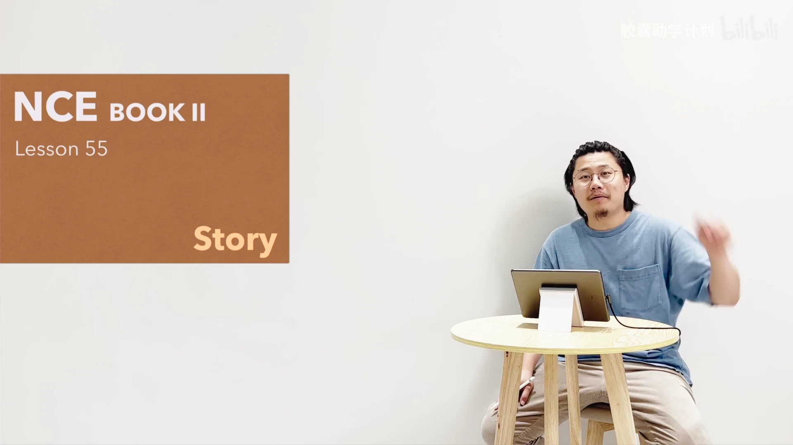

文字识别：NCE / BOOKⅡI / Lesson 55 / Story

### 画面 00:00:02

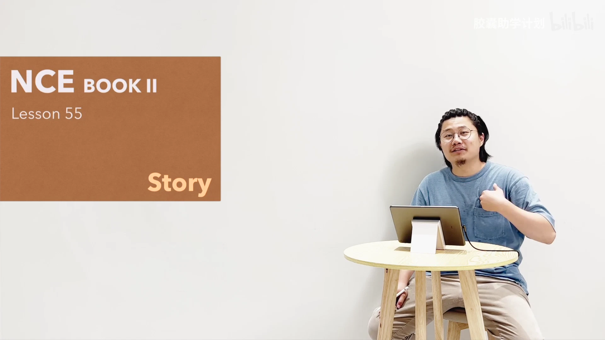

文字识别：NCE / BOOKⅡI / Lesson 55 / Story

### 画面 00:00:09

文字识别：胶囊助学计划bl出

### 画面 00:00:13

### 画面 00:00:15

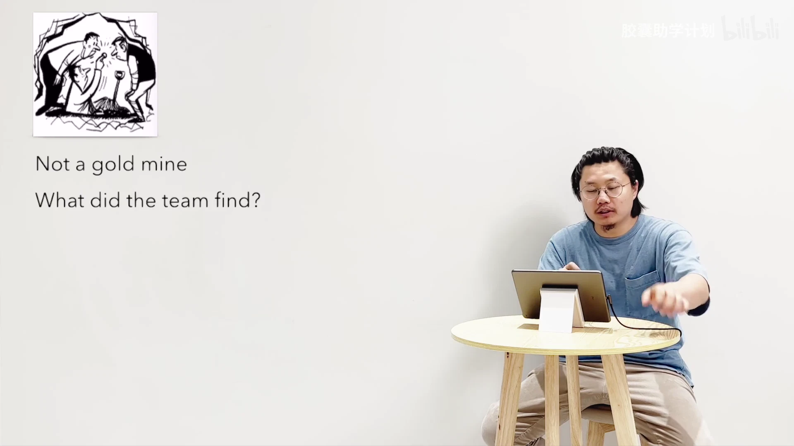

文字识别：Not a gold mine / What did the team find?

### 画面 00:00:27

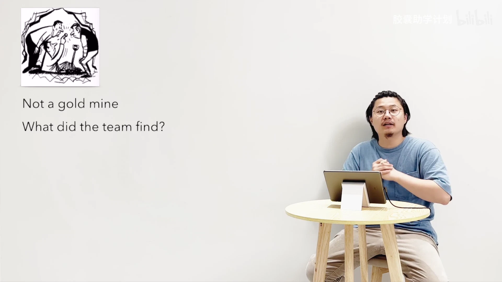

文字识别：Not a gold mine / What did the team find?

## 00:00:30–00:01:00

力就集中一起在文章学习的同时，看一看他们到底发现了什么东西啊？好，首先第一句话叫做 Dreams of finding lost treasure almost came true recently。好，首先这句话看上去就挺费劲的，是吧？好，就不少小的知识点。我们先给大家弄明白一件事，叫做这里的动词是 came to 的

### 画面 00:00:35

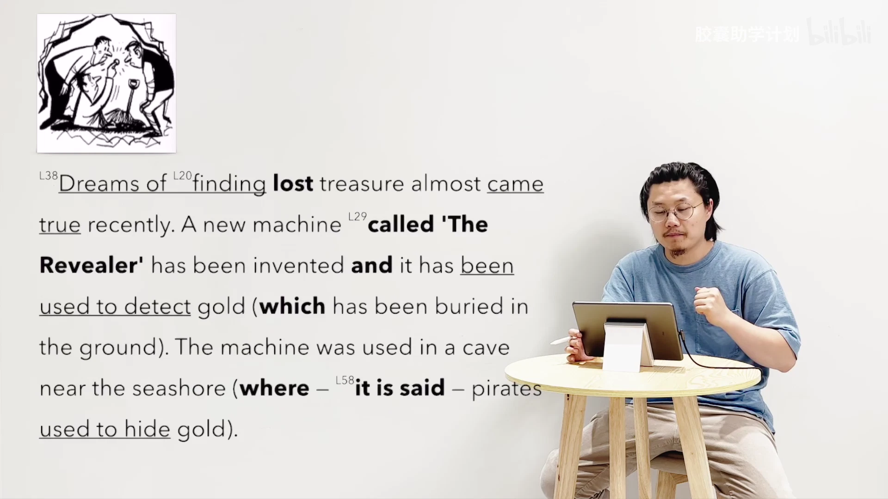

文字识别：L38Dreams of L2°finding lost treasure almost came / : 2°called 'The / true recently. A new machine / Revealer' has been invented and it has been / used to detect gold (which has been buried in / the ground). The machine was used in a cave / .L58it is said – pirates / near the seashore (where – / used to hide gold).

### 画面 00:00:37

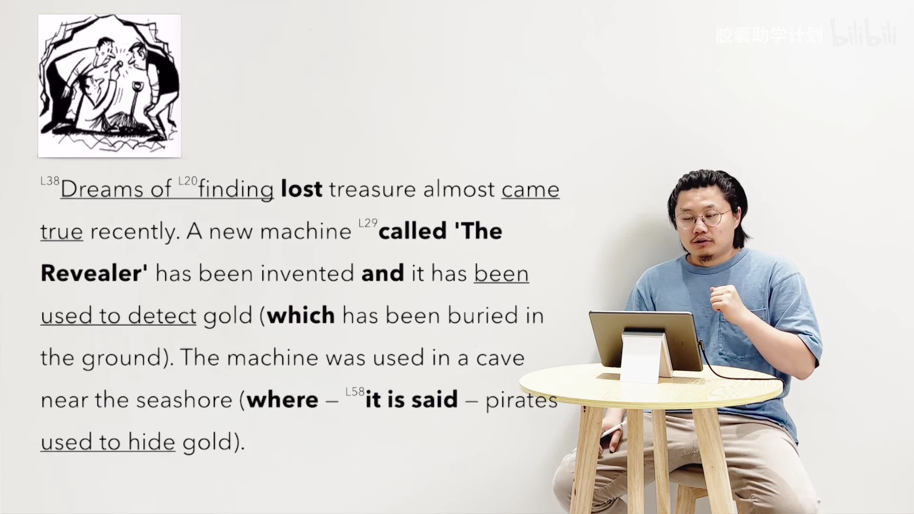

文字识别：L38 / Dreams of L2°finding lost treasure almost came / L29called 'The / true recently. A new machine / Revealer' has been invented and it has been / used to detect gold (which has been buried in / the ground). The machine was used in a cave / .L58it is said – pirates / near the seashore (where -" / used to hide gold).

### 画面 00:00:39

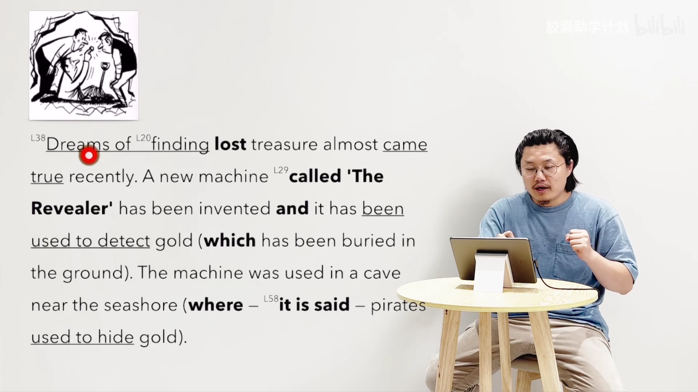

文字识别：L38 / Dreams of L2°finding lost treasure almost came /  L29called 'The / true recently. A new machine / Revealer' has been invented and it has been / used to detect gold (which has been buried in / the ground). The machine was used in a cave / .L58it is said – pirates / near the seashore (where - / used to hide gold).

### 画面 00:00:56

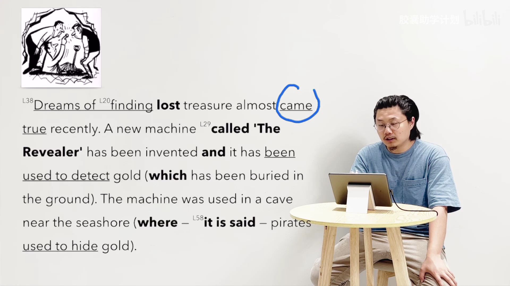

文字识别：L38 / Dreams of L2°finding lost treasure almostcame /  L29called 'The / true recently. A new machine' / Revealer' has been invented and it has been / used to detect gold (which has been buried in / the ground). The machine was used in a cave / .L58it is said – pirates / near the seashore (where - / used to hide gold).

## 00:01:00–00:01:30

came,然后整个前面这里其实都是主语。那我们看一下前面，首先 dreams of dream of，对吧？哎，dream of，首先你可以理解为它是三十八课咱们就学过的一个短语叫 dream of 梦想什么什么事儿，对吧？你也可以理解为是什么呢？咱由后往前翻译 a of b 结构，对吧？一个什么样的梦想？什么样的梦想呢？ Finding lost

### 画面 00:01:03

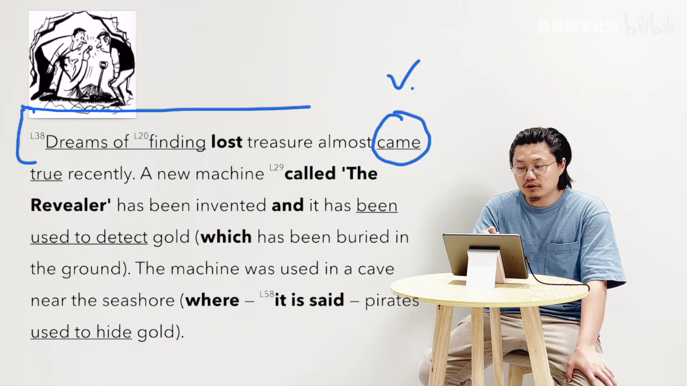

文字识别：L38 / Dreams of L2°finding lost treasure almostcame /  L29called 'The / true recently. A new machine / Revealer' has been invented and it has been / used to detect gold (which has been buried in / the ground). The machine was used in a cave / .L58it is said – pirates / near the seashore (where - / used to hide gold).

### 画面 00:01:05

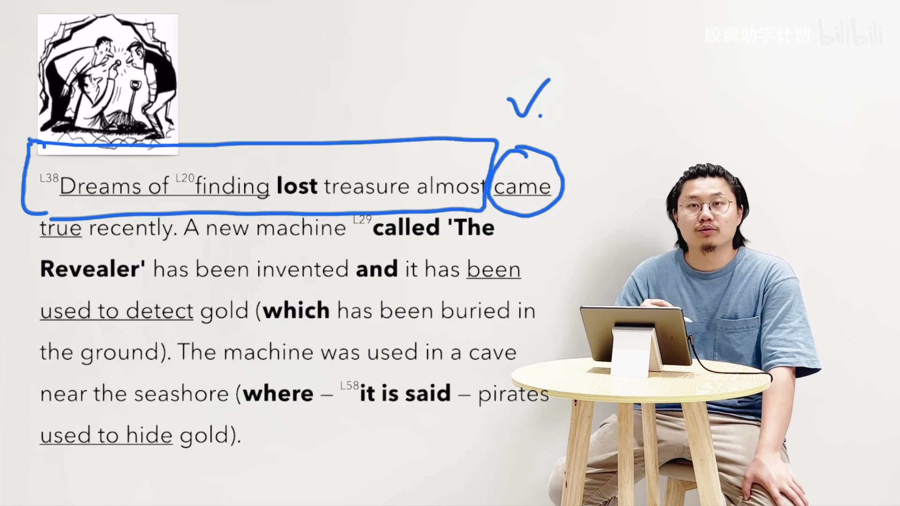

文字识别：Dreams of L2°finding lost treasure almost / L38 / came / true recently. A new machine / called 'The / Revealer' has been invented and it has been / used to detect gold (which has been buried in / the ground). The machine was used in a cave / .L58it is said – pirates / near the seashore (where - / used to hide gold).

### 画面 00:01:08

文字识别：Dreams of L2°finding lost treasure almost / L38 / came / true recently. A new machine / called 'The / Revealer' has been invented and it has been / used to detect gold (which has been buried in / the ground). The machine was used in a cave / .L58it is said – pirates / near the seashore (where - / used to hide gold).

### 画面 00:01:14

文字识别：L38 / Dreams of L2°finding lost treasure almost / came / true recently. A new machine / called 'The / Revealer' has been invented and it has been / used to detect gold (which has been buried in / the ground). The machine was used in a cave / L58it is said – pirates / near the seashore (where - / used to hide gold).

### 画面 00:01:22

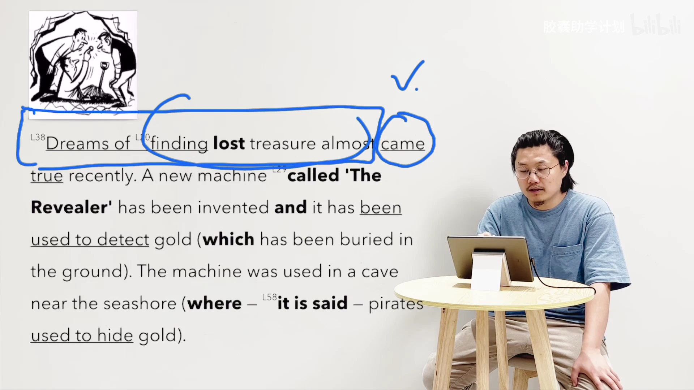

文字识别：L38 / Dreams of finding lost treasure almo / came / true recently. A new machine / ²called 'The / Revealer' has been invented and it has been / used to detect gold (which has been buried in / the ground). The machine was used in a cave / .L58it is said – pirates / near the seashore (where - / used to hide gold).

### 画面 00:01:24

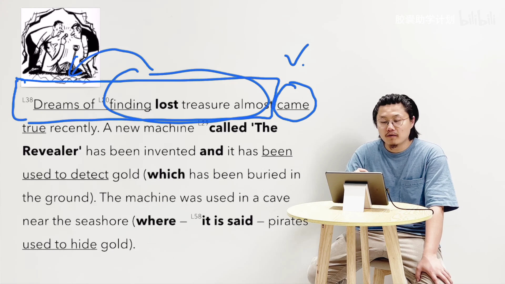

文字识别：Dreams of finding lost treasure almo / L38 / came / true recently. A new machine / t²called'The / Revealer' has been invented and it has been / used to detect gold (which has been buried in / the ground). The machine was used in a cave / .L58it is said – pirates / near the seashore (where - / used to hide gold).

## 00:01:30–00:02:00

treasure的梦想。那finding lost treasure这儿的finding为什么加ing呢？原因很简单，对吧？就是它是我们二二十课学过的，就是介词of后边一定要记住动词要用动名词，而不能用动词，对吧？要用动名词，所谓ing结构。所以这句话就变成了叫dreams什么样的dreams呢？Finding lost treasure的dreams almost came true，对吧？好，你看啊，

### 画面 00:01:31

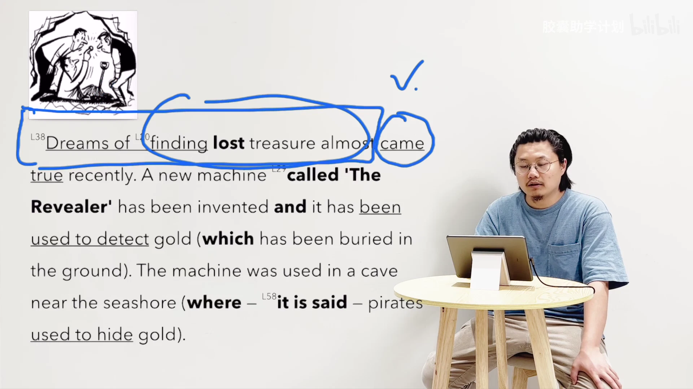

文字识别：L38 / Dreams of finding lost treasure almog / came / true recently. A new machine / "²called'The / Revealer' has been invented and it has been / used to detect gold (which has been buried in / the ground). The machine was used in a cave / .L58it is said – pirates / near the seashore (where - / used to hide gold).

### 画面 00:01:33

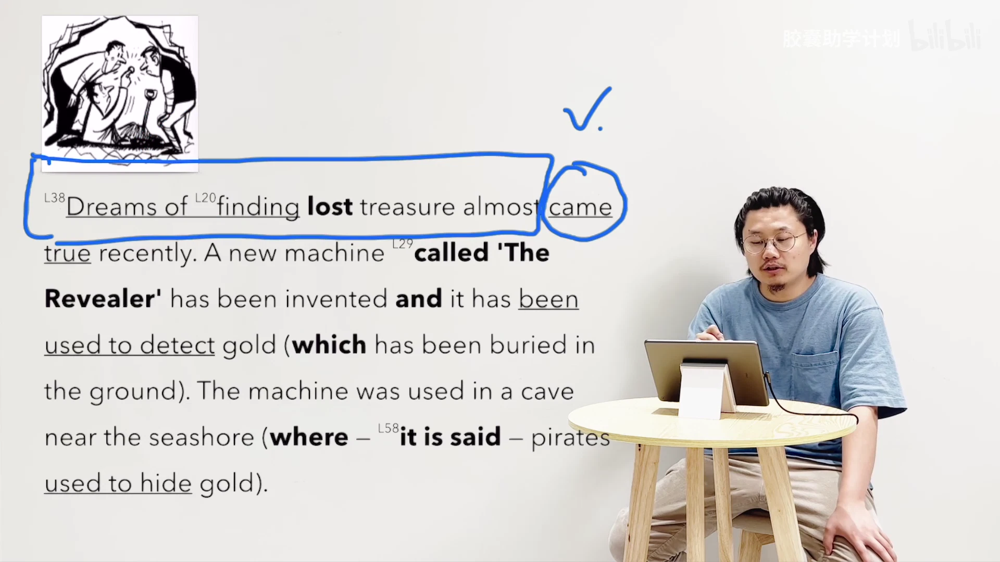

文字识别：Dreams of L2finding lost treasure almost / L38 / came / true recently. A new machine / called 'The / Revealer' has been invented and it has been / used to detect gold (which has been buried in / the ground). The machine was used in a cave / .L58it is said – pirates / near the seashore (where - / used to hide gold).

### 画面 00:01:36

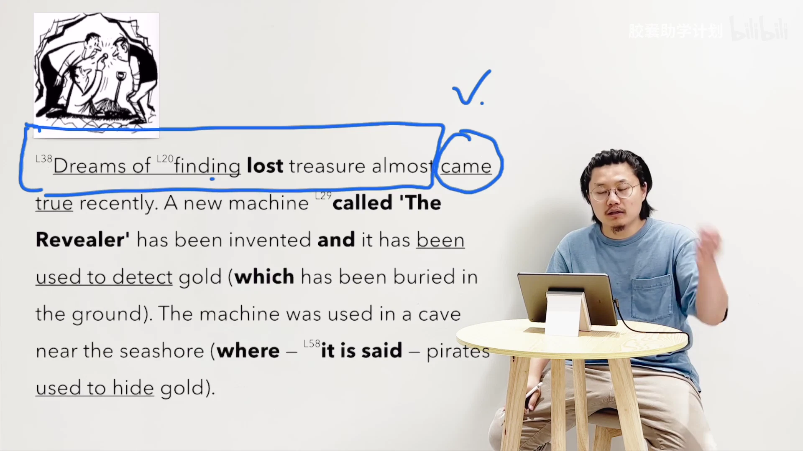

文字识别：L38 / Dreams of L2°finding lost treasure almost / came / true recently. A new machine / called 'The / Revealer' has been invented and it has been / used to detect gold (which has been buried in / the ground). The machine was used in a cave / .L58it is said – pirates / near the seashore (where - / used to hide gold).

## 00:02:00–00:02:30

说找到那 lost treasure。首先， lost 这个地方就有点怪。 lose 是我们管它叫做失去、丢失的，对吧？哎，那为什么这儿用 lost 了呢？包括这儿的 lost 是 did 还是 done 呢？它是 done，是咱们三十课学过的，叫做哎过去分词做定语，哎修饰的是这个 treasure，叫做被弄丢了的宝藏，对吧？哎，叫做找到被

### 画面 00:02:00

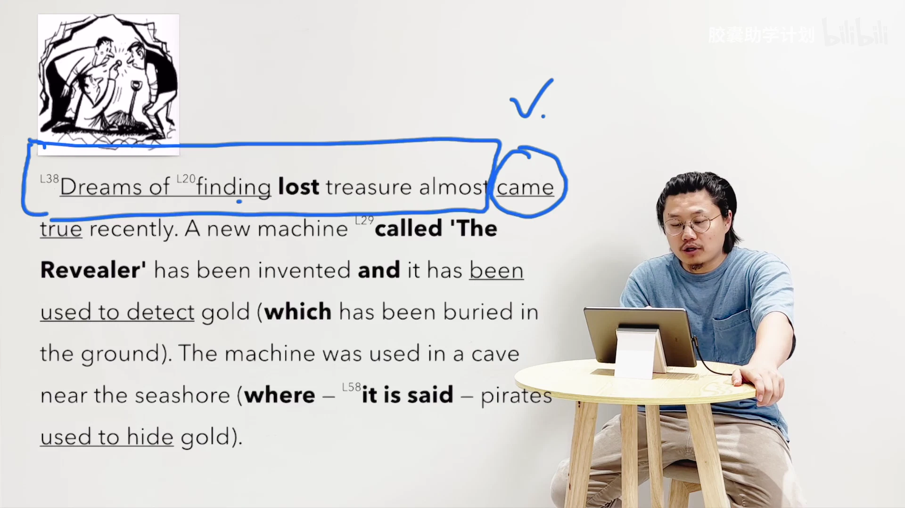

文字识别：Dreams of L2°finding lost treasure almost / L38 / came / true recently. A new machine / called 'The / Revealer' has been invented and it has been / used to detect gold (which has been buried in / the ground). The machine was used in a cave / .L58it is said – pirates / near the seashore (where - / used to hide gold).

### 画面 00:02:02

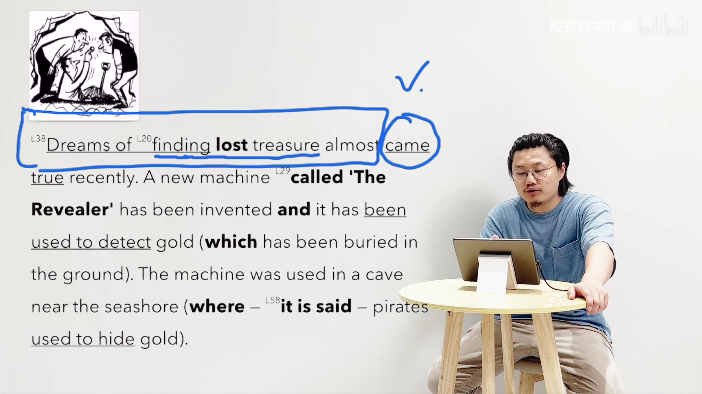

文字识别：Dreams of L2°finding lost treasure almost / L38 / came / true recently. A new machine / called 'The / Revealer' has been invented and it has been / used to detect gold (which has been buried in / the ground). The machine was used in a cave / L58it is said – pirates / near the seashore (where - / used to hide gold).

### 画面 00:02:04

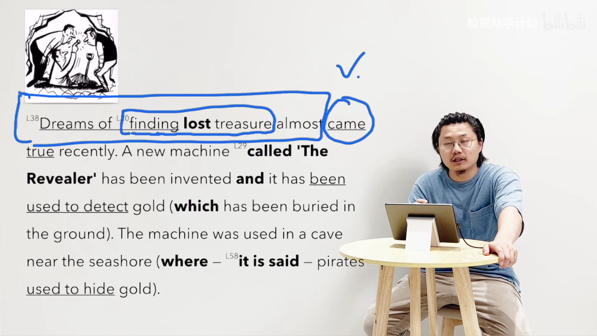

文字识别：L38 / Dreams of  / finding lost treasure / almost / came / true recently. A new machine / called 'The / Revealer' has been invented and it has been / used to detect gold (which has been buried in / the ground). The machine was used in a cave / L58it is said – pirates / near the seashore (where - / used to hide gold).

### 画面 00:02:07

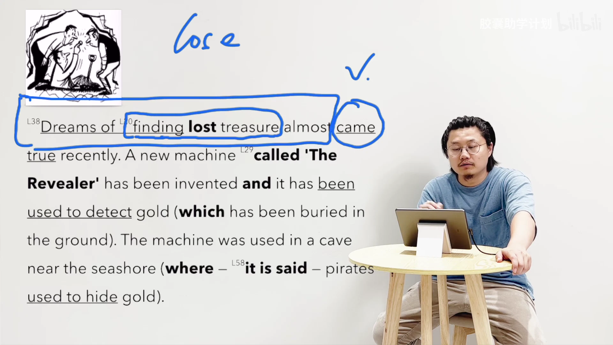

文字识别：lose / L38 / Dreams of / finding lost treasure / almost / came / true recently. A new machine / called 'The / Revealer' has been invented and it has been / used to detect gold (which has been buried in / the ground). The machine was used in a cave / L58it is said – pirates / near the seashore (where - / used to hide gold).

### 画面 00:02:16

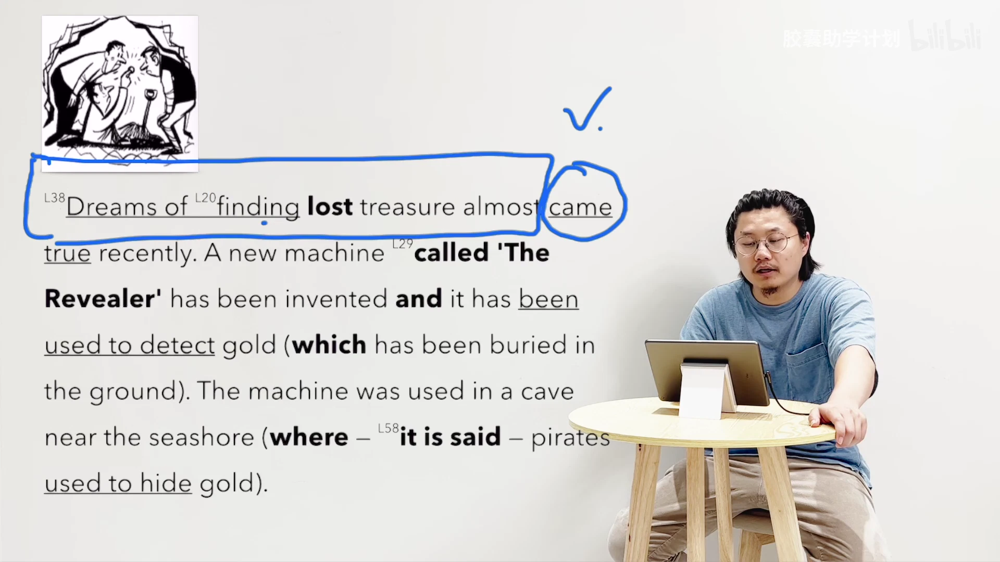

文字识别：L38 / Dreams of L2°finding lost treasure almost / came / true recently. A new machine / called 'The / Revealer' has been invented and it has been / used to detect gold (which has been buried in / the ground). The machine was used in a cave / .L58it is said – pirates / near the seashore (where - / used to hide gold).

### 画面 00:02:29

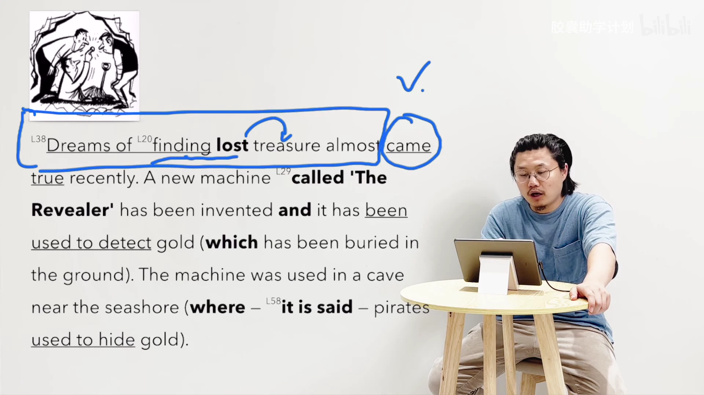

文字识别：L38 / Dreams of L2°finding lost treasure almost / came / true recently. A new machine / called 'The / Revealer' has been invented and it has been / used to detect gold (which has been buried in / the ground). The machine was used in a cave / .L58it is said – pirates / near the seashore (where - / used to hide gold).

## 00:02:30–00:03:00

被弄丢的宝藏的这样的一个梦想，almost这就不用管它了，一个小的副词，对吧？就是哎，叫做几乎就怎么样了呢？came true，几乎就变真了。Recently叫最近啊，这都很简单。所以这儿其实有一个小的习惯用法，叫做 dreams came true，梦想成真，对吧？OK，所以我们不把它当 dream of 去处理啊，我们把它当一个 a

### 画面 00:02:31

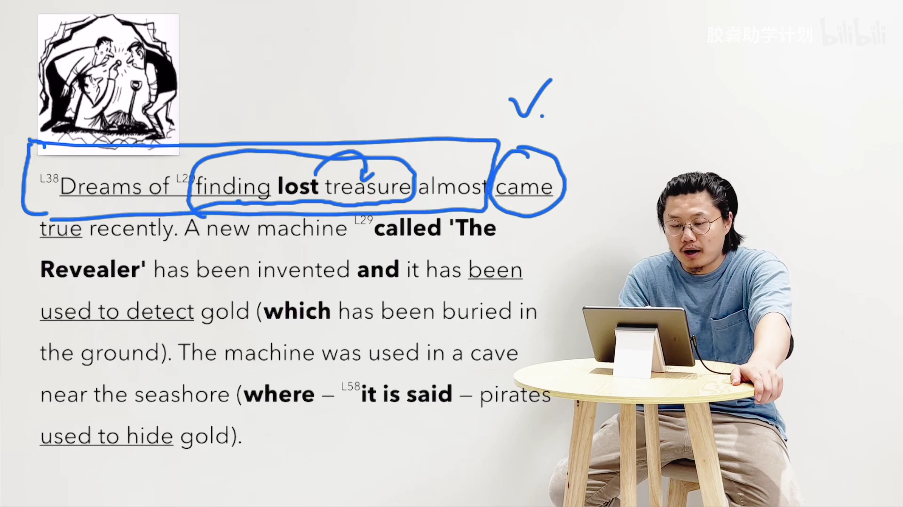

文字识别：L38 / Dreams of 2finding lost treasure / almost / came / true recently. A new machine / called 'The / Revealer' has been invented and it has been / used to detect gold (which has been buried in / the ground). The machine was used in a cave / L58it is said – pirates / near the seashore (where- / used to hide gold).

### 画面 00:02:36

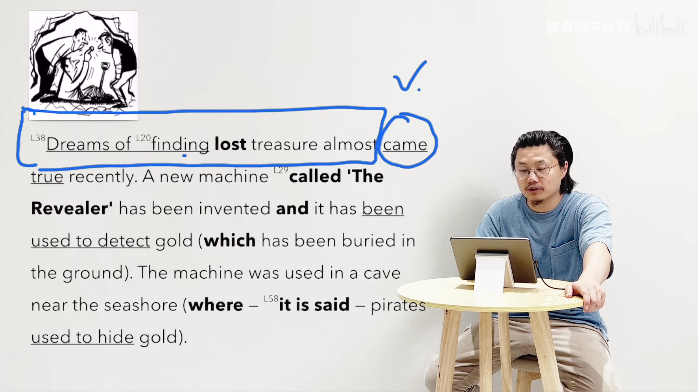

文字识别：L38 / Dreams of L2°finding lost treasure almost / came / true recently. A new machine / called 'The / Revealer' has been invented and it has been / used to detect gold (which has been buried in / the ground). The machine was used in a cave / L58it is said – pirates / near the seashore (where - / used to hide gold).

### 画面 00:02:38

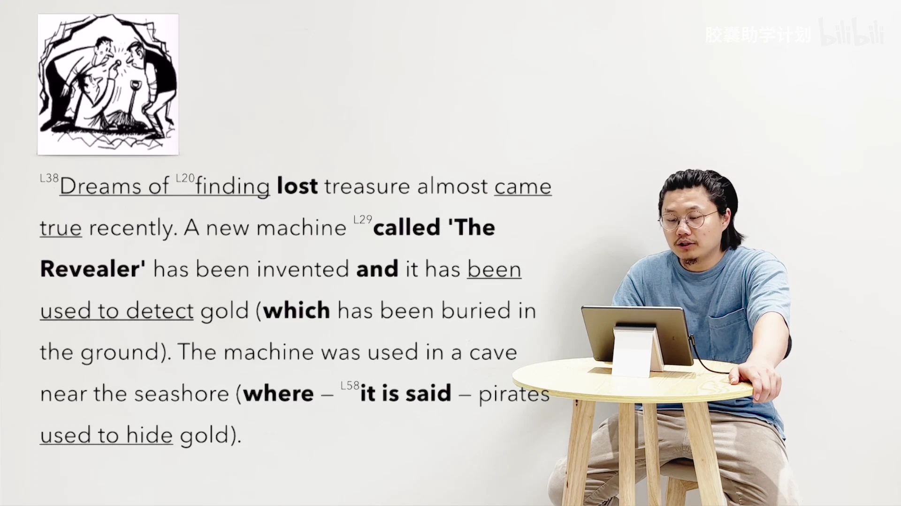

文字识别：L38 / Dreams of L2°finding lost treasure almost came / L29called 'The / true recently. A new machine / Revealer' has been invented and it has been / used to detect gold (which has been buried in / the ground). The machine was used in a cave / .L58it is said – pirates / near the seashore (where - / used to hide gold).

### 画面 00:02:51

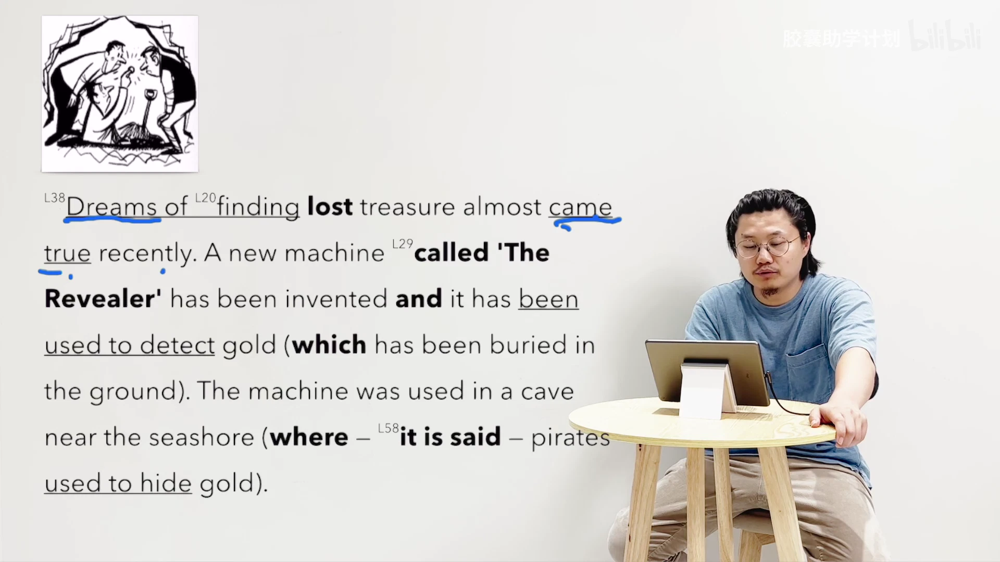

文字识别：L38Dreams of L2°finding lost treasure almost came / L29called 'The / true recently. A new machine / Revealer' has been invented and it has been / used to detect gold (which has been buried in / the ground). The machine was used in a cave / .L58it is said – pirates / near the seashore (where - / used to hide gold).

## 00:03:00–00:03:30

A of B 去处理，对于各位来说很容易理解，对吧？A dreams 梦想，B finding lost treasure 找到遗失宝藏，对吧？哎，什么样的梦想呢？由后往前翻译，找到遗失宝藏的梦想，对吧？哎，这个梦想怎么样了呢？差一，最近差一点就成真了。第一句话就说了一个，开了个不好的头。为什么呢？因为多了个 almost，叫做差点成真了，

### 画面 00:03:00

文字识别：Dreams of L2°finding lost treasure almost came / true recently.A new machine / _29 / called'The / Revealer' has been invented and it has been / used to detect gold (which has been buried in / the ground). The machine was used in a cave / L58it is said – pirates / near the seashore (where - / used to hide gold).

### 画面 00:03:02

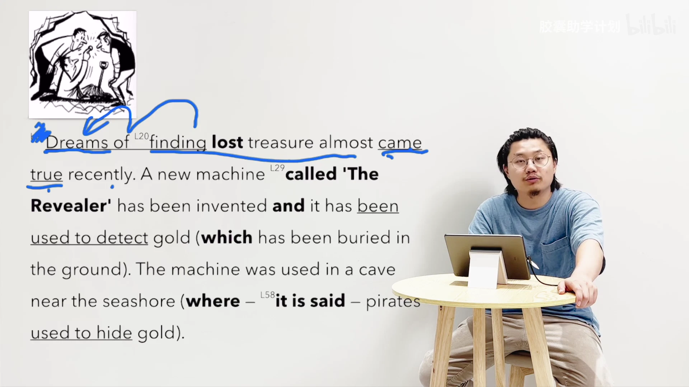

文字识别：Dreams of L2°finding lost treasure almost came / true recently.A new machine / 29 / called'The / Revealer' has been invented and it has been / used to detect gold (which has been buried in / the ground). The machine was used in a cave / L58it is said — pirates / near the seashore (where - / used to hide gold).

### 画面 00:03:11

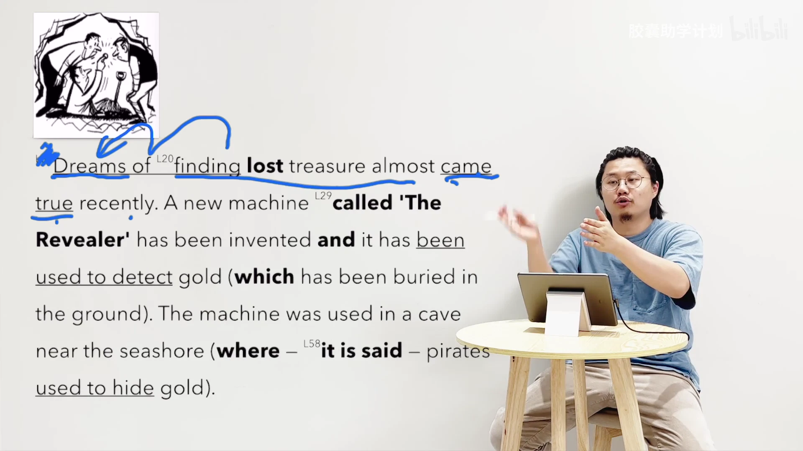

文字识别：Dreams of L2finding lost treasure almost came / true recently.A new machine / .29 / called'The / Revealer' has been invented and it has been / used to detect gold (which has been buried in / the ground). The machine was used in a cave / L58it is said — pirates / near the seashore (where - / used to hide gold).

### 画面 00:03:19

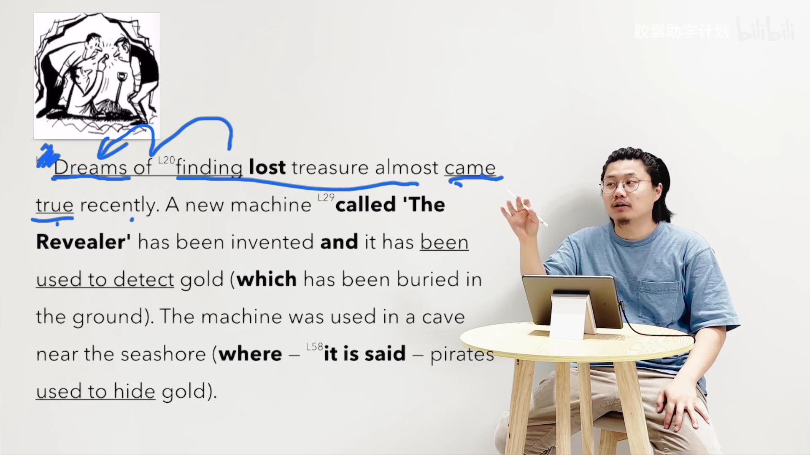

文字识别：Dreams of L20finding lost treasure almost came / true recently.A new machine / _29 / called'The / Revealer' has been invented and it has been / used to detect gold (which has been buried in / the ground). The machine was used in a cave / .L58it is said – pirates / near the seashore (where - / used to hide gold).

### 画面 00:03:22

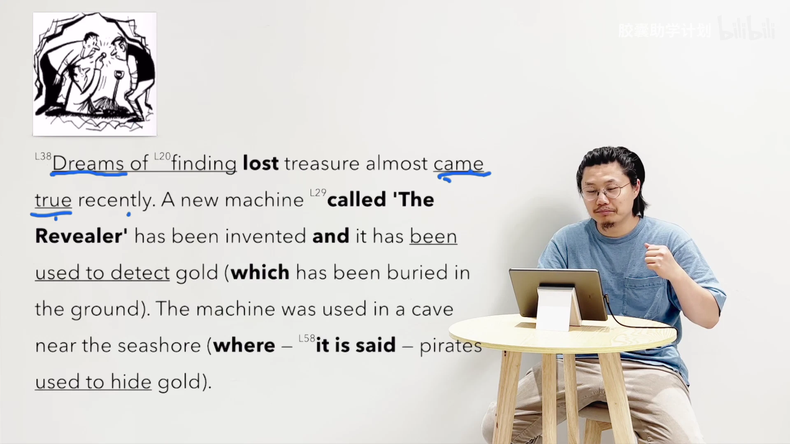

文字识别：L38 / Dreams of L2°finding lost treasure almost came / L29called 'The / true recently. A new machine / Revealer' has been invented and it has been / used to detect gold (which has been buried in / the ground). The machine was used in a cave / . 58it is said – pirates / near the seashore (where – / used to hide gold).

### 画面 00:03:24

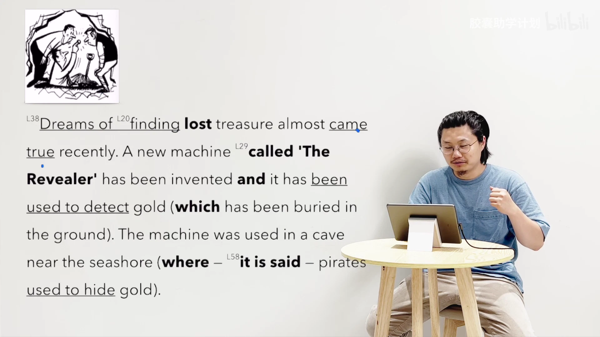

文字识别：L38 / Dreams of L2finding lost treasure almost came / L29called 'The / true recently. A new machine / Revealer' has been invented and it has been / used to detect gold (which has been buried in / the ground). The machine was used in a cave / .L58it is said – pirates / near the seashore (where -' / used to hide gold).

### 画面 00:03:27

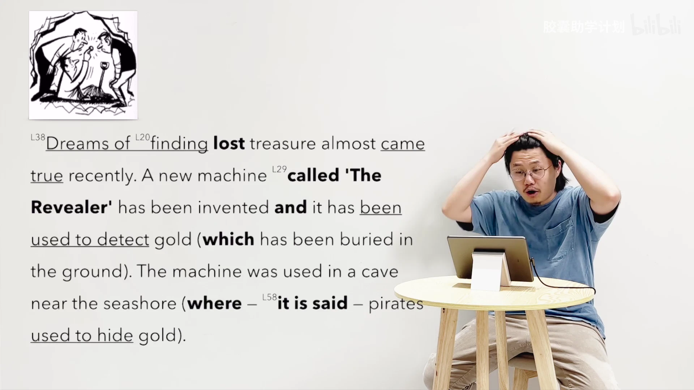

文字识别：L38 / Dreams of L2°finding lost treasure almost came / : 29called 'The / true recently. A new machine / Revealer' has been invented and it has been / used to detect gold (which has been buried in / the ground). The machine was used in a cave / .L58it is said – pirates / near the seashore (where - / used to hide gold).

## 00:03:30–00:04:00

几乎成真了，对吧？但没成真啊。A new machine,一个新的机器, called the revealer.首先called the revealer,对吧？这就是一个非常重要的语法了啊。这个语法是什么呢？叫做过去分词怎么样做定语后置了，对吧？哎，called被叫做什么什么啊？包括这个二十九课咱们也见过，对吧？呃呃，called the pilot's porter.我印象当中

### 画面 00:03:30

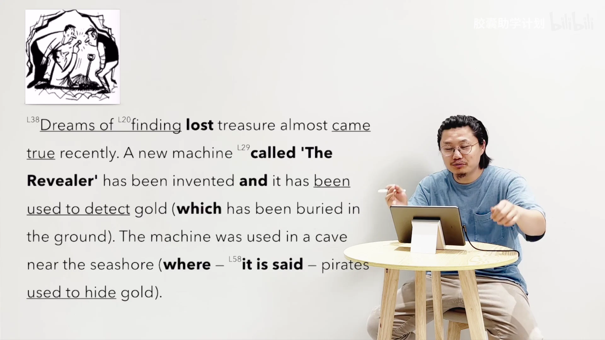

文字识别：L38 / Dreams of 2°finding lost treasure almost came / : 29called'The / true recently. A new machine / Revealer' has been invented and it has been / used to detect gold (which has been buried in / the ground). The machine was used in a cave / L58it is said – pirates / near the seashore (where- / used to hide gold).

### 画面 00:03:32

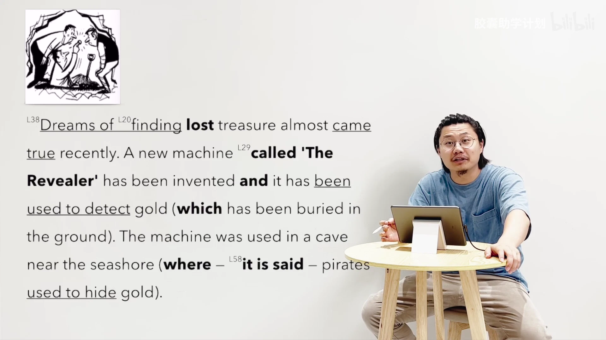

文字识别：L38 / Dreams of 2°finding lost treasure almost came / L29called 'The / true recently. A new machine / Revealer' has been invented and it has been / used to detect gold (which has been buried in / the ground). The machine was used in a cave / .L58it is said – pirates / near the seashore (where - / used to hide gold).

### 画面 00:03:34

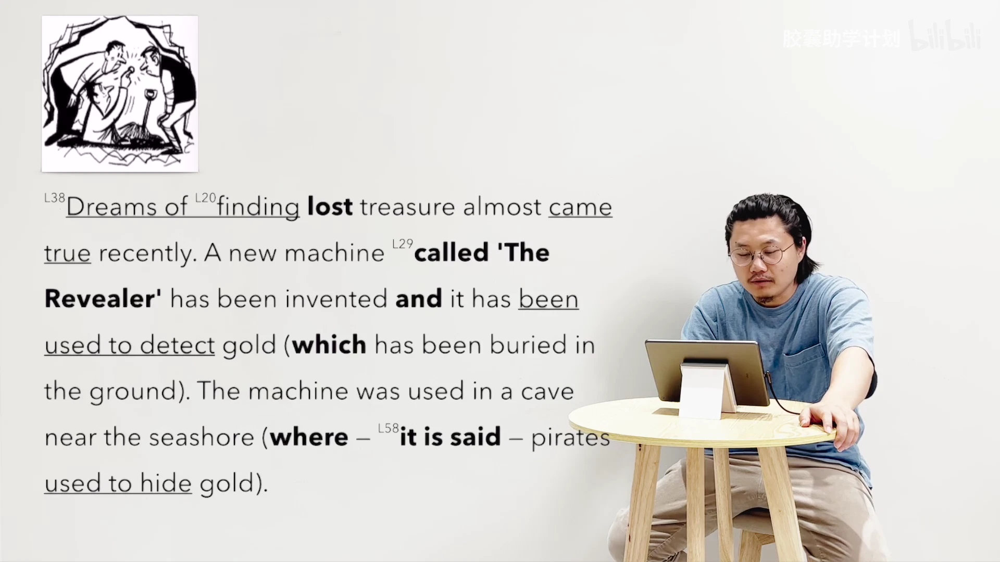

文字识别：L38 / Dreams of L2°finding lost treasure almost came / L29called 'The / true recently. A new machine / Revealer' has been invented and it has been / used to detect gold (which has been buried in / the ground). The machine was used in a cave / .L58it is said – pirates / near the seashore (where - / used to hide gold).

## 00:04:00–00:04:30

啊, called pilot as Porter, OK, 那就是那个他那个 taxi 被叫做 pilot as Porter, 其实那个 taxi 是一个飞机。那一刻，不知道各位有没有印象，对吧？被叫做 pilot as Porter, 啊，那 a new machine called the Revealor, 叫做这个新的机器被叫做 Revealor, has been invented, 那这就很简单了，一个被动，对吧？现在完成时的被动，叫做已经被发明出来了。And 连接了并列句，第二句话是什么呢？It has been used to

### 画面 00:04:04

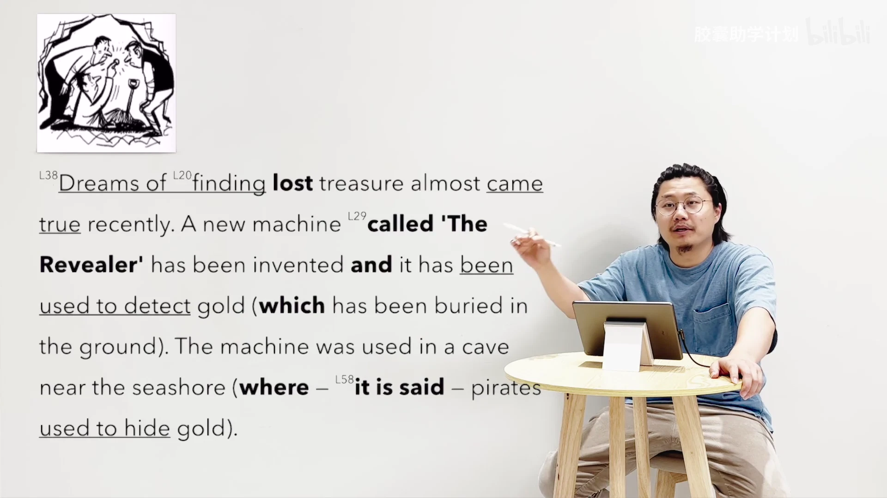

文字识别：L38Dreams of {2°finding lost treasure almost came / L29called 'The / true recently. A new machine / Revealer' has been invented and it has been / used to detect gold (which has been buried in / the ground). The machine was used in a cave / L58it is said – pirates / near the seashore (where - / used to hide gold).

### 画面 00:04:06

文字识别：L38 / Dreams of 2°finding lost treasure almost came / L29called 'The / true recently. A new machine / Revealer' has been invented and it has been / used to detect gold (which has been buried in / the ground). The machine was used in a cave / .L58it is said – pirates / near the seashore (where - / used to hide gold).

### 画面 00:04:08

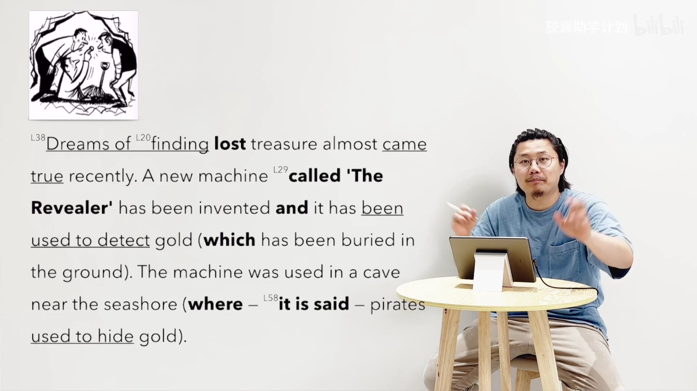

文字识别：L38 / Dreams of L2°finding lost treasure almost came / L29called 'The / true recently. A new machine / Revealer' has been invented and it has been / used to detect gold (which has been buried in / the ground). The machine was used in a cave / .L58it is said – pirates / near the seashore (where - / used to hide gold).

### 画面 00:04:11

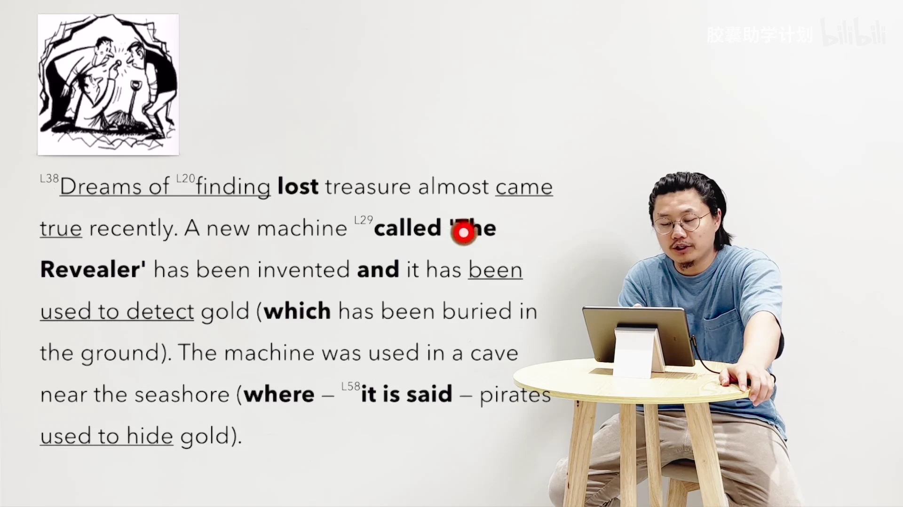

文字识别：L38Dreams of L2°finding lost treasure almost came /  L29called / true recently. A new machine / ie / Revealer' has been invented and it has been / used to detect gold (which has been buried in / the ground). The machine was used in a cave / .L58it is said – pirates / near the seashore (where - / used to hide gold).

## 00:04:30–00:05:00

gold.说它已经has been used已经被使用来to detect gold去哎这个检测哎检查啊测啊有没有这个金子去探测金子对吧？好，后边还有一个which咱们先不管它。这儿我稍微多提一句。首先这里的to detect gold啊，首先it has been used很好理解，现在完成时的被动叫做已经被使用来

### 画面 00:04:41

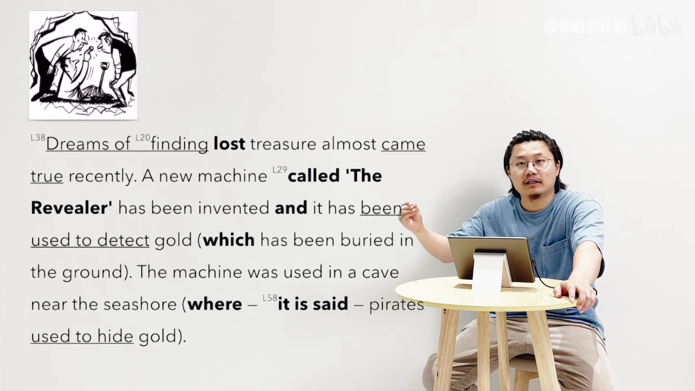

文字识别：L38 / Dreams of L2finding lost treasure almost came / L29called 'The / true recently. A new machine / Revealer' has been invented and it has been / used to detect gold (which has been buried in / the ground). The machine was used in a cave / L58it is said – pirates / near the seashore (where - / used to hide gold).

## 00:05:00–00:05:30

去，目的是干什么呢？哎，去检测啊，检查这个呃，探测这个金子，对吧？好，这个地方我们有两个理解方式啊。第一个稍微费点劲，叫做你把这个 to do something 当作是一个表目的状语啊，管它叫非谓语，叫 to do 结构啊。你听上去这些词儿 to do 结构、非谓语啊、目的状，听上去就很夸张，对吧？哎，这对

### 画面 00:05:10

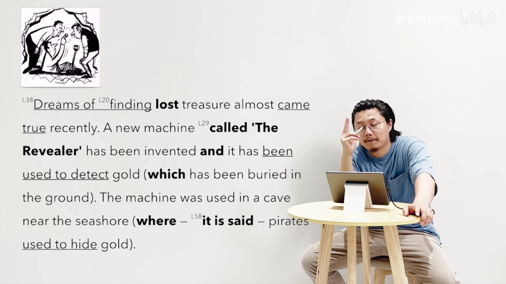

文字识别：L38 / Dreams of L2finding lost treasure almost came / L29called 'The / true recently. A new machine / Revealer' has been invented and it has been / used to detect gold (which has been buried in / the ground). The machine was used in a cave / .L58it is said – pirates / near the seashore (where -" / used to hide gold).

### 画面 00:05:14

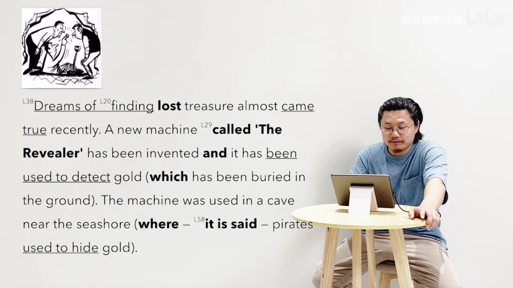

文字识别：L38 / Dreams of L2°finding lost treasure almost came / L29called 'The / true recently. A new machine / Revealer' has been invented and it has been / used to detect gold (which has been buried in / the ground). The machine was used in a cave / L58it is said – pirates / near the seashore (where - / used to hide gold).

## 00:05:30–00:06:00

于咱们来说呢，懂不懂其实不是最重要的，最重要的是要能用，对吧？哎，那怎么能用呢？Be used to do something，这事儿就结了，叫做被使用来去做某件事情，被使用来去做某件事情，对吧？好，你比如说说这个东西叫被使用来去检测Go的，我们直接把这个语法给它变成一个习惯

### 画面 00:05:39

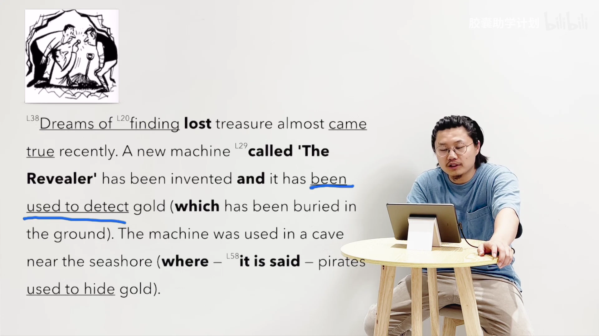

文字识别：L38Dreams of L2°finding lost treasure almost came / L29called 'The / true recently. A new machine / Revealer' has been invented and it has been / used to detect gold (which has been buried in / the ground). The machine was used in a cave / L58it is said – pirates / near the seashore (where - / used to hide gold).

## 00:06:00–00:06:30

用法，有点像单词部分我讲到的 I'm confident that。你不用管它到底是个什么从句，你就大量造句，最后的结果就是在听说读写当中，你动笔张嘴就能写写出来。哎，这个说出来 I'm confident that 后边加一句话这样的句型，对吧？哎，所以这是我比较推崇大家学习的一个方式。你先不用管它是不是非谓语啊这些东西，对吧？所以很容易理解叫做被使用来去探测金子后边一

### 画面 00:06:09

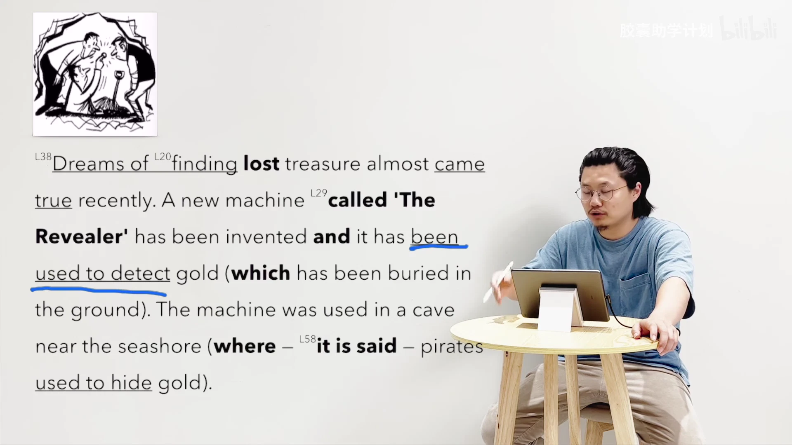

文字识别：L38 / Dreams of L2°finding lost treasure almost came / L29called 'The / true recently. A new machine / Revealer' has been invented and it has been / used to detect gold (which has been buried in / the ground). The machine was used in a cave / L58it is said – pirates / near the seashore (where - / used to hide gold).

### 画面 00:06:22

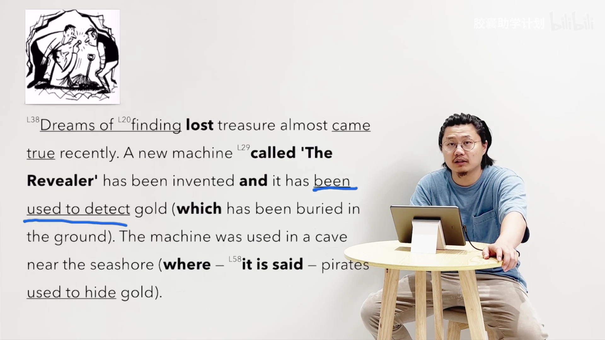

文字识别：L38 / Dreams of L2finding lost treasure almost came / L29called 'The / true recently. A new machine / Revealer' has been invented and it has been / used to detect gold (which has been buried in / the ground). The machine was used in a cave / .L58it is said – pirates / near the seashore (where - / used to hide gold).

### 画面 00:06:25

文字识别：L38 / Dreams of L2finding lost treasure almost came / L29called 'The / true recently. A new machine / Revealer' has been invented and it has been / used to detect gold (which has been buried in / the ground). The machine was used in a cave / L58it is said – pirates / near the seashore (where - / used to hide gold).

## 00:06:30–00:07:00

个很普通的定语从句叫做这个金子 has been buried in the ground已经被埋在了地下，很容易理解，不多说了。The machine was used in a cave near the seashore. 好，说这个机器被使用在哪儿呢？In a cave，在一个山洞里，哪儿的山洞呢？Near a seashore，在海岸边的一个山洞里，对吧？好，后边给了一个 where，对吧？这个语法部分我们认

### 画面 00:06:55

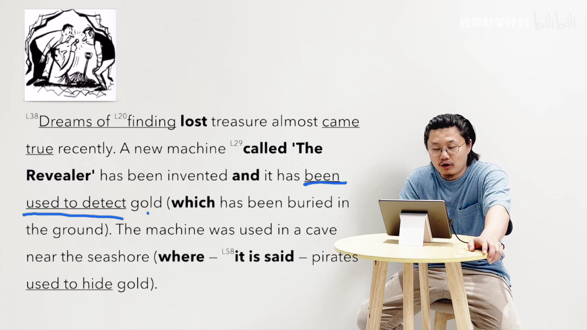

文字识别：L38 / Dreams of L2finding lost treasure almost came / L29called 'The / true recently. A new machine / Revealer' has been invented and it has been / used to detect gold (which has been buried in / • / the ground). The machine was used in a cave / L58it is said – pirates / near the seashore (where - / used to hide gold).

## 00:07:00–00:07:30

认真真的讲过了。Where叫在那里，对吧？哎，在哪里呢？哎，在海岸边上的山洞里啊。说在那里后边这个东西咱先不管它，你相信我，咱先不看它啊。叫做在那里，Paris used to hide gold，这就很容易理解了，叫做海盗过去常常在那里藏金子，现在不藏了，对吧？哎，used to do。那这个It is said，首先你注意，你看前破折后

### 画面 00:07:14

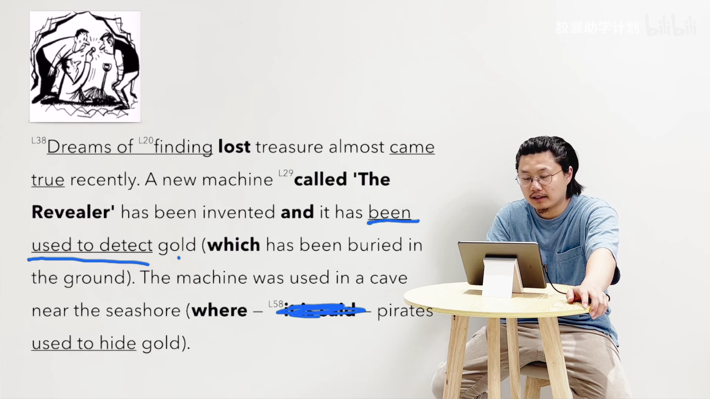

文字识别：L38 / Dreams of L2finding lost treasure almost came / true recently. A new machine / L29 / 29called 'The / Revealer' has been invented and it has been / used to detect gold (which has been buried in / the ground). The machine was used in a cave / near the seashore (where - / L58· / pirates / used to hide gold).

### 画面 00:07:26

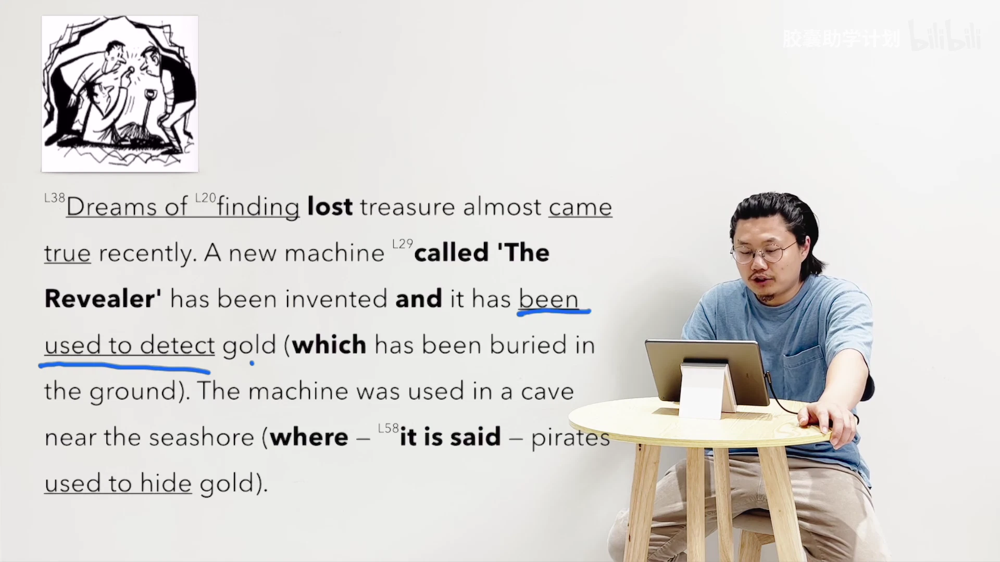

文字识别：Dreams of L2°finding lost treasure almost came / L38 / L29called 'The / true recently. A new machine / Revealer' has been invented and it has been / used to detect gold (which has been buried in / the ground). The machine was used in a cave / .L58it is said – pirates / near the seashore (where - / used to hide gold).

## 00:07:30–00:08:00

破折，这个是一个英文当中的小习惯，前破折后破折，中间这个东西叫插入语，这个语法你懂它叫这个名字，不懂它叫这个名字完全不影响你理解它，它就是呃信息补充一下，对吧？哎，补充一下这么一个东西啊，就没什么用，没有也没有插入语从句啊，你相信我，所以就是这么一个小的东西，大部分情况下甚至不看都可以啊，所以你比如你想偷懒儿，你看到这

### 画面 00:07:31

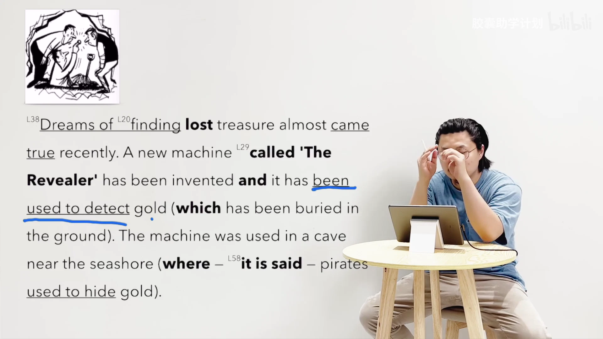

文字识别：L38 / Dreams of 2°finding lost treasure almost came / L29called 'The / true recently. A new machine / Revealer' has been invented and it has been / used to detect gold (which has been buried in / the ground). The machine was used in a cave / .L58it is said – pirates / near the seashore (where - / used to hide gold).

### 画面 00:07:37

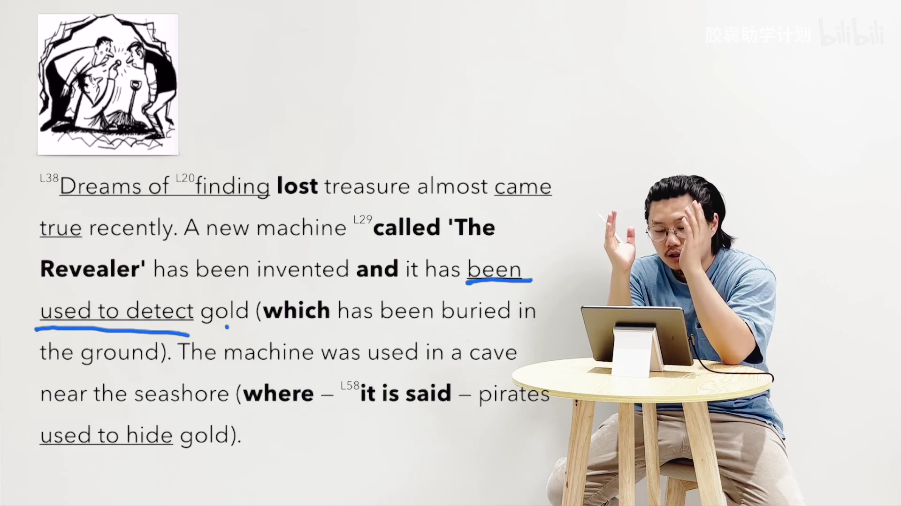

文字识别：L38Dreams of L2°finding lost treasure almost came / L29called 'The / true recently. A new machine / Revealer' has been invented and it has been / used to detect gold (which has been buried in / the ground). The machine was used in a cave / L58it is said – pirates / near the seashore (where - / used to hide gold).

### 画面 00:07:54

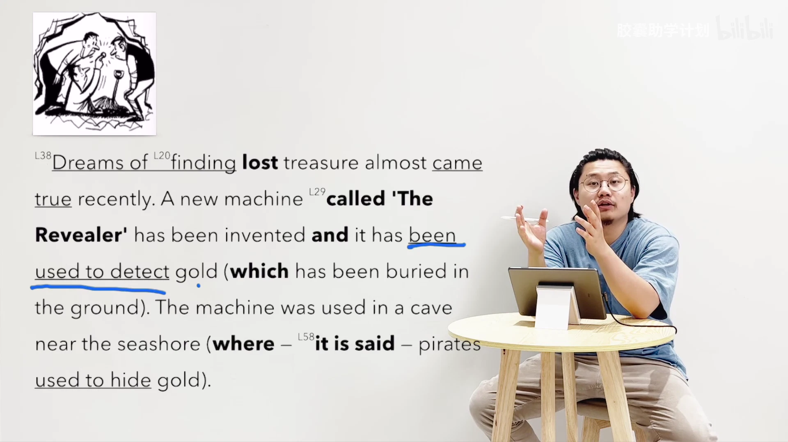

文字识别：L38 / Dreams of 2finding lost treasure almost came / L29called 'The / true recently. A new machine / Revealer' has been invented and it has been / used to detect gold (which has been buried in / the ground). The machine was used in a cave / .L58it is said – pirates / near the seashore (where- / used to hide gold).

### 画面 00:07:59

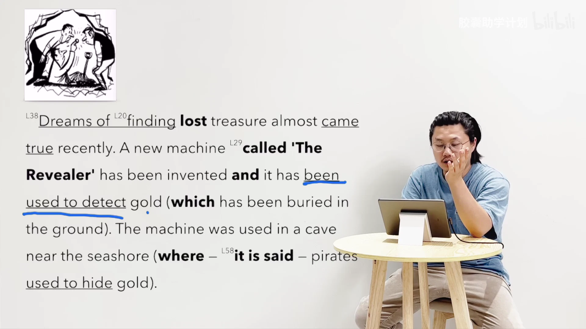

文字识别：L38 / Dreams of L2°finding lost treasure almost came / L29called 'The / true recently. A new machine / Revealer' has been invented and it has been / used to detect gold (which has been buried in / the ground). The machine was used in a cave / .L58it is said – pirates / near the seashore (where- / used to hide gold).

## 00:08:00–00:08:30

儿有一个插入，你直接不看它。Where Paris used to go，这事儿就结束了。那 It is said 是什么意思呢？首先，这个是五十八课咱们会讲的，据说的一个句型，对吧？啊，我现在已经提前说了，It is said 就是叫做据说，翻译成俩字儿。那你看，其实你从字面意思叫它被说，被但被说，对吧？它被说，直接叫汉语就是据说啊。所以这句话我们再翻译一遍，叫做在那里

### 画面 00:08:27

文字识别：L38Dreams of L2°finding lost treasure almost came / L29called 'The / true recently. A new machine / Revealer' has been invented and it has been / used to detect gold (which has been buried in / the ground). The machine was used in a cave / L58it is said – pirates / near the seashore (where - / used to hide gold).

## 00:08:30–00:09:00

据说，因为没有人知道，是吧？ Pirates，海盗过去常常在那里藏金子，啊，很容易理解了吧？再往下，说The pirates would often bury gold in the cave and then fail to collect it. 好了，and前后两句话，我们先看第一句话，说这个海盗 would often bury gold in the cave. Would do

### 画面 00:08:35

文字识别：L38 / Dreams of L2°finding lost treasure almost came / L29called 'The / true recently. A new machine / Revealer' has been invented and it has been / used to detect gold (which has been buried in / • / the ground). The machine was used in a cave / L58it is said – pirates / near the seashore (where- / used to hide gold).

### 画面 00:08:40

文字识别：The pirates would often bury gold in the cave / and then -'fail to collect it. Armed with the new / machine, a search party went into the cave / L36 / 'hoping to find buried treasure. The leader of / the party was examining the soil near the / entrance to the cave when the machine showed / that there was gold under the ground.

## 00:09:00–00:09:30

语法本课的一个小重点叫做过去常常啊，经常啊，埋藏金子在这个山洞里面。And then然后呢，fail to collect it。好，这里有几个小的点。第一个叫fail to do something，十六课咱学过。嗯，第一个从最字面的意思就是失败去做某件事儿，没有成功的做成某件事情，对吧？第二个呢，你如果直接把它意译过来，就是未能完成某件事情啊。

### 画面 00:09:10

文字识别：The pirates would often bury gold in the cave / and then -'fail to collect it. Armed with the new / machine, a search party went into the cave / L36 / 'hoping to find buried treasure. The leader of / the party was examining the soil near the / entrance to the cave when the machine showed / that there was gold under the ground.

### 画面 00:09:17

文字识别：The pirates would often bury gold in the cave / and then 1ofail to collect it. Armed with the new / machine, a search party went into the cave / L36 / 'hoping to find buried treasure. The leader of / the party was examining the soil near the / entrance to the cave when the machine showed / that there was gold under the ground.

### 画面 00:09:19

文字识别：The pirates would often bury gold in the cave / and then ofail to collect it. Armed with the new / machine, a search party went into the cave / L36Y / 'hoping to find buried treasure. The leader of / the party was examining the soil near the / entrance to the cave when the machine showed / that there was gold under the ground.

## 00:09:30–00:10:00

那其次这个地方的 collect collect 对于各位来说很容易理解的就是收集的意思，对吧？这个地方其实还有一个意思就是取回，其实就类似于 take 啊拿回来，对吧？所以他们哎常常常在这里藏金子，但是呢又未能或者没有能把它给取出来拿出来啊。其次，最后就是这个地方有一个小的连读啊， it 啊不读成 collect it，

### 画面 00:09:32

文字识别：The pirates would often bury gold in the cave / and then 16fail to Collect. Armed with the new / machine, a search party went into the cave / L36 / 'hoping to find buried treasure. The leader of / the party was examining the soil near the / entrance to the cave when the machine showed / that there was gold under the ground.

### 画面 00:09:38

文字识别：The pirates would often bury gold in the cave / and then 'fail to collect it. Armed with the new / machine, a search party went into the cave / L36 / 'hoping to find buried treasure. The leader of / the party was examining the soil near the / entrance to the cave when the machine showed / that there was gold under the ground.

### 画面 00:09:40

文字识别：The pirates would often bury gold in the cave / and then 'fail to collect it. Armed with the new / machine, a search party went into the cave / L36μ / 'hoping to find buried treasure. The leader of / the party was examining the soil near the / entrance to the cave when the machine showed / that there was gold under the ground.

### 画面 00:09:42

文字识别：The pirates would often bury gold in the cave / and then 1ofail to collect it. Armed with the new / machine, a search party went into the cave / L36 / 'hoping to find buried treasure. The leader of / the party was examining the soil near the / entrance to the cave when the machine showed / that there was gold under the ground.

### 画面 00:09:44

文字识别：The pirates would often bury gold in the cave / and then ofail to collect it. Armed with the new / machine, a search party went into the cave / L36H / 'hoping to find buried treasure. The leader of / the party was examining the soil near the / entrance to the cave when the machine showed / that there was gold under the ground.

### 画面 00:09:54

文字识别：The pirates would often bury gold in the cave / and then ['fail to collect it. Armed with the new / machine, a search party went into the cave / L36H / 'hoping to find buried treasure. The leader of / the party was examining the soil near the / entrance to the cave when the machine showed / that there was gold under the ground.

## 00:10:00–00:10:30

这样没有错。连读 collected， OK。好，不多说了啊，接着往下走。 Armed with the new machine，四十九课你学的好，这句话瞬间就能懂。我们先往下走，装备着新的机器，必然要问一个问题，主语是谁？你这句话凭什么没有主语？谁装备着新的机器？我不知道。所以如果你四十九课学的好，瞬间应该能想过来啊。我们先往下走，说 a

### 画面 00:10:24

文字识别：The pirates would often bury gold in the cave / and then 「'fail to collect it. Armed with the new / machine, a search party went into the cave / L36Y / 'hoping to find buried treasure. The leader of / the party was examining the soil near the / entrance to the cave when the machine showed / that there was gold under the ground.

## 00:10:30–00:11:00

search party went into the cave. 说一个搜索小队进入了这个山洞。Party，我讲过了，对吧？哎，它确实有聚会的意思，但是它最本质的意思就是那么一群人。所以由此引申出来了一个新的意思，叫党派啊。这个对于各位现在用不到。进入了这个山洞，后边叫做 hoping to find buried treasure. 好了，希望去找到被埋藏的宝藏，对吧？被埋起来的宝藏。这地方有好几

### 画面 00:10:54

文字识别：The pirates would often bury gold in the cave / and then ofail to collect it. Armed with the new / machine, a search party went into the cave / L36 / 'hoping to find buried treasure. The leader of / the party was examining the soil near the / entrance to the cave when the machine showed / that there was gold under the ground.

## 00:11:00–00:11:30

个非谓语或者好几个什么分词啊，做定语做状语。好，我们挨个看啊。首先，hope to do something，这个三十六课之前学过，就不多说了。那我的问题必然是 hoping。首先，为啥这儿加ing？其次，它的主语到底是谁？谁希望去找到 buried treasure？你在这句话当中去找的话，这地方只有一个主语，叫 a search party。再回想四十九课，主语，主语，对吧？再回想四十九课，

### 画面 00:11:21

文字识别：The pirates would often bury gold in the cave / and then L1fail to collect it.Armed with the new / machine, a search party went into the cave / L36 / 'hoping to find buried treasureThe leader of / the party was examining the soil near the / entrance to the cave when the machine showed / that there was gold under the ground.

### 画面 00:11:25

文字识别：The pirates would often bury gold in the cave / and then -1fail to collect it.Armed with the new / machine, a search party went into the cave / L36 / 'hoping to find buried treasureThe leader of / the party was examining the soil near the / entrance to the cave when the machine showed / that there was gold under the ground.

### 画面 00:11:28

文字识别：The pirates would often bury gold in the cave / and then 'fail to collect it. / Armed with the new / machine, search party went into the cave / L36 / hoping to find buried treasure,The leader of / the party was examining the soil near the / entrance to the cave when the machine showed / that there was gold under the ground.

## 00:11:30–00:12:00

现在分词主动，他们希望去这样做，对吧？他们希望去找到被埋藏的宝藏，宝藏，对吧？然后这里分词过去分词被动，他们被装备着，对不对？只不过我在讲单词部分提过了，它不完全符合汉语的语言习惯，但这并不影响它是个被动啊，因为你学的是英文，不是汉语啊。所以这句话我们就很容易的，其实可以给它拆成三句话。第一句话叫做a search party，

### 画面 00:11:53

文字识别：The pirates would often bury gold in the cave / and then 'ofail to collect it. Armed with the new / machine, a search party went into the cave / L36hoping to find buried treasure. The leader of / the party was examining the soil near the / entrance to the cave when the machine showed / that there was gold under the ground.

### 画面 00:11:58

文字识别：The pirates would often bury gold in the cave / and then L'fail to collect it. Armed with the new / machine, a search party went into the cave / L36 / 'hoping to find buried treasure. The leader of / the party was examining the soil near the / entrance to the cave when the machine showed / that there was gold under the ground.

## 00:12:00–00:12:30

uh, they were armed with the new machine. 第一句话叫他们装备着新的仪器。第二句话叫做 they went into the cave, 叫他们进入了这个山洞。第三句话叫做 they hoped to find buried treasure, 对吧？他们 hoped to do something, 他们希望找到怎么怎么样，对吧？哎，找到这个被埋藏的宝藏。所以第一个点，第二个点，第三个点叫做 buried treasure. 那在讲 buried 的时候，我已

### 画面 00:12:03

文字识别：The pirates would often bury gold in the cave / and then l1'fail to collect it. Armed with the new / machine, a search party went into the cave / L36 / 'hoping to find buried treasure. The leader of / the party was examining the soil near the / entrance to the cave when the machine showed / that there was gold under the ground.

### 画面 00:12:10

文字识别：The pirates would often bury gold in the cave / and then -'ofail to collect it. Armed with the new / machine a search party went into the cave / L36 / 'hoping to find buried treasure. The leader of / the party was examining the soil near the / entrance to the cave when the machine showed / that there was gold under the ground.

### 画面 00:12:14

文字识别：The pirates would often bury gold in the cave / and then -1fail to collect it. Armed with the new / machine, a search party wentinto the cave / L36 / 'hoping to find buried treasure. The leader of / the party was examining the soil near the / entrance to the cave when the machine showed / that there was gold under the ground.

### 画面 00:12:16

文字识别：The pirates would often bury gold in the cave / and then -'ofail to collect it. Armed with the new / machine, a search party went into the cave / L36 / hoping to find buried treasure. The leader of / the party was examining the soil near the / entrance to the cave when the machine showed / that there was gold under the ground.

### 画面 00:12:19

文字识别：The pirates would often bury gold in the cave / and then 'ofail to collect it. Armed with the new / machine, a search party went into the cave / L36 / 'hoping to find buried treasure. The leader of / the party was examining the soil near the / entrance to the cave when the machine showed / that there was gold under the ground.

### 画面 00:12:24

文字识别：The pirates would often bury gold in the cave / and then -1'fail to collect it. / Armedwith the new / machine, a search party went into the cave / L36 / 'hoping to find buried treasure. The leader of / the party was examining the soil near the / entrance to the cave when the machine showed / that there was gold under the ground.

### 画面 00:12:26

文字识别：The pirates would often bury gold in the cave / and then L'ofail to collect it. / Armedwith the new / machine, a search party went into the cave / L36nopingt / I to find buried treasure. The leader of / the party was examining the soil near the / entrance to the cave when the machine showed / that there was gold under the ground.

### 画面 00:12:28

文字识别：The pirates would often bury gold in the cave / and then -1fail to collect it. / Armed)with the new / machine, a search party went into the cave / L36nopingt /  to find buried treasure. / The leader of / the party was examining the soil near the / entrance to the cave when the machine showed / that there was gold under the ground.

## 00:12:30–00:13:00

mentioned it. Past participle as an adjective, placed before treasure, is fine, right? Then, the leader of the party, from back to front, translate. Ah, say this, this, this group of people's leader, ah, this leader, ah, this little captain was examining the soil near the entrance to the cave. When, now, don't look back. The little captain was examining the soil near the entrance to the cave.

### 画面 00:12:58

文字识别：The pirates would often bury gold in the cave / and then -1fail to collect it. / Armedwith the new / machine, a search party went into the cave / L36noping /  to find buried treasure. / The leader of / the party was examiningoe soil near the / entrance to the cave when the machine showed / that there was gold under the ground.

## 00:13:00–00:13:30

壤呢？Near the entrance to the cave，全是字面意思，叫做在这个出口的附近。什么出口呢？山洞的出口的附近，对吧？哎，其实你直接给它变成 near the cave entrance 就可以啊。它只不过给变成了 near the entrance to the cave，没区别啊。正在检查这个山洞的入口处的土壤的时候呢，When，哎，当当什么事儿发生了呢？

### 画面 00:13:28

文字识别：The pirates would often bury gold in the cave / and then -1'fail to collect it. / Armed)with the new / machine, a search party went into the cave / L36 / noping /  to find buried treasure. / The leader of / the party was examining the soil near the / entrance to the cave when the machine showed / that there was gold under the ground.

## 00:13:30–00:14:00

The machine showed，说这个机器展示展现出来了一个事儿，后边一个小的宾语从句，什么事儿呢？叫There was gold under the ground，好事儿，说有新概念一册六十七课六十九课咱学的对吧？There be句型的过去时，很简单，金子藏在地下面。Continue，very excited，这俩单词一出，脑子又嗡嗡的

### 画面 00:13:54

文字识别：49Very excited, the party dug a hole two feet deep. / They finally found a small gold coin (which was / almost worthless). The party then searched the / whole cave thoroughly but did not find anything / except an empty tin trunk. "'In spite of this, many / people are confident that'The Revealer'"may / reveal something of value fairly soon.

## 00:14:00–00:14:30

了，为什么主语在哪儿？主语在哪儿？怎么没有主语？又回到那句话了。四十九课您学的好，这个迎刃而解。五十对吧？五十课您学了，迎刃而解啊？为什么？因为我知道 very excited，他把前面主语给我省了，我去逗号后边找，叫 the party，就是 they are 啊 they were very excited。注意一下小的时态，对吧？他们当时特别的兴奋，对吧？

### 画面 00:14:01

文字识别：L49Very excited, the party dug a hole two feet deep. / They finally found a small gold coin (which was / almost worthless). The party then searched the / whole cave thoroughly but did not find anything / except an empty tin trunk. "'In spite of this, many / people are confident that'The Revealer'"may / reveal something of value fairly soon.

### 画面 00:14:15

文字识别：L4?Very excited, the party dug a hole two feet deep. / They finally found a small gold coin (which was / almost worthless). The party then searched the / whole cave thoroughly but did not find anything / except an empty tin trunk. "'In spite of this, many / people are confident that'The Revealer' 1'may / reveal something of value fairly soon.

### 画面 00:14:22

文字识别：L49Very excited, the party dug a hole two feet deep. / They finally found a small gold coin (which was / almost worthless). The party then searched the / whole cave thoroughly but did not find anything / except an empty tin trunk. "'In spite of this, many / people are confident that'The Revealer'1'may / reveal something of value fairly soon.

### 画面 00:14:27

文字识别：L49Very excited, the party dug a hole two feet deep. / They finally found a small gold coin (which was / almost worthless). The party then searched the / whole cave thoroughly but did not find anything / except an empty tin trunk. "'In spite of this, many / people are confident that'The Revealer'"may / reveal something of value fairly soon.

## 00:14:30–00:15:00

The party dug a hole two feet deep. 接下来都是字面意思了，注意一下这个 dig 的原型是 dig，挖啊。说这个小队呀，他们挖了一个小的洞，two feet deep，啊，两英尺深。They finally, finally 就等于 at last, in the end，之前学过很多次了。他们最终 found a small gold coin。他们发

### 画面 00:14:37

文字识别：olic / L4?Very excited, the party dug a hole two feet deep. / They finally found a small gold coin (which was / almost worthless). The party then searched the / whole cave thoroughly but did not find anything / except an empty tin trunk. "'In spite of this, many / people are confident that'The Revealer'"may / reveal something of value fairly soon.

### 画面 00:14:54

文字识别：olig / L49Very excited, the party dug a hole two feet deep. / They finally found a small gold coin (which was / almost worthless). The party then searched the / whole cave thoroughly but did not find anything / except an empty tin trunk. "'In spite of this, many / people are confident that'The Revealer' "may / reveal something of value fairly soon.

## 00:15:00–00:15:30

found a small gold coin. It was gold. It was

### 画面 00:15:24

文字识别：dlig / L49Very excited, the party dug a hole two feet deep. / They finally found a small gold coin (which was / almost worthless). The party then searched the / whole cave thoroughly but did not find anything / except an empty tin trunk. "'In spite of this, many / people are confident that'The Revealer'"may / reveal something of value fairly soon.

## 00:15:30–00:16:00

but前后两句话，先看前面，这个小队然后搜索了，说整个这个山洞，finally非常仔细的搜索了，但是呢，没有发现任何的东西，除了一个空空的吸的，就这个trunk啊，这个这个这个吸铁，哎，这个这个箱子，对吧？啊，就类似于box啊，吸铁箱。In spite of this，

### 画面 00:15:51

文字识别：olig / L49Very excited, the party dug a hole two feet deep. / They finally found a small gold coin (which was / almost worthless). The party then searched the / whole cave thoroughly but did not find anything / except an empty tin trunk. L'In spite of this, many / people are confident that'The Revealer'"may / reveal something of value fairly soon.

### 画面 00:15:58

文字识别：olig / L49Very excited, the party dug a hole two feet deep. / They finally found a small gold coin (which was / almost worthless). The party then searched the / whole cave thoroughly but did not find anything / except an empty tin trunk. L'In spite of this, many / people are confident that'The Revealer'"may / reveal something of value fairly soon.

## 00:16:00–00:16:30

十七课咱学的，对吧？尽管如此，many people are confident that说很多的人都非常自信。后边加一句话，the revealer may reveal something of value fairly soon。说这个仪器，这个revealer啊，这个仪器呢，may reveal，十九课may加do表示有可能怎么怎么样，一种猜测，而且不确定，对吧？说可能会

### 画面 00:16:28

文字识别：dlig / L4?Very excited, the party dug a hole two feet deep. / They finally found a small gold coin (which was / almost worthless). The party then searched the / whole cave thoroughly but did not find anything / except an empty tin trunk. "'In spite of this, many / people are confident that'The Revealer'"may / reveal something of value fairly soon.

## 00:16:30–00:17:00

哎，揭露、展示出来，找到一些 something of value，一些重要的哎，一些有价值的东西。Fairly soon，不加 fairly soon 就是很快。Fairly soon 就是一个小的副词，哎，加上 soon 的前面表示程度，叫做相当快、非常快、特别快的意思。Fairly，好吧，好。文章结束了，老习惯、习惯用法咱得看一下，对吧？首先第一个叫做

### 画面 00:16:41

文字识别：olig / L49Very excited, the party dug a hole two feet deep. / They finally found a small gold coin (which was / almost worthless). The party then searched the / whole cave thoroughly but did not find anything / except an empty tin trunk. "'In spite of this, many / people are confident that'The Revealer'"'may / reveal something of value fairly soon.

### 画面 00:16:54

文字识别：习惯用法造句 / dreams come true.. / be used to do sth. / fairly soon..

### 画面 00:16:56

文字识别：习惯用法造句 / dreams come true.. / be used to do sth. / fairly soon..

### 画面 00:16:58

文字识别：A hotel is more than just / a place where you eat and you sleep, / it's a place where dreams come true. / For Love or / Money(1993)

## 00:17:00–00:17:30

Dreams Come True。这个直接来一个非常好的电影片段，直接处理了，叫做 A Hotel is more than just a place。为什么特别好？我觉得这个电影片段给了两个 where 引导的定从，是吧？说一个酒店是一个啊，不仅仅是一个地方，叫在那里你吃饭，你睡觉。它是一个什么样的地方呢？叫在那里你的梦想成真的地方，对吧？啊，这个我们看一下啊。 A hotel

### 画面 00:17:25

文字识别：A hotel is more than just / a place where you eat and you sleep, / it's a place where dreams come true. / ForLove or / Money(1993）

### 画面 00:17:29

文字识别：A hotel is more than just / a place where you eat and you sleep, / it's a place where dreams come true. / For Love or / Money(1993)

## 00:17:30–00:18:00

is more than just a place where you eat and you sleep. It's a place where dreams come true. 啊啊，这个演员啊，就是后来在一系列的美剧当中又演了类似于这样的一些角色，所谓我们叫大忽悠是吧？啊，说酒店啊，就是啊给你画大饼是吧？它是超过了，它不仅仅应该是一个地方，叫在那里 you eat, you sleep is a place. 它是个什么样的地方呢？Where where dreams

### 画面 00:17:31

文字识别：A hotel is more than just / a place where you eat and you sleep, / it's a place where dreams come true. / ForLove or / Money(1993)

### 画面 00:17:33

文字识别：A hotel is more than just / a place where you eat and you sleep, / it's a place where dreams come true. / For Love or / Money(1993)

### 画面 00:17:35

文字识别：A hotel is more than just / a place where you eat and you sleep, / it's a place where dreams come true. / For Love or / Money(1993)

### 画面 00:17:39

文字识别：A hotel is more than just / a place where you eat and you sleep, / it's a place where dreams come true. / ForLove or / Money(1993)

### 画面 00:17:53

文字识别：A hotel is more than just / a place where you eat and you sleep, / it's a place where g / dreams come true. / For Love or / Money(1993)

## 00:18:00–00:18:30

come true,梦想成真的地方。好，接下来 be used to do something,高难语法习惯用法化。A被用来去做B这件事儿，对吧？比如说This is used to make bread,张嘴就来嘛。说这被使用来去做面包，对吧？OK啊，比如说一般疑问句Is this used to make bread?啊，非常简单。What why how啊？A这个东西你随便变，

### 画面 00:18:02

文字识别：网：v.+v.变化 / 习惯用法造句指南 / 四句型转换 / 方式/地点/时间 / 其他习惯用法 / 其他单词+词性 / 原文摘抄+变 / 6123456 / be used to do sth.

### 画面 00:18:04

文字识别：网：v.+v.变化 / 习惯用法造句指南 / 四句型转换 / 方式/地点/时间 / 其他习惯用法 / 其他单词+词性 / 原文摘抄+变 / 6123456 / be used to do sth.

### 画面 00:18:06

文字识别：网：v.+v.变化 / 习惯用法造句指南 / 四句型转换 / 方式/地点/时间 / 其他习惯用法 / 其他单词+词性 / 原文摘抄+变 / 6123456 / be used to do sth.

### 画面 00:18:10

文字识别：网：v.+v.变化 / 习惯用法造句指南 / 四句型转换 / 方式/地点/时间 / 其他习惯用法 / 其他单词+词性 / 原文摘抄+变 / 6123456 / be used to do sth.

### 画面 00:18:15

文字识别：网：v.+v.变化 / 习惯用法造句指南 / 四句型转换 / 方式/地点/时间 / 其他习惯用法 / 其他单词+词性 / 原文摘抄+变 / 6123456 / be used to do sth. / This is used to make bread.

### 画面 00:18:19

文字识别：网：v.+v.变化 / 习惯用法造句指南 / 四句型转换 / 方式/地点/时间 / 其他习惯用法 / 其他单词+词性 / 原文摘抄+变 / 6123456 / be used to do sth. / This is used to make bread.

### 画面 00:18:21

文字识别：网：v.+v.变化 / 习惯用法造句指南 / 四句型转换 / 方式/地点/时间 / 其他习惯用法 / 其他单词+词性 / 原文摘抄+变 / 6123456 / be used to do sth. / This is used to make bread.

### 画面 00:18:25

文字识别：网：v.+v.变化 / 习惯用法造句指南 / 四句型转换 / 方式/地点/时间 / 其他习惯用法 / 其他单词+词性 / 原文摘抄+变 / 6123456 / be used to do sth. / This is used to make bread. / Is this used to make bread?

### 画面 00:18:29

文字识别：网：v.+v.变化 / 习惯用法造句指南 / 四句型转换 / 方式/地点/时间 / 其他习惯用法 / 其他单词+词性 / 原文摘抄+变 / 6123456 / be used to do sth. / This is used to make bread. / Is this used to make bread? / what/why/how...

## 00:18:30–00:19:00

to do那个do随便变啊，这被用来上课，这被用来上课，对吧？这被用来上课，这不全是句子吗？对不对？好啊，这个我们就不多说了。接下来fairly soon，其实我在这个地方fairly它还能加好几个单词，比如说fairly certain啊，it seems certain that这我们三十二课be able to do的时候哎，四十四十呃三课比哎四十二课be able to do啊，这个应该是咱们学过的啊，在跨越

### 画面 00:18:31

文字识别：网：v.+v.变化 / 习惯用法造句指南 / 四句型转换 / 方式/地点/时间 / 其他习惯用法 / 其他单词+词性 / 原文摘抄+变 / 6123456 / be used to do sth. / This is used to make bread. / Is this used to make bread? / what/why/how...

### 画面 00:18:33

文字识别：网：v.+v.变化 / 习惯用法造句指南 / 四句型转换 / 方式/地点/时间 / 其他习惯用法 / 其他单词+词性 / 原文摘抄+变 / 6123456 / be used to do sth. / This is used to make bread. / Is this used to make bread? / what/why/how...

### 画面 00:18:35

文字识别：网：v.+v.变化 / 习惯用法造句指南 / 四句型转换 / 方式/地点/时间 / 其他习惯用法 / 其他单词+词性 / 原文摘抄+变 / 6123456 / be used to do sth. / This is used to make bread. / Is this used to make bread? / what/why/how...

### 画面 00:18:38

文字识别：网：v.+v.变化 / 习惯用法造句指南 / 四句型转换 / 方式/地点/时间 / 其他习惯用法 / 其他单词+词性 / 原文摘抄+变 / 6123456 / be used to do sth. / This is used to make bread. / Is this used to make bread? / what/why/how...

### 画面 00:18:40

文字识别：网：v.+v.变化 / 习惯用法造句指南 / 四句型转换 / 方式/地点/时间 / 其他习惯用法 / 其他单词+词性 / 原文摘抄+变 / 6123456 / fairly soon / certain

### 画面 00:18:43

文字识别：网：v.+v.变化 / 习惯用法造句指南 / 四句型转换 / 方式/地点/时间 / 其他习惯用法 / 其他单词+词性 / 原文摘抄+变 / 6123456 / fairly soon / certain

### 画面 00:18:45

文字识别：网：v.+v.变化 / 习惯用法造句指南 / 四句型转换 / 方式/地点/时间 / 其他习惯用法 / 其他单词+词性 / 原文摘抄+变 / 6123456 / fairly soon / certain

## 00:19:00–00:19:30

雪山的那一刻，对吧？跨越南极啊，那一刻，这个 it seems certain that嘛，对吧？那 fairly certain，比如说这句话叫 I'm fairly certain that。如果说 I'm certain that，就我很确定；I'm fairly certain，就相当确定啊，特别确定啊，贼拉确定，对吧？再来，比如说 I'm fairly confident that，啊，I'm confident 就我很自信，那 I'm fairly confident 就是我特别自信啊，那相当自信啊。

### 画面 00:19:07

文字识别：网：v.+v.变化 / 习惯用法造句指南 / 四句型转换 / 方式/地点/时间 / 其他习惯用法 / 其他单词+词性 / 原文摘抄+变 / 6123456 / fairly soon / certain / I'm fairly certain that + 句子

### 画面 00:19:10

文字识别：网：v.+v.变化 / 习惯用法造句指南 / 四句型转换 / 方式/地点/时间 / 其他习惯用法 / 其他单词+词性 / 原文摘抄+变 / 6123456 / fairly soon / certain / I'm fairly certain that + 句子

### 画面 00:19:13

文字识别：网：v.+v.变化 / 习惯用法造句指南 / 四句型转换 / 方式/地点/时间 / 其他习惯用法 / 其他单词+词性 / 原文摘抄+变 / 6123456 / fairly soon / certain / I'm fairly certain that + 句子

### 画面 00:19:15

文字识别：网：v.+v.变化 / 习惯用法造句指南 / 四句型转换 / 方式/地点/时间 / 其他习惯用法 / 其他单词+词性 / 原文摘抄+变 / 6123456 / fairly soon / certain / I'm fairly certain that + 句子

### 画面 00:19:20

文字识别：网：v.+v.变化 / 习惯用法造句指南 / 四句型转换 / 方式/地点/时间 / 其他习惯用法 / 其他单词+词性 / 原文摘抄+变 / 6123456 / fairly soon / certain / I'm fairly certain that + 句子 / I'm fairly confident that +句子

### 画面 00:19:25

文字识别：网：v.+v.变化 / 习惯用法造句指南 / 四句型转换 / 方式/地点/时间 / 其他习惯用法 / 其他单词+词性 / 原文摘抄+变 / 6123456 / fairly soon / certain / I'm fairly certain that + 句子 / I'm fairly confident that +句子

## 00:19:30–00:20:00

造句子吗？It's been a fairly interesting day so far. 注意这两个我不造句子了啊，我接下来给你一些电影片段啊，哎，你看 fairly 还能加什么？后边加形容词，说哎，截止到现在都是一个特别有趣的一天。再来，比如说 Where is a fairly new relationship? 是一个相当新的恋爱关系。So we spend a lot of time together. 您恋过爱一定知道对吧？两个人刚

### 画面 00:19:30

文字识别：网：v.+v.变化 / 习惯用法造句指南 / 四句型转换 / 方式/地点/时间 / 其他习惯用法 / 其他单词+词性 / 原文摘抄+变 / 6123456 / fairly soon / certain / I'm fairly certain that + 句子 / I'm fairly confident that +句子 / It's been a fairly interesting day so far. The Rock(1996)

### 画面 00:19:33

文字识别：网：v.+v.变化 / 习惯用法造句指南 / 四句型转换 / 方式/地点/时间 / 其他习惯用法 / 其他单词+词性 / 原文摘抄+变 / 6123456 / fairly soon / certain / I'm fairly certain that + 句子 / I'm fairly confident that +句子 / It's been a fairly interesting day so far. The Rock(1996)

### 画面 00:19:35

文字识别：网：v.+v.变化 / 习惯用法造句指南 / 四句型转换 / 方式/地点/时间 / 其他习惯用法 / 其他单词+词性 / 原文摘抄+变 / 6123456 / fairly soon / certain / I'm fairly certain that + 句子 / I'm fairly confident that +句子 / It's been a fairly interesting day so far. The Rock(1996)

### 画面 00:19:40

文字识别：网：v.+v.变化 / 习惯用法造句指南 / 四句型转换 / 方式/地点/时间 / 其他习惯用法 / 其他单词+词性 / 原文摘抄+变 / 6123456 / fairly soon / certain / I'm fairly certain that + 句子 / I'm fairly confident that +句子 / It's been a fairly interesting day so far. The Rock(1996)

### 画面 00:19:44

文字识别：网：v.+v.变化 / 习惯用法造句指南 / 四句型转换 / 方式/地点/时间 / 其他习惯用法 / 其他单词+词性 / 原文摘抄+变 / 6123456 / fairly soon / certain / I'm fairly certain that + 句子 / I'm fairly confident that +句子 / It's been a fairly interesting day so far. The Rock(1996)

### 画面 00:19:46

文字识别：网：v.+v.变化 / 习惯用法造句指南 / 四句型转换 / 方式/地点/时间 / 其他习惯用法 / 其他单词+词性 / 原文摘抄+变 / 6123456 / fairly soon / certain / I'm fairly certain that + 句子 / I'm fairly confident that +句子 / It's been a fairly interesting day so far. The Rock(1996)

### 画面 00:19:48

文字识别：网：v.+v.变化 / 习惯用法造句指南 / 四句型转换 / 方式/地点/时间 / 其他习惯用法 / 其他单词+词性 / 原文摘抄+变 / 6123456 / fairly soon / certain / I'm fairly certain that + 句子 / I'm fairly confident that +句子 / It's been a fairly interesting day so far. The Rock(1996) / Well, it's a fairly new relationship, / so we spend a lot of time together. Going in Style (2017)

### 画面 00:19:50

文字识别：网：v.+v.变化 / 习惯用法造句指南 / 四句型转换 / 方式/地点/时间 / 其他习惯用法 / 其他单词+词性 / 原文摘抄+变 / 6123456 / fairly soon / certain / I'm fairly certain that + 句子 / I'm fairly confident that +句子 / It's been a fairly interesting day so far. The Rock(1996) / Well, it's a fairly new relationship, / so we spend a lot of time together. Going in Style (2017)

### 画面 00:19:55

文字识别：网：v.+v.变化 / 习惯用法造句指南 / 四句型转换 / 方式/地点/时间 / 其他习惯用法 / 其他单词+词性 / 原文摘抄+变 / 6123456 / fairly soon / certain / I'm fairly certain that + 句子 / I'm fairly confident that +句子 / It's been a fairly interesting day so far. The Rock(1996) / Well, it's a fairly new relationship, / so we spend a lot of time together. Going in Style (2017)

### 画面 00:19:59

文字识别：网：v.+v.变化 / 习惯用法造句指南 / 四句型转换 / 方式/地点/时间 / 其他习惯用法 / 其他单词+词性 / 原文摘抄+变 / 6123456 / fairly soon / certain / I'm fairly certain that + 句子 / I'm fairly confident that +句子 / It's been a fairly interesting day so far. The Rock(1996) / Well, it's a fairly new relationship, / so we spend a lot of time together. Going in Style (2017)

## 00:20:00–00:20:30

开始在一起如胶似漆对吧？天天在一起，那个待着啊。OK，呃，电影片段。I'm fairly certain I'm allowed to film this.这里边只可能有一个单词您不太确定，叫做film啊，就是你拿一个DV拍别人这个过程，或者手机就叫做film。OK，好。那be allowed to do something，第十课弹钢琴、古钢琴那课咱就学过了对吧？注意力集中听一下。I'm fairly certain I'm allowed to film this.

### 画面 00:20:05

文字识别：I'm fairly certain / I'm allowed to film this. / Nightcrawler / (2014)

### 画面 00:20:15

文字识别：I'm fairly certain / I'm allowed to film this. / Nightcrawler / (2014)

### 画面 00:20:27

文字识别：I'm fairly certain / I'm allowed to film this. / Nightcrawl / (2014)

### 画面 00:20:29

文字识别：I'm fairly certain / I'm allowed to film this. / Nightcrawle / (2014)

## 00:20:30–00:21:00

好. Recap.除了文章很重要，习惯用法您该看看，该用用，对吧？该造句造句。习惯用法造句，文章熟读成诵，有两个作用都在底下，对吧？很多单词甚至你都不用专门去背了，你把我那些单词造句的作业写完，文章读熟了，单词很可能您就完全记下来了啊。然后看置顶留言，能找到对应的练习，好吧？那如果各位喜欢我

### 画面 00:20:31

文字识别：Recap / dreams come true.. / be used to do sth. / Expression / fairly soon... / I'm fairly certain that +句子 / I'm fairly confident that +句子

### 画面 00:20:33

文字识别：Recap / dreams come true.. / be used to do sth. / Expression / fairly soon... / I'm fairly o / certain that+句子 / I'm fairly confident that +句子

### 画面 00:20:35

文字识别：Recap / dreams come t / true.. / be used to do sth. / Expression / fairly soon.. / I'm fairly / certain that +句子 / Nm fairly confident that +分子

### 画面 00:20:37

文字识别：Recap / dreams come true... / be used to do sth. / Expression / fairly soon.. / I'm fairly certain that + 句子 / I'm fairly confident that +句子

### 画面 00:20:39

文字识别：1. / 习惯用法造句/对话 / 【习惯用法造句指南】 / 每个5句

### 画面 00:20:41

文字识别：习惯用法造句/对话 / 1. / 【习惯用法造句指南】 / 每个5句 / 文章跟读至熟读成诵 / 内化单词+语法+习惯用法 / 听力+口语+写作练习

### 画面 00:20:44

文字识别：1. / 习惯用法造句/对话 / 【习惯用法造句指南】 / 每个5句 / 文章跟读至熟读成诵 / 内化单词+语法+习惯用法 / 听力+口语+写作练习

### 画面 00:20:49

文字识别：1. / 习惯用法造句/对话 / 【习惯用法造句指南】 / 每个5句 / 文章跟读至熟读成诵 / 内化单词+语法+习惯用法 / 听力+口语+写作练习

### 画面 00:20:53

文字识别：1. / 习惯用法造句/对话 / 【习惯用法造句指南】 / 每个5句 / 文章跟读至熟读成诵 / 内化单词+语法+习惯用法 / 听力+口语+写作练习

### 画面 00:20:55

文字识别：习惯用法造句/对话 / 1. / 【习惯用法造句指南】 / 每个5句 / 文章跟读至熟读成诵 / 内化单词+语法+习惯用法 / 听力+口语+写作练习 / 重复间隔（置顶留言） / 3.

### 画面 00:20:58

文字识别：👍

## 00:21:00–00:21:20

们的课程呢，欢迎各位关注、订阅、一键三连，分享给那些需要的朋友，来帮助我们快速成长。See you next time.

### 画面 00:21:02

文字识别：不

### 画面 00:21:08

### 画面 00:21:10

文字识别：CAPSULEACADEMY / 胶囊助学计划 / 小红书 / Lecturer / Leo / OE

### 画面 00:21:12

文字识别：CAPSULEACADEMY / 胶囊助学计划 / 小红书 / Photographer / Berlin / OE

### 画面 00:21:14

文字识别：CAPSULEACADEMY / 胶囊助学计划 / 小红书 / Editor / Berlin / OE

### 画面 00:21:17

文字识别：CAPSULEACADEMY / 胶囊助学计划 / 小红书

### 画面 00:21:19

文字识别：bilibili / 胶囊助学计划

