# 055 练习

快速机器解析：语音为单模型转写，未进行独立交叉校对或人工复核；画面每秒采样并按变化选帧，短时文字和标记可能遗漏。截图时间约有 1 秒误差。图片有损压缩；遇到疑点请按时间查看 Google Drive 原视频。

## 00:00:00–00:00:30

Hello everyone, welcome to Capsule Academy. This is Leo. Today we're going to learn New Concept English Book Two, Lesson Fifty Five Practices. 那注意，进行如下练习的唯一前提叫文章跟读至熟读成诵，否则请勿开始。 Hope you enjoy. Enjoy. 第一题 comprehension，我问您答，非常简单，对吧？哎，我先问了啊。 What almost came true

### 画面 00:00:00

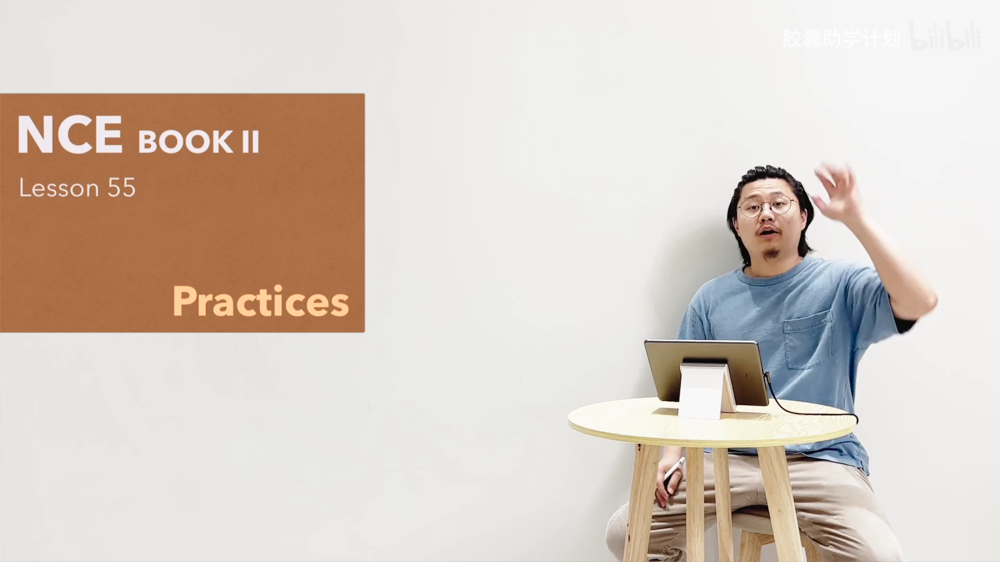

文字识别：NCE / BOOK"I / Lesson 55 / Practices

### 画面 00:00:02

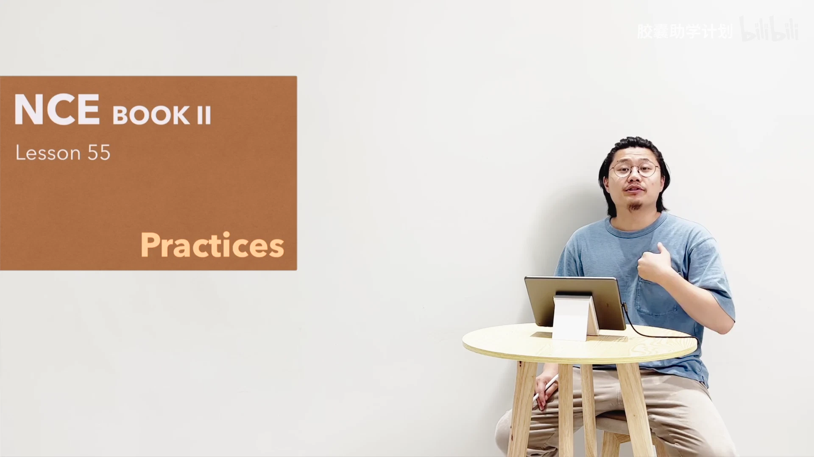

文字识别：NCE / BOOKII / Lesson 55 / Practices

### 画面 00:00:04

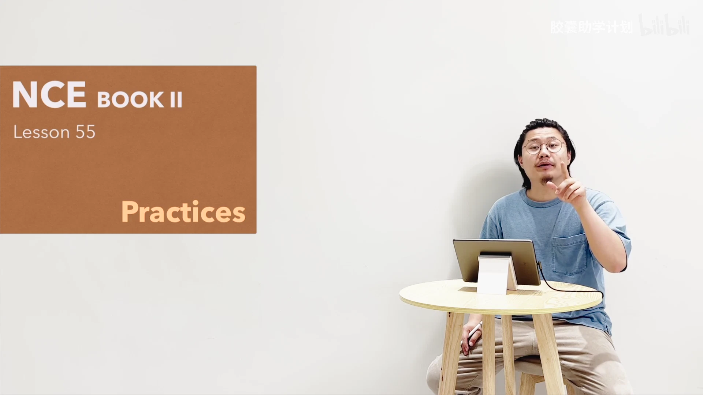

文字识别：NCE / BOOKII / Lesson 55 / Practices

### 画面 00:00:08

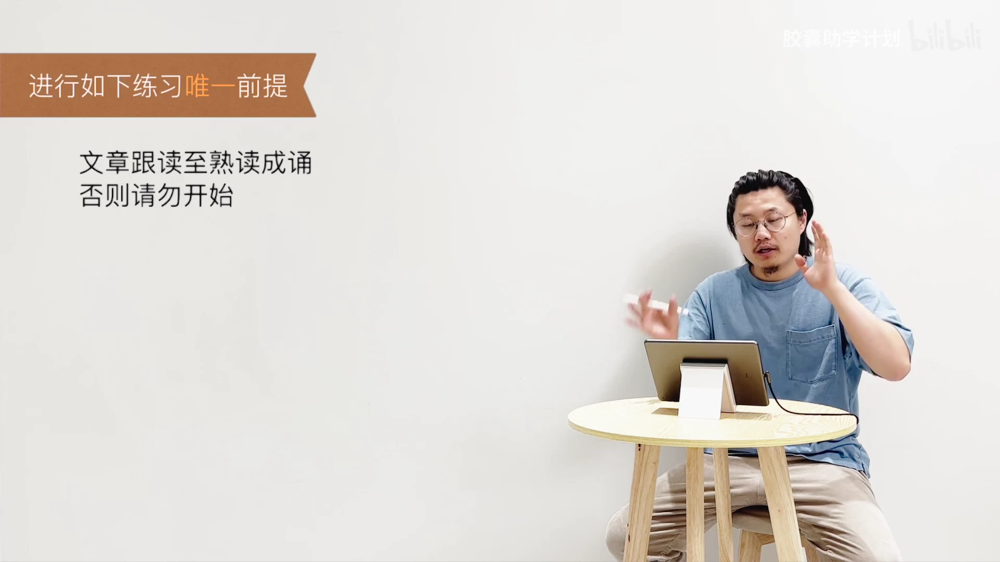

文字识别：进行如下练习唯一前提 / 文章跟读至熟读成诵 / 否则请勿开始

### 画面 00:00:15

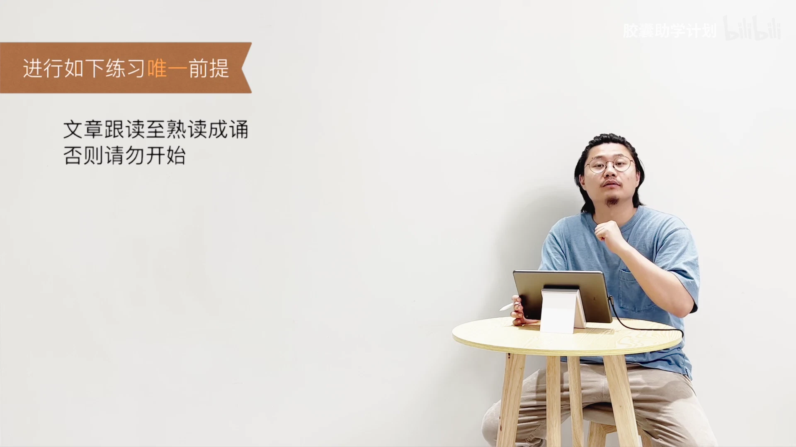

文字识别：进行如下练习唯一前提 / 文章跟读至熟读成诵 / 否则请勿开始

### 画面 00:00:17

文字识别：胶囊助学计划bl出

### 画面 00:00:21

### 画面 00:00:23

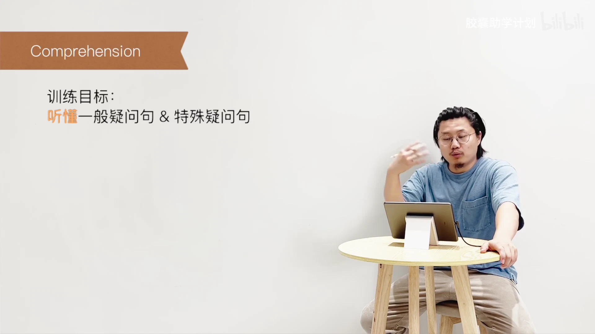

文字识别：Comprehension / 训练目标： / 听懂一般疑问句＆特殊疑问句

### 画面 00:00:26

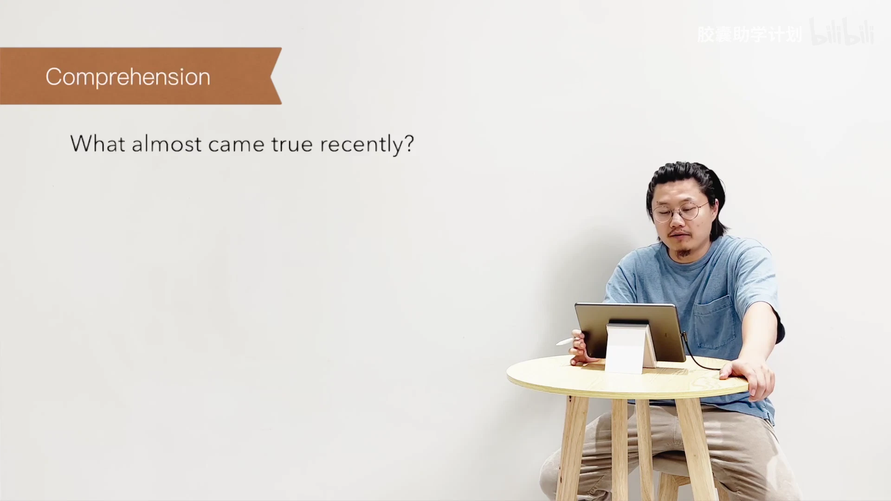

文字识别：Comprehension / What almost came true recently?

## 00:00:30–00:01:00

recently. Answer: Dreams of finding lost treasure. Next one: Is the revealer a new machine? Yes, it is. Next one: What's it been used to do? I'll give you the whole sentence. Don't cut it. What has it been used to do? To detect gold. Next one: Was the machine used in a cave? Yes, it was.

### 画面 00:00:56

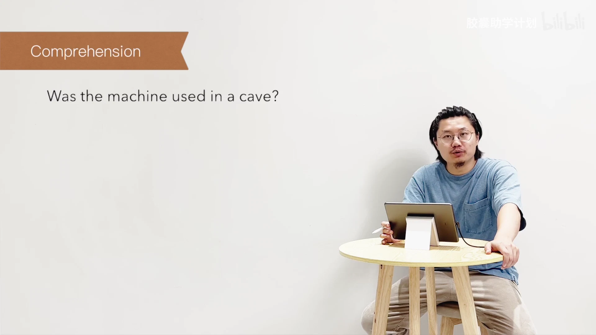

文字识别：Comprehension / Was the machine used in a cave?

## 00:01:00–00:01:30

Next one, where was the cave? Near the seashore. Next one, who are said to have buried gold there? This are said to,其实就五十八课咱们要学的，这个有点超纲了啊。据说， pirates. What did they often fail to do? To collect the gold, they buried in the cave.

### 画面 00:01:15

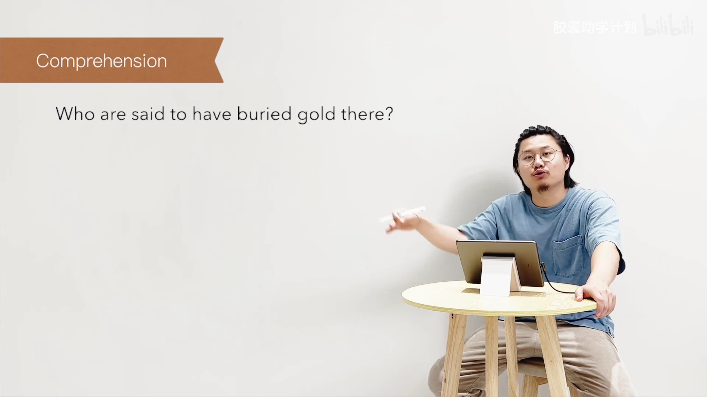

文字识别：Comprehension / Who are said to have buried gold there?

### 画面 00:01:22

文字识别：Comprehension / What did they often fail to do?

## 00:01:30–00:02:00

Where did the search party go? Into the cave near the seashore, right? What did they have with them? The revealer. What did they hope to find? Buried treasure. Who was examining the soil near the entrance to the cave? The leader.

### 画面 00:01:52

文字识别：Comprehension / What did they hope to find? / Buried treasure.

### 画面 00:01:59

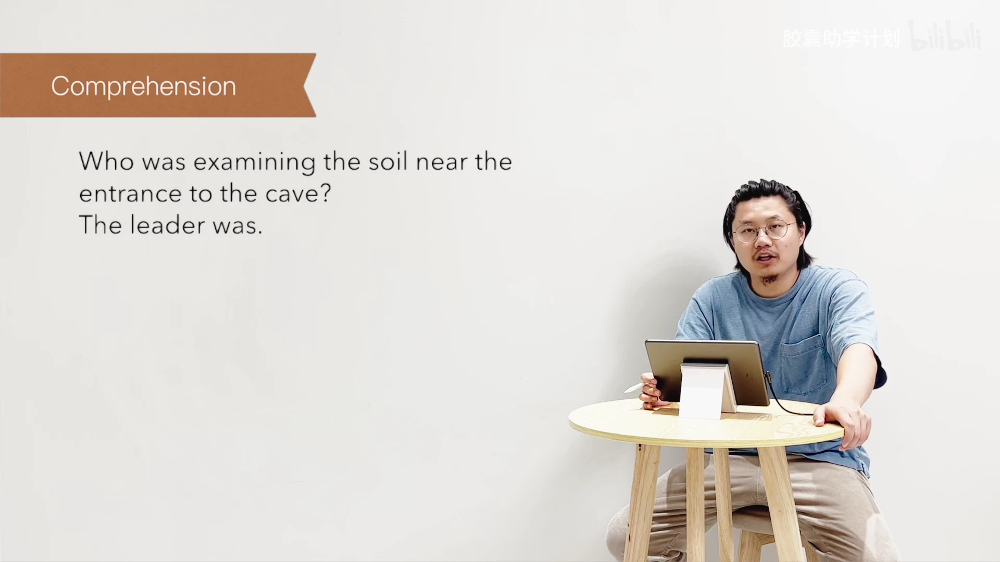

文字识别：Comprehension / Who was examining the soil near the / entrance to the cave? / The leader was.

## 00:02:00–00:02:30

Next one, what did the machine show? That there was gold under the ground. How did the party feel? Very excited. They dug a hole, didn't they? Yes, they did. How deep was it? Two feet deep.

### 画面 00:02:02

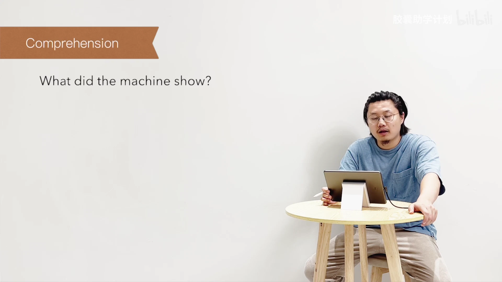

文字识别：Comprehension / What did the machine show?

## 00:02:30–00:03:00

Asking questions. 一起来，肯定句、一般疑问句、特殊疑问句、四级句型转换，从新一到新三，不停的练啊。好，那我们看第一个例子，叫 Ask me if a new machine has been invented. 现在完成时的被动 has 往前提就行了，对吧？然后 what 那就对主语提问呗。 What has been invented? 啊，什么已经被发明出来了？ OK. 呃，第二个啊，来开始了。说

### 画面 00:02:31

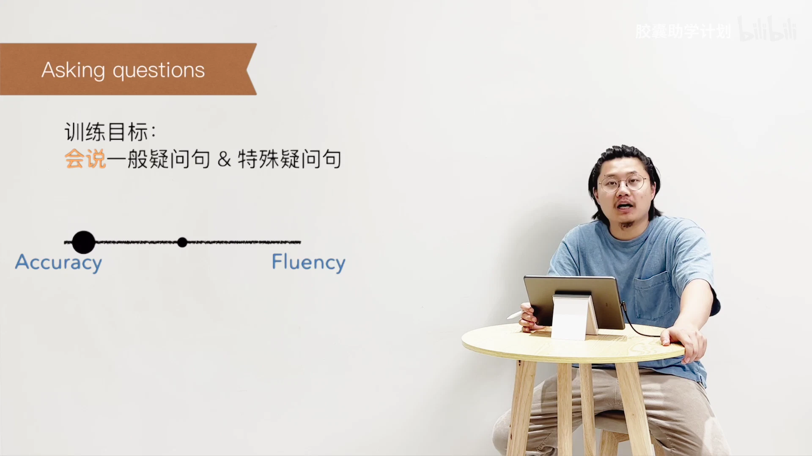

文字识别：Asking questions / 训练目标： / 会说一般疑问句＆特殊疑问句 / Accuracy / Fluency

### 画面 00:02:33

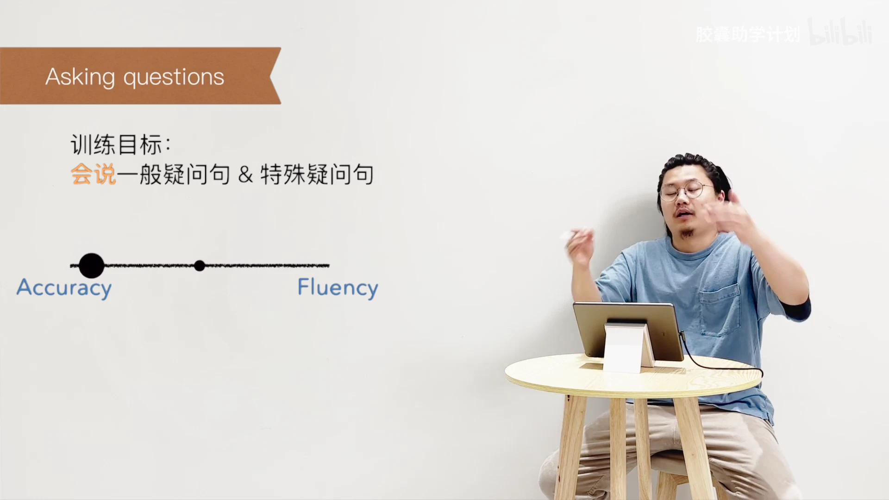

文字识别：Asking questions / 训练目标： / 会说一般疑问句＆特殊疑问句 / Accuracy / Fluency

### 画面 00:02:36

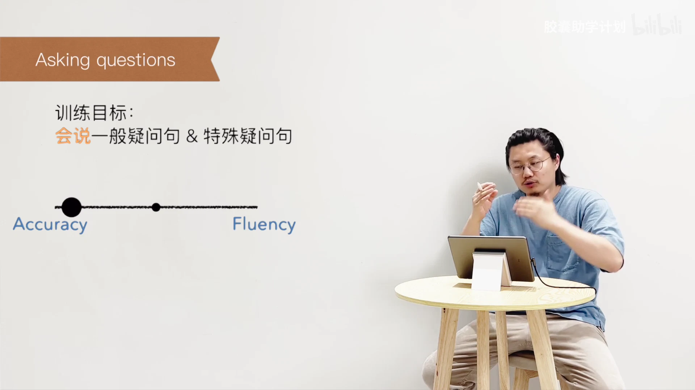

文字识别：Asking questions / 训练目标： / 会说一般疑问句＆特殊疑问句 / Accuracy / Fluency

### 画面 00:02:38

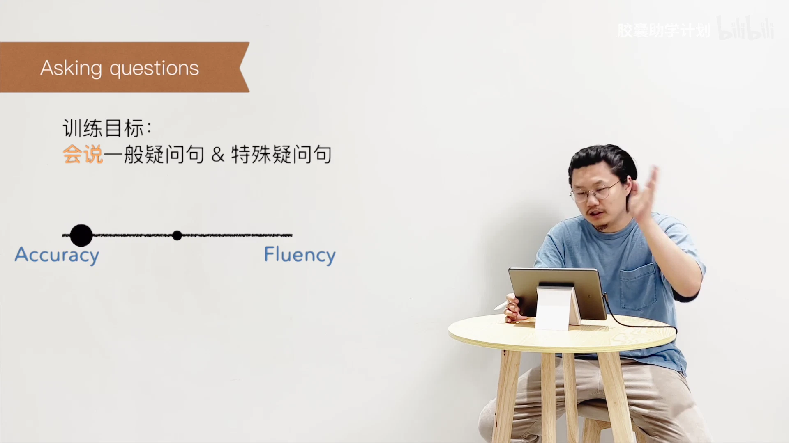

文字识别：Asking questions / 训练目标： / 会说一般疑问句＆特殊疑问句 / Accuracy / Fluency

### 画面 00:02:40

文字识别：Asking questions

### 画面 00:02:46

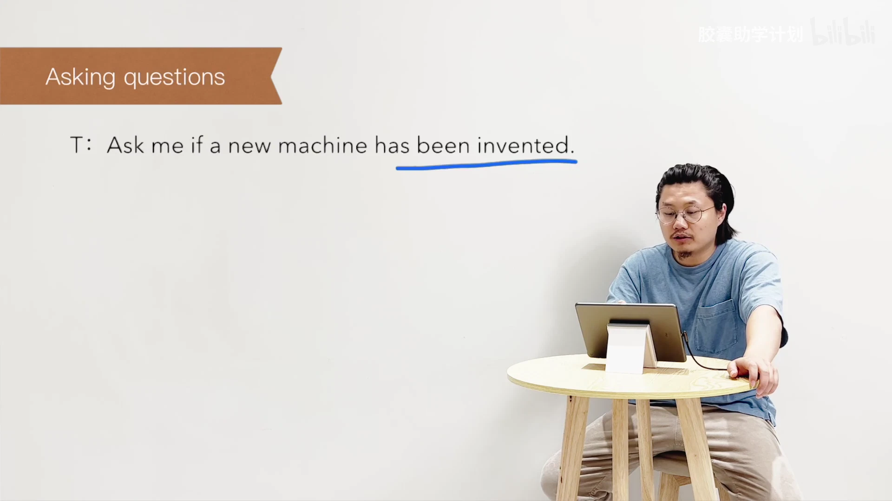

文字识别：Asking questions / T: Ask me if a new machine has been invented.

### 画面 00:02:48

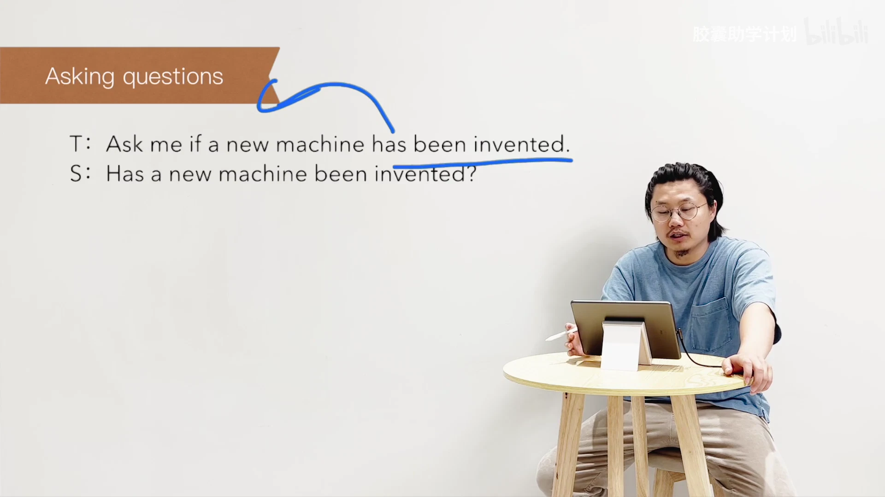

文字识别：Asking questions / T: Ask me if a new machine has been invented. / S: Has a new machine been invented?

### 画面 00:02:54

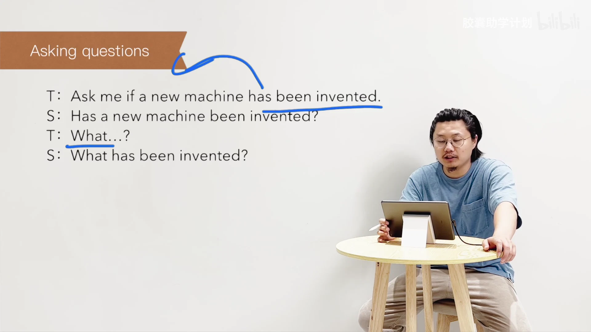

文字识别：Asking questions / T: Ask me if a new machine has been invented. / S: Has a new machine been invented? / T:What...? / S: What has been invented?

### 画面 00:02:56

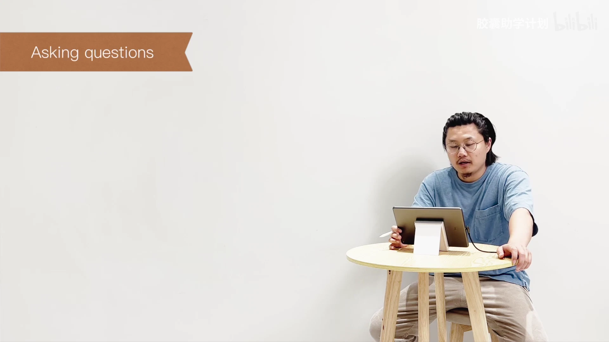

文字识别：Asking questions

### 画面 00:02:58

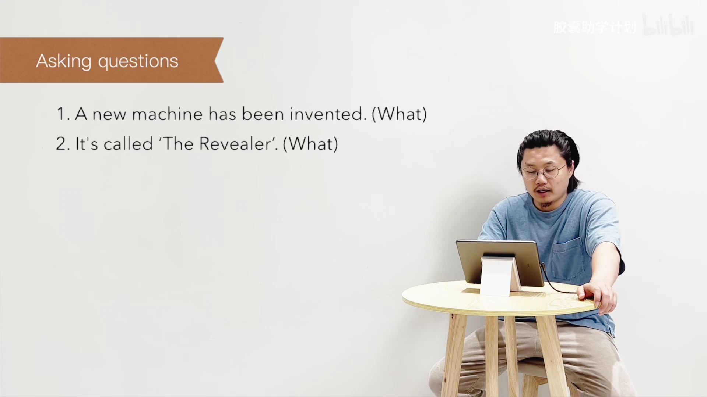

文字识别：Asking questions / 1.A new machine has been invented. (What) / 2. It's called 'The Revealer'. (What)

## 00:03:00–00:03:30

is called the revealer. 那注意这个 PS 可能是 is 可能是 has，你要自己去判断这是 is 对吧？ is 往前一提，what 对 the revealer 提问，叫做 what is it called？ 它被叫做什么？ It has been used to detect gold. has 往前一提，你注意这里它给了一个 what 点点 for。 我直接告诉各位答案叫做 what has it been used for？ For 有一个表目的的作用，对吧？ 它被用来去做什么？啊，答案叫 to

### 画面 00:03:21

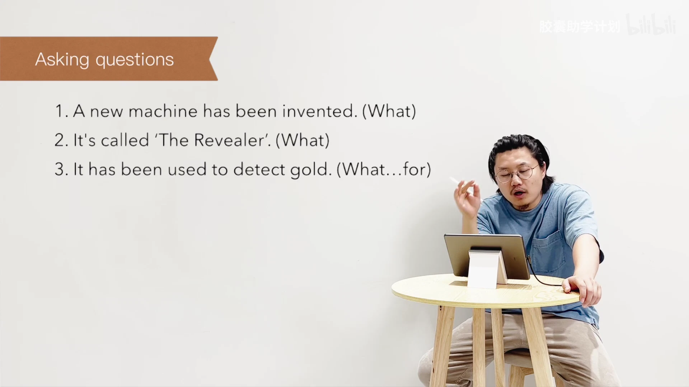

文字识别：Asking questions / 1.A new machine has been invented. (What) / 2. It's called 'The Revealer'. (What) / 3. It has been used to detect gold. (What...for)

## 00:03:30–00:04:00

detect gold，对吧？Okay. It was used in a cave recently. Was 往前提，对吧？然后问对 recently 提问呗。Where 对 in a cave 外加整句，对吧？Why was it used in a cave recently？第五个说 the cave was near the seashore. Was 往前提，Where 对 near the seashore 提问啊？第六个 Paris used to hide gold there. Did 往前提吧，对吧？然后互对主语提问啊？

### 画面 00:03:32

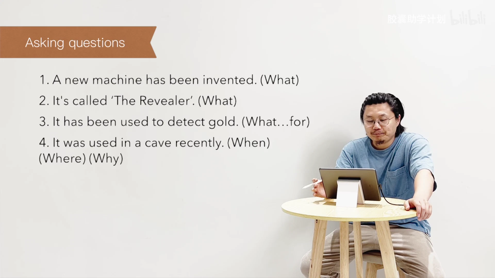

文字识别：Asking questions / 1.A new machine has been invented. (What) / 2. It's called 'The Revealer'. (What) / 3. It has been used to detect gold. (What.for) / 4. It was used in a cave recently. (When) / (Where)(Why)

### 画面 00:03:52

文字识别：Asking questions

### 画面 00:03:59

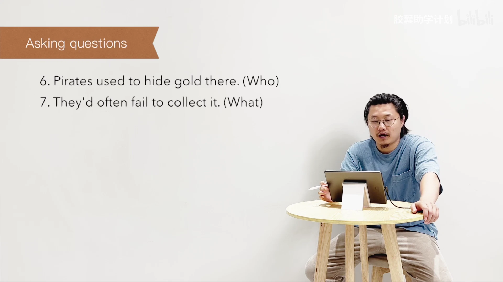

文字识别：Asking questions / 6. Pirates used to hide gold there. (Who) / 7.They'd often fail to collect it. (What)

## 00:04:00–00:04:30

第七个说 they often fail to collect it. 注意撇d是谁？千万记住撇d是谁，对吧？哎，语法的地方我提过了，怎么去判断？这里是物的，对吧？那what对it提问嘛？说what would they often fail to collect？答案是it. The search party went into the cave. Did往前提？Where对into the cave？Who对search party？Why对整句，对吧？Why did the search party go into the cave？

### 画面 00:04:19

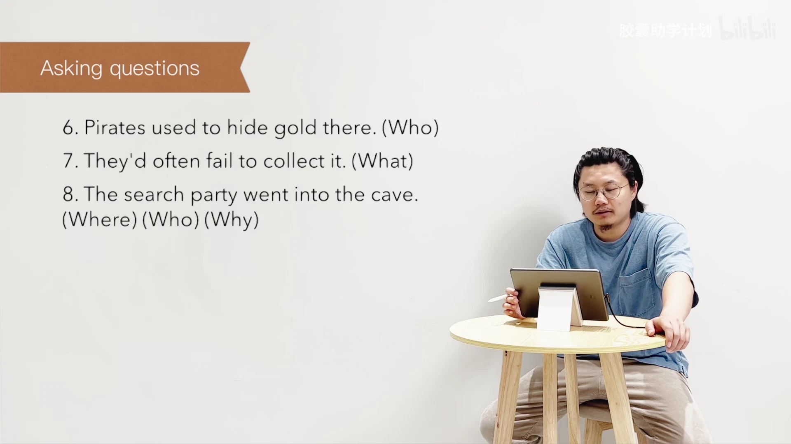

文字识别：Asking questions / 6. Pirates used to hide gold there. (Who) / 7.They'd often fail to collect it.(What) / 8. The search party went into the cave. / (Where) (Who) (Why)

## 00:04:30–00:05:00

Say they were armed with the new machine. Were往前提。那 what 对 the new machine 提问，对吧？ What were they armed with? 他们装备的什么？ It showed that there was gold. 这里有两个东西，对吧？有两个东西。用谁呢？由主句决定，所以提 did，对吧？ What What did it show? 对整个宾语从句提问啊。

### 画面 00:04:36

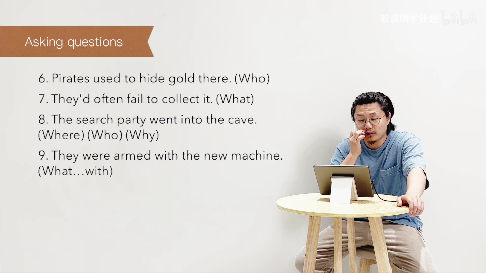

文字识别：Asking questions / 6. Pirates used to hide gold there. (Who) / 7.They'd often fail to collect it.(What) / 8. The search party went into the cave. / (Where) (Who) (Why) / 9. They were armed with the new machine. / (What...with)

### 画面 00:04:52

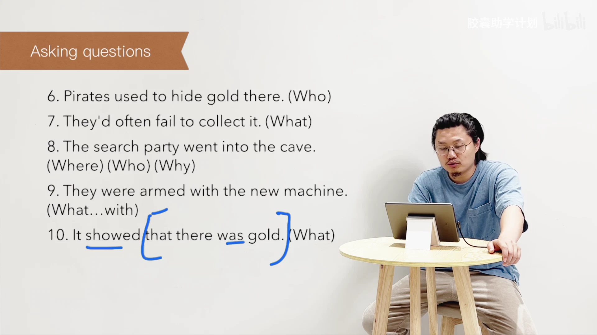

文字识别：Asking questions / 6. Pirates used to hide gold there. (Who) / 7. They'd often fail to collect it. (What) / 8. The search party went into the cave. / (Where) (Who) (Why) / 9. They were armed with the new machine. / (What...with) / 10. It showed that there was gold. What)

### 画面 00:04:54

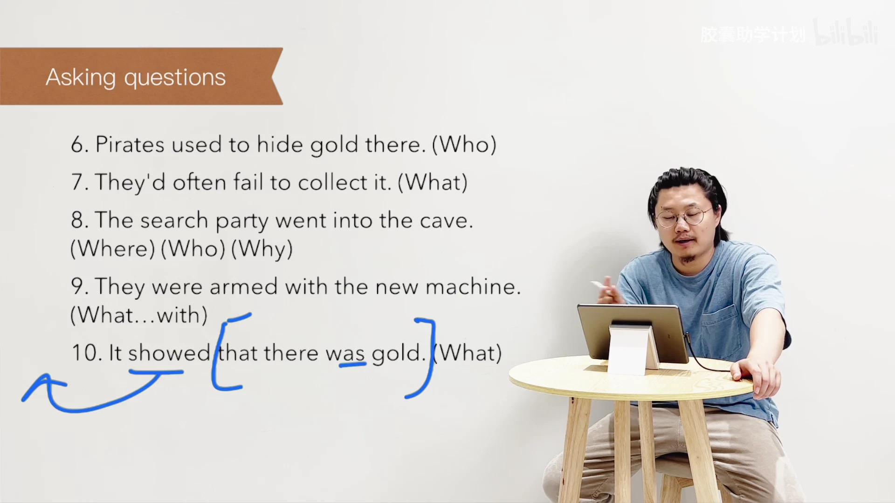

文字识别：Asking questions / 6. Pirates used to hide gold there. (Who) / 7.They'd often fail to collect it. (What) / 8. The search party went into the cave. / (Where) (Who) (Why) / 9.They were armed with the new machine. / (What...with) / 10. It showedthat there was gold. (What)

### 画面 00:04:59

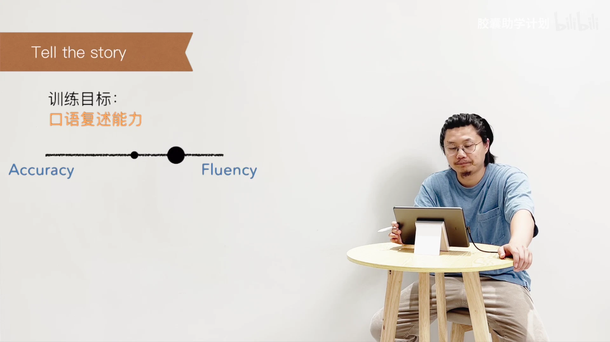

文字识别：Tell the story / 训练目标： / 口语复述能力 / Accuracy / Fluency

## 00:05:00–00:05:30

tell the story，再提可以有一点点错误，但是一定要流利啊。我们语言的学习考试是不能有一点点错误的，是吧？但是语言的学习是允许你有一点点错误的，这是正常的啊。好，呃，tell the story，第一单元说了很多了啊。各位如果这个没有看到，回去一定要看一下，我那个地方给了示范，是吧？这儿就不多说了啊。Summary writing写完来这儿对答案

### 画面 00:05:03

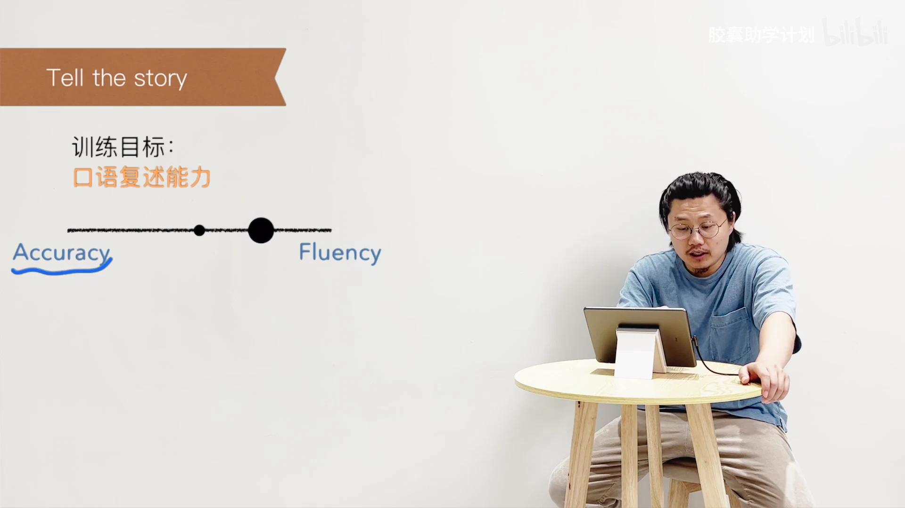

文字识别：Tell the story / 训练目标： / 口语复述能力 / Accuracy / Fluency

### 画面 00:05:05

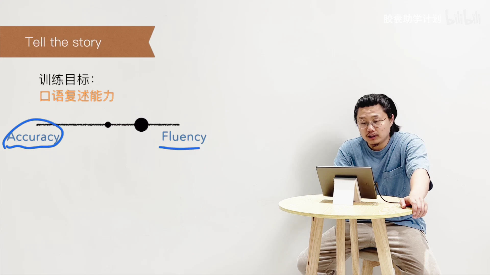

文字识别：Tell the story / 训练目标： / 口语复述能力 / Fluency / Accuracy

### 画面 00:05:16

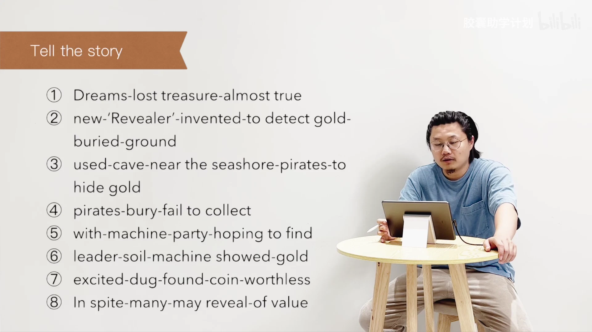

文字识别：Tell the story / ① Dreams-lost treasure-almost true / new-'Revealer'-invented-to detect gold- / 2 / buried-ground / used-cave-near the seashore-pirates-to / hide gold / pirates-bury-fail to collect / with-machine-party-hoping to find / 5 / leader-soil-machine showed-gold / excited-dug-found-coin-worthless / ⑧ In spite-many-may reveal-of value

### 画面 00:05:26

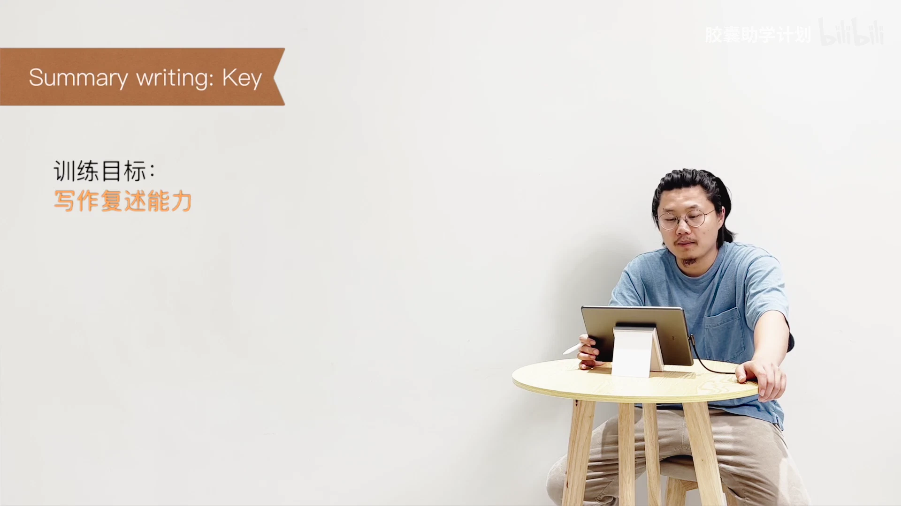

文字识别：Summary writing: Key / 训练目标： / 写作复述能力

### 画面 00:05:28

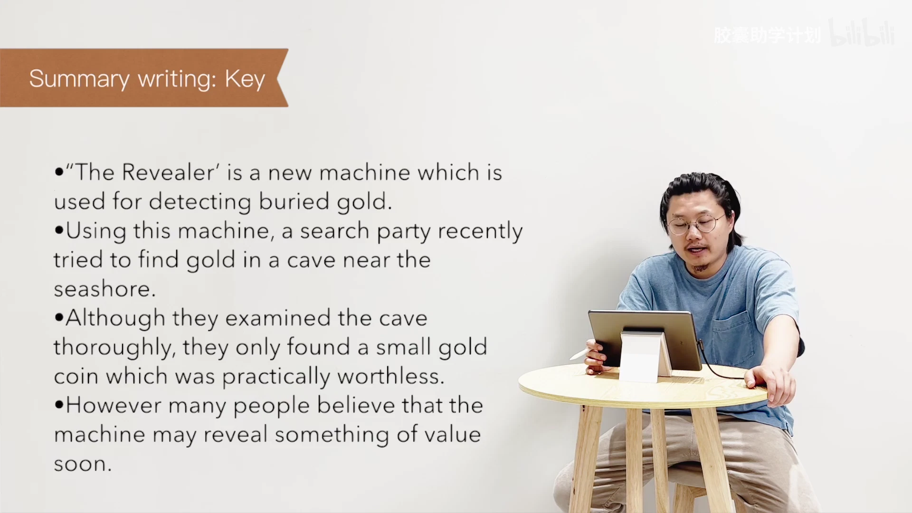

文字识别：Summary writing: Key / •"The Revealer' is a new machine which is / used for detecting buried gold. / •Using this machine, a search party recently / tried to find gold in a cave near the / seashore. / •Although they examined the cave / thoroughly, they only found a small gold / coin which was practically worthless. / •However many people believe that the / machine may reveal something of value / soon.

## 00:05:30–00:06:00

啊，尤其是重点是像比如说 using this machine 啊，although 啊，对吧？连词这些用法就开始可以拿它去练了，好吧？然后 topic for discussion 老习惯就是终极大 boss，但是呢，我们有网课和大家的水平限制，没有办法，我们就只给大家说一下题。感兴趣的同学可以开始了。第一个叫 What kind of treasure would you like to discover? Where would you look for it? 你想要什么类型的

### 画面 00:05:32

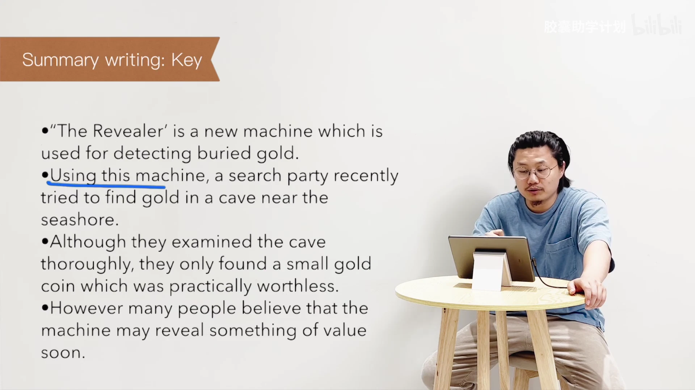

文字识别：Summary writing: Key / •"The Revealer' is a new machine which is / used for detecting buried gold. / •Using this machine, a search party recently / tried to find gold in a cave near the / seashore. / •Although they examined the cave / thoroughly, they only found a small gold / coin which was practically worthless. / •However many people believe that the / machine may reveal something of value / soon.

### 画面 00:05:34

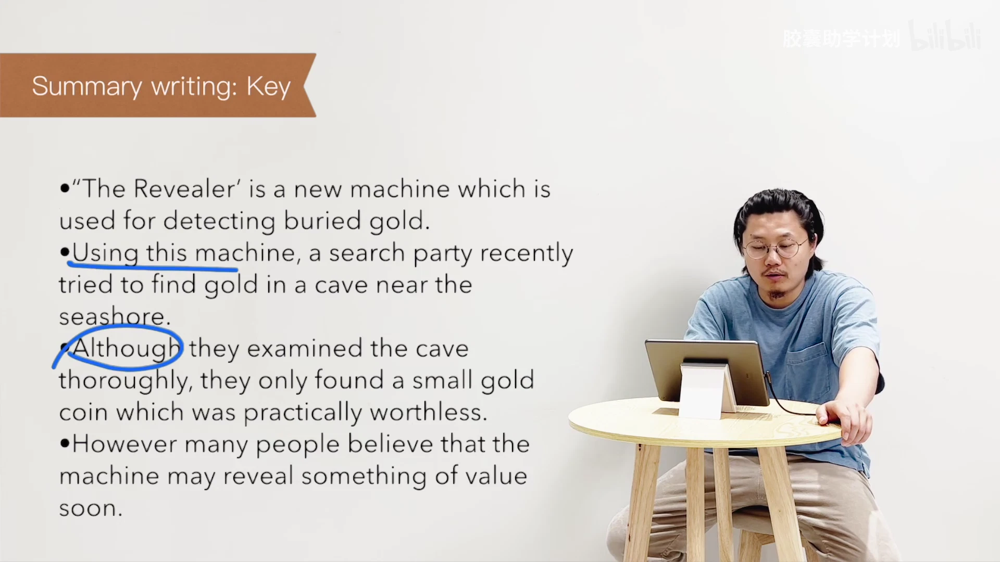

文字识别：Summary writing: Key / •"The Revealer' is a new machine which is / used for detecting buried gold. / •Using this machine, a search party recently / tried to find gold in a cave near the / seashore. / Althougb / )they examined the cave / thoroughly, they only found a small gold / coin which was practically worthless. / •However many people believe that the / machine may reveal something of value / soon.

### 画面 00:05:39

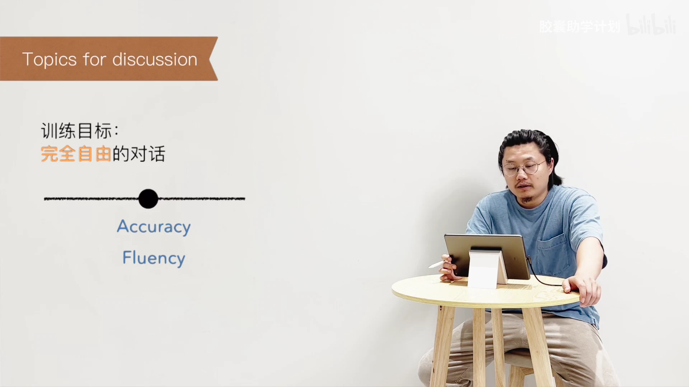

文字识别：Topics for discussion / 训练目标： / 完全自由的对话 / Accuracy / Fluency

### 画面 00:05:41

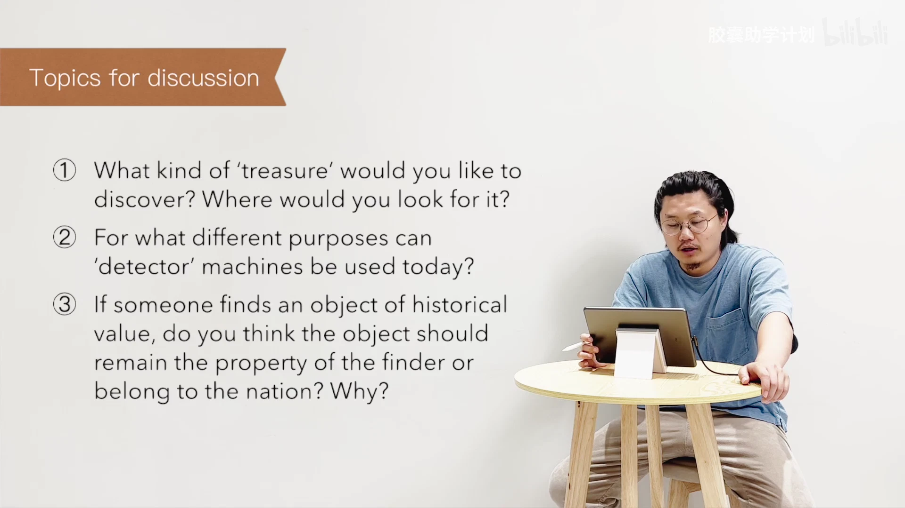

文字识别：Topics for discussion / What kind of 'treasure' would you like to / discover? Where would you look for it? / For what different purposes can / 'detector' machines be used today? / If someone finds an object of historical / value, do you think the object should / remain the property of the finder or / belong to the nation? Why?

### 画面 00:05:44

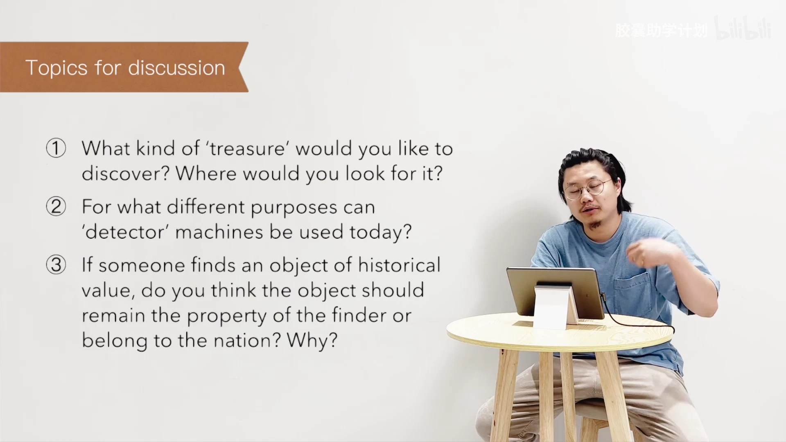

文字识别：Topics for discussion / What kind of 'treasure' would you like to / discover? Where would you look for it? / For what different purposes can / 'detector' machines be used today? / If someone finds an object of historical / value, do you think the object should / remain the property of the finder or / belong to the nation? Why?

### 画面 00:05:50

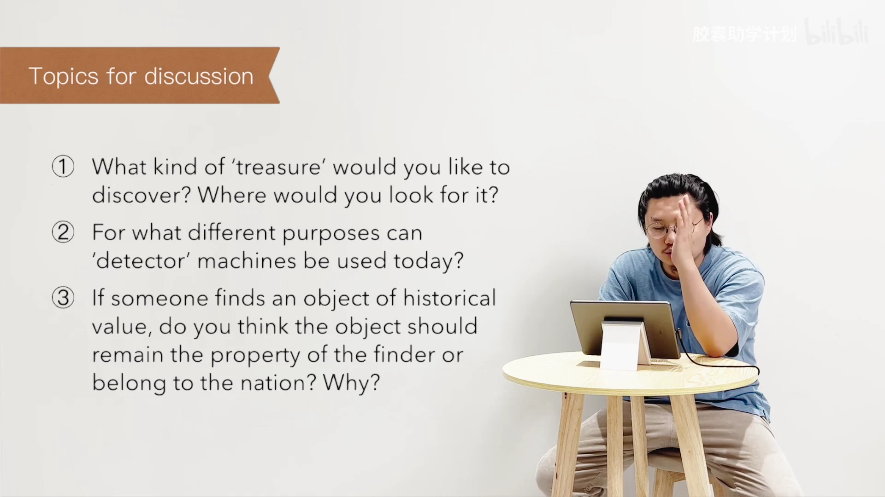

文字识别：Topics for discussion / What kind of 'treasure' would you like to / discover? Where would you look for it? / For what different purposes can / 'detector' machines be used today? / If someone finds an object of historical / value, do you think the object should / remain the property of the finder or / belong to the nation? Why?

### 画面 00:05:52

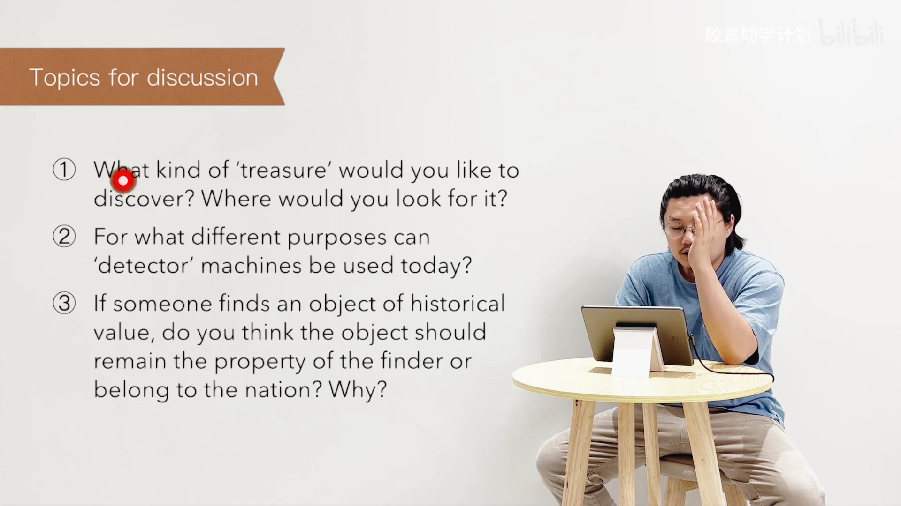

文字识别：Topics for discussion / Wbat kind of'treasure' would you like to / discover? Where would you look for it? / For what different purposes can / 'detector' machines be used today? / If someone finds an object of historical / value, do you think the object should / remain the property of the finder or / belong to the nation? Why?

### 画面 00:05:58

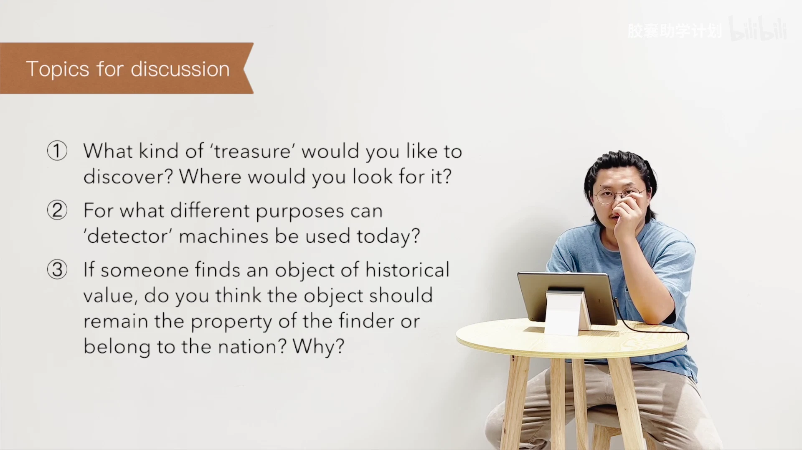

文字识别：Topics for discussion / What kind of 'treasure' would you like to / discover? Where would you look for it? / For what different purposes can / 'detector' machines be used today? / If someone finds an object of historical / value, do you think the object should / remain the property of the finder or / belong to the nation? Why?

## 00:06:00–00:06:30

宝藏？你想去找到什么类型的宝藏？你要去哪里方去找它？注意这里的 treasure 加了引号。比如说，我想要智慧这个宝藏，它不一定是东西，明白吧？ For what different purpose can detector machines be used today? 说这种这种探测性的这种仪器，哎，今天啊去被使用的时候会出于哪些不同的原因？比如说，你想一下测个

### 画面 00:06:28

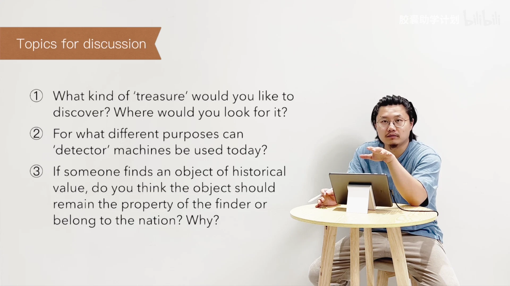

文字识别：Topics for discussion / What kind of 'treasure' would you like to / discover? Where would you look for it? / For what different purposes can / 'detector' machines be used today? / If someone finds an object of historical / value, do you think the object should / remain the property of the finder or / belong to the nation? Why?

## 00:06:30–00:07:00

雷啊什么的，对吧？不多说了啊。第三个说，If someone finds an object of historical value, do you think the object should remain the property of the finder or belong to the nation? Why? 啊，这题就很有意思。原来我们线下课程讨论过，说如果一个人找到了一个东西，这个东西是具有历史价值的，你认为这个东西应该是属于国家还是属于发现者的？为啥？

### 画面 00:06:45

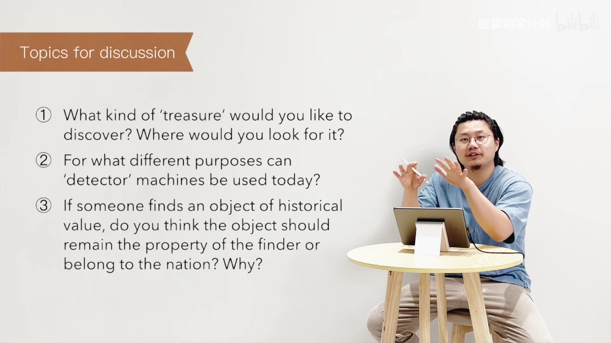

文字识别：Topics for discussion / What kind of 'treasure' would you like to / discover? Where would you look for it? / For what different purposes can / 'detector' machines be used today? / If someone finds an object of historical / 3 / value, do you think the object should / remain the property of the finder or / belong to the nation? Why?

### 画面 00:06:47

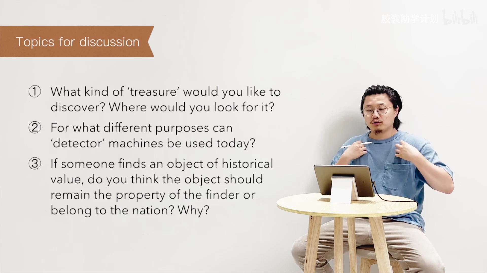

文字识别：Topics for discussion / What kind of 'treasure' would you like to / discover? Where would you look for it? / For what different purposes can / 'detector' machines be used today? / If someone finds an object of historical / value, do you think the object should / remain the property of the finder or / belong to the nation? Why?

### 画面 00:06:49

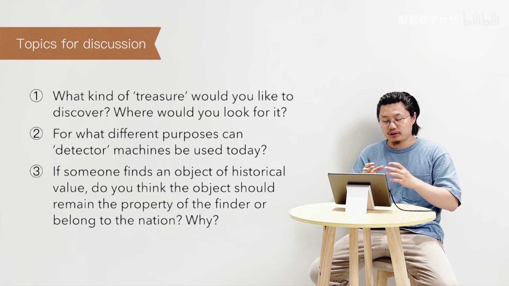

文字识别：Topics for discussion / What kind of 'treasure' would you like to / discover? Where would you look for it? / For what different purposes can / 'detector' machines be used today? / If someone finds an object of historical / value, do you think the object should / remain the property of the finder or / belong to the nation? Why?

### 画面 00:06:58

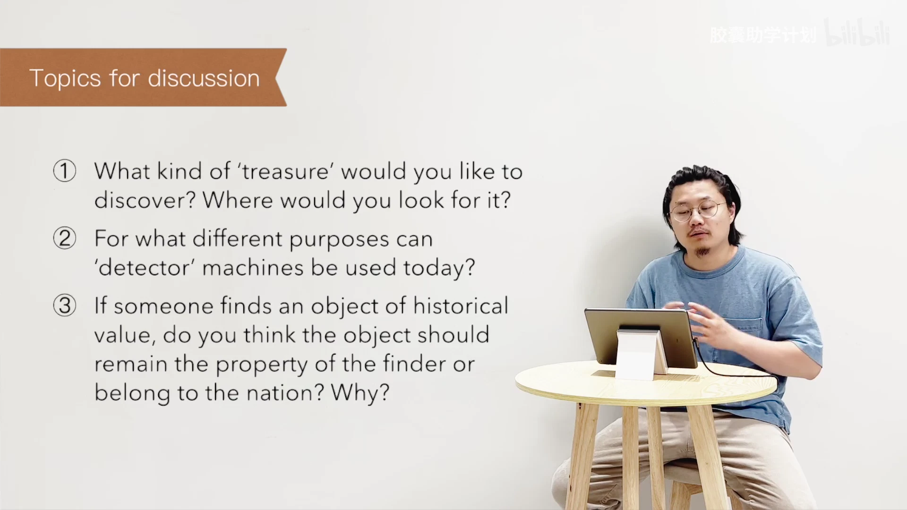

文字识别：Topics for discussion / What kind of 'treasure' would you like to / discover? Where would you look for it? / For what different purposes can / 'detector' machines be used today? / If someone finds an object of historical / value, do you think the object should / remain the property of the finder or / belong to the nation? Why?

## 00:07:00–00:07:30

对吧？OK，二一个，好，家庭作业，ask me if先写，大声朗读摘要写作，先写，然后对答案，重点多看一下那个连词，对吧？Tell the story，口语复述，间隔重复，对吧？然后各位直接看置顶留言就行了。那以上就是本期视频的全部内容了。如果各位喜欢我们的课程呢，欢迎各位关注、订阅、一键三连，分享给那些需要的朋友，来帮助我们快速成长。See you next time.

### 画面 00:07:01

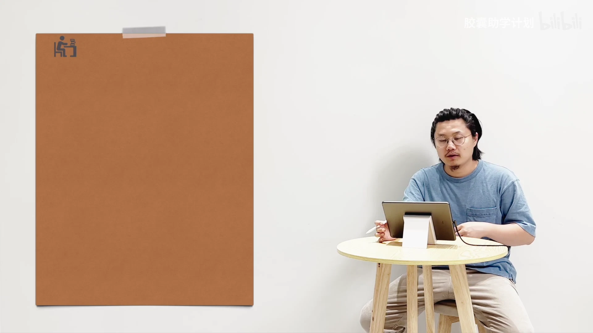

### 画面 00:07:04

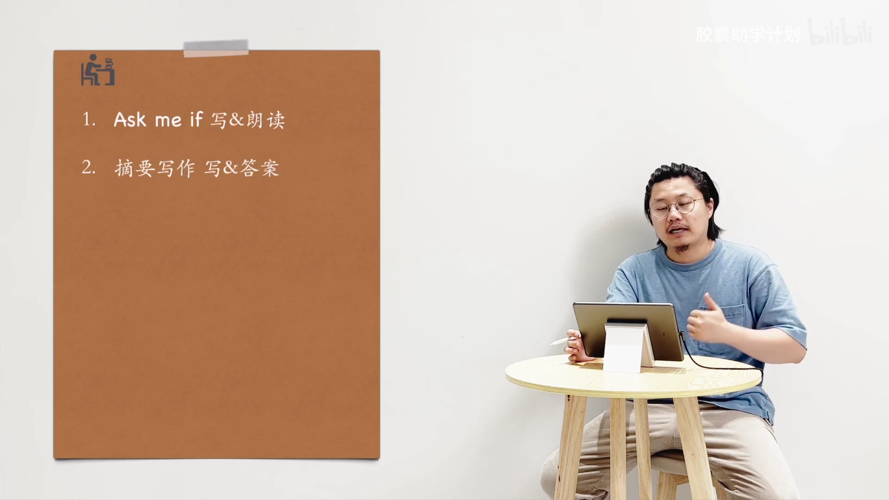

文字识别：1.Ask me if写&朗读 / 2.摘要写作写&答案

### 画面 00:07:06

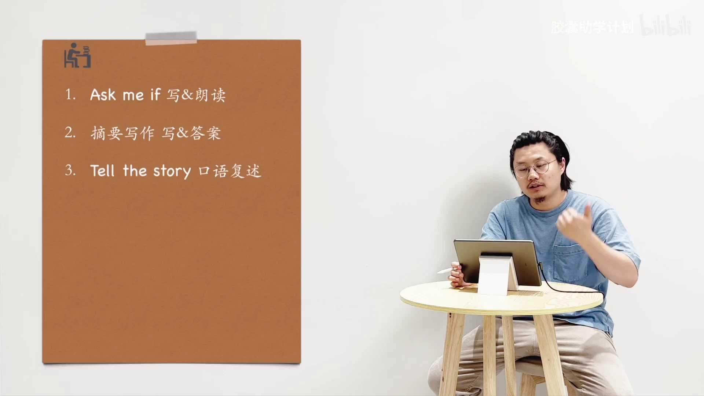

文字识别：1.Ask me if写&朗读 / 摘要写作写&答案 / 3.Tell the story 口语复述

### 画面 00:07:10

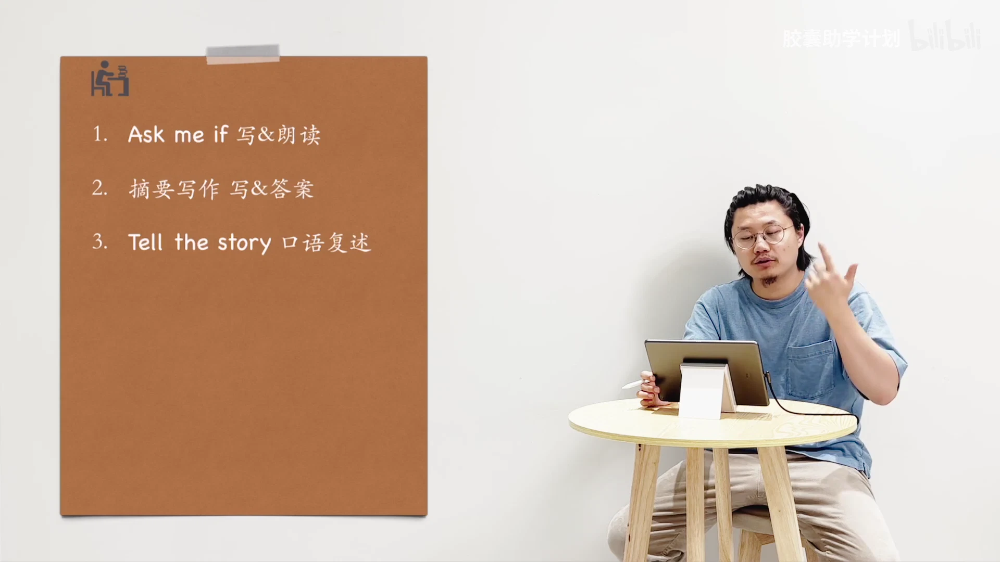

文字识别：1.Ask me if写&朗读 / 摘要写作写&答案 / 3.Tell the story 口语复述

### 画面 00:07:12

文字识别：1.Ask me if写&朗读 / 摘要写作写&答案 / 3.Tell the story 口语复述 / 4.重复间隔（置顶留言）

### 画面 00:07:14

文字识别：1.Ask me if写&朗读 / 摘要写作写&答案 / 3.Tell the story 口语复述 / 4.重复间隔（置顶留言）

### 画面 00:07:16

文字识别：👍

### 画面 00:07:18

文字识别：￥

### 画面 00:07:24

### 画面 00:07:26

文字识别：-

### 画面 00:07:28

## 00:07:30–00:07:40

### 画面 00:07:30

文字识别：CAPSULEACADEMY / 胶囊助学计划 / 小红书 / Lecturer / Leo / OE

### 画面 00:07:33

文字识别：CAPSULEACADEMY / 胶囊助学计划 / 『 / 小红书 / Editor / OE

### 画面 00:07:36

文字识别：CAPSULEACADEMY / 胶囊助学计划 / 小红书 / Creator / □ / Leo & Berlin

### 画面 00:07:38

文字识别：bilibili / 胶囊助学计划 / 胶囊助学计划 / 小红书 / 控□ / □： / OE

### 画面 00:07:40

文字识别：bilibili / 胶囊助学计划

