# 056 单词

快速机器解析：语音为单模型转写，未进行独立交叉校对或人工复核；画面每秒采样并按变化选帧，短时文字和标记可能遗漏。截图时间约有 1 秒误差。图片有损压缩；遇到疑点请按时间查看 Google Drive 原视频。

## 00:00:00–00:00:30

Hello everyone, welcome to Capsule Academy. This is Leo. Today we're going to learn New Concept English Book Two Lesson Fifty Six Words. 那老习惯进入正式课程之前，咱们先看几个小的问题啊。那首先如何表达听到声响？接下来如何表达加快速度？那最后一个问题如何表达走下坡路？带着这三个问题，Hope you enjoy it. 好，那我们先看第一个小单词啊，

### 画面 00:00:00

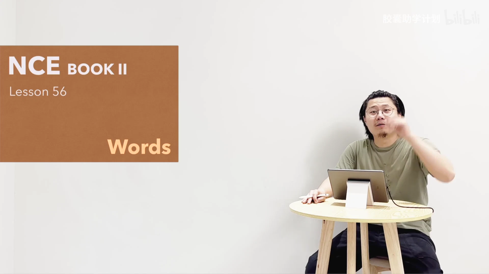

文字识别：NCE / BOOK"I / Lesson 56 / Words

### 画面 00:00:03

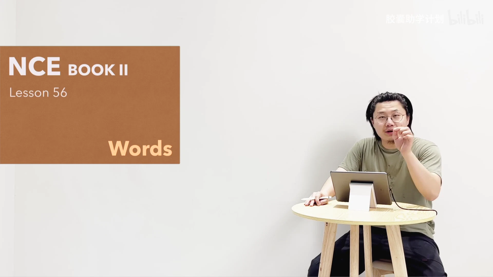

文字识别：NCE / BOOKII / Lesson 56 / Words

### 画面 00:00:05

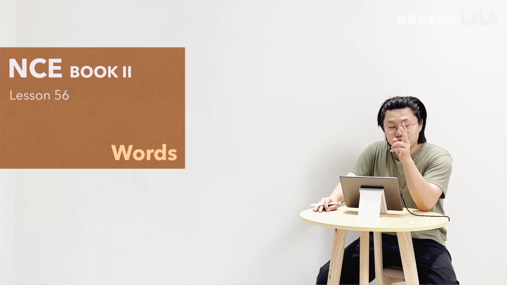

文字识别：NCE / BOOKI"I / Lesson 56 / Words

### 画面 00:00:09

### 画面 00:00:11

文字识别：何表达“听到声响”？

### 画面 00:00:13

文字识别：①如何表达“听到声响”？

### 画面 00:00:15

文字识别：①如何表达“听到声响”？ / 如何表达“加快速度

### 画面 00:00:17

文字识别：①如何表达“听到声响”？ / 如何表达“加快速度 / 如何表达“走下坡路”

### 画面 00:00:19

文字识别：①如何表达“听到声响”？ / 如何表达“加快速度” / 如何表达“走下坡路”?

### 画面 00:00:23

文字识别：胶囊助学计划blb出 / • / •

### 画面 00:00:27

### 画面 00:00:29

文字识别：单词造句指南 / 网：v.+v.变化 / 四句型转换 / 方式/地点/时间 / A / 结合习惯用法 / 其他单词+词性 / 原文摘抄+变 / 6123456 / /saund/ / sound n. v.

## 00:00:30–00:01:00

跟我一起读一下，叫做 sound，sound。OK，这个单词我们早在新概念一册其实就见过了，对吧？当时我们学它是一个动词的含义，叫做听起来，对吧？就是听起来很美啊，sounds beautiful。OK，呃，那今天呢，我们实际上学到它的是它的名词含义啊，叫做声响。OK，那跟它经常这个名词连起来的动词有哪些呢？比如说 hear 啊，你看这很容易理解，听到一个声响。那

### 画面 00:00:31

文字识别：单词造句指南 / 网：v.+v.变化 / 四句型转换 / 方式/地点/时间 / 结合习惯用法 / 其他单词+词性 / 原文摘抄+变 / 6123456 / /saund / / sound n. V.

### 画面 00:00:36

文字识别：单词造句指南 / 网：v.+v.变化 / 四句型转换 / 方式/地点/时间 / 结合习惯用法 / 其他单词+词性 / 原文摘抄+变 / 6123456 / /saund / / sound n. v.

### 画面 00:00:40

文字识别：单词造句指南 / 网：v.+v.变化 / 四句型转换 / 方式/地点/时间 / 结合习惯用法 / 其他单词+词性 / 原文摘抄+变 / 6123456 / /saund / / sound n. v.

### 画面 00:00:45

文字识别：单词造句指南 / 网：v.+v.变化 / 四句型转换 / 方式/地点/时间 / 结合习惯用法 / 其他单词+词性 / 原文摘抄+变 / 6123456 / /saund/ / sound n. v.

### 画面 00:00:53

文字识别：单词造句指南 / 网：v.+v.变化 / 四句型转换 / 方式/地点/时间 / 结合习惯用法 / 其他单词+词性 / 原文摘抄+变 / 6123456 / /saund / / sound n. v. / ① hear / make + sound

### 画面 00:00:57

文字识别：单词造句指南 / 网：v.+v.变化 / 四句型转换 / 方式/地点/时间 / 结合习惯用法 / 其他单词+词性 / 原文摘抄+变 / 6123456 / /saund/ / sound n. v. / ① hear / make + sound

## 00:01:00–00:01:30

make 呢，就是呃做弄出了一个声响，对吧？做出了一个声响，或者发出了一个声响。 Okay，那我们拿它去造句子。哎，我们这个句子啊是这个样子的。简单说一下，就是后边那个呢是告诉你在哪个电影当中。我一般标上这个的时候，就意味着这句话实际上是一个电影台词。同时，它也用到了我们实际上第十六课学到的语法，对吧？叫做 if 啊。那我们看这句话叫做 if you hear anyone outside,

### 画面 00:01:00

文字识别：单词造句指南 / 网：v.+v.变化 / 四句型转换 / 方式/地点/时间 / 结合习惯用法 / 其他单词+词性 / 原文摘抄+变 / 6123456 / /saund / / sound n. v. / ① hear/ make + sound

### 画面 00:01:03

文字识别：单词造句指南 / 网：v.+v.变化 / 四句型转换 / 方式/地点/时间 / 结合习惯用法 / 其他单词+词性 / 原文摘抄+变 / 6123456 / /saund / / sound n. v. / ① hear/ make + sound

### 画面 00:01:05

文字识别：单词造句指南 / 网：v.+v.变化 / 四句型转换 / 方式/地点/时间 / 结合习惯用法 / 其他单词+词性 / 原文摘抄+变 / 6123456 / /saund / / sound n. v. / ① hear/ make + sound

### 画面 00:01:07

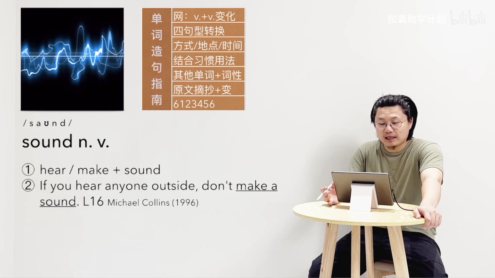

文字识别：单词造句指南 / 网：v.+v.变化 / 四句型转换 / 方式/地点/时间 / WN / 结合习惯用法 / 其他单词+词性 / 原文摘抄+变 / 6123456 / /saund / / sound n. v. / ① hear/ make + sound /  If you hear anyone outside, don't make a / sound. L16 Michael Collins (1996)

### 画面 00:01:10

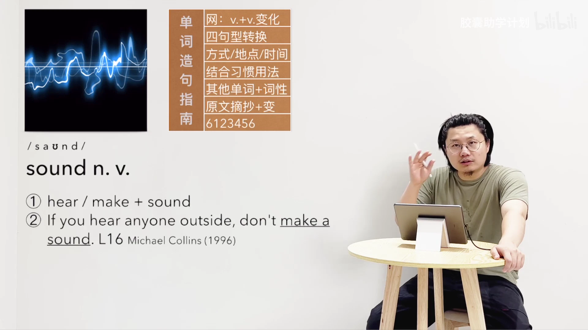

文字识别：单词造句指南 / 网：v.+v.变化 / 四句型转换 / 方式/地点/时间 / 结合习惯用法 / 其他单词+词性 / 原文摘抄+变 / 6123456 / /saund / / sound n. v. / ① hear / make + sound / ) If you hear anyone outside, don't make a / sound. L16 Michael Collins (1996)

### 画面 00:01:21

文字识别：单词造句指南 / 网：v.+v.变化 / 四句型转换 / 方式/地点/时间 / 结合习惯用法 / 其他单词+词性 / 原文摘抄+变 / 6123456 / /saund / / sound n. v. / ① hear / make + sound / ) If you hear anyone outside, don't make a / sound. L16 Michael Collins (1996)

### 画面 00:01:25

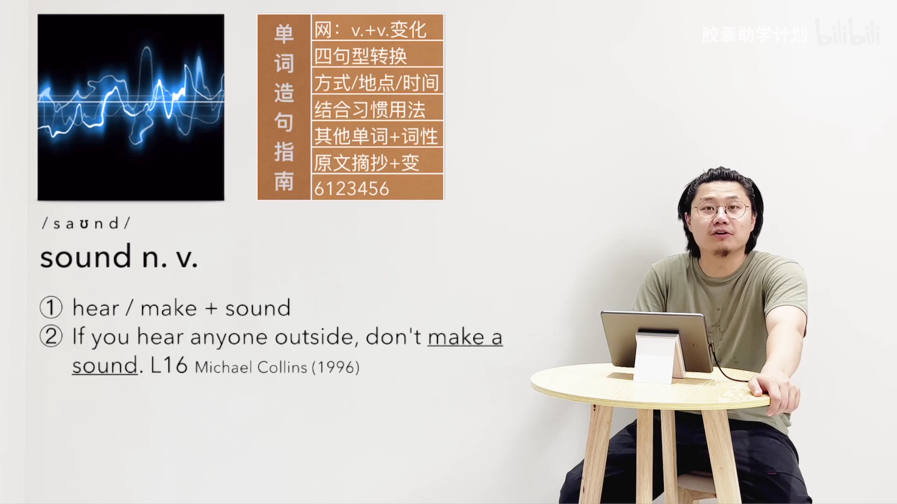

文字识别：单词造句指南 / 网：v.+v.变化 / 四句型转换 / 方式/地点/时间 / 结合习惯用法 / 其他单词+词性 / 原文摘抄+变 / 6123456 / / saund / / sound n. v. / ① hear / make + sound /  If you hear anyone outside, don't make a / sound. L16 Michael Collins (1996)

## 00:01:30–00:02:00

please ah ah don't make a sound.说你如果听到外面有任何的人，不要做出任何的，不要做出声响，对吧？还不要弄出声响。Okay, continue. When she opened her mouth, she couldn't make a sound.说当她张开嘴的时候，她没有办法发出任何声音。Okay,这里的when对吧？第七课咱们学的啊，叫当什么什么时候。Continue.说I heard the sound of his voice.前几课

### 画面 00:01:30

文字识别：单词造句指南 / 网：v.+v.变化 / 四句型转换 / 方式/地点/时间 / WN / 结合习惯用法 / 其他单词+词性 / 原文摘抄+变 / 6123456 / /saund / / sound n. v. / ① hear / make + sound / ) If you hear anyone outside, don't make a / 2) / sOund. L16 Michael Collins (1996)

### 画面 00:01:36

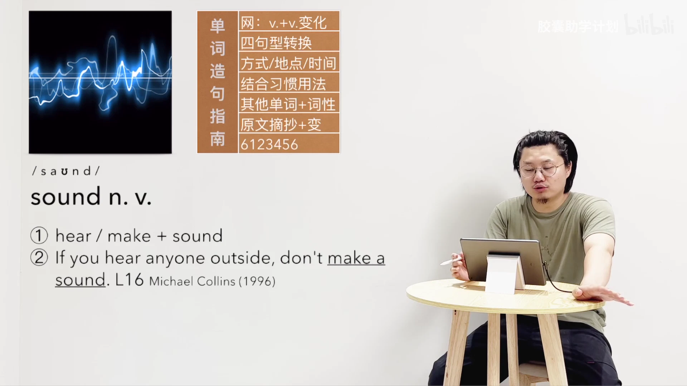

文字识别：单词造句指南 / 网：v.+v.变化 / 四句型转换 / 方式/地点/时间 / 结合习惯用法 / 其他单词+词性 / 原文摘抄+变 / 6123456 / /saund / / sound n. v. / ① hear / make + sound / ② If you hear anyone outside, don't make a / sOund. L16 Michael Collins (1996)

### 画面 00:01:40

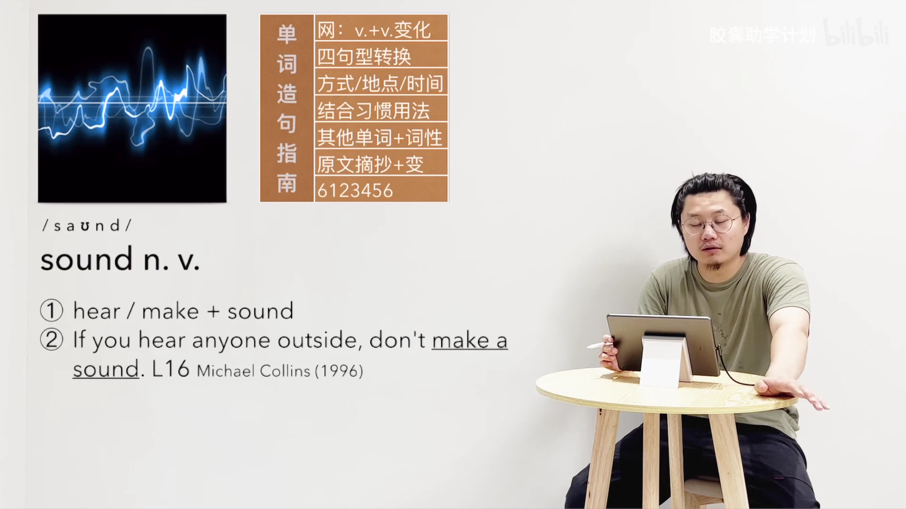

文字识别：单词造句指南 / 网：v.+v.变化 / 四句型转换 / 方式/地点/时间 / WN / 结合习惯用法 / 其他单词+词性 / 原文摘抄+变 / 6123456 / /saund / / sound n. v. / ① hear / make + sound / ② If you hear anyone outside, don't make a / sound. L16 Michael Collins (1996)

### 画面 00:01:42

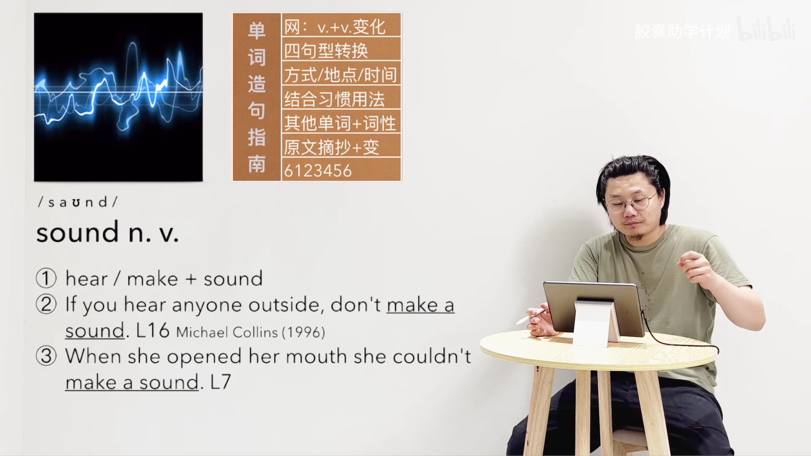

文字识别：单词造句指南 / 网：v.+v.变化 / 四句型转换 / 方式/地点/时间 / 结合习惯用法 / 其他单词+词性 / 原文摘抄+变 / 6123456 / /saund/ / sound n. v. / ① hear / make + sound / ② If you hear anyone outside, don't make a / sound. L16 Michael Collins (1996) / When she opened her mouth she couldn't / make a sound. L7

### 画面 00:01:45

文字识别：单词造句指南 / 网：v.+v.变化 / 四句型转换 / 方式/地点/时间 / WA / 结合习惯用法 / 其他单词+词性 / 原文摘抄+变 / 6123456 / /saund / / sound n. v. / ① hear / make + sound / ② If you hear anyone outside, don't make a / sound. L16 Michael Collins (1996) / When she opened her mouth she couldn't / make a sound. L7

### 画面 00:01:50

文字识别：单词造句指南 / 网：v.+v.变化 / 四句型转换 / 方式/地点/时间 / 结合习惯用法 / 其他单词+词性 / 原文摘抄+变 / 6123456 / /saund / / sound n. v. / ① hear / make + sound / ② If you hear anyone outside, don't make a / sound. L16 Michael Collins (1996) / When she opened her mouth she couldn't / make a sound. L7

### 画面 00:01:55

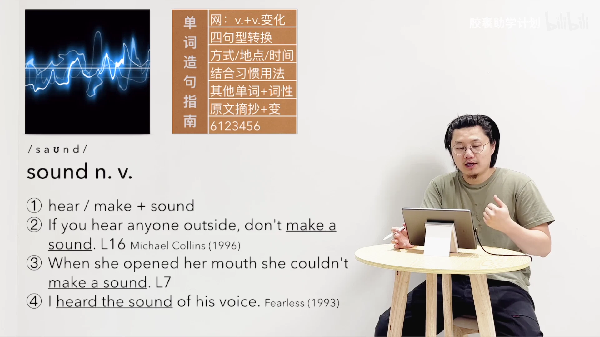

文字识别：单词造句指南 / 网：v.+v.变化 / 四句型转换 / 方式/地点/时间 / 结合习惯用法 / 其他单词+词性 / 原文摘抄+变 / 6123456 / /saund / / sound n. v. / ① hear / make + sound / ② If you hear anyone outside, don't make a / sound. L16 Michael Collins (1996) / When she opened her mouth she couldn't / make a sound. L7 / ) I heard the sound of his voice. Fearless (1993)

## 00:02:00–00:02:30

咱们刚刚学 recognize the voice of somebody, 对吧？那这个地方呢用到了 voice, 哎，听出了是他的声音。OK, 那 heard the heard the sound of his voice. OK, his voice. OK, very good. 那我们可以把这句话顺便就给它做一些各个句型的转换。OK, 那最后再跟我读一遍这个单词叫做 sound, sound. OK, 好, next one. 接下来我们看一个小电影片段叫做 Don't

### 画面 00:02:00

文字识别：单词造句指南 / 网：v.+v.变化 / 四句型转换 / 方式/地点/时间 / 结合习惯用法 / 其他单词+词性 / 原文摘抄+变 / 6123456 / /saund/ / sound n. v. / ① hear / make + sound / ② If you hear anyone outside, don't make a / sound. L16 Michael Collins (1996) / When she opened her mouth she couldn't / make a sound. L7 / ) I heard the sound of his voice. Fearless (1993)

### 画面 00:02:10

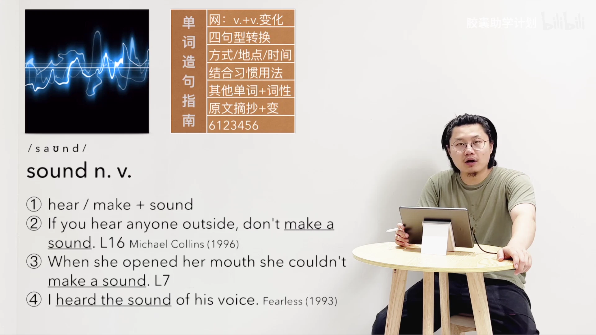

文字识别：单词造句指南 / 网：v.+v.变化 / 四句型转换 / 方式/地点/时间 / WA / 结合习惯用法 / 其他单词+词性 / 原文摘抄+变 / 6123456 / /saund / / sound n. v. / ① hear / make + sound / ② If you hear anyone outside, don't make a / sound. L16 Michael Collins (1996) / When she opened her mouth she couldn't / make a sound. L7 / ) I heard the sound of his voice. Fearless(1993)

### 画面 00:02:15

文字识别：单词造句指南 / 网：v.+v.变化 / 四句型转换 / 方式/地点/时间 / 结合习惯用法 / 其他单词+词性 / 原文摘抄+变 / 6123456 / /saund / / sound n. v. / ① hear / make + sound / ② If you hear anyone outside, don't make a / sound. L16 Michael Collins (1996) / When she opened her mouth she couldn't / make a sound. L7 / ) I heard the sound of his voice. Fearless (1993)

### 画面 00:02:20

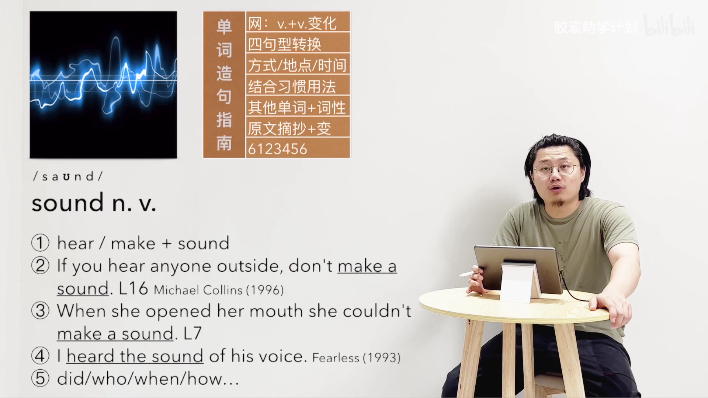

文字识别：单词造句指南 / 网：v.+v.变化 / 四句型转换 / 方式/地点/时间 / 结合习惯用法 / 其他单词+词性 / 原文摘抄+变 / 6123456 / / saund / / sound n. v. / ① hear / make + sound / ② If you hear anyone outside, don't make a / sound. L16 Michael Collins (1996) / When she opened her mouth she couldn't / make a sound. L7 / I heard the sound of his voice. Fearless(1993) / did/who/when/how...

### 画面 00:02:26

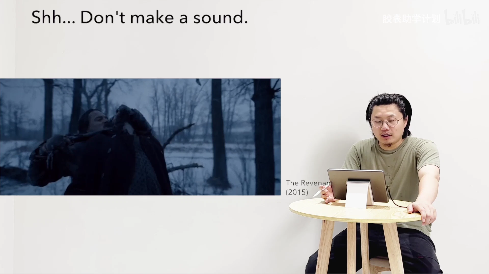

文字识别：Shh... Don't make a sound. / The Revenant / (2015)

## 00:02:30–00:03:00

Make a Sound. Don't make a sound. Okay,好，呃，那接下来下一个电影片段叫做 I didn't know what I I didn't know what I did till I heard the sound.说我不知道我做了什么，直到我听到了这个声音叫 heard the sound. Okay,注意了，I didn't know what I did till I heard the sound. Okay,

### 画面 00:02:32

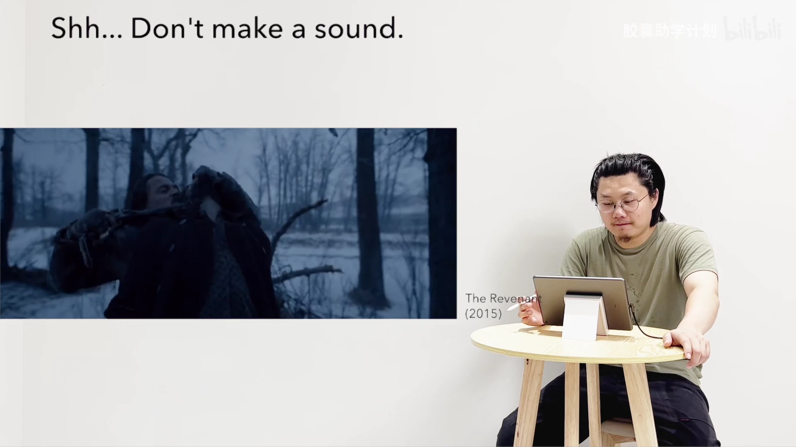

文字识别：Shh... Don't make a sound. / The Revenan / (2015)

### 画面 00:02:34

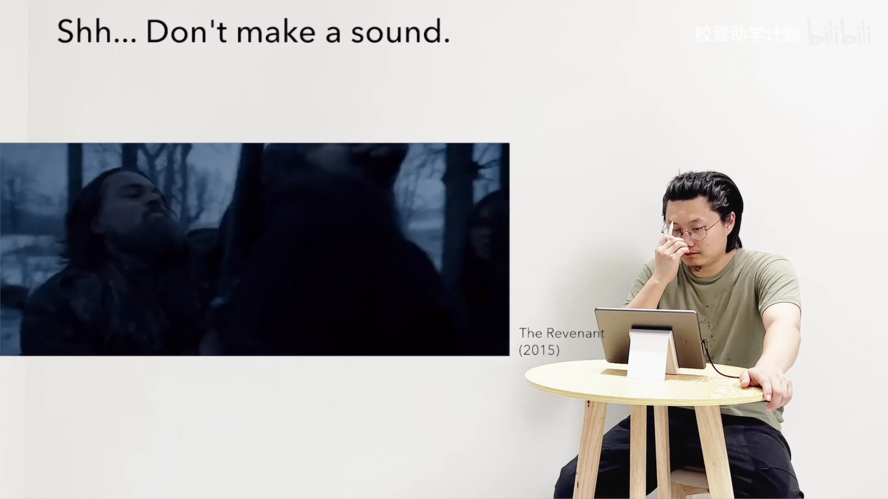

文字识别：Shh... Don't make a sound. / The Revenant / (2015)

### 画面 00:02:36

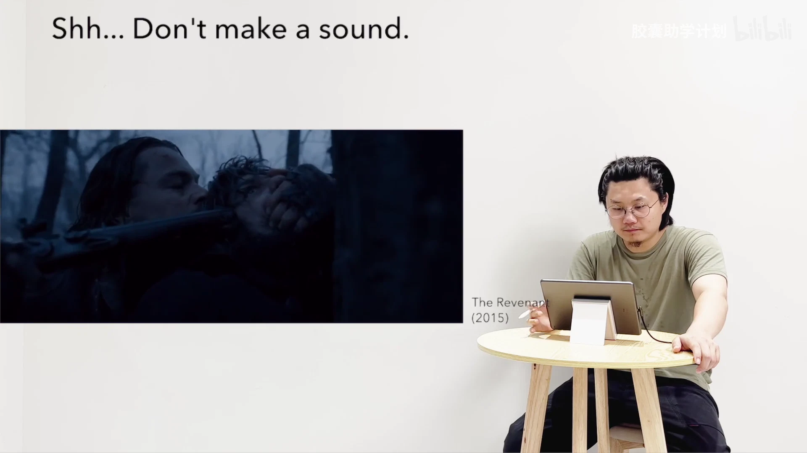

文字识别：Shh... Don't make a sound. / The Revenan / (2015)

### 画面 00:02:38

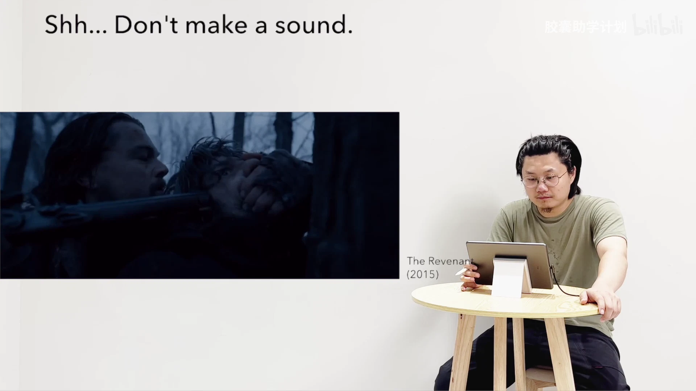

文字识别：Shh... Don't make a sound. / The Revenant / (2015)

### 画面 00:02:40

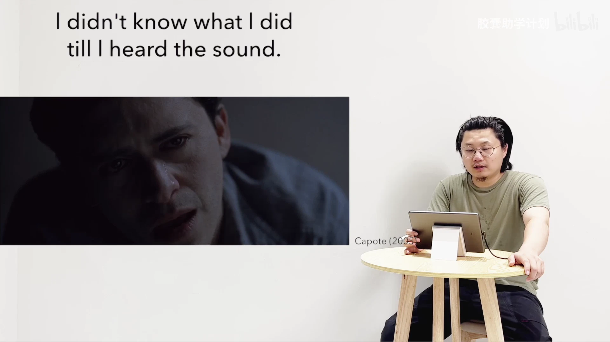

文字识别：I didn't know what I did / till I heard the sound. / Capote (2005)

## 00:03:00–00:03:30

好，下一个单词啊，叫做 excitement. Excitement. Okay,那 excitement这个单词对于各位来说应该不是特别的嗯难理解，对吧？因为你看 excited，咱们见过了，exciting，咱们也见过了，对吧？只不过今天来了一个叫 excitement，它的含义没有变化啊，还是兴奋的、激动的，只不过变成了一个名词形式。那想拿它去

### 画面 00:03:01

文字识别：单词造句指南 / 网：v.+v.变化 / 四句型转换 / 方式/地点/时间 / 结合习惯用法 / 其他单词+词性 / 原文摘抄+变 / 6123456 / /ik'saitmant/ / excitement n.

### 画面 00:03:03

文字识别：单词造句指南 / 网：v.+v.变化 / 四句型转换 / 方式/地点/时间 / 结合习惯用法 / 其他单词+词性 / 原文摘抄+变 / 6123456 / /ik'saitmant/ / excitement n.

### 画面 00:03:05

文字识别：单词造句指南 / 网：v.+v.变化 / 四句型转换 / 方式/地点/时间 / 结合习惯用法 / 其他单词+词性 / 原文摘抄+变 / 6123456 / /ik'saitmant/ / excitement n.

### 画面 00:03:11

文字识别：单词造句指南 / 网：v.+v.变化 / 四句型转换 / 方式/地点/时间 / 结合习惯用法 / 其他单词+词性 / 原文摘抄+变 / 6123456 / /ik'saitmant/ / excitement n.

### 画面 00:03:15

文字识别：单词造句指南 / 网：v.+v.变化 / 四句型转换 / 方式/地点/时间 / 结合习惯用法 / 其他单词+词性 / 原文摘抄+变 / 6123456 / /īk'saitmant/ / excitement n.

### 画面 00:03:26

文字识别：单词造句指南 / 网：v.+v.变化 / 四句型转换 / 方式/地点/时间 / 结合习惯用法 / 其他单词+词性 / 原文摘抄+变 / 6123456 / /ik'saitmant/ / excitement n.

### 画面 00:03:29

文字识别：单词造句指南 / 网：v.+v.变化 / 四句型转换 / 方式/地点/时间 / 结合习惯用法 / 其他单词+词性 / 原文摘抄+变 / 6123456 / /ik'saitmant/ / excitement n. / ① [Story]: There was a great deal of excitement.

## 00:03:30–00:04:00

造句呢？呃，实话实说，直接让各位去拿 excitement 造句，你不太好造，所以我们用一个最保底的方案，叫原文摘抄再加变。先来原文这么一句话，叫 There was a great deal of excitement. A great deal of，呃，进入原文我们会重点讲，现在先简单说一下，就类似于不完全等同于 a lot of，就有许多啊，有很多的刺激，很兴奋，对吧？那我们拿它就可以变成四句型，这是我们所谓的

### 画面 00:03:31

文字识别：单词造句指南 / 网：v.+v.变化 / 四句型转换 / 方式/地点/时间 / 结合习惯用法 / 其他单词+词性 / 原文摘抄+变 / 6123456 / /ik'saitmant/ / excitement n. / ① [Story]: There was a great deal of excitement.

### 画面 00:03:45

文字识别：单词造句指南 / 网：v.+v.变化 / 四句型转换 / 方式/地点/时间 / 结合习惯用法 / 其他单词+词性 / 原文摘抄+变 / 6123456 / /ik'saitmant / / excitement n. / ① [Story]: There was a great deal of excitement.

### 画面 00:03:51

文字识别：单词造句指南 / 网：v.+v.变化 / 四句型转换 / 方式/地点/时间 / 结合习惯用法 / 其他单词+词性 / 原文摘抄+变 / 6123456 / /ik'saitmant/ / excitement n. / ① [Story]: There was a great deal of excitement.

### 画面 00:03:55

文字识别：单词造句指南 / 网：v.+v.变化 / 四句型转换 / 方式/地点/时间 / 结合习惯用法 / 其他单词+词性 / 原文摘抄+变 / 6123456 / /ik'saitmant/ / excitement n. / ① [Story]: There was a great deal of excitement. / was/why...

## 00:04:00–00:04:30

原文摘抄再加编。Continue.接下来呢？那你看这里，我们实际上就学了一个小的短语叫 I'm gonna miss the excitement. 告诉各位，叫做 miss 这个动词可以跟 excitement 联系起来啊。好，接下来下一个句子叫 I have had enough excitement. 叫我已经有了足够多的兴奋或者刺激了。OK, I have had enough excitement. OK.那接下来呢？我们看一个小电影

### 画面 00:04:00

文字识别：单词造句指南 / 网：v.+v.变化 / 四句型转换 / 方式/地点/时间 / 结合习惯用法 / 其他单词+词性 / 原文摘抄+变 / 6123456 / /ik'saitmant / / excitement n. / ① [Story]: There was a great deal of excitement. / was/why...

### 画面 00:04:03

文字识别：单词造句指南 / 网：v.+v.变化 / 四句型转换 / 方式/地点/时间 / 结合习惯用法 / 其他单词+词性 / 原文摘抄+变 / 6123456 / /ik'saitmant/ / excitement n. / ① [Story]: There was a great deal of excitement. / was/why... / ② / I'm gonna miss the excitement... As Good as It Gets / (1997)

### 画面 00:04:05

文字识别：单词造句指南 / 网：v.+v.变化 / 四句型转换 / 方式/地点/时间 / 结合习惯用法 / 其他单词+词性 / 原文摘抄+变 / 6123456 / /ik'saitmant / / excitement n. / ① [Story]: There was a great deal of excitement. / was/why... / ② / I'm gonna miss the excitement... As Good as It Gets / (1997)

### 画面 00:04:10

文字识别：单词造句指南 / 网：v.+v.变化 / 四句型转换 / 方式/地点/时间 / 结合习惯用法 / 其他单词+词性 / 原文摘抄+变 / 6123456 / /ik'saitmant / / excitement n. / ① [Story]: There was a great deal of excitement. / was/why... / ② / I'm gonna miss the excitement... As Good as It Gets / (1997)

### 画面 00:04:15

文字识别：单词造句指南 / 网：v.+v.变化 / 四句型转换 / 方式/地点/时间 / 结合习惯用法 / 其他单词+词性 / 原文摘抄+变 / 6123456 / /ik'saitmant/ / excitement n. / ① [Story]: There was a great deal of excitement. / ② was/why... / I'm gonna miss the excitement... As Good as It Gets / 3 / (1997) / ④ I have had enough excitement. Woman in Gold (2015)

### 画面 00:04:20

文字识别：单词造句指南 / 网：v.+v.变化 / 四句型转换 / 方式/地点/时间 / 结合习惯用法 / 其他单词+词性 / 原文摘抄+变 / 6123456 / /ik'saItmant/ / excitement n. / ① [Story]: There was a great deal of excitement. / ② was/why... / I'm gonna miss the excitement... As Good as It Gets / 3 / (1997) / ④ I have had enough excitement. Woman in Gold (2015)

### 画面 00:04:25

文字识别：单词造句指南 / 网：v.+v.变化 / 四句型转换 / 方式/地点/时间 / 结合习惯用法 / 其他单词+词性 / 原文摘抄+变 / 6123456 / /ik'saItmant/ / excitement n. / ① [Story]: There was a great deal of excitement. / ② was/why.. / 3 / I'm gonna miss the excitement... As Good as It Gets / (1997) / ④ I have had enough excitement. Woman in Gold (2015)

### 画面 00:04:28

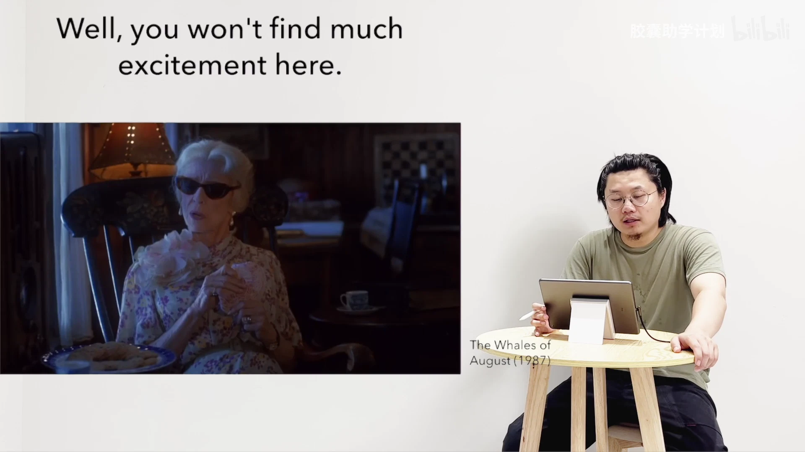

文字识别：Well, you won't find much / excitement here. / The Whales of / August(1987)

## 00:04:30–00:05:00

片段，叫做 Well, you won't find much excitement here. 说在这里你不会找到特别多的兴奋和刺激。好，注意这个 find 也是跟 excitement 经常可以连到用连到一起去用的动词啊。注意力集中，我们一起听一下。 Well, you won't find much excitement here. Okay, 好，接下来下一个单词叫做 handsome, handsome. 那没配图了，对吧？ Handsome,

### 画面 00:04:33

文字识别：Well, you won't find much / excitement here. / The Whales of / August(1987)

### 画面 00:04:44

文字识别：Well, you won't find much / excitement here. / The Whales of / August(1987)

### 画面 00:04:49

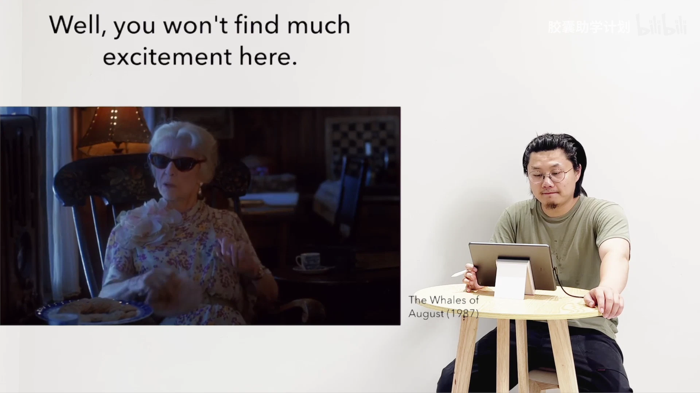

文字识别：Well, you won't find much / excitement here. / The Whales of / August(1987)

### 画面 00:04:52

文字识别：单词造句指南 / 网：v.+v.变化 / 四句型转换 / 方式/地点/时间 / 结合习惯用法 / 其他单词+词性 / 原文摘抄+变 / 6123456 / / 'h æe n s a m / / handsome adj. + n.

### 画面 00:04:55

文字识别：单词造句指南 / 网：v.+v.变化 / 四句型转换 / 方式/地点/时间 / 结合习惯用法 / 其他单词+词性 / 原文摘抄+变 / 6123456 / / ·h æen sa m / / handsome adj. + n.

## 00:05:00–00:05:30

啊，这个英俊的、潇洒的、帅的啊，handsome，不用配图了，对吧？配图，啊，还还配什么图啊？那我们造句啊，呃，prefer to do something，这个是我们五十课学的一个习惯用法，对吧？哎，叫做宁愿、更愿意啊。比如说，we all prefer to have dinner with that handsome captain. 好，prefer to do something啊，我们都更愿意跟他一起去做这件事情。各位还是要张开嘴跟我去读啊，

### 画面 00:05:01

文字识别：单词造句指南 / 网：v.+v.变化 / 四句型转换 / 方式/地点/时间 / 结合习惯用法 / 其他单词+词性 / 原文摘抄+变 / 6123456 / / 'h æe n s a m / / handsome adj. + n.

### 画面 00:05:04

文字识别：单词造句指南 / 网：v.+v.变化 / 四句型转换 / 方式/地点/时间 / 结合习惯用法 / 其他单词+词性 / 原文摘抄+变 / 6123456 / / 'h æ n s a m / / handsome adj. + n. / ① We all prefer to have dinner with that / handsome captain. L50

### 画面 00:05:09

文字识别：单词造句指南 / 网：v.+v.变化 / 四句型转换 / 方式/地点/时间 / 结合习惯用法 / 其他单词+词性 / 原文摘抄+变 / 6123456 / /  h æ n s a m / / handsome adj. + n. / ① We all prefer to have dinner with that / handsome captain. L50

### 画面 00:05:16

文字识别：单词造句指南 / 网：v.+v.变化 / 四句型转换 / 方式/地点/时间 / 结合习惯用法 / 其他单词+词性 / 原文摘抄+变 / 6123456 / / ·h æ n s a m / / handsome adj. + n. / ① We all prefer to have dinner with that / handsome captain. L50

### 画面 00:05:25

文字识别：单词造句指南 / 网：v.+v.变化 / 四句型转换 / 方式/地点/时间 / 结合习惯用法 / 其他单词+词性 / 原文摘抄+变 / 6123456 / / h æ n s a m / / handsome adj. + n. / ① We all prefer to have dinner with that / handsome captain. L50

## 00:05:30–00:06:00

啊，在这个呃屏幕那边的你啊，张开嘴跟我去读。再来，I'm fairly confident that I can recognize the voice of that handsome man.啊，连着用到了两个习惯用法，fairly certain that，哎，和recognize the voice of。如果您忘了五十四课、五十五课翻回去，一定要再看一下各位当时写的家庭作业，对吧？好，Next one说，I want to pay that handsome guy a visit。

### 画面 00:05:30

文字识别：单词造句指南 / 网：v.+v.变化 / 四句型转换 / 方式/地点/时间 / 结合习惯用法 / 其他单词+词性 / 原文摘抄+变 / 6123456 / / 'h æ n s a m / / handsome adj. + n. / ① We all prefer to have dinner with that / handsome captain. L50

### 画面 00:05:34

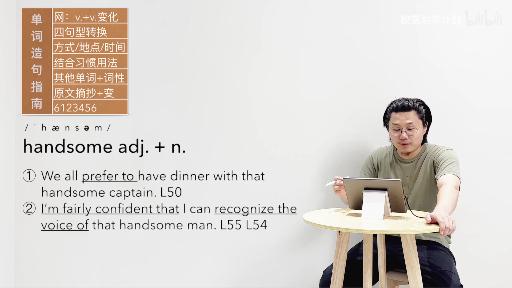

文字识别：单词造句指南 / 网：v.+v.变化 / 四句型转换 / 方式/地点/时间 / 结合习惯用法 / 其他单词+词性 / 原文摘抄+变 / 6123456 / / · h æ n s a m / / handsome adj. + n. / ① We all prefer to have dinner with that / handsome captain. L50 / I'm fairly confident that I can recognize the / voice of that handsome man. L55 L54

### 画面 00:05:40

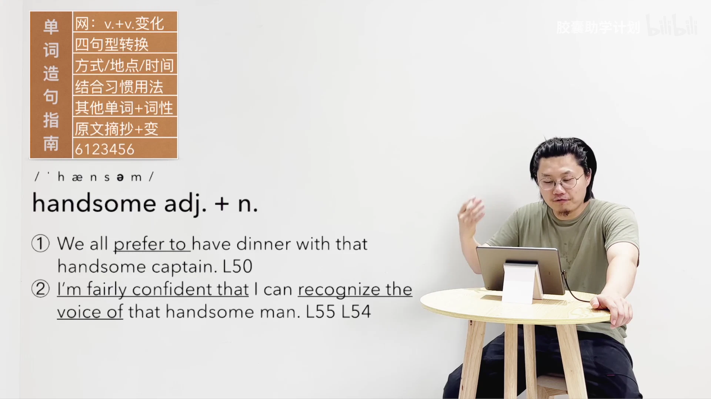

文字识别：单词造句指南 / 网：v.+v.变化 / 四句型转换 / 方式/地点/时间 / 结合习惯用法 / 其他单词+词性 / 原文摘抄+变 / 6123456 / / ' h æe n s a m / / handsome adj. + n. / ① We all prefer to have dinner with that / handsome captain. L50 / I'm fairly confident that I can recognize the / voice of that handsome man. L55 L54

### 画面 00:05:50

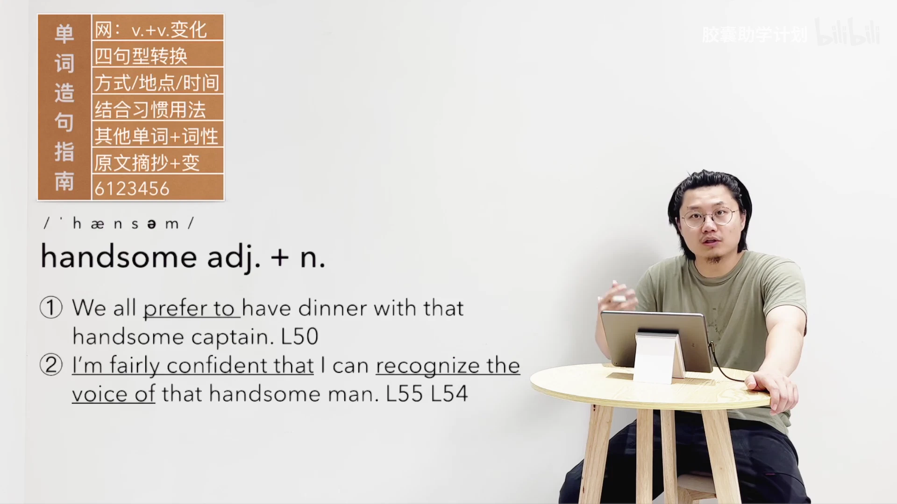

文字识别：单词造句指南 / 网：v.+v.变化 / 四句型转换 / 方式/地点/时间 / 结合习惯用法 / 其他单词+词性 / 原文摘抄+变 / 6123456 / / ' h æ n s a m / / handsome adj. + n. / ① We all prefer to have dinner with that / handsome captain. L50 / I'm fairly confident that I can recognize the / voice of that handsome man. L55 L54

### 画面 00:05:56

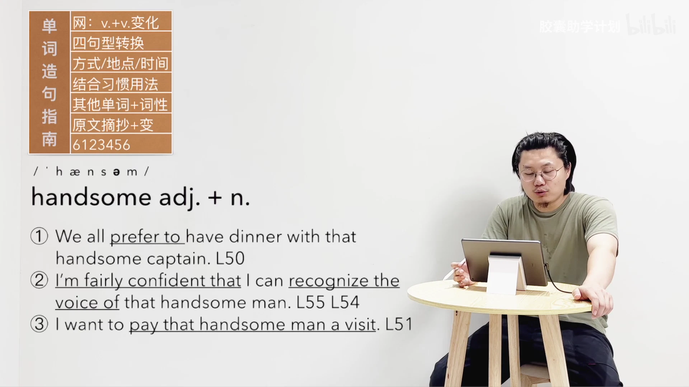

文字识别：单词造句指南 / 网：v.+v.变化 / 四句型转换 / 方式/地点/时间 / 结合习惯用法 / 其他单词+词性 / 原文摘抄+变 / 6123456 / / 'h æe n s a m / / handsome adj. + n. / ① We all prefer to have dinner with that / handsome captain. L50 / I'm fairly confident that I can recognize the / voice of that handsome man. L55 L54 / I want to pay that handsome man a visit. L51

## 00:06:00–00:06:30

说我想啊，怎么样？Pay somebody a visit. 五十一课咱们学的就是去拜访一下某人啊。我想去拜访一下这个帅哥啊，新搬过来的嘛。OK，那再读一遍这个单词叫 handsome。所以其实 handsome，各位在造句的时候，我这也写到了，它本身既然是个形容词，那我们造句就最好，实际上要去找一个名词跟它连到一起。OK，好，那接下来呢，电影片段做听力来了。Daddy, you look

### 画面 00:06:00

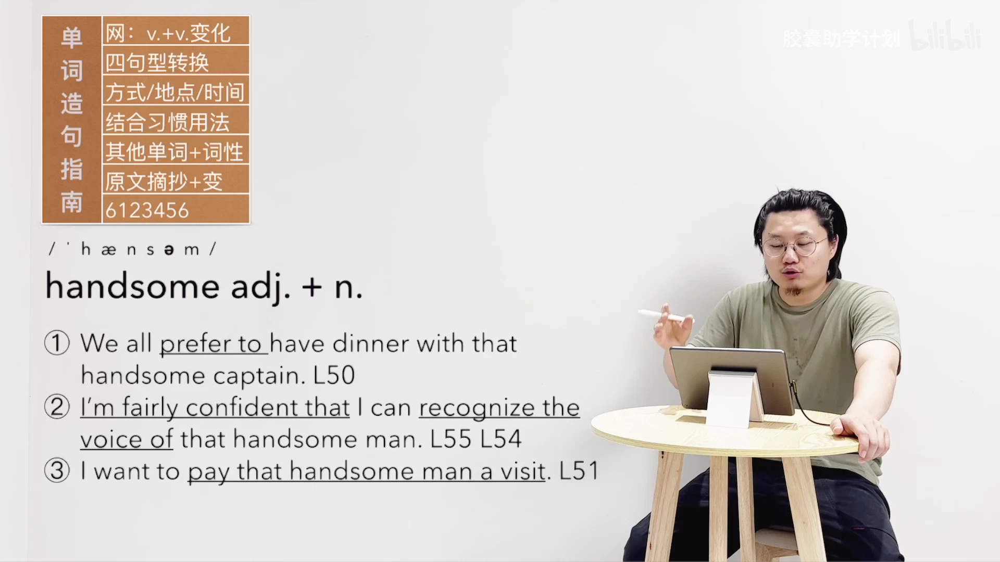

文字识别：单词造句指南 / 网：v.+v.变化 / 四句型转换 / 方式/地点/时间 / 结合习惯用法 / 其他单词+词性 / 原文摘抄+变 / 6123456 / / ' h æ n s a m / / handsome adj. + n. / ① We all prefer to have dinner with that / handsome captain. L50 / I'm fairly confident that I can recognize the / voice of that handsome man. L55 L54 / I want to pay that handsome man a visit. L51

### 画面 00:06:06

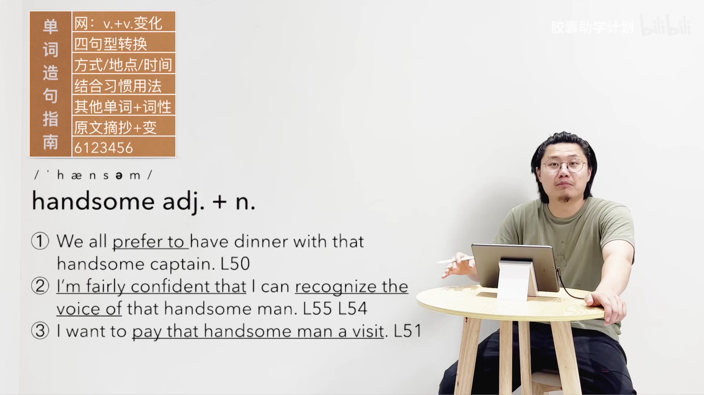

文字识别：单词造句指南 / 网：v.+v.变化 / 四句型转换 / 方式/地点/时间 / 结合习惯用法 / 其他单词+词性 / 原文摘抄+变 / 6123456 / / 'h æ n s a m / / handsome adj. + n. / ① We all prefer to have dinner with that / handsome captain. L50 / I'm fairly confident that I can recognize the / voice of that handsome man. L55 L54 / I want to pay that handsome man a visit. L51

### 画面 00:06:11

文字识别：单词造句指南 / 网：v.+v.变化 / 四句型转换 / 方式/地点/时间 / 结合习惯用法 / 其他单词+词性 / 原文摘抄+变 / 6123456 / / 'h æe n s a m / / handsome adj. + n. / ① We all prefer to have dinner with that / handsome captain. L50 / I'm fairly confident that I can recognize the / voice of that handsome man. L55 L54 / I want to pay that handsome man a visit. L51

### 画面 00:06:15

文字识别：单词造句指南 / 网：v.+v.变化 / 四句型转换 / 方式/地点/时间 / 结合习惯用法 / 其他单词+词性 / 原文摘抄+变 / 6123456 / / 'h æe n s a m / / handsome adj. + n. / ① We all prefer to have dinner with that / handsome captain. L50 / I'm fairly confident that I can recognize the / voice of that handsome man. L55 L54 / I want to pay that handsome man a visit. L51

### 画面 00:06:22

文字识别：单词造句指南 / 网：v.+v.变化 / 四句型转换 / 方式/地点/时间 / 结合习惯用法 / 其他单词+词性 / 原文摘抄+变 / 6123456 / / ·h æe n s a m / / handsome adj. + n. / ① We all prefer to have dinner with that / handsome captain. L50 / I'm fairly confident that I can recognize the / voice of that handsome man. L55 L54 / I want to pay that handsome man a visit. L51

### 画面 00:06:24

文字识别：Daddy, you look so handsome. / Do l? / Warrior (20F1

### 画面 00:06:29

文字识别：Daddy, you look so handsome. / Dol? / Warrior(20F1

## 00:06:30–00:07:00

so handsome, do I? Ah, you look so handsome, do I? Okay, good. Very good. That接下来这两个单词啊，我们就不讲了，非常有打广告的嫌疑，对吧？这各位一查也能查得出来，我就带各位简单读一下就行了。叫做 Rolls Royce, Rolls Royce. Ah,呃，我们这个文章当中给他的翻译啊，尤其是老版的书还分新版老版的书是吧？翻的很有意思，各位可以自己去看一下啊。呃，都是两个车，对

### 画面 00:06:31

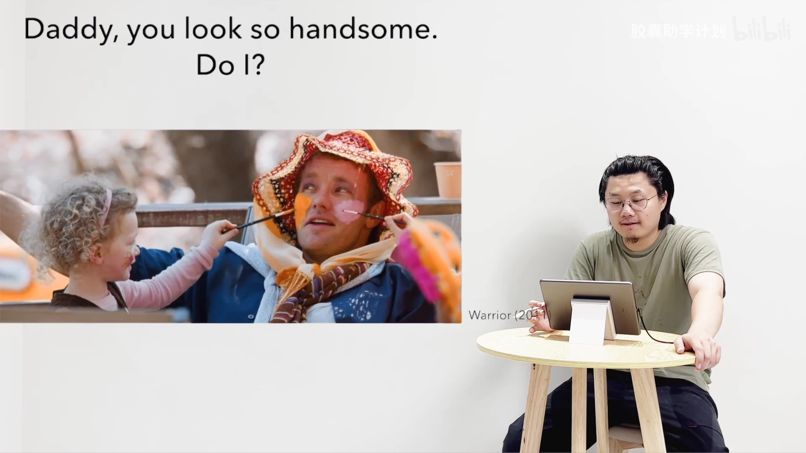

文字识别：Daddy, you look so handsome. / Do l? / Warriort201

### 画面 00:06:33

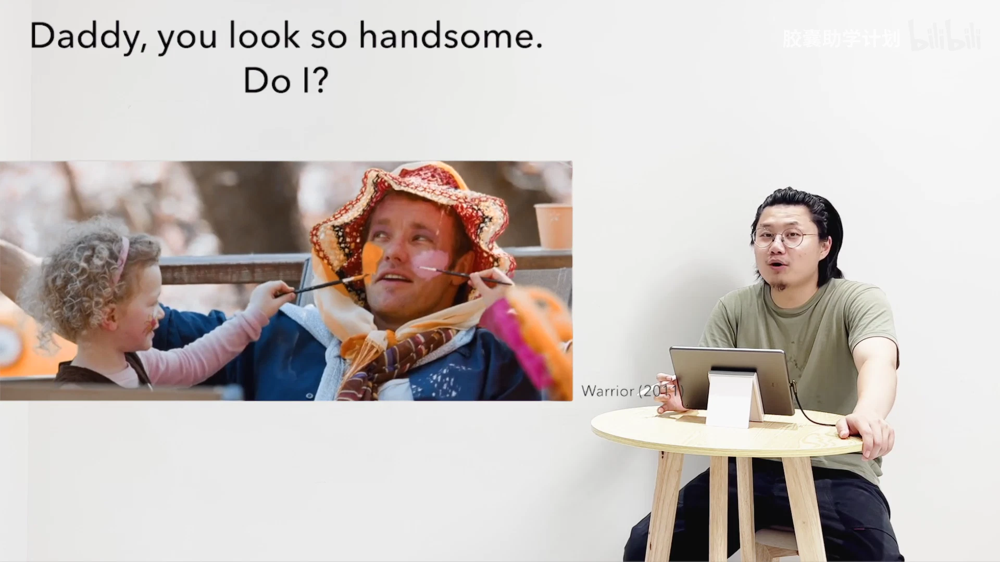

文字识别：Daddy, you look so handsome. / Dol? / Warrior(2041

### 画面 00:06:35

文字识别：单词造句指南 / 网：v.+v.变化 / 四句型转换 / 方式/地点/时间 / 结合习惯用法 / 其他单词+词性 / 原文摘抄+变 / 6123456 / Rolls-Royce / Benz

### 画面 00:06:37

文字识别：单词造句指南 / 网：v.+v.变化 / 四句型转换 / 方式/地点/时间 / 结合习惯用法 / 其他单词+词性 / 原文摘抄+变 / 6123456 / Rolls-Royce / Benz

### 画面 00:06:40

文字识别：单词造句指南 / 网：v.+v.变化 / 四句型转换 / 方式/地点/时间 / 结合习惯用法 / 其他单词+词性 / 原文摘抄+变 / 6123456 / Rolls-Royce / Benz

### 画面 00:06:46

文字识别：单词造句指南 / 网：v.+v.变化 / 四句型转换 / 方式/地点/时间 / 结合习惯用法 / 其他单词+词性 / 原文摘抄+变 / 6123456 / Rolls-Royce / Benz

### 画面 00:06:50

文字识别：单词造句指南 / 网：v.+v.变化 / 四句型转换 / 方式/地点/时间 / 结合习惯用法 / 其他单词+词性 / 原文摘抄+变 / 6123456 / Rolls-Royce / Benz

### 画面 00:06:55

文字识别：单词造句指南 / 网：v.+v.变化 / 四句型转换 / 方式/地点/时间 / 结合习惯用法 / 其他单词+词性 / 原文摘抄+变 / 6123456 / Rolls-Royce / Benz

## 00:07:00–00:07:30

吧？车的品牌下一个就是 Benz 对吧？哎，这个各位应该一听名字就能听出来是谁了。我们不用拿它去造句了，也不用多说了啊。下一个单词一起读一下，叫做 wheel wheel. Okay, 那它指的是轮胎轮子的意思，明显是可以有单复数的，一个轮子，两个轮儿，仨轮儿，四轮，对吧？好，比如说我们造一句话叫 This car has only three wheels. 说这个车呀只有三个轮子，对吧？哎，那肯定句这个句

### 画面 00:07:05

文字识别：单词造句指南 / 网：v.+v.变化 / 四句型转换 / 方式/地点/时间 / 结合习惯用法 / 其他单词+词性 / 原文摘抄+变 / 6123456 / / w i : | 1 / wheel n.

### 画面 00:07:07

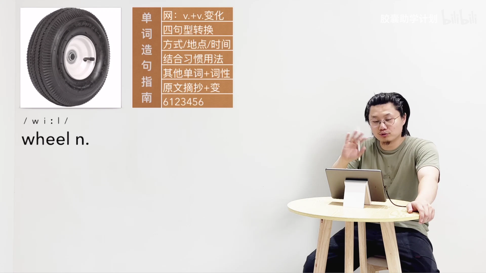

文字识别：单词造句指南 / 网：v.+v.变化 / 四句型转换 / 方式/地点/时间 / 结合习惯用法 / 其他单词+词性 / 原文摘抄+变 / 6123456 / / w i : | / / wheel n.

### 画面 00:07:10

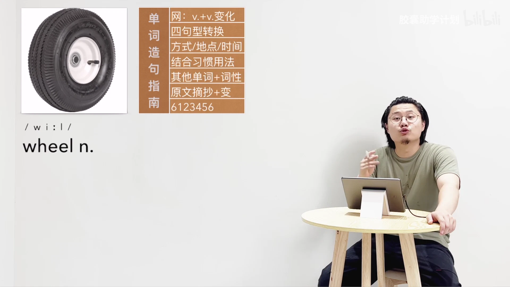

文字识别：单词造句指南 / 网：v.+v.变化 / 四句型转换 / 方式/地点/时间 / 结合习惯用法 / 其他单词+词性 / 原文摘抄+变 / 6123456 / / w i : | / / wheel n.

### 画面 00:07:15

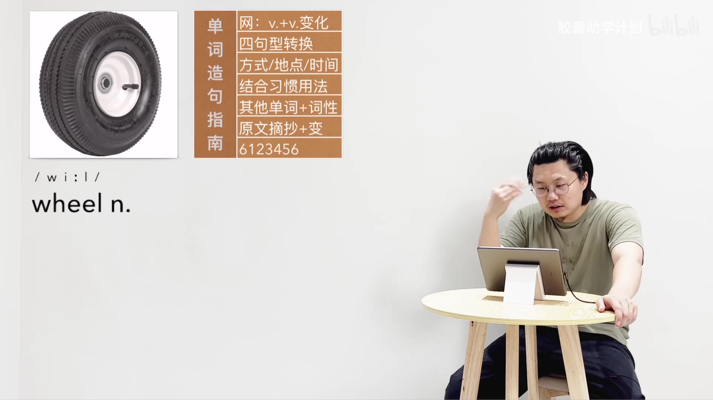

文字识别：单词造句指南 / 网：v.+v.变化 / 四句型转换 / 方式/地点/时间 / 结合习惯用法 / 其他单词+词性 / 原文摘抄+变 / 6123456 / / w i : | / / wheel n.

### 画面 00:07:20

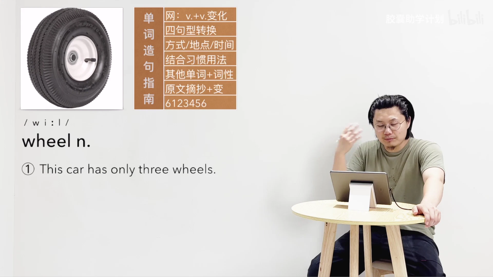

文字识别：单词造句指南 / 网：v.+v.变化 / 四句型转换 / 方式/地点/时间 / 结合习惯用法 / 其他单词+词性 / 原文摘抄+变 / 6123456 / / w i : | 1 / wheel n. / ) This car has only three wheels.

### 画面 00:07:25

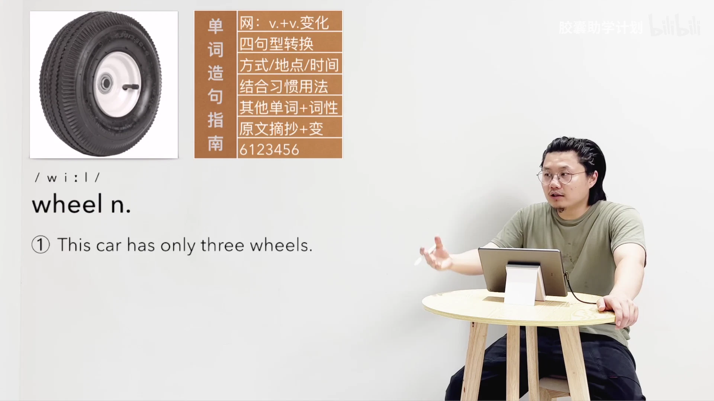

文字识别：单词造句指南 / 网：v.+v.变化 / 四句型转换 / 方式/地点/时间 / 结合习惯用法 / 其他单词+词性 / 原文摘抄+变 / 6123456 / / w i : | 1 / wheel n. /  This car has only three wheels.

## 00:07:30–00:08:00

话应该比较好造啊。拥有三个轮子很容易造，然后四个句型是吧？Why does this car has have only three wheels?对吧？哎，那你可能只知其一不知其二。你以为它是个三轮车，没想到它是个老爷车，对吧？哎，一八呃八五年建造的那辆，对吧？老爷车啊，进入文章咱们再看。好，接下来下一句话叫Could you sign for the wheels?玩一个说你能签收一下这个轮子吗？假

### 画面 00:07:31

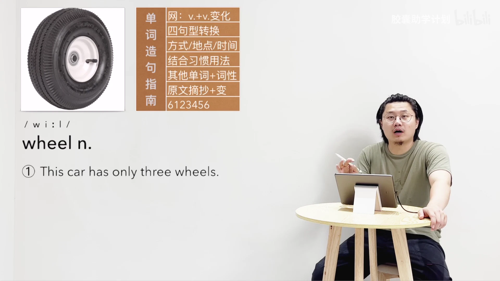

文字识别：单词造句指南 / 网：v.+v.变化 / 四句型转换 / 方式/地点/时间 / 结合习惯用法 / 其他单词+词性 / 原文摘抄+变 / 6123456 / / w i : | 1 / wheel n. / ① This car has only three wheels.

### 画面 00:07:35

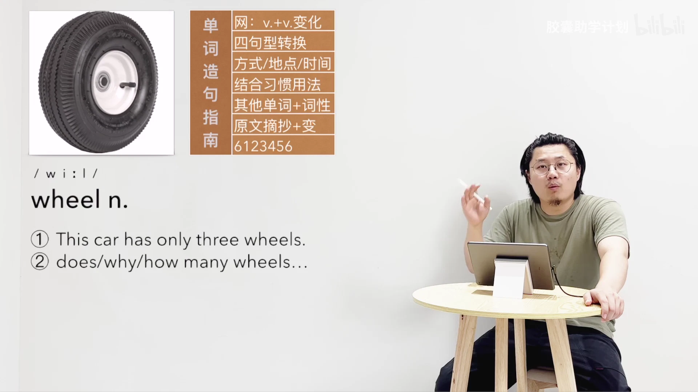

文字识别：单词造句指南 / 网：v.+v.变化 / 四句型转换 / 方式/地点/时间 / 结合习惯用法 / 其他单词+词性 / 原文摘抄+变 / 6123456 / / w i : | 1 / wheel n. / ① This car has only three wheels. / ② does/why/how many wheels..

### 画面 00:07:42

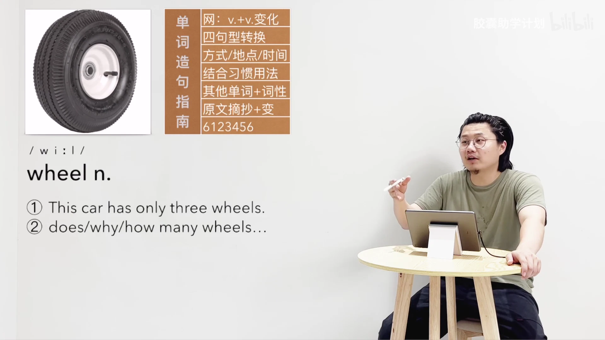

文字识别：单词造句指南 / 网：v.+v.变化 / 四句型转换 / 方式/地点/时间 / 结合习惯用法 / 其他单词+词性 / 原文摘抄+变 / 6123456 / / w i : | 1 / wheel n. / ① This car has only three wheels. / ② does/why/how many wheels..

### 画面 00:07:45

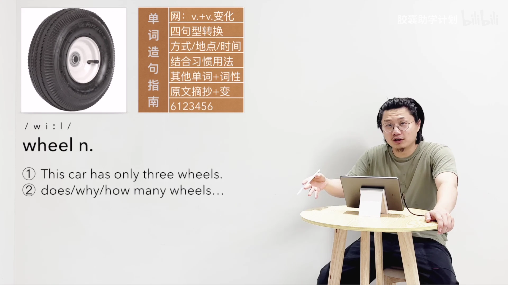

文字识别：单词造句指南 / 网：v.+v.变化 / 四句型转换 / 方式/地点/时间 / 结合习惯用法 / 其他单词+词性 / 原文摘抄+变 / 6123456 / / w i : | 1 / wheel n. / D This car has only three wheels. / ② does/why/how many wheels..

### 画面 00:07:55

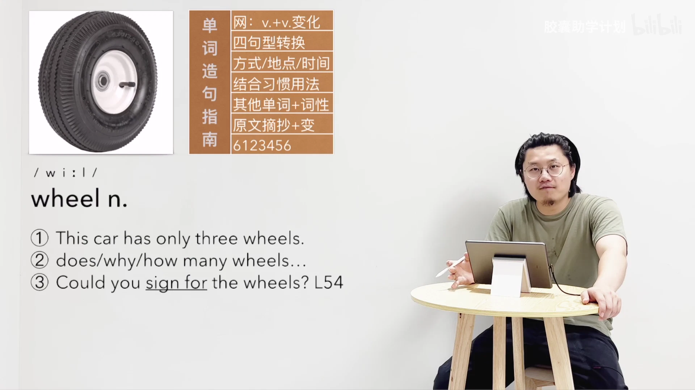

文字识别：单词造句指南 / 网：v.+v.变化 / 四句型转换 / 方式/地点/时间 / 结合习惯用法 / 其他单词+词性 / 原文摘抄+变 / 6123456 / / w i : | / / wheel n. / ① This car has only three wheels. / ② does/why/how many wheels... / ③ Could you sign for the wheels? L54

## 00:08:00–00:08:30

设嗯，你点的这个这个哎，这个呃，我们所谓的叫呃快递，哎到了，叫 sign for the wheels. Very good. Continue. Say come here.来 help me to repair these wheels.还是跟我读啊. Repeat after me. Help somebody to do something.帮助某人做某件事情。再读一遍这个单词，叫做 wheel wheel. Very good.接下来文章当中给的单词叫

### 画面 00:08:00

文字识别：单词造句指南 / 网：v.+v.变化 / 四句型转换 / 方式/地点/时间 / 结合习惯用法 / 其他单词+词性 / 原文摘抄+变 / 6123456 / / w i : | / / wheel n. / ① This car has only three wheels. / ② does/why/how many wheels... / ③ Could you sign for the wheels? L54

### 画面 00:08:05

文字识别：单词造句指南 / 网：v.+v.变化 / 四句型转换 / 方式/地点/时间 / 结合习惯用法 / 其他单词+词性 / 原文摘抄+变 / 6123456 / / w i : | / / wheel n. / ① This car has only three wheels. / ② does/why/how many wheels... / ③ Could you sign for the wheels? L54

### 画面 00:08:10

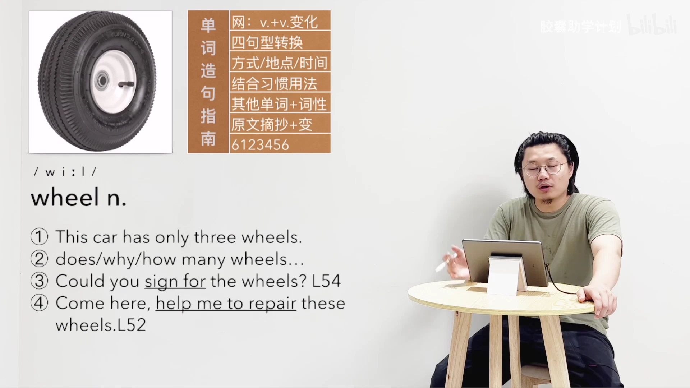

文字识别：单词造句指南 / 网：v.+v.变化 / 四句型转换 / 方式/地点/时间 / 结合习惯用法 / 其他单词+词性 / 原文摘抄+变 / 6123456 / / w i : | / / wheel n. / ① This car has only three wheels. / ② does/why/how many wheels... / ③ Could you sign for the wheels? L54 / ④ Come here, help me to repair these / wheels.L52

### 画面 00:08:15

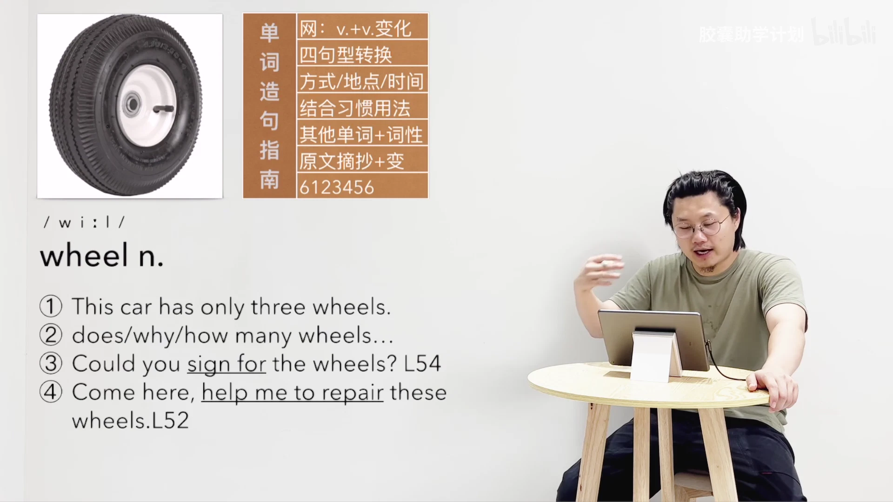

文字识别：单词造句指南 / 网：v.+v.变化 / 四句型转换 / 方式/地点/时间 / 结合习惯用法 / 其他单词+词性 / 原文摘抄+变 / 6123456 / / w i : | 1 / wheel n. / ① This car has only three wheels. / ② does/why/how many wheels... / ③ Could you sign for the wheels? L54 / ④ Come here, help me to repair these / wheels.L52

### 画面 00:08:21

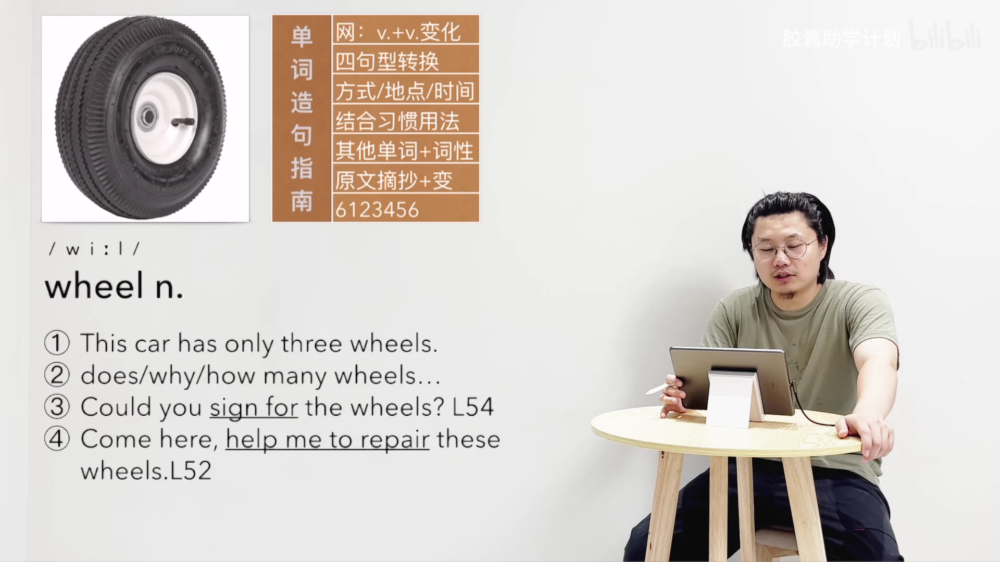

文字识别：单词造句指南 / 网：v.+v.变化 / 四句型转换 / 方式/地点/时间 / 结合习惯用法 / 其他单词+词性 / 原文摘抄+变 / 6123456 / / w i : | 1 / wheel n. / ① This car has only three wheels. / ② does/why/how many wheels... / ③ Could you sign for the wheels? L54 / ④ Come here, help me to repair these / wheels.L52

### 画面 00:08:25

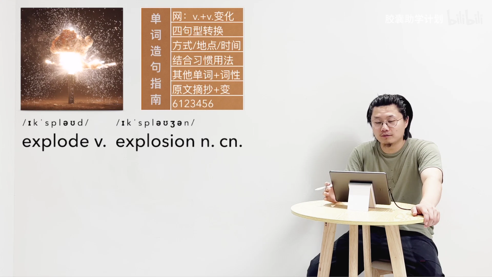

文字识别：单词造句指南 / 网：v.+v.变化 / 四句型转换 / 方式/地点/时间 / 结合习惯用法 / 其他单词+词性 / 原文摘抄+变 / 6123456 / /ik'splaud/ / /ik'splau3an/ / explode v. explosion n.cn.

### 画面 00:08:27

文字识别：单词造句指南 / 网：v.+v.变化 / 四句型转换 / 方式/地点/时间 / 结合习惯用法 / 其他单词+词性 / 原文摘抄+变 / 6123456 / /ik'splaud/ / /ik'splau3an/ / explode v. explosion n.cn.

## 00:08:30–00:09:00

explosion, explosion. Okay, 那它实际上 s i o n 结尾。上一节课单词部分我们刚刚提到 t i o n s i o n 结尾，很多单词都是名词词性的，对吧？那它的动词长成前面那个样子叫 explode，啊，叫做爆炸了。 Okay，只不过它俩含义是一样的，一个是动词，一个是名词啊。那我们造句子，比如说非常简单啊，我们刚刚学过引起森林大火那一刻的 cause，有两个含义，对吧？动词含

### 画面 00:08:30

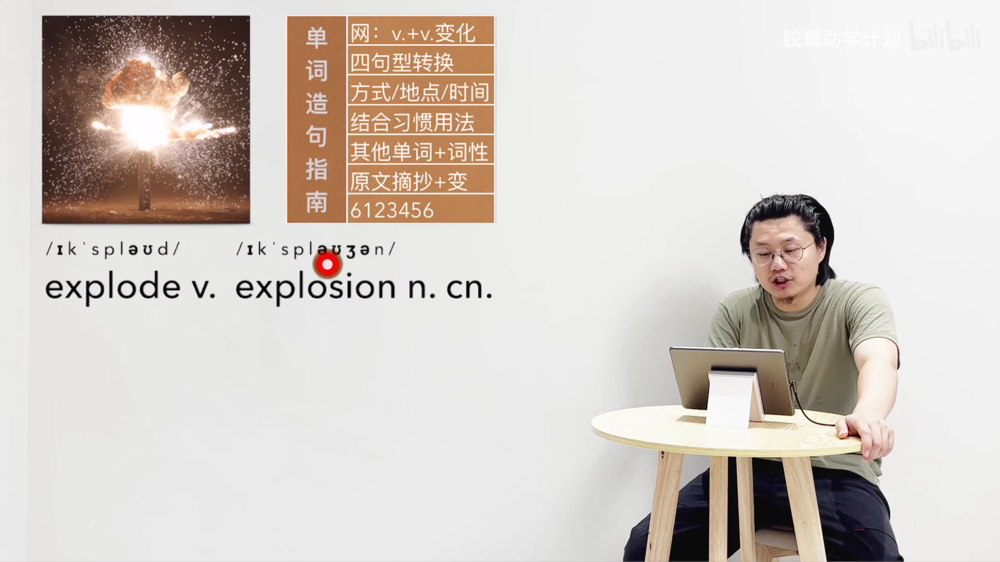

文字识别：单词造句指南 / 网：v.+v.变化 / 四句型转换 / 方式/地点/时间 / 结合习惯用法 / 其他单词+词性 / 原文摘抄+变 / 6123456 / /ik'splaud/ / /Ik'spli / 3an/ / explode v. explosion n.cn.

### 画面 00:08:32

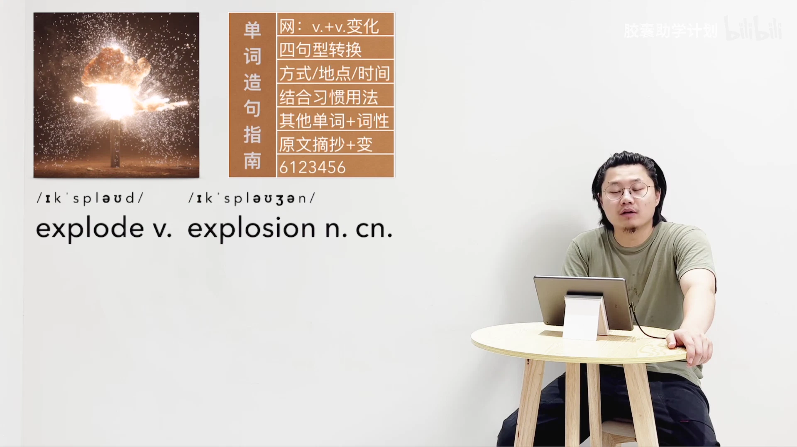

文字识别：单词造句指南 / 网：v.+v.变化 / 四句型转换 / 方式/地点/时间 / 结合习惯用法 / 其他单词+词性 / 原文摘抄+变 / 6123456 / /ik'splaud/ / /ik'splau3an/ / explode v. explosion n.cn.

### 画面 00:08:35

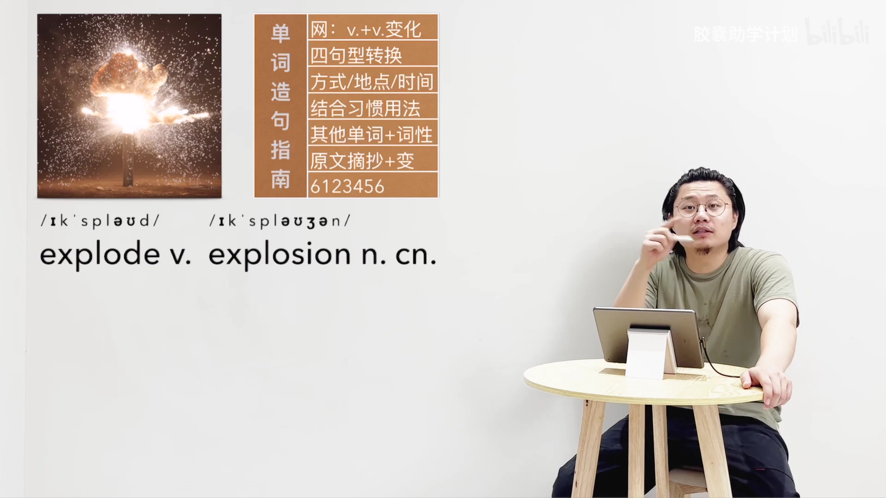

文字识别：单词造句指南 / 网：v.+v.变化 / 四句型转换 / 方式/地点/时间 / 结合习惯用法 / 其他单词+词性 / 原文摘抄+变 / 6123456 / /ik'splaud/ / /ik'splau3an/ / explode v. explosion n.cn.

### 画面 00:08:40

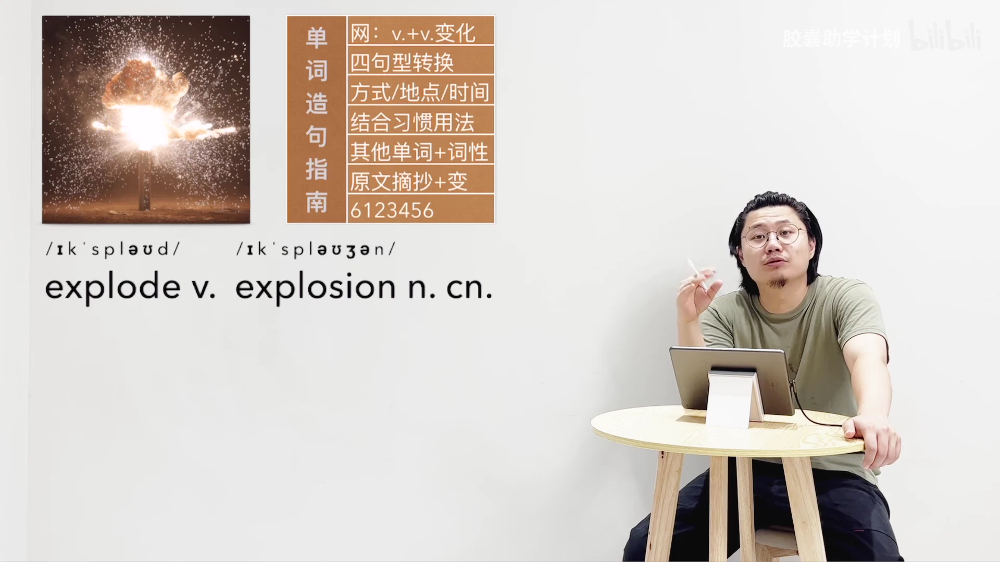

文字识别：单词造句指南 / 网：v.+v.变化 / 四句型转换 / 方式/地点/时间 / 结合习惯用法 / 其他单词+词性 / 原文摘抄+变 / 6123456 / /ik'splaud/ / /ik'splau3an/ / explode v. explosion n.cn.

### 画面 00:08:45

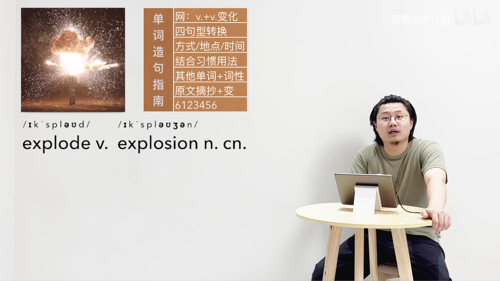

文字识别：单词造句指南 / 网：v.+v.变化 / 四句型转换 / 方式/地点/时间 / 结合习惯用法 / 其他单词+词性 / 原文摘抄+变 / 6123456 / /ik'splaud/ / /ik'splau3an/ / explode v. explosion n.cn.

### 画面 00:08:52

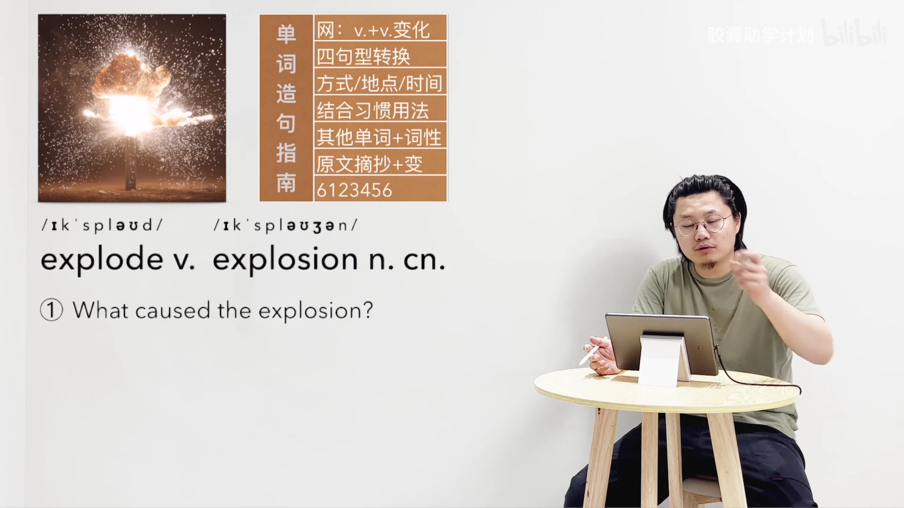

文字识别：单词造句指南 / 网：v.+v.变化 / 四句型转换 / 方式/地点/时间 / 结合习惯用法 / 其他单词+词性 / 原文摘抄+变 / 6123456 / /ik'splaud/ / /ik'splau3an/ / explode v. explosion n. cn. / ① What caused the explosion?

### 画面 00:08:55

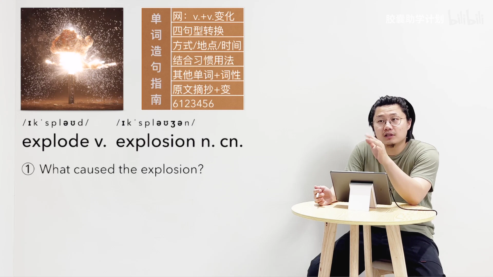

文字识别：单词造句指南 / 网：v.+v.变化 / 四句型转换 / 方式/地点/时间 / 结合习惯用法 / 其他单词+词性 / 原文摘抄+变 / 6123456 / /ik'splaud/ / /ik'splau3an/ / explode v. explosion n. cn. / ① What caused the explosion?

## 00:09:00–00:09:30

义就叫做引起。那我们就可以问一句话，叫 What caused the explosion？啊，什么引起了这个爆炸呢？Repeat after me. Okay, continue.说It was damaged by an explosion three days ago.说它被损毁了，被什么损毁呢？被一次爆炸损毁了。三天前，哎，这个实际上就是我们第十课学过的be加单，对吧？很简单。Next one说We heard an explosion.我们听到了一阵

### 画面 00:09:01

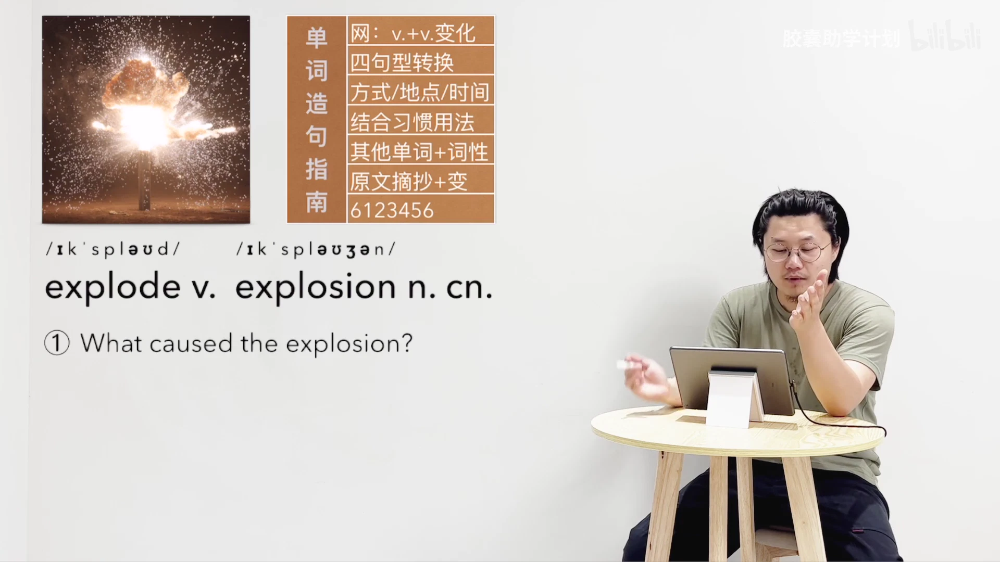

文字识别：单词造句指南 / 网：v.+v.变化 / 四句型转换 / 方式/地点/时间 / 结合习惯用法 / 其他单词+词性 / 原文摘抄+变 / 6123456 / /ik'splaud/ / /ik'splau3an/ / explode v. explosion n. cn. / ① What caused the explosion?

### 画面 00:09:05

文字识别：单词造句指南 / 网：v.+v.变化 / 四句型转换 / 方式/地点/时间 / 结合习惯用法 / 其他单词+词性 / 原文摘抄+变 / 6123456 / /ik'splaud/ / /ik'splau3an/ / explode v. explosion n. cn. /  What caused the explosion?

### 画面 00:09:10

文字识别：单词造句指南 / 网：v.+v.变化 / 四句型转换 / 方式/地点/时间 / 结合习惯用法 / 其他单词+词性 / 原文摘抄+变 / 6123456 / /ik'splaud/ / /ik'splau3an/ / explode v. explosion n.cn. / ① What caused the explosion? /  It was damaged by an explosion three days / ago.L10

### 画面 00:09:15

文字识别：单词造句指南 / 网：v.+v.变化 / 四句型转换 / 方式/地点/时间 / 结合习惯用法 / 其他单词+词性 / 原文摘抄+变 / 6123456 / /ik'splaud/ / /ik'splau3an/ / explode v. explosion n. cn. / ① What caused the explosion? / It was damaged by an explosion three days / ago.L10

### 画面 00:09:20

文字识别：单词造句指南 / 网：v.+v.变化 / 四句型转换 / 方式/地点/时间 / 结合习惯用法 / 其他单词+词性 / 原文摘抄+变 / 6123456 / /ik'splaud/ / /ik'splau3an/ / explode v. explosion n. cn. / ① What caused the explosion? / It was damaged by an explosion three days / ago.L10

### 画面 00:09:25

文字识别：单词造句指南 / 网：v.+v.变化 / 四句型转换 / 方式/地点/时间 / 结合习惯用法 / 其他单词+词性 / 原文摘抄+变 / 6123456 / /ik'splaud/ / /ik'splau3an/ / explode v. explosion n. cn. / ① What caused the explosion? / ② It was damaged by an explosion three days / 2 / ago.L10 / We heard an explosion.

## 00:09:30–00:10:00

### 画面 00:09:30

文字识别：单词造句指南 / 网：v.+v.变化 / 四句型转换 / 方式/地点/时间 / 结合习惯用法 / 其他单词+词性 / 原文摘抄+变 / 6123456 / /ik'splaud/ / /ik'splau3an/ / explode v. explosion n. cn. / ① What caused the explosion? / ② It was damaged by an explosion three days / ago.L10 / We heard an explosion.

### 画面 00:09:35

文字识别：单词造句指南 / 网：v.+v.变化 / 四句型转换 / 方式/地点/时间 / 结合习惯用法 / 其他单词+词性 / 原文摘抄+变 / 6123456 / /ik'splaud/ / /ik'splau3an/ / explode v. explosion n. cn. / ① What caused the explosion? / ② It was damaged by an explosion three days / ago.L10 / We heard an explosion. / ) did/when/who/what...

### 画面 00:09:40

文字识别：单词造句指南 / 网：v.+v.变化 / 四句型转换 / 方式/地点/时间 / 结合习惯用法 / 其他单词+词性 / 原文摘抄+变 / 6123456 / /ik'splaud/ / /ik'splau3an/ / explode v. explosion n.cn. / ① What caused the explosion? / ② It was damaged by an explosion three days / ago.L10 / We heard an explosion. / ) did/when/who/what...

### 画面 00:09:43

文字识别：单词造句指南 / 网：v.+v.变化 / 四句型转换 / 方式/地点/时间 / 结合习惯用法 / 其他单词+词性 / 原文摘抄+变 / 6123456 / /ik'splaud/ / /ik'splau3an/ / explode v. explosion n.cn. / ① What caused the explosion? / ② It was damaged by an explosion three days / ago.L10 / We heard an explosion. / did/when/who/what... / She went on an excursion by herself two / 5 / nights before the explosion. L50

### 画面 00:09:45

文字识别：单词造句指南 / 网：v.+v.变化 / 四句型转换 / 方式/地点/时间 / 结合习惯用法 / 其他单词+词性 / 原文摘抄+变 / 6123456 / /ik'splaud/ / /ik'splau3an/ / explode v. explosion n.cn. / ① What caused the explosion? / ② It was damaged by an explosion three days / ago.L10 / We heard an explosion. / did/when/who/what... / She went on an excursion by herself two / 5 / nights before the explosion. L50

### 画面 00:09:48

文字识别：单词造句指南 / 网：v.+v.变化 / 四句型转换 / 方式/地点/时间 / 结合习惯用法 / 其他单词+词性 / 原文摘抄+变 / 6123456 / /ik'splaud/ / /ik'splau3an/ / explode v. explosion n.cn. / ① What caused the explosion? / ② It was damaged by an explosion three days / ago.L10 / We heard an explosion. / did/when/who/what... / She went on an excursion by herself two / 5 / nights before the explosion. L50

### 画面 00:09:50

文字识别：单词造句指南 / 网：v.+v.变化 / 四句型转换 / 方式/地点/时间 / 结合习惯用法 / 其他单词+词性 / 原文摘抄+变 / 6123456 / /ik'splaud/ / /ik'splau3an/ / explode v. explosion n.cn. / ① What caused the explosion? / ② It was damaged by an explosion three days / ago.L10 / We heard an explosion. / did/when/who/what... / She went on an excursion by herself two / 5 / nights before the explosion. L50

### 画面 00:09:55

文字识别：单词造句指南 / 网：v.+v.变化 / 四句型转换 / 方式/地点/时间 / 结合习惯用法 / 其他单词+词性 / 原文摘抄+变 / 6123456 / /ik'splaud/ / /ik'splau3an/ / explode v. explosion n. cn. / ① What caused the explosion? / ② It was damaged by an explosion three days / ago.L10 / We heard an explosion. / did/when/who/what... /  She went on an excursion by herself two / 5 / nights before the explosion. L50

## 00:10:00–00:10:30

个爆炸前的前两天啊，前两晚，对吧？他自己出去了。 Okay, 好。呃，接下来我们看这样一句话，这是 explosion 这个单词在口语当中啊特别常用的一个呃用法。然后我们看这句话，叫 My father is the explosion guy. I'm not that guy. 你看这句话，如果我们给它翻译过来，叫做我父亲是一个爆炸的家伙，但我不是那个家伙啊，我不是那样的一个人，对吧？什么意思呢？其实就指的是起啊

### 画面 00:10:00

文字识别：单词造句指南 / 网：v.+v.变化 / 四句型转换 / 方式/地点/时间 / 结合习惯用法 / 其他单词+词性 / 原文摘抄+变 / 6123456 / /ik'splaud/ / /ik'splau3an/ / explode v. explosion n.cn. / ① What caused the explosion? / ② It was damaged by an explosion three days / ago.L10 / We heard an explosion. / did/when/who/what... / She went on an excursion by herself two / 5 / nights before the explosion. L50

### 画面 00:10:05

文字识别：单词造句指南 / 网：v.+v.变化 / 四句型转换 / 方式/地点/时间 / 结合习惯用法 / 其他单词+词性 / 原文摘抄+变 / 6123456 / /ik'splaud/ / /ik'splau3an/ / explode v. explosion n.cn. / ① What caused the explosion? / ② It was damaged by an explosion three days / ago.L10 / We heard an explosion. / did/when/who/what... / She went on an excursion by herself two / 5 / nights before the explosion. L50

### 画面 00:10:07

文字识别： My father is the explosion guy. / I'm not that guy. / Silver Linings / Playbook(201

### 画面 00:10:24

文字识别： My father is the explosion guy. / I'm not that guy. / Silver Linings / Playbook(2012

## 00:10:30–00:11:00

易燃易爆炸啊，我们用一个流行语叫易燃易爆炸啊。就我父亲是个易燃易爆炸的人，但我不是啊。注意力集中，我们听一下。My father is the explosion guy. I'm not that guy. OK，好，下一个单词啊，跟我读一下，叫做course。course可以加个儿化音啊。course那儿一个course这个单词含义还真不少，而且完全的南辕北辙，不不是一码事儿。比如说，我们应该

### 画面 00:10:41

文字识别： My father is the explosion guy. / I'm not that guy. / Silver Linings / Playbook(20

### 画面 00:10:43

文字识别： My father is the explosion guy. / I'm not that guy. / Silver Linings / Playbook120

### 画面 00:10:45

文字识别：单词造句指南 / 网：v.+v.变化 / 四句型转换 / 方式/地点/时间 / 结合习惯用法 / 其他单词+词性 / 原文摘抄+变 / 6123456 / / k 3 : s 1 / course n.

### 画面 00:10:50

文字识别：单词造句指南 / 网：v.+v.变化 / 四句型转换 / 方式/地点/时间 / 结合习惯用法 / 其他单词+词性 / 原文摘抄+变 / 6123456 / / k 3 : s 1 / course n.

## 00:11:00–00:11:30

比较熟悉它的含义，其中有一个叫做课程，对吧？哎，叫做课程。那它还有一个含义呢？慢慢我们会见到，就是指的是菜啊，一粒菜，这个叫 course。那今天它的含义呢，实际上跟这个放在短语当中比较好理解。再看着图叫 on the course 啊，类似于我们新医学的那个 on the track，有点类似的含义，叫在赛道上，在跑道上。OK，好，那拿它去造句，你想

### 画面 00:11:06

文字识别：单词造句指南 / 网：v.+v.变化 / 四句型转换 / 方式/地点/时间 / 结合习惯用法 / 其他单词+词性 / 原文摘抄+变 / 6123456 / / k 3 : s / / course n.

### 画面 00:11:09

文字识别：单词造句指南 / 网：v.+v.变化 / 四句型转换 / 方式/地点/时间 / 结合习惯用法 / 其他单词+词性 / 原文摘抄+变 / 6123456 / / k o : s / / course n.

### 画面 00:11:11

文字识别：单词造句指南 / 网：v.+v.变化 / 四句型转换 / 方式/地点/时间 / 结合习惯用法 / 其他单词+词性 / 原文摘抄+变 / 6123456 / / k 3 : s / / course n.

### 画面 00:11:15

文字识别：单词造句指南 / 网：v.+v.变化 / 四句型转换 / 方式/地点/时间 / 结合习惯用法 / 其他单词+词性 / 原文摘抄+变 / 6123456 / / k o : s 1 / course n. / ① on the course

### 画面 00:11:25

文字识别：单词造句指南 / 网：v.+v.变化 / 四句型转换 / 方式/地点/时间 / 结合习惯用法 / 其他单词+词性 / 原文摘抄+变 / 6123456 / / k o : s / / course n. / ① on the course

## 00:11:30–00:12:00

on the course 在六一二三四五六当中，那肯定就是五了，对不对？好，哎，作为一个地点啊，这儿我多提一句，有很多同学在看这个视频的过程当中呢，竟然看到了四五十课的时候，突然问了我一个问题，叫做六一二三四五六是什么？可以解释一下吗？这不是咱们第一节课新概念二册第一课语法最重要的东西，我们几乎从第一课一直用到了今天，等我们将来用学到第三册还在用，对吧？

### 画面 00:11:55

文字识别：单词造句指南 / 网：v.+v.变化 / 四句型转换 / 方式/地点/时间 / 结合习惯用法 / 其他单词+词性 / 原文摘抄+变 / 6123456 / / k o : s 1 / course n. / ① on the course

## 00:12:00–00:12:30

如果您是比如说，呃，没有看我的开头啊，没有看第一节课，你直接就跳到了这一节课，那你一定要去看一下第一节课，对吧？哎，好，那他肯定是在六一二三四五六当中做五啊。On the course, play again. 那我们看这样一句话，叫 There was an explosion on the course. 你看，非常好。我们造句的时候不仅仅用到了 on the course，我还把刚刚学到的 an explosion 用到一起了，好吧？好，接下来

### 画面 00:12:10

文字识别：单词造句指南 / 网：v.+v.变化 / 四句型转换 / 方式/地点/时间 / 结合习惯用法 / 其他单词+词性 / 原文摘抄+变 / 6123456 / / k o : s 1 / course n. / ① on the course

### 画面 00:12:15

文字识别：单词造句指南 / 网：v.+v.变化 / 四句型转换 / 方式/地点/时间 / 结合习惯用法 / 其他单词+词性 / 原文摘抄+变 / 6123456 / / k o : s / / course n. / ① on the course / There was an explosion on the course.

### 画面 00:12:20

文字识别：单词造句指南 / 网：v.+v.变化 / 四句型转换 / 方式/地点/时间 / 结合习惯用法 / 其他单词+词性 / 原文摘抄+变 / 6123456 / / k o : s / / course n. / ① on the course / There was an explosion on the course.

### 画面 00:12:24

文字识别：单词造句指南 / 网：v.+v.变化 / 四句型转换 / 方式/地点/时间 / 结合习惯用法 / 其他单词+词性 / 原文摘抄+变 / 6123456 / / k o : s / / course n. / ① on the course / There was an explosion on the course.

### 画面 00:12:26

文字识别：单词造句指南 / 网：v.+v.变化 / 四句型转换 / 方式/地点/时间 / 结合习惯用法 / 其他单词+词性 / 原文摘抄+变 / 6123456 / / k o : s / / course n. / ① on the course / There was an explosion on the course.

### 画面 00:12:29

文字识别：单词造句指南 / 网：v.+v.变化 / 四句型转换 / 方式/地点/时间 / 结合习惯用法 / 其他单词+词性 / 原文摘抄+变 / 6123456 / / k o : s / / course n. / ① on the course / There was an explosion on the course. / [Story]: Many of the cars broke down on the / course.

## 00:12:30–00:13:00

原文摘抄再加变，叫做 Many of the cars broke down on the course. 说许多的车 broke down 了，在这个跑道上，在赛道上。你看啊，这个就要我们去说。我现在只有 broke down 不会。我结合实际场景，结合个人经验，结合上下文，对吧？然后呢，去硬猜一下，看能不能猜出来。比如说 break，对于各位来说啊， down 你不好理解，什么上啊，

### 画面 00:12:37

文字识别：单词造句指南 / 网：v.+v.变化 / 四句型转换 / 方式/地点/时间 / 结合习惯用法 / 其他单词+词性 / 原文摘抄+变 / 6123456 / / k o : s  / course n. / ① on the course / There was an explosion on the course. / [Story]: Many of the cars broke down on the / course.

### 画面 00:12:45

文字识别：单词造句指南 / 网：v.+v.变化 / 四句型转换 / 方式/地点/时间 / 结合习惯用法 / 其他单词+词性 / 原文摘抄+变 / 6123456 / / k o : s / / course n. / ① on the course / There was an explosiop on the course. / [Story]: Many of the cars broke down on the / course.

## 00:13:00–00:13:30

这个下的下，对吧？嘿，是吧？Down the road，沿着这条路都行，它有很多意思，它是个小介词嘛，对吧？好，那broke，它的原形叫break啊，break into，break the window，break my arm，叫做弄蛇打蛇。哎，你看这里说很多的车蛇在路上了，哇！如果您是北方人，我估计可能这个句话已经明白了，但这是巧合啊。所以这地方简单说一下，进入文章我们会重点拿它去造句，叫break down。如果指的是

### 画面 00:13:15

文字识别：单词造句指南 / 网：v.+v.变化 / 四句型转换 / 方式/地点/时间 / 结合习惯用法 / 其他单词+词性 / 原文摘抄+变 / 6123456 / / k o : s 1 / course n. / ① on the course / There was an explosion on the course. / [Story]: Many of the cars broke down on the / course.

## 00:13:30–00:14:00

车的话，那就指的是抛锚了，对吧？哎，熄火了，等等，出问题了，break down。啊，拿它造句吧。How many？这个地方 how many？重点提一句，how many 对谁提问？我给各位三秒，各位自己去想一想。好啊，希望各位有答案了。How many？是不是对 many of 提问？对吧？所以这句话其实是对主语的一部分提问。所以你如果真要去做出来的话，应该

### 画面 00:13:35

文字识别：单词造句指南 / 网：v.+v.变化 / 四句型转换 / 方式/地点/时间 / 结合习惯用法 / 其他单词+词性 / 原文摘抄+变 / 6123456 / / k o : s / / course n. / ① on the course / There was an explosion on the course. / [Story]: Many of the cars broke down on the / course.

### 画面 00:13:37

文字识别：单词造句指南 / 网：v.+v.变化 / 四句型转换 / 方式/地点/时间 / 结合习惯用法 / 其他单词+词性 / 原文摘抄+变 / 6123456 / / k o : s / / course n. / ① on the course / There was an explosion on the course. / [Story]: Many of the cars broke down on the / course. /  how many/did/where/why...

### 画面 00:13:40

文字识别：单词造句指南 / 网：v.+v.变化 / 四句型转换 / 方式/地点/时间 / 结合习惯用法 / 其他单词+词性 / 原文摘抄+变 / 6123456 / / k o : s / / course n. / ① on the course / There was an explosionon the course. / [Story]: Many of the cars broke down on the / course. / how many/did/where/why...

### 画面 00:13:45

文字识别：单词造句指南 / 网：v.+v.变化 / 四句型转换 / 方式/地点/时间 / 结合习惯用法 / 其他单词+词性 / 原文摘抄+变 / 6123456 / / k o : s / / course n. / ① on the course / There was an explosior on the course. / [Story]: Many of the cars broke down on the / course. /  how many/did/where/why...

## 00:14:00–00:14:30

叫做 How many cars broke down on the course? Okay,好, continue,结合了一个三十八课的dream of, repeat after me啊，说He dreamed of driving his own car on that course for years.你看，他梦想着开他自己的那辆车在这个跑道上很多年了啊。这个语序就是英文语序，不是汉语语序，对吧？Okay,接下来下一个单词啊，看一下音标

### 画面 00:14:00

文字识别：单词造句指南 / 网：v.+v.变化 / 四句型转换 / 方式/地点/时间 / 结合习惯用法 / 其他单词+词性 / 原文摘抄+变 / 6123456 / / k o : s / / course n. / ① on the course / There was an explosior on the course. / [Story]: Many of the cars broke down on the / course. /  how many/did/where/why...

### 画面 00:14:05

文字识别：单词造句指南 / 网：v.+v.变化 / 四句型转换 / 方式/地点/时间 / 结合习惯用法 / 其他单词+词性 / 原文摘抄+变 / 6123456 / / k o : s / / course n. / ① on the course / There was an explosion on the course. / [Story]: Many of the cars broke down on the / course. / how many/did/where/why.... / He dreamed of driving his own car on that / course for years. L38

### 画面 00:14:10

文字识别：单词造句指南 / 网：v.+v.变化 / 四句型转换 / 方式/地点/时间 / 结合习惯用法 / 其他单词+词性 / 原文摘抄+变 / 6123456 / / k o : s / / course n. / ① on the course / There was an explosior on the course. / 2 / [Story]: Many of the cars broke down on the / 3 / course. / how many/did/where/why... / He dreamed of driving his own car on that / course for years. L38

### 画面 00:14:15

文字识别：单词造句指南 / 网：v.+v.变化 / 四句型转换 / 方式/地点/时间 / 结合习惯用法 / 其他单词+词性 / 原文摘抄+变 / 6123456 / / k o : s / / course n. / ① on the course / There was an explosion on the course. / 2 / [Story]: Many of the cars broke down on the / 3 / course. / how many/did/where/why... / He dreamed of driving his own car on that / course for years. L38

### 画面 00:14:20

文字识别：单词造句指南 / 网：v.+v.变化 / 四句型转换 / 方式/地点/时间 / 结合习惯用法 / 其他单词+词性 / 原文摘抄+变 / 6123456 / / k o : s / / course n. / ① on the course / There was an explosion on the course. / 2 / [Story]: Many of the cars broke down on the / course. / how many/did/where/why.... / He dreamed of driving his own car on that / course for years. L38

### 画面 00:14:26

文字识别：单词造句指南 / 网：v.+v.变化 / 四句型转换 / 方式/地点/时间 / 结合习惯用法 / TENNSSL / KENOCET / 2 / 其他单词+词性 / VOLUNTERS / 原文摘抄+变 / 6123456 / /'raival/ / rival n.

### 画面 00:14:28

文字识别：单词造句指南 / 网：v.+v.变化 / 四句型转换 / 方式/地点/时间 / 结合习惯用法 / TEWNSSL / RENUCST / 2 / 其他单词+词性 / VOLUNTERS / 原文摘抄+变 / 6123456 / /'raival/ / rival n.

## 00:14:30–00:15:00

叫做 rival，rival，rival，OK，它指的是我们的竞争对手啊，rival。好，首先这句话就特别的好，它是一句电影台词，叫 I think he saw us as rivals。好，首先这个 as 其实三十一课啊，就 as a young man，对吧？作为什么什么，这个我们三十一课就见过了。说我认为啊，他把我们看待成他的对手，他认为

### 画面 00:14:30

文字识别：单词造句指南 / 网：v.+v.变化 / 四句型转换 / 方式/地点/时间 / 结合习惯用法 / TENNESSEL / TENUERT / 2 / 其他单词+词性 / VOLUNTEERS / 原文摘抄+变 / 6123456 / /'raival/ / rival n.

### 画面 00:14:33

文字识别：单词造句指南 / 网：v.+v.变化 / 四句型转换 / 方式/地点/时间 / 结合习惯用法 / TEWNSSE / TENDCKT / 2 / 其他单词+词性 / VOLUNTCERS / 原文摘抄+变 / 6123456 / /'raival/ / rival n.

### 画面 00:14:35

文字识别：单词造句指南 / 网：v.+v.变化 / 四句型转换 / 方式/地点/时间 / 结合习惯用法 / TENUSS / RENUCST / 2 / 其他单词+词性 / VOLUNTEERS / 原文摘抄+变 / 6123456 / /'raival/ / rival n.

### 画面 00:14:40

文字识别：单词造句指南 / 网：v.+v.变化 / 四句型转换 / 方式/地点/时间 / 结合习惯用法 / TENNSS / KENUCST / 2 / 其他单词+词性 / VOLUNTEERS / 原文摘抄+变 / 6123456 / /'raival/ / rival n. / ① I think he saw us as rivals. The World's End

### 画面 00:14:47

文字识别：单词造句指南 / 网：v.+v.变化 / 四句型转换 / 方式/地点/时间 / 结合习惯用法 / TENNSS / RENDCKT / 2 / 其他单词+词性 / VOLUNTERS / 原文摘抄+变 / 6123456 / /'raival/ / rival n. /  I think he saw us as rivals. The World's End / 1

### 画面 00:14:50

文字识别：单词造句指南 / 网：v.+v.变化 / 四句型转换 / 方式/地点/时间 / 结合习惯用法 / TENNSS / KENDCST / 2 / 其他单词+词性 / VOLUNTEERS / 原文摘抄+变 / 6123456 / /'raival/ / rival n. / ① I think he saW us as rivals. The World's End

## 00:15:00–00:15:30

我们是他的对手。OK，好，接下来比如说，I have so many rivals，我有很多很多的竞争对手，这都很容易理解。我有很多竞争对手，跟汉语是一一对应的，对不对？好，continue说，Your biggest rival is yourself。好，说你最大的竞争对手就是你自己。这地方专门来了一个biggest，实际上第八课，各位想一下，形容词比较级最高级也当然是我们今天要本课要复习的，

### 画面 00:15:01

文字识别：单词造句指南 / 网：v.+v.变化 / 四句型转换 / 方式/地点/时间 / 结合习惯用法 / TENNSS / RENDCST / 2 / 其他单词+词性 / VOLUNTERS / 原文摘抄+变 / 6123456 / /'raival/ / rival n. / ① I think he saw us as rivals. The World's End /  I have so many rivals. The Age of Innocence (1993)

### 画面 00:15:05

文字识别：单词造句指南 / 网：v.+v.变化 / 四句型转换 / 方式/地点/时间 / 结合习惯用法 / TENNSSE / KENUCKT / 2 / 其他单词+词性 / VOLUNTEERS / 原文摘抄+变 / 6123456 / /'raival/ / rival n. / ① I think he saW us as rivals. The World's End / I have so many rivals. The Age of Innocence (1993)

### 画面 00:15:12

文字识别：单词造句指南 / 网：v.+v.变化 / 四句型转换 / 方式/地点/时间 / 结合习惯用法 / TENNSSY / RENDCST / 2 / 其他单词+词性 / VOLUNTERS / 原文摘抄+变 / 6123456 / /'raival/ / rival n. / ① I think he saw us as rivals. The World's End / I have so many rivals. The Age of Innocence (1993) / ) Your biggest rival is yourself.

### 画面 00:15:15

文字识别：单词造句指南 / 网：v.+v.变化 / 四句型转换 / 方式/地点/时间 / 结合习惯用法 / TENNSSR / KENUCKT / 2 / 其他单词+词性 / VOLUNTEERS / 原文摘抄+变 / 6123456 / /'raival/ / rival n. / ① I think he saw us as rivals. The World's End / I have so many rivals. The Age of Innocence (1993) / ) Your biggest rival is yourself.

### 画面 00:15:22

文字识别：单词造句指南 / 网：v.+v.变化 / 四句型转换 / 方式/地点/时间 / 结合习惯用法 / TENNSSI / KENDCKY / 2 / 其他单词+词性 / VOLUNTERS / 原文摘抄+变 / 6123456 / /'raival/ / rival n. / ① I think he saw us as rivals. The World's End / I have so many rivals. The Age of Innocence (1993) /  Your biggest rival is yourself. / L

### 画面 00:15:25

文字识别：单词造句指南 / 网：v.+v.变化 / 四句型转换 / 方式/地点/时间 / 结合习惯用法 / TENNSS / KENDCKT / 2 / 其他单词+词性 / VOLUNTERS / 原文摘抄+变 / 6123456 / /'raival/ / rival n. / ① I think he saw us as rivals. The World's End / I have so many rivals. The Age of Innocence (1993) / L8 / ) Your biggest rival is yourself.

## 00:15:30–00:16:00

因为本课是第三单元第八课了嘛，正好拉过来说你最大的竞争对手是你自己。来，repeat after me啊，your biggest rival is yourself. OK, continue。说，哎，这句话是我在这个杂志上啊，《经济学人》这个杂志上找下来的半句话，后边那句话有点难，我们先把它扔掉啊，我们就让各位知道我们在新概念当中学到的东西啊，不管是将来各位要这个阅读也好，还是

### 画面 00:15:43

文字识别：单词造句指南 / 网：v.+v.变化 / 四句型转换 / 方式/地点/时间 / 结合习惯用法 / TENNSSE / KENDCST / 2 / 其他单词+词性 / VOLUNTERS / 原文摘抄+变 / 6123456 / /'raival/ / rival n. / ① I think he saW us as rivals. The World's End / I have so many rivals. The Age of Innocence (1993) / .L& /  Your biggest rival is yourself. / 3 / India's biggest rival, China, continues to / make ... The Economist

### 画面 00:15:45

文字识别：单词造句指南 / 网：v.+v.变化 / 四句型转换 / 方式/地点/时间 / 结合习惯用法 / TENNSSE / RENDEKT / 2 / 其他单词+词性 / VOLUNTERS / 原文摘抄+变 / 6123456 / /'raival/ / rival n. / ① I think he saw us as rivals. The World's End / ) I have so many rivals. The Age of Innocence(1993) / ) Your biggest rival is yourself. / 3 / India's biggest rival, China, continues to / make ... The Economist

### 画面 00:15:50

文字识别：单词造句指南 / 网：v.+v.变化 / 四句型转换 / 方式/地点/时间 / 结合习惯用法 / TENNSST / RENUCET / 2 / 其他单词+词性 / VOLUNTERS / 原文摘抄+变 / 6123456 / /'raival/ / rival n. / ① I think he saW us as rivals. The World's End / ) I have so many rivals. The Age of Innocence (1993) / ③ Your biggest rival is yourself. / 3 / ) India's biggest rival, China, continues to / make ... The Economist

## 00:16:00–00:16:30

说看电影也好，它实际上都用得到。也就是说，现实英语的环境当中，这些单词大多数都用得到。比如说，我们看这句话，India's biggest rival China continues to make blah blah blah blah. Okay,说印度的最大竞争对手中国，哎，持续不断的去做出。我告诉各位，后半句是好话啊。好，continue.那接下来呢，我们看这样一个小的电影片段啊，叫做

### 画面 00:16:08

文字识别：单词造句指南 / 网：v.+v.变化 / 四句型转换 / 方式/地点/时间 / 结合习惯用法 / TENNSST / KENDCST / 2 / 其他单词+词性 / VOLUNTEERS / 原文摘抄+变 / 6123456 / /'raival/ / rival n. / ① I think he saw us as rivals. The World's End / ) I have so many rivals. The Age of Innocence (1993) / ) Your biggest rival is yourself. / 3 / ) India's biggest rival, China, continues to / make ... The Economist

### 画面 00:16:10

文字识别：单词造句指南 / 网：v.+v.变化 / 四句型转换 / 方式/地点/时间 / 结合习惯用法 / TENNSSE / KENUCET / 2 / 其他单词+词性 / VOLUNTEERS / 原文摘抄+变 / 6123456 / /'raival/ / rival n. / ① I think he saw us as rivals. The World's End / ) I have so many rivals. The Age of Innocence (1993) /  Your biggest rival is yourself. / 3 / India's biggest rival, China, continues to / make ... The Economist

### 画面 00:16:15

文字识别：单词造句指南 / 网：v.+v.变化 / 四句型转换 / 方式/地点/时间 / 结合习惯用法 / TENNSSE / TENUCST / 2 / 其他单词+词性 / VOLUNTERS / 原文摘抄+变 / 6123456 / /'raival/ / rival n. / ① I think he saw us as rivals. The World's End / I have so many rivals. The Age of Innocence (1993) / Your biggest rival is yourself. / 3 / India's biggest rival, China, continues to / make ... The Economist / 0

### 画面 00:16:20

文字识别：单词造句指南 / 网：v.+v.变化 / 四句型转换 / 方式/地点/时间 / 结合习惯用法 / TENNSSEL / RENUCST / 2 / 其他单词+词性 / VOLUNTERS / 原文摘抄+变 / 6123456 / /'raival/ / rival n. / ① I think he saw us as rivals. The World's End / I have so many rivals. The Age of Innocence (1993) / Your biggest rival is yourself. / 3 / India's biggest rival, China, continues to / make ... The Economist

### 画面 00:16:25

文字识别：People always think of us as rivals, / but he was among the very few I liked / , and even fewer that I respected. / Rush (2013)

## 00:16:30–00:17:00

Think of us as rivals，就跟那个 Saw us as rivals 是一码事儿啊，就认为我们是竞争对手啊。来，注意力集中。Always think of us as rivals, but he was among the very few I liked, and even fewer that I respected. OK，好，下一个单词啊，读一下叫做 Speed。好，它的过去式、过去分词都读成 Sped。OK，那 Speed

### 画面 00:16:41

文字识别：People always / think of us as rivals, / but he was among /  the very few I liked / , and even fewer that I respected. / alaver / Gran / or / NJob / -Mot / 3.3At / Rush (2013)

### 画面 00:16:43

文字识别：People always think of us as rivals, / but he was among the very few Iliked / , and even fewer that I respected. / Rush(2013号

### 画面 00:16:45

文字识别：People always think of us as rivals, / but he was among the very few I liked / , and even fewer that I respected. / Rush (2013)

### 画面 00:16:47

文字识别：People always think of us as rivals, / but he was among the very few I liked / , and even fewer that I respected. / − / Rush (2013)

### 画面 00:16:49

文字识别：People always think of us as rivals, / but he was among the very few I liked / , and even fewer that I respected. / Rush (2013)

### 画面 00:16:51

文字识别：单词造句指南 / 网：v.+v.变化 / 四句型转换 / 方式/地点/时间 / 结合习惯用法 / 其他单词+词性 / 原文摘抄+变 / 6123456 / /spi:d/ / /sped/ / speed - sped v.

### 画面 00:16:53

文字识别：单词造句指南 / 网：v.+v.变化 / 四句型转换 / 方式/地点/时间 / 结合习惯用法 / 其他单词+词性 / 原文摘抄+变 / 6123456 / /spi:d/ / /sped/ / speed - sped v.

### 画面 00:16:55

文字识别：单词造句指南 / 网：v.+v.变化 / 四句型转换 / 方式/地点/时间 / 结合习惯用法 / 其他单词+词性 / 原文摘抄+变 / 6123456 / / spi : d / / /sped/ / speed - sped v.

### 画面 00:16:57

文字识别：单词造句指南 / 网：v.+v.变化 / 四句型转换 / 方式/地点/时间 / 结合习惯用法 / 其他单词+词性 / 原文摘抄+变 / 6123456 / /spi :d / / /sped/ / speed - spedv.

### 画面 00:16:59

文字识别：单词造句指南 / 网：v.+v.变化 / 四句型转换 / 方式/地点/时间 / 结合习惯用法 / 其他单词+词性 / 原文摘抄+变 / 6123456 / /spi:d/ / /sped/ / speed - sped v.

## 00:17:00–00:17:30

这个单词啊，它实际上有名词的意思啊，也是速度。动词呢是今天咱们要学的，就是疾驰啊，就像这个图一样，你开的很快啊，灯都这个成一条线了，叫做疾驰啊，快开。好，呃，这个单词我们重点是要给各位补充一个短语，口语当中非常常用，听力那口语当中常用，各位记住，考试的听力当中就很常用，叫做 speed it up, speed it up,

### 画面 00:17:02

文字识别：单词造句指南 / 网：v.+v.变化 / 四句型转换 / 方式/地点/时间 / 结合习惯用法 / 其他单词+词性 / 原文摘抄+变 / 6123456 / / spi:d / / /sped/ / speed - sped v.

### 画面 00:17:05

文字识别：单词造句指南 / 网：v.+v.变化 / 四句型转换 / 方式/地点/时间 / 结合习惯用法 / 其他单词+词性 / 原文摘抄+变 / 6123456 / / spi:d / / /sped/ / speed - sped v.

### 画面 00:17:10

文字识别：单词造句指南 / 网：v.+v.变化 / 四句型转换 / 方式/地点/时间 / 结合习惯用法 / 其他单词+词性 / 原文摘抄+变 / 6123456 / /spi:d/ / /sped/ / speed - sped v.

### 画面 00:17:15

文字识别：单词造句指南 / 网：v.+v.变化 / 四句型转换 / 方式/地点/时间 / 结合习惯用法 / 其他单词+词性 / 原文摘抄+变 / 6123456 / /spi:d / / /sped/ / speed - sped v. / speed it/things/this up

### 画面 00:17:20

文字识别：单词造句指南 / 网：v.+v.变化 / 四句型转换 / 方式/地点/时间 / 结合习惯用法 / 其他单词+词性 / 原文摘抄+变 / 6123456 / / spi:d / / /sped/ / speed - sped v. / speed it/things/this up

## 00:17:30–00:18:00

up, ah, speed it up,或者是speed things up,或者是speed this up,或者是做一点点稍微的改变，但是大概就是这样。比如说，我们看几个小的这个，看几个小台词。比如说，and I need you to speed things up。说我需要你speed things up，什么意思？就加快做这件事情的速度，要加快速度做事儿啊。Continue说，I think I can speed this

### 画面 00:17:40

文字识别：单词造句指南 / 网：v.+v.变化 / 四句型转换 / 方式/地点/时间 / 结合习惯用法 / 其他单词+词性 / 原文摘抄+变 / 6123456 / / spi :d / / /sped/ / speed - sped v. / speed it/things/this up / 1 / And I need you to speed things up. In the Loop / (2009)

### 画面 00:17:45

文字识别：单词造句指南 / 网：v.+v.变化 / 四句型转换 / 方式/地点/时间 / 结合习惯用法 / 其他单词+词性 / 原文摘抄+变 / 6123456 / / spi:d / / /sped/ / speed - sped v. / speed it/things/this up / 1 / And I need you to speed things up. In the Loop / (2009)

### 画面 00:17:56

文字识别：单词造句指南 / 网：v.+v.变化 / 四句型转换 / 方式/地点/时间 / 结合习惯用法 / 其他单词+词性 / 原文摘抄+变 / 6123456 / /sρi:d/ / / sped/ / speed - sped v. / speed it/things/this up / And I need you to speed things up. In the Loop / (2009) /  I think I can speed this up. A Good Year(2006)

## 00:18:00–00:18:30

up, speed this up,对吧？哎，我认为我能加快这个速度。你看，这里实际上我都没有标之前的语法，但你认真去想，这不就是新概念一册九十九课学过的最简单的肯定句做宾语从句吗？I think that,对吧？哎，I believe that,等等啊。好，再然后，比如说There might be a way to speed this up,说可能有一个方式去让这件事情加速，还是我没有标语

### 画面 00:18:00

文字识别：单词造句指南 / 网：v.+v.变化 / 四句型转换 / 方式/地点/时间 / 结合习惯用法 / 其他单词+词性 / 原文摘抄+变 / 6123456 / /sρi:d/ / /sped/ / speed - sped v. / speed it/things/this up / 1 / And I need you to speed things up. In the Loop / (2009) /  I think I can speed this up. A Good Year(2006) / 3

### 画面 00:18:05

文字识别：单词造句指南 / 网：v.+v.变化 / 四句型转换 / 方式/地点/时间 / 结合习惯用法 / 其他单词+词性 / 原文摘抄+变 / 6123456 / /spi:d/ / /sped/ / speed - sped v. / speed it/things/this up / ① / And I need you to speed things up. In the Loop / (2009) / ) I think I can speed this up. A Good Year(2006)

### 画面 00:18:07

文字识别：单词造句指南 / 网：v.+v.变化 / 四句型转换 / 方式/地点/时间 / 结合习惯用法 / 其他单词+词性 / 原文摘抄+变 / 6123456 / /spi:d / / / sped/ / speed - sped v. / speed it/things/this up / 1 / And I need you to speed things up. In the Loop / (2009) /  Ithink / can speed this Up. A Good Year(2006) / 3

### 画面 00:18:10

文字识别：单词造句指南 / 网：v.+v.变化 / 四句型转换 / 方式/地点/时间 / 结合习惯用法 / 其他单词+词性 / 原文摘抄+变 / 6123456 / / spi : d / / /sped/ / speed - sped v. / speed it/things/this up / 1 / And I need you to speed things up. In the Loop / (2009) /  Ithink / can speed this up. A Good Year(2006) / 3

### 画面 00:18:15

文字识别：单词造句指南 / 网：v.+v.变化 / 四句型转换 / 方式/地点/时间 / 结合习惯用法 / 其他单词+词性 / 原文摘抄+变 / 6123456 / / spi :d / / /sped/ / speed - sped v. / speed it/things/this up / 1 / And I need you to speed things up. In the Loop / (2009) /  I think / Can speed this Up. A Good Year(2006) / 3

### 画面 00:18:19

文字识别：单词造句指南 / 网：v.+v.变化 / 四句型转换 / 方式/地点/时间 / 结合习惯用法 / 其他单词+词性 / 原文摘抄+变 / 6123456 / / spi : d / / / sped / / speed - sped v. / 1 / speed it/things/this up / And I need you to speed things up. In the Loop / (2009) / Ithink / can speed this up. A Good Year (2006) / There Might be a way to speed this up. Xiss of / the Spider Woman (1985)

### 画面 00:18:21

文字识别：单词造句指南 / 网：v.+v.变化 / 四句型转换 / 方式/地点/时间 / 结合习惯用法 / 其他单词+词性 / 原文摘抄+变 / 6123456 / /sρi:d/ / /sped/ / speed - sped v. / ① s / speed it/things/this up / And I need you to speed things up. In the Loop / (2009) / I think I can speed this up. A Good Year(2006) / There might be a way to speed this up. Kiss of / the Spider Woman (1985)

### 画面 00:18:25

文字识别：单词造句指南 / 网：v.+v.变化 / 四句型转换 / 方式/地点/时间 / 结合习惯用法 / 其他单词+词性 / 原文摘抄+变 / 6123456 / /spi:d/ / /sped/ / speed - sped v. / ① speed it/things/this up / And I need you to speed things up. In the Loop / 2 / (2009) / I think I can speed this up. A Good Year(2006) / - / There might be a way to speed this up. Kiss of / the Spider Woman (1985)

## 00:18:30–00:19:00

法，但这不就是我们新概念二册十九课学的 might be，对吧？表示推测，可能有，哎，确信度不高的一个推测，对吧？并且是对现在啊，continuing。比如说，let's try to speed this thing up。哎，我们尝试着把这件事情加速一下，加快速度去做这件事儿啊。所以 speed 这个单词重点，各位记住 speed it up 就可以了。OK，然后再配合之前学过的小语法，你看这里

### 画面 00:18:30

文字识别：单词造句指南 / 网：v.+v.变化 / 四句型转换 / 方式/地点/时间 / 结合习惯用法 / 其他单词+词性 / 原文摘抄+变 / 6123456 / /spi:d/ / /sped/ / speed - sped v. / ① speed it/things/this up / And I need you to speed things up. In the Loop / (2009) / I think I can speed this up. A Good Year(2006) / There might be a way to speed this up. Kiss of / the Spider Woman (1985)

### 画面 00:18:41

文字识别：单词造句指南 / 网：v.+v.变化 / 四句型转换 / 方式/地点/时间 / 结合习惯用法 / 其他单词+词性 / 原文摘抄+变 / 6123456 / /spi:d/ / /sped/ / speed - sped v. / ① speed it/things/this up / And I need you to speed things up. In the Loop / 2 / (2009) / I think I can speed this up. A Good Year (2006) / 3 / There might be a way to speed this up. Kiss of / the Spider Woman (1985) / Let's try to speed this thing up. Fever Pitch / (2005)

### 画面 00:18:45

文字识别：单词造句指南 / 网：v.+v.变化 / 四句型转换 / 方式/地点/时间 / 结合习惯用法 / 其他单词+词性 / 原文摘抄+变 / 6123456 / /spi:d/ / /sped/ / speed - sped v. / ① speed it/things/this up / And I need you to speed things up. In the Loop / 2） / (2009) / I think I can speed this up. A Good Year(2006) / There might be a way to speed this up. Kiss of / the Spider Woman (1985) / Let's try to speed this thing up. Fever Pitch / (2005)

### 画面 00:18:50

文字识别：单词造句指南 / 网：v.+v.变化 / 四句型转换 / 方式/地点/时间 / 结合习惯用法 / 其他单词+词性 / 原文摘抄+变 / 6123456 / /spi:d/ / /sped/ / speed - sped v. / ① speed it/things/this up / And I need you to speed things up. In the Loop / 2） / (2009) / I think I can speed this up. A Good Year(2006) / There might be a way to speed this up. Kiss of / the Spider Woman (1985) / Let's try to speed this thing up. Fever Pitch / (2005)

### 画面 00:18:54

文字识别：单词造句指南 / 网：v.+v.变化 / 四句型转换 / 方式/地点/时间 / 结合习惯用法 / 其他单词+词性 / 原文摘抄+变 / 6123456 / /spi:d / / / sped/ / speed - sped v. / ① speed it/things/this up / And I need you to speed things up. In the Loop / (2009) / I think I can speed this up.A Good Year (2006) / There might be a way to speed this up. Kiss of / the Spider Woman (1985) / Let's try to speed this thing up. Fever Pitch / (2005)

### 画面 00:18:56

文字识别：单词造句指南 / 网：v.+v.变化 / 四句型转换 / 方式/地点/时间 / 结合习惯用法 / 其他单词+词性 / 原文摘抄+变 / 6123456 / /spi:d/ / /sped/ / speed - sped v. / ① speed it/things/this up / And I need you to speed things up. In the Loop / (2009) / I think I can speed this up. A Good Year(2006) / There might be a way to speed this up. Kiss of / the Spider Woman (1985) / Let's try to speed this thing up. Fever Pitch / (2005)

### 画面 00:18:58

文字识别：单词造句指南 / 网：v.+v.变化 / 四句型转换 / 方式/地点/时间 / 结合习惯用法 / 其他单词+词性 / 原文摘抄+变 / 6123456 / /sρi:d/ / /sped/ / speed - sped v. / ① speed it/things/this up / And I need you to speed things up. In the Loop / 2） / (2009) / I think I can speed this up. A Good Year(2006) / There might be a way to speed this up. Kiss of / the Spider Woman (1985) / Let's try to speed this thing up. Fever Pitch / (2005)

## 00:19:00–00:19:30

啊，need somebody to do something，学过宾从，学过might be，学过let's，学过try to do something，学过，对吧？OK，呃，接下来咱看一个小电影片段啊，注意力集中。We need to speed things up. 哎，need to do something，对吧？I need to do something，咱也学过，专专门有一课学的need，对吧？好，接下来下一个单词叫做downhill. Downhill.

### 画面 00:19:00

文字识别：单词造句指南 / 网：v.+v.变化 / 四句型转换 / 方式/地点/时间 / 结合习惯用法 / 其他单词+词性 / 原文摘抄+变 / 6123456 / /spi:d/ / /sped/ / speed - sped v. / ① speed it/things/this up / And I need you to speed things up. In the Loop / 2 / (2009) / I think I can speed this up. A Good Year(2006) / There might be a way to speed this up. Kiss of / the Spider Woman (1985) / Let's try to speed this thing up. Fever Pitch / (2005)

### 画面 00:19:03

文字识别：单词造句指南 / 网：v.+v.变化 / 四句型转换 / 方式/地点/时间 / 结合习惯用法 / 其他单词+词性 / 原文摘抄+变 / 6123456 / /spi:d/ / / sped/ / speed - sped v. / ① / speed it/things/this up / And I need you to speed things up. In the Loop / (2009) / I think I can speed this up. A Good Year (2006) / There might be a way to speed this up. Kiss of / the Spider Woman (1985) / Let's try to speed this thing up. Fever Pitch / (2005)

### 画面 00:19:05

文字识别：单词造句指南 / 网：v.+v.变化 / 四句型转换 / 方式/地点/时间 / 结合习惯用法 / 其他单词+词性 / 原文摘抄+变 / 6123456 / /spi:d/ / / sped/ / speed - sped v. / ① / speed it/things/this up / And I need you to speed things up. In the Loop / (2009) / I think I can speed this up. A Good Year (2006) / There might be a way to speed this up. Kiss of / the Spider Woman (1985) / Let's try to speed this thing up. Fever Pitch / (2005)

### 画面 00:19:09

文字识别：We need to speed things up. / Kingsman: The / Secret Servic / (2014)

### 画面 00:19:16

文字识别：We need to speed things up. / Kingsman: The / Secret Service / (2014)

### 画面 00:19:18

文字识别：We need to speed things up. / Kingsman: The / Secret Service / (2014)

### 画面 00:19:25

文字识别：单词造句指南 / 网：v.+v.变化 / 四句型转换 / 方式/地点/时间 / 结合习惯用法 / 其他单词+词性 / 原文摘抄+变 / 6123456 / /daun'hil/ / downhill adv.

### 画面 00:19:27

文字识别：单词造句指南 / 网：v.+v.变化 / 四句型转换 / 方式/地点/时间 / 结合习惯用法 / 其他单词+词性 / 原文摘抄+变 / 6123456 / /daun'hil/ / downhill adv.

## 00:19:30–00:20:00

down, breakdown里边的down咱刚见过，down有向下的意思，对吧？Hill就是小山丘，downhill连起来就下小山丘啊，其实特别简单，就是呃下坡的意思，对吧？哎，从上往下下坡的意思。OK，好，呃，我们看一下原文，原文给了这么一句话，叫做It sped downhill at the end of the race，非常的简单，sped是我们刚刚学过的一个单词，叫做疾驰，是吧？那it我提前

### 画面 00:19:30

文字识别：单词造句指南 / 网：v.+v.变化 / 四句型转换 / 方式/地点/时间 / 结合习惯用法 / 其他单词+词性 / 原文摘抄+变 / 6123456 / /daun'hil/ / downhill adv.

### 画面 00:19:35

文字识别：单词造句指南 / 网：v.+v.变化 / 四句型转换 / 方式/地点/时间 / 结合习惯用法 / 其他单词+词性 / 原文摘抄+变 / 6123456 / /daun'hil/ / downhill adv.

### 画面 00:19:44

文字识别：单词造句指南 / 网：v.+v.变化 / 四句型转换 / 方式/地点/时间 / 结合习惯用法 / 其他单词+词性 / 原文摘抄+变 / 6123456 / /daun'hil/ / downhill adv.

### 画面 00:19:46

文字识别：单词造句指南 / 网：v.+v.变化 / 四句型转换 / 方式/地点/时间 / 结合习惯用法 / 其他单词+词性 / 原文摘抄+变 / 6123456 / / daun'hil / / downhill adv. / ① [Story]: Ilt sped downhill at the end of the race.

### 画面 00:19:50

文字识别：单词造句指南 / 网：v.+v.变化 / 四句型转换 / 方式/地点/时间 / 结合习惯用法 / 其他单词+词性 / 原文摘抄+变 / 6123456 / /daun'hil / / downhill adv. / ① [Story]: lt sped downhill at the end of the race.

### 画面 00:19:56

文字识别：单词造句指南 / 网：v.+v.变化 / 四句型转换 / 方式/地点/时间 / 结合习惯用法 / 其他单词+词性 / 原文摘抄+变 / 6123456 / / daunhil / / downhill adv. / ① [Story]: Ilt sped downhill at the end of the race.

### 画面 00:19:59

文字识别：单词造句指南 / 网：v.+v.变化 / 四句型转换 / 方式/地点/时间 / 结合习惯用法 / 其他单词+词性 / 原文摘抄+变 / 6123456 / /daun'hil / / downhill adv. / ① [Story]: It sped downhill at the end of the race.

## 00:20:00–00:20:30

告诉各位就是车，说啊，你自自行车也行是吧？啊，但是原文指的是车，说他疾驰着下坡。At the end of the race，在比赛的结尾，哎，开着特别快的速度下坡，对吧？然后四句型转换我们不多说了，在这里呢，重点是给各位多补充一个口语当中非常常用。还是那句话，各位啊，你说我是来应试的，我不管口语，我不在乎啊。呃，首先这个观点我不赞

### 画面 00:20:07

文字识别：单词造句指南 / 网：v.+v.变化 / 四句型转换 / 方式/地点/时间 / 结合习惯用法 / 其他单词+词性 / 原文摘抄+变 / 6123456 / /daun'hil/ / downhill adv. / ① [Story]: lt sped downhill at the end of the race.

### 画面 00:20:09

文字识别：单词造句指南 / 网：v.+v.变化 / 四句型转换 / 方式/地点/时间 / 结合习惯用法 / 其他单词+词性 / 原文摘抄+变 / 6123456 / /daun'hil/ / downhill adv. / ① [Story]: lt sped downhill at the end of the race.

### 画面 00:20:14

文字识别：单词造句指南 / 网：v.+v.变化 / 四句型转换 / 方式/地点/时间 / 结合习惯用法 / 其他单词+词性 / 原文摘抄+变 / 6123456 / /daun'hil / / downhill adv. / ① [Story]: lt sped downhill at the end of the race.

### 画面 00:20:18

文字识别：单词造句指南 / 网：v.+v.变化 / 四句型转换 / 方式/地点/时间 / 结合习惯用法 / 其他单词+词性 / 原文摘抄+变 / 6123456 / /daun'hil/ / downhill adv. / ① [Story]: lt sped downhill at the end of the race. / ② did/why/what/when... / After that, things started to go downhill. Vamps / (2012)

### 画面 00:20:21

文字识别：单词造句指南 / 网：v.+v.变化 / 四句型转换 / 方式/地点/时间 / 结合习惯用法 / 其他单词+词性 / 原文摘抄+变 / 6123456 / /daun'hil/ / downhill adv. / ① [Story]: lt sped downhill at the end of the race. / ② did/why/what/when... / (2012)

### 画面 00:20:24

文字识别：单词造句指南 / 网：v.+v.变化 / 四句型转换 / 方式/地点/时间 / 结合习惯用法 / 其他单词+词性 / 原文摘抄+变 / 6123456 / /daun'hil/ / downhill adv. / ① [Story]: lt sped downhill at the end of the race. / did/why/what/when... / 2) / After that, things started tp go downhill Vamps / (2012)

### 画面 00:20:26

文字识别：单词造句指南 / 网：v.+v.变化 / 四句型转换 / 方式/地点/时间 / 结合习惯用法 / 其他单词+词性 / 原文摘抄+变 / 6123456 / /daun'hil/ / downhill adv. / ① [Story]: Ilt sped downhill at the end of the race. / did/why/what/when... / After that, things started tp go downhill.Vanps / (2012)

### 画面 00:20:28

文字识别：单词造句指南 / 网：v.+v.变化 / 四句型转换 / 方式/地点/时间 / 结合习惯用法 / 其他单词+词性 / 原文摘抄+变 / 6123456 / /daun'hil/ / downhill adv. / ① [Story]: lt sped downhill at the end of the race. / ② did/why/what/when... / After that, things started to go downhill. Vamps / (2012)

## 00:20:30–00:21:00

同，但是咱上课就不多说了。那我不尝试说服你，但我说服一个你很容易理解的事情，就是你考试是不是有听力？注意口语当中常用的东西，听力当中是不是必然常用？口语当中常用，大家都说，那说给谁听的？是不是别人听的？对吧？所以你要明白，口语当中常用的短语在考试听力当中出现的频率，那必然是高的，对不对？所以那我们看一下，叫 after that things started

### 画面 00:20:30

文字识别：单词造句指南 / 网：v.+v.变化 / 四句型转换 / 方式/地点/时间 / 结合习惯用法 / 其他单词+词性 / 原文摘抄+变 / 6123456 / /daun'hil/ / downhill adv. / ① [Story]: lt sped downhill at the end of the race. / ② did/why/what/when... / After that, things started to go downhill. Vamps / (2012)

### 画面 00:20:45

文字识别：单词造句指南 / 网：v.+v.变化 / 四句型转换 / 方式/地点/时间 / 结合习惯用法 / 其他单词+词性 / 原文摘抄+变 / 6123456 / /daun'hil/ / downhill adv. / ① [Story]: lt sped downhill at the end of the race. / ② did/why/what/when... / After that, things started to go downhill. Vamps / (2012)

### 画面 00:20:49

文字识别：单词造句指南 / 网：v.+v.变化 / 四句型转换 / 方式/地点/时间 / 结合习惯用法 / 其他单词+词性 / 原文摘抄+变 / 6123456 / /daun'hil/ / downhill adv. / ① [Story]: lt sped downhill at the end of the race. / ② did/why/what/when... / After that, things started to go downhill. Vamps / (2012)

### 画面 00:20:59

文字识别：单词造句指南 / 网：v.+v.变化 / 四句型转换 / 方式/地点/时间 / 结合习惯用法 / 其他单词+词性 / 原文摘抄+变 / 6123456 / /daun'hil/ / downhill adv. / ① [Story]: lt sped downhill at the end of the race. / ② did/why/what/when... / After that, things started to go downhill. Vamps / (2012)

## 00:21:00–00:21:30

started to go downhill。说在那件事情之后，事情就开始往下坡走了。特别巧，我觉得这个是英汉很巧的一件事。英汉都可以真正意义上下坡，就是 go downhill。物理意义上，对吧？我这个走个下坡路没问题。但是英汉都走下坡路，还有深层次的内涵，也就是它有一个这种呃内涵的表达，指的就是每况愈下，对吧？哎，开始走下坡

### 画面 00:21:09

文字识别：单词造句指南 / 网：v.+v.变化 / 四句型转换 / 方式/地点/时间 / 结合习惯用法 / 其他单词+词性 / 原文摘抄+变 / 6123456 / /daun'hil/ / downhill adv. / ① [Story]: lt sped downhill at the end of the race. / ② did/why/what/when... / After that, things started to go downhill. Vamps / (2012)

## 00:21:30–00:22:00

路了，都可以用 go downhill，是吧？汉语叫走下坡路，英语叫 go 走下坡路，go downhill，对吧？好，比如说我们再来，比如说 after his wife died, died, his health started to go downhill. 说他的健康状况开始走下坡路了。那 start to do something，之前咱学过，对吧？好，不多说了。接下来看一个小电影片段啊，你看他如何用 downhill 去表达一种，如果你谈过恋爱，你

### 画面 00:21:38

文字识别：单词造句指南 / 网：v.+v.变化 / 四句型转换 / 方式/地点/时间 / 结合习惯用法 / 其他单词+词性 / 原文摘抄+变 / 6123456 / /daun'hil / / downhill adv. / ① [Story]: It sped downhill at the end of the race. / ② did/why/what/when... / ) After that, things started to go downhill. Vamps / 3 / (2012) / ④ After his wife died, his health started to / go downhill.

### 画面 00:21:40

文字识别：单词造句指南 / 网：v.+v.变化 / 四句型转换 / 方式/地点/时间 / 结合习惯用法 / 其他单词+词性 / 原文摘抄+变 / 6123456 / /daun'hil / / downhill adv. / ① [Story]: It sped downhill at the end of the race. / ② did/why/what/when... / ) After that, things started to go downhill. Vamps / 3 / (2012) / ④ After his wife died, his health started to / go downhill.

### 画面 00:21:43

文字识别：单词造句指南 / 网：v.+v.变化 / 四句型转换 / 方式/地点/时间 / 结合习惯用法 / 其他单词+词性 / 原文摘抄+变 / 6123456 / /daun'hil/ / downhill adv. / ① [Story]: It sped downhill at the end of the race. / ② did/why/what/when... / ) After that, things started to go downhill. Vamps / 3 / (2012) / ④ After his wife died, his health started to / go downhill.

### 画面 00:21:45

文字识别：单词造句指南 / 网：v.+v.变化 / 四句型转换 / 方式/地点/时间 / 结合习惯用法 / 其他单词+词性 / 原文摘抄+变 / 6123456 / /daun'hil/ / downhill adv. / ① [Story]: It sped downhill at the end of the race. / ② did/why/what/when... / ) After that, things started to go downhill. Vamps / 3 / (2012) / ④ After his wife died, his health started to / go downhill.

### 画面 00:21:50

文字识别：单词造句指南 / 网：v.+v.变化 / 四句型转换 / 方式/地点/时间 / 结合习惯用法 / 其他单词+词性 / 原文摘抄+变 / 6123456 / /daun'hil / / downhill adv. / ① [Story]: It sped downhill at the end of the race. / ② did/why/what/when... / ) After that, things started to go downhill. Vamps / 3 / (2012) / ④ After his wife died, his health started to / go downhill.

### 画面 00:21:52

文字识别：You know, they say it's all / downhill after the first kiss. / Man of Steel / (2013)

## 00:22:00–00:22:30

肯定多少也许赞同，也许不赞同的一种小的情愫。看一下，You know they say it's all downhill after the first kiss. 哎，你看他这就这句话说，你知道吗？他说他们说啊，咱也不知道是谁们，对吧？哎，就是人们说啊，这个 they 就是人们 people say，人们说什么呢？说全是下坡路了，在第一次亲吻之后啊。当然我不赞同这个观点，但如果你有一段非常短暂的恋情，比如说这

### 画面 00:22:05

文字识别：You know, they say it's all / downhill after the first kiss. / Man of Steel / (2013)

### 画面 00:22:07

文字识别：You know, they say it's all / downhill after the first kiss. / Man of Steel / (2013)

### 画面 00:22:09

文字识别：You know, they say it's all / downhill after the first kiss. / Man of Steel / (2013)

### 画面 00:22:11

文字识别：You know, they say it's all / downhill after the first kiss. / Man of Steel / (2013)

### 画面 00:22:22

文字识别：You know, they say it's all / downhill after the first kiss. / Man of Steel / (2013)

### 画面 00:22:27

文字识别：You know, they say it's all / downhill after the first kiss. / Man of Steel / (2013)

## 00:22:30–00:23:00

个，呃，这个一两个月啊，两三周，对吧？见光死那种啊，可能第一次亲感觉特别好，然后 is all downhill after the first kiss，对吧？OK，好，那 recap 本课除了单独单词很重要以外，这些也很重要，造句啊。家庭作业，单词造句，反复听电影片段。呃，置顶留言当中，各位可以找到对应的练习。OK，那以上就是本期视

### 画面 00:22:41

文字识别：Recap / Words / make a sound / hear a sound / Expression / on the course / speed it/things/this up / go downhill

### 画面 00:22:43

文字识别：Recap / Words / make a sound / hear a sound / Expression / on the / course / speed it/things/this up / go downhill

### 画面 00:22:45

文字识别：Recap / Words / make a sound / hear a sound / Expression / on the course / speed it/things/this up / go downhill

### 画面 00:22:47

文字识别：Recap / Words / make a sound / hear a sound / Expression / on the / course / speed it/things/this up / go downhill

### 画面 00:22:49

### 画面 00:22:51

文字识别：单词造句/对话 / 【单词造句指南】 / 每个5句 / 反复听电影片段，直到能 / 听出关键短语/句子

### 画面 00:22:53

文字识别：单词造句/对话 / 【单词造句指南】 / 每个5句 / ，反复听电影片段，直到能 / 听出关键短语/句子 / 3.重复间隔（置顶留言）

### 画面 00:22:55

文字识别：1. / 单词造句/对话 / 【单词造句指南】 / 每个5句 / 2.反复听电影片段，直到能 / 听出关键短语/句子 / 3.重复间隔（置顶留言）

### 画面 00:22:58

文字识别：不

## 00:23:00–00:23:23

频的全部内容了。如果各位喜欢我们的课程呢，欢迎各位关注、订阅、一键三连、分享给那些需要的朋友，来帮助我们快速成长。See you next time.

### 画面 00:23:06

### 画面 00:23:10

文字识别：?

### 画面 00:23:12

文字识别：CAPSULEACADEMY / 胶囊助学计划 / 小红书 / Lecturer / Leo / OE

### 画面 00:23:15

文字识别：CAPSULEACADEMY / 胶囊助学计划 / 『 / 小红书 / Berlin / OE

### 画面 00:23:18

文字识别：CAPSULEACADEMY / 胶囊助学计划 / 『 / 小红书 / Creator / Leo & Berlin / OE

### 画面 00:23:20

文字识别：胶囊助学计划 / CAPSULEACADEMY / 胶囊助学计划 / 小红书 / OE

### 画面 00:23:22

文字识别：bilibili / 胶囊助学计划

