# 056 语法

快速机器解析：语音为单模型转写，未进行独立交叉校对或人工复核；画面每秒采样并按变化选帧，短时文字和标记可能遗漏。截图时间约有 1 秒误差。图片有损压缩；遇到疑点请按时间查看 Google Drive 原视频。

## 00:00:00–00:00:30

Hello everyone, welcome to Capstone Academy. This is Leo. Today we're going to learn new concept English Book Two Lesson Fifty Six Grammar. Hope you can enjoy.呃，本课没有什么新的语法了，它是第三单元第八课，对吧？基本上跟这个第一单元第八课和第二单元第八课，也就是三十二课语法是一样的，无非也就是讲形容词、副词的比较级、最高级。大多数

### 画面 00:00:00

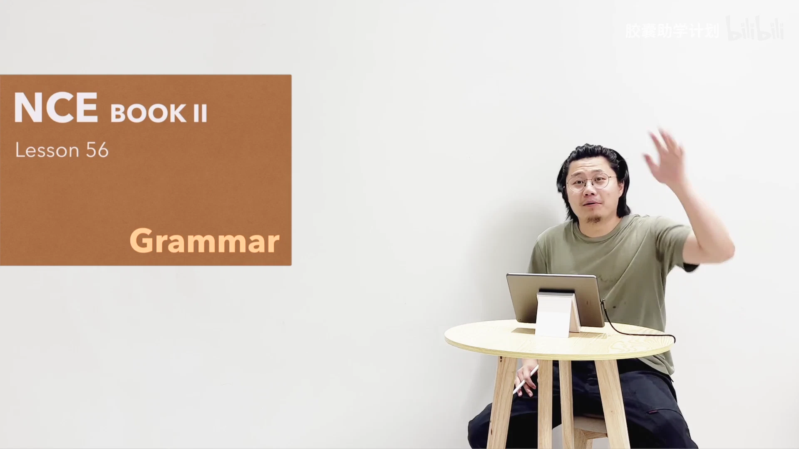

文字识别：NCE / BOOK"I / Lesson 56 / Grammar

### 画面 00:00:02

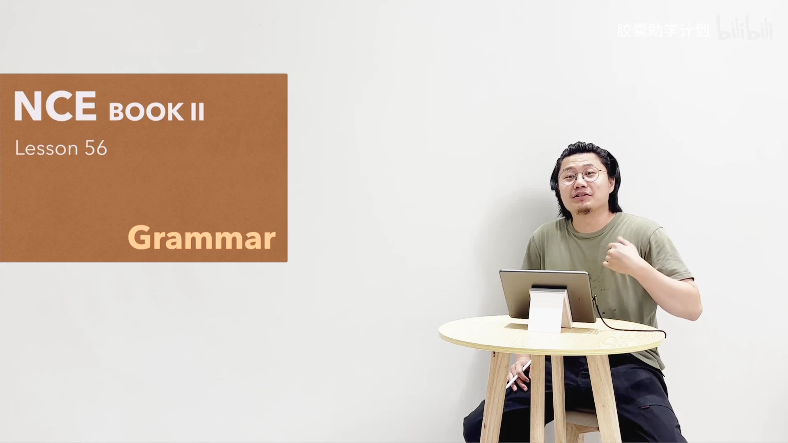

文字识别：NCE / BOOK"I / Lesson 56 / Grammar

### 画面 00:00:09

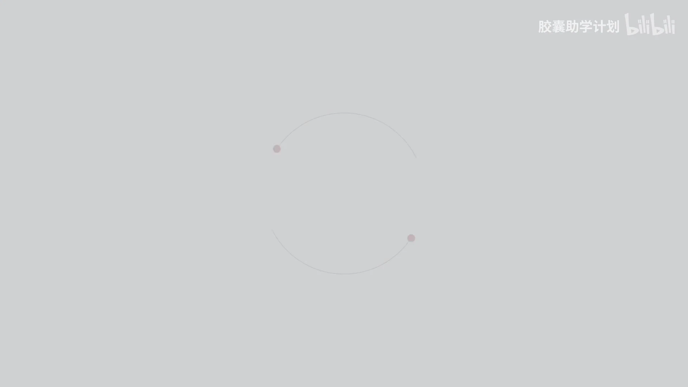

文字识别：胶囊助学计划bll / •

### 画面 00:00:13

### 画面 00:00:15

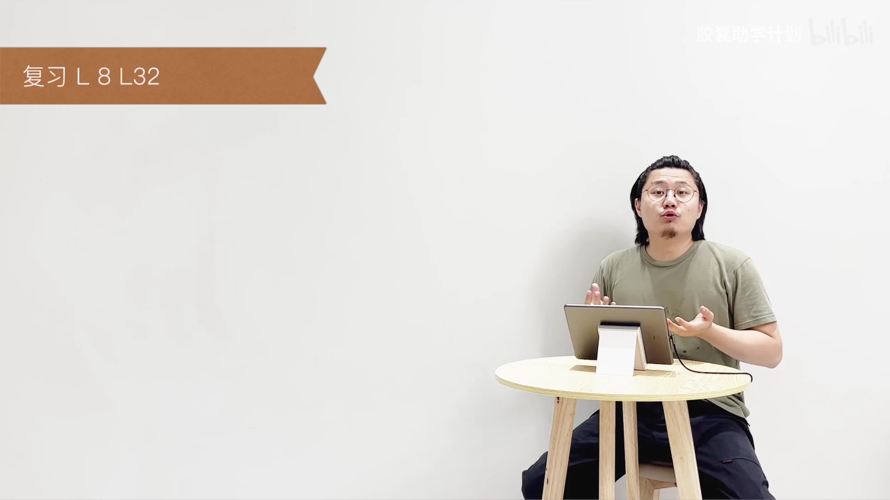

文字识别：复习L8L32

## 00:00:30–00:01:00

句型在第八课和第三十二课我们特别清楚、仔细的解释过了。然后呢，一些非常简单，比如说这个形容词啊，这个单音节的怎么处理，双音节怎么处理，三音节的怎么处理，我们从新一百零七课就开始讲，对吧？一直讲到了这一课，所以这一课呢，我们还是就不讲了，呃，以练代讲，我们直接看练习就可以了，是吧？啊，然后

### 画面 00:00:34

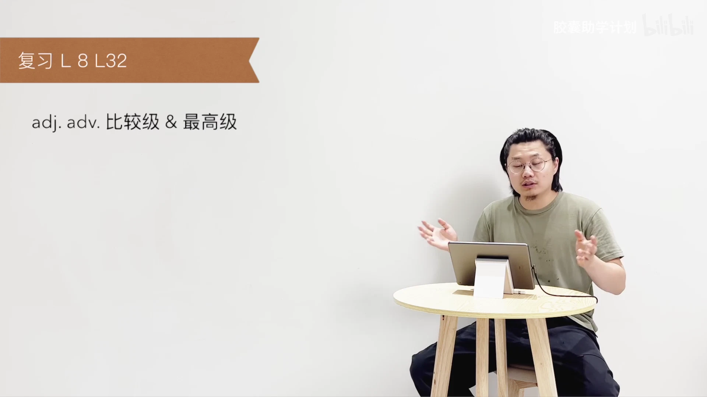

文字识别：复习L8L32 / adj. adv.比较级 ＆ 最高级

### 画面 00:00:47

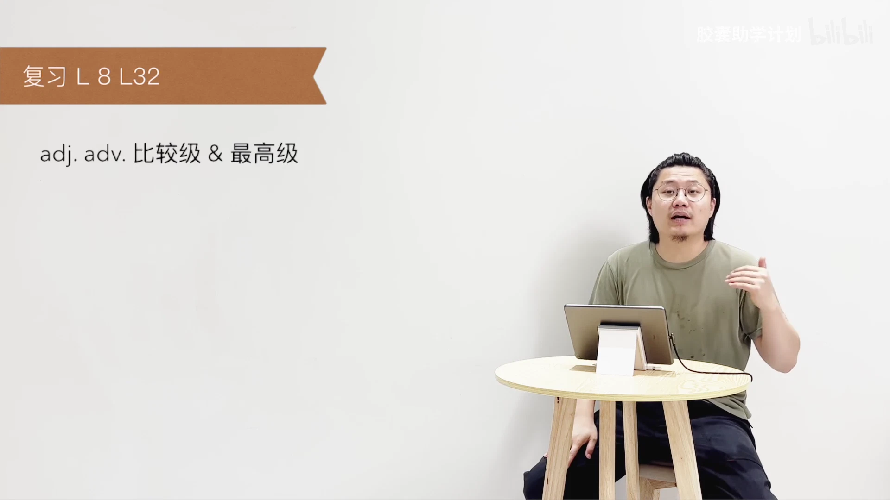

文字识别：复习L8L32 / adj. adv. 比较级 &最高级

### 画面 00:00:58

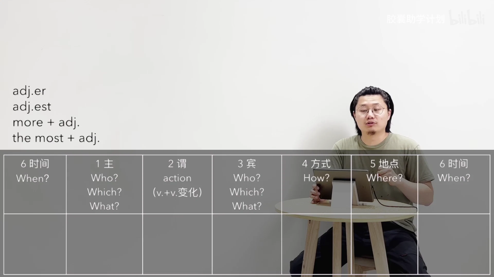

文字识别：adj.er / adj.est / more + adj. / the most + adj. / 6时间 / 1主 / 2谓 / 3宾 / 4方式 / 5地点 / 6时间 / When? / Who? / action / Who? / How? / Where? / When? / Which? / (v.+v.变化) / Which? / What? / What?

## 00:01:00–00:01:30

呢，你要明白说这个形容词、副词、比较级、最高级呢，主要就是无非是两种情况，要么 e r e s t，要么前面 more most 或者 less least，对吧？这些要明白一件事情呢，就是六一二三四五六当中它在哪儿？它在哪儿呢？其实它在的最多的地方你要注意，它毕竟还是形容词，它在最多的地方还是去形容名词的，对吧？所以最多的地方可能还是一和三这样的位置，不是说它在四五六不能出现啊，不是这个

### 画面 00:01:04

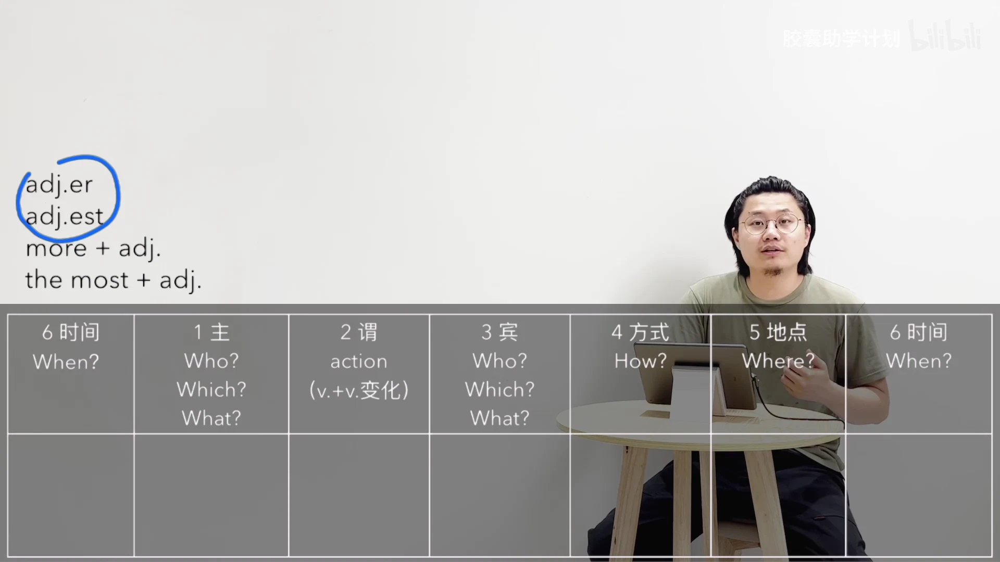

文字识别：/adj.er / adj.est / more + adj. / the most + adj. / 6时间 / 1主 / 2谓 / 3宾 / 4方式 / 5地点 / 6时间 / When? / Who? / action / Who? / How? / Where? / When? / Which? / (v.+v.变化) / Which? / What? / What?

### 画面 00:01:07

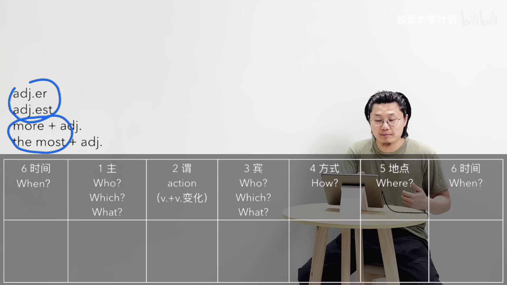

文字识别：/adj.er / adj.est / more + adj. / the most+ adj. / 6时间 / 1主 / 2谓 / 3宾 / 4方式 / 5地点 / 6时间 / When? / Who? / action / Who? / How? / Where? / When? / Which? / (v.+v.变化) / Which? / What? / What?

### 画面 00:01:20

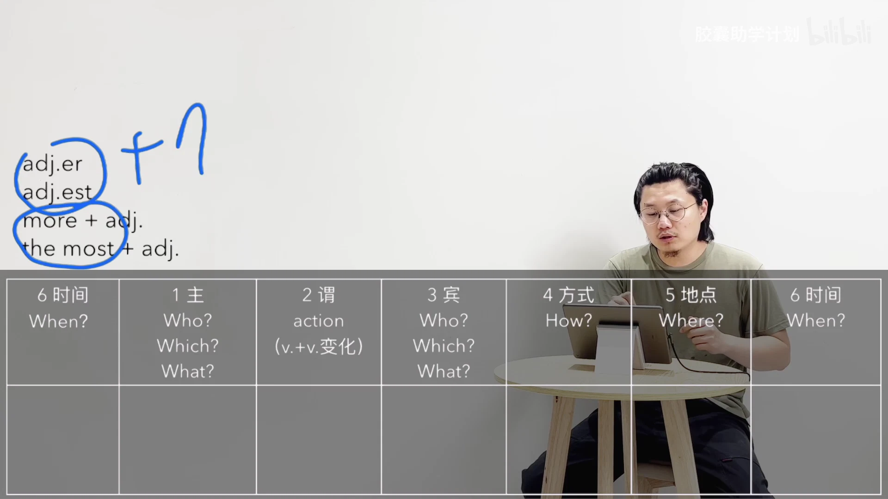

文字识别：adj.er / adj.est / more + adj. / the / most+ adj. / 6时间 / 1主 / 2谓 / 3宾 / 4方式 / ５地点 / 6时间 / When? / Who? / action / Who? / How? / Where? / When? / Which? / (v.+v.变化) / Which? / What? / What?

### 画面 00:01:24

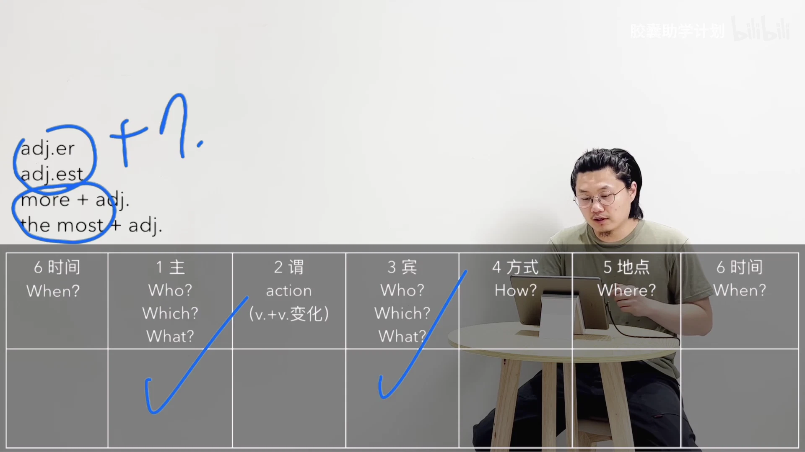

文字识别：/adj.er / adj.est / more + adj. / most+ adj. / the / 6时间 / 1主 / 2谓 / 3宾 / 4方式 / 5地点 / 6时间 / When? / Who? / action / Who? / How? / Where? / When? / Which? / (v.+v.变化) / Which? / What? / What?

## 00:01:30–00:02:00

样子啊，是可以的，只不过最多最普遍概率最高的还是一和三啊，这个小点了解一下就可以了。接下来呢，以练代讲，对吧？我们直接练patent drill啊，呃，看一下需要我们看的两句话。第一句话叫Are you as tall as John？所以你和John一样高吗？I don't I这as s三十二课咱学的对吧？新概念一

### 画面 00:01:37

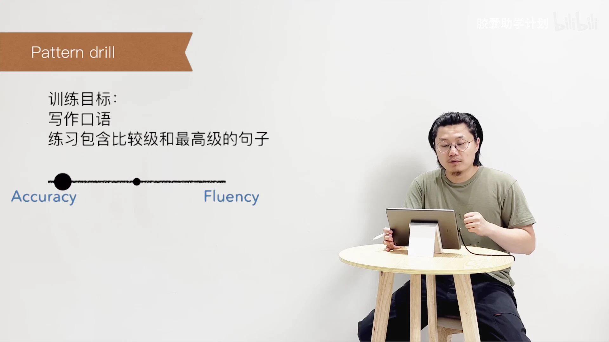

文字识别：Pattern drill / 训练目标： / 写作口语 / 练习包含比较级和最高级的句子 / Accuracy / Fluency

### 画面 00:01:44

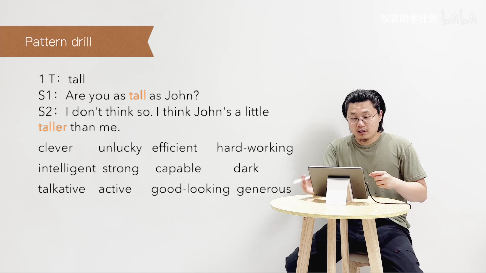

文字识别：Pattern drill / 1 T:tall / S1: Are you as tall as John? / S2: I don't think so.I think John's a little / taller than me. / clever / unlucky / 1 efficient / hard-working / intelligent strong / capable / dark / talkative / active / good-looking generous

### 画面 00:01:47

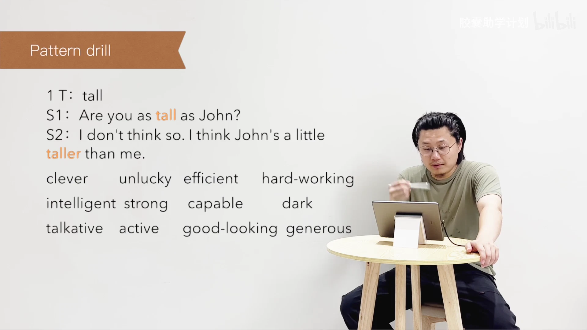

文字识别：Pattern drill / 1 T:tall / S1: Are you as tall as John? / S2: I don't think so.I think John's a little / taller than me. / clever / unlucky / 1 efficient / hard-working / intelligent strong / Capable / dark / talkative / e active / good-looking generous

## 00:02:00–00:02:30

册一百一十一课咱用过对吧？呃，咱也学过啊。所以你和John一样高吗？I don't think so.我不这样认为。I think我认为啊，John's a little taller than me. P.S.是is对吧？他比我高那么一点点。你看，tall后边加个一二啊。这个点多提一句，就是一个单词它的比较级最高级到底长成什么样子呢？这个其实最简单粗暴的有几个方式啊，你不用记太多的规则，叫做手头要有一个

### 画面 00:02:17

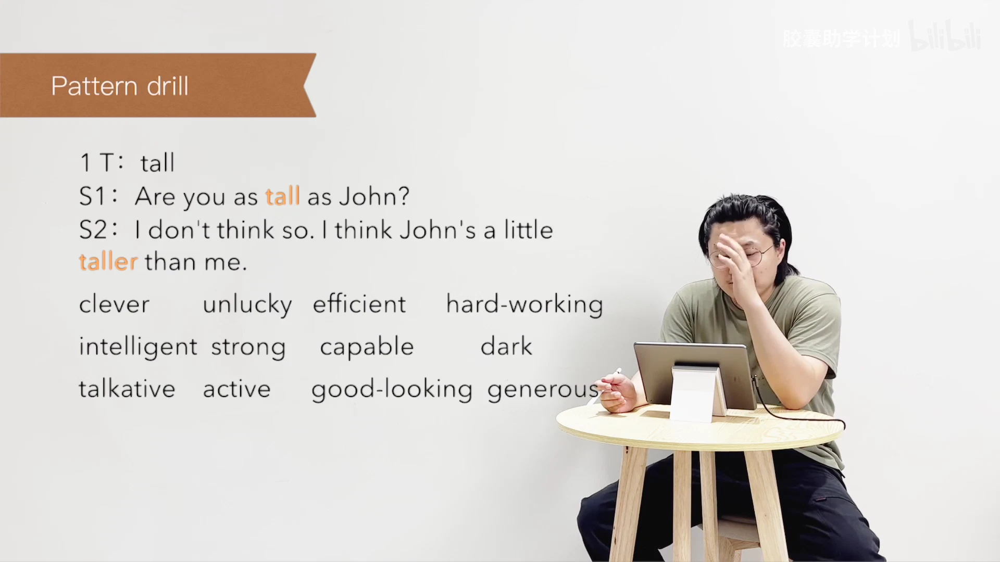

文字识别：Pattern drill / 1 T:tall / S1: Are you as tall as John? / S2: I don't think so.I think John's a little / taller than me. / clever / unlucky / efficient / hard-working / intelligent strong / capable / dark / talkative / active / good-looking generous

## 00:02:30–00:03:00

几个好的字典，这个我们在新一还是新二的开篇部分都开篇视频都认认真真讲过了，对吧？尤其是新概念一册啊，所以你拿不准套的形容词啊，这个这个套这个形容词的比较级最高级长成什么样子的时候怎么办呢？呃，学习越主动效果越好，不要去问别人，是吧？有那个功夫自己去搜索引擎搜一下，或者自己拿不同的字典查一下，这个字典应该比较好的字典应该是包

### 画面 00:02:47

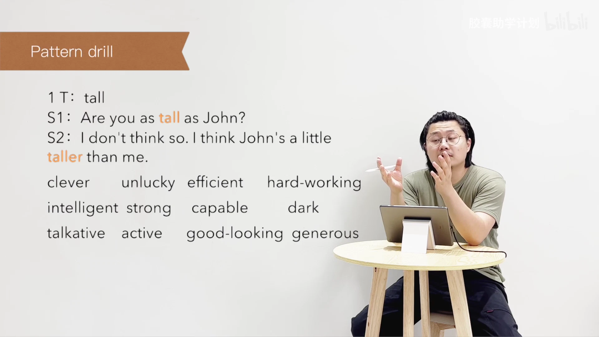

文字识别：Pattern drill / 1 T:tall / S1: Are you as tall as John? / S2: I don't think so.I think John's a little / taller than me. / clever / unlucky / / efficient / hard-working / intelligent strong / Capable / dark / talkative active / good-looking generous

## 00:03:00–00:03:30

含这个形容词的比较级、最高级长成什么样子的，对吧？就可以了啊，就这么简单，好吧？好，然后各位下课自己往里面去带啊。底下这一些，对吧？哎，你看看哪些是双音节的，哪些是单音节，哪些是大于等于三个音节的，该怎么去处理？如果您竟然忘了，那你一定要回到第八课，包括新概念一册从一百零七课到一百一十一课，对吧？要去进行这样的复习啊，这是您忘了啊。第二个题说，My brother is

### 画面 00:03:17

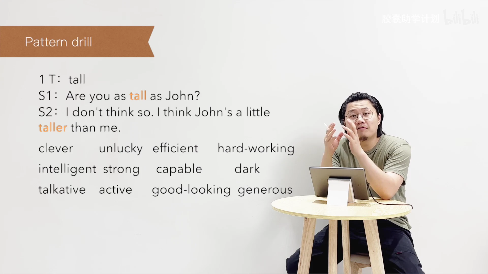

文字识别：Pattern drill / 1 T:tall / S1: Are you as tall as John? / S2: I don't think so.I think John's a little / taller than me. / clever / unlucky / 1 efficient / hard-working / intelligent strong / Capable / dark / talkative / active / good-looking generous

### 画面 00:03:27

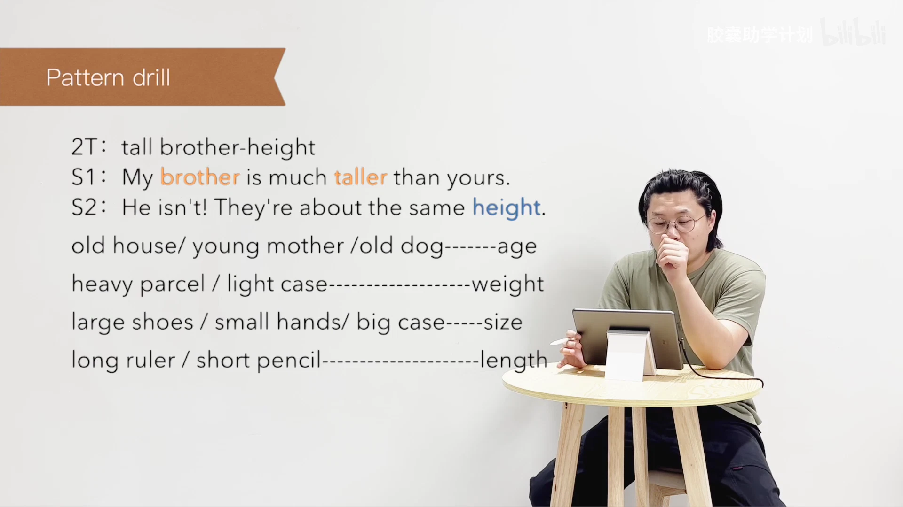

文字识别：Pattern drill / 2T: tall brother-height / S1: My brother is much taller than yours. / S2: He isn't! They're about the same height. / old house/young mother /old dog--age / heavy parcel / light case-- / --weight / large shoes / small hands/ big case---size / long ruler/ short pencil-- / -length

## 00:03:30–00:04:00

yours.

### 画面 00:03:57

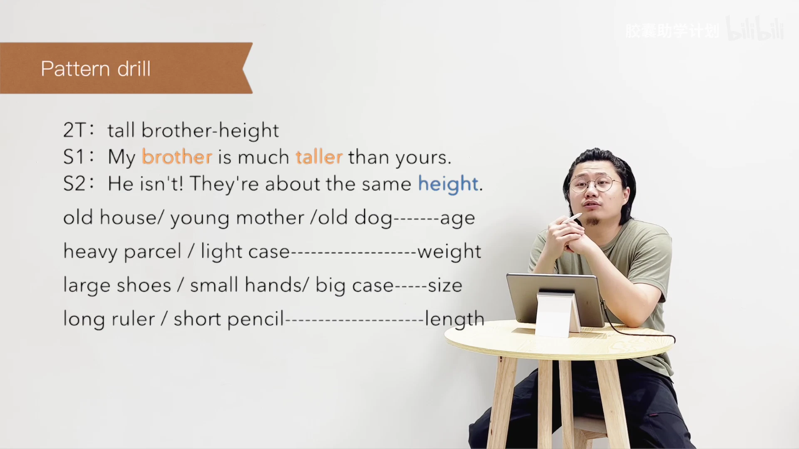

文字识别：Pattern drill / 2T:tall brother-height / S1: My brother is much taller than yours. / S2: He isn't! They're about the same height. / old house/young mother /old dog---age / heavy parcel / light case-- / --eight / large shoes / small hands/ big case---size / long ruler / short pencil-. / --length

## 00:04:00–00:04:30

高的多。你要是说高十厘米，我觉得就很容易理解，就应该是 much taller。这是一个比较主观的感受，对吧？那比如有的人会说高三厘米就就高一点点，有的人就会说那我高太多了，much taller，对吧？这是你随便，对吧？主观感受啊，没有客观标准，说高于五厘米要用 much taller，低于五厘米就是 taller，没有这个标准啊。说 he isn't, they are about the same height. 他们是同样的 height 高度

### 画面 00:04:27

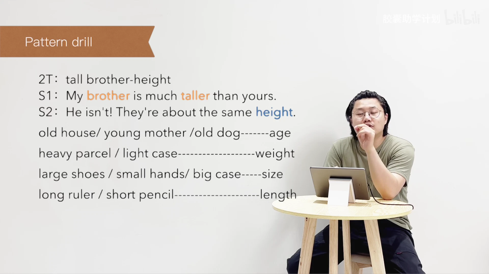

文字识别：Pattern drill / 2T:tall brother-height / S1: My b / brother is much taller than yours. / S2: He isn't! They're about the same height. / old house/young mother /old dog---age / heavy parcel / light case- / --weight / large shoes / small hands/ big case--size / long ruler / short pencil- / --length

## 00:04:30–00:05:00

啊，很简单啊，他们是同样的高度啊。 Continue is Scotch whiskey very different from Irish whiskey? 啊，苏格兰的这个 whiskey 特别不一样，和爱尔兰的 whiskey 相比嘛，哎，就是他们是不是特别不一样呢？这个实际上，呃，语法角度我们不用把它当语法去处理，你就把它当成 be different from 进入文章了之后，我们会有这样一个习惯用法，我们会拿它去造句啊。现在

### 画面 00:04:32

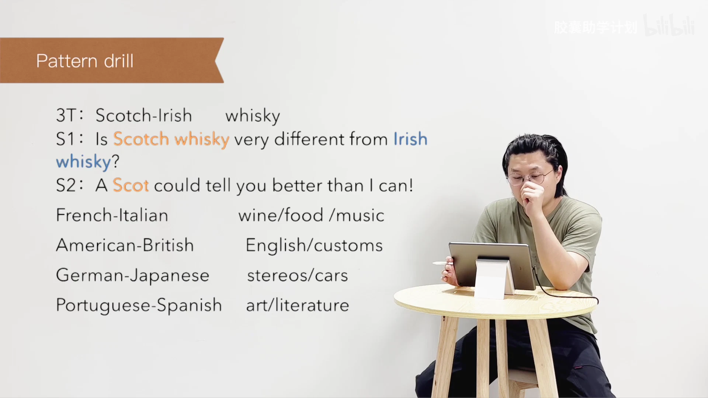

文字识别：Pattern drill / 3T:Scotch-lrish / whisky / S1: Is Scotch whisky very different from Irish / whisky? / S2: A Scot could tell you better than I can! / French-ltalian / wine/food /music / American-British / English/customs / German-Japanese / stereos/cars / Portuguese-Spanish / art/literature

## 00:05:00–00:05:30

就先不多说了，对吧？我们就把它当习惯用法就行了。A be different from B，对吧？哎，呃，说A Scot could tell you better than I can，这算是一个小的这个比较级，说一个苏格兰人呢能告诉你更多更好比我能的，对吧？哎，他比我能更好的告诉你苏格兰的这个whisky和爱尔兰的whisky啊有什么区别啊，或者是区别很大

### 画面 00:05:02

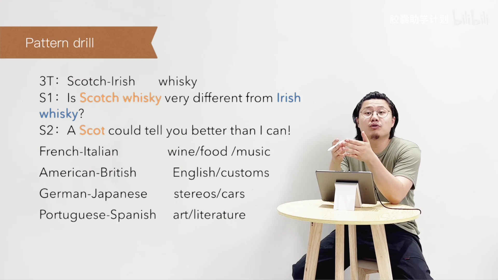

文字识别：Pattern drill / 3T:Scotch-lrish / whisky / S1: Is Scotch whisky very different from Ilrish / whisky? / S2: A Scot could tell you better than I can! / French-ltalian / wine/food /music / American-British / English/customs / German-Japanese / stereos/cars / Portuguese-Spanish / art/literature

## 00:05:30–00:06:00

嘛？Okay,好，呃，这是第三道题，各位课下记得往里面去带啊。好，呃，continue说What a lot of jam或者slash啊，这个叫slash叫或者or啊，这个符号啊，eggs Tom's taken说啊，他吃了好多的果酱或者鸡蛋啊。这地方the taken就类似于摄入啊，就吃药用经常用take，那吃这个也可以用taken啊。说是呃是yes, he's taken much

### 画面 00:05:32

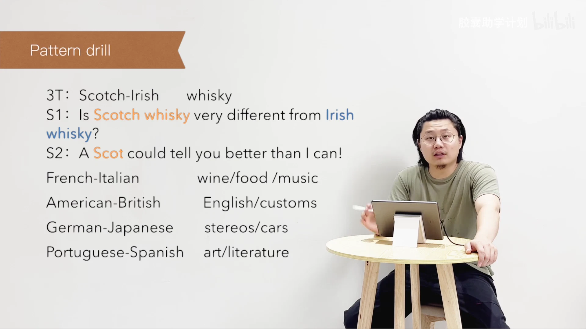

文字识别：Pattern drill / 3T:Scotch-lrish / whisky / S1: Is Scotch whisky very different from Ilrish / whisky? / S2: A Scot could tell you better than I can! / French-ltalian / wine/food /music / American-British / English/customs / German-Japanese / stereos/cars / Portuguese-Spanish / art/literature

### 画面 00:05:36

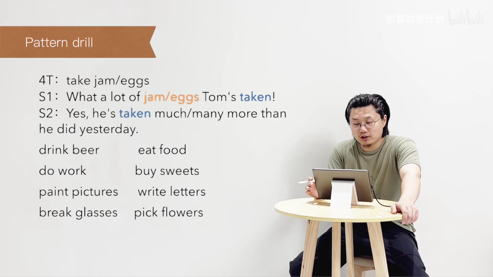

文字识别：Pattern drill / 4T:take jam/eggs / S1: What a lot of jam/eggs Tom's taken! / S2: Yes, he's taken much/many more than / he did yesterday. / drink beer / eat food / do work / buy sweets / paint pictures / write letters / break glasses / pick flowers

## 00:06:00–00:06:30

many, more than he did yesterday. 我们先随便来一个 much 或 more 嘛，随便来一个啊。说 He's taken much more than he did yesterday. More 还是刚才那样啊。 More 叫更多， much more 叫多得多，对吧？哎， many more 也叫多得多啊。比他昨天吃的要多得多。只不过这里分了一个可呃呃不可数跟可数，对吧？ X 和 many 是呃可数， jam 和 much 是不可数，对吧？然后往里

### 画面 00:06:06

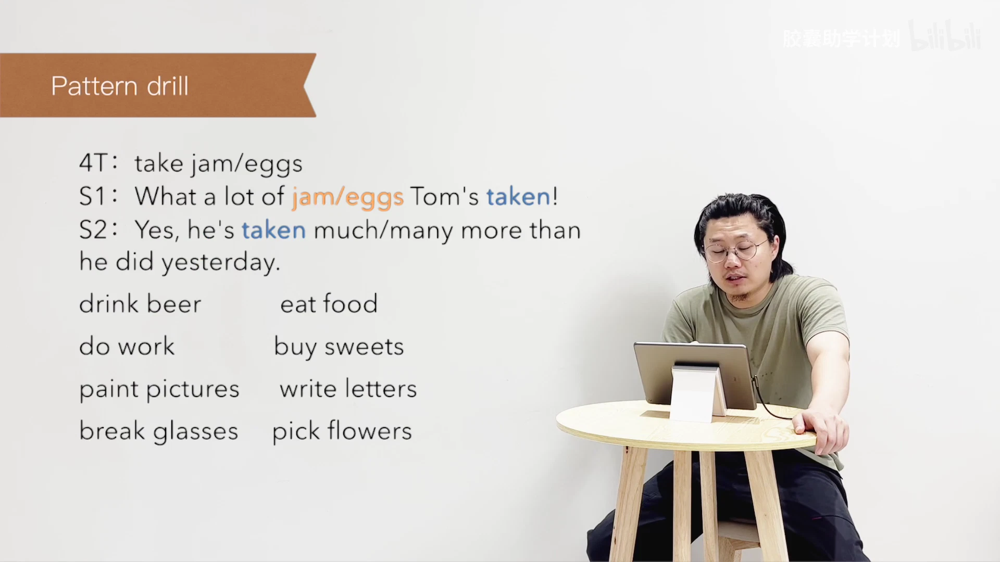

文字识别：Pattern drill / 4T:take jam/eggs / S1: What a lot of jam/eggs Tom's taken! / S2: Yes, he's taken much/many more than / he did yesterday. / drink beer / eat food / do work / buy sweets / paint pictures / write letters / break glasses / pick flowers

## 00:06:30–00:07:00

面去带一下就行了啊。好，呃，那基本就这么多啊。我们这个以以练代讲就过去了。本课的语法重点就是这个，无非就是想提醒各位一下：第一呢，做一点点题啊，该复习复习了。第二，如果你刚才我说的那些什么一音节、二音节、三音节你都不会，这课我不再重点讲了。咱网课第八课讲的非常清楚了，您回去翻看一下就可以了，对吧？OK啊，好，呃，家庭作业呢，pattern drill，

### 画面 00:06:33

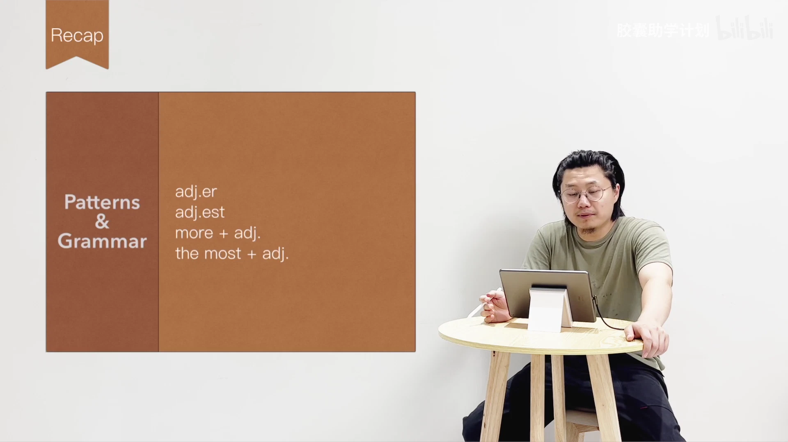

文字识别：Recap / adj.er / Patterns / adj.est / more + adj. / Grammar / the most + adj.

### 画面 00:06:35

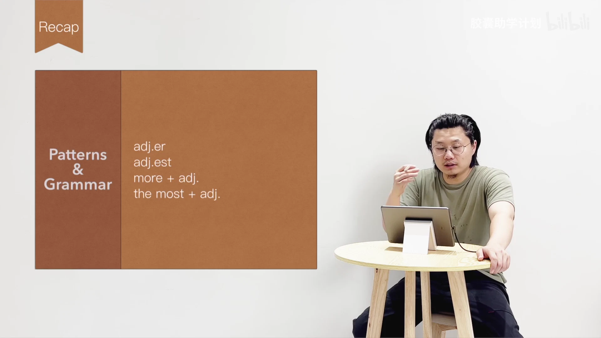

文字识别：Recap / adj.er / Patterns / adj.est / ＆ / more + adj. / Grammar / the most + adj.

### 画面 00:06:40

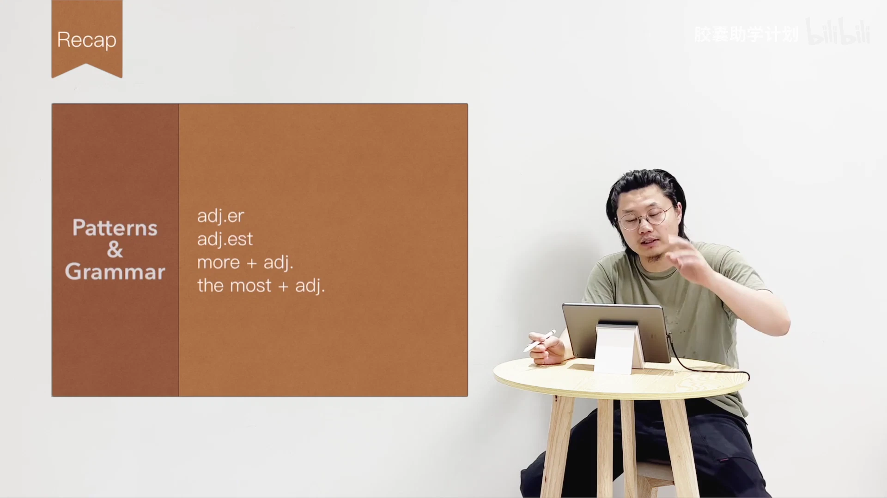

文字识别：Recap / adj.er / Patterns / adj.est / ＆ / more + adj. / Grammar / the most + adj.

### 画面 00:06:48

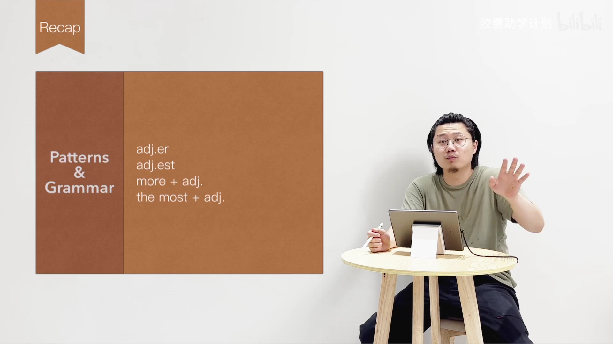

文字识别：Recap / adj.er / Patterns / adj.est / ＆ / more + adj. / Grammar / the most + adj.

### 画面 00:06:50

文字识别：Recap / adj.er / Patterns / adj.est / ＆ / more + adj. / Grammar / the most + adj.

### 画面 00:06:52

文字识别：Recap / adj.er / Patterns / adj.est / ＆ / more + adj. / Grammar / the most + adj.

### 画面 00:06:55

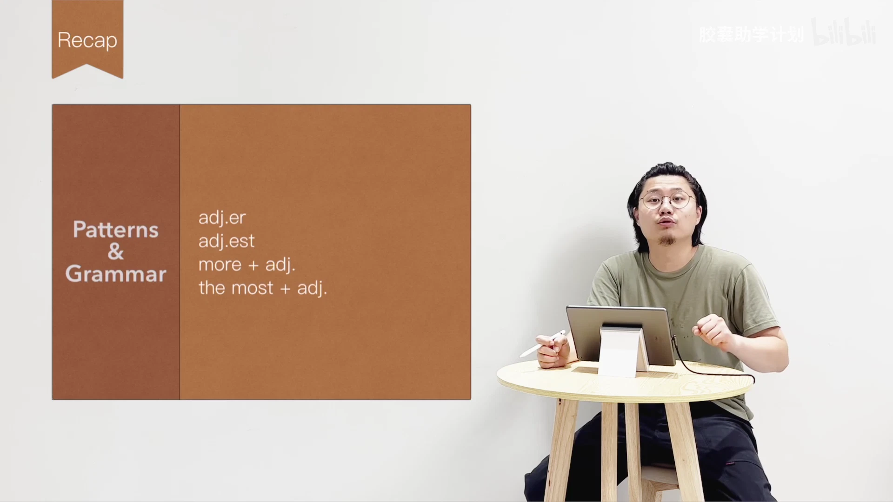

文字识别：Recap / adj.er / Patterns / adj.est / ＆ / more + adj. / Grammar / the most + adj.

### 画面 00:06:58

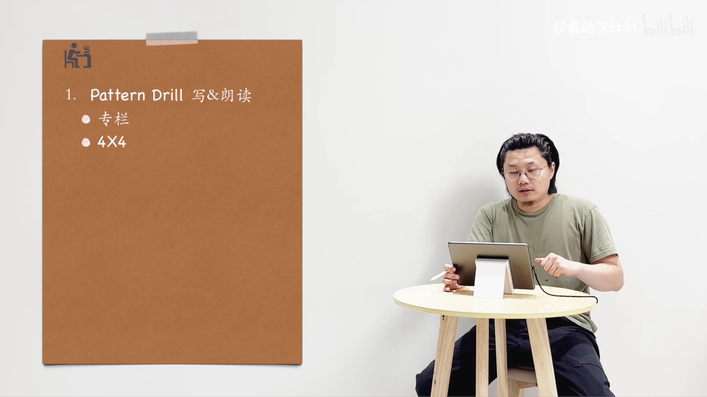

文字识别：1.f / Pattern Drill写&朗读 / 专栏 / 4×4

## 00:07:00–00:07:30

这肯定是老习惯。你回忆讲解一遍核心语法，无非就是一音节、二音节、三音节那些东西啊。忘了你就回去翻看一下。第三个呢，你翻阅一下红皮书中级的，完全都可以开始写了啊，完全都可以开始写了。那以上呢就是本期视频的全部内容了。如果各位喜欢我们的课程呢，欢迎各位关注、订阅、一键三连啊，分享给那些需要的朋友来帮助我们快速成长。See you next time.

### 画面 00:07:00

文字识别：Pattern Drill写&朗读 / 1. / 专栏 / 4×4 / 尝试回忆并给自己讲解一 / 遍今天的核心语法 / Study-Test / Learning Pyramid

### 画面 00:07:05

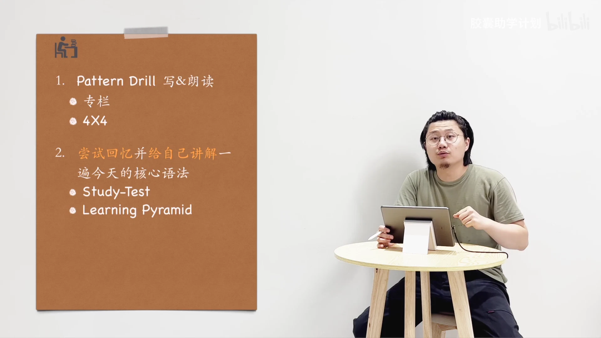

文字识别：Pattern Drill写&朗读 / 1. / 专栏 / 4×4 / 尝试回忆并给自己讲解一 / 遍今天的核心语法 / Study-Test / Learning Pyramid

### 画面 00:07:08

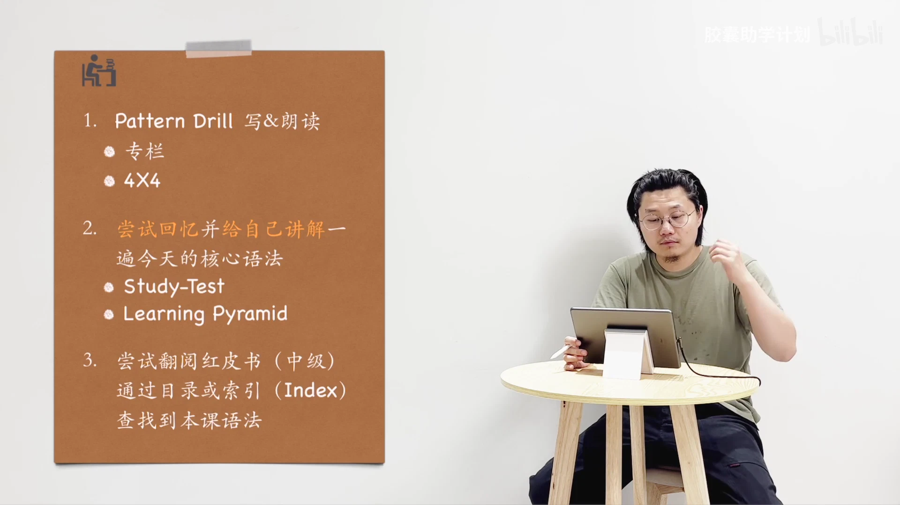

文字识别：1. f / Pattern Drill 写&朗读 / 专栏 / 4×4 / 尝试回忆并给自己讲解一 / 遍今天的核心语法 / Study-Test / Learning Pyramid / 尝试翻阅红皮书（中级） / 通过目录或索引(Index) / 查找到本课语法

### 画面 00:07:10

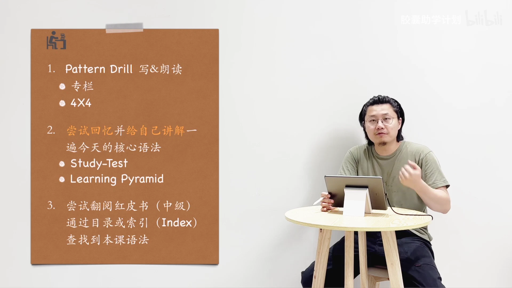

文字识别：1. f / Pattern Drill写&朗读 / 专栏 / 4×4 / 尝试回忆并给自己讲解一 / 遍今天的核心语法 / Study-Test / Learning Pyramid / 尝试翻阅红皮书（中级） / 通过目录或索引(Index) / 查找到本课语法

### 画面 00:07:14

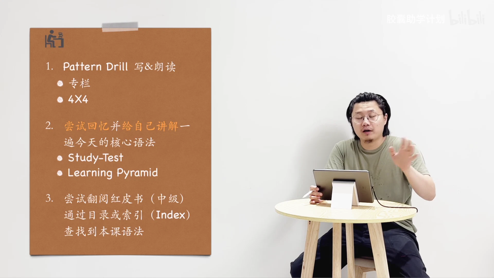

文字识别：1. f / Pattern Drill写&朗读 / 专栏 / 4×4 / 尝试回忆并给自己讲解一 / 遍今天的核心语法 / Study-Test / Learning Pyramid / 尝试翻阅红皮书（中级） / 通过目录或索引(Index) / 查找到本课语法

### 画面 00:07:16

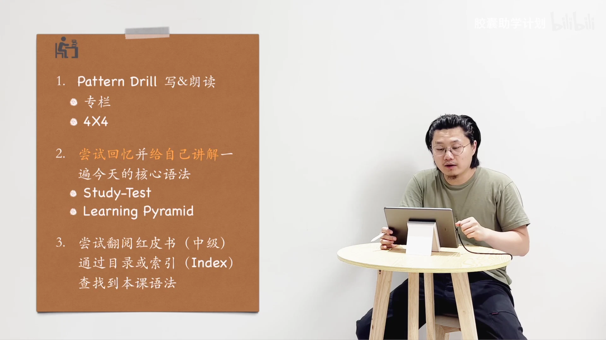

文字识别：Pattern Drill 写&朗读 / 1. f / 专栏 / 4×4 / 尝试回忆并给自己讲解一 / 遍今天的核心语法 / Study-Test / Learning Pyramid / 尝试翻阅红皮书（中级） / 通过目录或索引(Index) / 查找到本课语法

### 画面 00:07:18

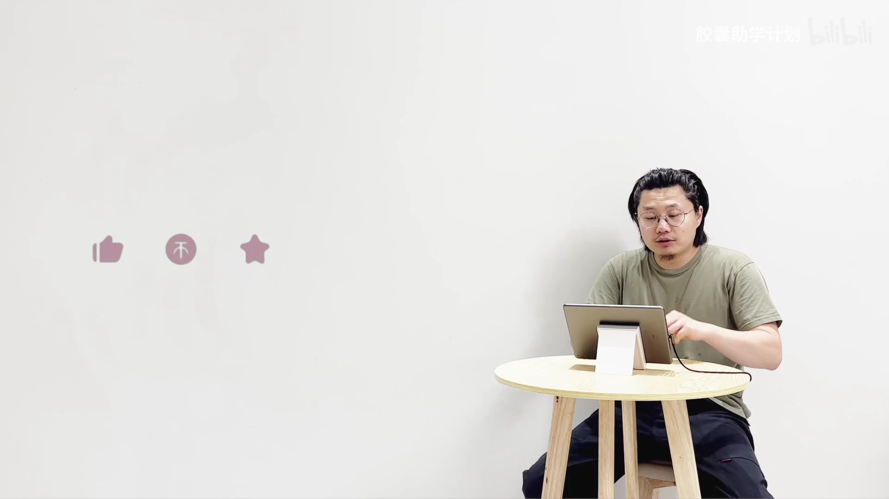

文字识别：🌟

### 画面 00:07:29

## 00:07:30–00:07:41

### 画面 00:07:31

文字识别：CAPSULEACADEMY / 胶囊助学计划 / 小红书 / Lecturer / 口 / Leo

### 画面 00:07:34

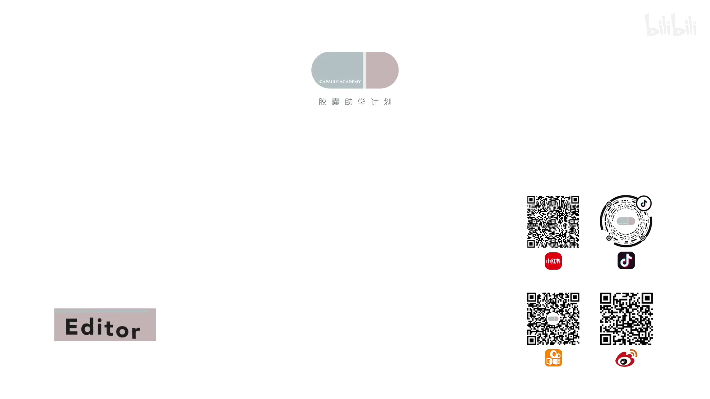

文字识别：CAPSULEACADEMY / 胶囊助学计划 / 小红书 / Editor

### 画面 00:07:37

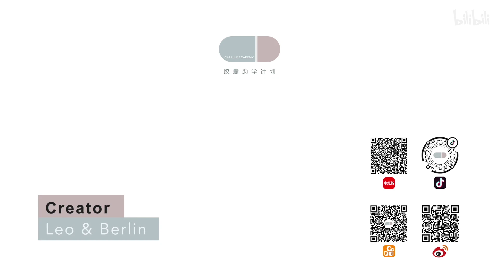

文字识别：CAPSULEACADEMY / 胶囊助学计划 / 小红书 / Creator / Leo & Berlin / OE

### 画面 00:07:39

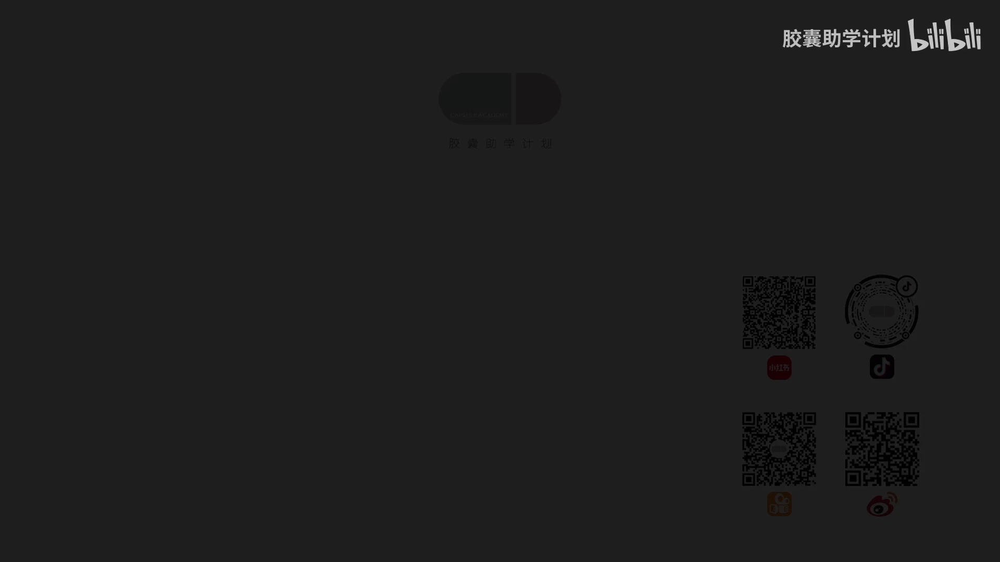

文字识别：Bilibili / 胶囊助学计划 / 足海品 / 小红书

### 画面 00:07:41

文字识别：bilibili / 胶囊助学计划

