# 056 文章

快速机器解析：语音为单模型转写，未进行独立交叉校对或人工复核；画面每秒采样并按变化选帧，短时文字和标记可能遗漏。截图时间约有 1 秒误差。图片有损压缩；遇到疑点请按时间查看 Google Drive 原视频。

## 00:00:00–00:00:30

Hello everyone, welcome to Capsule Academy. This is Leo. Today we're going to learn New Concept English Book Two, Lesson Fifty Six, Story. Hope you gonna enjoy it. Oh, we first look at the title of this article, called Faster Than Sound. Ah, Faster叫更快, Than叫比, Sound叫声音啊,比声音还快,超音速啊.它这个标题是有点讽

### 画面 00:00:00

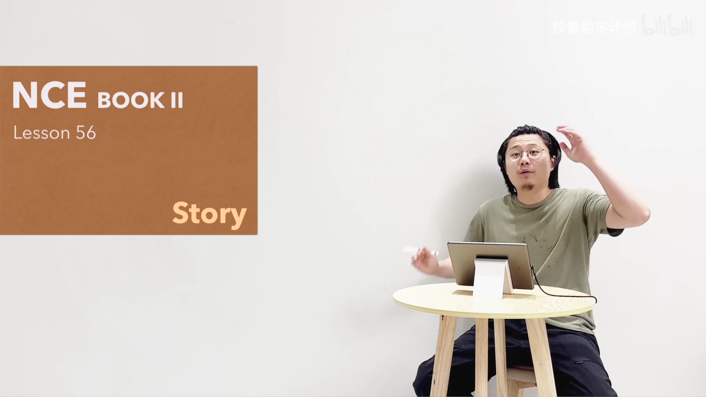

文字识别：NCE / BOOK"I / Lesson 56 / Story

### 画面 00:00:02

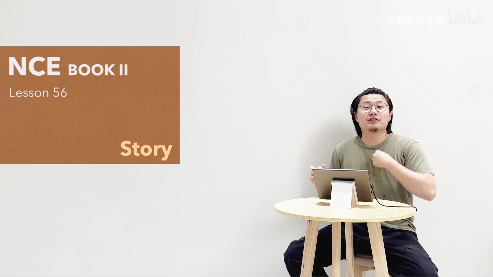

文字识别：NCE / BOOKⅡI / Lesson 56 / Story

### 画面 00:00:05

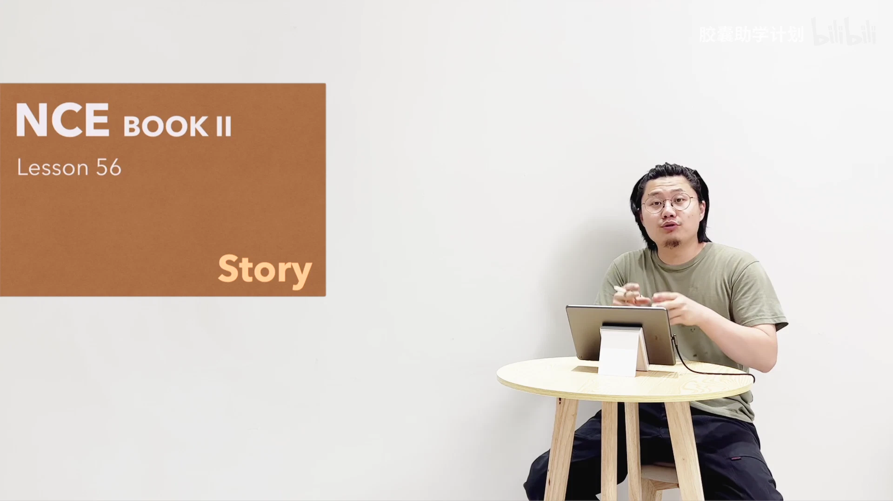

文字识别：NCE / BOOKⅡI / Lesson 56 / Story

### 画面 00:00:08

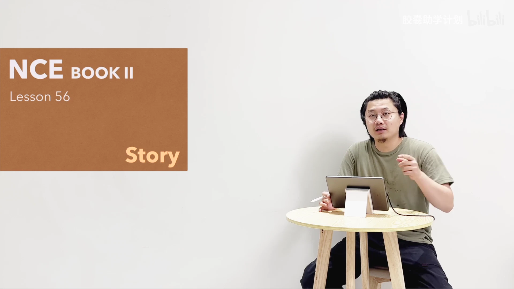

文字识别：NCE / BOOKⅡI / Lesson 56 / Story

### 画面 00:00:10

文字识别：胶囊助学计划b出l

### 画面 00:00:13

### 画面 00:00:15

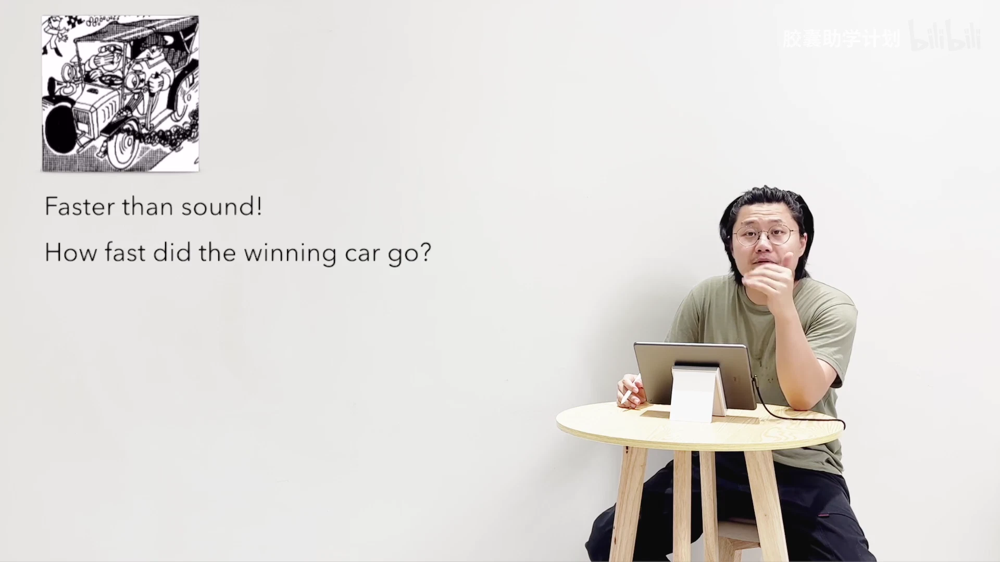

文字识别：Faster than sound! / How fast did the winning car go?

## 00:00:30–00:01:00

刺的。进入文章，咱们就知道为什么了。看一下，他问了一个问题，我们带着这个问题去进入文章，叫 How fast did the winning car go？说获胜的这辆车走的有多快啊？也没有多快啊。我们直接进入文章看了，叫做 Once a year, once a month. 第六课乞丐 beggar 那一课叫 Percy Buttons. 我印象当中，咱在那课就见过了，在那课见的叫 Once a month，对吧？那 Once a year 叫一年一次，Once a month 叫一个月一次。 A

### 画面 00:00:42

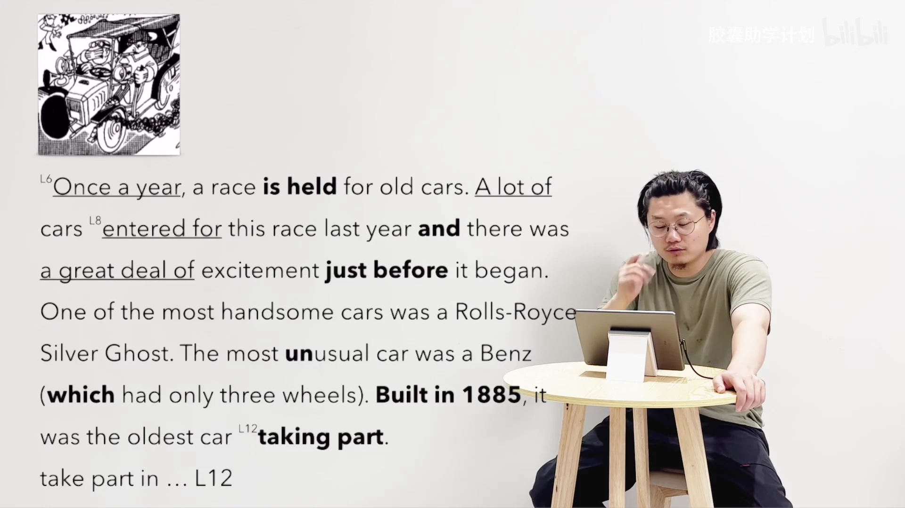

文字识别：-Once a year, a race is held for old cars. A lot of / cars 'entered for this race last year and there was / a great deal of excitement just before it began. / One of the most handsome cars was a Rolls-Royce / Silver Ghost. The most unusual car was a Benz / (which had only three wheels). Built in 1885, it / was the oldest car -'²taking part. / take part in ... L12

## 00:01:00–00:01:30

race is held for old cars.说一个比赛会被举办给那些老哎旧车们啊。你注意啊，这个old cars实际上在这儿你要结合上下文才能去看出来。如果只看这句话，你会以为是给旧车。实际上整个文章看完了之后，你会意识到它其实不是旧车啊，它是老爷车。我相信各位的汉语足够去区分旧车跟老爷车的区别，是吧？它是老爷车的比赛啊。

### 画面 00:01:12

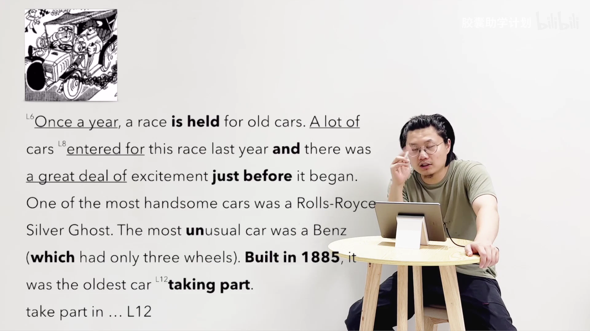

文字识别：-Once a year, a race is held for old cars. A lot of / cars 'entered for this race last year and there was / a great deal of excitement just before it began. / One of the most handsome cars was a Rolls-Royce / Silver Ghost. The most unusual car was a Benz / (which had only three wheels). Built in 1885, it / was the oldest car "²taking part. / take part in ... L12

## 00:01:30–00:02:00

A lot of cars.好，首先a lot of我虽然画出来，因为本课它出现这样的词特别的多啊，我就统一的都给大家画出来看一下。A lot of新一就见过了，许多、大量，对吧？可数不可数全可以加，后边加的是cars. Entered for this race last year and不看后边了，许多的车entered for第八课啊，这个小镇上的花园那一课正好是比较级那一课啊，叫

### 画面 00:01:42

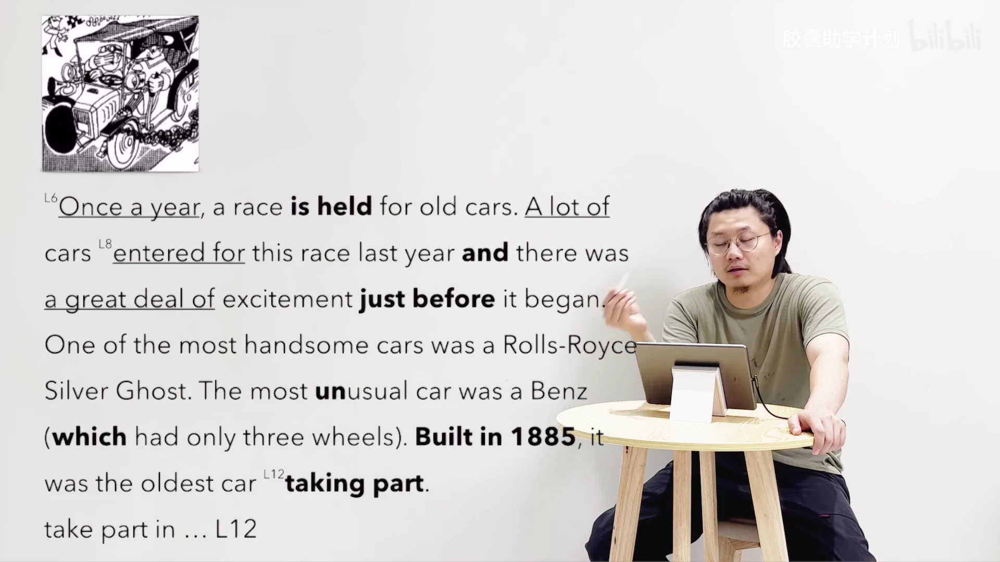

文字识别：-Once a year, a race is held for old cars. A lot of / cars 'entered for this race last year and there was / a great deal of excitement just before it began. / One of the most handsome cars was a Rolls-Royce / Silver Ghost. The most unusual car was a Benz / (which had only three wheels). Built in 1885, it / was the oldest car "²taking part. / take part in ... L12

## 00:02:00–00:02:30

做参加，对吧？哎，参加，参加了 this race 这个比赛 last year，许多的车去年参加了这个比赛。And there was a great deal of excitement just before it began。你看 just before 我给你标出来了，对吧？所以在这儿你其实可以停下来啊。也就是说这句话呢，从 a lot of 开始到 began 结束，但是它可以被拆成三句话。第一句话叫 a lot of cars entered for this

### 画面 00:02:12

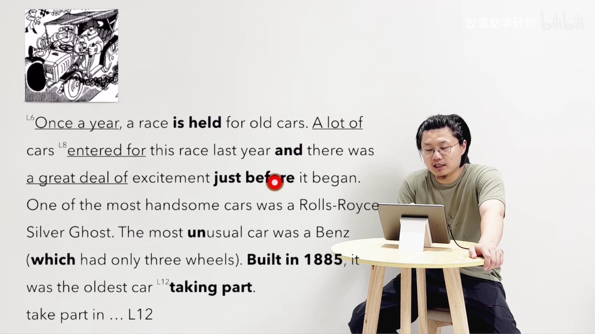

文字识别：'Once a year, a race is held for old cars. A lot of / cars 'entered for this race last year and there was / a great deal of excitement just before it began. / One of the most handsome cars was a Rolls-Royce / Silver Ghost. The most unusual car was a Benz / (which had only three wheels). Built in 1885, it / was the oldest car "²taking part. / take part in ... L12

### 画面 00:02:28

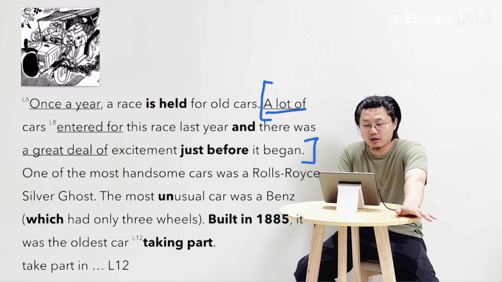

文字识别：-Once a year, a race is held for old cars.A lot of / cars 'entered for this race last year and there was / a great deal of excitement just before it began.7 / One of the most handsome cars was a Rolls-Royce / Silver Ghost. The most unusual car was a Benz / (which had only three wheels). Built in 1885, it / Was the oldest car "²taking part. / take part in ... L12

## 00:02:30–00:03:00

race last year. 有一个连词。第二句话叫 There was a great deal of excitement. 哎，那提一句，这个在单词部分我们已经讲过了，说有许多有大量的兴奋激动，a great deal of，对吧？a great deal of，啊，这有一个小的连读，love是吧？a great deal of，OK，a great deal of也表示许多大量的，其实差不多，只不过呢，英语还分个可数不可数，

### 画面 00:02:30

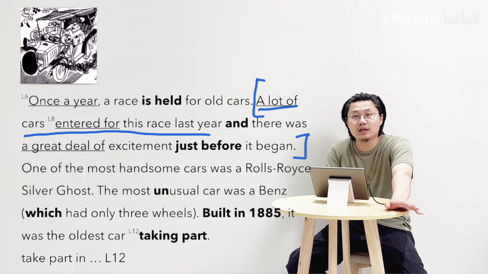

文字识别：-Once a year, a race is held for old cars.A lot of / cars entered for this race last year and there was / L8 / a great deal of excitement just before it began.] / One of the most handsome cars was a Rolls-Royce / Silver Ghost. The most unusual car was a Benz / (which had only three wheels). Built in 1885, it / Was the oldest car -²taking part. / take part in ... L12

### 画面 00:02:33

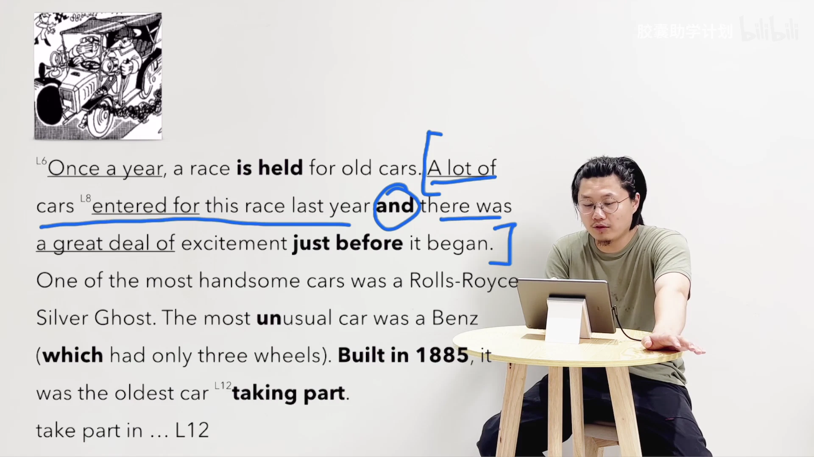

文字识别：-6Once a year, a race is held for old cars.A lot of / L8 / entered for this race last yearand there was / cars / a great deal of excitement just before it began. / One of the most handsome cars was a Rolls-Royce / Silver Ghost. The most unusual car was a Benz / (which had only three wheels). Built in 1885, it / Was the oldest car "²taking part. / take part in ... L12

### 画面 00:02:35

文字识别：-Once a year, a race is held for old cars.A lot of / L8 / entered for this race last yearand there was / cars / a great deal of excitement just before it began. / One of the most handsome cars was a Rolls-Royce / Silver Ghost. The most unusual car was a Benz / (which had only three wheels). Built in 1885, it / was the oldest car "²taking part. / take part in ... L12

## 00:03:00–00:03:30

它在这后边加的是不可数名词，a great deal of，对吧？一会儿我们呃文章讲完会专门去练它啊，现在先不用管，知道就可以了。Just before，那it began叫恰好就在它开始之前，before it began，各位很容易理解叫在什么什么之前，对吧？在它开始之前，before嘛。那just before是怎么回事呢？其实就是给它多了一个限制，比如说开始前是一个很广泛的事情，

### 画面 00:03:05

文字识别：L6Once a year, a race is held for old cars.Alot of / L8 / entered for this race last yearand there was / cars / a great deal of excitement just before it began. / One of the most handsome cars Was a Rolls-Royce / Silver Ghost. The most unusual car was a Benz / (which had only three wheels). Built in 1885, it / was the oldest car -²taking part. / take part in ... L12

### 画面 00:03:18

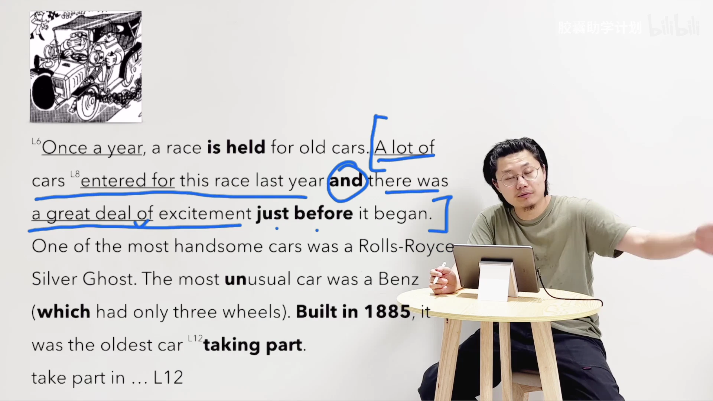

文字识别：-Once a year, a race is held for old cars.A lot of / L8 / entered for this race last yearand there was / cars / a great deal of excitement just before it began. / One of the most handsome cars was a Rolls-Royce / Silver Ghost. The most unusual car was a Benz / (which had only three wheels). Built in 1885, it / was the oldest car 1²taking part. / take part in ... L12

### 画面 00:03:23

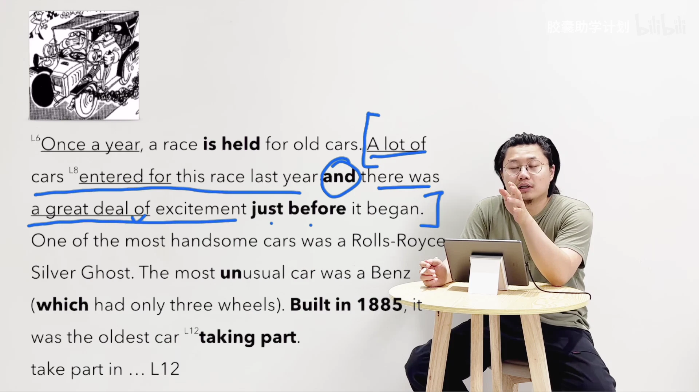

文字识别：-Once a year, a race is held for old cars.Alot of / L8 / entered for this race last yearand there was / cars / a great deal of excitement just before it began. / One of the most handsome cars was a Rolls-Royce / Silver Ghost. The most unusual car was a Benz / (which had only three wheels). Built in 1885, it / was the oldest car "²taking part. / take part in ... L12

## 00:03:30–00:04:00

对吧？开始前可以是一分钟、十分钟、一小时、十小时，甚至五年都叫开始之前。那 just before 就恰恰就在它开始之前，对吧？可能就那么半个小时、十五分钟的事儿。所以多了个 just before 呢，那个脑海当中那个画面感呢，就会停留在不是你在家里边正准备出发去看比赛，而是说你已经到了现场，对吧？车都已

### 画面 00:03:48

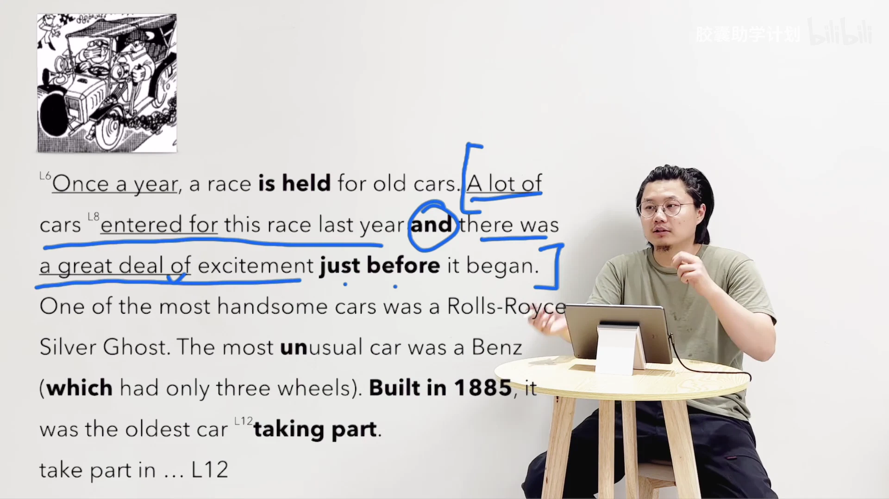

文字识别：-Once a year, a race is held for old cars.A lot of / L8 / entered for this race last yearandthere was / cars / a great deal of excitement just before it began. / One of the most handsome cars was a Rolls-Royce / Silver Ghost. The most unusual car was a Benz / (which had only three wheels). Built in 1885, it / was the oldest car 1²taking part. / take part in ... L12

## 00:04:00–00:04:30

经这个在这个这个这个赛道上哎排好了啊。就这个时候，there was a great deal of excitement啊，就会有这种画面感出来。再来，one of the most handsome cars was a Rolls Royce Silver Ghost.那太handsome了，是吧？哎，这个one of叫其中之一，the most handsome cars叫做最帅的那辆车是什么呢？

### 画面 00:04:11

文字识别：-6Once a year, a race is held for old cars.A lot of / L8 / entered for this race last yearandthere was / cars / a great deal of excitement just before it began. / One of the most handsome cars was a Rolls-Royce / Silver Ghost. The most unusual car was a Benz / (which had only three wheels). Built in 1885, it / Was the oldest car [²taking part. / take part in ... L12

## 00:04:30–00:05:00

是一辆 Rolls Royce Silver Ghost. 你看 R R S G 全在大雪，哎，这是一个专有名词，我就不多说了，否则还是有打广告的嫌疑啊，不多提了。但是呢，各位一查很容易查到。我只是在 Silver Ghost 的这个地方稍微的提一句， Silver 是银色的， Ghost 叫做灵魂， Silver Ghost 的银魂是吧？有点这种感觉啊。好，continue. 说 The most

### 画面 00:04:41

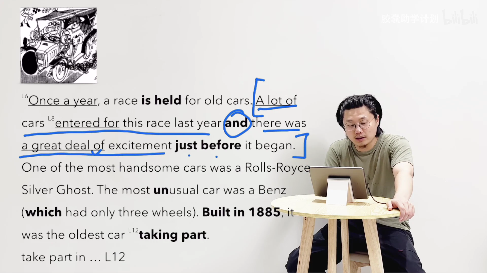

文字识别：-6Once a year, a race is held for old cars.A lot of / L8 / entered for this race last yearandthere was / cars / a great deal of excitement just before it began. / One of the most handsome cars was a Rolls-Royce / Silver Ghost. The most unusual car was a Benz / (which had only three wheels). Built in 1885, it / Was the oldest car -²taking part. / take part in ... L12

## 00:05:00–00:05:30

unusual car was a Benz, which一看哎，定语从句had only three wheels.好，说最unusual这个单词以前见过了，尤其是前面加unusually, usual, unusual, unhappy, unhappy啊，各位应该是有印象了，uninteresting，对吧？所以他这里说说最unusual不同寻常的车was是什么呢？是一个Benz

### 画面 00:05:11

文字识别：-Once a year, a race is held for old cars.Alot of / L8 / entered for this race last yearandthere was / cars / a great deal of excitement just before it began. / One of the most handsome cars was a Rolls-Royce / Silver Ghost. The most unusual car was a Benz / (which had only three wheels). Built in 1885, it / was the oldest car [²taking part. / take part in ... L12

## 00:05:30–00:06:00

啊，这个 Benz 是这辆车，还是不提名字了？各位一查就能查得到。Which had only three wheels，说这辆车它仅仅只有三个轮子。好，这就很神奇了。各位好像从来没听过这样的车，竟然会只有三个轮子的。好，我不妨告诉各位，是吧？这个实际上是这个人可以说啊，呃，实际上是人类现代历史当中认

### 画面 00:05:41

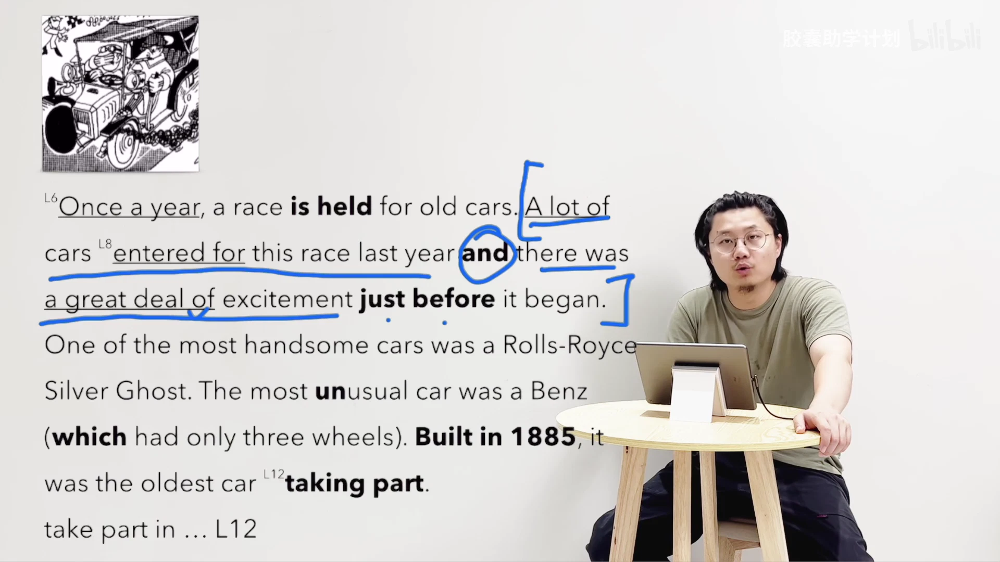

文字识别：-6Once a year, a race is held for old cars.Alot of / L8 / entered for this race last yearand there was / cars / a great deal of excitement just before it began. / One of the most handsome cars was a Rolls-Royce / Silver Ghost. The most unusual car was a Benz / (which had only three wheels). Built in 1885, it / Was the oldest car "'²taking part. / take part in ... L12

## 00:06:00–00:06:30

认为现代车辆的鼻祖就是这辆车，就是拥有三个轮的 Benz，对吧？然后你你真的能找到它，对吧？你可以去上网查一下，你就可以找到它的图。然后你看接下来这句话就很有意思了，叫做 Built in 1885, it was the oldest car taking part. 一八八五年建造，到这儿就

### 画面 00:06:11

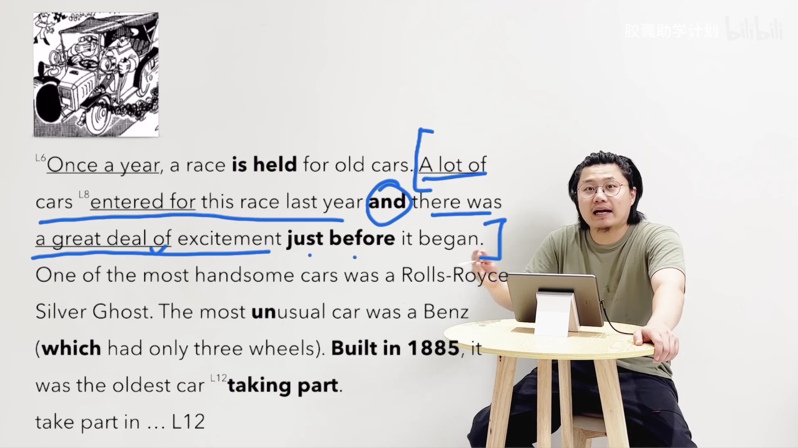

文字识别：-6Once a year, a race is held for old cars.A lot of / L8 / entered for this race last yearand there was / cars / a great deal of excitement just before it began. / One of the most handsome cars was a Rolls-Royce / Silver Ghost. The most unusual car was a Benz / (which had only three wheels). Built in 1885, it / was the oldest car -²taking part. / take part in ... L12

## 00:06:30–00:07:00

立刻有了个问题，叫做谁在1885年建造了什么，或者谁在1885年被谁建造了，对吧？我必然会有这样的问题。换一句话来说，就是谁是它的主语？四十九课您学的好，那这一课就手到擒来的。为什么？主语就是它后边的it，就指的是呃，the most unusual car was a Benz had only three wheels的这辆car，对吧？它在

### 画面 00:06:41

文字识别：LOnce a year, a race is held for old cars.A lot of / L8 / entered for this race last yearand there was / cars / a great deal of excitement just before it began. / One of the most handsome cars was a Rolls-Royce / Silver Ghost. The most unusual car was a Benz / (which had only three wheels). Built in 1885, it / was the oldest car [1²taking part. / take part in ... L12

## 00:07:00–00:07:30

八八五年被建造。然后呢？它是最 oldest car。你看这个地方就不能说是最旧的，不太合适。应该是说年头最长的，年份最久远的一辆车啊。Taking part,嗯take part就十二课咱学take part in，对吧？参加参与的意思。这个就呃短语很简单啊。以前我们也学过，但是还要多问一个问题，叫taking part的主语是哎主语是谁？它

### 画面 00:07:11

文字识别：-6Once a year, a race is held for old cars.A lot of / L8 / entered for this race last yearand there was / cars / a great deal of excitement just before it began. / One of the most handsome cars was a Rolls-Royce / Silver Ghost. The most unusual car was a Benz / (which had only three wheels). Built in 1885, it / was the oldest car [²taking part. / take part in ... L12

### 画面 00:07:19

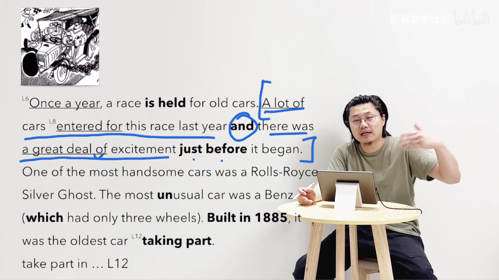

文字识别：-Once a year, a race is held for old cars.A lot of / L8 / entered for this race last yearand there was / cars / a great deal of excitement just before it began. / One of the most handsome cars was a Rolls-Royce / Silver Ghost. The most unusual car was a Benz / (which had only three wheels). Built in 1885, it / was the oldest car "²taking part. / take part in ... L12

### 画面 00:07:23

文字识别：-Once a year, a race is held for old cars.A lot of / L8 / entered for this race last yearand there was / cars / a great deal of excitement just before it began. / One of the most handsome cars was a Rolls-Royce / Silver Ghost. The most unusual car was a Benz / (which had only three wheels). Built in 1885, it / Was the oldest car -²taking part. / take part in ... L12

## 00:07:30–00:08:00

到底是干啥的，对吧？哎，参加的车还是说这个车来参加了？换一句话来说，他到底在这个地方是一个分词做定语还是分词做状语啊？我们已经学了那么多了，在这儿呢，我先给各位一个小的悬念啊，各位，你尝试去想一想，讨论去回答一下，对吧？弹幕留言啊，

### 画面 00:07:53

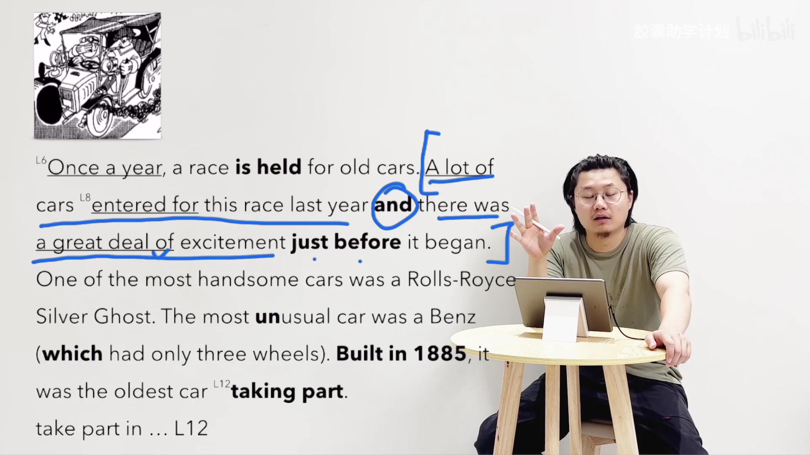

文字识别：-Once a year, a race is held for old cars.A lot of / L8 / entered for this race last yearandthere was / cars / a great deal of excitement just before it began. / One of the most handsome cars was a Rolls-Royce / Silver Ghost. The most unusual car was a Benz / (which had only three wheels). Built in 1885, it / was the oldest car [²taking part. / take part in ... L12

## 00:08:00–00:08:30

呃，这个我们学了很多了，也不能每个都让老师给讲太仔细，对吧？我们要自己学习，越主动效果越好，对吧？所以我问的问题叫做：这里到底是个分词做定语还是分词做状语？你觉得比较好，还是你觉得都行？对吧？OK， continue. After a great many loud explosions, the race began. 在什么之后呢？A great many，第五课咱们学过了那个鸽子那一课，a great many requests，对吧？

### 画面 00:08:16

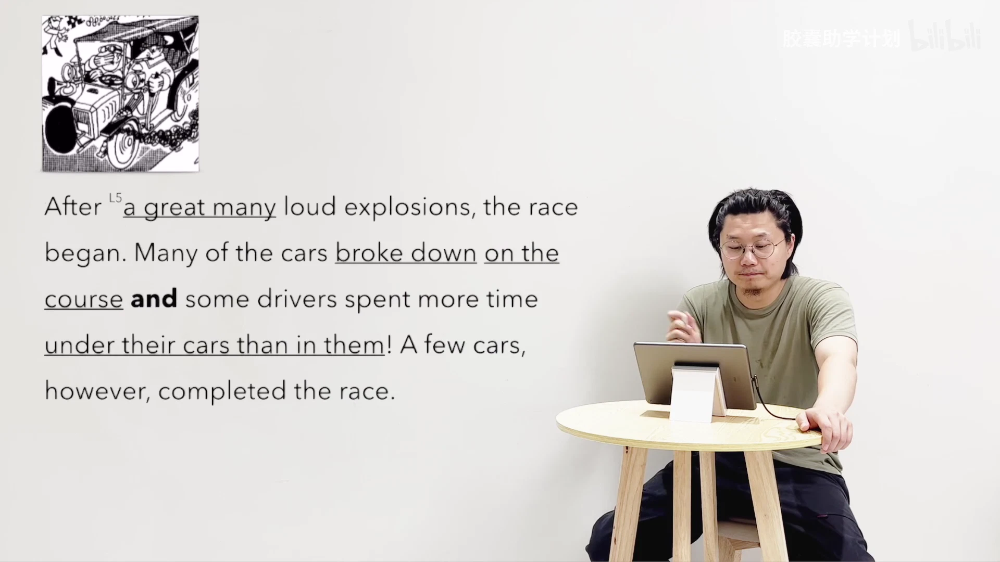

文字识别：After [5a great many loud explosions, the race / began. Many of the cars broke down on the / course and some drivers spent more time / under their cars than in them! A few cars, / however, completed the race.

## 00:08:30–00:09:00

呃，有许多大量的，注意它后边加的就是可数名词啊。大量的爆声音很大的爆炸声之后呢，the race began，比赛开始了。你理解为就是拖拉机咚咚咚咚咚，对吧？它这个车启动有很大的声音啊，在很多大的爆炸声，不是车炸了啊，就是启动车的那个声音，形容很大。Many of the cars broke down on the course, and先不看后边了，

### 画面 00:08:44

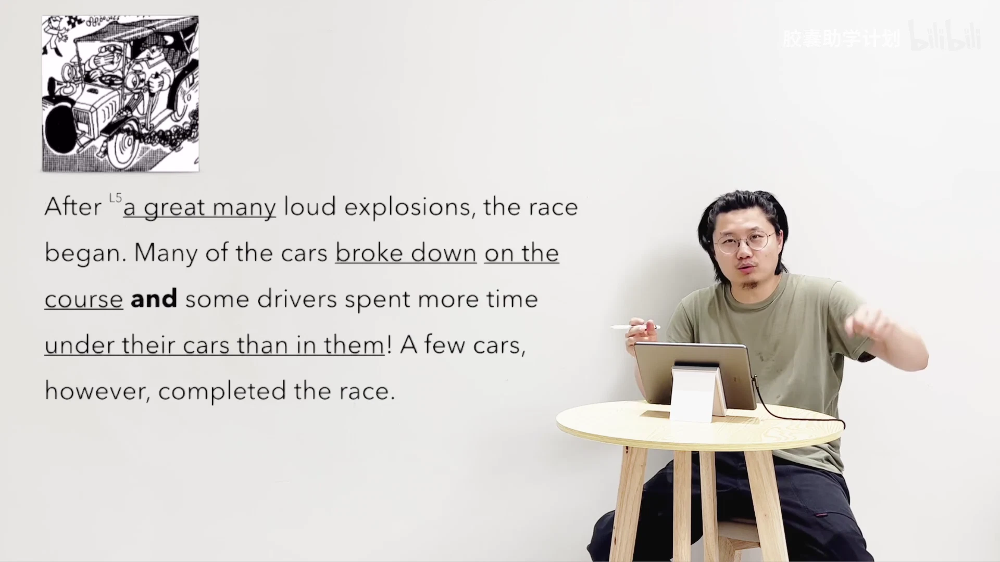

文字识别：After [a great many loud explosions, the race / began. Many of the cars broke down on the / course and some drivers spent more time / under their cars than in them! A few cars, / however, completed the race.

### 画面 00:08:52

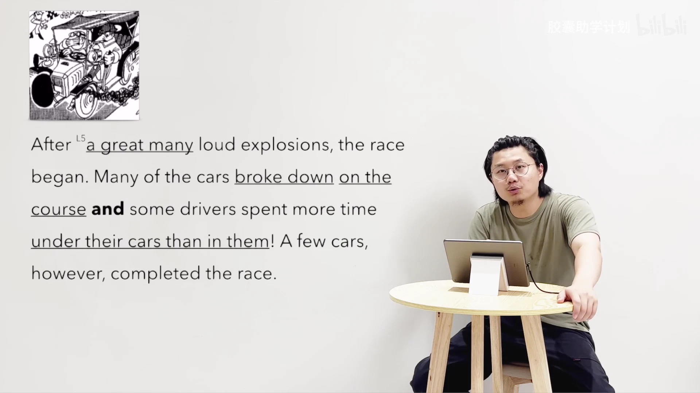

文字识别：After a great many loud explosions, the race / began. Many of the cars broke down on the / course and some drivers spent more time / under their cars than in them! A few cars, / however, completed the race.

## 00:09:00–00:09:30

许多的车抛锚了，对吧？哎，直接就坏在路边了。On the course，哎，直接就在赛道上坏在路边了。哎，在赛道上坏了。然后呢？Some drivers spent more time under their cars than in the。说有一些司机呀，花了更多的时间在他们的车底下，比在他们的车里边。我觉得你可能但凡有点画面

### 画面 00:09:22

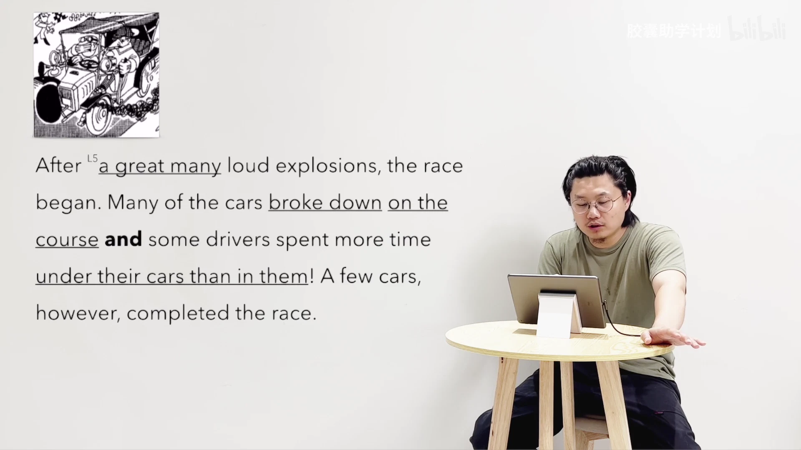

文字识别：After a great many loud explosions, the race / began. Many of the cars broke down on the / course and some drivers spent more time / under their cars than in them! A few cars, / however, completed the race.

### 画面 00:09:29

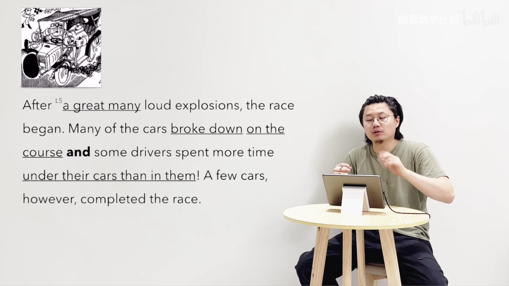

文字识别：After a great many loud explosions, the race / began. Many of the cars broke down on the / course and some drivers spent more time / under their cars than in them! A few cars, / however, completed the race.

## 00:09:30–00:10:00

感和生活的实际经验，就能猜出来这句话想表达什么意思。它无非你看直译就是刚才我说的那句话，就在车底下的时间比在车里边的时间还要长，对吧？再加上告诉你前前文说这些全是老爷车，对吧？然后呢，很多的车又抛锚了，那抛锚了要干啥？为什么要到车底下去修车嘛？你但凡看看电影，对吧？或者自己有辆车，也多少能明白点啊。所以这句话的意思就是有

### 画面 00:09:31

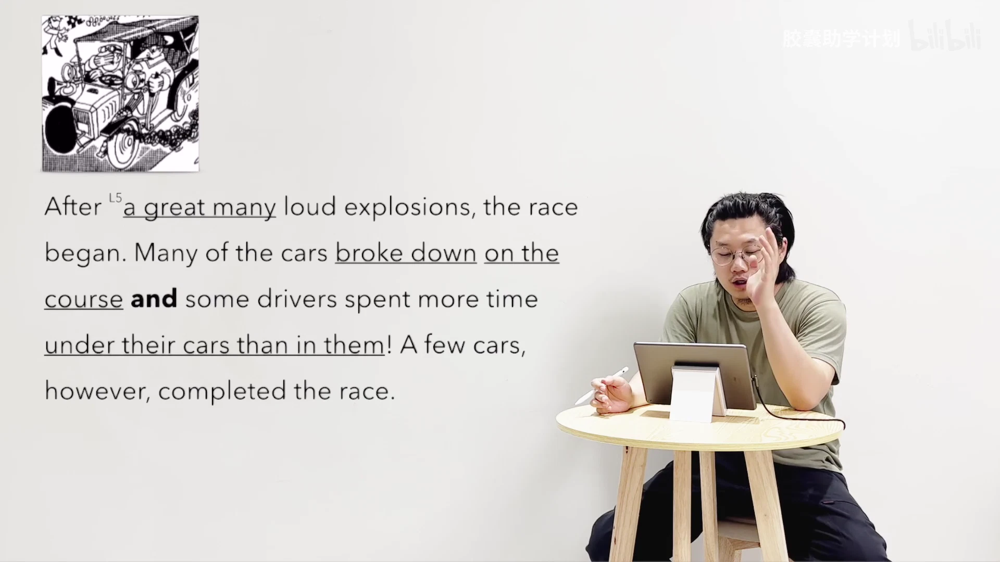

文字识别：After a great many loud explosions, the race / began. Many of the cars broke down on the / course and some drivers spent more time / under their cars than in them! A few cars, / however, completed the race.

## 00:10:00–00:10:30

一些司机花在修车上的时间比花在开车上的时间要长得多。所以他这个用的一个 under 一个 in，我觉得还用的特别的有意思啊。两个小词，a few cars，几辆车。However，然而呢，这个这个 however 就是一个单词放在最前面、最后边、中间都行啊。一般只不过放在中间，前后要有两个小逗号啊。However，然而呢，completed the race，说还是有几辆车。然而啊，

### 画面 00:10:01

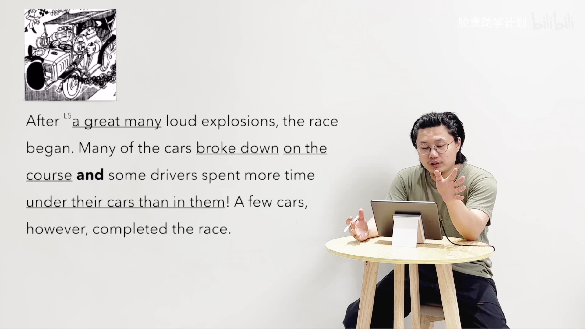

文字识别：After 'a great many loud explosions, the race / began. Many of the cars broke down on the / course and some drivers spent more time / under their cars than in them! A few cars, / however, completed the race.

## 00:10:30–00:11:00

完成了这个比赛。Continue the winning car,获胜的这辆车。你看这个我就不太问你了，到底是个分词做定语还是个分词做状语？这个基本上没什么没得跑，对吧？新概念二册三十课啊，呃，获胜的这辆车分词做定语，对吧？如果你不会，一定要翻过去看啊，这个是非常关键的语法。获胜的这辆车呢，reached a speed of forty miles an hour, much faster than any of his rivals.好，

### 画面 00:10:31

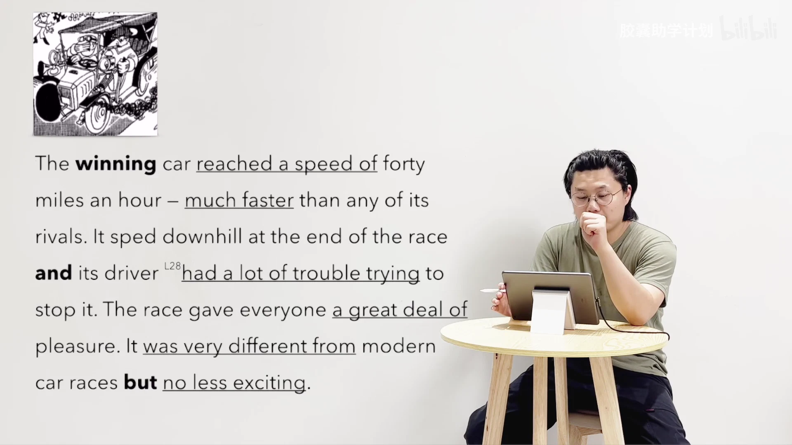

文字识别：The winning car reached a speed of forty / miles an hour – much faster than any of its / rivals. Ilt sped downhill at the end of the race / and its driver 2°had a lot of trouble trying to / stop it. The race gave everyone a great deal of / pleasure. Ilt was very different from modern / car races but no less exciting.

## 00:11:00–00:11:30

获胜这辆车首先 reached a speed of.你看它特别有意思。这个 speed 它在原文当中给的是个动词，在这儿它又是个名词。前面有个 a嘛，还是速度啊，含义没变。说达到了这样的一个速度，什么速度呢？ Forty miles an hour. 四十英里每小时，就特别慢的速度，是吧？哎，这自行车下坡骑快了都比这快。 Much faster than any office rebels. 好，我们先不管

### 画面 00:11:01

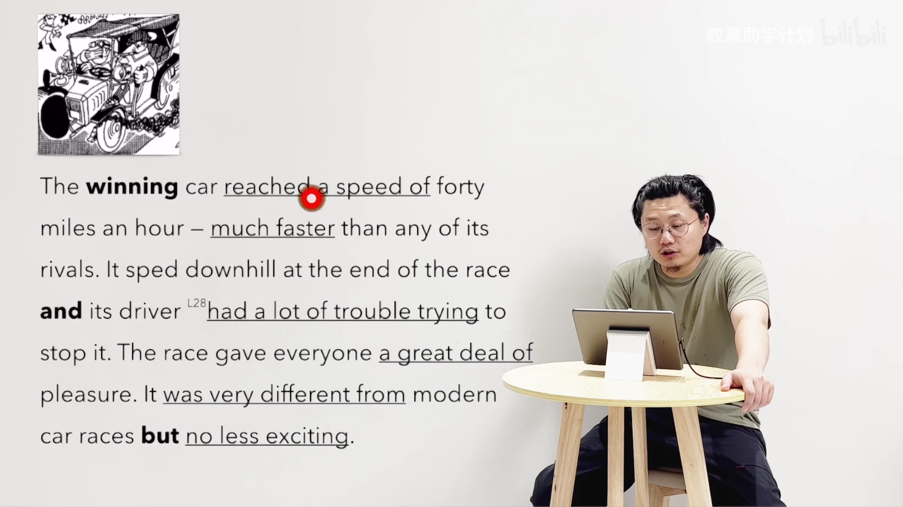

文字识别：The winning car reachec a speed of forty / miles an hour – much faster than any of its / rivals. Ilt sped downhill at the end of the race / and its driver 2had a lot oftrouble trying to / stop it. The race gave everyone a great deal of / pleasure. Ilt was very different from modern / car races but no less exciting.

## 00:11:30–00:12:00

much faster 叫做快得多，更快。Than 叫比 any of its rivals any of 叫做任何 its rivals 叫它的对手，叫做快得多，比它任何的对手。你看，这实际上是用一个比较级表了最高级，对吧？哎，就类似于我比世界上所有其他人都要高，都高那么一点点，对吧？那我就是世界上最高的人嘛。用了比较

### 画面 00:11:31

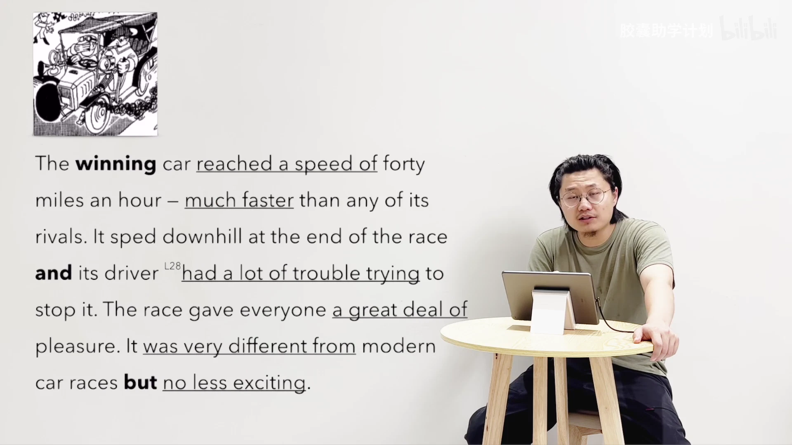

文字识别：The winning car reached a speed of forty / miles an hour – much faster than any of its / rivals. Ilt sped downhill at the end of the race / and its driver 2had a lot of trouble trying to / stop it. The race gave everyone a great deal of / pleasure. Ilt was very different from modern / car races but no less exciting.

## 00:12:00–00:12:30

级，表达了含义实际上是最高级，对吧？虽然是 faster than，但比较对象是其余所有对手，对吧？我比其余所有对手开的都要快，对不对？但是注意这儿很有意思，叫 much faster， much 是什么意思？叫快的多得多。他开到了四十英里每小时，已经比他所有其余的对手要快的多的多了。所以你再回想一下

### 画面 00:12:01

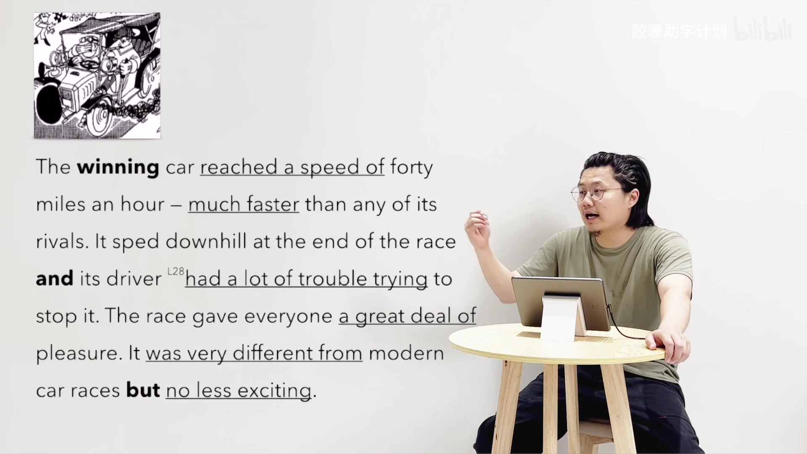

文字识别：The winning car reached a speed of forty / miles an hour – much faster than any of its / rivals. Ilt sped downhill at the end of the race / and its driver 28had a lot of trouble trying to / stop it. The race gave everyone a great deal of / pleasure. Ilt was very different from modern / car races but no less exciting.

### 画面 00:12:15

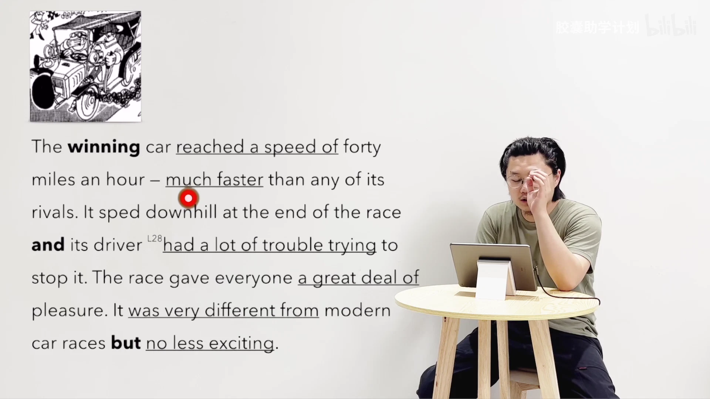

文字识别：The winning car reached a speed of forty / miles an hour — much faster than any of its / rivals. lt sped downhill at the end of the race / and its driver 2had a lot of trouble trying to / stop it. The race gave everyone a great deal of / pleasure. Ilt was very different from modern / car races but no less exciting.

## 00:12:30–00:13:00

这篇文章的这个标题叫 Faster Than Sound，你就感觉这亚历山大很调皮，什么意思呢？就是讽刺了一下啊，英国人那种暗暗的小幽默，就是你这个家伙这比赛不得了啊，这个车太快了，对吧？就类似于我们说有一个段子叫太刺激了，对吧？哎，被被被蜗牛超过去了那个段子，对不对？就类似于这样一个感觉，四十英里每小时还比他的对手

### 画面 00:12:45

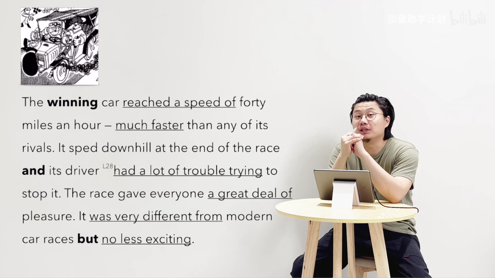

文字识别：The winning car reached a speed of forty / miles an hour – much faster than any of its / rivals. Ilt sped downhill at the end of the race / and its driver 2had a lot of trouble trying to / stop it. The race gave everyone a great deal of / pleasure. Ilt was very different from modern / car races but no less exciting.

## 00:13:00–00:13:30

开的快得多得多，然后呢？标题写的是还是超音速是吧？比声音传播的速度还要快，走的速度还要快，有点讽刺啊。 Continue, it sped downhill at the end of the race. 啊，这个没都没什么说的了，对吧？就都是直译了。这辆车疾驰着下坡，在比赛最后的时候，and然后呢？又是一句话叫 Its driver had a lot of trouble trying to stop it.

### 画面 00:13:08

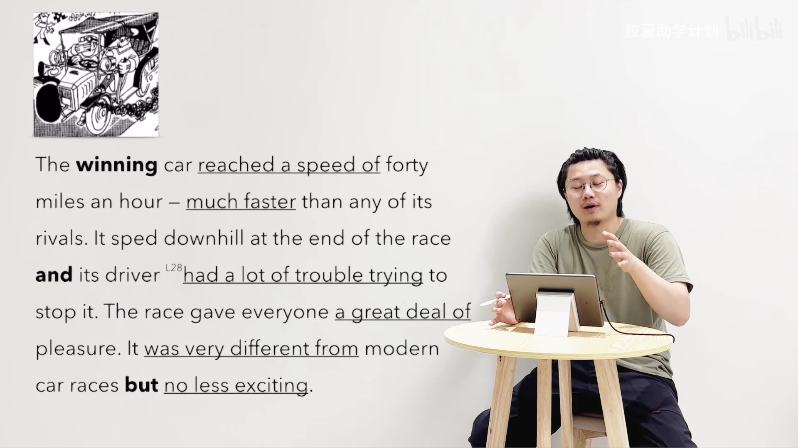

文字识别：The winning car reached a speed of forty / miles an hour – much faster than any of its / rivals. Ilt sped downhill at the end of the race / and its driver 2had a lot oftrouble trying to / stop it. The race gave everyone a great deal of / pleasure. It was very different from modern / car races but no less exciting.

## 00:13:30–00:14:00

好，这有一个小连读，stop it啊，stop it。好，说他的司机 have had a lot of trouble trying.二十八课美杜莎那一课咱们学过 have trouble doing something，对吧？哎，就做某件事情有困难。那a lot of trouble就是有很多的困难，对吧？说遇到了非常多的困难。Try to do something，咱也学过，对吧？第七课应该是就

### 画面 00:13:38

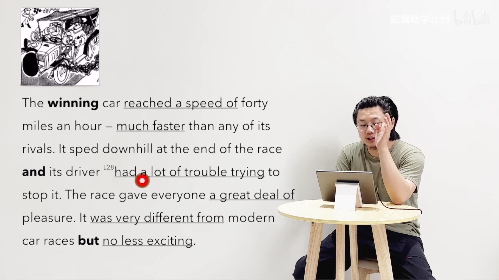

文字识别：The winning car reached a speed of forty / miles an hour – much faster than any of its / rivals. Ilt sped downhill at the end of the race / and its driver 2had a lot of trouble trying to / stop it. The race gave everyone a great deal of / pleasure. It was very different from modern / car races but no less exciting.

## 00:14:00–00:14:30

见过了。然后尝试着去停下他这辆车，开太快了啊！停下太费劲了。The race gave everyone a great deal of pleasure. A great deal of又出现了，上一次形容的是excitement，这这一段这一块形容的是pleasure，对吧？说这个比赛给了每一个人许多的快乐啊！It's my pleasure的那个pleasure嘛，pleasure快乐。It was very different from modern car

### 画面 00:14:08

文字识别：The winning car reached a speed of forty / miles an hour – much faster than any of its / rivals. Ilt sped downhill at the end of the race / and its driver 28had a lot of trouble trying to / stop it. The race gave everyone a great deal of / pleasure. Ilt was very different from modern / car races but no less exciting.

## 00:14:30–00:15:00

race, but no less exciting.好, be different from.在讲语法那个那个视频当中，我们提到了，对吧？Be different from.说它呀是特别不一样的，和谁比呢？Modern car race.现代的汽车比赛比它特别的不一样。我们不用把它当做什么语法，就是be different from.啊，A A it是A was I'm is are was

### 画面 00:14:38

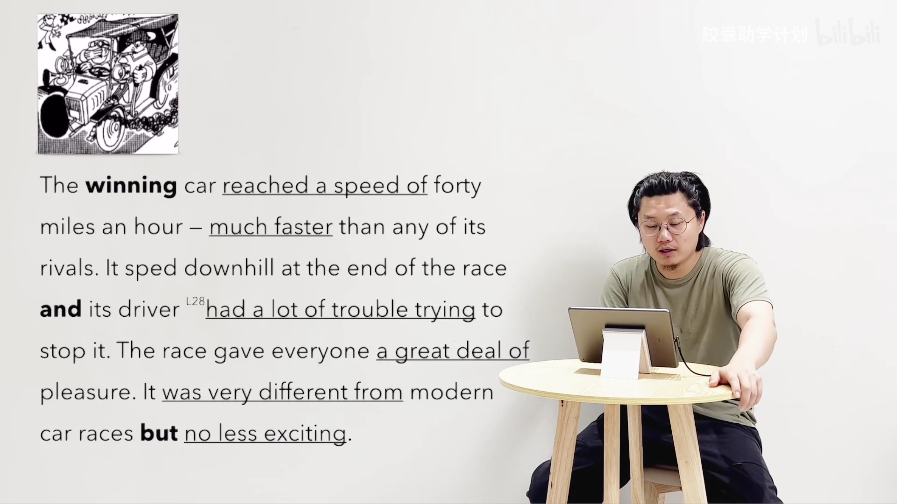

文字识别：The winning car reached a speed of forty / miles an hour — much faster than any of its / rivals. Ilt sped downhill at the end of the race / and its driver 2had a lot of trouble trying to / stop it. The race gave everyone a great deal of / pleasure. It was very different from modern / car races but no less exciting.

## 00:15:00–00:15:30

were都行，所以给它换成了be，对吧？哎，就是be different from B.第二件事儿就A和B不一样，A be different from B.一会儿我们会拿它造句啊。但是呢，怎么样呢？No less exciting这个地方直接去看就不太像汉语的表达习惯了啊。但我们先看一下，No叫不啊，先不管它，先不管它，这样这样更容易理解。Less exciting, more exciting叫更有趣，the most exciting叫最有

### 画面 00:15:06

文字识别：The winning car reached a speed of forty / miles an hour — much faster than any of its / rivals. Ilt sped downhill at the end of the race / and its driver 28had a lot of trouble trying to / stop it. The race gave everyone a great deal of / pleasure.Ilt was very different from modern / car races but no less exciting.

### 画面 00:15:17

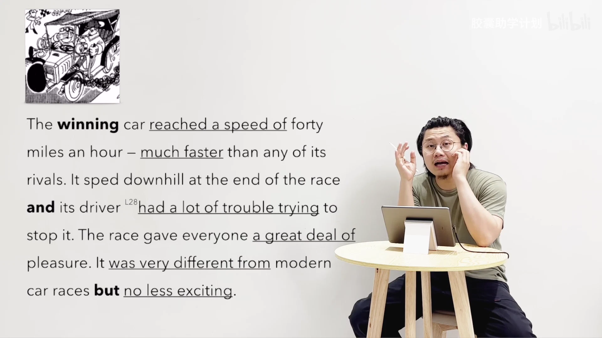

文字识别：The winning car reached a speed of forty / miles an hour – much faster than any of its / rivals. Ilt sped downhill at the end of the race / and its driver 2had a lot of trouble trying to / stop it. The race gave everyone a great deal of / pleasure. It was very different from modern / car races but no less exciting.

### 画面 00:15:24

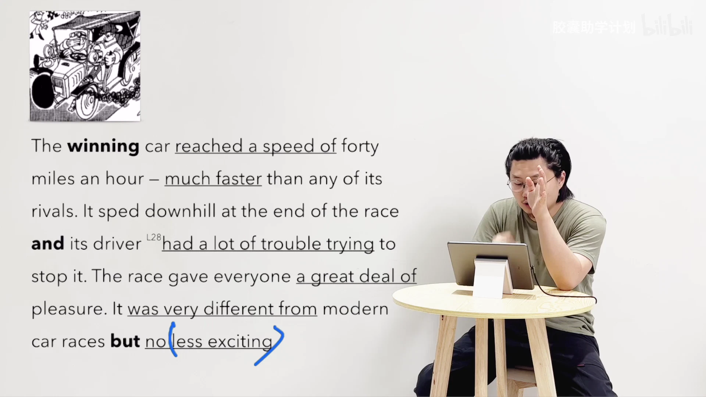

文字识别：The winning car reached a speed of forty / miles an hour – much faster than any of its / rivals. Ilt sped downhill at the end of the race / and its driver 2had a lot of trouble trying to / stop it. The race gave everyone a great deal of / pleasure. It was very different from modern / car races but noless exciting

## 00:15:30–00:16:00

趣，exciting如果在这儿，more exciting就在这儿，对吧？啊，much more exciting就在这儿，对不对？或者就在这儿啊，那less exciting就在这儿，exciting在这儿啊，在我比这个位置啊，那less exciting就在这儿，对不对？less exciting叫比它没有没有它那么有意思，但no less exciting叫不是比它更没有意思，那是不是就类似于我们文章当中译

### 画面 00:15:32

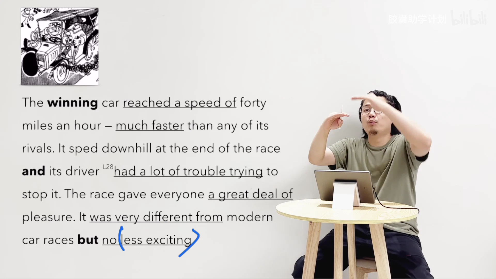

文字识别：The winning car reached a speed of forty / miles an hour – much faster than any of its / rivals. Ilt sped downhill at the end of the race / and its driver 2had a lot of trouble trying to / stop it. The race gave everyone a great deal of / pleasure. It was very different from modern / car races but noless exciting

### 画面 00:15:58

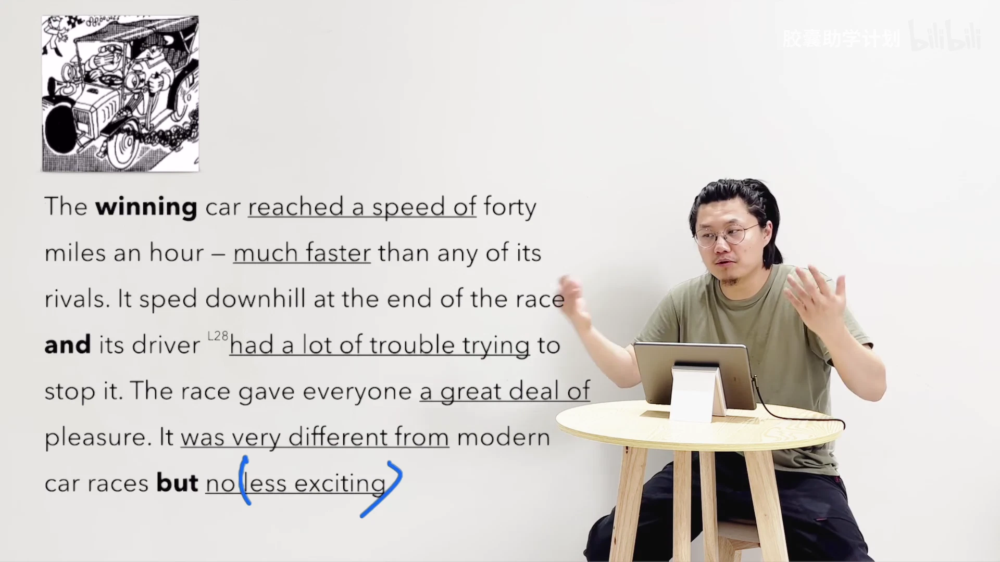

文字识别：The winning car reached a speed of forty / miles an hour – much faster than any of its / rivals. Ilt sped downhill at the end of the race / and its driver 2had a lot of trouble trying to / stop it. The race gave everyone a great deal of / pleasure. It was very different from modern / car races but noless exciting

## 00:16:00–00:16:30

文的翻译叫不亚于，对吧？哎，不亚于。好，也就是说至少平等，可能比它还更有意思，叫 no less exciting 啊，完全不是更没意思，或者说不亚于现代汽车比赛。好，习惯用法造句三个，a great deal of 技术家不可数，breakdown 啊，这个记住它的这个呃含义对吧？表示的是汽车坏了。然后 A be different from

### 画面 00:16:05

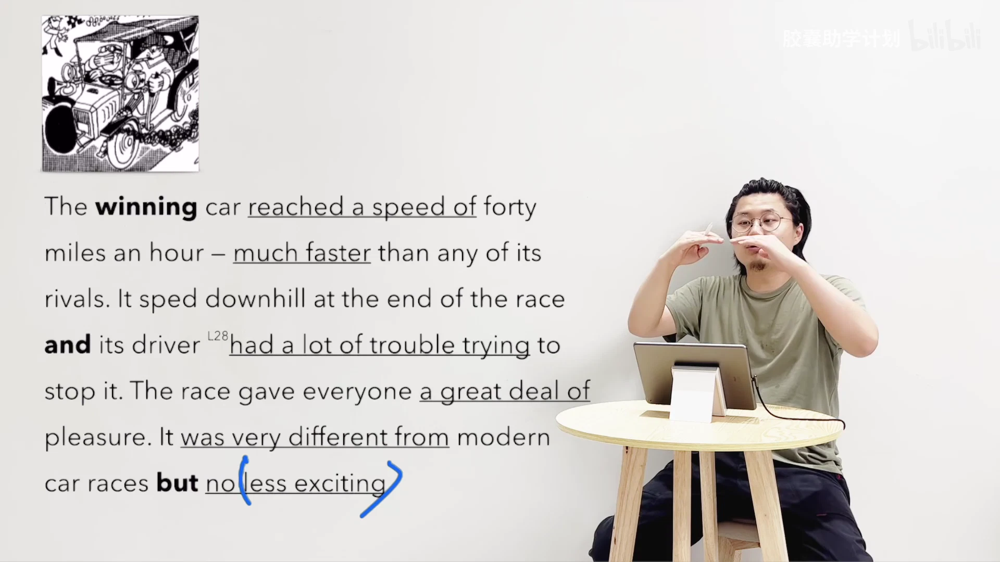

文字识别：The winning car reached a speed of forty / miles an hour – much faster than any of its / rivals. Ilt sped downhill at the end of the race / and its driver 2had a lot of trouble trying to / stop it. The race gave everyone a great deal of / pleasure. Ilt was very different from modern / car races but noless exciting

### 画面 00:16:11

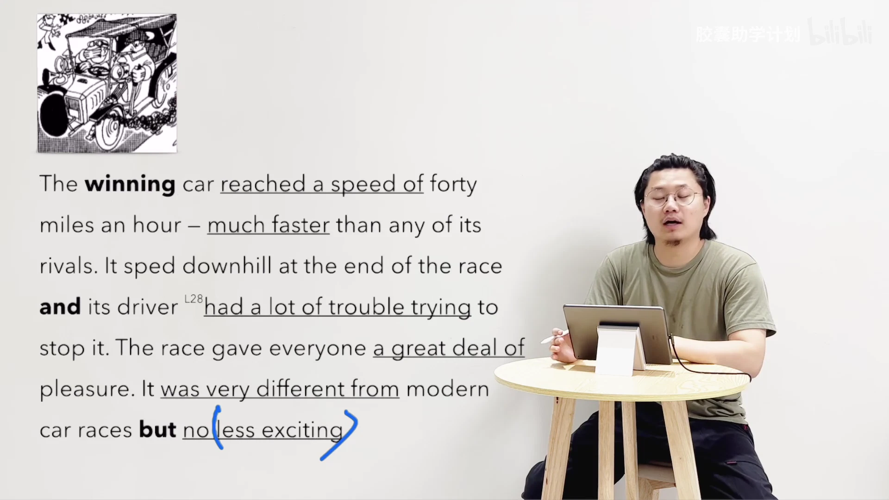

文字识别：The winning car reached a speed of forty / miles an hour – much faster than any of its / rivals. Ilt sped downhill at the end of the race / and its driver 2had a lot of trouble trying to / stop it. The race gave everyone a great deal of / pleasure. It was very different from modern / car races but noless exciting

### 画面 00:16:17

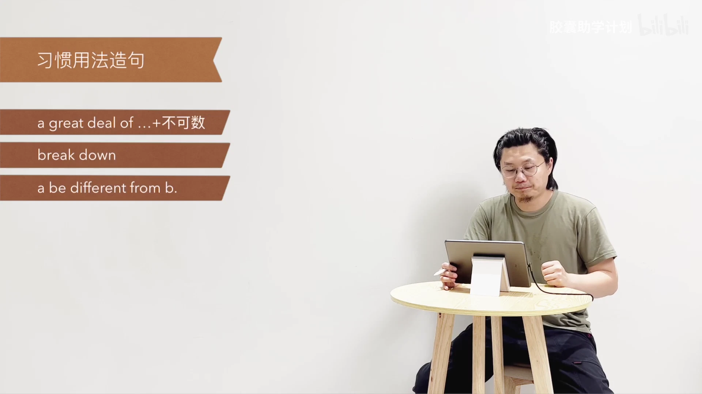

文字识别：习惯用法造句 / a great deal of .+不可数 / break down / a be different from b.

### 画面 00:16:19

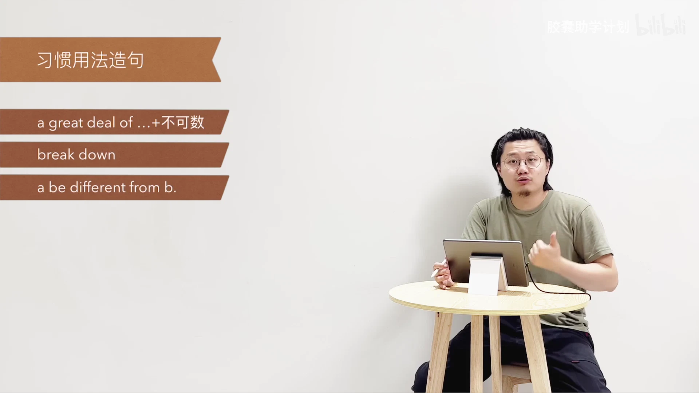

文字识别：习惯用法造句 / a great deal of .+不可数 / break down / a be different from b.

### 画面 00:16:24

文字识别：习惯用法造句 / a great deal of …+不可数 / break down / a be different from b.

### 画面 00:16:29

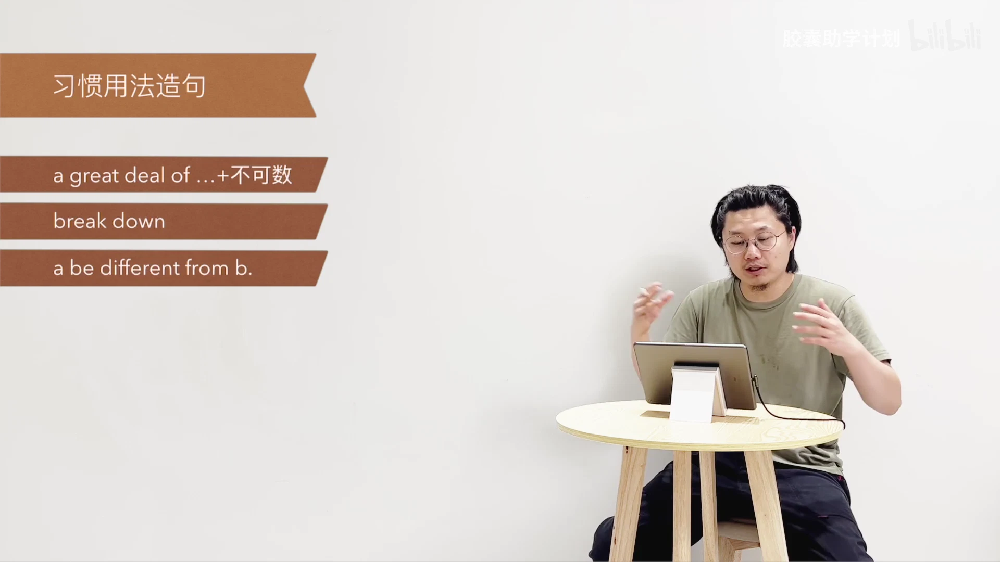

文字识别：习惯用法造句 / a great deal of …+不可数 / break down / a be different from b.

## 00:16:30–00:17:00

B. 我们马上开始造句来了。第一个 a great deal of，很简单，比如说 repeat after me. He realized that he had lost a great deal of money. Money肯定不可数嘛，对吧？再来，It is easy for him to make a great deal of money every day. 哎，三十二个。It is easy for somebody to do something，对吧？对某人来说做某件事情非常的容易。最后一个叫做 He returned a great deal

### 画面 00:16:31

文字识别：网：v.+v.变化 / 习惯用法造句指南 / 四句型转换 / 方式/地点/时间 / 其他习惯用法 / 其他单词+词性 / 原文摘抄+变 / 6123456 / a great deal of …..+不可数

### 画面 00:16:33

文字识别：网：v.+v.变化 / 习惯用法造句指南 / 四句型转换 / 方式/地点/时间 / 其他习惯用法 / 其他单词+词性 / 原文摘抄+变 / 6123456 / a great deal of ...+不可数 / He realized that he had lost a great deal of / money. L20

### 画面 00:16:35

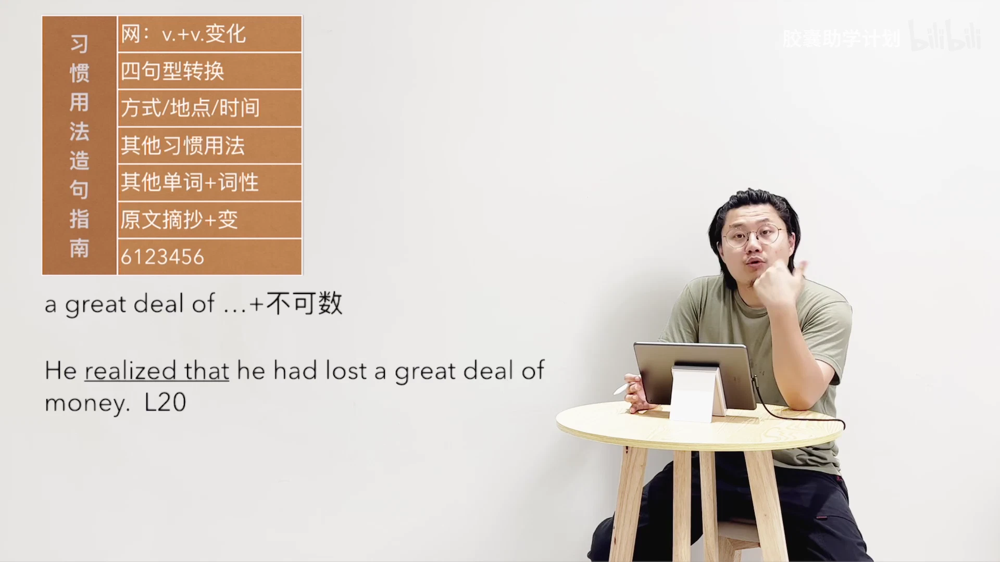

文字识别：网：v.+v.变化 / 习惯用法造句指南 / 四句型转换 / 方式/地点/时间 / 其他习惯用法 / 其他单词+词性 / 原文摘抄+变 / 6123456 / a great deal of .+不可数 / He realized that he had lost a great deal of / money. L20

### 画面 00:16:38

文字识别：网：v.+v.变化 / 习惯用法造句指南 / 四句型转换 / 方式/地点/时间 / 其他习惯用法 / 其他单词+词性 / 原文摘抄+变 / 6123456 / a great deal of ...+不可数 / He realized that he had lost a great deal of / money. L20

### 画面 00:16:40

文字识别：网：v.+v.变化 / 习惯用法造句指南 / 四句型转换 / 方式/地点/时间 / 其他习惯用法 / 其他单词+词性 / 原文摘抄+变 / 6123456 / a great deal of .+不可数 / He realized that he had lost a great deal of / money. L20

### 画面 00:16:44

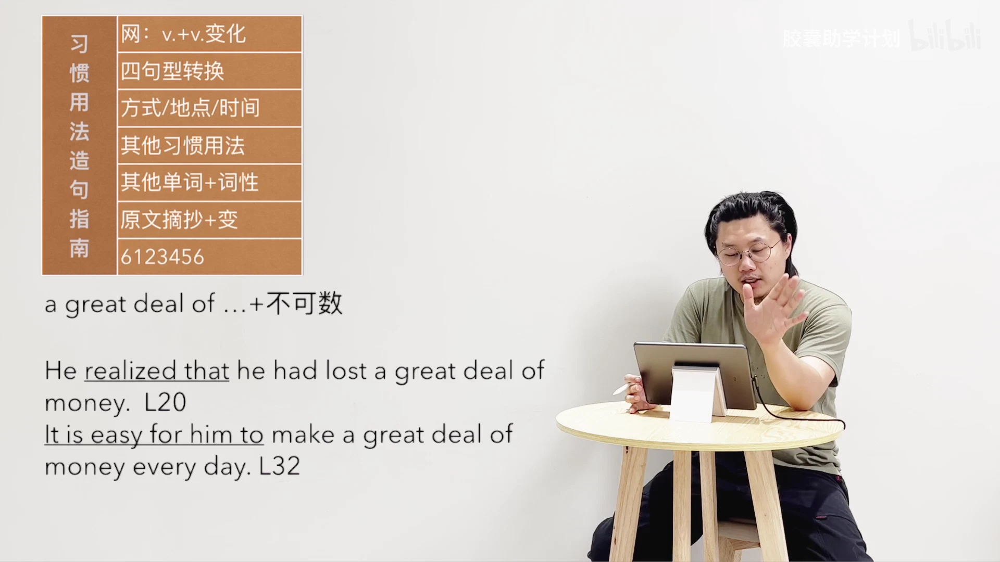

文字识别：网：v.+v.变化 / 习惯用法造句指南 / 四句型转换 / 方式/地点/时间 / 其他习惯用法 / 其他单词+词性 / 原文摘抄+变 / 6123456 / a great deal of …..+不可数 / He realized that he had lost a great deal of / money. L20 / It is easy for him to make a great deal of / money every day. L32

### 画面 00:16:49

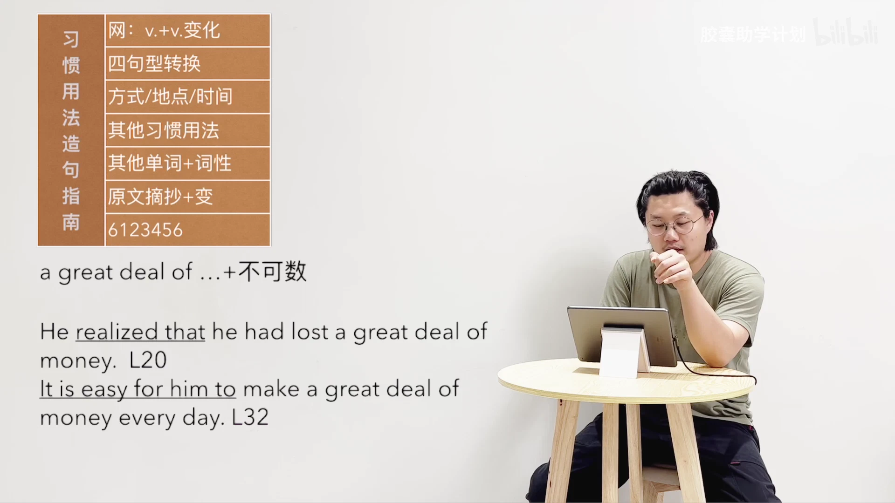

文字识别：网：v.+v.变化 / 习惯用法造句指南 / 四句型转换 / 方式/地点/时间 / 其他习惯用法 / 其他单词+词性 / 原文摘抄+变 / 6123456 / a great deal of +不可数 / He realized that he had lost a great deal of / money. L20 / It is easy for him to make a great deal of / money every day. L32

### 画面 00:16:51

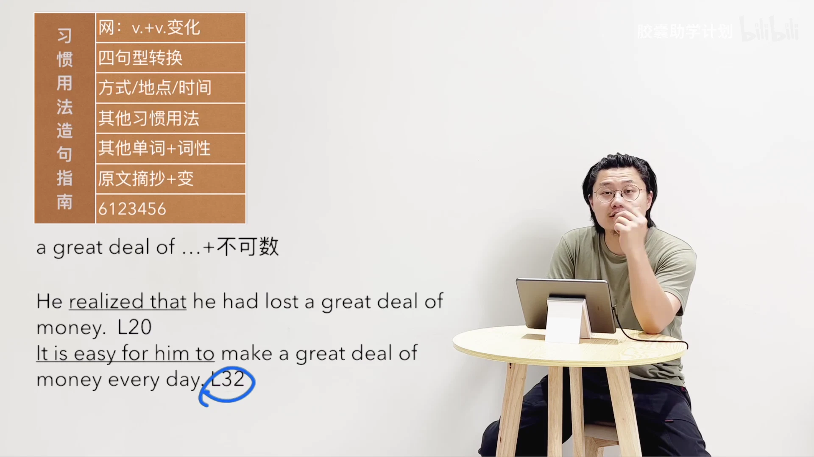

文字识别：网：v.+v.变化 / 习惯用法造句指南 / 四句型转换 / 方式/地点/时间 / 其他习惯用法 / 其他单词+词性 / 原文摘抄+变 / 6123456 / a great deal of .+不可数 / He realized that he had lost a great deal of / money. L20 / It is easy for him to make a great deal of / money every dayyL32

### 画面 00:16:54

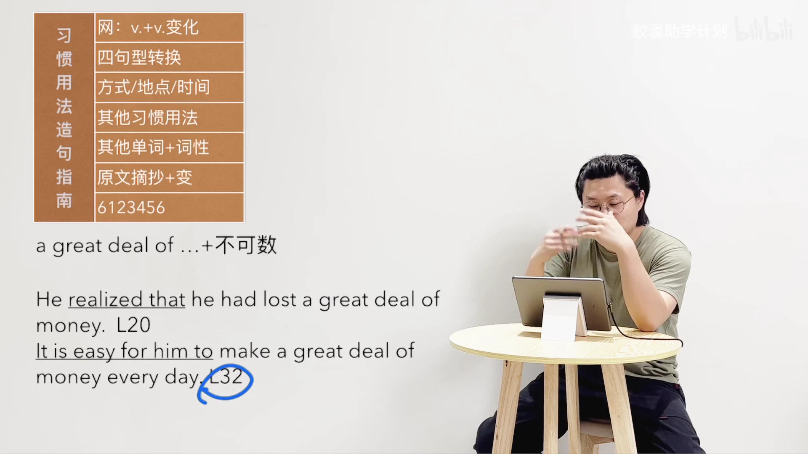

文字识别：网：v.+v.变化 / 习惯用法造句指南 / 四句型转换 / 方式/地点/时间 / 其他习惯用法 / 其他单词+词性 / 原文摘抄+变 / 6123456 / a great deal of .+不可数 / He realized that he had lost a great deal of / money. L20 / It is easy for him to make a great deal of / money every dayyL32

### 画面 00:16:56

文字识别：网：v.+v.变化 / 习惯用法造句指南 / 四句型转换 / 方式/地点/时间 / 其他习惯用法 / 其他单词+词性 / 原文摘抄+变 / 6123456 / a great deal of …..+不可数 / He realized that he had lost a great deal of / money. L20 / It is easy for him to make a great deal of / money every day/L32 / He returned a great deal of money to me last / night. L45

### 画面 00:16:58

文字识别：网：v.+v.变化 / 习惯用法造句指南 / 四句型转换 / 方式/地点/时间 / 其他习惯用法 / 其他单词+词性 / 原文摘抄+变 / 6123456 / a great deal of …..+不可数 / He realized that he had lost a great deal of / money. L20 / It is easy for him to make a great deal of / money every day. L32 / He returned a great deal of money to me last / night. L45

## 00:17:00–00:17:30

of money to me last night. Return something to somebody. Ah, repeat after me. 45课咱学的啊. Okay, 那接下来电影片段，注意力集中，听一下. It means a great deal of money to me. Okay, 下一个是 a great deal of time. 注意力集中. Jay, I don't have a great deal of time here. Okay, 好. Repetition之后呢，被我们拉到这儿了。为什么呢？这个

### 画面 00:17:00

文字识别：网：v.+v.变化 / 习惯用法造句指南 / 四句型转换 / 方式/地点/时间 / 其他习惯用法 / 其他单词+词性 / 原文摘抄+变 / 6123456 / a great deal of …..+不可数 / He realized that he had lost a great deal of / money. L20 / It is easy for him to make a great deal of / money every day. L32 / He returned a great deal of money to me last / night. L45

### 画面 00:17:04

文字识别：网：v.+v.变化 / 习惯用法造句指南 / 四句型转换 / 方式/地点/时间 / 其他习惯用法 / 其他单词+词性 / 原文摘抄+变 / 6123456 / a great deal of …..+不可数 / He realized that he had lost a great deal of / money. L20 / It is easy for him to make a great deal of / money every day. L32 / He returned a great deal of money to me last / night. L45

### 画面 00:17:07

文字识别：网：v.+v.变化 / 习惯用法造句指南 / 四句型转换 / 方式/地点/时间 / 其他习惯用法 / 其他单词+词性 / 原文摘抄+变 / 6123456 / a great deal of …..+不可数 / He realized that he had lost a great deal of / money. L20 / It is easy for him to make a great deal of / money every day. L32 / He returned a great deal of money to me last / night. L45

### 画面 00:17:09

文字识别：It means a great deal of / money to me. / True Grit (2010)

### 画面 00:17:12

文字识别：It means a great deal of / money to me. / True Grit (2010)

### 画面 00:17:14

文字识别：It means a great deal of / money to me. / True Grit (2010)

### 画面 00:17:16

文字识别：Jade, I don't have a great deal / of time here. / The Rock / 96)

### 画面 00:17:21

文字识别：Jade, I don't have a great deal / of time here. / The Rock / 96)

### 画面 00:17:23

文字识别：Jade, I don't have a great deal / of time here. / The Roek

### 画面 00:17:25

文字识别：Repetition drill / 训练目标： / 听力口语 / 练习包含a great many ＆ a great deal的句子 / Accuracy / Fluency

### 画面 00:17:27

文字识别：Repetition drill / 训练目标： / 听力口语 / 练习包含a great many & a great deal的句子 / Accuracy / Fluency

## 00:17:30–00:18:00

repetition 最好恰好练的时候， a great many 和 a great deal，是吧？直接张嘴跟我练，记住 a great many 加可数不可数，可数 a great deal 呢加不可数，对吧？就这么简单。我读，您跟着我读， repeat after me. Do you sell any products overseas? Oh yes, a great many. I sell a lot of products overseas. 注意，这儿是可数，这儿用 a great many，然后 a lot of 可数不可数都行，对吧？练的就是这三个东西

### 画面 00:17:30

文字识别：Repetition drill / 训练目标： / 听力口语 / 练习包含a great many & a great deal的句子 / Accuracy / Fluency

### 画面 00:17:32

文字识别：Repetition drill / 训练目标： / 听力口语 / 练习包含a great many & a great deal的句子 / Accuracy / Fluency

### 画面 00:17:39

文字识别：Repetition drill

### 画面 00:17:43

文字识别：Repetition drill / 1 T: Do you sell any products overseas?

### 画面 00:17:48

文字识别：Repetition drill / 1 T: Do you sell any products overseas? / S: Oh yes, a great many. I sell a lot of / products overseas.

### 画面 00:17:55

文字识别：Repetition drill / 1 T: Do you sell any products overseas? / S：Oh /  yes, a qreat many. I sell a lot of / products / s overseas.

## 00:18:00–00:18:30

啊。下一个，比如说，Did you get any information？你看 information 可数不可数？不可数，加 a great deal of，对吧？哎，Oh yes， a great deal. I got a lot of information. 啊，Next one, Have you got any friends？接下来都是一样的了，不挨个解释了，张嘴跟我读啊。Oh yes, a great many. I've got a lot of friends.

### 画面 00:18:00

文字识别：Repetition drill

### 画面 00:18:07

文字识别：Repetition drill / 2 T: Did you get any information? / S: Oh yes, a great deal.I got a lot of / information.

### 画面 00:18:15

文字识别：Repetition drill

### 画面 00:18:22

文字识别：Repetition drill / 3 T: Have you got any friends? / S: Oh yes, a great many.I've got a lot of / friends.

## 00:18:30–00:19:00

Is there any news in the paper? Oh yes, a great deal. There's a lot of news in the paper. Can you see any people? Oh yes, a great many. I can see a lot of people. Has he made any progress? Oh yes, a great deal. He's made a lot of progress. Progress,进程啊，就

### 画面 00:18:30

文字识别：Repetition drill / 4 T: Is there any news in the paper?

### 画面 00:18:44

文字识别：Repetition drill / 5 T: Can you see any people? / S: Oh yes, a great many. I can see a lot of / people.

### 画面 00:18:50

文字识别：Repetition drill / 6 T: Has he made any progress?

### 画面 00:18:59

文字识别：Repetition drill / 6 T: Has he made any progress? / S: Oh yes, a great deal. He's made a lot of / progress. / 子

## 00:19:00–00:19:30

它有往前走吗？它这个这个项目有往前推进吗？Progress，有进展吗？Did you buy any postcards? Oh yes, a great many. I bought a lot of postcards. Next one, did you bring any luggage? Oh yes, a great deal. I brought a lot of luggage.注意luggage这个单词指的是行李的抽象名词，它是不可数的啊。Next one,

### 画面 00:19:05

文字识别：Repetition drill / 7 T: Did you buy any postcards?

### 画面 00:19:18

文字识别：Repetition drill / 8 T: Did you bring any luggage? / S: Oh yes, a great deal.I brought a lot of / luggage.

### 画面 00:19:23

文字识别：Repetition drill / 8T： / Did / youk / bring / anyluggage / S:Oh / yes, a great ( / deal.I brought a lot of / luggage.

### 画面 00:19:29

文字识别：Repetition drill / 9 T: Did you ask any questions?

## 00:19:30–00:20:00

Did you ask any questions? Oh yes, a great many. I asked a lot of questions. Repeat after me. Next one. Have you got any furniture? Oh yes, a great deal. I've got a lot of furniture. Ah, furniture这个单词跟刚才那个luggage一样啊，就抽象名词家具啊。你看，你硬说说家具是可以数的，我完全赞同。但是你要知道，这个家具指的是家具的抽象名

### 画面 00:19:42

文字识别：Repetition drill / 10T: Have you got any furniture? / S: Oh yes, a great deal. I've got a lot of / furniture.

### 画面 00:19:50

文字识别：Repetition drill / 10T: Have you got any furniture? / S: Oh yes, a great deal.I've got a lot of / furniture.

## 00:20:00–00:20:30

词啊，这么一个呃抽象的概念，对吧？所以在英文当中，它在这是不可数的啊。你说我说桌子明明可以数是可数名词，对吧？椅子明明可以数是可数名词，家具在这个地方是一个抽象名词啊，跟那个钱类似，对吧？OK，break down，我们说汽车坏了抛锚了，那它造句，比如说My car broke down，特别简单的两句话，对吧？哎，别人问你What happened？你说My car broke down，Can you help me？对不对？口语当中完全用得到，还是那句话，口语用得

### 画面 00:20:15

文字识别：Repetition drill / 10 T: Have you got any furniture? / S: Oh yes, a great deal.I've got a lot of / furniture.

### 画面 00:20:17

文字识别：网：v.+v.变化 / 习惯用法造句指南 / 四句型转换 / 方式/地点/时间 / 其他习惯用法 / 其他单词+词性 / 原文摘抄+变 / 6123456 / break down

### 画面 00:20:19

文字识别：网：v.+v.变化 / 习惯用法造句指南 / 四句型转换 / 方式/地点/时间 / 其他习惯用法 / 其他单词+词性 / 原文摘抄+变 / 6123456 / break down

### 画面 00:20:21

文字识别：网：v.+v.变化 / 习惯用法造句指南 / 四句型转换 / 方式/地点/时间 / 其他习惯用法 / 其他单词+词性 / 原文摘抄+变 / 6123456 / break down / My car broke down.

### 画面 00:20:24

文字识别：网：v.+v.变化 / 习惯用法造句指南 / 四句型转换 / 方式/地点/时间 / 其他习惯用法 / 其他单词+词性 / 原文摘抄+变 / 6123456 / break down / My car broke down.

### 画面 00:20:29

文字识别：网：v.+v.变化 / 习惯用法造句指南 / 四句型转换 / 方式/地点/时间 / 其他习惯用法 / 其他单词+词性 / 原文摘抄+变 / 6123456 / break down / My car broke down.

## 00:20:30–00:21:00

到。你说我还是那句话啊，在在在在磨几遍。呃，我有实际应用的需求，那口语用得到对你是好事儿，对吧？你有应试的需求，我一说口语用得到，你就说我不偏应试，对吧？那我是不同意的。我还是那句话，叫做口语用的频率高的东西，在听力当中用的频率必高。没有考试，好像现在是不考口语的吧？啊，不考听力的吧？是吧？啊，continue说，Did you car break down？哎，一般疑问句对吧？再来，When

### 画面 00:20:34

文字识别：网：v.+v.变化 / 习惯用法造句指南 / 四句型转换 / 方式/地点/时间 / 其他习惯用法 / 其他单词+词性 / 原文摘抄+变 / 6123456 / break down / My car broke down.

### 画面 00:20:36

文字识别：网：v.+v.变化 / 习惯用法造句指南 / 四句型转换 / 方式/地点/时间 / 其他习惯用法 / 其他单词+词性 / 原文摘抄+变 / 6123456 / break down / My car broke down.

### 画面 00:20:38

文字识别：网：v.+v.变化 / 习惯用法造句指南 / 四句型转换 / 方式/地点/时间 / 其他习惯用法 / 其他单词+词性 / 原文摘抄+变 / 6123456 / break down / My car broke down.

### 画面 00:20:40

文字识别：网：v.+v.变化 / 习惯用法造句指南 / 四句型转换 / 方式/地点/时间 / 其他习惯用法 / 其他单词+词性 / 原文摘抄+变 / 6123456 / break down / My car broke down.

### 画面 00:20:43

文字识别：网：v.+v.变化 / 习惯用法造句指南 / 四句型转换 / 方式/地点/时间 / 其他习惯用法 / 其他单词+词性 / 原文摘抄+变 / 6123456 / break down / My car broke down.

### 画面 00:20:45

文字识别：网：v.+v.变化 / 习惯用法造句指南 / 四句型转换 / 方式/地点/时间 / 其他习惯用法 / 其他单词+词性 / 原文摘抄+变 / 6123456 / break down / My car broke down.

### 画面 00:20:49

文字识别：网：v.+v.变化 / 习惯用法造句指南 / 四句型转换 / 方式/地点/时间 / 其他习惯用法 / 其他单词+词性 / 原文摘抄+变 / 6123456 / break down / My car broke down.

### 画面 00:20:54

文字识别：网：v.+v.变化 / 习惯用法造句指南 / 四句型转换 / 方式/地点/时间 / 其他习惯用法 / 其他单词+词性 / 原文摘抄+变 / 6123456 / break down / My car broke down. / Did your car break down? Bagdad Cafe(1987)

### 画面 00:20:59

文字识别：网：v.+v.变化 / 习惯用法造句指南 / 四句型转换 / 方式/地点/时间 / 其他习惯用法 / 其他单词+词性 / 原文摘抄+变 / 6123456 / break down / My car broke down. / Did your car break down? Bagdad Cafe(1987) / When/whose/why...

## 00:21:00–00:21:30

who's why啊，不多提了。说 We want to drive to London, but we can't because our car broke down. 啊，因为我们的车崩溃了。好，第二个，注意力集中，听这句话叫 My truck broke down on the highway. Truck这个单词，我要求你自己去查一下。 Highway我也要求你自己去查一下。你相信我都很常用啊。注意力集中，听一下。 My truck broke down on the highway. Okay, A be different from B. A和B

### 画面 00:21:01

文字识别：网：v.+v.变化 / 习惯用法造句指南 / 四句型转换 / 方式/地点/时间 / 其他习惯用法 / 其他单词+词性 / 原文摘抄+变 / 6123456 / break down / My car broke down. / Did your car break down? Bagdad Cafe(1987) / When/whose/why... / We wanna drive to London. But we can't. / Because our car broke down.

### 画面 00:21:04

文字识别：网：v.+v.变化 / 习惯用法造句指南 / 四句型转换 / 方式/地点/时间 / 其他习惯用法 / 其他单词+词性 / 原文摘抄+变 / 6123456 / break down / My car broke down. / Did your car break down? Bagdad Cafe (1987) / When/whose/why... / We wanna drive to London. But we can't. / Because our car broke down.

### 画面 00:21:08

文字识别：网：v.+v.变化 / 习惯用法造句指南 / 四句型转换 / 方式/地点/时间 / 其他习惯用法 / 其他单词+词性 / 原文摘抄+变 / 6123456 / break down / My car broke down. / Did your car break down? Bagdad Cafe(1987) / When/whose/why... / We wanna drive to London. But we can't. / Because our car broke down.

### 画面 00:21:10

文字识别： My truck broke down / on the highway. / Lean onPete / (2017)

### 画面 00:21:24

文字识别：My truck broke down / on the highway. / Lean op Pete / (2017)

### 画面 00:21:26

文字识别： My truck broke down / on the highway. / Lean on Pete / (2017)

### 画面 00:21:28

文字识别：网：v.+v.变化 / 习惯用法造句指南 / 四句型转换 / 方式/地点/时间 / 其他习惯用法 / 其他单词+词性 / 原文摘抄+变 / 6123456 / a be different from b.

## 00:21:30–00:22:00

不一样，对吧？哎，比如说I'm different from you.我们不一样啊，我们不一样，对吧？哎，I'm different from you.啊，你看这句话口语当中，你说用不用得到，对吧？我给你造这么个句子，我为了佐证，告诉你用得到，给你找了个电影片段，对吧？这句话你想造也很容易嘛。比如说A machine is different from a person. Imitation game，模仿游戏里边的，对吧？好，再来，这是自己造的，叫做No one could account for the fact that.四十六课同位语从句，咱们刚学的。He

### 画面 00:21:30

文字识别：网：v.+v.变化 / 习惯用法造句指南 / 四句型转换 / 方式/地点/时间 / 其他习惯用法 / 其他单词+词性 / 原文摘抄+变 / 6123456 / a be diff erent from b.

### 画面 00:21:33

文字识别：网：v.+v.变化 / 习惯用法造句指南 / 四句型转换 / 方式/地点/时间 / 其他习惯用法 / 其他单词+词性 / 原文摘抄+变 / 6123456 / a be different from b. / I'm different from you. Her (2013)

### 画面 00:21:35

文字识别：网：v.+v.变化 / 习惯用法造句指南 / 四句型转换 / 方式/地点/时间 / 其他习惯用法 / 其他单词+词性 / 原文摘抄+变 / 6123456 / a be different from b. / I'm different from you. Her (2013)

### 画面 00:21:37

文字识别：网：v.+v.变化 / 习惯用法造句指南 / 四句型转换 / 方式/地点/时间 / 其他习惯用法 / 其他单词+词性 / 原文摘抄+变 / 6123456 / a be different from b. / I'm different from you. Her (2013)

### 画面 00:21:39

文字识别：网：v.+v.变化 / 习惯用法造句指南 / 四句型转换 / 方式/地点/时间 / 其他习惯用法 / 其他单词+词性 / 原文摘抄+变 / 6123456 / a be different from b. / I'm different from you. Her (2013)

### 画面 00:21:41

文字识别：网：v.+v.变化 / 习惯用法造句指南 / 四句型转换 / 方式/地点/时间 / 其他习惯用法 / 其他单词+词性 / 原文摘抄+变 / 6123456 / a be different from b. / I'm different from you. Her (2013)

### 画面 00:21:44

文字识别：网：v.+v.变化 / 习惯用法造句指南 / 四句型转换 / 方式/地点/时间 / 其他习惯用法 / 其他单词+词性 / 原文摘抄+变 / 6123456 / a be different from b. / I'm different from you. Her (2013)

### 画面 00:21:47

文字识别：网：v.+v.变化 / 习惯用法造句指南 / 四句型转换 / 方式/地点/时间 / 其他习惯用法 / 其他单词+词性 / 原文摘抄+变 / 6123456 / a be different from b. / I'm different from you. Her(2013) / A machine is different from a person. The / Imitation Game (2014)

### 画面 00:21:49

文字识别：网：v.+v.变化 / 习惯用法造句指南 / 四句型转换 / 方式/地点/时间 / 其他习惯用法 / 其他单词+词性 / 原文摘抄+变 / 6123456 / a be different from b. / I'm different from you. Her(2013) / A machine is different from a person. The / Imitation Game (2014)

### 画面 00:21:52

文字识别：网：v.+v.变化 / 习惯用法造句指南 / 四句型转换 / 方式/地点/时间 / 其他习惯用法 / 其他单词+词性 / 原文摘抄+变 / 6123456 / a be different from b. / I'm different from you. Her (2013) / A machine is different from a person. The / Imitation Game (2014) / No one could account for the fact that he is / so different from his twin brother. L46

### 画面 00:21:54

文字识别：网：v.+v.变化 / 习惯用法造句指南 / 四句型转换 / 方式/地点/时间 / 其他习惯用法 / 其他单词+词性 / 原文摘抄+变 / 6123456 / a be different from b. / I'm different from you. Her (2013) / A machine is different from a person. The / Imitation Game (2014) / No one could account for the fact that he is / so different from his twin brother. L46

### 画面 00:21:59

文字识别：网：v.+v.变化 / 习惯用法造句指南 / 四句型转换 / 方式/地点/时间 / 其他习惯用法 / 其他单词+词性 / 原文摘抄+变 / 6123456 / a be different from b. / I'm different from you. Her(2013) / A machine is different from a person. The / Imitation Game (2014) / No one could account for the fact that he is / so different from his twin brother. L46

## 00:22:00–00:22:30

is so different from his twin brother.说没有人能解释清楚这个事实，叫为啥他和他这双胞胎兄弟这么不一样，对吧？一个是优柔寡断，对吧？一个是特别的这个坚定啊，做一件事儿认认认定了，stick to the plan，对吧？坚持到底啊。呃，接下来我们看一个电影片段啊，听一下这句话。Once there was a boy, very different from all the other boys. Okay, very

### 画面 00:22:04

文字识别：网：v.+v.变化 / 习惯用法造句指南 / 四句型转换 / 方式/地点/时间 / 其他习惯用法 / 其他单词+词性 / 原文摘抄+变 / 6123456 / a be different from b. / I'm different from you. Her (2013) / A machine is different from a person. The / Imitation Game (2014) / No one could account for the fact that he is / so different from his twin brother. L46

### 画面 00:22:06

文字识别：网：v.+v.变化 / 习惯用法造句指南 / 四句型转换 / 方式/地点/时间 / 其他习惯用法 / 其他单词+词性 / 原文摘抄+变 / 6123456 / a be different from b. / I'm different from you. Her (2013) / A machine is different from a person. The / Imitation Game (2014) / No one could account for the fact that he is / so different from his twin brother. L46

### 画面 00:22:08

文字识别：网：v.+v.变化 / 习惯用法造句指南 / 四句型转换 / 方式/地点/时间 / 其他习惯用法 / 其他单词+词性 / 原文摘抄+变 / 6123456 / a be different from b. / I'm different from you. Her (2013) / A machine is different from a person. The / Imitation Game (2014) / No one could account for the fact that he is / so different from his twin brother. L46

### 画面 00:22:10

文字识别：网：v.+v.变化 / 习惯用法造句指南 / 四句型转换 / 方式/地点/时间 / 其他习惯用法 / 其他单词+词性 / 原文摘抄+变 / 6123456 / a be different from b. / I'm different from you. Her(2013) / A machine is different from a person. The / Imitation Game (2014) / No one could account for the fact that he is / so different from his twin brother. L46

### 画面 00:22:13

文字识别：网：v.+v.变化 / 习惯用法造句指南 / 四句型转换 / 方式/地点/时间 / 其他习惯用法 / 其他单词+词性 / 原文摘抄+变 / 6123456 / a be different from b. / I'm different from you. Her (2013) / A machine is different from a person. The / Imitation Game (2014) / No one could account for the fact that he is / so different from his twin brother. L46

### 画面 00:22:15

文字识别：网：v.+v.变化 / 习惯用法造句指南 / 四句型转换 / 方式/地点/时间 / 其他习惯用法 / 其他单词+词性 / 原文摘抄+变 / 6123456 / a be different from b. / I'm different from you. Her (2013) / A machine is different from a person. The / Imitation Game (2014) / No one could account for the fact that he is / so different from his twin brother. L46

### 画面 00:22:19

文字识别：Once there was a boy, very / different from all the other boys. / The Sixth Sense / (1999)

### 画面 00:22:26

文字识别：Once there was a boy, very / different from all the other boys. / The Sixth Sense / (1999）

### 画面 00:22:28

文字识别：Once there was a boy, very / different from all the other boys. / The Sixth Sense / (1999)

## 00:22:30–00:23:00

very good.好，接下来下一个电影片段叫Why are you so different from them?你为什么和他们如此的不一样？Why are you so different from them? Okay, recap文除了文章，这些东西都很重要，所以加上作业，造句对吧？文章要跟读至熟读成诵，然后置顶留言当中有对应的练习，好吧？那以上呢就是本期视频的全部内容了。如果各位喜欢我们的

### 画面 00:22:30

文字识别： Why are you so different from / them? / The Adjustment / Bureaw(2011)

### 画面 00:22:39

文字识别： Why are you so different from / them? / The Adjustment / Bureaw(2011)

### 画面 00:22:41

文字识别：Recap / a great deal of ..+不可数 / a great many +可数 / Expression / break down / a be different from b.

### 画面 00:22:43

文字识别：Recap / a great deal of …+不可数 / a great many + 可数 / Expression / break down / a be different from b.

### 画面 00:22:45

文字识别：Recap / great deal of …+不可数 / a great many +可数 / Expression / break down / be different from

### 画面 00:22:47

文字识别：1. / 习惯用法造句/对话 / 【习惯用法造句指南】 / 每个5句

### 画面 00:22:49

文字识别：1. / 习惯用法造句/对话 / 【习惯用法造句指南】 / 每个5句 / 文章跟读至熟读成诵 / 内化单词+语法+习惯用法 / 听力+口语+写作练习

### 画面 00:22:51

文字识别：1. / 习惯用法造句/对话 / 【习惯用法造句指南】 / 每个5句 / 文章跟读至熟读成诵 / 内化单词+语法+习惯用法 / 听力+口语+写作练习 / 重复间隔（置顶留言） / 3.

### 画面 00:22:54

文字识别：1. / 习惯用法造句/对话 / 【习惯用法造句指南】 / 每个5句 / 文章跟读至熟读成诵 / 内化单词+语法+习惯用法 / 听力+口语+写作练习 / 3. / 重复间隔（置顶留言）

### 画面 00:22:56

## 00:23:00–00:23:20

课程，欢迎各位关注、订阅、一键三连、分享给那些需要的朋友，来帮助我们快速成长。See you next time.

### 画面 00:23:01

文字识别：￥

### 画面 00:23:06

文字识别：`

### 画面 00:23:08

文字识别：CAPSULEACADEMY / 胶囊助学计划 / 小红书 / Lecturer / OE

### 画面 00:23:10

文字识别：CAPSULEACADEMY / 胶囊助学计划 / 小红书 / Photoar / OE

### 画面 00:23:13

文字识别：CAPSULEACADEMY / 胶囊助学计划 / 小红书 / Editor / □ / Berlin / OE

### 画面 00:23:16

文字识别：CAPSULEACADEMY / 胶囊助学计划 / 『 / 小红书 / 品 / Leo &Berli

### 画面 00:23:18

文字识别：bilibili / 胶囊助学计划

### 画面 00:23:19

文字识别：bilibili / 胶囊助学计划

