# 056 练习

快速机器解析：语音为单模型转写，未进行独立交叉校对或人工复核；画面每秒采样并按变化选帧，短时文字和标记可能遗漏。截图时间约有 1 秒误差。图片有损压缩；遇到疑点请按时间查看 Google Drive 原视频。

## 00:00:00–00:00:30

Hello everyone, welcome to Capsule Academy. This is Leo. Today we're going to learn New Concept English Book Two Lesson Fifty Six Practices. 注意进行如下练习，唯一的前提叫做文章一定要跟读至熟读成诵，否则请勿开始。 Hope you gonna enjoy. 第一题 comprehension，我问，您答来了。 What kind of race is held

### 画面 00:00:00

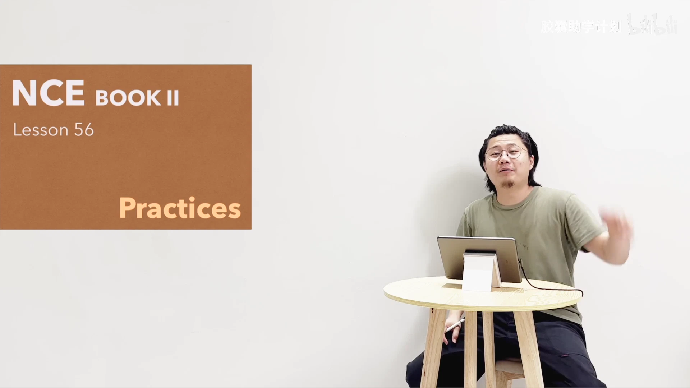

文字识别：NCE / BOOKI / Lesson 56 / Practices

### 画面 00:00:02

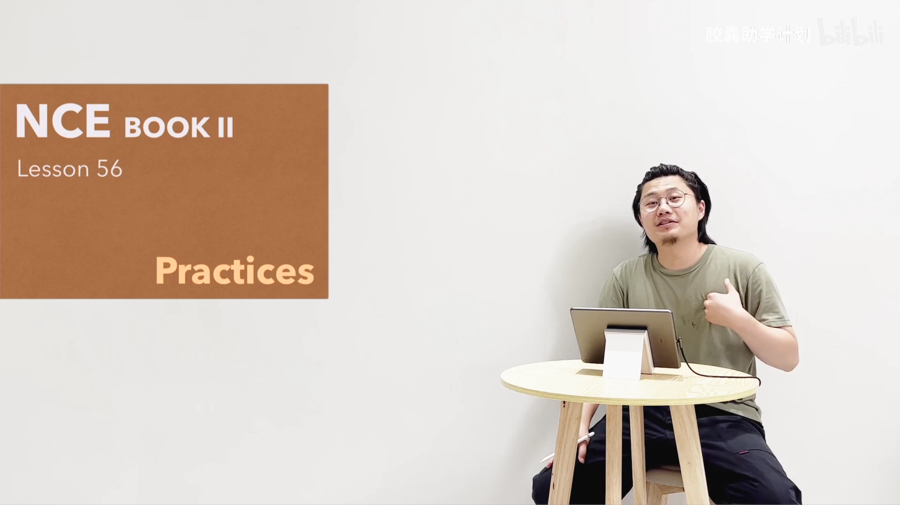

文字识别：NCE / BOOKII / Lesson 56 / Practices

### 画面 00:00:09

文字识别：进行如下练习唯一前提 / 文章跟读至熟读成诵 / 否则请勿开始

### 画面 00:00:19

文字识别：胶囊助学计划bilbi

### 画面 00:00:23

### 画面 00:00:25

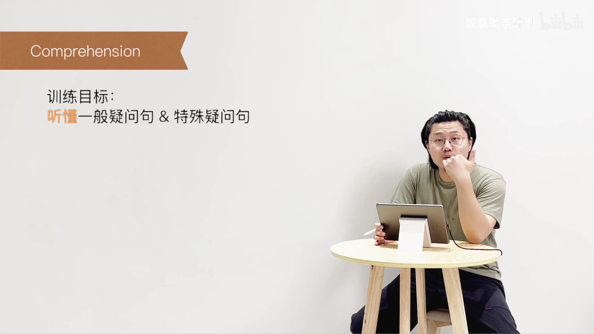

文字识别：Comprehension / 训练目标： / 听懂一般疑问句＆特殊疑问句

### 画面 00:00:27

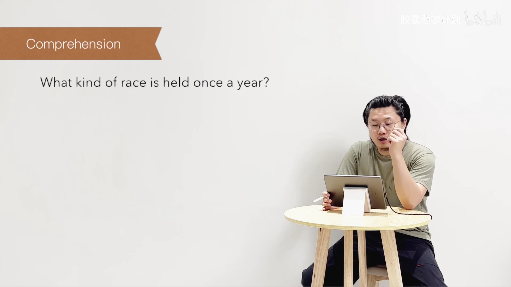

文字识别：Comprehension / What kind of race is held once a year?

## 00:00:30–00:01:00

once a year, a race for old cars. Next one, it was held last year, wasn't it? Yes, it was. Next one, how many cars entered for it? A lot of cars. Which was one of the most handsome car? A Rolls

### 画面 00:00:57

文字识别：Comprehension / Which was one of the most handsome?

## 00:01:00–00:01:30

Royce Silver Ghost, which was the most unusual car. A Benz with three wheels. Next one, when was it built? In nine in 1885. Was there another car as old as the Benz?

### 画面 00:01:06

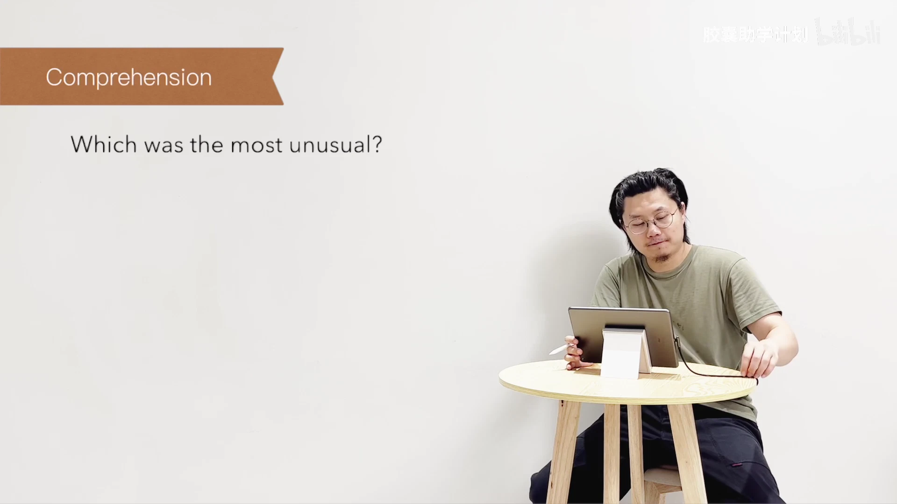

文字识别：Comprehension / Which was the most unusual?

### 画面 00:01:09

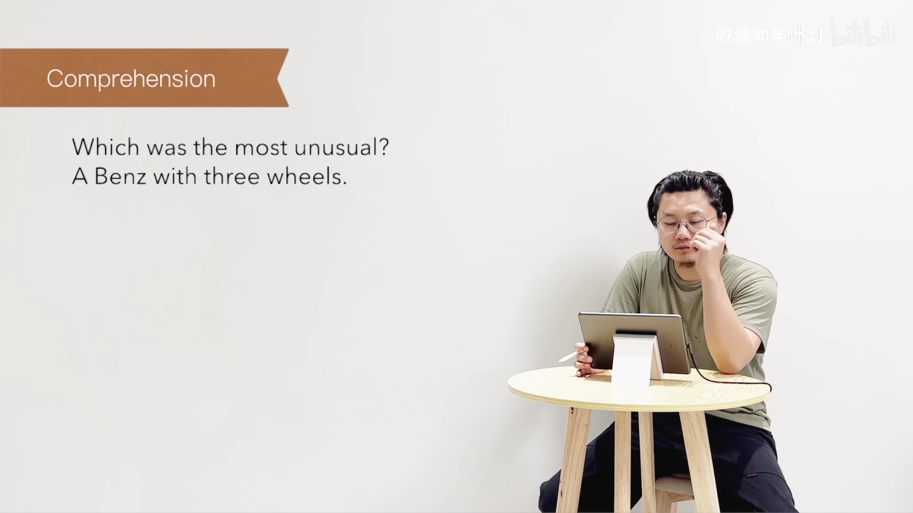

文字识别：Comprehension / Which was the most unusual? / A Benz with three wheels.

### 画面 00:01:24

文字识别：Comprehension / Was there another car as old as the Benz?

## 00:01:30–00:02:00

no, there wasn't. Oldest car, ma. Was there a lot of excitement before the race? Yes, there was. Next one, was there just one loud explosion? No, there wasn't. What happened to many of the cars on the course?

### 画面 00:01:33

文字识别：Comprehension

### 画面 00:01:59

文字识别：Comprehension / What happened to many of the cars on the course? / They broke down.

## 00:02:00–00:02:30

They broke down. Where did some drivers spend a lot of their time? Under their cars. How many cars completed the race? Only a few cars. Asking questions.练习的肯定句、否定句、一般疑问句、特殊疑问句，从新一贯穿到新三，对吧？哎，四句型转换，我们所谓的

### 画面 00:02:03

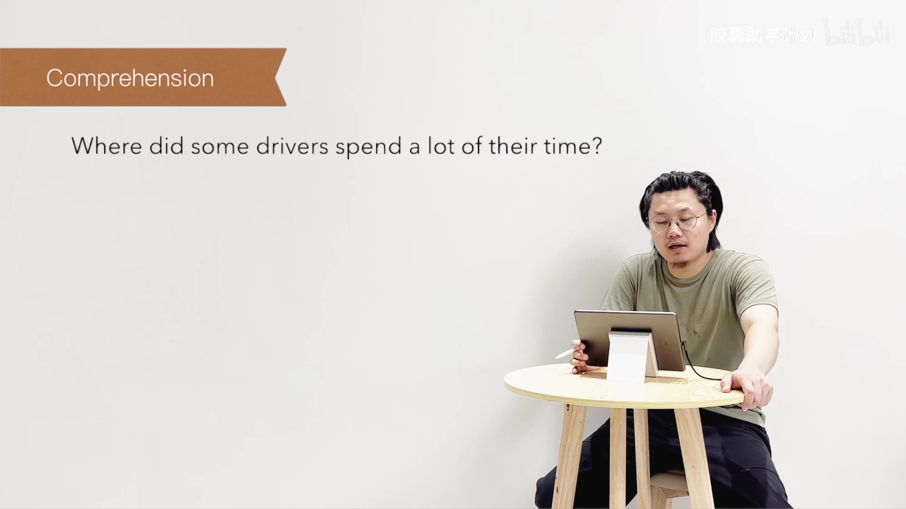

文字识别：Comprehension / Where did some drivers spend a lot of their time?

### 画面 00:02:20

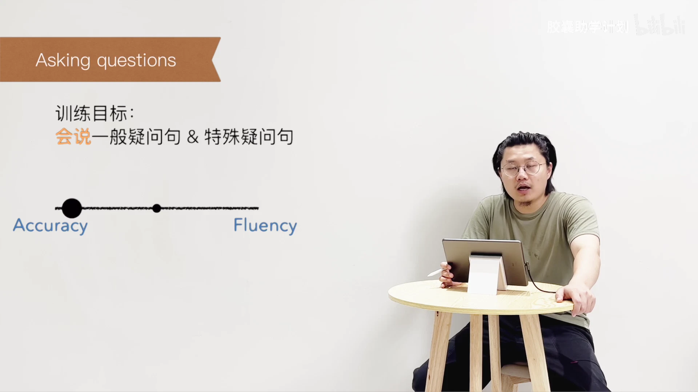

文字识别：Asking questions / 训练目标： / 会说一般疑问句＆特殊疑问句 / Accuracy / Fluency

### 画面 00:02:28

文字识别：Asking questions

## 00:02:30–00:03:00

呃，Ask me if the car race for the car is held once a year.比但对吧？把B E提前就可以了。然后How often肯定是对once a year提问，那就How often is the race for old cars held？对吧？啊，或呃，OK，没问题啊。呃，我们还是只说思路，不给具体答案，因为这里都是我们新一学过很多遍的了，没有必要给具体答案啊。Entered did提前动词记得换回原形。How many要记住对a lot of

### 画面 00:02:35

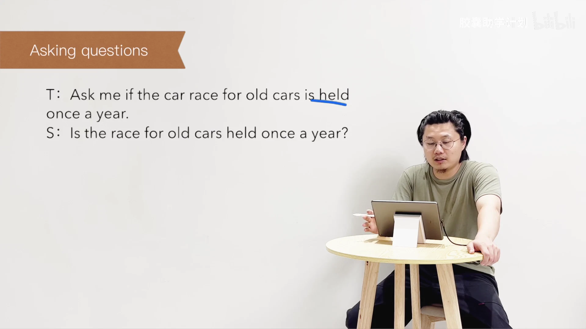

文字识别：Asking questions / T: Ask me if the car race for old cars is held / once a year. / S: Is the race for old cars held once a year?

### 画面 00:02:40

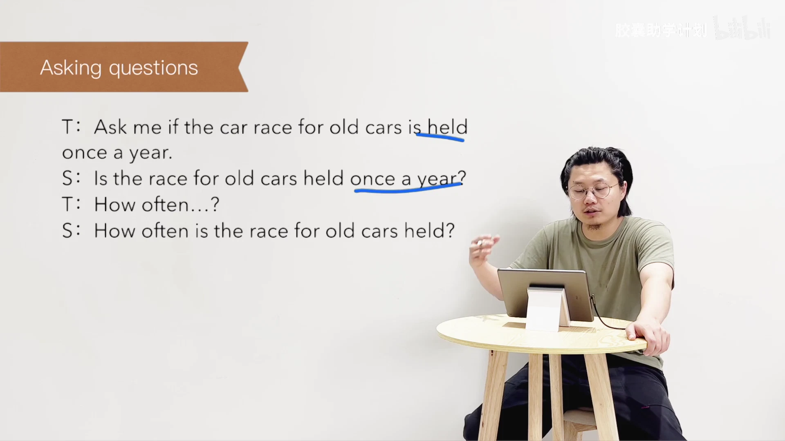

文字识别：Asking questions / T: Ask me if the car race for old cars is held / once a year. / S: Is the race for old cars held once a year? / T: How often...? / S: How often is the race for old cars held?

### 画面 00:02:45

文字识别：Asking questions

### 画面 00:02:47

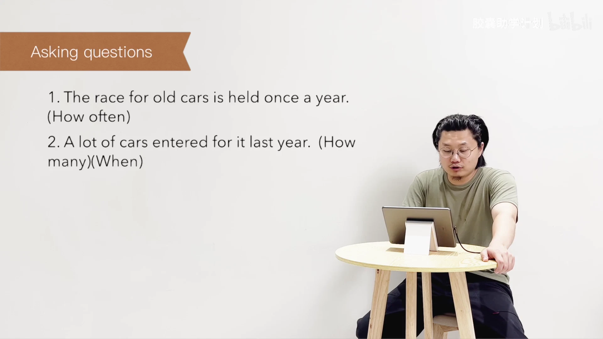

文字识别：Asking questions / 1. The race for old cars is held once a year. / (How often) / 2.A lot of cars entered for it last year. (How / many)(When)

## 00:03:00–00:03:30

提问，它是对主语或主语的一部分提问，就不用变一般疑问句了。叫How many cars entered for it last year？听见了吧？好，问那对last year提问对吧？呃，加一般疑问句嘛，要去掉答案对吧？One of the most handsome cars was a Rolls Royce Silver Ghost. Was一提which，你看这里的which想去提问叫哪一辆车？你可以说，

### 画面 00:03:12

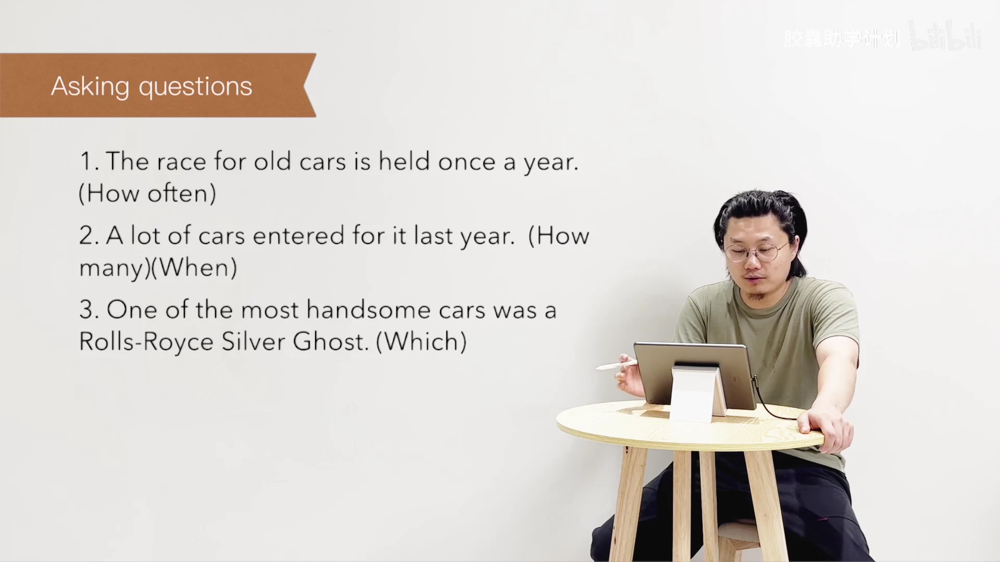

文字识别：Asking questions / 1. The race for old cars is held once a year. / (How often) / 2.A lot of cars entered for it last year. (How / many)(When) / 3. One of the most handsome cars was a / Rolls-Royce Silver Ghost. (Which)

## 00:03:30–00:04:00

呃，which was a Rolls Royce Silver Car. 你也可以说 which car was one of the most handsome cars, 或者说 which was one of the most handsome cars, 对吧？哪一辆是最帅的车？ Silver Ghost嘛。 So the most unusual car was a Benz. 跟刚才一样，was往前一提。 你可以说，呃，which one was the most unusual car, 或者说 which was the most unusual car, 对

### 画面 00:03:42

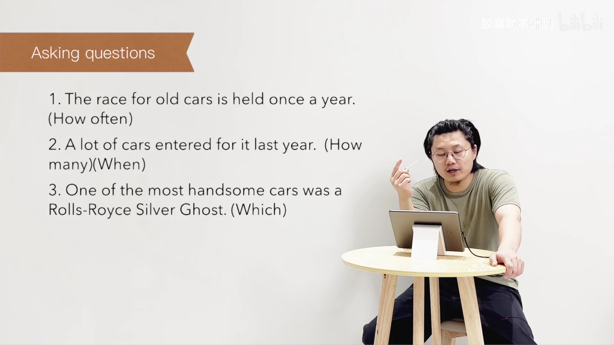

文字识别：Asking questions / 1.The race for old cars is held once a year. / (How often) / 2.A lot of cars entered for it last year. (How / many)(When) / 3. One of the most handsome cars was a / Rolls-Royce Silver Ghost. (Which)

## 00:04:00–00:04:30

吧？哎，哪一辆是？It had only three wheels.典型的，一般过去式did提前，动词换原形。How many对three提问，连着wheels一起提前，所以这句话的答案叫How many wheels did it have? It was built in 1885. Was往前提，when对时间提问，what对主语提问，对吧？哎，What was built in 1885? The race began with

### 画面 00:04:00

文字识别：Asking questions

### 画面 00:04:21

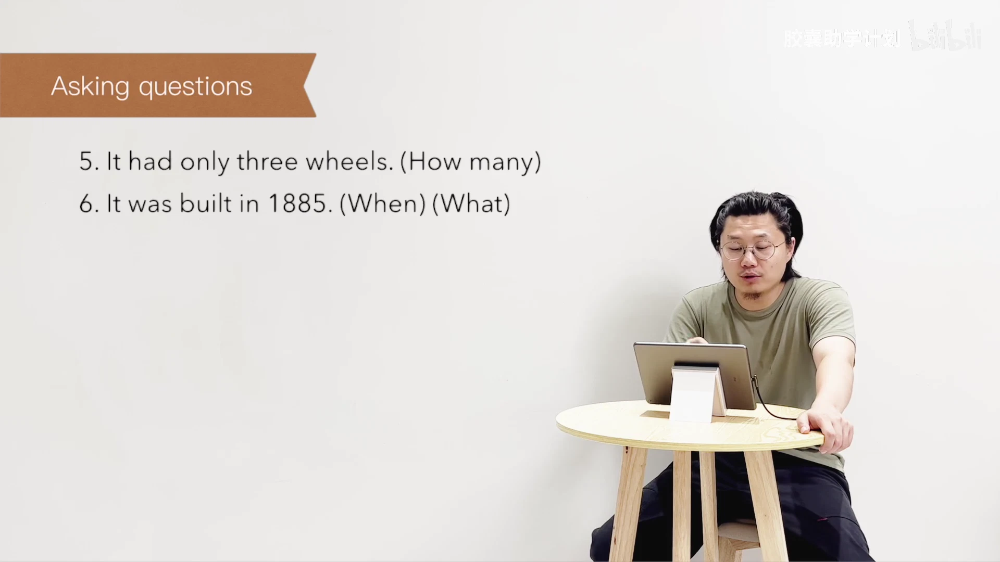

文字识别：Asking questions / 5. Ilt had only three wheels. (How many) / 6.It was built in 1885.(When) (What)

### 画面 00:04:27

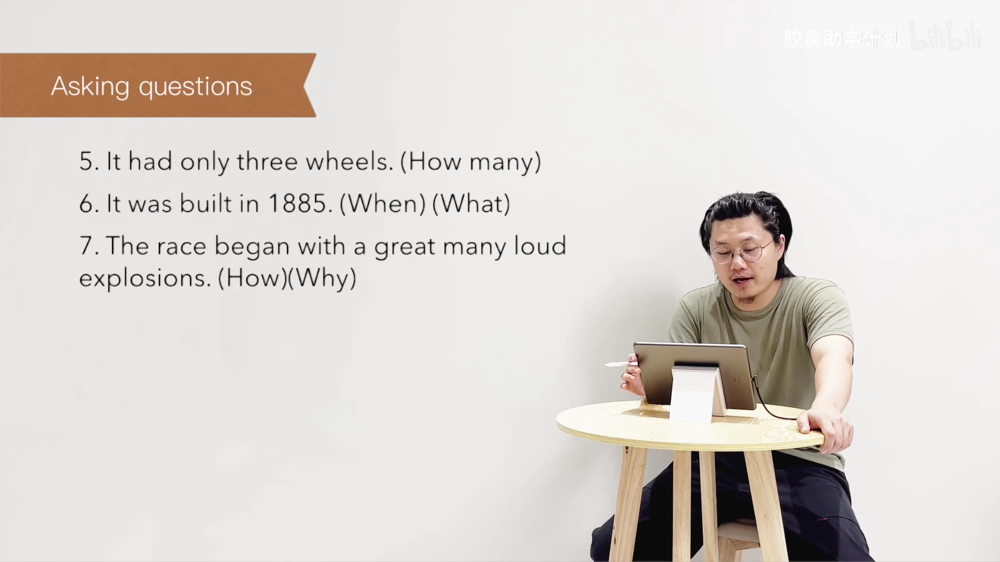

文字识别：Asking questions / 5. It had only three wheels.(How many) / 6.Ilt was built in 1885.(When) (What) / 7. The race began with a great many loud / explosions.(How)(Why)

## 00:04:30–00:05:00

a great many loud explosions. Did 往前提 how 其实是对 with a great loud explosions 提问，对吧？它是如何开始的啊？伴随着大量的爆，大声的爆炸声。 Why 整句嘛，对不对？ Many of the cars broke down on the course. Did 往前提动词换回原形。 How many 对 many of 提问，还是说一下答案叫 How many cars broke down on the course？啊，

### 画面 00:04:45

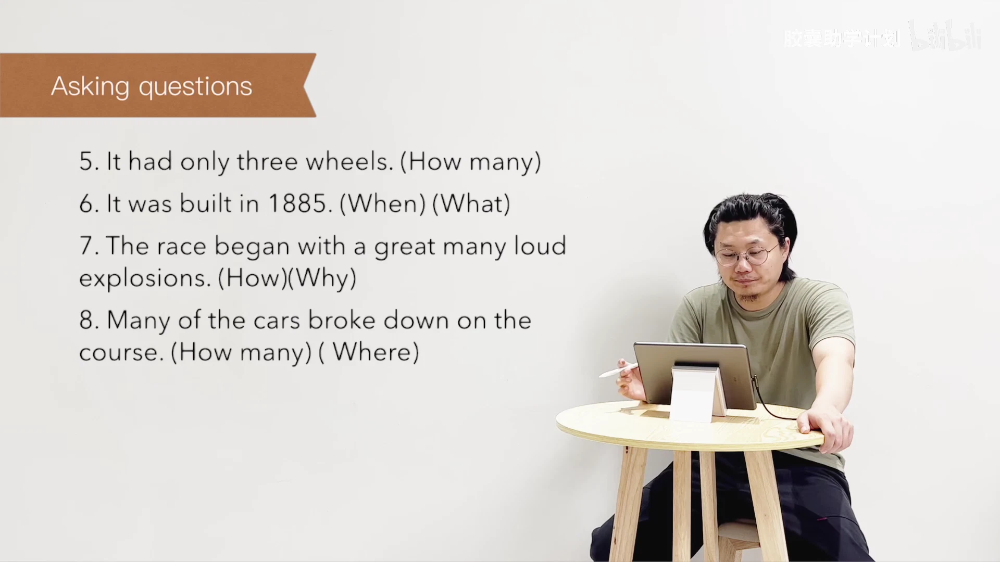

文字识别：Asking questions / 5. It had only three wheels.(How many) / 6.Ilt was built in 1885.(When) (What) / 7. The race began with a great many loud / explosions.(How)(Why) / 8. Many of the cars broke down on the / course.(How many)( Where)

## 00:05:00–00:05:30

that where? On the course, question,嘛，没有新的了。A few completed the race. Did往前一提，How many?对，a few提问，对吧？呃，Tell the story.还是那句话，再提醒一句，准确性可以差一点点，流利性不能差。文章读熟，看着它复述文章。如果各位您直接学的我下半册，那你可以去看一下我的上半册的这个地方，我是如何做示范的，好吧？不多说了。然后composition啊，它这个是跳

### 画面 00:05:08

文字识别：Tell the story / 训练目标： / 口语复述能力 / Accuracy / Fluency

### 画面 00:05:16

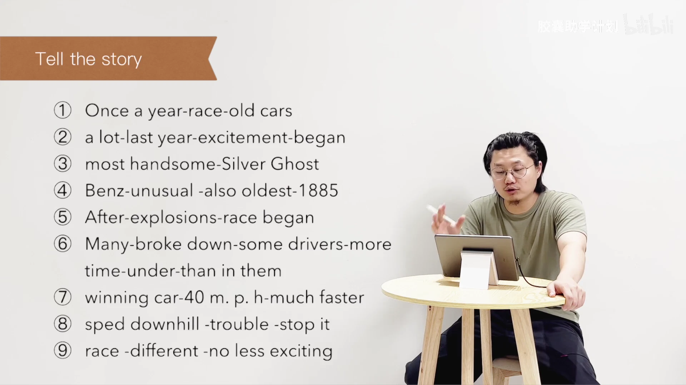

文字识别：Tell the story / ① Once a year-race-old cars / ② a lot-last year-excitement-began / most handsome-Silver Ghost / Benz-unusual -also oldest-1885 / After-explosions-race began / Many-broke down-some drivers-more / time-under-than in them / winning car-40 m. p. h-much faster / sped downhill -trouble -stop it / race -different -no less exciting / 9

### 画面 00:05:26

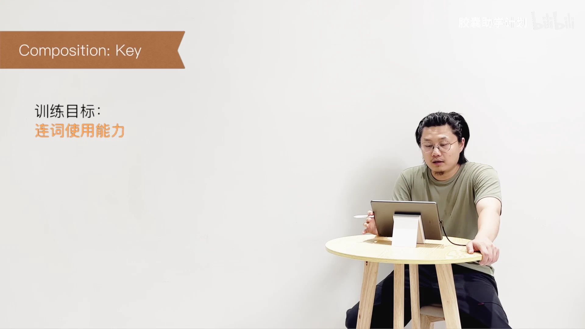

文字识别：Composition: Key / 训练目标： / 连词使用能力

## 00:05:30–00:06:00

一课一个的，对吧？哎，这一课的composition就要练。我们简单说一下，呃，答案在我们书里边啊，在这个这个题呀，这个一呀，这个题呀，在我们书里边，答案呢是我给大家写出来了，对吧？所以你可以先去写一下，然后对答案。当然，你也可以在这里呢直接看看完了口语自己想一下，说个答案，看跟底下对比一下，对不对？对吧？呃，都不太难，除了这个定语从句可能稍微难一点点啊。呃，一共五个啊，来

### 画面 00:05:34

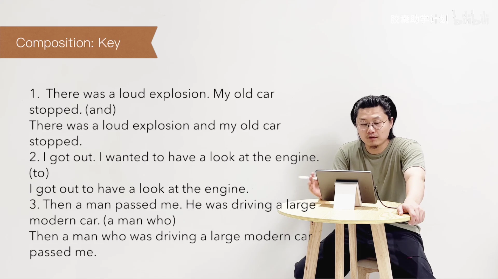

文字识别：Composition: Key / 1. There was a loud explosion. My old car / stopped.(and) / There was a loud explosion and my old car / stopped. / 2.I got out.I wanted to have a look at the engine. / (to) / I got out to have a look at the engine. / 3. Then a man passed me. He was driving a large / modern car. (a man who) / Then a man who was driving a large modern car / passed me.

### 画面 00:05:58

文字识别：Composition: Key / 4. I waved to him. He did not stop. (but) / I waved to him but he did not stop. / 5.I passed the large car later. Its driver was / changing a wheel. (when) / When I passed the car later, its driver was / changing a wheel.

## 00:06:00–00:06:30

这儿对答案就行了，我就不多说了，不会留言啊，这个问就可以了，好吧？呃，写作呢是练习我们写作复述能力啊，还是写完来这儿对答案就可以了。第三单元用的连词开始变多了，还是要写一写，对吧？尤其是什么 which 啊，对吧？这样的连词啊， when 啊，对不对？啊， so quickly that呀，对吧？全是复习嘛，全是之前学过的。 Topic for discussion，

### 画面 00:06:07

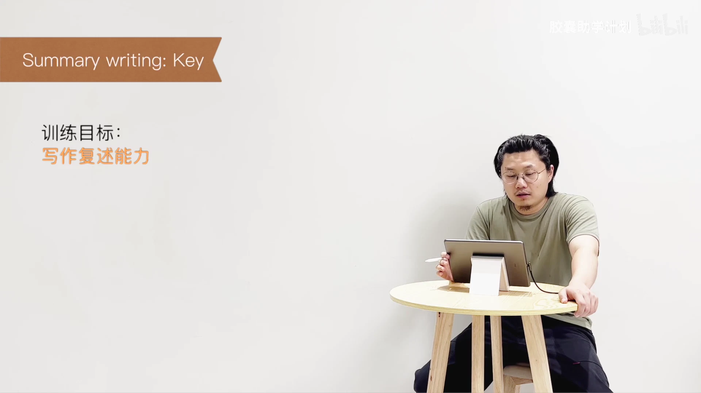

文字识别：Summary writing: Key / 训练目标： / 写作复述能力

### 画面 00:06:10

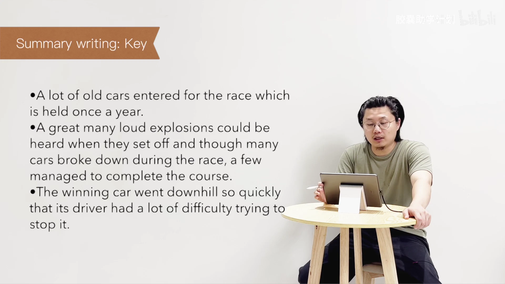

文字识别：Summary writing: Key / •A lot of old cars entered for the race which / is held once a year. / •A great many loud explosions could be / heard when they set off and though many / cars broke down during the race, a few / managed to complete the course. / •The winning car went downhill so quickly / that its driver had a lot of difficulty trying to / stop it.

### 画面 00:06:27

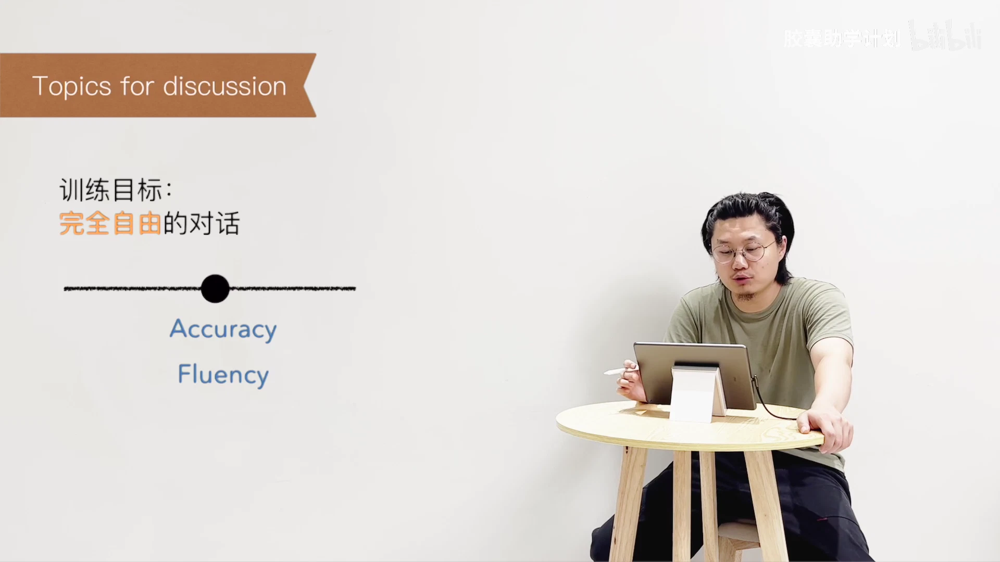

文字识别：Topics for discussion / 训练目标： / 完全自由的对话 / Accuracy / Fluency

## 00:06:30–00:07:00

完全自由的对话。我们只说他到底问的是什么。敢能有能力的同学可以开始写一写，试一试了啊。第一题，Do you think old cars should be used or kept in museums? Why? 你认为这些老爷车们应该是被使用起来，还是放在博物馆里？为啥？ Would you prefer to prefer to own something very old or very modern? Why? 你想要一些特别旧的东西，还是特别

### 画面 00:06:31

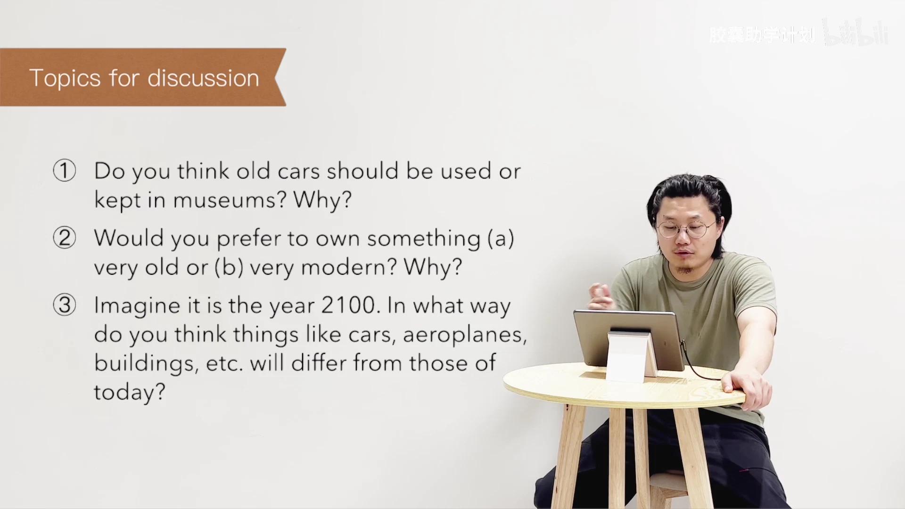

文字识别：Topics for discussion / Do you think old cars should be used or / kept in museums? Why? / Would you prefer to own something (a) / very old or (b) very modern? Why? / Imagine it is the year 2100. In what way / do you think things like cars, aeroplanes, / buildings, etc. will differ from those of / today?

## 00:07:00–00:07:30

现代化的东西，为啥？Imagine it is the year twenty one hundred. In what way do you think things like cars, airplanes, buildings, etc., etc.,就是等等啊，will differ from those of today?说假想一下，已经是二一零零年了。然后呢？说那你认为汽车、飞机和建筑物会和今天有哪些不同？畅

### 画面 00:07:01

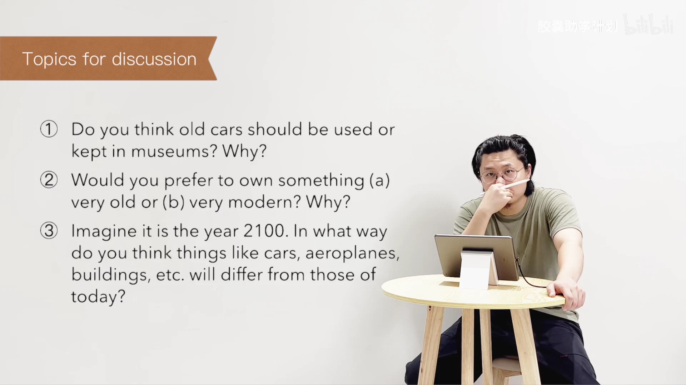

文字识别：Topics for discussion / Do you think old cars should be used or / kept in museums? Why? / Would you prefer to own something (a) / very old or (b) very modern? Why? / Imagine it is the year 2100. In what way / 3 / do you think things like cars, aeroplanes, / buildings, etc. will differ from those of / today?

### 画面 00:07:29

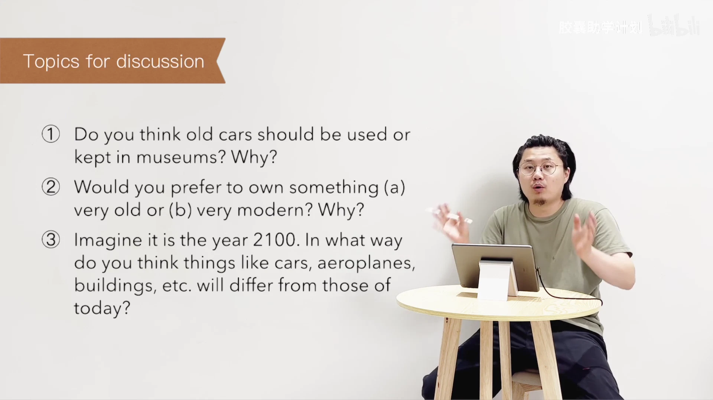

文字识别：Topics for discussion / Do you think old cars should be used or / kept in museums? Why? / Would you prefer to own something (a) / very old or (b) very modern? Why? / Imagine it is the year 2100. In what way / 3 / do you think things like cars, aeroplanes, / buildings, etc. will differ from those of / today?

## 00:07:30–00:08:00

想一下，对吧？哎，这个其实你看，我们这么说啊，一个不太关心这些事情的人呢，汉语其实都不太能说明白，对吧？哎，就你让他说这个话题，他汉语都不一定能给你说个一二三四五出来，对吧？哎，这这个子丑寅卯出来，所以呢，这个地方各位要明白，口语实际上我们为什么就是这个题现在练不了？但我还是要说一下，它的目的就是让各位脑海当中有个意识，就是我口语不是只要学英语有表达就够了的，

### 画面 00:07:32

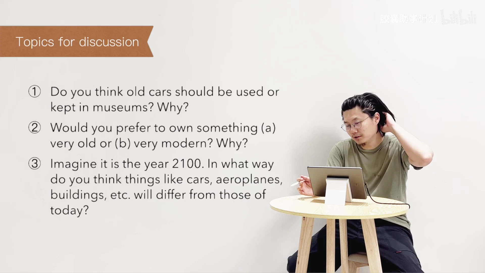

文字识别：Topics for discussion / Do you think old cars should be used or / kept in museums? Why? / Would you prefer to own something (a) / very old or (b) very modern? Why? / Imagine it is the year 2100. In what way / do you think things like cars, aeroplanes, / buildings, etc. will differ from those of / today?

### 画面 00:07:37

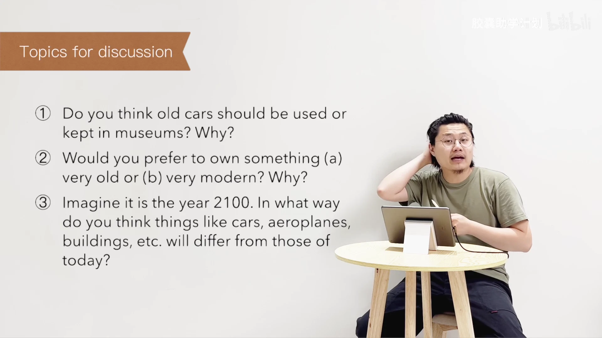

文字识别：Topics for discussion / Do you think old cars should be used or / kept in museums? Why? / Would you prefer to own something (a) / very old or (b) very modern? Why? / Imagine it is the year 2100. In what way / 3 / do you think things like cars, aeroplanes, / buildings, etc. will differ from those of / today?

### 画面 00:07:47

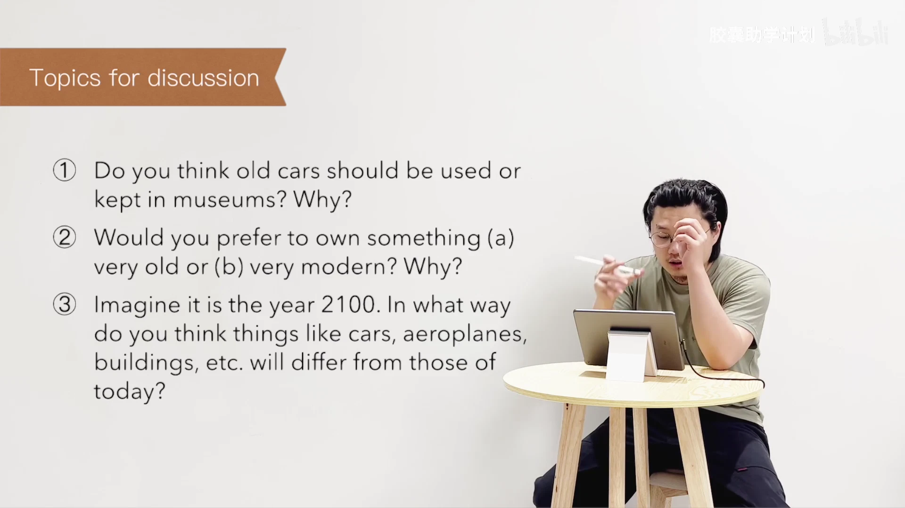

文字识别：Topics for discussion / Do you think old cars should be used or / kept in museums? Why? / Would you prefer to own something (a) / very old or (b) very modern? Why? / Imagine it is the year 2100. In what way / do you think things like cars, aeroplanes, / buildings, etc. will differ from those of / today?

## 00:08:00–00:08:30

我还得平常多去接触一些内容积攒，对吧？否则我表达都有了，但是我不知道我要说什么。就像你汉语表达说清楚这事儿没问题吧？但你试试你汉语能不能拿这个说个五分钟，对吧？说哪怕说个两分钟、一分钟，如果你都说不出来，那就说明你对这方面的内容过于缺少了。哎，多去收集内容，好吧？不多说了啊！家庭作业啊，Smith先写，保证正确率，大声朗读。摘要写作，写完对答案。Tell the story啊，composition

### 画面 00:08:17

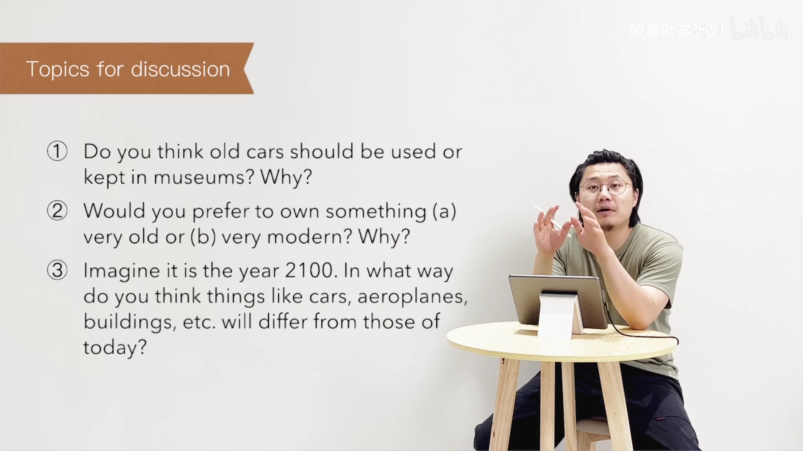

文字识别：Topics for discussion / Do you think old cars should be used or / kept in museums? Why? / Would you prefer to own something (a) / very old or (b) very modern? Why? / Imagine it is the year 2100. In what way / do you think things like cars, aeroplanes, / buildings, etc. will differ from those of / today?

### 画面 00:08:22

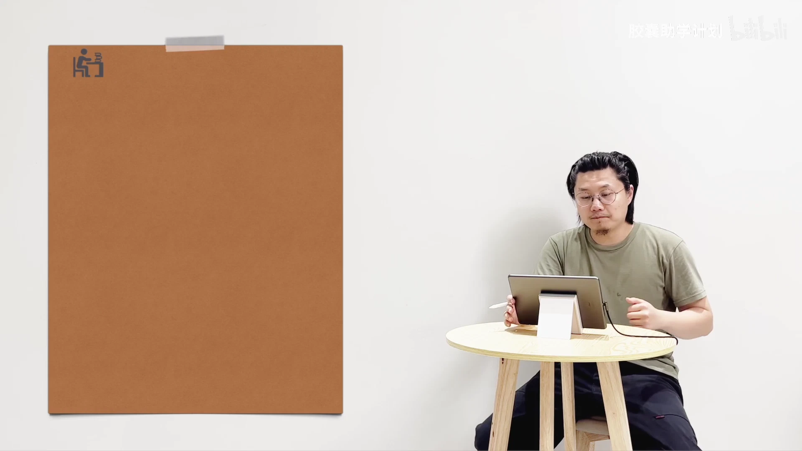

文字识别：计划

### 画面 00:08:25

文字识别：1.Ask me if写&朗读 / 2. / 摘要写作写&答案

### 画面 00:08:27

文字识别：1.Ask me if写&朗读 / 摘要写作写&答案 / 3.Tell the story 口语复述

### 画面 00:08:29

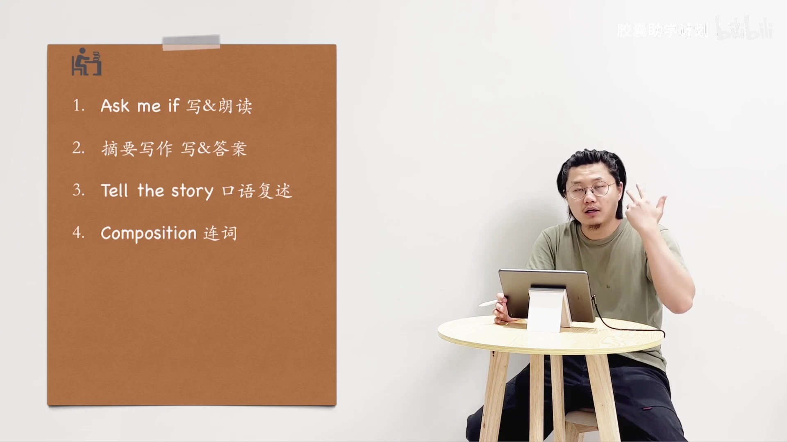

文字识别：计划 / 1.Ask me if写&朗读 / 摘要写作写&答案 / 3.Tell the story 口语复述 / Composition 连词

## 00:08:30–00:09:00

Practice linking. Ah, interval repetition, right? Then look at the top comment. Okay, good. That's all for this video. If you like our course, please follow us, subscribe, and share it with those who need it to help us grow. See you next time.

### 画面 00:08:31

文字识别：1.Ask me if写&朗读 / 摘要写作写&答案 / 3.Tell the story 口语复述 / Composition 连词 / 5.重复间隔（置顶留言）

### 画面 00:08:35

文字识别：力学计划一调

### 画面 00:08:38

文字识别：学计划 / 不

### 画面 00:08:43

文字识别：学计划

### 画面 00:08:46

文字识别：助学计划一州

### 画面 00:08:48

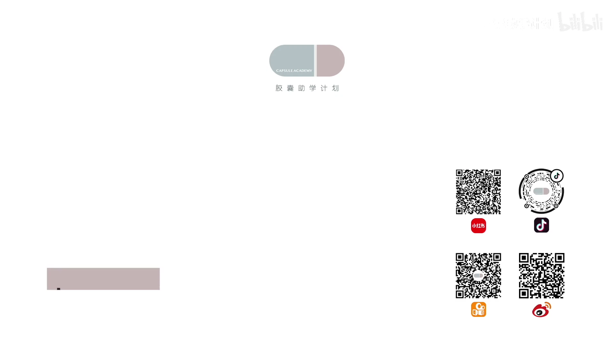

文字识别：CAPSULEACADEMY / 胶囊助学计划 / 小红书 / OE

### 画面 00:08:50

文字识别：CAPSULEACADEMY / 胶囊助学计划 / 小红书 / OE

### 画面 00:08:53

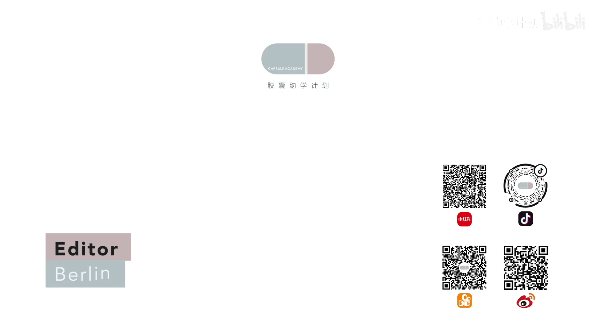

文字识别：CAPSULEACADEMY / 胶囊助学计划 / 小红书 / Editor / □ / 口 / Berlin / OE

### 画面 00:08:55

文字识别：CAPSULEACADEMY / 胶囊助学计划 / 小红书 / Creator / Leo & Berlin / OE

### 画面 00:08:57

文字识别：胶囊助学计划H / CAPSULEACADEMY / 胶囊助学计划 / 『 / 小红书 / OE

### 画面 00:08:59

文字识别：bilibili / 胶囊助学计划

## 00:09:00–00:09:00

